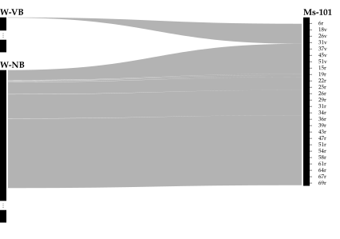

# Ms-101

256 published remarks, GT, VB, NB

### [IIr\[1\]](https://cdn.wittgensteinnachlass.com/2000px/webp/Ms-101/IIr.webp)

To be sent after my death

to Mrs

Poldy Wittgenstein

XVII. Neuwaldeggerstr. 38 Wien

### [IIr\[2\]](https://cdn.wittgensteinnachlass.com/2000px/webp/Ms-101/IIr.webp)

To be sent to

Hon. B. Russell Trinity College

_Cambridge_ England

### [GT](/w-gt/#ms-101-1r.1) [1r\[1\]](https://cdn.wittgensteinnachlass.com/2000px/webp/Ms-101/1r.webp)

09.08.1914

Accepted at the recruitment examination the day before yesterday & assigned to the 2nd Fortress Artillery Regiment in Krakau. Left Wien yesterday morning. Arrive in Krakau this morning. In good spirits. Gave my large notebook to Trenkler for safekeeping. Will I be able to work now??? Very curious about the life ahead of me! The military authorities in Wien were unbelievably kind. People who are asked for advice by thousands every day gave friendly & detailed answers. That sort of thing is enormously encouraging. It reminded me of how things are in England.

### [GT](/w-gt/#ms-101-1r.2+2r.1) [1r\[2\]](https://cdn.wittgensteinnachlass.com/2000px/webp/Ms-101/1r.webp),[2r\[1\]](https://cdn.wittgensteinnachlass.com/2000px/webp/Ms-101/2r.webp)

10.08.1914

Issued with my recruit’s uniform. Little hope of being able to use my technical knowledge. Need a _great_ deal of good humour & philosophy to find my feet here. When I woke up today it felt like one of those dreams in which one suddenly finds oneself back at school in quite a nonsensical way. There is of course also much humour in my situation & I perform the lowliest duties with an almost ironic smile. Did not work. This is a trial by fire for one’s character precisely because it takes so much strength not to lose one’s good spirits & energy.

### [GT](/w-gt/#ms-101-2r.2) [2r\[2\]](https://cdn.wittgensteinnachlass.com/2000px/webp/Ms-101/2r.webp)

11.08.1914

Slept badly (vermin). After I had swept the room we marched over to a few old mortars & were instructed in their use. Terribly hot. The food is inedible. Perhaps I shall sleep outside the barracks in future. Wrote to David. I am already longing for a letter from him so as not to lose the feeling of contact with my former life. Have not worked yet.

### [GT](/w-gt/#ms-101-2r.3+3r.1) [2r\[3\]](https://cdn.wittgensteinnachlass.com/2000px/webp/Ms-101/2r.webp),[3r\[1\]](https://cdn.wittgensteinnachlass.com/2000px/webp/Ms-101/3r.webp)

13.08.1914

Saw the captain the day before yesterday. Was very flustered & did not stand before him in a soldierly fashion. He was somewhat ironic and I did not much take to him. Result = 0. Today it came out that I had passed my school-leaving examination etc., whereupon quite a number of the one-year volunteers addressed me as “Mr Colleague” & urged me to claim my right to serve as a one-year volunteer. This amused me(. It bucked me up). Bad catarrh yesterday & today and often felt unwell. A little depressed at times. Met a lieutenant in the canteen today who was struck by the fact that I was having lunch there; he asked me very kindly what I did in civilian life, was very surprised that they had not taken me on as a one-year volunteer & was altogether very friendly, which did me a great deal of good.

### [GT](/w-gt/#ms-101-3r.2+4r.1+5r.1) [3r\[2\]](https://cdn.wittgensteinnachlass.com/2000px/webp/Ms-101/3r.webp),[4r\[1\]](https://cdn.wittgensteinnachlass.com/2000px/webp/Ms-101/4r.webp),[5r\[1\]](https://cdn.wittgensteinnachlass.com/2000px/webp/Ms-101/5r.webp)

15.08.1914

So much happens that a day seems as long as a week to me. Yesterday I was ordered to operate a searchlight on a ship we had captured on the Vistula; the crew are a pack of swine! No enthusiasm, unbelievable coarseness, stupidity & malice! So it is not true after all that a great common cause _must_ ennoble people. This turns even the most irksome work into forced labour. It is remarkable how people themselves make their work into an ugly toil. Given all our outward circumstances, work on this ship could make for a magnificent, happy time, and instead! – It will presumably be impossible to communicate with the people here (except perhaps with the lieutenant, who seems a very nice person). So the thing is to do the work in _humility_ and for God’s sake not to lose oneself!!!! For one loses oneself most easily when one wants to give oneself to other people.

### [GT](/w-gt/#ms-101-5r.2) [5r\[2\]](https://cdn.wittgensteinnachlass.com/2000px/webp/Ms-101/5r.webp)

16.08.1914

On the “Goplana”. Once again: the stupidity, insolence & malice of these people know no bounds. All work becomes torment. But I have already worked again today & shall not let myself be beaten. Wrote a card to dear David today. Heaven protect him & preserve his friendship for me! – The journey itself along the Vistula is splendid & I am in good spirits.

### [GT](/w-gt/#ms-101-5r.4+6r.1) [5r\[4\]](https://cdn.wittgensteinnachlass.com/2000px/webp/Ms-101/5r.webp),[6r\[1\]](https://cdn.wittgensteinnachlass.com/2000px/webp/Ms-101/6r.webp)

17.08.1914

A pack of rogues! Only the officers are nice people, & some of them are really

_very_ fine. Have to sleep on the bare ground & without blankets. Are now in Russia. The hard work has left me altogether devoid of sensual feeling. Have not worked yet today. G.S. It is too cold on deck & below there are too many people talking, shouting, stinking etc. etc.

### [GT](/w-gt/#ms-101-6r.2+7r.1) [6r\[2\]](https://cdn.wittgensteinnachlass.com/2000px/webp/Ms-101/6r.webp),[7r\[1\]](https://cdn.wittgensteinnachlass.com/2000px/webp/Ms-101/7r.webp)

18.08.1914

At 1 in the morning I am suddenly woken; the senior lieutenant asks for me & says I must go to the searchlight at once. “Don’t get dressed”. I ran to the bridge almost naked. Icy air, rain. I was certain I was going to die now. Started up the searchlight & went back to get dressed. It was a false alarm. I was _terribly_ agitated & groaned aloud. I felt the horrors of war. Now (in the evening) I have already got over the fright. I shall do all I can to preserve my life if I do not change my present frame of mind.

### [VB](/w-vb/#ms-101-7r.2) [7r\[2\]](https://cdn.wittgensteinnachlass.com/2000px/webp/Ms-101/7r.webp)

21.08.1914

The lieutenant & I have often talked about all sorts of things already; a very nice person. He can deal with the greatest scoundrels & be friendly without lowering himself. When we hear a Chinese man, we are inclined to take his speech for inarticulate gurgling. Someone who understands Chinese will recognize the _language_ in it. In the same way I often cannot recognize the _human being_ in a human being etc.. Worked a little but without success.

---

### [GT](/w-gt/#ms-101-8r.2) [8r\[2\]](https://cdn.wittgensteinnachlass.com/2000px/webp/Ms-101/8r.webp)

Is it all over with my work now, for ever?!! The devil knows. Will nothing ever occur to me again? I am utterly & completely “unfamiliar” with all the concepts of my work. I _see_ nothing at all!!!

### [GT](/w-gt/#ms-101-8r.3) [8r\[3\]](https://cdn.wittgensteinnachlass.com/2000px/webp/Ms-101/8r.webp)

22.08.1914

Have been stuck on a sandbank for 3 days now. Often work, with many interruptions & so far quite unsuccessfully. Still cannot arrive at anything _solid_. Everything dissolves into mist. Keep going!!!

### [GT](/w-gt/#ms-101-9r.2+10r.1+11r.1) [9r\[2\]](https://cdn.wittgensteinnachlass.com/2000px/webp/Ms-101/9r.webp),[10r\[1\]](https://cdn.wittgensteinnachlass.com/2000px/webp/Ms-101/10r.webp),[11r\[1\]](https://cdn.wittgensteinnachlass.com/2000px/webp/Ms-101/11r.webp)

25.08.1914

A terrible day yesterday. In the evening the searchlight would not work. When I tried to examine it, the crew disturbed me with their shouting, bawling etc. I wanted to examine it more closely, but then the sergeant took it out of my hands. I simply cannot go on writing. It was dreadful. One thing I did see: There is not a single decent fellow in the whole crew. But how am I to deal with all this in future? Am I simply to put up with it? And if I do not want to do that? Then I shall have to live in continual struggle. Which is better? In the 2nd case I would _certainly_ wear myself out. In the first _perhaps_ not. An _enormously_ difficult time is coming for me now, for I really am once again as forsaken & betrayed as I was back at school in Linz. Only one thing is necessary: To be able to contemplate everything that happens to one; _to collect oneself_! God help me!

### [GT](/w-gt/#ms-101-11r.2) [11r\[2\]](https://cdn.wittgensteinnachlass.com/2000px/webp/Ms-101/11r.webp)

26.08.1914

Yesterday I resolved _to offer no resistance_. To make my outward self quite light, so to speak, so as to leave my inner self undisturbed.

### [GT](/w-gt/#ms-101-11r.3) [11r\[3\]](https://cdn.wittgensteinnachlass.com/2000px/webp/Ms-101/11r.webp)

29.08.1914

Every night I stand on the bridge until about 3½ a.m. I have not yet properly carried out my plan of complete passivity. My comrades’ vileness is still dreadful to me. But just to stay with oneself! Work a little every day but still without any real success. Though some things are already beginning to dawn on me.

### [GT](/w-gt/#ms-101-11r.4+12r.1) [11r\[4\]](https://cdn.wittgensteinnachlass.com/2000px/webp/Ms-101/11r.webp),[12r\[1\]](https://cdn.wittgensteinnachlass.com/2000px/webp/Ms-101/12r.webp)

02.09.1914

At the searchlight every night except last night. During the day I sleep.

I like this duty in so far as it keeps me more out of reach of my comrades’ malice. Yesterday we heard here of an enormous battle said to have been going on for 5 days already. If only this were already the decisive battle! Yesterday masturbated for the first time in 3 weeks. Almost entirely devoid of sensual feeling. Whereas I used always to imagine conversations with a friend, this now hardly ever happens. Work a tiny bit every day but am too tired and distracted. Yesterday I began reading Tolstoi’s explanations of the Gospels. A splendid work. But it is not yet for me what I expected of it.

### [GT](/w-gt/#ms-101-16v.2) [16v\[2\]](https://cdn.wittgensteinnachlass.com/2000px/webp/Ms-101/16v.webp)

04.09.1914

It’s coming along! – Take courage! – Working a lot.

### [GT](/w-gt/#ms-101-17v.2) [17v\[2\]](https://cdn.wittgensteinnachlass.com/2000px/webp/Ms-101/17v.webp)

05.09.1914

I am on the way to a great discovery. But shall I get there?! More sensual than before. Masturbated again today. Outside it is icy & stormy. I lie on the straw on the floor & write & read on a small wooden case (price 2˙50 crowns).

### [GT](/w-gt/#ms-101-18v.2) [18v\[2\]](https://cdn.wittgensteinnachlass.com/2000px/webp/Ms-101/18v.webp)

06.09.1914

Still being tormented by most of my comrades. I have still found no satisfactory way of responding to it. I have not yet resolved on complete passivity. And that is probably foolish; for I am powerless against all these people. I wear myself out _to no purpose_ if I resist.

### [GT](/w-gt/#ms-101-20v.2) [20v\[2\]](https://cdn.wittgensteinnachlass.com/2000px/webp/Ms-101/20v.webp)

08.09.1914

Heard early today that Lemberg had been occupied by the Russians. Now I know we are done for! No night duty in the last 4 days because the nights were very bright. Worked a lot every day & read a great deal of Tolstoi’s explanation of the Gospels.

### [GT](/w-gt/#ms-101-20v.3) [20v\[3\]](https://cdn.wittgensteinnachlass.com/2000px/webp/Ms-101/20v.webp)

10.09.1914

Much to do. Worked a fair amount all the same. Without any definite success but not in that familiar hopeless frame of mind.

### [GT](/w-gt/#ms-101-20v.4) [20v\[4\]](https://cdn.wittgensteinnachlass.com/2000px/webp/Ms-101/20v.webp)

12.09.1914

The news keeps getting worse. We shall be on full alert tonight. I work every day, more or less, and quite confidently. Again and again I repeat Tolstoi’s words to myself in my mind: “Man is _powerless_ in the flesh but _free_ through the spirit.” May the spirit be in me! In the afternoon the lieutenant heard shots nearby. I became very agitated. We shall probably be alerted. How shall I behave if it comes to shooting? I am not afraid of being shot but of not doing my duty properly. God give me strength! Amen. Amen. Amen.

### [GT](/w-gt/#ms-101-21v.2) [21v\[2\]](https://cdn.wittgensteinnachlass.com/2000px/webp/Ms-101/21v.webp)

13.09.1914

Very early this morning we left the ship with everything that was on board. The Russians are at our heels. Have lived through terrible scenes. Have not slept for 30 hours; feel very weak and see no outward grounds for hope. If this is the end for me now, may I die a good death, mindful of myself. May I never lose myself.

### [GT](/w-gt/#ms-101-22v.2) [22v\[2\]](https://cdn.wittgensteinnachlass.com/2000px/webp/Ms-101/22v.webp)

15.09.1914

Terrible scenes the night before last: almost everyone drunk. Yesterday back on the Goplana, which was taken into the Dunajec. Did not work yesterday & the day before. Tried in vain; the whole thing was alien to my mind. The Russians are at our heels. We are very close to the enemy. In good spirits, have worked again. I can now work best while peeling potatoes. I always volunteer for it. It is for me what grinding lenses was for Spinoza. Relations with the lieutenant are much cooler than before. But take courage! “He whom genius does not forsake – – – –”! God be with me! Now I would have a chance to be a decent human being, for I stand face to face with death. May the spirit enlighten me.

### [GT](/w-gt/#ms-101-23v.2) [23v\[2\]](https://cdn.wittgensteinnachlass.com/2000px/webp/Ms-101/23v.webp)

16.09.1914

The night passed quietly. In the morning heard heavy artillery fire & rifle fire. In all likelihood we are doomed with no way out.

The spirit is still with me, but will it not forsake me in my utmost need? I hope not! Now just to pull oneself together and behave well! (9 p.m.) Cloudburst. Man is powerless in the flesh and _free through the spirit._ And through that alone. Did hardly any work.

### [GT](/w-gt/#ms-101-24v.2) [24v\[2\]](https://cdn.wittgensteinnachlass.com/2000px/webp/Ms-101/24v.webp)

17.09.1914

This night too passed quietly. Was on guard. We are to go up the Vistula to Krakau. The border is said to be completely held by Cossacks, so we are probably done for. Only _one_ thing is needful! The lieutenant left the ship yesterday morning and by noon today had still not returned. Nobody knows what we are to do and there is not even enough money to buy food: But I am still in good spirits and hopefully shall remain so. I keep thinking about how I can sustain myself.

### [GT](/w-gt/#ms-101-24v.3) [24v\[3\]](https://cdn.wittgensteinnachlass.com/2000px/webp/Ms-101/24v.webp)

18.09.1914

A terribly agitating night.

Was to operate the searchlight and had to fear at every moment that it would go out. We were in a most precarious position and if the light had gone out & something had happened the whole responsibility would have fallen on me. Then a false alarm; I kept perfectly calm & had to listen to the sergeant trying to run me down to the lieutenant, as though I had been afraid. This agitated me terribly. On sentry duty from 1-3. Slept very little. Did not work yesterday. It is infinitely hard not to resist evil. It is hard to serve the spirit on an empty stomach and without enough sleep. But what would I be if I could not do it. My superiors are rude & stupid, my comrades are stupid & rude (with very few exceptions.) On the way to Krakau with galleys. The day passed quietly and not unpleasantly. Worked a little. —

### [GT](/w-gt/#ms-101-26v.2) [26v\[2\]](https://cdn.wittgensteinnachlass.com/2000px/webp/Ms-101/26v.webp)

19.09.1914

To Krakau. Last night I had to provide light for the work until 11 o’clock, while aboard another ship. Very cold in the night. We had to sleep in our boots. Slept badly. I have not taken off my clothes & shoes for 4 days now. But that must not matter. — I cannot help being afraid of what will happen to me in Krakau. I know I ought not to worry about it, but I feel so tired that I dread any exertion. —!

### [GT](/w-gt/#ms-101-26v.3) [26v\[3\]](https://cdn.wittgensteinnachlass.com/2000px/webp/Ms-101/26v.webp)

20.09.1914

Yes, once again: It is infinitely hard not

to resist people’s malice! For people’s malice wounds one every time. —

The Russians have been driven far enough back from the border that we have not been troubled so far.

### [GT](/w-gt/#ms-101-27v.2) [27v\[2\]](https://cdn.wittgensteinnachlass.com/2000px/webp/Ms-101/27v.webp)

21.09.1914

Arrived in Krakau early today. On duty at the searchlight all night. Worked a lot yesterday but not _very_ hopefully, since I lacked a proper _overview_. Had a brief talk with our sergeant yesterday which cleared the air a _little_. A little out of sorts today: I am already so _tired_ of all these upsets! No news at all from Wien! Today I received a card from Mama which she wrote on 20._8_. In the evening I received the disheartening news that the lieutenant who was our commander has been transferred. This news has left me deeply depressed. I cannot give myself an exact account of why I should necessarily be downhearted, but I am deeply sad. True, I am free through the spirit, but the spirit has forsaken me! Was able to work a little more in the evening, felt better afterwards. —.

### [GT](/w-gt/#ms-101-28v.2) [28v\[2\]](https://cdn.wittgensteinnachlass.com/2000px/webp/Ms-101/28v.webp)

22.09.1914

At the barracks in the morning to get money, saw the captain. He said I should have the one-year volunteer’s stripes sewn on. Ran many errands and went back to the ship, where the stripes caused a great stir. Received a lot of cards & letters, including some from Ficker & Jolles. Did not work. —.

### [GT](/w-gt/#ms-101-28v.3) [28v\[3\]](https://cdn.wittgensteinnachlass.com/2000px/webp/Ms-101/28v.webp)

23.09.1914

Worked a little.

### [GT](/w-gt/#ms-101-29v.2) [29v\[2\]](https://cdn.wittgensteinnachlass.com/2000px/webp/Ms-101/29v.webp)

24.09.1914

Worked quite a lot but with rather little hope. In town in the afternoon.

### [GT](/w-gt/#ms-101-29v.3) [29v\[3\]](https://cdn.wittgensteinnachlass.com/2000px/webp/Ms-101/29v.webp)

25.09.1914

Worked quite a lot but without real confidence. I still lack an overview and so the problem seems unsurveyable.

### [GT](/w-gt/#ms-101-29v.4) [29v\[4\]](https://cdn.wittgensteinnachlass.com/2000px/webp/Ms-101/29v.webp)

27.09.1914

Worked a fair amount yesterday but without any real success. A little sensual again in the last few days. Telegraphed home yesterday and asked for news.

### [GT](/w-gt/#ms-101-29v.5) [29v\[5\]](https://cdn.wittgensteinnachlass.com/2000px/webp/Ms-101/29v.webp)

28.09.1914

Worked a little. One expects a siege of Krakau. If it comes, more hard times lie ahead of us. May the spirit grant me strength!

### [GT](/w-gt/#ms-101-30v.2) [30v\[2\]](https://cdn.wittgensteinnachlass.com/2000px/webp/Ms-101/30v.webp)

29.09.1914

This morning took a corporal who has come down with dysentery to hospital. There are many cases of dysentery here now. An odd feeling comes over me when I think of all that I shall still have to go through in this war. Worked but without success. I still do not see clearly and have no overview. I see details without knowing how they will fit into the whole. That is also why I feel every new problem as a burden. Whereas a clear overview ought to show that every problem is _the main prob_lem, and the sight of the main questions does not weary one but strengthens one! Worked in the evening, not without success. Take courage! —

### [GT](/w-gt/#ms-101-31v.2) [31v\[2\]](https://cdn.wittgensteinnachlass.com/2000px/webp/Ms-101/31v.webp)

30.09.1914

During the night I began to feel unwell. (Stomach & head). Thy will be done!

### [GT](/w-gt/#ms-101-31v.3) [31v\[3\]](https://cdn.wittgensteinnachlass.com/2000px/webp/Ms-101/31v.webp)

01.10.1914

Yesterday I had to lie down in the morning and remain lying down all day as I felt very unwell. Worked quite a lot, but without success. It is said that we are to leave this ship tomorrow. I am curious to see what will happen to me. —!

### [GT](/w-gt/#ms-101-31v.4) [31v\[4\]](https://cdn.wittgensteinnachlass.com/2000px/webp/Ms-101/31v.webp)

02.10.1914

Worked quite a lot. Not altogether without success. It is still undecided what will happen to me, whether I stay on the ship or not etc. etc..

### [GT](/w-gt/#ms-101-31v.5) [31v\[5\]](https://cdn.wittgensteinnachlass.com/2000px/webp/Ms-101/31v.webp)

03.10.1914

It was decided today that the whole of this ship’s old crew, with the exception of 4 men including _me_, is to leave the ship. I am not sorry about this. Today I received a box from home containing warm underclothing, tea, rusks & chocolate. Just as if dear Mama had sent it, then; _but no_ news! Is Mama dead? And is that why one sends me no news?? Hardly worked at all.

### [GT](/w-gt/#ms-101-32v.2) [32v\[2\]](https://cdn.wittgensteinnachlass.com/2000px/webp/Ms-101/32v.webp)

04.10.1914

Did a little more work last night. Received a card today which Mama wrote to me on the 9th of last month. It contains nothing important. After a brief upswing my work stalled again today. Worked quite a lot but without hope. In the next few days we are to go back to Russia. I do not much like our new commander, a senior lieutenant, though I have only caught a glimpse of him.

### [GT](/w-gt/#ms-101-33v.2) [33v\[2\]](https://cdn.wittgensteinnachlass.com/2000px/webp/Ms-101/33v.webp)

05.10.1914

Today I received a letter from Keynes which came via Norway to the regimental headquarters here! He writes only to ask me what will happen to Johnson’s money after the war. The letter gave me a pang, for it hurts to get a business letter from someone with whom one used to be on good terms; and at a time like this of all times. – I have just received a card from Mama dated the first of the month. All is well! There now! – Thought often of Russell in the last few days. Does he still think of me? Our meeting _was_ remarkable! In times of outward well-being we do not think of the powerlessness of the flesh; but when one thinks of times of need, one becomes conscious of it. And one turns to the spirit. —.

### [GT](/w-gt/#ms-101-34v.2) [34v\[2\]](https://cdn.wittgensteinnachlass.com/2000px/webp/Ms-101/34v.webp)

06.10.1914

Worked quite a lot yesterday. Man must not depend on chance. Whether favourable or unfavourable. Yesterday the new commander came aboard. — Now they are sending men from the lighting section aboard who are making a mess of things at the searchlight. Do not worry!! Orders have just come to leave for Russia. So things are getting serious again! God be with me.

### [GT](/w-gt/#ms-101-34v.3) [34v\[3\]](https://cdn.wittgensteinnachlass.com/2000px/webp/Ms-101/34v.webp)

07.10.1914

Travelled through the night to Russia; hardly slept at all, duty at the searchlight etc. We are expected to come under fire soon. The spirit be with me. Here in Szczucin we hear that the Russians are still 80 kilometres away, but we have signs that something is already going on nearby. We are at the mouth of the Wisloka (evening). I am icy cold – from within. I have that familiar feeling: if only I could sleep my fill just once more before it all starts. ——! Feeling better. Worked little. I still do not know how to do my duty solely because it is my duty and reserve my whole being for the life of the spirit. I may die in an hour, I may die in two hours, I may die in a month or not for a few years yet; I cannot know & can do nothing for or against it: _Such is this life_. How then must I live to stand firm at that moment. To live in what is good & beautiful until life comes to an end of its own accord.

### [GT](/w-gt/#ms-101-35v.2) [35v\[2\]](https://cdn.wittgensteinnachlass.com/2000px/webp/Ms-101/35v.webp)

08.10.1914

Going on towards Sandomierz. The night was quiet; _I was very_ tired & slept soundly. We are now stopped near Tarnobrzeg & in an hour and a half we shall go on towards Sandomierz. When I am tired & cold I unfortunately soon lose the courage to bear life as it is. But I try not to lose it. —. Every hour of bodily well-being is a grace.

### [GT](/w-gt/#ms-101-36v.2) [36v\[2\]](https://cdn.wittgensteinnachlass.com/2000px/webp/Ms-101/36v.webp)

09.10.1914

Quiet night. Continuous thunder of guns in the distance. Still stationed near Tarnobrzeg. There is evidently an enormous battle going on near here, since one has been hearing the uninterrupted thunder of guns for over 12 hours now; our new crew is _much_ better (nicer & more decent) than the old one. Order: everyone to muster on deck under arms. God be with me! – Went to Sandomierz. We hear the continuous heavy thunder of guns & see the shells exploding. I am in very good spirits. —! Extremely heavy cannonade all day. Worked a lot; there is still at least _one_ fundamental thought I have yet to arrive at. —.

### [GT](/w-gt/#ms-101-37v.2) [37v\[2\]](https://cdn.wittgensteinnachlass.com/2000px/webp/Ms-101/37v.webp)

10.10.1914

Quiet night. The cannonade resumed early. We are now to go on to Zawichost. Stationed at Nadbrzezie. I happen to sleep against the wall of our commanding officer’s cabin and overheard the platoon commanders talking to him: we are to help organize the crossing of the Vistula for the Germans. He said we were to expect no artillery fire, only infantry fire. Worked a lot but without positive results. I feel as though a thought were already almost on the tip of my tongue. —!

### [GT](/w-gt/#ms-101-37v.3) [37v\[3\]](https://cdn.wittgensteinnachlass.com/2000px/webp/Ms-101/37v.webp)

11.10.1914

Quiet night. — I _always_ carry Tolstoy’s “Exposition of the

Gospel” about with me, like a talisman. Once again I overhear our commanding officer talking to the commander of another ship: today we are to stay here at Nadbrzezie and perhaps go downriver tomorrow, but not before then. I have just overheard the news that Antwerp has fallen! And somewhere our troops have won a great battle. The grace I enjoy in being able to think & work now is indescribable. I must attain indifference to the difficulties of _outward_ life. Tonight we are to go to Zawichost to land troops & matériel; we have to go right up in front of the Russian positions. God be with me. —.

### [GT](/w-gt/#ms-101-38v.2) [38v\[2\]](https://cdn.wittgensteinnachlass.com/2000px/webp/Ms-101/38v.webp)

12.10.1914

Did not go to Zawichost. Quiet night. Listening in again: a first lieutenant & 2 lieutenants with our commanding officer: they do not yet know for certain what they will do but it is likely that we shall go to Zawichost. The first lieutenant from outside is very ambitious and is determined that we should get to the front. — In me, periods of indifference to outward fortune alternate with periods in which I long again for outward freedom & peace, when I am tired of having to carry out whatever order I am given, without a will of my own. _Completely_ in the dark about the _immediate_ future! In short, there are times when I cannot live _solely_ in the present and for the spirit. One should gratefully enjoy the good hours of life as a grace and otherwise be indifferent to life. Today I struggled for a long time with depression, then masturbated again for the first time in a long while & finally wrote the preceding sentence. I hear just now that tonight we are to carry out the operation planned for yesterday. There is still no talk at all of our getting to Krakau. So tonight! —! We are to fire quick-firing guns & machine guns, I hear, more to make noise than to hit anything. I gather, too, that it will be dangerous. If I have to shine the searchlight, I am _certainly_ lost. But that does not matter, for only one thing is needful! We leave in an hour. _God is with me_!

### [GT](/w-gt/#ms-101-40v.2) [40v\[2\]](https://cdn.wittgensteinnachlass.com/2000px/webp/Ms-101/40v.webp)

13.10.1914

At 11½ the order came that we were not to go to Zawichost, or at least not _yet_. So, a quiet night. I hear just now that our ships have been ordered to go down the Vistula _immediately_. —. We are already under way.

### [GT](/w-gt/#ms-101-41v.2) [41v\[2\]](https://cdn.wittgensteinnachlass.com/2000px/webp/Ms-101/41v.webp)

I am spirit & therefore I am free. We are stationed near Lopiza & the shells whistle as they fly over us. Withdrew to Nadbrzezie & now, on fresh orders, are going back to the same spot. Extremely heavy gunfire all afternoon. I was in the best of spirits the whole time, as if intoxicated by the thunder. In the evening we went to Sandomierz, where we are to stay the night. —. Worked a lot. —.

### [GT](/w-gt/#ms-101-41v.3) [41v\[3\]](https://cdn.wittgensteinnachlass.com/2000px/webp/Ms-101/41v.webp)

14.10.1914

Quiet night. Stayed at Sandomierz until evening & will probably stay there tonight too. Worked a great deal but am not very satisfied, since it is difficult again to gain an overview. —.

### [GT](/w-gt/#ms-101-42v.2) [42v\[2\]](https://cdn.wittgensteinnachlass.com/2000px/webp/Ms-101/42v.webp)

15.10.1914

Quiet night. I now masturbate about once every 1½ weeks. I do little manual work, but all the more mental work for that; I go to bed at 9 o’clock & get up at 6. I hardly ever speak to the present commanding officer. But he is probably not too bad. Stayed at Sandomierz all day & will probably stay here overnight too. Worked a great deal & not without confidence. I almost feel as though I were on the verge of a solution. —.

### [GT](/w-gt/#ms-101-42v.3) [42v\[3\]](https://cdn.wittgensteinnachlass.com/2000px/webp/Ms-101/42v.webp)

16.10.1914

Went to Szczucin at 8 in the morning to fetch guns.

### [GT](/w-gt/#ms-101-42v.4) [42v\[4\]](https://cdn.wittgensteinnachlass.com/2000px/webp/Ms-101/42v.webp)

17.10.1914

Worked a _very_ great deal yesterday; the knot kept tightening but I found no solution. In the evening we stopped near Baranow & are now going on to Szczucin at 6 p.m. — Will the thought that frees me come to me? will it come??!! — Masturbated yesterday & today. — Arrived in Szczucin in the evening, where we will stay the night. Worked a _very_ great deal. Rather worn out by it. Amassed a _very_ great deal of material without being able to put it in order. But I take this influx of material as a good sign. Remember _how_ great a grace work is! —.

### [GT](/w-gt/#ms-101-43v.2) [43v\[2\]](https://cdn.wittgensteinnachlass.com/2000px/webp/Ms-101/43v.webp)

18.10.1914

Shopping in the morning. At midday we set off for Tarnobrzeg. 5 p.m. in Tarnobrzeg. Did little work. Towards evening some officers came aboard to look at the ship. I got talking to one who was struck by my volunteer’s badge. We chatted very agreeably for over an hour. He was very friendly & not stupid. He suggested we address each other as “Du”, which pleased me. Did little work but that does not matter! – Staying overnight at Tarnobrzeg. —.

### [GT](/w-gt/#ms-101-44v.2) [44v\[2\]](https://cdn.wittgensteinnachlass.com/2000px/webp/Ms-101/44v.webp)

19.10.1914

Went early to Sandomierz, where we are now stationed. Masturbated again in the night (half dreaming). This is because I get little, almost no exercise. Went back to Tarnobrzeg in the afternoon. My digestion has been a little out of order since yesterday. — The solution to the problem is on the tip of my tongue! — Towards evening back to Sandomierz. I don’t feel quite well, no real zest for life. —! Worked a great deal. —

### [GT](/w-gt/#ms-101-45v.2) [45v\[2\]](https://cdn.wittgensteinnachlass.com/2000px/webp/Ms-101/45v.webp)

20.10.1914

Unwell. Worked a _very_ great deal. Felt better in the afternoon. But I am not quite happy; I long for David: if only I could write to him. But my spirit speaks within me against my depression. God be with me. —.

### [GT](/w-gt/#ms-101-45v.3) [45v\[3\]](https://cdn.wittgensteinnachlass.com/2000px/webp/Ms-101/45v.webp)

21.10.1914

They say we are to go back to Krakau; I would not mind that. —. Stationed here at Sandomierz all day. Worked a great deal & with confidence. A little tired in the evening & in this condition I am rather prone to depression; but take heart! —

### [GT](/w-gt/#ms-101-45v.4) [45v\[4\]](https://cdn.wittgensteinnachlass.com/2000px/webp/Ms-101/45v.webp)

22.10.1914

The fighting nearby continues. Heavy cannonade yesterday. Worked a lot. Stayed put all day. —.

### [GT](/w-gt/#ms-101-46v.2) [46v\[2\]](https://cdn.wittgensteinnachlass.com/2000px/webp/Ms-101/46v.webp)

23.10.1914

Going to Tarnobrzeg now, in the morning. Working _very_ diligently but still without success. Back in Sandomierz in the evening. Worked a _very_ great deal. I think a lot about David. Will I see him again? ——! ——.

### [GT](/w-gt/#ms-101-46v.3) [46v\[3\]](https://cdn.wittgensteinnachlass.com/2000px/webp/Ms-101/46v.webp)

24.10.1914

Slept badly. (Too little exercise!). Our commanding officer is very mediocre; haughty, unfriendly & treats everyone as his servant. In the afternoon to Tarnobrzeg, where we are staying tonight. Worked a great deal, still without success, admittedly, but with much confidence. I am now _besieging_ my problem. —.

### [GT](/w-gt/#ms-101-46v.4) [46v\[4\]](https://cdn.wittgensteinnachlass.com/2000px/webp/Ms-101/46v.webp)

25.10.1914

Early to Sandomierz. Yesterday evening we received the nonsensical news that Paris had fallen. I too was pleased at first, as it happens, until I saw that the news could not possibly be true. Such impossible reports are always a very bad sign. When something favourable to us really happens, then _that_ is reported & no one hits upon such absurdities. So today I feel more than ever the terrible sadness of our situation – that of the German race! For it seems to me as good as certain that we cannot get the better of England: the English – the best race in the world – _cannot_ lose! But we can lose & will lose, if not this year then next! The thought that our race is to be defeated depresses me terribly, for I am German through & through! Suddenly under rifle fire from the Russians God be with me! — It was nothing but a Russian aeroplane. —, —. Worked a great deal. Staying at Tarnobrzeg overnight & setting off towards Szczucin tomorrow morning. Towards midday my depression lifted —.

### [GT](/w-gt/#ms-101-48v.2) [48v\[2\]](https://cdn.wittgensteinnachlass.com/2000px/webp/Ms-101/48v.webp)

26.10.1914

Early towards Szczucin. Under way all day. I have a headache & am tired. Worked a lot all the same. —.

### [GT](/w-gt/#ms-101-48v.3) [48v\[3\]](https://cdn.wittgensteinnachlass.com/2000px/webp/Ms-101/48v.webp)

27.10.1914

Went on towards Szczucin early. Worked a great deal. I am on watch tonight. —.

### [GT](/w-gt/#ms-101-48v.4) [48v\[4\]](https://cdn.wittgensteinnachlass.com/2000px/webp/Ms-101/48v.webp)

28.10.1914

In the morning & afternoon almost unable to work because of very great fatigue. Slept hardly at all in the night. Most of the crew were drunk, so my watch was rather unpleasant. Set off early towards Sandomierz. On the way a paddle-wheel broke. We have to be towed to Krakau by another ship. On the way to Krakau. Got a lot of post today, including the _sad_ news that Paul is badly wounded & a prisoner of the Russians – thank God he is being well looked after. Poor, poor Mama!!! — —. — Glad to hear from Ficker & Jolles too. Finally, a letter from Norway in which Draegni asks me for 1000 kroner. But can I send it to him? Now that Norway has joined our enemies!!! This too, by the way, is a terribly sad fact. Again & again I have to think of poor Paul, who has so suddenly _lost his profession_! How terrible. What philosophy it would take to get over it! If indeed it can be done other than by suicide!! — Could not work much, but am working with confidence. ——. Thy will be done. — —.

### [GT](/w-gt/#ms-101-50v.2) [50v\[2\]](https://cdn.wittgensteinnachlass.com/2000px/webp/Ms-101/50v.webp)

29.10.1914

On the way to Krakau. Stopped because our tug had to go back to Sandomierz. Waiting for it to return. Headache & fatigue in the morning. Thought a lot about Paul. Worked a great deal. Still besieging my problem; have already taken many forts. I now see as clearly & calmly as I do only at the best of times. If only this time I could solve everything essential before the good spell is over!!! —.

### [GT](/w-gt/#ms-101-51v.2) [51v\[2\]](https://cdn.wittgensteinnachlass.com/2000px/webp/Ms-101/51v.webp)

30.10.1914

We received a German newspaper today. No good news, which amounts to bad news! It is _hard_ to work when such thoughts disturb one!! I worked in the afternoon too, all the same. I often feel keenly that I have no one here I can talk things over with a little. But I want to preserve myself in defiance of _all_ the powers.

### [GT](/w-gt/#ms-101-5r.3) [5r\[3\]](https://cdn.wittgensteinnachlass.com/2000px/webp/Ms-101/5r.webp)

16.08.1914

aRb . aRc . bSc = aR [bSc] Def

ζTη

### [GT](/w-gt/#ms-101-7r.3+8r.1) [7r\[3\]](https://cdn.wittgensteinnachlass.com/2000px/webp/Ms-101/7r.webp),[8r\[1\]](https://cdn.wittgensteinnachlass.com/2000px/webp/Ms-101/8r.webp)

21.08.1914

φ(x) (x).φx (∃x).φx φ(p) φ((ζ) ψζ)

### [NB](/w-nb/#ms-101-8r.4) [8r\[4\]](https://cdn.wittgensteinnachlass.com/2000px/webp/Ms-101/8r.webp)

22.08.1914

Logic must take care of itself.

### [NB](/w-nb/#ms-101-8r.5+9r.1) [8r\[5\]](https://cdn.wittgensteinnachlass.com/2000px/webp/Ms-101/8r.webp),[9r\[1\]](https://cdn.wittgensteinnachlass.com/2000px/webp/Ms-101/9r.webp)

φ(x) If syntactic rules for functions can be laid down _at all_, then the whole theory of things, properties, etc. is superfluous. It is also exceedingly striking that there is no mention of this theory either in the “Grundgesetze” or in the “Principia Mathematica”. Once again: for logic must take care of itself. A _possible_ sign must also be capable of designating. Everything that is possible at all is also legitimate. Let us recall the explanation of why “Socrates is Plato” is nonsensical. Namely, because _we_ have not made an arbitrary determination, but _not_ because the sign in itself is in any way illegitimate!

### [NB](/w-nb/#ms-101-12r.2+13r.1) [12r\[2\]](https://cdn.wittgensteinnachlass.com/2000px/webp/Ms-101/12r.webp),[13r\[1\]](https://cdn.wittgensteinnachlass.com/2000px/webp/Ms-101/13r.webp)

02.09.1914

In a certain sense it must be impossible for us to go wrong in logic. This is already partly expressed in: Logic must take care of itself. This is an extraordinarily deep & important insight.

### [NB](/w-nb/#ms-101-13r.2) [13r\[2\]](https://cdn.wittgensteinnachlass.com/2000px/webp/Ms-101/13r.webp)

Frege says: every legitimately formed sentence must have a sense, and I say: every possible sentence is legitimately formed & if it has no sense, that can only be because we have not _given_ a meaning to some of its constituents. Even if we believe we have done so.

### [NB](/w-nb/#ms-101-13r.3+14r.1) [13r\[3\]](https://cdn.wittgensteinnachlass.com/2000px/webp/Ms-101/13r.webp),[14r\[1\]](https://cdn.wittgensteinnachlass.com/2000px/webp/Ms-101/14r.webp)

03.09.1914

Worked yesterday not altogether without success. Read Tolstoy with great profit. How is it compatible with the task of philosophy that logic should take care of itself? If, for example, we ask: is such & such a fact of subject-predicate form, then surely we must know what we understand by “S.P. form”. We must know _whether_ there is such a form at all. How can we know this? “From the signs!” But how? After all, we have no _signs_ at all of this form. We can indeed say: we have signs that behave like signs of S.P. form, but does that prove that there really must be facts of this form? That is, when they are completely analysed. And here the question arises again: Is there such a complete analysis. _And if not_: What then is the task of philosophy?!!?

### [NB](/w-nb/#ms-101-14r.2+15r.1) [14r\[2\]](https://cdn.wittgensteinnachlass.com/2000px/webp/Ms-101/14r.webp),[15r\[1\]](https://cdn.wittgensteinnachlass.com/2000px/webp/Ms-101/15r.webp)

So we can ask ourselves: Is there the subject-predicate form? Is there the relational form? Is there any one at all of the forms Russell and I have always talked about? (Russell would say: “yes! for that is evident.” _Yees_!)

### [NB](/w-nb/#ms-101-15r.2) [15r\[2\]](https://cdn.wittgensteinnachlass.com/2000px/webp/Ms-101/15r.webp)

So: if _everything_ that needs to be shown is shown by the existence of subject-predicate _sentences_, etc., then the task of philosophy is different from what I originally assumed. But if that is not so, what is missing would have to be shown by a kind of experience, and I regard that as out of the question.

### [NB](/w-nb/#ms-101-15r.3) [15r\[3\]](https://cdn.wittgensteinnachlass.com/2000px/webp/Ms-101/15r.webp)

The lack of clarity _evidently_ lies in the question of what exactly the logical identity of sign and what is designated consists in! And this question is (_again_) a principal aspect of the whole philosophical problem.

### [NB](/w-nb/#ms-101-16r.1+17r.1) [16r\[1\]](https://cdn.wittgensteinnachlass.com/2000px/webp/Ms-101/16r.webp),[17r\[1\]](https://cdn.wittgensteinnachlass.com/2000px/webp/Ms-101/17r.webp)

Let a philosophical question be given: say, whether “A is good” is a subject-predicate sentence; or whether “A is brighter than B” is a relational sentence! _How can such a question be decided at all?!_ What sort of evidence can set my mind at rest that – _for example_ – the first question must be answered in the affirmative? (This is an extraordinarily important question). Is the only evidence here once again _that highly dubious “being evident”??_ Let us take a very similar question which, however, is simpler & more fundamental; namely this: is a point in our visual image a “_simple object_”, a _thing_? After all, I have always regarded such questions as the properly philosophical ones – and they certainly are in a sense – but once again: what evidence could decide such a question at all? Is there not a mistake in the way the question is put, for it seems that _nothing at all_ about this question strikes me as evident; it seems that I could say with certainty that these questions could never be decided at all.

### [NB](/w-nb/#ms-101-17r.2) [17r\[2\]](https://cdn.wittgensteinnachlass.com/2000px/webp/Ms-101/17r.webp)

04.09.1914

If the existence of the subject-predicate _sentence_ does not show everything necessary, then only the existence of some particular fact of that form could show it. And knowledge of such a fact cannot be essential to logic.

### [NB](/w-nb/#ms-101-17r.3+18r.1) [17r\[3\]](https://cdn.wittgensteinnachlass.com/2000px/webp/Ms-101/17r.webp),[18r\[1\]](https://cdn.wittgensteinnachlass.com/2000px/webp/Ms-101/18r.webp)

Supposing we had a sign that _really_ was of S.P. form, would it be any more suitable for expressing S.P. sentences than our S.P. sentences? It seems not! Is that due to the designating relation?

### [NB](/w-nb/#ms-101-18r.2) [18r\[2\]](https://cdn.wittgensteinnachlass.com/2000px/webp/Ms-101/18r.webp)

If logic can be completed without answering certain questions, then _it must be completed without_ them.

### [NB](/w-nb/#ms-101-18r.3) [18r\[3\]](https://cdn.wittgensteinnachlass.com/2000px/webp/Ms-101/18r.webp)

The logical identity of sign & what is designated consists in this: one may recognize in the sign neither more nor less than in what is designated.

### [NB](/w-nb/#ms-101-18r.4) [18r\[4\]](https://cdn.wittgensteinnachlass.com/2000px/webp/Ms-101/18r.webp)

If sign & what is designated were _not_ identical in their full logical content, there would have to be something more fundamental than logic.

### [NB](/w-nb/#ms-101-18r.5) [18r\[5\]](https://cdn.wittgensteinnachlass.com/2000px/webp/Ms-101/18r.webp)

05.09.1914

φ(a) . φ(b) . aRb ≝ φ[aRb]

### [NB](/w-nb/#ms-101-18r.6+19r.1) [18r\[6\]](https://cdn.wittgensteinnachlass.com/2000px/webp/Ms-101/18r.webp),[19r\[1\]](https://cdn.wittgensteinnachlass.com/2000px/webp/Ms-101/19r.webp)

Remember that the words “function” “argument” “sentence”, etc. must not occur in logic!

### [19r\[2\]](https://cdn.wittgensteinnachlass.com/2000px/webp/Ms-101/19r.webp)

φ(x)(y)ψ = (x)φψ(y) = (x)R(y) = xRy

### [NB](/w-nb/#ms-101-19r.3) [19r\[3\]](https://cdn.wittgensteinnachlass.com/2000px/webp/Ms-101/19r.webp)

To say of two classes that they are identical says something. To say this of two things says nothing this alone shows the inadmissibility of Russell’s definition

### [19r\[4\]](https://cdn.wittgensteinnachlass.com/2000px/webp/Ms-101/19r.webp)

06.09.1914

### [NB](/w-nb/#ms-101-19r.5) [19r\[5\]](https://cdn.wittgensteinnachlass.com/2000px/webp/Ms-101/19r.webp)

The last sentence is really nothing other than the age-old objection to identity in mathematics. Namely, that if 2 × 2 really were _equal_ to 4, then this sentence would say no more than a = a.

### [NB](/w-nb/#ms-101-19r.6) [19r\[6\]](https://cdn.wittgensteinnachlass.com/2000px/webp/Ms-101/19r.webp)

Could one say: Logic is _not_ concerned with the analysability of the functions it works with.

### [20r\[1\]](https://cdn.wittgensteinnachlass.com/2000px/webp/Ms-101/20r.webp)

### [NB](/w-nb/#ms-101-20r.2) [20r\[2\]](https://cdn.wittgensteinnachlass.com/2000px/webp/Ms-101/20r.webp)

07.09.1914

Bear in mind that even an unanalysed S.P. sentence clearly states something _quite_ _definite_.

### [NB](/w-nb/#ms-101-20r.3+21r.1) [20r\[3\]](https://cdn.wittgensteinnachlass.com/2000px/webp/Ms-101/20r.webp),[21r\[1\]](https://cdn.wittgensteinnachlass.com/2000px/webp/Ms-101/21r.webp)

Can one not say: What matters is not that we are dealing with S.P. sentences that cannot be analysed, but that our S.P. sentences behave like such sentences in _every_ respect, that is, that the logic of _our_ S.P. sentences is the same as the logic of those others. After all, our only concern is to complete logic, and our main objection to the unanalysed S.P. sentences was that we cannot lay down their syntax as long as we do not know their analysis. But must not the logic of an apparent S.P. sentence be the same as the logic of a real one? If a definition that gives the sentence S.P. form is possible at all ‥‥?

### [NB](/w-nb/#ms-101-21r.2) [21r\[2\]](https://cdn.wittgensteinnachlass.com/2000px/webp/Ms-101/21r.webp)

08.09.1914

The “being evident” that Russell spoke of so much can be dispensed with in logic only by language itself preventing every logical error. And it is clear that this “being evident” is & always has been entirely deceptive.

### [NB](/w-nb/#ms-101-21r.3) [21r\[3\]](https://cdn.wittgensteinnachlass.com/2000px/webp/Ms-101/21r.webp)

19.09.1914

aRb . bRc . cRd . dRe = φ(a,e)

A sentence like “this armchair is brown” seems to say something enormously complicated, for if we wanted to utter this sentence in such a way that no one could raise objections to it arising from its ambiguity, it would have to be endlessly long.

### [NB](/w-nb/#ms-101-22r.1) [22r\[1\]](https://cdn.wittgensteinnachlass.com/2000px/webp/Ms-101/22r.webp)

20.09.1914

That the sentence is a logical depiction of its meaning is evident to the unprejudiced eye.

### [NB](/w-nb/#ms-101-22r.2) [22r\[2\]](https://cdn.wittgensteinnachlass.com/2000px/webp/Ms-101/22r.webp)

Are there functions of facts? E.g. “It is better if this is the case than if that is the case.”

### [NB](/w-nb/#ms-101-22r.3) [22r\[3\]](https://cdn.wittgensteinnachlass.com/2000px/webp/Ms-101/22r.webp)

What, then, does the connexion between the sign p and the remaining signs of the sentence “It is good that p is the case.” consist in? What does this connexion consist in??

### [NB](/w-nb/#ms-101-22r.4) [22r\[4\]](https://cdn.wittgensteinnachlass.com/2000px/webp/Ms-101/22r.webp)

An unprejudiced person will say: evidently in the spatial relation of the letter p to the two neighbouring signs. But what if the fact “p” were one in which no things occur??

### [NB](/w-nb/#ms-101-22r.5+23r.1) [22r\[5\]](https://cdn.wittgensteinnachlass.com/2000px/webp/Ms-101/22r.webp),[23r\[1\]](https://cdn.wittgensteinnachlass.com/2000px/webp/Ms-101/23r.webp)

“It is good _that_ p” can presumably be analysed into “p . it is good if p”.

### [NB](/w-nb/#ms-101-23r.2) [23r\[2\]](https://cdn.wittgensteinnachlass.com/2000px/webp/Ms-101/23r.webp)

_We assume: p is not the case_: What does it mean then to say, “it is good that p?” We can quite evidently say that the state of affairs p is good without knowing whether “p” is true or false.

### [NB](/w-nb/#ms-101-23r.3) [23r\[3\]](https://cdn.wittgensteinnachlass.com/2000px/webp/Ms-101/23r.webp)

The expression used in grammar, “One word refers to another”, is illuminated here.

### [NB](/w-nb/#ms-101-23r.4) [23r\[4\]](https://cdn.wittgensteinnachlass.com/2000px/webp/Ms-101/23r.webp)

In the cases above the point is to specify how sentences hang together internally. How the _sentence-complex_ comes about.

### [NB](/w-nb/#ms-101-23r.5) [23r\[5\]](https://cdn.wittgensteinnachlass.com/2000px/webp/Ms-101/23r.webp)

(α β γ) φ(α…)

How can a function _refer to a sentence_???? Always the age-old questions!

### [NB](/w-nb/#ms-101-24r.1) [24r\[1\]](https://cdn.wittgensteinnachlass.com/2000px/webp/Ms-101/24r.webp)

Just don’t let oneself be swamped with questions; just make things easy for oneself!

### [NB](/w-nb/#ms-101-24r.2+25r.1) [24r\[2\]](https://cdn.wittgensteinnachlass.com/2000px/webp/Ms-101/24r.webp),[25r\[1\]](https://cdn.wittgensteinnachlass.com/2000px/webp/Ms-101/25r.webp)

“φ(ψx)”: Let us assume that we are given a function of an S.P. sentence and that we want to explain the nature of the function’s relation to the sentence by saying: The function refers directly only to the subject of the S.P. sentence and what is designated is the logical product of this relation and the S.P. sentence-sign. Now if we say that, one could ask: if you can explain the sentence in this way, why do you not also explain its meaning in the analogous way? Namely, “that it is not a function of an S.P. fact but the logical product of such a fact & a function of its subject”? Must not the objection that holds against this explanation also hold against the other?

### [NB](/w-nb/#ms-101-25r.2) [25r\[2\]](https://cdn.wittgensteinnachlass.com/2000px/webp/Ms-101/25r.webp)

21.09.1914

It now suddenly seems clear to me in some sense that a property of a state of affairs must always be internal.

### [NB](/w-nb/#ms-101-25r.3) [25r\[3\]](https://cdn.wittgensteinnachlass.com/2000px/webp/Ms-101/25r.webp)

φa, ψb aRb one could say that the state of affairs aRb always has a certain property if the first two sentences are true.

### [NB](/w-nb/#ms-101-25r.4) [25r\[4\]](https://cdn.wittgensteinnachlass.com/2000px/webp/Ms-101/25r.webp)

When I say: It is good that p is the case, then this must simply be good _in itself_.

### [NB](/w-nb/#ms-101-25r.5) [25r\[5\]](https://cdn.wittgensteinnachlass.com/2000px/webp/Ms-101/25r.webp)

It now seems clear to me that there can be no functions of states of affairs.

### [25r\[6\]](https://cdn.wittgensteinnachlass.com/2000px/webp/Ms-101/25r.webp)

23.09.1914

φ(a), ψ(b), aRb; (∃x y): φx . ψy . xRy

aRb ․ φa . ψb ≝ (φ,ψ) (aRb) = Ω(x)

### [25r\[7\]](https://cdn.wittgensteinnachlass.com/2000px/webp/Ms-101/25r.webp)

[a❘c RS b❘d a σ c, b σ d]

### [NB](/w-nb/#ms-101-26r.1) [26r\[1\]](https://cdn.wittgensteinnachlass.com/2000px/webp/Ms-101/26r.webp)

One might ask: how can the state of affairs p have a property if, after all, things are not like that at all?

### [NB](/w-nb/#ms-101-26r.2) [26r\[2\]](https://cdn.wittgensteinnachlass.com/2000px/webp/Ms-101/26r.webp)

24.09.1914

The question of how a correlation of relations is possible is identical with the problem of truth.

### [NB](/w-nb/#ms-101-26r.3) [26r\[3\]](https://cdn.wittgensteinnachlass.com/2000px/webp/Ms-101/26r.webp)

25.09.1914

For this is identical with the question of how the correlation of states of affairs is possible (a designating one & a designated one).

### [NB](/w-nb/#ms-101-26r.4) [26r\[4\]](https://cdn.wittgensteinnachlass.com/2000px/webp/Ms-101/26r.webp)

It is possible only through the correlation of the constituents; the correlation of names & what is named provides an example. (And it is clear that a correlation of the relations also takes place in some way or other.)

### [NB](/w-nb/#ms-101-26r.5) [26r\[5\]](https://cdn.wittgensteinnachlass.com/2000px/webp/Ms-101/26r.webp)

❘aRb❘; ❘ab❘; p = aRb Def

Here a simple sign is correlated with a state of affairs.

### [NB](/w-nb/#ms-101-27r.1) [27r\[1\]](https://cdn.wittgensteinnachlass.com/2000px/webp/Ms-101/27r.webp)

26.09.1914

What is the basis of our – surely well-founded – confidence that we shall be able to express any sense whatsoever in our two-dimensional script?!

### [NB](/w-nb/#ms-101-27r.2) [27r\[2\]](https://cdn.wittgensteinnachlass.com/2000px/webp/Ms-101/27r.webp)

27.09.1914

A sentence can express its sense only by being a logical depiction of it!

### [NB](/w-nb/#ms-101-27r.3) [27r\[3\]](https://cdn.wittgensteinnachlass.com/2000px/webp/Ms-101/27r.webp)

The similarity between the signs “aRb” and “aσR ∙ Rσb” is striking.

### [NB](/w-nb/#ms-101-27r.4) [27r\[4\]](https://cdn.wittgensteinnachlass.com/2000px/webp/Ms-101/27r.webp)

29.09.1914

The general concept of the sentence also brings with it a quite general concept of the correlation between sentence and state of affairs: the solution to all my questions must be _extremely_ simple!

### [NB](/w-nb/#ms-101-28r.1) [28r\[1\]](https://cdn.wittgensteinnachlass.com/2000px/webp/Ms-101/28r.webp)

In the sentence a world is put together by way of trial. (As when a motor-car accident is represented with dolls etc. in the Paris courtroom.)

### [NB](/w-nb/#ms-101-28r.2) [28r\[2\]](https://cdn.wittgensteinnachlass.com/2000px/webp/Ms-101/28r.webp)

The essence of truth must emerge from this at once (if I were not blind).

### [NB](/w-nb/#ms-101-28r.3) [28r\[3\]](https://cdn.wittgensteinnachlass.com/2000px/webp/Ms-101/28r.webp)

Let us think of hieroglyphic scripts in which each word represents its meaning! Let us remember that even _actual_ pictures of states of affairs can _be right_ or _not be right_.

### [NB](/w-nb/#ms-101-28r.4+29r.1) [28r\[4\]](https://cdn.wittgensteinnachlass.com/2000px/webp/Ms-101/28r.webp),[29r\[1\]](https://cdn.wittgensteinnachlass.com/2000px/webp/Ms-101/29r.webp)

“”:

If in this picture the man on the right represents the person A and the one on the left designates the person B, then the whole might, for example, say “A is fencing with B”. The sentence in pictorial script can be true or false. It has a sense independently of its truth or falsity. It must be possible to demonstrate everything essential by means of it.

### [NB](/w-nb/#ms-101-29r.2) [29r\[2\]](https://cdn.wittgensteinnachlass.com/2000px/webp/Ms-101/29r.webp)

One can say that although we are not certain that we can put all states of affairs on paper in pictures, we are certain that we can depict all the _logical_ properties of states of affairs in a two-dimensional script.

### [NB](/w-nb/#ms-101-29r.3) [29r\[3\]](https://cdn.wittgensteinnachlass.com/2000px/webp/Ms-101/29r.webp)

We are still very much on the surface here, but we have presumably struck a good vein.

### [NB](/w-nb/#ms-101-29r.4+30r.1) [29r\[4\]](https://cdn.wittgensteinnachlass.com/2000px/webp/Ms-101/29r.webp),[30r\[1\]](https://cdn.wittgensteinnachlass.com/2000px/webp/Ms-101/30r.webp)

30.09.1914

One can say that in our picture the figure on the right represents something, and so does the one on the left, _but_ even if this were not the case, their position relative to one another could represent something. (Namely a relation)

### [NB](/w-nb/#ms-101-30r.2) [30r\[2\]](https://cdn.wittgensteinnachlass.com/2000px/webp/Ms-101/30r.webp)

A picture can represent relations that do not exist!!! How is this possible?

### [NB](/w-nb/#ms-101-30r.3) [30r\[3\]](https://cdn.wittgensteinnachlass.com/2000px/webp/Ms-101/30r.webp)

Now it seems again as though all relations had to be logical for their existence to be guaranteed by that of the sign.

### [NB](/w-nb/#ms-101-30r.4) [30r\[4\]](https://cdn.wittgensteinnachlass.com/2000px/webp/Ms-101/30r.webp)

02.10.1914

What connects a & c in “aRb ∙ bSc” is not the “ ∙ ” sign but _the occurrence of the same letter_ “b” in the two simple sentences.

### [NB](/w-nb/#ms-101-30r.5) [30r\[5\]](https://cdn.wittgensteinnachlass.com/2000px/webp/Ms-101/30r.webp)

One can say outright:

instead of “this sentence has such & such a sense”: “this sentence represents such & such a state of affairs!”

### [NB](/w-nb/#ms-101-31r.1) [31r\[1\]](https://cdn.wittgensteinnachlass.com/2000px/webp/Ms-101/31r.webp)

It depicts it logically.

### [NB](/w-nb/#ms-101-31r.2) [31r\[2\]](https://cdn.wittgensteinnachlass.com/2000px/webp/Ms-101/31r.webp)

Only in this way can _the sentence_ be true or false: it can agree or fail to agree with reality only by being _a picture_ of a state of affairs.

### [NB](/w-nb/#ms-101-31r.3) [31r\[3\]](https://cdn.wittgensteinnachlass.com/2000px/webp/Ms-101/31r.webp)

03.10.1914

The sentence is a picture of a state of affairs only *insofar* as it is logically articulated! (A simple – unarticulated – sign can be neither true nor false.)

### [NB](/w-nb/#ms-101-31r.4) [31r\[4\]](https://cdn.wittgensteinnachlass.com/2000px/webp/Ms-101/31r.webp)

The _name_ is _not_ a picture of what is named!

### [NB](/w-nb/#ms-101-31r.5) [31r\[5\]](https://cdn.wittgensteinnachlass.com/2000px/webp/Ms-101/31r.webp)

The sentence _says something only insofar_ as it is _a picture_!

### [NB](/w-nb/#ms-101-31r.6+32r.1) [31r\[6\]](https://cdn.wittgensteinnachlass.com/2000px/webp/Ms-101/31r.webp),[32r\[1\]](https://cdn.wittgensteinnachlass.com/2000px/webp/Ms-101/32r.webp)

Tautologies say nothing; they are not pictures of states of affairs: they are themselves logically completely neutral. (The logical product of a tautology and a sentence says neither more nor less than the sentence alone.)

### [NB](/w-nb/#ms-101-32r.2) [32r\[2\]](https://cdn.wittgensteinnachlass.com/2000px/webp/Ms-101/32r.webp)

04.10.1914

It is clear that the element designating a relation can be contained in “xRy” even if “x” & “y” do not designate anything. And then the relation is the only thing designated in that sign.

### [NB](/w-nb/#ms-101-32r.3) [32r\[3\]](https://cdn.wittgensteinnachlass.com/2000px/webp/Ms-101/32r.webp)

But how is it then possible that in a code “Kilo” means “I am well”? Here surely a _simple sign_ says something and is used to communicate something to others!! –

### [NB](/w-nb/#ms-101-32r.4) [32r\[4\]](https://cdn.wittgensteinnachlass.com/2000px/webp/Ms-101/32r.webp)

Can’t the _word_ “Kilo” be true or false in the meaning just given?!

### [NB](/w-nb/#ms-101-33r.1) [33r\[1\]](https://cdn.wittgensteinnachlass.com/2000px/webp/Ms-101/33r.webp)

05.10.1914

In any case, one can surely correlate a simple sign with the sense of a sentence. –

### [NB](/w-nb/#ms-101-33r.2) [33r\[2\]](https://cdn.wittgensteinnachlass.com/2000px/webp/Ms-101/33r.webp)

Logic is interested only in reality. Hence in sentences _only_ insofar as they are _pictures_ of reality.

### [NB](/w-nb/#ms-101-33r.3) [33r\[3\]](https://cdn.wittgensteinnachlass.com/2000px/webp/Ms-101/33r.webp)

But how _can a word_ be true or false? In any case it cannot express the _thought_ that agrees or fails to agree with reality. That must surely be articulated!

### [NB](/w-nb/#ms-101-33r.4) [33r\[4\]](https://cdn.wittgensteinnachlass.com/2000px/webp/Ms-101/33r.webp)

A word cannot be true or false in _the_ sense that it cannot agree with reality, or the opposite.

### [NB](/w-nb/#ms-101-33r.5+34r.1) [33r\[5\]](https://cdn.wittgensteinnachlass.com/2000px/webp/Ms-101/33r.webp),[34r\[1\]](https://cdn.wittgensteinnachlass.com/2000px/webp/Ms-101/34r.webp)

06.10.1914

The general concept of two complexes, one of which can be the logical picture of the other, and hence in _one_ sense _is_.

### [NB](/w-nb/#ms-101-34r.2) [34r\[2\]](https://cdn.wittgensteinnachlass.com/2000px/webp/Ms-101/34r.webp)

The agreement of two complexes is evidently _internal_ and can therefore not be expressed but only shown.

### [NB](/w-nb/#ms-101-34r.3) [34r\[3\]](https://cdn.wittgensteinnachlass.com/2000px/webp/Ms-101/34r.webp)

“p” is true says nothing other than p!

“‘p’ is true” is – according to the above – only a pseudo-sentence, like all those combinations of signs which appear to say something that can only be shown.

### [NB](/w-nb/#ms-101-34r.4) [34r\[4\]](https://cdn.wittgensteinnachlass.com/2000px/webp/Ms-101/34r.webp)

07.10.1914

If a sentence φa is given, then all its logical functions (~φa etc.) are _already_ given with it!

### [NB](/w-nb/#ms-101-34r.5) [34r\[5\]](https://cdn.wittgensteinnachlass.com/2000px/webp/Ms-101/34r.webp)

08.10.1914

Complete and incomplete depiction of a state of affairs.

### [NB](/w-nb/#ms-101-35r.2) [35r\[2\]](https://cdn.wittgensteinnachlass.com/2000px/webp/Ms-101/35r.webp)

(Function and argument are depicted by function and argument.)

### [NB](/w-nb/#ms-101-35r.3) [35r\[3\]](https://cdn.wittgensteinnachlass.com/2000px/webp/Ms-101/35r.webp)

The expression “not further analysable” is also one of those on the blacklist alongside “function”, “thing” etc.; but how is what we want to express by it _shown_?

### [NB](/w-nb/#ms-101-35r.4) [35r\[4\]](https://cdn.wittgensteinnachlass.com/2000px/webp/Ms-101/35r.webp)

(One cannot, of course, say of either a thing or a complex that it is not further analysable.)

### [NB](/w-nb/#ms-101-35r.5+36r.1) [35r\[5\]](https://cdn.wittgensteinnachlass.com/2000px/webp/Ms-101/35r.webp),[36r\[1\]](https://cdn.wittgensteinnachlass.com/2000px/webp/Ms-101/36r.webp)

09.10.1914

If there were an immediate correlation of relations, the question would be: how then are the things that stand in these relations correlated with one another?, is there a direct correlation of relations without regard to their _sense_?

### [NB](/w-nb/#ms-101-36r.2) [36r\[2\]](https://cdn.wittgensteinnachlass.com/2000px/webp/Ms-101/36r.webp)

Might we not simply be misled into assuming “relations between relations” by the apparent analogy between the expressions: “relations between things”

and “relations between relations”?

### [NB](/w-nb/#ms-101-36r.3) [36r\[3\]](https://cdn.wittgensteinnachlass.com/2000px/webp/Ms-101/36r.webp)

_I am making some fundamental mistake somewhere in all these considerations_.

### [NB](/w-nb/#ms-101-36r.4) [36r\[4\]](https://cdn.wittgensteinnachlass.com/2000px/webp/Ms-101/36r.webp)

The question of the possibility of existential sentences comes not in the middle of logic but at its very beginning.

### [NB](/w-nb/#ms-101-36r.5) [36r\[5\]](https://cdn.wittgensteinnachlass.com/2000px/webp/Ms-101/36r.webp)

All the problems that the ax. of inf. brings with it are already to be solved in the sentence “(∃x) x = x”!

### [NB](/w-nb/#ms-101-36r.6) [36r\[6\]](https://cdn.wittgensteinnachlass.com/2000px/webp/Ms-101/36r.webp)

10.10.1914

Often one makes a remark and only later sees _how_ true it is.

### [NB](/w-nb/#ms-101-37r.1) [37r\[1\]](https://cdn.wittgensteinnachlass.com/2000px/webp/Ms-101/37r.webp)

11.10.1914

Our difficulty now lies in the fact that, to all appearances, analysability or its opposite is not mirrored in language. That is to say: it seems that we can _not_ tell from language alone whether, for example, there are actual subject-predicate facts or not. But how _could_ we _express_ this fact or its opposite? _This_ _must be shown_!

### [NB](/w-nb/#ms-101-37r.2+38r.1) [37r\[2\]](https://cdn.wittgensteinnachlass.com/2000px/webp/Ms-101/37r.webp),[38r\[1\]](https://cdn.wittgensteinnachlass.com/2000px/webp/Ms-101/38r.webp)

But what if we took no notice at all of the question of analysability? (We would then work with signs that designate nothing, but merely _help_ to express through their logical properties.) For the unanalysed sentence too mirrors logical properties of its meaning. So what if we said: that a sentence is further analysable shows itself when we analyse it further by means of definitions, and in any case we work with it just as if it were unanalysable.

### [NB](/w-nb/#ms-101-38r.2) [38r\[2\]](https://cdn.wittgensteinnachlass.com/2000px/webp/Ms-101/38r.webp)

Remember that the “sentences about _infinite_ cardinalities” are all represented by _finite_ signs!

### [NB](/w-nb/#ms-101-38r.3) [38r\[3\]](https://cdn.wittgensteinnachlass.com/2000px/webp/Ms-101/38r.webp)

But do we not need – at least on Frege’s method – a hundred million signs to define the number 100.000.000? (Does it not matter here whether it is applied to classes or to things?)

### [NB](/w-nb/#ms-101-38r.4+39r.1) [38r\[4\]](https://cdn.wittgensteinnachlass.com/2000px/webp/Ms-101/38r.webp),[39r\[1\]](https://cdn.wittgensteinnachlass.com/2000px/webp/Ms-101/39r.webp)

One can obtain the sentences dealing with infinite numbers, like _all_ sentences of logic, by calculating the signs themselves (for at no point is any foreign element added to the original primitive signs), so here too the signs must themselves have all the logical properties of what is represented.

### [NB](/w-nb/#ms-101-39r.2) [39r\[2\]](https://cdn.wittgensteinnachlass.com/2000px/webp/Ms-101/39r.webp)

12.10.1914

The trivial fact that a completely analysed sentence contains as many names as its meaning contains things, this fact is an example of the all-encompassing representation of the world by language.

### [NB](/w-nb/#ms-101-39r.3) [39r\[3\]](https://cdn.wittgensteinnachlass.com/2000px/webp/Ms-101/39r.webp)

One ought now to examine the definitions of the cardinal numbers more closely in order to understand the actual sense of sentences such as the ax. of inf.

### [NB](/w-nb/#ms-101-39r.4) [39r\[4\]](https://cdn.wittgensteinnachlass.com/2000px/webp/Ms-101/39r.webp)

13.10.1914

Logic takes care of itself; we need only watch how it does it.

### [NB](/w-nb/#ms-101-39r.5+40r.1) [39r\[5\]](https://cdn.wittgensteinnachlass.com/2000px/webp/Ms-101/39r.webp),[40r\[1\]](https://cdn.wittgensteinnachlass.com/2000px/webp/Ms-101/40r.webp)

Let us consider the sentence: “There is a class with only one member”. Or, what comes to the same thing, the sentence: 

In the case of “(∃x)x = x” one could understand that it was tautological, since it could not be written down at all if it were false, but here! _This_ sentence can be investigated in place of the ax. of inf.!

### [NB](/w-nb/#ms-101-40r.2) [40r\[2\]](https://cdn.wittgensteinnachlass.com/2000px/webp/Ms-101/40r.webp)

I know that the following sentences as they stand are nonsensical: Can one speak of numbers if there are only things? If, then, for example, the world consisted of just one thing and nothing else, could one say that there was _one_ thing? Russell would probably say: if there is one thing, then there is also the function (∃x) ξ̂ = x. But! –

### [NB](/w-nb/#ms-101-40r.3+41r.1) [40r\[3\]](https://cdn.wittgensteinnachlass.com/2000px/webp/Ms-101/40r.webp),[41r\[1\]](https://cdn.wittgensteinnachlass.com/2000px/webp/Ms-101/41r.webp)

If this function will not do, then one can speak of 1 only if there is a material function that is satisfied by only one argument.

### [NB](/w-nb/#ms-101-41r.2) [41r\[2\]](https://cdn.wittgensteinnachlass.com/2000px/webp/Ms-101/41r.webp)

What about sentences like:

(∃φ) . (∃x) ․φ(x)

and:

(∃φ) . (∃x) . ~φ(x)?

Is either of these a tautology? Are these sentences of a science, i.e. are these _sentences_ at all?

### [NB](/w-nb/#ms-101-41r.3) [41r\[3\]](https://cdn.wittgensteinnachlass.com/2000px/webp/Ms-101/41r.webp)

But let us remember that it is the _variable_ & _not_ the sign of generality that characterizes logic!

### [NB](/w-nb/#ms-101-41r.4+42r.1) [41r\[4\]](https://cdn.wittgensteinnachlass.com/2000px/webp/Ms-101/41r.webp),[42r\[1\]](https://cdn.wittgensteinnachlass.com/2000px/webp/Ms-101/42r.webp)

14.10.1914

Is there, then, a science of completely generalized sentences? This sounds highly improbable. _This is clear_: if there are completely generalized _sentences_, then their sense no longer depends on any arbitrary assignment of signs! But then such a combination of signs can represent the world only through its own logical properties, i.e. it cannot be false, & cannot be true. So there are no completely generalized _sentences_. But now for the application!

### [NB](/w-nb/#ms-101-42r.2) [42r\[2\]](https://cdn.wittgensteinnachlass.com/2000px/webp/Ms-101/42r.webp)

But now consider the sentences: “(∃φ,x) ․φ(x)” and “~(∃φ,x) . φ(x)”

Which of them is tautological, which contradictory?

### [NB](/w-nb/#ms-101-42r.3+43r.1) [42r\[3\]](https://cdn.wittgensteinnachlass.com/2000px/webp/Ms-101/42r.webp),[43r\[1\]](https://cdn.wittgensteinnachlass.com/2000px/webp/Ms-101/43r.webp)

Again and again the need arises to set out sentences that stand in internal relations side by side for comparison. One could even make illustrative plates for this book. (The tautology _shows_ what it appears to _say_; the contradiction shows _the opposite_ of what it appears to say.)

### [NB](/w-nb/#ms-101-43r.2) [43r\[2\]](https://cdn.wittgensteinnachlass.com/2000px/webp/Ms-101/43r.webp)

It is clear that we can form all possible completely general sentences as soon as we are given just _one language_. And that is why it is scarcely credible that such combinations of signs should really say anything about the world. – But on the other hand, this gradual transition from the elementary sentence to the completely general one!!

### [NB](/w-nb/#ms-101-43r.3) [43r\[3\]](https://cdn.wittgensteinnachlass.com/2000px/webp/Ms-101/43r.webp)

One can say: one can form all completely general sentences _a priori_.

### [NB](/w-nb/#ms-101-43r.4+44r.1) [43r\[4\]](https://cdn.wittgensteinnachlass.com/2000px/webp/Ms-101/43r.webp),[44r\[1\]](https://cdn.wittgensteinnachlass.com/2000px/webp/Ms-101/44r.webp)

15.10.1914

It does seem as though the mere existence of the forms contained in “(∃x,φ)․φx” could _not by itself_ determine the truth or falsity of this sentence! So it does not seem *unthink*able that, for example, the negation of no elementary sentence is true. But would this statement not already concern the _sense of negation_?

### [NB](/w-nb/#ms-101-44r.2) [44r\[2\]](https://cdn.wittgensteinnachlass.com/2000px/webp/Ms-101/44r.webp)

Evidently we can construe every completely general sentence as the affirmation or negation of the existence of some kind of fact. But does this not hold of all sentences?

### [NB](/w-nb/#ms-101-44r.3) [44r\[3\]](https://cdn.wittgensteinnachlass.com/2000px/webp/Ms-101/44r.webp)

Every combination of signs that appears to say something about its own sense is a pseudo-sentence (like all the sentences of logic).

### [NB](/w-nb/#ms-101-44r.4+45r.1) [44r\[4\]](https://cdn.wittgensteinnachlass.com/2000px/webp/Ms-101/44r.webp),[45r\[1\]](https://cdn.wittgensteinnachlass.com/2000px/webp/Ms-101/45r.webp)

The sentence is supposed to provide a logical model of a state of affairs. But surely it can do this only because objects have been arbitrarily correlated with its elements. Now, if this is not the case in the completely general sentence, one cannot see how it is supposed to represent anything outside itself.

### [NB](/w-nb/#ms-101-45r.2) [45r\[2\]](https://cdn.wittgensteinnachlass.com/2000px/webp/Ms-101/45r.webp)

In the sentence we put things together – so to speak – _by way of trial_, in a way they need _not_ be related in reality, but we cannot put together anything _illogical_, for to do that we would have to be able to get outside logic in language. – But if the completely general sentence contains _only_ “logical constants”, it can be no more to us than – simply – a logical construction and can do no more than show us its own logical properties. – If there are completely general sentences, – _what_ do we put together in them by way of trial??

### [NB](/w-nb/#ms-101-46r.1) [46r\[1\]](https://cdn.wittgensteinnachlass.com/2000px/webp/Ms-101/46r.webp)

If one is afraid of the truth (as I am now), one never has an inkling of the _full_ truth.

### [NB](/w-nb/#ms-101-46r.2) [46r\[2\]](https://cdn.wittgensteinnachlass.com/2000px/webp/Ms-101/46r.webp)

Here I have regarded the relations of the elements of the sentence to their meanings as, so to speak, feelers by which the sentence is in contact with the external world; and generalizing a sentence then resembles drawing in the feelers, until at last the completely general sentence is completely isolated. But is this picture right? (Do I really draw in a feeler when I say (∃x).φ(x) instead of φ(a)?)

### [NB](/w-nb/#ms-101-46r.3+47r.1) [46r\[3\]](https://cdn.wittgensteinnachlass.com/2000px/webp/Ms-101/46r.webp),[47r\[1\]](https://cdn.wittgensteinnachlass.com/2000px/webp/Ms-101/47r.webp)

16.10.1914

But now it seems as though exactly the same grounds that I cited to show that “(∃x,φ) . φ(x)” _could_ not be false, as though these grounds also supported the view that “~ (∃x,φ) . φ(x)” could not be false; and here a fundamental mistake shows itself. For it is quite impossible to see why it should be the first sentence & not the second that is a tautology. Do not forget that the contradiction “p ∙ ~p” etc. etc. cannot be true either & yet is itself a logical construction.

### [NB](/w-nb/#ms-101-47r.2) [47r\[2\]](https://cdn.wittgensteinnachlass.com/2000px/webp/Ms-101/47r.webp)

Supposing that no negation of an elementary sentence is true, does “negation” not have a different sense in this case than in the opposite case?

### [NB](/w-nb/#ms-101-47r.3) [47r\[3\]](https://cdn.wittgensteinnachlass.com/2000px/webp/Ms-101/47r.webp)

_“(∃φ):(x)․φx”_ – it seems almost certain that this sentence is neither a tautology nor a contradiction. Here the problem becomes extraordinarily acute.

### [NB](/w-nb/#ms-101-47r.4+48r.1) [47r\[4\]](https://cdn.wittgensteinnachlass.com/2000px/webp/Ms-101/47r.webp),[48r\[1\]](https://cdn.wittgensteinnachlass.com/2000px/webp/Ms-101/48r.webp)

17.10.1914

If there are completely general sentences, it therefore seems as though such sentences were trial arrangements of “logical constants”. (!)

### [NB](/w-nb/#ms-101-48r.2) [48r\[2\]](https://cdn.wittgensteinnachlass.com/2000px/webp/Ms-101/48r.webp)

But can one not describe the whole world completely with completely general sentences? (The problem shows itself from all sides.) Yes, one could describe the world completely by means of completely general sentences, thus without using any name or any other designating sign at all. And to get to ordinary language one would only need to introduce names etc. by saying, after an “(∃x)”, “and this x is A”, and so on.

### [NB](/w-nb/#ms-101-48r.3) [48r\[3\]](https://cdn.wittgensteinnachlass.com/2000px/webp/Ms-101/48r.webp)

One can thus draw up a picture of the world without saying what represents what.

### [NB](/w-nb/#ms-101-49r.1) [49r\[1\]](https://cdn.wittgensteinnachlass.com/2000px/webp/Ms-101/49r.webp)

Let us suppose, for example, that the world consisted of the things A and B and the property F, and that F(A) was the case and F(B) was not.

We could also describe this world by means of the following sentences: (∃x,y) . (∃φ) . x ≠ y . φx․~φy. φu . φz ․⊃․ u = z (∃φ)․(ψ)․ψ = φ (∃x,y)․(z).z = x⌵z = y

And here one also needs sentences of the kind exemplified by the last two just to be able to identify the objects.

### [NB](/w-nb/#ms-101-49r.2) [49r\[2\]](https://cdn.wittgensteinnachlass.com/2000px/webp/Ms-101/49r.webp)

From all this it follows, of course, that there _are completely general sentences_!

### [NB](/w-nb/#ms-101-49r.3+50r.1) [49r\[3\]](https://cdn.wittgensteinnachlass.com/2000px/webp/Ms-101/49r.webp),[50r\[1\]](https://cdn.wittgensteinnachlass.com/2000px/webp/Ms-101/50r.webp)

Does the first sentence above, (∃x,y,φ) φx․~φy ∙ x ≠ y, not suffice? One can remove the difficulty of identification by describing the whole world in _one_ general sentence beginning “(∃x,y,z… φ,ψ…RSetc.)”, and then a logical product follows, etc.

### [NB](/w-nb/#ms-101-50r.2) [50r\[2\]](https://cdn.wittgensteinnachlass.com/2000px/webp/Ms-101/50r.webp)

If we say “φ is a unit function and (x).φx”, this amounts to saying: “there is only one thing”! (We have thereby _apparently_ got round the sentence “(∃x) . (y) . y = x”.)

### [NB](/w-nb/#ms-101-50r.3) [50r\[3\]](https://cdn.wittgensteinnachlass.com/2000px/webp/Ms-101/50r.webp)

18.10.1914

My mistake evidently lies in a false conception of logical depiction by the sentence.

### [NB](/w-nb/#ms-101-50r.4+51r.1) [50r\[4\]](https://cdn.wittgensteinnachlass.com/2000px/webp/Ms-101/50r.webp),[51r\[1\]](https://cdn.wittgensteinnachlass.com/2000px/webp/Ms-101/51r.webp)

A statement cannot concern the logical structure of the world, for in order for a statement to be possible at all, for a sentence to _be able_ to have _sense_, the world must already have the logical structure it does have. The logic of the world is prior to all truth & falsity.

_Incidentally_: before any sentence can have sense at all, the _logical_ constants must have meaning.

### [NB](/w-nb/#ms-101-51r.2) [51r\[2\]](https://cdn.wittgensteinnachlass.com/2000px/webp/Ms-101/51r.webp)

19.10.1914

The description of the world by sentences is possible only because what is designated is not its own sign! Application –.

### [NB](/w-nb/#ms-101-51r.3) [51r\[3\]](https://cdn.wittgensteinnachlass.com/2000px/webp/Ms-101/51r.webp)

Kant’s question “how is pure mathematics possible” illuminated by the theory of tautologies!

### [NB](/w-nb/#ms-101-51r.4) [51r\[4\]](https://cdn.wittgensteinnachlass.com/2000px/webp/Ms-101/51r.webp)

It is clear that one must be able to describe the structure of the world without _naming_ any _names_.

### [NB](/w-nb/#ms-101-52r.1) [52r\[1\]](https://cdn.wittgensteinnachlass.com/2000px/webp/Ms-101/52r.webp)

20.10.1914

From the sentence one must be able to discern the logical structure of the state of affairs that makes it true or false. (Just as a picture must show what spatial relations the things depicted in it must stand in if the picture is right (true).)

### [NB](/w-nb/#ms-101-52r.2) [52r\[2\]](https://cdn.wittgensteinnachlass.com/2000px/webp/Ms-101/52r.webp)

One could call the form of a picture that in which the picture _must_ agree with reality (in order to be able to depict it at all).

### [NB](/w-nb/#ms-101-52r.3) [52r\[3\]](https://cdn.wittgensteinnachlass.com/2000px/webp/Ms-101/52r.webp)

The theory of logical depiction by language is the first to shed light on the essence of the truth-relation.

### [NB](/w-nb/#ms-101-52r.4+53r.1) [52r\[4\]](https://cdn.wittgensteinnachlass.com/2000px/webp/Ms-101/52r.webp),[53r\[1\]](https://cdn.wittgensteinnachlass.com/2000px/webp/Ms-101/53r.webp)

The theory of logical depiction by language says – quite generally: in order for it to be possible for a sentence to be true or false – for it to agree with reality or not – something in the sentence must be _identical_ with reality.

### [NB](/w-nb/#ms-101-53r.2) [53r\[2\]](https://cdn.wittgensteinnachlass.com/2000px/webp/Ms-101/53r.webp)

What negates in “~p” is not the “~” before the “p” but what is common to all the signs that have the same meaning as “~p” in this notation; hence what is common to

and the same holds for the sign of generality, etc..

### [NB](/w-nb/#ms-101-53r.3) [53r\[3\]](https://cdn.wittgensteinnachlass.com/2000px/webp/Ms-101/53r.webp)

Pseudo-sentences are those that, when analysed, once again merely _show_ what they were supposed to _say_.

### [NB](/w-nb/#ms-101-54r.1) [54r\[1\]](https://cdn.wittgensteinnachlass.com/2000px/webp/Ms-101/54r.webp)

The feeling that the sentence describes a complex in the manner of Russell’s descriptions now proves justified: the sentence describes the complex through its logical properties.

### [NB](/w-nb/#ms-101-54r.2) [54r\[2\]](https://cdn.wittgensteinnachlass.com/2000px/webp/Ms-101/54r.webp)

The sentence constructs a world with the aid of its logical scaffolding, and that is why one can also see from the sentence how everything logical would stand if it were true: one can _draw inferences_ from a false sentence, etc. Thus I can see that if “(x,φ). φ(x)” were true, this sentence would stand in contradiction to a sentence “ψ(a)”.)

### [NB](/w-nb/#ms-101-54r.3+55r.1) [54r\[3\]](https://cdn.wittgensteinnachlass.com/2000px/webp/Ms-101/54r.webp),[55r\[1\]](https://cdn.wittgensteinnachlass.com/2000px/webp/Ms-101/55r.webp)

That one can infer completely general sentences from material sentences – that the former can stand in *meaning*ful internal relations to the latter – shows that the completely general sentences are logical constructions of states of affairs.

### [NB](/w-nb/#ms-101-55r.2) [55r\[2\]](https://cdn.wittgensteinnachlass.com/2000px/webp/Ms-101/55r.webp)

21.10.1914

Is Russell’s definition of zero not nonsensical? Can one speak at all of a class x̂ (x ≠ x)? – Can one, then, speak of a class _x̂ (x = x)_? Is x ≠ x or x = x a function of x?? – Must zero not be defined by the _hypothesis_ (∃φ):(x)~φx? And something analogous would hold for all the other numbers. Now this sheds light on the whole question of the existence of numbers of things.

### [NB](/w-nb/#ms-101-55r.3) [55r\[3\]](https://cdn.wittgensteinnachlass.com/2000px/webp/Ms-101/55r.webp)

0 = α̂ {(∃φ):(x)~φx ․α = û (φu)} Def

[One could _avoid_ the equals sign inside the braces by writing

0 = û (φu) {(∃φ) : (x)~φx}.]

### [NB](/w-nb/#ms-101-56r.1) [56r\[1\]](https://cdn.wittgensteinnachlass.com/2000px/webp/Ms-101/56r.webp)

The sentence must _contain the possibility of its truth_ (and so show it). But no more than the _possibility_.

### [NB](/w-nb/#ms-101-56r.2) [56r\[2\]](https://cdn.wittgensteinnachlass.com/2000px/webp/Ms-101/56r.webp)

According to my definition of classes, (x).~ x̂(φx) is the statement that x̂(φx) is zero, and the definition of zero is then 0 = α̂ [(x).~α] Def.

### [NB](/w-nb/#ms-101-56r.3) [56r\[3\]](https://cdn.wittgensteinnachlass.com/2000px/webp/Ms-101/56r.webp)

I thought that the possibility of a proposition φ(a) being true was bound up with the fact (∃x,φ) ․φx. But it is not clear why φa should be possible only if there is another proposition of the same form. Surely φa needs no precedent. (For suppose there were only the two elementary propositions “φa” & “ψa” and that “φa” were false: why should this proposition have a sense only if “ψa” is true?!)

### [NB](/w-nb/#ms-101-56r.4+57r.1+58r.1) [56r\[4\]](https://cdn.wittgensteinnachlass.com/2000px/webp/Ms-101/56r.webp),[57r\[1\]](https://cdn.wittgensteinnachlass.com/2000px/webp/Ms-101/57r.webp),[58r\[1\]](https://cdn.wittgensteinnachlass.com/2000px/webp/Ms-101/58r.webp)

22.10.1914

Something in the proposition must be identical with its meaning, but the proposition must not be identical with its meaning, so something in it must _not_ be identical with its meaning. (The proposition is a structure with the logical features of what is represented and with other features besides; these latter will be arbitrary and will differ in different sign-languages.) So there must be different structures with the same logical features; what is represented will be one of these, and in representing it the task will be to distinguish it from other structures with the same logical features (for otherwise the representation would be ambiguous). This part of the representation (the giving of names) must therefore be effected by arbitrary stipulations. Accordingly, every proposition must contain features whose meanings are arbitrarily determined.

### [NB](/w-nb/#ms-101-58r.2) [58r\[2\]](https://cdn.wittgensteinnachlass.com/2000px/webp/Ms-101/58r.webp)

If one tries to apply this to completely general propositions, it seems that there is some fundamental error in it.

### [NB](/w-nb/#ms-101-58r.3) [58r\[3\]](https://cdn.wittgensteinnachlass.com/2000px/webp/Ms-101/58r.webp)

The generality of the completely general proposition is contingent generality. It is about all the things that happen to exist. And that is why it is a material proposition.

### [NB](/w-nb/#ms-101-58r.4) [58r\[4\]](https://cdn.wittgensteinnachlass.com/2000px/webp/Ms-101/58r.webp)

23.10.1914

On the one hand my theory of logical depiction seems to be the only possible one; on the other hand there seems to be an insoluble contradiction in it!

### [NB](/w-nb/#ms-101-58r.5) [58r\[5\]](https://cdn.wittgensteinnachlass.com/2000px/webp/Ms-101/58r.webp)

If the completely general proposition is not completely dematerialized, then presumably a proposition is not dematerialized at all by generalization, as I believed it was.

### [NB](/w-nb/#ms-101-59r.1) [59r\[1\]](https://cdn.wittgensteinnachlass.com/2000px/webp/Ms-101/59r.webp)

Whether I state something about a particular thing or about all the things that exist, the statement is equally material.

### [NB](/w-nb/#ms-101-59r.2) [59r\[2\]](https://cdn.wittgensteinnachlass.com/2000px/webp/Ms-101/59r.webp)

“All things” is, so to speak, a description in place of “a & b & c”.

### [NB](/w-nb/#ms-101-59r.3) [59r\[3\]](https://cdn.wittgensteinnachlass.com/2000px/webp/Ms-101/59r.webp)

What if our signs were as indeterminate as the world they mirror?

### [NB](/w-nb/#ms-101-59r.4) [59r\[4\]](https://cdn.wittgensteinnachlass.com/2000px/webp/Ms-101/59r.webp)

To recognize the sign in the sign one must attend to its use.

### [NB](/w-nb/#ms-101-59r.5+60r.1) [59r\[5\]](https://cdn.wittgensteinnachlass.com/2000px/webp/Ms-101/59r.webp),[60r\[1\]](https://cdn.wittgensteinnachlass.com/2000px/webp/Ms-101/60r.webp)

If we wanted to express what we express by “(x).φ(x)” by putting an index in front of “φ(x)”, say like this: “Allg.φ(x)”, it would not suffice (we would not know what had been generalized).

If we wanted to indicate it by an index attached to “x”, say like this:  it would not suffice either (in this way we would not know the scope of the generality.).

If we wanted to try putting a mark in the empty argument places, say like this: “(A,A)․ψ(A,A)”, it would not suffice (we could not establish the identity of the variables). All these modes of designation fail to suffice _because they do not have the necessary logical properties_. None of those combinations of signs can depict the desired sense – in the way proposed.

### [NB](/w-nb/#ms-101-60r.2) [60r\[2\]](https://cdn.wittgensteinnachlass.com/2000px/webp/Ms-101/60r.webp)

24.10.1914

To be able to make a statement at all we must – in one sense – know how things stand if the statement is true (and this is precisely what we depict).

### [NB](/w-nb/#ms-101-60r.3+61r.1) [60r\[3\]](https://cdn.wittgensteinnachlass.com/2000px/webp/Ms-101/60r.webp),[61r\[1\]](https://cdn.wittgensteinnachlass.com/2000px/webp/Ms-101/61r.webp)

The proposition _expresses_ what I do not know; but what I must nevertheless know to be able to state it at all, _I show in it_.

### [NB](/w-nb/#ms-101-61r.2) [61r\[2\]](https://cdn.wittgensteinnachlass.com/2000px/webp/Ms-101/61r.webp)

The definition is a tautology and shows internal relations between its two terms!

### [NB](/w-nb/#ms-101-61r.3) [61r\[3\]](https://cdn.wittgensteinnachlass.com/2000px/webp/Ms-101/61r.webp)

25.10.1914

But why do you never examine a single particular sign to see the way & manner in which it depicts logically?

### [NB](/w-nb/#ms-101-61r.4) [61r\[4\]](https://cdn.wittgensteinnachlass.com/2000px/webp/Ms-101/61r.webp)

The completely analysed proposition must present its meaning.

### [NB](/w-nb/#ms-101-61r.5+62r.1) [61r\[5\]](https://cdn.wittgensteinnachlass.com/2000px/webp/Ms-101/61r.webp),[62r\[1\]](https://cdn.wittgensteinnachlass.com/2000px/webp/Ms-101/62r.webp)

One could also say that our difficulty comes down to this: the completely general proposition does not seem to be composite. –.

It does not seem to consist, as all other propositions do, of constituents which designate arbitrarily and are united in a logical form. It seems not to _have_ a form but to be itself a self-contained form.

### [NB](/w-nb/#ms-101-62r.2) [62r\[2\]](https://cdn.wittgensteinnachlass.com/2000px/webp/Ms-101/62r.webp)

One never needs to ask about the existence of the logical constants; after all, they can also _disappear_!

### [NB](/w-nb/#ms-101-62r.3) [62r\[3\]](https://cdn.wittgensteinnachlass.com/2000px/webp/Ms-101/62r.webp)

Why should “φ(x̂)” not present how things stand when (x).φx is the case? Does it not depend _only_ on _how_ – in what way & manner – that sign presents something?

### [NB](/w-nb/#ms-101-62r.4) [62r\[4\]](https://cdn.wittgensteinnachlass.com/2000px/webp/Ms-101/62r.webp)

Suppose I wanted to represent four pairs of men fighting; could I not do it by representing just one and saying: “_that_ is what all four _look like_”? (By adding this sentence I determine the way & manner of the representation.) (Similarly I represent (x).φx by “φ(x̂)”.)

### [NB](/w-nb/#ms-101-62r.5+63r.1) [62r\[5\]](https://cdn.wittgensteinnachlass.com/2000px/webp/Ms-101/62r.webp),[63r\[1\]](https://cdn.wittgensteinnachlass.com/2000px/webp/Ms-101/63r.webp)

Bear in mind that there are no hypothetical internal relations. If a structure is given and a structural relation to it, then there must be another structure which stands in that relation to the first. (This lies in the nature of structural relations.)

And this speaks for the correctness of the above remark; it is thereby no evasion.

### [NB](/w-nb/#ms-101-63r.2) [63r\[2\]](https://cdn.wittgensteinnachlass.com/2000px/webp/Ms-101/63r.webp)

26.10.1914

So it seems that what is needed is not the logical _identity_ of sign & what is designated, but only _an_ internal, _logical_, relation between the two. (The holding of such a relation implies, in a certain sense, the existence of a kind of fundamental – internal – identity.)

### [NB](/w-nb/#ms-101-63r.3+64r.1) [63r\[3\]](https://cdn.wittgensteinnachlass.com/2000px/webp/Ms-101/63r.webp),[64r\[1\]](https://cdn.wittgensteinnachlass.com/2000px/webp/Ms-101/64r.webp)

All that matters is that the logical features of what is designated are completely determined by the logical features of the sign & the mode of designation alone. Sign & mode of designation _together_ must be logically identical with what is designated.

### [NB](/w-nb/#ms-101-64r.2) [64r\[2\]](https://cdn.wittgensteinnachlass.com/2000px/webp/Ms-101/64r.webp)

The sense of the proposition is what it presents.

### [NB](/w-nb/#ms-101-64r.3) [64r\[3\]](https://cdn.wittgensteinnachlass.com/2000px/webp/Ms-101/64r.webp)

27.10.1914

“x = y” is _not_ a sentential form. (Consequences)

### [NB](/w-nb/#ms-101-64r.4) [64r\[4\]](https://cdn.wittgensteinnachlass.com/2000px/webp/Ms-101/64r.webp)

It is clear that “aRa” would have the same meaning as “aRb ∙ a = b”. So one can make the pseudo-proposition “a = b” disappear by using a completely analysed notation. Best proof of the correctness of the above remark.

### [NB](/w-nb/#ms-101-64r.5+65r.1) [64r\[5\]](https://cdn.wittgensteinnachlass.com/2000px/webp/Ms-101/64r.webp),[65r\[1\]](https://cdn.wittgensteinnachlass.com/2000px/webp/Ms-101/65r.webp)

Before my theory of logical depiction, the difficulty was to find a connection between the signs on paper & a state of affairs out in the world.

### [NB](/w-nb/#ms-101-65r.2) [65r\[2\]](https://cdn.wittgensteinnachlass.com/2000px/webp/Ms-101/65r.webp)

I always said that truth is a relation between the proposition & the state of affairs, but I could never find such a relation.

### [NB](/w-nb/#ms-101-65r.3) [65r\[3\]](https://cdn.wittgensteinnachlass.com/2000px/webp/Ms-101/65r.webp)

One could call the representation of the world by completely general propositions the impersonal representation of the world.

### [NB](/w-nb/#ms-101-65r.4) [65r\[4\]](https://cdn.wittgensteinnachlass.com/2000px/webp/Ms-101/65r.webp)

How is the impersonal representation of the world effected?

### [NB](/w-nb/#ms-101-65r.5) [65r\[5\]](https://cdn.wittgensteinnachlass.com/2000px/webp/Ms-101/65r.webp)

The proposition is a model of reality as we conceive it.

### [NB](/w-nb/#ms-101-65r.6+66r.1) [65r\[6\]](https://cdn.wittgensteinnachlass.com/2000px/webp/Ms-101/65r.webp),[66r\[1\]](https://cdn.wittgensteinnachlass.com/2000px/webp/Ms-101/66r.webp)

28.10.1914

What the pseudo-proposition “there are n things” seeks to express shows itself in language through the presence of n proper names with different meanings. (etc.)

### [NB](/w-nb/#ms-101-66r.2) [66r\[2\]](https://cdn.wittgensteinnachlass.com/2000px/webp/Ms-101/66r.webp)

What the completely general propositions describe are indeed, in a certain sense, structural properties of the world. Nevertheless, these propositions can still be true or false. Even once they _have sense_, the world still has that latitude.

After all, the truth or falsity of _every_ proposition makes some difference to the general _structure_ of the world. And the latitude left to its structure by the _totality_ of all elementary propositions is precisely what the completely general propositions delimit.

### [NB](/w-nb/#ms-101-66r.3+67r.1) [66r\[3\]](https://cdn.wittgensteinnachlass.com/2000px/webp/Ms-101/66r.webp),[67r\[1\]](https://cdn.wittgensteinnachlass.com/2000px/webp/Ms-101/67r.webp)

29.10.1914

For if an elementary proposition is true, then at any rate there is _one more_ elementary proposition that is true, and vice versa.

### [NB](/w-nb/#ms-101-67r.2) [67r\[2\]](https://cdn.wittgensteinnachlass.com/2000px/webp/Ms-101/67r.webp)

For a proposition to be true, it must first of all be _capable_ of being true, and that alone concerns logic.

### [NB](/w-nb/#ms-101-67r.3) [67r\[3\]](https://cdn.wittgensteinnachlass.com/2000px/webp/Ms-101/67r.webp)

The proposition must show what it wants to say. – It must stand to its meaning in much the same relation as a description to its object.

But the logical form of the state of affairs cannot be described. –

### [NB](/w-nb/#ms-101-67r.4) [67r\[4\]](https://cdn.wittgensteinnachlass.com/2000px/webp/Ms-101/67r.webp)

The internal relation between the proposition & its meaning, the mode of designation – is the system of coordinates that maps the state of affairs into the proposition. The proposition corresponds to the basic coordinates.

### [NB](/w-nb/#ms-101-67r.5+68r.1) [67r\[5\]](https://cdn.wittgensteinnachlass.com/2000px/webp/Ms-101/67r.webp),[68r\[1\]](https://cdn.wittgensteinnachlass.com/2000px/webp/Ms-101/68r.webp)

One could construe two coordinates  as a proposition stating that the material point P is at the place (ab). And for this statement to be possible, the coordinates a & b must actually determine a place. For a statement to be possible, the logical coordinates must actually determine a logical place!

### [NB](/w-nb/#ms-101-68r.2) [68r\[2\]](https://cdn.wittgensteinnachlass.com/2000px/webp/Ms-101/68r.webp)

(The object the general propositions are about is, properly speaking, the world; it enters into them through a logical description. – And that is why the world does not really occur in them after all, just as the object of a description does not occur in the description.)

### [NB](/w-nb/#ms-101-68r.3+69r.1) [68r\[3\]](https://cdn.wittgensteinnachlass.com/2000px/webp/Ms-101/68r.webp),[69r\[1\]](https://cdn.wittgensteinnachlass.com/2000px/webp/Ms-101/69r.webp)

That in a certain sense the logical form of p must be present even if p is not the case is shown symbolically by the occurrence of “p” in “~p”.

### [NB](/w-nb/#ms-101-69r.2) [69r\[2\]](https://cdn.wittgensteinnachlass.com/2000px/webp/Ms-101/69r.webp)

The difficulty is this: how can there be the form of p if there is no state of affairs of this form? And what then does this form actually consist in?!

### [NB](/w-nb/#ms-101-69r.3) [69r\[3\]](https://cdn.wittgensteinnachlass.com/2000px/webp/Ms-101/69r.webp)

There are no analytic _propositions_.

### [NB](/w-nb/#ms-101-69r.4) [69r\[4\]](https://cdn.wittgensteinnachlass.com/2000px/webp/Ms-101/69r.webp)

30.10.1914

Could one say: “in ‘~φ(x)’, ‘φ․(x)’ presents how things do _not_ stand”?

### [NB](/w-nb/#ms-101-69r.5) [69r\[5\]](https://cdn.wittgensteinnachlass.com/2000px/webp/Ms-101/69r.webp)

One could also represent a negative fact in a picture by representing what is _not_ the case.

### [NB](/w-nb/#ms-101-69r.6+70r.1) [69r\[6\]](https://cdn.wittgensteinnachlass.com/2000px/webp/Ms-101/69r.webp),[70r\[1\]](https://cdn.wittgensteinnachlass.com/2000px/webp/Ms-101/70r.webp)

But if we admit these methods of representation, what then is actually characteristic of the relation of _representing_?

### [NB](/w-nb/#ms-101-70r.2) [70r\[2\]](https://cdn.wittgensteinnachlass.com/2000px/webp/Ms-101/70r.webp)

Can one not say: There are simply different logical coordinate systems!

### [NB](/w-nb/#ms-101-70r.3) [70r\[3\]](https://cdn.wittgensteinnachlass.com/2000px/webp/Ms-101/70r.webp)

There are simply different modes of representation, including different ways of representing by means of a picture, and what does the representing is not just the sign or picture but also the method of representation. _What all representation has in common is that it_ _can be correct or incorrect, true or false_.

### [NB](/w-nb/#ms-101-70r.4) [70r\[4\]](https://cdn.wittgensteinnachlass.com/2000px/webp/Ms-101/70r.webp)

For the picture _and the mode of representation_ are entirely outside what is represented!

The two together are true or false, that is, _the picture, in a particular way & manner_. (This of course applies to the elementary proposition too!)

### [BCr\[1\]](https://cdn.wittgensteinnachlass.com/2000px/webp/Ms-101/BCr.webp)

_C.S._
