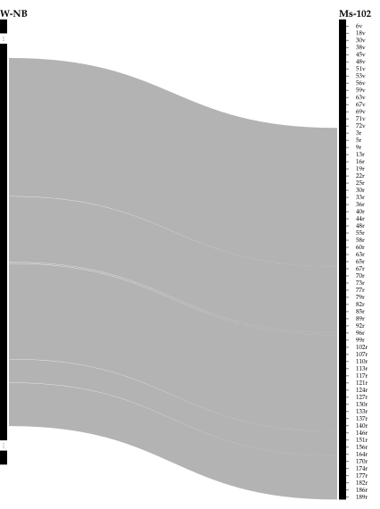
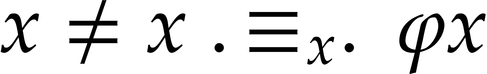
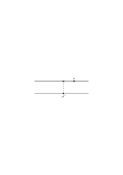
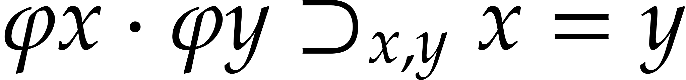
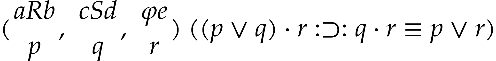
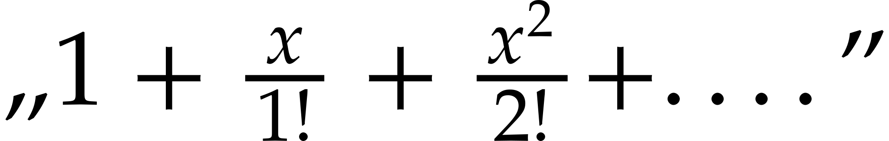
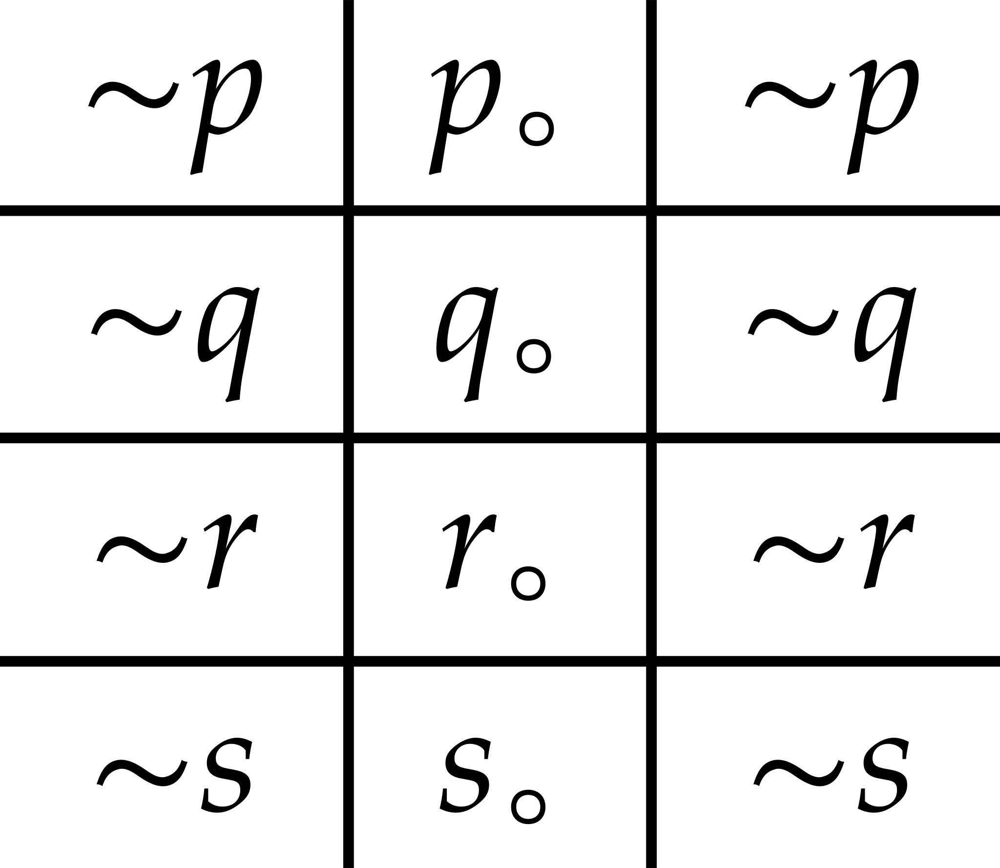
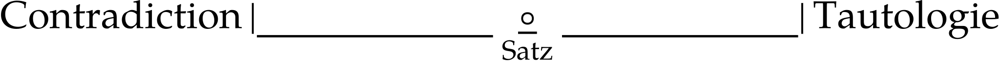

# Ms-102

669 published remarks, GT, NB

### [IIr\[1\]](https://cdn.wittgensteinnachlass.com/2000px/webp/Ms-102/IIr.webp)

To be sent to my mother after my death.

For Hon. B. Russell

Trinity College _Cambridge_

_England_

### [GT](/w-gt/#ms-102-1v.1) [1v\[1\]](https://cdn.wittgensteinnachlass.com/2000px/webp/Ms-102/1v.webp)

30.10.1914

(Evening) Just received some lovely post. A very lovely card from Frege! One from Trakl & Ficker! Mama, Klara, Frau Klingenberg. This pleased me very much. Worked a great deal. —.

### [GT](/w-gt/#ms-102-1v.2+2v.1) [1v\[2\]](https://cdn.wittgensteinnachlass.com/2000px/webp/Ms-102/1v.webp),[2v\[1\]](https://cdn.wittgensteinnachlass.com/2000px/webp/Ms-102/2v.webp)

31.10.1914

On towards Krakau early this morning. Worked all day. I stormed the problem _in desperation_! But I would sooner shed my blood before this fortress than withdraw with nothing accomplished. The greatest difficulty is holding the forts once they have been taken, until one can sit quietly in them. And until the _city_ has fallen one _cannot_ sit quietly in any of the forts for good. —.

I am on watch tonight and unfortunately am already _very_ tired from working so intensely. My work still without success! Keep at it! —. We are staying in Szczucin tonight. —.

### [GT](/w-gt/#ms-102-2v.2+3v.1) [2v\[2\]](https://cdn.wittgensteinnachlass.com/2000px/webp/Ms-102/2v.webp),[3v\[1\]](https://cdn.wittgensteinnachlass.com/2000px/webp/Ms-102/3v.webp)

01.11.1914

In the morning on towards Krakau. Worked while on watch last night, and worked a great deal today too, still without success. But I am not disheartened because I always keep _the main problem_ in view. —. Trakl is in the garrison hospital in Krakau and asks me to visit him. How I should like to make his acquaintance! I hope I see him when I get to Krakau! Perhaps it would give me great strength. —.

### [GT](/w-gt/#ms-102-3v.2) [3v\[2\]](https://cdn.wittgensteinnachlass.com/2000px/webp/Ms-102/3v.webp)

02.11.1914

On towards Krakau early. Am more sensual again. Towards evening we got stuck on the sand again. It is bitterly cold. It really is fortunate that one has oneself & can always take refuge in oneself. Worked a lot. The grace of work!! —.

### [GT](/w-gt/#ms-102-3v.3+4v.1) [3v\[3\]](https://cdn.wittgensteinnachlass.com/2000px/webp/Ms-102/3v.webp),[4v\[1\]](https://cdn.wittgensteinnachlass.com/2000px/webp/Ms-102/4v.webp)

03.11.1914

On towards Krakau early. Hear that the Russians have advanced again and are 20 km. from Opakowiz; we are 10 km. from there. —. What will happen to me now when I get near Krakau?!? Worked almost all day. —. Will probably go on tonight. Hear the thunder of guns & see the flash. —! —.

### [GT](/w-gt/#ms-102-4v.2+5v.1) [4v\[2\]](https://cdn.wittgensteinnachlass.com/2000px/webp/Ms-102/4v.webp),[5v\[1\]](https://cdn.wittgensteinnachlass.com/2000px/webp/Ms-102/5v.webp)

04.11.1914

Quiet night. On again early. Worked a great deal. We are supposed to be in Krakau tomorrow. Hear that we are probably to expect a siege of Krakau. I shall need a great deal of strength then to preserve the spirit. ——. Just do not depend on the external world, and then you need not be afraid of what happens in it. On watch tonight. It is easier to be independent of things than of people. But one must be able to do that too! —.

### [GT](/w-gt/#ms-102-5v.2+6v.1) [5v\[2\]](https://cdn.wittgensteinnachlass.com/2000px/webp/Ms-102/5v.webp),[6v\[1\]](https://cdn.wittgensteinnachlass.com/2000px/webp/Ms-102/6v.webp)

05.11.1914

On early to Krakau, where we are supposed to arrive late in the evening. Very keen to know whether I shall meet Trakl. I very much hope so. I sorely miss someone I can unburden myself to a little. I shall have to manage without such a person too. But it would give me a great deal of strength. A little tired all day & prone to depression. Did not work very much. In Krakau. It is already too late to visit Trakl today. —. May the spirit give me strength. —

### [GT](/w-gt/#ms-102-6v.2) [6v\[2\]](https://cdn.wittgensteinnachlass.com/2000px/webp/Ms-102/6v.webp)

06.11.1914

Early into town to the garrison hospital. Learnt there that Trakl died a few days ago! This hit me _very_ hard. How sad, how sad!!! I wrote to Ficker about it immediately. Ran errands & then got back to the ship at about 6 o’clock. Did not work. Poor Trakl! —! Thy will be done. —

### [GT](/w-gt/#ms-102-6v.3+7v.1) [6v\[3\]](https://cdn.wittgensteinnachlass.com/2000px/webp/Ms-102/6v.webp),[7v\[1\]](https://cdn.wittgensteinnachlass.com/2000px/webp/Ms-102/7v.webp)

07.11.1914

Yesterday at nine in the evening the order suddenly came to use the searchlight to illuminate some work on another ship. So out of bed and shone the searchlight until 3½ in the morning. As a result I am very tired. In town on errands in the afternoon. The siege of Krakau is now regarded as a certainty. I shall try to get off this ship. Did not work. I long for a decent person, for here I am _surrounded by indecency._ May the spirit not forsake me, and may it grow more steadfast in me. ——.

### [GT](/w-gt/#ms-102-8v.1) [8v\[1\]](https://cdn.wittgensteinnachlass.com/2000px/webp/Ms-102/8v.webp)

08.11.1914

Not really in the mood for work. Reading a lot. On watch tonight. Hardly did any work. A little worried about my future. —.

### [GT](/w-gt/#ms-102-8v.2+9v.1+10v.1) [8v\[2\]](https://cdn.wittgensteinnachlass.com/2000px/webp/Ms-102/8v.webp),[9v\[1\]](https://cdn.wittgensteinnachlass.com/2000px/webp/Ms-102/9v.webp),[10v\[1\]](https://cdn.wittgensteinnachlass.com/2000px/webp/Ms-102/10v.webp)

08.11.1914

Just overheard a conversation between our commander and another officer: What vile voices. All the wickedness in the world screeches & croaks out of them. Vilenness wherever I look. _Not one_ feeling heart as far as my eye can see!!! —— Receive a _very_ lovely card from Uncle Paul. A card like that ought to refresh & strengthen me but these last few days I have been _susceptible to depression!_! I take no real pleasure in anything. And I live in fear of the future! Because I no longer rest within myself. Every indecency in my surroundings – and there are always some – wounds me to the core, and before one wound heals there is a fresh one! Even when – as now, in the evening – I am not depressed, I still do not feel properly free. I feel like working only rarely & then only fleetingly. Because I cannot get to feel at ease. I feel dependent on the world & so must fear it even when nothing bad is happening to me at the moment. I see myself, the I in which I could rest securely, like a distant island I long for that has receded from me. – The Russians are advancing rapidly on Krakau. The entire civilian population must leave the city. Things look very bad for our cause! _God help me_!!! Worked a little.

### [GT](/w-gt/#ms-102-10v.2+11v.1) [10v\[2\]](https://cdn.wittgensteinnachlass.com/2000px/webp/Ms-102/10v.webp),[11v\[1\]](https://cdn.wittgensteinnachlass.com/2000px/webp/Ms-102/11v.webp)

10.11.1914

Worked more again. And in better spirits. Learnt today that I could write to England via Switzerland; I shall write tomorrow without delay to David & perhaps to Russell. Or perhaps today even. – I hope I shall be able to work better again now! —!!

### [GT](/w-gt/#ms-102-11v.2+12v.1) [11v\[2\]](https://cdn.wittgensteinnachlass.com/2000px/webp/Ms-102/11v.webp),[12v\[1\]](https://cdn.wittgensteinnachlass.com/2000px/webp/Ms-102/12v.webp)

11.11.1914

Nice letter from Ficker. Worked quite a lot. We could already hear the thunder of guns from the fortifications! Sent off a letter to David. How often I think of him! Does he think of me half as much? (?) In better spirits today. —!

### [GT](/w-gt/#ms-102-12v.2+13v.1) [12v\[2\]](https://cdn.wittgensteinnachlass.com/2000px/webp/Ms-102/12v.webp),[13v\[1\]](https://cdn.wittgensteinnachlass.com/2000px/webp/Ms-102/13v.webp)

12.11.1914

Above all, not to lose oneself!!! Pull yourself together! And work not to pass the time but devoutly, in order to live! Do no one a wrong! — There is talk of a siege lasting 6-7 months! All the shops are closed & open only for a very short time. The more serious the situation becomes, the coarser the non-commissioned officers become. For they feel that they can now give vent to all their vileness with impunity, since the officers are now losing their heads & no longer exercising any control in the good sense. Every word one hears now is a piece of rudeness. For decency no longer pays in any way, and so people give up what little of it they may still possess. It is all profoundly sad. In town in the afternoon. Worked quite a lot _but without real clarity of vision_! Shall I be able to go on working?(!) Is the curtain already falling?? It would be remarkable, since I am in the middle of a problem, in the middle of a siege. —. —!

### [GT](/w-gt/#ms-102-13v.2+14v.1+15v.1) [13v\[2\]](https://cdn.wittgensteinnachlass.com/2000px/webp/Ms-102/13v.webp),[14v\[1\]](https://cdn.wittgensteinnachlass.com/2000px/webp/Ms-102/14v.webp),[15v\[1\]](https://cdn.wittgensteinnachlass.com/2000px/webp/Ms-102/15v.webp)

13.11.1914

All morning I tried in vain to work. Clear vision will not come. I think a lot about my life, and this too is a reason why I cannot work. Or is it the other way round? I now believe I still do not shut myself off enough from the others on the ship. I cannot associate with them because I lack the particular vileness that it takes. But, quite incomprehensibly, I do not find it easy to shut myself off. Not that I feel the slightest attraction to anyone. But the habit of speaking to people in a friendly way is so strong! On duty tonight. I now go to a café every evening & drink 2 glasses of coffee; & the respectable atmosphere does me good. Worked _little_! —! May God give me reason & strength!!! —.

### [GT](/w-gt/#ms-102-15v.2+16v.1) [15v\[2\]](https://cdn.wittgensteinnachlass.com/2000px/webp/Ms-102/15v.webp),[16v\[1\]](https://cdn.wittgensteinnachlass.com/2000px/webp/Ms-102/16v.webp)

14.11.1914

On watch last night I spent almost the whole time devising rules for my life to make it halfway bearable. I am depressed for no reason, i.e. at the very least I take no joy in life. And every loud word I hear hurts me. For no reason at all!! — I also worked at my post last night. — I must still count it a _grace_ that I can sit quietly in my cabin & thus at least have a chance to collect myself a little. — Worked very little. Very tired during the day, as unfortunately often happens now! In the afternoon the severe depression passed but I was _too_ tired to work. Out in the evening as usual. —!

### [GT](/w-gt/#ms-102-16v.2) [16v\[2\]](https://cdn.wittgensteinnachlass.com/2000px/webp/Ms-102/16v.webp)

15.11.1914

Now reading some of Emerson’s essays. Perhaps they will have a good influence on me. Did a fair amount of work. —.

### [GT](/w-gt/#ms-102-16v.3+17v.1+18v.1) [16v\[3\]](https://cdn.wittgensteinnachlass.com/2000px/webp/Ms-102/16v.webp),[17v\[1\]](https://cdn.wittgensteinnachlass.com/2000px/webp/Ms-102/17v.webp),[18v\[1\]](https://cdn.wittgensteinnachlass.com/2000px/webp/Ms-102/18v.webp)

16.11.1914

Winter is coming. — Yesterday I received a friendly card from Ficker. There is also talk of the ship’s crew being sent away from here, since the ships cannot be used over the winter.

What will become of me then?? We hear loud gunfire from the fortifications. Did not work much. In town in the evening. Again no clarity of vision, although I am quite obviously standing so close to the solution to the deepest questions that I am almost bumping my nose against it!!! My mind is simply blind to it just now! I feel that I am standing _**right** at the gate_ but cannot see it clearly enough to open it. This is an extraordinarily remarkable state, which I have never felt so clearly as I do now. —! —!

### [GT](/w-gt/#ms-102-18v.2+19v.1+20v.1) [18v\[2\]](https://cdn.wittgensteinnachlass.com/2000px/webp/Ms-102/18v.webp),[19v\[1\]](https://cdn.wittgensteinnachlass.com/2000px/webp/Ms-102/19v.webp),[20v\[1\]](https://cdn.wittgensteinnachlass.com/2000px/webp/Ms-102/20v.webp)

17.11.1914

_How hard_ it is not to get angry with people! _How hard_ it is to endure. Had all sorts of things to do in the morning & did not get to work. Whenever I come into contact with the people here in the course of my work, their vileness becomes so dreadful to me that rage threatens to get the better of me & break out. _Again and again_ I resolve to endure it quietly & _always_ I break my resolve again. And I do not really know myself how this comes about. It is tremendously difficult to work with people & yet have _nothing_ to do with them. Again and again one has to speak to them, ask them something, and they give insolent & inadequate answers – how much strength it takes just to put up with that – but you need the answer. An unclear order comes through, etc., etc., etc. And one’s nerves are already ruined in any case. It is hard to live like this if one does not know how to make things quite easy for oneself. In the afternoon a severe depression came over me. It lies like a stone on my chest. Every duty becomes an unbearable burden. Towards evening my malaise subsided. Some courage returned to my mind. Hardly worked at all. During the day, as has often been the case of late, I was in no mood for work; only in the evening was there enough inner calm! Is that because in the evening I look forward to sleep? – Yes, today’s depression was dreadful!!! —.

### [GT](/w-gt/#ms-102-20v.2+21v.1) [20v\[2\]](https://cdn.wittgensteinnachlass.com/2000px/webp/Ms-102/20v.webp),[21v\[1\]](https://cdn.wittgensteinnachlass.com/2000px/webp/Ms-102/21v.webp)

18.11.1914

Loud thunder from the fortifications. They say we are to sail again in the next few days. Our commander is leaving & Lieutenant Molé is taking his place again. This pleases me. One can hear machine-gun fire. _Heavy_ gunfire from the fortifications all day. – Worked quite a lot. In good spirits. I am toying with the idea of getting myself transferred but cannot make up my mind about it. My work has come to a standstill because I needed another significant idea in order to go forward. — ——.

### [GT](/w-gt/#ms-102-22v.1) [22v\[1\]](https://cdn.wittgensteinnachlass.com/2000px/webp/Ms-102/22v.webp)

19.11.1914

It is snowing. Low in spirits early, as often now. Worked for the ship all morning. One expects a visit from a general in the afternoon. Everyone is already in a state of excitement about it. Did some work towards evening. Heavy fighting around Krakau again. —.

### [GT](/w-gt/#ms-102-22v.2+23v.1) [22v\[2\]](https://cdn.wittgensteinnachlass.com/2000px/webp/Ms-102/22v.webp),[23v\[1\]](https://cdn.wittgensteinnachlass.com/2000px/webp/Ms-102/23v.webp)

20.11.1914

Heavy cannonade. —. Worked a little. On watch tonight. Went to the eye specialist in the afternoon because my poor eyesight gives me trouble on watch. I shall get spectacles. My future is still quite uncertain. Tomorrow I may talk to our commander about what is to happen to me. —.

### [GT](/w-gt/#ms-102-23v.2) [23v\[2\]](https://cdn.wittgensteinnachlass.com/2000px/webp/Ms-102/23v.webp)

21.11.1914

Continual cannonade. Very cold. Almost uninterrupted thunder from the fortifications. Did a fair amount of work. But I still cannot utter _the one redeeming word_. I go right round it & get very close, but I have not yet been able to grasp it myself!! Always a little worried about my future because I do not rest entirely within myself! — ! ——.

### [GT](/w-gt/#ms-102-23v.3+24v.1) [23v\[3\]](https://cdn.wittgensteinnachlass.com/2000px/webp/Ms-102/23v.webp),[24v\[1\]](https://cdn.wittgensteinnachlass.com/2000px/webp/Ms-102/24v.webp)

22.11.1914

Bitter cold! Ice is floating on the Vistula. Incessant thunder of guns. Had no real idea & was quite tired, so worked little. Did not utter the redeeming word. At one point yesterday it was right on the tip of my tongue. But then it slips back again —. In middling spirits. I mean to go to bed soon. ——.

### [GT](/w-gt/#ms-102-24v.2+25v.1+26v.1) [24v\[2\]](https://cdn.wittgensteinnachlass.com/2000px/webp/Ms-102/24v.webp),[25v\[1\]](https://cdn.wittgensteinnachlass.com/2000px/webp/Ms-102/25v.webp),[26v\[1\]](https://cdn.wittgensteinnachlass.com/2000px/webp/Ms-102/26v.webp)

23.11.1914

Continual thunder. —. Just hear that a telegram has arrived: “Water transport suspended.”. So it must soon be decided what is to become of us. — My day now passes in reading and a little work, for which of course I always sit in my cabin. On watch every 4th-5th day; now & then peeling potatoes, carrying coal and the like. Apart from watch duty I have no _specific_ work (the searchlight has hardly been used for 1½ months). So I feel like a lazybones among the others, and even in all my free time I cannot really rest, because I feel I ought to be working for the ship but do not know what to do. The best thing for me would be regular work that I could carry out easily & surely. For work one is not equal to is the worst thing. Today I shall try to speak to our commander about a possible transfer. This is done & I may hope that I shall be transferred from here. Did a fair amount of work but still without success. At the baths in the evening. ——.

### [GT](/w-gt/#ms-102-26v.2+27v.1) [26v\[2\]](https://cdn.wittgensteinnachlass.com/2000px/webp/Ms-102/26v.webp),[27v\[1\]](https://cdn.wittgensteinnachlass.com/2000px/webp/Ms-102/27v.webp)

24.11.1914

_Bitter_ cold! The Vistula is completely covered with drifting ice. We sail into harbour today. If only I were already away from here! There is incessant unrest here & no one knows what to do. The non-commissioned officers are getting viler and viler & each infects the next and encourages him to ever greater insolence. There are exceptions, of course. On watch tonight. No watch. Worked _a lot_. Again and again the insight I lack is on the tip of my tongue. This is good. Today Ficker sent me poems by poor Trakl which I take to be works of genius without understanding them. They did me good. God be with me! —.

### [GT](/w-gt/#ms-102-27v.2+28v.1) [27v\[2\]](https://cdn.wittgensteinnachlass.com/2000px/webp/Ms-102/27v.webp),[28v\[1\]](https://cdn.wittgensteinnachlass.com/2000px/webp/Ms-102/28v.webp)

25.11.1914

In harbour since yesterday afternoon. The ship’s lavatories are closed! And one has to walk a long way to a half-open latrine. It is very cold. This way of life is becoming more and more unbearable. Did not work much. If only I could get away from here! —.

### [GT](/w-gt/#ms-102-28v.2+29v.1+30v.1) [28v\[2\]](https://cdn.wittgensteinnachlass.com/2000px/webp/Ms-102/28v.webp),[29v\[1\]](https://cdn.wittgensteinnachlass.com/2000px/webp/Ms-102/29v.webp),[30v\[1\]](https://cdn.wittgensteinnachlass.com/2000px/webp/Ms-102/30v.webp)

26.11.1914

When one feels oneself getting stuck on a problem, one must stop thinking about it, otherwise one will stay stuck to it. Instead one must begin thinking somewhere one can sit quite comfortably. Just do not force it! All the hard problems must dissolve of their own accord before us. Loud thunder of guns.

Whatever I do, the problems mass together like storm clouds, and I am unable to take up a permanently satisfactory standpoint in relation to them. Worked a great deal without being able to clarify the situation in any way. Rather, wherever I turn my thoughts I come upon questions I cannot answer. Today I felt as though my fertility had now come to an end. The whole subject seemed to recede into the distance again. And of course: my 3-4 months are up. And unfortunately without a really great result! But we shall see. —. They say now that we are to go into winter quarters, and if that happens I may have to sleep together with all the others; God forbid!! —

I should like in any case not to lose my presence of mind! God be with me. ——. ———.

### [GT](/w-gt/#ms-102-30v.2) [30v\[2\]](https://cdn.wittgensteinnachlass.com/2000px/webp/Ms-102/30v.webp)

27.11.1914

On watch today. ——.

### [GT](/w-gt/#ms-102-30v.3+31v.1) [30v\[3\]](https://cdn.wittgensteinnachlass.com/2000px/webp/Ms-102/30v.webp),[31v\[1\]](https://cdn.wittgensteinnachlass.com/2000px/webp/Ms-102/31v.webp)

28.11.1914

Worked a great deal yesterday. From midday yesterday until midday today in the guardroom with 7 men & at my post. Felt – particularly today very unhappy. I am doing everything in my power to get transferred. I believe that among these coarse & vile people, whom no danger has tamed, I _must_ perish miserably unless a miracle happens for me that gives me far more strength & wisdom than I have now! Yes, a _miracle_ would have to happen for me if I am to survive it! Anxious about my future. Worked little. A miracle! A miracle! ——.

### [GT](/w-gt/#ms-102-31v.2) [31v\[2\]](https://cdn.wittgensteinnachlass.com/2000px/webp/Ms-102/31v.webp)

29.11.1914

Worked quite a lot. ——.

### [GT](/w-gt/#ms-102-31v.3+32v.1+33v.1) [31v\[3\]](https://cdn.wittgensteinnachlass.com/2000px/webp/Ms-102/31v.webp),[32v\[1\]](https://cdn.wittgensteinnachlass.com/2000px/webp/Ms-102/32v.webp),[33v\[1\]](https://cdn.wittgensteinnachlass.com/2000px/webp/Ms-102/33v.webp)

30.11.1914

At corps headquarters early. Spoke to our commander about my situation: If I am transferred I must go back to the cadre. If we go into winter quarters he will see to it that I get a room of my own. But the searchlight is supposed to be needed again soon & so I should stay here after all. —— Now, in the evening, as I get back from town, there is a great commotion here because a ship is to leave. There is also talk of the searchlight going with it. ——. That would be quite disagreeable for me. So our plans can be thwarted at any moment & I must have some other support if I am to be able to live _all the same_. – Was at the cadre this afternoon & spoke to an ordnance technician about whether I might be able to get into the balloon section. He said I should speak about it to an ordnance technician named Vlcek in that section. I hope I shall be able to do that! —. Did not work much, but had some stimulus. Somewhat sensual again. Live only for one’s own spirit! and leave everything to God! —.

### [GT](/w-gt/#ms-102-33v.2+34v.1+35v.1) [33v\[2\]](https://cdn.wittgensteinnachlass.com/2000px/webp/Ms-102/33v.webp),[34v\[1\]](https://cdn.wittgensteinnachlass.com/2000px/webp/Ms-102/34v.webp),[35v\[1\]](https://cdn.wittgensteinnachlass.com/2000px/webp/Ms-102/35v.webp)

01.12.1914

So it is December already! and still no talk of peace! Heavy gunfire last night; one could hear the shells whistling. — Yesterday evening a ship went down the Vistula and every day a different crew keeps watch on it, e.g. tomorrow _we_ do! How shall I fare?! With these comrades & these superiors! — —. In the afternoon went to look for the ordnance technician Vlcek, did not find him. Was directed to the artillery staff section. I shall probably go there the day after tomorrow, after watch. Worked very little. May the spirit protect me whatever happens! —.

### [GT](/w-gt/#ms-102-35v.2) [35v\[2\]](https://cdn.wittgensteinnachlass.com/2000px/webp/Ms-102/35v.webp)

02.12.1914

We go on watch at midday today. Thank God our commander is coming with us, so that there will be at least _one_ decent person there. Terrible thunder from the fortifications last night. And now at 8 in the morning it is starting again. Tonight we have to sleep in the open. I shall probably not get to work; just not to forget God. ——.

### [GT](/w-gt/#ms-102-35v.3) [35v\[3\]](https://cdn.wittgensteinnachlass.com/2000px/webp/Ms-102/35v.webp)

03.12.1914

Did no work but experienced a great deal, though I am now too tired to write it down. —

### [GT](/w-gt/#ms-102-36v.1+37v.1) [36v\[1\]](https://cdn.wittgensteinnachlass.com/2000px/webp/Ms-102/36v.webp),[37v\[1\]](https://cdn.wittgensteinnachlass.com/2000px/webp/Ms-102/37v.webp)

04.12.1914

Nothing particular happened on watch the day before yesterday except that at one point I fell while running and am still limping today. The most violent cannon fire from all sides. Rifle fire, fires, etc. At fortress headquarters yesterday evening about my situation. A first lieutenant, when he heard that I had studied mathematics, said I should come and work with him (in a factory). He seems to be _very_ nice. I agreed and today was detached from duty on this ship. I have a great deal of hope. —. Gunfire very close by. In town in the afternoon. Worked little. Was a little tired all day since I slept very little last night too. Early to bed! —.

### [GT](/w-gt/#ms-102-37v.2) [37v\[2\]](https://cdn.wittgensteinnachlass.com/2000px/webp/Ms-102/37v.webp)

05.12.1914

Tomorrow or the day after I leave here. Where I am to live has not yet been decided. In no case do I want to depend on such things. Did not work much; yet I am not standing still. Think _a lot_ about _dear_ David! God keep him! and me! —.

### [GT](/w-gt/#ms-102-38v.1) [38v\[1\]](https://cdn.wittgensteinnachlass.com/2000px/webp/Ms-102/38v.webp)

06.12.1914

During the night the guns fired so close by that the ship shook. Worked a lot & with success. Have not yet found out when I shall leave the ship. Tomorrow this ship is on outpost duty again & if I am not called away tomorrow I shall have to go along, which I am very unhappy about because my leg still has not recovered from the fall. It is raining & the clay roads here are terribly difficult to walk on. May the spirit protect me! —.

### [GT](/w-gt/#ms-102-38v.2+39v.1) [38v\[2\]](https://cdn.wittgensteinnachlass.com/2000px/webp/Ms-102/38v.webp),[39v\[1\]](https://cdn.wittgensteinnachlass.com/2000px/webp/Ms-102/39v.webp)

07.12.1914

My leg has got worse. I shall probably not go along on watch. No order has yet come concerning my move. Loud thunder nearby. —. Just learnt that I shall leave here tomorrow. Cannot go on watch because of my foot. Did not work much. Spoke to our commander, he was _very_ nice. I am tired. Everything in God’s hands. —.

### [GT](/w-gt/#ms-102-39v.2+40v.1+41v.1) [39v\[2\]](https://cdn.wittgensteinnachlass.com/2000px/webp/Ms-102/39v.webp),[40v\[1\]](https://cdn.wittgensteinnachlass.com/2000px/webp/Ms-102/40v.webp),[41v\[1\]](https://cdn.wittgensteinnachlass.com/2000px/webp/Ms-102/41v.webp)

08.12.1914

In the morning at “sick parade” on account of my foot: muscle strain. Did not work much. Bought Nietzsche volume 8 & read some of it. I am deeply affected by his hostility to Christianity. For there is some truth in his writings too. Certainly, Christianity is the only _sure_ way to happiness; but what if someone were to spurn this happiness?! Might it not be better to perish unhappy, in a hopeless struggle against the external world? But such a life is senseless. But why not lead a senseless life? Is it unworthy? – How does it square with the strictly solipsistic standpoint? But what must I do so that my life is not lost to me? I must always be conscious of it – always of the spirit. —.

### [GT](/w-gt/#ms-102-41v.2) [41v\[2\]](https://cdn.wittgensteinnachlass.com/2000px/webp/Ms-102/41v.webp)

09.12.1914

In the morning at corps headquarters & collected my ration slip. Did not work. Experienced a great deal but too tired to write it down. ——.

### [GT](/w-gt/#ms-102-41v.3+42v.1+43v.1) [41v\[3\]](https://cdn.wittgensteinnachlass.com/2000px/webp/Ms-102/41v.webp),[42v\[1\]](https://cdn.wittgensteinnachlass.com/2000px/webp/Ms-102/42v.webp),[43v\[1\]](https://cdn.wittgensteinnachlass.com/2000px/webp/Ms-102/43v.webp)

10.12.1914

Yesterday afternoon to the office to see my new chief, had to wait a long time for him. At last he came & gave me a job straight away: I had to compile a list of motor vehicles in a barracks here. At the same time he invited me to his flat for 8 in the evening: there would be a captain there whom he had told about me & who wanted to see me. Went to his place & found 4 officers there, with whom I had supper. The captain is an immensely likeable man (all the others were tremendously amiable too). We talked until 10½ & parted on exceedingly cordial terms. — This morning looked for lodgings & found them. In the office from 10 till 5 in the evening, then carried my things from the ship here to the new lodgings: quite a nice room, not small. For the first time in 4 months alone in a real room!! I am _enjoying_ this luxury: Did not get to work. But things will come right now. I am very tired as I have been running about a _great_ deal. What a grace to be allowed to sleep in a bed again! What a grace of the fact. —. —.

### [GT](/w-gt/#ms-102-43v.2) [43v\[2\]](https://cdn.wittgensteinnachlass.com/2000px/webp/Ms-102/43v.webp)

11.12.1914

In the office in the morning & wrote. Did not get to work. All day in the office. First lieutenant extraordinarily kind. Did not get to work.

### [GT](/w-gt/#ms-102-43v.3+44v.1) [43v\[3\]](https://cdn.wittgensteinnachlass.com/2000px/webp/Ms-102/43v.webp),[44v\[1\]](https://cdn.wittgensteinnachlass.com/2000px/webp/Ms-102/44v.webp)

12.12.1914

Worked a little. Was in the office all day but did not have much to do. Hope to work more tomorrow. Had a bath. —.

### [GT](/w-gt/#ms-102-44v.2) [44v\[2\]](https://cdn.wittgensteinnachlass.com/2000px/webp/Ms-102/44v.webp)

13.12.1914

All day in the office. _My thoughts are **lame**_. I have muscular pains in my leg & it is as though my brain were _limping_ too. Still, did some work. Still no reply from David! Did he get my letter? Does he take the war more personally than I do?! — Long live the spirit alone! It is the safe harbour, sheltered away from the dismal, endless grey sea of happenings. —.

### [GT](/w-gt/#ms-102-44v.3+45v.1) [44v\[3\]](https://cdn.wittgensteinnachlass.com/2000px/webp/Ms-102/44v.webp),[45v\[1\]](https://cdn.wittgensteinnachlass.com/2000px/webp/Ms-102/45v.webp)

14.12.1914

All day in the office. Did not work. But things will come right again! A kind parcel from Jolles. —.

### [GT](/w-gt/#ms-102-45v.2) [45v\[2\]](https://cdn.wittgensteinnachlass.com/2000px/webp/Ms-102/45v.webp)

15.12.1914

All day in the office. Worked a little. But my thoughts are as they are on the train or on the ship, where one thinks just as sluggishly.

### [GT](/w-gt/#ms-102-45v.3) [45v\[3\]](https://cdn.wittgensteinnachlass.com/2000px/webp/Ms-102/45v.webp)

16.12.1914

All day in the office. Heard that we shall probably move to Lodz soon! Worked a little but without any real enthusiasm.

### [GT](/w-gt/#ms-102-45v.4) [45v\[4\]](https://cdn.wittgensteinnachlass.com/2000px/webp/Ms-102/45v.webp)

17.12.1914

All day in the office. Did not work. Was annoyed a lot. — Very little free time. ——.

### [GT](/w-gt/#ms-102-46v.1) [46v\[1\]](https://cdn.wittgensteinnachlass.com/2000px/webp/Ms-102/46v.webp)

18.12.1914

As usual. Did not work.

### [GT](/w-gt/#ms-102-46v.2) [46v\[2\]](https://cdn.wittgensteinnachlass.com/2000px/webp/Ms-102/46v.webp)

19.12.1914

Worked a little. —.

### [GT](/w-gt/#ms-102-46v.3) [46v\[3\]](https://cdn.wittgensteinnachlass.com/2000px/webp/Ms-102/46v.webp)

20.12.1914

Worked a little. In the office until nearly 5, then into town. The pleasant feeling of a little cold shiver running down one’s back when, in good spirits, one becomes conscious of one’s solitude. —.

### [GT](/w-gt/#ms-102-46v.4) [46v\[4\]](https://cdn.wittgensteinnachlass.com/2000px/webp/Ms-102/46v.webp)

21.12.1914

Letter from David!! I kissed it. Replied at once. Worked a little. —.

### [GT](/w-gt/#ms-102-46v.5+47v.1) [46v\[5\]](https://cdn.wittgensteinnachlass.com/2000px/webp/Ms-102/46v.webp),[47v\[1\]](https://cdn.wittgensteinnachlass.com/2000px/webp/Ms-102/47v.webp)

22.12.1914

Did not work. In the office till 6. —.

Worked a very little. Had a bath in the evening. ——.

### [GT](/w-gt/#ms-102-47v.2) [47v\[2\]](https://cdn.wittgensteinnachlass.com/2000px/webp/Ms-102/47v.webp)

24.12.1914

To my great surprise, was promoted today to military official – without stars. — Did not work. —.

### [GT](/w-gt/#ms-102-47v.3) [47v\[3\]](https://cdn.wittgensteinnachlass.com/2000px/webp/Ms-102/47v.webp)

25.12.1914

Had lunch in the officers’ mess. Worked a little.

### [GT](/w-gt/#ms-102-47v.4) [47v\[4\]](https://cdn.wittgensteinnachlass.com/2000px/webp/Ms-102/47v.webp)

26.12.1914

Hardly worked. In the afternoon met a young man who had been a university student in Lemberg & is now a chauffeur here. In the café with him in the evening & had a good talk. —.

### [GT](/w-gt/#ms-102-47v.5) [47v\[5\]](https://cdn.wittgensteinnachlass.com/2000px/webp/Ms-102/47v.webp)

27.12.1914

In the office until 9½ p.m. Did not work. Have been appointed adjutant to First Lieutenant Gürth. ——.

### [GT](/w-gt/#ms-102-48v.1) [48v\[1\]](https://cdn.wittgensteinnachlass.com/2000px/webp/Ms-102/48v.webp)

28.12.1914

In the office until 10 p.m. Did not work. _A great deal to do_. —.

### [GT](/w-gt/#ms-102-48v.2) [48v\[2\]](https://cdn.wittgensteinnachlass.com/2000px/webp/Ms-102/48v.webp)

29.12.1914

Worked a very little. Much else to do. Bath in the evening.

### [GT](/w-gt/#ms-102-48v.3) [48v\[3\]](https://cdn.wittgensteinnachlass.com/2000px/webp/Ms-102/48v.webp)

30.12.1914

Did not work. Only not to lose oneself. ——.

### [GT](/w-gt/#ms-102-48v.4+49v.1) [48v\[4\]](https://cdn.wittgensteinnachlass.com/2000px/webp/Ms-102/48v.webp),[49v\[1\]](https://cdn.wittgensteinnachlass.com/2000px/webp/Ms-102/49v.webp)

02.01.1915

The day before yesterday in the afternoon I suddenly learnt that I was to go to Vienna at once with my commanding officer. Yesterday morning we arrived here in Vienna. Understandably, Mama’s utmost surprise & joy. etc. Did no work yesterday but devoted myself entirely to my family. Errands this morning. Now at midday I am expecting Gürth, with whom I have some official business to attend to. I want to note that my moral state is now much lower than it was at Easter, say.

### [GT](/w-gt/#ms-102-49v.2) [49v\[2\]](https://cdn.wittgensteinnachlass.com/2000px/webp/Ms-102/49v.webp)

03.01.1915

Yesterday afternoon with Gürth in Klosterneuburg. Then at home with Mama.

### [GT](/w-gt/#ms-102-49v.3) [49v\[3\]](https://cdn.wittgensteinnachlass.com/2000px/webp/Ms-102/49v.webp)

06.01.1915

Vienna. Return journey tomorrow. Three days ago & the day before yesterday at Labor’s. Yesterday with Gürth in Wienerneustadt; on the way back dined in Mödling with a Captain Roth whom I found immensely unlikeable. So I took the train to Vienna alone straight after the meal.

### [GT](/w-gt/#ms-102-50v.1) [50v\[1\]](https://cdn.wittgensteinnachlass.com/2000px/webp/Ms-102/50v.webp)

10.01.1915

Arrived in Krakau late this evening. I am tired!

Spent many very pleasant hours with Gürth. I am very curious about my future life. ——.

### [GT](/w-gt/#ms-102-50v.2) [50v\[2\]](https://cdn.wittgensteinnachlass.com/2000px/webp/Ms-102/50v.webp)

11.01.1915

Received a card from Frege! Worked a little.

### [GT](/w-gt/#ms-102-50v.3) [50v\[3\]](https://cdn.wittgensteinnachlass.com/2000px/webp/Ms-102/50v.webp)

12.01.1915

Worked a little. ——.

### [GT](/w-gt/#ms-102-50v.4+51v.1) [50v\[4\]](https://cdn.wittgensteinnachlass.com/2000px/webp/Ms-102/50v.webp),[51v\[1\]](https://cdn.wittgensteinnachlass.com/2000px/webp/Ms-102/51v.webp)

13.01.1915

Worked a little. Still not working with much enthusiasm. My thoughts are tired. I do not see things with fresh eyes but in an ordinary, lifeless way. It is as though a flame had gone out & I must wait for it to start burning again of its own accord. But my mind is active: I am thinking… —.

### [GT](/w-gt/#ms-102-51v.2) [51v\[2\]](https://cdn.wittgensteinnachlass.com/2000px/webp/Ms-102/51v.webp)

14.01.1915

Worked a little; not well yet. Think of David very often. And long for a letter from him.

### [GT](/w-gt/#ms-102-51v.3) [51v\[3\]](https://cdn.wittgensteinnachlass.com/2000px/webp/Ms-102/51v.webp)

15.01.1915

Worked a little; with greater enthusiasm. Had a bath in the evening.

### [GT](/w-gt/#ms-102-51v.4) [51v\[4\]](https://cdn.wittgensteinnachlass.com/2000px/webp/Ms-102/51v.webp)

16.01.1915

Worked more & with enthusiasm. I now have very little to do for the detachment, which suits me very well. Still no word from David. More sensual in recent weeks. ———.

### [GT](/w-gt/#ms-102-52v.1) [52v\[1\]](https://cdn.wittgensteinnachlass.com/2000px/webp/Ms-102/52v.webp)

17.01.1915

Worked again. —.

### [GT](/w-gt/#ms-102-52v.2) [52v\[2\]](https://cdn.wittgensteinnachlass.com/2000px/webp/Ms-102/52v.webp)

18.01.1915

Hardly did any work. Felt quite listless & without any enthusiasm. But things will probably change. —. ——.

### [GT](/w-gt/#ms-102-52v.3) [52v\[3\]](https://cdn.wittgensteinnachlass.com/2000px/webp/Ms-102/52v.webp)

19.01.1915

Worked very little. Quite dead in this respect. Only not to force oneself to do anything!!! When shall I hear from David?! —.

### [GT](/w-gt/#ms-102-52v.4) [52v\[4\]](https://cdn.wittgensteinnachlass.com/2000px/webp/Ms-102/52v.webp)

20.01.1915

Did no work; but this rest is like refreshing sleep.

### [GT](/w-gt/#ms-102-52v.5+53v.1) [52v\[5\]](https://cdn.wittgensteinnachlass.com/2000px/webp/Ms-102/52v.webp),[53v\[1\]](https://cdn.wittgensteinnachlass.com/2000px/webp/Ms-102/53v.webp)

21.01.1915

Worked a little. Sent off a letter to David. Took it straight to the censor at the main post office here, who is a very nice man.

### [GT](/w-gt/#ms-102-53v.2) [53v\[2\]](https://cdn.wittgensteinnachlass.com/2000px/webp/Ms-102/53v.webp)

22.01.1915

Worked.

### [GT](/w-gt/#ms-102-53v.3) [53v\[3\]](https://cdn.wittgensteinnachlass.com/2000px/webp/Ms-102/53v.webp)

23.01.1915

Worked a little. My undeclared position is now getting me into difficulties. Only to possess oneself! —.

### [GT](/w-gt/#ms-102-53v.4) [53v\[4\]](https://cdn.wittgensteinnachlass.com/2000px/webp/Ms-102/53v.webp)

24.01.1915

Worked a little. —.

### [GT](/w-gt/#ms-102-53v.5+54v.1) [53v\[5\]](https://cdn.wittgensteinnachlass.com/2000px/webp/Ms-102/53v.webp),[54v\[1\]](https://cdn.wittgensteinnachlass.com/2000px/webp/Ms-102/54v.webp)

25.01.1915

Letter from Keynes! Not very affectionate. Very sensual in the last few days. — Worked without success. I am quite in the dark about how my work will go on. _Only_ through miracles can it succeed. Only if the veil is taken from my eyes _from outside me_. I must resign myself _entirely_ to my fate. It will turn out as it has been decreed for me. I live in the hand of fate. (Only not to become small.) And in this way I cannot become small. —.

### [GT](/w-gt/#ms-102-54v.2) [54v\[2\]](https://cdn.wittgensteinnachlass.com/2000px/webp/Ms-102/54v.webp)

26.01.1915

Received a kind card from Arne. Worked a little – but without success.

### [GT](/w-gt/#ms-102-54v.3+55v.1) [54v\[3\]](https://cdn.wittgensteinnachlass.com/2000px/webp/Ms-102/54v.webp),[55v\[1\]](https://cdn.wittgensteinnachlass.com/2000px/webp/Ms-102/55v.webp)

27.01.1915

Did not work. In the café in the evening with a lot of officers. Most of them behaved like pigs. Even I drank just a tiny bit more than necessary.

### [GT](/w-gt/#ms-102-55v.2) [55v\[2\]](https://cdn.wittgensteinnachlass.com/2000px/webp/Ms-102/55v.webp)

28.01.1915

Did not work, which is very good for me – that is, for the work. Very sensual, which is strange as I am getting quite a bit of exercise now. Not sleeping well.

### [GT](/w-gt/#ms-102-55v.3) [55v\[3\]](https://cdn.wittgensteinnachlass.com/2000px/webp/Ms-102/55v.webp)

29.01.1915

Hardly worked.

### [GT](/w-gt/#ms-102-55v.4) [55v\[4\]](https://cdn.wittgensteinnachlass.com/2000px/webp/Ms-102/55v.webp)

30.01.1915

Did not work. Have had much cause to get upset about my outward position & shall probably soon take a decisive step in the matter. ———.

### [GT](/w-gt/#ms-102-55v.5) [55v\[5\]](https://cdn.wittgensteinnachlass.com/2000px/webp/Ms-102/55v.webp)

31.01.1915

Did not work. ——.

### [GT](/w-gt/#ms-102-56v.1) [56v\[1\]](https://cdn.wittgensteinnachlass.com/2000px/webp/Ms-102/56v.webp)

01.02.1915

Did not work. Lunch in Captain Scholz’s officers’ mess, where it was very pleasant. —.

### [GT](/w-gt/#ms-102-56v.2) [56v\[2\]](https://cdn.wittgensteinnachlass.com/2000px/webp/Ms-102/56v.webp)

02.02.1915

Worked a very little. —.

### [GT](/w-gt/#ms-102-56v.3) [56v\[3\]](https://cdn.wittgensteinnachlass.com/2000px/webp/Ms-102/56v.webp)

03.02.1915

Did not work. No ideas. I am now to take charge of our forge. How will that go? May the spirit stand by me! It will be very difficult, but: take courage! —. ——.

### [GT](/w-gt/#ms-102-56v.4) [56v\[4\]](https://cdn.wittgensteinnachlass.com/2000px/webp/Ms-102/56v.webp)

05.02.1915

Did not work. Much of my time is now spent in the forge. —.

### [GT](/w-gt/#ms-102-57v.1) [57v\[1\]](https://cdn.wittgensteinnachlass.com/2000px/webp/Ms-102/57v.webp)

06.02.1915

A dear letter from David (dated 14.1.)

### [GT](/w-gt/#ms-102-57v.2) [57v\[2\]](https://cdn.wittgensteinnachlass.com/2000px/webp/Ms-102/57v.webp)

07.02.1915

Did not work. —! —.

### [GT](/w-gt/#ms-102-57v.3) [57v\[3\]](https://cdn.wittgensteinnachlass.com/2000px/webp/Ms-102/57v.webp)

08.02.1915

Received from Ficker a posthumous work by Trakl. Probably very good. — Sensual. I have no hold at all on my work now. — ——.

### [GT](/w-gt/#ms-102-57v.4) [57v\[4\]](https://cdn.wittgensteinnachlass.com/2000px/webp/Ms-102/57v.webp)

09.02.1915

Did not work. —. ——.

### [GT](/w-gt/#ms-102-57v.5+58v.1) [57v\[5\]](https://cdn.wittgensteinnachlass.com/2000px/webp/Ms-102/57v.webp),[58v\[1\]](https://cdn.wittgensteinnachlass.com/2000px/webp/Ms-102/58v.webp)

10.02.1915

Did not work. Nice letter from Ficker. Dedication from Rilke. If only I could work again now!!! Everything else would sort itself out. When will something occur to me again??! All this lies in God’s hand. Just wish and hope! Then you lose no time.— ——.

### [GT](/w-gt/#ms-102-58v.2) [58v\[2\]](https://cdn.wittgensteinnachlass.com/2000px/webp/Ms-102/58v.webp)

11.02.1915

Did not work. — Relations are now very strained between me and one of the officers – Cadet Adam. It is possible that it will come to a duel between us. So keep living well & according to your conscience. May the spirit be with me! Now and at all times to come! ——.

### [GT](/w-gt/#ms-102-58v.3+59v.1) [58v\[3\]](https://cdn.wittgensteinnachlass.com/2000px/webp/Ms-102/58v.webp),[59v\[1\]](https://cdn.wittgensteinnachlass.com/2000px/webp/Ms-102/59v.webp)

13.02.1915

Did not work. May the spirit be with me. ——.

### [GT](/w-gt/#ms-102-59v.2) [59v\[2\]](https://cdn.wittgensteinnachlass.com/2000px/webp/Ms-102/59v.webp)

15.02.1915

Worked a little yesterday. Now not a day goes by without my thinking about logic at least once, even if only fleetingly, & this is a good sign. I have inklings of all sorts of things! – Yesterday evening at Captain Scholz’s, where music was played (until 12 p.m.). Very pleasant.

### [GT](/w-gt/#ms-102-59v.3+60v.1) [59v\[3\]](https://cdn.wittgensteinnachlass.com/2000px/webp/Ms-102/59v.webp),[60v\[1\]](https://cdn.wittgensteinnachlass.com/2000px/webp/Ms-102/60v.webp)

17.02.1915

Worked a little yesterday & today. My position in the detachment is now thoroughly unsatisfactory; something will have to happen. — I have to endure much annoyance and hurt and squander my inner strength. Very sensual again & masturbate almost every day: Things cannot go on like this. —

---

---

### [GT](/w-gt/#ms-102-60v.2) [60v\[2\]](https://cdn.wittgensteinnachlass.com/2000px/webp/Ms-102/60v.webp)

18.02.1915

Hardly worked. Thought a great deal about my situation. I am curious about my future in every respect. —.

### [GT](/w-gt/#ms-102-60v.3) [60v\[3\]](https://cdn.wittgensteinnachlass.com/2000px/webp/Ms-102/60v.webp)

19.02.1915

Further troubles at the factory. Long conversation with my commanding officer which, however, led to nothing satisfactory. Hardly worked. These troubles interfere with my thinking. This must change. —. —.

### [GT](/w-gt/#ms-102-60v.4+61v.1) [60v\[4\]](https://cdn.wittgensteinnachlass.com/2000px/webp/Ms-102/60v.webp),[61v\[1\]](https://cdn.wittgensteinnachlass.com/2000px/webp/Ms-102/61v.webp)

20.02.1915

The fearful wavering of cowardly thoughts, anxious timidity, womanish lamentation, avert no misery, _do not set you free!_ Did not work. Thought a great deal. ——.

### [GT](/w-gt/#ms-102-61v.2) [61v\[2\]](https://cdn.wittgensteinnachlass.com/2000px/webp/Ms-102/61v.webp)

21.02.1915

Did not work. In better spirits. Sensual. If only I could work again now!!! — ! ——.

### [GT](/w-gt/#ms-102-61v.3) [61v\[3\]](https://cdn.wittgensteinnachlass.com/2000px/webp/Ms-102/61v.webp)

22.02.1915

Did not work. Dreamt a tremendous amount last night, and vividly, but not unpleasantly. A lot of trouble with the men. Annoyance & agitation; self-reproaches etc. etc.. —. ———.

### [GT](/w-gt/#ms-102-61v.4+62v.1) [61v\[4\]](https://cdn.wittgensteinnachlass.com/2000px/webp/Ms-102/61v.webp),[62v\[1\]](https://cdn.wittgensteinnachlass.com/2000px/webp/Ms-102/62v.webp)

23.02.1915

Did not work. My difficulties are still not resolved. ——.

### [GT](/w-gt/#ms-102-62v.2) [62v\[2\]](https://cdn.wittgensteinnachlass.com/2000px/webp/Ms-102/62v.webp)

26.02.1915

Did not work! Shall I ever work again?!? In low spirits. No word from David. I am quite forsaken. Thinking of suicide. Shall I ever work again??! — ——.

### [GT](/w-gt/#ms-102-62v.3+63v.1) [62v\[3\]](https://cdn.wittgensteinnachlass.com/2000px/webp/Ms-102/62v.webp),[63v\[1\]](https://cdn.wittgensteinnachlass.com/2000px/webp/Ms-102/63v.webp)

27.02.1915

Did not work. Low spirits. Very sensual. Feel isolated. The goal of my work seems to me to have receded further than ever, out of sight! I lack the courage that is sure of victory and dares to hope. I feel as though I were never to make a great discovery again; it is a long time since all the good spirits have so forsaken me as they have now. Only do not lose yourself!! —. —.

### [GT](/w-gt/#ms-102-63v.2) [63v\[2\]](https://cdn.wittgensteinnachlass.com/2000px/webp/Ms-102/63v.webp)

28.02.1915

01.03.1915 Did not work. No word from David! In an uncertain and changeable mood.

### [GT](/w-gt/#ms-102-63v.3) [63v\[3\]](https://cdn.wittgensteinnachlass.com/2000px/webp/Ms-102/63v.webp)

02.03.1915

03.03.1915 Did not work. A momentary glimmer of light yesterday evening. No word from David! – A pleasant evening at Scholz’s. Otherwise generally in low spirits.

### [GT](/w-gt/#ms-102-63v.4+64v.1) [63v\[4\]](https://cdn.wittgensteinnachlass.com/2000px/webp/Ms-102/63v.webp),[64v\[1\]](https://cdn.wittgensteinnachlass.com/2000px/webp/Ms-102/64v.webp)

04.03.1915

Did not work. I am morally listless; but I recognize the enormous difficulty of my situation, and so far I am still quite in the dark as to how it is to be put right. —.

### [GT](/w-gt/#ms-102-64v.2) [64v\[2\]](https://cdn.wittgensteinnachlass.com/2000px/webp/Ms-102/64v.webp)

05.03.1915

Spoke to Gürth today about my undignified position. No decision yet. Perhaps I shall go to the front as an infantryman. ＝ .

### [GT](/w-gt/#ms-102-64v.3) [64v\[3\]](https://cdn.wittgensteinnachlass.com/2000px/webp/Ms-102/64v.webp)

06.03.1915

＝ . My situation is still unsettled. My mood varies greatly. —.

### [GT](/w-gt/#ms-102-64v.4+65v.1) [64v\[4\]](https://cdn.wittgensteinnachlass.com/2000px/webp/Ms-102/64v.webp),[65v\[1\]](https://cdn.wittgensteinnachlass.com/2000px/webp/Ms-102/65v.webp)

07.03.1915

＝ . Situation unchanged; uncomfortable. I am still quite in the dark about what change would be suitable. Now a hard frost is setting in again! At a very bad time! Do not feel well. I am, so to speak, mentally exhausted, very exhausted. What is to be done about it?? I am being worn away by loathsome circumstances. The whole of external life with all its vileness is assailing me. And inwardly I am full of hatred and cannot let the spirit in. God is love. – I am like a burnt-out stove full of clinker and rubbish. —

---

---

### [GT](/w-gt/#ms-102-65v.2+66v.1) [65v\[2\]](https://cdn.wittgensteinnachlass.com/2000px/webp/Ms-102/65v.webp),[66v\[1\]](https://cdn.wittgensteinnachlass.com/2000px/webp/Ms-102/66v.webp)

08.03.1915

Situation unsettled! Unchanged! Bouts of depression. —

＝ . — —.

### [GT](/w-gt/#ms-102-66v.2) [66v\[2\]](https://cdn.wittgensteinnachlass.com/2000px/webp/Ms-102/66v.webp)

09.03.1915

Situation unsettled! ＝ . Watchful but in low spirits. —

——.

### [GT](/w-gt/#ms-102-66v.3) [66v\[3\]](https://cdn.wittgensteinnachlass.com/2000px/webp/Ms-102/66v.webp)

10.03.1915

_Very_ sensual. Undecided. Restless in spirit. ＝ .

——.

### [GT](/w-gt/#ms-102-66v.4) [66v\[4\]](https://cdn.wittgensteinnachlass.com/2000px/webp/Ms-102/66v.webp)

11.03.1915

Did not work. Situation unchanged! Nothing but troubles. —. ——.

### [GT](/w-gt/#ms-102-66v.5) [66v\[5\]](https://cdn.wittgensteinnachlass.com/2000px/webp/Ms-102/66v.webp)

12.03.1915

Did not work. Thought a great deal. Situation still unsettled.

——.

### [GT](/w-gt/#ms-102-67v.1) [67v\[1\]](https://cdn.wittgensteinnachlass.com/2000px/webp/Ms-102/67v.webp)

13.03.1915

Situation as before. Quite undecided. ＝ . —.

### [GT](/w-gt/#ms-102-67v.2) [67v\[2\]](https://cdn.wittgensteinnachlass.com/2000px/webp/Ms-102/67v.webp)

14.03.1915

Situation unchanged! —

Did not work. Depression. The pressure on my chest. —. ——.

### [GT](/w-gt/#ms-102-67v.3) [67v\[3\]](https://cdn.wittgensteinnachlass.com/2000px/webp/Ms-102/67v.webp)

15.03.1915

Met a one-year volunteer I know & discussed my affair with him & shall speak further about it tomorrow. So now I have got my marks. And still I am not working. Shall I ever work again??!! — ——

### [GT](/w-gt/#ms-102-68v.1) [68v\[1\]](https://cdn.wittgensteinnachlass.com/2000px/webp/Ms-102/68v.webp)

16.03.1915

——.

### [GT](/w-gt/#ms-102-68v.2) [68v\[2\]](https://cdn.wittgensteinnachlass.com/2000px/webp/Ms-102/68v.webp)

18.03.1915

A _dear_ letter from David yesterday! — Have moved into the factory. Replied to David. _Very_ sensual.

### [GT](/w-gt/#ms-102-68v.3) [68v\[3\]](https://cdn.wittgensteinnachlass.com/2000px/webp/Ms-102/68v.webp)

19.03.1915

Spoke to Gürth today about my future. No encouraging result. _Very_ sensual. —.

### [GT](/w-gt/#ms-102-68v.4) [68v\[4\]](https://cdn.wittgensteinnachlass.com/2000px/webp/Ms-102/68v.webp)

21.03.1915

Thinking of joining the Kaiserjäger, as Ficker is there too. Not quite well. Did not work. Still feeling unwell. ——.

### [GT](/w-gt/#ms-102-68v.5) [68v\[5\]](https://cdn.wittgensteinnachlass.com/2000px/webp/Ms-102/68v.webp)

22.03.1915

Unwell. Better towards evening.

### [GT](/w-gt/#ms-102-69v.1) [69v\[1\]](https://cdn.wittgensteinnachlass.com/2000px/webp/Ms-102/69v.webp)

23.03.1915

Very sensual.

### [GT](/w-gt/#ms-102-69v.2) [69v\[2\]](https://cdn.wittgensteinnachlass.com/2000px/webp/Ms-102/69v.webp)

24.03.1915

—. Did not work! Shall I ever work again??!!! —.

### [GT](/w-gt/#ms-102-69v.3) [69v\[3\]](https://cdn.wittgensteinnachlass.com/2000px/webp/Ms-102/69v.webp)

27.03.1915

——. ——

### [GT](/w-gt/#ms-102-69v.4) [69v\[4\]](https://cdn.wittgensteinnachlass.com/2000px/webp/Ms-102/69v.webp)

29.03.1915

Fed up! Surrounded by vileness. How tired I am! ——. ——.

### [GT](/w-gt/#ms-102-69v.5) [69v\[5\]](https://cdn.wittgensteinnachlass.com/2000px/webp/Ms-102/69v.webp)

15.03.1915

In a changeable mood.

### [GT](/w-gt/#ms-102-69v.6) [69v\[6\]](https://cdn.wittgensteinnachlass.com/2000px/webp/Ms-102/69v.webp)

04.04.1915

05.04.1915 In a changeable mood.

### [GT](/w-gt/#ms-102-69v.7+70v.1) [69v\[7\]](https://cdn.wittgensteinnachlass.com/2000px/webp/Ms-102/69v.webp),[70v\[1\]](https://cdn.wittgensteinnachlass.com/2000px/webp/Ms-102/70v.webp)

15.04.1915

Nothing new occurs to me any more! (Gürth ordered away from here.) I can no longer think of anything new. And presumably that must not be what matters at all, either.

### [GT](/w-gt/#ms-102-70v.2) [70v\[2\]](https://cdn.wittgensteinnachlass.com/2000px/webp/Ms-102/70v.webp)

16.04.1916

Very sensual. Masturbate every day. No word from David for a long time now. I am working. — —

### [GT](/w-gt/#ms-102-70v.3) [70v\[3\]](https://cdn.wittgensteinnachlass.com/2000px/webp/Ms-102/70v.webp)

17.04.1915

Working.

### [GT](/w-gt/#ms-102-70v.4) [70v\[4\]](https://cdn.wittgensteinnachlass.com/2000px/webp/Ms-102/70v.webp)

18.04.1915

A very bad cold!

### [GT](/w-gt/#ms-102-70v.5) [70v\[5\]](https://cdn.wittgensteinnachlass.com/2000px/webp/Ms-102/70v.webp)

22.04.1915

I am now to be put in overall charge of the whole workshop. Further troubles.

### [GT](/w-gt/#ms-102-70v.6) [70v\[6\]](https://cdn.wittgensteinnachlass.com/2000px/webp/Ms-102/70v.webp)

24.04.1915

I am working. —.

### [GT](/w-gt/#ms-102-71v.1) [71v\[1\]](https://cdn.wittgensteinnachlass.com/2000px/webp/Ms-102/71v.webp)

26.04.1915

Working. Otherwise my work very unsatisfactory.

### [GT](/w-gt/#ms-102-71v.2) [71v\[2\]](https://cdn.wittgensteinnachlass.com/2000px/webp/Ms-102/71v.webp)

27.04.1915

Working! Now I have to fritter away my time in the factory!!! —

### [GT](/w-gt/#ms-102-71v.3) [71v\[3\]](https://cdn.wittgensteinnachlass.com/2000px/webp/Ms-102/71v.webp)

28.04.1915

_Working again!_ —.

### [GT](/w-gt/#ms-102-71v.4) [71v\[4\]](https://cdn.wittgensteinnachlass.com/2000px/webp/Ms-102/71v.webp)

29.04.1915

Working. Otherwise things are going badly for me. Only do not let those vile people work on you.

### [GT](/w-gt/#ms-102-71v.5) [71v\[5\]](https://cdn.wittgensteinnachlass.com/2000px/webp/Ms-102/71v.webp)

30.04.1915

A dear letter from David!

### [GT](/w-gt/#ms-102-71v.6) [71v\[6\]](https://cdn.wittgensteinnachlass.com/2000px/webp/Ms-102/71v.webp)

01.05.1915

The grace of work! —

### [GT](/w-gt/#ms-102-72v.1) [72v\[1\]](https://cdn.wittgensteinnachlass.com/2000px/webp/Ms-102/72v.webp)

05.05.1915

07.05.1915 Still not appointed! Trouble time and again because of my unclear position. If this goes on much longer I shall try to get away from here.

### [GT](/w-gt/#ms-102-72v.2) [72v\[2\]](https://cdn.wittgensteinnachlass.com/2000px/webp/Ms-102/72v.webp)

08.05.1915

10.05.1915 A _lot_ of agitation! Was close to _tears_!!!! Feel as though I were broken & ill! Surrounded by vileness.

### [GT](/w-gt/#ms-102-72v.3) [72v\[3\]](https://cdn.wittgensteinnachlass.com/2000px/webp/Ms-102/72v.webp)

15.05.1915

Did not work.

### [GT](/w-gt/#ms-102-72v.4) [72v\[4\]](https://cdn.wittgensteinnachlass.com/2000px/webp/Ms-102/72v.webp)

22.05.1915

A dear letter from Russell!

### [GT](/w-gt/#ms-102-72v.5+73v.1) [72v\[5\]](https://cdn.wittgensteinnachlass.com/2000px/webp/Ms-102/72v.webp),[73v\[1\]](https://cdn.wittgensteinnachlass.com/2000px/webp/Ms-102/73v.webp)

24.05.1915

Today met the old logician Dziewicki, whom Russell wrote to me about in his letter. A nice old man.

### [GT](/w-gt/#ms-102-73v.2) [73v\[2\]](https://cdn.wittgensteinnachlass.com/2000px/webp/Ms-102/73v.webp)

25.05.1915

08.06.1915 Renewed difficulty over my promotion. Shall probably get away from here. Often _very_ dejected. Because of the vileness of those around me, who are taking the most shameful advantage of me. —.

### [GT](/w-gt/#ms-102-73v.3) [73v\[3\]](https://cdn.wittgensteinnachlass.com/2000px/webp/Ms-102/73v.webp)

22.06.1915

Working a _great_ deal! Despite _the most loathsome_ circumstances!

### [NB](/w-nb/#ms-102-1r.1) [1r\[1\]](https://cdn.wittgensteinnachlass.com/2000px/webp/Ms-102/1r.webp)

30.10.1914

_Every proposition_ can be negated. And this shows that “True” & “False” mean the same thing for all propositions. (This is of the utmost importance.) (In contrast to Russell).

### [NB](/w-nb/#ms-102-1r.2) [1r\[2\]](https://cdn.wittgensteinnachlass.com/2000px/webp/Ms-102/1r.webp)

The meaning of the sentence must be pinned down to a yes or no by _the sentence itself and its representational_ mode.

### [NB](/w-nb/#ms-102-1r.3) [1r\[3\]](https://cdn.wittgensteinnachlass.com/2000px/webp/Ms-102/1r.webp)

In logic there is no juxtaposition, there can be no classification!

### [NB](/w-nb/#ms-102-1r.4+2r.1) [1r\[4\]](https://cdn.wittgensteinnachlass.com/2000px/webp/Ms-102/1r.webp),[2r\[1\]](https://cdn.wittgensteinnachlass.com/2000px/webp/Ms-102/2r.webp)

31.10.1914

A sentence like “(∃x,φ)․φx” is just as composite as an elementary one; this is shown by the fact that we have to mention “φ” & “x” _separately_ in the brackets. Both stand – independently – in designating relations to the world, just as in the case of an elementary sentence “ψ(a)”.

### [NB](/w-nb/#ms-102-2r.2) [2r\[2\]](https://cdn.wittgensteinnachlass.com/2000px/webp/Ms-102/2r.webp)

Is it not like this: “the logical constants characterize the mode of representation of the elementary forms of the sentence”?

### [NB](/w-nb/#ms-102-2r.3) [2r\[3\]](https://cdn.wittgensteinnachlass.com/2000px/webp/Ms-102/2r.webp)

The meaning of the sentence must be pinned down to a yes or no by the sentence itself and its mode of representation. For that to happen it must be completely described by the sentence.

### [NB](/w-nb/#ms-102-2r.4+3r.1) [2r\[4\]](https://cdn.wittgensteinnachlass.com/2000px/webp/Ms-102/2r.webp),[3r\[1\]](https://cdn.wittgensteinnachlass.com/2000px/webp/Ms-102/3r.webp)

The mode of representation does _not_ depict; only the sentence is a picture.

### [NB](/w-nb/#ms-102-3r.2) [3r\[2\]](https://cdn.wittgensteinnachlass.com/2000px/webp/Ms-102/3r.webp)

The mode of representation determines how reality must be compared with the picture.

### [NB](/w-nb/#ms-102-3r.3) [3r\[3\]](https://cdn.wittgensteinnachlass.com/2000px/webp/Ms-102/3r.webp)

Above all, the elementary sentential form must depict; all depiction takes place through it.

### [NB](/w-nb/#ms-102-3r.4) [3r\[4\]](https://cdn.wittgensteinnachlass.com/2000px/webp/Ms-102/3r.webp)

01.11.1914

It is very easy to confuse the representational relation of the sentence to its meaning with the truth relation. The former differs for different sentences; the latter is one and the same for all sentences.

### [NB](/w-nb/#ms-102-3r.5+4r.1) [3r\[5\]](https://cdn.wittgensteinnachlass.com/2000px/webp/Ms-102/3r.webp),[4r\[1\]](https://cdn.wittgensteinnachlass.com/2000px/webp/Ms-102/4r.webp)

It seems as though “(x,φ)․φx” were the form of a fact Φa ∙ Ψb ∙ Θc etc. (Similarly, (∃x).φx would be the form of φ(a), as I did in fact believe.)

### [NB](/w-nb/#ms-102-4r.2) [4r\[2\]](https://cdn.wittgensteinnachlass.com/2000px/webp/Ms-102/4r.webp)

And this is precisely where my mistake must lie.

### [NB](/w-nb/#ms-102-4r.3) [4r\[3\]](https://cdn.wittgensteinnachlass.com/2000px/webp/Ms-102/4r.webp)

Just examine the elementary sentence: what then is the form of “φa” & how is it related to “~φ(a)”?

### [NB](/w-nb/#ms-102-4r.4) [4r\[4\]](https://cdn.wittgensteinnachlass.com/2000px/webp/Ms-102/4r.webp)

That precedent to which one would always like to appeal must already lie in the sign itself.

### [NB](/w-nb/#ms-102-4r.5) [4r\[5\]](https://cdn.wittgensteinnachlass.com/2000px/webp/Ms-102/4r.webp)

The logical form of the sentence must already be given by the forms of its constituents. (And these have to do only with the _sense_ of the sentences, not with their truth or falsity.)

### [NB](/w-nb/#ms-102-5r.1) [5r\[1\]](https://cdn.wittgensteinnachlass.com/2000px/webp/Ms-102/5r.webp)

The form of the subject & the predicate already contains the possibility of the S.-P. sentence etc.; but – as is only proper – nothing about its truth or falsity.

### [NB](/w-nb/#ms-102-5r.2) [5r\[2\]](https://cdn.wittgensteinnachlass.com/2000px/webp/Ms-102/5r.webp)

The picture has whatever relation to reality it happens to have. And what matters is: how is it to represent? The same picture will agree or fail to agree with reality according to how it is to represent.

### [NB](/w-nb/#ms-102-5r.3+6r.1) [5r\[3\]](https://cdn.wittgensteinnachlass.com/2000px/webp/Ms-102/5r.webp),[6r\[1\]](https://cdn.wittgensteinnachlass.com/2000px/webp/Ms-102/6r.webp)

Analogy between sentence & description: _The complex which_ is congruent with this sign (just as in graphic representation).

### [NB](/w-nb/#ms-102-6r.2) [6r\[2\]](https://cdn.wittgensteinnachlass.com/2000px/webp/Ms-102/6r.webp)

It is just that one cannot _say_ that this complex is congruent with that one (or the like); rather, this shows itself. And so the description too takes on a different character.

### [NB](/w-nb/#ms-102-6r.3) [6r\[3\]](https://cdn.wittgensteinnachlass.com/2000px/webp/Ms-102/6r.webp)

The method of depiction must, after all, be completely determined before one can compare reality with the sentence at all to see whether it is true or false. The method of comparison must be given to me before I can compare.

### [NB](/w-nb/#ms-102-6r.4+7r.1) [6r\[4\]](https://cdn.wittgensteinnachlass.com/2000px/webp/Ms-102/6r.webp),[7r\[1\]](https://cdn.wittgensteinnachlass.com/2000px/webp/Ms-102/7r.webp)

Whether a proposition is true or false must show itself.

But we must know in advance _how_ it will show itself.

### [NB](/w-nb/#ms-102-7r.2) [7r\[2\]](https://cdn.wittgensteinnachlass.com/2000px/webp/Ms-102/7r.webp)

One can represent that two people are not fighting by representing them as not fighting, and also by representing them as fighting and saying that the picture shows how things do not stand. One _could_ represent by means of negative facts just as well as by means of positive ones –. But we want only to investigate the principles of representation _as such_.

### [NB](/w-nb/#ms-102-7r.3+8r.1) [7r\[3\]](https://cdn.wittgensteinnachlass.com/2000px/webp/Ms-102/7r.webp),[8r\[1\]](https://cdn.wittgensteinnachlass.com/2000px/webp/Ms-102/8r.webp)

The sentence “‘p’ is true” has the same meaning as the logical product of ‘p’ and a sentence “‘p’”, which describes the sentence ‘p’, and a correlation of the constituents of the two sentences. – The internal relations of sentence & meaning are depicted by the internal relations between ‘p’ and “‘p’”.

### [NB](/w-nb/#ms-102-8r.2) [8r\[2\]](https://cdn.wittgensteinnachlass.com/2000px/webp/Ms-102/8r.webp)

Only not to get entangled in subsidiary questions, but always to escape to where one has an unobstructed survey of the whole _one_ great problem, even if this survey is still unclear!

### [NB](/w-nb/#ms-102-8r.3) [8r\[3\]](https://cdn.wittgensteinnachlass.com/2000px/webp/Ms-102/8r.webp)

“A state of affairs is thinkable” (“imaginable”) means: we can make a picture of it for ourselves.

### [NB](/w-nb/#ms-102-8r.4+9r.1) [8r\[4\]](https://cdn.wittgensteinnachlass.com/2000px/webp/Ms-102/8r.webp),[9r\[1\]](https://cdn.wittgensteinnachlass.com/2000px/webp/Ms-102/9r.webp)

The sentence must determine a logical place.

The existence of this logical place is guaranteed by the existence of the constituents alone, by the existence of the sentence with sense.

Even if there is no complex in the logical place, there is nevertheless one: not in the logical place.

### [NB](/w-nb/#ms-102-9r.2) [9r\[2\]](https://cdn.wittgensteinnachlass.com/2000px/webp/Ms-102/9r.webp)

02.11.1914

In a tautology the conditions of agreement with the world (the truth conditions) – the relations of representation – cancel one another out, so that it stands in no representational relation to reality (says nothing).

### [NB](/w-nb/#ms-102-9r.3) [9r\[3\]](https://cdn.wittgensteinnachlass.com/2000px/webp/Ms-102/9r.webp)

a = a is not a tautology in the same sense as p⊃p.

### [NB](/w-nb/#ms-102-10r.1) [10r\[1\]](https://cdn.wittgensteinnachlass.com/2000px/webp/Ms-102/10r.webp)

A sentence’s being true consists not in its having a _definite_ relation to reality but in its actually _having_ a definite relation to it.

### [NB](/w-nb/#ms-102-10r.2) [10r\[2\]](https://cdn.wittgensteinnachlass.com/2000px/webp/Ms-102/10r.webp)

Is it not like this: a false sentence, like a true one and independently of its falsity or truth, has a sense but no meaning? (Is this not a better use of the word “meaning”?)

### [NB](/w-nb/#ms-102-10r.3+11r.1) [10r\[3\]](https://cdn.wittgensteinnachlass.com/2000px/webp/Ms-102/10r.webp),[11r\[1\]](https://cdn.wittgensteinnachlass.com/2000px/webp/Ms-102/11r.webp)

Could one say: as soon as I am given the subject and predicate, I am given a relation that will hold or not _hold_ between an S.-P. sentence & its meaning. As soon as I know just the subject & predicate, I can also know of that relation, which is after all an indispensable presupposition even if the S.-P. sentence is false.

### [NB](/w-nb/#ms-102-11r.2) [11r\[2\]](https://cdn.wittgensteinnachlass.com/2000px/webp/Ms-102/11r.webp)

03.11.1914

For there to be a negative state of affairs, there must be a picture of the positive one.

### [NB](/w-nb/#ms-102-11r.3) [11r\[3\]](https://cdn.wittgensteinnachlass.com/2000px/webp/Ms-102/11r.webp)

After all, knowledge of the representing relation _may_ be based only on knowledge of the constituents of the state of affairs!

### [NB](/w-nb/#ms-102-11r.4+12r.1) [11r\[4\]](https://cdn.wittgensteinnachlass.com/2000px/webp/Ms-102/11r.webp),[12r\[1\]](https://cdn.wittgensteinnachlass.com/2000px/webp/Ms-102/12r.webp)

Could one say, then: knowledge of the S.-P. sentence & of the subject and predicate gives us knowledge of an internal relation etc.?

Strictly speaking, this too is incorrect, since we need not know any particular subject or predicate.

### [NB](/w-nb/#ms-102-12r.2) [12r\[2\]](https://cdn.wittgensteinnachlass.com/2000px/webp/Ms-102/12r.webp)

_Obviously_ we feel the elementary sentence to be the picture of a state of affairs – how does this come about?

### [NB](/w-nb/#ms-102-12r.3) [12r\[3\]](https://cdn.wittgensteinnachlass.com/2000px/webp/Ms-102/12r.webp)

Must not the possibility of the representing relation be given by the sentence _itself_?

### [NB](/w-nb/#ms-102-12r.4+13r.1) [12r\[4\]](https://cdn.wittgensteinnachlass.com/2000px/webp/Ms-102/12r.webp),[13r\[1\]](https://cdn.wittgensteinnachlass.com/2000px/webp/Ms-102/13r.webp)

The sentence _itself_ separates what is congruent with it from what is not. For example: if the sentence and congruence are given, then the sentence is true if the state of affairs _is_ congruent with it; or the sentence and non-congruence are given, in which case the sentence is true if the state of affairs is not congruent with it.

### [NB](/w-nb/#ms-102-13r.2+14r.1) [13r\[2\]](https://cdn.wittgensteinnachlass.com/2000px/webp/Ms-102/13r.webp),[14r\[1\]](https://cdn.wittgensteinnachlass.com/2000px/webp/Ms-102/14r.webp)

But how are congruence or non-congruence, or the like, given to us?

How can it be _communicated_ to me _how_ the sentence represents? Or can this not be _said_ to me at all? And if that is so, can I “_know_” it? If it were to be said to me, this would have to be done by means of a sentence; but that sentence could only show it.

### [NB](/w-nb/#ms-102-14r.2) [14r\[2\]](https://cdn.wittgensteinnachlass.com/2000px/webp/Ms-102/14r.webp)

What can be said can only be said by means of a sentence, so nothing that is necessary for understanding _all_ sentences can be said.

### [NB](/w-nb/#ms-102-14r.3+15r.1) [14r\[3\]](https://cdn.wittgensteinnachlass.com/2000px/webp/Ms-102/14r.webp),[15r\[1\]](https://cdn.wittgensteinnachlass.com/2000px/webp/Ms-102/15r.webp)

That arbitrary correlation of sign & thing designated which makes sentences possible and which I found lacking in completely general sentences is effected there by the designation of generality, just as it is effected by names in the elementary sentence (for the designation of generality does not belong to the _picture_). Hence one always felt that generality occurs just like an argument.

### [NB](/w-nb/#ms-102-15r.2) [15r\[2\]](https://cdn.wittgensteinnachlass.com/2000px/webp/Ms-102/15r.webp)

One can negate only a complete sentence. (Something similar holds for all ab-functions.)

### [NB](/w-nb/#ms-102-15r.3) [15r\[3\]](https://cdn.wittgensteinnachlass.com/2000px/webp/Ms-102/15r.webp)

The sentence is the logical picture of a state of affairs.

### [NB](/w-nb/#ms-102-15r.4) [15r\[4\]](https://cdn.wittgensteinnachlass.com/2000px/webp/Ms-102/15r.webp)

Negation refers to the _complete_ sense of the negated sentence and not to its mode of representation.

### [NB](/w-nb/#ms-102-15r.5+16r.1) [15r\[5\]](https://cdn.wittgensteinnachlass.com/2000px/webp/Ms-102/15r.webp),[16r\[1\]](https://cdn.wittgensteinnachlass.com/2000px/webp/Ms-102/16r.webp)

If a picture represents what-is-not-the-case in the way mentioned earlier, this too happens only by its representing _that_ which _is_ not the case.

### [NB](/w-nb/#ms-102-16r.2) [16r\[2\]](https://cdn.wittgensteinnachlass.com/2000px/webp/Ms-102/16r.webp)

For the picture says, as it were, “it is _not_ _like this_”, and the answer to the question “_how_ is it not?” is precisely the positive sentence.

### [NB](/w-nb/#ms-102-16r.3) [16r\[3\]](https://cdn.wittgensteinnachlass.com/2000px/webp/Ms-102/16r.webp)

One might say: negation already refers to the logical place determined by the negated sentence.

### [NB](/w-nb/#ms-102-16r.4) [16r\[4\]](https://cdn.wittgensteinnachlass.com/2000px/webp/Ms-102/16r.webp)

Above all, do not lose the firm ground on which one once stood!

### [NB](/w-nb/#ms-102-16r.5) [16r\[5\]](https://cdn.wittgensteinnachlass.com/2000px/webp/Ms-102/16r.webp)

The negating sentence determines a _different_ logical place from the negated one.

### [NB](/w-nb/#ms-102-17r.1) [17r\[1\]](https://cdn.wittgensteinnachlass.com/2000px/webp/Ms-102/17r.webp)

The negated sentence not only draws the boundary between the negated region & the rest, but also already points to the negated region.

### [NB](/w-nb/#ms-102-17r.2) [17r\[2\]](https://cdn.wittgensteinnachlass.com/2000px/webp/Ms-102/17r.webp)

The negating sentence determines its logical place with the aid of the logical place of the negated sentence. By describing the former as the one lying outside the latter.

### [NB](/w-nb/#ms-102-17r.3) [17r\[3\]](https://cdn.wittgensteinnachlass.com/2000px/webp/Ms-102/17r.webp)

The sentence is true if what it presents exists.

### [NB](/w-nb/#ms-102-17r.4) [17r\[4\]](https://cdn.wittgensteinnachlass.com/2000px/webp/Ms-102/17r.webp)

04.11.1914

How does the sentence determine the logical place?

### [NB](/w-nb/#ms-102-18r.1) [18r\[1\]](https://cdn.wittgensteinnachlass.com/2000px/webp/Ms-102/18r.webp)

How does the picture represent a state of affairs?

### [NB](/w-nb/#ms-102-18r.2) [18r\[2\]](https://cdn.wittgensteinnachlass.com/2000px/webp/Ms-102/18r.webp)

It is not itself the state of affairs, after all; indeed, the state of affairs need not be the case at all.

### [NB](/w-nb/#ms-102-18r.3) [18r\[3\]](https://cdn.wittgensteinnachlass.com/2000px/webp/Ms-102/18r.webp)

One name represents one thing, another another thing, and they themselves are linked; thus the whole – like a tableau vivant – presents the state of affairs.

### [NB](/w-nb/#ms-102-18r.4+19r.1) [18r\[4\]](https://cdn.wittgensteinnachlass.com/2000px/webp/Ms-102/18r.webp),[19r\[1\]](https://cdn.wittgensteinnachlass.com/2000px/webp/Ms-102/19r.webp)

The logical linkage must of course be possible among the things represented, and this will always be the case if the things really are represented. Mind you, that linkage is not a relation but only the _holding_ of a relation.

### [NB](/w-nb/#ms-102-19r.2) [19r\[2\]](https://cdn.wittgensteinnachlass.com/2000px/webp/Ms-102/19r.webp)

05.11.1914

Thus the sentence represents the state of affairs, as it were, on its own initiative.

### [NB](/w-nb/#ms-102-19r.3) [19r\[3\]](https://cdn.wittgensteinnachlass.com/2000px/webp/Ms-102/19r.webp)

But when I say: the linkage of the constituents of the sentence must be possible for the things represented: is this not where the whole problem lies! How can a linkage between objects be possible when it does not exist?

### [NB](/w-nb/#ms-102-19r.4+20r.1) [19r\[4\]](https://cdn.wittgensteinnachlass.com/2000px/webp/Ms-102/19r.webp),[20r\[1\]](https://cdn.wittgensteinnachlass.com/2000px/webp/Ms-102/20r.webp)

The linkage must be possible means: the sentence & the constituents of the state of affairs must stand in a definite relation.

### [NB](/w-nb/#ms-102-20r.2) [20r\[2\]](https://cdn.wittgensteinnachlass.com/2000px/webp/Ms-102/20r.webp)

Thus for a sentence to represent a state of affairs, all that is needed is for its constituents to represent those of the state of affairs and for the former to stand in a linkage possible for the latter.

### [NB](/w-nb/#ms-102-20r.3) [20r\[3\]](https://cdn.wittgensteinnachlass.com/2000px/webp/Ms-102/20r.webp)

The sentence-sign guarantees the possibility of the fact it represents (not that this fact actually obtains); this holds for general sentences too.

### [NB](/w-nb/#ms-102-20r.4+21r.1) [20r\[4\]](https://cdn.wittgensteinnachlass.com/2000px/webp/Ms-102/20r.webp),[21r\[1\]](https://cdn.wittgensteinnachlass.com/2000px/webp/Ms-102/21r.webp)

For if the positive fact φa is given, then the _possibility_ of (x).φx, ~(∃x).φx, ~φ(a) etc. etc. is given too. (All logical constants are already contained in the elementary sentence.)

### [NB](/w-nb/#ms-102-21r.2) [21r\[2\]](https://cdn.wittgensteinnachlass.com/2000px/webp/Ms-102/21r.webp)

This is how the picture comes into being. – In order to designate a logical place with the picture, we must add to it a mode of designation (positive, negative, etc.).

### [NB](/w-nb/#ms-102-21r.3) [21r\[3\]](https://cdn.wittgensteinnachlass.com/2000px/webp/Ms-102/21r.webp)

One could, for example, use fencing puppets to show how one should _not_ fence.

### [NB](/w-nb/#ms-102-21r.4) [21r\[4\]](https://cdn.wittgensteinnachlass.com/2000px/webp/Ms-102/21r.webp)

06.11.1914

And the case here is exactly the same as with ~φa, although the picture deals with what _ought_ not to happen rather than with what does not happen.

### [NB](/w-nb/#ms-102-21r.5+22r.1) [21r\[5\]](https://cdn.wittgensteinnachlass.com/2000px/webp/Ms-102/21r.webp),[22r\[1\]](https://cdn.wittgensteinnachlass.com/2000px/webp/Ms-102/22r.webp)

The fact that one can negate the negated sentence again shows that what is negated is already a sentence and not merely the preparation for one.

### [NB](/w-nb/#ms-102-22r.2) [22r\[2\]](https://cdn.wittgensteinnachlass.com/2000px/webp/Ms-102/22r.webp)

Could one say?: “Here is the picture, but one cannot say whether it is right or not until one knows what it is meant to say.”

### [NB](/w-nb/#ms-102-22r.3) [22r\[3\]](https://cdn.wittgensteinnachlass.com/2000px/webp/Ms-102/22r.webp)

The picture must now in turn cast its shadow on the world.

### [NB](/w-nb/#ms-102-22r.4) [22r\[4\]](https://cdn.wittgensteinnachlass.com/2000px/webp/Ms-102/22r.webp)

07.11.1914

The spatial & the logical place agree in that both are the possibility of an existence.

### [NB](/w-nb/#ms-102-23r.1) [23r\[1\]](https://cdn.wittgensteinnachlass.com/2000px/webp/Ms-102/23r.webp)

08.11.1914

What can be confirmed by experiment in propositions about probability cannot possibly be mathematics!

### [NB](/w-nb/#ms-102-23r.2) [23r\[2\]](https://cdn.wittgensteinnachlass.com/2000px/webp/Ms-102/23r.webp)

Probability propositions are extracts from laws of natural science.

### [NB](/w-nb/#ms-102-23r.3) [23r\[3\]](https://cdn.wittgensteinnachlass.com/2000px/webp/Ms-102/23r.webp)

They are generalizations and express an incomplete knowledge of those laws.

### [NB](/w-nb/#ms-102-23r.4+24r.1) [23r\[4\]](https://cdn.wittgensteinnachlass.com/2000px/webp/Ms-102/23r.webp),[24r\[1\]](https://cdn.wittgensteinnachlass.com/2000px/webp/Ms-102/24r.webp)

If, for example, I draw black & white balls from an urn, I cannot say before a draw whether I shall draw a white or a black ball, since I do not know the laws of nature precisely enough for that; but _this much I do know_: if there are as many black balls as white, the number of black balls drawn will approach the number of white balls drawn as the drawing continues. I _do_ know the laws of nature _that_ precisely.

### [NB](/w-nb/#ms-102-24r.2) [24r\[2\]](https://cdn.wittgensteinnachlass.com/2000px/webp/Ms-102/24r.webp)

09.11.1914

Now what I know in probability propositions are certain general properties of the un-generalized propositions of natural science, such as their symmetry in certain respects, their asymmetry in others, etc.

### [NB](/w-nb/#ms-102-24r.3) [24r\[3\]](https://cdn.wittgensteinnachlass.com/2000px/webp/Ms-102/24r.webp)

Puzzle-pictures & the seeing of states of affairs.

### [NB](/w-nb/#ms-102-25r.1) [25r\[1\]](https://cdn.wittgensteinnachlass.com/2000px/webp/Ms-102/25r.webp)

It was what I would call my strong scholastic feeling that was the cause of my best discoveries.

### [NB](/w-nb/#ms-102-25r.2) [25r\[2\]](https://cdn.wittgensteinnachlass.com/2000px/webp/Ms-102/25r.webp)

“not p” & “p” contradict one another; they cannot both be true; and yet I can utter both, _both pictures exist_. They lie side by side.

### [NB](/w-nb/#ms-102-25r.3) [25r\[3\]](https://cdn.wittgensteinnachlass.com/2000px/webp/Ms-102/25r.webp)

Or rather, “p” & “~p” are like a picture and the infinite plane outside that picture (logical place).

I can construct the infinite space outside only with the aid of the picture, by using it to bound that space.

### [NB](/w-nb/#ms-102-26r.1) [26r\[1\]](https://cdn.wittgensteinnachlass.com/2000px/webp/Ms-102/26r.webp)

10.11.1914

When I say “p is possible”, does this mean ‘“p” has a sense’? Does that sentence speak about language, so that the existence of a sentence-sign (“p”) is essential to its sense? (Then it would be quite unimportant.) But does it not rather mean to say what “p ⌵ ~p” shows?

### [NB](/w-nb/#ms-102-26r.2+27r.1) [26r\[2\]](https://cdn.wittgensteinnachlass.com/2000px/webp/Ms-102/26r.webp),[27r\[1\]](https://cdn.wittgensteinnachlass.com/2000px/webp/Ms-102/27r.webp)

Does not my study of sign-language correspond to the study of thought processes that philosophers always held to be so essential to the philosophy of logic? – Only they always got entangled in inessential psychological investigations & there is an analogous danger with my method too.

### [NB](/w-nb/#ms-102-27r.2) [27r\[2\]](https://cdn.wittgensteinnachlass.com/2000px/webp/Ms-102/27r.webp)

11.11.1914

Since “a = b” is not a sentence and “x = y” is not a function, a ‘class x̂ (x = x)’ is an absurdity, and so is the so-called null class. (Incidentally, one had always felt that wherever one resorted to x = x, a = a, etc. in constructing sentences, one was in all such cases cheating one’s way out of a difficulty; as when one said that “a exists” means “(∃x) x = a”.)

_This is false: for the definition of the classes itself guarantees the existence of the actual functions._

### [NB](/w-nb/#ms-102-28r.1) [28r\[1\]](https://cdn.wittgensteinnachlass.com/2000px/webp/Ms-102/28r.webp)

If I now seem to assert a function of the null class, what I say is that this function is true of all functions that are null – and I can say this even if _no_ function is null.

### [NB](/w-nb/#ms-102-28r.2) [28r\[2\]](https://cdn.wittgensteinnachlass.com/2000px/webp/Ms-102/28r.webp)

Is  identical with (x).~φx? Certainly!

### [NB](/w-nb/#ms-102-28r.3) [28r\[3\]](https://cdn.wittgensteinnachlass.com/2000px/webp/Ms-102/28r.webp)

The sentence points to the possibility that things are thus & so.

### [NB](/w-nb/#ms-102-28r.4) [28r\[4\]](https://cdn.wittgensteinnachlass.com/2000px/webp/Ms-102/28r.webp)

12.11.1914

Negation is _a description_ in the same sense as the elementary sentence itself.

### [NB](/w-nb/#ms-102-29r.1) [29r\[1\]](https://cdn.wittgensteinnachlass.com/2000px/webp/Ms-102/29r.webp)

One might call the truth of a proposition possible, that of a tautology certain, and that of a contradiction impossible. Here we already have an indication of a gradation we need in the calculus of probability.

### [NB](/w-nb/#ms-102-29r.2) [29r\[2\]](https://cdn.wittgensteinnachlass.com/2000px/webp/Ms-102/29r.webp)

In a tautology the elementary sentence – of course – still depicts, but it is so loosely connected with reality that it leaves reality unrestricted freedom. Contradiction, on the other hand, sets bounds within which no reality can exist.

### [NB](/w-nb/#ms-102-30r.1) [30r\[1\]](https://cdn.wittgensteinnachlass.com/2000px/webp/Ms-102/30r.webp)

It is as if the logical constants projected the picture of the elementary sentence onto reality – which can then agree or fail to agree with this projection.

Although all logical constants already occur in the simple sentence, its own prototype _must_ also occur in it whole & undissected!

### [NB](/w-nb/#ms-102-30r.2) [30r\[2\]](https://cdn.wittgensteinnachlass.com/2000px/webp/Ms-102/30r.webp)

So is it perhaps not the simple sentence that is the picture but rather its prototype, which must occur in it?

### [NB](/w-nb/#ms-102-30r.3+31r.1) [30r\[3\]](https://cdn.wittgensteinnachlass.com/2000px/webp/Ms-102/30r.webp),[31r\[1\]](https://cdn.wittgensteinnachlass.com/2000px/webp/Ms-102/31r.webp)

This prototype is then really not a sentence (but has the form of a sentence), and _it_ might correspond to Frege’s “assumption”.

### [NB](/w-nb/#ms-102-31r.2) [31r\[2\]](https://cdn.wittgensteinnachlass.com/2000px/webp/Ms-102/31r.webp)

The sentence would then consist of proto*types* projected onto the world.

### [NB](/w-nb/#ms-102-31r.3) [31r\[3\]](https://cdn.wittgensteinnachlass.com/2000px/webp/Ms-102/31r.webp)

13.11.1914

In this work more than in any other, it is worth looking again and again from new sides at questions one thinks are solved, treating them as unsolved.

### [NB](/w-nb/#ms-102-31r.4+32r.1) [31r\[4\]](https://cdn.wittgensteinnachlass.com/2000px/webp/Ms-102/31r.webp),[32r\[1\]](https://cdn.wittgensteinnachlass.com/2000px/webp/Ms-102/32r.webp)

14.11.1914

Think of the representation of _negative_ facts by models. For instance: two trains must not stand on the tracks thus & so. The sentence, the picture, the model are – in a negative sense – like a solid body that limits the freedom of movement of other bodies, in a positive sense like the space bounded by solid matter in which a body has room.

This image is _very_ clear and ought to lead to a solution.

### [NB](/w-nb/#ms-102-32r.2) [32r\[2\]](https://cdn.wittgensteinnachlass.com/2000px/webp/Ms-102/32r.webp)

15.11.1914

Projection of the picture onto reality

RealityModel (picture)

(Maxwell’s method of mechanical models)

### [NB](/w-nb/#ms-102-33r.1) [33r\[1\]](https://cdn.wittgensteinnachlass.com/2000px/webp/Ms-102/33r.webp)

Never mind what one once wrote! Always start thinking afresh, as though nothing at all had yet happened!

### [NB](/w-nb/#ms-102-33r.2) [33r\[2\]](https://cdn.wittgensteinnachlass.com/2000px/webp/Ms-102/33r.webp)

That shadow which the picture, as it were, casts on the world: how am I to grasp it precisely? Here is a deep mystery.

### [NB](/w-nb/#ms-102-33r.3) [33r\[3\]](https://cdn.wittgensteinnachlass.com/2000px/webp/Ms-102/33r.webp)

It is the mystery of negation: things are not like that, and yet we can say _how_ they are _not_. –

### [NB](/w-nb/#ms-102-33r.4+34r.1) [33r\[4\]](https://cdn.wittgensteinnachlass.com/2000px/webp/Ms-102/33r.webp),[34r\[1\]](https://cdn.wittgensteinnachlass.com/2000px/webp/Ms-102/34r.webp)

The sentence is simply the _description_ of a state of affairs. (But this is all still on the surface.) _One_ insight at the source is worth more than any number somewhere in the middle.

### [NB](/w-nb/#ms-102-34r.2) [34r\[2\]](https://cdn.wittgensteinnachlass.com/2000px/webp/Ms-102/34r.webp)

16.11.1914

Introduction of the sign “0” to make decimal notation possible: the logical meaning of this procedure.

### [NB](/w-nb/#ms-102-34r.3) [34r\[3\]](https://cdn.wittgensteinnachlass.com/2000px/webp/Ms-102/34r.webp)

17.11.1914

Suppose “φ(a)” is true: what does it mean to say that ~φa is possible?

(φa itself has the same meaning as ~(~φa).)

### [NB](/w-nb/#ms-102-34r.4) [34r\[4\]](https://cdn.wittgensteinnachlass.com/2000px/webp/Ms-102/34r.webp)

18.11.1914

Here it is always only a matter of the existence of the logical place.

But what – the devil – is this “logical place”!?

### [NB](/w-nb/#ms-102-34r.5+35r.1) [34r\[5\]](https://cdn.wittgensteinnachlass.com/2000px/webp/Ms-102/34r.webp),[35r\[1\]](https://cdn.wittgensteinnachlass.com/2000px/webp/Ms-102/35r.webp)

19.11.1914

The sentence & the logical coordinates: that is the logical place.

### [NB](/w-nb/#ms-102-35r.2) [35r\[2\]](https://cdn.wittgensteinnachlass.com/2000px/webp/Ms-102/35r.webp)

20.11.1914

The reality that corresponds to the sense of the sentence cannot be anything other than its constituents, since we do not _know_ _anything_ else.

### [NB](/w-nb/#ms-102-35r.3) [35r\[3\]](https://cdn.wittgensteinnachlass.com/2000px/webp/Ms-102/35r.webp)

If reality consists in something else as well, then in any case this can be neither designated nor expressed, for in the first case it would be a further constituent; in the second the expression would be a sentence for which the same problem would arise again as for the original one.

### [NB](/w-nb/#ms-102-35r.4+36r.1) [35r\[4\]](https://cdn.wittgensteinnachlass.com/2000px/webp/Ms-102/35r.webp),[36r\[1\]](https://cdn.wittgensteinnachlass.com/2000px/webp/Ms-102/36r.webp)

21.11.1914

What do I actually know when I understand the sense of “φa” but do not know whether it is true or false? Then surely I know no more than φa ⌵ ~φa; and that means I _know_ nothing.

### [NB](/w-nb/#ms-102-36r.2) [36r\[2\]](https://cdn.wittgensteinnachlass.com/2000px/webp/Ms-102/36r.webp)

Since the realities that correspond to the sense of the sentence are only its constituents, the logical coordinates too can refer only to those constituents.

### [NB](/w-nb/#ms-102-36r.3) [36r\[3\]](https://cdn.wittgensteinnachlass.com/2000px/webp/Ms-102/36r.webp)

22.11.1914

At this point I am again trying to express something that cannot be expressed.

### [NB](/w-nb/#ms-102-36r.4+37r.1) [36r\[4\]](https://cdn.wittgensteinnachlass.com/2000px/webp/Ms-102/36r.webp),[37r\[1\]](https://cdn.wittgensteinnachlass.com/2000px/webp/Ms-102/37r.webp)

23.11.1914

Although the sentence may point to only one place in logical space, the whole of logical space must _already_ be given by it. – Otherwise negation, disjunction etc. would keep introducing _new_ elements – and specifically in coordination – which of course must not happen.

### [NB](/w-nb/#ms-102-37r.2) [37r\[2\]](https://cdn.wittgensteinnachlass.com/2000px/webp/Ms-102/37r.webp)

24.11.1914

The sentence and the state of affairs are related to one another as the metre rule is to the length to be measured.

### [NB](/w-nb/#ms-102-37r.3+38r.1) [37r\[3\]](https://cdn.wittgensteinnachlass.com/2000px/webp/Ms-102/37r.webp),[38r\[1\]](https://cdn.wittgensteinnachlass.com/2000px/webp/Ms-102/38r.webp)

That one can infer the _sentence_ “φa” from the _sentence_ “(x) φx” shows how generality is present in the _sign_ “(x) φx” too.

And the same of course holds for the designation of generality in general.

### [NB](/w-nb/#ms-102-38r.2) [38r\[2\]](https://cdn.wittgensteinnachlass.com/2000px/webp/Ms-102/38r.webp)

In the sentence we lay a prototype against reality.

### [NB](/w-nb/#ms-102-38r.3) [38r\[3\]](https://cdn.wittgensteinnachlass.com/2000px/webp/Ms-102/38r.webp)

(In investigating negative facts, one gets the impression again and again that they presuppose the existence of the sentence-sign.)

### [NB](/w-nb/#ms-102-38r.4+39r.1) [38r\[4\]](https://cdn.wittgensteinnachlass.com/2000px/webp/Ms-102/38r.webp),[39r\[1\]](https://cdn.wittgensteinnachlass.com/2000px/webp/Ms-102/39r.webp)

_Must_ the sign of the negative sentence be formed using the sign of the positive one? (I believe so!) Why should one not be able to express the negative sentence by means of a negative fact?! It is as if, instead of taking the metre rule as the object of comparison, one took the space outside it.

### [NB](/w-nb/#ms-102-39r.2) [39r\[2\]](https://cdn.wittgensteinnachlass.com/2000px/webp/Ms-102/39r.webp)

How exactly does the _sentence_ “~p” contradict the _sentence_ “p”? The internal relations of the two signs must mean contradiction.

### [NB](/w-nb/#ms-102-39r.3) [39r\[3\]](https://cdn.wittgensteinnachlass.com/2000px/webp/Ms-102/39r.webp)

Of course, after every negative sentence it must be possible to ask: _How_ are things _not_? But the answer to this is only another sentence.

### [NB](/w-nb/#ms-102-39r.4) [39r\[4\]](https://cdn.wittgensteinnachlass.com/2000px/webp/Ms-102/39r.webp)

25.11.1914

That negative circumstance which serves as a sign can presumably obtain without a sentence that in turn expresses it.

### [NB](/w-nb/#ms-102-39r.5+40r.1) [39r\[5\]](https://cdn.wittgensteinnachlass.com/2000px/webp/Ms-102/39r.webp),[40r\[1\]](https://cdn.wittgensteinnachlass.com/2000px/webp/Ms-102/40r.webp)

In investigating these problems, it seems again and again as though they had already been solved, and this illusion arises because the problems often disappear entirely from view.

### [NB](/w-nb/#ms-102-40r.2) [40r\[2\]](https://cdn.wittgensteinnachlass.com/2000px/webp/Ms-102/40r.webp)

I can see that ~φa is the case simply by observing φ(x̂) & a.

### [NB](/w-nb/#ms-102-40r.3+41r.1) [40r\[3\]](https://cdn.wittgensteinnachlass.com/2000px/webp/Ms-102/40r.webp),[41r\[1\]](https://cdn.wittgensteinnachlass.com/2000px/webp/Ms-102/41r.webp)

The question here is: is the positive fact primary and the negative fact secondary, or do they have equal standing? And if so, what about the facts p ⌵ q, p ⊃ q etc.: do they not have the same standing as ~p? But _must_ not _all facts_ have equal standing? The real question is: are there facts other than positive ones? (For it is hard not to confuse what is not the case with what _is_ the case instead.)

### [NB](/w-nb/#ms-102-41r.2) [41r\[2\]](https://cdn.wittgensteinnachlass.com/2000px/webp/Ms-102/41r.webp)

It is clear, after all, that all the ab-functions are just so many different methods of measuring reality. – And certainly the methods of measuring by means of p and ~p have something distinctive that sets them apart from all the others. –

### [NB](/w-nb/#ms-102-41r.3+42r.1) [41r\[3\]](https://cdn.wittgensteinnachlass.com/2000px/webp/Ms-102/41r.webp),[42r\[1\]](https://cdn.wittgensteinnachlass.com/2000px/webp/Ms-102/42r.webp)

It is the _dualism_, positive & negative facts, that gives me no peace. There cannot be such a dualism. But how is one to escape it?

### [NB](/w-nb/#ms-102-42r.2) [42r\[2\]](https://cdn.wittgensteinnachlass.com/2000px/webp/Ms-102/42r.webp)

All this would resolve itself if one understood the essence of the sentence!

### [NB](/w-nb/#ms-102-42r.3) [42r\[3\]](https://cdn.wittgensteinnachlass.com/2000px/webp/Ms-102/42r.webp)

26.11.1914

When all positive statements about a thing have been made, not all negative ones have thereby been made too! And that is what everything turns on!

### [NB](/w-nb/#ms-102-42r.4) [42r\[4\]](https://cdn.wittgensteinnachlass.com/2000px/webp/Ms-102/42r.webp)

The dreaded dualism of positive & negative does not exist, for (x).φx etc., etc., are neither positive nor negative.

### [NB](/w-nb/#ms-102-42r.5+43r.1) [42r\[5\]](https://cdn.wittgensteinnachlass.com/2000px/webp/Ms-102/42r.webp),[43r\[1\]](https://cdn.wittgensteinnachlass.com/2000px/webp/Ms-102/43r.webp)

Even if the positive sentence does not _have_ to occur in the negative one, must not the prototype of the positive sentence occur in the negative one in every case?

### [NB](/w-nb/#ms-102-43r.2) [43r\[2\]](https://cdn.wittgensteinnachlass.com/2000px/webp/Ms-102/43r.webp)

In distinguishing – in every possible notation – between ~aRb & ~bRa, we presuppose in each notation a definite correlation of argument & argument-place in the negative sentence; this is what constitutes the prototype of the negated positive sentence.

### [NB](/w-nb/#ms-102-43r.3) [43r\[3\]](https://cdn.wittgensteinnachlass.com/2000px/webp/Ms-102/43r.webp)

So is not that correlation of the constituents of the sentence, by which nothing is yet _said_, the picture proper in the sentence?

### [NB](/w-nb/#ms-102-44r.1) [44r\[1\]](https://cdn.wittgensteinnachlass.com/2000px/webp/Ms-102/44r.webp)

Might my lack of clarity be due to my failure to understand the essence of relations?

### [NB](/w-nb/#ms-102-44r.2) [44r\[2\]](https://cdn.wittgensteinnachlass.com/2000px/webp/Ms-102/44r.webp)

Can one negate a _picture_? No. And that is where the difference between picture & sentence lies. The picture can serve as a sentence. But then something is added to it that makes it _say_ something. In short: I can only negate that the picture is right; I cannot negate the _picture_.

### [NB](/w-nb/#ms-102-44r.3+45r.1) [44r\[3\]](https://cdn.wittgensteinnachlass.com/2000px/webp/Ms-102/44r.webp),[45r\[1\]](https://cdn.wittgensteinnachlass.com/2000px/webp/Ms-102/45r.webp)

By my correlating objects with the constituents of the picture, _by that_ it comes to represent a state of affairs and is now either right or not. (For example, a picture represents the interior of a room, etc.)

### [NB](/w-nb/#ms-102-45r.2+46r.1) [45r\[2\]](https://cdn.wittgensteinnachlass.com/2000px/webp/Ms-102/45r.webp),[46r\[1\]](https://cdn.wittgensteinnachlass.com/2000px/webp/Ms-102/46r.webp)

27.11.1914

“~p” is true if p is false. So in the true sentence “~p” the part is a false sentence. How, then, can the hook “~” bring it into agreement with reality? We have, of course, already said that it is not the hook “~” alone, but everything the different negation signs have in common. And what all of them have in common must obviously follow from the meaning of negation itself. And so the negation sign must after all reflect its own meaning.

### [NB](/w-nb/#ms-102-46r.2) [46r\[2\]](https://cdn.wittgensteinnachlass.com/2000px/webp/Ms-102/46r.webp)

28.11.1914

Negation combines with the ab-functions of the elementary sentence. And the logical functions of the elementary sentence, like all the others, must reflect their meaning.

### [NB](/w-nb/#ms-102-46r.3) [46r\[3\]](https://cdn.wittgensteinnachlass.com/2000px/webp/Ms-102/46r.webp)

29.11.1914

The ab-function does not stop _in front of_ the elementary sentence but permeates it.

### [NB](/w-nb/#ms-102-46r.4) [46r\[4\]](https://cdn.wittgensteinnachlass.com/2000px/webp/Ms-102/46r.webp)

What _can_ be shown cannot be said.

### [NB](/w-nb/#ms-102-46r.5+47r.1) [46r\[5\]](https://cdn.wittgensteinnachlass.com/2000px/webp/Ms-102/46r.webp),[47r\[1\]](https://cdn.wittgensteinnachlass.com/2000px/webp/Ms-102/47r.webp)

I believe one could remove the equality sign from our notation altogether and indicate equality only by the sameness of the signs (and vice versa). Then, of course, φ(a, a) would not be a special case of (x,y)․φ(x,y), nor φa of (∃x,y)․φx․φy. But then instead of  one could simply write ~(∃x,y) . φx․φy.

### [NB](/w-nb/#ms-102-47r.2) [47r\[2\]](https://cdn.wittgensteinnachlass.com/2000px/webp/Ms-102/47r.webp)

With this notation the pseudo-sentence (x)x = a or others like it would also lose all semblance of warrant.

### [NB](/w-nb/#ms-102-47r.3+48r.1) [47r\[3\]](https://cdn.wittgensteinnachlass.com/2000px/webp/Ms-102/47r.webp),[48r\[1\]](https://cdn.wittgensteinnachlass.com/2000px/webp/Ms-102/48r.webp)

30.11.1914

01.12.1914 The sentence says, as it were: this picture cannot (or can) represent a state of affairs in this way.

### [NB](/w-nb/#ms-102-48r.2) [48r\[2\]](https://cdn.wittgensteinnachlass.com/2000px/webp/Ms-102/48r.webp)

02.12.1914

The point is precisely to establish what distinguishes the sentence from the mere picture.

### [NB](/w-nb/#ms-102-48r.3) [48r\[3\]](https://cdn.wittgensteinnachlass.com/2000px/webp/Ms-102/48r.webp)

04.12.1914

Let us look, for example, at the equation ~ ~p = p: together with others, it determines the sign for p by saying that this sign is something that “p” & “~~p” have in common. This gives that sign properties which reflect the fact that double negation is affirmation.

### [NB](/w-nb/#ms-102-48r.4) [48r\[4\]](https://cdn.wittgensteinnachlass.com/2000px/webp/Ms-102/48r.webp)

05.12.1914

How does “p ․⌵․ ~p” say nothing?

### [NB](/w-nb/#ms-102-48r.5+49r.1+50r.1+51r.1+52r.1+53r.1) [48r\[5\]](https://cdn.wittgensteinnachlass.com/2000px/webp/Ms-102/48r.webp),[49r\[1\]](https://cdn.wittgensteinnachlass.com/2000px/webp/Ms-102/49r.webp),[50r\[1\]](https://cdn.wittgensteinnachlass.com/2000px/webp/Ms-102/50r.webp),[51r\[1\]](https://cdn.wittgensteinnachlass.com/2000px/webp/Ms-102/51r.webp),[52r\[1\]](https://cdn.wittgensteinnachlass.com/2000px/webp/Ms-102/52r.webp),[53r\[1\]](https://cdn.wittgensteinnachlass.com/2000px/webp/Ms-102/53r.webp)

06.12.1914

Newtonian mechanics brings the description of the world into a uniform form.

Let us imagine a white surface with irregular black patches on it. Now we say: whatever picture results from this, I will always be able to come as close as I like to a description of it by covering the surface with a suitably fine square grid and then saying of each square that it is white or black. In this way I will have brought the description of this surface into a uniform form. This form is arbitrary, for I could have used a triangular or hexagonal grid with the same success. It may be that the description would have been simpler with a triangular grid, i.e. that we could describe the surface more accurately with a coarser triangular grid than with a finer square one (or vice versa) etc. Different grids correspond to different systems for describing the world.

Mechanics determines the form for describing the world by saying: all the propositions describing the world must be obtainable from a number of given propositions – the axioms of mechanics – in a given way & manner. It thereby supplies the building blocks for the construction of the scientific edifice and says: whatever edifice you want to erect, you must somehow put it together with these & only these building blocks. Just as one must be able to write down any number with the number system, so one must be able to write down any proposition of physics with the system of mechanics.

And here we now see how logic & mechanics stand in relation to one another.

(One could also make the grid out of figures of different kinds.)

That a picture like the one just mentioned can be described by a grid of a given form tells us nothing about the picture (for this holds for every such picture). But what characterizes the picture is that it can be described by a particular grid of a _particular_ fineness. Likewise, that the world can be described by Newtonian mechanics tells us nothing about the world; what does tell us something is that it can be described by that mechanics in just the way it actually can. (I have felt this for a _long_ time.) – And that it can be described more simply by one system of mechanics than by another also tells us something about the world.

Mechanics is _one_ attempt to construct all the propositions we need to describe the world according to _one_ plan. (Hertz’s invisible masses.)

Hertz’s invisible masses are _admittedly_ pseudo-objects.

### [NB](/w-nb/#ms-102-53r.2+54r.1) [53r\[2\]](https://cdn.wittgensteinnachlass.com/2000px/webp/Ms-102/53r.webp),[54r\[1\]](https://cdn.wittgensteinnachlass.com/2000px/webp/Ms-102/54r.webp)

07.12.1914

The logical constants of a sentence are the conditions of its truth.

### [NB](/w-nb/#ms-102-54r.2) [54r\[2\]](https://cdn.wittgensteinnachlass.com/2000px/webp/Ms-102/54r.webp)

08.12.1914

Again and again, behind our thoughts, true & false, lies a dark ground that only later can we bring to light & express as a thought.

### [NB](/w-nb/#ms-102-54r.3) [54r\[3\]](https://cdn.wittgensteinnachlass.com/2000px/webp/Ms-102/54r.webp)

12.12.1914

p . taut. = p i.e. taut. says nothing!

### [NB](/w-nb/#ms-102-54r.4) [54r\[4\]](https://cdn.wittgensteinnachlass.com/2000px/webp/Ms-102/54r.webp)

13.12.1914

Is the essence of negation exhausted by its being an operation that cancels itself out? Then χ would have to mean negation if χχp = p, provided that χp ≠ p.

### [NB](/w-nb/#ms-102-54r.5+55r.1) [54r\[5\]](https://cdn.wittgensteinnachlass.com/2000px/webp/Ms-102/54r.webp),[55r\[1\]](https://cdn.wittgensteinnachlass.com/2000px/webp/Ms-102/55r.webp)

One thing is certain: given these two equations, χ can no longer express affirmation! And does not the ability of these operations to disappear show that they are logical?

### [NB](/w-nb/#ms-102-55r.2) [55r\[2\]](https://cdn.wittgensteinnachlass.com/2000px/webp/Ms-102/55r.webp)

14.12.1914

15.12.1914 It is obvious: we can introduce whatever written signs we like for the ab-functions; the actual sign will form automatically. And what properties will emerge of themselves in the process?

### [NB](/w-nb/#ms-102-55r.3) [55r\[3\]](https://cdn.wittgensteinnachlass.com/2000px/webp/Ms-102/55r.webp)

The logical scaffolding around the picture (of the sentence) determines logical space.

### [NB](/w-nb/#ms-102-55r.4) [55r\[4\]](https://cdn.wittgensteinnachlass.com/2000px/webp/Ms-102/55r.webp)

16.12.1914

The sentence must reach through the whole of logical space.

### [NB](/w-nb/#ms-102-56r.1) [56r\[1\]](https://cdn.wittgensteinnachlass.com/2000px/webp/Ms-102/56r.webp)

17.12.1914

The ab-function signs are not material, otherwise they could not disappear.

### [NB](/w-nb/#ms-102-56r.2) [56r\[2\]](https://cdn.wittgensteinnachlass.com/2000px/webp/Ms-102/56r.webp)

18.12.1914

It must be possible to distinguish just as much in the actual sentential sign as there is to distinguish in the state of affairs. Their identity consists in this.

### [NB](/w-nb/#ms-102-56r.3) [56r\[3\]](https://cdn.wittgensteinnachlass.com/2000px/webp/Ms-102/56r.webp)

20.12.1914

No more & no less can be discerned in “p” than in “~p”.

### [NB](/w-nb/#ms-102-56r.4) [56r\[4\]](https://cdn.wittgensteinnachlass.com/2000px/webp/Ms-102/56r.webp)

How can a state of affairs agree with “p” and not agree with “~p”.

### [NB](/w-nb/#ms-102-56r.5+57r.1) [56r\[5\]](https://cdn.wittgensteinnachlass.com/2000px/webp/Ms-102/56r.webp),[57r\[1\]](https://cdn.wittgensteinnachlass.com/2000px/webp/Ms-102/57r.webp)

One could also ask it this way: If I wanted to invent _Language_ for the purpose of communicating with someone else, what rules would I have to agree on with him concerning our expression?

### [NB](/w-nb/#ms-102-57r.2) [57r\[2\]](https://cdn.wittgensteinnachlass.com/2000px/webp/Ms-102/57r.webp)

23.12.1914

A characteristic example for my theory of the meaning of the physical description of nature: the two theories of heat; heat conceived in the one as a substance, in the other as a motion.

### [NB](/w-nb/#ms-102-57r.3+58r.1) [57r\[3\]](https://cdn.wittgensteinnachlass.com/2000px/webp/Ms-102/57r.webp),[58r\[1\]](https://cdn.wittgensteinnachlass.com/2000px/webp/Ms-102/58r.webp)

25.12.1914

The sentence says something, is identical with: It has a determinate relation to reality, _whatever reality may be_. And if _it_ and that relation are given, then the sense of the sentence is known. “p ⌵ q” has a different relation to reality from “p.q”, etc.

### [NB](/w-nb/#ms-102-58r.2) [58r\[2\]](https://cdn.wittgensteinnachlass.com/2000px/webp/Ms-102/58r.webp)

The possibility of the sentence rests, of course, on the principle of signs _standing for_ objects.

### [NB](/w-nb/#ms-102-58r.3) [58r\[3\]](https://cdn.wittgensteinnachlass.com/2000px/webp/Ms-102/58r.webp)

In the sentence, then, we have _something else_ standing for something.

But also the _common_ means of connection.

### [NB](/w-nb/#ms-102-58r.4) [58r\[4\]](https://cdn.wittgensteinnachlass.com/2000px/webp/Ms-102/58r.webp)

My fundamental thought is that the logical constants do not stand for anything. That nothing _can_ stand for the _logic_ of the fact.

### [NB](/w-nb/#ms-102-58r.5+59r.1) [58r\[5\]](https://cdn.wittgensteinnachlass.com/2000px/webp/Ms-102/58r.webp),[59r\[1\]](https://cdn.wittgensteinnachlass.com/2000px/webp/Ms-102/59r.webp)

29.12.1914

In the sentence the name stands for the object.

### [NB](/w-nb/#ms-102-59r.2) [59r\[2\]](https://cdn.wittgensteinnachlass.com/2000px/webp/Ms-102/59r.webp)

11.01.1915

A metre rule does not say that an object to be measured is a metre long.

Not even if we know that it is to be used to measure _one_ _particular_ object.

### [NB](/w-nb/#ms-102-59r.3) [59r\[3\]](https://cdn.wittgensteinnachlass.com/2000px/webp/Ms-102/59r.webp)

Could one not ask: what must be added to that metre rule for it to _say_ something about the length of the object?

### [NB](/w-nb/#ms-102-59r.4) [59r\[4\]](https://cdn.wittgensteinnachlass.com/2000px/webp/Ms-102/59r.webp)

(The metre rule without this addition would be the “assumption”.)

### [NB](/w-nb/#ms-102-59r.5+60r.1) [59r\[5\]](https://cdn.wittgensteinnachlass.com/2000px/webp/Ms-102/59r.webp),[60r\[1\]](https://cdn.wittgensteinnachlass.com/2000px/webp/Ms-102/60r.webp)

14.01.1915

15.01.1915 The sentential sign “p ⌵ q” is correct if p is the case, if q is the case and if both are the case; otherwise it is not correct: this seems infinitely simple; and the solution will be _that_ simple.

### [NB](/w-nb/#ms-102-60r.2) [60r\[2\]](https://cdn.wittgensteinnachlass.com/2000px/webp/Ms-102/60r.webp)

16.01.1914

The sentence is correlated with a hypothetical state of affairs.

### [NB](/w-nb/#ms-102-60r.3) [60r\[3\]](https://cdn.wittgensteinnachlass.com/2000px/webp/Ms-102/60r.webp)

This state of affairs is given by its description.

### [NB](/w-nb/#ms-102-60r.4) [60r\[4\]](https://cdn.wittgensteinnachlass.com/2000px/webp/Ms-102/60r.webp)

The sentence is the description of a state of affairs.

### [NB](/w-nb/#ms-102-60r.5+61r.1) [60r\[5\]](https://cdn.wittgensteinnachlass.com/2000px/webp/Ms-102/60r.webp),[61r\[1\]](https://cdn.wittgensteinnachlass.com/2000px/webp/Ms-102/61r.webp)

Just as a description describes an object in terms of its external properties, so the sentence describes the fact in terms of its internal properties.

### [NB](/w-nb/#ms-102-61r.2) [61r\[2\]](https://cdn.wittgensteinnachlass.com/2000px/webp/Ms-102/61r.webp)

The description is correct if the object has the properties in question: the sentence is correct if the state of affairs has the internal properties required by the sentence.

### [NB](/w-nb/#ms-102-61r.3) [61r\[3\]](https://cdn.wittgensteinnachlass.com/2000px/webp/Ms-102/61r.webp)

17.01.1915

The state of affairs p.q _falls under_ the sentence “p⌵q”.

### [NB](/w-nb/#ms-102-61r.4+62r.1) [61r\[4\]](https://cdn.wittgensteinnachlass.com/2000px/webp/Ms-102/61r.webp),[62r\[1\]](https://cdn.wittgensteinnachlass.com/2000px/webp/Ms-102/62r.webp)

On the grid simile for physics: Although the patches are geometrical figures, geometry can of course tell us nothing at all about their shape & position. The grid, however, is _purely_ geometrical; all its properties can be specified a priori.

### [NB](/w-nb/#ms-102-62r.2) [62r\[2\]](https://cdn.wittgensteinnachlass.com/2000px/webp/Ms-102/62r.webp)

18.01.1915

The comparison between sentence & description is purely logical and _must_ therefore be carried further.

### [NB](/w-nb/#ms-102-62r.3) [62r\[3\]](https://cdn.wittgensteinnachlass.com/2000px/webp/Ms-102/62r.webp)

20.01.1915

How is _All_ a logical concept?

### [NB](/w-nb/#ms-102-62r.4) [62r\[4\]](https://cdn.wittgensteinnachlass.com/2000px/webp/Ms-102/62r.webp)

How is _All_ a concept of form??

### [NB](/w-nb/#ms-102-62r.5) [62r\[5\]](https://cdn.wittgensteinnachlass.com/2000px/webp/Ms-102/62r.webp)

How is it that _All_ can occur in every sentence?

For this is the characteristic of a concept of form!

### [NB](/w-nb/#ms-102-62r.6+63r.1) [62r\[6\]](https://cdn.wittgensteinnachlass.com/2000px/webp/Ms-102/62r.webp),[63r\[1\]](https://cdn.wittgensteinnachlass.com/2000px/webp/Ms-102/63r.webp)

_All seems_ to be closer to the content of the sentence than to its form. All: things, All: functions, All: relations: It is as if All were a connecting *link* between the concept of the thing, the function etc. and the individual thing, the individual function.

### [NB](/w-nb/#ms-102-63r.2) [63r\[2\]](https://cdn.wittgensteinnachlass.com/2000px/webp/Ms-102/63r.webp)

Generality is essentially connected with elementary _form_.

### [NB](/w-nb/#ms-102-63r.3) [63r\[3\]](https://cdn.wittgensteinnachlass.com/2000px/webp/Ms-102/63r.webp)

The word that brings release –?!

### [NB](/w-nb/#ms-102-63r.4) [63r\[4\]](https://cdn.wittgensteinnachlass.com/2000px/webp/Ms-102/63r.webp)

21.01.1915

The transition from the general consideration of sentential form: _Infinitely difficult_, _fabulous_.

### [NB](/w-nb/#ms-102-63r.5+64r.1) [63r\[5\]](https://cdn.wittgensteinnachlass.com/2000px/webp/Ms-102/63r.webp),[64r\[1\]](https://cdn.wittgensteinnachlass.com/2000px/webp/Ms-102/64r.webp)

22.01.1915

My _whole_ task consists in explaining the essence of the sentence. That is, in specifying the essence of all the facts of which the sentence _is_ a picture.

### [NB](/w-nb/#ms-102-64r.2) [64r\[2\]](https://cdn.wittgensteinnachlass.com/2000px/webp/Ms-102/64r.webp)

To specify the essence of all being.

### [NB](/w-nb/#ms-102-64r.3) [64r\[3\]](https://cdn.wittgensteinnachlass.com/2000px/webp/Ms-102/64r.webp)

(And here being does not mean existing – then it would be nonsensical.)

### [NB](/w-nb/#ms-102-64r.4) [64r\[4\]](https://cdn.wittgensteinnachlass.com/2000px/webp/Ms-102/64r.webp)

23.01.1915

Negation is an operation.

### [NB](/w-nb/#ms-102-64r.5) [64r\[5\]](https://cdn.wittgensteinnachlass.com/2000px/webp/Ms-102/64r.webp)

An operation designates an operation.

### [NB](/w-nb/#ms-102-64r.6) [64r\[6\]](https://cdn.wittgensteinnachlass.com/2000px/webp/Ms-102/64r.webp)

The word is a probe; some words reach deep, some only a little way.

### [NB](/w-nb/#ms-102-64r.7+65r.1) [64r\[7\]](https://cdn.wittgensteinnachlass.com/2000px/webp/Ms-102/64r.webp),[65r\[1\]](https://cdn.wittgensteinnachlass.com/2000px/webp/Ms-102/65r.webp)

An operation of course says nothing; only its result does, and this depends on its object.

24.01.1915 The logical pseudo-functions _are_ operations.

### [NB](/w-nb/#ms-102-65r.2) [65r\[2\]](https://cdn.wittgensteinnachlass.com/2000px/webp/Ms-102/65r.webp)

Only operations can disappear!

### [NB](/w-nb/#ms-102-65r.3) [65r\[3\]](https://cdn.wittgensteinnachlass.com/2000px/webp/Ms-102/65r.webp)

The negative sentence excludes reality.

### [NB](/w-nb/#ms-102-65r.4) [65r\[4\]](https://cdn.wittgensteinnachlass.com/2000px/webp/Ms-102/65r.webp)

How can the all-encompassing logic that mirrors the world make use of such particular hooks & manipulations?! Only by all of these linking up together into an _infinitely_ fine network, into the great mirror!

### [NB](/w-nb/#ms-102-65r.5) [65r\[5\]](https://cdn.wittgensteinnachlass.com/2000px/webp/Ms-102/65r.webp)

25.01.1915

One can also say: ~p is false if p is true.

### [NB](/w-nb/#ms-102-65r.6+66r.1) [65r\[6\]](https://cdn.wittgensteinnachlass.com/2000px/webp/Ms-102/65r.webp),[66r\[1\]](https://cdn.wittgensteinnachlass.com/2000px/webp/Ms-102/66r.webp)

29.01.1915

Language is articulated.

### [NB](/w-nb/#ms-102-66r.2) [66r\[2\]](https://cdn.wittgensteinnachlass.com/2000px/webp/Ms-102/66r.webp)

07.02.1915

Musical themes are in a certain sense sentences. Knowledge of the essence of logic will therefore lead to knowledge of the essence of music.

### [NB](/w-nb/#ms-102-66r.3) [66r\[3\]](https://cdn.wittgensteinnachlass.com/2000px/webp/Ms-102/66r.webp)

14.02.1915

If there were mathematical objects – logical constants – then the sentence “I eat 5 plums” would be a proposition of mathematics. Nor is it a proposition of applied mathematics.

### [NB](/w-nb/#ms-102-66r.4) [66r\[4\]](https://cdn.wittgensteinnachlass.com/2000px/webp/Ms-102/66r.webp)

The sentence must describe its meaning _completely_.

### [66r\[5\]](https://cdn.wittgensteinnachlass.com/2000px/webp/Ms-102/66r.webp),[67r\[1\]](https://cdn.wittgensteinnachlass.com/2000px/webp/Ms-102/67r.webp)

18.02.1915

a R b ~c S d 04.03.1915

### [NB](/w-nb/#ms-102-67r.2) [67r\[2\]](https://cdn.wittgensteinnachlass.com/2000px/webp/Ms-102/67r.webp)

The melody is a kind of tautology; it is complete in itself; it satisfies itself.

### [NB](/w-nb/#ms-102-67r.3) [67r\[3\]](https://cdn.wittgensteinnachlass.com/2000px/webp/Ms-102/67r.webp)

05.03.1915

Humanity has always surmised that there must be a domain of questions in which the answers – a priori – lie symmetrically arranged and united in a closed, regular structure.

### [NB](/w-nb/#ms-102-67r.4) [67r\[4\]](https://cdn.wittgensteinnachlass.com/2000px/webp/Ms-102/67r.webp)

(The older a word is, the deeper it reaches.)

### [NB](/w-nb/#ms-102-67r.5+68r.1) [67r\[5\]](https://cdn.wittgensteinnachlass.com/2000px/webp/Ms-102/67r.webp),[68r\[1\]](https://cdn.wittgensteinnachlass.com/2000px/webp/Ms-102/68r.webp)

06.03.1914

The problems of negation, of disjunction, of True & False – are only reflections of the one great problem in the variously positioned large and small mirrors of philosophy.

### [NB](/w-nb/#ms-102-68r.2) [68r\[2\]](https://cdn.wittgensteinnachlass.com/2000px/webp/Ms-102/68r.webp)

07.03.1915

Just as ~ξ, ~ξ ․⌵․ ~ξ etc. are the same function, so too ~η ⌵ η, η⊃η etc. are the same function – namely, the tautological one. Like the others, it too can be investigated – and perhaps to advantage.

### [NB](/w-nb/#ms-102-68r.3) [68r\[3\]](https://cdn.wittgensteinnachlass.com/2000px/webp/Ms-102/68r.webp)

08.03.1915

My difficulty is only an – enormous – difficulty of expression.

### [NB](/w-nb/#ms-102-68r.4) [68r\[4\]](https://cdn.wittgensteinnachlass.com/2000px/webp/Ms-102/68r.webp)

18.03.1915

It is clear that the most exact investigation of the sentential sign cannot reveal what it says – but it can reveal what it _can_ say.

### [NB](/w-nb/#ms-102-69r.1) [69r\[1\]](https://cdn.wittgensteinnachlass.com/2000px/webp/Ms-102/69r.webp)

27.03.1915

The picture can take the place of a description.

### [NB](/w-nb/#ms-102-69r.2) [69r\[2\]](https://cdn.wittgensteinnachlass.com/2000px/webp/Ms-102/69r.webp)

29.03.1915

The law of causality is not a law but the form of _a_ law.

### [NB](/w-nb/#ms-102-69r.3) [69r\[3\]](https://cdn.wittgensteinnachlass.com/2000px/webp/Ms-102/69r.webp)

“Law of causality” is a generic name. And just as there are in mechanics – say – minimum laws – that of least action, for example – so there is _a_ law of causality in physics, a law of the causal form.

### [NB](/w-nb/#ms-102-69r.4+70r.1) [69r\[4\]](https://cdn.wittgensteinnachlass.com/2000px/webp/Ms-102/69r.webp),[70r\[1\]](https://cdn.wittgensteinnachlass.com/2000px/webp/Ms-102/70r.webp)

Just as people also had an inkling that there must be _a_ “law of least action” before they knew exactly what it said. (Here, as so often, what is a priori turns out to be something purely logical.)

### [NB](/w-nb/#ms-102-70r.2) [70r\[2\]](https://cdn.wittgensteinnachlass.com/2000px/webp/Ms-102/70r.webp)

03.04.1915

The sentence is a measure of the world.

### [NB](/w-nb/#ms-102-70r.3) [70r\[3\]](https://cdn.wittgensteinnachlass.com/2000px/webp/Ms-102/70r.webp)

This is the picture of a process and it is not correct. How then can it still be the picture of that process?

### [NB](/w-nb/#ms-102-70r.4+71r.1) [70r\[4\]](https://cdn.wittgensteinnachlass.com/2000px/webp/Ms-102/70r.webp),[71r\[1\]](https://cdn.wittgensteinnachlass.com/2000px/webp/Ms-102/71r.webp)

That “a” _can_ stand for a & “b” _can_ stand for b when “a” stands in the relation “R” to “b” is just what constitutes that _potential_ internal – relation we are looking for.

### [NB](/w-nb/#ms-102-71r.2) [71r\[2\]](https://cdn.wittgensteinnachlass.com/2000px/webp/Ms-102/71r.webp)

05.04.1915

A sentence is not a jumble of words.

### [NB](/w-nb/#ms-102-71r.3) [71r\[3\]](https://cdn.wittgensteinnachlass.com/2000px/webp/Ms-102/71r.webp)

10.04.1915

Nor is a melody a jumble of tones, contrary to what all unmusical people believe.

### [NB](/w-nb/#ms-102-71r.4) [71r\[4\]](https://cdn.wittgensteinnachlass.com/2000px/webp/Ms-102/71r.webp)

12.04.1915

I _can_ _not_ get from the essence of the sentence to the individual logical operations!!!

### [NB](/w-nb/#ms-102-71r.5+72r.1) [71r\[5\]](https://cdn.wittgensteinnachlass.com/2000px/webp/Ms-102/71r.webp),[72r\[1\]](https://cdn.wittgensteinnachlass.com/2000px/webp/Ms-102/72r.webp)

15.04.1915

I simply cannot make out in what respect the sentence is the _picture_ of the state of affairs! I am almost ready to give up all my efforts. — ——

### [NB](/w-nb/#ms-102-72r.2) [72r\[2\]](https://cdn.wittgensteinnachlass.com/2000px/webp/Ms-102/72r.webp)

16.04.1915

Description too is, as it were, an operation whose base is its means of description and whose result is the object described.

### [NB](/w-nb/#ms-102-72r.3) [72r\[3\]](https://cdn.wittgensteinnachlass.com/2000px/webp/Ms-102/72r.webp)

The sign “Not” is the class of all negating signs.

### [NB](/w-nb/#ms-102-72r.4) [72r\[4\]](https://cdn.wittgensteinnachlass.com/2000px/webp/Ms-102/72r.webp)

17.04.1915

The subjective universe.

### [NB](/w-nb/#ms-102-72r.5+73r.1) [72r\[5\]](https://cdn.wittgensteinnachlass.com/2000px/webp/Ms-102/72r.webp),[73r\[1\]](https://cdn.wittgensteinnachlass.com/2000px/webp/Ms-102/73r.webp)

Instead of carrying out the logical operations within the sentence on its constituent sentences, we can also correlate _marks_ with them and operate with these. Then with _one_ sentence-picture there is correlated a constellation of marks connected with it in the most complicated way.

### [NB](/w-nb/#ms-102-73r.2) [73r\[2\]](https://cdn.wittgensteinnachlass.com/2000px/webp/Ms-102/73r.webp)

18.04.1915

The transition from p to ~p is _not_ characteristic of the operation of negation. (The _best proof_: it also leads from ~p to p.)

### [NB](/w-nb/#ms-102-73r.3) [73r\[3\]](https://cdn.wittgensteinnachlass.com/2000px/webp/Ms-102/73r.webp)

19.04.1915

What is mirrored in language I cannot express with it.

### [NB](/w-nb/#ms-102-73r.4+74r.1) [73r\[4\]](https://cdn.wittgensteinnachlass.com/2000px/webp/Ms-102/73r.webp),[74r\[1\]](https://cdn.wittgensteinnachlass.com/2000px/webp/Ms-102/74r.webp)

23.04.1915

We do not believe a priori in a conservation law; rather, we _know_ a priori that its logical form is possible.

### [NB](/w-nb/#ms-102-74r.2) [74r\[2\]](https://cdn.wittgensteinnachlass.com/2000px/webp/Ms-102/74r.webp)

All those propositions that are certain a priori, such as the principle of sufficient reason, the principle of continuity in nature, etc. etc., are all a priori insights into the possible ways of giving form to the propositions of science.

### [NB](/w-nb/#ms-102-74r.3+75r.1) [74r\[3\]](https://cdn.wittgensteinnachlass.com/2000px/webp/Ms-102/74r.webp),[75r\[1\]](https://cdn.wittgensteinnachlass.com/2000px/webp/Ms-102/75r.webp)

“Ockham’s maxim” is _of course_ not an arbitrary rule, nor one justified by its practical success. It says that unnecessary sign-units mean nothing.

### [NB](/w-nb/#ms-102-75r.2) [75r\[2\]](https://cdn.wittgensteinnachlass.com/2000px/webp/Ms-102/75r.webp)

It is clear that signs that serve the same purpose are logically identical. The purely logical _is_ precisely what _all_ of these can accomplish.

### [NB](/w-nb/#ms-102-75r.3) [75r\[3\]](https://cdn.wittgensteinnachlass.com/2000px/webp/Ms-102/75r.webp)

24.04.1915

In logic (mathematics), process & result are equivalent. (Hence no surprises.)

### [NB](/w-nb/#ms-102-75r.4+76r.1) [75r\[4\]](https://cdn.wittgensteinnachlass.com/2000px/webp/Ms-102/75r.webp),[76r\[1\]](https://cdn.wittgensteinnachlass.com/2000px/webp/Ms-102/76r.webp)

25.04.1915

Since language stands in _internal_ relations to the world, _it_ and these relations determine the logical possibility of the facts. If we have a meaningful sign, it must stand in a determinate internal relation to a structure. Sign & relation uniquely determine the logical form of what is designated.

### [NB](/w-nb/#ms-102-76r.2) [76r\[2\]](https://cdn.wittgensteinnachlass.com/2000px/webp/Ms-102/76r.webp)

But cannot any so-called thing be correlated with any such thing in one and the same way? It is quite clear, for example, that we feel – and use – the words of language as logically equivalent units.

### [NB](/w-nb/#ms-102-76r.3) [76r\[3\]](https://cdn.wittgensteinnachlass.com/2000px/webp/Ms-102/76r.webp)

It always seems as if there were something one _could regard as a thing_ and, _on the other hand_, genuine simple things.

### [NB](/w-nb/#ms-102-77r.1) [77r\[1\]](https://cdn.wittgensteinnachlass.com/2000px/webp/Ms-102/77r.webp)

It is clear: neither a pencil stroke nor a steamship is simple. Is there really a logical equivalence between these two?

### [NB](/w-nb/#ms-102-77r.2) [77r\[2\]](https://cdn.wittgensteinnachlass.com/2000px/webp/Ms-102/77r.webp)

“Laws” such as the principle of sufficient reason, etc., deal with the grid, not with what the grid describes.

### [NB](/w-nb/#ms-102-77r.3) [77r\[3\]](https://cdn.wittgensteinnachlass.com/2000px/webp/Ms-102/77r.webp)

26.04.1915

It must be through generality that the sentences in common use acquire their simple character.

### [NB](/w-nb/#ms-102-77r.4) [77r\[4\]](https://cdn.wittgensteinnachlass.com/2000px/webp/Ms-102/77r.webp)

We must recognize _how_ language takes care of itself.

### [NB](/w-nb/#ms-102-77r.5+78r.1) [77r\[5\]](https://cdn.wittgensteinnachlass.com/2000px/webp/Ms-102/77r.webp),[78r\[1\]](https://cdn.wittgensteinnachlass.com/2000px/webp/Ms-102/78r.webp)

The sentence that deals with the “complex” stands in an internal relation to the sentence that deals with its constituent.

### [NB](/w-nb/#ms-102-78r.2) [78r\[2\]](https://cdn.wittgensteinnachlass.com/2000px/webp/Ms-102/78r.webp)

27.04.1915

Free will consists in the fact that future events _can_ not be _known_ now. We could know them only if causality were an _internal_ necessity – like that of logical inference, for example. – The connection between knowledge & what is known is _that_ of logical necessity.

### [NB](/w-nb/#ms-102-78r.3) [78r\[3\]](https://cdn.wittgensteinnachlass.com/2000px/webp/Ms-102/78r.webp)

I must not have to concern myself with language.

### [NB](/w-nb/#ms-102-78r.4+79r.1) [78r\[4\]](https://cdn.wittgensteinnachlass.com/2000px/webp/Ms-102/78r.webp),[79r\[1\]](https://cdn.wittgensteinnachlass.com/2000px/webp/Ms-102/79r.webp)

Not being correct is akin to non-identity.

28.04.1915

### [NB](/w-nb/#ms-102-79r.2) [79r\[2\]](https://cdn.wittgensteinnachlass.com/2000px/webp/Ms-102/79r.webp)

The operation of negating does not consist in, say, prefixing ~, but in the class of all negating operations.

### [NB](/w-nb/#ms-102-79r.3) [79r\[3\]](https://cdn.wittgensteinnachlass.com/2000px/webp/Ms-102/79r.webp)

But what properties does this ideal negating operation actually have, then?

### [NB](/w-nb/#ms-102-79r.4) [79r\[4\]](https://cdn.wittgensteinnachlass.com/2000px/webp/Ms-102/79r.webp)

How does it show itself when two statements are compatible with one another?

If one puts p in place of q in p ⌵ q, the statement becomes p!

### [NB](/w-nb/#ms-102-79r.5+80r.1) [79r\[5\]](https://cdn.wittgensteinnachlass.com/2000px/webp/Ms-102/79r.webp),[80r\[1\]](https://cdn.wittgensteinnachlass.com/2000px/webp/Ms-102/80r.webp)

Does the sign p.q also belong among those that affirm p? – Is p one of the signs for p ⌵ q?

### [NB](/w-nb/#ms-102-80r.2) [80r\[2\]](https://cdn.wittgensteinnachlass.com/2000px/webp/Ms-102/80r.webp)

Can one put it this way: All signs that do _not_ affirm p, are _not_ affirmed by p and do _not_ contain p as a tautology or contradiction, all these signs negate p.

### [NB](/w-nb/#ms-102-80r.3) [80r\[3\]](https://cdn.wittgensteinnachlass.com/2000px/webp/Ms-102/80r.webp)

29.04.1915

That is: all signs that depend on p & that neither affirm p nor are affirmed by p.

### [NB](/w-nb/#ms-102-80r.4+81r.1) [80r\[4\]](https://cdn.wittgensteinnachlass.com/2000px/webp/Ms-102/80r.webp),[81r\[1\]](https://cdn.wittgensteinnachlass.com/2000px/webp/Ms-102/81r.webp)

30.04.1915

The occurrence of an _operation_ alone can _of course_ say nothing!

### [NB](/w-nb/#ms-102-81r.2) [81r\[2\]](https://cdn.wittgensteinnachlass.com/2000px/webp/Ms-102/81r.webp)

p is affirmed by all sentences from which it follows. Every sentence that contradicts p negates p.

### [NB](/w-nb/#ms-102-81r.3) [81r\[3\]](https://cdn.wittgensteinnachlass.com/2000px/webp/Ms-102/81r.webp)

01.05.1915

That p․~p is a contradiction shows that ~p contradicts p.

### [NB](/w-nb/#ms-102-81r.4) [81r\[4\]](https://cdn.wittgensteinnachlass.com/2000px/webp/Ms-102/81r.webp)

Scepticism is _not_ irrefutable but _obviously nonsensical_ when it seeks to doubt where no question can be asked.

### [NB](/w-nb/#ms-102-81r.5+82r.1) [81r\[5\]](https://cdn.wittgensteinnachlass.com/2000px/webp/Ms-102/81r.webp),[82r\[1\]](https://cdn.wittgensteinnachlass.com/2000px/webp/Ms-102/82r.webp)

For doubt can exist only where there is a question; a question can exist only where there is an answer, and an answer only where something _can_ be _said_.

### [NB](/w-nb/#ms-102-82r.2) [82r\[2\]](https://cdn.wittgensteinnachlass.com/2000px/webp/Ms-102/82r.webp)

All theories that say: “It surely _must_ be so, otherwise we could not philosophize” or “otherwise we could not live” etc. etc., must of course disappear.

### [NB](/w-nb/#ms-102-82r.3) [82r\[3\]](https://cdn.wittgensteinnachlass.com/2000px/webp/Ms-102/82r.webp)

My method is not to separate the hard from the soft, but to see the hardness of the soft.

### [NB](/w-nb/#ms-102-82r.4) [82r\[4\]](https://cdn.wittgensteinnachlass.com/2000px/webp/Ms-102/82r.webp)

One of the philosopher’s principal skills is not to occupy himself with questions that do not concern him.

### [NB](/w-nb/#ms-102-82r.5+83r.1) [82r\[5\]](https://cdn.wittgensteinnachlass.com/2000px/webp/Ms-102/82r.webp),[83r\[1\]](https://cdn.wittgensteinnachlass.com/2000px/webp/Ms-102/83r.webp)

Russell’s method in his “Scientific Method in Philosophy” is positively a step backwards from the method of physics.

### [NB](/w-nb/#ms-102-83r.2) [83r\[2\]](https://cdn.wittgensteinnachlass.com/2000px/webp/Ms-102/83r.webp)

02.05.1915

The class of all signs that affirm both p and q is the sign for p.q. The class of all signs that affirm either p or q is the sentence “p⌵q”.

### [NB](/w-nb/#ms-102-83r.3) [83r\[3\]](https://cdn.wittgensteinnachlass.com/2000px/webp/Ms-102/83r.webp)

03.05.1915

One cannot say that tautologies and contradictions both say _nothing_ in the sense that they are both, as it were, zero points on the scale of propositions. For at the very least they are *opposite* poles.

### [NB](/w-nb/#ms-102-83r.4+84r.1) [83r\[4\]](https://cdn.wittgensteinnachlass.com/2000px/webp/Ms-102/83r.webp),[84r\[1\]](https://cdn.wittgensteinnachlass.com/2000px/webp/Ms-102/84r.webp)

Can one say: Two propositions are opposed to one another if there is no sign that affirms them both – which really means: if they have no member in common.

### [NB](/w-nb/#ms-102-84r.2) [84r\[2\]](https://cdn.wittgensteinnachlass.com/2000px/webp/Ms-102/84r.webp)

One thus thinks of propositions as classes of signs – the propositions “p” and “q” have the member “p.q” in common – and two propositions are opposed to one another if they lie entirely outside one another.

### [NB](/w-nb/#ms-102-84r.3) [84r\[3\]](https://cdn.wittgensteinnachlass.com/2000px/webp/Ms-102/84r.webp)

04.05.1915

The so-called law of induction cannot in any case be a logical law, for it is evidently a proposition.

### [NB](/w-nb/#ms-102-84r.4+85r.1) [84r\[4\]](https://cdn.wittgensteinnachlass.com/2000px/webp/Ms-102/84r.webp),[85r\[1\]](https://cdn.wittgensteinnachlass.com/2000px/webp/Ms-102/85r.webp)

The class of all propositions of the form F(x) is the proposition (x) φx.

### [NB](/w-nb/#ms-102-85r.2) [85r\[2\]](https://cdn.wittgensteinnachlass.com/2000px/webp/Ms-102/85r.webp)

05.05.1915

Is there such a thing as the general sentential form?

Yes, if what is meant by it is the one “logical constant”!

### [NB](/w-nb/#ms-102-85r.3) [85r\[3\]](https://cdn.wittgensteinnachlass.com/2000px/webp/Ms-102/85r.webp)

Again and again the question “Are there simple things?” seems to have a sense. And yet this question must be nonsensical! –

### [NB](/w-nb/#ms-102-85r.4) [85r\[4\]](https://cdn.wittgensteinnachlass.com/2000px/webp/Ms-102/85r.webp)

06.05.1915

One would try in vain to express the pseudo-sentence “are there simple things?” in the signs of the concept-script.

### [NB](/w-nb/#ms-102-86r.1) [86r\[1\]](https://cdn.wittgensteinnachlass.com/2000px/webp/Ms-102/86r.webp)

It is surely clear that I have a concept of the thing, of simple correlation, before me when I think about this matter. But how do I imagine what is simple? Here all I can ever say is “‘x’ has meaning”. – Here is a great riddle!

### [NB](/w-nb/#ms-102-86r.2) [86r\[2\]](https://cdn.wittgensteinnachlass.com/2000px/webp/Ms-102/86r.webp)

As examples of what is simple I always think of points in the visual image. (Just as I always have parts of the visual image in mind as typical “composite objects”.)

### [NB](/w-nb/#ms-102-86r.3) [86r\[3\]](https://cdn.wittgensteinnachlass.com/2000px/webp/Ms-102/86r.webp)

07.05.1915

Is spatial compositeness also logical compositeness? It does seem so!

### [NB](/w-nb/#ms-102-87r.1) [87r\[1\]](https://cdn.wittgensteinnachlass.com/2000px/webp/Ms-102/87r.webp)

But what does a uniformly coloured part of my visual image consist of, for example? Of minimum sensibile? How, then, would one determine the location of each such minimum?

### [NB](/w-nb/#ms-102-87r.2) [87r\[2\]](https://cdn.wittgensteinnachlass.com/2000px/webp/Ms-102/87r.webp)

Even if the sentences we use all contain generalizations, the prototypes of the constituents of their special cases must still occur in them. So the question remains how we arrive at those prototypes.

### [NB](/w-nb/#ms-102-87r.3+88r.1) [87r\[3\]](https://cdn.wittgensteinnachlass.com/2000px/webp/Ms-102/87r.webp),[88r\[1\]](https://cdn.wittgensteinnachlass.com/2000px/webp/Ms-102/88r.webp)

08.05.1915

That there are no signs of a particular prototype does not show that that prototype is absent. Depiction in a language of signs does not proceed by having a _sign_ of a prototype stand for an _object_ of the same prototype. The sign and its internal relation to what is designated determine the prototype of the latter, just as abscissae and ordinates determine the points of a figure.

### [NB](/w-nb/#ms-102-88r.2) [88r\[2\]](https://cdn.wittgensteinnachlass.com/2000px/webp/Ms-102/88r.webp)

09.05.1915

A question: Can we do without simple objects in _logic_?

### [NB](/w-nb/#ms-102-88r.3+89r.1) [88r\[3\]](https://cdn.wittgensteinnachlass.com/2000px/webp/Ms-102/88r.webp),[89r\[1\]](https://cdn.wittgensteinnachlass.com/2000px/webp/Ms-102/89r.webp)

_Obviously_ sentences are possible that contain no simple signs, i.e. no signs that have a meaning directly. And these really are _sentences_ that have a sense, and the definitions of their constituents need not stand alongside them either.

### [NB](/w-nb/#ms-102-89r.2) [89r\[2\]](https://cdn.wittgensteinnachlass.com/2000px/webp/Ms-102/89r.webp)

It is surely clear that constituents of our sentences can be broken down by means of definitions, and must be, if we want to get closer to the actual structure of the sentence. _In any case, then, there is a process of analysis_. And can one not now ask whether this process eventually comes to an end? And if so: What will the end be??

### [NB](/w-nb/#ms-102-89r.3+90r.1) [89r\[3\]](https://cdn.wittgensteinnachlass.com/2000px/webp/Ms-102/89r.webp),[90r\[1\]](https://cdn.wittgensteinnachlass.com/2000px/webp/Ms-102/90r.webp)

If it is true that every defined sign designates via its definitions, then presumably the chain of definitions must eventually come to an end.

### [NB](/w-nb/#ms-102-90r.2) [90r\[2\]](https://cdn.wittgensteinnachlass.com/2000px/webp/Ms-102/90r.webp)

The analysed sentence speaks of more than the unanalysed one.

### [NB](/w-nb/#ms-102-90r.3) [90r\[3\]](https://cdn.wittgensteinnachlass.com/2000px/webp/Ms-102/90r.webp)

Analysis makes the sentence more complicated than it was, but cannot & must not make it more complicated than its meaning was to begin with.

### [NB](/w-nb/#ms-102-90r.4) [90r\[4\]](https://cdn.wittgensteinnachlass.com/2000px/webp/Ms-102/90r.webp)

If the sentence is exactly as complex as its meaning, then it is _fully_ analysed.

### [NB](/w-nb/#ms-102-90r.5) [90r\[5\]](https://cdn.wittgensteinnachlass.com/2000px/webp/Ms-102/90r.webp)

But the meaning of our sentences is not infinitely complicated.

### [NB](/w-nb/#ms-102-91r.1) [91r\[1\]](https://cdn.wittgensteinnachlass.com/2000px/webp/Ms-102/91r.webp)

The sentence is the picture of the facts. I can devise different pictures of a fact. (The logical operations serve this purpose.) But what is characteristic of the _fact_ in these pictures will be the same in all of them and will not depend on me.

### [NB](/w-nb/#ms-102-91r.2) [91r\[2\]](https://cdn.wittgensteinnachlass.com/2000px/webp/Ms-102/91r.webp)

With the class of signs for the sentence “p”, the class “~p” etc. etc. is already given. As it must be.

### [NB](/w-nb/#ms-102-91r.3+92r.1) [91r\[3\]](https://cdn.wittgensteinnachlass.com/2000px/webp/Ms-102/91r.webp),[92r\[1\]](https://cdn.wittgensteinnachlass.com/2000px/webp/Ms-102/92r.webp)

_But_ does this not already presuppose that the class of all sentences is given to us? And how do we arrive at _it_?

### [NB](/w-nb/#ms-102-92r.2) [92r\[2\]](https://cdn.wittgensteinnachlass.com/2000px/webp/Ms-102/92r.webp)

10.05.1915

11.05.1915 Is the logical sum of two tautologies a tautology in the first sense? Is there really the duality: tautology – contradiction?

### [NB](/w-nb/#ms-102-92r.3) [92r\[3\]](https://cdn.wittgensteinnachlass.com/2000px/webp/Ms-102/92r.webp)

Our simple _is_: the simplest thing we know. – The simplest thing that our analysis can reach – it need only appear as a prototype, as a variable in our sentences – _this_ is the simple that we mean and are looking for.

### [NB](/w-nb/#ms-102-93r.1) [93r\[1\]](https://cdn.wittgensteinnachlass.com/2000px/webp/Ms-102/93r.webp)

12.05.1915

The general concept of depiction and _that_ of coordinates.

### [NB](/w-nb/#ms-102-93r.2) [93r\[2\]](https://cdn.wittgensteinnachlass.com/2000px/webp/Ms-102/93r.webp)

Supposing the expression “~(∃x) x = x” were a sentence, namely something like “There are no things”, it would be very surprising that, in order to express this sentence in symbols, we should have to use a relation ( = ) that the sentence does not really speak of at all.

### [NB](/w-nb/#ms-102-93r.3) [93r\[3\]](https://cdn.wittgensteinnachlass.com/2000px/webp/Ms-102/93r.webp)

13.05.1915

A peculiar logical manipulation, the _personification_ of _time_!

### [NB](/w-nb/#ms-102-93r.4+94r.1) [93r\[4\]](https://cdn.wittgensteinnachlass.com/2000px/webp/Ms-102/93r.webp),[94r\[1\]](https://cdn.wittgensteinnachlass.com/2000px/webp/Ms-102/94r.webp)

One must not pull the knot tight before one is sure one has got hold of the right end.

### [NB](/w-nb/#ms-102-94r.2) [94r\[2\]](https://cdn.wittgensteinnachlass.com/2000px/webp/Ms-102/94r.webp)

May we regard a part of space as a thing?

We evidently always do this in a certain sense when we speak of spatial things.

### [NB](/w-nb/#ms-102-94r.3+95r.1) [94r\[3\]](https://cdn.wittgensteinnachlass.com/2000px/webp/Ms-102/94r.webp),[95r\[1\]](https://cdn.wittgensteinnachlass.com/2000px/webp/Ms-102/95r.webp)

For it seems – at least as far as I can _see_ now – that getting rid of names by means of definitions is not enough: complex spatial objects, for example, seem to me in some sense to be essentially things – I see them, so to speak, as things – and their designation by means of names seems to be more than a mere linguistic trick. Composite spatial objects – for example – really appear – so it seems – as things.

### [NB](/w-nb/#ms-102-95r.2) [95r\[2\]](https://cdn.wittgensteinnachlass.com/2000px/webp/Ms-102/95r.webp)

But what does all this mean?

### [NB](/w-nb/#ms-102-95r.3) [95r\[3\]](https://cdn.wittgensteinnachlass.com/2000px/webp/Ms-102/95r.webp)

The very fact that we designate those objects by names so entirely instinctively. –

### [NB](/w-nb/#ms-102-95r.4) [95r\[4\]](https://cdn.wittgensteinnachlass.com/2000px/webp/Ms-102/95r.webp)

14.05.1915

Language is a part of our organism, and no less complicated than it is.

### [96r\[1\]](https://cdn.wittgensteinnachlass.com/2000px/webp/Ms-102/96r.webp)

### [NB](/w-nb/#ms-102-96r.2) [96r\[2\]](https://cdn.wittgensteinnachlass.com/2000px/webp/Ms-102/96r.webp)

The old problem of complex and fact!

### [NB](/w-nb/#ms-102-96r.3+97r.1) [96r\[3\]](https://cdn.wittgensteinnachlass.com/2000px/webp/Ms-102/96r.webp),[97r\[1\]](https://cdn.wittgensteinnachlass.com/2000px/webp/Ms-102/97r.webp)

15.05.1915

The theory of complexes finds expression in sentences like this: “If a sentence is true, then something exists”; there seems to be a difference between the fact that the sentence expresses: a stands in the relation R to b, and the complex: _a in the relation R to b_, which is precisely what “exists” if that sentence is true. It seems as though we could _designate_ this something, and do so with a genuine “composite sign”. – The feelings expressed in these sentences are quite natural and unaffected; so there must be a truth underlying them. But which one?

### [97r\[2\]](https://cdn.wittgensteinnachlass.com/2000px/webp/Ms-102/97r.webp)

What does my life matter?

### [NB](/w-nb/#ms-102-97r.3) [97r\[3\]](https://cdn.wittgensteinnachlass.com/2000px/webp/Ms-102/97r.webp)

This much is clear: a complex can be given only by its description; and this will be correct or not.

### [NB](/w-nb/#ms-102-97r.4) [97r\[4\]](https://cdn.wittgensteinnachlass.com/2000px/webp/Ms-102/97r.webp)

The sentence that speaks of a complex will, if the complex does not exist, be simply false, not nonsensical!

### [NB](/w-nb/#ms-102-97r.5+98r.1) [97r\[5\]](https://cdn.wittgensteinnachlass.com/2000px/webp/Ms-102/97r.webp),[98r\[1\]](https://cdn.wittgensteinnachlass.com/2000px/webp/Ms-102/98r.webp)

16.05.1915

When I see space, do I see all its points?

### [NB](/w-nb/#ms-102-98r.2) [98r\[2\]](https://cdn.wittgensteinnachlass.com/2000px/webp/Ms-102/98r.webp)

One can no more represent in language something “that contradicts logic” than one can represent in geometry, by its coordinates, a figure that contradicts the laws of space, or, say, give the coordinates of a point that does not exist.

### [NB](/w-nb/#ms-102-98r.3+99r.1) [98r\[3\]](https://cdn.wittgensteinnachlass.com/2000px/webp/Ms-102/98r.webp),[99r\[1\]](https://cdn.wittgensteinnachlass.com/2000px/webp/Ms-102/99r.webp)

If there were sentences that asserted the existence of prototypes, they would be unique and a kind of “logical sentences”, and the number of these sentences would give logic an impossible reality. There would be co-ordination in logic.

### [NB](/w-nb/#ms-102-99r.2) [99r\[2\]](https://cdn.wittgensteinnachlass.com/2000px/webp/Ms-102/99r.webp)

17.05.1915

18.05.1915 The possibility of all similes, of the whole pictorial character of our way of expressing ourselves, rests on the logic of depiction.

### [NB](/w-nb/#ms-102-99r.3+100r.1) [99r\[3\]](https://cdn.wittgensteinnachlass.com/2000px/webp/Ms-102/99r.webp),[100r\[1\]](https://cdn.wittgensteinnachlass.com/2000px/webp/Ms-102/100r.webp)

19.05.1915

We can even conceive of a body in motion, _together with its motion_, as a thing. Thus the moon revolving around the earth moves around the sun. Here it seems clear that this reification involves nothing but a logical manipulation – the possibility of which, incidentally, may be highly significant.

Or let us consider reifications such as: a melody, a spoken sentence. –

### [NB](/w-nb/#ms-102-100r.2) [100r\[2\]](https://cdn.wittgensteinnachlass.com/2000px/webp/Ms-102/100r.webp)

When I say “‘x’ has meaning”, do I feel: “It is impossible for ‘x’ to mean, say, this knife or this letter”? Not at all. Quite the contrary.

### [NB](/w-nb/#ms-102-100r.3) [100r\[3\]](https://cdn.wittgensteinnachlass.com/2000px/webp/Ms-102/100r.webp)

20.05.1915

A complex is, after all, a thing!

### [NB](/w-nb/#ms-102-100r.4+101r.1) [100r\[4\]](https://cdn.wittgensteinnachlass.com/2000px/webp/Ms-102/100r.webp),[101r\[1\]](https://cdn.wittgensteinnachlass.com/2000px/webp/Ms-102/101r.webp)

21.05.1915

We can, to be sure, represent spatially a situation that would run counter to the laws of physics, but not one that would run counter to the laws of geometry.

### [NB](/w-nb/#ms-102-101r.2) [101r\[2\]](https://cdn.wittgensteinnachlass.com/2000px/webp/Ms-102/101r.webp)

22.05.1915

The mathematical notation for infinite series such as  _with the dots_ is an example of that extended generality. A law is given, and the terms that are written down serve as an illustration.

Thus one could write “f(x).f(y) ‥‥” instead of (x) fx.

### [NB](/w-nb/#ms-102-101r.3) [101r\[3\]](https://cdn.wittgensteinnachlass.com/2000px/webp/Ms-102/101r.webp)

Spatial & _temporal_ complexes.

### [NB](/w-nb/#ms-102-101r.4) [101r\[4\]](https://cdn.wittgensteinnachlass.com/2000px/webp/Ms-102/101r.webp)

23.05.1915

_The limits of my language_ mean the limits of my world.

### [NB](/w-nb/#ms-102-101r.5+102r.1) [101r\[5\]](https://cdn.wittgensteinnachlass.com/2000px/webp/Ms-102/101r.webp),[102r\[1\]](https://cdn.wittgensteinnachlass.com/2000px/webp/Ms-102/102r.webp)

There really is only one world-soul, which I call pre-eminently _my_ soul, and I grasp what I call the souls of others only as that world-soul.

### [NB](/w-nb/#ms-102-102r.2) [102r\[2\]](https://cdn.wittgensteinnachlass.com/2000px/webp/Ms-102/102r.webp)

The preceding remark provides the key to deciding to what extent solipsism is a truth.

### [NB](/w-nb/#ms-102-102r.3) [102r\[3\]](https://cdn.wittgensteinnachlass.com/2000px/webp/Ms-102/102r.webp)

I had long been aware that I could write a book, “What Kind of World I Found.”

### [NB](/w-nb/#ms-102-102r.4+103r.1) [102r\[4\]](https://cdn.wittgensteinnachlass.com/2000px/webp/Ms-102/102r.webp),[103r\[1\]](https://cdn.wittgensteinnachlass.com/2000px/webp/Ms-102/103r.webp)

Do we not have just that feeling of a simple relation which we always have in mind as the chief ground for the existence of “simple objects” – do we not have this very same feeling when we think of the relation between a name & a complex object?

### [NB](/w-nb/#ms-102-103r.2) [103r\[2\]](https://cdn.wittgensteinnachlass.com/2000px/webp/Ms-102/103r.webp)

Suppose the complex object is this book. Let it be called “A”. Then surely the occurrence of “A” in the sentence indicates the occurrence of the book in the fact. _Even in analysis it does not resolve itself arbitrarily, so that, say, it would resolve quite differently in each sentential structure._ –

### [NB](/w-nb/#ms-102-103r.3+104r.1) [103r\[3\]](https://cdn.wittgensteinnachlass.com/2000px/webp/Ms-102/103r.webp),[104r\[1\]](https://cdn.wittgensteinnachlass.com/2000px/webp/Ms-102/104r.webp)

And just as the occurrence of the name of a thing in different sentences does, so the occurrence of the name of composite objects shows that a form and a content are shared.

### [NB](/w-nb/#ms-102-104r.2) [104r\[2\]](https://cdn.wittgensteinnachlass.com/2000px/webp/Ms-102/104r.webp)

Nevertheless, an _infinitely_ complex state of affairs now seems an absurdity!

### [NB](/w-nb/#ms-102-104r.3) [104r\[3\]](https://cdn.wittgensteinnachlass.com/2000px/webp/Ms-102/104r.webp)

But this too seems certain: we do not infer the existence of simple objects from the existence of particular simple objects, but rather know it as the ultimate result of an analysis – as it were by description – through a process that leads to them.

### [NB](/w-nb/#ms-102-104r.4+105r.1) [104r\[4\]](https://cdn.wittgensteinnachlass.com/2000px/webp/Ms-102/104r.webp),[105r\[1\]](https://cdn.wittgensteinnachlass.com/2000px/webp/Ms-102/105r.webp)

Even if a turn of phrase is nonsensical, one can still use it – see the last remark.

### [NB](/w-nb/#ms-102-105r.2) [105r\[2\]](https://cdn.wittgensteinnachlass.com/2000px/webp/Ms-102/105r.webp)

In the book “The World I Found”, it would also be necessary to report on my body and to say which limbs are subject to my will, etc. For this is a method of isolating the subject, or rather of showing that in an important sense there is no subject: it is the one thing that could _not_ be spoken of in this book. –

### [NB](/w-nb/#ms-102-105r.3+106r.1) [105r\[3\]](https://cdn.wittgensteinnachlass.com/2000px/webp/Ms-102/105r.webp),[106r\[1\]](https://cdn.wittgensteinnachlass.com/2000px/webp/Ms-102/106r.webp)

24.05.1915

Although we do not know simple objects from direct perception, we _do_ know complex objects from direct perception; we know from direct perception that they are complex. – And that they must ultimately consist of simple things? We take, for example, a part out of our visual field, and see that it is still complex, that a part of it is still complex but already simpler, and so on. –

### [NB](/w-nb/#ms-102-106r.2) [106r\[2\]](https://cdn.wittgensteinnachlass.com/2000px/webp/Ms-102/106r.webp)

Is it conceivable that we – for example – _see_ that _all the points of a surface are yellow_ without seeing any _one_ point of that surface? It almost seems so.

### [NB](/w-nb/#ms-102-106r.3) [106r\[3\]](https://cdn.wittgensteinnachlass.com/2000px/webp/Ms-102/106r.webp)

On the origin of problems: the oppressive tension that at some point crystallizes into a question and objectifies itself.

### [NB](/w-nb/#ms-102-107r.1) [107r\[1\]](https://cdn.wittgensteinnachlass.com/2000px/webp/Ms-102/107r.webp)

How, for example, would we describe a surface uniformly covered with blue?

### [NB](/w-nb/#ms-102-107r.2) [107r\[2\]](https://cdn.wittgensteinnachlass.com/2000px/webp/Ms-102/107r.webp)

25.05.1915

Does the visual image of a minimum visibile really appear to us indivisible? What has extension is divisible. Are there parts of our visual image that have _no_ extension? Those of the fixed stars, perhaps? –

### [NB](/w-nb/#ms-102-107r.3+108r.1) [107r\[3\]](https://cdn.wittgensteinnachlass.com/2000px/webp/Ms-102/107r.webp),[108r\[1\]](https://cdn.wittgensteinnachlass.com/2000px/webp/Ms-102/108r.webp)

The urge towards the mystical comes from the failure of science to satisfy our wishes. We _feel_ that even when all _possible_ scientific questions have been answered, _our problem has not yet even been_ _touched_. Of course, there is then simply no question left; and that is precisely the answer.

### [NB](/w-nb/#ms-102-108r.2) [108r\[2\]](https://cdn.wittgensteinnachlass.com/2000px/webp/Ms-102/108r.webp)

The tautology is affirmed by _every_ sentence; the contradiction is negated by every sentence. (After all, one could append any _one_ tautology to any sentence with “and”, without altering its sense, and likewise the negation of a contradiction.)

And “without altering its sense” means: without altering what is _essential_ in the sign itself. For one cannot alter the _sign_ without altering its sense.

### [NB](/w-nb/#ms-102-109r.1) [109r\[1\]](https://cdn.wittgensteinnachlass.com/2000px/webp/Ms-102/109r.webp)

“aRa” _must_ have sense if “aRb” has sense.

### [NB](/w-nb/#ms-102-109r.2) [109r\[2\]](https://cdn.wittgensteinnachlass.com/2000px/webp/Ms-102/109r.webp)

26.05.1915

But how am I now to explain the general essence of the _sentence_? We can presumably say: everything that is the case (or is not) can be depicted by a sentence. But here we have the expression “_to be the case_”! It is just as problematic.

### [NB](/w-nb/#ms-102-109r.3) [109r\[3\]](https://cdn.wittgensteinnachlass.com/2000px/webp/Ms-102/109r.webp)

The objects form the counterpart to the sentence.

### [NB](/w-nb/#ms-102-109r.4) [109r\[4\]](https://cdn.wittgensteinnachlass.com/2000px/webp/Ms-102/109r.webp)

I can only _name_ the objects. Signs stand for them.

### [NB](/w-nb/#ms-102-110r.1) [110r\[1\]](https://cdn.wittgensteinnachlass.com/2000px/webp/Ms-102/110r.webp)

27.05.1915

I can only speak _of_ them; I cannot speak them.

### [NB](/w-nb/#ms-102-110r.2) [110r\[2\]](https://cdn.wittgensteinnachlass.com/2000px/webp/Ms-102/110r.webp)

“But could there not be something that cannot be expressed by a _sentence_ (and is not an object either)?” Then it simply could not be expressed by _language_; nor can we _ask_ about it.

### [NB](/w-nb/#ms-102-110r.3+111r.1) [110r\[3\]](https://cdn.wittgensteinnachlass.com/2000px/webp/Ms-102/110r.webp),[111r\[1\]](https://cdn.wittgensteinnachlass.com/2000px/webp/Ms-102/111r.webp)

What if there is something outside the _facts_? Something our sentences are unable to express? But there we have, for example, the _things_, _and we feel no desire at all_ to express them in sentences. What cannot be expressed we do not express –. And how are we to _ask_ whether _what_ cannot be _expressed_ can be expressed?

### [NB](/w-nb/#ms-102-111r.2) [111r\[2\]](https://cdn.wittgensteinnachlass.com/2000px/webp/Ms-102/111r.webp)

_Is there no domain outside the facts_?

### [NB](/w-nb/#ms-102-111r.3) [111r\[3\]](https://cdn.wittgensteinnachlass.com/2000px/webp/Ms-102/111r.webp)

28.05.1915

“Composite sign” and “sentence” _have the same meaning_.

### [NB](/w-nb/#ms-102-111r.4) [111r\[4\]](https://cdn.wittgensteinnachlass.com/2000px/webp/Ms-102/111r.webp)

Is it a tautology to say that _language_ consists of _sentences_? It seems the answer is _yes_.

### [NB](/w-nb/#ms-102-111r.5+112r.1) [111r\[5\]](https://cdn.wittgensteinnachlass.com/2000px/webp/Ms-102/111r.webp),[112r\[1\]](https://cdn.wittgensteinnachlass.com/2000px/webp/Ms-102/112r.webp)

29.05.1915

But is _language_ the _only_ language? Why should there not be a way of expressing myself in which I can speak _about_ language, so that it can appear to me co-ordinated with something else?

### [NB](/w-nb/#ms-102-112r.2) [112r\[2\]](https://cdn.wittgensteinnachlass.com/2000px/webp/Ms-102/112r.webp)

Suppose music were such a way of expressing oneself: then it is in any case characteristic of _science_ that _no_ musical themes occur in it.

### [NB](/w-nb/#ms-102-112r.3) [112r\[3\]](https://cdn.wittgensteinnachlass.com/2000px/webp/Ms-102/112r.webp)

I myself write down only _sentences_ here. And why?

### [NB](/w-nb/#ms-102-112r.4) [112r\[4\]](https://cdn.wittgensteinnachlass.com/2000px/webp/Ms-102/112r.webp)

_How_ is language unique?

### [NB](/w-nb/#ms-102-112r.5+113r.1) [112r\[5\]](https://cdn.wittgensteinnachlass.com/2000px/webp/Ms-102/112r.webp),[113r\[1\]](https://cdn.wittgensteinnachlass.com/2000px/webp/Ms-102/113r.webp)

30.05.1915

Words are like the skin on deep water.

It is clear that asking what a sentence is comes to the same thing as asking what a fact is – or a complex.

### [NB](/w-nb/#ms-102-113r.2) [113r\[2\]](https://cdn.wittgensteinnachlass.com/2000px/webp/Ms-102/113r.webp)

And why should one not say: “There are complexes; one can name them with names or depict them by sentences”?

### [NB](/w-nb/#ms-102-113r.3) [113r\[3\]](https://cdn.wittgensteinnachlass.com/2000px/webp/Ms-102/113r.webp)

The name of a complex functions in a sentence like the name of an object that I know only through a _description_. – The sentence that depicts it functions as the description.

### [NB](/w-nb/#ms-102-114r.1) [114r\[1\]](https://cdn.wittgensteinnachlass.com/2000px/webp/Ms-102/114r.webp)

But if there are simple objects, is it right to call their signs and those other signs “names”?

### [NB](/w-nb/#ms-102-114r.2) [114r\[2\]](https://cdn.wittgensteinnachlass.com/2000px/webp/Ms-102/114r.webp)

Or is name, so to speak, a _logical_ concept?

“It marks the sharing of a form and a content”. –

Depending on how the structure of the complex varies, its name designates in a different way & manner and is subject to different syntactical laws.

### [NB](/w-nb/#ms-102-114r.3+115r.1) [114r\[3\]](https://cdn.wittgensteinnachlass.com/2000px/webp/Ms-102/114r.webp),[115r\[1\]](https://cdn.wittgensteinnachlass.com/2000px/webp/Ms-102/115r.webp)

The error in this conception must lie in the fact that on the one hand it sets complex and simple objects in opposition to one another, but on the other hand treats them as related. And yet: _constituents_ and _complex_ seem to be related _and_ opposed to one another! (Like the plan of a town and the map of a country lying before us, of the same size but on different scales.)

### [NB](/w-nb/#ms-102-115r.2+116r.1) [115r\[2\]](https://cdn.wittgensteinnachlass.com/2000px/webp/Ms-102/115r.webp),[116r\[1\]](https://cdn.wittgensteinnachlass.com/2000px/webp/Ms-102/116r.webp)

Where does this feeling come from!: “To everything I see, to this landscape, to the flight of the seeds through the air, to all this I can assign a name; indeed, what, if not this, should names name for me”?

### [NB](/w-nb/#ms-102-116r.2) [116r\[2\]](https://cdn.wittgensteinnachlass.com/2000px/webp/Ms-102/116r.webp)

Names mark the sharing of _one_ form and _one_ content. – Only in conjunction _with_ their syntactical use do they mark _a particular_ logical form.

### [NB](/w-nb/#ms-102-116r.3) [116r\[3\]](https://cdn.wittgensteinnachlass.com/2000px/webp/Ms-102/116r.webp)

31.05.1915

One can accomplish no more with the description of the world by means of names than with the general description of the world!!!

### [NB](/w-nb/#ms-102-116r.4) [116r\[4\]](https://cdn.wittgensteinnachlass.com/2000px/webp/Ms-102/116r.webp)

Could one then get by without names?? Presumably not.

### [NB](/w-nb/#ms-102-117r.1) [117r\[1\]](https://cdn.wittgensteinnachlass.com/2000px/webp/Ms-102/117r.webp)

Names are necessary for a statement that _this_ thing has _that_ property, and so on. They link the sentential form to quite particular objects. And if the general description of the world is like a template of the world, then the names nail it to the world so that it coincides with it everywhere.

### [NB](/w-nb/#ms-102-117r.2) [117r\[2\]](https://cdn.wittgensteinnachlass.com/2000px/webp/Ms-102/117r.webp)

01.06.1915

The great problem around which everything I write revolves is: Is there, a priori, an order in the world, and if so, what does it consist in?

### [NB](/w-nb/#ms-102-117r.3+118r.1) [117r\[3\]](https://cdn.wittgensteinnachlass.com/2000px/webp/Ms-102/117r.webp),[118r\[1\]](https://cdn.wittgensteinnachlass.com/2000px/webp/Ms-102/118r.webp)

You look into the bank of fog and can therefore talk yourself into thinking the goal is already near.

But the fog disperses and the goal is still not in sight!

### [NB](/w-nb/#ms-102-118r.2) [118r\[2\]](https://cdn.wittgensteinnachlass.com/2000px/webp/Ms-102/118r.webp)

02.06.1915

I said: “A tautology is affirmed by _every_ sentence”; but that does not yet say why it is not a _sentence_. Does that already say _why_ a sentence cannot be affirmed by p _and_ by ~p?!

### [NB](/w-nb/#ms-102-118r.3) [118r\[3\]](https://cdn.wittgensteinnachlass.com/2000px/webp/Ms-102/118r.webp)

For my theory does not really bring out that a sentence _must_ have two poles.

### [NB](/w-nb/#ms-102-119r.1) [119r\[1\]](https://cdn.wittgensteinnachlass.com/2000px/webp/Ms-102/119r.webp)

For I would now have to find, in the terminology of this theory, an expression for _how much a sentence says._ And it would then have to emerge that tautologies say _nothing_.

### [NB](/w-nb/#ms-102-119r.2) [119r\[2\]](https://cdn.wittgensteinnachlass.com/2000px/webp/Ms-102/119r.webp)

But how is this measure of how much is said to be found?

### [NB](/w-nb/#ms-102-119r.3) [119r\[3\]](https://cdn.wittgensteinnachlass.com/2000px/webp/Ms-102/119r.webp)

It exists in any case; and our theory _must_ be able to give expression to it.

### [NB](/w-nb/#ms-102-119r.4) [119r\[4\]](https://cdn.wittgensteinnachlass.com/2000px/webp/Ms-102/119r.webp)

03.06.1915

One could presumably say: _The_ sentence that says most is the one from which most follows.

### [NB](/w-nb/#ms-102-119r.5+120r.1) [119r\[5\]](https://cdn.wittgensteinnachlass.com/2000px/webp/Ms-102/119r.webp),[120r\[1\]](https://cdn.wittgensteinnachlass.com/2000px/webp/Ms-102/120r.webp)

Could one say: “from which the greatest number of mutually independent sentences follow”?

### [NB](/w-nb/#ms-102-120r.2) [120r\[2\]](https://cdn.wittgensteinnachlass.com/2000px/webp/Ms-102/120r.webp)

But does it not go like this?: If p follows from q, but q does not follow from p, then q says more than p. Now nothing at all follows from a tautology. – But it follows from every sentence. The analogous thing holds for its opposite.

### [NB](/w-nb/#ms-102-120r.3+121r.1) [120r\[3\]](https://cdn.wittgensteinnachlass.com/2000px/webp/Ms-102/120r.webp),[121r\[1\]](https://cdn.wittgensteinnachlass.com/2000px/webp/Ms-102/121r.webp)

But how so! Would not the contradiction then be the sentence that says most? After all, from “p․~p” follows not only “p” but also “~p”! Every sentence follows from them and they follow from none!? But surely I can infer nothing from a contradiction precisely because it is a contradiction! But if the contradiction is the class of _all sentences_, then the tautology becomes what all classes of sentences that have nothing in common have in common, and vanishes altogether. Thus “p⌵~p” would only appear to be a sign. In reality, however, the dissolution of the sentence.

### [NB](/w-nb/#ms-102-121r.2+122r.1) [121r\[2\]](https://cdn.wittgensteinnachlass.com/2000px/webp/Ms-102/121r.webp),[122r\[1\]](https://cdn.wittgensteinnachlass.com/2000px/webp/Ms-102/122r.webp)

The tautology vanishes, so to speak, within all sentences, the contradiction outside all sentences.

### [NB](/w-nb/#ms-102-122r.2) [122r\[2\]](https://cdn.wittgensteinnachlass.com/2000px/webp/Ms-102/122r.webp)

– Incidentally, in these considerations I seem always to start unconsciously from the elementary sentence. –

### [NB](/w-nb/#ms-102-122r.3) [122r\[3\]](https://cdn.wittgensteinnachlass.com/2000px/webp/Ms-102/122r.webp)

The contradiction is the outer boundary of sentences; no sentence affirms it. The tautology is their centre without substance. (One can regard the centre of a circular area as its inner boundary.)

### [NB](/w-nb/#ms-102-122r.4) [122r\[4\]](https://cdn.wittgensteinnachlass.com/2000px/webp/Ms-102/122r.webp)

(Incidentally, the word that will set us free has not yet been spoken here.)

### [NB](/w-nb/#ms-102-122r.5+123r.1) [122r\[5\]](https://cdn.wittgensteinnachlass.com/2000px/webp/Ms-102/122r.webp),[123r\[1\]](https://cdn.wittgensteinnachlass.com/2000px/webp/Ms-102/123r.webp)

For it is very easy here to confuse logical addition with the logical product.

### [NB](/w-nb/#ms-102-123r.2) [123r\[2\]](https://cdn.wittgensteinnachlass.com/2000px/webp/Ms-102/123r.webp)

For we arrive at the seemingly remarkable result that two sentences must have something in common in order to be affirmed by one sentence.

### [NB](/w-nb/#ms-102-123r.3) [123r\[3\]](https://cdn.wittgensteinnachlass.com/2000px/webp/Ms-102/123r.webp)

(But belonging to _one_ class is also something that sentences can have _in common_!)

### [NB](/w-nb/#ms-102-123r.4) [123r\[4\]](https://cdn.wittgensteinnachlass.com/2000px/webp/Ms-102/123r.webp)

(Here there is still a distinct and decisive lack of clarity in my theory. Hence a certain feeling of dissatisfaction!)

### [NB](/w-nb/#ms-102-123r.5+124r.1) [123r\[5\]](https://cdn.wittgensteinnachlass.com/2000px/webp/Ms-102/123r.webp),[124r\[1\]](https://cdn.wittgensteinnachlass.com/2000px/webp/Ms-102/124r.webp)

04.06.1915

“p.q” has sense only if “p⌵q” has sense.

### [NB](/w-nb/#ms-102-124r.2) [124r\[2\]](https://cdn.wittgensteinnachlass.com/2000px/webp/Ms-102/124r.webp)

05.06.1915

“p.q” affirms “p” and “q”. But this does not mean that “p.q” is the constituent common to “p” and “q”, but, on the contrary, that “p” and “q” are both contained in “p.q”.

### [NB](/w-nb/#ms-102-124r.3) [124r\[3\]](https://cdn.wittgensteinnachlass.com/2000px/webp/Ms-102/124r.webp)

In this sense p and ~p would even have something in common, for example sentences such as ~p⌵q and p⌵q. That is to say: there are indeed sentences that are affirmed both by “p” and by “~p” – for example those above –; but there are none that affirm both p and ~p.

### [NB](/w-nb/#ms-102-124r.4+125r.1) [124r\[4\]](https://cdn.wittgensteinnachlass.com/2000px/webp/Ms-102/124r.webp),[125r\[1\]](https://cdn.wittgensteinnachlass.com/2000px/webp/Ms-102/125r.webp)

For a sentence to be capable of being true, it must also be capable of being false.

### [NB](/w-nb/#ms-102-125r.2) [125r\[2\]](https://cdn.wittgensteinnachlass.com/2000px/webp/Ms-102/125r.webp)

Why does the tautology say nothing? Because in it every possibility is admitted from the outset; because ‥‥․

### [NB](/w-nb/#ms-102-125r.3) [125r\[3\]](https://cdn.wittgensteinnachlass.com/2000px/webp/Ms-102/125r.webp)

It must show itself _in the sentence itself_ that it says _something_, and in the tautology that it says nothing.

### [NB](/w-nb/#ms-102-125r.4) [125r\[4\]](https://cdn.wittgensteinnachlass.com/2000px/webp/Ms-102/125r.webp)

p.~ p is what – perhaps _nothingness_ – p and ~p have in common.

### [NB](/w-nb/#ms-102-125r.5+126r.1) [125r\[5\]](https://cdn.wittgensteinnachlass.com/2000px/webp/Ms-102/125r.webp),[126r\[1\]](https://cdn.wittgensteinnachlass.com/2000px/webp/Ms-102/126r.webp)

The _proper_ sign for p really does already contain the sign “p⌵q”. (For it is then possible to form this sign _without further ado_.)

### [NB](/w-nb/#ms-102-126r.2) [126r\[2\]](https://cdn.wittgensteinnachlass.com/2000px/webp/Ms-102/126r.webp)

06.06.1915

(This theory treats sentences in isolation, so to speak as a world of their own and not in connexion with what they represent.)

### [NB](/w-nb/#ms-102-126r.3) [126r\[3\]](https://cdn.wittgensteinnachlass.com/2000px/webp/Ms-102/126r.webp)

The connexion between the picture theory and the class theory will become quite clear only later.

### [NB](/w-nb/#ms-102-126r.4) [126r\[4\]](https://cdn.wittgensteinnachlass.com/2000px/webp/Ms-102/126r.webp)

One cannot say of a tautology that it is true, for it is _made true_.

### [NB](/w-nb/#ms-102-126r.5+127r.1) [126r\[5\]](https://cdn.wittgensteinnachlass.com/2000px/webp/Ms-102/126r.webp),[127r\[1\]](https://cdn.wittgensteinnachlass.com/2000px/webp/Ms-102/127r.webp)

It is not a picture of reality in so far as it _represents_ nothing. It is what all _pictures_ – pictures that contradict one another – have in common.

### [NB](/w-nb/#ms-102-127r.2) [127r\[2\]](https://cdn.wittgensteinnachlass.com/2000px/webp/Ms-102/127r.webp)

In the class theory it is not yet apparent why the sentence _needs_ its opposite. Why it is a part _cut off_ from the rest of logical space.

### [NB](/w-nb/#ms-102-127r.3) [127r\[3\]](https://cdn.wittgensteinnachlass.com/2000px/webp/Ms-102/127r.webp)

The sentence says that it is: _like this_, and not: _like that_. It represents a possibility and yet _evidently_ already forms part of a whole – whose features it bears – and from which it stands out.

### [NB](/w-nb/#ms-102-127r.4+128r.1) [127r\[4\]](https://cdn.wittgensteinnachlass.com/2000px/webp/Ms-102/127r.webp),[128r\[1\]](https://cdn.wittgensteinnachlass.com/2000px/webp/Ms-102/128r.webp)

– p․⌵․q․⌵․~p is also a tautology. – There are presumably sentences that _allow_ both p and ~p, but _none_ that both p and ~p _affirm_.

### [NB](/w-nb/#ms-102-128r.2) [128r\[2\]](https://cdn.wittgensteinnachlass.com/2000px/webp/Ms-102/128r.webp)

The possibility of “p⌵q” when “p” is given is a possibility along a different dimension from the impossibility of “~p”.

### [NB](/w-nb/#ms-102-128r.3) [128r\[3\]](https://cdn.wittgensteinnachlass.com/2000px/webp/Ms-102/128r.webp)

“p⌵~p” is a _very special case_ of “p⌵q”.

### [NB](/w-nb/#ms-102-128r.4) [128r\[4\]](https://cdn.wittgensteinnachlass.com/2000px/webp/Ms-102/128r.webp)

“p” has nothing in common with “~p⌵q”.

### [NB](/w-nb/#ms-102-128r.5) [128r\[5\]](https://cdn.wittgensteinnachlass.com/2000px/webp/Ms-102/128r.webp)

By attaching the “~” to “p”, I make the sentence pass into a different class of sentences.

### [NB](/w-nb/#ms-102-129r.1) [129r\[1\]](https://cdn.wittgensteinnachlass.com/2000px/webp/Ms-102/129r.webp)

Every sentence has only one negative; ‥‥ There is only one sentence that lies wholly outside “p”.

### [NB](/w-nb/#ms-102-129r.2) [129r\[2\]](https://cdn.wittgensteinnachlass.com/2000px/webp/Ms-102/129r.webp)

One could also put it like this: The sentence that affirms p and ~p is negated by all sentences; the sentence that affirms p or ~p is affirmed by all sentences.

### [NB](/w-nb/#ms-102-129r.3) [129r\[3\]](https://cdn.wittgensteinnachlass.com/2000px/webp/Ms-102/129r.webp)

My mistake must lie in wanting to use what follows from the essence of negation, among other things, to define it. – The fact that “p” & “~p” share a boundary does not come up at all in my attempted explanation of negation.

### [NB](/w-nb/#ms-102-130r.1) [130r\[1\]](https://cdn.wittgensteinnachlass.com/2000px/webp/Ms-102/130r.webp)

07.06.1915

If one could say, for example: all sentences that do not affirm p affirm ~p, then one would have an adequate description. – But that will not do.

### [NB](/w-nb/#ms-102-130r.2) [130r\[2\]](https://cdn.wittgensteinnachlass.com/2000px/webp/Ms-102/130r.webp)

But can one not say that “~p” is what only those sentences that do not affirm “p” have in common? – And from this the impossibility of “p․~p” already follows. (All this of course already presupposes the existence of the entire _world of sentences_, rightly?)

### [NB](/w-nb/#ms-102-130r.3+131r.1) [130r\[3\]](https://cdn.wittgensteinnachlass.com/2000px/webp/Ms-102/130r.webp),[131r\[1\]](https://cdn.wittgensteinnachlass.com/2000px/webp/Ms-102/131r.webp)

_It is not enough_ to point out that ~p lies outside p! One will be able to derive all the properties of “~p” only if “~p” is introduced _essentially as the negative of p_!! But how to do that!?? –

### [NB](/w-nb/#ms-102-131r.2) [131r\[2\]](https://cdn.wittgensteinnachlass.com/2000px/webp/Ms-102/131r.webp)

Or is it rather that we cannot “introduce” the sentence ~p at all, but that we are confronted with it as an accomplished fact and can only point out its individual formal properties, for example that it has nothing in common with p, that no sentence contains both it and p, etc. etc.?

### [NB](/w-nb/#ms-102-131r.3+132r.1) [131r\[3\]](https://cdn.wittgensteinnachlass.com/2000px/webp/Ms-102/131r.webp),[132r\[1\]](https://cdn.wittgensteinnachlass.com/2000px/webp/Ms-102/132r.webp)

08.06.1915

Every “mathematical sentence” is a modus ponens represented in signs. (And it is clear that one cannot express modus ponens in a sentence.)

### [NB](/w-nb/#ms-102-132r.2) [132r\[2\]](https://cdn.wittgensteinnachlass.com/2000px/webp/Ms-102/132r.webp)

That p and ~p share a boundary is expressed in the fact that the negative of a sentence is determined only with the help of that very sentence. For this is just what we say: the negative of a sentence is the sentence that ‥‥․ and then comes the relation of ~p to p. –

### [NB](/w-nb/#ms-102-132r.3) [132r\[3\]](https://cdn.wittgensteinnachlass.com/2000px/webp/Ms-102/132r.webp)

09.06.1915

One could of course simply put it like this: The negation of p is the sentence that has no sentence in common with p.

### [NB](/w-nb/#ms-102-133r.1) [133r\[1\]](https://cdn.wittgensteinnachlass.com/2000px/webp/Ms-102/133r.webp)

The expression “tertium non datur” is really nonsense. (For p⌵~p does not speak of a third!)

### [NB](/w-nb/#ms-102-133r.2) [133r\[2\]](https://cdn.wittgensteinnachlass.com/2000px/webp/Ms-102/133r.webp)

Might we not be able to apply this to our explanation of the negative of a sentence?

### [NB](/w-nb/#ms-102-133r.3) [133r\[3\]](https://cdn.wittgensteinnachlass.com/2000px/webp/Ms-102/133r.webp)

Can we not say: Among all the propositions that depend only on p, there are only those that affirm p and those that negate it.

### [NB](/w-nb/#ms-102-133r.4+134r.1) [133r\[4\]](https://cdn.wittgensteinnachlass.com/2000px/webp/Ms-102/133r.webp),[134r\[1\]](https://cdn.wittgensteinnachlass.com/2000px/webp/Ms-102/134r.webp)

So I can say that the negative of p is the class of all propositions that depend only on “p” and _do not affirm “p”_.

### [NB](/w-nb/#ms-102-134r.2) [134r\[2\]](https://cdn.wittgensteinnachlass.com/2000px/webp/Ms-102/134r.webp)

10.06.1915

_“p ∙ q⌵~q” does **not** depend on “q”!!_

### [NB](/w-nb/#ms-102-134r.3) [134r\[3\]](https://cdn.wittgensteinnachlass.com/2000px/webp/Ms-102/134r.webp)

_Whole propositions_ disappear!

### [NB](/w-nb/#ms-102-134r.4) [134r\[4\]](https://cdn.wittgensteinnachlass.com/2000px/webp/Ms-102/134r.webp)

The very fact that “p ∙ q⌵~q” is independent of “q”, although it plainly contains the written sign “q”, shows us how signs of the form η⌵~η can apparently, but only _apparently_, exist.

### [NB](/w-nb/#ms-102-134r.5) [134r\[5\]](https://cdn.wittgensteinnachlass.com/2000px/webp/Ms-102/134r.webp)

This is of course because, though the combination “p⌵~p” is outwardly possible, it does not satisfy the conditions under which such a complex _says something_ and is thus a proposition.

### [NB](/w-nb/#ms-102-135r.1) [135r\[1\]](https://cdn.wittgensteinnachlass.com/2000px/webp/Ms-102/135r.webp)

“p ∙ q⌵~q” says the same as “p ∙ r⌵~r” – whatever q and r may say –: All tautologies say the same thing. (Namely nothing.)

### [NB](/w-nb/#ms-102-135r.2) [135r\[2\]](https://cdn.wittgensteinnachlass.com/2000px/webp/Ms-102/135r.webp)

It follows from the last explanation of negation that all propositions that depend on p alone and do not affirm p – and only those – negate p. So “p ∙ ~p” and “p⌵~p” are not propositions, for the first sign neither affirms nor negates p, and the second would have to affirm both.

### [NB](/w-nb/#ms-102-135r.3+136r.1) [135r\[3\]](https://cdn.wittgensteinnachlass.com/2000px/webp/Ms-102/135r.webp),[136r\[1\]](https://cdn.wittgensteinnachlass.com/2000px/webp/Ms-102/136r.webp)

But since I can all the same write down p⌵~p and p․~p, especially in combination with other propositions, it must be made clear what role these pseudo-propositions play, particularly in those combinations. For they are of course not to be treated as a wholly meaningless appendage – like a meaningless name, for instance. Rather, they belong to the symbolism – like “0” in arithmetic.

### [NB](/w-nb/#ms-102-136r.2) [136r\[2\]](https://cdn.wittgensteinnachlass.com/2000px/webp/Ms-102/136r.webp)

– Here it is clear that p⌵~p plays the role of a true proposition, but one that says _Zero_.

### [NB](/w-nb/#ms-102-136r.3) [136r\[3\]](https://cdn.wittgensteinnachlass.com/2000px/webp/Ms-102/136r.webp)

So we are back to the quantity of what is said:

### [NB](/w-nb/#ms-102-137r.1) [137r\[1\]](https://cdn.wittgensteinnachlass.com/2000px/webp/Ms-102/137r.webp)

11.06.1915

The opposite of “p․~p” follows from all propositions; does this amount to saying that “p․~p” says nothing? – Yet by my earlier rule the contradiction would have to say more than all other propositions.

### [NB](/w-nb/#ms-102-137r.2) [137r\[2\]](https://cdn.wittgensteinnachlass.com/2000px/webp/Ms-102/137r.webp)

### [NB](/w-nb/#ms-102-137r.3) [137r\[3\]](https://cdn.wittgensteinnachlass.com/2000px/webp/Ms-102/137r.webp)

Even if a proposition that says a great deal is false, the very fact that it is false should be interesting. It is strange that the negative of a proposition that says a great deal should say nothing at all.

### [NB](/w-nb/#ms-102-137r.4+138r.1) [137r\[4\]](https://cdn.wittgensteinnachlass.com/2000px/webp/Ms-102/137r.webp),[138r\[1\]](https://cdn.wittgensteinnachlass.com/2000px/webp/Ms-102/138r.webp)

We said: If p follows from q but q does not follow from p, then q says more than p; but if it follows from p that q is false, but not from q that p is false, what then? ~q follows from p; ~p does not follow from q. —?

### [NB](/w-nb/#ms-102-138r.2) [138r\[2\]](https://cdn.wittgensteinnachlass.com/2000px/webp/Ms-102/138r.webp)

12.06.1915

One could really ask of every proposition: What does it mean if it is true, what does it mean if it is false? Now p․~p is, by assumption, only ever false, and so this means nothing; and one cannot even ask how much it means if it is true.

### [NB](/w-nb/#ms-102-138r.3+139r.1) [138r\[3\]](https://cdn.wittgensteinnachlass.com/2000px/webp/Ms-102/138r.webp),[139r\[1\]](https://cdn.wittgensteinnachlass.com/2000px/webp/Ms-102/139r.webp)

13.06.1915

If “p․~p” _could_ be true, it would indeed say a _very_ great deal. But _the assumption_ that it is true is simply out of the question in its case, since it is by assumption always false.

### [NB](/w-nb/#ms-102-139r.2) [139r\[2\]](https://cdn.wittgensteinnachlass.com/2000px/webp/Ms-102/139r.webp)

Curious: The words “True” and “False” refer to the relation of the proposition to the world; that these words can be used for representation in the proposition itself!

### [NB](/w-nb/#ms-102-139r.3+140r.1) [139r\[3\]](https://cdn.wittgensteinnachlass.com/2000px/webp/Ms-102/139r.webp),[140r\[1\]](https://cdn.wittgensteinnachlass.com/2000px/webp/Ms-102/140r.webp)

We said: If a proposition depends only on p and if it affirms “p”, then it does not negate it, and conversely. _Is_ _this the picture of that mutual exclusion of p and ~p?_ Of the fact that ~p is _that_ which lies _outside_ p?

### [NB](/w-nb/#ms-102-140r.2) [140r\[2\]](https://cdn.wittgensteinnachlass.com/2000px/webp/Ms-102/140r.webp)

_It does seem so!_ The proposition “~p” is in the same sense what lies outside “p”. – (Do not forget, either, that the picture can have very complicated co-ordinates in relation to the world.)

### [NB](/w-nb/#ms-102-140r.3) [140r\[3\]](https://cdn.wittgensteinnachlass.com/2000px/webp/Ms-102/140r.webp)

One could, incidentally, simply say: “p․~p” says nothing in the proper sense of the word. Because from the outset no possibility is left open that it can represent _correctly_.

### [NB](/w-nb/#ms-102-140r.4+141r.1) [140r\[4\]](https://cdn.wittgensteinnachlass.com/2000px/webp/Ms-102/140r.webp),[141r\[1\]](https://cdn.wittgensteinnachlass.com/2000px/webp/Ms-102/141r.webp)

If, to speak in passing, “p follows from q” means that if p is true then q must be true, then one cannot say at all that anything follows from “p․~p”, since there is no such hypothesis as that “p․~p” is true!!

### [NB](/w-nb/#ms-102-141r.2) [141r\[2\]](https://cdn.wittgensteinnachlass.com/2000px/webp/Ms-102/141r.webp)

14.06.1915

So we have become clear that names stand, and may stand, for the most diverse forms, and that it is only their syntactic application that characterizes the form to be represented.

What, then, is the syntactic application of names of simple objects?

### [NB](/w-nb/#ms-102-141r.3+142r.1+143r.1) [141r\[3\]](https://cdn.wittgensteinnachlass.com/2000px/webp/Ms-102/141r.webp),[142r\[1\]](https://cdn.wittgensteinnachlass.com/2000px/webp/Ms-102/142r.webp),[143r\[1\]](https://cdn.wittgensteinnachlass.com/2000px/webp/Ms-102/143r.webp)

What is my underlying thought when I talk about simple objects: Do not the “composite objects”, after all, satisfy precisely the requirements I apparently impose on the former? If I give this book a name “N” and now speak of N, is not the relation of N to that “composite object”, to those forms and contents, _essentially_ the same as the one I envisaged between a name and a simple object?

For note: even if the name “N” disappears on further analysis, it still indicates _something in common_.

### [NB](/w-nb/#ms-102-143r.2) [143r\[2\]](https://cdn.wittgensteinnachlass.com/2000px/webp/Ms-102/143r.webp)

But what about the meaning of names outside the context of a sentence?

### [NB](/w-nb/#ms-102-143r.3+144r.1) [143r\[3\]](https://cdn.wittgensteinnachlass.com/2000px/webp/Ms-102/143r.webp),[144r\[1\]](https://cdn.wittgensteinnachlass.com/2000px/webp/Ms-102/144r.webp)

But one could also put the question this way: It seems that the idea of the _simple_ is already contained in that of the complex and in the idea of analysis, in such a way that, quite apart from any examples of simple objects or of sentences in which such objects are spoken of, we arrive at this idea and see the existence of simple objects as a logical necessity – a priori.

So it appears that the existence of simple objects stands to that of complex objects as the sense of ~p stands to the sense of p: the _simple_ object would be _predetermined_ in the complex one.

### [NB](/w-nb/#ms-102-144r.2) [144r\[2\]](https://cdn.wittgensteinnachlass.com/2000px/webp/Ms-102/144r.webp)

15.06.1915

(This must _on no account_ be confused with the _fact_ that the _constituent_ is predetermined in the complex.)

### [NB](/w-nb/#ms-102-144r.3) [144r\[3\]](https://cdn.wittgensteinnachlass.com/2000px/webp/Ms-102/144r.webp)

(One of the philosopher’s hardest tasks is to find where the shoe pinches.)

### [NB](/w-nb/#ms-102-145r.1) [145r\[1\]](https://cdn.wittgensteinnachlass.com/2000px/webp/Ms-102/145r.webp)

I feel that it is possible simply to assign a name to this watch as it lies before me. I feel that this name will have its meaning even outside a sentence, insofar as I _ever_ feel this _at all_. And I feel that in a sentence that name will meet all the requirements for the name of a simple object.

### [NB](/w-nb/#ms-102-145r.2+146r.1) [145r\[2\]](https://cdn.wittgensteinnachlass.com/2000px/webp/Ms-102/145r.webp),[146r\[1\]](https://cdn.wittgensteinnachlass.com/2000px/webp/Ms-102/146r.webp)

It is quite clear that I can in fact assign a name to this watch as it lies here before me, running, and that this name will have meaning outside any sentence in the same sense of the word as I have ever intended at all, and ‥‥․

### [NB](/w-nb/#ms-102-146r.2) [146r\[2\]](https://cdn.wittgensteinnachlass.com/2000px/webp/Ms-102/146r.webp)

16.06.1915

Let us now see whether this watch really satisfies all the conditions for being a “simple object”. –

### [NB](/w-nb/#ms-102-146r.3) [146r\[3\]](https://cdn.wittgensteinnachlass.com/2000px/webp/Ms-102/146r.webp)

The question really is this: Must I know the composition of a name’s meaning in order to know how to treat the name syntactically? If so, the whole composition is already expressed in the unanalysed sentence. ‥‥․ –

### [NB](/w-nb/#ms-102-147r.1) [147r\[1\]](https://cdn.wittgensteinnachlass.com/2000px/webp/Ms-102/147r.webp)

(One often tries to leap across gaps in thought that are too wide, and falls right into them.)

### [NB](/w-nb/#ms-102-147r.2) [147r\[2\]](https://cdn.wittgensteinnachlass.com/2000px/webp/Ms-102/147r.webp)

What seems to be given to us a priori is the concept: _This_. – Identical with the concept of the _object_.

### [NB](/w-nb/#ms-102-147r.3) [147r\[3\]](https://cdn.wittgensteinnachlass.com/2000px/webp/Ms-102/147r.webp)

Relations and properties etc. are also _objects_.

### [NB](/w-nb/#ms-102-147r.4+148r.1+149r.1) [147r\[4\]](https://cdn.wittgensteinnachlass.com/2000px/webp/Ms-102/147r.webp),[148r\[1\]](https://cdn.wittgensteinnachlass.com/2000px/webp/Ms-102/148r.webp),[149r\[1\]](https://cdn.wittgensteinnachlass.com/2000px/webp/Ms-102/149r.webp)

My difficulty is this: In all the sentences I encounter there occur names which, however, must disappear again on further analysis. I know that such further analysis is possible, but I am unable to carry it out completely. Yet to all appearances I know that, if the analysis were carried out completely, its result would have to be a sentence which in turn contained names, relations etc. In short, it seems as though in this way I knew only a form of which I do not know a single example. I see that the analysis can be carried further, and now I cannot, so to speak, imagine it leading to anything other than the kinds of sentence familiar to me.

### [NB](/w-nb/#ms-102-149r.2) [149r\[2\]](https://cdn.wittgensteinnachlass.com/2000px/webp/Ms-102/149r.webp)

If I say that this watch is shiny and what I mean by “this watch” changes its composition in the slightest, then not only does the sense of the sentence change in content, but the _statement about this watch_ immediately changes its sense _too_. The whole form of the sentence changes.

### [NB](/w-nb/#ms-102-149r.3+150r.1) [149r\[3\]](https://cdn.wittgensteinnachlass.com/2000px/webp/Ms-102/149r.webp),[150r\[1\]](https://cdn.wittgensteinnachlass.com/2000px/webp/Ms-102/150r.webp)

That is, the syntactic use of the names fully characterizes the form of the composite objects they designate.

### [NB](/w-nb/#ms-102-150r.2) [150r\[2\]](https://cdn.wittgensteinnachlass.com/2000px/webp/Ms-102/150r.webp)

Every sentence that has a sense has a _complete_ sense, and it is a picture of reality, so that what has not yet been said in it simply cannot belong to its sense. If the sentence “this watch shines” has a sense, then it must be possible to explain _how this_ sentence has _this_ sense.

### [NB](/w-nb/#ms-102-150r.3+151r.1) [150r\[3\]](https://cdn.wittgensteinnachlass.com/2000px/webp/Ms-102/150r.webp),[151r\[1\]](https://cdn.wittgensteinnachlass.com/2000px/webp/Ms-102/151r.webp)

– If a sentence says something to us, then as it stands it must be a picture of reality, and a complete one at that – Of course there will also be something it does _not_ say – but _what_ it says it says completely, and it must be possible to delimit it _sharply_.

### [NB](/w-nb/#ms-102-151r.2) [151r\[2\]](https://cdn.wittgensteinnachlass.com/2000px/webp/Ms-102/151r.webp)

So a sentence may indeed be an incomplete picture of a certain fact, but it is _always a complete picture_.

### [NB](/w-nb/#ms-102-151r.3+152r.1) [151r\[3\]](https://cdn.wittgensteinnachlass.com/2000px/webp/Ms-102/151r.webp),[152r\[1\]](https://cdn.wittgensteinnachlass.com/2000px/webp/Ms-102/152r.webp)

It would now seem to follow that in a certain sense all names are _genuine names_. Or, as I might also put it, that all objects are in a certain sense simple objects.

### [NB](/w-nb/#ms-102-152r.2) [152r\[2\]](https://cdn.wittgensteinnachlass.com/2000px/webp/Ms-102/152r.webp)

17.06.1915

Let us suppose that every spatial object consists of infinitely many points. Then it is clear that I cannot list them all by name when I speak of that object. Here, then, would be a case in which I _cannot_ arrive at a complete analysis in the old sense at all; and perhaps this is precisely the ordinary case.

### [NB](/w-nb/#ms-102-152r.3+153r.1) [152r\[3\]](https://cdn.wittgensteinnachlass.com/2000px/webp/Ms-102/152r.webp),[153r\[1\]](https://cdn.wittgensteinnachlass.com/2000px/webp/Ms-102/153r.webp)

It is clear, after all, that the sentences which alone mankind uses will have a sense as they stand, and will not have to wait for a future analysis to acquire a sense.

### [NB](/w-nb/#ms-102-153r.2+154r.1) [153r\[2\]](https://cdn.wittgensteinnachlass.com/2000px/webp/Ms-102/153r.webp),[154r\[1\]](https://cdn.wittgensteinnachlass.com/2000px/webp/Ms-102/154r.webp)

Yet this does seem to be a legitimate question: are – for example – spatial objects composed of simple parts; in dividing them, does one reach parts that can be divided no further, or is this not the case? – But what kind of question is this? – _Is it clear, **a priori**, that in division we must arrive at simple constituents – is this perhaps already implicit in the concept of division –_, or is divisibility ad infinitum possible? – Or could there even be a third possibility?

### [NB](/w-nb/#ms-102-154r.2) [154r\[2\]](https://cdn.wittgensteinnachlass.com/2000px/webp/Ms-102/154r.webp)

That question is a logical one, and the compositeness of spatial objects is logical, for to say that one thing is part of another is always a tautology.

### [NB](/w-nb/#ms-102-154r.3) [154r\[3\]](https://cdn.wittgensteinnachlass.com/2000px/webp/Ms-102/154r.webp)

But what if I wanted to say, for instance, that _one_ constituent of a fact has a particular property? Then I would have to list its constituents by name and use a logical sum.

### [NB](/w-nb/#ms-102-154r.4+155r.1) [154r\[4\]](https://cdn.wittgensteinnachlass.com/2000px/webp/Ms-102/154r.webp),[155r\[1\]](https://cdn.wittgensteinnachlass.com/2000px/webp/Ms-102/155r.webp)

Nor does anything seem to tell against infinite divisibility.

### [NB](/w-nb/#ms-102-155r.2) [155r\[2\]](https://cdn.wittgensteinnachlass.com/2000px/webp/Ms-102/155r.webp)

_And again and again_ the thought forces itself upon us that there is something simple and indivisible, an element of being, in short, a thing.

### [NB](/w-nb/#ms-102-155r.3+156r.1) [155r\[3\]](https://cdn.wittgensteinnachlass.com/2000px/webp/Ms-102/155r.webp),[156r\[1\]](https://cdn.wittgensteinnachlass.com/2000px/webp/Ms-102/156r.webp)

It does not go against our feeling that _we_ cannot analyse _sentences_ far enough to list the elements by name, but we feel that the _world_ must consist of elements. And it seems as though this were identical with the proposition that the world must simply be what it is, that it must be determinate. Or in other words, it is our determinations that waver, not the world. It seems as though to deny things amounted to saying: the world could, so to speak, be indeterminate in something like the sense in which our knowledge is uncertain and indeterminate.

### [NB](/w-nb/#ms-102-156r.2) [156r\[2\]](https://cdn.wittgensteinnachlass.com/2000px/webp/Ms-102/156r.webp)

The world has a fixed structure.

### [NB](/w-nb/#ms-102-156r.3) [156r\[3\]](https://cdn.wittgensteinnachlass.com/2000px/webp/Ms-102/156r.webp)

Might representation by means of unanalysable names not be _merely a system_?

### [NB](/w-nb/#ms-102-156r.4+157r.1+158r.1+159r.1+160r.1) [156r\[4\]](https://cdn.wittgensteinnachlass.com/2000px/webp/Ms-102/156r.webp),[157r\[1\]](https://cdn.wittgensteinnachlass.com/2000px/webp/Ms-102/157r.webp),[158r\[1\]](https://cdn.wittgensteinnachlass.com/2000px/webp/Ms-102/158r.webp),[159r\[1\]](https://cdn.wittgensteinnachlass.com/2000px/webp/Ms-102/159r.webp),[160r\[1\]](https://cdn.wittgensteinnachlass.com/2000px/webp/Ms-102/160r.webp)

All I want, after all, is complete analysis of _my sense!!_ In other words, the sentence must be fully articulated. Everything its sense has in common with another sense must be contained separately in the sentence. If generalizations occur, the forms of the particular cases must be apparent. – And it is clear that this requirement is warranted, otherwise the sentence cannot be a picture of _anything_ at all. For if possibilities are _left open_ in the sentence, then _this very thing must be determinate_: _what_ is left open. The generalizations of form – for instance – must be determinate. What I do not know, I do not know, but the sentence must show me _what_ I know. And is not this _determinate_ thing that I _must_ arrive at precisely what is simple in the sense I have always had in mind? It is, so to speak, what is hard. So for us “There are no composite objects” means: It must be clear in the sentence how the object is composed, insofar as we can speak of its compositeness at all. – The sense of the sentence must appear in the sentence analysed into its _simple_ constituents –. And these parts really are unanalysable, for parts analysed further would simply not be _these_ parts. In other words, the sentence can then no longer be _replaced_ by one with more constituents; rather, any sentence with more constituents does not have _this_ sense. Whenever the sense of the sentence is fully expressed in the sentence itself, the sentence is analysed into its simple constituents – further analysis is impossible and apparent analysis superfluous – and these are objects in the original sense.

### [NB](/w-nb/#ms-102-160r.2) [160r\[2\]](https://cdn.wittgensteinnachlass.com/2000px/webp/Ms-102/160r.webp)

18.06.1915

If the compositeness of an object determines the sense of a sentence, then it must be depicted in the sentence to the extent that it determines its sense. And insofar as the composition does _not_ determine _this_ sense, the objects of this sentence are _simple_. _They can_ be analysed no further. –

### [NB](/w-nb/#ms-102-161r.1) [161r\[1\]](https://cdn.wittgensteinnachlass.com/2000px/webp/Ms-102/161r.webp)

The requirement for simple things _is_ the requirement that sense be determinate.

### [NB](/w-nb/#ms-102-161r.2) [161r\[2\]](https://cdn.wittgensteinnachlass.com/2000px/webp/Ms-102/161r.webp)

– For if, say, I speak of this watch and mean something complex by it, and the composition does not matter, then a generalization will occur in the sentence and its basic forms will be fully determinate _insofar as they are given at all_.

### [NB](/w-nb/#ms-102-161r.3) [161r\[3\]](https://cdn.wittgensteinnachlass.com/2000px/webp/Ms-102/161r.webp)

If there is a finite sense and a sentence that expresses it completely, then there are also names for simple objects.

### [NB](/w-nb/#ms-102-162r.1) [162r\[1\]](https://cdn.wittgensteinnachlass.com/2000px/webp/Ms-102/162r.webp)

(That is the correct designation.)

### [NB](/w-nb/#ms-102-162r.2+163r.1) [162r\[2\]](https://cdn.wittgensteinnachlass.com/2000px/webp/Ms-102/162r.webp),[163r\[1\]](https://cdn.wittgensteinnachlass.com/2000px/webp/Ms-102/163r.webp)

But what if a simple name designates an infinitely complex object? For example, we make a statement about a patch in our visual image, say that it lies to the right of a line, and we assume that every patch in our visual image is infinitely complex. If we then say of a point in that patch that it lies to the right of the line, this proposition follows from the earlier one, and if there are infinitely many points in the patch, _then infinitely many propositions of different content follow **logically** from that first one_! And this already shows that it was itself in fact infinitely complex. Not the propositional sign alone, that is, but the sign _together with its syntactic use_.

### [NB](/w-nb/#ms-102-163r.2+164r.1) [163r\[2\]](https://cdn.wittgensteinnachlass.com/2000px/webp/Ms-102/163r.webp),[164r\[1\]](https://cdn.wittgensteinnachlass.com/2000px/webp/Ms-102/164r.webp)

Now of course it could _very_ easily be that in reality there are _not_ infinitely many different propositions that follow from such a proposition, because our visual image perhaps – or probably – does _not_ consist of infinitely many parts – rather, that continuous visual space is a construction made only afterwards –; and in that case only a finite number of propositions follow from the one in question, and it is itself _finite_ in every sense.

### [NB](/w-nb/#ms-102-164r.2) [164r\[2\]](https://cdn.wittgensteinnachlass.com/2000px/webp/Ms-102/164r.webp)

But does this _possible_ infinite compositeness of sense impair its determinacy?

### [NB](/w-nb/#ms-102-164r.3+165r.1) [164r\[3\]](https://cdn.wittgensteinnachlass.com/2000px/webp/Ms-102/164r.webp),[165r\[1\]](https://cdn.wittgensteinnachlass.com/2000px/webp/Ms-102/165r.webp)

One could also state the requirement of determinacy like this!: If a sentence is to have sense, the syntactic use of each of its parts must first be established. – One cannot, for example, _discover only afterwards_ that a proposition follows from it. Rather, for example, which propositions follow from a proposition must be completely settled before that proposition can have a sense!

### [NB](/w-nb/#ms-102-165r.2+166r.1) [165r\[2\]](https://cdn.wittgensteinnachlass.com/2000px/webp/Ms-102/165r.webp),[166r\[1\]](https://cdn.wittgensteinnachlass.com/2000px/webp/Ms-102/166r.webp)

It seems to me entirely possible that areas in our visual image are simple objects, since we do not perceive a single point of such an area separately; in the case of visual images of stars this even seems certain. For if, for example, I say that this watch is not in the drawer, it need by no means _follow logically_ that a wheel in the watch is not in the drawer, for perhaps _I did not know_ _at all_ that the wheel was in the watch, and so could not have meant by “this watch” a complex in which the wheel occurs. And it is certain that I do not see – to speak in passing – all the parts of my _theoretical_ visual image. Who knows _whether_ I see infinitely many points!

### [NB](/w-nb/#ms-102-167r.1) [167r\[1\]](https://cdn.wittgensteinnachlass.com/2000px/webp/Ms-102/167r.webp)

Now let us suppose we saw a circular patch: is circularity its _property?_ Certainly not. It seems to be a structural “property”. And if I notice that a patch is circular, am I not noticing an infinitely complex structural property? Or I notice only that the patch has a finite extent, and even that already seems to _presuppose_ an infinitely complex structure.

### [NB](/w-nb/#ms-102-168r.1) [168r\[1\]](https://cdn.wittgensteinnachlass.com/2000px/webp/Ms-102/168r.webp)

Not: one proposition follows from another, but rather: the truth of one follows from the truth of the other. (That is why “If Sokrates is a man, then he is mortal” _follows_ from “All men are mortal”.)

### [NB](/w-nb/#ms-102-168r.2) [168r\[2\]](https://cdn.wittgensteinnachlass.com/2000px/webp/Ms-102/168r.webp)

But a proposition can presumably be about infinitely many points without being infinitely complex in a certain sense.

### [NB](/w-nb/#ms-102-168r.3) [168r\[3\]](https://cdn.wittgensteinnachlass.com/2000px/webp/Ms-102/168r.webp)

19.06.1915

But if we see that our visual image is complex, we also see that it consists of _simpler_ parts.

### [NB](/w-nb/#ms-102-168r.4+169r.1) [168r\[4\]](https://cdn.wittgensteinnachlass.com/2000px/webp/Ms-102/168r.webp),[169r\[1\]](https://cdn.wittgensteinnachlass.com/2000px/webp/Ms-102/169r.webp)

We can speak of functions of this or that kind without having a particular application in mind.

### [NB](/w-nb/#ms-102-169r.2) [169r\[2\]](https://cdn.wittgensteinnachlass.com/2000px/webp/Ms-102/169r.webp)

For we have no example in mind when we use Fx and all the other variable signs for forms.

### [NB](/w-nb/#ms-102-169r.3) [169r\[3\]](https://cdn.wittgensteinnachlass.com/2000px/webp/Ms-102/169r.webp)

In short: If we applied the prototypes only to names, it would be possible for us to know of the existence of the prototypes from the existence of their individual instances. But as it is we use _variables_, that is, we speak, so to speak, of the prototypes alone, quite apart from any individual instances.

### [NB](/w-nb/#ms-102-170r.1) [170r\[1\]](https://cdn.wittgensteinnachlass.com/2000px/webp/Ms-102/170r.webp)

We depict the thing, the relation, the property by means of variables, and thus show that we do not derive these ideas from certain cases that we encounter, but somehow possess them a priori.

### [NB](/w-nb/#ms-102-170r.2) [170r\[2\]](https://cdn.wittgensteinnachlass.com/2000px/webp/Ms-102/170r.webp)

For the question is: If the individual forms are given to me, so to speak, in experience, then surely I may not make use of them in logic; strictly speaking, I may not write x or φy. And yet I cannot possibly avoid doing so.

### [NB](/w-nb/#ms-102-171r.1) [171r\[1\]](https://cdn.wittgensteinnachlass.com/2000px/webp/Ms-102/171r.webp)

To ask in passing: is logic concerned with certain kinds of functions and the like? And if not, what do Fx φz _etc._ mean in logic? _These must then be signs with a more general meaning!_

### [NB](/w-nb/#ms-102-171r.2) [171r\[2\]](https://cdn.wittgensteinnachlass.com/2000px/webp/Ms-102/171r.webp)

There is presumably no such thing, after all, as drawing up the kind of logical inventory I used to imagine.

### [NB](/w-nb/#ms-102-171r.3) [171r\[3\]](https://cdn.wittgensteinnachlass.com/2000px/webp/Ms-102/171r.webp)

The constituents of the sentence must be simple = The sentence must be fully articulated.

### [NB](/w-nb/#ms-102-172r.1) [172r\[1\]](https://cdn.wittgensteinnachlass.com/2000px/webp/Ms-102/172r.webp)

But now this _seems_ to contradict the facts? –

### [NB](/w-nb/#ms-102-172r.2) [172r\[2\]](https://cdn.wittgensteinnachlass.com/2000px/webp/Ms-102/172r.webp)

For in logic we apparently want to exhibit ideal pictures of articulated sentences. But how is that possible?

### [NB](/w-nb/#ms-102-172r.3) [172r\[3\]](https://cdn.wittgensteinnachlass.com/2000px/webp/Ms-102/172r.webp)

Or can we treat a sentence like “the watch is lying on the table” straight away according to the rules of logic? No; we say, for example, that the sentence leaves the time unstated, that it only apparently ‥‥ etc. etc.

So before we can treat it, it seems we must recast it in a certain way.

### [NB](/w-nb/#ms-102-173r.1) [173r\[1\]](https://cdn.wittgensteinnachlass.com/2000px/webp/Ms-102/173r.webp)

But perhaps this is not decisive, for could we not just as well adapt our customary _logical_ notation to the particular sentence?

### [NB](/w-nb/#ms-102-173r.2) [173r\[2\]](https://cdn.wittgensteinnachlass.com/2000px/webp/Ms-102/173r.webp)

20.06.1915

Yes, this is the point: Can we legitimately apply logic as it is set out, say, in “Principia Mathematica” straight away to _sentences in ordinary use_?

### [NB](/w-nb/#ms-102-173r.3) [173r\[3\]](https://cdn.wittgensteinnachlass.com/2000px/webp/Ms-102/173r.webp)

_Of course_ we must not disregard what is _expressed_ in our sentences by endings, prefixes, umlauts etc. etc.

### [NB](/w-nb/#ms-102-174r.1) [174r\[1\]](https://cdn.wittgensteinnachlass.com/2000px/webp/Ms-102/174r.webp)

_But we do apply mathematics, and with the greatest success, to ordinary sentences, namely to those of physics!!_

### [NB](/w-nb/#ms-102-174r.2) [174r\[2\]](https://cdn.wittgensteinnachlass.com/2000px/webp/Ms-102/174r.webp)

But how remarkable: in the familiar theorems of mathematical physics there appear neither things nor functions nor relations nor any other logical forms of objects!! Instead of things we have numbers there, and the functions & relations are purely mathematical throughout!!

### [NB](/w-nb/#ms-102-174r.3) [174r\[3\]](https://cdn.wittgensteinnachlass.com/2000px/webp/Ms-102/174r.webp)

Yet it is a fact that these propositions are applied to solid reality.

### [NB](/w-nb/#ms-102-175r.1) [175r\[1\]](https://cdn.wittgensteinnachlass.com/2000px/webp/Ms-102/175r.webp)

The variables in those theorems do not stand – as one often says they do – for _lengths_, _weights_, periods of time etc. at all; they stand simply for numbers and nothing else.

### [NB](/w-nb/#ms-102-175r.2) [175r\[2\]](https://cdn.wittgensteinnachlass.com/2000px/webp/Ms-102/175r.webp)

But if I now want to apply the numbers, I come to relations, things etc. etc. I say, for instance: this length is 5 metres, and in doing so I speak of relations and things in the _quite ordinary_ sense.

### [NB](/w-nb/#ms-102-175r.3) [175r\[3\]](https://cdn.wittgensteinnachlass.com/2000px/webp/Ms-102/175r.webp)

Here we come to the question of the meaning of the variables in the propositions of physics. These are not tautologies, after all.

### [NB](/w-nb/#ms-102-176r.1) [176r\[1\]](https://cdn.wittgensteinnachlass.com/2000px/webp/Ms-102/176r.webp)

The physical sentence without an indication of its application is evidently senseless. What sense would there be in saying ‘k = m ∙ p’? So the completed physical sentence is after all about things, relations, etc. (Which was really to be expected.)

### [NB](/w-nb/#ms-102-176r.2) [176r\[2\]](https://cdn.wittgensteinnachlass.com/2000px/webp/Ms-102/176r.webp)

It all comes down to my applying numbers to ordinary things, etc., which in turn says no more than that numbers occur in our quite ordinary sentences.

### [NB](/w-nb/#ms-102-176r.3+177r.1) [176r\[3\]](https://cdn.wittgensteinnachlass.com/2000px/webp/Ms-102/176r.webp),[177r\[1\]](https://cdn.wittgensteinnachlass.com/2000px/webp/Ms-102/177r.webp)

The difficulty is really this: that even if we want to express a _quite determinate_ sense, there is a possibility that we may miss this aim. So it seems, as it were, that we have no guarantee that our sentence really is a picture of reality.

### [NB](/w-nb/#ms-102-177r.2) [177r\[2\]](https://cdn.wittgensteinnachlass.com/2000px/webp/Ms-102/177r.webp)

The decomposition of bodies into _material points_ as we have it in physics is nothing more than analysis into _simple constituents_.

### [NB](/w-nb/#ms-102-177r.3+178r.1) [177r\[3\]](https://cdn.wittgensteinnachlass.com/2000px/webp/Ms-102/177r.webp),[178r\[1\]](https://cdn.wittgensteinnachlass.com/2000px/webp/Ms-102/178r.webp)

But might it be possible that the sentences we ordinarily use have, as it were, only an imperfect sense (quite apart from their truth or falsity), and that the sentences of physics approach, so to speak, the stage where a sentence really has a perfect sense??

### [NB](/w-nb/#ms-102-178r.2) [178r\[2\]](https://cdn.wittgensteinnachlass.com/2000px/webp/Ms-102/178r.webp)

When I say ‘the book is lying on the table’, does this really have a perfectly clear sense? (A _most_ significant question!)

The sense must surely be clear, for we do mean _something_ by the sentence, and as much as we _certainly_ mean must surely be clear.

### [NB](/w-nb/#ms-102-178r.3+179r.1) [178r\[3\]](https://cdn.wittgensteinnachlass.com/2000px/webp/Ms-102/178r.webp),[179r\[1\]](https://cdn.wittgensteinnachlass.com/2000px/webp/Ms-102/179r.webp)

If the sentence ‘the book is lying on the table’ has a clear sense, then whatever _is the case_, I must be able to say whether the sentence is true or false. But _cases_ could very well arise in which I could not readily say whether the book could still be said to be ‘lying on the table’. So?

### [NB](/w-nb/#ms-102-179r.2) [179r\[2\]](https://cdn.wittgensteinnachlass.com/2000px/webp/Ms-102/179r.webp)

Could it then be that I know exactly what I want to say but make mistakes in expressing it?

### [NB](/w-nb/#ms-102-179r.3) [179r\[3\]](https://cdn.wittgensteinnachlass.com/2000px/webp/Ms-102/179r.webp)

Or can this uncertainty _also_ be included in the sentence?

### [NB](/w-nb/#ms-102-179r.4+180r.1) [179r\[4\]](https://cdn.wittgensteinnachlass.com/2000px/webp/Ms-102/179r.webp),[180r\[1\]](https://cdn.wittgensteinnachlass.com/2000px/webp/Ms-102/180r.webp)

But it may also be that the sentence ‘the book is lying on the table’ does represent my sense perfectly, but that I use the words ‘lie on’, for example, in a _special_ meaning here and that the expression has a different meaning elsewhere. Perhaps what I mean by the verb is the quite special relation that the book actually bears to the table now.

### [NB](/w-nb/#ms-102-180r.2) [180r\[2\]](https://cdn.wittgensteinnachlass.com/2000px/webp/Ms-102/180r.webp)

So are the sentences of physics and the sentences of ordinary life fundamentally just as sharp as one another, and does the difference consist only in the more consistent application of signs in the language of science??

### [NB](/w-nb/#ms-102-180r.3) [180r\[3\]](https://cdn.wittgensteinnachlass.com/2000px/webp/Ms-102/180r.webp)

Can one speak of a sentence having a more or less sharp sense, or not??

### [NB](/w-nb/#ms-102-181r.1) [181r\[1\]](https://cdn.wittgensteinnachlass.com/2000px/webp/Ms-102/181r.webp)

It seems clear that what we _mean_ must always be ‘_sharp_’. Our expression of what we mean, in turn, can only be right or wrong. And then the words can also be applied consistently or inconsistently. There seems to be no other possibility.

### [NB](/w-nb/#ms-102-181r.2) [181r\[2\]](https://cdn.wittgensteinnachlass.com/2000px/webp/Ms-102/181r.webp)

If, for example, I say ‘the table is a metre long’, it is highly questionable what I mean by that. But presumably I mean that the distance between _these_ two points is one metre and that the points belong to the table.

### [NB](/w-nb/#ms-102-182r.1) [182r\[1\]](https://cdn.wittgensteinnachlass.com/2000px/webp/Ms-102/182r.webp)

We said that mathematics was already being applied successfully to ordinary sentences, but the sentences of physics are throughout about objects other than those of our ordinary language! Must our sentences be prepared _in this way_ in order to be treated mathematically? Evidently yes! If quantities are at issue, then an expression such as ‘the length of this table’ would not suffice. This length would have to be defined, say, as the distance between two surfaces, etc., etc.

### [NB](/w-nb/#ms-102-182r.2+183r.1) [182r\[2\]](https://cdn.wittgensteinnachlass.com/2000px/webp/Ms-102/182r.webp),[183r\[1\]](https://cdn.wittgensteinnachlass.com/2000px/webp/Ms-102/183r.webp)

Yes, the mathematical sciences differ from the non-mathematical ones in that the former deal with things of which ordinary language does not speak, while the latter speak of generally known things. –

### [NB](/w-nb/#ms-102-183r.2) [183r\[2\]](https://cdn.wittgensteinnachlass.com/2000px/webp/Ms-102/183r.webp)

21.06.1915

Our difficulty, after all, was that we kept speaking of simple objects and could not name a single one.

### [NB](/w-nb/#ms-102-183r.3) [183r\[3\]](https://cdn.wittgensteinnachlass.com/2000px/webp/Ms-102/183r.webp)

If the point in space does not exist, then neither do its coordinates, and if the coordinates exist, then so does the point.

That is how it is in logic.

### [NB](/w-nb/#ms-102-184r.1) [184r\[1\]](https://cdn.wittgensteinnachlass.com/2000px/webp/Ms-102/184r.webp)

The simple sign is _essentially simple_. It functions as a simple object. (What does that mean?) _Its composition_ becomes completely _irrelevant_. It disappears from our view.

### [NB](/w-nb/#ms-102-184r.2) [184r\[2\]](https://cdn.wittgensteinnachlass.com/2000px/webp/Ms-102/184r.webp)

It always seems as though there were complex objects that function as simple ones, and then also _really_ simple ones, like the material points of physics, etc.

### [NB](/w-nb/#ms-102-184r.3+185r.1) [184r\[3\]](https://cdn.wittgensteinnachlass.com/2000px/webp/Ms-102/184r.webp),[185r\[1\]](https://cdn.wittgensteinnachlass.com/2000px/webp/Ms-102/185r.webp)

One can see that a name designates a complex object from an indeterminacy in the sentences in which it occurs, an indeterminacy that arises precisely from the generality of such sentences. We _know_ that not everything is yet determined by this sentence. The designation of generality does, after all, _contain_ a prototype.

### [NB](/w-nb/#ms-102-185r.2) [185r\[2\]](https://cdn.wittgensteinnachlass.com/2000px/webp/Ms-102/185r.webp)

All invisible masses, etc., etc., must come under the designation of generality.

### [NB](/w-nb/#ms-102-185r.3) [185r\[3\]](https://cdn.wittgensteinnachlass.com/2000px/webp/Ms-102/185r.webp)

What happens when sentences approach the truth?

### [NB](/w-nb/#ms-102-185r.4+186r.1) [185r\[4\]](https://cdn.wittgensteinnachlass.com/2000px/webp/Ms-102/185r.webp),[186r\[1\]](https://cdn.wittgensteinnachlass.com/2000px/webp/Ms-102/186r.webp)

But logic as it appears, for example, in the ‘Principia Mathematica’ can be applied quite well to our ordinary sentences: for example, from ‘All men are mortal’ and ‘Socrates is a man’ there follows, according to this logic, ‘Socrates is mortal’, which is evidently right, although, just as evidently, I do not know what structure the thing Socrates or the property of mortality has. Here they function precisely as simple objects.

### [NB](/w-nb/#ms-102-186r.2) [186r\[2\]](https://cdn.wittgensteinnachlass.com/2000px/webp/Ms-102/186r.webp)

Evidently the very circumstance that makes it possible for certain forms to be projected into a name by means of a definition guarantees that this name can then also be treated as a real one.

### [NB](/w-nb/#ms-102-187r.1) [187r\[1\]](https://cdn.wittgensteinnachlass.com/2000px/webp/Ms-102/187r.webp)

It is evident to anyone who sees clearly that a sentence such as ‘This watch is lying on the table’ contains a great deal of indeterminacy, even though its outward form appears perfectly clear and simple. So we _see_ that this simplicity is only constructed.

### [NB](/w-nb/#ms-102-187r.2) [187r\[2\]](https://cdn.wittgensteinnachlass.com/2000px/webp/Ms-102/187r.webp)

22.06.1915

So it is clear even _to the unprejudiced_ _mind_ that the sense of the sentence ‘the watch is lying on the table’ is more complicated than the sentence itself.

### [NB](/w-nb/#ms-102-187r.3+188r.1) [187r\[3\]](https://cdn.wittgensteinnachlass.com/2000px/webp/Ms-102/187r.webp),[188r\[1\]](https://cdn.wittgensteinnachlass.com/2000px/webp/Ms-102/188r.webp)

The conventions of our language are extraordinarily complicated. In the case of every sentence, an enormous amount that is not said is supplied in thought. (These conventions are just like Whitehead’s ‘Conventions’. They are presumably definitions with _a certain generality of form.)_

### [NB](/w-nb/#ms-102-188r.2) [188r\[2\]](https://cdn.wittgensteinnachlass.com/2000px/webp/Ms-102/188r.webp)

I want only to justify the vagueness of ordinary sentences, for it _can_ be justified.

### [NB](/w-nb/#ms-102-188r.3+188v.1) [188r\[3\]](https://cdn.wittgensteinnachlass.com/2000px/webp/Ms-102/188r.webp),[188v\[1\]](https://cdn.wittgensteinnachlass.com/2000px/webp/Ms-102/188v.webp)

It is clear: _I know_ what I _mean_ by the vague sentence. But now someone else does not understand it and says: ‘Yes, but if you mean that, you ought to have added – such and such’; and now someone else again will not understand it and will ask for an even more explicit sentence. I shall then reply: Yes, but _that_ simply _goes without saying_. Suppose I say to someone ‘the watch is lying on the table’, and he then says ‘Yes, but if the watch were lying like this, would you still say “it is lying on the table”?’ And I would become unsure. That shows that I would not know what I meant by ‘lie’ _in general_. If one were to press me like this in order to show me that I did not know what I meant, I would say: ‘_I know_ what I mean; I mean just _that_’, and might at the same time point with my finger at the complex in question. And in this complex I now actually have the two objects in a relation. – But what this _really_ means is only: The fact can _somehow_ also be depicted by means of this form.

### [NB](/w-nb/#ms-102-188v.2) [188v\[2\]](https://cdn.wittgensteinnachlass.com/2000px/webp/Ms-102/188v.webp)

If I now do this and designate the objects by _names_, does that make them simple? Yet this sentence is a picture of that complex.

### [NB](/w-nb/#ms-102-188v.3) [188v\[3\]](https://cdn.wittgensteinnachlass.com/2000px/webp/Ms-102/188v.webp)

For _me_, this object is _simple!_

### [NB](/w-nb/#ms-102-189r.1) [189r\[1\]](https://cdn.wittgensteinnachlass.com/2000px/webp/Ms-102/189r.webp)

If, for example, I call some rod ‘A’ and a sphere ‘B’, then I can say of A that it is leaning against the wall, but not of B. Here the internal nature of A and B makes itself felt.

### [NB](/w-nb/#ms-102-189r.2) [189r\[2\]](https://cdn.wittgensteinnachlass.com/2000px/webp/Ms-102/189r.webp)

If a name designates an object, it thereby stands in a relation to it which is entirely determined by the logical kind of the object and in turn characterizes that kind.

### [NB](/w-nb/#ms-102-189r.3) [189r\[3\]](https://cdn.wittgensteinnachlass.com/2000px/webp/Ms-102/189r.webp)

And this much is clear: the object must be of a determinate logical kind; it is as composite or as simple as it is.

### [NB](/w-nb/#ms-102-189r.4) [189r\[4\]](https://cdn.wittgensteinnachlass.com/2000px/webp/Ms-102/189r.webp)

‘The watch is _sitting_ on the table’ is senseless!

### [NB](/w-nb/#ms-102-189r.5+189v.1) [189r\[5\]](https://cdn.wittgensteinnachlass.com/2000px/webp/Ms-102/189r.webp),[189v\[1\]](https://cdn.wittgensteinnachlass.com/2000px/webp/Ms-102/189v.webp)

Only the composite part of the sentence can be true or false.

### [NB](/w-nb/#ms-102-189v.2) [189v\[2\]](https://cdn.wittgensteinnachlass.com/2000px/webp/Ms-102/189v.webp)

The name gathers its whole complex meaning into one.
