# Ms-103

348 published remarks, GT, NB

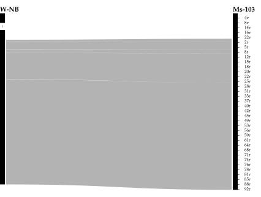

### [GT](/w-gt/#ms-103-IIIr.1) [IIIr\[1\]](https://cdn.wittgensteinnachlass.com/2000px/webp/Ms-103/IIIr.webp)

Ad. 4/5

_100 [unreadable]_

All scouts sent out to the skirmish lines must always report in person to the battalion commander in whose sector they find themselves.

_[unreadable]_

### [GT](/w-gt/#ms-103-1v.1) [1v\[1\]](https://cdn.wittgensteinnachlass.com/2000px/webp/Ms-103/1v.webp)

… and that I must take my own life. I suffered _the torments of hell_! And yet the picture of life was so alluring to me that I wanted to live again. I shall poison myself only when I really want to poison myself.

### [GT](/w-gt/#ms-103-1v.2) [1v\[2\]](https://cdn.wittgensteinnachlass.com/2000px/webp/Ms-103/1v.webp)

29.03.1916

_Forced_ to do many _unfamiliar things_. I need great strength to bear it. Often I am close to despair. I have done no work for over a week now. _I_ have _no time!_ God! But of course it is only natural, for when I am dead I shall have no time to work either. Inspection now. My soul shrivels up. God enlighten me! God enlighten me! God enlighten my soul.

### [GT](/w-gt/#ms-103-2v.1) [2v\[1\]](https://cdn.wittgensteinnachlass.com/2000px/webp/Ms-103/2v.webp)

30.03.1916

Do your best yourself! You can do no more: and be cheerful. Let yourself be enough for you. For others will not support you, or only for a short time! (Then you will become a burden to them). Help yourself and help others with all your strength. And be cheerful as you do so! But how much strength should one use for oneself, and how much for others? It is _hard_ to live well!! But the good life is beautiful. “But not my will but thine be done.”

### [GT](/w-gt/#ms-103-2v.2) [2v\[2\]](https://cdn.wittgensteinnachlass.com/2000px/webp/Ms-103/2v.webp)

02.04.1916

Was ill. Still very weak today. Today my commander told me he wanted to have me sent away to the rear. If that happens I shall kill myself.

### [GT](/w-gt/#ms-103-3v.1) [3v\[1\]](https://cdn.wittgensteinnachlass.com/2000px/webp/Ms-103/3v.webp)

06.04.1916

Life is a 07.04.1916 rack from which one is unstrapped only from time to time so as to remain susceptible to further torments. A dreadful assortment of torments. An exhausting march, a night spent coughing, the company of drunkards, the company of mean and stupid people. Do good and take joy in your virtue. Am ill and have a bad life. God help me. I am a poor unhappy man. God redeem me and grant me peace! Amen.

### [GT](/w-gt/#ms-103-3v.2+4v.1) [3v\[2\]](https://cdn.wittgensteinnachlass.com/2000px/webp/Ms-103/3v.webp),[4v\[1\]](https://cdn.wittgensteinnachlass.com/2000px/webp/Ms-103/4v.webp)

10.04.1916

Living with difficulty. Have not yet been enlightened. Saw myself in the mirror today, I have grown _quite_ haggard! After all, I have long been unable to work as well.

### [GT](/w-gt/#ms-103-4v.2) [4v\[2\]](https://cdn.wittgensteinnachlass.com/2000px/webp/Ms-103/4v.webp)

13.04.1916

Still staggering and falling in the dark. Have not yet awoken to life.

### [GT](/w-gt/#ms-103-4v.3) [4v\[3\]](https://cdn.wittgensteinnachlass.com/2000px/webp/Ms-103/4v.webp)

15.04.1916

In 8 days we move into firing position. May I be granted the chance to put my life at stake in a difficult task!

### [GT](/w-gt/#ms-103-4v.4) [4v\[4\]](https://cdn.wittgensteinnachlass.com/2000px/webp/Ms-103/4v.webp)

16.04.1916

Have been _completely_ asexual since 22.3. The last few days rest days.

### [GT](/w-gt/#ms-103-4v.5) [4v\[5\]](https://cdn.wittgensteinnachlass.com/2000px/webp/Ms-103/4v.webp)

18.04.1916

Tomorrow or the day after, into firing position. So _courage!_ God will help.

### [GT](/w-gt/#ms-103-5v.1) [5v\[1\]](https://cdn.wittgensteinnachlass.com/2000px/webp/Ms-103/5v.webp)

20.04.1916

God make me better! Then I shall grow more cheerful too. Probably in firing position today already. God help me.

### [GT](/w-gt/#ms-103-5v.2) [5v\[2\]](https://cdn.wittgensteinnachlass.com/2000px/webp/Ms-103/5v.webp)

23.04.1916

In firing position for a few days now. _Heavy_ physical work all day, unable to think. God help me; I have an immense amount to suffer. Today I applied to go to the observation post. Everyone in the half-platoon hates me because no one understands me. And because I am no saint! God help me!

### [GT](/w-gt/#ms-103-6v.1) [6v\[1\]](https://cdn.wittgensteinnachlass.com/2000px/webp/Ms-103/6v.webp)

26.04.1916

The officers of the battery seem to like me very much. This spares me a good deal of unpleasantness. Thank God. Thy will be done! Go your own way! _Thy_ will be done!

### [GT](/w-gt/#ms-103-6v.2+7v.1) [6v\[2\]](https://cdn.wittgensteinnachlass.com/2000px/webp/Ms-103/6v.webp),[7v\[1\]](https://cdn.wittgensteinnachlass.com/2000px/webp/Ms-103/7v.webp)

27.04.1916

With few exceptions the men hate me for being a volunteer. So I am now almost always surrounded by people who hate me. And this is the only thing I still cannot come to terms with. But there are wicked, heartless people here. It is almost impossible for me to find a trace of humanity in them. God help me to live. Had a feeling today that there would be an alarm tonight. And in fact we are on standby tonight. God be with me! Amen.

### [GT](/w-gt/#ms-103-7v.2) [7v\[2\]](https://cdn.wittgensteinnachlass.com/2000px/webp/Ms-103/7v.webp)

28.04.1916

Quiet during the night. Wrote to Russell. Had a bad dream last night. God protect me.

### [GT](/w-gt/#ms-103-7v.3) [7v\[3\]](https://cdn.wittgensteinnachlass.com/2000px/webp/Ms-103/7v.webp)

29.04.1916

Afternoon with the scouts. Came under fire. Thought of God. _Thy_ will be done! God be with me.

### [GT](/w-gt/#ms-103-7v.4) [7v\[4\]](https://cdn.wittgensteinnachlass.com/2000px/webp/Ms-103/7v.webp)

16.04.1930

Going back to the scouts today during a sudden bombardment: Man needs _only_ God.

### [GT](/w-gt/#ms-103-7v.5+8v.1) [7v\[5\]](https://cdn.wittgensteinnachlass.com/2000px/webp/Ms-103/7v.webp),[8v\[1\]](https://cdn.wittgensteinnachlass.com/2000px/webp/Ms-103/8v.webp)

02.05.1916

Constantly having to fend off people’s meanness.

### [GT](/w-gt/#ms-103-8v.2) [8v\[2\]](https://cdn.wittgensteinnachlass.com/2000px/webp/Ms-103/8v.webp)

03.05.1916

Having a hard time! God protect me and stand by me. Amen. May the hardest cup pass from me. But _Thy_ will be done. The work sleeps in my head.

### [GT](/w-gt/#ms-103-8v.3+9v.1) [8v\[3\]](https://cdn.wittgensteinnachlass.com/2000px/webp/Ms-103/8v.webp),[9v\[1\]](https://cdn.wittgensteinnachlass.com/2000px/webp/Ms-103/9v.webp)

04.05.1916

Tomorrow I may get to go up to the scouts at my own request. Only then will the war begin for me. And – it may be – life too! Perhaps the nearness of death will bring me the light of life! May God enlighten me! I am a worm but through God I shall become a man. God stand by me. Amen.

### [GT](/w-gt/#ms-103-9v.2) [9v\[2\]](https://cdn.wittgensteinnachlass.com/2000px/webp/Ms-103/9v.webp)

05.05.1916

At the scouts’ post I am like the prince in the enchanted castle. Now in daylight everything is quiet, but at night! It must be _terrible_ then! Will I be able to stand it???? Tonight will show. God stand by me!!

### [GT](/w-gt/#ms-103-9v.3+10v.1) [9v\[3\]](https://cdn.wittgensteinnachlass.com/2000px/webp/Ms-103/9v.webp),[10v\[1\]](https://cdn.wittgensteinnachlass.com/2000px/webp/Ms-103/10v.webp)

06.05.1916

In constant danger of death. By the grace of God the night went well. From time to time I lose heart. This is the schooling of the false conception of life! Understand people! Whenever you want to hate them, try to understand them instead. Live in inner peace! But how do you attain inner peace? _Only_ by my living in a way that pleases God! _Only_ thus is it possible to bear life.

### [GT](/w-gt/#ms-103-10v.2) [10v\[2\]](https://cdn.wittgensteinnachlass.com/2000px/webp/Ms-103/10v.webp)

07.05.1916

The night passed quietly. Thank God. Only, I am a wretch.

### [GT](/w-gt/#ms-103-10v.3+12v.1) [10v\[3\]](https://cdn.wittgensteinnachlass.com/2000px/webp/Ms-103/10v.webp),[12v\[1\]](https://cdn.wittgensteinnachlass.com/2000px/webp/Ms-103/12v.webp)

08.05.1916

Quiet night. God be with me!

The people I am with are not so much mean as _immensely_ limited! This makes dealings with them almost impossible, because they keep misunderstanding one. They are not stupid, but limited. They are clever enough in their own circle. But they lack character and with it breadth. “The true-believing heart understands everything”. Cannot work now.

### [GT](/w-gt/#ms-103-12v.2) [12v\[2\]](https://cdn.wittgensteinnachlass.com/2000px/webp/Ms-103/12v.webp)

09.05.1916

I would now have plenty of time and quiet to work. But nothing stirs. My material is far removed from me. It is only death that gives life its meaning.

### [GT](/w-gt/#ms-103-12v.3+13v.1) [12v\[3\]](https://cdn.wittgensteinnachlass.com/2000px/webp/Ms-103/12v.webp),[13v\[1\]](https://cdn.wittgensteinnachlass.com/2000px/webp/Ms-103/13v.webp)

10.05.1916

By the grace of God I am now doing very well. Unfortunately I cannot work. But Thy will be done! Amen. In danger he will not forsake me!! —.

### [GT](/w-gt/#ms-103-13v.2) [13v\[2\]](https://cdn.wittgensteinnachlass.com/2000px/webp/Ms-103/13v.webp)

11.05.1916

Change of position the day after tomorrow. _Very_ unpleasant! But Thy will be done.

### [GT](/w-gt/#ms-103-13v.3+14v.1) [13v\[3\]](https://cdn.wittgensteinnachlass.com/2000px/webp/Ms-103/13v.webp),[14v\[1\]](https://cdn.wittgensteinnachlass.com/2000px/webp/Ms-103/14v.webp)

16.05.1916

In the third position. Much hardship as always. But great grace too. Weak as ever! Cannot work.

Sleeping tonight under infantry fire, shall probably perish. God be with me! For ever, Amen. I am a weak man but He has preserved me until now. Praise be to God for ever, Amen. I commend my soul to the Lord.

### [GT](/w-gt/#ms-103-14v.2) [14v\[2\]](https://cdn.wittgensteinnachlass.com/2000px/webp/Ms-103/14v.webp)

21.05.1916

God make a better man of me!

### [GT](/w-gt/#ms-103-14v.3) [14v\[3\]](https://cdn.wittgensteinnachlass.com/2000px/webp/Ms-103/14v.webp)

25.05.1916

Under fire. As God wills!

### [GT](/w-gt/#ms-103-14v.4) [14v\[4\]](https://cdn.wittgensteinnachlass.com/2000px/webp/Ms-103/14v.webp)

27.05.1916

Letters from Mining and Mama. There is supposed to be a Russian attack today or tomorrow. Well, as God wills. I have fallen very deep into sin. But God will forgive me.

### [GT](/w-gt/#ms-103-14v.5+15v.1) [14v\[5\]](https://cdn.wittgensteinnachlass.com/2000px/webp/Ms-103/14v.webp),[15v\[1\]](https://cdn.wittgensteinnachlass.com/2000px/webp/Ms-103/15v.webp)

28.05.1916

Very restless sleep these last few weeks. Always dreaming about duty. Dreams that keep bringing me to the verge of waking. Have masturbated only 3 times in the last 2 months. My surroundings disgust me against my will. Often they appear to me not as people but as grotesque faces. Vile rabble. I do _not_ hate them but they disgust me. On strict standby today. My commander is very kind to me. Think of the goal of life. That is still the best you can do. I ought to be happier. Oh, if only my spirit were stronger!!! If only God be with me! Amen.

### [GT](/w-gt/#ms-103-15v.2) [15v\[2\]](https://cdn.wittgensteinnachlass.com/2000px/webp/Ms-103/15v.webp)

29.05.1916

God be with me.

### [GT](/w-gt/#ms-103-15v.3+16r.1) [15v\[3\]](https://cdn.wittgensteinnachlass.com/2000px/webp/Ms-103/15v.webp),[16r\[1\]](https://cdn.wittgensteinnachlass.com/2000px/webp/Ms-103/16r.webp)

06.07.1916

Colossal hardships in the last month. Have thought a great deal about all sorts of things but strangely cannot make the connection with my mathematical trains of thought.

### [GT](/w-gt/#ms-103-16r.2) [16r\[2\]](https://cdn.wittgensteinnachlass.com/2000px/webp/Ms-103/16r.webp)

07.07.1916

But the connection will be made!

What cannot be said _cannot_ be said!

### [GT](/w-gt/#ms-103-16r.3) [16r\[3\]](https://cdn.wittgensteinnachlass.com/2000px/webp/Ms-103/16r.webp)

08.07.1916

Alas, alas! I have no peace to work!

### [GT](/w-gt/#ms-103-16r.4+16v.1) [16r\[4\]](https://cdn.wittgensteinnachlass.com/2000px/webp/Ms-103/16r.webp),[16v\[1\]](https://cdn.wittgensteinnachlass.com/2000px/webp/Ms-103/16v.webp)

09.07.1916

Do not get angry with people. People are grey scoundrels. And yet you must not get angry with them. You must not let their words penetrate you. When they do not speak to me it is still easy to keep calm. But when they become insolent and rude to you, then it wells up in me. Do not get angry. Getting angry does you no good at all.

### [GT](/w-gt/#ms-103-16v.2) [16v\[2\]](https://cdn.wittgensteinnachlass.com/2000px/webp/Ms-103/16v.webp)

14.07.1916

The grace of work.

### [GT](/w-gt/#ms-103-16v.3) [16v\[3\]](https://cdn.wittgensteinnachlass.com/2000px/webp/Ms-103/16v.webp)

16.07.1916

Terrible weather. In the mountains, poorly, quite inadequately sheltered, icy cold, rain and fog. A life of torment. Terribly difficult not to lose oneself. For I am a weak man, after all. But the spirit helps me. It would be best if I were already ill, then at least I should have a little rest.

### [GT](/w-gt/#ms-103-17v.1) [17v\[1\]](https://cdn.wittgensteinnachlass.com/2000px/webp/Ms-103/17v.webp)

19.07.1916

Still getting angry. Am a weak man.

### [GT](/w-gt/#ms-103-17v.2) [17v\[2\]](https://cdn.wittgensteinnachlass.com/2000px/webp/Ms-103/17v.webp)

20.07.1916

Just go on working so that you become good.

### [GT](/w-gt/#ms-103-17v.3) [17v\[3\]](https://cdn.wittgensteinnachlass.com/2000px/webp/Ms-103/17v.webp)

24.07.1916

Under fire. And with every shot my soul recoils. I so want to go on living!

### [GT](/w-gt/#ms-103-17v.4+18v.1) [17v\[4\]](https://cdn.wittgensteinnachlass.com/2000px/webp/Ms-103/17v.webp),[18v\[1\]](https://cdn.wittgensteinnachlass.com/2000px/webp/Ms-103/18v.webp)

26.07.1916

A touching letter from David. He writes that his brother has fallen in France. Terrible! This kind, friendly letter opens my eyes to how I am living here in _exile_. It may be a salutary exile but now I feel it as exile. I am banished among nothing but masks and have to live with them in the most revolting circumstances. And in these surroundings I am to lead a good life and purify myself. But that is _terribly_ hard! I am too weak. I am too weak! God help me.

### [GT](/w-gt/#ms-103-18v.2+19v.1) [18v\[2\]](https://cdn.wittgensteinnachlass.com/2000px/webp/Ms-103/18v.webp),[19v\[1\]](https://cdn.wittgensteinnachlass.com/2000px/webp/Ms-103/19v.webp)

29.07.1916

Came under fire yesterday. Lost heart! I was afraid of death!

I have such a wish to live now! And it is hard to give up life once one has grown fond of it. That is precisely “sin”, an unreasonable life, a false conception of life. From time to time I become an _animal_. Then I can think of nothing but eating, drinking, sleeping. Terrible! And then I suffer like an animal too, without the possibility of inner salvation. I am then at the mercy of my appetites and aversions. Then a true life is out of the question.

### [GT](/w-gt/#ms-103-19v.2+20v.1) [19v\[2\]](https://cdn.wittgensteinnachlass.com/2000px/webp/Ms-103/19v.webp),[20v\[1\]](https://cdn.wittgensteinnachlass.com/2000px/webp/Ms-103/20v.webp)

30.07.1916

Odd: today I am angry that with the infantry, where I now get my rations, I am not getting officers’ mess food as I was led to expect at first. So I am behaving in an exceedingly childish and bad way.

And yet I cannot master my anger at the injustice I have suffered. Again and again I have to think about it, and about how it might be put right. That is how stupid man is.

### [GT](/w-gt/#ms-103-20v.2+21v.1) [20v\[2\]](https://cdn.wittgensteinnachlass.com/2000px/webp/Ms-103/20v.webp),[21v\[1\]](https://cdn.wittgensteinnachlass.com/2000px/webp/Ms-103/21v.webp)

06.08.1916

After 3 days’ travel by rail, on the march to the firing position. Not in the best of health, and spiritually ailing from the narrow-mindedness and meanness of those around me. God give me strength, inner strength, to withstand this sickness of the soul. God keep me in good spirits.

### [GT](/w-gt/#ms-103-21v.2) [21v\[2\]](https://cdn.wittgensteinnachlass.com/2000px/webp/Ms-103/21v.webp)

12.08.1916

Going on living in sin, i.e. unhappily. Am ill-tempered, joyless. Live at odds with everyone around me.

### [GT](/w-gt/#ms-103-21v.3+22v.1) [21v\[3\]](https://cdn.wittgensteinnachlass.com/2000px/webp/Ms-103/21v.webp),[22v\[1\]](https://cdn.wittgensteinnachlass.com/2000px/webp/Ms-103/22v.webp)

12.08.1916

You know what you have to do to live happily; why do you not do it? Because you are unreasonable. A bad life is an unreasonable life. What matters is not to get angry.

### [GT](/w-gt/#ms-103-22v.2) [22v\[2\]](https://cdn.wittgensteinnachlass.com/2000px/webp/Ms-103/22v.webp)

13.08.1916

Still struggling in vain against my weak nature. God strengthen me!

—

### [GT](/w-gt/#ms-103-22v.3) [22v\[3\]](https://cdn.wittgensteinnachlass.com/2000px/webp/Ms-103/22v.webp)

19.08.1916

Von Gemeinheit umgeben! Soll in absehbarer Zeit zum Kader in's Hinterland abgehen. Bin froh darüber. Von Gemeinheit umgeben.

Gott wird helfen.

### [GT](/w-gt/#ms-103-52v.1) [52v\[1\]](https://cdn.wittgensteinnachlass.com/2000px/webp/Ms-103/52v.webp)

Am depressed. Alone alone! Thank God: Loos is alive.

### [NB](/w-nb/#ms-103-1r.1) [1r\[1\]](https://cdn.wittgensteinnachlass.com/2000px/webp/Ms-103/1r.webp)

07.04.1916

15.04.1916 We can foresee only what we construct ourselves!

### [NB](/w-nb/#ms-103-1r.2) [1r\[2\]](https://cdn.wittgensteinnachlass.com/2000px/webp/Ms-103/1r.webp)

But what becomes of the concept of the simple object here?

### [NB](/w-nb/#ms-103-1r.3) [1r\[3\]](https://cdn.wittgensteinnachlass.com/2000px/webp/Ms-103/1r.webp)

This concept does not yet come into consideration here at all.

### [NB](/w-nb/#ms-103-1r.4) [1r\[4\]](https://cdn.wittgensteinnachlass.com/2000px/webp/Ms-103/1r.webp)

We must be able to construct the simple functions because we must be able to give every sign a meaning.

### [NB](/w-nb/#ms-103-1r.5) [1r\[5\]](https://cdn.wittgensteinnachlass.com/2000px/webp/Ms-103/1r.webp)

For the only sign that vouches for its meaning is function and argument.

### [2r\[1\]](https://cdn.wittgensteinnachlass.com/2000px/webp/Ms-103/2r.webp)

16.04.1916

φx ∙ ψy

### [NB](/w-nb/#ms-103-2r.2) [2r\[2\]](https://cdn.wittgensteinnachlass.com/2000px/webp/Ms-103/2r.webp)

_Every_ simple proposition can be reduced to the form φx.

### [NB](/w-nb/#ms-103-2r.3) [2r\[3\]](https://cdn.wittgensteinnachlass.com/2000px/webp/Ms-103/2r.webp)

That is why one may use this form to put together all simple propositions.

### [NB](/w-nb/#ms-103-2r.4) [2r\[4\]](https://cdn.wittgensteinnachlass.com/2000px/webp/Ms-103/2r.webp)

Suppose I were given _all_ the simple propositions: then one may simply ask: which propositions can I form from them? And those are _all_ the propositions, and _that_ is how they are _delimited_.

### [NB](/w-nb/#ms-103-2r.5+3r.1) [2r\[5\]](https://cdn.wittgensteinnachlass.com/2000px/webp/Ms-103/2r.webp),[3r\[1\]](https://cdn.wittgensteinnachlass.com/2000px/webp/Ms-103/3r.webp)

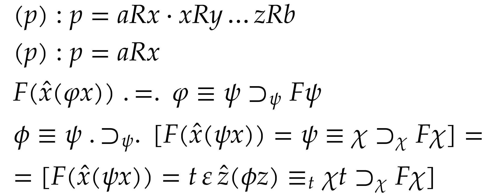

### [NB](/w-nb/#ms-103-3r.2) [3r\[2\]](https://cdn.wittgensteinnachlass.com/2000px/webp/Ms-103/3r.webp)

17.04.1916

The above definition, in its generality, can only be a rule for written signs that has nothing to do with the sense of the signs. But can there be such a rule?

### [NB](/w-nb/#ms-103-3r.3) [3r\[3\]](https://cdn.wittgensteinnachlass.com/2000px/webp/Ms-103/3r.webp)

The definition is possible only if it is not itself a proposition. Then a proposition cannot be about all propositions, but a definition can.

### [NB](/w-nb/#ms-103-4r.1) [4r\[1\]](https://cdn.wittgensteinnachlass.com/2000px/webp/Ms-103/4r.webp)

23.04.1916

But the above definition is not about all propositions at all, for it essentially contains genuine variables. It is quite analogous to an operation whose own result can also be taken as its base.

### [NB](/w-nb/#ms-103-4r.2) [4r\[2\]](https://cdn.wittgensteinnachlass.com/2000px/webp/Ms-103/4r.webp)

In this way and in this way alone is it possible to proceed from one type to another.

### [NB](/w-nb/#ms-103-4r.3) [4r\[3\]](https://cdn.wittgensteinnachlass.com/2000px/webp/Ms-103/4r.webp)

And one can say that all types are arranged in hierarchies.

### [NB](/w-nb/#ms-103-4r.4+5r.1) [4r\[4\]](https://cdn.wittgensteinnachlass.com/2000px/webp/Ms-103/4r.webp),[5r\[1\]](https://cdn.wittgensteinnachlass.com/2000px/webp/Ms-103/5r.webp)

And the hierarchy is possible only through construction by means of the operations.

### [NB](/w-nb/#ms-103-5r.2) [5r\[2\]](https://cdn.wittgensteinnachlass.com/2000px/webp/Ms-103/5r.webp)

Empirical reality is bounded by the number of objects.

The limit shows itself once more in the totality of simple propositions.

### [NB](/w-nb/#ms-103-5r.3) [5r\[3\]](https://cdn.wittgensteinnachlass.com/2000px/webp/Ms-103/5r.webp)

The hierarchies are and must be independent of reality. The meanings of their members are determined only by correlating the objects with the names.

### [NB](/w-nb/#ms-103-5r.4+6r.1) [5r\[4\]](https://cdn.wittgensteinnachlass.com/2000px/webp/Ms-103/5r.webp),[6r\[1\]](https://cdn.wittgensteinnachlass.com/2000px/webp/Ms-103/6r.webp)

27.04.1916

φx . ψy

Let us say I wanted to represent a function of 3 arguments that cannot be substituted for one another.

### [NB](/w-nb/#ms-103-6r.2) [6r\[2\]](https://cdn.wittgensteinnachlass.com/2000px/webp/Ms-103/6r.webp)

φ(x) : φ( ), x

### [NB](/w-nb/#ms-103-6r.3) [6r\[3\]](https://cdn.wittgensteinnachlass.com/2000px/webp/Ms-103/6r.webp)

But is logic then to speak of arguments that cannot be interchanged? If so, this surely presupposes something about the nature of reality.

### [6r\[4\]](https://cdn.wittgensteinnachlass.com/2000px/webp/Ms-103/6r.webp)

φx . ψy = xφψy = xRy

Fx.Fy.xRy = F(xRy)

F(xRy) = Fx.Fy․φx.ψy

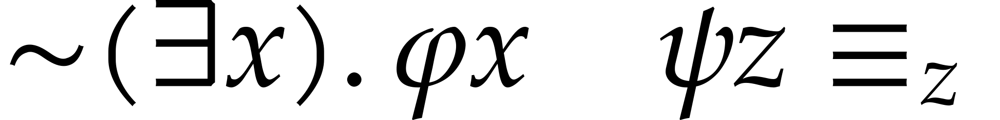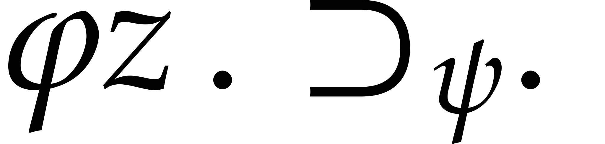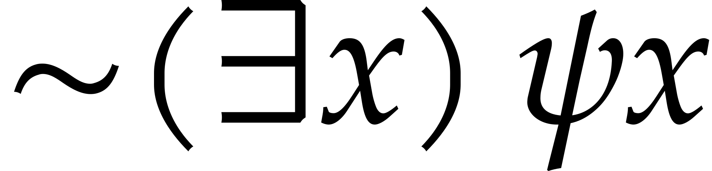

### [NB](/w-nb/#ms-103-6r.5+7r.1) [6r\[5\]](https://cdn.wittgensteinnachlass.com/2000px/webp/Ms-103/6r.webp),[7r\[1\]](https://cdn.wittgensteinnachlass.com/2000px/webp/Ms-103/7r.webp)

06.05.1916

The whole world-view of the moderns rests on this illusion, that the so-called laws of nature are the explanations of natural phenomena.

### [NB](/w-nb/#ms-103-7r.2) [7r\[2\]](https://cdn.wittgensteinnachlass.com/2000px/webp/Ms-103/7r.webp)

So they stop at the laws of nature as at something _inviolable_, just as people in earlier times stopped at God and fate.

### [NB](/w-nb/#ms-103-7r.3) [7r\[3\]](https://cdn.wittgensteinnachlass.com/2000px/webp/Ms-103/7r.webp)

And both are right and wrong. The ancients are, however, clearer in that they acknowledged a definite stopping point, whereas the new system is meant to give the impression that _everything_ has been given a justification.

### [NB](/w-nb/#ms-103-7r.4+8r.1) [7r\[4\]](https://cdn.wittgensteinnachlass.com/2000px/webp/Ms-103/7r.webp),[8r\[1\]](https://cdn.wittgensteinnachlass.com/2000px/webp/Ms-103/8r.webp)

11.05.1916

❘p ❘(a,a)

There are, after all, operations with two bases too. And the ‘ ❘ ’ operation is of this kind.

### [NB](/w-nb/#ms-103-8r.2) [8r\[2\]](https://cdn.wittgensteinnachlass.com/2000px/webp/Ms-103/8r.webp)

❘ (ξ,η)… is an arbitrary member of the series of results of the operation.

### [NB](/w-nb/#ms-103-8r.3) [8r\[3\]](https://cdn.wittgensteinnachlass.com/2000px/webp/Ms-103/8r.webp)

(∃x).φx

Is (∃x) etc. really an operation, then?

### [NB](/w-nb/#ms-103-8r.4) [8r\[4\]](https://cdn.wittgensteinnachlass.com/2000px/webp/Ms-103/8r.webp)

But what would its base be?

### [8r\[5\]](https://cdn.wittgensteinnachlass.com/2000px/webp/Ms-103/8r.webp)

21.05.1916

(∃x).(y)․φ(x,y); (y)․(∃x).φ(x,y); (x) (∃y)․φ(x,y);

(∃y) (x) φ(xy) . (∃x).(∃y) φ(x,y); (x).(y) φ(x y)

### [8r\[6\]](https://cdn.wittgensteinnachlass.com/2000px/webp/Ms-103/8r.webp)

24.05.1916

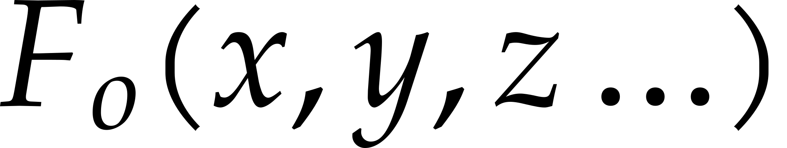

### [8r\[7\]](https://cdn.wittgensteinnachlass.com/2000px/webp/Ms-103/8r.webp)

25.05.1916

### [NB](/w-nb/#ms-103-8r.8+9r.1+10r.1) [8r\[8\]](https://cdn.wittgensteinnachlass.com/2000px/webp/Ms-103/8r.webp),[9r\[1\]](https://cdn.wittgensteinnachlass.com/2000px/webp/Ms-103/9r.webp),[10r\[1\]](https://cdn.wittgensteinnachlass.com/2000px/webp/Ms-103/10r.webp)

04.07.1916

What do I know about God and the purpose of life? I know that this world exists. That I stand in it as my eye stands in its visual field. That there is something problematic about it which we call its sense. That this sense lies not in it but outside it. That life is the world. That my will pervades the world. That my will is good or evil. That good and evil are therefore somehow connected with the sense of the world. We can call the sense of life, i.e. the sense of the world, God. And link to this the simile of God as a father.

Prayer is the thought of the sense of life.

I cannot direct the events of the world according to my will but am completely powerless.

Only in this way can I make myself independent of the world – and so in a certain sense master it after all – by renouncing any influence on events.

### [NB](/w-nb/#ms-103-11r.1) [11r\[1\]](https://cdn.wittgensteinnachlass.com/2000px/webp/Ms-103/11r.webp)

05.07.1916

The world is independent of my will.

### [NB](/w-nb/#ms-103-11r.2) [11r\[2\]](https://cdn.wittgensteinnachlass.com/2000px/webp/Ms-103/11r.webp)

Even if everything we wish for were to happen, this would still be only, so to speak, a favour granted by fate, for there is no logical connection between will and world that would guarantee this, and yet we were unable in turn to will the supposed physical one.

### [NB](/w-nb/#ms-103-11r.3+12r.1) [11r\[3\]](https://cdn.wittgensteinnachlass.com/2000px/webp/Ms-103/11r.webp),[12r\[1\]](https://cdn.wittgensteinnachlass.com/2000px/webp/Ms-103/12r.webp)

If good or evil willing has an effect on the world, then it can have that effect only on the limits of the world, not on the facts, but on what cannot be depicted by language but can only be shown in language.

### [NB](/w-nb/#ms-103-12r.2) [12r\[2\]](https://cdn.wittgensteinnachlass.com/2000px/webp/Ms-103/12r.webp)

In short, the _world_ must thereby become a different world altogether.

### [NB](/w-nb/#ms-103-12r.3) [12r\[3\]](https://cdn.wittgensteinnachlass.com/2000px/webp/Ms-103/12r.webp)

It must, so to speak, wax or wane as a whole. As through the addition or loss of a sense.

### [NB](/w-nb/#ms-103-12r.4) [12r\[4\]](https://cdn.wittgensteinnachlass.com/2000px/webp/Ms-103/12r.webp)

Just as in death, too, the world does not change but ceases to be.

### [NB](/w-nb/#ms-103-13r.1) [13r\[1\]](https://cdn.wittgensteinnachlass.com/2000px/webp/Ms-103/13r.webp)

06.07.1916

And to that extent Dostojewski too is probably right when he says that whoever is happy fulfils the purpose of existence.

### [NB](/w-nb/#ms-103-13r.2) [13r\[2\]](https://cdn.wittgensteinnachlass.com/2000px/webp/Ms-103/13r.webp)

Or one could also put it this way: whoever no longer needs any purpose apart from life fulfils the purpose of existence. That is to say, whoever is content.

### [NB](/w-nb/#ms-103-13r.3) [13r\[3\]](https://cdn.wittgensteinnachlass.com/2000px/webp/Ms-103/13r.webp)

One notices the solution to the problem of life by the disappearance of this problem.

### [NB](/w-nb/#ms-103-13r.4+14r.1) [13r\[4\]](https://cdn.wittgensteinnachlass.com/2000px/webp/Ms-103/13r.webp),[14r\[1\]](https://cdn.wittgensteinnachlass.com/2000px/webp/Ms-103/14r.webp)

But can one live in such a way that life ceases to be problematic? That one _lives_ in the eternal and not in time?

### [NB](/w-nb/#ms-103-14r.2) [14r\[2\]](https://cdn.wittgensteinnachlass.com/2000px/webp/Ms-103/14r.webp)

07.07.1916

Is this not the reason why people to whom the sense of life became clear after long doubts, why they could not then say what that sense consisted in.

### [NB](/w-nb/#ms-103-14r.3) [14r\[3\]](https://cdn.wittgensteinnachlass.com/2000px/webp/Ms-103/14r.webp)

If I can think of a “_kind_ of objects” without knowing whether there are such objects, then I must have constructed their prototype for myself.

### [NB](/w-nb/#ms-103-14r.4) [14r\[4\]](https://cdn.wittgensteinnachlass.com/2000px/webp/Ms-103/14r.webp)

Is this not what the method of mechanics rests on?

### [NB](/w-nb/#ms-103-14r.5+15r.1) [14r\[5\]](https://cdn.wittgensteinnachlass.com/2000px/webp/Ms-103/14r.webp),[15r\[1\]](https://cdn.wittgensteinnachlass.com/2000px/webp/Ms-103/15r.webp)

08.07.1916

To believe in a God means to understand the question of the sense of life.

### [NB](/w-nb/#ms-103-15r.2) [15r\[2\]](https://cdn.wittgensteinnachlass.com/2000px/webp/Ms-103/15r.webp)

To believe in a God means to see that the facts of the world are not all there is to it.

### [NB](/w-nb/#ms-103-15r.3) [15r\[3\]](https://cdn.wittgensteinnachlass.com/2000px/webp/Ms-103/15r.webp)

To believe in God means to see that life has a sense.

### [NB](/w-nb/#ms-103-15r.4) [15r\[4\]](https://cdn.wittgensteinnachlass.com/2000px/webp/Ms-103/15r.webp)

The world is _given_ to me. i.e. my will approaches the world entirely from outside, as something already complete.

### [NB](/w-nb/#ms-103-15r.5) [15r\[5\]](https://cdn.wittgensteinnachlass.com/2000px/webp/Ms-103/15r.webp)

(What my will is I do not yet know.)

### [NB](/w-nb/#ms-103-15r.6+17r.1) [15r\[6\]](https://cdn.wittgensteinnachlass.com/2000px/webp/Ms-103/15r.webp),[17r\[1\]](https://cdn.wittgensteinnachlass.com/2000px/webp/Ms-103/17r.webp)

Hence we have the feeling that we depend on a will other than our own.

### [NB](/w-nb/#ms-103-17r.2) [17r\[2\]](https://cdn.wittgensteinnachlass.com/2000px/webp/Ms-103/17r.webp)

_Be that as it may_, in any case we _are_ dependent in a certain sense, and what we depend on we can call God.

### [NB](/w-nb/#ms-103-17r.3) [17r\[3\]](https://cdn.wittgensteinnachlass.com/2000px/webp/Ms-103/17r.webp)

In this sense God would simply be fate or, what amounts to the same thing: the – independent of our will – world.

### [NB](/w-nb/#ms-103-17r.4) [17r\[4\]](https://cdn.wittgensteinnachlass.com/2000px/webp/Ms-103/17r.webp)

I can make myself independent of fate.

### [NB](/w-nb/#ms-103-17r.5) [17r\[5\]](https://cdn.wittgensteinnachlass.com/2000px/webp/Ms-103/17r.webp)

There are two divinities: the world and my independent self.

### [NB](/w-nb/#ms-103-18r.1) [18r\[1\]](https://cdn.wittgensteinnachlass.com/2000px/webp/Ms-103/18r.webp)

I am either happy or unhappy, that is all. One can say: there is no good or evil.

### [NB](/w-nb/#ms-103-18r.2) [18r\[2\]](https://cdn.wittgensteinnachlass.com/2000px/webp/Ms-103/18r.webp)

Whoever is happy must have no fear. Not even of death.

### [NB](/w-nb/#ms-103-18r.3) [18r\[3\]](https://cdn.wittgensteinnachlass.com/2000px/webp/Ms-103/18r.webp)

Only whoever lives not in time but in the present is happy.

### [NB](/w-nb/#ms-103-18r.4) [18r\[4\]](https://cdn.wittgensteinnachlass.com/2000px/webp/Ms-103/18r.webp)

For life in the present there is no death.

### [NB](/w-nb/#ms-103-18r.5) [18r\[5\]](https://cdn.wittgensteinnachlass.com/2000px/webp/Ms-103/18r.webp)

Death is not an event in life. It is not a fact of the world.

### [NB](/w-nb/#ms-103-18r.6+19r.1) [18r\[6\]](https://cdn.wittgensteinnachlass.com/2000px/webp/Ms-103/18r.webp),[19r\[1\]](https://cdn.wittgensteinnachlass.com/2000px/webp/Ms-103/19r.webp)

If by eternity one means not infinite duration but timelessness, then one can say that whoever lives in the present lives eternally.

### [NB](/w-nb/#ms-103-19r.2) [19r\[2\]](https://cdn.wittgensteinnachlass.com/2000px/webp/Ms-103/19r.webp)

To live happily I must be in agreement with the world. And this is precisely what it _means_ to “be happy”.

### [NB](/w-nb/#ms-103-19r.3) [19r\[3\]](https://cdn.wittgensteinnachlass.com/2000px/webp/Ms-103/19r.webp)

I am then, so to speak, in agreement with that other will on which I appear to depend. That is to say: “I do God’s will”.

### [NB](/w-nb/#ms-103-19r.4) [19r\[4\]](https://cdn.wittgensteinnachlass.com/2000px/webp/Ms-103/19r.webp)

Fear of death is the best sign of a false, i.e. bad, life.

### [NB](/w-nb/#ms-103-20r.1) [20r\[1\]](https://cdn.wittgensteinnachlass.com/2000px/webp/Ms-103/20r.webp)

If my conscience throws me off balance, then I am not in agreement with something. But what is it? Is it _the world_?

### [NB](/w-nb/#ms-103-20r.2) [20r\[2\]](https://cdn.wittgensteinnachlass.com/2000px/webp/Ms-103/20r.webp)

It is certainly right to say: conscience is the voice of God.

### [NB](/w-nb/#ms-103-20r.3) [20r\[3\]](https://cdn.wittgensteinnachlass.com/2000px/webp/Ms-103/20r.webp)

For example: it makes me unhappy to think that I have offended so-and-so. Is that my conscience.

### [NB](/w-nb/#ms-103-20r.4) [20r\[4\]](https://cdn.wittgensteinnachlass.com/2000px/webp/Ms-103/20r.webp)

Can one say: “act according to your conscience, whatever it may be like”?

### [NB](/w-nb/#ms-103-20r.5) [20r\[5\]](https://cdn.wittgensteinnachlass.com/2000px/webp/Ms-103/20r.webp)

Live happily!

### [NB](/w-nb/#ms-103-21r.1) [21r\[1\]](https://cdn.wittgensteinnachlass.com/2000px/webp/Ms-103/21r.webp)

09.07.1916

If one could not give the most general sentential form, then a moment would have to come when we suddenly have a new experience, a logical one, so to speak.

### [NB](/w-nb/#ms-103-21r.2) [21r\[2\]](https://cdn.wittgensteinnachlass.com/2000px/webp/Ms-103/21r.webp)

This is of course impossible.

### [NB](/w-nb/#ms-103-21r.3) [21r\[3\]](https://cdn.wittgensteinnachlass.com/2000px/webp/Ms-103/21r.webp)

Do not forget that (∃x) fx does not mean; there is an x such that fx, but rather: there is a true proposition “fx”.

### [NB](/w-nb/#ms-103-21r.4+22r.1) [21r\[4\]](https://cdn.wittgensteinnachlass.com/2000px/webp/Ms-103/21r.webp),[22r\[1\]](https://cdn.wittgensteinnachlass.com/2000px/webp/Ms-103/22r.webp)

The proposition fa speaks of determinate objects, the general proposition of _all_ objects.

### [NB](/w-nb/#ms-103-22r.2) [22r\[2\]](https://cdn.wittgensteinnachlass.com/2000px/webp/Ms-103/22r.webp)

11.07.1916

The determinate object is a very curious phenomenon.

### [NB](/w-nb/#ms-103-22r.3) [22r\[3\]](https://cdn.wittgensteinnachlass.com/2000px/webp/Ms-103/22r.webp)

Instead of “all objects” one could say: all _determinate objects_.

### [NB](/w-nb/#ms-103-22r.4) [22r\[4\]](https://cdn.wittgensteinnachlass.com/2000px/webp/Ms-103/22r.webp)

If all determinate objects are given, “all objects” are given. In short, with the determinate objects all objects are given.

### [NB](/w-nb/#ms-103-22r.5) [22r\[5\]](https://cdn.wittgensteinnachlass.com/2000px/webp/Ms-103/22r.webp)

If there are objects, then there are thereby also “all objects”.

### [NB](/w-nb/#ms-103-23r.1) [23r\[1\]](https://cdn.wittgensteinnachlass.com/2000px/webp/Ms-103/23r.webp)

That is why it must also be possible to establish the unity of elementary propositions and general propositions.

### [NB](/w-nb/#ms-103-23r.2) [23r\[2\]](https://cdn.wittgensteinnachlass.com/2000px/webp/Ms-103/23r.webp)

For if the elementary propositions are given, then _all_ elementary propositions are thereby given, and with them the general proposition. – And is the unity not already established thereby.

### [NB](/w-nb/#ms-103-23r.3) [23r\[3\]](https://cdn.wittgensteinnachlass.com/2000px/webp/Ms-103/23r.webp)

12.07.1916

13.07.1916 Again and again one feels that the elementary proposition too speaks of all objects. (∃x) . φx . x = a

### [NB](/w-nb/#ms-103-23r.4+24r.1) [23r\[4\]](https://cdn.wittgensteinnachlass.com/2000px/webp/Ms-103/23r.webp),[24r\[1\]](https://cdn.wittgensteinnachlass.com/2000px/webp/Ms-103/24r.webp)

If two operations are given which cannot be reduced to _one_, then it must at least be possible to set down a general form for their combination.

### [NB](/w-nb/#ms-103-24r.2) [24r\[2\]](https://cdn.wittgensteinnachlass.com/2000px/webp/Ms-103/24r.webp)

φx, ψy❘χz, (∃x) ∙ , (x) ∙

Since it is evidently easy to explain how sentences can be formed with these operations and how they cannot be formed, it must also be possible to express this exactly _somehow_.

### [NB](/w-nb/#ms-103-24r.3) [24r\[3\]](https://cdn.wittgensteinnachlass.com/2000px/webp/Ms-103/24r.webp)

14.07.1916

And this expression must also already be given in the general form of the operation sign.

### [NB](/w-nb/#ms-103-24r.4+25r.1) [24r\[4\]](https://cdn.wittgensteinnachlass.com/2000px/webp/Ms-103/24r.webp),[25r\[1\]](https://cdn.wittgensteinnachlass.com/2000px/webp/Ms-103/25r.webp)

Indeed, must this not be the only legitimate expression of the application of the operation? Evidently it must!

### [NB](/w-nb/#ms-103-25r.2) [25r\[2\]](https://cdn.wittgensteinnachlass.com/2000px/webp/Ms-103/25r.webp)

For if the form of the operation can be expressed at all, it must be expressed in such a way that it _can_ only be applied correctly.

### [25r\[3\]](https://cdn.wittgensteinnachlass.com/2000px/webp/Ms-103/25r.webp)

But what is the correct expression for (∃x) . φx?

### [25r\[4\]](https://cdn.wittgensteinnachlass.com/2000px/webp/Ms-103/25r.webp)

(∃α) . [φα❘ψβ …]

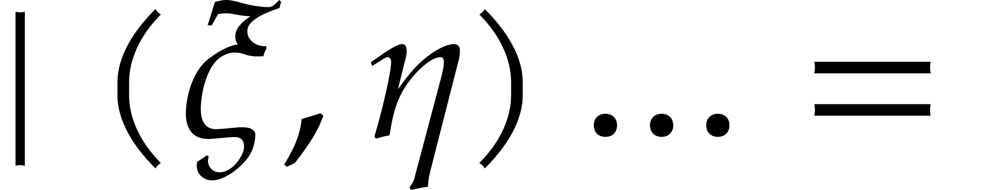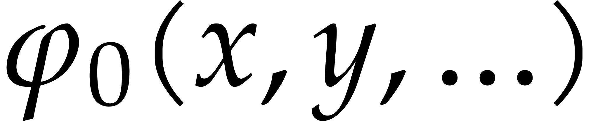

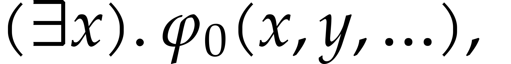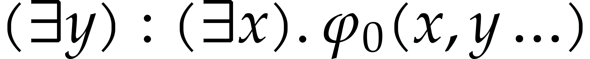

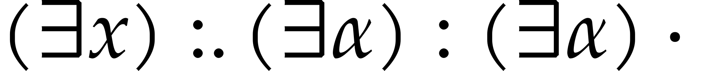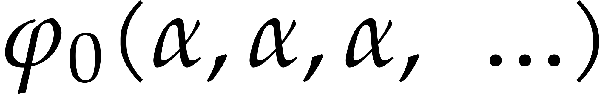

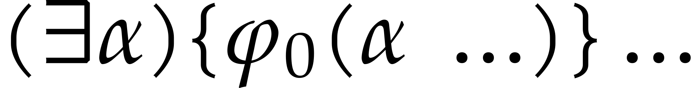

### [26r\[1\]](https://cdn.wittgensteinnachlass.com/2000px/webp/Ms-103/26r.webp)

Now it only remains to express the alternation between (∃x) and (x). But then the generality of the form, as in the Ancestral Relation!

### [26r\[2\]](https://cdn.wittgensteinnachlass.com/2000px/webp/Ms-103/26r.webp)

aRx . xRy . yRz… uRb ∙ xRy{aRx}…

### [26r\[3\]](https://cdn.wittgensteinnachlass.com/2000px/webp/Ms-103/26r.webp)

15.07.1916

(∃(aRx . xRy . …zRb))

aRb⌵ aRx . xRb⌵ aRx xRy ∙ yRb⌵…⌵ aRx ∙ xRy ∙ yRz ∙ … uRb

Here there can reasonably be no question of the existence of things, since the sentence aRb already meets the conditions too.

### [26r\[4\]](https://cdn.wittgensteinnachlass.com/2000px/webp/Ms-103/26r.webp)

Nothing seems simpler than a sentence like “a is a descendant of b”!

### [27r\[1\]](https://cdn.wittgensteinnachlass.com/2000px/webp/Ms-103/27r.webp)

16.07.1916

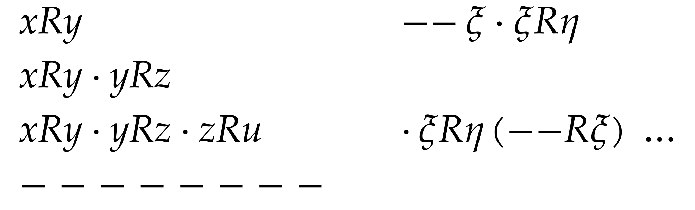

### [27r\[2\]](https://cdn.wittgensteinnachlass.com/2000px/webp/Ms-103/27r.webp)

20.07.1916

My old classification of all sentential forms was basically correct, except that a different kind of generality is needed.

### [NB](/w-nb/#ms-103-27r.3) [27r\[3\]](https://cdn.wittgensteinnachlass.com/2000px/webp/Ms-103/27r.webp)

A human being cannot simply make himself happy.

### [NB](/w-nb/#ms-103-27r.4) [27r\[4\]](https://cdn.wittgensteinnachlass.com/2000px/webp/Ms-103/27r.webp)

Whoever lives in the present lives without fear and hope.

### [NB](/w-nb/#ms-103-27r.5+28r.1) [27r\[5\]](https://cdn.wittgensteinnachlass.com/2000px/webp/Ms-103/27r.webp),[28r\[1\]](https://cdn.wittgensteinnachlass.com/2000px/webp/Ms-103/28r.webp)

21.07.1916

What really is the nature of the human will? I want to call above all the bearer of good and evil “will”.

### [NB](/w-nb/#ms-103-28r.2) [28r\[2\]](https://cdn.wittgensteinnachlass.com/2000px/webp/Ms-103/28r.webp)

Let us imagine a person who could not use any of his limbs and therefore could not exercise his _will_ in the ordinary sense. But he could think and _wish_ and communicate his thoughts to someone else. So he could also do evil or good through the other person. Then it is clear that ethics would apply to him too and that in the _ethical sense_ he is the bearer of a _will_.

### [NB](/w-nb/#ms-103-28r.3+29r.1) [28r\[3\]](https://cdn.wittgensteinnachlass.com/2000px/webp/Ms-103/28r.webp),[29r\[1\]](https://cdn.wittgensteinnachlass.com/2000px/webp/Ms-103/29r.webp)

Now is there a difference in principle between this will and _the one_ that sets the human body in motion?

### [NB](/w-nb/#ms-103-29r.2) [29r\[2\]](https://cdn.wittgensteinnachlass.com/2000px/webp/Ms-103/29r.webp)

Or does the mistake here lie in the fact that _wishing_ (or thinking) is itself already an action of the will? (And in this sense a human being _without_ a will would indeed not be alive.)

### [NB](/w-nb/#ms-103-29r.3) [29r\[3\]](https://cdn.wittgensteinnachlass.com/2000px/webp/Ms-103/29r.webp)

But is a being conceivable that could only form images (see, say), but could not will at all? In some sense this seems impossible. But if it were possible, then there could also be a world without ethics.

### [NB](/w-nb/#ms-103-30r.1) [30r\[1\]](https://cdn.wittgensteinnachlass.com/2000px/webp/Ms-103/30r.webp)

24.07.1916

The world and life are one.

### [NB](/w-nb/#ms-103-30r.2) [30r\[2\]](https://cdn.wittgensteinnachlass.com/2000px/webp/Ms-103/30r.webp)

Physiological life is of course not “life”. Nor is psychological life. Life is the world.

### [NB](/w-nb/#ms-103-30r.3) [30r\[3\]](https://cdn.wittgensteinnachlass.com/2000px/webp/Ms-103/30r.webp)

Ethics does not deal with the world. Ethics must be a condition of the world, like logic.

### [NB](/w-nb/#ms-103-30r.4) [30r\[4\]](https://cdn.wittgensteinnachlass.com/2000px/webp/Ms-103/30r.webp)

Ethics and aesthetics are one.

### [NB](/w-nb/#ms-103-30r.5+31r.1) [30r\[5\]](https://cdn.wittgensteinnachlass.com/2000px/webp/Ms-103/30r.webp),[31r\[1\]](https://cdn.wittgensteinnachlass.com/2000px/webp/Ms-103/31r.webp)

29.07.1916

For it is a logical fact that the wish stands in no logical connection with its fulfilment. And it is also clear that the world of the happy is _different_ from the world of the unhappy.

### [NB](/w-nb/#ms-103-31r.2) [31r\[2\]](https://cdn.wittgensteinnachlass.com/2000px/webp/Ms-103/31r.webp)

Is seeing an activity?

### [NB](/w-nb/#ms-103-31r.3) [31r\[3\]](https://cdn.wittgensteinnachlass.com/2000px/webp/Ms-103/31r.webp)

Can one will well, will ill, and not will?

### [NB](/w-nb/#ms-103-31r.4) [31r\[4\]](https://cdn.wittgensteinnachlass.com/2000px/webp/Ms-103/31r.webp)

Or is only the person who does _not_ will happy?

### [NB](/w-nb/#ms-103-31r.5) [31r\[5\]](https://cdn.wittgensteinnachlass.com/2000px/webp/Ms-103/31r.webp)

“To love one’s neighbour” – that would mean willing!

### [NB](/w-nb/#ms-103-31r.6+32r.1) [31r\[6\]](https://cdn.wittgensteinnachlass.com/2000px/webp/Ms-103/31r.webp),[32r\[1\]](https://cdn.wittgensteinnachlass.com/2000px/webp/Ms-103/32r.webp)

But can one wish and yet not be unhappy if the wish is not fulfilled? (And that possibility is always there.)

### [NB](/w-nb/#ms-103-32r.2) [32r\[2\]](https://cdn.wittgensteinnachlass.com/2000px/webp/Ms-103/32r.webp)

Is it good, according to generally held notions, to wish one’s neighbour _nothing_, neither good nor bad?

### [NB](/w-nb/#ms-103-32r.3) [32r\[3\]](https://cdn.wittgensteinnachlass.com/2000px/webp/Ms-103/32r.webp)

And yet in a certain sense not wishing seems to be the only good thing.

### [NB](/w-nb/#ms-103-32r.4) [32r\[4\]](https://cdn.wittgensteinnachlass.com/2000px/webp/Ms-103/32r.webp)

Here I am still making gross errors! No doubt about it!

### [NB](/w-nb/#ms-103-32r.5+33r.1) [32r\[5\]](https://cdn.wittgensteinnachlass.com/2000px/webp/Ms-103/32r.webp),[33r\[1\]](https://cdn.wittgensteinnachlass.com/2000px/webp/Ms-103/33r.webp)

It is generally assumed that it is evil to wish another person misfortune. Can that be right? Can it be worse than wishing the other person happiness? What matters here seems to be, so to speak, _how_ one wishes.

### [NB](/w-nb/#ms-103-33r.2) [33r\[2\]](https://cdn.wittgensteinnachlass.com/2000px/webp/Ms-103/33r.webp)

One seems unable to say more than: Live happily!

### [NB](/w-nb/#ms-103-33r.3) [33r\[3\]](https://cdn.wittgensteinnachlass.com/2000px/webp/Ms-103/33r.webp)

The world of the happy is different from that of the unhappy.

### [NB](/w-nb/#ms-103-33r.4) [33r\[4\]](https://cdn.wittgensteinnachlass.com/2000px/webp/Ms-103/33r.webp)

The world of the happy is _a happy world_.

### [NB](/w-nb/#ms-103-33r.5) [33r\[5\]](https://cdn.wittgensteinnachlass.com/2000px/webp/Ms-103/33r.webp)

So can there be a world that is neither happy nor unhappy?

### [NB](/w-nb/#ms-103-34r.1+35r.1) [34r\[1\]](https://cdn.wittgensteinnachlass.com/2000px/webp/Ms-103/34r.webp),[35r\[1\]](https://cdn.wittgensteinnachlass.com/2000px/webp/Ms-103/35r.webp)

30.07.1916

The first thought when a general ethical law of the form “Thou shalt …” is laid down is: “And what then, if I do not do it?”

But it is clear that ethics has nothing to do with punishment and reward. So this question about the consequences of an action must be beside the point. At the very least, these consequences must not be events. For there must be something right about asking the question in that way. There must, to be sure, be a _kind_ of reward and ethical punishment, but they must lie in the action itself. And it is also clear that the reward must be something pleasant and the punishment something unpleasant.

### [NB](/w-nb/#ms-103-35r.2) [35r\[2\]](https://cdn.wittgensteinnachlass.com/2000px/webp/Ms-103/35r.webp)

Again and again I come back to the point that the happy life is simply good and the unhappy life bad. And if I _now_ ask myself: but _why_ should I live happily rather than otherwise? – the question strikes me straightaway as tautological; it seems that the happy life justifies itself, that it _is_ the only right life.

### [NB](/w-nb/#ms-103-36r.1) [36r\[1\]](https://cdn.wittgensteinnachlass.com/2000px/webp/Ms-103/36r.webp)

All this really is, in a certain sense, profoundly mysterious! _It is clear_ that ethics _cannot_ be put into words!

### [NB](/w-nb/#ms-103-36r.2) [36r\[2\]](https://cdn.wittgensteinnachlass.com/2000px/webp/Ms-103/36r.webp)

But one could put it this way: The happy life seems in some sense to be _more harmonious_ than the unhappy one. But in what sense??

### [NB](/w-nb/#ms-103-36r.3+37r.1) [36r\[3\]](https://cdn.wittgensteinnachlass.com/2000px/webp/Ms-103/36r.webp),[37r\[1\]](https://cdn.wittgensteinnachlass.com/2000px/webp/Ms-103/37r.webp)

What is the objective mark of the happy, harmonious life? Here again it is clear that there can be no such mark that could be _described_. This mark cannot be physical, but can only be metaphysical, transcendent.

### [NB](/w-nb/#ms-103-37r.2) [37r\[2\]](https://cdn.wittgensteinnachlass.com/2000px/webp/Ms-103/37r.webp)

Ethics is transcendent.

### [NB](/w-nb/#ms-103-37r.3) [37r\[3\]](https://cdn.wittgensteinnachlass.com/2000px/webp/Ms-103/37r.webp)

01.08.1916

How everything is, is God.

### [NB](/w-nb/#ms-103-37r.4) [37r\[4\]](https://cdn.wittgensteinnachlass.com/2000px/webp/Ms-103/37r.webp)

God is how everything is.

### [NB](/w-nb/#ms-103-37r.5) [37r\[5\]](https://cdn.wittgensteinnachlass.com/2000px/webp/Ms-103/37r.webp)

Only from the consciousness of the _uniqueness of my life_ spring religion – science – and art.

### [NB](/w-nb/#ms-103-37r.6) [37r\[6\]](https://cdn.wittgensteinnachlass.com/2000px/webp/Ms-103/37r.webp)

02.08.1916

And this consciousness is life itself.

### [NB](/w-nb/#ms-103-37r.7) [37r\[7\]](https://cdn.wittgensteinnachlass.com/2000px/webp/Ms-103/37r.webp)

Can there be ethics if there is no living being apart from me?

### [NB](/w-nb/#ms-103-38r.1) [38r\[1\]](https://cdn.wittgensteinnachlass.com/2000px/webp/Ms-103/38r.webp)

If ethics is to be something fundamental, yes!

### [NB](/w-nb/#ms-103-38r.2) [38r\[2\]](https://cdn.wittgensteinnachlass.com/2000px/webp/Ms-103/38r.webp)

If I am right, then for an ethical judgement it is not enough that a world be given. The world in itself is then neither good nor evil.

### [NB](/w-nb/#ms-103-38r.3) [38r\[3\]](https://cdn.wittgensteinnachlass.com/2000px/webp/Ms-103/38r.webp)

For it must make no difference to the existence of ethics whether or not there is living matter in the world. And it is clear that a world in which there is only dead matter is in itself neither good nor evil, so the world of living beings cannot in itself be either good or evil either.

### [NB](/w-nb/#ms-103-39r.1) [39r\[1\]](https://cdn.wittgensteinnachlass.com/2000px/webp/Ms-103/39r.webp)

Good and evil arise only through the _subject_. And the subject does not belong to the world, but is a limit of the world.

### [NB](/w-nb/#ms-103-39r.2) [39r\[2\]](https://cdn.wittgensteinnachlass.com/2000px/webp/Ms-103/39r.webp)

One could say (in Schopenhauer’s manner): The world of representation is neither good nor evil; it is the willing subject that is good or evil.

### [NB](/w-nb/#ms-103-39r.3) [39r\[3\]](https://cdn.wittgensteinnachlass.com/2000px/webp/Ms-103/39r.webp)

I am conscious of the complete lack of clarity of all these sentences.

### [NB](/w-nb/#ms-103-39r.4+40r.1) [39r\[4\]](https://cdn.wittgensteinnachlass.com/2000px/webp/Ms-103/39r.webp),[40r\[1\]](https://cdn.wittgensteinnachlass.com/2000px/webp/Ms-103/40r.webp)

From what went before, then, the willing subject would have to be happy or unhappy, and happiness and unhappiness cannot belong to the world.

### [NB](/w-nb/#ms-103-40r.2) [40r\[2\]](https://cdn.wittgensteinnachlass.com/2000px/webp/Ms-103/40r.webp)

Just as the subject is not a part of the world but a presupposition of its existence, so good and evil, predicates of the subject, are not properties in the world.

### [NB](/w-nb/#ms-103-40r.3) [40r\[3\]](https://cdn.wittgensteinnachlass.com/2000px/webp/Ms-103/40r.webp)

The nature of the subject is completely veiled here.

### [NB](/w-nb/#ms-103-40r.4) [40r\[4\]](https://cdn.wittgensteinnachlass.com/2000px/webp/Ms-103/40r.webp)

Indeed, my work has extended from the foundations of logic to the nature of the world.

### [NB](/w-nb/#ms-103-40r.5+41r.1) [40r\[5\]](https://cdn.wittgensteinnachlass.com/2000px/webp/Ms-103/40r.webp),[41r\[1\]](https://cdn.wittgensteinnachlass.com/2000px/webp/Ms-103/41r.webp)

04.08.1916

Is the representing subject not, after all, mere superstition?

### [NB](/w-nb/#ms-103-41r.2) [41r\[2\]](https://cdn.wittgensteinnachlass.com/2000px/webp/Ms-103/41r.webp)

Where in the world can a metaphysical subject be discerned?

### [NB](/w-nb/#ms-103-41r.3) [41r\[3\]](https://cdn.wittgensteinnachlass.com/2000px/webp/Ms-103/41r.webp)

You say it is just the same here as with the eye and the visual field. But you really do _not_ see the eye. And I believe that nothing about the visual field allows one to infer that it is seen by an eye.

### [NB](/w-nb/#ms-103-41r.4) [41r\[4\]](https://cdn.wittgensteinnachlass.com/2000px/webp/Ms-103/41r.webp)

05.08.1916

The representing subject is presumably an empty delusion. But the willing subject does exist.

### [NB](/w-nb/#ms-103-42r.1) [42r\[1\]](https://cdn.wittgensteinnachlass.com/2000px/webp/Ms-103/42r.webp)

Were there no will, there would not be that centre of the world which we call the self and which is the bearer of ethics.

### [NB](/w-nb/#ms-103-42r.2) [42r\[2\]](https://cdn.wittgensteinnachlass.com/2000px/webp/Ms-103/42r.webp)

It is essentially only the self that is good or evil, not the world.

### [NB](/w-nb/#ms-103-42r.3) [42r\[3\]](https://cdn.wittgensteinnachlass.com/2000px/webp/Ms-103/42r.webp)

The self, the self is what is profoundly mysterious!

### [NB](/w-nb/#ms-103-42r.4) [42r\[4\]](https://cdn.wittgensteinnachlass.com/2000px/webp/Ms-103/42r.webp)

07.08.1916

The self is not an object.

### [NB](/w-nb/#ms-103-42r.5) [42r\[5\]](https://cdn.wittgensteinnachlass.com/2000px/webp/Ms-103/42r.webp)

08.08.1916

11.08.1916 I stand in an objective relation to every object. Not to the self.

### [NB](/w-nb/#ms-103-43r.1) [43r\[1\]](https://cdn.wittgensteinnachlass.com/2000px/webp/Ms-103/43r.webp)

So there really is a way in which philosophy can and must speak of the self _in a non-psychological sense_.

### [NB](/w-nb/#ms-103-43r.2) [43r\[2\]](https://cdn.wittgensteinnachlass.com/2000px/webp/Ms-103/43r.webp)

12.08.1916

The self enters philosophy through the fact that the world is _my_ world.

### [NB](/w-nb/#ms-103-43r.3) [43r\[3\]](https://cdn.wittgensteinnachlass.com/2000px/webp/Ms-103/43r.webp)

For the visual field does not have a shape like this: 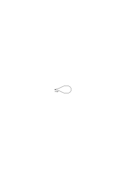.

### [NB](/w-nb/#ms-103-43r.4+44r.1) [43r\[4\]](https://cdn.wittgensteinnachlass.com/2000px/webp/Ms-103/43r.webp),[44r\[1\]](https://cdn.wittgensteinnachlass.com/2000px/webp/Ms-103/44r.webp)

This is connected with the fact that no part of our experience is a priori.

### [NB](/w-nb/#ms-103-44r.2) [44r\[2\]](https://cdn.wittgensteinnachlass.com/2000px/webp/Ms-103/44r.webp)

Everything we see could be otherwise. Everything we can describe at all could be otherwise.

### [NB](/w-nb/#ms-103-44r.3) [44r\[3\]](https://cdn.wittgensteinnachlass.com/2000px/webp/Ms-103/44r.webp)

13.08.1916

Suppose a human being could not exercise his will but had to suffer all the affliction of this world: what could then make him happy?

### [NB](/w-nb/#ms-103-44r.4+45r.1) [44r\[4\]](https://cdn.wittgensteinnachlass.com/2000px/webp/Ms-103/44r.webp),[45r\[1\]](https://cdn.wittgensteinnachlass.com/2000px/webp/Ms-103/45r.webp)

How can a human being be happy at all, given that he cannot ward off the affliction of this world? Precisely through the life of knowledge.

### [NB](/w-nb/#ms-103-45r.2) [45r\[2\]](https://cdn.wittgensteinnachlass.com/2000px/webp/Ms-103/45r.webp)

A good conscience is the happiness that the life of knowledge affords.

### [NB](/w-nb/#ms-103-45r.3) [45r\[3\]](https://cdn.wittgensteinnachlass.com/2000px/webp/Ms-103/45r.webp)

The life of knowledge is the life that is happy in spite of the affliction of the world.

### [NB](/w-nb/#ms-103-45r.4) [45r\[4\]](https://cdn.wittgensteinnachlass.com/2000px/webp/Ms-103/45r.webp)

Only the life that can forgo the comforts of the world is happy. For it the comforts of the world are merely so many favours bestowed by fate.

### [NB](/w-nb/#ms-103-46r.1+47r.1) [46r\[1\]](https://cdn.wittgensteinnachlass.com/2000px/webp/Ms-103/46r.webp),[47r\[1\]](https://cdn.wittgensteinnachlass.com/2000px/webp/Ms-103/47r.webp)

16.08.1916

At first sight, a point’s inability to be both red and green at once need not be a _logical_ impossibility. But the very way of expressing it in physics reduces it to a kinetic impossibility. One sees that there is a difference in structure between red and green. And then physics even arranges them in a series. And now one sees how the true structure of the objects is brought to light here. That a particle cannot be in two places at the same time looks much more like a _logical_ impossibility. If we ask why, for example, the thought immediately occurs: well, we would simply call particles that were in two places different particles, and all this again seems to follow from the structure of space and of the particles.

### [NB](/w-nb/#ms-103-47r.2) [47r\[2\]](https://cdn.wittgensteinnachlass.com/2000px/webp/Ms-103/47r.webp)

17.08.1916

An operation is the transition from one term of a series of forms to the next.

### [NB](/w-nb/#ms-103-47r.3) [47r\[3\]](https://cdn.wittgensteinnachlass.com/2000px/webp/Ms-103/47r.webp)

An operation and a series of forms are equivalents.

### [NB](/w-nb/#ms-103-47r.4+48r.1) [47r\[4\]](https://cdn.wittgensteinnachlass.com/2000px/webp/Ms-103/47r.webp),[48r\[1\]](https://cdn.wittgensteinnachlass.com/2000px/webp/Ms-103/48r.webp)

19.08.1916

29.08.1916 The question is whether the usual small number of basic operations suffices to generate all possible operations.

### [NB](/w-nb/#ms-103-48r.2) [48r\[2\]](https://cdn.wittgensteinnachlass.com/2000px/webp/Ms-103/48r.webp)

It seems that this must be so.

### [NB](/w-nb/#ms-103-48r.3) [48r\[3\]](https://cdn.wittgensteinnachlass.com/2000px/webp/Ms-103/48r.webp)

One can also ask whether one can go from any expression to any related expression by means of those basic operations.

### [NB](/w-nb/#ms-103-48r.4) [48r\[4\]](https://cdn.wittgensteinnachlass.com/2000px/webp/Ms-103/48r.webp)

02.09.1916

Here one sees that solipsism, carried through rigorously, coincides with pure realism.

### [NB](/w-nb/#ms-103-49r.1) [49r\[1\]](https://cdn.wittgensteinnachlass.com/2000px/webp/Ms-103/49r.webp)

The self of solipsism shrinks to a point without extension, and the reality correlated with it remains.

### [NB](/w-nb/#ms-103-49r.2) [49r\[2\]](https://cdn.wittgensteinnachlass.com/2000px/webp/Ms-103/49r.webp)

p ∙ q→p {p ∙ q} ⌵ p ∙ ~q = p

What has history to do with me? My world is the first and only one!

### [NB](/w-nb/#ms-103-49r.3) [49r\[3\]](https://cdn.wittgensteinnachlass.com/2000px/webp/Ms-103/49r.webp)

I want to report how _I_ found the world.

### [NB](/w-nb/#ms-103-49r.4+50r.1) [49r\[4\]](https://cdn.wittgensteinnachlass.com/2000px/webp/Ms-103/49r.webp),[50r\[1\]](https://cdn.wittgensteinnachlass.com/2000px/webp/Ms-103/50r.webp)

What others in the world told me about the world is a very small and incidental part of my experience of the world.

### [NB](/w-nb/#ms-103-50r.2) [50r\[2\]](https://cdn.wittgensteinnachlass.com/2000px/webp/Ms-103/50r.webp)

_It is I_ who have to judge the world, to measure things.

### [NB](/w-nb/#ms-103-50r.3+51r.1) [50r\[3\]](https://cdn.wittgensteinnachlass.com/2000px/webp/Ms-103/50r.webp),[51r\[1\]](https://cdn.wittgensteinnachlass.com/2000px/webp/Ms-103/51r.webp)

The philosophical self is not the human being, not the human body or the human mind with its psychological properties, but the metaphysical subject, the limit (not a part) of the world. The human body, however, _my_ body in particular, is a part of the world among other parts of the world, among animals, plants, stones, etc., etc.

### [NB](/w-nb/#ms-103-51r.2) [51r\[2\]](https://cdn.wittgensteinnachlass.com/2000px/webp/Ms-103/51r.webp)

Whoever sees this will not want to give his body or the human body a privileged place in the world.

He will quite naively regard human beings and animals as similar things that belong together.

### [NB](/w-nb/#ms-103-51r.3) [51r\[3\]](https://cdn.wittgensteinnachlass.com/2000px/webp/Ms-103/51r.webp)

11.09.1916

The way in which language designates is reflected in its use.

### [NB](/w-nb/#ms-103-52r.2) [52r\[2\]](https://cdn.wittgensteinnachlass.com/2000px/webp/Ms-103/52r.webp)

That colours are not properties is shown by the analysis in physics, by the internal relations in which physics shows the colours.

### [NB](/w-nb/#ms-103-52r.3) [52r\[3\]](https://cdn.wittgensteinnachlass.com/2000px/webp/Ms-103/52r.webp)

Apply this to sounds too.

### [NB](/w-nb/#ms-103-52r.4+53r.1) [52r\[4\]](https://cdn.wittgensteinnachlass.com/2000px/webp/Ms-103/52r.webp),[53r\[1\]](https://cdn.wittgensteinnachlass.com/2000px/webp/Ms-103/53r.webp)

12.09.1916

It is now clear why I thought thinking and speaking were the same. For thinking is a kind of language. For the thought is of course _also_ a logical picture of the sentence, and thus likewise a kind of sentence.

### [NB](/w-nb/#ms-103-53r.2) [53r\[2\]](https://cdn.wittgensteinnachlass.com/2000px/webp/Ms-103/53r.webp)

19.09.1916

Humanity has always sought a science in which simplex sigillum veri holds.

### [NB](/w-nb/#ms-103-53r.3+54r.1) [53r\[3\]](https://cdn.wittgensteinnachlass.com/2000px/webp/Ms-103/53r.webp),[54r\[1\]](https://cdn.wittgensteinnachlass.com/2000px/webp/Ms-103/54r.webp)

There cannot be an orderly or a disorderly world, such that one could say our world is orderly. Rather, there is an order, however complicated, in every possible world, just as in space there are not disorderly and orderly distributions of points, but every distribution of points is orderly.

### [NB](/w-nb/#ms-103-54r.2) [54r\[2\]](https://cdn.wittgensteinnachlass.com/2000px/webp/Ms-103/54r.webp)

Art is an expression.

### [NB](/w-nb/#ms-103-54r.3) [54r\[3\]](https://cdn.wittgensteinnachlass.com/2000px/webp/Ms-103/54r.webp)

The good work of art is the perfected expression.

### [NB](/w-nb/#ms-103-54r.4) [54r\[4\]](https://cdn.wittgensteinnachlass.com/2000px/webp/Ms-103/54r.webp)

07.10.1916

The work of art is the object seen sub specie aeternitatis; and the good life is the world seen sub specie aeternitatis. This is the connection between art and ethics.

### [NB](/w-nb/#ms-103-55r.1) [55r\[1\]](https://cdn.wittgensteinnachlass.com/2000px/webp/Ms-103/55r.webp)

The ordinary way of looking sees objects as it were from amidst them; the view sub specie aeternitatis sees them from outside.

### [NB](/w-nb/#ms-103-55r.2) [55r\[2\]](https://cdn.wittgensteinnachlass.com/2000px/webp/Ms-103/55r.webp)

So that they have the whole world as their background.

### [NB](/w-nb/#ms-103-55r.3) [55r\[3\]](https://cdn.wittgensteinnachlass.com/2000px/webp/Ms-103/55r.webp)

Is it perhaps that it sees the object _with_ space and time instead of _in_ space and time?

### [NB](/w-nb/#ms-103-55r.4) [55r\[4\]](https://cdn.wittgensteinnachlass.com/2000px/webp/Ms-103/55r.webp)

Each thing conditions the whole logical world, so to speak the whole of logical space.

### [NB](/w-nb/#ms-103-55r.5) [55r\[5\]](https://cdn.wittgensteinnachlass.com/2000px/webp/Ms-103/55r.webp)

(The thought presses itself upon one): The thing seen sub specie aeternitatis is the thing seen with the whole of logical space.

### [NB](/w-nb/#ms-103-56r.1) [56r\[1\]](https://cdn.wittgensteinnachlass.com/2000px/webp/Ms-103/56r.webp)

08.10.1916

As a thing among things every thing is equally insignificant; as a world each is equally significant.

### [NB](/w-nb/#ms-103-56r.2) [56r\[2\]](https://cdn.wittgensteinnachlass.com/2000px/webp/Ms-103/56r.webp)

If I have contemplated the stove and am now told: but now you know only the stove, then my result does indeed seem paltry. For this makes it look as though I had studied the stove as one among the many, many things in the world. But if I contemplated the stove, then _it_ was my world. And everything else pale by comparison.

### [NB](/w-nb/#ms-103-57r.1) [57r\[1\]](https://cdn.wittgensteinnachlass.com/2000px/webp/Ms-103/57r.webp)

One can take the mere present image either as the insignificant momentary picture in the whole temporal world or as the true world among shadows.

### [NB](/w-nb/#ms-103-57r.2) [57r\[2\]](https://cdn.wittgensteinnachlass.com/2000px/webp/Ms-103/57r.webp)

09.10.1916

But now, at last, the connection of ethics with the world must be made clear.

### [NB](/w-nb/#ms-103-57r.3) [57r\[3\]](https://cdn.wittgensteinnachlass.com/2000px/webp/Ms-103/57r.webp)

12.10.1916

A stone, the body of an animal, the body of a human being, my body, are all on the same footing.

### [NB](/w-nb/#ms-103-57r.4+58r.1) [57r\[4\]](https://cdn.wittgensteinnachlass.com/2000px/webp/Ms-103/57r.webp),[58r\[1\]](https://cdn.wittgensteinnachlass.com/2000px/webp/Ms-103/58r.webp)

That is why what happens, whether brought about by a stone or by my body, is neither good nor bad.

### [NB](/w-nb/#ms-103-58r.2) [58r\[2\]](https://cdn.wittgensteinnachlass.com/2000px/webp/Ms-103/58r.webp)

“Time is unidirectional” must be nonsense.

### [NB](/w-nb/#ms-103-58r.3) [58r\[3\]](https://cdn.wittgensteinnachlass.com/2000px/webp/Ms-103/58r.webp)

Unidirectionality is a logical property of time.

### [NB](/w-nb/#ms-103-58r.4) [58r\[4\]](https://cdn.wittgensteinnachlass.com/2000px/webp/Ms-103/58r.webp)

For if one asked someone how he imagines unidirectionality, he would say: time would not be unidirectional if an event could recur.

### [NB](/w-nb/#ms-103-58r.5+59r.1) [58r\[5\]](https://cdn.wittgensteinnachlass.com/2000px/webp/Ms-103/58r.webp),[59r\[1\]](https://cdn.wittgensteinnachlass.com/2000px/webp/Ms-103/59r.webp)

But that an event cannot recur lies in the logical nature of the event, just as with a body’s inability to be in two places at the same time.

### [NB](/w-nb/#ms-103-59r.2) [59r\[2\]](https://cdn.wittgensteinnachlass.com/2000px/webp/Ms-103/59r.webp)

It is true: the human being _is_ the microcosm:

I am my world.

### [NB](/w-nb/#ms-103-59r.3) [59r\[3\]](https://cdn.wittgensteinnachlass.com/2000px/webp/Ms-103/59r.webp)

15.10.1916

What one cannot conceive, one cannot speak about either.

### [NB](/w-nb/#ms-103-59r.4) [59r\[4\]](https://cdn.wittgensteinnachlass.com/2000px/webp/Ms-103/59r.webp)

Things acquire “meaning” only through their relation to my will.

### [NB](/w-nb/#ms-103-59r.5) [59r\[5\]](https://cdn.wittgensteinnachlass.com/2000px/webp/Ms-103/59r.webp)

For “Every thing is what it is and no other thing”.

### [NB](/w-nb/#ms-103-60r.1) [60r\[1\]](https://cdn.wittgensteinnachlass.com/2000px/webp/Ms-103/60r.webp)

One view: Just as I can infer my mind (character, will) from my physiognomy, so I can infer _its_ mind (will) from the physiognomy of each thing.

### [NB](/w-nb/#ms-103-60r.2) [60r\[2\]](https://cdn.wittgensteinnachlass.com/2000px/webp/Ms-103/60r.webp)

But can I _infer_ my mind from my physiognomy?

### [NB](/w-nb/#ms-103-60r.3) [60r\[3\]](https://cdn.wittgensteinnachlass.com/2000px/webp/Ms-103/60r.webp)

Is this relation not purely empirical?

### [NB](/w-nb/#ms-103-60r.4) [60r\[4\]](https://cdn.wittgensteinnachlass.com/2000px/webp/Ms-103/60r.webp)

Does my body really express anything? Is it itself the internal expression of something?

### [NB](/w-nb/#ms-103-60r.5+61r.1) [60r\[5\]](https://cdn.wittgensteinnachlass.com/2000px/webp/Ms-103/60r.webp),[61r\[1\]](https://cdn.wittgensteinnachlass.com/2000px/webp/Ms-103/61r.webp)

Is an evil face evil in itself, or only because it is empirically associated with a bad mood?

### [NB](/w-nb/#ms-103-61r.2) [61r\[2\]](https://cdn.wittgensteinnachlass.com/2000px/webp/Ms-103/61r.webp)

But it is clear that the causal nexus is no nexus at all.

### [NB](/w-nb/#ms-103-61r.3) [61r\[3\]](https://cdn.wittgensteinnachlass.com/2000px/webp/Ms-103/61r.webp)

Is it really true that, on the psychophysical view, my character is expressed only in the structure of _my_ body or of my brain, and not equally in the structure of the whole of the rest of the world? Here is a crucial point.

### [NB](/w-nb/#ms-103-61r.4) [61r\[4\]](https://cdn.wittgensteinnachlass.com/2000px/webp/Ms-103/61r.webp)

So this parallelism really holds between my mind i.e. the mind and the world.

### [NB](/w-nb/#ms-103-62r.1) [62r\[1\]](https://cdn.wittgensteinnachlass.com/2000px/webp/Ms-103/62r.webp)

Just consider that the mind of the snake, of the lion, is _your_ mind. For it is only from your own case that you know the mind at all.

### [NB](/w-nb/#ms-103-62r.2) [62r\[2\]](https://cdn.wittgensteinnachlass.com/2000px/webp/Ms-103/62r.webp)

Now the question is, of course: why did I give the snake this particular mind?

### [NB](/w-nb/#ms-103-62r.3) [62r\[3\]](https://cdn.wittgensteinnachlass.com/2000px/webp/Ms-103/62r.webp)

And the answer to this can lie only in psychophysical parallelism: if I looked like the snake and did what it does, I would be such and such.

### [NB](/w-nb/#ms-103-62r.4) [62r\[4\]](https://cdn.wittgensteinnachlass.com/2000px/webp/Ms-103/62r.webp)

The same with the elephant, the fly, the wasp.

### [NB](/w-nb/#ms-103-63r.1) [63r\[1\]](https://cdn.wittgensteinnachlass.com/2000px/webp/Ms-103/63r.webp)

But the question is whether here again my body does not stand on the same footing as that of the wasp and the snake (and surely it does), so that I have inferred neither from the wasp’s body to mine nor from mine to the wasp’s.

### [NB](/w-nb/#ms-103-63r.2) [63r\[2\]](https://cdn.wittgensteinnachlass.com/2000px/webp/Ms-103/63r.webp)

Is this the solution to the riddle of why people have always believed that _one_ mind is common to the whole world?

### [NB](/w-nb/#ms-103-63r.3+64r.1) [63r\[3\]](https://cdn.wittgensteinnachlass.com/2000px/webp/Ms-103/63r.webp),[64r\[1\]](https://cdn.wittgensteinnachlass.com/2000px/webp/Ms-103/64r.webp)

And then, of course, it would also be common to inanimate things.

### [NB](/w-nb/#ms-103-64r.2) [64r\[2\]](https://cdn.wittgensteinnachlass.com/2000px/webp/Ms-103/64r.webp)

The path I have taken is this:

Idealism singles out human beings from the world as unique; solipsism singles me out alone; and finally I see that I too belong to the rest of the world. So on the one side _nothing_ remains, and on the other, as unique, _the world_. Thus idealism, thought through rigorously, leads to realism.

### [NB](/w-nb/#ms-103-64r.3+65r.1) [64r\[3\]](https://cdn.wittgensteinnachlass.com/2000px/webp/Ms-103/64r.webp),[65r\[1\]](https://cdn.wittgensteinnachlass.com/2000px/webp/Ms-103/65r.webp)

17.10.1916

And in this sense I can also speak of a will common to the whole world. But this will is in a higher sense _my_ will.

### [NB](/w-nb/#ms-103-65r.2) [65r\[2\]](https://cdn.wittgensteinnachlass.com/2000px/webp/Ms-103/65r.webp)

Just as my representation is the world, so my will is the world-will.

### [NB](/w-nb/#ms-103-65r.3) [65r\[3\]](https://cdn.wittgensteinnachlass.com/2000px/webp/Ms-103/65r.webp)

20.10.1916

It is clear that my visual space is differently constituted lengthwise and breadthwise.

### [NB](/w-nb/#ms-103-65r.4+66r.1) [65r\[4\]](https://cdn.wittgensteinnachlass.com/2000px/webp/Ms-103/65r.webp),[66r\[1\]](https://cdn.wittgensteinnachlass.com/2000px/webp/Ms-103/66r.webp)

It is not that I simply notice myself wherever I see something; rather, I am also always at a particular point in my visual space, so my visual space has, as it were, a shape.

### [NB](/w-nb/#ms-103-66r.2) [66r\[2\]](https://cdn.wittgensteinnachlass.com/2000px/webp/Ms-103/66r.webp)

Nevertheless it is true that I do not see the subject.

### [NB](/w-nb/#ms-103-66r.3) [66r\[3\]](https://cdn.wittgensteinnachlass.com/2000px/webp/Ms-103/66r.webp)

It is true that the knowing subject is not in the world, that there is no knowing subject.

### [NB](/w-nb/#ms-103-66r.4+67r.1) [66r\[4\]](https://cdn.wittgensteinnachlass.com/2000px/webp/Ms-103/66r.webp),[67r\[1\]](https://cdn.wittgensteinnachlass.com/2000px/webp/Ms-103/67r.webp)

At any rate I can imagine performing the act of will to raise my arm without my arm moving. (Suppose, for instance, that a tendon is torn.) Yes, but one will say, the tendon does move, and this just shows that my act of will related to the tendon and not to the arm. But let us go further and suppose that the tendon did not move either, and so on. We would then arrive at the conclusion that the act of will does not relate to a body at all, and that there is therefore no act of will in the ordinary sense of the word.

### [NB](/w-nb/#ms-103-67r.2) [67r\[2\]](https://cdn.wittgensteinnachlass.com/2000px/webp/Ms-103/67r.webp)

The artistic miracle is that the world exists. That what exists exists.

### [NB](/w-nb/#ms-103-68r.1) [68r\[1\]](https://cdn.wittgensteinnachlass.com/2000px/webp/Ms-103/68r.webp)

Is this the essence of the artistic way of looking at things, that it looks at the world with a happy eye?

### [NB](/w-nb/#ms-103-68r.2) [68r\[2\]](https://cdn.wittgensteinnachlass.com/2000px/webp/Ms-103/68r.webp)

Life is serious, art is cheerful.

### [NB](/w-nb/#ms-103-68r.3) [68r\[3\]](https://cdn.wittgensteinnachlass.com/2000px/webp/Ms-103/68r.webp)

21.10.1916

For there is probably something in the view that beauty is the purpose of art. And beauty is precisely what makes one happy.

### [NB](/w-nb/#ms-103-68r.4+69r.1) [68r\[4\]](https://cdn.wittgensteinnachlass.com/2000px/webp/Ms-103/68r.webp),[69r\[1\]](https://cdn.wittgensteinnachlass.com/2000px/webp/Ms-103/69r.webp)

29.10.1916

Could one not say that generality is no more co-ordinate with composition than fact is with thing? Both kinds of operation sign must or can occur side by side in a sentence.

### [NB](/w-nb/#ms-103-69r.2) [69r\[2\]](https://cdn.wittgensteinnachlass.com/2000px/webp/Ms-103/69r.webp)

04.11.1916

Is the will a stance towards the world?

### [NB](/w-nb/#ms-103-69r.3) [69r\[3\]](https://cdn.wittgensteinnachlass.com/2000px/webp/Ms-103/69r.webp)

The will seems always to have to relate to an image. We cannot imagine, for example, having performed an act of will without having felt that we performed it.

### [NB](/w-nb/#ms-103-69r.4+70r.1) [69r\[4\]](https://cdn.wittgensteinnachlass.com/2000px/webp/Ms-103/69r.webp),[70r\[1\]](https://cdn.wittgensteinnachlass.com/2000px/webp/Ms-103/70r.webp)

Otherwise the question might arise, for instance, whether it has already been _fully_ performed.

### [NB](/w-nb/#ms-103-70r.2) [70r\[2\]](https://cdn.wittgensteinnachlass.com/2000px/webp/Ms-103/70r.webp)

It is clear, so to speak, that we need a foothold in the world for the will.

### [NB](/w-nb/#ms-103-70r.3) [70r\[3\]](https://cdn.wittgensteinnachlass.com/2000px/webp/Ms-103/70r.webp)

The will is a stance of the subject towards the world.

### [NB](/w-nb/#ms-103-70r.4) [70r\[4\]](https://cdn.wittgensteinnachlass.com/2000px/webp/Ms-103/70r.webp)

The subject is the willing subject.

### [NB](/w-nb/#ms-103-70r.5+71r.1) [70r\[5\]](https://cdn.wittgensteinnachlass.com/2000px/webp/Ms-103/70r.webp),[71r\[1\]](https://cdn.wittgensteinnachlass.com/2000px/webp/Ms-103/71r.webp)

Do the feelings that convince me that an act of will is taking place have some special property that distinguishes them from other images?

### [NB](/w-nb/#ms-103-71r.2) [71r\[2\]](https://cdn.wittgensteinnachlass.com/2000px/webp/Ms-103/71r.webp)

It seems not!

### [NB](/w-nb/#ms-103-71r.3) [71r\[3\]](https://cdn.wittgensteinnachlass.com/2000px/webp/Ms-103/71r.webp)

But then it would be conceivable that I might discover that, for example, this armchair obeys my will directly.

### [NB](/w-nb/#ms-103-71r.4) [71r\[4\]](https://cdn.wittgensteinnachlass.com/2000px/webp/Ms-103/71r.webp)

Is that possible?

### [NB](/w-nb/#ms-103-71r.5+72r.1) [71r\[5\]](https://cdn.wittgensteinnachlass.com/2000px/webp/Ms-103/71r.webp),[72r\[1\]](https://cdn.wittgensteinnachlass.com/2000px/webp/Ms-103/72r.webp)

In drawing the quadrilateral 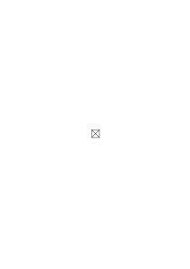 in the mirror one notices that one can do it only if one disregards the visual image altogether and relies solely on muscular feeling ∙ so after all we are dealing here with two quite different acts of will. ∙ One relates to the visual part of the world, the other to the part belonging to muscular feeling.

### [NB](/w-nb/#ms-103-72r.2) [72r\[2\]](https://cdn.wittgensteinnachlass.com/2000px/webp/Ms-103/72r.webp)

Have we more than empirical evidence that in both cases it is a matter of the movement of the same part of the body?

### [NB](/w-nb/#ms-103-72r.3) [72r\[3\]](https://cdn.wittgensteinnachlass.com/2000px/webp/Ms-103/72r.webp)

Is it then that I merely accompany my actions with my will?

### [NB](/w-nb/#ms-103-72r.4+73r.1) [72r\[4\]](https://cdn.wittgensteinnachlass.com/2000px/webp/Ms-103/72r.webp),[73r\[1\]](https://cdn.wittgensteinnachlass.com/2000px/webp/Ms-103/73r.webp)

But how can I then predict – and in a certain sense I can – that I shall raise my arm in 5 minutes? That I shall will this?

### [NB](/w-nb/#ms-103-73r.2) [73r\[2\]](https://cdn.wittgensteinnachlass.com/2000px/webp/Ms-103/73r.webp)

It is clear: It is impossible to will without already performing the act of will.

### [NB](/w-nb/#ms-103-73r.3) [73r\[3\]](https://cdn.wittgensteinnachlass.com/2000px/webp/Ms-103/73r.webp)

The act of will is not the cause of the action but the action itself.

### [NB](/w-nb/#ms-103-73r.4) [73r\[4\]](https://cdn.wittgensteinnachlass.com/2000px/webp/Ms-103/73r.webp)

One cannot will without doing.

### [NB](/w-nb/#ms-103-74r.1) [74r\[1\]](https://cdn.wittgensteinnachlass.com/2000px/webp/Ms-103/74r.webp)

If the will must have an object in the world, that object can also be the intended action.

### [NB](/w-nb/#ms-103-74r.2) [74r\[2\]](https://cdn.wittgensteinnachlass.com/2000px/webp/Ms-103/74r.webp)

And the will must have an object.

### [NB](/w-nb/#ms-103-74r.3) [74r\[3\]](https://cdn.wittgensteinnachlass.com/2000px/webp/Ms-103/74r.webp)

Otherwise we would have nothing to go on and could not know what we wanted.

### [NB](/w-nb/#ms-103-74r.4) [74r\[4\]](https://cdn.wittgensteinnachlass.com/2000px/webp/Ms-103/74r.webp)

And could not want different things.

### [NB](/w-nb/#ms-103-74r.5+75r.1) [74r\[5\]](https://cdn.wittgensteinnachlass.com/2000px/webp/Ms-103/74r.webp),[75r\[1\]](https://cdn.wittgensteinnachlass.com/2000px/webp/Ms-103/75r.webp)

Does not the willed movement of the body occur in just the same way as anything unwilled in the world, except that it is accompanied by the will?

### [NB](/w-nb/#ms-103-75r.2) [75r\[2\]](https://cdn.wittgensteinnachlass.com/2000px/webp/Ms-103/75r.webp)

But it is not merely accompanied by the _wish_! But by the will.

### [NB](/w-nb/#ms-103-75r.3) [75r\[3\]](https://cdn.wittgensteinnachlass.com/2000px/webp/Ms-103/75r.webp)

We feel, so to speak, responsible for the movement.

### [NB](/w-nb/#ms-103-75r.4) [75r\[4\]](https://cdn.wittgensteinnachlass.com/2000px/webp/Ms-103/75r.webp)

My will takes hold at some point in the world, but at other points it does not.

### [NB](/w-nb/#ms-103-75r.5) [75r\[5\]](https://cdn.wittgensteinnachlass.com/2000px/webp/Ms-103/75r.webp)

Wishing is not doing. But willing is doing.

### [NB](/w-nb/#ms-103-75r.6+76r.1) [75r\[6\]](https://cdn.wittgensteinnachlass.com/2000px/webp/Ms-103/75r.webp),[76r\[1\]](https://cdn.wittgensteinnachlass.com/2000px/webp/Ms-103/76r.webp)

(My wish relates, e.g., to the movement of the chair, my will to a muscular feeling.)

### [NB](/w-nb/#ms-103-76r.2) [76r\[2\]](https://cdn.wittgensteinnachlass.com/2000px/webp/Ms-103/76r.webp)

My willing a process consists in my carrying out the process, not in my doing something else that causes it.

### [NB](/w-nb/#ms-103-76r.3) [76r\[3\]](https://cdn.wittgensteinnachlass.com/2000px/webp/Ms-103/76r.webp)

If I move something, I move myself.

### [NB](/w-nb/#ms-103-76r.4) [76r\[4\]](https://cdn.wittgensteinnachlass.com/2000px/webp/Ms-103/76r.webp)

If I carry out a process, I proceed.

### [NB](/w-nb/#ms-103-76r.5) [76r\[5\]](https://cdn.wittgensteinnachlass.com/2000px/webp/Ms-103/76r.webp)

But: I cannot will everything. –

### [NB](/w-nb/#ms-103-77r.1) [77r\[1\]](https://cdn.wittgensteinnachlass.com/2000px/webp/Ms-103/77r.webp)

But what does this mean: “I cannot will _that_.” Can I then try to will something.

### [NB](/w-nb/#ms-103-77r.2) [77r\[2\]](https://cdn.wittgensteinnachlass.com/2000px/webp/Ms-103/77r.webp)

For when I consider willing, it seems as though one part of the world stood closer to me than another (which would be intolerable).

### [NB](/w-nb/#ms-103-77r.3) [77r\[3\]](https://cdn.wittgensteinnachlass.com/2000px/webp/Ms-103/77r.webp)

But of course it is undeniable that, in an everyday sense, there are certain things I do and others I do not do.

### [NB](/w-nb/#ms-103-77r.4+78r.1) [77r\[4\]](https://cdn.wittgensteinnachlass.com/2000px/webp/Ms-103/77r.webp),[78r\[1\]](https://cdn.wittgensteinnachlass.com/2000px/webp/Ms-103/78r.webp)

So the will would not stand in the same relation to every part of the world, which must be impossible.

### [NB](/w-nb/#ms-103-78r.2) [78r\[2\]](https://cdn.wittgensteinnachlass.com/2000px/webp/Ms-103/78r.webp)

The wish precedes the event; the will accompanies it.

### [NB](/w-nb/#ms-103-78r.3) [78r\[3\]](https://cdn.wittgensteinnachlass.com/2000px/webp/Ms-103/78r.webp)

Suppose a process were to accompany my wish. Had I willed the process.

### [NB](/w-nb/#ms-103-78r.4) [78r\[4\]](https://cdn.wittgensteinnachlass.com/2000px/webp/Ms-103/78r.webp)

Would this accompaniment not seem accidental, in contrast to the compelled accompaniment of the will.

### [NB](/w-nb/#ms-103-78r.5+79r.1) [78r\[5\]](https://cdn.wittgensteinnachlass.com/2000px/webp/Ms-103/78r.webp),[79r\[1\]](https://cdn.wittgensteinnachlass.com/2000px/webp/Ms-103/79r.webp)

08.11.1916

Is belief an experience?

Is a thought an experience?

### [NB](/w-nb/#ms-103-79r.2) [79r\[2\]](https://cdn.wittgensteinnachlass.com/2000px/webp/Ms-103/79r.webp)

All experience is world and has no need of the subject.

### [NB](/w-nb/#ms-103-79r.3) [79r\[3\]](https://cdn.wittgensteinnachlass.com/2000px/webp/Ms-103/79r.webp)

The act of will is not an experience.

### [NB](/w-nb/#ms-103-79r.4) [79r\[4\]](https://cdn.wittgensteinnachlass.com/2000px/webp/Ms-103/79r.webp)

19.11.1916

What grounds are there for the assumption of a willing subject?

### [NB](/w-nb/#ms-103-79r.5) [79r\[5\]](https://cdn.wittgensteinnachlass.com/2000px/webp/Ms-103/79r.webp)

Does not _my world_ suffice, once again, for individuation?

### [NB](/w-nb/#ms-103-79r.6+80r.1) [79r\[6\]](https://cdn.wittgensteinnachlass.com/2000px/webp/Ms-103/79r.webp),[80r\[1\]](https://cdn.wittgensteinnachlass.com/2000px/webp/Ms-103/80r.webp)

21.11.1916

That it is possible to set out the general sentential form amounts to no more than this: It must be _possible to foresee_ every possible sentential form.

### [NB](/w-nb/#ms-103-80r.2) [80r\[2\]](https://cdn.wittgensteinnachlass.com/2000px/webp/Ms-103/80r.webp)

And _that_ means: We can never arrive at a sentential form of which we could say: Well, it was impossible to foresee that there is such a thing. For that would mean that we had had a new experience which first made this sentential form possible.

### [NB](/w-nb/#ms-103-80r.3+81r.1) [80r\[3\]](https://cdn.wittgensteinnachlass.com/2000px/webp/Ms-103/80r.webp),[81r\[1\]](https://cdn.wittgensteinnachlass.com/2000px/webp/Ms-103/81r.webp)

So: It must be possible to set out the general sentential form, because the possible sentential forms must be a priori. It is because the possible sentential forms are a priori that the general sentential form exists.

### [NB](/w-nb/#ms-103-81r.2) [81r\[2\]](https://cdn.wittgensteinnachlass.com/2000px/webp/Ms-103/81r.webp)

In this connection it is a matter of complete indifference whether the given basic operations by which all sentences are to be generated lead beyond the logical levels or whether they remain within those levels.

### [NB](/w-nb/#ms-103-81r.3) [81r\[3\]](https://cdn.wittgensteinnachlass.com/2000px/webp/Ms-103/81r.webp)

Any sentence we shall ever be able to form, we could have formed right now as well.

### [NB](/w-nb/#ms-103-81r.4+82r.1) [81r\[4\]](https://cdn.wittgensteinnachlass.com/2000px/webp/Ms-103/81r.webp),[82r\[1\]](https://cdn.wittgensteinnachlass.com/2000px/webp/Ms-103/82r.webp)

What we now need is to clarify the concept of the atomistic function and the concept “and so on”.

### [NB](/w-nb/#ms-103-82r.2) [82r\[2\]](https://cdn.wittgensteinnachlass.com/2000px/webp/Ms-103/82r.webp)

The concept “And so on”, expressed by the sign “‥‥”, is one of the most important of all and, like all the others, infinitely fundamental.

### [NB](/w-nb/#ms-103-82r.3) [82r\[3\]](https://cdn.wittgensteinnachlass.com/2000px/webp/Ms-103/82r.webp)

For it alone entitles us to go “on in this way” building up logic or mathematics from the basic laws and primitive signs.

### [NB](/w-nb/#ms-103-82r.4+83r.1) [82r\[4\]](https://cdn.wittgensteinnachlass.com/2000px/webp/Ms-103/82r.webp),[83r\[1\]](https://cdn.wittgensteinnachlass.com/2000px/webp/Ms-103/83r.webp)

The “And so on” comes in right at the very beginning of the old logic, when it is said that, once the primitive signs have been specified, we can go “on in this way” developing one sign after another.

### [NB](/w-nb/#ms-103-83r.2) [83r\[2\]](https://cdn.wittgensteinnachlass.com/2000px/webp/Ms-103/83r.webp)

Without this concept we would simply stop at the primitive signs and could not go “_on_”.

### [NB](/w-nb/#ms-103-83r.3) [83r\[3\]](https://cdn.wittgensteinnachlass.com/2000px/webp/Ms-103/83r.webp)

The concept “and so on” is equivalent to the concept of an operation.

### [NB](/w-nb/#ms-103-83r.4+84r.1) [83r\[4\]](https://cdn.wittgensteinnachlass.com/2000px/webp/Ms-103/83r.webp),[84r\[1\]](https://cdn.wittgensteinnachlass.com/2000px/webp/Ms-103/84r.webp)

The sign “‥‥” follows the operation sign and means that the result of the operation can in turn be taken as the basis of the same operation; “and so on”.

### [NB](/w-nb/#ms-103-84r.2) [84r\[2\]](https://cdn.wittgensteinnachlass.com/2000px/webp/Ms-103/84r.webp)

22.11.1916

In its most general sense, the concept of an operation is the concept according to which signs can be formed in accordance with a rule.

### [NB](/w-nb/#ms-103-84r.3) [84r\[3\]](https://cdn.wittgensteinnachlass.com/2000px/webp/Ms-103/84r.webp)

23.11.1916

What does the possibility of an operation rest on.

### [NB](/w-nb/#ms-103-84r.4) [84r\[4\]](https://cdn.wittgensteinnachlass.com/2000px/webp/Ms-103/84r.webp)

On the general concept of structural similarity.

### [NB](/w-nb/#ms-103-85r.1) [85r\[1\]](https://cdn.wittgensteinnachlass.com/2000px/webp/Ms-103/85r.webp)

For example, as I conceive of elementary propositions, they must have something in common; otherwise I could not speak of them all collectively as “the elementary propositions” at all.

### [NB](/w-nb/#ms-103-85r.2) [85r\[2\]](https://cdn.wittgensteinnachlass.com/2000px/webp/Ms-103/85r.webp)

But then it must also be possible to develop them from one another as results of operations.

### [NB](/w-nb/#ms-103-85r.3+86r.1) [85r\[3\]](https://cdn.wittgensteinnachlass.com/2000px/webp/Ms-103/85r.webp),[86r\[1\]](https://cdn.wittgensteinnachlass.com/2000px/webp/Ms-103/86r.webp)

For if two elementary propositions really have something in common that an elementary proposition and a compound one do not have in common, then it must be possible somehow to express in general terms what they have in common.

### [NB](/w-nb/#ms-103-86r.2) [86r\[2\]](https://cdn.wittgensteinnachlass.com/2000px/webp/Ms-103/86r.webp)

24.11.1916

When the general characteristic of an operation is known, it will also be clear what elementary constituents an _operation_ always consists of.

### [NB](/w-nb/#ms-103-86r.3) [86r\[3\]](https://cdn.wittgensteinnachlass.com/2000px/webp/Ms-103/86r.webp)

When the general form of the operation has been found, we shall also have the general form of the occurrence of the concept “And so on”.

### [NB](/w-nb/#ms-103-87r.1) [87r\[1\]](https://cdn.wittgensteinnachlass.com/2000px/webp/Ms-103/87r.webp)

26.11.1916

All operations are composed of the basic operations.

### [NB](/w-nb/#ms-103-87r.2) [87r\[2\]](https://cdn.wittgensteinnachlass.com/2000px/webp/Ms-103/87r.webp)

27.11.1916

28.11.1916 Either a fact is contained in another fact, or it is independent of it.

### [NB](/w-nb/#ms-103-87r.3) [87r\[3\]](https://cdn.wittgensteinnachlass.com/2000px/webp/Ms-103/87r.webp)

02.12.1916

The similarity between the designation of generality and the argument is apparent when we write (ax).φx instead of φa.

### [NB](/w-nb/#ms-103-87r.4+88r.1) [87r\[4\]](https://cdn.wittgensteinnachlass.com/2000px/webp/Ms-103/87r.webp),[88r\[1\]](https://cdn.wittgensteinnachlass.com/2000px/webp/Ms-103/88r.webp)

One could also introduce the arguments in such a way that they occur only on one side of the equality sign. Thus always on the model of “(Ex) ∙ φx ∙ x = a” instead of “φa”.

### [NB](/w-nb/#ms-103-88r.2) [88r\[2\]](https://cdn.wittgensteinnachlass.com/2000px/webp/Ms-103/88r.webp)

The right method in philosophy would really be this: to say nothing except what can be said, that is, things belonging to natural science, that is, something that has nothing to do with philosophy, and then, whenever someone else wanted to say something metaphysical, to show them that they had given no meaning to certain signs in their sentences.

### [NB](/w-nb/#ms-103-88r.3+89r.1) [88r\[3\]](https://cdn.wittgensteinnachlass.com/2000px/webp/Ms-103/88r.webp),[89r\[1\]](https://cdn.wittgensteinnachlass.com/2000px/webp/Ms-103/89r.webp)

This method would be unsatisfying to the other person (they would not feel that we were teaching them philosophy) but it would be the only correct one.

### [NB](/w-nb/#ms-103-89r.2) [89r\[2\]](https://cdn.wittgensteinnachlass.com/2000px/webp/Ms-103/89r.webp)

07.01.1917

In the sense in which there is a hierarchy of propositions, there is, of course, also a hierarchy of truths and of negations etc..

### [NB](/w-nb/#ms-103-89r.3) [89r\[3\]](https://cdn.wittgensteinnachlass.com/2000px/webp/Ms-103/89r.webp)

But in the sense in which there are propositions in the most general sense, there is only one truth and one negation.

### [NB](/w-nb/#ms-103-90r.1) [90r\[1\]](https://cdn.wittgensteinnachlass.com/2000px/webp/Ms-103/90r.webp)

This sense is obtained from the former by conceiving of the proposition in general as the result of the _one_ operation that generates all propositions from the lowest level. etc.

### [NB](/w-nb/#ms-103-90r.2) [90r\[2\]](https://cdn.wittgensteinnachlass.com/2000px/webp/Ms-103/90r.webp)

The lowest level and the operation can stand for the entire hierarchy.

### [NB](/w-nb/#ms-103-90r.3) [90r\[3\]](https://cdn.wittgensteinnachlass.com/2000px/webp/Ms-103/90r.webp)

08.01.1917

It is clear that the logical product of two elementary propositions can never be a tautology.

### [NB](/w-nb/#ms-103-91r.1) [91r\[1\]](https://cdn.wittgensteinnachlass.com/2000px/webp/Ms-103/91r.webp)

If the logical product of two propositions is a contradiction and the propositions appear to be elementary propositions. Then one sees that in this case appearances are deceptive. (E.g.: A is red and A is green.)

### [NB](/w-nb/#ms-103-91r.2) [91r\[2\]](https://cdn.wittgensteinnachlass.com/2000px/webp/Ms-103/91r.webp)

10.01.1917

If suicide is permitted, then everything is permitted.

### [NB](/w-nb/#ms-103-91r.3) [91r\[3\]](https://cdn.wittgensteinnachlass.com/2000px/webp/Ms-103/91r.webp)

If something is not permitted, then suicide is not permitted.

### [NB](/w-nb/#ms-103-92r.1) [92r\[1\]](https://cdn.wittgensteinnachlass.com/2000px/webp/Ms-103/92r.webp)

This throws light on the nature of ethics. For suicide is, so to speak, the elementary sin.

### [NB](/w-nb/#ms-103-92r.2) [92r\[2\]](https://cdn.wittgensteinnachlass.com/2000px/webp/Ms-103/92r.webp)

And if one examines it, it is as if one were examining mercury vapour in order to grasp the nature of vapours.

### [NB](/w-nb/#ms-103-92r.3) [92r\[3\]](https://cdn.wittgensteinnachlass.com/2000px/webp/Ms-103/92r.webp)

Or is not suicide too in itself neither good nor evil!
