# Ms-105

4 published remarks, VB

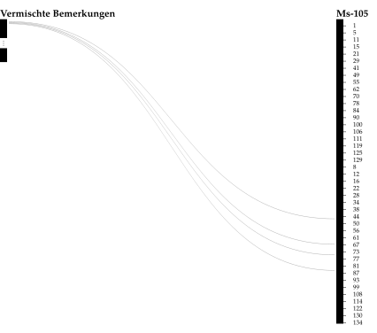

### [Ir\[1\]](https://cdn.wittgensteinnachlass.com/2000px/webp/Ms-105/Ir.webp)

## Volume I. Philosophical Remarks

### [2\[1\]](https://cdn.wittgensteinnachlass.com/2000px/webp/Ms-105/2.webp)

02.02.1929

Back in Cambridge. Very strange. Sometimes it seems to me as if time had gone backwards. I make these entries hesitantly. I don’t know what still awaits me. Something will come of it! If the spirit does not desert me. At present I am oscillating very restlessly, but I do not know about what position of equilibrium. My time here was meant, or is meant, really to be a preparation for something. I am to get clear about something.

### [2\[2\]](https://cdn.wittgensteinnachlass.com/2000px/webp/Ms-105/2.webp)

04.02.1929

My brain is not in a favourable state. Its chief characteristic has always been a lack of breadth & a fairly great intensity. Now the intensity is diminishing and nothing else makes up for it. I don’t write everything down; it seems wrong to go on at length about it all if I cannot or will not improve it.

Everything I now write down in philosophy is more or less insipid stuff. But I think it possible that it will get better.

### [4\[1\]](https://cdn.wittgensteinnachlass.com/2000px/webp/Ms-105/4.webp)

07.02.1929

I am a strange mixture of coldness & heat, incomprehensible to myself.

Is it that I am cold inside & merely long for warmth? No. Is it that I am hot only in a sensual way?

### [4\[2\]](https://cdn.wittgensteinnachlass.com/2000px/webp/Ms-105/4.webp)

15.02.1929

I have very enjoyable discussions with Ramsey about logic etc. They have something of a vigorous sport about them & are conducted, I believe, in a good spirit. There is something erotic & chivalrous in them. In the process I am also being taught a certain courage in thinking. Hardly anything more pleasant can happen to me than for someone, as it were, to take my thoughts out of my mouth & unroll them, as it were, in the open air. Of course all this is mixed with a great deal of vanity, but it is not pure vanity.

### [4\[3\]](https://cdn.wittgensteinnachlass.com/2000px/webp/Ms-105/4.webp)

In science I like to go for walks only on my own.

### [1\[1\]](https://cdn.wittgensteinnachlass.com/2000px/webp/Ms-105/1.webp)

02.02.1929

Is a space conceivable that contains all the rational points but none of the irrational ones?

And that just means: are the irrational numbers not already predetermined by the rational ones?

### [1\[2\]](https://cdn.wittgensteinnachlass.com/2000px/webp/Ms-105/1.webp)

04.02.1929

If I can map space in rational numbers, then I can also map it in irrational numbers. And if the one mapping is given, then the other kind of mapping is already given with it.

### [1\[3\]](https://cdn.wittgensteinnachlass.com/2000px/webp/Ms-105/1.webp)

Now the question is: is there a privileged kind of mapping, say, a particularly direct one? I think not!

### [1\[4\]](https://cdn.wittgensteinnachlass.com/2000px/webp/Ms-105/1.webp)

Every kind of mapping has an equal claim.

### [1\[5\]](https://cdn.wittgensteinnachlass.com/2000px/webp/Ms-105/1.webp)

But how is a decision as to what kind of continuity visual space has to be conceived?

### [3\[1\]](https://cdn.wittgensteinnachlass.com/2000px/webp/Ms-105/3.webp)

There seems to be much to suggest that the mapping of visual space by physics really is the simplest. That is, that physics would be the true phenomenology.

But there is an objection to this: physics aims at truth, that is, at correct predictions of events, whereas phenomenology does not do _that_; it aims at _sense_, not at _truth_.

### [3\[2\]](https://cdn.wittgensteinnachlass.com/2000px/webp/Ms-105/3.webp)

But one can say: physics has a language & in this language it utters sentences. These sentences can be true or false. These sentences constitute physics & their grammar constitutes phenomenology (or whatever one wants to call it).

### [3\[3\]](https://cdn.wittgensteinnachlass.com/2000px/webp/Ms-105/3.webp),[5\[1\]](https://cdn.wittgensteinnachlass.com/2000px/webp/Ms-105/5.webp)

But in fact the matter looks more difficult because of the use of mathematical terminology. If, for example, science is in doubt as to whether the observed phenomena can be correctly described by electron theory or by quantum theory, at first sight it seems as though what is at issue is a decision in grammar.

### [5\[2\]](https://cdn.wittgensteinnachlass.com/2000px/webp/Ms-105/5.webp)

There is a certain multiplicity of sense & a _different_ multiplicity of _laws_.

### [5\[3\]](https://cdn.wittgensteinnachlass.com/2000px/webp/Ms-105/5.webp)

Physics differs from phenomenology in that it seeks to establish laws. Phenomenology only establishes the possibilities.

### [5\[4\]](https://cdn.wittgensteinnachlass.com/2000px/webp/Ms-105/5.webp)

So phenomenology would be the grammar of the description of those facts on which physics builds its theories.

### [5\[5\]](https://cdn.wittgensteinnachlass.com/2000px/webp/Ms-105/5.webp)

To explain is more than to describe. But every explanation contains a description.

### [5\[6\]](https://cdn.wittgensteinnachlass.com/2000px/webp/Ms-105/5.webp)

05.02.1929

Can one describe the visual field, or a part of the visual field, at all?

### [5\[7\]](https://cdn.wittgensteinnachlass.com/2000px/webp/Ms-105/5.webp),[7\[1\]](https://cdn.wittgensteinnachlass.com/2000px/webp/Ms-105/7.webp)

One can certainly say: if you look into this tube you will see three luminous points at equal distances from one another. Surely that is the description of a visual image.

### [7\[2\]](https://cdn.wittgensteinnachlass.com/2000px/webp/Ms-105/7.webp)

Somehow it seems to me as though every uniformly coloured patch in the visual field were simple & as though its being composed of smaller parts were only apparent.

### [7\[3\]](https://cdn.wittgensteinnachlass.com/2000px/webp/Ms-105/7.webp)

One might think that visual space is composed of minima visibilia, say, of nothing but little squares that one sees as indivisible patches. But then the choice of these parts is evidently arbitrary. For example, I could not say how the square grid is to be laid over a particular picture, for if one shifts the grid by less than the width of one square, the minima visibilia are in quite different places, yet the picture looks exactly the same.

### [7\[4\]](https://cdn.wittgensteinnachlass.com/2000px/webp/Ms-105/7.webp),[9\[1\]](https://cdn.wittgensteinnachlass.com/2000px/webp/Ms-105/9.webp)

It seems as though one cannot see a uniformly coloured patch as composite unless one imagines it as _not_ uniformly coloured. Imagining a dividing line makes the patch multicoloured, for the dividing line must be a different colour from the rest of the patch.

### [9\[2\]](https://cdn.wittgensteinnachlass.com/2000px/webp/Ms-105/9.webp)

That would mean: the simple constituents of the visual field are uniformly coloured patches. But what then of continuous transitions of colour?

### [9\[3\]](https://cdn.wittgensteinnachlass.com/2000px/webp/Ms-105/9.webp)

How can one describe the shape of a patch in the visual field?

### [9\[4\]](https://cdn.wittgensteinnachlass.com/2000px/webp/Ms-105/9.webp)

Can one do coordinate geometry in the visual field?

### [9\[5\]](https://cdn.wittgensteinnachlass.com/2000px/webp/Ms-105/9.webp)

06.02.1929

Can one say that the smaller patch is simpler than the larger one? Suppose they are uniformly coloured circles: what is the greater simplicity of the smaller circle supposed to consist in?

### [9\[6\]](https://cdn.wittgensteinnachlass.com/2000px/webp/Ms-105/9.webp),[11\[1\]](https://cdn.wittgensteinnachlass.com/2000px/webp/Ms-105/11.webp)

One might say that the larger can consist of the smaller & one further part, but not vice versa. But why should I not represent the smaller as the difference between the larger & the ring.

### [11\[2\]](https://cdn.wittgensteinnachlass.com/2000px/webp/Ms-105/11.webp)

So it seems to me: the smaller patch is no simpler than the larger one.

### [11\[3\]](https://cdn.wittgensteinnachlass.com/2000px/webp/Ms-105/11.webp)

What is the general form of spatial statements?

### [11\[4\]](https://cdn.wittgensteinnachlass.com/2000px/webp/Ms-105/11.webp)

It seems to me a peculiar property of spatial statements that apparently one cannot describe space without some allusion to time. I can say, for example: “I now see a red circle on a blue background”. That is a sentence. But I cannot say “a red circle is on a blue background”.

### [11\[5\]](https://cdn.wittgensteinnachlass.com/2000px/webp/Ms-105/11.webp)

It is actually probable from the outset that time cannot enter into the consideration of visual space as an afterthought, as a mere adjunct.

### [11\[6\]](https://cdn.wittgensteinnachlass.com/2000px/webp/Ms-105/11.webp),[13\[1\]](https://cdn.wittgensteinnachlass.com/2000px/webp/Ms-105/13.webp)

It is very odd, after all, that one is repeatedly tempted to speak of a complex in the visual field, a patch, as an object.

### [13\[2\]](https://cdn.wittgensteinnachlass.com/2000px/webp/Ms-105/13.webp)

In a certain sense it must not be possible to describe an object.

### [13\[3\]](https://cdn.wittgensteinnachlass.com/2000px/webp/Ms-105/13.webp)

That is, the description must not ascribe to it any properties whose absence would nullify the very existence of the object. That is, the description must not state anything that would be essential to the object’s existence.

### [13\[4\]](https://cdn.wittgensteinnachlass.com/2000px/webp/Ms-105/13.webp),[15\[1\]](https://cdn.wittgensteinnachlass.com/2000px/webp/Ms-105/15.webp)

“The murder … is occupying the court” is a sentence in which an event is evidently only apparently designated by a name. This is not, perhaps, a case of Russell’s “Descriptions” but a case in which the talk is apparently of a complex object which, on correct analysis, is represented by a sentence (the description of the complex). If the murder did not take place at all, the first sentence still has sense. There is, admittedly, a certain analogy with Russell’s descriptions. Only here the complex is described, as it were, from within – by a sentence.

### [15\[2\]](https://cdn.wittgensteinnachlass.com/2000px/webp/Ms-105/15.webp)

It might be useful first to think about the representation of _any_ space before going on to visual space.

### [15\[3\]](https://cdn.wittgensteinnachlass.com/2000px/webp/Ms-105/15.webp)

The question then is something like this: how must one interpret a system of axioms correctly so that it becomes the representation of a variable?

### [15\[4\]](https://cdn.wittgensteinnachlass.com/2000px/webp/Ms-105/15.webp)

Is it the case that the “axioms” are tautologies in a certain structure & that this structure is determined precisely by certain sentences becoming tautologies in it?

### [15\[5\]](https://cdn.wittgensteinnachlass.com/2000px/webp/Ms-105/15.webp),[17\[1\]](https://cdn.wittgensteinnachlass.com/2000px/webp/Ms-105/17.webp)

One could certainly replace the logic of tautologies with a logic of equations. That is, one would get from one sentence to the next by _substitutions_. And the rules according to which these substitutions may be carried out would be laid down in equations.

### [17\[2\]](https://cdn.wittgensteinnachlass.com/2000px/webp/Ms-105/17.webp)

All equations – not just the definitions – are rules for signs. One can get from some of these rules for signs to the others. One can give some & derive the others from them.

### [17\[3\]](https://cdn.wittgensteinnachlass.com/2000px/webp/Ms-105/17.webp)

Is such a derivation a procedure of inference? Why should one not call it that?

### [17\[4\]](https://cdn.wittgensteinnachlass.com/2000px/webp/Ms-105/17.webp),[19\[1\]](https://cdn.wittgensteinnachlass.com/2000px/webp/Ms-105/19.webp)

What about inequalities? Evidently they too are rules for signs. Can one replace rules for signs with _sentences_ – which are about the signs? If so, it is clear that I can apply the whole of logic to rules for signs, and thus in a transferred sense to equations.

### [19\[2\]](https://cdn.wittgensteinnachlass.com/2000px/webp/Ms-105/19.webp)

I am apparently being thrown back on arithmetic, against my will.

### [19\[3\]](https://cdn.wittgensteinnachlass.com/2000px/webp/Ms-105/19.webp)

Number is a kind of representation. If I say: there are 4 books on the table, I could express the same thing without the aid of the number 4, say, with the aid of a _different_ number. The 4 comes into my representation because I give that representation in the form of a sentence about a, b, c, d.

### [19\[4\]](https://cdn.wittgensteinnachlass.com/2000px/webp/Ms-105/19.webp)

A sentence is about 4 things if it is about a, b, c, d.

### [19\[5\]](https://cdn.wittgensteinnachlass.com/2000px/webp/Ms-105/19.webp)

What is characteristic is that what one counts is designated by nouns.

### [19\[6\]](https://cdn.wittgensteinnachlass.com/2000px/webp/Ms-105/19.webp)

So one would have to give a general justification for the use of nouns in language.

### [19\[7\]](https://cdn.wittgensteinnachlass.com/2000px/webp/Ms-105/19.webp),[21\[1\]](https://cdn.wittgensteinnachlass.com/2000px/webp/Ms-105/21.webp)

Can this be done by introducing nouns as signs for complexes? Incidentally: if I say that the pair of lovers are going for a walk, I say something about each of the two parts & also that they stand in a certain relation to each other. Say

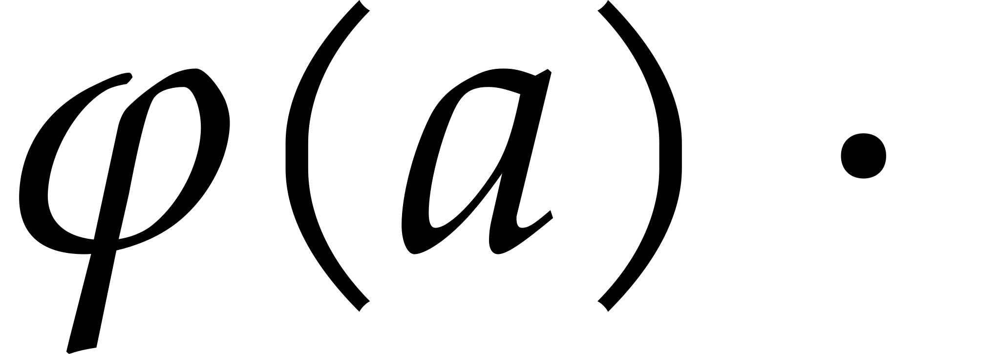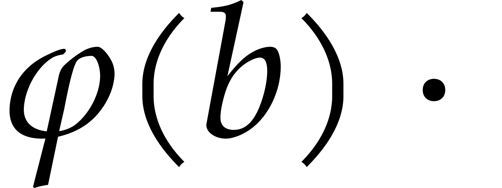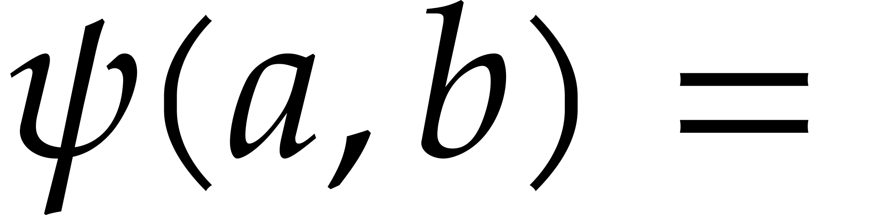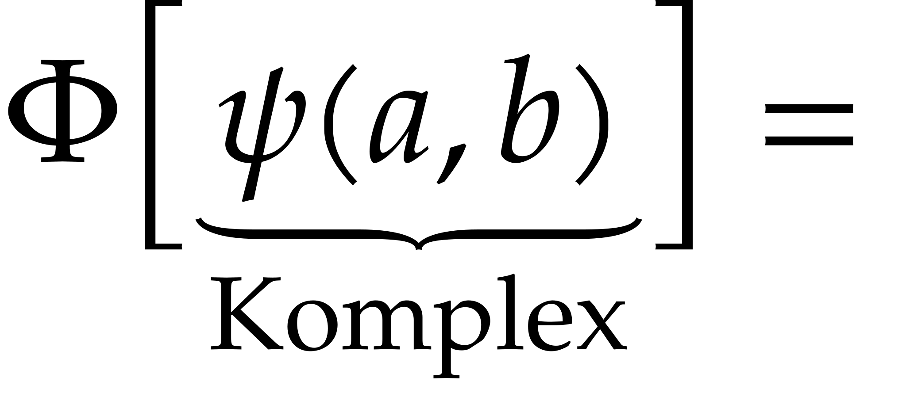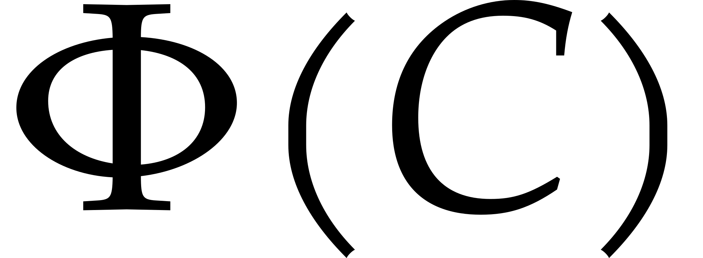.

Here C would be a noun.

### [21\[2\]](https://cdn.wittgensteinnachlass.com/2000px/webp/Ms-105/21.webp)

If I represent a fact by a sentence of the form φ(A,B), we could say that the representation contains a duality, and so on.

### [21\[3\]](https://cdn.wittgensteinnachlass.com/2000px/webp/Ms-105/21.webp),[23\[1\]](https://cdn.wittgensteinnachlass.com/2000px/webp/Ms-105/23.webp)

How does this theory stand in relation to that of Frege & Russell? The first difference is that in Frege’s theory a one-to-one relation is _constructed_; that is impermissible & presupposes a mistaken conception of identity. Secondly, _one_ class with a definite number of members is constructed & that is impermissible for the same reason. In my theory this basic class would be the class of nouns in a particular context (namely, in extenso).

### [23\[2\]](https://cdn.wittgensteinnachlass.com/2000px/webp/Ms-105/23.webp)

On the other hand, it seems as though one could formulate my theory in such a way that, as Frege puts it, a specification of number is a statement about a concept.

### [23\[3\]](https://cdn.wittgensteinnachlass.com/2000px/webp/Ms-105/23.webp),[25\[1\]](https://cdn.wittgensteinnachlass.com/2000px/webp/Ms-105/25.webp)

I once said that there was no extensional infinity. Ramsey says in reply: can one not imagine that someone lives for ever, that is, simply never dies, and is that not extensional infinity? Surely I can imagine a wheel turning and _never_ stopping. Here there is a curious difficulty: it seems to me nonsensical to say that there are infinitely many bodies in a space, as though this were something contingent. On the other hand, I can indeed conceive _intensionally_ of an _infinite law_ (or an _infinite rule_) by which something new is always produced – ad infinitum – but of course only what a rule can produce, namely constructions. And now it seems that the infinitely many revolutions of a wheel can be constructions, whereas I cannot construct new objects. [There will be something true & something false in that.]

### [25\[2\]](https://cdn.wittgensteinnachlass.com/2000px/webp/Ms-105/25.webp)

Suppose we walk out into Euclidean space along a straight line & say that every 10 m we encounter an iron sphere of a certain diameter, ad inf.; is that a construction? So it seems. The curious thing is that one can take such an infinite complex of spheres as the endless recurrence of the same sphere according to a certain law. But the moment one thinks of the spheres as individually distinct, their infinite number seems to become nonsense.

### [25\[3\]](https://cdn.wittgensteinnachlass.com/2000px/webp/Ms-105/25.webp)

I have the feeling that the merely negative description of _not coming to an end_ cannot yield a positive infinity.

### [25\[4\]](https://cdn.wittgensteinnachlass.com/2000px/webp/Ms-105/25.webp),[27\[1\]](https://cdn.wittgensteinnachlass.com/2000px/webp/Ms-105/27.webp)

This negative characteristic presumably suffices for intensional infinity. Here it means only that an operation _by its very nature_ can be applied to its own result.

### [27\[2\]](https://cdn.wittgensteinnachlass.com/2000px/webp/Ms-105/27.webp)

If two objects have all their properties in common, how can they have different names? For their having names is itself a property in this sense!

### [27\[3\]](https://cdn.wittgensteinnachlass.com/2000px/webp/Ms-105/27.webp),[29\[1\]](https://cdn.wittgensteinnachlass.com/2000px/webp/Ms-105/29.webp)

But I can, after all, be uncertain about the properties of the objects. So I can doubt whether two objects have all their properties in common or not. How does one go on? I would perhaps first give them different names …? No, because if I can so much as give them different names, then they have eo ipso different properties. But that would mean that I cannot say of two objects that they have only the same properties, for that sentence would contradict itself. And yet that cannot be right. In any case, it would follow that the object a is also called “b” & the object b also “a”.

### [29\[2\]](https://cdn.wittgensteinnachlass.com/2000px/webp/Ms-105/29.webp)

Suppose my visual image consists of two red circles of equal size on a blue background: what is present here twice & what once? And what does this question mean at all?

### [29\[3\]](https://cdn.wittgensteinnachlass.com/2000px/webp/Ms-105/29.webp)

One might say that we have _one_ colour here, _one_ shape but _two_ locations. But can one speak of locations without thinking of them as occupied, that is, can one speak of them as mere possibilities? An apparent way out would of course be to say that red, circular, are properties (external) of two objects that one might call patches & that these patches also stand in certain spatial relations to each other; but that is nonsense.

### [29\[4\]](https://cdn.wittgensteinnachlass.com/2000px/webp/Ms-105/29.webp),[31\[1\]](https://cdn.wittgensteinnachlass.com/2000px/webp/Ms-105/31.webp)

It is evidently possible to establish the identity of a place in the visual field, for otherwise one could not tell whether a patch stays in the same place throughout or changes its place.

If we imagine a patch that disappears & reappears, we can still say whether it reappears in the same place or in another.

(_Physiologically_ one could explain this by saying that the individual points of the retina have local marks.) So one really can speak of certain places in the visual field, & with the same right as one speaks of different places on the retina. Would such a space be comparable to a surface whose curvature differed at each of its points, so that each point is a distinguished point?

### [31\[2\]](https://cdn.wittgensteinnachlass.com/2000px/webp/Ms-105/31.webp),[33\[1\]](https://cdn.wittgensteinnachlass.com/2000px/webp/Ms-105/33.webp)

One can also say that visual space is an oriented space, a space in which there is an up & a down, and a right & a left. And _this_ up & down, & right & left, has nothing to do with gravity or with the right & left hands. It would, for example, retain its sense even if we spent our whole lives looking at the stars through a telescope.

### [33\[2\]](https://cdn.wittgensteinnachlass.com/2000px/webp/Ms-105/33.webp)

Suppose we were to look at the starry sky through a telescope. Then our visual field would be completely dark except for a lighter circle & in this circle there would be points of light. Suppose further that we had never seen our body but had always seen only this image, so that we could not compare the position of a star with that of our head or feet. What then shows me that my space has an up & a down etc., or simply that it is oriented? At any rate I can perceive that the whole array of stars _rotates_ within the bright circle & that means I can perceive different orientations of the array of stars. If I hold a book upside down, I cannot read the letters, or can do so only with difficulty.

### [33\[3\]](https://cdn.wittgensteinnachlass.com/2000px/webp/Ms-105/33.webp),[35\[1\]](https://cdn.wittgensteinnachlass.com/2000px/webp/Ms-105/35.webp)

This state of affairs is not _explained_, as one might think, by saying: the retina does after all have an up & a down, a right & a left, & so it is easy to understand that there is something analogous in the visual field. Rather, this is merely a _representation_ of the state of affairs by the roundabout route of the relations in the retina.

### [35\[2\]](https://cdn.wittgensteinnachlass.com/2000px/webp/Ms-105/35.webp)

We can also say that in our visual field it is always as if, along with everything else, we saw an oriented coordinate system by reference to which we can fix every direction. – But this too is not a correct representation, for if we really did see such a pair of coordinate axes (with arrows, say), we would in fact be able to fix not only the orientations of the objects relative to these axes, but also the position of the axes themselves in space, as it were relative to an unseen coordinate system inherent in the nature of this space.

### [35\[3\]](https://cdn.wittgensteinnachlass.com/2000px/webp/Ms-105/35.webp),[37\[1\]](https://cdn.wittgensteinnachlass.com/2000px/webp/Ms-105/37.webp)

What would our visual field have to be like if that were not so? I could of course then see relative positions & changes of position, but not absolute ones. But that means, for example, that it would make no sense to speak of a rotation of the entire visual field.

So far, perhaps, it is still intelligible. But now suppose that in our telescope we saw, say, only one star at a certain distance from the black rim. This star would disappear & reappear at the same distance from the rim. Then we could not know whether it reappeared in the same spot or in another. Or two stars might appear & disappear alternately at the same distance from the rim, and then we could not say whether – or that – they were the same star or different stars.

### [37\[2\]](https://cdn.wittgensteinnachlass.com/2000px/webp/Ms-105/37.webp),[39\[1\]](https://cdn.wittgensteinnachlass.com/2000px/webp/Ms-105/39.webp)

We could also represent it like this: suppose that at some point a pair of oriented coordinate axes had flashed up in our visual field for a few moments & then disappeared again; with a good enough memory we could fix the orientation of any subsequent image by reference to our recollection of those axes. If there were no absolute direction, that would be (logically) impossible.

### [39\[2\]](https://cdn.wittgensteinnachlass.com/2000px/webp/Ms-105/39.webp)

But that means we have the possibility of describing a possible position – that is, a spot – in the visual field without referring to anything that happens to be there. So we can say, for example, that something can be at the top right and so on.

(The analogy with the curved surface would be to say, for example: A patch on an egg can be near the blunt end.)

### [39\[3\]](https://cdn.wittgensteinnachlass.com/2000px/webp/Ms-105/39.webp),[41\[1\]](https://cdn.wittgensteinnachlass.com/2000px/webp/Ms-105/41.webp)

Evidently I can see the sign V now as a v, now as an a, as the sign for greater than or as the sign for less than, even if I see it through a telescope & cannot compare its position with that of my body. Perhaps one will say that I feel the position of my body without seeing it. _But_ position in the space of feeling (as I shall call it for now) has nothing to do with position in visual space; the two are independent of one another, & if there were no absolute direction in visual space, one could not correlate the direction in the space of feeling with such a direction at all.

### [41\[2\]](https://cdn.wittgensteinnachlass.com/2000px/webp/Ms-105/41.webp)

Can I now say, for example: the upper half of my visual field is red.? And what does that mean? Can it say that an object (the upper half) has the property red? One must remember that every part of visual space _must_ have a colour & that every colour _must_ occupy a part of visual space. The forms _colour_ & _visual space_ permeate one another.

### [41\[3\]](https://cdn.wittgensteinnachlass.com/2000px/webp/Ms-105/41.webp)

One could also say that it is only _one_ form. But what are the objects that occur in this form.

### [41\[4\]](https://cdn.wittgensteinnachlass.com/2000px/webp/Ms-105/41.webp)

Are not colour & visual space related to each other as argument & function are? The forms of argument & function must also permeate one another.

### [43\[1\]](https://cdn.wittgensteinnachlass.com/2000px/webp/Ms-105/43.webp),[45\[1\]](https://cdn.wittgensteinnachlass.com/2000px/webp/Ms-105/45.webp)

As for the composition of spatial configurations out of their smaller spatial constituents, it is like this: the larger _geometrical configuration_ is not composed of smaller _geometrical configurations_, any more than one can say that 5 is composed of 3 & 2, or indeed that 2 is composed of 5 & ‒ 3. For here the larger entails the smaller just as the smaller entails the larger. The quadrilateral 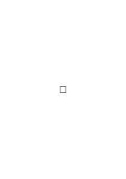 is not composed of the quadrilaterals  & 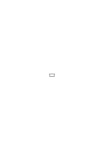. Rather, the first geometrical figure entails the other two and vice versa. So here Nicod would be right in saying that the larger figure does not contain the smaller ones as constituents. But things are different in filled space: the figure 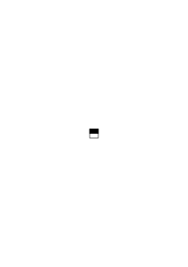 does in fact consist of the constituents  and , although the purely geometrical figure of the large square does _not_ consist of the figures of the two rectangles. These “purely geometrical figures” are after all only logical possibilities. – Now one can in fact see a physical chessboard as a unity – not as composed of its squares – by seeing it as one large quadrilateral & disregarding its squares. – But if one does not disregard its squares, then it is a complex & the squares are its constituents, which _constitute_ it, to use Nicod’s way of speaking.

### [45\[2\]](https://cdn.wittgensteinnachlass.com/2000px/webp/Ms-105/45.webp)

Incidentally, I cannot understand what it is supposed to mean for something to be _determined_ but not _constituted_ by certain objects. If these two expressions have any sense at all, they have the same sense.

### [45\[3\]](https://cdn.wittgensteinnachlass.com/2000px/webp/Ms-105/45.webp)

One can of course apply the above considerations to time as well.

### [45\[4\]](https://cdn.wittgensteinnachlass.com/2000px/webp/Ms-105/45.webp)

An intellect that surveys the constituents & their relations but not the whole is an absurdity. (See Nicod)

### [45\[5\]](https://cdn.wittgensteinnachlass.com/2000px/webp/Ms-105/45.webp),[47\[1\]](https://cdn.wittgensteinnachlass.com/2000px/webp/Ms-105/47.webp),[49\[1\]](https://cdn.wittgensteinnachlass.com/2000px/webp/Ms-105/49.webp)

If each point in visual space is a distinguished point, then it certainly makes sense to speak of here & there in visual space & this now seems to me to make the representation of visual states of affairs simpler. But is this property of distinguished points really essential to visual space? I mean, could we not conceive of a visual space in which one perceived only certain relations of position but no absolute position? That is, could we picture such an experience? In something like the sense in which we can imagine the experiences of someone with one eye –? I do not think so. One could not, for example, perceive a rotation of the whole visual image, or rather _it would not be conceivable_. What, for instance, would the hand of a clock look like as it moved round the dial? (I assume that the dial, as on some large clocks, has only dots and no numerals.)

We would then indeed perceive the movement from one dot to the next – provided it did not happen in _one_ jerk – but once the hand had reached a dot, we could not distinguish its position from the one at the previous dot. I think it turns out that such a thing is unimaginable with our sense of sight.

### [44\[1\]](https://cdn.wittgensteinnachlass.com/2000px/webp/Ms-105/44.webp)

If an electron is flung away by the slightest quantity of light we cast on it in order to see it, so that we do not see it, then all we can say is _that we do not see it_ & a theory that nevertheless insists that it is there – only it cannot be seen – is a very impractical theory.

### [49\[2\]](https://cdn.wittgensteinnachlass.com/2000px/webp/Ms-105/49.webp)

Is the concept of distance not easier to understand now? Let us imagine a field of force, say an iron plate that is constantly heated at one point & conducts heat in all directions, so that a temperature gradient arises in the radial direction. At every point on the surface one could measure the temperature with thermometers. One could then define distance in the temperature geometry of the surface as the difference in temperature between any two thermometers. Our visual space, too, would, after all, be such a field.

### [49\[3\]](https://cdn.wittgensteinnachlass.com/2000px/webp/Ms-105/49.webp)

What, then, does a distance in Euclidean space mean? But here, in contrast to visual space, I am in the domain of rigid yardsticks.

### [49\[4\]](https://cdn.wittgensteinnachlass.com/2000px/webp/Ms-105/49.webp),[51\[1\]](https://cdn.wittgensteinnachlass.com/2000px/webp/Ms-105/51.webp)

Now, to say ‘Red is here’ is to utter a sentence. Here “here” is the designation of a place in the visual field & this designation also designates the shape of the red patch, for this shape follows from the position of the colour red. But how is this position actually to be described?

### [51\[2\]](https://cdn.wittgensteinnachlass.com/2000px/webp/Ms-105/51.webp)

The difference between geometry as the theory of a space & mathematical geometry must be the same as that between the sentence ‘two plums & two plums are four plums’ & the sentence ‘2 + 2 = 4’. But the first of these formations is not a real sentence either, but only an indication of a transition from one _sentence_ to another _sentence_. Hence the apparent sentences of geometry cannot really be sentences either, but are indications of transitions from one sentence about spatial objects to another sentence about spatial objects. Thus I can pass directly from the sentence “A & B lie between C & D” to “A lies either between B & C or between B & D”. The axiom that seems to permit me this transition is a tautology, or there is some other stipulation about its form, without which it could not serve as a criterion for the forms of the two sentences it connects.

### [53\[1\]](https://cdn.wittgensteinnachlass.com/2000px/webp/Ms-105/53.webp)

It is clear that there is no relation of “being situated” between a colour & a place in which it “is situated”! There is no intermediate link between colour & space.

### [53\[2\]](https://cdn.wittgensteinnachlass.com/2000px/webp/Ms-105/53.webp)

Colour & space saturate one another.

### [53\[3\]](https://cdn.wittgensteinnachlass.com/2000px/webp/Ms-105/53.webp)

And the way they permeate one another makes up the visual field.

### [53\[4\]](https://cdn.wittgensteinnachlass.com/2000px/webp/Ms-105/53.webp)

Could one conceive of the axioms of geometry as principles of transition from one sentence to another? Then they would indeed be conceived of as sentences of grammar, needed only so long as one cannot see the internal relation between the members of an inference from the structure of the sentences. They are then of the following kind: One may always pass from a sign that looks such & such a way to another that looks such & such a way. (One finds such rules of transition set out in Frege, for example.)

### [55\[1\]](https://cdn.wittgensteinnachlass.com/2000px/webp/Ms-105/55.webp)

What about the consistency of the axioms?

### [55\[2\]](https://cdn.wittgensteinnachlass.com/2000px/webp/Ms-105/55.webp)

To represent space one needs – so it seems to me – a stretchable sign, as it were. Perhaps a sign that allows interpolation, analogous to the decimal system. The sign must have the multiplicity & properties of space.

### [55\[3\]](https://cdn.wittgensteinnachlass.com/2000px/webp/Ms-105/55.webp)

Is not the decimal system, with its _infinite possibility_ of interpolation, precisely this sign?

### [55\[4\]](https://cdn.wittgensteinnachlass.com/2000px/webp/Ms-105/55.webp),[57\[1\]](https://cdn.wittgensteinnachlass.com/2000px/webp/Ms-105/57.webp)

The rules for the numeral system – the decimal system, say – contain everything that is infinite about numbers. For example, that _these rules_ place no limit on how far the numerals can extend to the right & to the left: _that_ is what expresses the infinity. One might perhaps say: yes, but the numerals are surely limited by the use of paper & writing materials & by other circumstances. Quite so, but that is not expressed in _the **rules**_ for their use, & only in these is their true nature set out.

### [57\[2\]](https://cdn.wittgensteinnachlass.com/2000px/webp/Ms-105/57.webp)

What sort of proposition is “there is a prime number between 5 & 8”? I would say: “that _shows_ itself”. And that is right; but can one not draw attention to this internal state of affairs? One could surely say: “Examine the interval from 10 to 20 for prime numbers! How many are there?” Would that not be a clear task? And what would its solution be? That is, how would its solution be correctly expressed or represented? What does the sentence “There are 4 prime numbers between 10 & 20” mean?

### [57\[3\]](https://cdn.wittgensteinnachlass.com/2000px/webp/Ms-105/57.webp)

This sentence seems to draw our attention to a certain aspect of the matter.

### [57\[4\]](https://cdn.wittgensteinnachlass.com/2000px/webp/Ms-105/57.webp),[59\[1\]](https://cdn.wittgensteinnachlass.com/2000px/webp/Ms-105/59.webp)

Thus, for example, I can write down the number 5 in such a way that one can clearly see that it is divisible only by 1 & by itself: something like this:

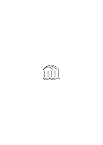

This aspect might say, for instance, “5 is a prime number”; or: “Look, 5 is a prime number!”.

### [59\[2\]](https://cdn.wittgensteinnachlass.com/2000px/webp/Ms-105/59.webp)

That might amount to the same thing as what I said once before, namely, that the mathematical proposition proper is a proof of a so-called mathematical proposition. The mathematical proposition proper is the proof: that is, what shows how things stand. A proof is also rightly called a demonstration.

### [59\[3\]](https://cdn.wittgensteinnachlass.com/2000px/webp/Ms-105/59.webp)

If I ask someone “how many prime numbers are there between 10 & 20?”, he will say: “I don’t know at the moment, but I can find out at any time”. For it is as if it were already written down somewhere; he need only look. And if he now expresses what he sees there in the words “there are 4 prime numbers etc.”, must not the words mirror precisely what he saw?

### [60\[1\]](https://cdn.wittgensteinnachlass.com/2000px/webp/Ms-105/60.webp)

One could also put it like this: the fully analysed mathematical proposition is its own proof. Or again: the mathematical proposition is only the at once visible surface of the whole body of the proof, marking its front boundary. The so-called mathematical proposition is – in contrast to a proposition proper – _essentially_ the last link in a demonstration that shows it to be correct or incorrect.

### [60\[2\]](https://cdn.wittgensteinnachlass.com/2000px/webp/Ms-105/60.webp)

But how is it, then, that to all appearances one can put forward a mathematical proposition & ask “is it right or wrong, then”? In this case what one is asking for is an analysis of the given expression.

### [60\[3\]](https://cdn.wittgensteinnachlass.com/2000px/webp/Ms-105/60.webp),[62\[1\]](https://cdn.wittgensteinnachlass.com/2000px/webp/Ms-105/62.webp)

But there also seem to be propositions of mathematics of which one says that one does not know whether or not they can be proved right or wrong. Such propositions are about “all numbers”, and what is typical of them is that the numbers are considered in them as a collection & not as the result of operations given in advance. It then seems as though the numbers might also have, as it were, accidental properties that do not lie in their essence – in their law of formation – & that one therefore cannot predict either. [Exactly the same problem arises for space]. If, for example, I compare the decimal digits of π & the series of natural numbers & ask whether they will ever agree again after the first term: what is that supposed to mean if one conceives of these series in extenso? Considered _intensionally_, it may mean: “is it in the essence of the two laws that etc.?”

### [62\[2\]](https://cdn.wittgensteinnachlass.com/2000px/webp/Ms-105/62.webp)

How does it show itself that space is not a collection of points but the realization of a law?

### [62\[3\]](https://cdn.wittgensteinnachlass.com/2000px/webp/Ms-105/62.webp),[64\[1\]](https://cdn.wittgensteinnachlass.com/2000px/webp/Ms-105/64.webp)

It seems to me that the concept of distance is given directly in the structure of visual space. If that is not so & the concept of distance is associated with visual space only through a correlation of the distance-free visual space with another structure that contains distances, then it is conceivable that a change in this association would make, for example, the segment a

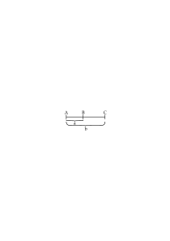

appear longer than the segment b, although we would still see the point B between A & B.

### [64\[2\]](https://cdn.wittgensteinnachlass.com/2000px/webp/Ms-105/64.webp)

Although points are not given to us in visual space, we could nevertheless – and perhaps this is the right thing to do – regard surfaces as fabrics of points, as it were. That is, the point occurs in the sign as a dependent constituent which nevertheless characterizes the structure of the sign.

### [64\[3\]](https://cdn.wittgensteinnachlass.com/2000px/webp/Ms-105/64.webp)

It seems to me as though one must first build up the whole structure of space without sentences; and then one can form all the correct sentences within it.

### [66\[1\]](https://cdn.wittgensteinnachlass.com/2000px/webp/Ms-105/66.webp)

One is sure to get the right multiplicity of designations if one uses analytical geometry.

### [66\[2\]](https://cdn.wittgensteinnachlass.com/2000px/webp/Ms-105/66.webp),[68\[1\]](https://cdn.wittgensteinnachlass.com/2000px/webp/Ms-105/68.webp)

If y = fx is the equation of some closed curve and y has two values for each value of x, then I write an arbitrary number in the interval between two values of y – namely 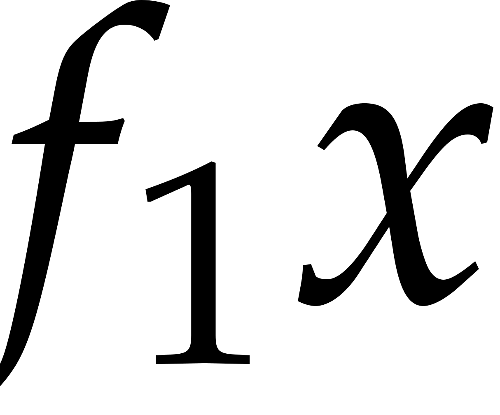 &  – like this: “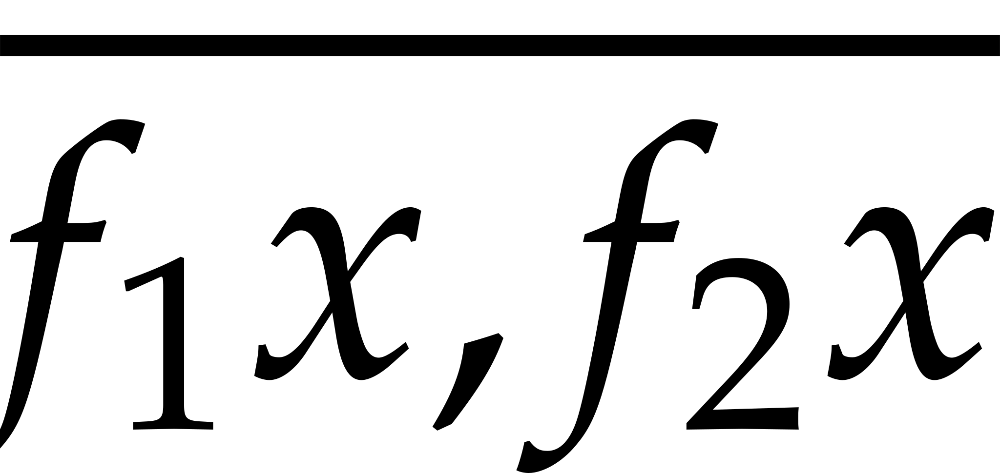”. This sign is a variable. By analogy I can also write “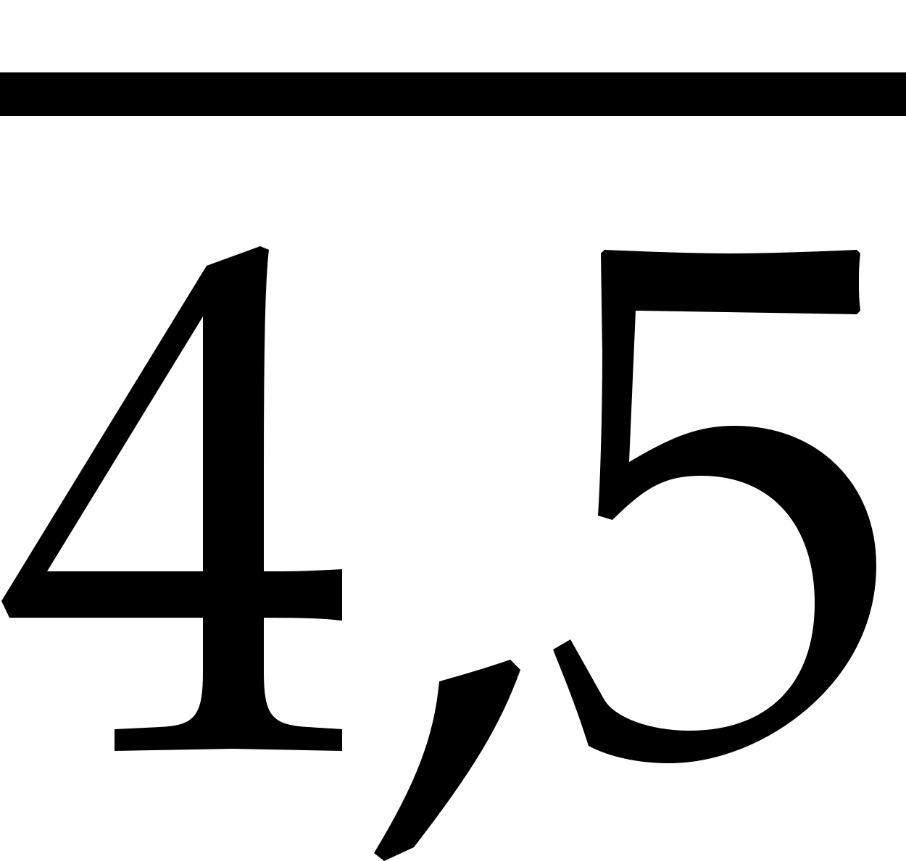”, i.e. the variable number between 4 & 5. “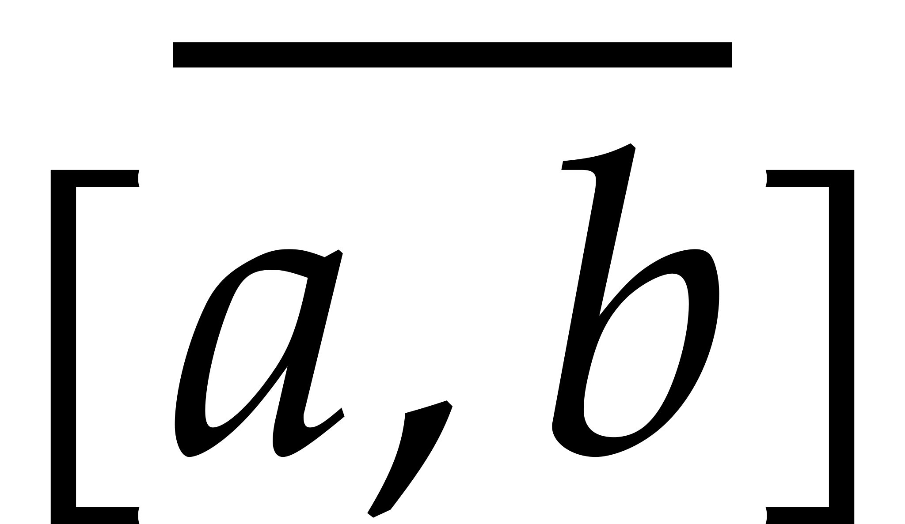” is then to designate the class of all values of the variable 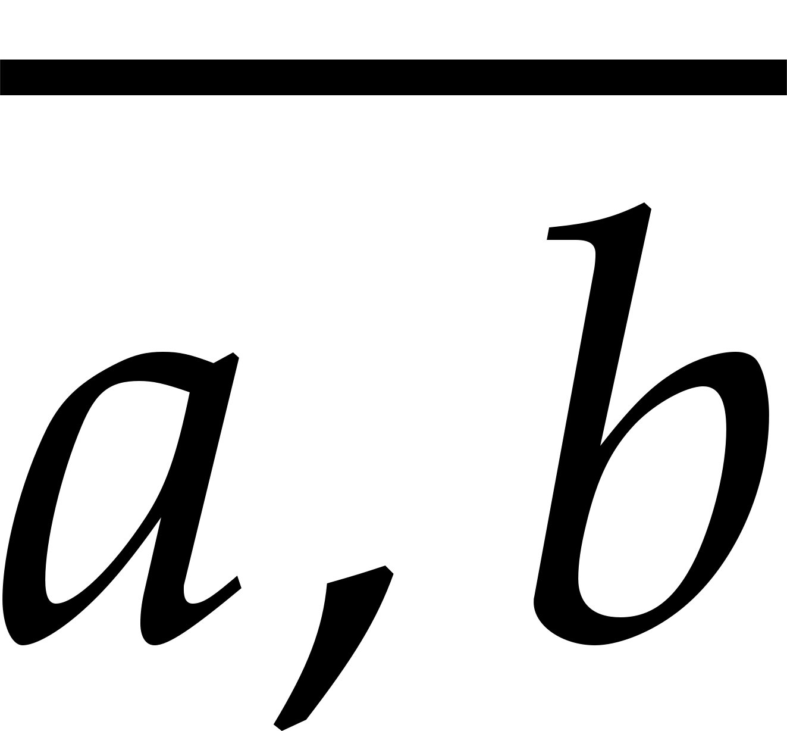, that is, the interval between a & b. This interval is not a class in Russell’s sense, for it is not given by a function & membership of the interval is not determined by whether a certain proposition is true or false. Rather, one can tell whether something is a member of the interval from the _sign_ for that thing. In a certain sense, then, the interval really is a “class in extenso”, that is, not an intension passing itself off as an extension. I could also call the interval an internal class because membership of the interval is determined by internal properties.

### [68\[2\]](https://cdn.wittgensteinnachlass.com/2000px/webp/Ms-105/68.webp)

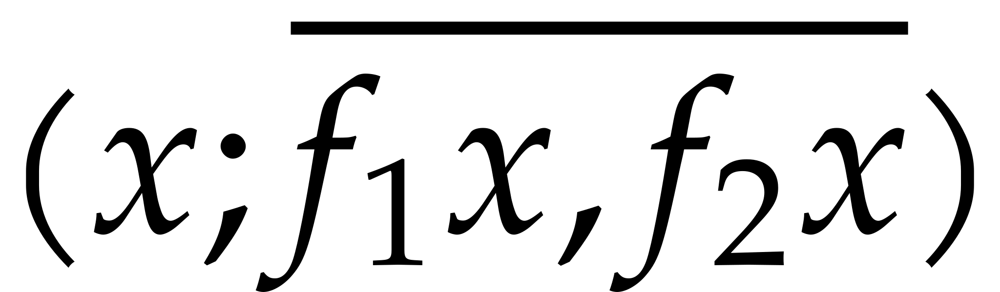 is then to be a pair of numbers, one of which is x and the other one of the numbers in the interval .

### [68\[3\]](https://cdn.wittgensteinnachlass.com/2000px/webp/Ms-105/68.webp)

This variable pair of numbers corresponds to what one calls a point on the surface.

### [68\[4\]](https://cdn.wittgensteinnachlass.com/2000px/webp/Ms-105/68.webp),[70\[1\]](https://cdn.wittgensteinnachlass.com/2000px/webp/Ms-105/70.webp)

To such a pair of numbers I assign a function of x & ; that would correspond to stating that each point of the patch is to have a colour that depends on the position of the point in the patch. _But_ this assignment is not yet a sentence, for a point cannot have a colour at all. Rather, this assignment is only preparation for a sentence. The sentence comes into being only when I extend this assignment over the patch.

In place of the patch stands the expression “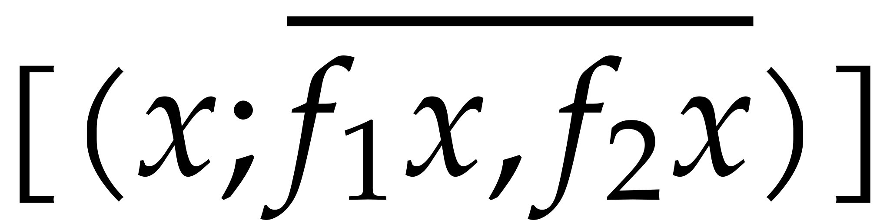”; this again is an internal class, like the interval.

### [70\[2\]](https://cdn.wittgensteinnachlass.com/2000px/webp/Ms-105/70.webp)

“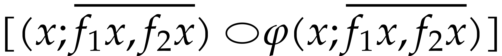” is what actually constitutes the sentence describing the distribution of colour in the patch .

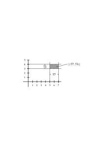

If the rectangular patch 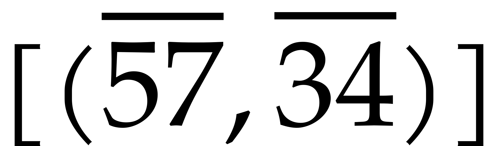 is of a single colour, say the colour corresponding to the number N, then one can express this fact by the sentence: 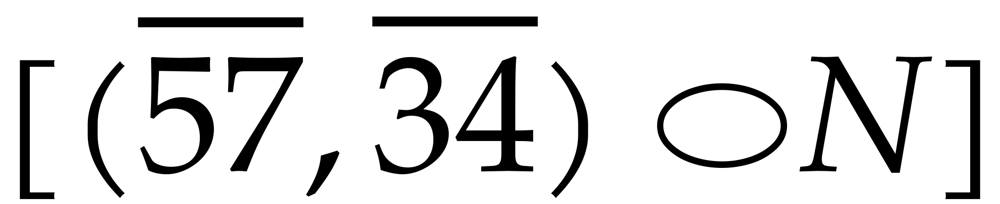

### [70\[3\]](https://cdn.wittgensteinnachlass.com/2000px/webp/Ms-105/70.webp)

But how could it show itself in this notation that a patch cannot have two colours at once? If this does not show itself, then something is wrong with the notation.

### [70\[4\]](https://cdn.wittgensteinnachlass.com/2000px/webp/Ms-105/70.webp),[72\[1\]](https://cdn.wittgensteinnachlass.com/2000px/webp/Ms-105/72.webp)

[The fact that a point in the plane is represented by a pair of numbers and a point in 3-dimensional space by a triple of numbers already shows that the object represented is not the point at all, but the fabric of points.]

### [72\[2\]](https://cdn.wittgensteinnachlass.com/2000px/webp/Ms-105/72.webp)

Would the experience of time be of any help to us with the difficulty of showing that two colours cannot be in one place at the same time? Suppose our visual image always remained the same & we had no sense other than sight: would time then pass? Apparently one must assume: yes; for change also contains within it the _possibility_ of rest. Although it is hard to imagine time passing when everything stays the same. But merely to say that everything _stays_ the same presupposes time.

### [72\[3\]](https://cdn.wittgensteinnachlass.com/2000px/webp/Ms-105/72.webp)

To say that a particular colour is now at a place is to describe that place _completely_.

### [72\[4\]](https://cdn.wittgensteinnachlass.com/2000px/webp/Ms-105/72.webp),[74\[1\]](https://cdn.wittgensteinnachlass.com/2000px/webp/Ms-105/74.webp)

If I say that there are 4 apples on this table, I also want thereby to rule out there being 5 apples on it. In the sign-language I then say “4 apples & no more”. Can I proceed analogously if I want to express that only _one_ colour is at a place?

### [74\[2\]](https://cdn.wittgensteinnachlass.com/2000px/webp/Ms-105/74.webp)

If we imagine colour as a third dimension, so that the plane of our drawing cuts the colour solid, which ranges over the colour scale in the third dimension, at a particular colour, then it is clear that the plane cannot cut the colour solid at different places.

### [74\[3\]](https://cdn.wittgensteinnachlass.com/2000px/webp/Ms-105/74.webp)

One could say: What has such & such coordinates? Precisely the colour! But then one could also say that this colour has these coordinates & another colour has the same coordinates.

### [74\[4\]](https://cdn.wittgensteinnachlass.com/2000px/webp/Ms-105/74.webp),[76\[1\]](https://cdn.wittgensteinnachlass.com/2000px/webp/Ms-105/76.webp)

One could also use the mode of designation I proposed above if a pair of numbers were to designate not a point but, for example, a straight line perpendicular to the plane of the drawing & one could imagine different colours laid out along this line. And in this way several colours could correspond to the same point.

### [76\[2\]](https://cdn.wittgensteinnachlass.com/2000px/webp/Ms-105/76.webp)

Incidentally, things are no different with colours than with tones or electrical charges. What is at issue in each case is the complete description of a certain state at one point or at the same time.

### [76\[3\]](https://cdn.wittgensteinnachlass.com/2000px/webp/Ms-105/76.webp)

Could there not be a schema like this: the colour at a point is described not by assigning _one_ number to a point but by assigning _several_ numbers. It takes a mixture of these numbers to make the colour & to describe the complete colour I need the sentence that _this_ mixture is the complete mixture, so that nothing more can be added. It would be as if I described the taste of a dish by listing the ingredients; then at the end I must add that these are _all_ the ingredients.

### [78\[1\]](https://cdn.wittgensteinnachlass.com/2000px/webp/Ms-105/78.webp)

So one could say that the description of the colour, too, is complete only when all its ingredients have been given, naturally with the addition that these are all of them.

### [78\[2\]](https://cdn.wittgensteinnachlass.com/2000px/webp/Ms-105/78.webp)

But how is this addition to be made?!!

### [78\[3\]](https://cdn.wittgensteinnachlass.com/2000px/webp/Ms-105/78.webp)

If in the form of a _sentence_, then the incomplete description of the colour would already have to be a sentence too. And if not in the form of a separate sentence, but only by some kind of hint in the first sentence, how can I make a second sentence of the same form contradict the first? After all, two elementary propositions cannot contradict one another!

### [78\[4\]](https://cdn.wittgensteinnachlass.com/2000px/webp/Ms-105/78.webp),[80\[1\]](https://cdn.wittgensteinnachlass.com/2000px/webp/Ms-105/80.webp)

But what of all the seemingly similar statements, such as: A material point can have only _one_ velocity at a time, at a point on a charged surface there can be only _one_ voltage at a time, at a point on a warm surface only _one_ temperature at a time, at a point in a steam boiler only _one_ pressure, etc. etc.

### [80\[2\]](https://cdn.wittgensteinnachlass.com/2000px/webp/Ms-105/80.webp)

No one can doubt that these are all self-evident & that the contrary statements are contradictions.

### [80\[3\]](https://cdn.wittgensteinnachlass.com/2000px/webp/Ms-105/80.webp),[82\[1\]](https://cdn.wittgensteinnachlass.com/2000px/webp/Ms-105/82.webp)

At first sight there now seem to be two kinds among these tautologies or contradictions: If, for example, one says that a particle can have only _one_ velocity, one can instead say that it can have only _one resultant velocity_. That is, the description of the velocity needs a _closing_ addition, as above. There is, to be sure, a difficulty with this too, for what if the velocities subtract from one another?

If, on the other hand, one says that two particles cannot be at the same place in space at the same time, this seems to be self-evident in a different sense. For it seems to follow from the definition of _**one** particle_. The contrary assertion would then be not a contradiction but nonsense.

### [82\[2\]](https://cdn.wittgensteinnachlass.com/2000px/webp/Ms-105/82.webp)

Now what about colours? Suppose the statement that ascribes a colour to a patch were a statement about a certain frequency of vibration. One could then also see the matter in such a way that specifications of different frequencies do not contradict one another, any more than do the sentences “there are 3 apples on the table”, “there are 5 apples on the table”, so long as the word _only_ occurs in neither sentence. What would correspond to the sentence that ascribed to a patch _also_ (and not _only_) a frequency of vibration would therefore not be a specification of colour but something less definite, something perhaps analogous to a degree of brightness.

### [82\[3\]](https://cdn.wittgensteinnachlass.com/2000px/webp/Ms-105/82.webp),[84\[1\]](https://cdn.wittgensteinnachlass.com/2000px/webp/Ms-105/84.webp)

But this explanation too is inadequate, & for more than _one_ reason. If the colours are all merely different stages of the same structure, then it is not enough that “a is not green” follows from “a is red”; one must also be able to see that one colour is nearer to another than a third colour is, etc.

### [84\[2\]](https://cdn.wittgensteinnachlass.com/2000px/webp/Ms-105/84.webp)

Would it work to regard the resultant colour as the combined effect of _actually perceived_ colours mixed in different proportions? The description of a patch’s colour would then consist in a logical product of the sentences about the elementary colours & a closing sentence saying that these are _all_ the elementary colours.

### [84\[3\]](https://cdn.wittgensteinnachlass.com/2000px/webp/Ms-105/84.webp)

But do not the elementary colours too have _a_ structure? And how is it to show itself?

· ———— ·

### [84\[4\]](https://cdn.wittgensteinnachlass.com/2000px/webp/Ms-105/84.webp)

Is there any time at all in the first system? Can one say of an event, or rather of a fact, in the system of data, “it was”?

### [84\[5\]](https://cdn.wittgensteinnachlass.com/2000px/webp/Ms-105/84.webp),[86\[1\]](https://cdn.wittgensteinnachlass.com/2000px/webp/Ms-105/86.webp)

If I compare the facts of the first system with the pictures on the screen & the facts in the second system with the pictures on the strip of film, then on the strip of film there is a present picture, along with past & future pictures; on the screen, however, there is only the present.

### [86\[2\]](https://cdn.wittgensteinnachlass.com/2000px/webp/Ms-105/86.webp)

The one characteristic feature of this simile is that in it I regard the future as preformed.

### [86\[3\]](https://cdn.wittgensteinnachlass.com/2000px/webp/Ms-105/86.webp)

It makes sense to say that future events are preformed if it is in the _nature_ of time not to break off. For then one can say: “Something will happen, I just do not know what”. And in the world of physics one can say that.

### [86\[4\]](https://cdn.wittgensteinnachlass.com/2000px/webp/Ms-105/86.webp),[88\[1\]](https://cdn.wittgensteinnachlass.com/2000px/webp/Ms-105/88.webp)

But what about the world of data? Does this world not actually break off?

Can one say of one datum that it is earlier than another?

What I have are _present_ sensory images & _present_ memory-images. Can I not say that I construct time from these only in the 2nd system. But one can also say that the fact that I _can_ construct a temporal 2nd system from these present data says something about the 1st system & what it says I express in the words: The first system is temporally ordered. – Only one must not forget that this temporal order looks quite different from that in the 2nd system.

### [88\[2\]](https://cdn.wittgensteinnachlass.com/2000px/webp/Ms-105/88.webp)

The correct representation of colours must show not only that if a is red it cannot be green at the same time, but also all those internal properties that we know when we know the colours. That is, everything that concerns the kinship of the individual colours with one another & their relation to black & white.

### [88\[3\]](https://cdn.wittgensteinnachlass.com/2000px/webp/Ms-105/88.webp)

Here colour-blindness points to something: There are people who have no sense for red & green or for yellow & blue. From this one might infer that one can know yellow & blue without thereby being able to infer the possibility of red & green, so that these pairs of colours are logically independent of one another.

### [88\[4\]](https://cdn.wittgensteinnachlass.com/2000px/webp/Ms-105/88.webp),[90\[1\]](https://cdn.wittgensteinnachlass.com/2000px/webp/Ms-105/90.webp)

There seem to be simple colours. Simple as psychological phenomena. What I need is a psychological theory of colour, not a physical one & no more a physiological one.

### [90\[2\]](https://cdn.wittgensteinnachlass.com/2000px/webp/Ms-105/90.webp)

And it must be a _purely_ psychological theory of colour, in which only what can actually be perceived is spoken of and no hypothetical objects – waves, cells, etc. etc. – occur.

### [90\[3\]](https://cdn.wittgensteinnachlass.com/2000px/webp/Ms-105/90.webp)

One can now recognize colours _directly_ as mixtures of red, green, blue, yellow, black, & white. Here colour is always Color, never pigmentum, never light, never processes on or in the retina, etc.

### [90\[4\]](https://cdn.wittgensteinnachlass.com/2000px/webp/Ms-105/90.webp)

One can also see that one colour is redder than another, or more whitish, etc. But can I find a metric for colours? Does it make sense to say that one colour lies _midway_ between two others, say, with respect to its red content?

### [90\[5\]](https://cdn.wittgensteinnachlass.com/2000px/webp/Ms-105/90.webp),[92\[1\]](https://cdn.wittgensteinnachlass.com/2000px/webp/Ms-105/92.webp)

It does at any rate seem to make sense to say that one colour is closer in this respect to another than to a third. And if that is so, then it also makes sense to speak of the midpoint between two colours.

But that would make it possible to divide a colour interval into equal parts, though only until the limit of distinguishability is reached. Here we encounter a problem that also arises in connection with the extension of visual space, namely that of the smallest visible difference. The existence of a smallest visible difference contradicts continuity, and yet the two must be reconcilable.

### [92\[2\]](https://cdn.wittgensteinnachlass.com/2000px/webp/Ms-105/92.webp),[94\[1\]](https://cdn.wittgensteinnachlass.com/2000px/webp/Ms-105/94.webp)

If I have a series of patches that are alternately black & white, as the figure shows

then with further subdivision I will soon reach a limit at which I can no longer distinguish the black & white patches, at which I therefore have, say, the impression of a grey strip. But does this not mean that I cannot subdivide the stretch in my visual field as far as I like? And yet I see no discontinuity, and this too is obvious, since I could see a discontinuity only if I had _not_ yet reached the limit of what is distinguishable. This looks very paradoxical.

### [94\[2\]](https://cdn.wittgensteinnachlass.com/2000px/webp/Ms-105/94.webp)

But what about continuity between the individual series. We evidently have a penultimate series of distinguishable patches & then the last, uniformly grey series; can one see from this last series that it really arose by subdivision of the penultimate one? Evidently not. On the other hand: Can one see from the so-called penultimate series that it cannot be subdivided any further in a visible way? It seems to me that one can no more see that! So there would be no last visibly subdivided series after all! But if I can no longer visibly subdivide the stretch, then I cannot even _try_ to subdivide it in this way. So I cannot see such an attempt fail either. (It is the same here as with the limitlessness of visual space.) The same would of course hold for differences of colour too.

### [96\[1\]](https://cdn.wittgensteinnachlass.com/2000px/webp/Ms-105/96.webp)

Continuity in our visual field consists in our seeing no discontinuity.

### [96\[2\]](https://cdn.wittgensteinnachlass.com/2000px/webp/Ms-105/96.webp)

If the world of data is timeless, how can one talk about it at all.

### [96\[3\]](https://cdn.wittgensteinnachlass.com/2000px/webp/Ms-105/96.webp)

If memory is _not_ a seeing into the past, how do we know at all that it is to be interpreted with reference to the past? We could then remember an occurrence & doubt whether what we have in our memory-image is a picture of the past or of the future.

One can of course say: I do not see the past, but only a _picture_ of the past. But how do I _know_ that it is a picture of the _past_ if that does not lie in the nature of the memory-image. Have we perhaps learnt through experience to interpret these pictures as pictures of the past? But what would “past” mean here at all?!

### [96\[4\]](https://cdn.wittgensteinnachlass.com/2000px/webp/Ms-105/96.webp),[98\[1\]](https://cdn.wittgensteinnachlass.com/2000px/webp/Ms-105/98.webp)

Now the idea that I should perceive into the past conflicts with all notions of physical time, & this in turn seems to mean nothing other than that the concept of time in the 1st system must be _radically_ different from the one in physics.

### [98\[2\]](https://cdn.wittgensteinnachlass.com/2000px/webp/Ms-105/98.webp)

If one asks: “What experience underlies the concept of time, the assumption of a time?” How must one answer? – It is memory, if there is a point-like present; or it is a continuous perception of which the present is one endpoint & which, in a wider sense, one can also call memory.

### [98\[3\]](https://cdn.wittgensteinnachlass.com/2000px/webp/Ms-105/98.webp)

Every point on the surface of the octahedron represents a colour, e.g. P represents a whitish blue-red that is nearer to red than to blue.

### [98\[4\]](https://cdn.wittgensteinnachlass.com/2000px/webp/Ms-105/98.webp),[100\[1\]](https://cdn.wittgensteinnachlass.com/2000px/webp/Ms-105/100.webp)

A spatial distance can be represented by a number. (This sentence is not about rigid measuring rods.) It must follow directly from the structure of visual space. Instead of writing the spatial relation between two patches a & b as “a R b”, I could then write it as a N b, where N is a number, hence a _stretchable_ relation.

### [100\[2\]](https://cdn.wittgensteinnachlass.com/2000px/webp/Ms-105/100.webp)

How is the fact that φ( ) is satisfied by _as many_ objects as ψ( ) to be expressed correctly?

### [100\[3\]](https://cdn.wittgensteinnachlass.com/2000px/webp/Ms-105/100.webp)

a c

b d

(x = a ∙ b = y) ⌵ (x = c ∙ d = y) This is of course _not_ a 1→1 relation between the two classes, but it is the expression of a rule according to which the _signs_ of the objects can be paired with one another.

### [100\[4\]](https://cdn.wittgensteinnachlass.com/2000px/webp/Ms-105/100.webp)

How is it that one can count apples & shoes, and numbers too?!

### [100\[5\]](https://cdn.wittgensteinnachlass.com/2000px/webp/Ms-105/100.webp)

Number is a schema.

### [100\[6\]](https://cdn.wittgensteinnachlass.com/2000px/webp/Ms-105/100.webp),[102\[1\]](https://cdn.wittgensteinnachlass.com/2000px/webp/Ms-105/102.webp)

When I speak of the “number of books on this table”, I mean a certain schema of the kind ∣∣∣∣ … or (0, ξ, ξ + 1), which can be applied to the extension of this concept. By the schema I of course mean not the 4 strokes but what they have in common with all classes of four, though I cannot represent that without such a class.

### [102\[2\]](https://cdn.wittgensteinnachlass.com/2000px/webp/Ms-105/102.webp)

a b c d

e f g h

If I have two classes of four, I could say: I can show that this class is equal in number because it is possible to group the names into pairs that establish a 1–1 relation between the classes. Thus I can write, for instance, a e, b f, e g, d h. This possibility of grouping the names of course proves something about the classes (namely, that they are equal in number). And the possibility of grouping them by means of identities (a = x ∙ y = e etc.) proves exactly the same thing.

### [102\[3\]](https://cdn.wittgensteinnachlass.com/2000px/webp/Ms-105/102.webp),[104\[1\]](https://cdn.wittgensteinnachlass.com/2000px/webp/Ms-105/104.webp)

(∃x,y,z) ∙ φx ∙ φy ∙ φz : ~(∃x,y,z,u) φx ∙ φy ∙ φz ∙ φu

How should I now go about writing the general form of such sentences?! This question evidently makes perfectly good sense. For if I write down just a few such sentences, everyone understands what is supposed to be _essential_ to them.

### [104\[2\]](https://cdn.wittgensteinnachlass.com/2000px/webp/Ms-105/104.webp)

I would evidently have to give a description of this essential feature of the sign.

I could say, for instance, that all the letters in the left-hand bracket occur in the right-hand bracket, along with _one_ more. But is such a description permissible? Curiously enough, I believe it is. Does not every symbolism presuppose such descriptions? I could also construct a sign:

(∃x y z) φx ∙ φy ∙ φz : ~ (∃x y z u) φx φy φz φu

Or I could give the rule:

The expression (∃…) φ… ∙ ~(∃…) φ… is a variable whose values satisfy the following description: …. Here one can also make use of a 1-1 relation as a criterion for all the letters in the left-hand bracket being in the right-hand one.

### [104\[3\]](https://cdn.wittgensteinnachlass.com/2000px/webp/Ms-105/104.webp),[106\[1\]](https://cdn.wittgensteinnachlass.com/2000px/webp/Ms-105/106.webp)

The description of the signs for the values of the variable is always only an _external_ description. It is the description of the sign & not of the symbol.

### [106\[2\]](https://cdn.wittgensteinnachlass.com/2000px/webp/Ms-105/106.webp)

I believe the only thing absolutely required of such a description of the sign is that one must be able to say of any sign whether or not it represents a value of the variable.

### [106\[3\]](https://cdn.wittgensteinnachlass.com/2000px/webp/Ms-105/106.webp)

I said that every symbolism presupposes such descriptions. If, for instance, Russell introduces the sign (∃x etc.), he cannot introduce all the signs

(∃x) etc., (∃x,y) etc., (∃x,y,z) etc. ad infinitum, but gives _one_ rule which we must understand, a syntactical rule.

### [106\[4\]](https://cdn.wittgensteinnachlass.com/2000px/webp/Ms-105/106.webp)

I did not introduce a new basic concept when I conceived of the variable (∃…) φ… ∙ ~(∃…) φ…. The values of this variable are, after all, well known.

### [106\[5\]](https://cdn.wittgensteinnachlass.com/2000px/webp/Ms-105/106.webp),[109\[1\]](https://cdn.wittgensteinnachlass.com/2000px/webp/Ms-105/109.webp)

Can obscurities & contradictions occur in the description of the variable? And how are they to be avoided. Must one proceed here as Frege does? There still seem to be difficulties here.

### [109\[2\]](https://cdn.wittgensteinnachlass.com/2000px/webp/Ms-105/109.webp)

(∃x,y) φx ∙ φy ∙ ~(∃x,y,z) φx ∙ φy ∙ φz ≝ {ξ,ζ}φ(ξ)

This definition in turn requires an explanation if it is to be understood, for the internal relation between the two sides is not immediately clear. (We do not know _what matters in these signs_.)

### [109\[3\]](https://cdn.wittgensteinnachlass.com/2000px/webp/Ms-105/109.webp)

Could one not give these descriptions with the help of operations?

### [109\[4\]](https://cdn.wittgensteinnachlass.com/2000px/webp/Ms-105/109.webp)

A simpler case: 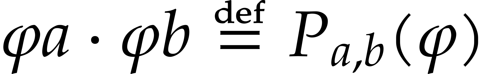 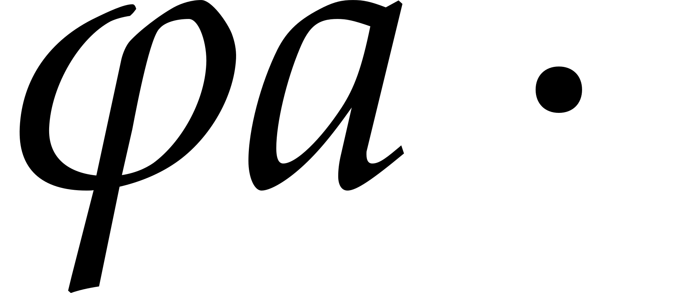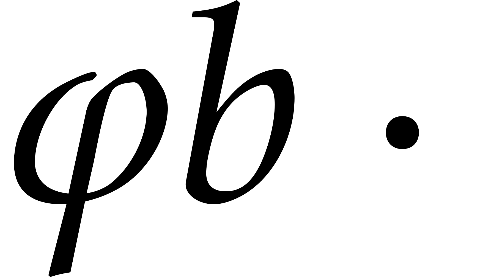 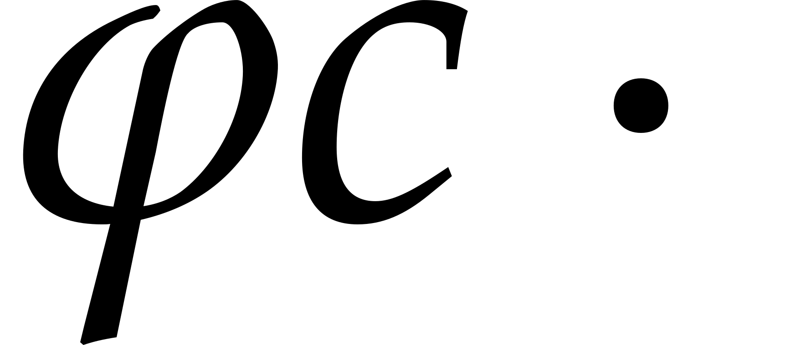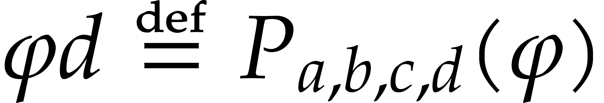

Now I want to define the variable product 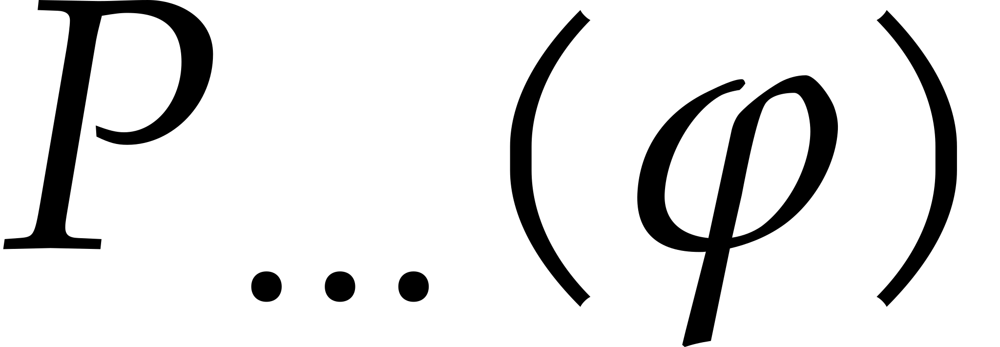 in general! How am I to do that?

One could write down an operation:

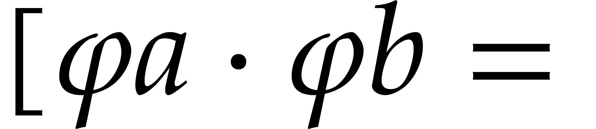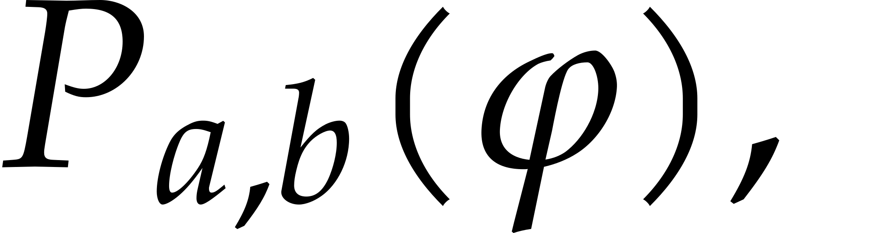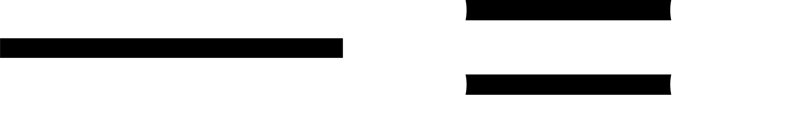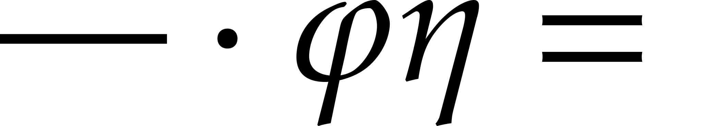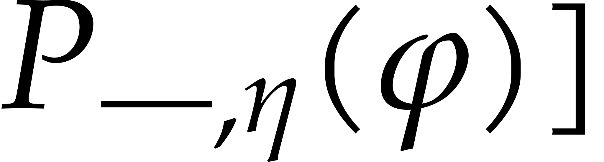

### [109\[5\]](https://cdn.wittgensteinnachlass.com/2000px/webp/Ms-105/109.webp),[111\[1\]](https://cdn.wittgensteinnachlass.com/2000px/webp/Ms-105/111.webp)

This operation is evidently only an _external_ description of the signs. I must then understand the essence of the matter – as it were – for myself. For the operation does not give it to me. It treats the signs, that is, as though they were senseless. I could just as well write down

[∃,–,–0] & this would represent the series ∃,∃0,∃00 etc., which means nothing at all.

### [111\[2\]](https://cdn.wittgensteinnachlass.com/2000px/webp/Ms-105/111.webp)

But is that all right?

### [111\[3\]](https://cdn.wittgensteinnachlass.com/2000px/webp/Ms-105/111.webp)

The terms of the series generated by the operation do have meaning & their internal kinship is not an external matter concerning the signs, but a kinship of meanings. So there must be a kinship of the _symbols_ & not merely of the signs that corresponds to this kinship. Must not the transition from one sign to the next evidently be a transition _with sense_?

### [111\[4\]](https://cdn.wittgensteinnachlass.com/2000px/webp/Ms-105/111.webp)

What about the operation that produces the series

(∃x) φx, (∃x,y) φx ∙ φy, etc.? It would be:

[(∃x) ∙ φx, (–)–, (–,ξ)– ∙ φξ]

### [111\[5\]](https://cdn.wittgensteinnachlass.com/2000px/webp/Ms-105/111.webp),[113\[1\]](https://cdn.wittgensteinnachlass.com/2000px/webp/Ms-105/113.webp)

But here there is a difficulty in that I have not expressed that the ξ which is added must be different from all the earlier signs. Is that not a fundamental difficulty?

### [113\[2\]](https://cdn.wittgensteinnachlass.com/2000px/webp/Ms-105/113.webp)

Definitions:

(∃x,y) φx ∙ φy ≝ (∃α,α)φα

(∃x,y,z) φx ∙ φy ∙ φz ≝ (∃α,α,α)φα.

in general:

[(∃x,y) φx ∙ φy = (∃α,α)φα, (∃–) ∙ – = (∃–)φα, (∃–ξ) ∙ – ∙ φξ = (∃–,α)φα]. Then the general form of

(∃α)φα, (∃α,α)φα, etc. would be:

[(∃α)φα, (∃–) ∙ φα, (∃–,α) ∙ φα]

(∃α)φα ∙ ~(∃α,α) ∙ φα = (Nα)φα

(∃α,α)φα ∙ ~(∃ααα)φα = (Nα,α)φα

[(∃α)φα ∙ ~(∃α,α) ∙ φα = (Nα)φα, (∃–)φα ∙ ~(∃–)φα = (N–)φα, (∃–,α)φα ∙ ~(∃–,α)φα = N(–,α)φα].

That is how the sign N(…)φα would have to be introduced.

### [113\[3\]](https://cdn.wittgensteinnachlass.com/2000px/webp/Ms-105/113.webp)

The general form of the numerical statement would then be:

[(Nα)φα, (N–)φα, (N–,α)φα]

### [113\[4\]](https://cdn.wittgensteinnachlass.com/2000px/webp/Ms-105/113.webp),[115\[1\]](https://cdn.wittgensteinnachlass.com/2000px/webp/Ms-105/115.webp)

Let us remember: In arithmetic the number occurs alone, without the concept to which it belongs. But then it is an incomplete sign after all. Yet it never occurs like that in a _sentence_ either; in a sentence it is always linked to a concept. No sentence is about the number 4. In arithmetic, however, where numbers occur by themselves, they are _not in sentences_ either.

### [115\[2\]](https://cdn.wittgensteinnachlass.com/2000px/webp/Ms-105/115.webp)

The numeral is a schema & in arithmetic it is torn out of its context.

[(Nα)φα, (N–)φα, (N–,α)φα] ≝ (α,–,–,α)φα

One could then call the function “(α,–,–,α)( )” the general form of number. The empty brackets indicate that what is at issue is what all numerical *statements* have in common.

### [115\[3\]](https://cdn.wittgensteinnachlass.com/2000px/webp/Ms-105/115.webp)

Numbers are pictures of the extensions of concepts.

### [115\[4\]](https://cdn.wittgensteinnachlass.com/2000px/webp/Ms-105/115.webp),[117\[1\]](https://cdn.wittgensteinnachlass.com/2000px/webp/Ms-105/117.webp)

One can ask: does number have anything essentially to do with a concept? I think this comes down to asking whether it makes sense to speak of a number of objects that have not been brought under a concept. Does it mean anything, for example, to say:

“a and b and c are 3 objects”? I think the answer is plainly no! There is, to be sure, a feeling that tells us: Why talk of concepts? The number depends only on the _extension_ of the concept, after all, and once that has been determined the concept can leave the stage, so to speak. The concept is only a method for determining a particular extension, but the extension stands on its own and is in its nature independent of the concept; for it does not matter which concept we used to determine the extension. That is the argument for the extensional view. Against this one can first say: If the concept is really only an aid to arriving at the extension, then the concept has no place in arithmetic; one must then simply separate the class entirely from the concept contingently associated with it. In the opposite case, however, the extension independent of the concept is a mere chimera & then it is better not to speak of it at all, but only of the concept.

### [119\[1\]](https://cdn.wittgensteinnachlass.com/2000px/webp/Ms-105/119.webp)

φa ∙ φb ∙ φc ∙ φd ≝ (a,b,c,d) ∙ {φ( )} Could I not now call the incomplete sign (a,b,c,d) ∙ { } the extension of the concept ξ for which (a,b,c,d) ∙ {ξ( )} becomes true?

### [119\[2\]](https://cdn.wittgensteinnachlass.com/2000px/webp/Ms-105/119.webp)

The number (αααα) would then be the general schema of the extension (a,b,c,d) ∙ { }.

### [119\[3\]](https://cdn.wittgensteinnachlass.com/2000px/webp/Ms-105/119.webp)

One could now regard the extension of a concept as an object whose name, after all, likewise has sense only in the context of a sentence. “a and b and c and d” admittedly has no sense; it is not a sentence. But “a” is not a sentence either.

### [119\[4\]](https://cdn.wittgensteinnachlass.com/2000px/webp/Ms-105/119.webp),[121\[1\]](https://cdn.wittgensteinnachlass.com/2000px/webp/Ms-105/121.webp)

But does it make sense to write down an arbitrary form for the extension of a concept, say (a,g,i,u) ∙ { }, where the letters in brackets are supposed to be names of particular objects, if I do not know at all whether these objects can be “brought under one umbrella”? Can one not answer this by saying: For a name to have meaning presupposes that it has sense in a sentence; i.e. one could really write the names as ξ(a), ξ(i), ξ(u) etc., where ξ is a variable function. But then the sign for the extension of the concept must always be permissible too.

### [121\[2\]](https://cdn.wittgensteinnachlass.com/2000px/webp/Ms-105/121.webp)

Does it not follow from this that if I form new schemas from the schemas for the extensions of concepts, the numbers, according to some rules or other, then there must be a possible transition in the extensions of concepts corresponding to this transition from one number to another, since in my signs I am operating with precisely what is _essential_.

### [121\[3\]](https://cdn.wittgensteinnachlass.com/2000px/webp/Ms-105/121.webp)

Now how, for example, must the rule for forming the sum of two numbers read?

### [121\[4\]](https://cdn.wittgensteinnachlass.com/2000px/webp/Ms-105/121.webp)

If I have two extensions u1, u2, then it is evident that the sign (u1, u2){ } has a sense, _curiously enough_ without my having laid down any convention beforehand about the addition of extensions of concepts.

### [121\[5\]](https://cdn.wittgensteinnachlass.com/2000px/webp/Ms-105/121.webp),[123\[1\]](https://cdn.wittgensteinnachlass.com/2000px/webp/Ms-105/123.webp)

I have an instinctive wish to operate only with the extensions of concepts & to take no notice of the functions in arithmetic. I would then like to leave it to the operations with numbers themselves to mean something.

### [123\[2\]](https://cdn.wittgensteinnachlass.com/2000px/webp/Ms-105/123.webp)

One can regard every number as consisting of several others. [this sentence looks stupider than it is.]

### [123\[3\]](https://cdn.wittgensteinnachlass.com/2000px/webp/Ms-105/123.webp)

(The Russian abacus)

### [123\[4\]](https://cdn.wittgensteinnachlass.com/2000px/webp/Ms-105/123.webp)

For it seems to me that breaking down a number into its summands is an immediately evident operation & need not be introduced by the roundabout route of operations with truth-functions. So it seems to me as though one could say directly, “You see, ∣∣∣∣ consists of ∣∣ and ∣∣”.

### [123\[5\]](https://cdn.wittgensteinnachlass.com/2000px/webp/Ms-105/123.webp),[125\[1\]](https://cdn.wittgensteinnachlass.com/2000px/webp/Ms-105/125.webp)

But can I form an extension out of arbitrary things, is it certain that there is a function of which it is the extension? Sentences formed with such arbitrary extensions will in general not be true, but they are always sentences. For even if it is not true that the objects a,b,c form the extension of some function, the sentence (a,b,c){φ( )} still has sense.

### [125\[2\]](https://cdn.wittgensteinnachlass.com/2000px/webp/Ms-105/125.webp)

Incidentally, the definition of the extension of a concept that I gave above is quite wrong; it would have to read something like this:

φa ∙ φb ∙ φc ∙ ~(∃x,y,z,u) ∙ φx ∙ φy ∙ φz ∙ φu = (a,b,c){φ( )}

### [125\[3\]](https://cdn.wittgensteinnachlass.com/2000px/webp/Ms-105/125.webp)

It certainly makes sense to say of any concept that it includes, e.g., 4 objects, even if it does not include 4 objects.

In this respect every sign for an extension must be allowed.

### [125\[4\]](https://cdn.wittgensteinnachlass.com/2000px/webp/Ms-105/125.webp)

Now if, e.g., two extensions lie entirely outside one another, this shows itself in their signs & we need not—indeed must not—go back to the concepts to establish this, since we do not know whether there are any such concepts at all.

### [125\[5\]](https://cdn.wittgensteinnachlass.com/2000px/webp/Ms-105/125.webp),[127\[1\]](https://cdn.wittgensteinnachlass.com/2000px/webp/Ms-105/127.webp)

Rather, there will be internal relations between the extensions of concepts; one might call these relations extended identities. One might, for example, write

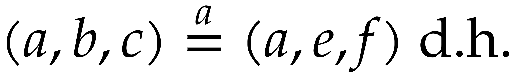, the two extensions are identical with respect to a.

### [127\[2\]](https://cdn.wittgensteinnachlass.com/2000px/webp/Ms-105/127.webp)

Do I not now need signs for the general form of extensions: those that have one member in common, those that have no member in common, those of which one wholly contains the other, etc.?

### [127\[3\]](https://cdn.wittgensteinnachlass.com/2000px/webp/Ms-105/127.webp)

The sum of two extensions is, after all, an extension that contains the other two and no further member. How is that to be expressed?

### [127\[4\]](https://cdn.wittgensteinnachlass.com/2000px/webp/Ms-105/127.webp)

Then I need a kind of definition that says that a certain sign is used as a value of a certain variable. For example, nε(α,–,– ∙ α), which says something like: I shall use “n” as a numeral.

### [127\[5\]](https://cdn.wittgensteinnachlass.com/2000px/webp/Ms-105/127.webp)

Could one, for instance, stipulate that extensions that lie entirely outside one another are simply to be named by different letters, whereas those that have members in common are to be designated as such by common indices?

### [129\[1\]](https://cdn.wittgensteinnachlass.com/2000px/webp/Ms-105/129.webp)

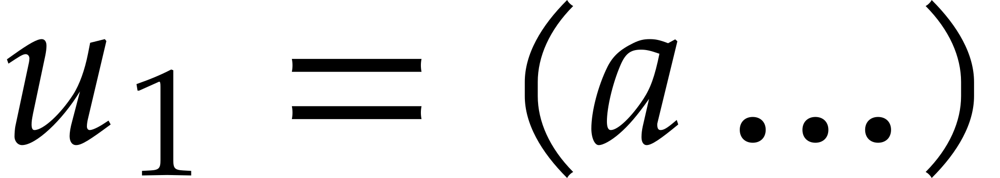 would mean 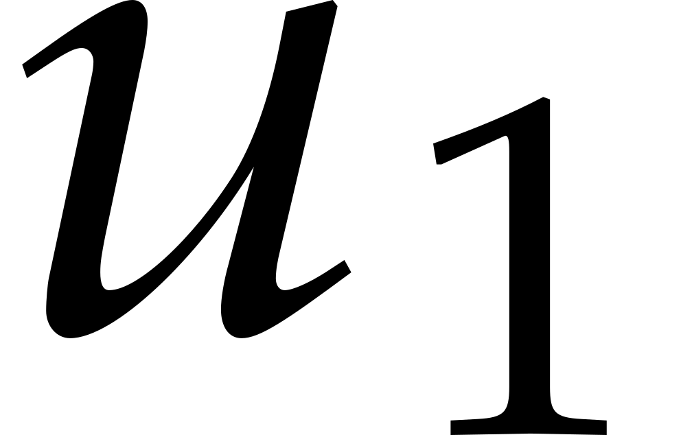 contains a

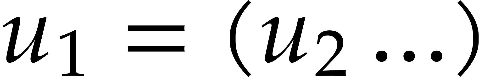  contains 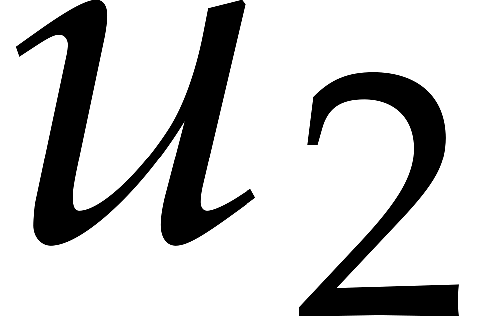

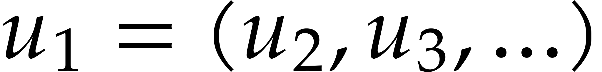  contains  & 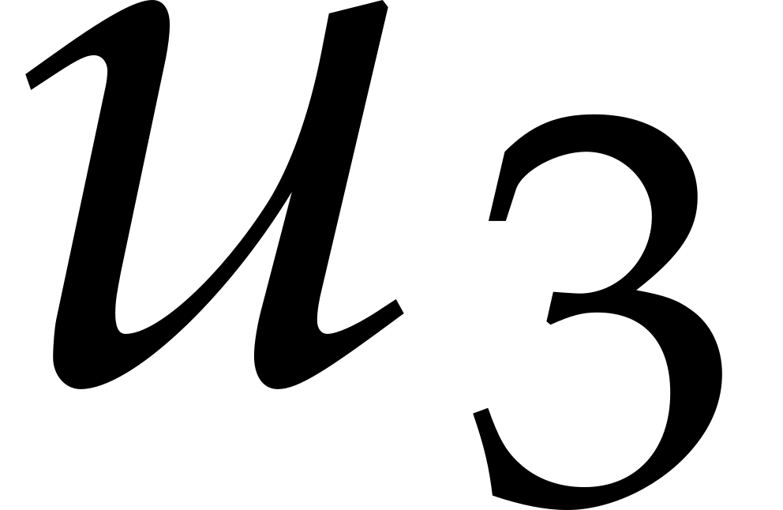

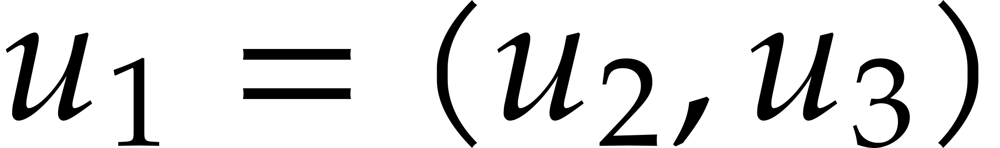  is the sum of  &  etc.

### [129\[2\]](https://cdn.wittgensteinnachlass.com/2000px/webp/Ms-105/129.webp)

(αααα) = ((ααα))(α))

αααααα = ((αα)(αα)(αα)) = ααα × αα

(n) = α × n

(n,n) = αα × n

– – – – – –

[(n) = α × n, (–) = – × n, (–,n) = –α × n] That would give the definition of multiplication.

[(n) = 1 × n, (–) = – × n,(–,n) = –, 1 × n] = m ∙ n

### [129\[3\]](https://cdn.wittgensteinnachlass.com/2000px/webp/Ms-105/129.webp)

It is remarkable that in the case of tautologies & contradictions one really could speak of sense & meaning in Frege’s sense.

### [129\[4\]](https://cdn.wittgensteinnachlass.com/2000px/webp/Ms-105/129.webp),[131\[1\]](https://cdn.wittgensteinnachlass.com/2000px/webp/Ms-105/131.webp)

If one calls the property of being a tautology the meaning of the tautology, then one can call the way in which the tautology comes about here its sense. The same goes for the contradiction.

### [131\[2\]](https://cdn.wittgensteinnachlass.com/2000px/webp/Ms-105/131.webp)

If, as Ramsey suggests, one explains the sign “ = ” in such a way that

ξ = ξ ≝ Tautology, ξ = η ≝ Contradiction

holds, then one can say that the tautology & the contradiction here have no “sense”.

### [131\[3\]](https://cdn.wittgensteinnachlass.com/2000px/webp/Ms-105/131.webp)

So if the tautology shows something in that it is precisely _this_ sense that yields this meaning, then in Ramsey’s account the tautology shows nothing, for it is a tautology ex definitione.

### [131\[4\]](https://cdn.wittgensteinnachlass.com/2000px/webp/Ms-105/131.webp)

Ramsey proposes to express the proposition that infinitely many objects satisfy a function by negating all sentences of the form:

~(∃x) φx

(∃x) φx ∙ ~(∃xy) φx ∙ φy

(∃xy) φx ∙ φy ∙ ~(∃xyz) φx ∙ φy ∙ φz

etc.

But suppose now that there are only 3 objects, i.e. that only 3 names have meaning. Then we cannot even write down the fourth sentence in the series, for in that case it makes no sense to write

~(∃x y z u) φx φy φz φu

### [6\[1\]](https://cdn.wittgensteinnachlass.com/2000px/webp/Ms-105/6.webp)

---

### [6\[2\]](https://cdn.wittgensteinnachlass.com/2000px/webp/Ms-105/6.webp)

But what must a suitable notation for mathematical generality look like?

### [6\[3\]](https://cdn.wittgensteinnachlass.com/2000px/webp/Ms-105/6.webp)

And here a further important question arises: Can mathematical generality occur at all except in _immediate_ connection with the equality sign? I.e. can there be propositions of the kind 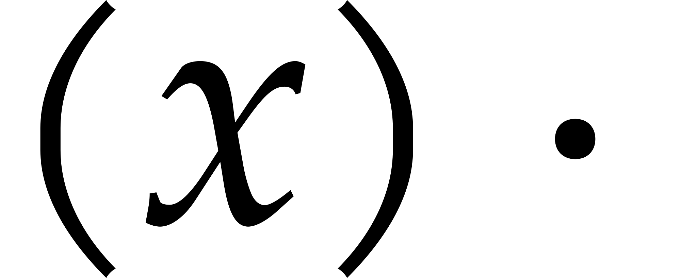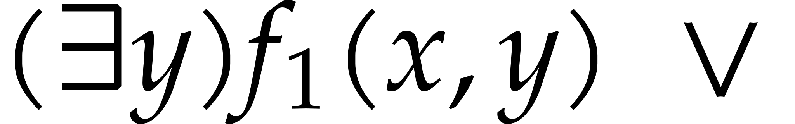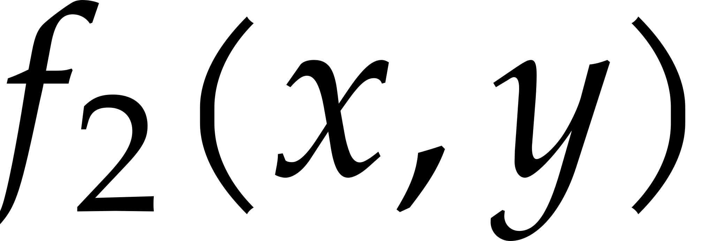 where the scope of the generality would necessarily have to extend over the disjunction and the proposition could not be resolved into a truth-function of general equations?

### [6\[4\]](https://cdn.wittgensteinnachlass.com/2000px/webp/Ms-105/6.webp),[8\[1\]](https://cdn.wittgensteinnachlass.com/2000px/webp/Ms-105/8.webp)

That seems impossible here.

x + y = 2 (x + y)² = 2(x² + y²)

x ‒ y = 3 x = y

Do we not already have such cases here?!

(∃x,y)x + y = 2 & x ‒ y = 3

(x,y):x = y ․≡․ (x + y)² = 2(x² + y²)

(x):x² + 3x + 2 = 0 ․≡․ x = ‒ 2 ⌵ x = ‒ 1

These propositions might almost make one believe that one was dealing with ordinary generality & truth-functions after all, were it not clear that their verification proceeds by an _internal_ route. E.g. by working out the equation x² + 3x + 2 = 0 etc. Thus the appearance of this notation keeps leading us astray.

### [8\[2\]](https://cdn.wittgensteinnachlass.com/2000px/webp/Ms-105/8.webp)

(n):n = 2 ․⊃․ (∃x,y,z) x² + y² = z²

To be sure, (∃x,y,z) says only that it is provable that x² + y² = z² has solutions & does _not_ refer to the specification of particular numbers, nor can it be proved by specifying them!

### [8\[3\]](https://cdn.wittgensteinnachlass.com/2000px/webp/Ms-105/8.webp)

(I have an inkling that it will be possible to do without truth-functions)

### [8\[4\]](https://cdn.wittgensteinnachlass.com/2000px/webp/Ms-105/8.webp)

Fermat’s proposition is 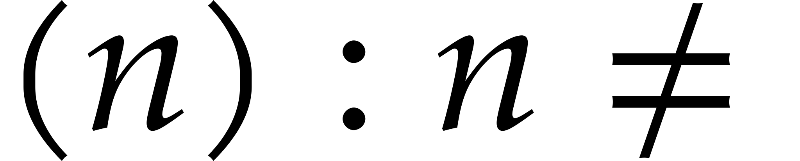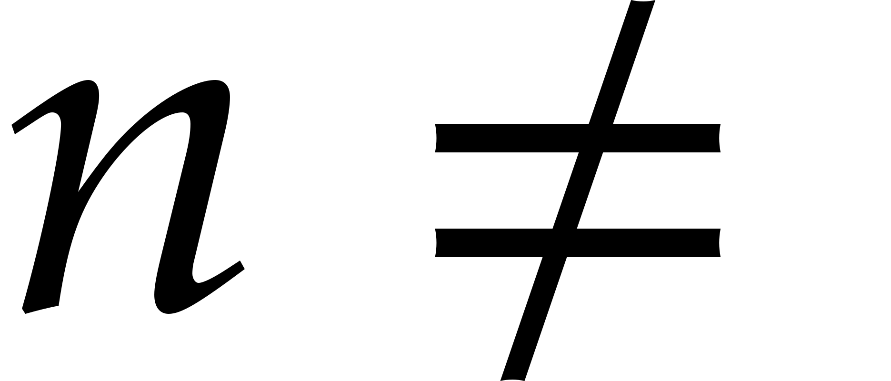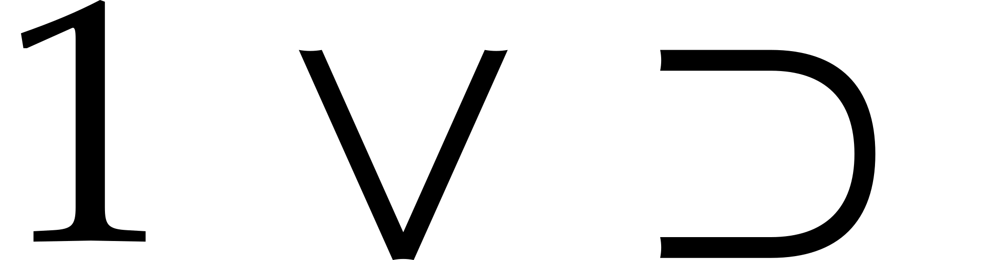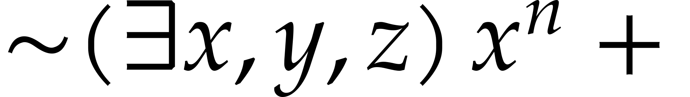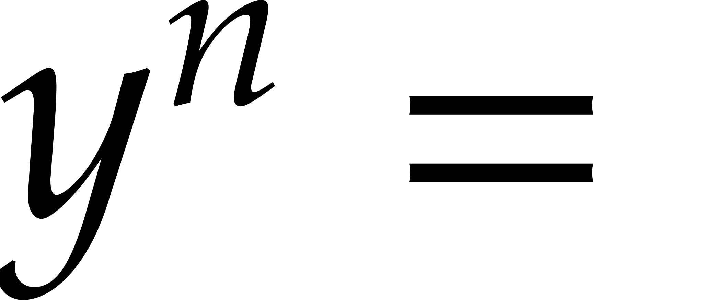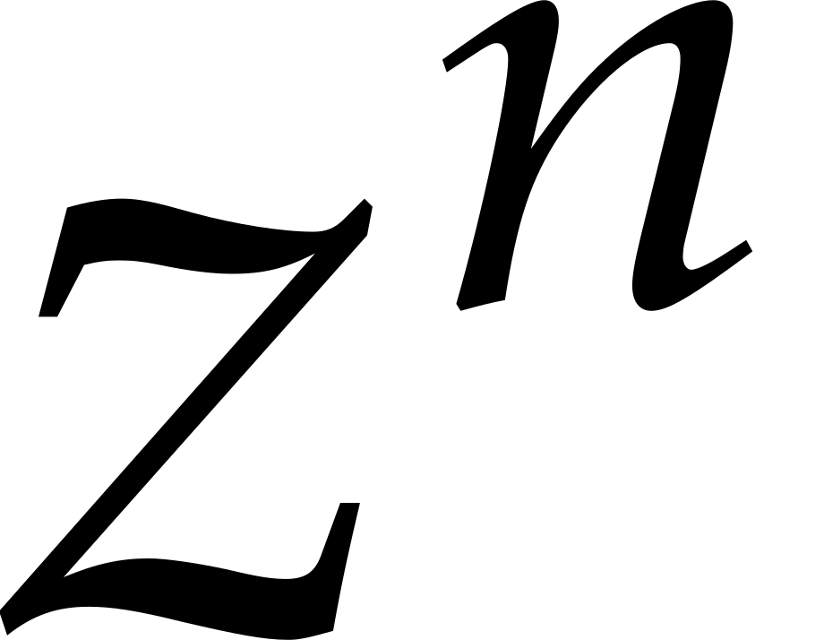 or 

### [8\[5\]](https://cdn.wittgensteinnachlass.com/2000px/webp/Ms-105/8.webp)

But what now becomes of my conception of the variable as a general constant & an unknown?

### [8\[6\]](https://cdn.wittgensteinnachlass.com/2000px/webp/Ms-105/8.webp),[10\[1\]](https://cdn.wittgensteinnachlass.com/2000px/webp/Ms-105/10.webp)

It is clear that I must explain the construction of mathematical sentence-signs by specifying how the sentences so formed are to be verified. For each sign indicates a method of verification.

### [10\[2\]](https://cdn.wittgensteinnachlass.com/2000px/webp/Ms-105/10.webp)

That is how I also treated the signs “(∃x)” and “(x)” above. Only now the truth-functions enter in as well.

### [10\[3\]](https://cdn.wittgensteinnachlass.com/2000px/webp/Ms-105/10.webp)

Do we arrive here at that transformation of “(x)(∃y)y = 2x” into “(x)(∃2x)” that I once indicated? (The possibility of turning a relative clause into an attribute in mathematical generality.)

### [10\[4\]](https://cdn.wittgensteinnachlass.com/2000px/webp/Ms-105/10.webp)

(x): x² = 4 ․≡․ x = + 2 ⌵ x = ‒ 2 means: “work out ‘(?)² = 4’ (i.e. do _not_ proceed by trial) and you will obtain +2 and ‒ 2” (and does the “and” here not show that the truth-function does not occur essentially in these sentences?)

### [10\[5\]](https://cdn.wittgensteinnachlass.com/2000px/webp/Ms-105/10.webp)

ξ, defined by the equation , has the values 2 and ‒ 2

ξ[(?)² = 4] = ξ[ + 2, ‒ 2]

### [10\[6\]](https://cdn.wittgensteinnachlass.com/2000px/webp/Ms-105/10.webp),[12\[1\]](https://cdn.wittgensteinnachlass.com/2000px/webp/Ms-105/12.webp)

(Ramsey understands the value I attach to a particular notation just as little as he understands the value I attach to a particular word, because he does not see that a whole way of looking at the object is expressed in it; the angle from which I am now considering the matter. Notation is the ultimate expression of the philosophical way of looking at things.)

### [12\[2\]](https://cdn.wittgensteinnachlass.com/2000px/webp/Ms-105/12.webp)

There must be a relation between the two conceptions of the variable.

### [12\[3\]](https://cdn.wittgensteinnachlass.com/2000px/webp/Ms-105/12.webp)

and both mean the same state of affairs that is also asserted in (a + b) = a² + 2ab + b² [but is that true?]

### [12\[4\]](https://cdn.wittgensteinnachlass.com/2000px/webp/Ms-105/12.webp)

Instead of “(∃x) x² + 3x + 2” could I also write  (with  understood as the result of working it out)?

### [12\[5\]](https://cdn.wittgensteinnachlass.com/2000px/webp/Ms-105/12.webp)

I do not yet see any system in all these questions.

### [12\[6\]](https://cdn.wittgensteinnachlass.com/2000px/webp/Ms-105/12.webp),[14\[1\]](https://cdn.wittgensteinnachlass.com/2000px/webp/Ms-105/14.webp)

I could write Fermat’s proposition like this: “The equation  _yields_ the solution:

(the opposite of this is “ does not _yield_ these solutions”; and of course the law of excluded middle holds.)

### [14\[2\]](https://cdn.wittgensteinnachlass.com/2000px/webp/Ms-105/14.webp)

But can one not say: But what if this very question were undecidable? Well, what if in some case the question whether fa = φa is the case were undecidable? Suppose, for instance, that someone had left us the proposition  without a proof & we were racking our brains over whether it was so or not, and someone said: “but perhaps that is undecidable”!

### [14\[3\]](https://cdn.wittgensteinnachlass.com/2000px/webp/Ms-105/14.webp)

Clearly I can write down the general sentence (with the general constants) only where it is analogous to the sentence 25² = 625, and that is where I know the rules of calculation for a & b just as I know the rules of calculation for 6, 2, & 5. This illustrates exactly what it means for a & b to be constants here: constant forms, namely.

### [14\[4\]](https://cdn.wittgensteinnachlass.com/2000px/webp/Ms-105/14.webp)

But what does it mean to know the rules of calculation?!

### [16\[1\]](https://cdn.wittgensteinnachlass.com/2000px/webp/Ms-105/16.webp)

Is it like this: I cannot apply the word “yields” as long as I know no method of solution, because _yields_ signifies a structure that I cannot designate without knowing it. Because the structure must be _represented_.

### [16\[2\]](https://cdn.wittgensteinnachlass.com/2000px/webp/Ms-105/16.webp)

I have _still_ not carried the intensional conception through completely!

### [16\[3\]](https://cdn.wittgensteinnachlass.com/2000px/webp/Ms-105/16.webp)

Every proposition is an instruction for a verification.

### [16\[4\]](https://cdn.wittgensteinnachlass.com/2000px/webp/Ms-105/16.webp)

What, then, _may_ I ask about in mathematics?

### [16\[5\]](https://cdn.wittgensteinnachlass.com/2000px/webp/Ms-105/16.webp)

Surely, with all due modesty, I may ask _in some sense_ about the relation of the basic rules to an – apparently – mathematical proposition. If this question has no sense, then _no_ question in mathematics has sense.

### [16\[6\]](https://cdn.wittgensteinnachlass.com/2000px/webp/Ms-105/16.webp),[18\[1\]](https://cdn.wittgensteinnachlass.com/2000px/webp/Ms-105/18.webp)

If I take the word “yields” to be essentially intensional, then the sentence “the equation G yields the solution a” means nothing as long as the word “yields” does not stand for a particular method. For that is precisely what I want to designate.

### [18\[2\]](https://cdn.wittgensteinnachlass.com/2000px/webp/Ms-105/18.webp)

What I have here is nothing but the old case: I cannot say that two complexes stand in a relation without depicting the relation logically.

### [18\[3\]](https://cdn.wittgensteinnachlass.com/2000px/webp/Ms-105/18.webp)

“The equation yields a” means: If I transform the equation according to certain rules, I obtain a, just as the equation 25 × 25 = 620 says that I obtain 620 if I apply the rules of multiplication to 25 × 25. But these rules must already be given to me before the word “yields” has meaning & before the question whether the equation yields a has sense.

### [18\[4\]](https://cdn.wittgensteinnachlass.com/2000px/webp/Ms-105/18.webp)

Fermat’s proposition thus has no _sense_ as long as I cannot _search_ for a solution of the equation in cardinal numbers.

### [20\[1\]](https://cdn.wittgensteinnachlass.com/2000px/webp/Ms-105/20.webp)

And “searching” must always mean: searching systematically. It is not searching if I wander about in infinite space looking for a gold ring.

### [20\[2\]](https://cdn.wittgensteinnachlass.com/2000px/webp/Ms-105/20.webp)

Our difficulty is largely due to the mistaken conception of the variable, namely the conception that treats it as if it _stood for_ _numbers_ (the extensional conception), whereas it stands for nothing, but is what it is. If it stood for numbers, then of course only 5³ + 7³ = 9³ would need to have sense, & the sense of the general propositions about the form  would follow from that. But since the variable is autonomous, a proposition containing it has sense only when it can be checked according to its own principles, as 5³ + 7³ = 9³ can be checked according to its own.

### [20\[3\]](https://cdn.wittgensteinnachlass.com/2000px/webp/Ms-105/20.webp)

The word “variable” is to be replaced by the word “number-form”. And this form is just as constant as the number 4.

### [20\[4\]](https://cdn.wittgensteinnachlass.com/2000px/webp/Ms-105/20.webp),[22\[1\]](https://cdn.wittgensteinnachlass.com/2000px/webp/Ms-105/22.webp)

Nor could we raise the question “Is 5 + 7 = 13?” if 5, 7 & 13 were not written down in _one_ system (or, what amounts to the same thing, if they are not written down in different systems that can be translated into one another).

### [22\[2\]](https://cdn.wittgensteinnachlass.com/2000px/webp/Ms-105/22.webp)

It would then be as with Brouwer’s pendulum number, about which one cannot decide whether it is greater or less than 0. But that means, of course, that one _cannot raise this question_. For “where one cannot search, one cannot ask either”.

### [22\[3\]](https://cdn.wittgensteinnachlass.com/2000px/webp/Ms-105/22.webp)

So it is not enough to say p is provable; it must be: provable according to a definite system.

### [22\[4\]](https://cdn.wittgensteinnachlass.com/2000px/webp/Ms-105/22.webp)

And what the proposition asserts is _not_ that p is provable according to the system S, but that it is provable according to _its_ system, the system of p. That p belongs to the system S cannot be asserted; it must show itself.

### [22\[5\]](https://cdn.wittgensteinnachlass.com/2000px/webp/Ms-105/22.webp),[24\[1\]](https://cdn.wittgensteinnachlass.com/2000px/webp/Ms-105/24.webp)

One cannot say p belongs to the system S; one cannot ask which system p belongs to; one cannot search for the system of p. To understand p is to understand its system. If p seemingly passes from one system to another, then in reality p has changed its sense.

### [24\[2\]](https://cdn.wittgensteinnachlass.com/2000px/webp/Ms-105/24.webp)

I hardly need say that where the law of excluded middle does not hold, no other proposition of logic holds either, because there we are not dealing with propositions of mathematics. (by contrast, Weyl & Brouwer)

### [24\[3\]](https://cdn.wittgensteinnachlass.com/2000px/webp/Ms-105/24.webp)

But would not the paradox follow from all this: that there are no difficult problems in mathematics, because what is difficult is not a problem?

### [24\[4\]](https://cdn.wittgensteinnachlass.com/2000px/webp/Ms-105/24.webp),[26\[1\]](https://cdn.wittgensteinnachlass.com/2000px/webp/Ms-105/26.webp)

But that is not quite how it is: The difficult problems of mathematics are those for whose solution we do not yet have a _written_ system. The mathematician who is _searching_ then has a system in some mental symbols, images, “in his head”, & tries to put it down on paper. Once he has done that, the rest is easier. But if he has _no_ system, either in written or in unwritten symbols, then he cannot _search_ for a solution either, but at most grope about. – Now one can indeed find something even by groping about without a plan. But then one has not searched for it, & the procedure, logically considered, was synthetic; whereas searching is an analytic process.

### [26\[2\]](https://cdn.wittgensteinnachlass.com/2000px/webp/Ms-105/26.webp)

What one can get hold of is a problem.

### [26\[3\]](https://cdn.wittgensteinnachlass.com/2000px/webp/Ms-105/26.webp)

Only where there can be a problem can anything be asserted!

### [26\[4\]](https://cdn.wittgensteinnachlass.com/2000px/webp/Ms-105/26.webp),[28\[1\]](https://cdn.wittgensteinnachlass.com/2000px/webp/Ms-105/28.webp)

If I know the rules of elementary trigonometry, I can check the proposition sin 2α = 2 sin α cos α, but not the proposition . But that means that the sin of elementary trigonometry & that of higher trigonometry are _different_ concepts. If we give them the same name, there is indeed a good reason for this: the second concept includes the multiplicity of the first; but for the system of elementary trigonometry the second proposition has _no sense_, & the question whether  is of course also senseless here.

### [28\[2\]](https://cdn.wittgensteinnachlass.com/2000px/webp/Ms-105/28.webp)

The two propositions stand, as it were, on two different planes. On the first I can move about as much as I like; I shall never reach the proposition of higher trigonometry.

### [28\[3\]](https://cdn.wittgensteinnachlass.com/2000px/webp/Ms-105/28.webp)

Now is it a proper question whether the trisection of the angle is possible? And what kind of proposition is it that trisection is not possible with compasses & straightedge, and what kind of proof does it have?

### [28\[4\]](https://cdn.wittgensteinnachlass.com/2000px/webp/Ms-105/28.webp)

One might say: Since it is not possible, one could never have searched for it either.

### [28\[5\]](https://cdn.wittgensteinnachlass.com/2000px/webp/Ms-105/28.webp)

As long as I do not _see_ the larger system that encompasses both, I cannot try to solve the higher problem.

### [28\[6\]](https://cdn.wittgensteinnachlass.com/2000px/webp/Ms-105/28.webp),[30\[1\]](https://cdn.wittgensteinnachlass.com/2000px/webp/Ms-105/30.webp)

I can ask whether the angle can be trisected with straightedge & compasses only when I see the system “straightedge & compasses” embedded in a larger one in which the problem can be solved; or rather, in which the problem is a problem, in which this question has sense. This is also shown by the fact that to prove the impossibility one _must_ step outside the Euclidean system.

### [30\[2\]](https://cdn.wittgensteinnachlass.com/2000px/webp/Ms-105/30.webp)

A system is, so to speak, a world.

### [30\[3\]](https://cdn.wittgensteinnachlass.com/2000px/webp/Ms-105/30.webp)

Or again: Every higher system is a world with more dimensions than the lower one.

### [30\[4\]](https://cdn.wittgensteinnachlass.com/2000px/webp/Ms-105/30.webp)

So one cannot look for a system. But one can look for the expression for a system that is given to me in unwritten symbols.

### [30\[5\]](https://cdn.wittgensteinnachlass.com/2000px/webp/Ms-105/30.webp),[32\[1\]](https://cdn.wittgensteinnachlass.com/2000px/webp/Ms-105/32.webp)

A pupil who had the tools of elementary trigonometry at his disposal & was asked to check the equation  would simply not find in written symbols what he needs to carry out this task. If the teacher nevertheless expects him to solve it, he assumes that the multiplicity of syntax presupposed by this solution is somehow present in another form in the pupil’s head. And in such a way that the pupil sees the symbolism of elementary trigonometry as a part of that unwritten symbolism & now translates the rest from the unwritten symbolism into a written one.

### [32\[2\]](https://cdn.wittgensteinnachlass.com/2000px/webp/Ms-105/32.webp)

The system of rules that determine a calculus thereby also determines the “meaning” of its signs. To put it more accurately: The form & the syntactic rules are equivalent. So if I change the rules – if I seemingly supplement them, for instance – I change the form, the meaning.

### [32\[3\]](https://cdn.wittgensteinnachlass.com/2000px/webp/Ms-105/32.webp),[34\[1\]](https://cdn.wittgensteinnachlass.com/2000px/webp/Ms-105/34.webp)

I cannot draw the limits of my world, but I can draw limits within my world. I cannot ask whether the sentence p belongs to the system S, but I can ask whether it belongs to the part s of S. So I can assign the problem of trisecting the angle its place in the larger system, but I cannot ask within the Euclidean system whether it is soluble. In what _language_ am I supposed to ask that? In the Euclidean language? And just as little can I ask in the Euclidean language about the possibility of bisecting the angle in the Euclidean system. For in this language that would amount to a question about possibility as such, & that question is always nonsensical.

### [34\[2\]](https://cdn.wittgensteinnachlass.com/2000px/webp/Ms-105/34.webp)

But there is nothing here that we would be entitled to call a hierarchy of types.

### [34\[3\]](https://cdn.wittgensteinnachlass.com/2000px/webp/Ms-105/34.webp)

In mathematics one cannot speak about systems in general, but only _in_ systems. They are precisely what one cannot speak about. And hence also what one cannot look for.

### [34\[4\]](https://cdn.wittgensteinnachlass.com/2000px/webp/Ms-105/34.webp)

The pupil who does not have the apparatus for answering the second question not only cannot answer it, but _he cannot understand it either_.

### [34\[5\]](https://cdn.wittgensteinnachlass.com/2000px/webp/Ms-105/34.webp)

This would be rather like the task the prince in the fairy tale sets the smith, to bring him a Klamank.

### [34\[6\]](https://cdn.wittgensteinnachlass.com/2000px/webp/Ms-105/34.webp),[36\[1\]](https://cdn.wittgensteinnachlass.com/2000px/webp/Ms-105/36.webp)

_Every_ legitimate proposition of mathematics must, like the proposition 12 × 13 = 137, set a ladder against its problem – which I can then climb if I want to. This holds of propositions of every kind of generality. (N.B. There is no ladder with “infinitely many” rungs.)

### [36\[2\]](https://cdn.wittgensteinnachlass.com/2000px/webp/Ms-105/36.webp)

One could also say: “(a + b)² = a² + 2ab + b²” says that solving the equation for a + b yields a = a & b = b. x² + 2x + 3 = 0 says that solving it yields definite numbers, if it is not merely a question.

### [36\[3\]](https://cdn.wittgensteinnachlass.com/2000px/webp/Ms-105/36.webp)

It is not just that we could “not know whether”; it would make _no sense_ in this context to speak of the same place or of different places. And since in reality it does make sense, our visual field does not have this structure. The real criterion of the structure is precisely which sentences make sense in it – not which are true. To look for this is the method of philosophy.

### [36\[4\]](https://cdn.wittgensteinnachlass.com/2000px/webp/Ms-105/36.webp)

One cannot assert that there is a process for arriving at the solution. For if there were no such process, the equation would be nonsensical as a general proposition. One can assert anything that can be checked by the act itself.

### [38\[1\]](https://cdn.wittgensteinnachlass.com/2000px/webp/Ms-105/38.webp)

It is the _possibility_ of checking that is at issue.

### [38\[2\]](https://cdn.wittgensteinnachlass.com/2000px/webp/Ms-105/38.webp)

An equation such as x² = 2x, set as a problem, is not an assertion. Read it as an assertion, and one sees this. If someone I wrote it down for as a problem read it in the tone of an assertion, I would say: “no, that is not how I mean it”.

### [38\[3\]](https://cdn.wittgensteinnachlass.com/2000px/webp/Ms-105/38.webp)

The two equations, written in this way, evidently give the _full_ answer to the question expressed in the first.

### [38\[4\]](https://cdn.wittgensteinnachlass.com/2000px/webp/Ms-105/38.webp),[40\[1\]](https://cdn.wittgensteinnachlass.com/2000px/webp/Ms-105/40.webp)

If in logic a question can be answered 1.) generally & 2.) in the particular case, then the particular answer must always prove to be a special case of the general one; or, to put it differently: the general case must always already contain the particular as a possibility. One instance of this is the calculation of the limit with δ & υ, which must contain the number system of the particular calculation. It must be possible to translate the general & the particular form into one another in a definite way.

### [40\[2\]](https://cdn.wittgensteinnachlass.com/2000px/webp/Ms-105/40.webp)

If I write (∃x) x² = 2x & do not understand (∃x) extensionally, then all it can assert is: “If I apply the rules for solving it, I arrive at a definite number, as opposed to the case in which I arrive at an identity or a forbidden equation”.

### [40\[3\]](https://cdn.wittgensteinnachlass.com/2000px/webp/Ms-105/40.webp)

How does the purely technical verification of (x): x² = 2x ⊃ x = 0 ⌵ x = 2 go? I work out x from one equation, substitute the value everywhere, & must then obtain a true proposition.

### [40\[4\]](https://cdn.wittgensteinnachlass.com/2000px/webp/Ms-105/40.webp)

Does the mere transformation of “x² = 2x” then yield the sentence “x = 0 ⌵ x = 2”?

### [40\[5\]](https://cdn.wittgensteinnachlass.com/2000px/webp/Ms-105/40.webp)

Does “x² = + 4” give “x = + 2 ⌵ x = ‒ 2”? I.e. are the truth-functions necessary? Or again: Does transformation according to the rules yield the two equations joined together as “x = + 2 ⌵ x = ‒ 2”?

### [42\[1\]](https://cdn.wittgensteinnachlass.com/2000px/webp/Ms-105/42.webp)

But what is the “(x)” doing in “(x): x² = 2x ⊃ x = 0 ⌵ x = 2”?

(It would be ridiculous to take it extensionally.) Is it a gen. constant? In any case, it is not an unknown.

Rules of substitution – a = a … W, a ≠ a … F or the like – can again show, in a purely technical way, that the proposition one gets by working it out is true. So here too x is a gen. constant.

### [42\[2\]](https://cdn.wittgensteinnachlass.com/2000px/webp/Ms-105/42.webp)

But what is the verification of (∃x)x² = 2x? I mean the specific verification of _this_ proposition, as _opposed_ to the verification of “(x): x² = 2x ⊃ x = 2 ⌵ x = 0”.

For must not the other proposition – i.e. the other sense – also be verified _differently_? The more general one, say, more generally.

### [42\[3\]](https://cdn.wittgensteinnachlass.com/2000px/webp/Ms-105/42.webp)

I may say “p ⌵ ~p” only if I understand “p”; thus I may say “5 × 5 = 11 ⌵ 5 × 5 ≠ 11” & the generality of the proposition makes no difference at all. I could sum up equations with numbers & equations with letters as follows: Transforming the left-hand side according to the rules yields the right-hand side, or it does not.

### [44\[2\]](https://cdn.wittgensteinnachlass.com/2000px/webp/Ms-105/44.webp)

But for this the two sides of the equation (N.B.: the _general_ one) must be – so to speak – _commensurable_.

### [44\[3\]](https://cdn.wittgensteinnachlass.com/2000px/webp/Ms-105/44.webp)

From the fact that the numerical equation  has commensurable sides, it does _not_ follow that  must have commensurable sides. For different rules of calculation apply to a & b than to 3 & 5.

### [44\[4\]](https://cdn.wittgensteinnachlass.com/2000px/webp/Ms-105/44.webp)

The classifications that philosophers & psychologists make are as if one were to try to classify clouds according to their shape.

### [44\[5\]](https://cdn.wittgensteinnachlass.com/2000px/webp/Ms-105/44.webp),[46\[1\]](https://cdn.wittgensteinnachlass.com/2000px/webp/Ms-105/46.webp)

The task of philosophy is to find the redeeming word.

### [VB](/w-vb/#ms-105-46.2) [46\[2\]](https://cdn.wittgensteinnachlass.com/2000px/webp/Ms-105/46.webp)

My way of philosophizing is still new to me, & new to me again and again, & that is why I must repeat myself so often. For another generation it will have become second nature & they will find the repetitions boring. For me they are necessary. – This method is essentially the transition from the question of _truth_ to the question of _sense_.

### [46\[3\]](https://cdn.wittgensteinnachlass.com/2000px/webp/Ms-105/46.webp)

“” If I do not take this extensionally, what does it say? (A mathematical proposition always says what its proof proves. I.e. it never says more than its proof proves.)

### [46\[4\]](https://cdn.wittgensteinnachlass.com/2000px/webp/Ms-105/46.webp)

If a proposition has sense, its opposite must have sense too.

### [46\[5\]](https://cdn.wittgensteinnachlass.com/2000px/webp/Ms-105/46.webp),[48\[1\]](https://cdn.wittgensteinnachlass.com/2000px/webp/Ms-105/48.webp)

It is clear that the question “_how many_ solutions does an equation have” has sense. [Incidentally, the answer is a numerical specification that one might take for an example of a mathematical proposition of a higher type; but this is precisely where it becomes clear that there is no such thing]

### [48\[2\]](https://cdn.wittgensteinnachlass.com/2000px/webp/Ms-105/48.webp)

The proposition “(x) x² + 2xy + y² = (x + y)²” has sense & is true; the proposition (x) x² = 2x has sense & is false. (When I see it I can say: “is that so? we shall soon see whether that is true; one need only …” & now I check it.) The proposition (∃x) x² = 2x has sense & is true. But what proposition with “(∃x)” corresponding to the second case has sense & is false? Perhaps (∃x) x² = 2x ∙ x = 1?

### [48\[3\]](https://cdn.wittgensteinnachlass.com/2000px/webp/Ms-105/48.webp)

But how do things stand? In the last case I can indeed say: We shall soon see whether that is true. But in the preceding case that does not seem possible at all. Yet in the last case I could just as well have written “(x)” instead of “(∃x)”. It is possible if, e.g., in “(∃)x”, “x” ranges only over real numbers. But that would mean that “(∃x) x² = 2x” is senseless if “x” is the unrestricted numerical form. If I had a method for separating equations that have a solution from those that do not, then the expression “(∃x) x² = 2x” would have sense with reference to that method.

### [50\[1\]](https://cdn.wittgensteinnachlass.com/2000px/webp/Ms-105/50.webp)

I can ask “what solution does the equation x² = 2x have”, but I cannot ask “does it have a solution”. For what would it look like if it did not have one? (Not _extensionally_!) Only when I know what is the case if a proposition is false does it have a sense. – But what if that other case were, say, that of the equation “(∃x) x² ‒ 2x ‒ x(x ‒ 2) = 0”? Then the proposition (∃x) x² = 2x would indeed have sense, & its proof would be that the rules do not allow the sides to be cancelled against each other.

### [50\[2\]](https://cdn.wittgensteinnachlass.com/2000px/webp/Ms-105/50.webp)

But what do the proofs that every equation of the nth degree has a solution prove? What questions does this proof answer? I cannot just ask questions at random!

### [50\[3\]](https://cdn.wittgensteinnachlass.com/2000px/webp/Ms-105/50.webp)

To the question “is there a solution to the equation  ?” one can always reply with the question “As opposed to what?”.

### [50\[4\]](https://cdn.wittgensteinnachlass.com/2000px/webp/Ms-105/50.webp)

If those proofs do what they claim to do, then they must take equations of the form  etc. as part of a larger system in which the opposite of what is to be proved has sense.

### [52\[1\]](https://cdn.wittgensteinnachlass.com/2000px/webp/Ms-105/52.webp)

5 × 25 = 625

What does the system that shows me commensurability consist in here?

### [52\[2\]](https://cdn.wittgensteinnachlass.com/2000px/webp/Ms-105/52.webp)

Presumably in the fact that multiplying two numbers written in this form according to the rule always gives me a number in the same form, & that a rule decides, for two numerals of this form, whether they designate the same number or different numbers.

### [52\[3\]](https://cdn.wittgensteinnachlass.com/2000px/webp/Ms-105/52.webp)

One could also characterize this conception as follows: It is impossible to discover rules of a new kind that apply to a form we know. If they are new rules, it is not the old form. The structure of rules must be _complete_ if we want to work with a concept at all. – _One cannot make discoveries in syntax._ – For it is this group of rules that _determines_ the sense of our signs, & any change (e.g. supplementation) of the rules means a change of sense.

### [52\[4\]](https://cdn.wittgensteinnachlass.com/2000px/webp/Ms-105/52.webp),[54\[1\]](https://cdn.wittgensteinnachlass.com/2000px/webp/Ms-105/54.webp)

Just as one cannot change the marks of a concept without changing _it_. (Frege)

### [54\[2\]](https://cdn.wittgensteinnachlass.com/2000px/webp/Ms-105/54.webp)

A system is a series of forms, & the operations that successively generate its members are described in the rules themselves.

### [54\[3\]](https://cdn.wittgensteinnachlass.com/2000px/webp/Ms-105/54.webp)

The opposite of “it is necessary that p hold for all numbers” is indeed “it is not necessary that …” and not “it is necessary that not …”. But now one thinks: if it is not _necessary_ that it hold for all numbers, it is possible all the same. But this is where the error lies, for one does not see that one has slipped into the extensional conception: The sentence “it is possible – even if not necessary – that p hold for all numbers” is nonsensical. For “_necessary_” & “_all_” belong together in mathematics. (So long as one does not replace this way of speaking altogether with a less misleading one.)

### [54\[4\]](https://cdn.wittgensteinnachlass.com/2000px/webp/Ms-105/54.webp)

What can (x) x² ≠ ‒ 1 mean? Surely it cannot say that all squares are unequal to ‒ 1.

### [56\[1\]](https://cdn.wittgensteinnachlass.com/2000px/webp/Ms-105/56.webp)

But can it not give us an instruction & say “if you come across a square, then it is not equal to ‒ 1”?

### [56\[2\]](https://cdn.wittgensteinnachlass.com/2000px/webp/Ms-105/56.webp)

But is that not precisely how the variable (I mean the gen. constant) is connected with the numbers?

### [56\[3\]](https://cdn.wittgensteinnachlass.com/2000px/webp/Ms-105/56.webp)

Is x² ≠ ‒ 1, then, the counterpart of a definition? Yes, insofar as it forbids a _form_. But is the notation right then?

### [56\[4\]](https://cdn.wittgensteinnachlass.com/2000px/webp/Ms-105/56.webp)

The difference between the conceptions of the variable comes out where a variable is set equal to a number.

### [56\[5\]](https://cdn.wittgensteinnachlass.com/2000px/webp/Ms-105/56.webp)

(x + y)² yields x² + 2xy + y² but surely x can never yield 1!

### [56\[6\]](https://cdn.wittgensteinnachlass.com/2000px/webp/Ms-105/56.webp)

Does the variable in “x² = 2x ∙ x = 2” serve only to link? (As ‘links’)”

### [56\[7\]](https://cdn.wittgensteinnachlass.com/2000px/webp/Ms-105/56.webp)

One could also ask: How am I to express the _description_ “the solution of the equation x² = 2x” in math. symbols?

Like this?: 

### [58\[1\]](https://cdn.wittgensteinnachlass.com/2000px/webp/Ms-105/58.webp),[61\[1\]](https://cdn.wittgensteinnachlass.com/2000px/webp/Ms-105/61.webp)

My difficulty is this: When I solve equations according to the rules in the domain of real numbers, rational numbers, or integers, in certain cases I arrive at apparent nonsense. Now if this happens: Am I to say that this proves that the original equation was nonsensical? So that only after I had finished applying the rules could I see whether it was nonsensical or had sense?! Must it not rather be put like this: The result of the apparently nonsensical equation does show something about the general form & does indeed connect the forbidden equation with ones that have a normal solution. The solution always shows how far the abnormal solution is from the normal one. If, e.g.,  is the result, I know that  would already be a normal root. The continuity, the connection with the normal solution, is not broken. Would that mean that the concept of imaginary numbers is already presupposed in the concept of real numbers as we represent it by our symbolism & its rules? That would be rather like saying of the straight line g that it falls short of intersecting the circle by a, instead of simply saying that it does not intersect it.

### [61\[2\]](https://cdn.wittgensteinnachlass.com/2000px/webp/Ms-105/61.webp)

One could say “it fails to intersect it by a certain amount” & would thereby represent the continuity with normal intersection. “It misses it by a definite amount”.

### [61\[3\]](https://cdn.wittgensteinnachlass.com/2000px/webp/Ms-105/61.webp)

But I can also put it like this: Since I cannot take the square root of ‒ 1, I may not apply to the equation x² = ‒ 1 the rule that otherwise takes me from x² = a to x = √a. So _I come to a standstill_ at x² = ‒ 1.

### [61\[4\]](https://cdn.wittgensteinnachlass.com/2000px/webp/Ms-105/61.webp)

So if I write ~(∃x) x² + 2x + 2 = 0, this could assert that I shall come to a standstill in solving the equation.

### [63\[1\]](https://cdn.wittgensteinnachlass.com/2000px/webp/Ms-105/63.webp)

### [63\[2\]](https://cdn.wittgensteinnachlass.com/2000px/webp/Ms-105/63.webp)

That is again like a general proposition & here the variable is a term. For after all I could also write it like this: { ‒ 1}² + 3{ ‒ 1} + 2 = 0. And here the braces could evidently indicate everything that the variable expressed above.

### [63\[3\]](https://cdn.wittgensteinnachlass.com/2000px/webp/Ms-105/63.webp)

Can one express by means of equations the prediction that the equation will not lead to a standstill?

### [63\[4\]](https://cdn.wittgensteinnachlass.com/2000px/webp/Ms-105/63.webp),[65\[1\]](https://cdn.wittgensteinnachlass.com/2000px/webp/Ms-105/65.webp),[67\[1\]](https://cdn.wittgensteinnachlass.com/2000px/webp/Ms-105/67.webp)

5 > 4 means that the equation 4 + x = 5 does not lead to a standstill. If I now ask “well, how can I know when something is a standstill”, then one would have to give me a general criterion that helps me decide in each particular case whether I can go on operating (the rules give these criteria). In a particular case such a criterion would be to say “the sign  must not be formed; you must stop short of this sign”. But how can I give the _general_ criterion for determining that I may not subtract the larger number from the smaller? Of course that can only be done with the help of variables. (With recursion) It then reads “one number is always greater than another if it looks so & so”; or “if the difference looks so & so then stop.” But this “so & so” must be described with the help of variables. And what kind of variable is this? Above all, one thing is essential: the equation or inequality in which it occurs cannot be one that one can prove. For the variable must not cancel out, otherwise I could not apply the rule in a particular case. It corresponds to the definition, which also contains a variable of the same kind. x ∙ x = x² Def. Now one really can take this as the instruction to substitute the corresponding expression “x²” for _all_ expressions “x ∙ x” _that one comes across_. Here the infinite _possibility_ is fixed in the finite. In the definition I merely indicate the infinite possibility. [ 1 + 1 = 2 Def. here the same as above]

### [67\[2\]](https://cdn.wittgensteinnachlass.com/2000px/webp/Ms-105/67.webp)

The “(∃x)” always refers to the working out of an equation & to what is supposed to come out of it.

### [67\[3\]](https://cdn.wittgensteinnachlass.com/2000px/webp/Ms-105/67.webp)

What about the proposition: “the equation x² + 3x + 2 = 0 yields a square number as a solution”? (or an even number etc. etc.)

### [67\[5\]](https://cdn.wittgensteinnachlass.com/2000px/webp/Ms-105/67.webp)

It seems to me that it is impermissible to say: _if a 3 comes up_, replace it with a 5.

### [67\[6\]](https://cdn.wittgensteinnachlass.com/2000px/webp/Ms-105/67.webp)

π' is different from π if the addition 3→5 has any sense at all. If it has no sense, then & only then can they be equal.

### [VB](/w-vb/#ms-105-67.7) [67\[7\]](https://cdn.wittgensteinnachlass.com/2000px/webp/Ms-105/67.webp)

It is good that I do not let myself be influenced!

### [67\[8\]](https://cdn.wittgensteinnachlass.com/2000px/webp/Ms-105/67.webp)

What if one introduced this substitution 3→5 into the very first rules of calculation, into the seed of π & √2, as it were?

### [69\[1\]](https://cdn.wittgensteinnachlass.com/2000px/webp/Ms-105/69.webp)

Something tells me that the addition does not affect π at all, but why not?

### [69\[2\]](https://cdn.wittgensteinnachlass.com/2000px/webp/Ms-105/69.webp)

Or is the truth that  is an irrational number of another system & that for the time being I cannot compare the two systems? But this means that in the system of multiplication, division etc. I cannot speak of  at all! In general one could say: Not every law determines a real number that I can use in my calculations. It must belong to our system of calculation, otherwise I know nothing about its position in our system. For it has _no_ position in it.

### [69\[3\]](https://cdn.wittgensteinnachlass.com/2000px/webp/Ms-105/69.webp)

The substitution 3→5 would belong, so to speak, in the foundations of an arithmetic, not as an appendage to a particular law.

### [69\[4\]](https://cdn.wittgensteinnachlass.com/2000px/webp/Ms-105/69.webp),[71\[1\]](https://cdn.wittgensteinnachlass.com/2000px/webp/Ms-105/71.webp)

It seems to me that in a correct intensional notation for the law of a real number one could not make the addition 3→5 at all; or else only in such a sense that it would always alter the law essentially.

### [71\[2\]](https://cdn.wittgensteinnachlass.com/2000px/webp/Ms-105/71.webp)

The difficulty is that the rest of the law of √2 does not seem essentially different in kind from the addition either, so that it too seems in some sense to be setting out on adventures into infinity, & it seems to me that I must be able to separate this adventuring from the rest.

### [71\[3\]](https://cdn.wittgensteinnachlass.com/2000px/webp/Ms-105/71.webp)

For it seems that the part of the law of √2 that concerns calculation with individual digits is inessential. For in this calculation it does indeed happen that I say “if a ‘3’ occurs in such & such a place, apply such & such a rule”.

### [71\[4\]](https://cdn.wittgensteinnachlass.com/2000px/webp/Ms-105/71.webp)

Is it that all _these_ rules are united in _one_ system?

### [71\[5\]](https://cdn.wittgensteinnachlass.com/2000px/webp/Ms-105/71.webp)

And that one can no longer influence a law once it has grown up, but only while it is still in the germ?

### [73\[1\]](https://cdn.wittgensteinnachlass.com/2000px/webp/Ms-105/73.webp)

Infinite possibility alone does not make an arithmetical law, otherwise the instruction to generate digits by throwing dice would also be an arithmetical law.

### [73\[2\]](https://cdn.wittgensteinnachlass.com/2000px/webp/Ms-105/73.webp)

The law must – I believe – grow out of the soil of the system.

### [73\[3\]](https://cdn.wittgensteinnachlass.com/2000px/webp/Ms-105/73.webp)

Can what I mean also be shown in this way: If my number system changes, I can always translate the process of expanding √2 into the new system, but not the addition 3→5.

### [73\[4\]](https://cdn.wittgensteinnachlass.com/2000px/webp/Ms-105/73.webp)

There is no number outside a system

### [73\[5\]](https://cdn.wittgensteinnachlass.com/2000px/webp/Ms-105/73.webp)

Not every infinite instruction is a real number!

### [VB](/w-vb/#ms-105-73.6) [73\[6\]](https://cdn.wittgensteinnachlass.com/2000px/webp/Ms-105/73.webp)

A good simile refreshes the understanding.

### [73\[7\]](https://cdn.wittgensteinnachlass.com/2000px/webp/Ms-105/73.webp)

What is the relationship of “a + (b + c) = (a + b) + c” to the definition a + (ξ + 1) = (a + ξ) + 1?

### [73\[8\]](https://cdn.wittgensteinnachlass.com/2000px/webp/Ms-105/73.webp),[75\[1\]](https://cdn.wittgensteinnachlass.com/2000px/webp/Ms-105/75.webp)

Calculating with cardinal numbers is prescribed for me by reality.

### [75\[2\]](https://cdn.wittgensteinnachlass.com/2000px/webp/Ms-105/75.webp)

“a + (b + c) = (a + b) + c” can be regarded as a fundamental rule of a system; as such one can only prescribe it, not _assert_ or deny it [so no law of excluded middle]. Yet it seems that I can also regard the proposition as the result of a proof. Has this proof answered a question, & which one? Has it proved an assertion true & hence its opposite false? But now it seems that I cannot prove the proposition at all in the sense in which it is a fundamental rule of a system. Rather, I prove something _about_ it.

### [75\[3\]](https://cdn.wittgensteinnachlass.com/2000px/webp/Ms-105/75.webp)

And indeed, all I _prove_ from a + (b + c) = (a + b) + c is a + (b + (c + 1)) = (a + b) + (c + 1), and this, to be sure, is of great importance for the application of the proposition. But the proof does not encompass the application either.

### [75\[4\]](https://cdn.wittgensteinnachlass.com/2000px/webp/Ms-105/75.webp),[77\[1\]](https://cdn.wittgensteinnachlass.com/2000px/webp/Ms-105/77.webp)

Ramsey thought that what I call recognizing the system is nothing more than the – perhaps unconscious – application of a general mathematical proposition. Thus, if I know that the question whether sin 3α = 5 cos α is correct is decidable, on Ramsey’s account I infer this merely from the law for sin α + β etc. But that is not true: I infer it from the fact that there is such a law, not from what it says.

### [77\[2\]](https://cdn.wittgensteinnachlass.com/2000px/webp/Ms-105/77.webp)

We must not confuse the infinite possibility of application with what is actually proved. The infinite possibility of application is _not_ proved!

### [77\[3\]](https://cdn.wittgensteinnachlass.com/2000px/webp/Ms-105/77.webp)

That proof by recursion of Skolem’s is really an existence proof. An existence proof is the proof that I can apply a system. But what form does such a proof take?

### [77\[4\]](https://cdn.wittgensteinnachlass.com/2000px/webp/Ms-105/77.webp)

What is striking about proof by recursion is above all that what it purports to prove is not what comes out of it.

### [79\[1\]](https://cdn.wittgensteinnachlass.com/2000px/webp/Ms-105/79.webp)

The proof shows that from the form 1) “a + (b + c) = (a + b) + c”, by means of the rule 2) “a + (b + 1) ≝ (a + b) + 1”, the form “a + (b + c(c + 1)) = (a + b) + (c + 1)” follows. Or, what amounts to the same thing, the form “a + (b + (c + 1))” can be transformed into “(a + b) + (c + 1)” with the help of rules 1) and 2). That is the whole reality of the proof. Everything else & the whole usual interpretation lie in the possibility of its application.

### [79\[2\]](https://cdn.wittgensteinnachlass.com/2000px/webp/Ms-105/79.webp)

[This recalls the train of thought about “Green ε Green”]

### [79\[3\]](https://cdn.wittgensteinnachlass.com/2000px/webp/Ms-105/79.webp)

And the usual error lies in confusing the extension of its application with what it actually contains.

### [79\[4\]](https://cdn.wittgensteinnachlass.com/2000px/webp/Ms-105/79.webp)

Of course I cannot deny a definition. It therefore has no sense either. It is a rule I can proceed by (or have to proceed by).

### [79\[5\]](https://cdn.wittgensteinnachlass.com/2000px/webp/Ms-105/79.webp)

I cannot negate the fundamental rules of a system – except as consequences of those very rules.

### [81\[1\]](https://cdn.wittgensteinnachlass.com/2000px/webp/Ms-105/81.webp)

Cardinal numbers are a form given in reality by things, just as rational numbers are given by extensions, etc. I mean, by real forms. So complex numbers are given by real multiplicities. [The symbols are real, after all.]

### [81\[2\]](https://cdn.wittgensteinnachlass.com/2000px/webp/Ms-105/81.webp)

Can one regard the commutative law as a definition? I think so, because order plays no role in _working out_ the sum. We cannot, e.g., add up 5 + 6 & then 6 + 5 and then see whether the same thing comes out. It is different with the associative law, on the other hand.

### [81\[3\]](https://cdn.wittgensteinnachlass.com/2000px/webp/Ms-105/81.webp)

The “c” in Skolem’s proof has as yet no meaning _in_ the proof; it stands for 1, or whatever else may emerge from the proof & _after_ the proof we are entitled to take it as any number. But surely it must already have meant something in the proof. If 1, why did we not write “1” instead of “c”? And if something else, what?

### [83\[1\]](https://cdn.wittgensteinnachlass.com/2000px/webp/Ms-105/83.webp)

What should interest us in the proof is not its concluding proposition at all, but that it follows from rules 1) & 2) & further that this proposition contains rule 1 as a special case. [Reductio ad absurdum]

### [83\[2\]](https://cdn.wittgensteinnachlass.com/2000px/webp/Ms-105/83.webp)

Skolem’s proof connects the rule for letters 2) with a rule about the counting sign “1”, and thus with numerical calculation.

### [83\[3\]](https://cdn.wittgensteinnachlass.com/2000px/webp/Ms-105/83.webp)

_It_ does not entitle me to assert a + (b + (c + d)) = (a + b) + (c + d), but it does entitle me – & that is its purpose – to apply rule 2) to any number whatsoever.

### [83\[4\]](https://cdn.wittgensteinnachlass.com/2000px/webp/Ms-105/83.webp)

Now suppose I want to apply the proposition to 5, 6, 7; the proof tells me that I am certainly entitled to do so. For if I write these numerals in the form (1 + 1 + 1…), I can recognize that the proposition is a member of that series of propositions which the last proposition in Skolem’s chain of proof represents for me. This recognition, again, is not something that can be proved, but is intuitive

### [85\[1\]](https://cdn.wittgensteinnachlass.com/2000px/webp/Ms-105/85.webp)

„Every symbol is what it is & not an other symbol”.

### [VB](/w-vb/#ms-105-85.2) [85\[2\]](https://cdn.wittgensteinnachlass.com/2000px/webp/Ms-105/85.webp)

It is difficult to describe a route to a short-sighted person. Because one cannot say to him “look at the church tower there 10 miles away from us and go in that direction.”

### [85\[3\]](https://cdn.wittgensteinnachlass.com/2000px/webp/Ms-105/85.webp)

Can there be no proof that merely shows that every multiplication in the decimal system according to the rules must yield a number in the decimal system? (So that recognizing the same system would after all rest on recognizing the truth of a mathematical proposition)

### [85\[4\]](https://cdn.wittgensteinnachlass.com/2000px/webp/Ms-105/85.webp),[87\[1\]](https://cdn.wittgensteinnachlass.com/2000px/webp/Ms-105/87.webp)

It would have to be analogous to a proof that adding forms 1 + 1 + 1… always produces numerals of this form again. Now can one prove that? The proof evidently lies in the rule for adding such expressions, i.e. in the definition & in nothing else. After all, to the question this proof is supposed to answer one could also say: Well, what _is_ the addition supposed to yield? (Or the multiplication, for that matter)

### [87\[2\]](https://cdn.wittgensteinnachlass.com/2000px/webp/Ms-105/87.webp)

A recursive proof is only a general instruction directing one to any particular proof. A signpost that directs all propositions of a certain form home along a certain path. It says to the proposition 2 + (3 + 4) = (2 + 3) + 4 “go in _this_ direction (follow this spiral) and you’ll get home.”

### [87\[3\]](https://cdn.wittgensteinnachlass.com/2000px/webp/Ms-105/87.webp)

In what sense, then, can one call such an instruction for proofs the proof of a general proposition? (Is that not like asking “in what sense can one call a signpost a path”?)

Yet it does justify applying a + (b + c) = (a + b) + c to numbers. Must there not, after all, be a legitimate transition from the proof schema to this expression?

### [87\[4\]](https://cdn.wittgensteinnachlass.com/2000px/webp/Ms-105/87.webp)

What is “(a + b) + c = a + (b + c)”, a general rule for numerical calculation or a rule for calculating in algebra?

### [89\[1\]](https://cdn.wittgensteinnachlass.com/2000px/webp/Ms-105/89.webp)

I know a proof with endless possibility, which, e.g., starts with “a + (b + 1) = (a + b) + 1” & goes on through “a + (b + 2) = (a + b) + 2” etc. etc. The “recursive proof” is the general form of progression in this series. But it must itself prove something, after all, for it actually saves me the proof of each proposition of the form “3 + (4 + 7) = (3 + 4) + 7”. But how, then, could it have proved this proposition? Evidently it points along that series of propositions.

this is a piece of the spiral taken from the middle.

ξ holds the place open for what only emerges as it is developed.

### [89\[2\]](https://cdn.wittgensteinnachlass.com/2000px/webp/Ms-105/89.webp),[91\[1\]](https://cdn.wittgensteinnachlass.com/2000px/webp/Ms-105/91.webp)

When I look at this series, I may be struck by its kinship with the definition a + (b + 1) = (a + b) + 1; by the fact that, if I substitute “1” for “c” and “1” for “d”, the two systems become the same.

### [91\[2\]](https://cdn.wittgensteinnachlass.com/2000px/webp/Ms-105/91.webp)

In any case, in the proof what is to be proved is not the end of the _chain of equations_.

### [91\[3\]](https://cdn.wittgensteinnachlass.com/2000px/webp/Ms-105/91.webp)

The proof shows the spiral form of the law.

### [91\[4\]](https://cdn.wittgensteinnachlass.com/2000px/webp/Ms-105/91.webp)

But not by yielding it as the result of the chain of inferences.

### [91\[5\]](https://cdn.wittgensteinnachlass.com/2000px/webp/Ms-105/91.webp)

We could also quite well imagine the proof carried out in an informal manner with 1, and with perhaps a few dots after it to indicate what we are to look at. _It would not be essentially less rigorous_. [for here what is different about the proof becomes still clearer.] Let us imagine it like that. _How_ does it then justify the proposition a + (b + c) = (a + b) + c?

### [91\[6\]](https://cdn.wittgensteinnachlass.com/2000px/webp/Ms-105/91.webp)

If the proof shows a piece of a spiral, then the algebraic sentence is a circle.

### [91\[7\]](https://cdn.wittgensteinnachlass.com/2000px/webp/Ms-105/91.webp),[93\[1\]](https://cdn.wittgensteinnachlass.com/2000px/webp/Ms-105/93.webp)

If one regards the proof as being of the same kind as the derivation of (x + y)² = x² + 2xy + y², then it proves the proposition “a + (b + (c + 1)) = (a + b) + (c + 1)” (on the assumption of a + (b + c) = (a + b) + c, i.e. the very proposition I wanted to prove) And it justifies – on this assumption – special cases such as 3 + (5 + (4 + 1)) = (3 + 5) + (4 + 1). It then has a generality too. But not the one we want. This generality is not confined to the letters, however; it lies just as much in definite numbers, & consists in the fact that one can repeat the proof.

### [93\[2\]](https://cdn.wittgensteinnachlass.com/2000px/webp/Ms-105/93.webp)

But how can I indicate by the sign “fa” what I see in the transition from f(1) to f(2)? (namely the possibility of repetition)

### [93\[3\]](https://cdn.wittgensteinnachlass.com/2000px/webp/Ms-105/93.webp)

How, then, does it show itself in the application of the proposition a + (b + c) = (a + b) + c that it holds for all numbers? Is this proposition not the simplest application of the associative law & not the law itself?

### [93\[4\]](https://cdn.wittgensteinnachlass.com/2000px/webp/Ms-105/93.webp)

Nor can I prove that a + (b + 1) = (a + b) + 1 is a special case of a + (b + c) = (a + b) + c; I have to see it. [No rule can help me here either, for once again I have to know what counts as a special case of the general rule]

### [95\[1\]](https://cdn.wittgensteinnachlass.com/2000px/webp/Ms-105/95.webp)

That is the unbridgeable gap between rule & application, or between law & special case.

### [95\[2\]](https://cdn.wittgensteinnachlass.com/2000px/webp/Ms-105/95.webp)

Rather, the proof shows that I can prove the rules a + (b + c) = (a + b) + c in every numerical case.

### [95\[3\]](https://cdn.wittgensteinnachlass.com/2000px/webp/Ms-105/95.webp)

Do the formulae of algebra not otherwise play this remarkable double role as a rule for signs & a sentence to which the rule is applied? (Frege)

### [95\[4\]](https://cdn.wittgensteinnachlass.com/2000px/webp/Ms-105/95.webp),[97\[1\]](https://cdn.wittgensteinnachlass.com/2000px/webp/Ms-105/97.webp)

a + (b + c) = (a + b) + c is a definition, a rule for algebraic calculation. It is _so chosen_ that this calculation accords with numerical calculation. It permits the same transition in algebraic calculation as holds for cardinal numbers, as the recursive proof shows. So a + (b + c) = (a + b) + c is not the result of this proof, but runs, as it were, parallel to it. What we take from that proof cannot be represented in a sentence at all, & for that very reason it cannot, of course, be denied either.

### [97\[2\]](https://cdn.wittgensteinnachlass.com/2000px/webp/Ms-105/97.webp)

But what about a definition like a + (b + 1) = (a + b) + 1 Def. This is not meant as a rule for algebraic calculation, but as an aid to explaining arithmetical expressions. It represents an _operation_ that I _can_ apply to any pair of numbers whatsoever.

### [97\[3\]](https://cdn.wittgensteinnachlass.com/2000px/webp/Ms-105/97.webp)

What about the occurrence of letters & numerals together in algebraic sentences? This can be of two kinds: a + 1 = b or 2 ∙ a = b. in the latter case one can get rid of the numeral & write a + a = b. But sin n ∙ π = 0? Here n stands for any number & the proposition can be proved recursively. But I can also regard it as an algebraic rule that has been brought into accord with what shows itself in the domain of numbers.

### [97\[4\]](https://cdn.wittgensteinnachlass.com/2000px/webp/Ms-105/97.webp),[99\[1\]](https://cdn.wittgensteinnachlass.com/2000px/webp/Ms-105/99.webp)

The correct expression of the associative law is not a sentence but precisely its “proof”, which, to be sure, does not assert the law but shows it. And here it becomes clear that one cannot deny this law, since it does not occur in the form of a sentence at all. One could of course deny the individual equations in the proof, but that would not deny the law. The law _escapes_ affirmation & denial.

### [99\[2\]](https://cdn.wittgensteinnachlass.com/2000px/webp/Ms-105/99.webp)

If the equation x² + 2x + 2 = 0 yields x = ‒ 1 ±  according to the rules of algebra, that is quite all right as long as we do not want the rules for x to accord with the rules for the real numbers. In that case the result of the algebraic calculation means that the equation has no solution.

### [99\[3\]](https://cdn.wittgensteinnachlass.com/2000px/webp/Ms-105/99.webp)

 asserts a property of the solution of this equation according to the rules of algebra. The solution according to these rules is in any case 1 ± i.

### [99\[4\]](https://cdn.wittgensteinnachlass.com/2000px/webp/Ms-105/99.webp),[101\[1\]](https://cdn.wittgensteinnachlass.com/2000px/webp/Ms-105/101.webp)

But what does it mean to assert of a sign of algebra that it is real? Unless what this expresses is that different rules now hold for this variable. And this rule might consist in one’s having to regard the proposition (∃x) x² + ax + b = 0 as false if .

### [101\[2\]](https://cdn.wittgensteinnachlass.com/2000px/webp/Ms-105/101.webp)

One speaks of the problem of finding the formula for the solution of an equation.

### [101\[3\]](https://cdn.wittgensteinnachlass.com/2000px/webp/Ms-105/101.webp)

If the proof that every equation has a root is a recursive proof, then that means that the fundamental theorem of algebra is not a mathematical _proposition_ proper.

### [101\[4\]](https://cdn.wittgensteinnachlass.com/2000px/webp/Ms-105/101.webp)

To know that one can prove something is to have proved it.

### [103\[1\]](https://cdn.wittgensteinnachlass.com/2000px/webp/Ms-105/103.webp),[105\[1\]](https://cdn.wittgensteinnachlass.com/2000px/webp/Ms-105/105.webp)

7 + (8 + 9) = (7 + 8) + 9 How do I know that this is so without having proved it separately? And do I know it _just as well_ as if I had derived it in full? Yes! – Then it really has been proved. And in that case it cannot be proved any _better_, say by carrying the derivation right through to this proposition itself. So after going through one turn of the spiral I must be able to say “stop! I don’t need any more, I can already see how it goes on” & any further ascent would then have to be simply superfluous & not make the matter any clearer after all. So if I draw all the turns of the spiral up to my point, I cannot see any better that it leads there than if I draw just _one_ turn. But is that so? I believe it is. It is just that both show the same thing in different forms. I can, so to speak, follow the fully drawn spiral unthinkingly & arrive at my point, whereas I have to interpret the one turn I have drawn in a particular way to gather from it that, if extended, it leads to point A. That is: I can gather the same thing from the proof for 6 + (7 + 8) = (6 + 7) + 8 worked out in full as from the one that describes only one “turn”, only in a different way. And in any case the _one_ turn _together with the forms of the numbers_ in the given equation is a complete proof of that equation. It is as if I said: “You want to get to point A? Yes, _that_ point you can reach with _this_ spiral.”

### [105\[2\]](https://cdn.wittgensteinnachlass.com/2000px/webp/Ms-105/105.webp)

What is the system of prescriptions to which real numbers correspond? Or: What kind of digit-generating prescriptions _are_ real numbers?

### [105\[3\]](https://cdn.wittgensteinnachlass.com/2000px/webp/Ms-105/105.webp)

I have done no work for 14 days. Now let us see whether I can get going again. I have not yet settled down. And my thoughts _flutter_ about the object.

### [108\[1\]](https://cdn.wittgensteinnachlass.com/2000px/webp/Ms-105/108.webp)

Phenomenological language describes exactly the same thing as ordinary, physical language. It must merely restrict itself to what is verifiable.

### [108\[2\]](https://cdn.wittgensteinnachlass.com/2000px/webp/Ms-105/108.webp)

Is that possible at all?

### [108\[3\]](https://cdn.wittgensteinnachlass.com/2000px/webp/Ms-105/108.webp)

Let us not forget that physical language, too, describes only the primary world & not some hypothetical world. The hypothesis is merely an assumption about the most practical way of representing it.

### [108\[4\]](https://cdn.wittgensteinnachlass.com/2000px/webp/Ms-105/108.webp)

Now is this hypothetical element essential to every representation of the world?

### [108\[5\]](https://cdn.wittgensteinnachlass.com/2000px/webp/Ms-105/108.webp),[110\[1\]](https://cdn.wittgensteinnachlass.com/2000px/webp/Ms-105/110.webp)

Suppose I had so good a memory that I could remember all my sense impressions. Then there is nothing to prevent me from describing them. That would be the description of a life. And why should I not be able to leave everything hypothetical out of this description?

### [110\[2\]](https://cdn.wittgensteinnachlass.com/2000px/webp/Ms-105/110.webp)

I could, for example, represent the visual images in three dimensions, perhaps on a reduced scale, with plaster figures that I would model only to the extent that I had actually seen them, marking the rest as inessential by a particular colouring or way of modelling it, say.

### [110\[3\]](https://cdn.wittgensteinnachlass.com/2000px/webp/Ms-105/110.webp)

So far everything would go perfectly well. But what about the time I need for this representation? I assume that I could “write” this language – produce the representation – as fast as my memory runs. But suppose I then read through this description again: is it not now hypothetical after all? And why not?

### [110\[4\]](https://cdn.wittgensteinnachlass.com/2000px/webp/Ms-105/110.webp),[112\[1\]](https://cdn.wittgensteinnachlass.com/2000px/webp/Ms-105/112.webp)

Let us imagine a representation of this sort: the bodies I seem to see are moved by a mechanism in such a way that they would have to give two eyes set at a particular place in the model the visual images to be represented. The visual image described is then determined by the position of the eyes in the model & by the position & movement of the bodies. One could imagine operating the mechanism by turning a crank, for instance, & thereby “reading off” the description.

### [112\[2\]](https://cdn.wittgensteinnachlass.com/2000px/webp/Ms-105/112.webp)

Is it not clear that this would be the most immediate description imaginable? That is, that anything purporting to be still more immediate would have to cease to be a description?

### [112\[3\]](https://cdn.wittgensteinnachlass.com/2000px/webp/Ms-105/112.webp),[114\[1\]](https://cdn.wittgensteinnachlass.com/2000px/webp/Ms-105/114.webp)

What would come out then, instead of a description, would be that inarticulate sound with which some authors would like to begin philosophy [“I consciously have something, knowing of my knowledge”] One simply cannot begin before the beginning.

### [114\[2\]](https://cdn.wittgensteinnachlass.com/2000px/webp/Ms-105/114.webp)

Language itself belongs to the second system. When I describe a language, what I am describing is essentially something physical. But how can a physical language describe the phenomenon?

### [114\[3\]](https://cdn.wittgensteinnachlass.com/2000px/webp/Ms-105/114.webp)

Is it not like this: the phenomenon (specious present) contains time, but is not in time? Its form is time, but it has no place in time.

### [114\[4\]](https://cdn.wittgensteinnachlass.com/2000px/webp/Ms-105/114.webp)

Whereas language unfolds in time.

### [114\[5\]](https://cdn.wittgensteinnachlass.com/2000px/webp/Ms-105/114.webp)

What we understand by the word “language” unfolds in homogeneous physical time. (As the comparison with the mechanism makes perfectly clear)

### [114\[6\]](https://cdn.wittgensteinnachlass.com/2000px/webp/Ms-105/114.webp)

Only what corresponds to this mechanism in the primary world could be the primary language.

### [116\[1\]](https://cdn.wittgensteinnachlass.com/2000px/webp/Ms-105/116.webp)

The application of Russell’s & Frege’s theory of numbers presupposes that one can construct propositional functions of the kind “x = a ⌵ x = b ⌵ x = c” etc. This construction amounts to using extensions extensionally, for the introduction of identity can give no other sense. – – – –

### [116\[2\]](https://cdn.wittgensteinnachlass.com/2000px/webp/Ms-105/116.webp)

It is as if, with phenomenological language, I were entering an enchanted swamp where everything one can grasp vanishes.

### [116\[3\]](https://cdn.wittgensteinnachlass.com/2000px/webp/Ms-105/116.webp)

Suppose the world consisted of an unchanging visual field, would it not then be possible to describe it. For example, in the centre of a red visual field there is a blue circular patch.

### [116\[4\]](https://cdn.wittgensteinnachlass.com/2000px/webp/Ms-105/116.webp),[118\[1\]](https://cdn.wittgensteinnachlass.com/2000px/webp/Ms-105/118.webp)

Although here too what goes on when the sentence is read cannot be described in the sentence. But what importance can this description of the present phenomenon have? It seems as though occupying ourselves with this question were downright childish & we had got into a dead end. And yet it is a significant dead end, for everyone is tempted to go down it; as if that were where the ultimate solution to the philosophical problem was to be sought.

### [118\[2\]](https://cdn.wittgensteinnachlass.com/2000px/webp/Ms-105/118.webp),[120\[1\]](https://cdn.wittgensteinnachlass.com/2000px/webp/Ms-105/120.webp)

On the other hand it is clear that we need a way of expressing ourselves in which we can represent the phenomena of visual space – for example – in isolation, as such. “I see a lamp standing on the table”, as it has to be understood in our ordinary language, says more than the description of visual space. A correct description would indeed be: “It seems to me as if I saw a lamp standing on a table” But this form of expression is misleading, because it makes it appear that nothing real is being described, but rather something that is by its nature unclear. Whereas all that “it seems” says is that something is being described as a special case of a general rule, & the only uncertainty is whether further events will admit of description as special cases of the same rule. There seems to be a sine curve on the film, of which we see separate stretches. That is: What we see can be described by means of a sine curve on the film & certain interruptions of the beam of light. It seems that around the circle K a concentric circle

has been drawn & abcdef have been drawn as tangents to it.

### [120\[2\]](https://cdn.wittgensteinnachlass.com/2000px/webp/Ms-105/120.webp),[122\[1\]](https://cdn.wittgensteinnachlass.com/2000px/webp/Ms-105/122.webp)

The verification of language – that is, the act by which it acquires its sense – does, to be sure, take place in the present.

### [122\[2\]](https://cdn.wittgensteinnachlass.com/2000px/webp/Ms-105/122.webp)

It follows from the foregoing – and this is, incidentally, self-evident – that phenomenological language represents the same thing as our ordinary physical way of expressing ourselves & has only the advantage that with it one can express some things more briefly & with less danger of misunderstanding.

### [122\[3\]](https://cdn.wittgensteinnachlass.com/2000px/webp/Ms-105/122.webp)

It might, for example, on some occasion be practical to give my hands & other people’s hands proper names, so as not always to have to speak, when talking about them, of their relation to a person, which is inessential to the hands themselves, & because the ordinary way of speaking might give the impression that the relation to the owner of a hand is something that lies in the nature of the hand itself.

### [122\[4\]](https://cdn.wittgensteinnachlass.com/2000px/webp/Ms-105/122.webp),[124\[1\]](https://cdn.wittgensteinnachlass.com/2000px/webp/Ms-105/124.webp)

Visual space is essentially without an owner.

### [124\[2\]](https://cdn.wittgensteinnachlass.com/2000px/webp/Ms-105/124.webp)

Suppose now that I always see a particular object along with all the others in visual space – namely my nose – Another person naturally does not see this object in the same way. Does that not mean, after all, that the visual space I am talking about _belongs to me_? That it is therefore subjective. No. It has merely been conceived subjectively here; and set in opposition to it is an objective space, which, however, is only a construction with visual space as its basis. In the – secondary – language of “objective” – physical – space, visual space is called subjective, or rather, what corresponds directly to visual space in this language is called subjective. As if one were to say: in the language of the real numbers, what corresponds directly in their realm to the cardinal numbers is called the “positive integers”.

### [124\[3\]](https://cdn.wittgensteinnachlass.com/2000px/webp/Ms-105/124.webp),[126\[1\]](https://cdn.wittgensteinnachlass.com/2000px/webp/Ms-105/126.webp)

In the model described earlier, the two eyes that see the objects, or their location, need not be indicated. That is just _one_ way of representing it. It works just as well, for example, if the part of the objects that is “seen” is marked with paint. Of course, one can always determine the position of two eyes from the boundaries of the painted area, but that corresponds only to translating one way of expressing oneself into another.

### [126\[2\]](https://cdn.wittgensteinnachlass.com/2000px/webp/Ms-105/126.webp)

The essential thing is that the representation of visual space represents an object & contains no hint of a subject.

### [126\[3\]](https://cdn.wittgensteinnachlass.com/2000px/webp/Ms-105/126.webp),[128\[1\]](https://cdn.wittgensteinnachlass.com/2000px/webp/Ms-105/128.webp)

Suppose every part of my body could be removed except for one eyeball; it would be fixed somewhere so that it could not move & would retain the ability to see. How would the world appear to me? I could not perceive any part of myself, & assuming that my eyeball was transparent to me, I could not see myself in a mirror either. Now one question is: could I locate myself by means of my visual image? To locate myself here means, of course, only to establish a particular structure of visual space.

### [128\[2\]](https://cdn.wittgensteinnachlass.com/2000px/webp/Ms-105/128.webp)

Now does anything compel me to adopt the interpretation that the tree I see through my window is larger than the window. If I have a sense of how far the objects are from my eye, then that is a warranted interpretation. But even then it is a representation in a space other than visual space, for what corresponds to the tree in visual space is clearly smaller than what corresponds to the window. Or must I say: yes, that simply depends on how one applies the words “larger” & “smaller”.

### [128\[3\]](https://cdn.wittgensteinnachlass.com/2000px/webp/Ms-105/128.webp)

And that is how it is: I can use the words “larger” & “smaller” in both ways in visual space. And in one sense the visual tree is smaller than the visual window, in the other it is larger.

### [130\[1\]](https://cdn.wittgensteinnachlass.com/2000px/webp/Ms-105/130.webp)

Suppose my eyeball were fixed here behind the window, so that _I_ would see most things through the window. Then this window could take over the role of a part of my body. What is close to the window is close to me. (I assume that I see 3-dimensionally with my eye) I also assume that I can see my eyeball in the mirror and that I perceive similar eyeballs, say, on the trees outside.

### [130\[2\]](https://cdn.wittgensteinnachlass.com/2000px/webp/Ms-105/130.webp)

Now how can I recognize, or come to assume, that I see the world through the pupil of my eyeball? Surely in much the same way as I recognize or come to assume that I see it through the window, or through a hole in a board just in front of my eye, say.

### [130\[3\]](https://cdn.wittgensteinnachlass.com/2000px/webp/Ms-105/130.webp),[132\[1\]](https://cdn.wittgensteinnachlass.com/2000px/webp/Ms-105/132.webp)

Indeed, if my eye sat freely at the tip of a branch, one could make its position quite clear to me by bringing a finger ring closer and closer until at last I saw everything through it. Indeed, one could also bring up what used to surround my eye: the cheekbone arch, nose, etc., & I would know where everything belongs.

### [132\[2\]](https://cdn.wittgensteinnachlass.com/2000px/webp/Ms-105/132.webp)

But does all this mean that the visual image does, after all, essentially contain or presuppose a subject?

### [132\[3\]](https://cdn.wittgensteinnachlass.com/2000px/webp/Ms-105/132.webp)

Or is it not rather that those experiments give me only purely geometrical information.

### [132\[4\]](https://cdn.wittgensteinnachlass.com/2000px/webp/Ms-105/132.webp)

That is, information that again and again concerns only the object. Objective information about reality.

### [132\[5\]](https://cdn.wittgensteinnachlass.com/2000px/webp/Ms-105/132.webp),[133\[1\]](https://cdn.wittgensteinnachlass.com/2000px/webp/Ms-105/133.webp)

In visual space there is not one eye that belongs to me & other eyes that belong to others. Only the space itself is asymmetrical; the objects in it are on an equal footing. In physical space, however, this is represented by singling out one of the eyes that occupy positions of equal standing & calling it _my_ eye.

---

### [133\[2\]](https://cdn.wittgensteinnachlass.com/2000px/webp/Ms-105/133.webp)

I want to know what is going on behind me & turn round. If I were prevented from doing so, would I not still have the image of space extending all around me? Certainly. And the image that I get to see the objects that are now behind me by turning round. _So_ it is the possibility of turning round that helps me arrive at that image of space. The resulting space around me is thus a mixture of visual space & space of muscular feeling.

---

### [133\[3\]](https://cdn.wittgensteinnachlass.com/2000px/webp/Ms-105/133.webp)

Without the feeling of being able to “turn round”, my image of space would be _essentially_ different.

---

### [133\[4\]](https://cdn.wittgensteinnachlass.com/2000px/webp/Ms-105/133.webp)

Thus the freely mounted, immobile eye would have no image of a space surrounding it.

---

### [133\[5\]](https://cdn.wittgensteinnachlass.com/2000px/webp/Ms-105/133.webp),[134\[1\]](https://cdn.wittgensteinnachlass.com/2000px/webp/Ms-105/134.webp)

Is it not possible that we see in depth with one eye because our brain etc. produces the visual image that it is forced to see again and again through the continual use of two eyes. It is even quite obvious that this is so, as the case

shows.

---

### [134\[2\]](https://cdn.wittgensteinnachlass.com/2000px/webp/Ms-105/134.webp)

Immediate experience cannot contain a contradiction. If it is beyond all saying & gainsaying, then no need for explanation can arise either, no feeling that it must be possible to explain what happens because otherwise something would not be right.

### [134\[3\]](https://cdn.wittgensteinnachlass.com/2000px/webp/Ms-105/134.webp),[BCr\[1\]](https://cdn.wittgensteinnachlass.com/2000px/webp/Ms-105/BCr.webp)

What happens, then, when one closes one’s eyes: One does not stop seeing, after all. But what one sees here surely contains no relation to an eye. And it is the same with a dream image. But even in normal seeing it is clear that the exceptional position of my body in visual space derives only from other feelings localized in my body and not from anything purely visual.
