# Ms-106

2 published remarks, VB

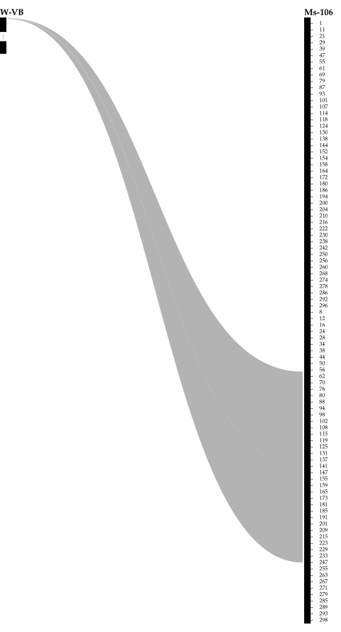

### [Ir\[1\]](https://cdn.wittgensteinnachlass.com/2000px/webp/Ms-106/Ir.webp)

## Volume II.

### [2\[1\]](https://cdn.wittgensteinnachlass.com/2000px/webp/Ms-106/2.webp)

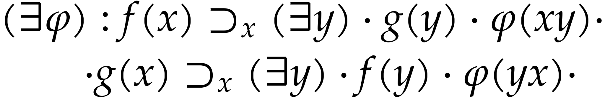 &

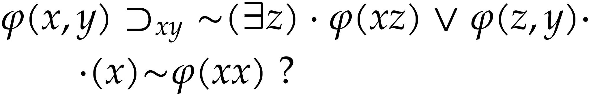

### [2\[2\]](https://cdn.wittgensteinnachlass.com/2000px/webp/Ms-106/2.webp)

fa ⊃ ga ∙ (a ≠ a ∙ a ≠ a) ⌵ gb ∙ (a ≠ a ∙ b ≠ b) ⌵ …

fb ⊃ ga ∙ (b ≠ b ∙ a ≠ a) ⌵ gb ∙ (b ≠ b ∙ b ≠ b) ⌵ …

fc ⊃ – – – – – – – –

– – – – – – – – – – &

& ga ⊃ fa(a ≠ a ∙ a ≠ a) ⌵ fb(b ≠ b ∙ a ≠ a) ⌵ … ⌵

⌵ 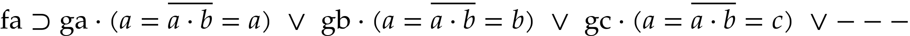

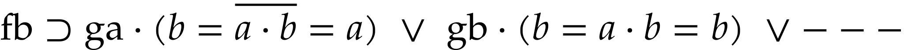

fc ⊃ – – – – – –

– – – – –

g – – – – – – ⌵

⌵ fa ⊃ ga ∙ (a = a ∙ b = a ․⌵․ a = c ∙ d = a) ⌵ gb ∙ (a = a ∙ b = b ․⌵․ – – –

⌵ – – –

### [4\[1\]](https://cdn.wittgensteinnachlass.com/2000px/webp/Ms-106/4.webp)

I should like to know whether this work is the right work for me.

### [4\[2\]](https://cdn.wittgensteinnachlass.com/2000px/webp/Ms-106/4.webp)

I am interested in it but not enthusiastic about it.

### [4\[3\]](https://cdn.wittgensteinnachlass.com/2000px/webp/Ms-106/4.webp)

It is remarkable what a relief it is to me to write down in a secret script some things that I would not like to write legibly.

### [4\[4\]](https://cdn.wittgensteinnachlass.com/2000px/webp/Ms-106/4.webp)

Somehow I regard my present work as provisional. – As a means to an end.

### [1\[1\]](https://cdn.wittgensteinnachlass.com/2000px/webp/Ms-106/1.webp)

Thus by negating all the sentences in that series I do not arrive at the infinite.

### [1\[2\]](https://cdn.wittgensteinnachlass.com/2000px/webp/Ms-106/1.webp)

In what sense does a notation for the infinite presuppose infinite space or infinite time?

### [1\[3\]](https://cdn.wittgensteinnachlass.com/2000px/webp/Ms-106/1.webp)

An infinitely large piece of paper is of course not presupposed. But presumably its possibility is?

### [1\[4\]](https://cdn.wittgensteinnachlass.com/2000px/webp/Ms-106/1.webp)

What about the infinity of space; does it presuppose infinitely many objects? I believe not. But what does this potential infinity consist in?

### [1\[5\]](https://cdn.wittgensteinnachlass.com/2000px/webp/Ms-106/1.webp),[3\[1\]](https://cdn.wittgensteinnachlass.com/2000px/webp/Ms-106/3.webp)

Surely we can imagine a notation that proceeds in time instead of in space. Speech, for instance. Here too we can evidently imagine the infinite being represented. And in doing so we are surely making no _hypothesis_ about time. It appears to us as essentially an _infinite_ possibility. And evidently infinite, given what we know about its structure.

### [3\[2\]](https://cdn.wittgensteinnachlass.com/2000px/webp/Ms-106/3.webp)

Must we have the possibility of the infinite notation in our heads, as it were? What do we think when we think of boundlessness?

### [3\[3\]](https://cdn.wittgensteinnachlass.com/2000px/webp/Ms-106/3.webp)

Surely it is impossible that mathematics should depend on a hypothesis about physical space! And _visual space_ is not infinite in this sense, after all. And if what is at issue is not the actuality but only the possibility of the hypothesis of infinite space, then surely this possibility must be prefigured somewhere.

### [3\[4\]](https://cdn.wittgensteinnachlass.com/2000px/webp/Ms-106/3.webp),[5\[1\]](https://cdn.wittgensteinnachlass.com/2000px/webp/Ms-106/5.webp)

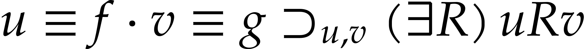

In this sum there are first a series of terms in which u or v does not fit f or g respectively; in this case the right-hand side can be t or c, and the implication always holds because the left-hand side is false. Finally comes the case where u fits g and v fits f & now the left-hand side is either t, in which case the proposition is true, or c, in which case it is false. But what does it mean to say that u fits f? Is that a sentence? – This sentence would be expressed, for instance, by: 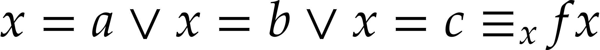 but that amounts to fa ≡ t ∙ fb ≡ t ∙ fc ≡ t ∙ fd ≡ cont. …

### [5\[2\]](https://cdn.wittgensteinnachlass.com/2000px/webp/Ms-106/5.webp),[7\[1\]](https://cdn.wittgensteinnachlass.com/2000px/webp/Ms-106/7.webp)

The old notation was fa ∙ fb ∙ fc ∙ ~(∃xyzu) ∙ fx ∙ fy ∙ fz ∙ fu,

the new notation would be fa ≡ t ∙ fb ≡ t ∙ fc ≡ t ∙ fd ≡ cont. fe ≡ cont. etc. but that simply means: fa ∙ fb ∙ fc ∙ ~ fd ∙ ~ fe etc.

fa ∙ fb ∙ ~fc ∙ ~fd … ∙ ge ∙ gh ∙ ~gi ∙ ~gl ⊃ ⊃ (∃R) (a,b) R (e,h)

I.e. f & g are similar if similar extensions fit them. – But how does one show the similarity of the extensions? Like this: I lay down a rule by which I can test any two extensions for similarity, by means of a correlation that I actually carry out on the signs. This correlation is constructed according to a certain rule & this rule must contain the formal series, or let us say the _general form_ of this correlation, i.e. the _variable correlation_.

### [7\[2\]](https://cdn.wittgensteinnachlass.com/2000px/webp/Ms-106/7.webp),[9\[1\]](https://cdn.wittgensteinnachlass.com/2000px/webp/Ms-106/9.webp)

The extensions u & v occur in the explanation of the correlation R, which is to be 1→1; these are the values of a series of forms, represented by the values of, say, two variable functions φ & ψ that range over a series of forms. The general form of the above correlation comes about through u & v running through the values of a predetermined _general form_. Some of these values fit into the 1-1 relation, others do not. Those that fit are separated from those that do not by using “ = ” in the correlation to mark with a c those that cannot be correlated & with a t those that can. I have the extensions

a b c [x = a ⌵ x = b ⌵ x = c]

and

d e f [x = d ⌵ x = e ⌵ x = f]

and now I try correlations of a certain general form

namely x = r ∙ y = s then x = r ∙ y = s ⌵ x = u ∙ y = v then x = r ∙ y = s ⌵ x = u ∙ y = v ⌵ x = t ∙ y = w etc.

That such a correlation fits is shown by the fact that the combinations of the general forms of extension & the general form of relation yield a t in certain cases and a c in others. But to be able to combine these forms generally at all, one already needs

a general law, but this general law simply says that one must let the variable run through all the values. These values are, as it were, links by which certain buttonholes are held together, coupled.

### [11\[1\]](https://cdn.wittgensteinnachlass.com/2000px/webp/Ms-106/11.webp)

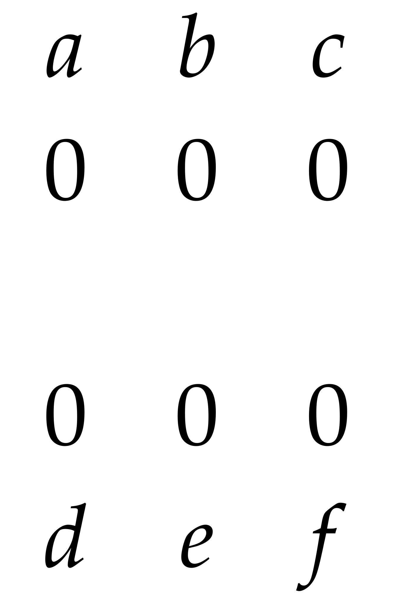

Those are the buttonholes; the relation is then a class of links bearing an inscription on each button. “To fit” means that the inscription on the button agrees with that on the buttonhole; and conversely. The instruction reads: fasten all the links into the holes; try them in a certain order so that no combination is left untried; if a class of buttons then fits, the classes of buttonholes are similar. The _general form_ then appears first in the general form of the class of buttons & secondly in the fixing of the order of the trials.

### [11\[2\]](https://cdn.wittgensteinnachlass.com/2000px/webp/Ms-106/11.webp)

Is infinity merely an indeterminacy?

### [11\[3\]](https://cdn.wittgensteinnachlass.com/2000px/webp/Ms-106/11.webp),[13\[1\]](https://cdn.wittgensteinnachlass.com/2000px/webp/Ms-106/13.webp)

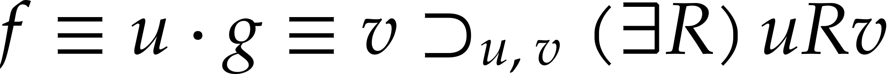

fa ∙ ~fb ∙ ~fc … ∙ gr ∙ ~gs ∙ ~gt … ⊃ – – –

fa ∙ fb ∙ ~fc ∙ ~ … ∙ gr ∙ gs ∙ ~gt ∙ ~ … ⊃ – – –

– – – – – Here all the R are indeed tried for each line, but the left-hand side already determines which R alone fits. The others are waste, as it were. It comes to the same thing whether I construct the R that fits straight away; – or say that none fits – or whether I construct them all & mark out the one that fits; have a criterion for the one that fits.

When one tries them out, one is simply making everything depend in a particular way on the series of forms on the left.

### [13\[2\]](https://cdn.wittgensteinnachlass.com/2000px/webp/Ms-106/13.webp)

We can of course also imagine a logical sum:

[Here (Е…) means there are _only_] (Еx) φx ∙ (Еx) ψx ⌵

⌵ (Еxy) φx ∙ φy ∙ (Еxy)ψx ∙ ψy

⌵ (Еx,y,z) φx ∙ φy ∙ φz ∙ (Еxyz)ψx ∙ ψy ∙ ψz ⌵

⌵ (Еxyzu) etc.

And one could write that: (Еn)nφ ∙ nψ

and here the n contains the series of forms or is the variable form.

### [13\[3\]](https://cdn.wittgensteinnachlass.com/2000px/webp/Ms-106/13.webp),[15\[1\]](https://cdn.wittgensteinnachlass.com/2000px/webp/Ms-106/15.webp)

So we cannot get around using the variable form. It is indeed restricted to certain kinds of series of forms in the notation proposed by Ramsey, but it must occur there too & makes all the constructs in which it occurs into series of forms.

### [15\[2\]](https://cdn.wittgensteinnachlass.com/2000px/webp/Ms-106/15.webp)

(What is to be understood must also be capable of being expressed.)

### [15\[3\]](https://cdn.wittgensteinnachlass.com/2000px/webp/Ms-106/15.webp)

(a,b,c,d) Anyone who understands the sign correctly knows that it can also be taken like this: ((a,b), (c,d)).

### [15\[4\]](https://cdn.wittgensteinnachlass.com/2000px/webp/Ms-106/15.webp)

What does this mean: φa ∙ φb ∙ φc = (φa ∙ φb) ∙ φc

Surely the two expressions are _the same_ sentence. If one writes them differently, the only purpose can be to indicate that φa ∙ φb ∙ φc can be obtained from φa ∙ φb and φc.

### [15\[5\]](https://cdn.wittgensteinnachlass.com/2000px/webp/Ms-106/15.webp),[17\[1\]](https://cdn.wittgensteinnachlass.com/2000px/webp/Ms-106/17.webp)

How does one actually use “2 + 2 = 4”? Can I infer from it that if I am holding 2 apples in one hand and 2 apples in the other, then I have 4 apples in the two hands? – I think not. Rather, only once I know that I have two apples and two more in my two hands can I use the equation to say instead that I have 4 apples in my hands. That is a very important point!

### [17\[2\]](https://cdn.wittgensteinnachlass.com/2000px/webp/Ms-106/17.webp)

I still have not proved the associative law for addition. And there seems to be a difficulty in this because it is so fundamental. – It depends on whether one takes the number to be a _sum_ of units or a schema in which the units are not connected by addition. So as 1 + 1 + 1 + 1… or ∣∣∣∣…. Or is the “ + ” merely like a comma. I should like it to be immediately evident that in 1 + 1 + 1 + 1 + 1 one can take any group one likes as a number. Well, if that is not immediately apparent, how can I make it clearer; i.e. what does the thing that is then evident in the proof look like. This is connected with my letting the number arise from 1 by addition, which may not be essential; could one not describe a form (∣∣∣∣…) without taking it to be a term of a particular series. I could also describe a sign “(∣∣∣∣)” by saying that it is a series of vertical strokes between brackets.

### [19\[1\]](https://cdn.wittgensteinnachlass.com/2000px/webp/Ms-106/19.webp),[21\[1\]](https://cdn.wittgensteinnachlass.com/2000px/webp/Ms-106/21.webp)

If the number is generated by addition, what actually results is a construct:

((((1) + 1) + 1) + 1) + 1 etc. i.e. an expression that would have to have brackets. But that is not what I want; an expression “∣∣∣∣∣” is not to presuppose any brackets. But then it really is described purely externally by an operation (❘, –, – ❘), for if the operation “ ‒ ❘”, i.e. the appending of a new unit, is to make sense in itself, then the new unit must be added to the whole number already there & then what we have is an expression with brackets. But there is still another way of looking at it here: the operation shows the relation of ∣∣∣ to ∣∣∣∣ etc., it leads from one to the other & this internal relation surely has meaning. Granted; only then the operation is not simply that of addition. We could imagine first generating a series 1, ((1) + 1), (((1) + 1) + 1), etc. by addition and then leaving out the brackets. But that too means nothing, for where the sign “ + ” stands, it must be to _some_ number that one adds. And that would mean that there cannot be an amorphous sign 1 + 1 + 1 + 1 such as I imagined; in other words, that one may not use the “ + ” sign as a comma.

### [21\[2\]](https://cdn.wittgensteinnachlass.com/2000px/webp/Ms-106/21.webp)

How would one show that n + m = m + n:

one would show that if one writes the sum as a sign ∣∣∣∣… the same sign results both times. But how is one to show such a thing generally. It is very simple in each individual case.

### [21\[3\]](https://cdn.wittgensteinnachlass.com/2000px/webp/Ms-106/21.webp)

If “m”, “n”, “o” stand for signs of the form (❘,—,— ❘), then it is immediately clear that (m n o) also stands for such a sign.

### [21\[4\]](https://cdn.wittgensteinnachlass.com/2000px/webp/Ms-106/21.webp)

Is it not also clear that (m n) and (n m) are the same sign?

### [21\[5\]](https://cdn.wittgensteinnachlass.com/2000px/webp/Ms-106/21.webp),[23\[1\]](https://cdn.wittgensteinnachlass.com/2000px/webp/Ms-106/23.webp)

A fundamental question: How can I know that

“∣∣∣∣∣∣∣∣” and “∣∣∣∣∣∣∣∣” are _the same sign_? Surely it is not enough that they look _similar_? For it is not the approximate sameness of shape that may constitute the identity of the signs, but precisely the equality in number. – I am not sure whether this does not make a notation of the ∣∣∣∣ kind impossible. A notation a b c d e would always be possible, where one would have to say that the order of the letters plays no role. The letters would be there only to make a correlation possible. But how should I then see that a b c = e f g. Do I not then need a correlation by identity or some analogous means? But how could I then be sure that 1 + 1 + 1 = 3 and 1 + 1 + 1 + 1 = 4, since here too I can only count the ones. One could say that 1 + 1 + 1 etc. is not _one_ sign but a particular, meaningful complex of signs. But then that is just how I must take ∣∣∣∣ etc. too.

### [23\[2\]](https://cdn.wittgensteinnachlass.com/2000px/webp/Ms-106/23.webp)

Does this question become acute if I put, say, a letter in place of a certain number of strokes?

### [23\[3\]](https://cdn.wittgensteinnachlass.com/2000px/webp/Ms-106/23.webp),[25\[1\]](https://cdn.wittgensteinnachlass.com/2000px/webp/Ms-106/25.webp)

I should say: Of course m n o is the same number as o n m, because it is _only_ the _number_ of strokes that matters, and so only the occurrence of the same numbers m, n and o. But how do I know that it is precisely the _number_ that will be the same. – Suppose I have correlated particular ∣∣∣ signs with “m”, “n” and “o”. And now I change the order of “m”, “n”, “o”; who says that the sign does not look different now, but _it **has** to represent the same number_; it _**just** has_ to be taken as this number of strokes; and this way of taking it is determined from the outset.

### [25\[2\]](https://cdn.wittgensteinnachlass.com/2000px/webp/Ms-106/25.webp)

If “a b c d” means four, then this sign must be supplemented by specifying that what does the designating in it is what all signs that can be translated (transferred) into one another – by 1–1 correlation – have in common. This is also connected with the fact that if a number is a schema, then with it there must also be given a means of seeing which extension it is a schema of.

For if ∣∣∣∣ represents a number and I have an extension a b c d, how do I know that that schema belongs to this extension?

### [25\[3\]](https://cdn.wittgensteinnachlass.com/2000px/webp/Ms-106/25.webp),[27\[1\]](https://cdn.wittgensteinnachlass.com/2000px/webp/Ms-106/27.webp)

One could propose writing the number 4 as x y z u, and if I then have an extension a b c d, I put x = a, y = b, z = c, u = d to show that the number fits the extension.

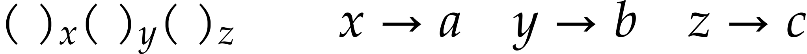

### [27\[2\]](https://cdn.wittgensteinnachlass.com/2000px/webp/Ms-106/27.webp)

Can one say: The sign (∣∣∣∣∣) has essential & inessential features; thus e.g. the length of the strokes is inessential. Now this sign contains, for example, the signs ∣∣∣ and ∣∣, and here again it is inessential whether I take the first 3 strokes as ∣∣∣ or, say, the first two and the last: 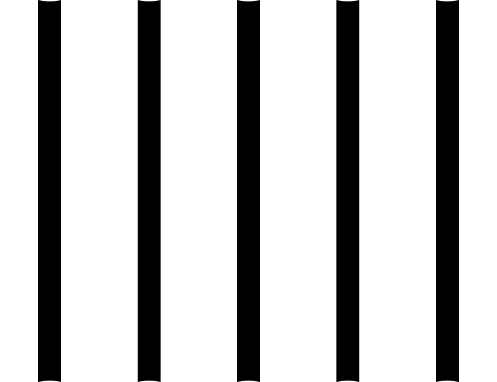 etc. etc.

### [27\[3\]](https://cdn.wittgensteinnachlass.com/2000px/webp/Ms-106/27.webp)

Now is the equation m n = n m a definition or a “theorem”?

A definition, I think. I.e. it explains the use of the combinations of signs m n and n m.

### [27\[4\]](https://cdn.wittgensteinnachlass.com/2000px/webp/Ms-106/27.webp),[29\[1\]](https://cdn.wittgensteinnachlass.com/2000px/webp/Ms-106/29.webp)

It must be possible to use the signs ∣∣∣∣ etc. in sentences just like the other numeral signs. 2 + 2 = 4 permits nothing more than the substitution of 4 for 2 + 2. E.g. in the sentence: I have 2 + 2 apples in my hand. (Logic does everything else.)

### [29\[2\]](https://cdn.wittgensteinnachlass.com/2000px/webp/Ms-106/29.webp)

Suppose I say to someone: “I have ∣∣∣∣∣∣∣ apples”. If he understands the numeral sign, can he then still ask: “Do the first 4 strokes of this sign also stand for 4 apples & can I therefore tell from the sign that you also have 4 apples?” – It seems to me that in that case it goes without saying.

### [29\[3\]](https://cdn.wittgensteinnachlass.com/2000px/webp/Ms-106/29.webp)

One could also say that m n = n m is neither a definition nor a “theorem” but an “identity”; i.e. the two signs to the right & left of the equals sign do not differ in any essential respect to begin with. Rather as if I were to write a = a, where one a happens to be larger than the other.

### [29\[4\]](https://cdn.wittgensteinnachlass.com/2000px/webp/Ms-106/29.webp),[31\[1\]](https://cdn.wittgensteinnachlass.com/2000px/webp/Ms-106/31.webp)

Is primary time infinite? I.e. is it an infinite possibility? Even if it is filled only as far as memory reaches, that by no means says that it is finite. It is infinite in the same sense in which 3-dimensional visual space is infinite, even if I can in fact see only as far as the walls of my room. For what I see presupposes the possibility of seeing further. That is to say, I could correctly represent what I see only by means of an infinite form.

### [31\[2\]](https://cdn.wittgensteinnachlass.com/2000px/webp/Ms-106/31.webp)

Can one apply the idea of an infinite series to just any domain? To notes, for instance? Can I imagine an infinitely high or an infinitely low note? Or rather, can I imagine that the scale could be extended as far as one likes upwards & downwards.

### [31\[3\]](https://cdn.wittgensteinnachlass.com/2000px/webp/Ms-106/31.webp)

Is it _possible_ to imagine time with one end; or with two ends? Can I not imagine death as the end of _my_ time? Or would I have to say that my primary life is an island in time?

### [31\[4\]](https://cdn.wittgensteinnachlass.com/2000px/webp/Ms-106/31.webp),[33\[1\]](https://cdn.wittgensteinnachlass.com/2000px/webp/Ms-106/33.webp),[35\[1\]](https://cdn.wittgensteinnachlass.com/2000px/webp/Ms-106/35.webp)

What does the “and so on in inf.” contained in a sign (1,–,– + 1) mean? What does it presuppose? Evidently that I _can_ carry out the specified operation on _every_ result of the operation. I.e. that nothing prevents me, – for example – from adding a further “1” to each expression. That is to say, the logical possibility is always there (not that I can actually do it). Now somehow this possibility seems to be given in the sign for the operation itself. I might say: Surely you see that I can put a 1 in front of _something_ (whatever it may be). – In doing so I imagine the series of ones already written shifted to the left so that I have before me only its right-hand end, to which I append the further “1”. The ones on the left could also disappear & the whole process be transferred to time. Then I would have the feeling: The fundamental thing is that nothing changes when I am at a later point in time: time is homogeneous. If I could add a “1” at an earlier point in time, why should I not be able to do so at a later one? The later one is exactly the same, after all. As long as time is time I can do it. (If this is what the infinity of time consists in – and so it seems – then the notation does indeed presuppose the infinity of time.) One could say: “Time is homogeneous through and through”. But this too is misleading, for can I even imagine anything else?

### [35\[2\]](https://cdn.wittgensteinnachlass.com/2000px/webp/Ms-106/35.webp)

What can happen now could have happened earlier: will always be able to happen in the future, if time remains as it is. But _that_ does not depend on any future experience. Time contains within itself _now_ the possibility of all future time. But all this already means that time is not infinite in the sense of the primitive conception of the infinite set. And the same holds for space. If I say I can imagine a cylinder extended to infinity, that already lies in its nature. Again, in the nature of the homogeneity of the cylinder & of the space it is in – and each presupposes the other – and this homogeneity is in the finite piece I see.

### [37\[1\]](https://cdn.wittgensteinnachlass.com/2000px/webp/Ms-106/37.webp)

But does this mean anything like saying that there are infinitely many things? – Does it not mean rather that there are objects of infinite form? Is it then the case that it is never the number but always the form that is infinite. And that I can speak of an infinite number only in a constructed sense, as I do when I say that the number of points in space or in a line segment is infinite, although points are not the objects at all. But what if the variable time occurs in my sentences – for instance, if I say “at _some time or other_ such & such will happen”? – Is time not a variable here that can take infinitely many values? Do we not have the same thing in the variable number? If I say: “there are _a number_ of apples on the table”, can the variable number not take infinitely many values here.

### [37\[2\]](https://cdn.wittgensteinnachlass.com/2000px/webp/Ms-106/37.webp),[39\[1\]](https://cdn.wittgensteinnachlass.com/2000px/webp/Ms-106/39.webp)

This raises another problem: How is an expression (∃ξ)φξ or (ξ)φξ to be understood if ξ is a variable form that can essentially take infinitely many values?

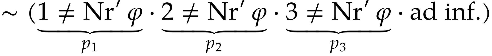

It is clear that I _can_ only indicate the truth-function & not write it out. But what does that mean? I can, of course, describe the rule for the combinations and the rule for assigning W & F in the last column.

This description makes it possible to go on writing it out _as far as one likes_. It does not allow all the terms to be written out, but it does allow the rule for forming a particular truth-function to be made unambiguously clear. Somehow a different kind of generality seems to be involved here than in the case of _finite_ logical products, sums, etc. But is the description of a truth-function a truth-function?

### [38\[1\]](https://cdn.wittgensteinnachlass.com/2000px/webp/Ms-106/38.webp)

Do I not need a formula for writing down permutations in my symbolism? A formula that expresses the rule for permuting?

### [39\[2\]](https://cdn.wittgensteinnachlass.com/2000px/webp/Ms-106/39.webp),[41\[1\]](https://cdn.wittgensteinnachlass.com/2000px/webp/Ms-106/41.webp)

But 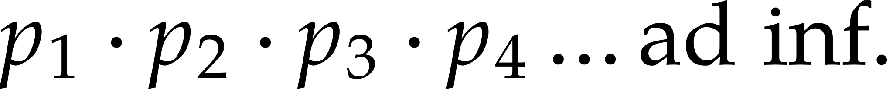 surely means: However far I may go, all the propositions pn are true. And is that not a genuine truth-function? The point is precisely that I could write out the last column of the schema, or at least indicate it _unambiguously_, without having to write out all the rows, or being able to.

### [41\[2\]](https://cdn.wittgensteinnachlass.com/2000px/webp/Ms-106/41.webp)

But in fact I do not _need_ to use infinite series here, since the proposition (∃x) φx says the same thing.

### [41\[3\]](https://cdn.wittgensteinnachlass.com/2000px/webp/Ms-106/41.webp)

Is there not an analogous way of avoiding the variable with infinitely many values in the case of time? It would be to say not “such & such will happen _sometime_”, but “it will happen” or “it happens”. That it happens _sometime_ goes without saying in the same sense as that there are a _number_ of apples on the table if there are apples on the table.

### [41\[4\]](https://cdn.wittgensteinnachlass.com/2000px/webp/Ms-106/41.webp),[43\[1\]](https://cdn.wittgensteinnachlass.com/2000px/webp/Ms-106/43.webp)

But may I use an expression (n)n = m' in _sentences_ at all? For if I may, then (n)n = m'φ says that φ is satisfied by infinitely many objects. Where is the mistake here? It would mean that all sentences of the form (∃xy…) etc. are true. But can one express that correctly?

### [43\[2\]](https://cdn.wittgensteinnachlass.com/2000px/webp/Ms-106/43.webp)

Space does not consist of infinitely many things; rather, it is the form that surrounds each of a finite number of spatial objects.

### [43\[3\]](https://cdn.wittgensteinnachlass.com/2000px/webp/Ms-106/43.webp)

One can actually see lines & points, namely boundary lines & vertices

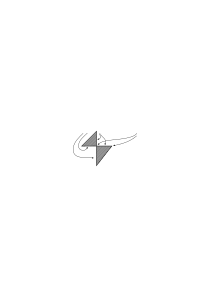

A spatial object is a colour.

### [43\[4\]](https://cdn.wittgensteinnachlass.com/2000px/webp/Ms-106/43.webp),[45\[1\]](https://cdn.wittgensteinnachlass.com/2000px/webp/Ms-106/45.webp)

A distance can be expressed by a number, but by any number at all. It is no use, however, designating a segment, say, by a letter n instead of by a definite number, for I cannot then designate another segment by n; instead, it is then 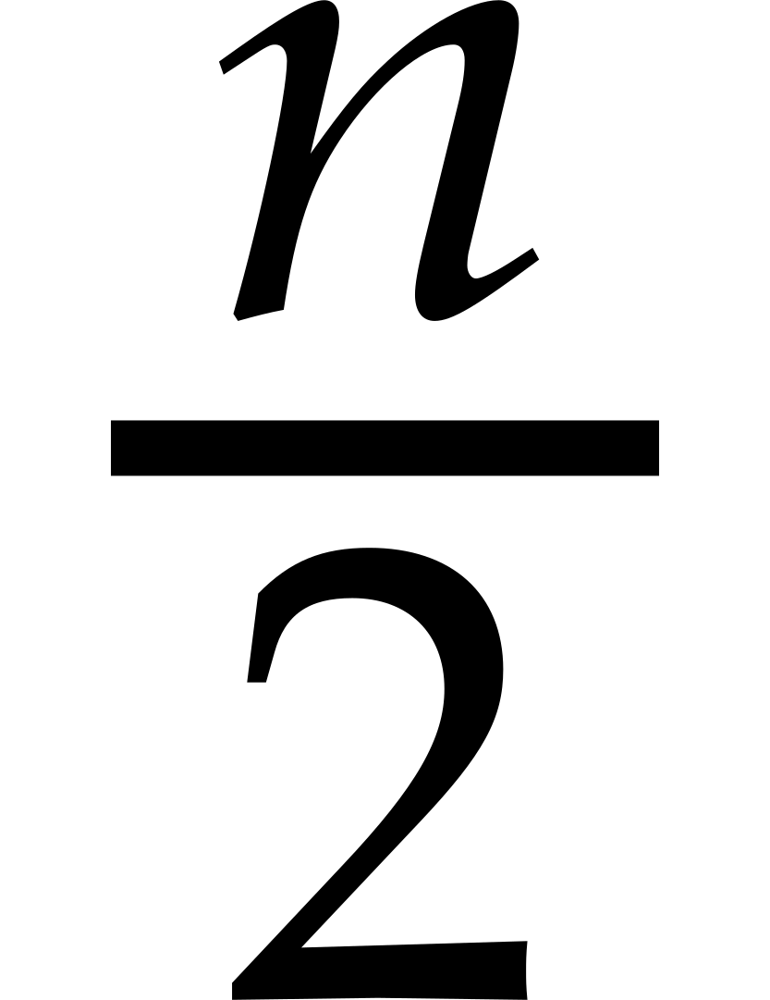 or 3n, etc. etc., so that I am referring once again to a basic segment, whether I call it n or 1. On the other hand, I can surely write 1n instead of n, & why should I recognize any difference of rank among the numbers? But one thing is clear: which of my segments I then call 27n, for example, is arbitrary. What, then, is the n for at all?

### [45\[2\]](https://cdn.wittgensteinnachlass.com/2000px/webp/Ms-106/45.webp)

But one could also say: the unit segment belongs to the symbolism. It belongs to the method of projection. Its length is arbitrary, but _it_ contains the specifically spatial element. So if I call a segment 3, the 3 designates it here with the aid of the unit segment presupposed in the symbolism.

### [45\[3\]](https://cdn.wittgensteinnachlass.com/2000px/webp/Ms-106/45.webp)

One can apply the same thing to time as well.

### [45\[4\]](https://cdn.wittgensteinnachlass.com/2000px/webp/Ms-106/45.webp),[47\[1\]](https://cdn.wittgensteinnachlass.com/2000px/webp/Ms-106/47.webp)

Just as the numeral ∣∣∣∣∣ presupposes that I can make 5 strokes side by side, so the concept (❘,–,–❘) presupposes that I can go on with the operation without end. To that extent, then, the notation for the infinite series presupposes the infinite form, just as the notation for the individual – finite – numbers presupposes a form in which it is possible. But what do numbers greater than the number of existing things mean? – I think they are the numbers of combinations of these things.

### [47\[2\]](https://cdn.wittgensteinnachlass.com/2000px/webp/Ms-106/47.webp)

If I imagine an infinite coloured plane, I do not thereby have infinitely many objects; rather, the infinite plane is an object & the simple colours are objects.

### [47\[3\]](https://cdn.wittgensteinnachlass.com/2000px/webp/Ms-106/47.webp)

The correct view must in the end be the _natural_ one; and what we see is never infinitely many things, but always a number of things that have what is characteristic of infinitely many different possibilities.

### [47\[4\]](https://cdn.wittgensteinnachlass.com/2000px/webp/Ms-106/47.webp),[49\[1\]](https://cdn.wittgensteinnachlass.com/2000px/webp/Ms-106/49.webp)

Is it the same proposition to say that the square is red and to say: the right-hand rectangle is red and the left-hand rectangle is red?? If it is the same proposition, is not each of these propositions infinitely complex? Is not the only way out here to assume that an expression “the square is red” is not yet a proposition unless it is said that the rest of the plane (or the rest of the space) has _some_ colour or other? That is, the rest of the space would have to enter into the proposition as an apparent variable. But there is a catch to that too. How, then, are the elementary sentences to be worded at all?!

### [49\[2\]](https://cdn.wittgensteinnachlass.com/2000px/webp/Ms-106/49.webp)

If something is wrong with my foundations, it could only be that there are essentially no elementary propositions at all & that analysis yields a _system_ of propositions that can be analysed without end. Does this _system_ not meet my requirement that the analysis be determinate?

### [49\[3\]](https://cdn.wittgensteinnachlass.com/2000px/webp/Ms-106/49.webp),[51\[1\]](https://cdn.wittgensteinnachlass.com/2000px/webp/Ms-106/51.webp)

Can one say: If one sees a figure

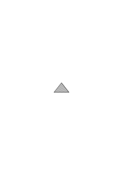

in the visual field – say, a red one – then one cannot describe it by describing, say, one half of the triangle in one sentence and the other half in another sentence? That is: can one say that in a certain sense there is no such thing as a half of _this_ triangle? This would mean that one can _speak_ of the triangle at all only if its boundary lines are the boundaries between two colours.

### [51\[2\]](https://cdn.wittgensteinnachlass.com/2000px/webp/Ms-106/51.webp)

Could there not be analysability according to the system that anb = amb ∙ aob, where n = o + m? That would be infinite analysability. But what are n,m,o? Are they three different objects? Three forms of the same object? And what does that mean?

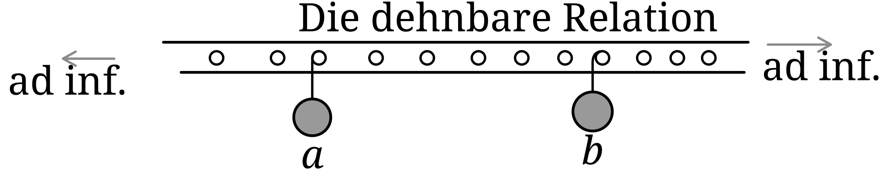

That is not how it is. But one can represent it differently: φ(n) = φm ∙ φo where n = o + m, where m & o mean different extents of the same object. But what then is the equation above? Is it a definition, a tautology??

### [51\[3\]](https://cdn.wittgensteinnachlass.com/2000px/webp/Ms-106/51.webp),[53\[1\]](https://cdn.wittgensteinnachlass.com/2000px/webp/Ms-106/53.webp)

If “red is at this place” is a sentence p and “red is at that place” a sentence q, then p ∙ q is the _same_ sentence as “red is at this & that place” & this sentence is evidently of exactly the same form & complexity as q or p alone; for two places make _one_ place. – From this the infinite complexity of spatial sentences would follow. – There would be no elementary sentences & a sentence which to all appearances is composed simply of two symbols (names), and thus describes a state of affairs, would be _identical_ with one that describes two such states of affairs. Two states of affairs would make _one_ state of affairs.

If I may write the sentence that the rectangle is red in the form

“[10–17, 7–12] red”

then it is strange that the place appears here as an object.

### [53\[2\]](https://cdn.wittgensteinnachlass.com/2000px/webp/Ms-106/53.webp),[55\[1\]](https://cdn.wittgensteinnachlass.com/2000px/webp/Ms-106/55.webp)

But one could also construe the proposition differently: The only object spoken of would be red, which _must_ be _somewhere_, and one of its infinitely many spatial possibilities would be specified as a fact. This fact would be infinitely complex, as is shown by infinitely many _different_ facts _following logically_ from the _one_.

### [55\[2\]](https://cdn.wittgensteinnachlass.com/2000px/webp/Ms-106/55.webp)

One might object to this that one cannot describe a part of the visual field separately from the whole at all, since it is quite inconceivable _on its own_. But the form (the logical form) of the patch does in fact presuppose the whole space. And if only the whole visual field may be described, why then not only the whole stream of visual experience, since a visual image _can only_ exist in time.

### [55\[3\]](https://cdn.wittgensteinnachlass.com/2000px/webp/Ms-106/55.webp)

If one says that one cannot see facts concerning very small patches, one can reply that one does see such facts too, if only as part of facts concerning larger patches. That we can see a surface _continuously_ says it all.

### [55\[4\]](https://cdn.wittgensteinnachlass.com/2000px/webp/Ms-106/55.webp),[57\[1\]](https://cdn.wittgensteinnachlass.com/2000px/webp/Ms-106/57.webp)

There is no doubt that the possibilities of the visual world are infinite.

### [57\[2\]](https://cdn.wittgensteinnachlass.com/2000px/webp/Ms-106/57.webp)

The spatial proposition says something simple in a certain sense. – But it is infinitely divisible.

### [57\[3\]](https://cdn.wittgensteinnachlass.com/2000px/webp/Ms-106/57.webp)

In it, as it were, an infinite fabric is taken in at _one_ glance.

### [57\[4\]](https://cdn.wittgensteinnachlass.com/2000px/webp/Ms-106/57.webp)

But what then is the general sentential form? It is the general form of complexity. –

### [57\[5\]](https://cdn.wittgensteinnachlass.com/2000px/webp/Ms-106/57.webp)

One would think that a proposition from which infinitely many follow must say infinitely much. But infinite divisibility is expressed by a rule, not by the sign’s being infinitely complex. – On the other hand, the infinitely complex rule is only a substitute for an infinitely complex sign. (A painted picture, for example.)

### [57\[6\]](https://cdn.wittgensteinnachlass.com/2000px/webp/Ms-106/57.webp),[59\[1\]](https://cdn.wittgensteinnachlass.com/2000px/webp/Ms-106/59.webp)

But what becomes of the general sentential form? Can there still be such a thing at all, i.e. can one write it down? – Or would that mean distinguishing a sentence from something that is not a sentence? And that would be senseless.

### [59\[2\]](https://cdn.wittgensteinnachlass.com/2000px/webp/Ms-106/59.webp)

The general sentential form can be nothing but the general form of truth-functions.

### [59\[3\]](https://cdn.wittgensteinnachlass.com/2000px/webp/Ms-106/59.webp)

φ(2–5) = φ(2–3˙15) ∙ φ(3˙15–4˙2) ∙ φ(4˙2–5) = φ(2–2˙6) ∙ φ(2˙6–5) = etc. etc.

The symbol is what all such products have in common. The rule according to which they are all formed.

### [59\[4\]](https://cdn.wittgensteinnachlass.com/2000px/webp/Ms-106/59.webp)

If this view is correct, there are no elementary propositions. The sentences φ(n–m) can indeed be analysed, but only into further sentences of the same form

### [59\[5\]](https://cdn.wittgensteinnachlass.com/2000px/webp/Ms-106/59.webp),[61\[1\]](https://cdn.wittgensteinnachlass.com/2000px/webp/Ms-106/61.webp)

If infinitely many propositions follow from _one_, then that proposition is not built up out of them. I.e. one need not understand _them_ in order to understand it. I would put it like this: To say that _infinitely_ many propositions follow from _one_ expresses the unlimited possibility of such consequences, not their actuality. By this I mean that it says there is _no_ number of such basic propositions. And that is clear enough: there are then not infinitely many elementary propositions but _none_.

### [61\[2\]](https://cdn.wittgensteinnachlass.com/2000px/webp/Ms-106/61.webp)

Hence the proposition can be understood only if one understands the complex proposition, for then _it_ underlies everything.

### [61\[3\]](https://cdn.wittgensteinnachlass.com/2000px/webp/Ms-106/61.webp)

This view has several difficulties. If I say that the little square inside the

large one is red, whatever colour the rest may be, I cannot even imagine the little square unless it is bounded by something of a different colour. I can of course imagine a kind of movable grid, made of black lines say, which I lay over the figure temporarily in order to describe it & which I can then remove again. But I would still have to see the black lines on the picture in order to speak of its parts!

### [63\[1\]](https://cdn.wittgensteinnachlass.com/2000px/webp/Ms-106/63.webp)

This is connected with the fact that lines are always the boundaries between two colours. But what if there can be _strokes_ in visual space that have no thickness? If there are such strokes, and thus also tiny points without extension (stars), then it must be possible to draw any number of such strokes without encroaching on the otherwise, say, white visual field. A nebula of fixed stars is inconceivable in this case.

### [63\[2\]](https://cdn.wittgensteinnachlass.com/2000px/webp/Ms-106/63.webp)

But that would lead back to the view that one can describe only the whole visual field at once without using variables.

### [63\[3\]](https://cdn.wittgensteinnachlass.com/2000px/webp/Ms-106/63.webp)

φ(4–5) ∙ φ(6–7) = φ((4–5)(6–7)) can one not also regard two separate patches as _one_?

### [63\[4\]](https://cdn.wittgensteinnachlass.com/2000px/webp/Ms-106/63.webp),[65\[1\]](https://cdn.wittgensteinnachlass.com/2000px/webp/Ms-106/65.webp)

If it is incorrect that φ(m–o) ∙ φ(o–n) = φ(m–n) because the component patches are not present in a completely uniformly coloured patch, then two propositions φ(m–o) and φ(o–n), whatever their analysis, must contradict one another. But that too is possible only if they are complex, & complex in such a way that the proposition describing a patch also says that its surroundings do not have such & such a colour.

### [65\[2\]](https://cdn.wittgensteinnachlass.com/2000px/webp/Ms-106/65.webp),[67\[1\]](https://cdn.wittgensteinnachlass.com/2000px/webp/Ms-106/67.webp)

It also seems to me possible that mutually contradictory colour complexes define time and that one simply _cannot_ assert their simultaneity. “Simultaneous” might mean “in _one_ visual field”, but if one describes only whole visual images, one cannot state that different visual images are the same visual image. – One could then, so to speak, put the visual events into the box of time without worrying that they would clash, for what cannot be simultaneous arranges itself of its own accord _in succession_. There is, admittedly, a difficulty here, for of course this does not yet give the temporal *order*. – And if I now actually describe a temporal order in sentences, it would have to be part of the syntax of these sentences that I can never assign the same point in time to two different visual images.

### [67\[2\]](https://cdn.wittgensteinnachlass.com/2000px/webp/Ms-106/67.webp)

Whether it makes sense to say “this part of a red area (which is marked off by its visible boundary) is red” depends – it seems to me – on whether there is such a thing as an absolute place. For if one can speak of an absolute place in visual space, then I can also ascribe a colour to this absolute place if its surroundings are uniformly coloured. Suppose I see a uniformly yellow visual field & say: “The centre of my visual field is yellow”. But can I then describe a _form_ in this way? It seems not.

### [67\[3\]](https://cdn.wittgensteinnachlass.com/2000px/webp/Ms-106/67.webp)

If I do not describe the visual image completely, but only a part of it, it is clear that there is, as it were, a gap in the fact. Something has obviously been left out.

### [67\[4\]](https://cdn.wittgensteinnachlass.com/2000px/webp/Ms-106/67.webp),[69\[1\]](https://cdn.wittgensteinnachlass.com/2000px/webp/Ms-106/69.webp)

If I painted a picture of this visual image, I would let the canvas show through in certain places. But the canvas too has a colour & fills the space. I could not leave _nothing_ in the place where something is missing. My description must therefore necessarily contain the whole of visual space, and indeed even its being coloured, even if it does not say which colour is at each place. That is, it must say that there is a colour at each place.

### [69\[2\]](https://cdn.wittgensteinnachlass.com/2000px/webp/Ms-106/69.webp)

Does this not mean that the description must fill the space with variables in so far as it does not fill it with constants?

### [69\[3\]](https://cdn.wittgensteinnachlass.com/2000px/webp/Ms-106/69.webp),[71\[1\]](https://cdn.wittgensteinnachlass.com/2000px/webp/Ms-106/71.webp)

The multiplicity of spatial description is given from the outset by the fact that the description has the right multiplicity if it can describe all conceivable configurations.

So if one can describe space in all its possibilities with propositions of the kind φ(m-n), then the description is in order and one needs nothing more.

### [71\[2\]](https://cdn.wittgensteinnachlass.com/2000px/webp/Ms-106/71.webp),[73\[1\]](https://cdn.wittgensteinnachlass.com/2000px/webp/Ms-106/73.webp)

The first thought is that it is incompatible for two colours to be in _one_ place. The next is that two colours in _one_ place merely combine to form a resultant colour. But the third is the objection: What about complementary colours? How do red & green combine? To form black, perhaps? But do I see green in the black colour? – But even apart from that: What about mixed colours, for example mixtures of red & blue: these contain more red in some cases and less in others; what does that mean? What it means for something to _**be** red_ is clear, but for it to _contain_ more or less red? – And different degrees of red are incompatible with one another. One might think this could be explained by supposing that some small quantities of red add up to a certain degree of red. But what does it mean then to say that, for example, 5 such quantities of red are present? It cannot of course be a logical product to the effect that quantity № 1 is present and quantities № 2 to 5 are present, for how would they differ from one another? So the sentence that degree 5 of red is present cannot be analysed in this way. And so I cannot have a concluding sentence saying that this is all the red present in this colour; for it makes no sense to say that no more red is added, since I could not add quantities of red by means of the logical _and_. Nor does it mean anything to say that a rod that is 3 metres long is also 2 m long because it is 2 + 1 metres long, for one cannot say that it is 2 m long and it is 1 m long. The length of 3 m is something new. And yet, when I see two blues that are red to different degrees, I can say: there is a blue redder still than the redder of these two. That is, I can construct what is not given from what is given.

### [73\[2\]](https://cdn.wittgensteinnachlass.com/2000px/webp/Ms-106/73.webp),[75\[1\]](https://cdn.wittgensteinnachlass.com/2000px/webp/Ms-106/75.webp)

This makes it appear as if a construction might be possible within the elementary proposition. That is, as if there were a logical construction that does not operate by means of truth-functions.

### [75\[2\]](https://cdn.wittgensteinnachlass.com/2000px/webp/Ms-106/75.webp)

That is, after all, what I meant to say with my relations that are expressed by numbers.

### [75\[3\]](https://cdn.wittgensteinnachlass.com/2000px/webp/Ms-106/75.webp)

But now it also seems that these constructions have a bearing on whether one proposition follows logically from another! For if different degrees exclude one another, it follows from the presence of the one that the other is not present. Then two elementary propositions can contradict one another!

### [75\[4\]](https://cdn.wittgensteinnachlass.com/2000px/webp/Ms-106/75.webp)

How is it possible for φ(a) and φ(b) to contradict one another, as they seem to do? For example, when I say: “there is red here” and “there is green here”.

### [77\[1\]](https://cdn.wittgensteinnachlass.com/2000px/webp/Ms-106/77.webp)

This is connected with the idea of a _complete description_: “The patch is green” describes the patch completely, and there is no room left for another colour.

### [77\[2\]](https://cdn.wittgensteinnachlass.com/2000px/webp/Ms-106/77.webp)

Nor does it help that red & green can, as it were, pass one another in the dimension of time; for what if I say that during a certain period a patch is red & that it is green? (Strangely enough, I always have the feeling then that it is black.)

### [77\[3\]](https://cdn.wittgensteinnachlass.com/2000px/webp/Ms-106/77.webp),[79\[1\]](https://cdn.wittgensteinnachlass.com/2000px/webp/Ms-106/79.webp)

If – for example – I say that a patch is both light red & dark red at the same time, I am thinking that one shade covers the other. But does it then still make sense to say that the patch has the invisible, covered shade? Does it even make sense to say that a completely black surface is white, only one would not see the white because it is covered by the black? And why does the black cover the white and not the white the black? And why does the light red not cover the dark red? Etc. If a patch has a visible & an invisible colour, it has these colours, in any case, in quite different senses.

### [79\[2\]](https://cdn.wittgensteinnachlass.com/2000px/webp/Ms-106/79.webp)

If φ(r) and φ(g) contradict one another, that is because r & g each fill φ completely and cannot both be in it. But this does not show itself in our signs. It must, however, show itself if we consider not the sign but the symbol. For since the symbol includes the form of the objects, the impossibility of φr ∙ φg must show itself there, in that form.

### [79\[3\]](https://cdn.wittgensteinnachlass.com/2000px/webp/Ms-106/79.webp),[81\[1\]](https://cdn.wittgensteinnachlass.com/2000px/webp/Ms-106/81.webp)

And yet it must be possible to show this contradiction entirely in the symbolism, for if I say of a patch that it is green & red, there is certainly at least one of the two colours that it is not, & the contradiction must lie in the _sense_ of the two propositions.

### [81\[2\]](https://cdn.wittgensteinnachlass.com/2000px/webp/Ms-106/81.webp)

One might say, first: one must be able to tell from the propositions when they contradict one another, for I must be able to tell their sense from them – since it is from them that I am supposed to get it. Then: but might it not be due to the particular meaning of a sign? For the meaning of the signs is already part of merely _understanding_ the proposition (before its truth or falsity is known). – But I cannot actually try the object – the meaning – in a place – where it might not fit. I must be able to tell from it that it does not fit there. I must be able to tell from the green that it cannot be where the red is. (Or rather, I must be able to tell from both that they do not go, or _would_ not go, to the same place.)

### [81\[3\]](https://cdn.wittgensteinnachlass.com/2000px/webp/Ms-106/81.webp),[83\[1\]](https://cdn.wittgensteinnachlass.com/2000px/webp/Ms-106/83.webp)

That two colours do not go to the same place at the same time must lie in their form & the form of space.

### [83\[2\]](https://cdn.wittgensteinnachlass.com/2000px/webp/Ms-106/83.webp)

But the symbols do contain the form of colour & of space, and if, say, a letter designates a colour on one occasion and a sound on another, it is a _different_ symbol on the two occasions – & this shows itself in the fact that different rules of syntax apply to it.

### [83\[3\]](https://cdn.wittgensteinnachlass.com/2000px/webp/Ms-106/83.webp)

ag and ar contradict one another although – or rather, because – both propositions have sense in themselves. And it can only be ag ∙ ar that is impossible.

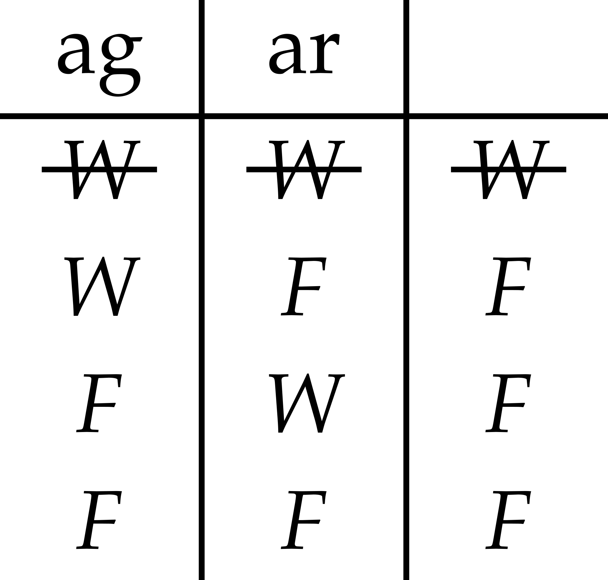

The first row is impossible only because “ag” & “ar” cannot both be true.

### [83\[4\]](https://cdn.wittgensteinnachlass.com/2000px/webp/Ms-106/83.webp),[85\[1\]](https://cdn.wittgensteinnachlass.com/2000px/webp/Ms-106/85.webp)

But is “ag ∙ ~ar” then a tautology? We would have to write it like this: 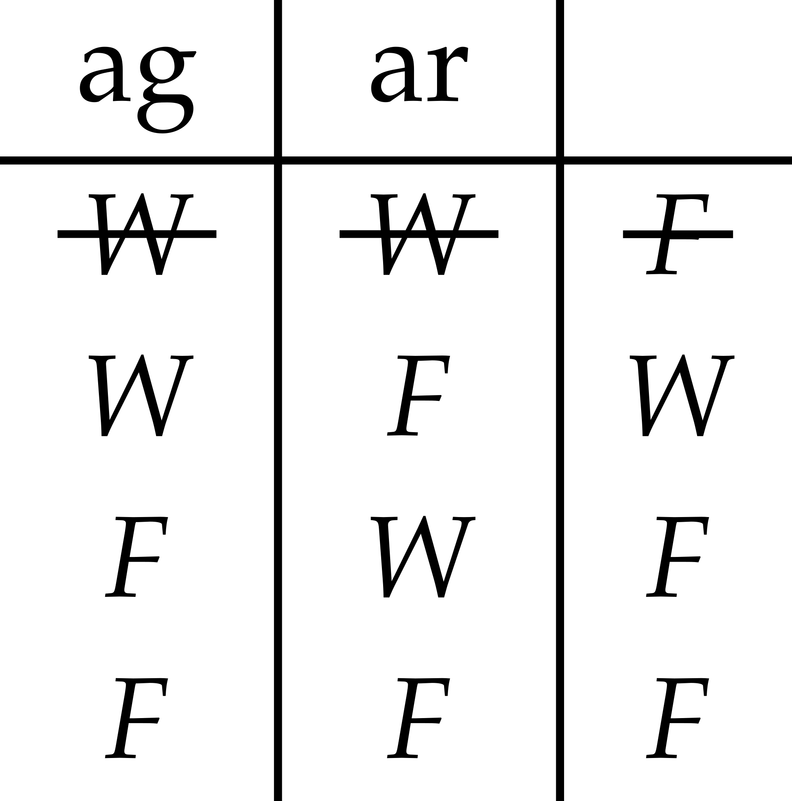 but ag⊃~ar:

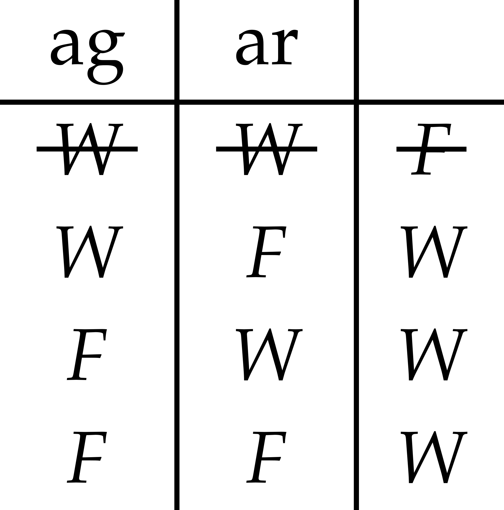 so this proposition becomes a tautology when the first row drops out.

### [85\[2\]](https://cdn.wittgensteinnachlass.com/2000px/webp/Ms-106/85.webp)

That does not of course mean that inference could now proceed not only formally but also materially. – Sense follows from sense and hence form from form.

### [85\[3\]](https://cdn.wittgensteinnachlass.com/2000px/webp/Ms-106/85.webp)

How is it to be symbolized that two arguments of a function exclude one another? Something seems to be missing here in the symbolism for “and”.

### [85\[4\]](https://cdn.wittgensteinnachlass.com/2000px/webp/Ms-106/85.webp),[87\[1\]](https://cdn.wittgensteinnachlass.com/2000px/webp/Ms-106/87.webp)

Red & green do not _go_ together to the same place, does not mean that they are in fact never together; rather, one cannot even say that they are together, and so one cannot say that they are never together either.

But that would mean that I may write down two particular sentences, but not their logical product.

### [87\[2\]](https://cdn.wittgensteinnachlass.com/2000px/webp/Ms-106/87.webp)

One might admittedly say: presumably I may write down the logical product, but it is a contradiction. But that says nothing. If p & q exclude one another and I write

“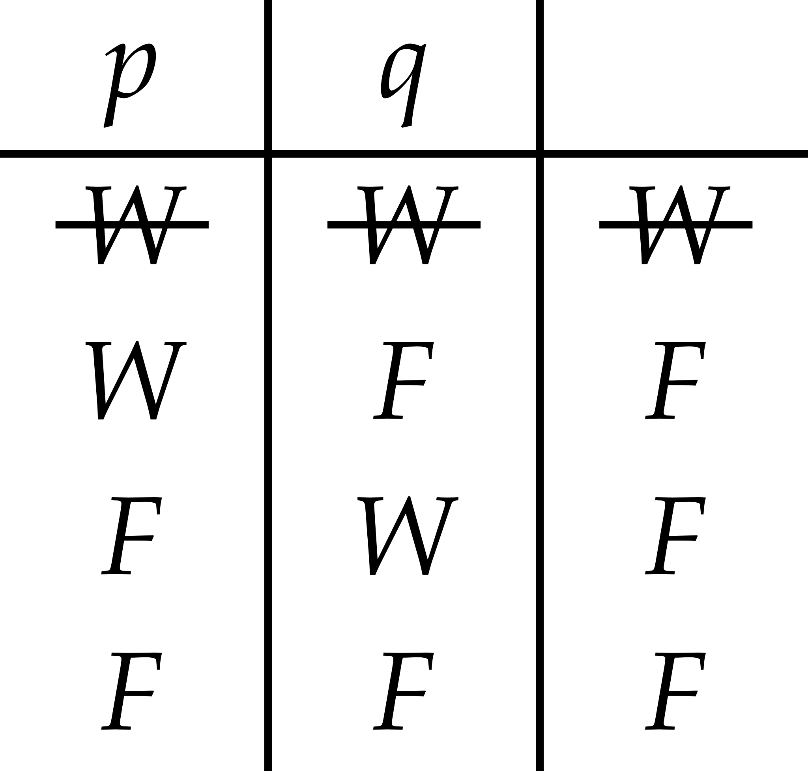”

then I must simply strike out the one row; that is, regard it as impossible. What I mean is: I must strike out the _whole_ top row and not just the W in the right-hand column.

### [87\[3\]](https://cdn.wittgensteinnachlass.com/2000px/webp/Ms-106/87.webp)

But one can also put it like this: if I can form the product of two propositions, they cannot have the senses “a is red” and “a is green”.

### [87\[4\]](https://cdn.wittgensteinnachlass.com/2000px/webp/Ms-106/87.webp)

That is, if the meaning of “ ∙ ” is preserved, that prevents these two propositions from entering as arguments.

### [89\[1\]](https://cdn.wittgensteinnachlass.com/2000px/webp/Ms-106/89.webp)

Either the “and” or the propositions!

### [89\[2\]](https://cdn.wittgensteinnachlass.com/2000px/webp/Ms-106/89.webp)

I can indeed write the sentences down in the product, but then they say something different (or nothing, if one has given the signs no meaning).

### [89\[3\]](https://cdn.wittgensteinnachlass.com/2000px/webp/Ms-106/89.webp)

The two propositions collide in the object.

### [89\[4\]](https://cdn.wittgensteinnachlass.com/2000px/webp/Ms-106/89.webp)

On the above I can also say: I must then strike out the whole top row because not only the W on the right but also the pair under “p” & “q” is impossible. If, for example, I have the form

“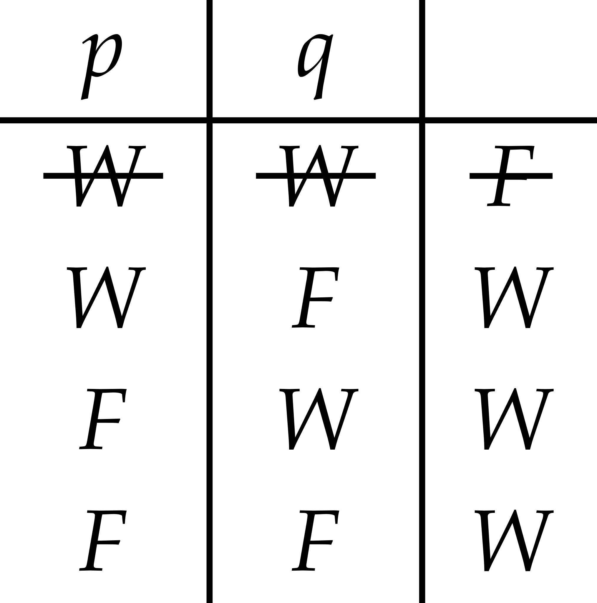”

I must still strike out the top row.

### [89\[5\]](https://cdn.wittgensteinnachlass.com/2000px/webp/Ms-106/89.webp),[91\[1\]](https://cdn.wittgensteinnachlass.com/2000px/webp/Ms-106/91.webp)

But if “p ∙ q” is supposed to be nonsensical, does it make no sense to say “p⌵q” either? Surely it seems quite plainly to make sense to say “a is either green or red”. And that would be:

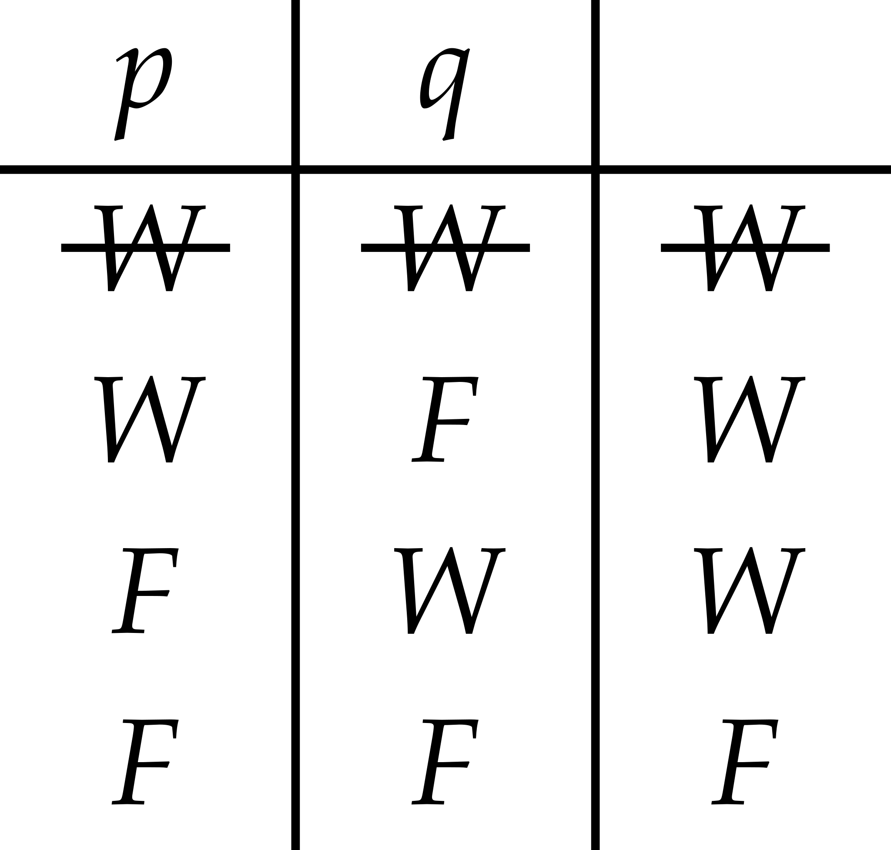

But if “p⌵q” is not nonsensical, then “p ∙ q” cannot be nonsensical either.

### [91\[2\]](https://cdn.wittgensteinnachlass.com/2000px/webp/Ms-106/91.webp),[93\[1\]](https://cdn.wittgensteinnachlass.com/2000px/webp/Ms-106/93.webp)

The proposition p ∙ q is not nonsense, for not _all_ truth-possibilities drop out, even though they are all rejected. But one can say that “and” has a different meaning here, for in general “ξ ∙ η” means

whereas here:

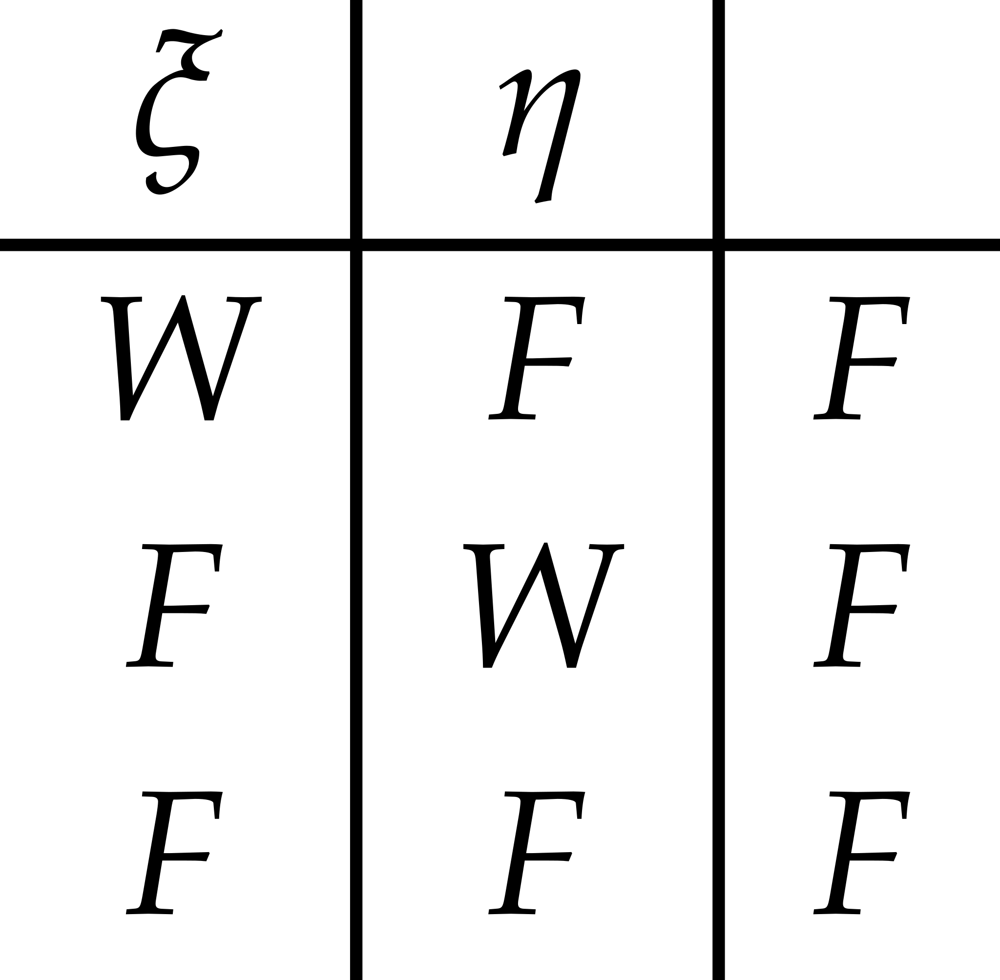

And something analogous holds for p⌵q etc.

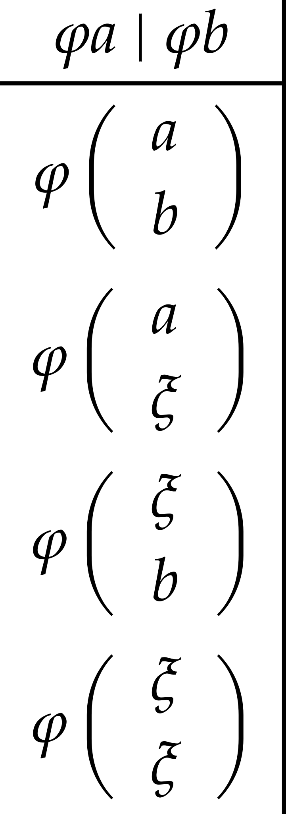

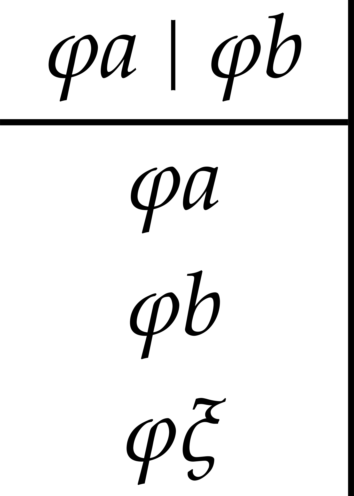

For all the propositions I can combine logically, is there a _space_ in which they “go together, or do not”? If, for example, I say that I see red & hear a sound, then these two go together in _time_. They arrange themselves in time; I mean, they place themselves side by side in time. That is, they both lie in time & do not interfere with one another.

### [93\[2\]](https://cdn.wittgensteinnachlass.com/2000px/webp/Ms-106/93.webp)

It is then almost as if the senses of some propositions lay so far apart in logical space that they could not interfere with one another, whilst others lay claim to the same place.

### [93\[3\]](https://cdn.wittgensteinnachlass.com/2000px/webp/Ms-106/93.webp),[95\[1\]](https://cdn.wittgensteinnachlass.com/2000px/webp/Ms-106/95.webp)

When I see a yellowish red, I do not see in it the yellow that I see when I see pure yellow. If I can say that I see a yellow in this red, then the word ‘yellow’ has a different meaning here from the one it has when I say that I see yellow. I plainly cannot see yellow & red at the same time in _one_ place in the way I see them in different places.

### [95\[2\]](https://cdn.wittgensteinnachlass.com/2000px/webp/Ms-106/95.webp)

A yellowish tinge is not the colour yellow.

### [95\[3\]](https://cdn.wittgensteinnachlass.com/2000px/webp/Ms-106/95.webp)

Could one then build up all shades of colour from “colour tinges” as the primitives?

### [95\[4\]](https://cdn.wittgensteinnachlass.com/2000px/webp/Ms-106/95.webp)

I cannot actually _mix_ yellow & red, that is, I cannot really see them at the same time. For if I want to see yellow here, the red must go from this place, and conversely.

### [95\[5\]](https://cdn.wittgensteinnachlass.com/2000px/webp/Ms-106/95.webp),[97\[1\]](https://cdn.wittgensteinnachlass.com/2000px/webp/Ms-106/97.webp)

It is clear, as I said, that the proposition that a colour contains 5 tinges of yellow cannot say that it contains tinge № 1 & that it contains tinge № 2 etc. Rather, the addition of the tinges must take place within the elementary proposition. But what if these tinges are objects that are arranged in a certain way, like links in a chain, and one proposition speaks of 5 such links, another of three? Granted, but these two propositions must exclude one another without being analysable. But must φ(5) and φ(6) exclude one another. Can I not say that φ(n) does not mean that the colour contains _only_ n tinges, but that it _also_ contains n tinges? That it contains _only_ n tinges would be expressed by the proposition φ(n) ∙ ~φ(n + 1). But even then the elementary propositions depend on one another, since φ(n ‒ 1) follows in any case from φ(n), and φ(5) contradicts ~φ(4). On the one conception, the proposition that asserts a specific degree of a property contradicts (only) every other specification of the degree, and on the other conception it follows (also) from the specification of any higher degree.

### [97\[2\]](https://cdn.wittgensteinnachlass.com/2000px/webp/Ms-106/97.webp)

Nor is a conception that makes use of a product aRx ∙ xRy ∙ yRb sufficient, for I must be able to distinguish the things x, y, etc., otherwise they do not yield a distance.

### [97\[3\]](https://cdn.wittgensteinnachlass.com/2000px/webp/Ms-106/97.webp),[99\[1\]](https://cdn.wittgensteinnachlass.com/2000px/webp/Ms-106/99.webp)

If two elementary propositions exclude one another, this shows itself in their inability to take on their original senses in the product. (Here too, of course, logic takes care of itself.)

### [99\[2\]](https://cdn.wittgensteinnachlass.com/2000px/webp/Ms-106/99.webp)

A mixed colour, or better, a colour intermediate between blue & red, is such by virtue of an internal relation to the structures of red & blue, but this internal relation is _elementary_. That is, it does not consist in the proposition a is blue-red being a logical product of a is blue & a is red.

### [99\[3\]](https://cdn.wittgensteinnachlass.com/2000px/webp/Ms-106/99.webp)

If that is so, then the sentence “a has a colour with a bluish tinge” says “There is a bluish-ξ which is the colour of a”; that is, bluish-ξ is then the variable colour with a bluish tinge.

### [99\[4\]](https://cdn.wittgensteinnachlass.com/2000px/webp/Ms-106/99.webp),[101\[1\]](https://cdn.wittgensteinnachlass.com/2000px/webp/Ms-106/101.webp)

But is it not then remarkable that we can see how close one colour is to another. – I see that this brown is _almost_ yellow. I would say that one gets this bluish red by taking pure red and mixing in _very little_ blue.

### [101\[2\]](https://cdn.wittgensteinnachlass.com/2000px/webp/Ms-106/101.webp)

And this “very little” and “almost” must find expression in the sentential form.

### [101\[3\]](https://cdn.wittgensteinnachlass.com/2000px/webp/Ms-106/101.webp)

Suppose for the moment that every shade of colour could be produced as a mixture of four colours. One could then give the description of a patch P by, say, a sentence σ(n bl,m r,o gb,p gr), where n, m, o, p would be numbers indicating in some way the proportions in which the colours were mixed. But this sentence would _not_ be analysable into

σ(n bl) ∙ σ(m r) etc.; rather, pure blue would then have to be represented by something like

σ(n bl,0 r,0 gb,0 gr). From the fact that a is blue-red, it really does not follow that a is blue, but rather the opposite.

### [101\[4\]](https://cdn.wittgensteinnachlass.com/2000px/webp/Ms-106/101.webp)

One might say that the colours have an _elementary kinship_ with one another. It is clear to me that this kinship can be represented only by means of the numbers in the elementary form.

### [101\[5\]](https://cdn.wittgensteinnachlass.com/2000px/webp/Ms-106/101.webp),[103\[1\]](https://cdn.wittgensteinnachlass.com/2000px/webp/Ms-106/103.webp)

Russell’s “Mult. ax.” has its origin in his speaking of the constructed classes of arithmetic as if they were extensions of real concepts. The existence of a construction can never be in doubt.

Here one sees clearly what is confusing, because misleading, about the usual way of speaking in set theory. If I always seem to be _describing_ a construction instead of _giving_ it, doubts can arise as to whether there is a construction that satisfies a particular description.

### [103\[2\]](https://cdn.wittgensteinnachlass.com/2000px/webp/Ms-106/103.webp),[105\[1\]](https://cdn.wittgensteinnachlass.com/2000px/webp/Ms-106/105.webp)

What is the difference between specifying the number for the extension of a concept and specifying the number for the range of a variable? The first is a sentence, the second is not. For I can derive the numerical specification for a variable from the variable itself. (It must show itself.) But can I not give a variable by saying that its values are to be all the objects that satisfy a certain – material – function? Then the variable is not a form! And then the sense of one sentence depends on whether another is true or false.

### [105\[2\]](https://cdn.wittgensteinnachlass.com/2000px/webp/Ms-106/105.webp)

Specifying the number for a variable consists in transforming the variable so as to make the number of its values visible.

### [105\[3\]](https://cdn.wittgensteinnachlass.com/2000px/webp/Ms-106/105.webp)

Does it make sense to specify a variable in such a way that it may take only _one_ value & this value can be any number?

### [105\[4\]](https://cdn.wittgensteinnachlass.com/2000px/webp/Ms-106/105.webp)

An infinite extension can be given only by a variable.

### [105\[5\]](https://cdn.wittgensteinnachlass.com/2000px/webp/Ms-106/105.webp)

Let us imagine an experiment in which points of light appear on a photographic plate. We want to determine the law governing their arrival, and it turns out that their spacings correspond to the series of prime numbers!

### [105\[6\]](https://cdn.wittgensteinnachlass.com/2000px/webp/Ms-106/105.webp)

How is the sentence 2 + 2 = 4 actually used? Where does “2 + 2” occur such that one wants to replace it with “4”?

### [107\[1\]](https://cdn.wittgensteinnachlass.com/2000px/webp/Ms-106/107.webp)

[In the logical theory of colour it may be useful to recall the difference between 2 + 2 = 4 and

φa ∙ φa = φa [Frege]]

### [107\[2\]](https://cdn.wittgensteinnachlass.com/2000px/webp/Ms-106/107.webp)

Is there really a stage at which I know that I have 2 + 2 apples before I have carried out the substitution of “4” for “2 + 2”?

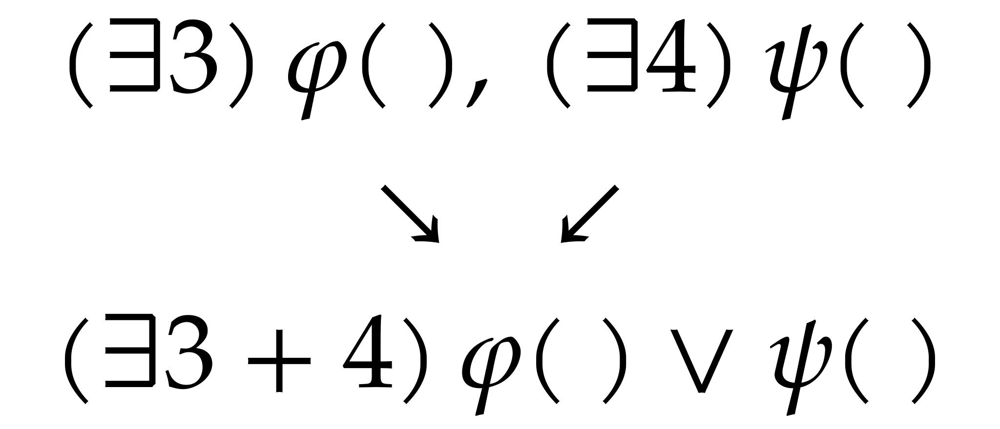

### [107\[3\]](https://cdn.wittgensteinnachlass.com/2000px/webp/Ms-106/107.webp)

One might say: I just have to work out first how much 3 + 4 is.

### [107\[4\]](https://cdn.wittgensteinnachlass.com/2000px/webp/Ms-106/107.webp),[109\[1\]](https://cdn.wittgensteinnachlass.com/2000px/webp/Ms-106/109.webp),[111\[1\]](https://cdn.wittgensteinnachlass.com/2000px/webp/Ms-106/111.webp)

Let us imagine two planes, with figures on plane I that we want to map onto plane II by some methods of projection or other. We can then fix a method of projection (say, orthogonal projection) & interpret the pictures on the 2nd plane in accordance with this method of mapping. But we can also take quite a different course. Suppose, for some reason or other, we stipulate that the pictures on the 2nd plane are all to be circles; whatever the figures on the 1st plane may be. That is, different figures on the 1st plane are mapped onto plane 2 by different methods of projection. To understand the circles in II as pictures, I will then have to say, for each circle, which method of projection goes with it. But the mere fact that a figure in II appears as a circle will in itself tell us nothing at all. – This is how it is with reality when we depict it in subject–predicate sentences. That we use subject–predicate sentences is merely a matter of our notation; the subject–predicate form is not in itself a logical form, and, like the circles on plane II, it is a means of expressing countless fundamentally different logical forms. The sentences “The clock is round”, “the man is tall”, “the patch is red”, “the picture is beautiful” have nothing in common in their form.

### [111\[2\]](https://cdn.wittgensteinnachlass.com/2000px/webp/Ms-106/111.webp)

If my theory that objects of the multiplicity of the real numbers occur in elementary propositions is right, then that points to a more general conception of numbers – than Frege’s & Russell’s – such as I myself once held. I said then that number arises from the concept of the calculus, and there is certainly something in that.

### [111\[3\]](https://cdn.wittgensteinnachlass.com/2000px/webp/Ms-106/111.webp),[111a\[1\]](https://cdn.wittgensteinnachlass.com/2000px/webp/Ms-106/111a.webp),[112\[1\]](https://cdn.wittgensteinnachlass.com/2000px/webp/Ms-106/112.webp)

For one difficulty with Frege’s theory is, of course, the generality of the words “concept” & “object”. For since one can count tables & sounds & vibrations & thoughts & court proceedings, it is hard to put them all under one heading. But concept & object are predicate & subject. And we have just said that subject–predicate is not _one_ logical form.

### [112\[2\]](https://cdn.wittgensteinnachlass.com/2000px/webp/Ms-106/112.webp)

One might first show that it must be possible to represent any sentence as a subject–predicate sentence, for if I pick out one of its objects, I can call _that_ the subject & everything else the predicate. (That is, I can write it in the manner of “f(x)”.)

### [112\[3\]](https://cdn.wittgensteinnachlass.com/2000px/webp/Ms-106/112.webp)

But even that would not be general enough for the application of the cardinal numbers, for I can count complexes (events etc.).

### [112\[4\]](https://cdn.wittgensteinnachlass.com/2000px/webp/Ms-106/112.webp)

Admittedly, that only means that there is a subject–predicate sentence in which the subject is some complex of objects or other.

### [114\[1\]](https://cdn.wittgensteinnachlass.com/2000px/webp/Ms-106/114.webp)

The question now might be whether anything can become a subject or only certain forms. – But can we not count any features that complexes have in common, make them into subjects?

### [114\[2\]](https://cdn.wittgensteinnachlass.com/2000px/webp/Ms-106/114.webp)

Can a subject–predicate sentence not then be formed in general as follows: I write an arbitrary sentence in the form “F(A)”, taking “F(ξ)” to be any variable that can be formed from it, and “φ(A)” to be the other variable that completes the first to yield the sentence “F(A)”.

### [114\[3\]](https://cdn.wittgensteinnachlass.com/2000px/webp/Ms-106/114.webp)

And here it makes sense to give up the one-sided notation & write “FA” or “AB”, where both signs are now on an equal footing.

### [114\[4\]](https://cdn.wittgensteinnachlass.com/2000px/webp/Ms-106/114.webp)

But how does it stand: can I count the properties that _one_ object has just as well as the objects that have _one_ property?

### [116\[1\]](https://cdn.wittgensteinnachlass.com/2000px/webp/Ms-106/116.webp)

There seems to be a certain difference here. For it seems that any sentences whatever can enter into the predicate by logical multiplication or addition, but not into the subject. f(a) ∙ p

### [116\[2\]](https://cdn.wittgensteinnachlass.com/2000px/webp/Ms-106/116.webp)

On the other hand, can I not make a subject just as general if I state something about a _process_ or a _fact_? (For example: “I am pleased by (the fact that etc.)”)

### [116\[3\]](https://cdn.wittgensteinnachlass.com/2000px/webp/Ms-106/116.webp)

A language that would consist partly of written signs and partly in one’s moving these signs through space in a particular way.

### [116\[4\]](https://cdn.wittgensteinnachlass.com/2000px/webp/Ms-106/116.webp)

Does it make sense to say: “In one place at one time there is only _one_ colour”? This is plainly a tautology if one determines the sense of “and” accordingly; otherwise it is nonsense.

### [116\[5\]](https://cdn.wittgensteinnachlass.com/2000px/webp/Ms-106/116.webp),[118\[1\]](https://cdn.wittgensteinnachlass.com/2000px/webp/Ms-106/118.webp)

Is this the most general situation: I have a propositional variable & count the values that make it a true proposition. Or, in other words, I count the true values of the variable.

### [118\[2\]](https://cdn.wittgensteinnachlass.com/2000px/webp/Ms-106/118.webp)

(I could then also say: I always count the true propositions of a particular form.)

### [118\[3\]](https://cdn.wittgensteinnachlass.com/2000px/webp/Ms-106/118.webp)

Instead of saying “there are two objects that have this property”, one should really say “there are two that possess this property”. (It goes without saying that they are objects.)

### [118\[4\]](https://cdn.wittgensteinnachlass.com/2000px/webp/Ms-106/118.webp),[120\[1\]](https://cdn.wittgensteinnachlass.com/2000px/webp/Ms-106/120.webp)

I can say: wherever I have a propositional variable, I can form a subject–predicate sentence.

But where I have the subject–predicate representation, I also have number in Frege’s sense.

We really do use it that generally in our language, in forming predicates, concepts such as those I listed earlier.

### [120\[2\]](https://cdn.wittgensteinnachlass.com/2000px/webp/Ms-106/120.webp)

When I wrote my theory of numbers back then, Frege’s theory put me off because it seemed too special. This defect disappears if one takes the subject–predicate sentence in its full generality.

### [120\[3\]](https://cdn.wittgensteinnachlass.com/2000px/webp/Ms-106/120.webp)

(Nevertheless I am still left with an uneasiness that would disappear if I could get hold of another theory that did _not_ make use of _the_ subject–predicate concept.)

### [120\[4\]](https://cdn.wittgensteinnachlass.com/2000px/webp/Ms-106/120.webp)

I would like, as it were, to treat arithmetic separately from logic & indicate at just one point how arithmetic is to be applied in logic.

### [120\[5\]](https://cdn.wittgensteinnachlass.com/2000px/webp/Ms-106/120.webp),[122\[1\]](https://cdn.wittgensteinnachlass.com/2000px/webp/Ms-106/122.webp)

It is clear that if one takes Frege’s theory strictly one cannot say

“a, b & c are 3 objects”. For (∃xyz) ∙ x = a ∙ y = b ∙ z = c is after all an evasion. One might have expressed the proposition somewhat like this: whenever a, b, c satisfy a function, it is satisfied by 3 objects, say:

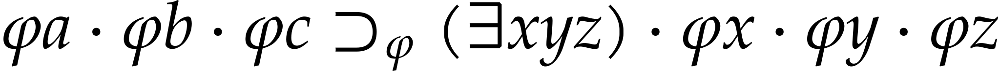.

### [122\[2\]](https://cdn.wittgensteinnachlass.com/2000px/webp/Ms-106/122.webp)

I believe one must do arithmetic apart from logic, that is, I believe we must not appeal to logic in arithmetic.

### [122\[3\]](https://cdn.wittgensteinnachlass.com/2000px/webp/Ms-106/122.webp)

For it is clear that once one has started doing arithmetic one does not give a damn about functions & objects, and goes on as if one knew nothing at all. Indeed, even if one has decided to work only with extensions, there is still the oddity that one pays no regard whatsoever to the form of the objects either.

### [122\[4\]](https://cdn.wittgensteinnachlass.com/2000px/webp/Ms-106/122.webp),[124\[1\]](https://cdn.wittgensteinnachlass.com/2000px/webp/Ms-106/124.webp)

What are we doing if, in laying the foundations of arithmetic, we use only functions of the kind x = a, x = a ⌵ x = b, x = a ⌵ x = b ⌵ x = c, etc., x = a ∙ y = b, x = a ∙ y = b ⌵ x = c ∙ y = d etc. One could also conveniently write such functions like this:

(a b c)x etc. or (ab, cd, ef)xy respectively

and then abbreviate them as

“φx” and “Rxy”, where “φ” simply stands for

“(a b c)” or the like & “R” for

“(ab, cd, ef)”. The definition would then be that (a b c)x becomes a tautology for the arguments a, b, c & a contradiction for all others.

### [124\[2\]](https://cdn.wittgensteinnachlass.com/2000px/webp/Ms-106/124.webp)

Such a function would then be a touchstone with which to test sentences for usefulness by substituting a constructed function in them for an actual one & seeing whether t or c results.

### [124\[3\]](https://cdn.wittgensteinnachlass.com/2000px/webp/Ms-106/124.webp)

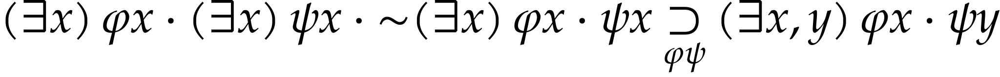.

Is this too an application of 1 + 1 = 2? If I want to write “(∃2x)” here instead of “(∃xy)”, it will not work.

### [124\[4\]](https://cdn.wittgensteinnachlass.com/2000px/webp/Ms-106/124.webp),[126\[1\]](https://cdn.wittgensteinnachlass.com/2000px/webp/Ms-106/126.webp)

Can one regard 1 + 1 = 2 as a theorem or also as a definition of 2? I.e. is the equality sign here the same as in a definition?

### [126\[2\]](https://cdn.wittgensteinnachlass.com/2000px/webp/Ms-106/126.webp)

p ∙ q ≝ ~(~p⌵~q) from this, surely, there must follow, e.g.

~(p ∙ q) = ~p⌵~q etc.

### [126\[3\]](https://cdn.wittgensteinnachlass.com/2000px/webp/Ms-106/126.webp)

What relation is there, then, between “≝” and that equality sign which yields taut. & contr.? For this equality sign, is “p ∙ q = ~(~p⌵~q)” a tautology? One could say: “p ∙ q = p ∙ q” is a taut. & since one may here replace one of the signs “p ∙ q” by ~(~p ∙ ~q) in accordance with the definition, the expression above is also a taut..

### [126\[4\]](https://cdn.wittgensteinnachlass.com/2000px/webp/Ms-106/126.webp),[128\[1\]](https://cdn.wittgensteinnachlass.com/2000px/webp/Ms-106/128.webp)

So one ought not to write the explanation of ( ) = ( ) like this:

ξ = ξ ≝ Taut.

ξ = η ≝ Cont.

Rather, one would have to say: If & _only_ if “ξ” & “η” have the same meaning according to the rules for the signs, then “ξ = η” is a taut.; if “ξ” & “η” do not have the same meaning according to the rules for the signs, then “ξ = η” is a contr.. It may be expedient to write the equality sign thus explained differently, say “ξ↔η”, to distinguish it from “ξ = η”, which represents a rule for the signs & says that we may replace ξ by η. For I cannot tell that from ξ↔η, but only from the fact that ξ↔η is a tautology; and even that I know only if I already know the substitution rules.

### [128\[2\]](https://cdn.wittgensteinnachlass.com/2000px/webp/Ms-106/128.webp)

It seems to follow from this that one is _not_ able to use ↔ in place of = in mathematics.

### [128\[3\]](https://cdn.wittgensteinnachlass.com/2000px/webp/Ms-106/128.webp)

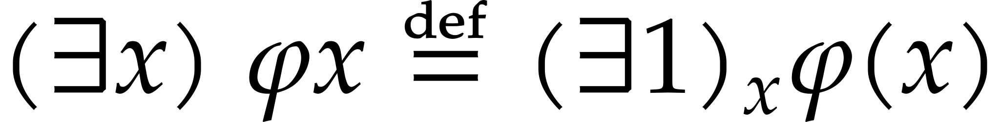

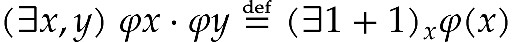

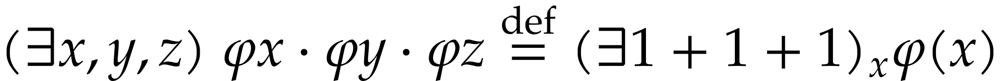

_etc._

further:

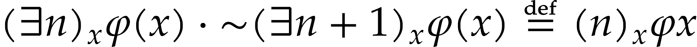

### [128\[4\]](https://cdn.wittgensteinnachlass.com/2000px/webp/Ms-106/128.webp),[130\[1\]](https://cdn.wittgensteinnachlass.com/2000px/webp/Ms-106/130.webp)

Then one can write, for example:

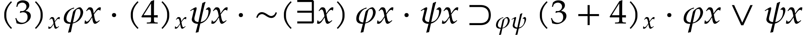

This expression is not the same as the substitution rule 3 + 4 = 7.

### [130\[2\]](https://cdn.wittgensteinnachlass.com/2000px/webp/Ms-106/130.webp)

The inference is drawn, as it were, according to two rules in succession. According to the first I form a provisional sign “(∃(1 + 1 + 1) + (1 + 1 + 1 + 1))” by simply copying the two numerals from the left & only then do I drop the brackets & form (∃1 + 1 + 1 + 1 + 1 + 1 + 1)

### [130\[3\]](https://cdn.wittgensteinnachlass.com/2000px/webp/Ms-106/130.webp)

I can also say: The sign “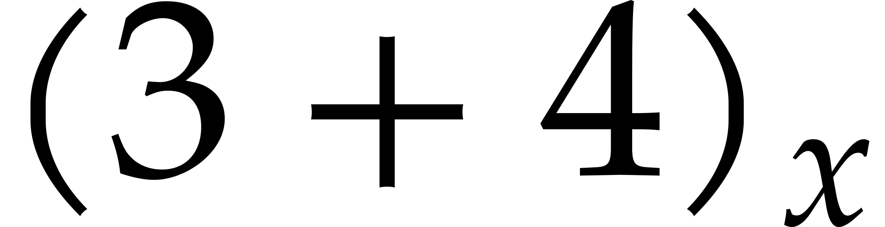” etc. gives an instruction, a description of how it is to be formed from the signs on the left.

### [130\[4\]](https://cdn.wittgensteinnachlass.com/2000px/webp/Ms-106/130.webp)

But does the addition of cardinal numbers really occur only in this one case. Is this its _only_ application? For in that case there would be no sense in treating addition separately from its logical application. (Here, admittedly, I have in mind that the subject–predicate form does not determine a logical form.)

### [130\[5\]](https://cdn.wittgensteinnachlass.com/2000px/webp/Ms-106/130.webp),[132\[1\]](https://cdn.wittgensteinnachlass.com/2000px/webp/Ms-106/132.webp)

If I say 3 apples & 3 more apples are 6 apples, then the word _more_ is what is decisive here. For from the fact that I put 3 apples on the table & put 3 apples on the table, it does not follow that I have put 6 apples on the table; after all, I might mean the same occurrence both times. They must have been different apples the second time.

### [132\[2\]](https://cdn.wittgensteinnachlass.com/2000px/webp/Ms-106/132.webp)

One could also ask as follows: Suppose I have 4 objects that satisfy a function: does it make sense in every case to say that these 4 objects are 2 + 2 objects? After all, I do not know whether there are functions that bring 2 & 2 of them under one heading (one heading for each pair)! Does it make sense to say of any 4 objects that they consist of 2 objects & 2 objects?

### [132\[3\]](https://cdn.wittgensteinnachlass.com/2000px/webp/Ms-106/132.webp),[134\[1\]](https://cdn.wittgensteinnachlass.com/2000px/webp/Ms-106/134.webp)

The same old questions over and over again. The notation I used above, “ etc.”, already contains the assumption that it makes sense to regard 7 always as 3 + 4, for on the right-hand side of “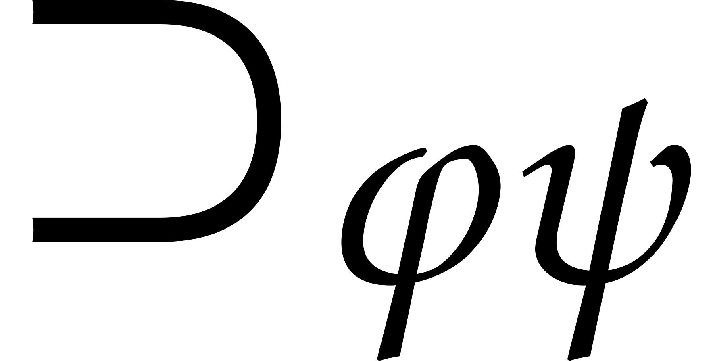” I have, so to speak, already forgotten where this 3 & 4 came from. On the other hand, in the sign “1 + 1 + 1 + 1 + 1 + 1 + 1” I can surely distinguish 3 & 4 in any case.

### [134\[2\]](https://cdn.wittgensteinnachlass.com/2000px/webp/Ms-106/134.webp)

Does the solution perhaps lie here; what if I had a sign for 7 in which I could not separate off 3 & 4?? Is such a sign conceivable?

### [134\[3\]](https://cdn.wittgensteinnachlass.com/2000px/webp/Ms-106/134.webp)

Again and again it seems possible to treat extensions like forms of objects.

### [134\[4\]](https://cdn.wittgensteinnachlass.com/2000px/webp/Ms-106/134.webp)

And of course there is always the question whether extensions are ever used without a real function!

### [134\[5\]](https://cdn.wittgensteinnachlass.com/2000px/webp/Ms-106/134.webp),[136\[1\]](https://cdn.wittgensteinnachlass.com/2000px/webp/Ms-106/136.webp)

Does it make sense to say that a relation connects 2 objects with one another even if they do not otherwise fall under any concept. Yes, of course: for one can form the class of all x x̂(xRb ⌵ aRx). But no, for this class need not have only 2 members. And I do not mean the case where R connects only a & b & no other pair either; I only want to say that in every complex ξRη R connects two objects (or, as one says, that R is a two-place relation).

### [136\[2\]](https://cdn.wittgensteinnachlass.com/2000px/webp/Ms-106/136.webp)

I do not even want to discuss the idea that one is to count numbers, which surely do not fall under any real concept. – But it certainly makes sense to speak of the 5th sentence in the series “(∃x) ∙ aRx ∙ xRb”, “(∃x,y) ∙ aRx ∙ xRy ∙ yRb”, etc. (This was also what led me to regard ordinal numbers as more general than cardinal numbers.)

### [136\[3\]](https://cdn.wittgensteinnachlass.com/2000px/webp/Ms-106/136.webp)

What about the sentence “(∃xyz) ∙ aRx ∙ xRy ∙ yRz ∙ zRb ․⌵․ aRy ∙ yRx ∙ xRz ∙ zRb ․⌵․ etc.” [all the combinations follow]? Can I not write it intelligibly in the form “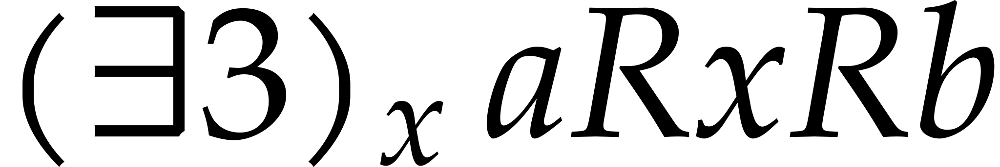”, roughly “(only) 3 links are inserted between a & b”. Here we have formed the concept “link between a & b”.

### [136\[4\]](https://cdn.wittgensteinnachlass.com/2000px/webp/Ms-106/136.webp),[138\[1\]](https://cdn.wittgensteinnachlass.com/2000px/webp/Ms-106/138.webp)

“ξ is a link between a & b” would be written like this:

“aRξ ∙ ξRb ․⌵․ (∃x) ∙ aRξ ∙ ξRx ∙ xRb ․⌵․ (∃x)aRx ∙ xRξ ∙ ξRb ․⌵․ (∃xy) etc.” But with the help of this function I could not say what I mean by “there are 2 links between a & b”. For if I abbreviate the function above as “aR–ξ–Rb”, then the sentence, following the pattern (∃x,y) φx ∙ φy, would read: (∃xy) ∙ aR–x–Rb ∙ aR–y–Rb. If, for example, we call these two objects c & d, then the sentence is also correct if it is true that aRc ∙ cRb ∙ aRd ∙ dRb; this too is obviously not what was meant.

### [138\[2\]](https://cdn.wittgensteinnachlass.com/2000px/webp/Ms-106/138.webp)

It is clear that the cardinal number has no _more_ to do with “(∃x…)” than with “(x…)”, and instead of 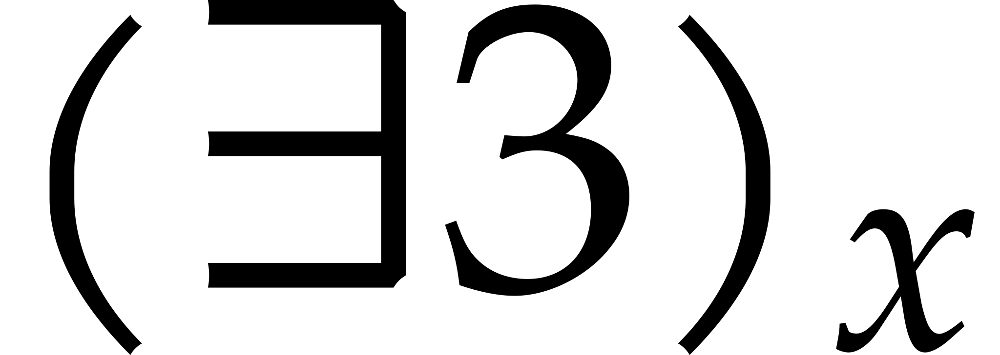 etc. one can write ~(3x)~ etc.; i.e. “it is not true for _all_ triples that etc.”

### [138\[3\]](https://cdn.wittgensteinnachlass.com/2000px/webp/Ms-106/138.webp)

But it is understandable that the cardinal number should attach to the designation of generality at all.

### [138\[4\]](https://cdn.wittgensteinnachlass.com/2000px/webp/Ms-106/138.webp)

Instead of “(∃xyz)” I can write “” wherever what comes after it states the same thing with respect to all three arguments.

Π(x,y) ∙ φx ∙ φy Π(2x) ∙ φx 

Σ(x,y) ∙ φx ∙ φy Σ(2x) ∙ φx 

### [140\[1\]](https://cdn.wittgensteinnachlass.com/2000px/webp/Ms-106/140.webp)

What sort of sentence would this be: “There is a colour such that a place in visual space has it.”? Suppose there were only 4 colours: is it conceivable, then, that a place has no colour? If there are sentences that ascribe the colours 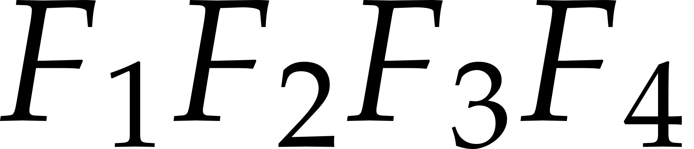 to the place O, then of course there must be a sentence with sense: 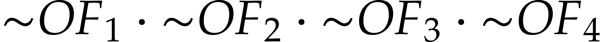 and this sentence too, if it is true, must describe a _visible_ situation. So if it is true – as indeed it seems to be – that every place must in a certain sense have a _colour_, then one of these “colours” must be the absence of the others. Might that be black? If that is so, the sentence given above makes sense.

### [140\[2\]](https://cdn.wittgensteinnachlass.com/2000px/webp/Ms-106/140.webp),[142\[1\]](https://cdn.wittgensteinnachlass.com/2000px/webp/Ms-106/142.webp)

It must already be implicit in the sign 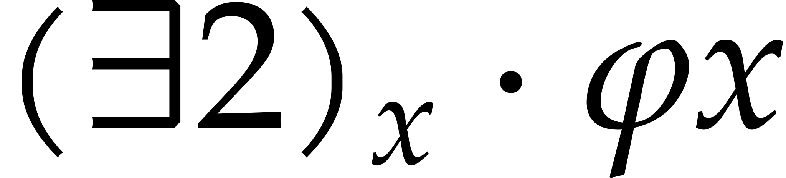 that _both_ values of x are to be substituted into a product φx ∙ φy. It is the same with a sign  – except that here the sign aRxRb was introduced specifically for this purpose, whereas one cannot tell from the sign φx in 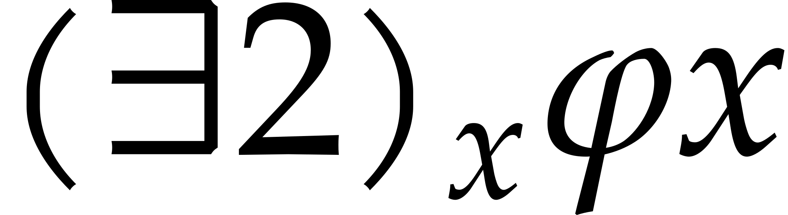 that in the analysed sentence “φx ∙ φy” stands in place of “φx”.

### [142\[2\]](https://cdn.wittgensteinnachlass.com/2000px/webp/Ms-106/142.webp)

If one asks why one cannot write “(∃2x) …” instead of “(∃xy)xRy”, one can answer that the 2 is warranted only where the sentence can be obtained by two successive applications of the same operation – that is, where it is of the form O²….

### [142\[3\]](https://cdn.wittgensteinnachlass.com/2000px/webp/Ms-106/142.webp),[144\[1\]](https://cdn.wittgensteinnachlass.com/2000px/webp/Ms-106/144.webp)

One can also put it this way: instead of “(∃xyz…)…” I can always say “(∃nx)…” if the function of xy etc. is such that I do not have to mention any of the objects individually. Or again, that I do not first have to arrange the objects in the function. That I do not have to assign them places. That they are like people whom I push into a room & I am satisfied if they are in it, without bothering about their places in the room. The function must therefore be such that the objects cannot stand in it in a way I did not mean. The function must be such that I do not need to assign the objects their places in it.

### [144\[2\]](https://cdn.wittgensteinnachlass.com/2000px/webp/Ms-106/144.webp)

What about the sentences:

(∃x,y,z)xRy ∙ xRz ∙ yRx ∙ yRz ∙ zRx ∙ zRy, (∃x,y,z,u) etc. or

(∃x,y)xRy⌵yRx

(∃x,y,z)xRy⌵xRz⌵yRx⌵yRz⌵zRx⌵zRy etc. Here all the argument places have equal standing. (I do not need to impose an order on the sentence.)

### [144\[3\]](https://cdn.wittgensteinnachlass.com/2000px/webp/Ms-106/144.webp)

One can also put it this way: the opening “There are n things” must always be followed by “such that each …” and not “such that x … y … etc.”.

### [144\[4\]](https://cdn.wittgensteinnachlass.com/2000px/webp/Ms-106/144.webp)

“There are 5 people who love one another.” One cannot put this sentence into the form (∃x,y,z,u,v) ∙ φx ∙ φy ∙ φz ∙ φu ∙ φv.

### [144\[5\]](https://cdn.wittgensteinnachlass.com/2000px/webp/Ms-106/144.webp)

Can one now say that “5” has a different meaning here from the one it has, say, in the sentence “There are 5 good people”?

### [144\[6\]](https://cdn.wittgensteinnachlass.com/2000px/webp/Ms-106/144.webp),[146\[1\]](https://cdn.wittgensteinnachlass.com/2000px/webp/Ms-106/146.webp)

Above all, can one not say that these 5 people who love one another are 5 good people?

### [146\[2\]](https://cdn.wittgensteinnachlass.com/2000px/webp/Ms-106/146.webp)

It is clear that in _logical_ addition all sorts of things change: 2 people who love one another + 2 other people who love one another do not make 4 people who love one another.

### [146\[3\]](https://cdn.wittgensteinnachlass.com/2000px/webp/Ms-106/146.webp)

Can one also apply 1 + 1 = 2 like this? (∃x,y) φx ∙ ψy ⊃ (∃xy)(φx⌵ ψx) ∙ (φy⌵ψy) which one can write:

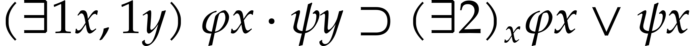 The point here is that one is not _able_ to write “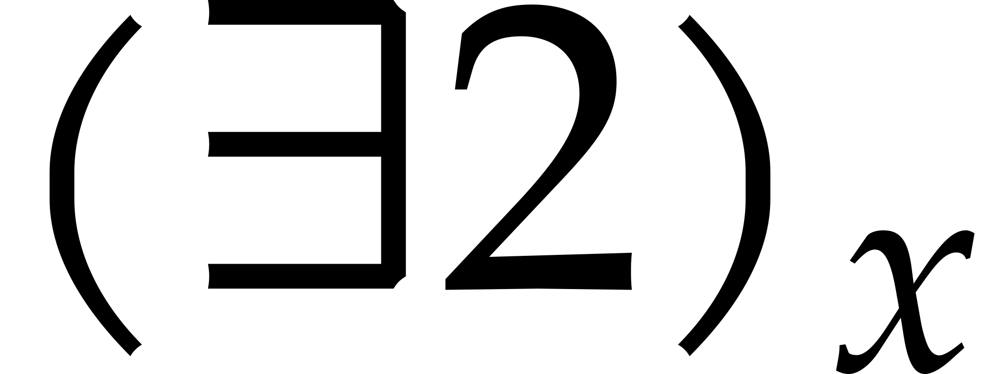” on the left-hand side. But could one not also write here:

?

### [146\[4\]](https://cdn.wittgensteinnachlass.com/2000px/webp/Ms-106/146.webp)

What we write down in logic as, so to speak, an application of 2 + 2 = 4 can never be the same as 2 + 2 equals 4. I have two items of clothing does not mean the same as I have a coat & a pair of trousers, although the first sentence follows from the second.

### [146\[5\]](https://cdn.wittgensteinnachlass.com/2000px/webp/Ms-106/146.webp),[148\[1\]](https://cdn.wittgensteinnachlass.com/2000px/webp/Ms-106/148.webp)

Only when we work with pure extensions can the equality sign hold.

### [148\[2\]](https://cdn.wittgensteinnachlass.com/2000px/webp/Ms-106/148.webp)

Does the decomposition of 4 into 2 + 2 make sense if there are no functions that bring each pair under one heading?

But if there are such functions, then the decomposition of 4 into 2 + 2 is possible, but never into 2 + 3 or 2 + 1, & 2 + 2 = 4 simply indicates the possibility of this decomposition if the other conditions are fulfilled. 2 + 2 = 4, as it were, makes everything ready for the decomposition (so that it can be carried out if necessary.) But that alone would mean that in that case the equation cannot be a tautology either.

### [148\[3\]](https://cdn.wittgensteinnachlass.com/2000px/webp/Ms-106/148.webp)

But how is it possible to prepare something for the existence of a function if I do not know whether it exists? Surely that seems impossible.

### [148\[4\]](https://cdn.wittgensteinnachlass.com/2000px/webp/Ms-106/148.webp),[150\[1\]](https://cdn.wittgensteinnachlass.com/2000px/webp/Ms-106/150.webp),[152\[1\]](https://cdn.wittgensteinnachlass.com/2000px/webp/Ms-106/152.webp)

If arithmetic depends on the existence of certain real functions, then it must speak of them. But now it seems that I can after all make a _preparation_ for real functions, namely by trying all conceivable extensions for φ & ψ in the sentence:

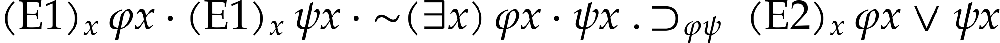

But since the _possible_ extensions do not also give me functions, what does this sentence with the substituted sham functions actually show me? One might say “it shows how things stand _if_ there are functions of such & such a kind”, but that is not enough; _as it stands_ it must show something that has nothing to do with hypothetical functions. And surely what it shows must have to do only with the essence of extension, since there is no mention of the particular property of any function. Now if by “φ” & “ψ” I understand variables ranging over extensions – so that they run through the series (–)x; (a)x, (b)x, …; (ab)x, (ac)x…(bc)x…; (abc)x…… etc. – then the question is, what does the sentence now show about all these extensions & is everything in it necessary to show that. Can it show anything other than something arithmetical?

### [152\[2\]](https://cdn.wittgensteinnachlass.com/2000px/webp/Ms-106/152.webp)

If the sentence now shows only _arithmetical_ relations, then – I believe – everything in it that made it a _sentence_ (the logical constants) must also become inessential, and then it must also be possible to represent this arithmetical relation more simply.

### [152\[3\]](https://cdn.wittgensteinnachlass.com/2000px/webp/Ms-106/152.webp)

But surely what will be shown is what one means when one says: from

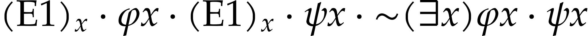 there follows .

### [152\[4\]](https://cdn.wittgensteinnachlass.com/2000px/webp/Ms-106/152.webp)

But here too – in order to show that the sentence on the right follows from the one on the left – must I let φ & ψ run through all their conceivable extensions?

### [151\[1\]](https://cdn.wittgensteinnachlass.com/2000px/webp/Ms-106/151.webp)

~(x)~φx ∙ (x,y)~(φx ∙ φy) ∙

~(x)~ψx ∙ (xy)~(ψx ∙ ψy) ∙ (x) ∙ ~(φx ∙ ψx) ⊃

~(x,y) ~[φx⌵ψx ∙ φy⌵ψy] ∙

~(xyz) ~[φx⌵ψx ∙ φy⌵ψy ∙ φz⌵ψz]

### [151\[2\]](https://cdn.wittgensteinnachlass.com/2000px/webp/Ms-106/151.webp)

Let us write down the truth-conditions for the sentences in T-F notation!

### [153\[1\]](https://cdn.wittgensteinnachlass.com/2000px/webp/Ms-106/153.webp)

I must even plunge into regions where I know that I make mistakes which I need not be making even with my present knowledge. But I must also get beneath the truths that are already established.

### [153\[2\]](https://cdn.wittgensteinnachlass.com/2000px/webp/Ms-106/153.webp)

One could always express a philosophical problem like this: can one use _that_ symbolism? And the various assumptions one arrives at therefore always find expression in just as many different symbolisms.

### [153\[3\]](https://cdn.wittgensteinnachlass.com/2000px/webp/Ms-106/153.webp)

In this respect one could also call the philosopher a creator of language.

### [152\[5\]](https://cdn.wittgensteinnachlass.com/2000px/webp/Ms-106/152.webp),[154\[1\]](https://cdn.wittgensteinnachlass.com/2000px/webp/Ms-106/154.webp)

But here too we would not have the symmetrical relation of equality as in 1 + 1 = 2 (2 = 1 + 1). That says, roughly: in place of “1 + 1” I _can_ put “2”, in place of “2” I _can_ put “1 + 1”. Besides, if the above says 1 + 1 = 2, what does the expression that shows 1 + 1 = 0 + 2 or

2 + 2 = 1 + 3 look like?

### [154\[2\]](https://cdn.wittgensteinnachlass.com/2000px/webp/Ms-106/154.webp)

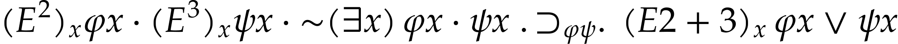

The addition with 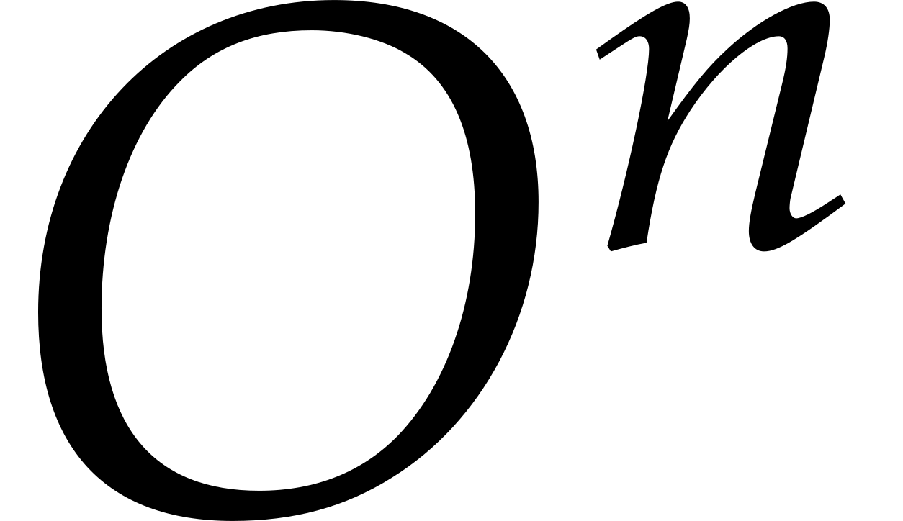 relates only to the last member of the sentence. (It means: if at some point an operation should be needed, then it yields the result …)

### [154\[3\]](https://cdn.wittgensteinnachlass.com/2000px/webp/Ms-106/154.webp)

If it reads (∃xyzuv) …, then a special case of it always reads a b c d e & this stands in an internal relation to every general expression that has a b or a b c as a special case.

### [154\[4\]](https://cdn.wittgensteinnachlass.com/2000px/webp/Ms-106/154.webp)

I cannot replace (∃xyz) ∙ φ(xyz) by , even though a special case reads φ (abc) & a, b, c are 3. Or are they 3 only if they have equal standing? One is again pointed towards the operation 0³.

### [154\[5\]](https://cdn.wittgensteinnachlass.com/2000px/webp/Ms-106/154.webp),[156\[1\]](https://cdn.wittgensteinnachlass.com/2000px/webp/Ms-106/156.webp)

Instead of “(∃xyz) …” I can no more say “” in general than I can regard φ(abc) as φ(3). (So things do not go so smoothly with names either.)

(∃x) φx, (∃xy) φx ∙ φy, (∃xyz) φx ∙ φy ∙ φz, etc.

### [156\[2\]](https://cdn.wittgensteinnachlass.com/2000px/webp/Ms-106/156.webp)

[(∃x) φx, (∃–)–, (∃–y)– ∙ φy] But here I now have the difficulty that I know of no means of showing that at each successive operation one must use a variable that does not yet occur in the brackets “(∃ …)”. Or could one express it like this:

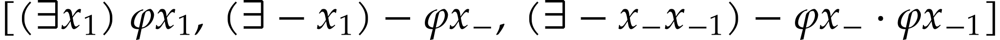

### [156\[3\]](https://cdn.wittgensteinnachlass.com/2000px/webp/Ms-106/156.webp)

But if a sentence (∃xy …) φx ∙ φy … is the result of a repeated operation, then surely I could continue this operation ad infinitum. But the fact is that for this operation I always need fresh material, and at some point I may run out of it.

### [156\[4\]](https://cdn.wittgensteinnachlass.com/2000px/webp/Ms-106/156.webp)

But if that is precisely where my cardinal numbers come from, how could they go on ad infinitum?

### [158\[1\]](https://cdn.wittgensteinnachlass.com/2000px/webp/Ms-106/158.webp)

But isn’t the very point of that variable index in 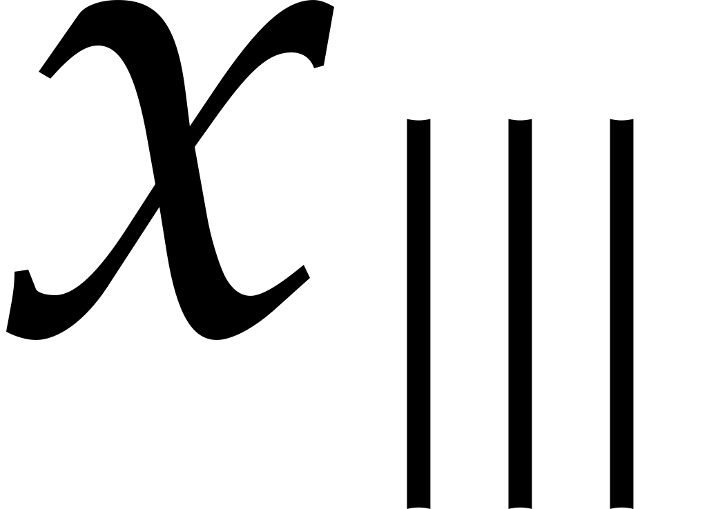 etc. to show that I can form infinitely many signs of this kind? (Whereas I would eventually run out of letters.)

### [158\[2\]](https://cdn.wittgensteinnachlass.com/2000px/webp/Ms-106/158.webp)

One could also write it like this:

(∃x,xx,xxx) φx ∙ φxx ∙ φxxx and (∃x,xx)φ(x,xx) xx would then be _one_ letter unless there were a comma in between.

### [158\[3\]](https://cdn.wittgensteinnachlass.com/2000px/webp/Ms-106/158.webp)

It would then read

### [158\[4\]](https://cdn.wittgensteinnachlass.com/2000px/webp/Ms-106/158.webp)

Whatever conception one has of number, one can take sentences (∃n) … to define number only _if n can be arbitrarily large_.

### [158\[5\]](https://cdn.wittgensteinnachlass.com/2000px/webp/Ms-106/158.webp)

The problem is: How can one make preparations to receive something that may exist.

### [158\[6\]](https://cdn.wittgensteinnachlass.com/2000px/webp/Ms-106/158.webp),[160\[1\]](https://cdn.wittgensteinnachlass.com/2000px/webp/Ms-106/160.webp)

What are combinations of objects; can one count them as objects?

### [160\[2\]](https://cdn.wittgensteinnachlass.com/2000px/webp/Ms-106/160.webp)

I would like to count infinitely far with a finite number of objects, but that seems impossible when one actually looks at two things.

### [160\[3\]](https://cdn.wittgensteinnachlass.com/2000px/webp/Ms-106/160.webp)

Must it not after all be possible to reduce the possibility of counting ad infinitum to the existence of infinitely many things.

### [160\[4\]](https://cdn.wittgensteinnachlass.com/2000px/webp/Ms-106/160.webp)

The infin. ax. is nonsense if only because the possibility of expressing it presupposes infinitely many things – that is, what it purports to assert. Of logical concepts, e.g. infinity, one can say that their essence proves their existence.

### [160\[5\]](https://cdn.wittgensteinnachlass.com/2000px/webp/Ms-106/160.webp)

The sentence – the infin. ax. – itself has to display infinity already, even if by way of definitions.

### [160\[6\]](https://cdn.wittgensteinnachlass.com/2000px/webp/Ms-106/160.webp),[162\[1\]](https://cdn.wittgensteinnachlass.com/2000px/webp/Ms-106/162.webp)

If, for example, one wants to explain the concept ℵ0 as R. does, by saying that a function φ is such that all sentences of the form

~(∃x) ∙ φx, (Еx) φx, (Еx,y) φx ∙ φy, (Еxyz) φxφyφz, etc. are false, then this explanation already presupposes that there are infinitely many sentences of that form. – And this holds even if we should be mistaken about the function φ & it turned out that one of those sentences was true.

### [162\[2\]](https://cdn.wittgensteinnachlass.com/2000px/webp/Ms-106/162.webp)

Suppose I believed that there was only one function in all & that it was satisfied by 4 objects. Later I find that it is also satisfied by a fifth thing; has the sign “4” now become senseless?

### [162\[3\]](https://cdn.wittgensteinnachlass.com/2000px/webp/Ms-106/162.webp)

I want to say that numbers can be defined only from the *forms* of sentences, independently of which sentences are true or false. My definition by means of  was also meant to point to this.

### [162\[4\]](https://cdn.wittgensteinnachlass.com/2000px/webp/Ms-106/162.webp),[164\[1\]](https://cdn.wittgensteinnachlass.com/2000px/webp/Ms-106/164.webp)

How, then, could 2 + 2 = 4 be represented more simply (as it were with a calculating machine on paper) than it is in Ramsey’s way? Or is nothing here actually dispensable?

### [164\[2\]](https://cdn.wittgensteinnachlass.com/2000px/webp/Ms-106/164.webp)

(∃xyz)xRy ∙ yRz ∙ xRz ∙ yRx ∙ zRy ∙ zRx ≝ (∃3)ζRη Does it make sense here to say that 3 consists of 2 + 1?

### [164\[3\]](https://cdn.wittgensteinnachlass.com/2000px/webp/Ms-106/164.webp)

If one asks “aren’t a b c d 4 things even if no real function determines them”, one can say that even in this sentence I cannot point to them without singling them out from the others, thus determining them (and that means determining them by means of a concept.) And if I now want to say of these that they consist of 2 and 2, then again I surely cannot single out a & b without grouping them together apart from the others! But if they are now grouped together in this way by the designation, why do I still need to group them together by means of a real function.

### [166\[1\]](https://cdn.wittgensteinnachlass.com/2000px/webp/Ms-106/166.webp)

How, then, could 2 + 2 = 4 be represented more simply than it is in R.’s way? Or is nothing here actually dispensable? Must I really write everything as though it were a matter of actual facts & sentences? Wouldn’t something like x,y + z,n = x,y,z, n suffice?

### [166\[2\]](https://cdn.wittgensteinnachlass.com/2000px/webp/Ms-106/166.webp)

The only difficulty with such a formula is that it does not contain the possibility of its application. It does not show where it belongs.

### [166\[3\]](https://cdn.wittgensteinnachlass.com/2000px/webp/Ms-106/166.webp),[168\[1\]](https://cdn.wittgensteinnachlass.com/2000px/webp/Ms-106/168.webp)

That points back to the use of the operation. Now one can object to the form of the operation on the grounds that it is too general, or rather too indeterminate. But must not this indeterminacy occur in every theory of number. For the very reason that number has such general application. If I use the concept of a function, of an object, in my definition, then the very same indeterminacy lies in these forms.  If φ & ψ here are the forms x = a ⌵ x = b, etc., then the whole sentence has become a device that ensures that the addition is done correctly.

(∃x,y) x = a ⌵ x = b ∙ y = a ⌵ y = b ∙ ~(∃xyz) x = a ⌵ x = b ∙ y = a ⌵ y = b ∙ z = a ⌵ z = b

if this sentence is a contradiction in accordance with our stipulations, that is because I cannot correlate 2 things with 3 things 1 to 1.

### [168\[2\]](https://cdn.wittgensteinnachlass.com/2000px/webp/Ms-106/168.webp)

In the symbolism a correlation is actually made, whereas in the meaning it is only the possibility of correlation that is at issue. (One could thus call the pseudo-functions x = a, x = a ⌵ x = b, etc., arithmetical functions. For they contain what is arithmetical in the sentences. They contain the numbers.)

### [168\[3\]](https://cdn.wittgensteinnachlass.com/2000px/webp/Ms-106/168.webp),[170\[1\]](https://cdn.wittgensteinnachlass.com/2000px/webp/Ms-106/170.webp)

If 1 + 1 = 2 means that from

( follows , then what does 2 = 1 + 1 mean? (The first sentence surely does not follow from the second.) As I understand it, of course, one can apply both 1 + 1 = 2 and 2 = 1 + 1 to the second sentence.

### [170\[2\]](https://cdn.wittgensteinnachlass.com/2000px/webp/Ms-106/170.webp)

Can I now write in general

?

But how am I to introduce the “+”? And what does the decomposition of 3 into 2 & 1 mean here (Does it not have sense only in relation to that inference?)

### [170\[3\]](https://cdn.wittgensteinnachlass.com/2000px/webp/Ms-106/170.webp)

I believe the decomposition has sense wherever it indicates that there is an internal relation between an , an  and the . But doesn’t such a relation always hold between (∃xyz), (∃xy) … & (∃x) …?

### [170\[4\]](https://cdn.wittgensteinnachlass.com/2000px/webp/Ms-106/170.webp),[172\[1\]](https://cdn.wittgensteinnachlass.com/2000px/webp/Ms-106/172.webp)

2 + 1 is surely just a rule for forming a third sign from two signs we already know.  means:

form a sign by etc. …: So it would be something like this: I know “3” & “4” from the signs “(∃3) …” & “(∃4) …”, and now I use this knowledge in forming the sign . It would already follow from this, incidentally, that one must not define “3” and “4” by the signs “”, “”, respectively, since the sign “” does not occur in the sign “”.

### [172\[2\]](https://cdn.wittgensteinnachlass.com/2000px/webp/Ms-106/172.webp)

Now is 2 + 2 = 4 a rule for signs? i.e., does the “ = ” refer to the signs? Does it say: If one uses these signs _in this way_ as symbols, then one can replace them with one another. Does that amount to saying: “these signs are the same symbol”? What then is “2 + 2 = 5”? Is it a false rule of substitution? I believe it is. It is clear that if I may also write 2 + 2 = 4 like this: “‘2 + 2’ can be replaced by ‘4’”, then in doing so I have compared 2 + 2 = 4 with a sentence & that is why there are now analogues for all applications of logic to this sentence.

### [172\[3\]](https://cdn.wittgensteinnachlass.com/2000px/webp/Ms-106/172.webp),[174\[1\]](https://cdn.wittgensteinnachlass.com/2000px/webp/Ms-106/174.webp)

It seems to me that one can compare the equations of mathematics only with sentences that have sense, not with tautologies. For the equation contains this very element that states something – the equality sign – which is not meant to show anything. For what shows itself does so without the equality sign. The equality sign does not correspond to the “․⊃․” in “p ∙ (p⊃q) ․⊃․ q”, for the “․⊃․” is only _one_ constituent among all the others that go to make up the tautology. It does not stand apart from the rest, but belongs to the sentence, like the “ ∙ ” or “⊃”. The “ = ”, however, is a copula, which alone makes the equation something sentence-like. The tautology shows something; the equation shows nothing, but points to the fact that its terms show something.

### [174\[2\]](https://cdn.wittgensteinnachlass.com/2000px/webp/Ms-106/174.webp)

One could represent my conception as follows: the word “infinite” is used correctly only in the expression “ad infinitum”.

### [174\[3\]](https://cdn.wittgensteinnachlass.com/2000px/webp/Ms-106/174.webp),[176\[1\]](https://cdn.wittgensteinnachlass.com/2000px/webp/Ms-106/176.webp)

4 + 3 = 6 has, as it were, an imaginary relation to truth; that is why it is not nonsense. For one can answer the assertion 4 + 3 = 6 with: “No, but rather 4 + 2 = 6” & this “No, but rather” shows that even what was incorrect had _a_ relation to truth.

### [176\[2\]](https://cdn.wittgensteinnachlass.com/2000px/webp/Ms-106/176.webp)

There must be a generalization of Fermat’s theorem.

### [176\[3\]](https://cdn.wittgensteinnachlass.com/2000px/webp/Ms-106/176.webp)

What does a proposition like Fermat’s have to do with the forms of functions & objects?!

### [176\[4\]](https://cdn.wittgensteinnachlass.com/2000px/webp/Ms-106/176.webp)

What does a mathematical sentence of the kind “(∃n)4 + n = 7” mean? It would be a disjunction 4 + 0 = 7 ⌵ 4 + 1 = 7 ⌵ 4 + 2 = 7 ad inf. But what does that mean? I can understand a sentence that has a beginning & an end. But can one also understand a sentence that has no end? I also understand that one can give an infinite rule according to which infinitely many finite sentences can be formed. But what does an endless sentence mean?

### [178\[1\]](https://cdn.wittgensteinnachlass.com/2000px/webp/Ms-106/178.webp)

Don’t we have here a case where generality cannot be reduced to a product or a disjunction? What does it mean when I say that _all_ the (infinitely many) sentences of a particular form are true? Does an endless logical product mean anything? Isn’t it eo ipso _indeterminate_? But isn’t it determined by a rule? No, for the rule determines only infinitely many finite products, but no infinite product, unless one means by this the rule itself, in which case finite & infinite belong to different categories. The rule determines an infinite logical product only in so far as it determines itself.

### [178\[2\]](https://cdn.wittgensteinnachlass.com/2000px/webp/Ms-106/178.webp),[180\[1\]](https://cdn.wittgensteinnachlass.com/2000px/webp/Ms-106/180.webp)

But can’t I say: “Every equation of _this_ form is correct”? But if that is not a logical product, what is it? By what facts is such a sentence made true or false, respectively? True by no product. False by _one_ equation that is incorrect. One cannot say: if all the equations really are correct, the sentence is in order. That seems to be nonsense. So what makes it true? (For what makes it true is _what_ it says!)

### [180\[2\]](https://cdn.wittgensteinnachlass.com/2000px/webp/Ms-106/180.webp)

If it is not made true by any finite product, that means: it is made true by _no_ product. And that is why it _is_ not a logical product.

### [180\[3\]](https://cdn.wittgensteinnachlass.com/2000px/webp/Ms-106/180.webp)

But is it true that a sentence (x) φx is ever the same as a logical product?

### [180\[4\]](https://cdn.wittgensteinnachlass.com/2000px/webp/Ms-106/180.webp)

The sentence “Only a is in the room” would be φa ∙ ~(∃xy) φx ∙ φy or “there is nobody in the room”

(x)~φx. i.e. ~φa ∙ ~φb ∙ ~φc etc. etc.

Now is it true that by “there is nobody in the room” I mean: “a is not in the room & b is not in the room etc. etc.”? So by (x) ~φx do I really mean ~ φa ∙ ~φb ∙ ~φc etc. etc.? The first thing one says in reply is: When I say “(x)~φx”, I am not thinking at all of all the people who are not in the room.

### [180\[5\]](https://cdn.wittgensteinnachlass.com/2000px/webp/Ms-106/180.webp),[182\[1\]](https://cdn.wittgensteinnachlass.com/2000px/webp/Ms-106/182.webp)

When I say: I have only these three pencils, it is surely out of the question that this sentence is about all the pencils there are, or even all those I know of.

### [182\[2\]](https://cdn.wittgensteinnachlass.com/2000px/webp/Ms-106/182.webp)

Or when I say: “right, there is no pencil lying on this table”, that surely does not include an enumeration of all the pencils that are not lying there.

### [182\[3\]](https://cdn.wittgensteinnachlass.com/2000px/webp/Ms-106/182.webp)

I can see that there is no black point on this white surface from the fact that it is all white. But what does that mean? Does it mean that _all_ points are white?

### [182\[4\]](https://cdn.wittgensteinnachlass.com/2000px/webp/Ms-106/182.webp)

One could ask: What does (x)2x = x + x say? It says that all equations of the form 2x = x + x are correct. But does that mean anything? Can one say: Yes, I see that all equations of this form are correct, so I can now write “(x)2x = x + x”?

### [182\[5\]](https://cdn.wittgensteinnachlass.com/2000px/webp/Ms-106/182.webp)

Its meaning must emerge from its proof. What the proof proves is the meaning of the sentence (no more & no less).

### [184\[1\]](https://cdn.wittgensteinnachlass.com/2000px/webp/Ms-106/184.webp)

My theory is to culminate in this: There is no _infinite sentence_.

### [184\[3\]](https://cdn.wittgensteinnachlass.com/2000px/webp/Ms-106/184.webp)

So if I say (∃x) Chr x, this must not make use of the infinity of the series of numbers; – for in fact, if the sentence is correct, it is proved by a correct sentence Chr n where n is some finite number. Thus infinite possibility can play a part in this sentence, but not infinite reality.

### [184\[4\]](https://cdn.wittgensteinnachlass.com/2000px/webp/Ms-106/184.webp)

The infinite _possibility_ is represented by a variable that _has_ an unlimited _possibility_ of substitution; and the infinite must not occur in the sentence in any other way.

### [184\[5\]](https://cdn.wittgensteinnachlass.com/2000px/webp/Ms-106/184.webp),[186\[1\]](https://cdn.wittgensteinnachlass.com/2000px/webp/Ms-106/186.webp)

~5 + 4 = 8

~5 + 4 = 8 ∙ ~5 + 5 = 8

~5 + 4 = 8 ∙ ~5 + 5 = 8 ∙ ~5 + 6 = 8

– – – The infinite prescription for forming these finite sentences is quite clear. – But can’t I now say in some sense that all the sentences formed in this way are true? And how do I know it? By a proof with variable signs!

### [186\[2\]](https://cdn.wittgensteinnachlass.com/2000px/webp/Ms-106/186.webp)

I show it for _n_, so it now holds for _each_ number, but not for _all_ numbers. But again, it is only with pseudo-sentences that it is possible to demonstrate something by means of a form! With actual sentences this cannot be done. And the demonstration, after all, is the sense of the sentence.

### [186\[3\]](https://cdn.wittgensteinnachlass.com/2000px/webp/Ms-106/186.webp)

Can one say: all the sentences formed in this way are true? One can say: this law of formation yields _nothing but_ true sentences. But in signs this is not the assertion of a logical product but the assertion of a variable sentence. And this assertion means nothing other than that what I want to demonstrate can already be demonstrated by means of the general form.

### [186\[4\]](https://cdn.wittgensteinnachlass.com/2000px/webp/Ms-106/186.webp),[188\[1\]](https://cdn.wittgensteinnachlass.com/2000px/webp/Ms-106/188.webp)

“A sentence of this form is true” would have to be expressed, as it were, by a different kind of variable. (There would then be general equations expressing that _one_ equation of this form is correct.)

### [188\[2\]](https://cdn.wittgensteinnachlass.com/2000px/webp/Ms-106/188.webp)

One could also say it like this: What has this form is true. The general sentence would then be merely a schema with whose help we could infer particular sentences.

### [188\[3\]](https://cdn.wittgensteinnachlass.com/2000px/webp/Ms-106/188.webp)

It is impossible, so to speak, to bring about a mathematical coincidence.

### [188\[4\]](https://cdn.wittgensteinnachlass.com/2000px/webp/Ms-106/188.webp),[190\[1\]](https://cdn.wittgensteinnachlass.com/2000px/webp/Ms-106/190.webp)

In the case of the question – for example – is there a chromatic number, one could say: If such a number is found, then the question is answered: there is a chromatic number. If none is found, that proves nothing. But surely a proof that there is none is conceivable. But what does it prove? It proves that the assumption that n is such a number leads to contradictions with the laws for forming the two series. So it has been proved _that **n** is not a chromatic number._ Has it been proved that “for all values of _n_ n is not a chromatic number”? No! It is remarkable that we take ourselves here to have proved something that does not come out of the proof! (At least not unless we make an illicit transition.)

### [189\[1\]](https://cdn.wittgensteinnachlass.com/2000px/webp/Ms-106/189.webp)

What the proof does not yield

### [190\[2\]](https://cdn.wittgensteinnachlass.com/2000px/webp/Ms-106/190.webp)

The algebraic proof was the general form of a proof that I can _apply_ to each number. If on the strength of this proof I say that I have demonstrated “there is no chromatic number”, then this sentence evidently says something different from “~(∃n) ∙ Chr n”. And what then does the sentence “_there is a_ chromatic number” say? Surely it ought to assert the opposite of what that proof demonstrates. But then it does not say “(∃n) ∙ Chr n”.

### [190\[3\]](https://cdn.wittgensteinnachlass.com/2000px/webp/Ms-106/190.webp),[192\[1\]](https://cdn.wittgensteinnachlass.com/2000px/webp/Ms-106/192.webp)

If one makes the mistaken transition from the variable sentence to the general sentence (a transition Russell & Whitehead declared permissible), then the proof seems to be only _one_ source of knowledge of the general sentence instead of being the analysis of its actual sense. Then one could also say: the sentence may be correct even though one cannot prove it.

### [192\[2\]](https://cdn.wittgensteinnachlass.com/2000px/webp/Ms-106/192.webp),[194\[1\]](https://cdn.wittgensteinnachlass.com/2000px/webp/Ms-106/194.webp)

If this proof yields the sentence Fn ≠ fn, then what is its opposite? (Surely not – in our sense – Fn = fn) After all, what I have here is only a form which I have proved to have certain properties. By virtue of these properties I can now apply it in a certain way, namely to show in each individual case that the number in question is not chromatic. I can indeed negate that form, but that does not yield the desired sense, and now all I can do is negate the proof. But what does that mean? It does not mean, of course, that the proof is carried out incorrectly – that it is faulty – but that it cannot be carried out. This means, then: This inequality does not follow from the forms in question; the forms do not rule out equality. But what else does? Does the decision depend on something else besides? Can it be, then, that equality does not obtain & the form does not rule it out?

### [194\[2\]](https://cdn.wittgensteinnachlass.com/2000px/webp/Ms-106/194.webp)

Let us imagine the same thing in a finite interval: I would then say that there is no chromatic number in the interval from 1 to 10, although the forms do not rule it out. Isn’t that nonsense! – But isn’t it possible that the investigation for each individual number, which after all is also an investigation of the forms, is the only proof of the actual state of affairs. Even then “there is no chromatic number” would say “Fn ≠ fn is incompatible with the forms F & f”, only one could never know it.

### [194\[3\]](https://cdn.wittgensteinnachlass.com/2000px/webp/Ms-106/194.webp)

How is the sentence “n is not divisible by m” represented?

### [194\[4\]](https://cdn.wittgensteinnachlass.com/2000px/webp/Ms-106/194.webp),[196\[1\]](https://cdn.wittgensteinnachlass.com/2000px/webp/Ms-106/196.webp)

Can one say: The division (& subtraction) of cardinal numbers always yields a result, namely, always two numbers. In division the two are called the quotient & the remainder. Thus . But that could only mean that one takes 3 & 2 to be results of the operation  in two different senses. As if one could write  so that in the same operation different numbers flow, so to speak, from different openings. Or , , where of course  &  are different operations, though they have an internal kinship. “” then means: m is not divisible by n &

“” means: m is a prime number.

### [196\[2\]](https://cdn.wittgensteinnachlass.com/2000px/webp/Ms-106/196.webp)

How is the sentence “The red circle lies between the two vertical lines” to be explained? It seems to be of the form (∃n)Fn. And n can have infinitely many values.

### [196\[3\]](https://cdn.wittgensteinnachlass.com/2000px/webp/Ms-106/196.webp),[198\[1\]](https://cdn.wittgensteinnachlass.com/2000px/webp/Ms-106/198.webp)

Is it simply not true that (∃x) φx can always be represented as a disjunction? Is this possible only in special cases. Just as one form often reduces to another in special cases. (For example, q ∙ q – for p = q – to p).

### [198\[2\]](https://cdn.wittgensteinnachlass.com/2000px/webp/Ms-106/198.webp)

Can one only say: “(∃x) φx is true if some sentence of the form ‘φx’ is true”? And what about “(x) φx”: should one explain that this sentence is true if all sentences of the form φx are true?

### [198\[3\]](https://cdn.wittgensteinnachlass.com/2000px/webp/Ms-106/198.webp)

Is it the case that one should regard the general propositions as primary?

### [198\[4\]](https://cdn.wittgensteinnachlass.com/2000px/webp/Ms-106/198.webp)

Would the logical product of two elementary propositions then be only a special case of a general proposition; something like this: ?

### [198\[5\]](https://cdn.wittgensteinnachlass.com/2000px/webp/Ms-106/198.webp)

One could say “all sentences of this form”, but also “all of these 3 sentences” or “all sentences of these three”. Thus, for example, “all sentences of these two are true”. Just as one does in fact say “_each_ of these two sentences is true”.

### [198\[6\]](https://cdn.wittgensteinnachlass.com/2000px/webp/Ms-106/198.webp),[200\[1\]](https://cdn.wittgensteinnachlass.com/2000px/webp/Ms-106/200.webp)

And there we would have complete agreement. And likewise: “_No_ sentence of this form is true” and “_no_ sentence of these two is true”.

### [200\[2\]](https://cdn.wittgensteinnachlass.com/2000px/webp/Ms-106/200.webp)

If I prove the proposition Φ(n), the generality of this proof lies in the fact that the particular nature of the number _n_ does not matter to it – that this plays no role in the proof. So the proof will – or at least may – differ from the proof of Φ(7).

### [200\[3\]](https://cdn.wittgensteinnachlass.com/2000px/webp/Ms-106/200.webp)

One can imagine the mathematical sentence as a living being that itself knows whether it is true or false. (Unlike sentences proper.)

### [200\[4\]](https://cdn.wittgensteinnachlass.com/2000px/webp/Ms-106/200.webp)

The mathematical sentence itself knows that it is true or that it is false.

### [200\[5\]](https://cdn.wittgensteinnachlass.com/2000px/webp/Ms-106/200.webp)

The mathematical sentence knows whether it is true or false. If it is about all numbers, then it must already have all numbers in view.

### [200\[6\]](https://cdn.wittgensteinnachlass.com/2000px/webp/Ms-106/200.webp),[202\[1\]](https://cdn.wittgensteinnachlass.com/2000px/webp/Ms-106/202.webp)

Its truth or falsity, like its sense, must lie within it. It is as if the generality of a sentence like “(n) ~ chromatisch n” were only a pointer to the proper, actual, mathematical generality of a sentence. As it were, only a description of the generality, not the generality itself. As if the sentence formed a sign only in a purely external way, and one still had to give that sign sense from within.

### [202\[2\]](https://cdn.wittgensteinnachlass.com/2000px/webp/Ms-106/202.webp)

We feel: The generality of the mathematical assertion is different from the generality of the sentence that has been proved.

### [202\[3\]](https://cdn.wittgensteinnachlass.com/2000px/webp/Ms-106/202.webp)

How is a problem in mathematics related to its answer?

### [202\[4\]](https://cdn.wittgensteinnachlass.com/2000px/webp/Ms-106/202.webp)

What would one say to this: It is possible that the number 7865 is a chromatic number, but that this cannot be proved.

### [202\[5\]](https://cdn.wittgensteinnachlass.com/2000px/webp/Ms-106/202.webp),[204\[1\]](https://cdn.wittgensteinnachlass.com/2000px/webp/Ms-106/204.webp)

The assertion that the number 46 is one stands in the same relation to its proof as any general assertion does to its proof. In mathematics we take a general proof for the proof of a generality.

### [204\[2\]](https://cdn.wittgensteinnachlass.com/2000px/webp/Ms-106/204.webp)

One could say: A mathematical sentence is an indication of a proof.

### [204\[3\]](https://cdn.wittgensteinnachlass.com/2000px/webp/Ms-106/204.webp)

But what if there is no proof yet? Then the sentence points into the void in two directions.

### [204\[4\]](https://cdn.wittgensteinnachlass.com/2000px/webp/Ms-106/204.webp)

(A generality cannot be both empirical and provable.)

### [204\[5\]](https://cdn.wittgensteinnachlass.com/2000px/webp/Ms-106/204.webp)

If a sentence is to have a definite sense (and otherwise it is nonsensical) it must grasp its sense completely – survey it completely; the generality has sense only if it – i.e. all the values of the variable – is fully determined.

### [204\[6\]](https://cdn.wittgensteinnachlass.com/2000px/webp/Ms-106/204.webp)

The general mathematical proposition, too, is an equation. –

### [204\[7\]](https://cdn.wittgensteinnachlass.com/2000px/webp/Ms-106/204.webp),[206\[1\]](https://cdn.wittgensteinnachlass.com/2000px/webp/Ms-106/206.webp)

If I say (n)~chromatisch n, it is like the equation 278 × 596 = 127364. Here too I do not know whether (it) is correct.

### [206\[2\]](https://cdn.wittgensteinnachlass.com/2000px/webp/Ms-106/206.webp)

Suppose 3667 were the first chromatic number; suppose I knew nothing beyond that; then there was no proof either that there was no chromatic number before 3667. And if I now push the first chromatic number further & further out, do I not arrive at the conclusion that there need be no proof if there is _no_ chromatic number? But in this way I can never grasp _all numbers_. And I must grasp them in order to state anything about them. But I grasp them by means of the concept.

### [206\[3\]](https://cdn.wittgensteinnachlass.com/2000px/webp/Ms-106/206.webp),[208\[1\]](https://cdn.wittgensteinnachlass.com/2000px/webp/Ms-106/208.webp)

If I can make progress along a finite stretch only by trial, why should it be any different on an infinite one? And then of course I can never reach the goal. But if I go along the infinite stretch only step by step, then I cannot grasp the infinite stretch at all. So I grasp it in another way; and once I have grasped it, the sentence about it can be verified only in the same way as it has apprehended it.

### [208\[2\]](https://cdn.wittgensteinnachlass.com/2000px/webp/Ms-106/208.webp)

So it cannot now be verified by taking steps imagined as going on without end, for even that would not reach a goal, since the proposition can always go a step beyond ours, just as endlessly. Rather, only in _one_ step, just as the totality of the numbers could only be grasped at one stroke.

### [208\[3\]](https://cdn.wittgensteinnachlass.com/2000px/webp/Ms-106/208.webp)

One can also say: There is no path to infinity, _not even the endless one_.

### [208\[4\]](https://cdn.wittgensteinnachlass.com/2000px/webp/Ms-106/208.webp),[210\[1\]](https://cdn.wittgensteinnachlass.com/2000px/webp/Ms-106/210.webp)

It would be something like this: We have an infinitely long row of trees, and to inspect it I make a path alongside it. Very well, then this path must be endless. But if it is endless, that means precisely that one cannot walk to the end of it. I.e. it does _not_ enable me to survey the row (admittedly not).

### [210\[2\]](https://cdn.wittgensteinnachlass.com/2000px/webp/Ms-106/210.webp)

For the endless path does not have an “infinitely distant” end, but no end.

### [210\[3\]](https://cdn.wittgensteinnachlass.com/2000px/webp/Ms-106/210.webp)

It is not just “for us human beings” that it is impossible to grasp all numbers successively; it is impossible, it means nothing.

### [210\[4\]](https://cdn.wittgensteinnachlass.com/2000px/webp/Ms-106/210.webp)

Nor can one say: “the sentence cannot grasp all numbers successively, so it must grasp them by means of the concept”, as though it were a matter of faute de mieux: “because it cannot do it _this_ way, it must do it the other way.” But that is not how it is: Successive grasping is certainly possible, only it does _not_ lead to the totality. The totality, however, _is there only as a concept_.

### [210\[5\]](https://cdn.wittgensteinnachlass.com/2000px/webp/Ms-106/210.webp),[212\[1\]](https://cdn.wittgensteinnachlass.com/2000px/webp/Ms-106/212.webp)

Even if I say “_all the propositions_ Fa follow from (n)Fn”, to speak correctly I must say “_each proposition_ Fa follows” (here it is right to distinguish between ‘all’ & ‘each’ – ‘all’ applies to finite sets, ‘each’ to infinite sets as well). Any proposition Fa, i.e. any one that might at some point be used, really does follow from (n)Fa, but never all the propositions Fa, that is, conceived as an infinite class, as an infinite extension.

### [212\[2\]](https://cdn.wittgensteinnachlass.com/2000px/webp/Ms-106/212.webp)

I.e., if each proposition Fa follows from (n)Fn, this means, so to speak: whatever _has a given form_ follows from it. The application is always finite, even if it is endless. And in making inferences the general proposition is applied _from case to case_, endlessly, as I said, but always finitely. I.e., the endlessness is not expressed in the application.

### [212\[3\]](https://cdn.wittgensteinnachlass.com/2000px/webp/Ms-106/212.webp)

I can also put it this way: Not “I cannot go through the infinite series to the end, or write it down”, but: “there is no infinite series of numbers”.

### [212\[4\]](https://cdn.wittgensteinnachlass.com/2000px/webp/Ms-106/212.webp),[214\[1\]](https://cdn.wittgensteinnachlass.com/2000px/webp/Ms-106/214.webp)

So if I say: “All numbers are achromatic”, this means: whatever is a number is achromatic in virtue of these concepts. But then that must follow from these concepts. But what about the opposite case: “not all numbers are achromatic”? There seem to be two cases here: some are not, none are.

### [214\[2\]](https://cdn.wittgensteinnachlass.com/2000px/webp/Ms-106/214.webp)

We do in fact know a part of the series Fn and fn. The positions known so far are achromatic. Of course it does not follow from this that all positions are achromatic, but the ones we know to be achromatic are not so for a reason that holds for _all_ positions; rather, each is so for a reason that holds only for it – and at present we know of no general reason. But would it not be possible for this to hold for all positions, namely for each to be achromatic for a reason that holds only for it. This is certainly conceivable for any given number. And here we would have individual generality, as opposed to that which follows from the essence of the general concept.

### [216\[1\]](https://cdn.wittgensteinnachlass.com/2000px/webp/Ms-106/216.webp)

So I say: Each number is achromatic, but each only for a reason that holds only for it (as the achromatic numbers are even if there are chromatic ones). But is that not a contradiction?!

### [216\[2\]](https://cdn.wittgensteinnachlass.com/2000px/webp/Ms-106/216.webp)

Is it possible that _each number_ is achromatic for _an individual reason_?

### [216\[3\]](https://cdn.wittgensteinnachlass.com/2000px/webp/Ms-106/216.webp)

That is to say: can one even say that; does this sentence have sense?

### [216\[4\]](https://cdn.wittgensteinnachlass.com/2000px/webp/Ms-106/216.webp)

What kind of sentence is this: “Each of these people is wearing a different garment”? ~(∃xy) φx ∙ φy

### [216\[5\]](https://cdn.wittgensteinnachlass.com/2000px/webp/Ms-106/216.webp)

And this sentence: “There are only finitely many achromatic numbers”?

### [216\[6\]](https://cdn.wittgensteinnachlass.com/2000px/webp/Ms-106/216.webp),[218\[1\]](https://cdn.wittgensteinnachlass.com/2000px/webp/Ms-106/218.webp)

Can one even say: “There are only 3 points between A & B”? It seems obvious that this is nonsense. Incidentally, if it were not nonsense, one could explain the sentence “there are infinitely many points between A & B” as R. does. But it is nonsense: if one designates the points by means of numbers – as one must – it is immediately apparent that the _symbolism_ _presupposes_ infinitely many points between any two.

### [218\[2\]](https://cdn.wittgensteinnachlass.com/2000px/webp/Ms-106/218.webp)

That is true, of course; but can one not say “there are infinitely many _red_ points between A & B” or “there are only finitely many red points between A & B”, as the case may be? Is the nonsense here not plainly that points have no colours? It is only the possibility that is infinite – as has often been said – and one really cannot say: This red spot _can_ occur at infinitely many positions in this white field! For that, again, is shown in the syntax.

### [218\[3\]](https://cdn.wittgensteinnachlass.com/2000px/webp/Ms-106/218.webp),[220\[1\]](https://cdn.wittgensteinnachlass.com/2000px/webp/Ms-106/220.webp)

I said: If one says (n)Fn, this can only mean: “whatever is an Fn is true, by the nature of the function”. Now in the case of ~(n)Fn, if it does not follow from the concepts themselves that there are no chromatic numbers, it is hard to shake off the temptation to ask: Well, might it not after all be that there is _in fact_ no chromatic number. “In fact all” has no meaning where there are infinitely many.

### [220\[2\]](https://cdn.wittgensteinnachlass.com/2000px/webp/Ms-106/220.webp)

The present mathematical problem is in fact this: are the numbers we know to be achromatic achromatic only for their individual reasons, or also for general reasons as yet unknown to us.

### [220\[3\]](https://cdn.wittgensteinnachlass.com/2000px/webp/Ms-106/220.webp)

A series is only an illustration of a law.

### [220\[4\]](https://cdn.wittgensteinnachlass.com/2000px/webp/Ms-106/220.webp)

It is remarkable, incidentally, and sheds light on the correct analysis of colour sentences, that on the one hand only a surface can be coloured, while on the other hand the colour can change continuously. The “colour at a point” is then only a limiting value.

### [222\[1\]](https://cdn.wittgensteinnachlass.com/2000px/webp/Ms-106/222.webp)

R. explains “there are infinitely many x that satisfy φx” as follows: “_All_ propositions (∃1x) φx, (∃2x) φx, (∃3x) φx etc. are true”. I.e., if φx is true for _every finite_ number of x, then it is true for infinitely many x.

### [222\[2\]](https://cdn.wittgensteinnachlass.com/2000px/webp/Ms-106/222.webp)

“There are only finitely many values that satisfy φx” would then be: “Not all propositions (∃1x) φx, (∃2x) φx etc. are true” or “there is a proposition ~(∃1x) φx, ~(∃2x) φx … that is true”. “(n):(∃nx) ∙ φx”: That is what such a proposition would look like on this view. Or e.g. “(∃n) :~(∃nx) φx”. I take that to be nonsense. (In this way one could also say: there are infinitely many fixed stars.)

### [222\[3\]](https://cdn.wittgensteinnachlass.com/2000px/webp/Ms-106/222.webp)

If I say: Each number is achromatic for an individual reason, that presupposes that there are infinitely many individual reasons _and_ that these have something in common in their essence that allows me to form the infinite concept “individual reason”.

### [224\[1\]](https://cdn.wittgensteinnachlass.com/2000px/webp/Ms-106/224.webp),[226\[1\]](https://cdn.wittgensteinnachlass.com/2000px/webp/Ms-106/226.webp)

One can also say: Each number has an individual essence & hence individual properties. But a number’s properties are exhausted by its internal properties. A number is nothing _more_ than the so-and-so-th number; it has no other property. So the concept of being a number, i.e. a “so-&-so-th number”, exhausts everything that all numbers can have in common. If each number is achromatic for an individual reason, then that is a general reason, for _each number is given to me only through the concept (– the essence –) of number_. If “being the so-&-so-th number” were one concept-forming property among others that determine the same class, then all numbers could happen to have, or not to have, a common property. The essence of a house, for example, is not exhausted by its being the so-&-so-th in this row of houses; and so one can also make discoveries about each house in the row that have nothing to do with the position of the house in the row, i.e. are not determined by it.

### [226\[2\]](https://cdn.wittgensteinnachlass.com/2000px/webp/Ms-106/226.webp)

But if _all_ the properties of the house are fully determined by its position, then something that holds for all positions is contained in the concept of position.

### [226\[3\]](https://cdn.wittgensteinnachlass.com/2000px/webp/Ms-106/226.webp)

But what if there actually is a chromatic number? Then it cannot show itself in the general form that _all numbers_ are achromatic; but what does show itself in it then? Perhaps that there is a chromatic one, though not yet which –? I cannot conceive of it. – If there are infinitely many chromatic numbers, that must show itself in any case, and if there are finitely many chromatic numbers, it must show itself that there are no more after the last of these numbers.

### [228\[1\]](https://cdn.wittgensteinnachlass.com/2000px/webp/Ms-106/228.webp)

All the equations n ≠ 0, n ≠ 1, (∃a)n + a = m etc. that describe a number (or a kind of number) can be converted into variables by means of definitions. Goldbach’s proposition would read:

But one may also write it

by defining:

and

That corresponds to turning a relative clause into an attribute. Instead of “there are numbers that are prime and stand in the relation F” I say “there are prime numbers that etc.” and instead of “all numbers that are even …” I say “all even numbers …”.

### [228\[2\]](https://cdn.wittgensteinnachlass.com/2000px/webp/Ms-106/228.webp),[230\[1\]](https://cdn.wittgensteinnachlass.com/2000px/webp/Ms-106/230.webp)

How is the addition of segments to be explained? Is it that the addition of geometrical segments corresponds to arithmetical addition & the addition of coloured segments is only an application that is not spoken of in mathematics?

### [230\[2\]](https://cdn.wittgensteinnachlass.com/2000px/webp/Ms-106/230.webp)

Using my method, one can prove progressively that there is no greatest prime number.

### [230\[3\]](https://cdn.wittgensteinnachlass.com/2000px/webp/Ms-106/230.webp)

Where does the mult. ax. get its plausibility? Surely from the fact that in the case of a finite class of classes one can actually make a selection. But what about infinitely many subclasses? It is clear that here I can state only the law for forming a selection.

### [230\[4\]](https://cdn.wittgensteinnachlass.com/2000px/webp/Ms-106/230.webp)

Now I can form something like an _arbitrary_ selection from a finite class of classes. Is that _conceivable_ in the case of an infinite class of classes? It seems _nonsensical_ to me.

### [230\[5\]](https://cdn.wittgensteinnachlass.com/2000px/webp/Ms-106/230.webp),[232\[1\]](https://cdn.wittgensteinnachlass.com/2000px/webp/Ms-106/232.webp)

Imagine an endless life & that the person who lives it chooses in turn an arbitrary fraction from among the fractions between 1 & 2, 2 & 3, 3 & 4, and so on ad inf. Do we thus obtain a selection from all those intervals? No, for he does _not_ finish. But can I not say that all those intervals must come up in turn, since I cannot name one he would not reach sometime? Yet it does not follow from the fact that he will reach _each_ interval _sometime_ that he will _sometime_ have reached them all.

### [232\[2\]](https://cdn.wittgensteinnachlass.com/2000px/webp/Ms-106/232.webp)

Let us put it this way: Does it follow from the fact that he will have reached each of them sometime that he will have reached them all sometime? Certainly not.

### [232\[3\]](https://cdn.wittgensteinnachlass.com/2000px/webp/Ms-106/232.webp)

But do we not after all have the description of a process by which selections are produced without end, & does that not mean precisely that an infinite selection is being formed? But here the infinite is contained only in the prescription.

### [234\[1\]](https://cdn.wittgensteinnachlass.com/2000px/webp/Ms-106/234.webp)

I can form a selection from any given number (i.e. any finite number) of classes, and I can state a rule according to which a selection can be made from any number of classes. This rule then contains the “ad inf.” just as the rule determining the formation of the infinite class of classes does. And just as the infinite class of classes is nothing but the rule for forming the infinitely many finite classes of a certain kind, so the infinite selection from them is nothing but the rule for forming the infinitely many finite selections.

### [233\[4\]](https://cdn.wittgensteinnachlass.com/2000px/webp/Ms-106/233.webp)

I am to give heart for heart, and reject heartlessness!

### [234\[2\]](https://cdn.wittgensteinnachlass.com/2000px/webp/Ms-106/234.webp),[236\[1\]](https://cdn.wittgensteinnachlass.com/2000px/webp/Ms-106/236.webp)

It evidently makes sense to say that a person who lived endlessly could roll Π with a 10-sided die. The infinite event is given there by a law. But can I not modify this so that he still rolls endlessly, but does _not_ roll π. Certainly.

### [236\[2\]](https://cdn.wittgensteinnachlass.com/2000px/webp/Ms-106/236.webp)

And about the first sentence one must say: Rolling π means only that each roll accords with the law of π, for π is not a decimal fraction but only the law according to which infinitely many decimal fractions can be formed.

### [236\[3\]](https://cdn.wittgensteinnachlass.com/2000px/webp/Ms-106/236.webp)

In what sense is (endless) time a possibility & not a reality? – For one could object to me that time surely has to be a reality just as colour, for example, is.

### [236\[4\]](https://cdn.wittgensteinnachlass.com/2000px/webp/Ms-106/236.webp),[238\[1\]](https://cdn.wittgensteinnachlass.com/2000px/webp/Ms-106/238.webp)

But is not colour on its own also only a possibility so long as it does not exist at a particular time in a particular place? Empty infinite time is only the possibility of facts, which alone are the realities. But must not the infinite _past_ be thought of as filled, & does that not yield an infinite reality. And _if_ there is an infinite reality, then there is also chance in the infinite. Thus, _e.g._, also an infinite decimal number not given by any law. Everything in R.’s conception stands & falls with this.

### [238\[2\]](https://cdn.wittgensteinnachlass.com/2000px/webp/Ms-106/238.webp)

That we conceive of time not as an infinite reality but as intentionally infinite is shown by the fact that, on the one hand, we cannot imagine an infinite span of time, yet we see that no day can be the last, that time therefore cannot have an end.

### [238\[3\]](https://cdn.wittgensteinnachlass.com/2000px/webp/Ms-106/238.webp)

One could say: Infinity lies in the nature of time; it is not its contingent extent.

### [238\[4\]](https://cdn.wittgensteinnachlass.com/2000px/webp/Ms-106/238.webp)

We know time, as it were, only from the stretch of time that lies before our eyes. It would be odd if we could grasp its infinite extent that way (in the sense, namely, in which we would grasp it if we ourselves were its contemporaries for an infinitely long time).

### [238\[5\]](https://cdn.wittgensteinnachlass.com/2000px/webp/Ms-106/238.webp),[240\[1\]](https://cdn.wittgensteinnachlass.com/2000px/webp/Ms-106/240.webp)

In fact, we are in the same position with time as with space. The filled time we know is bounded (finite). Infinity is an internal quality of the form of time.

### [240\[2\]](https://cdn.wittgensteinnachlass.com/2000px/webp/Ms-106/240.webp)

It seems to me to be something like this: I could say: If one lines up pieces of this shape ▽ side by side , one can go on doing so only a finite number of times, because one comes to an end. Pieces of this shape ▭, on the other hand, can be lined up without limit. And in both cases this is due to the shape of the individual piece itself. (Admittedly the analogy is not exact, but something about it seems right to me.)

### [239\[2\]](https://cdn.wittgensteinnachlass.com/2000px/webp/Ms-106/239.webp)

The only thing I have that equips me for philosophy is a very _sound_ understanding. It is as sound as that of a wholly uneducated person.

### [240\[3\]](https://cdn.wittgensteinnachlass.com/2000px/webp/Ms-106/240.webp)

What is an infinite decimal number without rules? Can one also give an infinite sequence of digits by a non-mathematical – and hence external – description instead of by a law? (Very strange that there should be two ways of grasping it.)

### [240\[4\]](https://cdn.wittgensteinnachlass.com/2000px/webp/Ms-106/240.webp),[242\[1\]](https://cdn.wittgensteinnachlass.com/2000px/webp/Ms-106/242.webp)

“The number that comes out when the man rolls the die endlessly” seems nonsensical because no infinite number comes out.

### [242\[2\]](https://cdn.wittgensteinnachlass.com/2000px/webp/Ms-106/242.webp)

But is it really impossible to imagine an infinite row of trees? Or an infinite row of red circles at equal intervals?

### [242\[3\]](https://cdn.wittgensteinnachlass.com/2000px/webp/Ms-106/242.webp)

If I describe a series of things that has no end, surely I am describing a reality, & a _different_ one from that of series that end.

### [242\[4\]](https://cdn.wittgensteinnachlass.com/2000px/webp/Ms-106/242.webp)

If, e.g., I have a row of trees and it does not end here (at a particular point), why should it ever end? – And yet I cannot really imagine it without an end.

### [242\[5\]](https://cdn.wittgensteinnachlass.com/2000px/webp/Ms-106/242.webp)

But why is an endless life easier to imagine than an endless spatial series? Somehow because we never feel that the endless life is complete, while the infinite spatial series would have to be there already as a whole.

### [244\[1\]](https://cdn.wittgensteinnachlass.com/2000px/webp/Ms-106/244.webp)

But what about an infinite life that had lasted from a beginningless past until now. Can we imagine that? I cannot imagine it. But is it not the certain, generally recognized fact that the world is _infinitely old_? And is there any way out at all?

### [244\[2\]](https://cdn.wittgensteinnachlass.com/2000px/webp/Ms-106/244.webp)

I could understand it only if I imagined time embedded in another space & could thus conceive of it as a _whole_. (If, that is, time were finite after all.)

### [244\[3\]](https://cdn.wittgensteinnachlass.com/2000px/webp/Ms-106/244.webp)

It is even harder to imagine a reality without a beginning than one without an end.

### [244\[4\]](https://cdn.wittgensteinnachlass.com/2000px/webp/Ms-106/244.webp),[246\[1\]](https://cdn.wittgensteinnachlass.com/2000px/webp/Ms-106/246.webp)

Let us imagine a man who has lived for an infinitely long time and who says to us: “now I am writing down the last digit of π, namely the 3˙”. He has written down a digit every day of his life and has never begun doing so; now he has finished. This seems sheer nonsense and a reduction ad absurdum of the concept of an infinite _totality_.

### [246\[2\]](https://cdn.wittgensteinnachlass.com/2000px/webp/Ms-106/246.webp),[248\[1\]](https://cdn.wittgensteinnachlass.com/2000px/webp/Ms-106/248.webp)

Imagine an infinite row of trees, all of different heights between 3 m & 4 m. If a law is given according to which the height varies, then the row is determined by the law & can be imagined. (I assume that the trees differ in nothing but their height.) But what if the height varies without rules? Then – one must say – there is only an infinitely long, an endless description. But that is not a description at all! I can imagine that there are infinitely many descriptions of the infinitely many finite stretches of the infinite row of trees, but then I must know these infinitely many descriptions through a law that they obey in succession. Or if there is no such law, I again need an infinite description of these descriptions and that in turn would get me nowhere.

### [248\[2\]](https://cdn.wittgensteinnachlass.com/2000px/webp/Ms-106/248.webp)

Now I could say: I know the law that each tree must be of a different height from all the preceding ones. This is indeed a law, but it does not yet determine the row. Now if I assume that there can be a row without rules, it is a row about which, by its very nature, I can know nothing but that I cannot know it. Or better, that it cannot be known. For is it a case, perhaps, where “the human intellect is not up to it” but a higher one could manage it? And how then does human understanding come in the first place to that question, into that alley it cannot walk to the end of?

### [248\[3\]](https://cdn.wittgensteinnachlass.com/2000px/webp/Ms-106/248.webp)

The only thing infinite about endlessness is endlessness itself.

### [248\[4\]](https://cdn.wittgensteinnachlass.com/2000px/webp/Ms-106/248.webp),[250\[1\]](https://cdn.wittgensteinnachlass.com/2000px/webp/Ms-106/250.webp)

If a person rolls a die endlessly, what is infinite about this reality lies in the fact that he never stops, not in a _result_ of this rolling. Is this not clear: “I can get an endless series of finite numbers in this way”? But does this series define a number?

### [250\[2\]](https://cdn.wittgensteinnachlass.com/2000px/webp/Ms-106/250.webp)

Imagine we roll a two-sided die, say a coin. By going on tossing it I now want to determine a point on the segment 

always carrying out the bisection prescribed by the toss; if, say, heads means that I am to bisect the piece on the right, tails that I am to bisect the piece on the left.

### [250\[3\]](https://cdn.wittgensteinnachlass.com/2000px/webp/Ms-106/250.webp)

Now does it describe the position of a point on the segment if I say “it is the one that the bisection approaches without limit as the tossing goes on endlessly”?

### [250\[4\]](https://cdn.wittgensteinnachlass.com/2000px/webp/Ms-106/250.webp),[252\[1\]](https://cdn.wittgensteinnachlass.com/2000px/webp/Ms-106/252.webp)

Can there be a variable that one can call the general sentential form? May this variable in turn occur in sentences? It is clear that it stands where the word “sentence” stands in our ordinary language. If there is to be any warrant for this word at all, it must be permissible for it to occur in sentences.

### [252\[2\]](https://cdn.wittgensteinnachlass.com/2000px/webp/Ms-106/252.webp)

When we form the concept of a sentence, what do we want to distinguish sentences from?

### [252\[3\]](https://cdn.wittgensteinnachlass.com/2000px/webp/Ms-106/252.webp)

Is it not the case that we can describe the sentence in general only from the outside.

### [252\[4\]](https://cdn.wittgensteinnachlass.com/2000px/webp/Ms-106/252.webp)

Likewise when we ask: Is there a general form of the law? In contrast to what? (as opposed to what)

After all, the laws have to fill the whole of logical space, so I can no longer set limits to them.

### [252\[5\]](https://cdn.wittgensteinnachlass.com/2000px/webp/Ms-106/252.webp)

But what if we say: Surely we have a general concept of law?

### [252\[6\]](https://cdn.wittgensteinnachlass.com/2000px/webp/Ms-106/252.webp),[254\[1\]](https://cdn.wittgensteinnachlass.com/2000px/webp/Ms-106/254.webp)

Can one put it like this: It is indeed possible to form the general form of the sentence as a variable, but one _cannot_ use it in a sentence, since in the sentence it eo ipso cannot have all sentences as values if the sentence is to have any sense at all.

### [254\[2\]](https://cdn.wittgensteinnachlass.com/2000px/webp/Ms-106/254.webp)

The general sentential form, too, is one of those devices of philosophy and is done with as soon as philosophy has finished making its demonstration with it.

### [254\[3\]](https://cdn.wittgensteinnachlass.com/2000px/webp/Ms-106/254.webp)

What about a decimal number:  that has the digit 1 in all prime positions & 0 elsewhere? If there is a law that describes how the primes run, all is well. Must there be such a law? Might it not very well be that the reason why a prime number occurs here and nowhere else presupposes all the preceding numbers. So this reason would become ever more complicated as we proceed through these series, & this complication would grow without limit with the prime numbers.

### [254\[4\]](https://cdn.wittgensteinnachlass.com/2000px/webp/Ms-106/254.webp),[256\[1\]](https://cdn.wittgensteinnachlass.com/2000px/webp/Ms-106/256.webp)

Is this what would be meant by saying that there can be a law, but an infinitely complicated one? But that is no law at all, for it has no end and so is not a whole. There could only be a law according to which those original laws grow.

### [256\[2\]](https://cdn.wittgensteinnachlass.com/2000px/webp/Ms-106/256.webp)

Let us think of the problem like this: Which numbers are not divisible by the first two, three, four cardinal numbers and so on. The answer to such a question would at the same time give the nth prime number. In each of these series there would be an increasingly complicated symmetry.

### [256\[3\]](https://cdn.wittgensteinnachlass.com/2000px/webp/Ms-106/256.webp)

This brings me to the “individual grounds”: It is clear that every number has properties that it alone has & no other number has: I.e. every number has an individual property. – Now let us imagine a number that expresses an individual property of the number _n_, i.e. that is the result of the individuality of _n_.

– – – –

### [256\[4\]](https://cdn.wittgensteinnachlass.com/2000px/webp/Ms-106/256.webp)

Can one say: One could not foresee that 6 ‒ 4 is exactly 2, but can only see it when one gets there.

### [256\[5\]](https://cdn.wittgensteinnachlass.com/2000px/webp/Ms-106/256.webp),[258\[1\]](https://cdn.wittgensteinnachlass.com/2000px/webp/Ms-106/258.webp)

What would happen if one constructed the prime numbers with the sieve & took their series as primary & the series of natural numbers as secondary! It is of fundamental importance whether the two conceptions are equally warranted or not.

### [258\[2\]](https://cdn.wittgensteinnachlass.com/2000px/webp/Ms-106/258.webp)

Is it that we happened to choose the basic operation +1 & that some things can follow from it and others cannot? So that, for some things to follow, the number itself would have to be given, that is, the whole series of operations that generate the number would have to be given.

### [258\[3\]](https://cdn.wittgensteinnachlass.com/2000px/webp/Ms-106/258.webp)

Every series of relatively prime numbers has its law, of course. But if that is a unique individual law – – –

### [258\[4\]](https://cdn.wittgensteinnachlass.com/2000px/webp/Ms-106/258.webp)

How can I find out what 19 × 17 is except by working it out?

### [258\[5\]](https://cdn.wittgensteinnachlass.com/2000px/webp/Ms-106/258.webp),[260\[1\]](https://cdn.wittgensteinnachlass.com/2000px/webp/Ms-106/260.webp)

The sieve seems to be a procedure for representing only the genuinely individual properties of numbers. For each number we obtain an increasingly complicated pattern (pattern) – – – It would be something like this: The individual property of a number is all its properties taken together. So if a result depends on all the properties of a number, so that none can be replaced by that of another number, – – –

### [260\[2\]](https://cdn.wittgensteinnachlass.com/2000px/webp/Ms-106/260.webp)

I keep wanting to say: “_contingently infinite_” means nothing.

### [260\[3\]](https://cdn.wittgensteinnachlass.com/2000px/webp/Ms-106/260.webp)

The problem is precisely that the prime numbers must all be predetermined, so to speak (i.e. we merely calculate them in succession, but they are all already determined, “God knows them all”) & yet it seems possible that they cannot be predetermined by a law.

### [260\[4\]](https://cdn.wittgensteinnachlass.com/2000px/webp/Ms-106/260.webp)

This much seems clear to me, at any rate – & this is the main point – that there is no duality of a law & the infinite series that follows it. I.e. there is nothing in logic like description & reality.

### [260\[5\]](https://cdn.wittgensteinnachlass.com/2000px/webp/Ms-106/260.webp),[262\[1\]](https://cdn.wittgensteinnachlass.com/2000px/webp/Ms-106/262.webp)

The distribution of the prime numbers would then, for once, be something in logic that a god could know & we could not. I.e. there would be something in logic that we could not know but that can be known! (That is what I cannot believe.)

### [262\[2\]](https://cdn.wittgensteinnachlass.com/2000px/webp/Ms-106/262.webp)

Is it that the idea of prime numbers does not follow solely from that of natural numbers, but that some foreign concept also comes in? So that this would explain why the prime numbers cannot be reduced. Then there would be several independent sources of arithmetic. (impossible)

### [262\[3\]](https://cdn.wittgensteinnachlass.com/2000px/webp/Ms-106/262.webp),[264\[1\]](https://cdn.wittgensteinnachlass.com/2000px/webp/Ms-106/264.webp)

But surely for every prime number I can obtain the next one by a finite process! So I can also determine the digit at any position I like in that decimal number. How does this procedure differ essentially from the one for other irrational numbers, say π? In the case of π, too, I do not know the next digit until I have applied the rule of formation. Is it then merely the form of this rule that makes the difference? At first sight there seems to be something indeterminate about this rule. But what is indeterminate? Surely it yields unambiguous results. What is “indeterminate” lies in the trying, but what is indeterminate about that? If this trying went on at random to infinity, so that it need not yield a decision, then it would indeed be indeterminate. (As in the case of the chromatic number.)

### [264\[2\]](https://cdn.wittgensteinnachlass.com/2000px/webp/Ms-106/264.webp)

Although the method is thus determinate, i.e. certain, it still seems to us that we could know a law that would tell us something _more definite_ about where the prime numbers occur.

### [264\[3\]](https://cdn.wittgensteinnachlass.com/2000px/webp/Ms-106/264.webp)

And since the law is of a different kind from, say, the law for e or π, does it simply determine – or is it simply – a different kind of irrational number?

### [264\[4\]](https://cdn.wittgensteinnachlass.com/2000px/webp/Ms-106/264.webp),[266\[1\]](https://cdn.wittgensteinnachlass.com/2000px/webp/Ms-106/266.webp)

Does the trying in this case not correspond to the trying that occurs in numerical calculation in, say, every division? Difference between multiplication & division.

### [266\[2\]](https://cdn.wittgensteinnachlass.com/2000px/webp/Ms-106/266.webp)

Is there a law according to which one can form all laws? At any rate, none that one can then use in turn. It will be a variable with which one cannot form a general sentence. What purpose does it serve then? One could say: “to show us the way”. But do we need this signpost; do the laws themselves not already do that?!

### [266\[3\]](https://cdn.wittgensteinnachlass.com/2000px/webp/Ms-106/266.webp),[268\[1\]](https://cdn.wittgensteinnachlass.com/2000px/webp/Ms-106/268.webp)

By a method analogous to the diagonal procedure one can show that there can be no law according to which _all_ laws for irrational numbers can be formed. But now one can say: surely we have a general concept of law (we recognize a law when we see one), and progression through the hierarchy of laws surely cannot be left – so to speak – to chance! Nor is it; a law does indeed underlie this progression, only it cannot be expressed but must show itself. It is implicit in the elements we work with & takes effect as we proceed from one level to the next. – It is given in that the elements are given; they are its expression.

### [268\[2\]](https://cdn.wittgensteinnachlass.com/2000px/webp/Ms-106/268.webp)

Is trying over a finite interval not an arithmetical operation in its own right? I could call the smallest of the numbers n! ‒ 1, n! ‒ 2, n! ‒ 3 … n + 1 for which one of the expressions  comes to 0 by the name ⤾n. It is only necessary that ⤾n have a meaning for all _n_ of a form definable in advance & that is the case.

### [268\[3\]](https://cdn.wittgensteinnachlass.com/2000px/webp/Ms-106/268.webp)

An equation is its result.

### [268\[4\]](https://cdn.wittgensteinnachlass.com/2000px/webp/Ms-106/268.webp)

In logic an expression can vouch for no more than itself.

### [268\[5\]](https://cdn.wittgensteinnachlass.com/2000px/webp/Ms-106/268.webp),[270\[1\]](https://cdn.wittgensteinnachlass.com/2000px/webp/Ms-106/270.webp)

The equation can vouch only for itself. An equation, like a rational number, is an operation, an incomplete sign. Only when one does the right thing with it does one get a number. – – – My question, you see, is whether it makes sense to say: “I have as many shoes as a root of the equation x³ + 2x ‒ 3 = 0 amounts to”? Even if the solution should yield a positive integer? For on my view we should have here a notation such that one cannot tell immediately by looking at it whether it is nonsensical or not.

### [270\[2\]](https://cdn.wittgensteinnachlass.com/2000px/webp/Ms-106/270.webp)

But is that not the same as if I were to say “I have 8 : 4 shoes”? For as long as I have not worked out 8 : 4, I do not know whether a _whole number_ comes out, and hence whether the sentence has sense.

### [270\[3\]](https://cdn.wittgensteinnachlass.com/2000px/webp/Ms-106/270.webp)

It is clear that in the given case the sentence turns out to be nonsensical & not false (nor a contradiction), for “I have n shoes & n² = 2” obviously means the same as “I have √2 shoes”.

### [272\[1\]](https://cdn.wittgensteinnachlass.com/2000px/webp/Ms-106/272.webp)

Now one could say: Even if the equation, e.g. x² = m, does not essentially yield cardinal numbers, one can still assign to some of its roots the cardinal number of the same name & regard this as the number described by the equation.

### [272\[2\]](https://cdn.wittgensteinnachlass.com/2000px/webp/Ms-106/272.webp)

If one regards the expression “the root of the equation fx = 0” as a description in Russell’s sense, then a sentence about “the root of the equation x + 2 = 6” would have to have a different sense from one that says the same thing about 4.

### [272\[3\]](https://cdn.wittgensteinnachlass.com/2000px/webp/Ms-106/272.webp)

Even an equation that on a particular conception yields a cardinal number for x can be conceived of as a special case of a class of equations that yield real numbers & then the first equation does not determine a cardinal number either.

### [272\[4\]](https://cdn.wittgensteinnachlass.com/2000px/webp/Ms-106/272.webp),[274\[1\]](https://cdn.wittgensteinnachlass.com/2000px/webp/Ms-106/274.webp)

I cannot use a sentence until I know whether it has sense, whether it is a sentence. And I do not know this in the above case of an unsolved equation, for I do not know whether cardinal numbers correspond to the roots in the stipulated way.

### [274\[2\]](https://cdn.wittgensteinnachlass.com/2000px/webp/Ms-106/274.webp)

But surely I can establish that – or surely it can be established – just by looking at the signs. But I must not put the equation into the sentence on the off chance, but only if I know that it determines a cardinal number, for then it is simply another way of writing this cardinal number.

Otherwise it is just as if I jumbled signs together at random & left it to chance whether or not they yielded a sense.

### [274\[3\]](https://cdn.wittgensteinnachlass.com/2000px/webp/Ms-106/274.webp)

Equations are a kind of number.

### [274\[4\]](https://cdn.wittgensteinnachlass.com/2000px/webp/Ms-106/274.webp)

Now it would be a fundamental question: _must_ a law that gives me an infinite class of numbers always give me a first number? I firmly believe it must.

### [274\[5\]](https://cdn.wittgensteinnachlass.com/2000px/webp/Ms-106/274.webp),[276\[1\]](https://cdn.wittgensteinnachlass.com/2000px/webp/Ms-106/276.webp)

Could one also imagine an infinite class of numbers being given in another way? But how would one then know that it is infinite? The usual view is roughly this: although the real numbers have a different multiplicity from the rational numbers, one can start by writing the two series side by side, and somewhere the series of real numbers leaves the other behind & goes on to infinity.

### [276\[2\]](https://cdn.wittgensteinnachlass.com/2000px/webp/Ms-106/276.webp)

But my view is this: one can only ever set finite series side by side & compare them in this way; putting dots after these finite stretches (as a sign that the series goes on to infinity) makes no sense. Further, one can compare a law with a law, but not a law with no law.

### [276\[3\]](https://cdn.wittgensteinnachlass.com/2000px/webp/Ms-106/276.webp)

But what then is it supposed to mean to say that every set can be well-ordered?

### [276\[4\]](https://cdn.wittgensteinnachlass.com/2000px/webp/Ms-106/276.webp)

If the concept of the endless is given by the “and so on ad inf.”, then the endless set can only be given by an operation & that operation must have a base; the set is thereby well-ordered.

### [278\[1\]](https://cdn.wittgensteinnachlass.com/2000px/webp/Ms-106/278.webp)

What about  in my theory? Is not  a law, and a different one from . How then does the equality come about?

### [278\[2\]](https://cdn.wittgensteinnachlass.com/2000px/webp/Ms-106/278.webp)

One would think that two laws are identical only if they yield the same results at every step. But these yield

0˙9, 0˙99, etc.

1˙0, 1˙00, etc. which are never equal to one another.

### [278\[3\]](https://cdn.wittgensteinnachlass.com/2000px/webp/Ms-106/278.webp)

That would suggest that the operation continued to infinity has, so to speak, a final result.

### [278\[4\]](https://cdn.wittgensteinnachlass.com/2000px/webp/Ms-106/278.webp)

But then surely this result would have to be implicit in the law itself & one would have to be able to say that although the provisional results of the laws are not equal to one another, the laws themselves are in some sense. But that too is nonsense!

### [278\[5\]](https://cdn.wittgensteinnachlass.com/2000px/webp/Ms-106/278.webp),[280\[1\]](https://cdn.wittgensteinnachlass.com/2000px/webp/Ms-106/280.webp)

[“What interests me is not the law but its infinity.] Not its finite results, but the infinitely distant limit to which they point.” (Here we would have the “infinite proper”.) But surely it is precisely the law that must point to this limit! And yet this does seem to contradict my view that the law is the irrational number. It is of course true that an infinite operation cannot produce a final result, but what about a _limit_ that the results approach without bound! In a certain sense, of course, the law must be equivalent to the limit, but not in every sense. But what can this limit itself be, other than a rational number? Or again a law?

### [280\[2\]](https://cdn.wittgensteinnachlass.com/2000px/webp/Ms-106/280.webp)

Only what is endless can be stretched (compare the “indeterminate number” _some_.

### [280\[3\]](https://cdn.wittgensteinnachlass.com/2000px/webp/Ms-106/280.webp)

I said: “the number π _is_ the law according to which all the so-called approximations to π are formed”.

### [280\[4\]](https://cdn.wittgensteinnachlass.com/2000px/webp/Ms-106/280.webp),[282\[1\]](https://cdn.wittgensteinnachlass.com/2000px/webp/Ms-106/282.webp)

Not every law that yields infinitely many rational numbers in succession determines an endless decimal fraction. For instance, one yields the fractions 0˙1, 0˙2, 0˙1, 0˙2 and so on. Admittedly, such a law can always be modified so that it yields the fractions 0˙1, 0˙12, 0˙121 etc.

### [282\[2\]](https://cdn.wittgensteinnachlass.com/2000px/webp/Ms-106/282.webp)

A series of proofs whose complexity increases without bound is of course conceivable. But surely it does not increase without bound _without a law_.

### [282\[3\]](https://cdn.wittgensteinnachlass.com/2000px/webp/Ms-106/282.webp)

I can now understand intuitionism better: each number has its individual properties. Now these are of course determined by the position in the series of the operation 1 + 1 etc., but each such position is after all an individual position & in fact it has the same individuality as the number itself that occupies it. So we cannot get away from the infinitely many individualities. Does that mean that I have done nothing more than write the general form of number as “1 × n” instead of simply “n”?

### [282\[4\]](https://cdn.wittgensteinnachlass.com/2000px/webp/Ms-106/282.webp),[284\[1\]](https://cdn.wittgensteinnachlass.com/2000px/webp/Ms-106/284.webp)

And why, after all, should the series [1,–,– + 1] be more fundamental than [2,–,– + 2]? What is fundamental in both is not the particular operation but the concept of a series. Or should we say: what is fundamental is the concept of repeating the operation!? For after all we have a general concept of number, a concept of its unlimited possibility. And surely there cannot be, in logic, a concept and distinct individual objects falling under it which the concept does not completely determine.

### [284\[2\]](https://cdn.wittgensteinnachlass.com/2000px/webp/Ms-106/284.webp)

The mere fact that with the logical concept [1,–,– + 1] the existence of its objects is already given shows that it determines them.

### [284\[3\]](https://cdn.wittgensteinnachlass.com/2000px/webp/Ms-106/284.webp)

This, incidentally, is quite clear: each number has its irreducible individuality. And if I want to prove some property of a number, I must always bring the number itself into it somehow.

### [284\[4\]](https://cdn.wittgensteinnachlass.com/2000px/webp/Ms-106/284.webp),[286\[1\]](https://cdn.wittgensteinnachlass.com/2000px/webp/Ms-106/286.webp)

In that sense one can say that the properties of a particular number cannot be *fore*seen. One sees them only when one is there. One might say: can I not prove something about the number 3¹⁰ even though I cannot write it down? No doubt, but 3¹⁰ already is the number, only written in a different way.

### [286\[2\]](https://cdn.wittgensteinnachlass.com/2000px/webp/Ms-106/286.webp)

How does the operation [1,–,– + 1] differ from any other that also takes us through all the cardinal numbers?

### [286\[3\]](https://cdn.wittgensteinnachlass.com/2000px/webp/Ms-106/286.webp)

What is fundamental is only the repetition of an operation.

### [286\[4\]](https://cdn.wittgensteinnachlass.com/2000px/webp/Ms-106/286.webp)

Each stage of this repetition has its individuality.

### [286\[5\]](https://cdn.wittgensteinnachlass.com/2000px/webp/Ms-106/286.webp),[288\[1\]](https://cdn.wittgensteinnachlass.com/2000px/webp/Ms-106/288.webp)

Now it is not as though I proceed from one individuality to another by means of the operation. As though the operation were the means of getting from one to another. A vehicle, say, that stops at each number, which one can then examine. Rather, performing the operation + 1 three times produces & _is_ the number 3. “An infinitely complicated law” means no law. How could one know that it is infinitely complicated? Only if there were, as it were, infinitely many approximations to this law. But does that not require that they really _approach_ a goal? Or can one call the infinitely many descriptions of stretches of the series of prime numbers such approximations to the law? No, for no description of a finite stretch brings us any closer to the goal of a complete description.

### [288\[2\]](https://cdn.wittgensteinnachlass.com/2000px/webp/Ms-106/288.webp)

How, then, does an infinitely complicated law in this sense differ from no law at all?! At most the law would then say “everything is as it is”.

### [288\[3\]](https://cdn.wittgensteinnachlass.com/2000px/webp/Ms-106/288.webp),[290\[1\]](https://cdn.wittgensteinnachlass.com/2000px/webp/Ms-106/290.webp)

Each newly appearing number brings properties, or a combination of properties, not found before it. (E.g. the property of being greater than its immediate predecessor).

;  etc. The function f is such that it contains all the relations of n to all its predecessors, hence something that was not present in any other number. The function  contains f, no doubt, but differs from it through the addition of n + 1; how n + 1 modifies the function, however, depends on its relations to all the preceding numbers, so this modification will always be one that has never occurred before.

### [290\[2\]](https://cdn.wittgensteinnachlass.com/2000px/webp/Ms-106/290.webp)

The relations of the individual concrete numbers to one another have the effect of facts.

### [290\[3\]](https://cdn.wittgensteinnachlass.com/2000px/webp/Ms-106/290.webp)

What is without law, what is individual, comes to light in the sieve.

### [290\[4\]](https://cdn.wittgensteinnachlass.com/2000px/webp/Ms-106/290.webp)

The number 5 does not do its work as the 5th number in comparison with the 4th, but as 5, which is unique.

### [290\[5\]](https://cdn.wittgensteinnachlass.com/2000px/webp/Ms-106/290.webp),[292\[1\]](https://cdn.wittgensteinnachlass.com/2000px/webp/Ms-106/292.webp)

Would we have here a case of an infinitely complicated law? No, rather, there is no law that can be stated here, hence no law. We have to rely on what is called trying things out. Are we missing something here? Is it a case in which we can apparently describe something only approximately or inexactly, but not exactly, a case that cannot occur in logic? Is it the case of the infinite row of trees of which nothing _can_ be said except that the trees are all of different heights between 3 & 4 m?

### [292\[2\]](https://cdn.wittgensteinnachlass.com/2000px/webp/Ms-106/292.webp)

What if, with the aid of the chromatic number, I were to form an irrational number that had, say, 0 everywhere and 1 only in the chromatic places? Here too, after all, I can form as many places in succession as I like. I just do not know whether this number is an irrational number at all.

### [292\[3\]](https://cdn.wittgensteinnachlass.com/2000px/webp/Ms-106/292.webp)

How is the infinite multiplicity given in a law?

we would then have

f(1), f(1 + 1), f(1 + 1 + 1), …

The infinite lies here in an _instruction_.

### [292\[4\]](https://cdn.wittgensteinnachlass.com/2000px/webp/Ms-106/292.webp),[294\[1\]](https://cdn.wittgensteinnachlass.com/2000px/webp/Ms-106/294.webp)

One could also say: the infinite here is uniform, amorphous; the operation designated in the finite supplies the structure.

### [294\[2\]](https://cdn.wittgensteinnachlass.com/2000px/webp/Ms-106/294.webp)

(Similarity to (∃x) φx etc.)

### [294\[3\]](https://cdn.wittgensteinnachlass.com/2000px/webp/Ms-106/294.webp)

Infinite possibility is added to a finite operation. But that is not quite right; the operation already contains its infinite possibility. (Like  in contrast to )

### [294\[4\]](https://cdn.wittgensteinnachlass.com/2000px/webp/Ms-106/294.webp)

Even though we cannot write down an infinite decimal fraction, could we not find one already there? Given, say, by the infinitely many celestial bodies along a line of sight?

### [294\[5\]](https://cdn.wittgensteinnachlass.com/2000px/webp/Ms-106/294.webp)

“We know infinity from the description”. Well then, only this description holds & nothing else.

### [294\[6\]](https://cdn.wittgensteinnachlass.com/2000px/webp/Ms-106/294.webp)

Mathematicians’ reflections on the infinite are, after all, finite reflections every one of them.

### [296\[1\]](https://cdn.wittgensteinnachlass.com/2000px/webp/Ms-106/296.webp)

The continuum is quite unimaginable with discrete concepts.

### [296\[2\]](https://cdn.wittgensteinnachlass.com/2000px/webp/Ms-106/296.webp)

(I believe the concept of the endless supplies the necessary stretchability.) (∞ + n = ∞)

### [296\[3\]](https://cdn.wittgensteinnachlass.com/2000px/webp/Ms-106/296.webp)

[One can also conceive of the subtraction of cardinal numbers symmetrically; instead of saying that 3 ‒ 4 is senseless, one can stipulate that 3 ‒ 4 = 4 ‒ 3 = 1.]

### [296\[4\]](https://cdn.wittgensteinnachlass.com/2000px/webp/Ms-106/296.webp)

I can obtain the point π exactly (once and for all), & also by endless approximation. (The duality!) Surely the point π can correspond only to the _law_ of approximation!

### [296\[5\]](https://cdn.wittgensteinnachlass.com/2000px/webp/Ms-106/296.webp)

Now does every non-rational cut determine a law of approximation?

### [296\[6\]](https://cdn.wittgensteinnachlass.com/2000px/webp/Ms-106/296.webp)

Is it conceivable, then, that there are two classes of irrational numbers: one determined by laws, hence all those we can ever know, & one determined by no laws, hence the totality of those we cannot know!

### [6\[1\]](https://cdn.wittgensteinnachlass.com/2000px/webp/Ms-106/6.webp)

[→ ]

### [6\[2\]](https://cdn.wittgensteinnachlass.com/2000px/webp/Ms-106/6.webp)

Suppose I make a cut where there is no rational number. Then there _must_ be approximations to this cut. But what does “nearer” mean here? _Nearer_ to what? As yet I have nothing in the realm of numbers that I can approach. But I do on the geometrical line segment. Here it is clear that I can get as close as I like to any non-rational cut. – And it is also clear that this process never ends & that the spatial fact leads me onwards unambiguously.

### [6\[3\]](https://cdn.wittgensteinnachlass.com/2000px/webp/Ms-106/6.webp)

Once again it is only the infinite possibility, but now the law is given in a different way.

### [6\[4\]](https://cdn.wittgensteinnachlass.com/2000px/webp/Ms-106/6.webp)

Thus I can approach any point of a line segment without bound by successive bisection, & with infinitely sharp eyes & infinitely fine instruments _every_ step of the bisection would be determined. (The infinite acuity of the eyes does not give rise to a vicious circle.)

### [6\[5\]](https://cdn.wittgensteinnachlass.com/2000px/webp/Ms-106/6.webp)

Could one now call a sequence of digits determined in this way _an infinite_ decimal fraction? I.e. does this geometrical procedure determine _a number_?

### [8\[1\]](https://cdn.wittgensteinnachlass.com/2000px/webp/Ms-106/8.webp)

The geometrical procedure contains no vicious circle because it presupposes only an infinite possibility, not an infinite reality.

(Lines & points are given by the boundary lines of areas of colour.)

### [8\[2\]](https://cdn.wittgensteinnachlass.com/2000px/webp/Ms-106/8.webp)

In what sense can one say that I have thereby actually divided the rational numbers into two classes? In fact this division never comes about. But I have a _procedure_ by which I approach this division without bound? I have an unbounded procedure whose results as such do not get me to the goal, but whose boundless possibility is itself the goal. But what does this boundlessness consist in? Have we not once again got just an operation & that ad inf.? Certainly. But the operation is not an arithmetical one!

### [8\[3\]](https://cdn.wittgensteinnachlass.com/2000px/webp/Ms-106/8.webp)

(And I cannot give arithmetically at all the point that serves as an aid to my endless construction.)

### [8\[4\]](https://cdn.wittgensteinnachlass.com/2000px/webp/Ms-106/8.webp),[10\[1\]](https://cdn.wittgensteinnachlass.com/2000px/webp/Ms-106/10.webp)

Now many would say here: it does not matter that the method was geometrical; it is only the resulting _extension_ of the numbers that is our goal. But do I actually have it?

### [10\[2\]](https://cdn.wittgensteinnachlass.com/2000px/webp/Ms-106/10.webp)

Does the question make sense: if a particular point is given & with it an endless procedure, is there an arithmetical procedure that generates the same extension as the point?

### [10\[3\]](https://cdn.wittgensteinnachlass.com/2000px/webp/Ms-106/10.webp)

But does it even make sense to say that a certain – non-rational – point determines no irrational number? Yes, that seems to make sense. For the point determines all the approximating numbers in advance; in a certain sense they are _all_ given with it.

### [10\[4\]](https://cdn.wittgensteinnachlass.com/2000px/webp/Ms-106/10.webp)

(The infinite possibility of knowledge.)

### [10\[5\]](https://cdn.wittgensteinnachlass.com/2000px/webp/Ms-106/10.webp)

The infinite possibility of the values for a particular point is quite definite & I can ask whether it is the same as that of an arithmetical law.

### [10\[6\]](https://cdn.wittgensteinnachlass.com/2000px/webp/Ms-106/10.webp),[12\[1\]](https://cdn.wittgensteinnachlass.com/2000px/webp/Ms-106/12.webp)

Can I conceive of the line segment & the process of bisection as an arithmetical symbolism & thus of the procedure as a calculation?

### [12\[2\]](https://cdn.wittgensteinnachlass.com/2000px/webp/Ms-106/12.webp)

That would come down to the question: is calculating with spatial line segments equivalent to calculating with the ordinary symbols of arithmetic?

### [12\[3\]](https://cdn.wittgensteinnachlass.com/2000px/webp/Ms-106/12.webp)

One can object to this that we have no means of establishing the equality of two line segments with exactness. For some reason this does not seem to me to be an objection & seems analogous to the fact that in ordinary calculation we can go wrong by overlooking a digit.

### [12\[4\]](https://cdn.wittgensteinnachlass.com/2000px/webp/Ms-106/12.webp)

We can, after all, obtain the result of a spatial construction by calculation. And in doing so we are of course only calculating the result of an ideal construction, too.

### [12\[5\]](https://cdn.wittgensteinnachlass.com/2000px/webp/Ms-106/12.webp)

Our actual construction with compasses & straightedge is itself a symbol for the ideal one.

### [12\[6\]](https://cdn.wittgensteinnachlass.com/2000px/webp/Ms-106/12.webp),[14\[1\]](https://cdn.wittgensteinnachlass.com/2000px/webp/Ms-106/14.webp)

Proofs that prove the same thing can be translated into one another & are to that extent the same proof. This fails to hold only for proofs such as: “I can see that he is at home from two facts; first, his coat is hanging in the hall & second, I can hear him whistling”. Here we have two independent sources of knowledge. The proof needs grounds from outside, whereas a mathematical proof is the analysis of the mathematical proposition.

### [14\[2\]](https://cdn.wittgensteinnachlass.com/2000px/webp/Ms-106/14.webp)

Does a geometrical proof have a different kind of intuitive clarity from an arithmetical one? The only point is that the proof must not become an experiment.

### [14\[3\]](https://cdn.wittgensteinnachlass.com/2000px/webp/Ms-106/14.webp)

If it is not, then it is permitted in mathematics.

[Now that is indeed very remarkable.]

### [14\[4\]](https://cdn.wittgensteinnachlass.com/2000px/webp/Ms-106/14.webp)

What is the analogue in arithmetic of the geometrical process? It must be the reverse procedure, that of determining a point by a law (instead of the law by a point).

### [14\[5\]](https://cdn.wittgensteinnachlass.com/2000px/webp/Ms-106/14.webp),[16\[1\]](https://cdn.wittgensteinnachlass.com/2000px/webp/Ms-106/16.webp)

Specifically, it would correspond to the endless process of choosing between 0 & 1 in an infinite decimal fraction  ad inf..

The law here would read, “you must put down 0 or 1 time after time ad inf.; each gives a law, each a different one”.

### [16\[2\]](https://cdn.wittgensteinnachlass.com/2000px/webp/Ms-106/16.webp)

But this does not mean that a law would be given _by_ my saying: “Toss for heads or tails each time”. In this way I would of course have to obtain a special case of that law, but would not know in advance which one. The instruction to throw dice describes no law of the sequence.

### [16\[3\]](https://cdn.wittgensteinnachlass.com/2000px/webp/Ms-106/16.webp)

The law 0˙0 or 1, 0 or 1, ad inf. is as it were a law of a higher degree of generality.

### [16\[4\]](https://cdn.wittgensteinnachlass.com/2000px/webp/Ms-106/16.webp)

No doubt, but what are the special cases of _this_ law? (They are not finite selections.) They must be laws. Or infinite extensions? I have no signs for those.

### [16\[5\]](https://cdn.wittgensteinnachlass.com/2000px/webp/Ms-106/16.webp),[18\[1\]](https://cdn.wittgensteinnachlass.com/2000px/webp/Ms-106/18.webp)

One might ask: But how does the geometrical procedure differ from throwing dice? Are they not essentially the same, namely, as it were, a physical method? No, for the instruction to throw dice does not itself determine a sequence of numbers; the position of the point is already the equivalent of a particular infinite sequence of numbers.

### [18\[2\]](https://cdn.wittgensteinnachlass.com/2000px/webp/Ms-106/18.webp)

What is arithmetical about the process of throwing dice is not the actual result but the infinite indeterminacy. But that does not _determine_ a number.

### [18\[3\]](https://cdn.wittgensteinnachlass.com/2000px/webp/Ms-106/18.webp)

 is not an infinite decimal fraction; only , which corresponds to 0, is.  is  i.e. 1 + 0 = 1.  _corresponds_ to 1 as  does to 0.

### [18\[4\]](https://cdn.wittgensteinnachlass.com/2000px/webp/Ms-106/18.webp)

In what sense is a proof by reductio ad absurdum an analysis of the proposition to be proved? The proof of the proposition p assumes ~p & shows what follows from it and that this is something impossible. Thus it analyses ~p and thereby p.

### [18\[5\]](https://cdn.wittgensteinnachlass.com/2000px/webp/Ms-106/18.webp),[20\[1\]](https://cdn.wittgensteinnachlass.com/2000px/webp/Ms-106/20.webp)

The point determines in advance all the operations to be performed. (If two people perform the operations independently, they must always arrive at the same ones.)

On my present view the process cannot be reversed, because although one can have the law first & then determine as many approximations as one likes, no number of approximations yields an infinite law.

### [20\[2\]](https://cdn.wittgensteinnachlass.com/2000px/webp/Ms-106/20.webp)

So in the expression  what is essential cannot be the series of fractions either, for that leads nowhere; it can only be the law as a general expression for particular infinite laws (not for particular finite series). It is therefore misleading to write it as “ ad inf.”. The expression must designate not the variable result of a law but a variable law.

### [20\[3\]](https://cdn.wittgensteinnachlass.com/2000px/webp/Ms-106/20.webp),[22\[1\]](https://cdn.wittgensteinnachlass.com/2000px/webp/Ms-106/22.webp)

If I indicate a law like this “0˙001001001…ad inf.”, what I want to show is not the finite series as a specimen of a stretch of something infinite, but the kind of regularity that can be gleaned from it. But from  I glean _no_ law, but precisely a lack of laws. Unless perhaps it is the law that only “0” & “1” & no other signs represent the results of the particular laws. The highest law would then be given by the general form of the result of the particular laws. It would say: the laws are such that their successive results always have an appearance of this form.

### [22\[2\]](https://cdn.wittgensteinnachlass.com/2000px/webp/Ms-106/22.webp)

Here I keep talking about laws but do not say even once what a law is. Forms of the kind  could exist even if there were not a single law! The only thing about the symbol that presupposes the existence of a law is the word “ad inf.”, which I have to add here, but not in the case of a particular law, for there it is implicit in the particular operation.

### [22\[3\]](https://cdn.wittgensteinnachlass.com/2000px/webp/Ms-106/22.webp)

So I could also have written “ according to _some_ law or other ad inf.”.

### [22\[4\]](https://cdn.wittgensteinnachlass.com/2000px/webp/Ms-106/22.webp),[24\[1\]](https://cdn.wittgensteinnachlass.com/2000px/webp/Ms-106/24.webp)

If, on the extensional view, all the fractions 0˙1, 0˙101, 0˙1010… are given, is the infinite fraction 0˙1010… ad inf. given as well? But _every_ stretch of this series from 0˙ onwards is finite, however far one takes it.

### [24\[2\]](https://cdn.wittgensteinnachlass.com/2000px/webp/Ms-106/24.webp)

The rules for combining 0 and 1 yield the totality of _all_ finite fractions. That would be an infinite extension, in which one would also have to find the infinite extension of the fractions 0˙1, 0˙10, 0˙101 etc. ad inf. & indeed all irrational numbers.

### [24\[3\]](https://cdn.wittgensteinnachlass.com/2000px/webp/Ms-106/24.webp)

That leads to the question: what is a combination? And what are the 6 combinations of 1, 2, 3, 4 taken in 2s: 12, 13, 14, 23, 24, 34? Are they already present in those four digits? No, they are _new_ signs formed according to a rule with old characters.

### [24\[4\]](https://cdn.wittgensteinnachlass.com/2000px/webp/Ms-106/24.webp)

Now on any view the irrational number is an infinite combination of rational numbers.

### [24\[5\]](https://cdn.wittgensteinnachlass.com/2000px/webp/Ms-106/24.webp)

Is the combined form “34” given when 3 & 4 are given? No, the form is given when it is given; with 3 & 4 its possibility is given, as is the possibility of other forms.

### [24\[6\]](https://cdn.wittgensteinnachlass.com/2000px/webp/Ms-106/24.webp),[26\[1\]](https://cdn.wittgensteinnachlass.com/2000px/webp/Ms-106/26.webp)

Now I should like to be able to speak of _any_ infinite combination of rational numbers, just as I speak of _any_ cut-point.

### [26\[2\]](https://cdn.wittgensteinnachlass.com/2000px/webp/Ms-106/26.webp)

If there is an infinite extension, then all the irrational numbers are already given with all the rational numbers. (Just as the combinations of a number of elements are given with those elements.) But is this not my view too?

### [26\[3\]](https://cdn.wittgensteinnachlass.com/2000px/webp/Ms-106/26.webp)

Is not my infinite possibility in some sense an infinite extension?

### [26\[4\]](https://cdn.wittgensteinnachlass.com/2000px/webp/Ms-106/26.webp)

Is not a combination given with the cut-point? An infinite extension?

### [26\[5\]](https://cdn.wittgensteinnachlass.com/2000px/webp/Ms-106/26.webp),[28\[1\]](https://cdn.wittgensteinnachlass.com/2000px/webp/Ms-106/28.webp)

One would think that if the point determines an infinite combination, then the infinite combination determines the point & one could say: “Choose between 0 & 1 in  and do so without end”; but now not “then you will arrive at the point”, but “the _endless_ choosing corresponds to the point.”

### [28\[2\]](https://cdn.wittgensteinnachlass.com/2000px/webp/Ms-106/28.webp)

But is not the infinite possibility indicated precisely by the symbol “”, because here the one operation, namely that of appending “”, actually is endless & takes the operation of choosing with it into infinity, so to speak.

### [28\[3\]](https://cdn.wittgensteinnachlass.com/2000px/webp/Ms-106/28.webp)

But surely I cannot go on choosing endlessly! But can one not say: All that is necessary is never to regard the process of choosing as complete.

### [28\[4\]](https://cdn.wittgensteinnachlass.com/2000px/webp/Ms-106/28.webp)

But that would justify the notation “0˙101…” with the _dots_ & these would say only: “this is merely an approximation; the fraction is never complete”.

### [28\[5\]](https://cdn.wittgensteinnachlass.com/2000px/webp/Ms-106/28.webp)

That is, there is no endless choosing, but there is choosing that is never complete.

### [28\[6\]](https://cdn.wittgensteinnachlass.com/2000px/webp/Ms-106/28.webp),[30\[1\]](https://cdn.wittgensteinnachlass.com/2000px/webp/Ms-106/30.webp)

But how does this general concept stand in relation to a particular law that decides the choice at each point?

### [30\[2\]](https://cdn.wittgensteinnachlass.com/2000px/webp/Ms-106/30.webp)

Surely this concept is not the general form of the law! It would rather be the general form of the result of a law.

### [30\[3\]](https://cdn.wittgensteinnachlass.com/2000px/webp/Ms-106/30.webp)

This is connected with the question: Is the law expressed by the position of the cut an arithmetically valid law?

### [30\[4\]](https://cdn.wittgensteinnachlass.com/2000px/webp/Ms-106/30.webp)

The change in my standpoint might then be described roughly as follows: I formerly rejected “0˙0101…” because I regarded it as an indication of an “infinite decimal fraction” that was essentially incapable of being represented, whereas I now take this sign as an ordinary finite decimal fraction, with the qualification that this fraction is only an approximation in an endless series.

### [30\[5\]](https://cdn.wittgensteinnachlass.com/2000px/webp/Ms-106/30.webp)

I keep going round the problem in circles. Apparently without getting any nearer to it.

### [32\[1\]](https://cdn.wittgensteinnachlass.com/2000px/webp/Ms-106/32.webp)

It cannot be that a description that makes sense describes a number in one case & not in another. It is either nonsensical or it describes a number. Either it makes sense for every substitution, in which case we have a concept of number as broad as the description, or it does not yield a number for every substitution, in which case it is nonsensical for those substitutions. – After all, it is not that the description describes a number from outside; rather, it represents a number, it constructs a number.

### [32\[2\]](https://cdn.wittgensteinnachlass.com/2000px/webp/Ms-106/32.webp)

Infinity cannot simply mean indeterminacy. If I have an unknown number of apples in a sack, I can also give a prescription for counting them & specifically a prescription with an indeterminate end. But does that mean that this prescription is infinite in any sense? And when I say that the number of points between two given points is infinite, do I mean that it is indeterminate?

### [34\[1\]](https://cdn.wittgensteinnachlass.com/2000px/webp/Ms-106/34.webp)

The infinitely large is no different a case from infinite divisibility!

### [34\[2\]](https://cdn.wittgensteinnachlass.com/2000px/webp/Ms-106/34.webp)

Surely one can conceive of the infinitely divisible.

### [34\[3\]](https://cdn.wittgensteinnachlass.com/2000px/webp/Ms-106/34.webp)

Can one say that if there are only finitely many things, the infinite number series is nevertheless applied to a finite number, only in a different way from the way it is applied to an infinite multiplicity?

### [34\[4\]](https://cdn.wittgensteinnachlass.com/2000px/webp/Ms-106/34.webp)

For instance, by counting the finite number over and over from the beginning, infinitely many times. But does this not presuppose precisely that time is infinite? And is the prescription [α, –, –α] then infinite? But here it is only an infinite possibility that is presupposed.

### [34\[5\]](https://cdn.wittgensteinnachlass.com/2000px/webp/Ms-106/34.webp),[36\[1\]](https://cdn.wittgensteinnachlass.com/2000px/webp/Ms-106/36.webp)

If all our signs α were allowed to lie only at the marked points on the circle, that would do nothing to impair the infinite rule. Our prescription [α,–,–α] would still be infinite. But the infinity of time, and of space too, seems to be primarily an infinity of internal structure, not of extension.

### [36\[2\]](https://cdn.wittgensteinnachlass.com/2000px/webp/Ms-106/36.webp)

Is mathematics a system of definitions, some of which one can take as given & then derive the others?

### [36\[3\]](https://cdn.wittgensteinnachlass.com/2000px/webp/Ms-106/36.webp)

All the paradoxes of the infinite must be completely resolved. I.e. what is paradoxical today is so because of a false, misguided conception of the infinite.

### [36\[4\]](https://cdn.wittgensteinnachlass.com/2000px/webp/Ms-106/36.webp)

The mathematicians are constantly going out of their depth.

### [36\[5\]](https://cdn.wittgensteinnachlass.com/2000px/webp/Ms-106/36.webp)

There is no infinite logical product. That is why a sentence that says “for all cardinal numbers it holds that …” is a sentence about the form of the cardinal number. (An intensional sentence.)

### [36\[6\]](https://cdn.wittgensteinnachlass.com/2000px/webp/Ms-106/36.webp)

The concept of the maximum of a function clearly makes good sense & cannot depend on speculations about types etc.

### [38\[2\]](https://cdn.wittgensteinnachlass.com/2000px/webp/Ms-106/38.webp)

The maximum of a function seems to me to admit of an intensional explanation. The highest point of a curve is indeed higher than any other point one might pick out, but I do not find it by going through the points of the curve one by one & seeing whether there is one still higher. (Calculation of the maximum not by set-theoretic means but by f '(x) = 0.)

### [38\[3\]](https://cdn.wittgensteinnachlass.com/2000px/webp/Ms-106/38.webp),[40\[1\]](https://cdn.wittgensteinnachlass.com/2000px/webp/Ms-106/40.webp)

Here again it is grammar that plays a trick on us, as it always does in the realm of the infinite. We say the highest point of the curve, but this cannot mean the highest point among all the points of the curve in the sense in which one speaks of the largest of these three apples. For we do not have all the points of the curve before us; indeed, this expression is nonsensical. It is the same fault in our syntax that presents the sentences the apple can be divided into two parts and a line segment is divisible without bound as having the same form. So that in both cases one can apparently say “let us suppose the possible division has been carried out”. In fact, however, the expressions “divisible into two” and “divisible without bound” have quite different forms.

This is of course the same as operating with the word “infinite” as if it were a number word; because in ordinary language both are given in answer to the question how many.

### [40\[2\]](https://cdn.wittgensteinnachlass.com/2000px/webp/Ms-106/40.webp)

The curve is there independently of its individual points. This is also expressed by the fact that I can _construct_ the highest point.

I.e. obtain it from a law & not by examining individual points.

### [40\[3\]](https://cdn.wittgensteinnachlass.com/2000px/webp/Ms-106/40.webp),[42\[1\]](https://cdn.wittgensteinnachlass.com/2000px/webp/Ms-106/42.webp)

What is an aggregate of points?

Can we not, after all, describe an infinite aggregate as such, as it were from outside? = By saying – quite generally – that every element has a successor that is not the element itself or one of its predecessors? Does this not describe an actual infinity, whether anything corresponds to it or not. Suppose, for instance, I said every human being has a son. Does it not follow that there are infinitely many human beings?

And how is infinity grasped here? For apparently it is represented entirely by finite concepts. Or does infinity enter my sentence through the fact that I have to say that no son can be the _ancestor_ of his father. How is the sentence a is the ancestor of b to be represented? aRb ⌵ (∃x)aRx ∙ xRb ⌵ (∃xy) aRx ∙ xRy ∙ yRb

⌵ etc.

If there is no “ad inf.” at the end of this series, then the sentence does not describe an infinite series either.

### [42\[2\]](https://cdn.wittgensteinnachlass.com/2000px/webp/Ms-106/42.webp)

But an infinite logical sum is nonsense.

### [42\[3\]](https://cdn.wittgensteinnachlass.com/2000px/webp/Ms-106/42.webp),[44\[1\]](https://cdn.wittgensteinnachlass.com/2000px/webp/Ms-106/44.webp)

Does it make sense to give a general description of the result that an infinite law yields?

### [44\[2\]](https://cdn.wittgensteinnachlass.com/2000px/webp/Ms-106/44.webp)

But does it yield a result that is characteristic of its infinity?

### [44\[3\]](https://cdn.wittgensteinnachlass.com/2000px/webp/Ms-106/44.webp)

It can of course only be that no decimal fraction is the last.

### [44\[4\]](https://cdn.wittgensteinnachlass.com/2000px/webp/Ms-106/44.webp)

What does the general description that every prescription yields an infinite series of decimal fractions say?

### [44\[5\]](https://cdn.wittgensteinnachlass.com/2000px/webp/Ms-106/44.webp)

It is of course in the essence of each of these prescriptions to do so.

### [44\[6\]](https://cdn.wittgensteinnachlass.com/2000px/webp/Ms-106/44.webp)

The concept “all prescriptions that yield an endless series” seems to mean something. For I can say of such a prescription, with a quite definite meaning: This is an infinite prescription; the other is not.

### [44\[7\]](https://cdn.wittgensteinnachlass.com/2000px/webp/Ms-106/44.webp),[46\[1\]](https://cdn.wittgensteinnachlass.com/2000px/webp/Ms-106/46.webp)

One might put it this way: “What will the irrational number be? It is simply the general form of the infinite decimal fraction.” But there is no such fraction. It is the general form of the number for which there are only approximations, infinitely many of them. The general form of the number for which there are infinitely many approximations.

### [46\[2\]](https://cdn.wittgensteinnachlass.com/2000px/webp/Ms-106/46.webp)

One could also put it this way: “This decimal fraction too small & every other one with the same number of places too large; the same holds however many places I add to it.”

### [46\[3\]](https://cdn.wittgensteinnachlass.com/2000px/webp/Ms-106/46.webp)

But is this not just blather? Is it of any practical use?

### [46\[4\]](https://cdn.wittgensteinnachlass.com/2000px/webp/Ms-106/46.webp)

We could represent all irrational numbers by a system of infinite bifurcations. By a tree whose trunk splits into 2 branches, each of which splits into 2 twigs, and so on ad inf..

### [46\[5\]](https://cdn.wittgensteinnachlass.com/2000px/webp/Ms-106/46.webp),[48\[1\]](https://cdn.wittgensteinnachlass.com/2000px/webp/Ms-106/48.webp)

Dedekind’s definition of an infinite set, too, is one that aims to describe the infinite without representing it.

### [48\[2\]](https://cdn.wittgensteinnachlass.com/2000px/webp/Ms-106/48.webp)

It is like describing an illness by its outward symptoms, which one knows always occur together with the illness. Only in this case there is a connection that is not formal in nature.

### [48\[3\]](https://cdn.wittgensteinnachlass.com/2000px/webp/Ms-106/48.webp)

If it is possible to say that infinitely many values satisfy a function, must it not also be possible to describe an infinite decimal fraction (even if I can never write it down)? For instance, by the notation “” I cannot see at present that this is nonsensical, though I am suspicious.

### [48\[4\]](https://cdn.wittgensteinnachlass.com/2000px/webp/Ms-106/48.webp),[50\[1\]](https://cdn.wittgensteinnachlass.com/2000px/webp/Ms-106/50.webp)

I would have said: “The infinite extension of space consists in the fact that _any_ finitely extended matter is possible in it”; not “that infinitely extended matter is possible in it.” All the paradoxes of the infinite are resolved when one sees that in the realm of the infinite number series only intensional generality makes sense.

### [50\[2\]](https://cdn.wittgensteinnachlass.com/2000px/webp/Ms-106/50.webp)

Does a notation like the one above not result if we introduce that notation for generality which Russell does not use but which is needed – for example – for a correct explanation of ? For this requires a notation:

“”.

### [50\[3\]](https://cdn.wittgensteinnachlass.com/2000px/webp/Ms-106/50.webp)

 : “You can have _any_ number of them”.

### [50\[4\]](https://cdn.wittgensteinnachlass.com/2000px/webp/Ms-106/50.webp)

There is an approximation to π to _any_ number of places.

### [50\[5\]](https://cdn.wittgensteinnachlass.com/2000px/webp/Ms-106/50.webp),[52\[1\]](https://cdn.wittgensteinnachlass.com/2000px/webp/Ms-106/52.webp)

If I am to be able to speak of all the points of the line segment, or of all the irrational numbers, why then not of all the prescriptions; for could I not define the totality of the prescriptions precisely by means of the totality of the irrational numbers? The point seems to be that all the points actually correspond to all the infinite combinations.

### [52\[2\]](https://cdn.wittgensteinnachlass.com/2000px/webp/Ms-106/52.webp)

Suppose one had been left out. Then there would be two possibilities: either the omitted combination differs from one that is present in a finite number of places, in which case the point corresponding to it is only a rational distance from the other. Or it differs from one that is present in an infinite number of places. [Then there are infinitely many approximations.]

### [52\[3\]](https://cdn.wittgensteinnachlass.com/2000px/webp/Ms-106/52.webp)

The question would be: what criterion is there for the irrational numbers to be _complete_?

### [52\[4\]](https://cdn.wittgensteinnachlass.com/2000px/webp/Ms-106/52.webp)

Let us look at an irrational number: it runs along a series of rational approximations. When does it leave this series? Never. But then it never comes to an end either.

### [54\[1\]](https://cdn.wittgensteinnachlass.com/2000px/webp/Ms-106/54.webp)

Suppose we had the totality of all irrational numbers with a single exception. How would we miss this one? And how would it now – if it were added – fill the gap? – Suppose it were π. If an irrational number is given by the totality of its approximations, then up to _any_ point one might choose there would be a series that agrees with that of π. To be sure, for each such series there comes a point where they part company. But that point may lie as far “out” as one likes. So that for every series that accompanies π I can find one that accompanies it further. If, then, I have the totality of all irrational numbers except π, and now put π in, I cannot specify any point at which π really becomes necessary; at _every_ point it has a companion that has accompanied it from the beginning.

### [54\[2\]](https://cdn.wittgensteinnachlass.com/2000px/webp/Ms-106/54.webp),[56\[1\]](https://cdn.wittgensteinnachlass.com/2000px/webp/Ms-106/56.webp)

This shows clearly that an irrational number is not the extension of an infinite decimal fraction but a law.

### [56\[2\]](https://cdn.wittgensteinnachlass.com/2000px/webp/Ms-106/56.webp)

It seems somehow to follow from this – and it makes a great deal of sense to me – that the infinity of a length is not a magnitude of the length.

### [56\[3\]](https://cdn.wittgensteinnachlass.com/2000px/webp/Ms-106/56.webp)

One would have to answer the question above: “π, if it were an extension, would never be missed by us”. I.e. we could never notice a gap. If someone were to ask us “but have you also got an infinite decimal fraction – with _m_ in the rth place & n in the sth” etc. etc., we could always supply one.

### [56\[4\]](https://cdn.wittgensteinnachlass.com/2000px/webp/Ms-106/56.webp),[58\[1\]](https://cdn.wittgensteinnachlass.com/2000px/webp/Ms-106/58.webp)

Now suppose we were given all the irrational numbers that can be represented by laws, but that these were not all of them & now I am given a cut representing a number not contained in this first class: How can I tell that this is the case? It is impossible, for however far I go with my values, a corresponding fraction will always be found.

### [58\[2\]](https://cdn.wittgensteinnachlass.com/2000px/webp/Ms-106/58.webp)

So one cannot say that the infinite decimal fractions that proceed according to a law still need to be supplemented by an infinite set of unordered infinite decimal fractions that would “fall by the wayside” if we _were to confine ourselves_ to _those generated according to a law_. Where is such an infinite fraction not generated according to a law? And how can we miss it. Where is the gap it would have to fill?

### [58\[3\]](https://cdn.wittgensteinnachlass.com/2000px/webp/Ms-106/58.webp)

If one says “the set of all transcendental numbers is larger than that of the algebraic numbers”, this is nonsense; it is of a different nature. It is not “no longer” countable, but simply not countable!

### [VB](/w-vb/#ms-106-58.4+60.1) [58\[4\]](https://cdn.wittgensteinnachlass.com/2000px/webp/Ms-106/58.webp),[60\[1\]](https://cdn.wittgensteinnachlass.com/2000px/webp/Ms-106/60.webp)

In no religious denomination has there been so much sinning through the misuse of metaphorical expressions as in mathematics.

### [60\[2\]](https://cdn.wittgensteinnachlass.com/2000px/webp/Ms-106/60.webp)

The diagonal procedure shows the kind of infinite possibility.

### [60\[3\]](https://cdn.wittgensteinnachlass.com/2000px/webp/Ms-106/60.webp)

One can say of two infinite decimal fractions that they are equally long in so far as neither ends while the other is still going on.

### [60\[4\]](https://cdn.wittgensteinnachlass.com/2000px/webp/Ms-106/60.webp)

If right from the start it is only laws that reach into the infinite, then the question whether the totality of laws exhausts the totality of infinite decimal fractions could make no sense at all.

### [60\[5\]](https://cdn.wittgensteinnachlass.com/2000px/webp/Ms-106/60.webp),[62\[1\]](https://cdn.wittgensteinnachlass.com/2000px/webp/Ms-106/62.webp)

But now there seems to be a question whether all the laws that I can give by the geometrical method correspond to a law of arithmetic. (Conversely, it is clear that every law that keeps yielding digits corresponds geometrically to a point.) It is clear that the sequence of numbers yielded by a point that can be constructed corresponds to an arithmetical law & in any case those given by a chance cut cannot be missing from among the arithmetically determined ones.

### [62\[2\]](https://cdn.wittgensteinnachlass.com/2000px/webp/Ms-106/62.webp)

We evidently have a _concept_ of this geometrical method without being able actually to carry out even a single example. Why, then, can one not describe this concept? It is represented by the continuum that a spatial line segment represents for us.

### [62\[3\]](https://cdn.wittgensteinnachlass.com/2000px/webp/Ms-106/62.webp)

The real question would then be: can the continuum be described? As Cantor and others have tried to do.

### [62\[4\]](https://cdn.wittgensteinnachlass.com/2000px/webp/Ms-106/62.webp)

A form cannot be described but only represented.

### [64\[1\]](https://cdn.wittgensteinnachlass.com/2000px/webp/Ms-106/64.webp)

I still cannot understand the idea of an infinite combination & hence cannot understand what it means for _all_ possible combinations to have been formed.

### [64\[2\]](https://cdn.wittgensteinnachlass.com/2000px/webp/Ms-106/64.webp)

What if one checks the various laws, so to speak, against the set of finite combinations.

### [64\[3\]](https://cdn.wittgensteinnachlass.com/2000px/webp/Ms-106/64.webp)

The results of a law run through the finite combinations & the laws are therefore complete as far as their extensions are concerned if _all_ the finite combinations are run through.

### [64\[4\]](https://cdn.wittgensteinnachlass.com/2000px/webp/Ms-106/64.webp)

Nor can one say: Two laws are identical if they yield the same result at every stage. Rather, they are identical if they yield essentially the same result, i.e. if they are identical.

---

### [64\[5\]](https://cdn.wittgensteinnachlass.com/2000px/webp/Ms-106/64.webp),[66\[1\]](https://cdn.wittgensteinnachlass.com/2000px/webp/Ms-106/66.webp)

But can one treat a form in this way? Can one, that is, describe a form without apprehending it? If an amorphous theory of infinite aggregates is possible, it must describe & represent only what is amorphous about these aggregates. It would then really have to regard the laws as merely inessential means of representing an aggregate & abstract from what is inessential here & look only at what is essential. But at what? Is it possible to abstract from the law in the law & see the extension represented as what is essential?

### [66\[2\]](https://cdn.wittgensteinnachlass.com/2000px/webp/Ms-106/66.webp)

But then its being a law would not be what is essential about the symbol. Rather, its determining an infinite extension. (But that is precisely what the law does not give.)

### [66\[3\]](https://cdn.wittgensteinnachlass.com/2000px/webp/Ms-106/66.webp)

Does the geometrical method of intersection give us the idea of an infinite combination, which we would not have without it?

### [66\[4\]](https://cdn.wittgensteinnachlass.com/2000px/webp/Ms-106/66.webp),[68\[1\]](https://cdn.wittgensteinnachlass.com/2000px/webp/Ms-106/68.webp)

One thing, surely, is clear: the result of the intersection method is arithmetical. So either the prescription must be arithmetical or, if it is not, the extension of the numbers constructed, detached from this prescription, is an arithmetical concept. I.e. if the intersection method does not belong to arithmetic, there is a procedure for making one’s way along an infinite series of numbers, a procedure that is itself inessential & would merely show that this extension exists. Here we would have a sequence of numbers that as such would undoubtedly be produced by a law that was not arithmetical & was therefore not essential to this sequence. The procedure would present us with this sequence & then, so to speak, withdraw.

### [68\[2\]](https://cdn.wittgensteinnachlass.com/2000px/webp/Ms-106/68.webp),[70\[1\]](https://cdn.wittgensteinnachlass.com/2000px/webp/Ms-106/70.webp)

Either way we would be out of trouble. Either the geometrical method is arithmetical, in which case it may be used in arithmetic to define the irrational number, or it is not arithmetical, in which case it provides us with an infinite extension & these are objects of arithmetic. One would then say: Irrational numbers are either _given_ to us by arithmetical laws or not; we see that there are some that are not given to us by arithmetical laws, for example, from the fact that a geometrical method yields extensions that are not given by any arithmetical law.

### [70\[2\]](https://cdn.wittgensteinnachlass.com/2000px/webp/Ms-106/70.webp)

The geometrical procedure would then really be no more than an inessential construction (scaffolding) for arriving at the numbers of an existing extension. [As it were, like climbing a ladder to get at something.]

### [70\[3\]](https://cdn.wittgensteinnachlass.com/2000px/webp/Ms-106/70.webp),[72\[1\]](https://cdn.wittgensteinnachlass.com/2000px/webp/Ms-106/72.webp)

[But] can I be in doubt whether all the points of a line segment can really be represented by arithmetical prescriptions? Can I ever find a point for which I can show that this is not the case? If it is given by a construction, I can translate the construction into an arithmetical prescription, & if it is given by chance, however far I continue the approximation, there is always an arithmetically determined decimal fraction that accompanies the approximation.

### [72\[2\]](https://cdn.wittgensteinnachlass.com/2000px/webp/Ms-106/72.webp)

It is clear that a point corresponds to a prescription!

### [72\[3\]](https://cdn.wittgensteinnachlass.com/2000px/webp/Ms-106/72.webp)

What about the types of prescriptions & does it make sense to speak of all prescriptions, and thus of all points?

### [72\[4\]](https://cdn.wittgensteinnachlass.com/2000px/webp/Ms-106/72.webp)

In some sense there cannot be irrational numbers of different types.

### [72\[5\]](https://cdn.wittgensteinnachlass.com/2000px/webp/Ms-106/72.webp)

My feeling here is this: _Whatever_ the prescription may say, I still never get anything but an endless series of rational numbers. One can also put it this way: Whatever the prescription says, when I translate it into geometrical notation, everything is of the same type.

### [72\[6\]](https://cdn.wittgensteinnachlass.com/2000px/webp/Ms-106/72.webp),[74\[1\]](https://cdn.wittgensteinnachlass.com/2000px/webp/Ms-106/74.webp)

I cannot arrive at an extensional conception of infinite sets. In approximating by successive bisection one approaches _every_ point by means of _rational_ numbers. There is no point that one could approach only by means of irrational numbers of a particular type. Is this not an axiom of reducibility?

### [74\[2\]](https://cdn.wittgensteinnachlass.com/2000px/webp/Ms-106/74.webp)

The infinite becomes a monstrosity if one does not give the infinite possibility.

### [74\[3\]](https://cdn.wittgensteinnachlass.com/2000px/webp/Ms-106/74.webp)

If the form  is given & I now say “give us an example”: what must be given as an example, a law or any fraction with dots, 0˙100110…? And why not simply 0˙…? – But that is no longer an example; it is the general form again.

### [74\[4\]](https://cdn.wittgensteinnachlass.com/2000px/webp/Ms-106/74.webp),[76\[1\]](https://cdn.wittgensteinnachlass.com/2000px/webp/Ms-106/76.webp)

Does not the general form of a law read “here, at every stage, choose the step that satisfies a particular condition”. But the general form of a condition is merely the absence of any condition, while each particular case can only be a condition that regulates the choice ad inf.

### [76\[2\]](https://cdn.wittgensteinnachlass.com/2000px/webp/Ms-106/76.webp)

The difference can go on getting smaller without limit.

### [76\[3\]](https://cdn.wittgensteinnachlass.com/2000px/webp/Ms-106/76.webp)

Must not an approximation be an approximation _to something_?

### [76\[4\]](https://cdn.wittgensteinnachlass.com/2000px/webp/Ms-106/76.webp)

I could ask the question this way: Suppose I knew nothing of the existence of irrational laws & nothing of points; could a notation “3˙14159 …” then give me a conception of the irrational number?

### [76\[5\]](https://cdn.wittgensteinnachlass.com/2000px/webp/Ms-106/76.webp)

What would I see from this notation? First of all, that it is unbounded. But that means nothing other than that there are infinitely many (finite) decimal fractions. Further, that if I am given a number 3˙141592, 3˙14159 comes closer to it than 3˙1415 does.

### [76\[6\]](https://cdn.wittgensteinnachlass.com/2000px/webp/Ms-106/76.webp),[78\[1\]](https://cdn.wittgensteinnachlass.com/2000px/webp/Ms-106/78.webp)

It does not give me what is essential to the irrational number. [One could call the function that determines the prime numbers irrational.]

### [78\[2\]](https://cdn.wittgensteinnachlass.com/2000px/webp/Ms-106/78.webp)

If one divides the rational numbers into two classes after Dedekind, how can one actually do that without a law? Surely I cannot enumerate the rational numbers on each side. Geometrically, of course, it is easy.

### [78\[3\]](https://cdn.wittgensteinnachlass.com/2000px/webp/Ms-106/78.webp)

There must be a notation that has all the properties of geometrical notation that are essential to arithmetic & none of its inessential ones.

### [78\[4\]](https://cdn.wittgensteinnachlass.com/2000px/webp/Ms-106/78.webp)

Does it not all turn on one’s believing that one has before one an infinite set of points in the continuum of the line segment? Whereas all one has is the infinite possibility of positions for points.

### [78\[5\]](https://cdn.wittgensteinnachlass.com/2000px/webp/Ms-106/78.webp)

(But now 100 questions come rushing at us!)

### [80\[1\]](https://cdn.wittgensteinnachlass.com/2000px/webp/Ms-106/80.webp)

If the point determines an extension, then this extension is there even without the point. I.e. the point would be merely a method for us to obtain the extension (merely a vehicle that carries us along it).

### [80\[2\]](https://cdn.wittgensteinnachlass.com/2000px/webp/Ms-106/80.webp)

On the one hand I feel that the sequence of rational numbers that corresponds to the point must be there even if I do not explicitly form it. On the other hand I cannot understand how an extension can be given in a way that is not essential to it, so that it makes sense even apart from this way of being given.

### [80\[3\]](https://cdn.wittgensteinnachlass.com/2000px/webp/Ms-106/80.webp),[82\[1\]](https://cdn.wittgensteinnachlass.com/2000px/webp/Ms-106/82.webp)

But all that is there is the point. And that is a method for generating an extension without end. The completed infinite extension is never there, for it is an absurdity. The point gives infinitely many – finite – extensions. But not an infinite extension. The infinite is an arrow, not a line segment! Could one say: Every decimal fraction 0˙abc… is a generality sign for “_one_ particular point between 0˙abc and 0˙ab(c + 1)” (which I can approach as closely as I like but which I cannot designate)? “0˙abc…” means a point in the interval 0˙abc – 0˙ab(c + 1). But what does the word point mean here? – The only thing that would help me would be for the irrational number to be the interval itself. But it is not, for otherwise two irrational numbers would be equal in the strict sense if they determined the same interval in their course.

### [82\[2\]](https://cdn.wittgensteinnachlass.com/2000px/webp/Ms-106/82.webp),[84\[1\]](https://cdn.wittgensteinnachlass.com/2000px/webp/Ms-106/84.webp)

Can one not somehow represent the process of bisection using a movable scale, so that the process is tied to infinite space & not to a line segment?

That would amount to looking at the segment through a stronger magnifying glass each time so as to be able to go on measuring, & that is of course possible. What about prescriptions that refer to the totality of numbers? Can I say that they only appear to do so; that in fact they refer only to the totality of rational numbers?

### [84\[2\]](https://cdn.wittgensteinnachlass.com/2000px/webp/Ms-106/84.webp)

The concept “max fx” might be an illegitimate description, not a permissible description of the kind an equation gives.

### [84\[3\]](https://cdn.wittgensteinnachlass.com/2000px/webp/Ms-106/84.webp),[86\[1\]](https://cdn.wittgensteinnachlass.com/2000px/webp/Ms-106/86.webp)

The theory of aggregates seeks to grasp the infinite in a more general way than the theory of prescriptions etc. It says that the actual infinite cannot be grasped at all by arithmetical symbolism & hence that it can only be described & not grasped. A description would grasp it rather as one carries a number of things that one cannot hold all at once in one’s hands by packing them in a box. They are then invisible & yet we know that we are carrying them (indirectly, so to speak). The theory of aggregates buys a pig in a poke, as it were. Let the infinite make itself at home in this box however it likes. The idea that one can describe logical forms with language rests on this too. In such a description the structures & perhaps relations of correspondence etc. are presented in their packaging & it really does look as though one could speak of a structure without reproducing it in the sentence itself. We may of course use concepts packaged in this way, whose structure is thus unrecognizable, but they (always have) definitions (as presuppositions) that package the concepts in just this way & if we now work backwards through these definitions, the concepts are unpacked again & are thus present in their structure.

### [86\[2\]](https://cdn.wittgensteinnachlass.com/2000px/webp/Ms-106/86.webp)

That is what Russell does with : he wraps up the concept so that its form disappears.

### [86\[3\]](https://cdn.wittgensteinnachlass.com/2000px/webp/Ms-106/86.webp)

The point of this method is to make everything amorphous and to treat it as such.

### [88\[1\]](https://cdn.wittgensteinnachlass.com/2000px/webp/Ms-106/88.webp)

Can one say: the extension of one law is the same as that of another, or different from it. No! One can say that one law yields different results from the other in a particular range, and of course one can say that one law differs from the other. One can also speak of a law that yields only binary fractions, if what this gives is an – internal – property of the law.

### [88\[2\]](https://cdn.wittgensteinnachlass.com/2000px/webp/Ms-106/88.webp)

I believe there cannot be prescriptions of different types. All that matters in each case is that it is a prescription. And in any case their results are all of the same type.

### [88\[3\]](https://cdn.wittgensteinnachlass.com/2000px/webp/Ms-106/88.webp)

We can, so to speak, forget all about the type as long as the prescription is intelligible.

### [88\[4\]](https://cdn.wittgensteinnachlass.com/2000px/webp/Ms-106/88.webp),[90\[1\]](https://cdn.wittgensteinnachlass.com/2000px/webp/Ms-106/90.webp)

It is quite possible that I come upon a new prescription in determining a maximum, but it has nothing essential to do with the determination of the maximum; it does not refer explicitly to a totality of real numbers.

### [90\[2\]](https://cdn.wittgensteinnachlass.com/2000px/webp/Ms-106/90.webp)

It would all point towards a revision of the concept of generality in the domain of numbers.

### [90\[3\]](https://cdn.wittgensteinnachlass.com/2000px/webp/Ms-106/90.webp)

It does now appear that the generality sign for numbers makes no sense. I mean: One cannot say (n)φn because all natural numbers is not a bounded concept. But then one may not say either that a general statement follows from a statement about the essence of number.

### [90\[4\]](https://cdn.wittgensteinnachlass.com/2000px/webp/Ms-106/90.webp),[92\[1\]](https://cdn.wittgensteinnachlass.com/2000px/webp/Ms-106/92.webp)

But then it seems to me that one cannot use generality – all, etc. – in mathematics at all. There are no such things as all the numbers, precisely because there are infinitely many. And because what is at issue here is not the amorphous “all”, as in the sentence “all apples are ripe”, where the set is given by an external description, but the totality of structures, which must be given as such.

### [92\[2\]](https://cdn.wittgensteinnachlass.com/2000px/webp/Ms-106/92.webp)

It is no concern of logic, so to speak, how many apples there are when one speaks of _all_ the apples. But it is different with numbers: logic is responsible for them individually.

### [92\[3\]](https://cdn.wittgensteinnachlass.com/2000px/webp/Ms-106/92.webp)

The generality of mathematics is always only that of the variable proposition.

### [92\[4\]](https://cdn.wittgensteinnachlass.com/2000px/webp/Ms-106/92.webp),[94\[1\]](https://cdn.wittgensteinnachlass.com/2000px/webp/Ms-106/94.webp)

Here there seems to be an essential “there is”.

Or can one say: The variable curve intersects the straight line at _one_ variable point?

It does not say “among _all_ the points there is only one at which it intersects the straight line”, but speaks only of _One_ point. Of one that moves along the straight line, so to speak, but not of one among all the points of the straight line. (The straight line does not _consist_ of points.)

### [94\[2\]](https://cdn.wittgensteinnachlass.com/2000px/webp/Ms-106/94.webp)

And how do this “there is” & variable generality come into conflict?

### [94\[3\]](https://cdn.wittgensteinnachlass.com/2000px/webp/Ms-106/94.webp)

To “for all n it holds by the essence of number that …” there must correspond a “there is _essentially_ a …”.

### [94\[4\]](https://cdn.wittgensteinnachlass.com/2000px/webp/Ms-106/94.webp)

Are there, then, two different meanings of the word “all”? One that means the totality of objects of a form & one that means the form itself?

### [94\[5\]](https://cdn.wittgensteinnachlass.com/2000px/webp/Ms-106/94.webp)

Surely the chief errors in the justification of mathematics arise from treating its propositions as propositions & confusing their logical constituents with those of propositions proper.

### [94\[6\]](https://cdn.wittgensteinnachlass.com/2000px/webp/Ms-106/94.webp),[96\[1\]](https://cdn.wittgensteinnachlass.com/2000px/webp/Ms-106/96.webp)

What does it mean to say “Fn holds for _all_ numbers _by their essence_”? That is a pleonasm. When one states something about _all_ numbers one forgets – deliberately, so to speak – that what we say is to be proved generally. One acts as though one still needed the general assertion, as though it were a matter of an empirical fact.

### [96\[2\]](https://cdn.wittgensteinnachlass.com/2000px/webp/Ms-106/96.webp)

It is not possible for an extension to be logically equivalent to an intension. There can only be _one_.

### [96\[3\]](https://cdn.wittgensteinnachlass.com/2000px/webp/Ms-106/96.webp)

If “(n) ∙ φn” says “it is proved generally that φξ”, then “~(n)φn” does not say “it is proved that φξ is false for a value of ξ”.

### [96\[4\]](https://cdn.wittgensteinnachlass.com/2000px/webp/Ms-106/96.webp)

But is it correct that “(n)φn” says “φξ is proved generally”?

### [96\[5\]](https://cdn.wittgensteinnachlass.com/2000px/webp/Ms-106/96.webp)

Does “2 × 2 = 4” say that 2 × 2 = 4 is proved?

### [96\[6\]](https://cdn.wittgensteinnachlass.com/2000px/webp/Ms-106/96.webp)

The question is: Can every proposition of mathematics count as its own proof? That is: Is the mathematical proof of a mathematical proposition nothing other than an analysis of the proposition?

### [96\[7\]](https://cdn.wittgensteinnachlass.com/2000px/webp/Ms-106/96.webp),[98\[1\]](https://cdn.wittgensteinnachlass.com/2000px/webp/Ms-106/98.webp)

One can imagine a notation in which every sentence is represented as the result of certain operations – transitions – on the basis of particular “axioms”. (Say, on the analogy of representing a chemical compound by the chemical name “Trimetylamido …” etc. etc.)

### [98\[2\]](https://cdn.wittgensteinnachlass.com/2000px/webp/Ms-106/98.webp)

Such a notation could be produced with a few modifications from the instructions that Russell & Whitehead place before the sentences of Principia Mathematica.

### [98\[3\]](https://cdn.wittgensteinnachlass.com/2000px/webp/Ms-106/98.webp)

) The mathematical proposition then stands to its proof as the top face of a solid stands to the solid itself. One might speak of the proposition’s body of proof.

### [98\[4\]](https://cdn.wittgensteinnachlass.com/2000px/webp/Ms-106/98.webp)

The proposition has meaning for us only on the assumption that there is a solid behind the face.

### [98\[5\]](https://cdn.wittgensteinnachlass.com/2000px/webp/Ms-106/98.webp)

One also says: the mathematical proposition is (only) the last link in a chain of proof.

### [100\[1\]](https://cdn.wittgensteinnachlass.com/2000px/webp/Ms-106/100.webp)

A general mathematical proposition that says nothing about the _essence_ of number – & therefore cannot be proved either – is an absurdity.

### [100\[2\]](https://cdn.wittgensteinnachlass.com/2000px/webp/Ms-106/100.webp)

Certainly (∃n) φn is essentially different from (∃x)fx. The difference is that (∃x) … is amorphous, whereas (∃n) … has a structure.

### [100\[3\]](https://cdn.wittgensteinnachlass.com/2000px/webp/Ms-106/100.webp)

The truth & falsity of mathematical propositions always have to do with the correctness & incorrectness of equations.

### [100\[4\]](https://cdn.wittgensteinnachlass.com/2000px/webp/Ms-106/100.webp)

For instance, the assertion that there is no prime number after n corresponds to a false equation.

### [100\[5\]](https://cdn.wittgensteinnachlass.com/2000px/webp/Ms-106/100.webp)

Are the intuitionists not simply saying that the opposite of the sentence “a proof of A is possible” is not “a proof of ~A is possible”, but “a proof of A is not possible”?

### [100\[6\]](https://cdn.wittgensteinnachlass.com/2000px/webp/Ms-106/100.webp),[102\[1\]](https://cdn.wittgensteinnachlass.com/2000px/webp/Ms-106/102.webp)

If the sentence “(n)Fn” means “It is of the essence of number that Fn”, then its opposite is not “It is of the essence of number that ~Fn” but “It is not of the essence of number that Fn”.

### [102\[2\]](https://cdn.wittgensteinnachlass.com/2000px/webp/Ms-106/102.webp)

How do I prove a proposition “(n) ∙ φn”? By a variable proof. It is only from the variable proposition φn that I infer (n) ∙ φn. – How do I prove ~(n) ∙ φn? By specifying a case ~φa. Only from that do I infer ~(n) ∙ φn. Now the last propositions seem to give a complete disjunction, but not the ones that are actually proved.

### [102\[3\]](https://cdn.wittgensteinnachlass.com/2000px/webp/Ms-106/102.webp)

The “there is” of mathematics refers not to _all_ but, once again, to the form. (There is a solution to the equation x² + 5x + 7 = 0.)

### [102\[4\]](https://cdn.wittgensteinnachlass.com/2000px/webp/Ms-106/102.webp),[104\[1\]](https://cdn.wittgensteinnachlass.com/2000px/webp/Ms-106/104.webp)

The description of phenomena by means of the hypothesis of a world of physical bodies is indispensable because of its simplicity compared with the incomprehensibly complicated phenomenological description. If I see several scattered pieces

of a circumference, it may be impossible to describe them exactly and directly, but to say that they are pieces of a circle – which, for reasons not investigated further, I do not see in its entirety – is simple.

### [104\[2\]](https://cdn.wittgensteinnachlass.com/2000px/webp/Ms-106/104.webp)

This description always introduces some parameter that for our purposes we may leave unexamined.

### [104\[3\]](https://cdn.wittgensteinnachlass.com/2000px/webp/Ms-106/104.webp)

How does the sentence read? 25 × 25 = 625 or

The one seems to say what the other shows. What do we get if we negate each of them? In the first case it is nothing special. In the second it could only mean “there is a mistake in the calculation somewhere here”. Or can I resolve the second form into a logical product of equations, so that the negation of the whole would be the negation of this logical product – or of individual constituents of it? What then about 2 × 3 = 6? Can that, too, be written down in various ways? For instance ? What about 6 = 6 & ~(6 = 6)?

### [104\[4\]](https://cdn.wittgensteinnachlass.com/2000px/webp/Ms-106/104.webp),[106\[1\]](https://cdn.wittgensteinnachlass.com/2000px/webp/Ms-106/106.webp)

 If I & II are the premises here, is the result then a = c or a = b = c?

### [106\[2\]](https://cdn.wittgensteinnachlass.com/2000px/webp/Ms-106/106.webp)

“All by essence”: that is what the real variable expresses & the only thing one can use in mathematics. More correctly: “By essence all”, and the opposite of that is not “Not by essence all” but “By essence not all”.

### [106\[3\]](https://cdn.wittgensteinnachlass.com/2000px/webp/Ms-106/106.webp)

Is the variable the same in the equations (x + y)² = x² + y² + 2xy and x² + 3x + 2 = 0? And what about x² + ax + b = 0? or x² + xy + z = 0?

### [106\[4\]](https://cdn.wittgensteinnachlass.com/2000px/webp/Ms-106/106.webp)

. The equation is a question, but can one not also take it as the assertion (∃n ∙ (n² + 3n + 2 = 0)?

### [106\[5\]](https://cdn.wittgensteinnachlass.com/2000px/webp/Ms-106/106.webp)

What does “there is essentially” mean other than “it can be constructed”?

### [106\[6\]](https://cdn.wittgensteinnachlass.com/2000px/webp/Ms-106/106.webp),[108\[1\]](https://cdn.wittgensteinnachlass.com/2000px/webp/Ms-106/108.webp)

It seems to me again and again that the generality sign in arithmetic merely continues what was begun with the equals sign. Just as the equation 5 × 12 = 60 seems to say what _shows itself_ in the expressions on the right & left – if one understands them – so (x) ∙ x² = x ∙ x seems to assert generally what shows itself generally in the expression x² = x ∙ x.

### [108\[2\]](https://cdn.wittgensteinnachlass.com/2000px/webp/Ms-106/108.webp)

But it is also like this: (x + y)² = x² + y² + 2xy is a _complete_ & correct equation. x² + 3x + 2 = 0, on the other hand, is not. It is not _essentially correct_ like the one above.

### [108\[3\]](https://cdn.wittgensteinnachlass.com/2000px/webp/Ms-106/108.webp)

(x + y)² = x² + y² + 2xy is correct in the same sense as 2 × 2 = 4. And 2 + n = 1 (where n is a cardinal number) is just as false as 2 + 3 = 1, & 2 + n ≠ 1 is correct, like the one above.

### [108\[4\]](https://cdn.wittgensteinnachlass.com/2000px/webp/Ms-106/108.webp)

One can also put it this way: x² = x ∙ x is correct and x² = x + x is correct, but in a different sense. That is just what one wants to indicate by writing (x)x² = x ∙ x as against (∃x)x² = x + x. That is, the two equations do not make the same claim.

### [108\[5\]](https://cdn.wittgensteinnachlass.com/2000px/webp/Ms-106/108.webp),[110\[1\]](https://cdn.wittgensteinnachlass.com/2000px/webp/Ms-106/110.webp)

And what they claim is precisely what we want to indicate with the signs (∃ …) and others. But surely the equals sign is among these signs too. “5 × 7 = 32” says “5 × 7 claims to be equal to 32”: (rightly or wrongly?) x² + y² + 2xy = (x + y)² claims to be a general equation.

### [110\[2\]](https://cdn.wittgensteinnachlass.com/2000px/webp/Ms-106/110.webp)

But what then does “~(x) (x² = 2x)” mean? We must remember that here the sign “(x) …” or “(∃x) …” always states something about the supposed internal relation between the two sides of the equation!

### [110\[3\]](https://cdn.wittgensteinnachlass.com/2000px/webp/Ms-106/110.webp)

(Is _this_ how the truth-function always combines with the equals sign – the copula – in arithmetic?)

### [110\[4\]](https://cdn.wittgensteinnachlass.com/2000px/webp/Ms-106/110.webp)

What is at issue here is precisely _internal_ generality, as opposed to the _external_ generality of non-arithmetical language.

### [110\[5\]](https://cdn.wittgensteinnachlass.com/2000px/webp/Ms-106/110.webp),[113\[1\]](https://cdn.wittgensteinnachlass.com/2000px/webp/Ms-106/113.webp)

What makes one doubtful about merely internal generality is the fact that it can be refuted by the occurrence of a single case (and thus by something extensional). But how do the general & the particular proposition come into conflict here? The particular case refutes the general proposition from within, not in an external way. It is directed against the internal proof of the proposition and does not refute it in the way that the existence of a one-eyed person refutes the sentence “all human beings have two eyes”.

### [113\[2\]](https://cdn.wittgensteinnachlass.com/2000px/webp/Ms-106/113.webp)

To the objection “If I run through the number series, then either I come at some point to the number with the desired property, or I never do”, the only reply is that it makes no sense to say one comes to the number _at some point_, and _just as little_ to say one _never_ gets there. It is, no doubt, correct to say that 101 is that number or that it is not. But one cannot speak of _all_ the numbers, because there are no such things as _all_ the numbers.

### [113\[3\]](https://cdn.wittgensteinnachlass.com/2000px/webp/Ms-106/113.webp),[115\[1\]](https://cdn.wittgensteinnachlass.com/2000px/webp/Ms-106/115.webp)

The whole question of generality in mathematics recurs in the question: How does the equation 5 × 6 = 30 stand to its proof?

### [115\[2\]](https://cdn.wittgensteinnachlass.com/2000px/webp/Ms-106/115.webp)

But then what about a proper – non-amorphous – explanation of ? Surely I need “(n) …” here. In this case the expression seems to be permissible. Is it then impermissible only where we are dealing not with propositions proper but with equations?

### [115\[3\]](https://cdn.wittgensteinnachlass.com/2000px/webp/Ms-106/115.webp)

After all, “(∃x) φx” also says “there are a number of x that satisfy φx”, and yet the expression (∃x) φx must not presuppose the totality of the numbers.

### [115\[4\]](https://cdn.wittgensteinnachlass.com/2000px/webp/Ms-106/115.webp)

Ramsey’s explanation of infinity is nonsensical for this very reason too, for “(n): (∃nx) ∙ φx” would presuppose actual infinity as given & not merely the unbounded possibility of proceeding.

### [115\[5\]](https://cdn.wittgensteinnachlass.com/2000px/webp/Ms-106/115.webp),[117\[1\]](https://cdn.wittgensteinnachlass.com/2000px/webp/Ms-106/117.webp)

Strangely enough, the general concept of the ancestral relation now seems nonsensical to me too. It seems to me as though the variable n must always be enclosed between two bounds.

### [117\[2\]](https://cdn.wittgensteinnachlass.com/2000px/webp/Ms-106/117.webp)

But is it inconceivable that I know that someone is an ancestor of mine but have _no idea at all_ how many generations back, so that the number of intervening links would be _unbounded_?

### [117\[3\]](https://cdn.wittgensteinnachlass.com/2000px/webp/Ms-106/117.webp)

Again, it is as though an (∃n) … were conceivable but not the (n) …. But it cannot be quite like that either.

### [117\[4\]](https://cdn.wittgensteinnachlass.com/2000px/webp/Ms-106/117.webp)

The point is that the negation of (∃n) … must mean that there is _no object_ that satisfies the condition, but not that among all the numbers there is none for which the proposition is true.

### [117\[5\]](https://cdn.wittgensteinnachlass.com/2000px/webp/Ms-106/117.webp)

If “(∃n)aRnRb” means that there are links between a & b, then “~(∃n)~aRnRb” must mean “there are no things that are not intervening links between a & b”. I.e. “all things are intervening links”, but it does not mean: infinitely many things are intervening links.

### [119\[1\]](https://cdn.wittgensteinnachlass.com/2000px/webp/Ms-106/119.webp)

Against the expression “there are n intervening links” one can object that of course there are _a number_ (of intervening links) if there are any at all. I.e. the expression is just as wrong as, say, “(∃nx) φx” instead of simply “(∃x) φx”.

### [119\[2\]](https://cdn.wittgensteinnachlass.com/2000px/webp/Ms-106/119.webp)

If one were allowed to write “(∃nx) φx” instead of “(∃x) φx”, then one would be allowed to write “(nx) φx” instead of “~(∃x)~φx”, and thus instead of “(x) φx”, & that presupposes that there are infinitely many objects. So (∃nx) …, if it is legitimate at all, must not mean here “there is one among all the numbers that …”. I.e. it must not refer to an extension of all the numbers.

### [119\[3\]](https://cdn.wittgensteinnachlass.com/2000px/webp/Ms-106/119.webp)

What about ?

### [119\[4\]](https://cdn.wittgensteinnachlass.com/2000px/webp/Ms-106/119.webp),[121\[1\]](https://cdn.wittgensteinnachlass.com/2000px/webp/Ms-106/121.webp)

Somehow it is nonsensical to say “(∃n)aRnRb” if only because _n_ here loses all character, since it is stripped of all individuality.

### [121\[2\]](https://cdn.wittgensteinnachlass.com/2000px/webp/Ms-106/121.webp)

There is simply no sense in mentioning the concept of number here.

### [121\[3\]](https://cdn.wittgensteinnachlass.com/2000px/webp/Ms-106/121.webp)

So it should read something like “(∃x)aRxRb”, but here the x is, so to speak, in the plural, since, if several members establish the connection between a & b, they do so not individually but only all together.

### [121\[4\]](https://cdn.wittgensteinnachlass.com/2000px/webp/Ms-106/121.webp)

But does one have to write the sentence in this way at all? “(∃K)aRKRb” K is a class of objects in extenso.

### [121\[5\]](https://cdn.wittgensteinnachlass.com/2000px/webp/Ms-106/121.webp)

But how does the sentence “φ is satisfied by as many objects as ψ” read? One would think: “(∃n): (Еnx) φx ∙ (Еnx) ψx”.

### [121\[6\]](https://cdn.wittgensteinnachlass.com/2000px/webp/Ms-106/121.webp),[123\[1\]](https://cdn.wittgensteinnachlass.com/2000px/webp/Ms-106/123.webp)

Curiously, one could let this notation stand if n is taken to range only over all the numbers from 1 up to the total number of objects. The sentence must become nonsensical if n exceeds a certain bound, which can only be given by the sense of x.

### [123\[2\]](https://cdn.wittgensteinnachlass.com/2000px/webp/Ms-106/123.webp)

I need, so to speak, material numbers.

### [123\[3\]](https://cdn.wittgensteinnachlass.com/2000px/webp/Ms-106/123.webp)

But does not the expression “(∃n): (Еnx) etc.” take care of itself? For “(∃n)” has sense only in conjunction with a generality sign like “(Еnx)” & this very conjunction ensures that “(∃n)” is not understood in a nonsensical way.

### [123\[4\]](https://cdn.wittgensteinnachlass.com/2000px/webp/Ms-106/123.webp)

The whole problem of understanding the generality sign in mathematics goes back to that of understanding _equations_.

### [123\[5\]](https://cdn.wittgensteinnachlass.com/2000px/webp/Ms-106/123.webp),[125\[1\]](https://cdn.wittgensteinnachlass.com/2000px/webp/Ms-106/125.webp)

The general equation is no more & no less a judgement than the particular one (this is directed against Weyl).

The generality sign in mathematics is on exactly the same level as the equality sign. One can replace “x² + y² + 2xy” with “(x + y)²” but not “x² + 3x + 2” with “0”.

### [125\[2\]](https://cdn.wittgensteinnachlass.com/2000px/webp/Ms-106/125.webp)

One can understand the problem of whether every equation has a root in this way: Suppose that one does not yet have the concept of a complex number; then an equation that has no real root is _false_, like the equation 2 × 2 = 5. Or else one extends the concept of a root & thereby gives the unknown and the equation a different sense in which it is now correct. Before the introduction of negative numbers the equation 2 + x = 1 is false.

### [125\[3\]](https://cdn.wittgensteinnachlass.com/2000px/webp/Ms-106/125.webp),[127\[1\]](https://cdn.wittgensteinnachlass.com/2000px/webp/Ms-106/127.webp)

But is that right? Is the equation x² = ‒ 1 false or nonsensical for an x that takes only real values? One might think the equation becomes nonsensical for x = 5, for example, but false for x = 5 + 0i. But which case, if any, would then run counter to the fact that an equation holds essentially generally? And what does “an equation is nonsensical” mean? May syntax exclude an equation?

The difference between the two equations x² = x ∙ x and x² = 2x is _not_ a difference in the extension of their correctness.

### [127\[2\]](https://cdn.wittgensteinnachlass.com/2000px/webp/Ms-106/127.webp)

An equation is analogous to an assertion. It corresponds to the assertion that one expression can be replaced by another without changing the sense of the sentence in which it occurs.

### [127\[3\]](https://cdn.wittgensteinnachlass.com/2000px/webp/Ms-106/127.webp)

Does it make sense to say (∃x)2x = x + x, assuming I adopt the notation (x)2x = x + x? Something seems to depend on this. Or rather: Is (∃x) φx compatible with (x) φx here?

### [127\[4\]](https://cdn.wittgensteinnachlass.com/2000px/webp/Ms-106/127.webp)

In the sentences of arithmetic (as opposed to sentences proper) one really can read “(x)” as “…is necessary” and “(∃x)” as “…is possible”.

### [127\[5\]](https://cdn.wittgensteinnachlass.com/2000px/webp/Ms-106/127.webp)

It does seem that the generality sign in arithmetic means something different from what it means in the case of actual sentences: but where does the difference make itself felt?

### [127\[6\]](https://cdn.wittgensteinnachlass.com/2000px/webp/Ms-106/127.webp),[129\[1\]](https://cdn.wittgensteinnachlass.com/2000px/webp/Ms-106/129.webp)

In my account, of course, there is no transition from the variable to the generality sign; the latter only shows how the variable is meant, and so must always accompany it.

### [129\[2\]](https://cdn.wittgensteinnachlass.com/2000px/webp/Ms-106/129.webp)

If one says (as Brouwer does) that in the case of  there is, besides yes & no, also the case of undecidability, this means that “(x) …” is meant extensionally & that one can speak of the case where all _x_ happen to have a property. In truth, however, one cannot speak of this case at all, & “(x)” in arithmetic cannot be understood extensionally.

### [129\[3\]](https://cdn.wittgensteinnachlass.com/2000px/webp/Ms-106/129.webp)

If one calls a mathematical proposition an instruction for a proof, then of course  too is only an instruction & specifically an instruction for the proof of some proposition of the form . And that seems to be the essential question: “For what proof is this proposition an instruction?” To understand that is to understand the proposition.

### [129\[4\]](https://cdn.wittgensteinnachlass.com/2000px/webp/Ms-106/129.webp),[131\[1\]](https://cdn.wittgensteinnachlass.com/2000px/webp/Ms-106/131.webp)

How does one answer the question whether x ∙ x = x + x? Not by trying all the numbers but by applying the arithmetical operations & “solving the equation” & finding that . This proves that the _reading_ (x) x ∙ x = x + x is false & that the reading (∃x) x ∙ x = x + x is correct. One could, to be sure, have arrived at this by trial as well. But what matters is that if one does not try the numbers in order one need never reach a particular number.

### [131\[2\]](https://cdn.wittgensteinnachlass.com/2000px/webp/Ms-106/131.webp)

Can one understand the equation x² = 2x in such a way at all as to write it (x) ∙ x² = 2x? Are we not already taking it extensionally again if we call this expression false (rather than nonsensical)?

### [131\[3\]](https://cdn.wittgensteinnachlass.com/2000px/webp/Ms-106/131.webp),[132\[1\]](https://cdn.wittgensteinnachlass.com/2000px/webp/Ms-106/132.webp)

“(x)x² = x + x²” appears to be false because examining the equation shows that  & not that the two sides cancel out (completely). Trying the substitution of – for example – 3 also yields the general result – (∃x)x² ≠ 2x – and must therefore itself coincide with the general method in so far as its result coincides with that of the general solution.

### [133\[2\]](https://cdn.wittgensteinnachlass.com/2000px/webp/Ms-106/133.webp)

. May one say “in the case of  there is no particular proof of a proposition of the form ”? No! For in this sense  would not be an instruction for a proof.

### [133\[3\]](https://cdn.wittgensteinnachlass.com/2000px/webp/Ms-106/133.webp)

Now does the law of excluded middle hold in the form that either  &  are essentially equal or there is a case of inequality? Or is there a third possibility here?

### [133\[4\]](https://cdn.wittgensteinnachlass.com/2000px/webp/Ms-106/133.webp)

It is clear to me that extensional generality has _no_ place in arithmetic. And that wherever the generality sign occurs in it, it designates an internal generality.

### [133\[5\]](https://cdn.wittgensteinnachlass.com/2000px/webp/Ms-106/133.webp)

This internal generality is also the one that can be proved.

### [133\[6\]](https://cdn.wittgensteinnachlass.com/2000px/webp/Ms-106/133.webp),[135\[1\]](https://cdn.wittgensteinnachlass.com/2000px/webp/Ms-106/135.webp)

What exactly does “” mean? (∃n)n² = 2n? And here I must ask once more, is it right to write “(∃n)2n = n + n”? For if in arithmetic “(∃n)” designates a particular reading of the equation, then “(∃n)2n = n + n” is false because “(x) ∙ 2n = n + n” is the case. What does (∃n)n² = 2n mean _if we rule out the extensional reading_? If I say it means “among the numbers there is one that satisfies the function”, I would have to add “as opposed to the case where among all the numbers there is none that etc.”, and that is nonsense. What I mean, rather, is “as opposed to the case where the function is essentially unsatisfiable.” But that will not do either. Can (∃n)n² = 2n have any sense other than that n² = 2n is an equation which has particular roots, as opposed to an “identity” like 2n = n + n?

### [135\[2\]](https://cdn.wittgensteinnachlass.com/2000px/webp/Ms-106/135.webp)

But what about an expression like “(x): (∃y) ∙ y = 2x”?

### [135\[3\]](https://cdn.wittgensteinnachlass.com/2000px/webp/Ms-106/135.webp),[137\[1\]](https://cdn.wittgensteinnachlass.com/2000px/webp/Ms-106/137.webp)

(∃n)n² = 2n must mean that n² = 2n defines certain numbers, which 2n = n + n does not do. That is, (∃n)Fn would not be compatible with (n)Fn & a radical difference from the syntax of the generality sign outside arithmetic would be laid down.

### [137\[2\]](https://cdn.wittgensteinnachlass.com/2000px/webp/Ms-106/137.webp)

But can I not say of an equation: “I know it does not hold for some substitutions – I no longer remember which – but whether it generally fails to hold, I don’t know”? Does this not make good sense & is it not compatible with the generality of the inequality?

### [137\[3\]](https://cdn.wittgensteinnachlass.com/2000px/webp/Ms-106/137.webp)

Should I reply to this: “If one knows that the inequality holds for some substitutions, that can never mean ‘for some (arbitrary) ones from the infinite series of numbers’; rather, I always also know that this number lies between 1 & 107, or between some other bounds”?

### [137\[4\]](https://cdn.wittgensteinnachlass.com/2000px/webp/Ms-106/137.webp)

Can I know that _one_ number satisfies the equation without any finite range being delimited for its occurrence in the infinite series? No!

### [139\[1\]](https://cdn.wittgensteinnachlass.com/2000px/webp/Ms-106/139.webp)

An equation is a syntactic rule.

### [139\[2\]](https://cdn.wittgensteinnachlass.com/2000px/webp/Ms-106/139.webp)

Does that not explain why in mathematics we cannot have questions that are unanswerable in principle? For if the rules of syntax are not intelligible, they are no good. And it likewise explains why an infinity that exceeds our powers of comprehension cannot enter into these rules. And it also makes intelligible the attempts of the formalists, who see mathematics as a game with signs.

### [139\[3\]](https://cdn.wittgensteinnachlass.com/2000px/webp/Ms-106/139.webp)

I believe it is correct that ~(∃x) x² = ‒ 1 (for real x) because x² = ‒ 1 is an impossible general equation & therefore no more falls among the soluble equations than those that are essentially correct generally, such as x² = x ∙ x.

### [139\[4\]](https://cdn.wittgensteinnachlass.com/2000px/webp/Ms-106/139.webp)

The question is: how do we prove that x² = ‒ 1 has no real root? Surely by relying on the fact that the square of a real number is essentially positive.

### [141\[1\]](https://cdn.wittgensteinnachlass.com/2000px/webp/Ms-106/141.webp)

Since “” is nonsensical in the domain of real numbers, the equation x² = ‒ 1 has _no_ solution in this domain.

### [141\[2\]](https://cdn.wittgensteinnachlass.com/2000px/webp/Ms-106/141.webp)

But what decides the question whether the equation x² = ‒ 1 (for real x) is false or nonsensical?

### [141\[3\]](https://cdn.wittgensteinnachlass.com/2000px/webp/Ms-106/141.webp)

Is it decided by the fact that if someone said “I have the solution to the equation, x is 5!” we could reply: “x² is 25 and 25 ≠ ‒ 1!”. Does that say that the equation x² = ‒ 1 is false?

### [141\[4\]](https://cdn.wittgensteinnachlass.com/2000px/webp/Ms-106/141.webp)

One would have to call an equation nonsensical if nothing can be decided about whether it is correct or incorrect, and so it is not an equation (sin + = × x).

### [141\[5\]](https://cdn.wittgensteinnachlass.com/2000px/webp/Ms-106/141.webp)

The infinite proper in mathematics could only be _used_ where it would make sense to speak of infinite sets in reality. For example, if it makes sense to say that, or ask whether – there are infinitely many fixed stars.

### [143\[1\]](https://cdn.wittgensteinnachlass.com/2000px/webp/Ms-106/143.webp)

Now what objection is there to Dedekind’s explanation of the infinity of a set?

### [143\[2\]](https://cdn.wittgensteinnachlass.com/2000px/webp/Ms-106/143.webp)

(It is scarcely believable that one could have imagined as real a set satisfying Dedekind’s condition for infinity.)

### [143\[3\]](https://cdn.wittgensteinnachlass.com/2000px/webp/Ms-106/143.webp)

Treating the concept ‘endless’ as a number is like trying to treat a direction as a length & declaring that a direction is really a kind of length too.

### [143\[4\]](https://cdn.wittgensteinnachlass.com/2000px/webp/Ms-106/143.webp),[145\[1\]](https://cdn.wittgensteinnachlass.com/2000px/webp/Ms-106/145.webp)

Does the relation m = 2n correlate the class of all numbers with one of its subclasses? No! It correlates any given number with another & in this way we get infinitely many pairs of classes, with one class correlated with the other in each pair, but the classes are _never_ related as class & subclass. Nor is this infinite process itself in any sense such a pair of classes.

In the superstition that m = 2n correlates a class with its subclass, we are once again dealing only with ambiguous grammar.

### [145\[2\]](https://cdn.wittgensteinnachlass.com/2000px/webp/Ms-106/145.webp)

And everything hinges on the syntax of reality & possibility. m = 2n contains the _possibility of correlating each number_ with another, _but it does not correlate all numbers with others_.

### [145\[3\]](https://cdn.wittgensteinnachlass.com/2000px/webp/Ms-106/145.webp)

If two arrows point in the same direction, is it not absurd to call these directions equally _long_ because what lies in the direction of one arrow also lies in that of the other.

### [145\[4\]](https://cdn.wittgensteinnachlass.com/2000px/webp/Ms-106/145.webp)

Generality in arithmetic is a direction, an arrow that points along the series of operations. One can say, indeed, that the arrow points into the infinite; but does that mean that there is a something, the infinite, at which it points – as at a thing? If one takes it like that, it must of course lead to endless nonsense.

### [145\[5\]](https://cdn.wittgensteinnachlass.com/2000px/webp/Ms-106/145.webp)

The arrow, as it were, designates the possibility of being situated in its direction.

### [147\[1\]](https://cdn.wittgensteinnachlass.com/2000px/webp/Ms-106/147.webp)

The word possibility is of course misleading, for what is possible, one will say, is now to become real. One always thinks here, too, of processes in time & concludes from the fact that mathematics has nothing to do with time that possibility in it is (already) reality.

### [147\[2\]](https://cdn.wittgensteinnachlass.com/2000px/webp/Ms-106/147.webp)

(In truth, however, it is the other way round & what is called possibility in mathematics is just the same as what it is in time.)

### [147\[3\]](https://cdn.wittgensteinnachlass.com/2000px/webp/Ms-106/147.webp)

m = 2n points along the series of numbers & if we add “into the infinite”, that means nothing more than that it does not point to an object at a definite distance.

### [147\[4\]](https://cdn.wittgensteinnachlass.com/2000px/webp/Ms-106/147.webp)

It all comes down to an investigation of the concept of possibility.

### [147\[5\]](https://cdn.wittgensteinnachlass.com/2000px/webp/Ms-106/147.webp),[149\[1\]](https://cdn.wittgensteinnachlass.com/2000px/webp/Ms-106/149.webp)

The infinite series of numbers itself is only a possibility of this sort – as is clear from the sole symbol for it, “(1, ξ, ξ + 1)”. This symbol itself is an arrow, and the first “1” is the feather of the arrow & ξ + 1 its point & what is characteristic is that, just as the length of an arrow is immaterial, so here the variable ξ indicates that it does not matter how far the arrowhead is from the feather.

### [149\[2\]](https://cdn.wittgensteinnachlass.com/2000px/webp/Ms-106/149.webp)

It is possible to speak of things that lie in the direction of the arrow, but nonsensical to speak of all the possible positions of things in the direction of the arrow as an equivalent of that direction itself.

### [149\[3\]](https://cdn.wittgensteinnachlass.com/2000px/webp/Ms-106/149.webp)

If a searchlight casts light into infinite space, it does indeed illuminate everything in its direction, but one cannot say that it illuminates infinity.

### [149\[4\]](https://cdn.wittgensteinnachlass.com/2000px/webp/Ms-106/149.webp)

Is not the possibility here (in the symbolism of arithmetic) actually that of applying the general equation to a particular case? I.e., this possibility of application in symbols is the true symbol of mathematical possibility.

### [155\[1\]](https://cdn.wittgensteinnachlass.com/2000px/webp/Ms-106/155.webp)

Set theory is wrong because it apparently presupposes a symbolism that does not exist, instead of the one that does (the only one possible). It builds on a fictitious symbolism, and thus on nonsense.

### [155\[2\]](https://cdn.wittgensteinnachlass.com/2000px/webp/Ms-106/155.webp)

The arrow is all that is given in the symbolism. Set theory assumes that a class of symbols equivalent to the arrow is given, but this is not the case (and one can never assume a symbolism hypothetically). And it proceeds to build on this assumption.

### [155\[3\]](https://cdn.wittgensteinnachlass.com/2000px/webp/Ms-106/155.webp)

This is very clear in the case of infinite decimal fractions.

### [155\[4\]](https://cdn.wittgensteinnachlass.com/2000px/webp/Ms-106/155.webp),[157\[1\]](https://cdn.wittgensteinnachlass.com/2000px/webp/Ms-106/157.webp)

One can also put it this way: It makes sense to say that infinitely many things can lie in one direction, but it makes no sense to say that infinitely many things lie there. And this contrasts with the ordinary way in which the word “can” is applied. For if it makes sense to say that a book can lie on this table, then it also makes sense to say that it lies there. But here language leads us astray. “Infinitely many” is used, so to speak, adverbially & is to be understood in that way.

### [157\[2\]](https://cdn.wittgensteinnachlass.com/2000px/webp/Ms-106/157.webp)

‘Infinitely many’ is a kind of ‘can’: the ‘can’ has no limit.

### [157\[3\]](https://cdn.wittgensteinnachlass.com/2000px/webp/Ms-106/157.webp)

That is, the sentences “3 things can lie in this direction” and “infinitely many things can lie in this direction” only seem to be built alike; in reality they differ in structure. In particular, “infinitely many” in the second sentence does not play the role of “3” in the first.

### [157\[4\]](https://cdn.wittgensteinnachlass.com/2000px/webp/Ms-106/157.webp)

The second kind of ‘can’, of possibility, is precisely the mathematical kind, represented only by the arrow (1, ξ, ξ + 1).

### [157\[5\]](https://cdn.wittgensteinnachlass.com/2000px/webp/Ms-106/157.webp)

A person _can-for-an-infinite-time_ live, but cannot _live-for-an-infinite-time_.

### [157\[6\]](https://cdn.wittgensteinnachlass.com/2000px/webp/Ms-106/157.webp),[159\[1\]](https://cdn.wittgensteinnachlass.com/2000px/webp/Ms-106/159.webp)

Again, it is only because of the ambiguity of our language that it seems as if the number words & the word “infinite” were answers to the same question. Whereas in reality the questions those words answer are fundamentally different.

### [159\[2\]](https://cdn.wittgensteinnachlass.com/2000px/webp/Ms-106/159.webp)

(The ordinary conception really amounts to this: the absence of a limit is itself a limit. Even if it is not expressed so clearly.)

### [159\[3\]](https://cdn.wittgensteinnachlass.com/2000px/webp/Ms-106/159.webp)

There is no logical hypothesis.

### [159\[4\]](https://cdn.wittgensteinnachlass.com/2000px/webp/Ms-106/159.webp)

One question reads “how many things _are there_ that satisfy a condition?”, the other “how many states of affairs of a particular kind _can there be_?”. One is answered by a sentence, the other by the possibility of a form.

### [159\[5\]](https://cdn.wittgensteinnachlass.com/2000px/webp/Ms-106/159.webp)

The infinite number series is only the infinite possibility of finite number series. It is senseless to speak of the _whole_ infinite number series as if it too were an extension.

### [159\[6\]](https://cdn.wittgensteinnachlass.com/2000px/webp/Ms-106/159.webp),[161\[1\]](https://cdn.wittgensteinnachlass.com/2000px/webp/Ms-106/161.webp)

Again and again one is led astray by the thought “but can there be a possibility without a corresponding actuality?”

### [161\[2\]](https://cdn.wittgensteinnachlass.com/2000px/webp/Ms-106/161.webp)

The possibility is rendered by the possibility. In the signs themselves lies only the possibility of repetition & not its reality.

### [161\[3\]](https://cdn.wittgensteinnachlass.com/2000px/webp/Ms-106/161.webp)

One would like to say that if the infinity of space relates to a possibility, it relates to a real possibility, so to speak. How else would we perceive it?

### [161\[4\]](https://cdn.wittgensteinnachlass.com/2000px/webp/Ms-106/161.webp)

Isn’t this how it goes: Facts are finite; the infinite possibility of facts lies in the objects. That is why it is shown, not described.

### [161\[5\]](https://cdn.wittgensteinnachlass.com/2000px/webp/Ms-106/161.webp)

And what corresponds to this is that the numbers – which after all describe the facts – are finite, whereas their possibility, which corresponds to the _possibility_ of the facts, is infinite. It is expressed, as I said, in the possibilities of the symbolism.

### [163\[1\]](https://cdn.wittgensteinnachlass.com/2000px/webp/Ms-106/163.webp)

The feeling is: In mathematics there cannot be both reality & possibility. Everything is on _one_ level. And in a certain sense real.

### [163\[2\]](https://cdn.wittgensteinnachlass.com/2000px/webp/Ms-106/163.webp)

And that is right. For everything mathematics expresses with its signs is on _one_ level; that is: it does not speak now of its reality & now of its possibility. Rather, it must not try to speak of its possibility at all. But there is indeed a possibility in its signs, namely the very same one that lies in the sentences proper in which mathematics is applied. And when it tries (as in set theory) to _state_ its possibilities, that is, when it confuses them with its reality, one may put it back within its proper bounds.

### [163\[3\]](https://cdn.wittgensteinnachlass.com/2000px/webp/Ms-106/163.webp)

 This proposition can evidently be proved by recursion.

### [165\[1\]](https://cdn.wittgensteinnachlass.com/2000px/webp/Ms-106/165.webp)

But one is supposed to get round this proof by introducing a relation _R_ that correlates the classes with one another 1→1.

### [165\[2\]](https://cdn.wittgensteinnachlass.com/2000px/webp/Ms-106/165.webp)

(∃n): (Еnx) φx ∙ (Еnx) ψx

How is it that there are apparently two forms of representation of numerical equality here, one amorphous and the other not?

One representation lets us see the individual possibilities of numerical equality, the other conceals them.

### [165\[3\]](https://cdn.wittgensteinnachlass.com/2000px/webp/Ms-106/165.webp),[167\[1\]](https://cdn.wittgensteinnachlass.com/2000px/webp/Ms-106/167.webp)

“The highest point of a curve” does not mean “the highest point among all the points of the curve” – after all, we do not see them; rather, it is a particular point that the curve generates. Likewise, the maximum of a function is not the greatest value among all its values (that is nonsense except in the case of finitely many discrete points), but a point generated by a law & a condition; one which does, to be sure, lie higher than _any other arbitrarily_ selected point (possibility, not reality). Likewise, the point of intersection of two lines is not the common member of two classes of points, but the intersection of two laws. As is also plainly evident in analytic geometry.

### [167\[2\]](https://cdn.wittgensteinnachlass.com/2000px/webp/Ms-106/167.webp)

The proposition that says, in Dedekind’s sense, that a class F is infinite is, to be sure, merely false – not nonsensical – if only finitely many things satisfy the function F, but it is nonsensical if there are only a finite number of things. And this demolishes that conception of the infinite.

### [167\[3\]](https://cdn.wittgensteinnachlass.com/2000px/webp/Ms-106/167.webp),[169\[1\]](https://cdn.wittgensteinnachlass.com/2000px/webp/Ms-106/169.webp)

“Every thing has one & only one predecessor. a has no successor. All things except a have one & only one successor.” These sentences seem to describe an infinite series (& hence also to say that there are infinitely many things. But the latter would be a prerequisite for the sentences to have sense.) They seem to describe _a structure amorphously_. We can draw a structure in accordance with these sentences, one they describe unambiguously. But where is this structure to be found in them? – If there are only finitely many things, the proposition must lead to a contradiction. How does it come about? At any rate, when we infer its particular cases from the general proposition. If “a” “b” “c” are the names of all things, then from the sentences above there follows a proposition such as:

aRb ∙ bRc : cRa ⌵ cRb : ~cRa ∙ ~cRb, a contradiction.

### [169\[2\]](https://cdn.wittgensteinnachlass.com/2000px/webp/Ms-106/169.webp)

The general proposition issues paper money & we do not know whether there are reserves to back it.

### [169\[3\]](https://cdn.wittgensteinnachlass.com/2000px/webp/Ms-106/169.webp)

But can one not take the sentences above simply as sentences of physics that set out a scientific hypothesis? Then they ought to be unassailable. What if physiology were to discover an animal species in which _every_ individual seems to derive from _one_ earlier individual, & were to state this as a hypothesis.

### [169\[4\]](https://cdn.wittgensteinnachlass.com/2000px/webp/Ms-106/169.webp),[171\[1\]](https://cdn.wittgensteinnachlass.com/2000px/webp/Ms-106/171.webp)

Are we misled here by the appearance that pieces of matter – in this case, say, the individuals of the animal species – are the simple objects? That is, isn’t it the combinations of things according to their infinite possibilities, and never the things themselves, that one can imagine multiplying without end?

### [171\[2\]](https://cdn.wittgensteinnachlass.com/2000px/webp/Ms-106/171.webp)

The things themselves are perhaps the four primary colours, space, time, & other such givens.

### [171\[3\]](https://cdn.wittgensteinnachlass.com/2000px/webp/Ms-106/171.webp)

But then science could never put forward a hypothesis of the above kind.

### [171\[4\]](https://cdn.wittgensteinnachlass.com/2000px/webp/Ms-106/171.webp),[173\[1\]](https://cdn.wittgensteinnachlass.com/2000px/webp/Ms-106/173.webp)

What, then, about a series of fixed stars in which _each_ has a predecessor (in a particular direction in space)? And this hypothesis would come to the same thing as the hypothesis of an endless life. This seems to me to make sense, & precisely because it does not conflict with the insight that one cannot make a hypothesis about the number of objects (_elements of facts_). Its analysis presupposes only the infinite possibilities of space & time & a _finite_ number of elements of experience! Just think of describing an infinite series of circles in a row by specifying numbers relative to a coordinate system. But it is precisely here that we seem to be confronted with the actually infinite!

### [173\[2\]](https://cdn.wittgensteinnachlass.com/2000px/webp/Ms-106/173.webp)

Once again, the infinite _possibility_ of that series & the infinite _possibility_ of life are expressed in language by its possibility.

### [173\[3\]](https://cdn.wittgensteinnachlass.com/2000px/webp/Ms-106/173.webp)

If I say the world will end _someday_, that says nothing at all if the time is left open without limit. For the world’s still existing on any specifiable day is compatible with this specification. – What is _infinite_ is the _possibility_ of numbers in sentences of the form “in n days the world will end”.

### [173\[4\]](https://cdn.wittgensteinnachlass.com/2000px/webp/Ms-106/173.webp),[175\[1\]](https://cdn.wittgensteinnachlass.com/2000px/webp/Ms-106/175.webp)

Suppose the hypothesis were: there is an infinite series of red spheres in space, lying one behind another at intervals of 1 m. What _conceivable_ experience could correspond to this hypothesis? I imagine, say, travelling along this series & passing a certain number n of red spheres every day. Then my experience should consist in seeing n new spheres on _every_ future day _that there can be_. But when will I have had this experience? Never!

### [175\[2\]](https://cdn.wittgensteinnachlass.com/2000px/webp/Ms-106/175.webp)

To the objection: “but what if there are infinitely many things after all”, one can only reply: “but there aren’t!” And what makes us believe that perhaps there are is only that we confuse the things of physics with the elements of knowledge.

### [175\[3\]](https://cdn.wittgensteinnachlass.com/2000px/webp/Ms-106/175.webp)

The only reason one cannot say that there are infinitely many things is that there are not. If there were, one could express it too!

### [175\[4\]](https://cdn.wittgensteinnachlass.com/2000px/webp/Ms-106/175.webp),[177\[1\]](https://cdn.wittgensteinnachlass.com/2000px/webp/Ms-106/177.webp)

That is why we cannot assume a hypothetical infinite visual space either, in which an infinite series of red patches is visible. What we imagine in physical space is not _what is primary_, which we can know only to a greater or lesser extent; rather, what we can know of physical space shows us how far what is primary extends & how we are to _interpret_ physical space.

### [177\[2\]](https://cdn.wittgensteinnachlass.com/2000px/webp/Ms-106/177.webp)

If one says that the occurrence of an event of which one knows only that it will occur someday in the infinite future is wholly unknown, then that is – I believe – quite analogous to what is meant by equating  & 1.

### [177\[3\]](https://cdn.wittgensteinnachlass.com/2000px/webp/Ms-106/177.webp),[179\[1\]](https://cdn.wittgensteinnachlass.com/2000px/webp/Ms-106/179.webp)

But how is a sentence of the form “the red patch _a_ lies somewhere between _**b**_ & _**c**_” to be analysed? The sentence does not say “to the patch _a_

there corresponds one of the infinitely many numbers between the numbers for b & for c”. (It is not a disjunction.) It is clear that the infinite possibility of positions for a between b & c is not stated in the sentence. Just as in the sentence “I locked him in the room” the infinitely many possible positions of the person locked in the room do not play a role in any way.

### [179\[2\]](https://cdn.wittgensteinnachlass.com/2000px/webp/Ms-106/179.webp)

How are the sentences “The rod is between 3 & 4 m long” and “The rod is longer than 3 m” to be analysed?

### [179\[3\]](https://cdn.wittgensteinnachlass.com/2000px/webp/Ms-106/179.webp)

What is the analysis of the proposition “4 > 3”? I used to think “(∃n) ∙ 3 + n = 4”; and so it is, except that (∃n) here is of course not to be understood extensionally, but means that the equation 3 + n = 4 (where n is a positive integer variable) is soluble.

### [179\[4\]](https://cdn.wittgensteinnachlass.com/2000px/webp/Ms-106/179.webp),[181\[1\]](https://cdn.wittgensteinnachlass.com/2000px/webp/Ms-106/181.webp)

If L4, then it is clear that the length of the rod lies between 2 & 5. And the form Ln must surely hold in any case. But if there is a variable 2 < n < 5, then I must also be able to write L(2 < n < 5), and _this_ form now has the infinite possibilities that I must not make explicit. The difficulty, however, is that it must follow from L4 that L(2 < n < 5)! It does seem clear that one can express the sentence by (∃2 < n < 5) ∙ Ln & it is equally clear that (∃2 < n < 5) does not mean a disjunction here.

### [181\[2\]](https://cdn.wittgensteinnachlass.com/2000px/webp/Ms-106/181.webp)

Suppose a rule of a game read: “One is to write down a fraction that lies between 0 & 1”. Isn’t this rule intelligible? Does a limit need to be given here? And what about the rule “One is to write down a number greater than 100”? Both seem entirely intelligible!

### [181\[3\]](https://cdn.wittgensteinnachlass.com/2000px/webp/Ms-106/181.webp)

It is just as though all these sentences contained not a designation of generality but a genuine variable!

### [181\[4\]](https://cdn.wittgensteinnachlass.com/2000px/webp/Ms-106/181.webp)

It is also as though there were a genuine imprecision in the sentences, one that cannot be resolved any further.

### [181\[5\]](https://cdn.wittgensteinnachlass.com/2000px/webp/Ms-106/181.webp),[183\[1\]](https://cdn.wittgensteinnachlass.com/2000px/webp/Ms-106/183.webp)

What I mean here is directly connected with the fact that the truth-possibilities of specifications of degree differ from those of independent propositions. But all that follows from this is surely that (∃n) here must mean exclusive disjunction (p⌵q ∙ ~(p ∙ q)). What would this mean: ~(∃2 < n < 5)~Ln? It is obviously nonsense.

### [183\[2\]](https://cdn.wittgensteinnachlass.com/2000px/webp/Ms-106/183.webp)

I should like to say: The sentence does not say “there is a point between 2 & 5 at which the rod ends”, but “_the end point of the rod_ lies between 2 & 5”.

### [183\[3\]](https://cdn.wittgensteinnachlass.com/2000px/webp/Ms-106/183.webp)

“There is a number between 3 & 4 that designates the length of the rod”. How does one see that this is true? (Something here corresponds to proof in mathematics.)

### [183\[4\]](https://cdn.wittgensteinnachlass.com/2000px/webp/Ms-106/183.webp)

The expression “there is a number between 3 & 4 that designates the length” is suspect because it becomes nonsensical if one leaves out “between 3 & 4”. Of course there is a _number_! What else! The length of the rod is between 3 & 4 (for the length of a rod is simply a number.)

### [183\[5\]](https://cdn.wittgensteinnachlass.com/2000px/webp/Ms-106/183.webp)

“The number (n) written in red is greater than 3”.

### [183\[6\]](https://cdn.wittgensteinnachlass.com/2000px/webp/Ms-106/183.webp),[185\[1\]](https://cdn.wittgensteinnachlass.com/2000px/webp/Ms-106/185.webp)

The proposition that someday – in the infinite future the event A will occur is compatible with every experience. That is, this proposition says nothing. But isn’t it then at least on the level of a tautology?

### [185\[2\]](https://cdn.wittgensteinnachlass.com/2000px/webp/Ms-106/185.webp)

If I give a point particular coordinates, its position is determined. If I give it only x & y, I have said nothing, determined nothing; but if I give it 3 < x < 5 etc., then I determine something & leave something open.

### [185\[4\]](https://cdn.wittgensteinnachlass.com/2000px/webp/Ms-106/185.webp)

All that is needed is that the infinite possibility should nowhere occur explicitly.

### [185\[5\]](https://cdn.wittgensteinnachlass.com/2000px/webp/Ms-106/185.webp),[187\[1\]](https://cdn.wittgensteinnachlass.com/2000px/webp/Ms-106/187.webp)

But does this possibility not become explicit only where one can pass from (∃x) to (x)? Where this transition is not possible, isn’t everything thereby put right?

---

### [187\[2\]](https://cdn.wittgensteinnachlass.com/2000px/webp/Ms-106/187.webp)

How do I explain the “_all_” in “all the points on this segment are black”? That is, for example, all the numbers from 0 to 1˙5 designate black points.

### [187\[3\]](https://cdn.wittgensteinnachlass.com/2000px/webp/Ms-106/187.webp)

There is an essential difference between (∃x) & (∃n); (∃n) φn is in a certain sense less precise, more approximate than, for example, φ4. Whereas one cannot say that (∃x)fx is less precise than fa (unless a numerical specification is in turn concealed behind the latter).

### [187\[4\]](https://cdn.wittgensteinnachlass.com/2000px/webp/Ms-106/187.webp)

(All these problems are – I believe – somehow connected with the problem of probability.)

### [187\[5\]](https://cdn.wittgensteinnachlass.com/2000px/webp/Ms-106/187.webp)

In ordinary generality there is nothing analogous to the concepts _between_ & _greater than_.

### [189\[2\]](https://cdn.wittgensteinnachlass.com/2000px/webp/Ms-106/189.webp)

It makes sense to say that F is between 1 & 8, because colour boundaries in the visual field correspond to these numbers. But does it also make sense to say, for example, that _F_ lies between 3 & 7 if nothing in the visual field corresponds to those numbers? I don’t think so!

### [191\[1\]](https://cdn.wittgensteinnachlass.com/2000px/webp/Ms-106/191.webp)

In the division of the visual field too there is only a finite reality, although there is infinite possibility.

### [191\[2\]](https://cdn.wittgensteinnachlass.com/2000px/webp/Ms-106/191.webp)

The question is: can I leave something unspecified in a sentence _without_ also specifying exactly what possibilities are left open?

### [191\[3\]](https://cdn.wittgensteinnachlass.com/2000px/webp/Ms-106/191.webp)

I said above that the statement that a particular event will occur _someday_ (without further specification) says nothing, on the grounds that it can be reconciled with any experience. But is that true? Is it compatible with the experience that the event has already happened?

### [191\[4\]](https://cdn.wittgensteinnachlass.com/2000px/webp/Ms-106/191.webp)

Isn’t that statement quite in order if one takes it only as indicating a _direction_ (as an arrow) & nothing more?

### [191\[5\]](https://cdn.wittgensteinnachlass.com/2000px/webp/Ms-106/191.webp),[193\[1\]](https://cdn.wittgensteinnachlass.com/2000px/webp/Ms-106/193.webp)

And must this not happen in a way analogous to the case (∃n) ∙ (Еnx) φx – where the infinite possibility of numbers is fixed by the reality of the objects?

### [193\[2\]](https://cdn.wittgensteinnachlass.com/2000px/webp/Ms-106/193.webp)

That is: isn’t it quite in order to write “(∃3 < n < 4)”, so long as what comes after it determines the limits of finite reality?

### [193\[3\]](https://cdn.wittgensteinnachlass.com/2000px/webp/Ms-106/193.webp),[195\[1\]](https://cdn.wittgensteinnachlass.com/2000px/webp/Ms-106/195.webp)

First: If the game says “write down a number between 3 & 4”, then reality is limited by physical possibility. But if it says: the patch _F_ lies between A & B, then here possibility is fixed within finite limits by the impossibility of distinguishing between certain fractional parts in visual space. Were it not for this impossibility, we would indeed have an infinite reality.

For we must remember that it is wrong to say that there is infinite division in visual space (I am not saying “divisibility”), only we cannot distinguish it. Rather, what we do not distinguish does not exist in the primary world.

### [195\[2\]](https://cdn.wittgensteinnachlass.com/2000px/webp/Ms-106/195.webp)

So if it says “(∃1 < n < 2)L n”, it would be _nonsensical_ to take as a possible value of n a fraction that cannot be distinguished in the visual field.

### [195\[3\]](https://cdn.wittgensteinnachlass.com/2000px/webp/Ms-106/195.webp)

This explains why this designation of generality seems to have the meaning of a variable. At bottom it is not a designation of generality – but a variable – for _it_ does not determine a generality of values standing in disjunction but, so to speak, merely keeps the space free for values determined by another authority.

### [195\[4\]](https://cdn.wittgensteinnachlass.com/2000px/webp/Ms-106/195.webp),[197\[1\]](https://cdn.wittgensteinnachlass.com/2000px/webp/Ms-106/197.webp)

The objection is: But if I only ever see finitely many things, divisions, colours, etc., then there is no infinity at all; not in any sense. The feeling here is: if I only ever see so few, then there simply are no more. As if it were a case of: If I see only 4, then there simply aren’t 100. But infinity does not occupy the place of a number. It is quite right: If I see only 4, there aren’t 100 & there aren’t 5 either. But there is the infinite possibility, which is no more exhausted by a small number than by a large one. And this is in fact because it is not itself _any_ magnitude.

### [197\[2\]](https://cdn.wittgensteinnachlass.com/2000px/webp/Ms-106/197.webp),[199\[1\]](https://cdn.wittgensteinnachlass.com/2000px/webp/Ms-106/199.webp)

We all know, of course, what it means for there to be an infinite possibility & a finite reality, for we say that time & physical space are infinite but that we can only ever see or live through finite stretches of them. But how then do I know anything at all about the infinite? So in some sense I must have experiences of two kinds: one of the finite that cannot go beyond it [this very idea of going beyond it is already nonsensical] & one of the infinite. And so it is. Experience as the living through of facts gives me the finite; the objects _contain_ the infinite. Not, of course, as a magnitude competing with finite experience, but intensionally. Not as if I saw space almost entirely empty, with only a tiny finite experience in it. Rather, I see in space the possibility for every finite experience. That is, no experience can be too large for it, or exactly fill it. And this is not because we know the magnitude of all experiences & know that space is larger than they are, but because we understand that this lies in the essence of space. – We recognize this infinite essence of space in the smallest stretch.

### [199\[2\]](https://cdn.wittgensteinnachlass.com/2000px/webp/Ms-106/199.webp)

What is already nonsensical is that one so often thinks as though a large number were after all closer to the infinite than a small one.

### [199\[3\]](https://cdn.wittgensteinnachlass.com/2000px/webp/Ms-106/199.webp),[201\[1\]](https://cdn.wittgensteinnachlass.com/2000px/webp/Ms-106/201.webp)

The infinite – as I said – does not compete with the finite. It is that which essentially excludes no finite thing. In this sentence we have the word “no”, and again this must not be understood as the expression of an infinite conjunction; rather, “essentially no” belongs together. It is no wonder that time and again I can explain infinity only by means of itself, i.e. that I _cannot explain_ it.

### [201\[2\]](https://cdn.wittgensteinnachlass.com/2000px/webp/Ms-106/201.webp)

Space has no extension; only spatial objects are extended, but infinity is a property of space. (That alone shows that it is not an infinite extension) And the same holds for time and other things.

### [201\[3\]](https://cdn.wittgensteinnachlass.com/2000px/webp/Ms-106/201.webp),[203\[1\]](https://cdn.wittgensteinnachlass.com/2000px/webp/Ms-106/203.webp)

What about infinite divisibility?

Let us remember that it makes sense to say that _every_ finite number of parts is conceivable, but no infinite number; and that this is precisely what infinite divisibility consists in! But here “every” does not mean that the _totality of all_ divisions is conceivable (it is not, for there is no such totality), but rather there is the _variable_: “divisibility” (i.e. the concept of divisibility), which _sets no limits_ to actual divisibility; and that is what its infinity consists in.

### [203\[2\]](https://cdn.wittgensteinnachlass.com/2000px/webp/Ms-106/203.webp),[205\[1\]](https://cdn.wittgensteinnachlass.com/2000px/webp/Ms-106/205.webp)

But how do we construct an infinite hypothesis, say, the hypothesis of infinitely many fixed stars (it is clear that it can _ultimately_ correspond only to a finite reality) –? Once again, it can be given only by a law. Think of the infinite series of red spheres. – Think of an infinite strip of film! (It would provide the possibility for everything finite that happens on the screen) It is the typical case of an infinite hypothesis. It is clear to us that no experience _corresponds_ to it. It exists only in the “second system”, that is, in language; but how is it expressed here? (If someone can _imagine_ an infinite strip, then for that person there is an infinite reality, & there is also the “actually infinite” in mathematics). It is expressed by a sentence of the kind (ν) ∙ (Еνx) ∙ φx. Everything that relates to the infinite possibility, that is, all the infinite statements about the film, is rendered in the expression in the first bracket, & the reality that limits this possibility in the second bracket.

### [205\[2\]](https://cdn.wittgensteinnachlass.com/2000px/webp/Ms-106/205.webp)

What good is the infinite divisibility of a segment to us if it is essentially restricted to the finite in every case.

### [205\[3\]](https://cdn.wittgensteinnachlass.com/2000px/webp/Ms-106/205.webp)

Just imagine the black-and-white striped field with the thinnest stripes we can still see. Are these the indivisible simple elements of the visual field for us? No! We recognize them as divisible, but not divided.

### [205\[4\]](https://cdn.wittgensteinnachlass.com/2000px/webp/Ms-106/205.webp)

But what, then, does divisibility have to do with being divided, if something can be divisible that _never_ _is_ divided?

### [205\[5\]](https://cdn.wittgensteinnachlass.com/2000px/webp/Ms-106/205.webp),[207\[1\]](https://cdn.wittgensteinnachlass.com/2000px/webp/Ms-106/207.webp)

Indeed, what does divisi*bility* mean at all in what is primarily given? How can one distinguish between possibility & reality here.

### [207\[2\]](https://cdn.wittgensteinnachlass.com/2000px/webp/Ms-106/207.webp)

Remember that “the segment a is divisible” is not a sentence, but nonsense, for the form of its symbol shows that it is divisible.

### [207\[3\]](https://cdn.wittgensteinnachlass.com/2000px/webp/Ms-106/207.webp)

And does “unlimited divisibility” then mean nothing more than that nothing about a limit to divisibility can be seen from the symbol for space alone?

### [207\[4\]](https://cdn.wittgensteinnachlass.com/2000px/webp/Ms-106/207.webp),[209\[1\]](https://cdn.wittgensteinnachlass.com/2000px/webp/Ms-106/209.webp)

It must be wrong to speak, as I do, of the _restriction_ of infinite possibility to the finite. For this makes it seem as if an infinite reality were conceivable – even if it did not exist, and thus once again as if what was at issue were a possible infinite extension and an actual finite one. As if infinite possibility were the possibility of an infinite number. And this shows again that we are dealing with two different meanings of the word “_possible_” when I say “the segment can be divided into 3 parts” & on the other hand “the segment is infinitely divisible”. (The remark above, which raises the doubt whether the actual & the possible exist in visual space, points to this too) What does it mean that a patch in visual space _can_ be divided into 3 parts? Surely it can only mean that a sentence describing a patch divided in that way makes sense. (If this is not a case of confusing the divisibility of physical objects with that of a patch in visual space) Infinite – or better, _unlimited_ – divisibility, by contrast, does not mean that there is a sentence describing a segment divided into infinitely many parts, for there is no such sentence. This possibility, then, is not indicated (as the one above is) by a reality of the signs, but by a possibility of a _different_ kind belonging to the signs themselves.

### [209\[2\]](https://cdn.wittgensteinnachlass.com/2000px/webp/Ms-106/209.webp)

When one says: space is infinitely divisible, what this really means is: space does not consist of individual things (parts).

### [209\[3\]](https://cdn.wittgensteinnachlass.com/2000px/webp/Ms-106/209.webp),[211\[1\]](https://cdn.wittgensteinnachlass.com/2000px/webp/Ms-106/211.webp)

Infinite divisibility means, in a certain sense, that space is indivisible. That a division does not affect _it_. That it has nothing to do with the matter: _It_ does not consist of parts. It says, as it were, to reality: You can do in me whatever you want. (You can be divided in me as many times as you want & can.) Space gives reality infinite scope for division.

### [211\[2\]](https://cdn.wittgensteinnachlass.com/2000px/webp/Ms-106/211.webp)

And that is why there is only _one_ letter in the first bracket. Evidently just an opportunity, nothing else.

### [211\[3\]](https://cdn.wittgensteinnachlass.com/2000px/webp/Ms-106/211.webp)

We give far too little thought to the fact that a sign really cannot mean more than it is.

### [211\[4\]](https://cdn.wittgensteinnachlass.com/2000px/webp/Ms-106/211.webp)

The infinite possibility in the symbol relates – that is, points – only to the essence of finite extension & thereby leaves its magnitude open.

### [211\[5\]](https://cdn.wittgensteinnachlass.com/2000px/webp/Ms-106/211.webp),[213\[1\]](https://cdn.wittgensteinnachlass.com/2000px/webp/Ms-106/213.webp)

When I say: “If we knew an infinite extension, it would be in order to speak of the actually infinite”, it is really as when I say “If there is a sense called Abrakadabra, then it is in order to speak of abrakadabric sense perceptions”.

### [213\[2\]](https://cdn.wittgensteinnachlass.com/2000px/webp/Ms-106/213.webp)

But one might now ask: Is that sign with the infinite possibility really necessary; wouldn’t the disjunction of the smallest visible parts do? No. For continuity could not be represented by the signs for the discrete parts. – And what about the infinite possibility of the future? Why must it be expressed in sentences about temporal things? Because however long a future I suppose, it must be _possible_ to suppose a longer one. The possibility of the finite is simply _without_ end.

### [213\[3\]](https://cdn.wittgensteinnachlass.com/2000px/webp/Ms-106/213.webp)

We see a continuous transition in colour & a continuous movement, but then we simply see _no_ parts, _no_ jumps (not infinitely many).

### [215\[1\]](https://cdn.wittgensteinnachlass.com/2000px/webp/Ms-106/215.webp)

The explanation of infinite divisibility above misses the essential point. That point, rather, is that even the smallest visible parts are divisible (though not divided), and this consists – as I said – in a sentence describing a smallest visible piece as divided – say, halved – having _sense_.

### [215\[2\]](https://cdn.wittgensteinnachlass.com/2000px/webp/Ms-106/215.webp)

I am still not sufficiently aware of how completely different (x)fx & (n) 2n = n + n are.

### [215\[3\]](https://cdn.wittgensteinnachlass.com/2000px/webp/Ms-106/215.webp)

As long as we _cannot_ establish whether , we must not use the new sign. Or whether  (where n is the difference between √2 &  up to the furthest point reached in the calculation.) To say that it might nevertheless be possible to prove that the question whether  or not is undecidable is nonsense! The proof could only show that the decision does not follow from certain given premises.

### [215\[4\]](https://cdn.wittgensteinnachlass.com/2000px/webp/Ms-106/215.webp),[217\[1\]](https://cdn.wittgensteinnachlass.com/2000px/webp/Ms-106/217.webp)

But what are the premises of mathematics? Presumably the definitions (for the so-called fundamental laws of logic are not premises but ways of inferring).

### [217\[2\]](https://cdn.wittgensteinnachlass.com/2000px/webp/Ms-106/217.webp)

Now what would it mean if an equation did not follow from the definitions with the help of the permitted transitions? It could only mean that the definitions are insufficient without transitions, or that the equation in question is nonsensical. For there are two things it could mean to say that a question in mathematics is undecidable: either that our present means of deciding it are insufficient, although the question actually _has_ an answer: in that case the means are at fault; and we could attach a sense to either decision, even if we do not yet know which will be reached. We could at least hit upon the right answer by chance. – Or the question is undecidable in the sense that I cannot _understand_ the decision, even if it were given to me, because there _is_ no insight that conveys it; then I am using a language I do not understand & it is nonsensical.

### [219\[1\]](https://cdn.wittgensteinnachlass.com/2000px/webp/Ms-106/219.webp)

To say that a mathematical proposition is provable is nothing other than to say that it is possible to _see_ that it is so (directly or indirectly). It can only be impossible to see it if there is nothing there to see. The notion of mathematical questions that are undecidable in principle rests solely on the idea of infinite extensions.

### [219\[2\]](https://cdn.wittgensteinnachlass.com/2000px/webp/Ms-106/219.webp)

One could also say “the mathematical proposition is an instruction for arriving at an insight”. The assumption that no insight corresponds to it would make it complete nonsense.

### [219\[3\]](https://cdn.wittgensteinnachlass.com/2000px/webp/Ms-106/219.webp)

We cannot _understand_ an equation if we cannot see the connection between its two sides.

### [219\[4\]](https://cdn.wittgensteinnachlass.com/2000px/webp/Ms-106/219.webp),[221\[1\]](https://cdn.wittgensteinnachlass.com/2000px/webp/Ms-106/221.webp)

Undecidability presupposes that between the two sides there is, so to speak, an underground connection; that the bridge cannot be built in symbols. But it exists all the same: for otherwise the equation would be senseless. – For the equation indicates a bridge that _can_ be built between the symbols.

### [221\[2\]](https://cdn.wittgensteinnachlass.com/2000px/webp/Ms-106/221.webp)

A connection between symbols that exists but cannot be represented by symbolic transitions is a thought that cannot be thought. If the connection is there, it must be possible to see it.

### [221\[3\]](https://cdn.wittgensteinnachlass.com/2000px/webp/Ms-106/221.webp)

For it _exists_ in the way the connection between parts of visual space exists. It is not a _causal_ chain. The transition is not effected by some obscure speculation of a different kind from what the transition connects (like a dark passage between two light places).

### [221\[4\]](https://cdn.wittgensteinnachlass.com/2000px/webp/Ms-106/221.webp)

Of course, if mathematics were the empirical science of infinite extensions, which one can never know in their entirety, then a question undecidable in principle would indeed be conceivable.

### [223\[1\]](https://cdn.wittgensteinnachlass.com/2000px/webp/Ms-106/223.webp)

But what about definitions that contain variables? Is the defining equation also to be prefixed with “(n)”?

### [223\[2\]](https://cdn.wittgensteinnachlass.com/2000px/webp/Ms-106/223.webp)

I believe: either everywhere or nowhere.

### [223\[3\]](https://cdn.wittgensteinnachlass.com/2000px/webp/Ms-106/223.webp)

It seems to me that the question can be answered in two different ways: if the equation 2 ∙ n ≝ n + n is meant to tell me that I may put the sign “n + n” in place of the sign “2n” in any context, then _n_ in this definition is _not_ a variable but the letter “n”, which is no more variable than the sign “a” or “4”. The definition is then not a general one but a particular one, like 1 + 1 ≝ 2. Hence no particular equation – say – 2 ∙ 5 = 5 + 5 follows from it either. Or else the definition is meant in such a way that – for example – 2 ∙ 5 = 5 + 5 follows from it, in which case it must be written “(n) 2 ∙ n ≝ n + n”.

### [223\[4\]](https://cdn.wittgensteinnachlass.com/2000px/webp/Ms-106/223.webp),[225\[1\]](https://cdn.wittgensteinnachlass.com/2000px/webp/Ms-106/225.webp)

Now there seems to be something that tells against “(n)” in a definition. Namely, that the definition is _one_ act. Nor is it right that the definition sign “Def”, which marks it as one act, should stand under another sign. Rather, it must read “(n) ∙ 2n = n + n Def” [where “Def” has the whole as its scope; & now this sign does indeed no longer belong _merely_ to the equality sign. Perhaps it would therefore be more correct to write “”.] But this is precisely where the essence of the intensional “(n)” comes to light. (n) 2n = n + n means:

“2n = n + n _without_ any stipulation as to the value of ‘n’”. The _generality_ here consists in _independence_ of any _particular_ stipulation.

### [225\[2\]](https://cdn.wittgensteinnachlass.com/2000px/webp/Ms-106/225.webp)

f(a) is a step towards (x) ∙ fx but φ4 is not a step towards (n)φn. (Probability)

### [225\[3\]](https://cdn.wittgensteinnachlass.com/2000px/webp/Ms-106/225.webp)

(∃x) ∙ x² = 2x (x) ∙ x² ≠ 2x

These two are supposed to exclude one another.

 

These two are supposed to say the same thing.

What does their proof consist in & which of the two expressions does it bring us closer to?

### [227\[1\]](https://cdn.wittgensteinnachlass.com/2000px/webp/Ms-106/227.webp)

The generality of an inequality is not proved in the same way as the generality of an equation. The proof of a general inequality is that solving it yields no number. (Contrast Weyl.)

### [227\[2\]](https://cdn.wittgensteinnachlass.com/2000px/webp/Ms-106/227.webp)

It is not that the proof of one proposition is a consideration of the essence of number, and the proof of the other the exhibiting of a number. Rather, the proof of the first is that the sides of the equation cancel out or that the equation can be solved, and the proof of the other that the attempt to solve it leads nowhere.

### [227\[3\]](https://cdn.wittgensteinnachlass.com/2000px/webp/Ms-106/227.webp)

(∃x) x² = 2x and (x) ∙ x² ≠ 2x really are opposites. That is, (∃x) x² = 2x and ~(x) ∙ x² ≠ 2x say the same thing. They are both made true by the same state of affairs, i.e. the same proof corresponds to them.

### [227\[4\]](https://cdn.wittgensteinnachlass.com/2000px/webp/Ms-106/227.webp),[229\[1\]](https://cdn.wittgensteinnachlass.com/2000px/webp/Ms-106/229.webp)

(∃x) x² = 2x and (x) ∙ x² ≠ 2x _are_ opposites. But of course not if one takes the one extensionally and the other, faute de mieux, intensionally. Only if one takes them both as mathematical propositions, i.e. both intensionally.

### [229\[2\]](https://cdn.wittgensteinnachlass.com/2000px/webp/Ms-106/229.webp)

Is it not an unmistakable & unambiguous prescription to say: “Write out the digits of π, but wherever a ‘7’ occurs in π, replace it by 5”? And now I would not know whether this number π' is equal to or smaller than π. But it must surely be possible to prove it. There must be either a law according to which a “7” cannot occur in π, or one according to which it occurs infinitely often, or one according to which it no longer occurs after a certain place. In each case it is something that lies in the essence of a variable & not in the extension. (Here too the contrast Weyl thinks he sees is not there.)

### [229\[3\]](https://cdn.wittgensteinnachlass.com/2000px/webp/Ms-106/229.webp)

The “law of excluded middle” holds.

### [229\[4\]](https://cdn.wittgensteinnachlass.com/2000px/webp/Ms-106/229.webp),[231\[1\]](https://cdn.wittgensteinnachlass.com/2000px/webp/Ms-106/231.webp)

But now one might ask: is it a characteristic of a law at all that a “7” occurs in its expansion? This statement is nonsense. But it does make sense to speak of a law that deals with the occurrence of “7” in π.

### [231\[2\]](https://cdn.wittgensteinnachlass.com/2000px/webp/Ms-106/231.webp)

And what about the occurrence of a thousand “7”s in succession?

### [231\[3\]](https://cdn.wittgensteinnachlass.com/2000px/webp/Ms-106/231.webp)

But how is it that one can nevertheless understand the above prescription & act on it? [This is connected with the fact that a prescription that refers to the infinite has something of a tautology about it. I mean that in a certain sense it is senseless but not nonsensical. That is, the addition to the law for generating π, “one is to replace ‘7’ by ‘5’”, may at worst add nothing to that law, but it does not make it nonsensical.]

### [231\[4\]](https://cdn.wittgensteinnachlass.com/2000px/webp/Ms-106/231.webp),[233\[1\]](https://cdn.wittgensteinnachlass.com/2000px/webp/Ms-106/233.webp)

But the real question would be this: Is this addition to the law of π intelligible only because there must be a proof of how the new law is related to the original, even if I do not know the proof? Or has my understanding of the new prescription nothing to do with the existence of such a proof?

### [233\[2\]](https://cdn.wittgensteinnachlass.com/2000px/webp/Ms-106/233.webp)

The proof is a demonstration.

### [233\[3\]](https://cdn.wittgensteinnachlass.com/2000px/webp/Ms-106/233.webp)

It seems to me that one could take a prescription in two ways: extensionally & intensionally. Extensionally I can understand only a finite portion. –

### [233\[5\]](https://cdn.wittgensteinnachlass.com/2000px/webp/Ms-106/233.webp)

What is the essence of a prescription?

That it shows the possibility of taking a step further.

### [233\[6\]](https://cdn.wittgensteinnachlass.com/2000px/webp/Ms-106/233.webp)

Let us imagine this prescription: the decimal is to proceed like π but break off when it comes to three “7”s.

### [233\[7\]](https://cdn.wittgensteinnachlass.com/2000px/webp/Ms-106/233.webp),[235\[1\]](https://cdn.wittgensteinnachlass.com/2000px/webp/Ms-106/235.webp),[237\[1\]](https://cdn.wittgensteinnachlass.com/2000px/webp/Ms-106/237.webp),[239\[1\]](https://cdn.wittgensteinnachlass.com/2000px/webp/Ms-106/239.webp)

The form π' is quite in order & it does not matter if we do not know whether it is the same number as π or not. If the prescription is to have a sense at all, it must be possible to show this. For the prescription cannot reach into the infinite extensionally. Nor does it count against it that it is intelligible to us before we know whether π' = π or not. Rather, we see at once that it is framed in such a way that this cannot be recognized immediately. But if it is to make sense as an infinite prescription, it must look into the infinite & it can do so only intensionally. The prescription cannot say: if a 7 should _ever_ occur, then replace it by 5. The prescription looks only to the step ahead of it, and our prescription _obviously_ does not determine whether this step is that of π or not. – The question whether the two prescriptions π & π' are identical or not, taken extensionally, has no sense at all; taken intensionally, however, it must be possible to decide it if the second prescription is to have a sense as an infinite prescription. For as a finite prescription it does indeed make sense to say: write out 100 places of π & if you come across a “7”, replace it by “5”. But it is of course nonsensical to say: write out π & replace “7” by “5”. One could also put it this way: it is of course nonsensical to say: replace every “7” in the extension of π by “5”, and then you’ll get π'! If we ask whether π = π', their non-identity can indeed be shown by a place where the extensions differ, but the question of identity includes whether the two agree _after_ this place or not, & this question, taken extensionally, remains unanswerable however far one goes & hence nonsensical. [That is, what goes without saying: the relation between π & π' cannot be grasped extensionally & it is therefore nonsensical to ask about it on this understanding.] If one takes π & π' as prescriptions for generating a finite number of places, then the question whether π = π' is decided by these places, and on this understanding they are in fact identical in the strict sense if no divergence occurs. They are therefore also identical in every single case of application if they agree in that case. In each individual case the addition (7→5) is therefore also to be understood simply extensionally. But if one takes π & π' as infinite laws, the addition can no longer refer essentially to the extension (as it originally does). For in that way it could refer only to a finite extension, but then it can never determine the new real number. Considered extensionally, the addition leaves the new number essentially indeterminate, just as every extensional determination must leave the infinite series indeterminate. – The real number _is_ the prescription: but then I must be able to derive all the properties of this number from its prescription; they must be properties of this prescription. If the prescription refers to the extension, this is not possible; it must therefore not refer to the extension.

### [241\[1\]](https://cdn.wittgensteinnachlass.com/2000px/webp/Ms-106/241.webp)

As a practical instruction for generating approximations to π (or π'), the prescription is always confined to the finite. Here it can be taken extensionally & on the other hand it does not in this way determine any real number either.

### [241\[2\]](https://cdn.wittgensteinnachlass.com/2000px/webp/Ms-106/241.webp)

And this seems to provide the solution: as a practical prescription, π' can be understood extensionally & is determinate for each individual step of its application. But understood in this way the prescription reaches only as far as its application does. – As a prescription apart from the extent of its application, as a prescription that holds for “_every_” case, it must stand on its own. It must contain everything within itself.

### [241\[3\]](https://cdn.wittgensteinnachlass.com/2000px/webp/Ms-106/241.webp)

The prescription π' contains within itself an infinite possibility. I can see no essential difference between π' & π. It is only its kinship with π, too, that forces a question like “is π' = π?” upon us. –

### [241\[4\]](https://cdn.wittgensteinnachlass.com/2000px/webp/Ms-106/241.webp),[243\[1\]](https://cdn.wittgensteinnachlass.com/2000px/webp/Ms-106/243.webp)

But π' is only in order because it does not go looking for adventure. Rather, it is essentially determinate in itself.

### [243\[2\]](https://cdn.wittgensteinnachlass.com/2000px/webp/Ms-106/243.webp)

Understanding the prescription & how to carry it out in practice only ever takes us a finite distance. To determine a real number, the prescription must be completely intelligible _in itself_. That is, it must not be essentially undecided whether a part of it could be dispensed with.

### [243\[3\]](https://cdn.wittgensteinnachlass.com/2000px/webp/Ms-106/243.webp),[245\[1\]](https://cdn.wittgensteinnachlass.com/2000px/webp/Ms-106/245.webp),[247\[1\]](https://cdn.wittgensteinnachlass.com/2000px/webp/Ms-106/247.webp)

For then it is simply not clearly given, since there is no extension that would be equivalent to it, & in itself it is indeterminate. π' would then go off into infinite space in search of adventure.

If the properties of the prescription π' could not be fully understood from the prescription itself, so that, for instance, the question whether π' = π could not be decided either, this would have to be because the prescription was made up of heterogeneous parts; it would then be much like the prescription to obtain the digits of a decimal fraction by throwing dice. When Brouwer challenges the application of the law of excluded middle, he is right insofar as the procedure is analogous to proving empirical facts. In mathematics I can never prove anything _this_ way: I saw two apples lying on the table, now there is only one, so he ate an apple.

For one cannot prove a new possibility by excluding certain possibilities unless the new possibility is equivalent to the exclusion of the others. That is, ~p only ever says ~p, never q. There is only a contradictory opposite, proved by reductio ad absurdum of the one possibility, but not a contrary opposite, no genuine alternative. Such that a new synthetic judgement would be obtained from ~~p. If aggregates in mathematics were given to us synthetically, one could designate what was not excluded by excluding a part, & here the part not excluded would not be equivalent to the exclusion of the other. If q _follows_ from ~p, then q says the same as or less than ~p.

### [247\[2\]](https://cdn.wittgensteinnachlass.com/2000px/webp/Ms-106/247.webp)

In logic one cannot get round any difficulty. (This method is reminiscent of thumb-catching.)

### [247\[3\]](https://cdn.wittgensteinnachlass.com/2000px/webp/Ms-106/247.webp)

Look at the structure; do not try to get round it.

### [247\[4\]](https://cdn.wittgensteinnachlass.com/2000px/webp/Ms-106/247.webp)

Everything is as serious as one takes it to be. And everything is as important as one takes it to be. (That is the secret of all art.)

### [VB](/w-vb/#ms-106-247.5) [247\[5\]](https://cdn.wittgensteinnachlass.com/2000px/webp/Ms-106/247.webp)

It is in the nature of the human gaze that it can make things precious, though they then become more expensive too.

### [247\[6\]](https://cdn.wittgensteinnachlass.com/2000px/webp/Ms-106/247.webp),[249\[1\]](https://cdn.wittgensteinnachlass.com/2000px/webp/Ms-106/249.webp)

Brouwer is right when he says that the properties of his oscillating number are incompatible with the law of excluded middle. Only this does not reveal any peculiarity of the propositions about infinite aggregates. What underlies it, rather, is that logic presupposes that it must not be a priori – that is, logically – impossible to recognize whether a proposition is true or false. For if the question whether a proposition is true or false is a priori undecidable, the proposition thereby loses its sense, & for that very reason the propositions of logic cease to apply to it.

### [249\[2\]](https://cdn.wittgensteinnachlass.com/2000px/webp/Ms-106/249.webp)

Just as, quite generally, the whole way of looking at things according to which a proposition need not hold in another area merely because it holds in one area of mathematics is quite out of place in mathematics, entirely at odds with its essence. Although this is precisely what the authors regard as particularly subtle & contrary to prejudices.

### [249\[3\]](https://cdn.wittgensteinnachlass.com/2000px/webp/Ms-106/249.webp),[251\[1\]](https://cdn.wittgensteinnachlass.com/2000px/webp/Ms-106/251.webp)

Mathematics is thoroughly infected by the pernicious set-theoretical manner of speaking. _One_ example of this is that one says a straight line consists of points. A straight line is a law & consists of nothing at all. A straight line as a coloured stroke in visual space can consist of shorter coloured strokes (but of course not of points). – And then one is surprised, for instance, that “between the rational points that lie densely everywhere” there is still room for the irrational ones! What does a construction like that of the point √2 show? Does it show how this point still finds room between all the rational points? It simply shows that the point _generated_ by the construction _is not rational_. And what corresponds to this construction & this point in arithmetic? A number, perhaps, that wedges itself in between the rational numbers _after all_? A law that is not of the nature of a rational number.

### [251\[2\]](https://cdn.wittgensteinnachlass.com/2000px/webp/Ms-106/251.webp)

The explanation of the Dedekind cut pretends to give an intuitive picture, namely when it is said: There are only 3 cases: either R has a last member & L no first member, or etc. In truth none of these cases can be thought (or imagined).

### [251\[3\]](https://cdn.wittgensteinnachlass.com/2000px/webp/Ms-106/251.webp),[253\[1\]](https://cdn.wittgensteinnachlass.com/2000px/webp/Ms-106/253.webp)

If one takes x² < 2 and x² > 2 as the properties of the upper & lower classes in the Dedekind cut, why not take x < √2 and x > √2 straight away? One believes that the first formulation has got round a difficulty. If we proceed logically, we must divide the rational numbers into those whose square is greater than 2 & those whose square is _not_ greater than 2. (For logic does not say that what is not greater is either equal or smaller; we see that only by inspecting a numerical relation.) Very well, then, I make the cut: to the right of the line lie all the numbers with greater squares, to the left all the others. But who says that this is so? This already presupposes knowledge of the structure of x² and 2. The introduction of √2 by means of the Dedekind cut is a mere semblance, arising because the “cut” is a spatial illustration that sets before our eyes the structure that we cannot grasp in terms of class theory – amorphously.

### [253\[2\]](https://cdn.wittgensteinnachlass.com/2000px/webp/Ms-106/253.webp),[255\[1\]](https://cdn.wittgensteinnachlass.com/2000px/webp/Ms-106/255.webp)

I believe mathematics went through a particularly instinctless period in the last century, from which it will suffer for a long time to come. I believe this lack of instinct is connected with the decline of the arts; it springs from the same cause.

### [255\[2\]](https://cdn.wittgensteinnachlass.com/2000px/webp/Ms-106/255.webp)

Now what does it mean to say that this remainder can become as small as I want, that is, smaller than any given number δ?

### [255\[3\]](https://cdn.wittgensteinnachlass.com/2000px/webp/Ms-106/255.webp)

This leads to the question: how do I see that one given number is smaller than another given number, say that 4 is smaller than 5 or 36 than 42? The relative magnitudes of the digits 0 to 9 have to be laid down. A rule determines the rest.

### [255\[4\]](https://cdn.wittgensteinnachlass.com/2000px/webp/Ms-106/255.webp)

I can of course define m > n as (∃x) n + x = m, but whether x = m ‒ n yields a number I know only if I know the rule of subtraction, & here it takes the place of the rule for determining greater & smaller. Formulated in this way, the rule reads: m is greater than n if m ‒ n yields a number according to the rule of subtraction.

### [255\[5\]](https://cdn.wittgensteinnachlass.com/2000px/webp/Ms-106/255.webp),[257\[1\]](https://cdn.wittgensteinnachlass.com/2000px/webp/Ms-106/257.webp)

“We can find as many points between A & B as we like”. That is true: we _can_. Or rather, we cannot find them – as though they were _all_ there – but we can generate as many as we like.

### [257\[2\]](https://cdn.wittgensteinnachlass.com/2000px/webp/Ms-106/257.webp)

Why is philosophy so complicated? Surely it ought to be _quite_ simple? Philosophy unties the knots in our thinking that we have nonsensically put there; but to do so it must make movements as complicated as those knots. So although the _result_ of philosophy is simple, its method of arriving at it cannot be. In science a result is as simple or as complicated as the method by which we arrive at it. The complexity of philosophy is not that of its subject matter but that of our knotted understanding.

### [257\[3\]](https://cdn.wittgensteinnachlass.com/2000px/webp/Ms-106/257.webp)

### [259\[1\]](https://cdn.wittgensteinnachlass.com/2000px/webp/Ms-106/259.webp)

√2 is what we must introduce first. This carries within it the infinite possibility of ν.

### [259\[2\]](https://cdn.wittgensteinnachlass.com/2000px/webp/Ms-106/259.webp)

For each number we must introduce a class name according to the value of its highest place. I write every number 

i.e. merely that the equation is to be solved for x.

this yields δ.

### [261\[1\]](https://cdn.wittgensteinnachlass.com/2000px/webp/Ms-106/261.webp)

I must determine the law that holds between the number ν in  & the level of the νth remainder ; that determines everything I need.

### [261\[2\]](https://cdn.wittgensteinnachlass.com/2000px/webp/Ms-106/261.webp)

“How does this equation work?”

### [261\[3\]](https://cdn.wittgensteinnachlass.com/2000px/webp/Ms-106/261.webp)

It is essential that numbers be written down in a system of numerals. That determines their essence. I.e. there must as a matter of essence be a ladder in our symbolism too.  represents the interval between two rungs of the ladder.

### [261\[4\]](https://cdn.wittgensteinnachlass.com/2000px/webp/Ms-106/261.webp)

All proofs of the continuity of a function must refer to a ladder – a system of numerals.

### [261\[5\]](https://cdn.wittgensteinnachlass.com/2000px/webp/Ms-106/261.webp)

For if I say “for every ν there is a δ that makes the function less than ν”, I must be referring to a general arithmetical criterion that indicates when φ(δ) is less than ν.

### [263\[1\]](https://cdn.wittgensteinnachlass.com/2000px/webp/Ms-106/263.webp)

It cannot be permissible for what essentially comes to light in calculating the function, namely the ladder of numbers, to disappear in the general treatment.

### [263\[2\]](https://cdn.wittgensteinnachlass.com/2000px/webp/Ms-106/263.webp)

If the system of numerals belongs to the essence of number, then the general treatment cannot leave it out.

### [263\[3\]](https://cdn.wittgensteinnachlass.com/2000px/webp/Ms-106/263.webp)

And so if the notation of the system of numerals reflects the essence of number, then this essential feature must also enter into the general notation. The general notation thereby acquires the structure of the numbers.

### [263\[4\]](https://cdn.wittgensteinnachlass.com/2000px/webp/Ms-106/263.webp)

If I cannot, as a matter of essence, write down a number without a system of numerals, then this must show itself again (also) in the general treatment of number.

### [263\[5\]](https://cdn.wittgensteinnachlass.com/2000px/webp/Ms-106/263.webp),[265\[1\]](https://cdn.wittgensteinnachlass.com/2000px/webp/Ms-106/265.webp)

The system of numerals is not something inferior – like a Russian abacus – that interests only primary-school pupils, while the higher, general treatment can disregard it.

### [265\[2\]](https://cdn.wittgensteinnachlass.com/2000px/webp/Ms-106/265.webp)

(n) fn ≠ φn ⌵ (∃n) φn = φn. This disjunction is quite in order if its disjuncts have sense & that is the case if one of them has sense. The only question is: does it make sense to write down either of the two disjuncts?

### [265\[3\]](https://cdn.wittgensteinnachlass.com/2000px/webp/Ms-106/265.webp)

Certainly _if_  means “p can be proved for one case”, then the law of excluded middle reads:

p can be proved or p cannot be proved.

### [265\[4\]](https://cdn.wittgensteinnachlass.com/2000px/webp/Ms-106/265.webp)

One must distinguish between the proof & the general method of proof. I have not proved whether 347 × 256 = 3826, but I have a general method that is certain to lead to the goal.

### [265\[5\]](https://cdn.wittgensteinnachlass.com/2000px/webp/Ms-106/265.webp)

What does the criterion for the _sense_ of a mathematical proposition consist in?

### [267\[1\]](https://cdn.wittgensteinnachlass.com/2000px/webp/Ms-106/267.webp)

What is a proof of provability? It is different from the proof of the proposition. And is the proof of prov*abil*ity perhaps the proof that the proposition has sense? But then this proof would have to rest on _quite different_ principles from the proof of the proposition. _There can be no hierarchy of proofs_!

### [267\[2\]](https://cdn.wittgensteinnachlass.com/2000px/webp/Ms-106/267.webp)

On the other hand there can be no metamathematics in any essential sense. Everything must lie in one type (or, then, in no type).

### [267\[3\]](https://cdn.wittgensteinnachlass.com/2000px/webp/Ms-106/267.webp)

Short-sighted philosophy.

### [267\[4\]](https://cdn.wittgensteinnachlass.com/2000px/webp/Ms-106/267.webp)

5³ + 4³ ≠ 3³

x³ + y³ ≠ z³ This form in any case gives an infinite possibility of trying things out. But _only_ the possibility!

### [267\[5\]](https://cdn.wittgensteinnachlass.com/2000px/webp/Ms-106/267.webp),[269\[1\]](https://cdn.wittgensteinnachlass.com/2000px/webp/Ms-106/269.webp)

Imagine the sentence: “For every triple of rational numerals that _I_ can try in , the equation comes out false”. That is a sentence with sense, and _it_ is confined to the finite.

### [269\[2\]](https://cdn.wittgensteinnachlass.com/2000px/webp/Ms-106/269.webp)

It is hard to free oneself entirely from the extensional conception: One always thinks: “Yes, but there must be an internal relation between x³ + y³ and z³, since the extension, if only I knew it, would have to represent the result of such a relation”. Something like: “Surely either _essentially all_ n must have the property or not, since _all_ n do have the property or not, even if I cannot know this.”

### [269\[3\]](https://cdn.wittgensteinnachlass.com/2000px/webp/Ms-106/269.webp)

Can one then say: “There is no reason at all to assume any general relation between  and  if one has no extensional thoughts at the back of one’s mind.”?

### [269\[4\]](https://cdn.wittgensteinnachlass.com/2000px/webp/Ms-106/269.webp)

More precisely, it would be like this: There _is_ a reason why _every_ class of numbers that I _substitute_ should give the equation _sense_. The reason lies in the infinite possibility of the form .

### [271\[1\]](https://cdn.wittgensteinnachlass.com/2000px/webp/Ms-106/271.webp)

One would now have to formulate the law of excluded middle roughly as follows: In the case of fx = φx the rules yield either that fx & φx cancel out or they do not yield that. Now in the second case, does that say something about the form fx = φx or not? I would say, of course it does.

### [271\[2\]](https://cdn.wittgensteinnachlass.com/2000px/webp/Ms-106/271.webp)

But what if that were not decidable – & for this reason, say: that the application of the rules has an infinite possibility & there is no saying whether this application will yield this result _at some point_?

### [271\[3\]](https://cdn.wittgensteinnachlass.com/2000px/webp/Ms-106/271.webp)

In that case, of course, the question whether fx = φx follows generally from the rules or not would have no sense either.

### [271\[4\]](https://cdn.wittgensteinnachlass.com/2000px/webp/Ms-106/271.webp)

“Proof by recursion” is a very misleading way of speaking, as though in this proof one actually ran back some distance! Whereas it is only the _possibility_ of running that plays a part.

### [271\[5\]](https://cdn.wittgensteinnachlass.com/2000px/webp/Ms-106/271.webp),[273\[1\]](https://cdn.wittgensteinnachlass.com/2000px/webp/Ms-106/273.webp)

In teaching someone to take a step, one thereby gives him the possibility of walking any distance.

### [273\[2\]](https://cdn.wittgensteinnachlass.com/2000px/webp/Ms-106/273.webp)

Now is it possible to show that the fundamental rules are relevant to a proposition (i.e. that they prove it or its opposite) without actually carrying them through to it? I.e., do we know it only when we get there, or is it possible to know it sooner? And is the possibility of checking 136 × 47 = 17843 a proof of this? It evidently makes sense to say: “I know how to check that” before one has checked it.

### [273\[3\]](https://cdn.wittgensteinnachlass.com/2000px/webp/Ms-106/273.webp)

Is it an axiom that 2 ≠ 3? or n ≠ n + 1? I.e. no more than this: does one need any syntactic rules besides the definitions at the beginnings of mathematics? For of course the “axioms” cannot be anything else.

### [273\[4\]](https://cdn.wittgensteinnachlass.com/2000px/webp/Ms-106/273.webp),[275\[1\]](https://cdn.wittgensteinnachlass.com/2000px/webp/Ms-106/275.webp)

One might also ask: how does that process go when we still have no idea how to prove a certain proposition & yet ask: “can it be proved, or not”, and look out for a proof of it? When we “try to prove it”, what are we doing? Is it essentially a search without any internal system, and so really _no search_, or can there be some plan? The answer to this question gives us a clue in the matter of whether the proposition that is still unproved – or still unprovable – is senseless or not. For in a very significant sense every proposition that has sense must, by its sense, instruct us how to satisfy ourselves whether it is true or false. “Every proposition says what is the case if it is true”. And in a mathematical proposition this “what is the case” must relate to the way it is proved. By contrast, one cannot search in a logically planned way for the _sense_ one does not know. The sense would have to be revealed to one, as it were, and from outside at that – since it cannot be gleaned from the propositional sign alone – unlike the truth, which the proposition itself teaches us to look for & compare with it.

### [277\[1\]](https://cdn.wittgensteinnachlass.com/2000px/webp/Ms-106/277.webp)

This amounts to asking: Does the general mathematical proposition determine something, leaving only the yes & no open? [namely, precisely a sense]

### [277\[2\]](https://cdn.wittgensteinnachlass.com/2000px/webp/Ms-106/277.webp)

Where one can ask, one can also search, and where one cannot search, one cannot ask either. And of course one cannot answer either.

### [277\[3\]](https://cdn.wittgensteinnachlass.com/2000px/webp/Ms-106/277.webp)

My explanation must not do away with the mathematical problem. That is, it is not the case that a mathematical proposition is certain to have sense only once it (or its opposite) has been proved. (For in that case its opposite would never have sense (Weyl)) On the other hand, it might be that certain apparent problems lose the character of a problem – of a question to be answered yes or no.

### [277\[4\]](https://cdn.wittgensteinnachlass.com/2000px/webp/Ms-106/277.webp),[279\[1\]](https://cdn.wittgensteinnachlass.com/2000px/webp/Ms-106/279.webp)

Is it the case that I need a fresh intuition at each step of a proof? This is connected with the question of the individuality of numbers. It would go something like this: Given a certain general rule, in which, then, a variable occurs, I must recognize afresh every time that this rule can be applied _here_. No act of foresight can spare me this act of _insight_. For as a matter of fact the form to which the rule is applied is different at each step. –

### [279\[2\]](https://cdn.wittgensteinnachlass.com/2000px/webp/Ms-106/279.webp)

The proof of relevance would be a proof that did not yet yield the proposition but … and that is precisely what might make such a proof possible. It would not climb the ladder, for _to do that one must_ take every step; it would only show that the ladder leads in this direction. That is: there is no substitute for going through all the steps, & whatever is equivalent to that must again have the same multiplicity. (In logic there is no substitute.) Nor is an arrow a substitute for going through all the steps to the specified destination. This too is connected with the impossibility of a hierarchy of proofs.

### [279\[3\]](https://cdn.wittgensteinnachlass.com/2000px/webp/Ms-106/279.webp),[281\[1\]](https://cdn.wittgensteinnachlass.com/2000px/webp/Ms-106/281.webp)

Would not the idea of a hierarchy imply that a proof must precede the mere posing of the question, namely a proof of sense? But then, I say, the proof of sense must be of a _radically_ different nature from the proof of truth, or else this proof in turn presupposes another & we get into an endless regress.

### [281\[2\]](https://cdn.wittgensteinnachlass.com/2000px/webp/Ms-106/281.webp)

Does the question of relevance have sense? If so, then one must always be able to say whether the basic laws are relevant to this proposition or not & then it must always be possible to decide this question. But if this question can be decided, a question of the _first_ type has thereby already been decided. And if it cannot be decided, then it is altogether senseless.

### [281\[3\]](https://cdn.wittgensteinnachlass.com/2000px/webp/Ms-106/281.webp)

I tear myself away from the truth as long as I merely stand on it & have not grown fast to it.

### [281\[4\]](https://cdn.wittgensteinnachlass.com/2000px/webp/Ms-106/281.webp)

Every proof of an apparently higher type is in reality a proof within the problem at the first level.

### [281\[5\]](https://cdn.wittgensteinnachlass.com/2000px/webp/Ms-106/281.webp),[283\[1\]](https://cdn.wittgensteinnachlass.com/2000px/webp/Ms-106/283.webp)

If the foundations are complete, then the question “are they relevant to this proposition” can only mean “is this a mathematical proposition at all or not”. (For either it itself belongs to the foundations or they must be relevant to it.)

### [283\[2\]](https://cdn.wittgensteinnachlass.com/2000px/webp/Ms-106/283.webp)

One could say: in mathematics nothing can be foreseen & what can apparently be foreseen (recursion) can in reality simply be _seen_. If I can see something before I am there, then seeing can have _nothing_ to do with being there; then what is seen is not there only once I get there.

### [283\[3\]](https://cdn.wittgensteinnachlass.com/2000px/webp/Ms-106/283.webp)

Can one say: “I can (in mathematics) indeed _derive_ syntactic rules (i.e. general equations), but I cannot ask whether something is such a rule, or say that _it_ or its opposite must be one”? But then I cannot _assert_ that something is such a rule either.

### [283\[4\]](https://cdn.wittgensteinnachlass.com/2000px/webp/Ms-106/283.webp)

What drives us, apart from Fermat’s alleged proof, to concern ourselves with the formula  is the fact that one has never come across cardinal numbers that satisfy the equation; but that gives the general proposition _no_ support (probability) whatsoever & is thus no good reason to concern ourselves with this formula. One can, however, simply regard it as a way of writing a particular general form & ask whether the syntax deals with this form in _any_ way.

### [285\[1\]](https://cdn.wittgensteinnachlass.com/2000px/webp/Ms-106/285.webp)

I said: Where one cannot search, one cannot ask either & that means: where there is no logical _method_ of finding, the question cannot have a sense either.

### [285\[2\]](https://cdn.wittgensteinnachlass.com/2000px/webp/Ms-106/285.webp)

Whatever one can tackle is a problem (so mathematics is all right.)

### [285\[3\]](https://cdn.wittgensteinnachlass.com/2000px/webp/Ms-106/285.webp)

Mathematics proceeds essentially synthetically.

### [285\[4\]](https://cdn.wittgensteinnachlass.com/2000px/webp/Ms-106/285.webp)

Only where there is a method of solution is there a problem (which of course does not mean “only where the solution has been found is there a problem”).

### [285\[5\]](https://cdn.wittgensteinnachlass.com/2000px/webp/Ms-106/285.webp)

That is, where the solution can be expected only from some sort of revelation, there is no problem either. No question corresponds to a revelation.

### [285\[6\]](https://cdn.wittgensteinnachlass.com/2000px/webp/Ms-106/285.webp)

It is as if one wanted to ask about the experiences of a sense one does not yet have. Giving us a new sense is what I call revelation. Nor can one _search_ for a new sense (sense perception).

### [287\[1\]](https://cdn.wittgensteinnachlass.com/2000px/webp/Ms-106/287.webp)

If one calls the variable form of an arithmetical proposition a “judgement abstract” (Weyl), then the general mathematical proposition is _not_ a judgement abstract but a judgement. –

### [287\[2\]](https://cdn.wittgensteinnachlass.com/2000px/webp/Ms-106/287.webp)

The difficulty is: Is not at least “” correct? Or is this nonsensical too? And if that is nonsensical, where then does this form have sense at all?

### [287\[3\]](https://cdn.wittgensteinnachlass.com/2000px/webp/Ms-106/287.webp)

The question comes up again: In what respect can one _assert_ a math. proposition? For _this_ would mean nothing: that I can assert it only when it is correct! – Rather, I must be able to assert it on the strength of its sense, not on the strength of its truth. It seems clear to me, as I have already said, that I can assert the general proposition just as much or as little as the equation 3 × 3 = 9 or even 3 × 3 = 11.

### [287\[4\]](https://cdn.wittgensteinnachlass.com/2000px/webp/Ms-106/287.webp)

I have not yet sufficiently emphasized that 25 × 25 = 625 is at _exactly_ the same level & of _exactly the same kind_ as x² + y² + 2xy = (x + y)².

### [287\[5\]](https://cdn.wittgensteinnachlass.com/2000px/webp/Ms-106/287.webp)

Could one now say: “It would indeed be _wrong_ to write  & hence correct that , whereas  is nonsensical & so – for that reason – is its opposite”?

What then of the proposition “(x,y) ∙ x = y” & its opposite ~ …?

### [289\[1\]](https://cdn.wittgensteinnachlass.com/2000px/webp/Ms-106/289.webp)

Or is it like this:  is indeed correct _but not_, say, because I know of cases in which , but because it follows from the general rules that this cannot be a general rule.

### [289\[2\]](https://cdn.wittgensteinnachlass.com/2000px/webp/Ms-106/289.webp)

The analogy above between 25² = 625 & (x + y)² = x² + y² + 2xy is, I believe, _extremely_ instructive! For surely it is perfect; & what then corresponds in the first case to a sentence with “(∃n) …”?

### [289\[3\]](https://cdn.wittgensteinnachlass.com/2000px/webp/Ms-106/289.webp)

What corresponds, among the general propositions, to the proposition 25² ≠ 620? It would be: ~(x,y) ∙ (x + y)² = x² + y², that is to say, in words: “(x + y)² = x² + y²” is not a rule, or more precisely: the two sides of this equation – understood as the sign “(x)” indicates – are not equal to one another.

### [289\[4\]](https://cdn.wittgensteinnachlass.com/2000px/webp/Ms-106/289.webp)

But this sign “(x)” says precisely the opposite of what it says in non-mathematical cases – so it is a very bad sign to use here – for it says precisely that we are to take the variable in the proposition as a _constant_. One could render the proposition above: “It is not correct – if one takes x and y as constants – that (x + y)² = x² + y²”.

### [291\[1\]](https://cdn.wittgensteinnachlass.com/2000px/webp/Ms-106/291.webp)

But then can I not just as well write the sentence in the form “(x) ∙ (x + y)² ≠ x² + y²”? For what else can this proposition say then? – But how is one then to write the (false) sentence that one ordinarily understands by this sign? What corresponds to it in numerical equations?

### [291\[2\]](https://cdn.wittgensteinnachlass.com/2000px/webp/Ms-106/291.webp)

It is almost unbelievable how a problem is completely blocked off, for miles around, by the incorrect ways of putting things that generation after generation sets up around it, so that it becomes almost impossible to get to it.

### [291\[3\]](https://cdn.wittgensteinnachlass.com/2000px/webp/Ms-106/291.webp)

First of all, it is clear that in the case of “(x,y) ∙ (x + y)² ≠ x² + y²”, as the sentence is ordinarily understood, the variables are not taken as constants, and thus not as in “~(x,y) ∙ (x + y)² = x² + y²”. _From this it follows that in the first sentence the notation “(x,y)” is badly chosen._

### [291\[4\]](https://cdn.wittgensteinnachlass.com/2000px/webp/Ms-106/291.webp)

Besides taking the variable as a “general constant”, I can then also take it as an “unknown”. (One could replace it here with a question mark.)

### [291\[5\]](https://cdn.wittgensteinnachlass.com/2000px/webp/Ms-106/291.webp)

So in the sentence “~(x,y) ∙ (x + y)² = x² + y²” I take the variable in a _fundamentally different_ way from the variable in “”.

### [293\[1\]](https://cdn.wittgensteinnachlass.com/2000px/webp/Ms-106/293.webp)

 really asserts a particular solution of the equation xⁿ⁺² + yⁿ⁺² = zⁿ⁺², namely: x = y = z = 0. And in this equation n is taken as a constant & x,y,z as unknowns. Or rather: what the sentence asserts above all is that this equation has a particular _general_ solution. That is, it asserts that the mathematical rules will unambiguously transform the sentence xⁿ⁺² + yⁿ⁺² = zⁿ⁺² into x = y = z = 0. First of all: Is this the assertion of an equation?

### [293\[2\]](https://cdn.wittgensteinnachlass.com/2000px/webp/Ms-106/293.webp)

But what if I exclude the value 0 for x,y,z? Well, then the proof of the inequality is simply that x = y = z = 0 contradicts the restriction on the variables, or something equivalent.

### [293\[3\]](https://cdn.wittgensteinnachlass.com/2000px/webp/Ms-106/293.webp)

But what then is the correct notation? For the customary one leads to obvious nonsense. The opposite of Fermat’s theorem is supposed to be “(∃x,y,z, n + 2) xⁿ⁺² + yⁿ⁺² = zⁿ⁺²”; now this sign could say nothing other than “the mathematical rules do not lead to the solution x = y = z = 0”: for _that_ is the opposite of Fermat’s theorem.

### [293\[4\]](https://cdn.wittgensteinnachlass.com/2000px/webp/Ms-106/293.webp),[295\[1\]](https://cdn.wittgensteinnachlass.com/2000px/webp/Ms-106/295.webp)

What makes understanding difficult is the mistaken conception that the _general_ solution is merely an – incidental – aid to obtaining numbers that satisfy the equation. Whereas it in itself sheds light on the essence of the equation. It is – again – not an incidental aid to finding an _extension_, but an end in itself.

### [295\[2\]](https://cdn.wittgensteinnachlass.com/2000px/webp/Ms-106/295.webp)

And what about fx = φx in general? What one writes as “(x) fx = φx” or “~(∃x) fx ≠ φx” means fx = φx (x taken as a general constant). Its opposite, then, “~(x) fx = φx” or “(∃x) fx = φx”, means only that “fx” and “φx” cannot be substituted for one another. “(x) fx ≠ φx” means that the equation _has_ a solution that contradicts the assumptions about the limits of x. And its opposite, “~(x) fx ≠ φx” or “(∃x) fx = φx”, means that this is not the case. If this is right, then it turns out that the notation with “(x)” & “(∃x)” is wholly inadequate here. For example, the case in which fx = φx has a solution is not designated here at all, for I cannot call it “(∃x) fx = φx” as long as that is supposed to be the opposite of (x) ∙ fx ≠ φx.

### [295\[3\]](https://cdn.wittgensteinnachlass.com/2000px/webp/Ms-106/295.webp)

Now is this a way out: “The assertion that the mathematical rules will yield the solution x = 0 is not the assertion of an equation”?

### [295\[4\]](https://cdn.wittgensteinnachlass.com/2000px/webp/Ms-106/295.webp)

But what form does the mathematical sentence “The equation x² ‒ 3x + 2 = 0 has the solutions ‒ 2 and 0 and no others” have? But is that not just the sentence “”?

### [295\[5\]](https://cdn.wittgensteinnachlass.com/2000px/webp/Ms-106/295.webp),[297\[1\]](https://cdn.wittgensteinnachlass.com/2000px/webp/Ms-106/297.webp)

Is 625 = 620 on a different level from 25² = 620 & is 625 = ‒ 620 on a different level from 625 = 620 & from 25² = ‒ 625? And where does x² = ‒ 1 belong? One could say that it belongs to the category of equations prohibited _directly_ by a rule (as opposed to those that lead to such equations only through the application of permitted transformations). But how is x understood here as a variable? In any case not as a general constant. But as an “unknown”?

### [297\[2\]](https://cdn.wittgensteinnachlass.com/2000px/webp/Ms-106/297.webp)

The question for ( )² = ‒ 1 is: Do the rules permit such a form?

### [297\[3\]](https://cdn.wittgensteinnachlass.com/2000px/webp/Ms-106/297.webp)

What questions can one ask about a form, e.g. fx = φx? – Is fx = φx [x as a general constant], or not? Do the rules lead to a solution of the equation [x as an unknown] or not? Do the rules prohibit the form fx = φx [x taken as an empty place], or not? It must not be possible to check _any_ of these cases empirically, i.e. extensionally.

### [297\[4\]](https://cdn.wittgensteinnachlass.com/2000px/webp/Ms-106/297.webp)

Not the last two either, for I see, for instance, that “x² = 4” is permitted from 7² = 4 no less than from 2² = 4, and 2² ≠ ‒ 4 shows me that x² = ‒ 4 is prohibited no differently from 8² = ‒ 4. That is, here again it is only the (general) rule that I see in the individual case.

### [297\[5\]](https://cdn.wittgensteinnachlass.com/2000px/webp/Ms-106/297.webp),[298\[1\]](https://cdn.wittgensteinnachlass.com/2000px/webp/Ms-106/298.webp)

The question “is the equation satisfied by any numbers” has no sense, any more than the sentence “it is satisfied by numbers” & no more, of course, than the assertion “it is satisfied by all numbers – or by no number”.

### [298\[2\]](https://cdn.wittgensteinnachlass.com/2000px/webp/Ms-106/298.webp)

The important thing is that even if I am given 3² + 4² = 5², I must _not_ say “”, for extensionally it means nothing & intensionally it is not thereby proved. Rather, all I may say then is 3² + 4² = 5².

### [298\[3\]](https://cdn.wittgensteinnachlass.com/2000px/webp/Ms-106/298.webp)

Are not the conceptions of the variable as a general constant & as an empty place identical?

### [298\[4\]](https://cdn.wittgensteinnachlass.com/2000px/webp/Ms-106/298.webp)

### [298\[5\]](https://cdn.wittgensteinnachlass.com/2000px/webp/Ms-106/298.webp)

### [298\[6\]](https://cdn.wittgensteinnachlass.com/2000px/webp/Ms-106/298.webp)

It turns out that the ordinary notation is quite misleading.

### [298\[7\]](https://cdn.wittgensteinnachlass.com/2000px/webp/Ms-106/298.webp)

The rule “n ≠ n + 1” does not say: “n and n + 1 are not the same symbol”, where n would be taken as a general constant; rather, it prohibits the form n̂ = n̂ + 1.
