# Ms-107

20 published remarks, VB

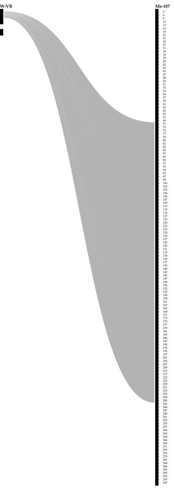

### [Ir\[1\]](https://cdn.wittgensteinnachlass.com/2000px/webp/Ms-107/Ir.webp)

## Philosophical Reflections

### [1\[1\]](https://cdn.wittgensteinnachlass.com/2000px/webp/Ms-107/1.webp)

It is not necessary to perform experiments that eliminate factors (say, thought experiments). Visual space as it is has its own independent reality. It does not itself contain a subject. It is autonomous.

### [1\[2\]](https://cdn.wittgensteinnachlass.com/2000px/webp/Ms-107/1.webp)

It can be described directly (but we are far from knowing a way of speaking that describes it). Ordinary physical language relates to it in a _very_ complicated way & one that we know instinctively.

### [1\[3\]](https://cdn.wittgensteinnachlass.com/2000px/webp/Ms-107/1.webp)

The decisive factor for a language is its application. Thinking with its help.

### [1\[4\]](https://cdn.wittgensteinnachlass.com/2000px/webp/Ms-107/1.webp),[2\[1\]](https://cdn.wittgensteinnachlass.com/2000px/webp/Ms-107/2.webp)

The way of looking at things that leads, as it were, down into a basin from which no path leads out into open country is the view of the present as the only thing that is real. This present, in constant flux or rather undergoing constant change, cannot be grasped. It vanishes before we can think of grasping it. In this basin we remain spellbound, caught in a whirl of thoughts. The mistake must be that we try to grasp the fleeting present by the scientific method. That must be like trying to grasp the solidity of a beam apart from the beam itself. To distil it out of the beam, as it were.

### [2\[2\]](https://cdn.wittgensteinnachlass.com/2000px/webp/Ms-107/2.webp)

What must save us from attempting this impossible thing is the realization that we are talking nonsense when we try to use our language in this undertaking.

### [2\[3\]](https://cdn.wittgensteinnachlass.com/2000px/webp/Ms-107/2.webp)

With our language we are, so to speak, not in the realm of the projected image, but in the realm of the film. And if I want to make music to accompany what goes on on the screen, what produces the music must in turn take place in the sphere of the film.

### [2\[4\]](https://cdn.wittgensteinnachlass.com/2000px/webp/Ms-107/2.webp)

What I may not think, language cannot express. That is our reassurance.

### [2\[5\]](https://cdn.wittgensteinnachlass.com/2000px/webp/Ms-107/2.webp)

But if one says: Surely the philosopher must descend into this very basin & grasp pure reality itself & bring it into the light of day, the answer is that he would have to leave language behind in doing so and therefore comes back up without having accomplished anything.

### [3\[1\]](https://cdn.wittgensteinnachlass.com/2000px/webp/Ms-107/3.webp)

And yet there can be a phenomenological language. (Where must it stop?)

### [3\[2\]](https://cdn.wittgensteinnachlass.com/2000px/webp/Ms-107/3.webp)

When we want to imagine this language, it is characteristic that we immediately begin to imagine the world as simpler than it is. But that speaks not against but _for_ the possibility of this language, for we are taking a definite path to reach it.

### [3\[3\]](https://cdn.wittgensteinnachlass.com/2000px/webp/Ms-107/3.webp)

Or is it like this: Our ordinary language is phenomenological too, only, understandably, it does not allow the sensory domains whose total multiplicity is its own to be separated. Its space is the combined space of sight, touch & muscular sensation, which is why I can “turn round” in this space and look to see “what is going on behind me” etc.

### [3\[4\]](https://cdn.wittgensteinnachlass.com/2000px/webp/Ms-107/3.webp)

It is evidently possible to describe visual space. For if what ordinarily goes on in it is too complicated, _that_ already tells us that the description is possible in principle. And it is easy to imagine events in this space that are simple enough to be described easily.

### [3\[5\]](https://cdn.wittgensteinnachlass.com/2000px/webp/Ms-107/3.webp),[4\[1\]](https://cdn.wittgensteinnachlass.com/2000px/webp/Ms-107/4.webp)

The very word visual space is unsuitable for our purpose, for it contains an allusion to a sense organ, which is no more essential to the space than belonging to a particular person is essential to a book & it could be very misleading if our language were so arranged that we could not designate a book in it except by its relation to an owner. It could lead to the view that a book can exist only in relation to a person.

### [4\[2\]](https://cdn.wittgensteinnachlass.com/2000px/webp/Ms-107/4.webp)

Now if phenomenological language separates visual space & what goes on in it from everything else, what does it do with time? Is the time of “visual” phenomena the time of our ordinary physical way of speaking?

### [4\[3\]](https://cdn.wittgensteinnachlass.com/2000px/webp/Ms-107/4.webp),[5\[1\]](https://cdn.wittgensteinnachlass.com/2000px/webp/Ms-107/5.webp)

It is clear that we can recognize intervals of time as equal. For example, I could imagine what goes on in visual space being accompanied by the ticking of a metronome or by a light flashing at equal intervals. For simplicity’s sake, I imagine the changes in my visual space occurring in jerks & coinciding, say, with the beats of the metronome. I can then give a description of what goes on (in which the beats are designated by numbers).

### [5\[2\]](https://cdn.wittgensteinnachlass.com/2000px/webp/Ms-107/5.webp)

Now was it not my intention to describe only what is verifiable? Was the very difference between this description and an ordinary one not supposed to be that it avoids everything hypothetical? And has this been achieved?

### [5\[3\]](https://cdn.wittgensteinnachlass.com/2000px/webp/Ms-107/5.webp)

I believe that in one sense it has & in another it has not. – Suppose this description is a prediction & is now to be verified. Say I know it by heart & now compare it with what actually happens. Here everything hypothetical has been avoided except what lies in the assumption that the description is given to me independently of whatever part of it is present to me at that moment. The whole thing is a talking film, & the spoken word that goes along with what happens on the screen is just as fleeting as those events & is not the same thing as the sound strip. The sound strip does not accompany the action on the screen.

### [5\[4\]](https://cdn.wittgensteinnachlass.com/2000px/webp/Ms-107/5.webp),[6\[1\]](https://cdn.wittgensteinnachlass.com/2000px/webp/Ms-107/6.webp)

Now does it make sense to say that a goblin might after all have deceived me & that what I took for the description was not the description at all but a mistake of memory? No, that must not make sense. A mistake that cannot in principle be discovered is not a mistake. And this means nothing other than that in this case the time of my memory is precisely the time I am describing. It is not the same as time as ordinarily conceived. For that there are all sorts of sources, such as other people’s accounts etc. But here too the point is to isolate the one time.

### [6\[2\]](https://cdn.wittgensteinnachlass.com/2000px/webp/Ms-107/6.webp)

If a black, a red & a yellow liquid flow through three tubes, one through each, & come together at one point to form a brown liquid, the resulting liquid then has a state of flow of its own. But all I want to say is that each of the single-coloured liquids has a state of flow too, & I want to examine it where the three have not yet flowed together.

### [6\[3\]](https://cdn.wittgensteinnachlass.com/2000px/webp/Ms-107/6.webp)

For it might even seem as though contemplating the mere present also undermines the certainty of mathematics or logic.

### [6\[4\]](https://cdn.wittgensteinnachlass.com/2000px/webp/Ms-107/6.webp),[7\[1\]](https://cdn.wittgensteinnachlass.com/2000px/webp/Ms-107/7.webp)

Of course, the word “present” is out of place here too. For in what sense can one say that reality is present? Surely only if one is already embedding it again in a time foreign to it. In and of itself it is not present. On the contrary, it contains a time.

### [7\[2\]](https://cdn.wittgensteinnachlass.com/2000px/webp/Ms-107/7.webp)

If mathematics is what is written in a book, then it can have only the certainty it has as what can be written in a book. But if it is what is thought, then it has the certainty that matters to us. (This sentence seems crazy, but it is not.)

### [7\[3\]](https://cdn.wittgensteinnachlass.com/2000px/webp/Ms-107/7.webp)

I believe – as I wanted to indicate earlier – that if one carries through the extensional conception of classes, one must arrive at the view that number is a characteristic of a sentential form, that is, at my view.

### [7\[4\]](https://cdn.wittgensteinnachlass.com/2000px/webp/Ms-107/7.webp)

Conversely, one could say that my theory of cardinal numbers sets up an extensional theory of classes.

### [7\[5\]](https://cdn.wittgensteinnachlass.com/2000px/webp/Ms-107/7.webp),[8\[1\]](https://cdn.wittgensteinnachlass.com/2000px/webp/Ms-107/8.webp)

It is clear that in the theory of numbers as Frege & Russell develop it, one can replace all functions from the outset with pseudo-functions such as “x = a ⌵ x = b ⌵ x = c” etc. For one cannot do without these _after all_. They actually represent extensions, as it were “magazines” or “fillings” that one slips into the sentence at the right place when one needs the extension in it. The proposition 2 + 2 = 4 holds for this filling.

### [8\[2\]](https://cdn.wittgensteinnachlass.com/2000px/webp/Ms-107/8.webp)

One presumably does say this: If there are 2 books on the table & I put down two more, there are 4 books on it: _for_ 2 + 2 = 4.

### [8\[3\]](https://cdn.wittgensteinnachlass.com/2000px/webp/Ms-107/8.webp)

The two books I put on the table first & the two I put there later make four books together (which are now on the table). In these 4 books I can distinguish the groups of two each.

### [8\[4\]](https://cdn.wittgensteinnachlass.com/2000px/webp/Ms-107/8.webp)

When I write the sentence “(Еxyz)φ( ) ∙ (Еx,y)ψ( ) ∙ Ind. ․⊃․ (Еxyzuv)φ( )⌵ψ( )”, to write out the extension of the bracket on the right correctly I have to write it in two parts that correspond 1–1 to the two extensions on the left. So here (and of course it is the same in the simpler case) I first get the sentence (Е3x) φx ∙ (Е2x) ψx ∙ Ind. ․⊃․ (Е3 + 2x) φx⌵ψx.

### [8\[5\]](https://cdn.wittgensteinnachlass.com/2000px/webp/Ms-107/8.webp)

It also becomes clear if, in the example above, I put down 468 books first & then another 673. Then what is clear at first is that there are 468 + 673 books on the table. The arithmetical proposition – 468 + 673 = 1141 – has not yet been mentioned at all. Of course the sum is formed in the sentence – – –.

### [8\[6\]](https://cdn.wittgensteinnachlass.com/2000px/webp/Ms-107/8.webp),[9\[1\]](https://cdn.wittgensteinnachlass.com/2000px/webp/Ms-107/9.webp)

(Е2x) φx ∙ (Е2x) ψx ∙ Ind ․⊃․ (Е4x) φx⌵ψx … A. This sentence does not – of course – say that 2 + 2 = 4; rather, the fact that the expression is a tautology shows it. φ & ψ must be unintegrated variables.

### [9\[2\]](https://cdn.wittgensteinnachlass.com/2000px/webp/Ms-107/9.webp)

If I have two objects, then of course I can bring them under one heading, at least hypothetically, but what is characteristic of the extension of a concept is the class, & the concept that embraces it was only a makeshift, a pretext.

### [9\[3\]](https://cdn.wittgensteinnachlass.com/2000px/webp/Ms-107/9.webp)

If φa ∙ φb ∙ ψc ∙ ψd then I can say that 4 things satisfy φ⌵ψ, but if there is no concept under which only 2 things fall, then of course this sentence is also correct: (Е2x) φx ∙ (Е2x) ψx ∙ Ind. ․⊃․ (Е6x) φx⌵ψx. This shows that this sentential form does not give what I mean by 2 + 2 = 4 at all. What I need instead is something to indicate that from (Е2x) φx ∙ (Е2x) ψx ∙ Ind., (Е4x) φx⌵ ψx follows. But this is shown, for example, by the tautology that results from connecting them by ⊃.

### [9\[4\]](https://cdn.wittgensteinnachlass.com/2000px/webp/Ms-107/9.webp)

I have two tables with 4 legs each. For 8 holes in the ground I need 8 pegs, so I shall use the table legs for that. I have 2 times 4 legs, making 8. I cannot be mistaken about this; that is why I cannot express what I know in a sentence either. I have compared the structures by means of the numbers.

### [9\[5\]](https://cdn.wittgensteinnachlass.com/2000px/webp/Ms-107/9.webp),[10\[1\]](https://cdn.wittgensteinnachlass.com/2000px/webp/Ms-107/10.webp)

4 + 4 = 8 is essentially what I calculate when I do the calculation

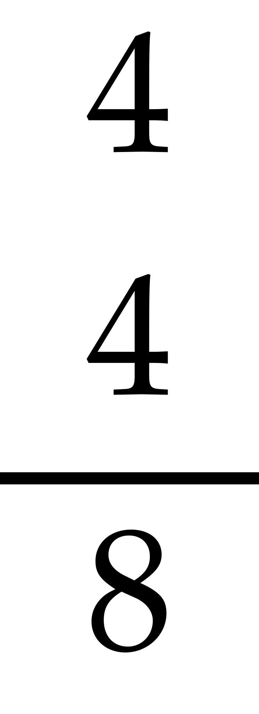

### [10\[2\]](https://cdn.wittgensteinnachlass.com/2000px/webp/Ms-107/10.webp)

If there is a mistake in sentence A, I can find & correct it only by comparing the extensions in the brackets. Or I add the two numbers on the left & write the result in the bracket on the right. In any case I have to write down the sum somehow.

### [10\[3\]](https://cdn.wittgensteinnachlass.com/2000px/webp/Ms-107/10.webp)

(Еnx) φx ∙ (Еmx) ψx ∙ Ind. ․⊃․ (Еn + mx) φx⌵ψx

(Е∣∣∣∣x)φx ∙ (Е∣∣∣∣∣∣x)ψx ∙ Ind. ․⊃․ (Е∣∣∣∣,∣∣∣∣∣∣x)φx⌵ψx

but of course just as correct is

(Е∣∣∣∣x) φx ∙ (Е∣∣∣∣∣∣x) ψx ∙ Ind. ․⊃․ (Е∣∣∣,∣∣∣∣∣∣∣x) φx⌵ψx

n + m must go here.

### [10\[4\]](https://cdn.wittgensteinnachlass.com/2000px/webp/Ms-107/10.webp)

Is this form, then, the only application of a summation?

### [10\[5\]](https://cdn.wittgensteinnachlass.com/2000px/webp/Ms-107/10.webp)

It is either _the_ application or one among infinitely many.

### [10\[6\]](https://cdn.wittgensteinnachlass.com/2000px/webp/Ms-107/10.webp)

If one regards addition as a process in the sentential form, what is the most general way in which it occurs?

### [10\[7\]](https://cdn.wittgensteinnachlass.com/2000px/webp/Ms-107/10.webp)

My objection to Frege’s view was always that it seemed too special to me. And this amounts to saying that not every specification of number is a specification about a function proper.

### [10\[8\]](https://cdn.wittgensteinnachlass.com/2000px/webp/Ms-107/10.webp),[11\[1\]](https://cdn.wittgensteinnachlass.com/2000px/webp/Ms-107/11.webp)

“There are 4 people in this room”, “There are 4 red circles in my visual field”. For “x is a red circle” to make sense, x must already be the logical form of a patch of colour in the visual field. (And something analogous holds for the first sentence.) It seems to me as though this theory of number were still a remnant of the subject–predicate theory of sentences, (or should I merely say: that it is directly connected with it.)

### [11\[2\]](https://cdn.wittgensteinnachlass.com/2000px/webp/Ms-107/11.webp)

This is how I feel: In our ordinary language, admittedly, every specification of number is a statement about a concept, i.e. about a predicate, but I believe that all sorts of different logical structures disguise themselves in this predicate form, & that only an artificial mode of representation can make it seem as if we were dealing with concepts here.

### [11\[3\]](https://cdn.wittgensteinnachlass.com/2000px/webp/Ms-107/11.webp)

Not even a certain generality is essential to a specification of number. If, for instance, I say “I see three circles of equal size arranged at equal intervals”.

### [11\[4\]](https://cdn.wittgensteinnachlass.com/2000px/webp/Ms-107/11.webp),[12\[1\]](https://cdn.wittgensteinnachlass.com/2000px/webp/Ms-107/12.webp)

If I give a correct description of the visual field in which there are 3 red circles on a blue background, the expression “(Еx,y,z): x ε circular & red ∙ y ε circular & red etc.” will certainly not occur in it.

### [12\[2\]](https://cdn.wittgensteinnachlass.com/2000px/webp/Ms-107/12.webp)

What is characteristic is that in the sentential form F(n) I must be able to substitute one number after another for _n_, & each time the sentence must acquire a sense completely determined by this substitution alone.

### [12\[3\]](https://cdn.wittgensteinnachlass.com/2000px/webp/Ms-107/12.webp)

Of course one could write it like this: There are three circles that have the property of being red. But here the distinction comes to light between objects in the improper sense, patches of colour in the visual field, sounds, etc. etc., and the elements of cognition, objects proper. It is striking that the sentence about the three circles does not have the generality or indeterminacy of a sentence of the form (Еxyz) φx ∙ φy ∙ φz. For in this case one can say: I do know that 3 things have the property φ, but I do not know _which_ ones. In the case of the 3 circles one cannot say that. “There are now three red circles of such & such a size & in such-and-such positions in my visual field” completely determines the fact, & it would be nonsensical to say that I do not yet know _which_ circles they are.

### [13\[1\]](https://cdn.wittgensteinnachlass.com/2000px/webp/Ms-107/13.webp)

Let us think of “objects” such as a lightning strike, the simultaneous occurrence of two events, the points of intersection of a straight line with a circle, etc. The 3 circles in the visual field are an example for all these cases.

### [13\[2\]](https://cdn.wittgensteinnachlass.com/2000px/webp/Ms-107/13.webp)

One can of course take the subject–predicate form, or, what amounts to the same thing, the argument–function form, as a norm of representation, & then it is indeed important & characteristic that whenever we apply numbers, the number can be represented as a property of a predicate. Only we must be clear that what we are dealing with now is not objects & concepts as the results of a decomposition, but norms into which we have forced the sentence. And it is significant, of course, that it could be made to conform to this norm. But forcing something into a norm is the opposite of analysis. Just as, to study the natural growth of an apple tree, one does not look at an espaliered tree, except to see how _this_ tree behaves under _this_ constraint.

### [13\[3\]](https://cdn.wittgensteinnachlass.com/2000px/webp/Ms-107/13.webp),[14\[1\]](https://cdn.wittgensteinnachlass.com/2000px/webp/Ms-107/14.webp)

The fact that one can count the coincidences of court hearings with lunar eclipses does indeed tell us that we have _a_ concept of the logical form, but of course it does not show that we have a logical analysis of these events. That would mean that Frege’s theory of number would be applicable as long as we did not intend to analyse the sentences. This theory explains the concept of number as it figures in the form of expression of ordinary language.

### [14\[2\]](https://cdn.wittgensteinnachlass.com/2000px/webp/Ms-107/14.webp)

Frege would indeed have said (I recall a conversation) that the coincidence of a lunar eclipse & a court hearing was an object. And what objection is there to that? Only that we are then using the word “object” ambiguously & so confusing the results of logical analysis.

### [14\[3\]](https://cdn.wittgensteinnachlass.com/2000px/webp/Ms-107/14.webp)

For the question is what meaning the variables in the sign “(∃x) φx” are to take on. Whether, then, one admits a sentence “(∃x) ∙ x is a court hearing etc.”; and one can readily do that, provided one does not cause confusion by using the same form in the analysis of sentences.

### [14\[4\]](https://cdn.wittgensteinnachlass.com/2000px/webp/Ms-107/14.webp)

And since one does not need the signs “(∃x) etc.” to speak of court hearings & the analysis of these things will in any case yield quite a different picture, it will probably be better to reserve the signs “(∃x) etc.” for logical analysis.

### [14\[5\]](https://cdn.wittgensteinnachlass.com/2000px/webp/Ms-107/14.webp),[15\[1\]](https://cdn.wittgensteinnachlass.com/2000px/webp/Ms-107/15.webp)

Russell’s theory of addition is this: If 2 objects fall under one concept & 2 others under another concept, then in consequence 4 objects fall under the sum of the two concepts. Here I say: “then 2 + 2 objects fall under the sum of the concepts”. And 2 + 2 is 4, or 4 equals 2 + 2, whether or not I am dealing with the sum of two concepts. I mean: four objects already contain within themselves the possibility of being separated into 2 & 2, whether or not that separation is effected by the boundaries of certain concepts.

### [15\[2\]](https://cdn.wittgensteinnachlass.com/2000px/webp/Ms-107/15.webp)

That means: If there are 4 apples on the table, there are always 2 & 2 apples on the table.

### [15\[3\]](https://cdn.wittgensteinnachlass.com/2000px/webp/Ms-107/15.webp)

But what this really means is: I can group objects together even when there is no question of a concept that groups them together, by virtue of their individuality alone.

### [15\[4\]](https://cdn.wittgensteinnachlass.com/2000px/webp/Ms-107/15.webp)

The concept of independence in sentence A. What does it mean in a case like 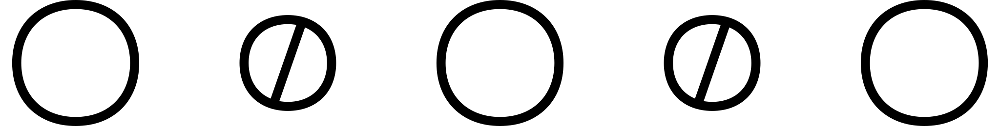.

### [15\[5\]](https://cdn.wittgensteinnachlass.com/2000px/webp/Ms-107/15.webp)

Identity & distinguishability.

### [15\[6\]](https://cdn.wittgensteinnachlass.com/2000px/webp/Ms-107/15.webp),[16\[1\]](https://cdn.wittgensteinnachlass.com/2000px/webp/Ms-107/16.webp)

I see three circles in my visual field in definite positions; I close my eyes, open them again & see three circles of the same size as before in different positions. Does it make sense to ask whether they are the same ones & which is which? Certainly not. But now, _while_ I see them, I can identify them. [Even if they move before my eyes, I can identify the circles in new positions with those in their earlier positions.] If I give them proper names & close my eyes & open them again & see that they are in the same positions, I can give each its name again. (One can carry through the same train of thought if they have changed places by moving.) In any case I am always naming (directly or indirectly) a _place_.

### [16\[2\]](https://cdn.wittgensteinnachlass.com/2000px/webp/Ms-107/16.webp)

The question is whether all specifications of number are essentially of the form (∃nx) φx. I say that they are of the form 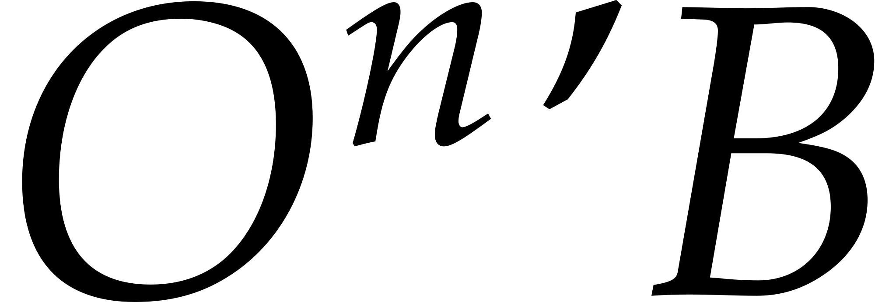 & that this is the general form. As a decisive example I have taken the case of the three circles in the visual field. What is characteristic of the form (∃ …) … is that a disjunction corresponds to it. And it is clear that the sentence “there are three circles in the visual image” does not involve a disjunction. This is particularly clear when the position of the circles is further specified in the sentence in such a way that their number itself determines it. And this now leads us naturally to relation numbers.

### [16\[3\]](https://cdn.wittgensteinnachlass.com/2000px/webp/Ms-107/16.webp),[17\[1\]](https://cdn.wittgensteinnachlass.com/2000px/webp/Ms-107/17.webp)

If I say “there are 4 people in this room”, a disjunction does seem to enter in, since it is not said _which_ people. But that is quite inessential. We could imagine that all people were alike apart from the place where they are (so that what we were dealing with in their case was humanity at a particular point in space) & then all indeterminacy would disappear.

### [17\[2\]](https://cdn.wittgensteinnachlass.com/2000px/webp/Ms-107/17.webp)

Even if one is walking in the woods, if one just keeps walking long enough, one comes out into the open in the end.

### [17\[3\]](https://cdn.wittgensteinnachlass.com/2000px/webp/Ms-107/17.webp)

Of the things a, b, c, d, only 3 have the property φ. That can be expressed by the disjunction:

φa ∙ φb ∙ φc ⌵ φa ∙ φb ∙ φd ⌵ φa ∙ φc ∙ φd ⌵ φb ∙ φc ∙ φd.

Evidently another case where a specification of number does not refer to a concept. (Although one can make it look as though it does by means of the “ = ”.)

### [17\[4\]](https://cdn.wittgensteinnachlass.com/2000px/webp/Ms-107/17.webp)

If I say: If there are 4 apples on the table, then there are 2 + 2 apples on it, this means only that with the 4 apples the possibility of grouping them into 2 & 2 is already given, & I need not wait for them actually to be grouped by means of a concept. This “_possibility_” concerns the sense, not the truth, of a sentence. 2 + 2 = 4 can mean “wherever I have 4 objects, there is the possibility of grouping them into 2 & 2.”

### [17\[5\]](https://cdn.wittgensteinnachlass.com/2000px/webp/Ms-107/17.webp),[18\[1\]](https://cdn.wittgensteinnachlass.com/2000px/webp/Ms-107/18.webp)

The weather in my brain has been gloomy for days now, the sky overcast all the time, as during a long spell of steady rain when it is not raining at the moment but will rain again. Here & there a few brief, insignificant patches of blue sky & a few passing glimpses of sunshine that do not count.

### [18\[2\]](https://cdn.wittgensteinnachlass.com/2000px/webp/Ms-107/18.webp)

If things are counted, they can be counted only by considering them in their generality & without regard to their individuality. And if a sentence is about n things, the function must be symmetrical with respect to these n things; i.e. they must all occupy places of equal standing in it.

### [18\[3\]](https://cdn.wittgensteinnachlass.com/2000px/webp/Ms-107/18.webp)

Is not “(∃2x) φx ∙ (∃2x) ψx ∙ Ind. ․⊃․ (∃4x) φx⌵ψx” also an application of 2 + 2 = 4, just as (Е2x) φx etc. etc.

### [18\[4\]](https://cdn.wittgensteinnachlass.com/2000px/webp/Ms-107/18.webp)

If 2 people love each other & 2 people hate each other & no one loves anyone & at the same time hates anyone, then there are at least 4 people who love or hate one of their number.

### [18\[5\]](https://cdn.wittgensteinnachlass.com/2000px/webp/Ms-107/18.webp)

(Two double negations yield a fourfold negation.)

### [18\[6\]](https://cdn.wittgensteinnachlass.com/2000px/webp/Ms-107/18.webp)

If one writes (Е∣∣∣∣∣) etc. ∙ (Е∣∣∣∣∣∣∣) etc. ⊃ (Е∣∣∣∣∣∣∣∣∣∣∣∣) etc., one may wonder how I got the number sign in the bracket on the right, if one does not know that it was arrived at by adding the two number signs on the left. I believe this makes it clear that this expression represents only an application of 5 + 7 = 12, not the equation itself.

### [18\[7\]](https://cdn.wittgensteinnachlass.com/2000px/webp/Ms-107/18.webp),[19\[1\]](https://cdn.wittgensteinnachlass.com/2000px/webp/Ms-107/19.webp)

If one asks: But what, then, does “5 + 7 = 12” mean – what sense or purpose is left for this expression – the answer is: “5 + 7 = 12” is a rule for signs that specifies which sign (12) results when one applies a particular operation (addition) to two other particular signs (5 & 7). The content of 5 + 7 = 12 is (if one did not know it) exactly what gives children trouble when they learn this sentence in arithmetic lessons.

### [19\[2\]](https://cdn.wittgensteinnachlass.com/2000px/webp/Ms-107/19.webp)

One can say that this content & this difficulty arise from our particular notation, & that all of this disappears if one writes ∣∣∣∣∣ + ∣∣∣∣∣∣∣ = ∣∣∣∣∣∣∣∣∣∣∣∣, or if one also leaves out the “+” & goes so far as to write ∣∣∣∣∣∣∣∣∣∣∣∣ = ∣∣∣∣∣∣∣∣∣∣∣∣, in which case the whole equation would become superfluous. And one can further say that, by contrast, the tautology A does not become superfluous & so is presumably the arithmetical sentence proper. But ∣∣∣∣∣∣∣∣∣∣∣∣ = ∣∣∣∣∣∣∣∣∣∣∣∣ is just a very impractical notation, since one cannot see where the break is on the left-hand side.

### [19\[3\]](https://cdn.wittgensteinnachlass.com/2000px/webp/Ms-107/19.webp)

“5 + 7 = 12” points to a relation between structures; namely, between the three structures 5, 7, 12; all three must therefore appear in the sentence.

### [19\[4\]](https://cdn.wittgensteinnachlass.com/2000px/webp/Ms-107/19.webp),[20\[1\]](https://cdn.wittgensteinnachlass.com/2000px/webp/Ms-107/20.webp)

One can disregard the particular character of sentence A altogether & attend simply to the relation, the relationship, between the number signs in it. This shows that this relationship holds independently of this sentence. That is, independently of the other features of its structure that make it a tautology.

### [20\[2\]](https://cdn.wittgensteinnachlass.com/2000px/webp/Ms-107/20.webp)

For when I consider it as a tautology, I perceive only properties of its structure & can now perceive the addition theorem _in_ it without attending to other characteristics essential to the sentence. So the addition theorem can be discerned in it (among other things), not _through_ it. This consideration would of course be nonsensical if what was at issue here were the _sense_ of a sentence & not the structural workings of a tautology.

### [20\[3\]](https://cdn.wittgensteinnachlass.com/2000px/webp/Ms-107/20.webp),[21\[1\]](https://cdn.wittgensteinnachlass.com/2000px/webp/Ms-107/21.webp)

One might reply: What I perceive in the sign A & call the relationship between the number signs is again nothing but the grouping together of extensions of concepts: I combine the first 5 strokes in the bracket on the right, which stand in a 1–1 relation to the 5 in one bracket on the left, and the next 7 strokes in the bracket on the right, which stand in a 1–1 relation to the 7 in the other bracket on the left, into 12 strokes that do either the one or the other. But even if I went through this process of thought, the fundamental insight would still be that the 5 strokes & the 7 combine to make _exactly 12_ (thus giving, for instance, the same structure as 4 & 4 & 4). – What teaches us this is always just insight into the relationship between the structures, not any sentence or consideration of logic. And for this insight everything about the tautology apart from the number structures is incidental; these alone matter for the arithmetical sentence. (Everything else belongs to the _application_ of the arithmetical sentence.)

### [21\[2\]](https://cdn.wittgensteinnachlass.com/2000px/webp/Ms-107/21.webp)

So what I mean to say is: the arithmetical part is not what prompts us to put 5 & 7 together, but the process & what comes out of it.

### [21\[3\]](https://cdn.wittgensteinnachlass.com/2000px/webp/Ms-107/21.webp)

So I go so far as to call numbers structures. But am I right to do so?

### [21\[4\]](https://cdn.wittgensteinnachlass.com/2000px/webp/Ms-107/21.webp)

Suppose I wrote down sentence A but put the wrong number of strokes in the bracket on the right: one could & would discover this mistake only by comparing the structures, not by applying logical theorems.

### [21\[5\]](https://cdn.wittgensteinnachlass.com/2000px/webp/Ms-107/21.webp)

Indeed, if one asks: How do you know that this particular number of strokes in the bracket on the right is the correct one, I can justify it only by comparing the structures.

### [21\[6\]](https://cdn.wittgensteinnachlass.com/2000px/webp/Ms-107/21.webp)

It would turn out, then, that what Frege called the peppernut standpoint in arithmetic could after all be justified.

### [22\[1\]](https://cdn.wittgensteinnachlass.com/2000px/webp/Ms-107/22.webp)

And now too – I believe – the relationship between the extensional conception of classes & the conception of number as a feature of a logical structure becomes clear: An extension is a characterization of the sense of a sentence.

### [22\[2\]](https://cdn.wittgensteinnachlass.com/2000px/webp/Ms-107/22.webp)

What makes sentence A a tautology is precisely the correct relation between the number structures in the brackets, that is, just what the arithmetical sentence expresses.

### [22\[3\]](https://cdn.wittgensteinnachlass.com/2000px/webp/Ms-107/22.webp)

One can combat a view only by putting oneself wholly within that view.

### [22\[4\]](https://cdn.wittgensteinnachlass.com/2000px/webp/Ms-107/22.webp)

∣∣∣ + ∣∣∣∣∣ = ∣∣∣∣∣∣∣∣ is the (general) schema used, for instance, in forming the tautology A. It can be nothing other than a general schema whose application is the transition from one sentence to another. (which in turn finds expression in the tautology)

### [22\[5\]](https://cdn.wittgensteinnachlass.com/2000px/webp/Ms-107/22.webp)

Now if the transition in A were the only application of this arithmetical schema, could one not, or would one not have to, replace it, or define it, by the tautology itself?

### [22\[6\]](https://cdn.wittgensteinnachlass.com/2000px/webp/Ms-107/22.webp),[23\[1\]](https://cdn.wittgensteinnachlass.com/2000px/webp/Ms-107/23.webp)

I.e.: What if A were the most general form of application of the arithmetical schema? If A were the only application of the schema – that is, _essentially_ the only one – then the schema could, of its own accord, mean nothing other than the tautology itself.

### [23\[2\]](https://cdn.wittgensteinnachlass.com/2000px/webp/Ms-107/23.webp)

Or: Then the schema itself would have to be the tautology, & the tautology nothing other than the schema.

### [23\[3\]](https://cdn.wittgensteinnachlass.com/2000px/webp/Ms-107/23.webp)

One might now say: Logic deals with sentences & therefore it must grasp arithmetic at its root, where it arises from the essence of the sentence & relates to it. Now what if A represented precisely this connection between arithmetic & the sentence?

### [23\[4\]](https://cdn.wittgensteinnachlass.com/2000px/webp/Ms-107/23.webp)

– Then one could no longer say, either, that A was an application of the schema; rather, A would be the schema, only, as it were, not the tool alone but the tool with its handle, _without which it cannot be used [in the sense of being put to use] anyway_. –

### [23\[5\]](https://cdn.wittgensteinnachlass.com/2000px/webp/Ms-107/23.webp)

What A contains apart from the schema can then be only what is necessary for the application of the arithmetical schema.

### [23\[6\]](https://cdn.wittgensteinnachlass.com/2000px/webp/Ms-107/23.webp)

– But nothing at all is necessary, for we understand & apply arithmetical sentences perfectly well without any addition to them. –

### [24\[1\]](https://cdn.wittgensteinnachlass.com/2000px/webp/Ms-107/24.webp)

Above all, though, this does not require the formation of a tautology, as we can see very well in that tautology itself, for otherwise, to recognize it as a tautology, we would have to recognize yet another as a tautology, and so on.

### [24\[2\]](https://cdn.wittgensteinnachlass.com/2000px/webp/Ms-107/24.webp)

Rather, I can discern the arithmetical structural relations – quite simply – in the detached sentences alone.

### [24\[3\]](https://cdn.wittgensteinnachlass.com/2000px/webp/Ms-107/24.webp)

Arithmetical sentences, like multiplication tables and the like, or like definitions that do not have whole sentences on either side, are for _application_ to sentences. And there is nothing else I can apply them to anyway. [So I do not first need any description of their application.]

### [24\[4\]](https://cdn.wittgensteinnachlass.com/2000px/webp/Ms-107/24.webp)

If I say: I see 3 red circles here & now 3 others are added; is it necessary to investigate whether the 3 new ones really are all _different_ circles from the first 3? That they are 3 others is immediately clear, as clear, indeed, as it is that one place is different from another.

### [24\[5\]](https://cdn.wittgensteinnachlass.com/2000px/webp/Ms-107/24.webp)

The process corresponds rather to a schema like this: (∃xyz) ∙ φ( ) ∙ (∃u, v, w) ∙ φ( ) ․⊃․ (∃xyzuvw) ∙ φ( ) where x,y,z,u,v,w might designate places in space.

### [25\[1\]](https://cdn.wittgensteinnachlass.com/2000px/webp/Ms-107/25.webp)

Or there were 3 circles until now, and now there are suddenly 5: So 2 must have been added, for 3 + 2 = 5.

### [25\[2\]](https://cdn.wittgensteinnachlass.com/2000px/webp/Ms-107/25.webp)

No investigation of concepts, only direct insight, can show that 3 + 2 = 5. This is what makes us balk at the assumption that A could be the sentence 3 + 4 = 7. For what enables us to recognize this expression as a tautology cannot itself result from a consideration of concepts, but must be immediately visible.

### [25\[3\]](https://cdn.wittgensteinnachlass.com/2000px/webp/Ms-107/25.webp)

And when we say that numbers are structures, we mean that they must always be of the same kind as what we use to represent them.

### [25\[4\]](https://cdn.wittgensteinnachlass.com/2000px/webp/Ms-107/25.webp)

“If I have 2 apples in one hand & 2 in the other & none in both hands at once, then I have 4 apples in both hands”; why is that? Only because ∣∣ + ∣∣ = ∣∣∣∣. This schema is contained in that sentence & can be discerned immediately & only this makes it properly a tautology. What this schema represents in the sentence (and in every sentence in which it occurs) is what “two & two equals four” says.

### [25\[5\]](https://cdn.wittgensteinnachlass.com/2000px/webp/Ms-107/25.webp),[26\[1\]](https://cdn.wittgensteinnachlass.com/2000px/webp/Ms-107/26.webp)

And it is precisely in the tautology that the arithmetical sentence can be discerned not at all through the trappings of the concepts, but – quite apart from the concepts – through the pure number schemata.

### [26\[2\]](https://cdn.wittgensteinnachlass.com/2000px/webp/Ms-107/26.webp)

I mean: Numbers are what I represent in my language by means of the number schemata. I.e. I take the number schemata of language (so to speak) as what is familiar to me, & say: numbers are what these represent. This corresponds to what I meant at the time when I said: numbers enter logic with the calculus.

### [26\[3\]](https://cdn.wittgensteinnachlass.com/2000px/webp/Ms-107/26.webp)

When we say: 3 people are in this room, that means: an x, y & z are in this room, & that is the schema of 3. (By this I do not mean that the sign (∃x,y,z) … occurs in this sentence). By number we understand a feature of the structure of states of affairs (in the general sense of that word).

### [26\[4\]](https://cdn.wittgensteinnachlass.com/2000px/webp/Ms-107/26.webp)

(∃❘x) φx ∙ (∃❘x) ψx ∙ Ind. ․⊃․ (∃∣∣x) φx⌵ψx

Here we recognize as primary the relationship between the structures ∣ + ∣ = ∣∣. Without recognizing this we cannot recognize the truth of the sentence.

### [26\[5\]](https://cdn.wittgensteinnachlass.com/2000px/webp/Ms-107/26.webp)

The point is that the sentence on the right is about ∣∣ things & that this structure consists of one thing & another thing, and that is expressed in the form “x, y” & can be discerned in it.

### [26\[6\]](https://cdn.wittgensteinnachlass.com/2000px/webp/Ms-107/26.webp),[27\[1\]](https://cdn.wittgensteinnachlass.com/2000px/webp/Ms-107/27.webp)

Without this insight, the sentence corresponding to the schema 1 + 1 = 3 would be irrefutable.

### [27\[2\]](https://cdn.wittgensteinnachlass.com/2000px/webp/Ms-107/27.webp)

Where there is any need at all for an explanation of a phenomenon of measurement in visual space, i.e. the possibility of an explanation, there it must also be possible to give one, then, & without contradictions.

### [27\[3\]](https://cdn.wittgensteinnachlass.com/2000px/webp/Ms-107/27.webp)

Where one asks: “But how is it that this is possible”, the very possibility of the question shows that something can be explained & it must then of course be explained without contradiction. Only where no explanation is possible, and where there can therefore be no need for one either, – only there can there be no question at all of a contradiction.

### [27\[4\]](https://cdn.wittgensteinnachlass.com/2000px/webp/Ms-107/27.webp)

├────────┤ a

├────┤ b

Can one see that b is half as long as a without seeing b divided?

├────────┤ a

├──┤ b

├─────┤ c

Or that b is less than half of a, & c is more than half.

### [27\[5\]](https://cdn.wittgensteinnachlass.com/2000px/webp/Ms-107/27.webp)

In thinking we certainly often need mental images of magnitudes instead of words.

### [27\[6\]](https://cdn.wittgensteinnachlass.com/2000px/webp/Ms-107/27.webp)

Does it follow from 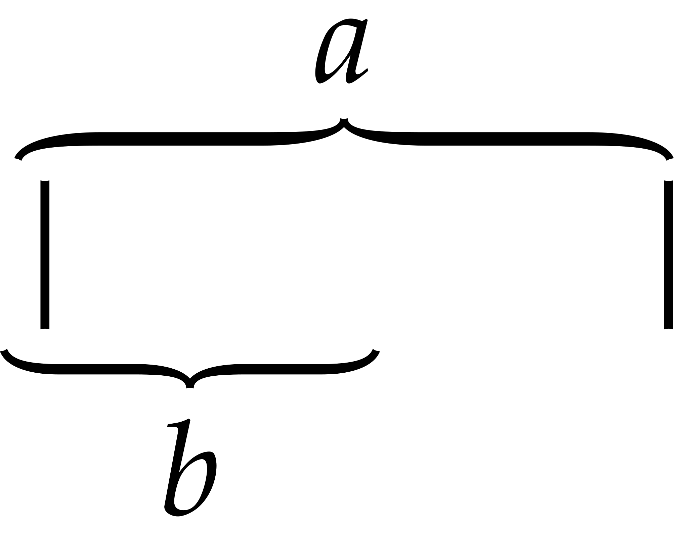 “a is white” that “b is white”? No, for “b is white” has sense only if b is given by colour boundaries.

### [27\[7\]](https://cdn.wittgensteinnachlass.com/2000px/webp/Ms-107/27.webp),[28\[1\]](https://cdn.wittgensteinnachlass.com/2000px/webp/Ms-107/28.webp)

What if one applies a yardstick _temporarily_ to an object in visual space? Is it measured even when the yardstick is not there? Yes, if the identity of what is measured with what is not measured can be established with any sense at all.

### [28\[2\]](https://cdn.wittgensteinnachlass.com/2000px/webp/Ms-107/28.webp)

_If_ I can say: “_this_ segment I _did_ measure & it was three times as long as _that_ one”, then it makes sense & is correct to say that the segments still stand in the same ratio to one another now.

### [28\[3\]](https://cdn.wittgensteinnachlass.com/2000px/webp/Ms-107/28.webp)

A❘

B❘

C❘

C❘

B❘

A❘ From “CC between BB” follows “CC between AA”, but only if the division is actually given by colour boundaries.

### [28\[4\]](https://cdn.wittgensteinnachlass.com/2000px/webp/Ms-107/28.webp),[29\[1\]](https://cdn.wittgensteinnachlass.com/2000px/webp/Ms-107/29.webp)

It is evidently possible for the segments a & b to appear equally long to me, for the segments c & d also to appear equally long to me, but for counting them to show that I have 25 c & 24 d. Here we have the question: how can that be possible? Is it right to say here: That is just how it is, & all we see is that visual space does not follow the rules of – say – Euclidean space. That would mean that the question “how can that be possible?” was nonsensical & hence unwarranted. So there would be nothing paradoxical here at all; we would simply have to accept it. – But is it _conceivable_ that a should appear equal to b & the c’s equal to the d’s, & that there should be unequal, _surveyable_ numbers of c’s & d’s?

So that here too it appears that a = b & c = d? Or am I now to say that even in visual space something can after all _appear_ otherwise than it _is_? Certainly not! Or that n times a segment & n + 1 times the same segment can simply yield the same thing in visual space? No, not that either! Unless there is no sense at all in saying of segments in _visual space_ that they _are_ equal. So that it would also make no sense to speak of an “appearing” for visual space alone & this expression would not concern only the relation between two independent experiences. So that there would be an _absolute_ appearing. And so perhaps also an _absolute_ blurriness, or an _absolute_ lack of clarity. (Whereas my view is that something can be blurry or unclear only in comparison with something we set up as the goal of clarity; that is, relatively.)

### [29\[2\]](https://cdn.wittgensteinnachlass.com/2000px/webp/Ms-107/29.webp),[30\[1\]](https://cdn.wittgensteinnachlass.com/2000px/webp/Ms-107/30.webp)

But then – in the first case – if I cannot grasp the number “at a glance”, can I not go wrong in determining it? Or: do a & b then consist of a number of parts at all – in the ordinary sense – if I do not _see_ this number in a & b? For it seems to me that I am indeed not entitled either, for instance, to _infer_ that there must be the same number of c’s & d’s. Not even if counting really does give the same number! I mean: not even if it _never_ happens that, with a & b equal, etc., counting gives different results. (This shows, incidentally, _how_ hard it is to describe what is actually seen.) But suppose we were entitled to speak of a number of parts – mind, always within what is purely seen – even if we do not see the number immediately; then the question would arise: can I be certain that what I count really is the number I see, or rather, the number whose visual result I see. Could I be certain that the number of parts does not at some moment change from 24 to 25 without my perceiving it?

### [30\[2\]](https://cdn.wittgensteinnachlass.com/2000px/webp/Ms-107/30.webp)

If I see a = b & c = d & someone else counts the parts & finds the same number, I will certainly not feel that this contradicts what I see. But I also know that I can see the same thing when there are 25 c in a & 24 d in b. From this I can infer that I do not notice one part more or less, & so cannot notice when the number of parts in d changes between 24 & 25.

### [30\[3\]](https://cdn.wittgensteinnachlass.com/2000px/webp/Ms-107/30.webp),[31\[1\]](https://cdn.wittgensteinnachlass.com/2000px/webp/Ms-107/31.webp)

But if one cannot say that there is a definite number of parts in a & b, how am I to describe the visual image? What emerges here – I believe – is that the visual image is much more complicated than it seems at first sight. What makes it so much more complicated is, for instance, the factor that produces the movement of the eye.

### [31\[2\]](https://cdn.wittgensteinnachlass.com/2000px/webp/Ms-107/31.webp)

If, for instance, I were to describe what is seen at a glance by means of a painted picture rather than by means of word-language, I would have to refrain from actually painting all the parts c & d!

Instead, in some places I would have to paint something “blurry”, a grey patch, say.

### [31\[3\]](https://cdn.wittgensteinnachlass.com/2000px/webp/Ms-107/31.webp)

“Blurry” & “Unclear” are relative expressions. If it often does not seem so at all, that is because we still recognize the actual character of the given phenomena too little, imagining them to be more primitive than they are. Thus it is possible, for instance, that no picture in colour, of whatever kind, can correctly represent the impression of “blurriness”. But it does not follow from this that the visual image is in itself blurry & therefore cannot be represented by any definite picture, of whatever kind. It would only indicate that – through the movement of the eyes, say – a factor enters into the visual field which the painted picture indeed cannot reproduce, but which is in itself as “determinate” as any other. One could then say that what is actually given is still indeterminate or blurry relative to the painted picture, but only because we then arbitrarily set up the painted picture as the standard for what is given, which has a greater multiplicity than the pictorial representation.

### [32\[1\]](https://cdn.wittgensteinnachlass.com/2000px/webp/Ms-107/32.webp)

If we disregard the fluctuation of the visual image (if that is possible), the pictorial representation would have to show what we really see.

### [32\[2\]](https://cdn.wittgensteinnachlass.com/2000px/webp/Ms-107/32.webp)

If we really _saw_ 24 & 25 parts in a & b, then we could not see a & b as equal! If this is false, then the following must be possible: It would have to be possible to distinguish immediately between the cases where a & b are both equal to 24 & where a is 24 & b is 25, but it would be possible to distinguish only the numbers of parts, not the resulting length of a & b.

### [32\[3\]](https://cdn.wittgensteinnachlass.com/2000px/webp/Ms-107/32.webp)

There seems to be something in visual space that one could describe in these words: I do not see that it is not so, but neither do I see that it is so.

### [32\[4\]](https://cdn.wittgensteinnachlass.com/2000px/webp/Ms-107/32.webp)

One could also put it more simply like this: It would then have to be possible to see immediately that one segment consists of 24 parts, the other of 25 parts just as large as those of the first segment, without its being possible to distinguish between the resulting lengths. – I believe that the word “equal” has a meaning in visual space too that makes this a contradiction.

### [32\[5\]](https://cdn.wittgensteinnachlass.com/2000px/webp/Ms-107/32.webp),[33\[1\]](https://cdn.wittgensteinnachlass.com/2000px/webp/Ms-107/33.webp)

Do I recognize two segments of visual space as equal by not recognizing them as unequal? This is a very far-reaching question. Could I not have two impressions in succession: in one a segment visibly divided into 5 parts, in the other a segment likewise divided into 6 parts, & yet be unable to say that I saw the parts or the whole segments as differing in length? If I were asked: “were the segments different in length or equal in length”, I could not answer “I saw them as different in length”, for, so to speak, no difference in length “struck” me. And yet – I believe – I could not say I saw them as equal in length. On the other hand, I could not say: “I don’t know whether they were equal or different” (unless my memory had failed me), for that means nothing as long as I am speaking only of what is immediately given. So the question whether they were equal or unequal would be nonsensical, or there would have to be a third possibility here.

### [33\[2\]](https://cdn.wittgensteinnachlass.com/2000px/webp/Ms-107/33.webp)

I believe it would after all have to be some lapse of memory or something similar, so that one could say: I could not compare the lengths.

### [33\[3\]](https://cdn.wittgensteinnachlass.com/2000px/webp/Ms-107/33.webp)

What would “a segment is divisible” mean? Surely only: “I can imagine it as being as long as a divided one”.

### [33\[4\]](https://cdn.wittgensteinnachlass.com/2000px/webp/Ms-107/33.webp),[34\[1\]](https://cdn.wittgensteinnachlass.com/2000px/webp/Ms-107/34.webp)

What matters is to explain certain contradictions when we apply the methods of inference of Euclidean space to visual space.

I mean: it is possible to follow a construction (and thus a chain of inferences) in visual space, all of whose steps (transitions) we can understand, but whose result contradicts our geometrical concepts.

### [34\[2\]](https://cdn.wittgensteinnachlass.com/2000px/webp/Ms-107/34.webp)

Now I believe that this always comes from our being able to see the construction only link by link, and not as one. The explanation, then, would be that there is no visual construction at all composed of these individual visual pieces. It would be rather as if I showed someone a (small) patch of the surface of a large sphere and asked him whether he accepted the great circle visible on it as a straight line, & once he had done so I turned the sphere and showed him that he would come back to the same place on the circle. But in this way I have not proved to him, say, that a straight line in visual space loops back on itself.

### [34\[3\]](https://cdn.wittgensteinnachlass.com/2000px/webp/Ms-107/34.webp)

The explanation, then, would be this: these are visual _pieces_, but they do not fit together into a visual whole, or at any rate not into the whole whose final result I think I see at the end.

### [34\[4\]](https://cdn.wittgensteinnachlass.com/2000px/webp/Ms-107/34.webp),[35\[1\]](https://cdn.wittgensteinnachlass.com/2000px/webp/Ms-107/35.webp)

The simplest construction of this kind would, after all, be the one above with two segments of equal length, along one of which a piece can be marked off n times & along the other n + 1 times. The steps in the construction would consist in proceeding from one piece to the next & establishing the equality of these pieces. Here one could explain that in proceeding in this way I am not really examining the original visual field with its segments of equal length. Rather, something else takes its place in the examination and then leads to the astounding result.

### [35\[2\]](https://cdn.wittgensteinnachlass.com/2000px/webp/Ms-107/35.webp)

But there is an objection to this explanation. One might say: While you were checking the individual pieces, after all, we didn’t cover up any part of the construction. So you could see whether in the meantime anything in the rest had changed or shifted. If nothing did, then surely you could see that everything was above board.

### [35\[3\]](https://cdn.wittgensteinnachlass.com/2000px/webp/Ms-107/35.webp)

The sentence “the spot F lies between the boundaries g1 & g2” is not a disjunction. If it were a disjunction, it would have to be an infinite one, for if it were finite, there would always have to be specifications of particular positions of the spot F between the two boundaries that were nevertheless not included in the disjunction.

### [35\[4\]](https://cdn.wittgensteinnachlass.com/2000px/webp/Ms-107/35.webp)

And the corresponding point holds for a sentence that shows that F lies to the right of a line.

### [35\[5\]](https://cdn.wittgensteinnachlass.com/2000px/webp/Ms-107/35.webp),[36\[1\]](https://cdn.wittgensteinnachlass.com/2000px/webp/Ms-107/36.webp)

This is all connected with the fact that there are no invisible parts in visual space.

For if there were any, there would surely have to be infinitely many, or else there would be no infinite possibility there either.

### [36\[2\]](https://cdn.wittgensteinnachlass.com/2000px/webp/Ms-107/36.webp)

It _does_ make sense to speak of divis*ibil*ity in visual space, for in a description it must be possible to replace an undivided piece with a divided one. And then, in light of what I set out earlier, it is clear what the infinite divisibility of this space means.

### [36\[3\]](https://cdn.wittgensteinnachlass.com/2000px/webp/Ms-107/36.webp)

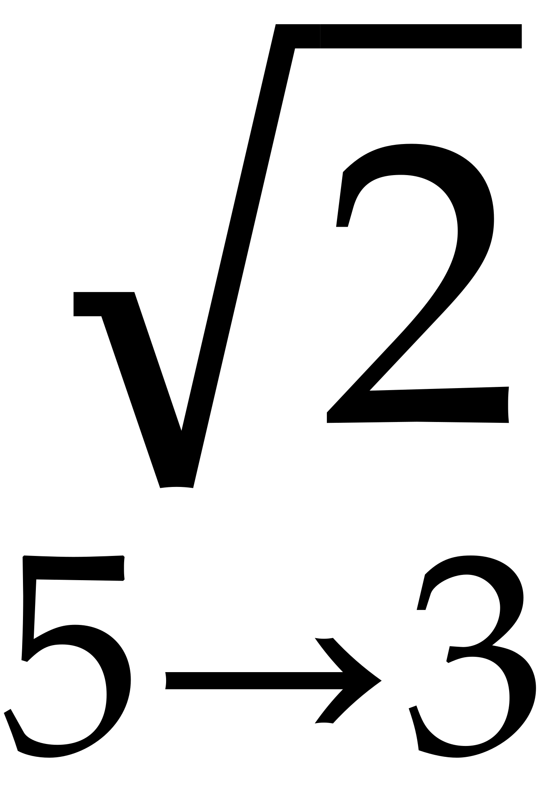 One would like to say: the individual digits are always only the results, the bark of the fully grown tree. What matters, or what something new can still grow from, is inside the trunk, where the forces of growth are. A change on the outside does not change the tree at all. To change it one must go into the still living trunk.

### [36\[4\]](https://cdn.wittgensteinnachlass.com/2000px/webp/Ms-107/36.webp)

So it is as if the digits were dead excretions of the living being that is the root. As when a snail secretes lime in the course of living & goes on building its shell.

### [36\[5\]](https://cdn.wittgensteinnachlass.com/2000px/webp/Ms-107/36.webp)

But where is this real essence of the square root of 2 to be found? I probably thought: in what all the processes of extracting the square root of 2 in the different number systems have in common.

### [36\[6\]](https://cdn.wittgensteinnachlass.com/2000px/webp/Ms-107/36.webp),[37\[1\]](https://cdn.wittgensteinnachlass.com/2000px/webp/Ms-107/37.webp)

If someone today puts a decoration on the façade of a house, then – if it is not sheer thoughtlessness – it is as if an adult were to start screaming & crying in the street. It could of course happen, but only in a quite exceptional case (or if he is mentally ill). For a child it is natural & permissible; for an adult it will no longer do. And our age compared with the 18th century is like an adult compared with a child. One may regret the loss of the lovely days of youth, but one is the age one is & each time of life has its task & its pathos & its adequate expression. (This comparison could be carried a very long way.)

### [37\[2\]](https://cdn.wittgensteinnachlass.com/2000px/webp/Ms-107/37.webp)

√2 The sequence of digits is something external & is significant only when it is the expression of the essence of the root in a certain system. If one disrupts this system, the sequence of digits is deprived of all value as a real number, or else one has simply set up another system for expressing the same real number.

### [37\[3\]](https://cdn.wittgensteinnachlass.com/2000px/webp/Ms-107/37.webp),[38\[1\]](https://cdn.wittgensteinnachlass.com/2000px/webp/Ms-107/38.webp)

The rules for the digits must be there first; then – for example – a root finds expression in them. But this expression in the form of a sequence of digits is significant only because it is the expression of a real number. If one changes it afterwards, one has merely disrupted the expression, not obtained a new number. The number system is the language given at the outset in which the law of the real number expresses itself. It is the language, the form of expression that the law finds already there. (As when a magnet finds iron filings already there & arranges them along the lines of force.)

### [38\[2\]](https://cdn.wittgensteinnachlass.com/2000px/webp/Ms-107/38.webp)

The rules for the digits belong at the beginning, as preparation for the expression. For building the system in which the law lives itself out.

### [38\[3\]](https://cdn.wittgensteinnachlass.com/2000px/webp/Ms-107/38.webp)

The substrate must first be ready, i.e. the form of expression must be laid down in general; only then can one speak with it & compare the things said with one another.

### [38\[4\]](https://cdn.wittgensteinnachlass.com/2000px/webp/Ms-107/38.webp)

And it makes no difference which form of expression one chooses, so long as it is _uniform_.

### [38\[5\]](https://cdn.wittgensteinnachlass.com/2000px/webp/Ms-107/38.webp)

If one destroys the uniformity afterwards, one has not thereby given expression to something new, but only destroyed the possibility of communication.

### [38\[6\]](https://cdn.wittgensteinnachlass.com/2000px/webp/Ms-107/38.webp)

So I would say: If 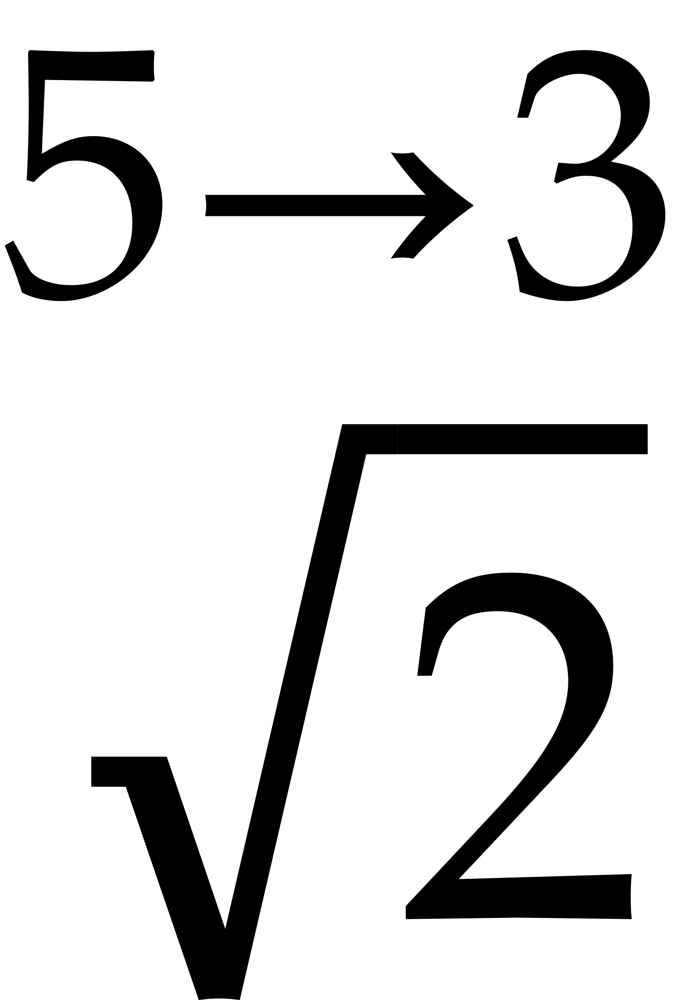 is anything at all, it is the same as √2, only another expression; the expression in another system.

### [38\[7\]](https://cdn.wittgensteinnachlass.com/2000px/webp/Ms-107/38.webp)

The operation 25 × 25 has a result, whereas the operation √2 has _none_, though – for example – 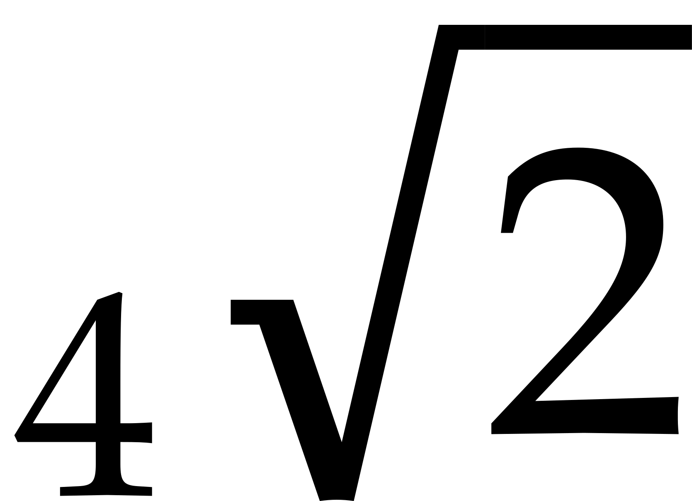 does.

### [39\[1\]](https://cdn.wittgensteinnachlass.com/2000px/webp/Ms-107/39.webp)

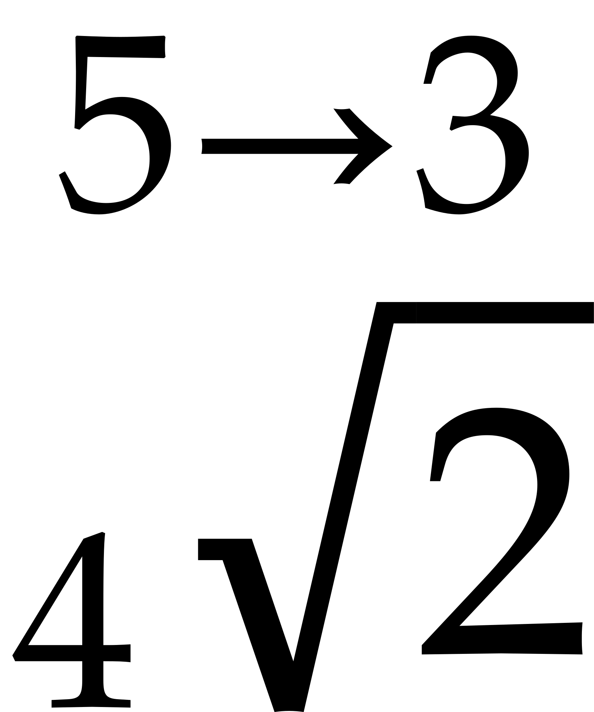 therefore makes perfectly good sense.

### [39\[2\]](https://cdn.wittgensteinnachlass.com/2000px/webp/Ms-107/39.webp)

The real number surely _cannot_ be the outward play of forming digits, nor can it be the general instruction by which digits are to be determined. Rather, only the instruction operating in a meaningful substrate.

### [39\[3\]](https://cdn.wittgensteinnachlass.com/2000px/webp/Ms-107/39.webp)

(One cannot march into the land of psychology with the unconquered enemy fortress of arithmetic at one’s back.)

### [39\[4\]](https://cdn.wittgensteinnachlass.com/2000px/webp/Ms-107/39.webp)

Then one could also put it quite naïvely like this: I understand what  means, but not , since √2 has no digit positions at all, so I cannot replace any with others.

### [39\[5\]](https://cdn.wittgensteinnachlass.com/2000px/webp/Ms-107/39.webp)

But what if 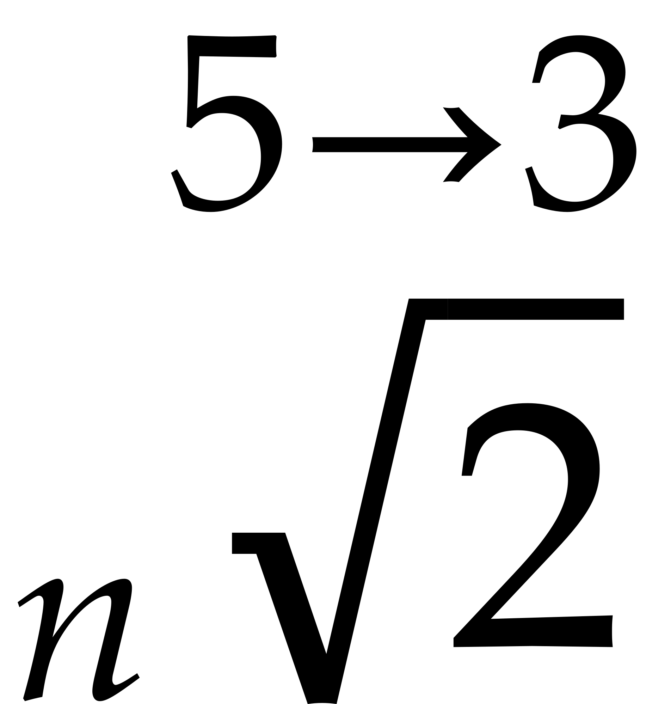 always agrees with 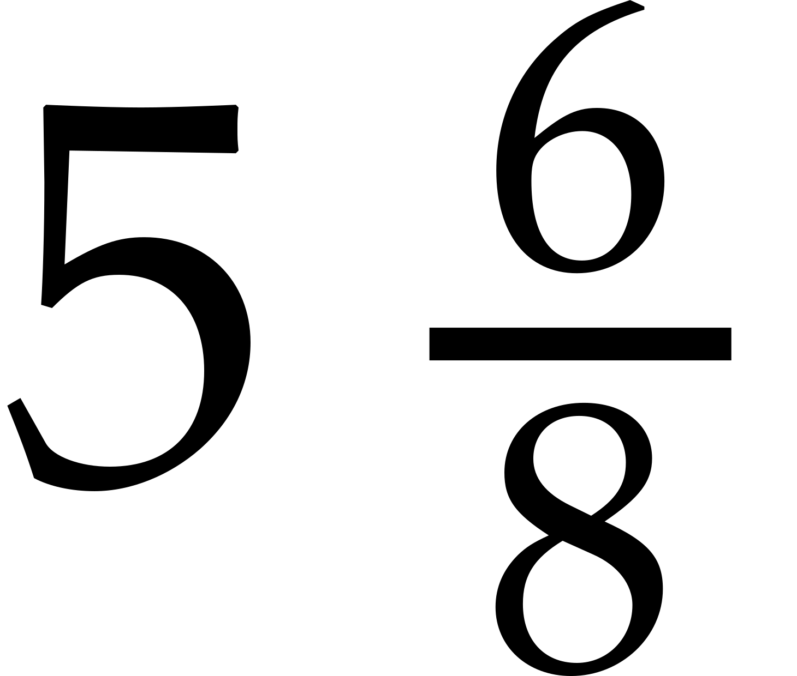, so that I could just as well write  in its place? Then surely it would be proved that  makes perfectly good sense. And is that unthinkable? – But how would the equation 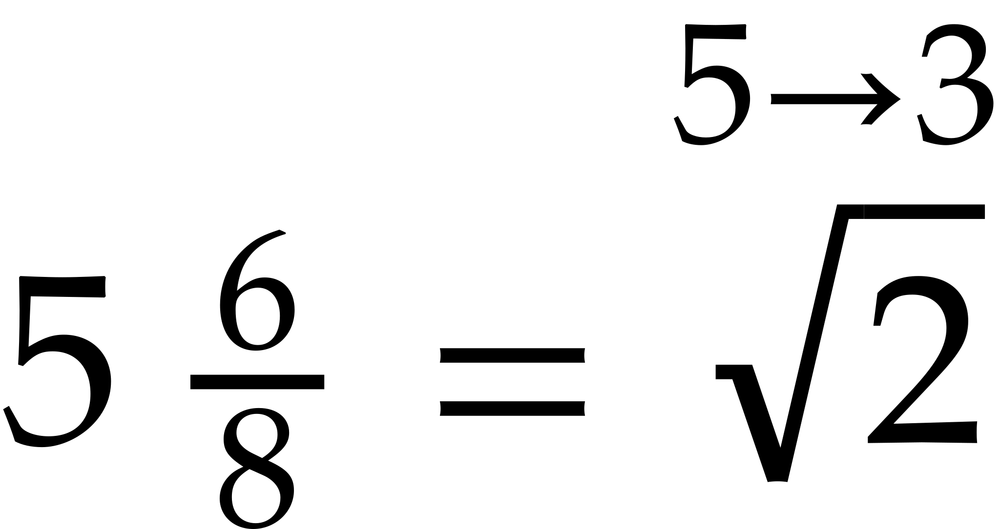 be proved, and hence understood? Surely not by comparing the extensions. The comparison is possible at all only if “5→3” does not refer to the extension.

### [39\[6\]](https://cdn.wittgensteinnachlass.com/2000px/webp/Ms-107/39.webp)

What about 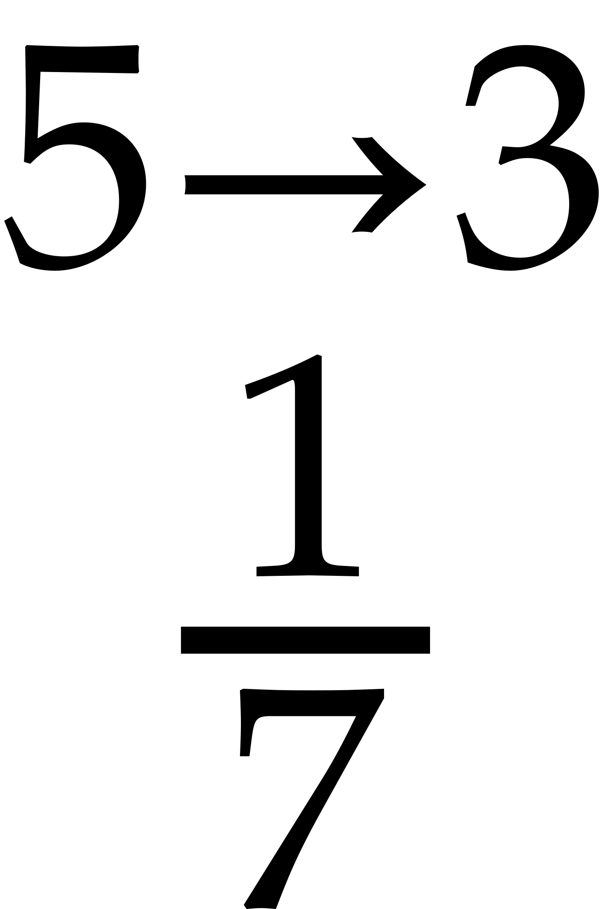? 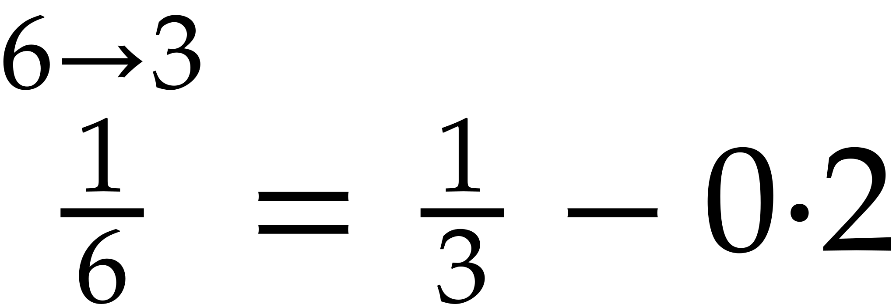.

### [39\[7\]](https://cdn.wittgensteinnachlass.com/2000px/webp/Ms-107/39.webp),[40\[1\]](https://cdn.wittgensteinnachlass.com/2000px/webp/Ms-107/40.webp)

If one writes , one is quite literally equating ⅓ with a rule concerning an extension.

### [40\[2\]](https://cdn.wittgensteinnachlass.com/2000px/webp/Ms-107/40.webp)

Here it is as if this rule were just _another_ expression of the number ⅓. An expression in accordance with a quite different system. But once again it is a rule that stands for a rule.

### [40\[3\]](https://cdn.wittgensteinnachlass.com/2000px/webp/Ms-107/40.webp)

And similarly I can write  instead of ⅐ & thus instead of :  and that again is a common fraction.

### [40\[4\]](https://cdn.wittgensteinnachlass.com/2000px/webp/Ms-107/40.webp)

Of course 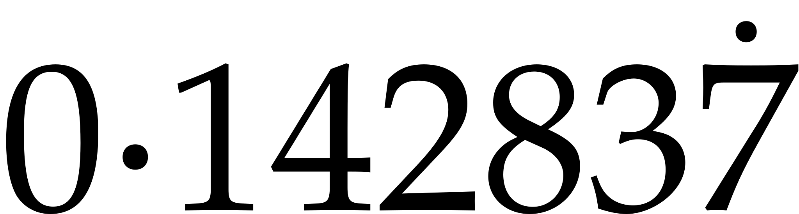 is not an infinite extension but again an infinite rule with which an extension can be formed. But it is the sort of rule that can, so to speak, digest the “5→3”.

### [40\[5\]](https://cdn.wittgensteinnachlass.com/2000px/webp/Ms-107/40.webp)

0˙1010010001… If an irrational number is given by a law like this, then it makes sense to add, say, “1→5” to the law.

### [40\[6\]](https://cdn.wittgensteinnachlass.com/2000px/webp/Ms-107/40.webp)

 is a law from a different system than √2.

### [40\[7\]](https://cdn.wittgensteinnachlass.com/2000px/webp/Ms-107/40.webp)

The addition “1→5” reaches, so to speak, into the very heart of the law 0˙101001… The law speaks of a 1, & that is replaced by 5.

### [40\[8\]](https://cdn.wittgensteinnachlass.com/2000px/webp/Ms-107/40.webp),[41\[1\]](https://cdn.wittgensteinnachlass.com/2000px/webp/Ms-107/41.webp)

The rule  works perfectly well for someone actually expanding the root. And the argument for this number is always that anyone who expands it understands exactly what to write. But that is no argument for  being a real number.

The instruction to string digits together is quite unambiguous; but that does not yet give a real number.

### [41\[2\]](https://cdn.wittgensteinnachlass.com/2000px/webp/Ms-107/41.webp)

Curiously, the real number constitutes the system it is in. Much as in the case of the negation sign ~, which really negates only in a whole system of truth-functions.

### [41\[3\]](https://cdn.wittgensteinnachlass.com/2000px/webp/Ms-107/41.webp)

Could one perhaps put it like this:  does not measure until it is in a system.

### [41\[4\]](https://cdn.wittgensteinnachlass.com/2000px/webp/Ms-107/41.webp)

Is it like this: one can no more introduce a single number than a single truth-function.

### [41\[5\]](https://cdn.wittgensteinnachlass.com/2000px/webp/Ms-107/41.webp)

It is as if one needed a person to carry out the rule . As it were: to be a matter of arithmetic, the rule must understand _itself_. The rule  does not do that; it is composed of two heterogeneous constituents. The person who understands it brings these constituents together.

### [41\[6\]](https://cdn.wittgensteinnachlass.com/2000px/webp/Ms-107/41.webp)

Does that mean that the rule  lacks something, namely the connection between the system of the root and the system of the sequence of digits?

### [41\[7\]](https://cdn.wittgensteinnachlass.com/2000px/webp/Ms-107/41.webp),[42\[1\]](https://cdn.wittgensteinnachlass.com/2000px/webp/Ms-107/42.webp)

Can one say: The root consists in a system of addition, subtraction, multiplication & division. The rules one gives someone who is to extract a root always run: Now multiply, then subtract, etc. This presupposes the multiplication table, which gives the rules for the individual digits.

### [42\[2\]](https://cdn.wittgensteinnachlass.com/2000px/webp/Ms-107/42.webp)

Extracting a root is a system of multiplications, divisions, etc. & there is no hint in it of a system for the sequence of digits in the decimal expansion.

### [42\[3\]](https://cdn.wittgensteinnachlass.com/2000px/webp/Ms-107/42.webp)

 is undoubtedly a rule for obtaining a sequence of rational numbers, but it is not _one_ number.

### [42\[4\]](https://cdn.wittgensteinnachlass.com/2000px/webp/Ms-107/42.webp)

One would no sooner say of the rule  that it was a limit towards which the values of the series tend than one would say this of the instruction to throw dice.

### [42\[5\]](https://cdn.wittgensteinnachlass.com/2000px/webp/Ms-107/42.webp)

How far must one expand √2 to know it to some extent? That of course means nothing. So we know it already, without expanding it at all. But then  means nothing at all.

### [42\[6\]](https://cdn.wittgensteinnachlass.com/2000px/webp/Ms-107/42.webp),[43\[1\]](https://cdn.wittgensteinnachlass.com/2000px/webp/Ms-107/43.webp)

The idea of √2 is this: we are looking for a rational number that gives 2 when multiplied by itself. There is no such number. But there are some that come close to 2 in this way, & always some that come closer to 2. There is a procedure that allows me to come ever closer to 2 without limit. This procedure is something too & I call it a real number.

### [43\[2\]](https://cdn.wittgensteinnachlass.com/2000px/webp/Ms-107/43.webp)

It expresses itself by yielding decimal places of a decimal fraction that lie ever further to the right

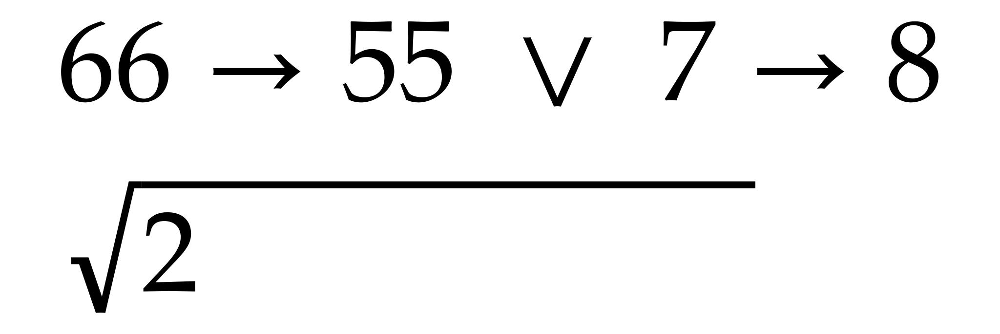.

### [43\[3\]](https://cdn.wittgensteinnachlass.com/2000px/webp/Ms-107/43.webp)

Only what can be foreseen in the sequence of digits is essential to the real number.

### [43\[4\]](https://cdn.wittgensteinnachlass.com/2000px/webp/Ms-107/43.webp)

If what mattered were the extension, I could not calculate with π, because I do not know whether there is a 5 in the 1000th place or not.

### [43\[5\]](https://cdn.wittgensteinnachlass.com/2000px/webp/Ms-107/43.webp)

π does give the infinite possibility of an extension in a quite definite way, but otherwise it has nothing to do with this extension.

### [43\[6\]](https://cdn.wittgensteinnachlass.com/2000px/webp/Ms-107/43.webp)

But doesn’t 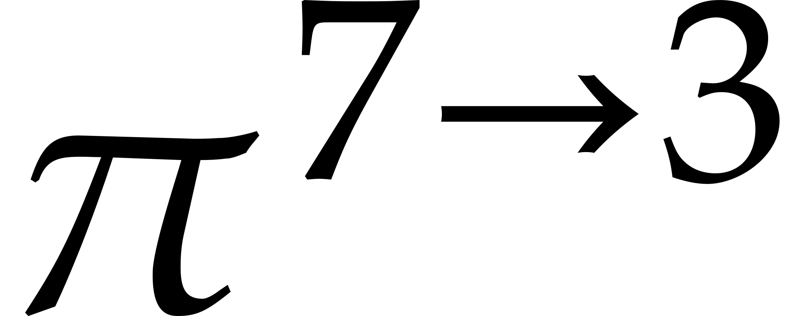 also give such an infinite possibility? One that consists in the expansion not coming to an end.

### [43\[7\]](https://cdn.wittgensteinnachlass.com/2000px/webp/Ms-107/43.webp),[44\[1\]](https://cdn.wittgensteinnachlass.com/2000px/webp/Ms-107/44.webp)

What about the rule to continue expanding √2 as far as 777777 & to break off the fraction there? So perhaps 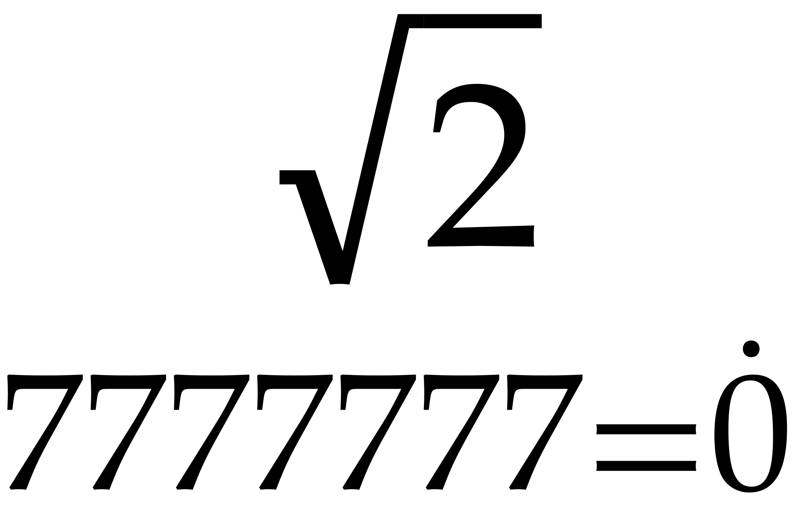 can mean a rational number. Given this indeterminacy, it is clear that one can presumably expand this fraction. Isn’t that a proof that this law is not a real number? Or does it correspond to an ordinary root of which I do not know whether it terminates or not? I don’t believe so! Aren’t we using arithmetic here like a game of dice?

### [44\[2\]](https://cdn.wittgensteinnachlass.com/2000px/webp/Ms-107/44.webp)

Clearly what interests us about √2, π, etc. is always their essence in connection with the rest of mathematics, not the individual stages of the expansion. Which would be a most thankless task, if only because the expansion has no end _anyway_.

### [44\[3\]](https://cdn.wittgensteinnachlass.com/2000px/webp/Ms-107/44.webp)

If one defines e as 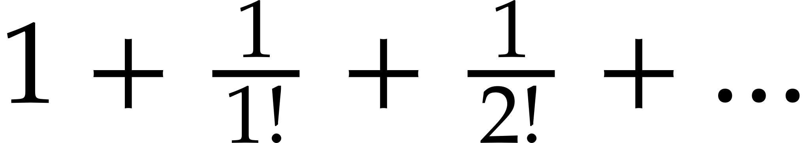, what does that mean? Surely I can only intend to give the law thereby. Nothing else is possible. e is not 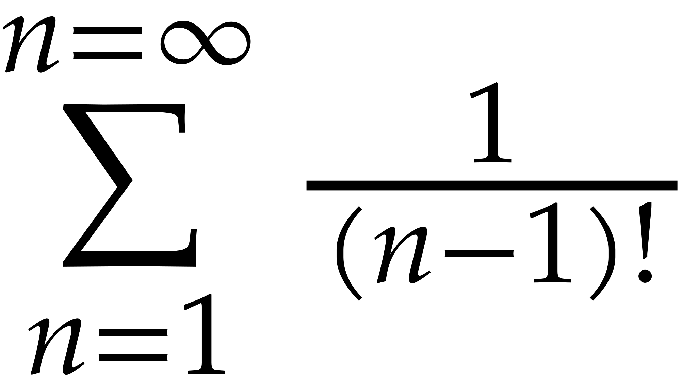 but .

### [44\[4\]](https://cdn.wittgensteinnachlass.com/2000px/webp/Ms-107/44.webp)

A general proposition is not merely a _general_ proposition. It is general only with reference to its special cases, but it is a particular proposition & complete in itself. And so the general form is a particular _form_. (every symbol is what it is etc.)

### [44\[5\]](https://cdn.wittgensteinnachlass.com/2000px/webp/Ms-107/44.webp)

This is connected with what I said further above about how algebraic propositions are to be understood.

### [44\[6\]](https://cdn.wittgensteinnachlass.com/2000px/webp/Ms-107/44.webp),[45\[1\]](https://cdn.wittgensteinnachlass.com/2000px/webp/Ms-107/45.webp)

As long as I can assume that 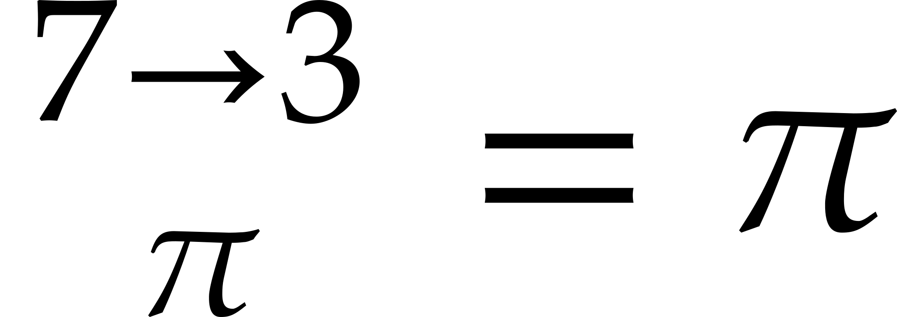 holds, I might still believe that π' at least has a different sense from π, even if perhaps the same meaning. Then π' would be merely a description. But in logic there is no description & object. If π' is equal to π, then it is essentially equal to π & then the suggestion it contains, that it might differ from π, must be nonsensical.

### [45\[2\]](https://cdn.wittgensteinnachlass.com/2000px/webp/Ms-107/45.webp)

The rule 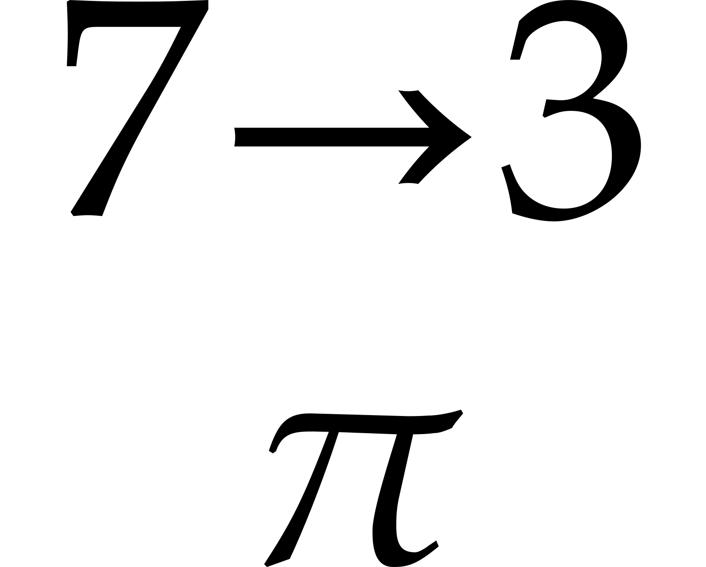 operates only as far as one expands .

### [45\[3\]](https://cdn.wittgensteinnachlass.com/2000px/webp/Ms-107/45.webp)

The rule  must be only apparently unlimited.

### [45\[4\]](https://cdn.wittgensteinnachlass.com/2000px/webp/Ms-107/45.webp)

Isn’t it of the kind: “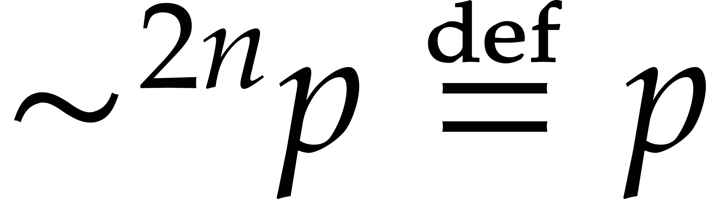”?

### [45\[5\]](https://cdn.wittgensteinnachlass.com/2000px/webp/Ms-107/45.webp)

It seems to me as though only the infinite _application_ of the rule π' (hence an absurdity) would produce the irrational number.

### [45\[6\]](https://cdn.wittgensteinnachlass.com/2000px/webp/Ms-107/45.webp)

What is the difference between  & 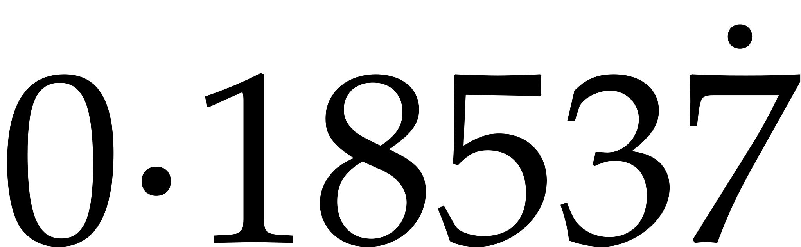? Or 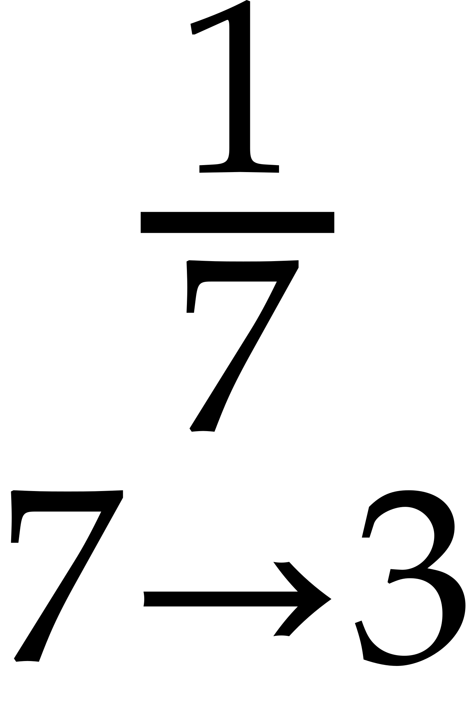, if the way to turn the common fraction into a recurring decimal is known?

### [45\[7\]](https://cdn.wittgensteinnachlass.com/2000px/webp/Ms-107/45.webp)

Isn’t it obvious that the difference is that here the law itself speaks of the 7 that is to be replaced, whereas in  one has to call on something extraneous? And what is that?

### [45\[8\]](https://cdn.wittgensteinnachlass.com/2000px/webp/Ms-107/45.webp)

The addition 7→3 does contain an infinite possibility, but it is apparently not the one we would need to define a real number.

### [45\[9\]](https://cdn.wittgensteinnachlass.com/2000px/webp/Ms-107/45.webp),[46\[1\]](https://cdn.wittgensteinnachlass.com/2000px/webp/Ms-107/46.webp)

Or can one say: In π', the 7→3 refers to a _possibility_ instead of, as it would have to, to an actuality of the law. _In the law_ everything must be actual.

### [46\[2\]](https://cdn.wittgensteinnachlass.com/2000px/webp/Ms-107/46.webp)

So is it the “if” in the law of π' that one must take exception to? Can one say: “There must be no ‘if’ in the law, since everything in it must be known”?

### [46\[3\]](https://cdn.wittgensteinnachlass.com/2000px/webp/Ms-107/46.webp)

But if this is a sound objection, it does not in any case prevent the application of a rule in which the “if” occurs. And so the question arises: in what respect is the applicability of the rule not a criterion for its defining a real number?

### [46\[4\]](https://cdn.wittgensteinnachlass.com/2000px/webp/Ms-107/46.webp)

One might say: what I do in applying the rule must be determined entirely, from the outset, by the rule & must not also depend on a factor that will emerge only in the course of its application – as it were, incidentally.

### [46\[5\]](https://cdn.wittgensteinnachlass.com/2000px/webp/Ms-107/46.webp)

Or one might say that the rule  is indeed to be admitted, but, ex definitione, it does not determine _one_ real number but leaves possibilities open.

### [46\[6\]](https://cdn.wittgensteinnachlass.com/2000px/webp/Ms-107/46.webp)

That one can unambiguously form one rational number after another according to it does not mean that the law was determinate in itself, for it is precisely the decisions that were left here to the application of the law that the law would have had to anticipate.

### [47\[1\]](https://cdn.wittgensteinnachlass.com/2000px/webp/Ms-107/47.webp)

That one can apply the law is also true of the law for obtaining the digits by throwing dice.

### [47\[2\]](https://cdn.wittgensteinnachlass.com/2000px/webp/Ms-107/47.webp)

And what distinguishes π' from that can only be its arithmetical determinacy. But does that not consist in our knowing that there must be a law according to which the digits 7 occur in π, even if we do not yet know this law?

### [47\[3\]](https://cdn.wittgensteinnachlass.com/2000px/webp/Ms-107/47.webp)

So one could also put it this way:  alludes to a law that is not yet known. ( does not)

### [47\[4\]](https://cdn.wittgensteinnachlass.com/2000px/webp/Ms-107/47.webp)

But could one not say: It [π'] contains the description of a law: namely, “the law according to which 7 occurs in the expansion of π”. Or would this allusion make sense only if we knew how to obtain this law? (Solution of a mathematical problem)

### [47\[5\]](https://cdn.wittgensteinnachlass.com/2000px/webp/Ms-107/47.webp)

But this law is surely contained implicitly in the instruction we know for extracting a root! Can I not take it as given?

### [47\[6\]](https://cdn.wittgensteinnachlass.com/2000px/webp/Ms-107/47.webp)

Then I simply cannot, ex confesso, read this law out of the instruction, & so the law is contained in it in a language I cannot read. In this sense, then, I do not understand  either.

### [47\[7\]](https://cdn.wittgensteinnachlass.com/2000px/webp/Ms-107/47.webp),[48\[1\]](https://cdn.wittgensteinnachlass.com/2000px/webp/Ms-107/48.webp)

But what about the solvability of the problem of finding this law? Is it not a problem only in so far as the method of solving it is _known_?

### [48\[2\]](https://cdn.wittgensteinnachlass.com/2000px/webp/Ms-107/48.webp)

And if it is known, π' gets its sense precisely _from that_, & if it is unknown, we cannot speak of the law we do not yet know, & π' loses all sense. For if there is no law, π' becomes analogous to the instruction for throwing dice.

### [48\[3\]](https://cdn.wittgensteinnachlass.com/2000px/webp/Ms-107/48.webp)

The rule is a mechanism for generating digits. This mechanism works just as well when it contains an “if”, as e.g. in .

### [48\[4\]](https://cdn.wittgensteinnachlass.com/2000px/webp/Ms-107/48.webp)

But the rule still cannot constitute the real number.

### [48\[5\]](https://cdn.wittgensteinnachlass.com/2000px/webp/Ms-107/48.webp)

The number is precisely _what_ the rule foresees. What it cannot foresee cannot belong to the number.

### [48\[6\]](https://cdn.wittgensteinnachlass.com/2000px/webp/Ms-107/48.webp)

But the addition “7→3” cannot foresee anything.

### [48\[7\]](https://cdn.wittgensteinnachlass.com/2000px/webp/Ms-107/48.webp)

A very far-reaching rule of the π' kind would be conceivable: Something like: “if ‘44’ occurs in the expansion of π, it is to be replaced by ‘23’; if ‘775’ occurs, it is to be replaced by 424; if 9 - - 9 occurs, it is to be replaced by 5, and so on.” The mechanism of this rule would work without a hitch; but how does it represent _one_ number?!

### [49\[1\]](https://cdn.wittgensteinnachlass.com/2000px/webp/Ms-107/49.webp)

Replacements in the extension always strike one as mere playing about. – And that is because they do not touch the core.

### [49\[2\]](https://cdn.wittgensteinnachlass.com/2000px/webp/Ms-107/49.webp)

If the rule reads: “take a step according to the rules for √2 & if this step yields 3, replace it with 7”, I would like to ask: “Well, why should I go on to replace it with 7; and how often can I do that at all?”

### [49\[3\]](https://cdn.wittgensteinnachlass.com/2000px/webp/Ms-107/49.webp)

One cannot subsequently introduce into the construction of the real number an operation that is not present in its foundations.

### [49\[4\]](https://cdn.wittgensteinnachlass.com/2000px/webp/Ms-107/49.webp)

The real number lives in the substrate of the operations from which it is born.

### [49\[5\]](https://cdn.wittgensteinnachlass.com/2000px/webp/Ms-107/49.webp)

What is the actual number “√2”? Surely not one of its “approximate values”, for which one? – But not the rule for its expansion in the decimal system, or in any other system, either. The essential thing is evidently only what the sign “√2” itself says: the law of a series whose terms, when squared, approximate to 2 without limit.

### [49\[6\]](https://cdn.wittgensteinnachlass.com/2000px/webp/Ms-107/49.webp)

One could also say: “√2” means the _method of approximation_ of an x² to 2.

### [49\[7\]](https://cdn.wittgensteinnachlass.com/2000px/webp/Ms-107/49.webp),[50\[1\]](https://cdn.wittgensteinnachlass.com/2000px/webp/Ms-107/50.webp)

Only a path approaches a destination; places do not. And only a law approaches a value.

### [50\[2\]](https://cdn.wittgensteinnachlass.com/2000px/webp/Ms-107/50.webp)

We call the approximation of x² to 2 the approximation of x to √2.

### [50\[3\]](https://cdn.wittgensteinnachlass.com/2000px/webp/Ms-107/50.webp)

It is the x² wheel that has the stop, not the x wheel. When the x² wheel hits the stop at 2, x stands at √2. (let us call the position of x “√2”.) When the x wheel hits the stop at 0, 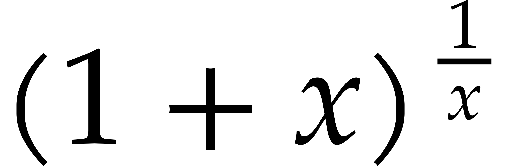 stands at e.

### [50\[4\]](https://cdn.wittgensteinnachlass.com/2000px/webp/Ms-107/50.webp)

The path, the law, of the unlimited approximation of x² to 2 is √2.

### [50\[5\]](https://cdn.wittgensteinnachlass.com/2000px/webp/Ms-107/50.webp)

√2 is the method of extracting the square root of 2.

### [50\[6\]](https://cdn.wittgensteinnachlass.com/2000px/webp/Ms-107/50.webp)

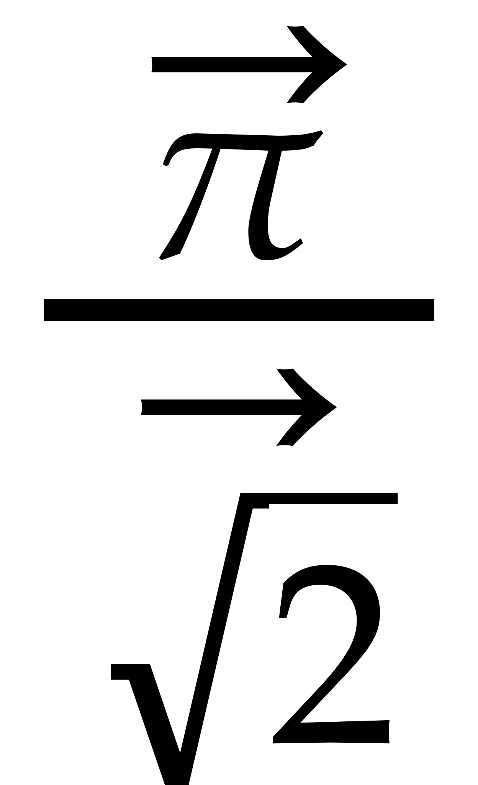 The quotient of two laws of sequences of numbers is a law of a sequence of numbers.

### [50\[7\]](https://cdn.wittgensteinnachlass.com/2000px/webp/Ms-107/50.webp)

One believes that π', even if it perhaps has the same meaning as π, nevertheless has a sense of its own. And that it has this sense even when one does not yet know its relation to other real numbers, such as …. But that is not how it is. For until a law for the occurrence of 7 in π is given, π' does not represent a number.

### [50\[8\]](https://cdn.wittgensteinnachlass.com/2000px/webp/Ms-107/50.webp)

The extension of √2 is of interest only in so far as it results from the process of extracting the *root*.

### [50\[9\]](https://cdn.wittgensteinnachlass.com/2000px/webp/Ms-107/50.webp),[51\[1\]](https://cdn.wittgensteinnachlass.com/2000px/webp/Ms-107/51.webp)

After all, apart from the rational numbers, replacing 7 with 3 has no arithmetical meaning.

### [51\[2\]](https://cdn.wittgensteinnachlass.com/2000px/webp/Ms-107/51.webp)

Replacing 7 with 3 – in π, say – has no general arithmetical significance.

### [51\[3\]](https://cdn.wittgensteinnachlass.com/2000px/webp/Ms-107/51.webp)

But it is, after all, an arithmetical mechanism that generates . – And I could only say: “but I don’t understand it”.

### [51\[4\]](https://cdn.wittgensteinnachlass.com/2000px/webp/Ms-107/51.webp)

When I say “arithmetical mechanism”, I mean: The occurrence of 7 in π depends only on the essence of π & of the decimal system.

### [51\[5\]](https://cdn.wittgensteinnachlass.com/2000px/webp/Ms-107/51.webp)

But what does it mean that I cannot say anything about the occurrence of 7 in π, that I regard it as an unforeseeable chance event?

### [51\[6\]](https://cdn.wittgensteinnachlass.com/2000px/webp/Ms-107/51.webp)

And this lack of knowledge must be reflected in the sense of 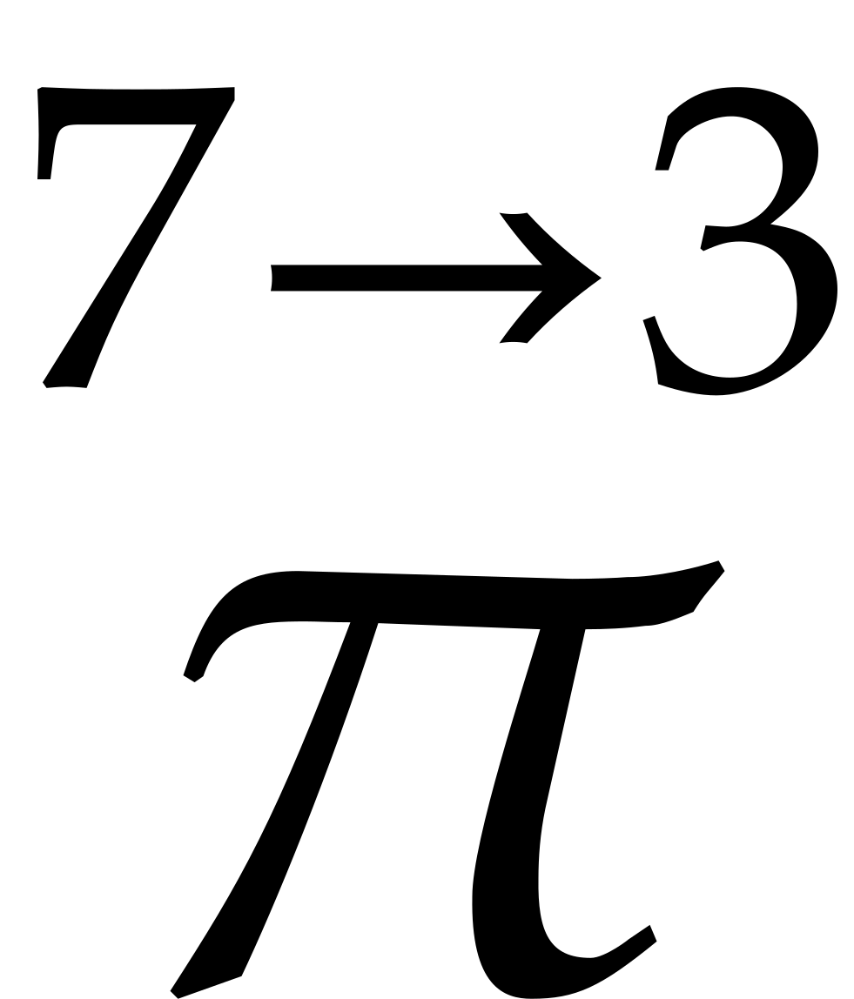. I.e. in what I can mean by ; since, after all, I lack the link between π & the occurrence of 7 in its expansion.

### [51\[7\]](https://cdn.wittgensteinnachlass.com/2000px/webp/Ms-107/51.webp)

So what prevents me from regarding  as a real number is an unsolved mathematical problem. Namely, that of the connection between the law of π and the occurrence of the digit 7 in its decimal representation.

### [51\[8\]](https://cdn.wittgensteinnachlass.com/2000px/webp/Ms-107/51.webp),[52\[1\]](https://cdn.wittgensteinnachlass.com/2000px/webp/Ms-107/52.webp)

For here we are speaking of a law “which must exist, but which we do not know”. Are we entitled to do so? By this law we mean a kind of predetermination, nothing more. (At least, that is what I believe).

### [52\[2\]](https://cdn.wittgensteinnachlass.com/2000px/webp/Ms-107/52.webp)

The only thing this law lacks is comparability with other laws, say that of π; and this lies in its very structure & not just in what follows from its application.

### [52\[3\]](https://cdn.wittgensteinnachlass.com/2000px/webp/Ms-107/52.webp)

We feel as though there is an undigested, an uncomprehended, component in this law.

### [52\[4\]](https://cdn.wittgensteinnachlass.com/2000px/webp/Ms-107/52.webp)

We have learnt to multiply & divide & we can also carry on from the resulting sequences of digits with 7→3. But we lack the _one_ unified path that leads from the essence of the arithmetical operations, via the rules of the decimal system, to the resulting sequence of digits.

### [52\[5\]](https://cdn.wittgensteinnachlass.com/2000px/webp/Ms-107/52.webp)

Suppose someone invented a new arithmetical operation which was ordinary multiplication, with just the difference that he put a 3 in the product in place of each 7. Then this operation × ' too would have something about it that was not understood, as long as the occurrence of 7 in the product was not understood in general through a law.

### [52\[6\]](https://cdn.wittgensteinnachlass.com/2000px/webp/Ms-107/52.webp),[53\[1\]](https://cdn.wittgensteinnachlass.com/2000px/webp/Ms-107/53.webp)

Once a multiplication 637 × 548 is written down, it is indeed already predetermined whether it is the same as 637 ×' 548, but I cannot predict it.

### [53\[2\]](https://cdn.wittgensteinnachlass.com/2000px/webp/Ms-107/53.webp)

If it is clear to us that by considering the extension we can learn nothing decisive about the real number, how are we then to bring , as a law, into relation with other laws?!

### [53\[3\]](https://cdn.wittgensteinnachlass.com/2000px/webp/Ms-107/53.webp)

It is as if I were to follow a path made up of individual stretches which are indeed connected, but whose directions in relation to one another were hidden from me.

### [53\[4\]](https://cdn.wittgensteinnachlass.com/2000px/webp/Ms-107/53.webp)

It must not be the case that I have a correct expression in my possession but do not understand it. Rather, in that case there must be something wrong with the expression.

### [53\[5\]](https://cdn.wittgensteinnachlass.com/2000px/webp/Ms-107/53.webp)

Something is missing from this law. The connection between the law of π & the addition concerning the digits of the extension.

### [53\[6\]](https://cdn.wittgensteinnachlass.com/2000px/webp/Ms-107/53.webp)

But now one can ask: “Why should I also express such a connection in the law if it exists anyway?”

### [53\[7\]](https://cdn.wittgensteinnachlass.com/2000px/webp/Ms-107/53.webp)

What would be strange here is precisely that my symbolism expressed something that I do not understand. (But there is no such thing.)

### [53\[8\]](https://cdn.wittgensteinnachlass.com/2000px/webp/Ms-107/53.webp),[54\[1\]](https://cdn.wittgensteinnachlass.com/2000px/webp/Ms-107/54.webp)

One could also put it this way: The rules fit together exactly & lead unambiguously to this end, but I cannot see the whole path as _one_ law.

### [54\[2\]](https://cdn.wittgensteinnachlass.com/2000px/webp/Ms-107/54.webp)

 presupposes a connection, but the path of the connection is obscure – – –

### [54\[3\]](https://cdn.wittgensteinnachlass.com/2000px/webp/Ms-107/54.webp)

Can one say that “7→3” would take on a different sense if the connection between π & 7→3 were established?

### [54\[4\]](https://cdn.wittgensteinnachlass.com/2000px/webp/Ms-107/54.webp)

 could be taken as an indication of an operation to be performed on π. But it would be an operation unknown to us. I.e. it is not that only the result is as yet unknown to me & I simply have to work it out, as in 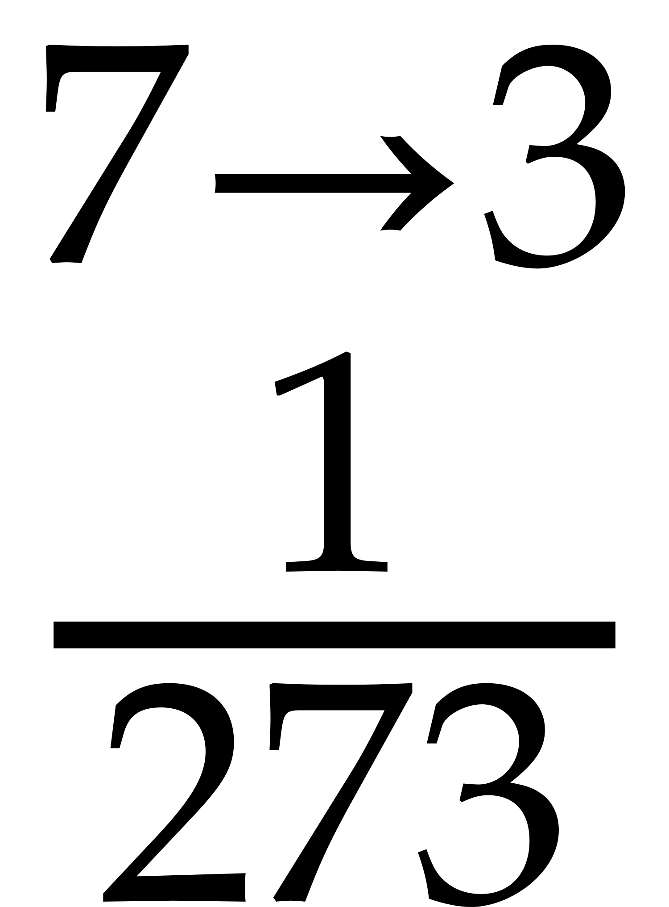. Rather, what happens to π is quite unknown to me.

### [54\[5\]](https://cdn.wittgensteinnachlass.com/2000px/webp/Ms-107/54.webp)

If  is merely another system, which is nevertheless in order in & of itself, then one must be able to find several numbers in _this_ system that can be compared with one another, & the different systems would stand side by side on an equal footing.

### [54\[6\]](https://cdn.wittgensteinnachlass.com/2000px/webp/Ms-107/54.webp)

 is a completely uninteresting instruction for generating decimal fractions. Uninteresting without qualification, because we do not know the law according to which the digits are generated in this process.

### [54\[7\]](https://cdn.wittgensteinnachlass.com/2000px/webp/Ms-107/54.webp),[55\[1\]](https://cdn.wittgensteinnachlass.com/2000px/webp/Ms-107/55.webp)

π' has no arithmetical meaning because it has no connection whatsoever with the other laws. In arithmetic nothing can be isolated.

### [55\[2\]](https://cdn.wittgensteinnachlass.com/2000px/webp/Ms-107/55.webp)

Since the extension is not what matters, it must be possible to express the law π', if it means a real number, in such a way that the replacement no longer takes place in the extension.

### [55\[3\]](https://cdn.wittgensteinnachlass.com/2000px/webp/Ms-107/55.webp)

Even if I did not already know the rules for forming √2 & took 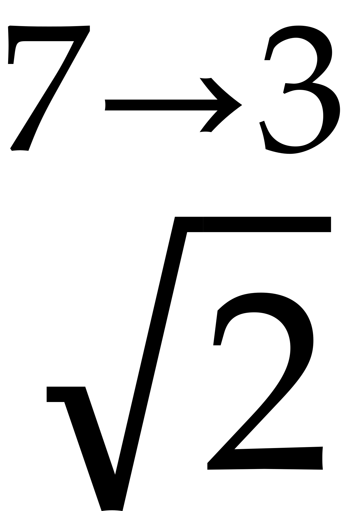 to be the primary rule, I would still ask: what is the point of this curious ceremony of replacing 7 with 3? Is 7 perhaps taboo, so that one is not allowed to write it down? For replacing 7 with 3 adds nothing at all to the law & is not an arithmetical operation in this system at all.

### [55\[4\]](https://cdn.wittgensteinnachlass.com/2000px/webp/Ms-107/55.webp)

Indeed, it seems to me no different from replacing 7 with 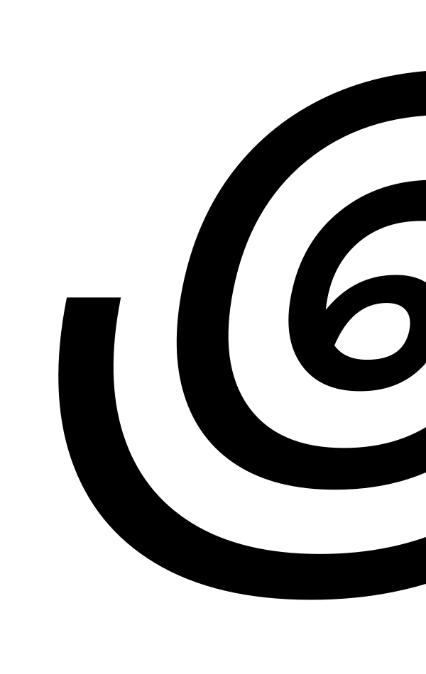 (a new sign).

### [55\[5\]](https://cdn.wittgensteinnachlass.com/2000px/webp/Ms-107/55.webp)

I would like to say: The law π' is already complete once the digit of π has been formed; the replacement adds _nothing_ to it. Unless one takes it as operating on π & that would be possible only if one knew the law according to which π is modified by the replacement (compare ).

### [55\[6\]](https://cdn.wittgensteinnachlass.com/2000px/webp/Ms-107/55.webp),[56\[1\]](https://cdn.wittgensteinnachlass.com/2000px/webp/Ms-107/56.webp)

Could one also express it like this: “π, √2, etc. are limits of functions for certain values of their arguments. π' is not, at least not as we are able to conceive of it.”?

### [56\[2\]](https://cdn.wittgensteinnachlass.com/2000px/webp/Ms-107/56.webp)

That they are limits, or limiting processes, would also describe their system. And would be their arithmetical meaning.

### [56\[3\]](https://cdn.wittgensteinnachlass.com/2000px/webp/Ms-107/56.webp)

What is the essence of a limiting process?

### [56\[4\]](https://cdn.wittgensteinnachlass.com/2000px/webp/Ms-107/56.webp)

The replacement adds nothing to the process of approximating to the limit.

### [56\[5\]](https://cdn.wittgensteinnachlass.com/2000px/webp/Ms-107/56.webp)

Can one say: “the limit must head towards a definite target. And in the case of √2, for example, this target is not x = √2 but x² = 2”?

### [56\[6\]](https://cdn.wittgensteinnachlass.com/2000px/webp/Ms-107/56.webp)

Now does it make sense to say that the approximate values of the number 0˙1010010001 … are tending towards a target?

### [56\[7\]](https://cdn.wittgensteinnachlass.com/2000px/webp/Ms-107/56.webp)

Is the fact that the nested intervals grow ever smaller all that is needed? And would π' not satisfy this condition too?!

### [56\[8\]](https://cdn.wittgensteinnachlass.com/2000px/webp/Ms-107/56.webp)

I think so, if the nesting is determined all the way to infinity by a law.

### [56\[9\]](https://cdn.wittgensteinnachlass.com/2000px/webp/Ms-107/56.webp)

Geometrically speaking: it is not enough that one – supposedly – determines the point more & more precisely by shrinking the region in which it lies; one must be able to construct _it_.

### [57\[1\]](https://cdn.wittgensteinnachlass.com/2000px/webp/Ms-107/57.webp)

Continued throws of the dice do indeed restrict the possible whereabouts of the point without limit, but they do not determine a point.

### [57\[2\]](https://cdn.wittgensteinnachlass.com/2000px/webp/Ms-107/57.webp)

After _every_ throw the point is still infinitely indeterminate.

### [57\[3\]](https://cdn.wittgensteinnachlass.com/2000px/webp/Ms-107/57.webp)

The addition “7→3” always remains within the finite.

### [57\[4\]](https://cdn.wittgensteinnachlass.com/2000px/webp/Ms-107/57.webp)

Of course, even in the ordinary process of extracting a root, the rules of the multiplication table that happen to fit have to be applied time and again, & one has not foreseen their application either. But the principle of √2 says nothing about them & their application either.

### [57\[5\]](https://cdn.wittgensteinnachlass.com/2000px/webp/Ms-107/57.webp)

In what sense does

have _one_ number corresponding to it & not merely a systematic sequence of numbers? In what sense can one speak of a number that the value of the function approaches asymptotically?

### [57\[6\]](https://cdn.wittgensteinnachlass.com/2000px/webp/Ms-107/57.webp)

I define as “greater than Σ etc.” whatever yields greater results according to a definite law.

### [57\[7\]](https://cdn.wittgensteinnachlass.com/2000px/webp/Ms-107/57.webp)

(Only that for which I have defined “greater”, “smaller”, etc. is a number.)

### [57\[8\]](https://cdn.wittgensteinnachlass.com/2000px/webp/Ms-107/57.webp),[58\[1\]](https://cdn.wittgensteinnachlass.com/2000px/webp/Ms-107/58.webp)

The number must measure. And not merely: Values of its expansion must measure. For one cannot speak of _all_ the values, and it goes without saying that rational numbers (which I have formed according to some rule or other) measure.

### [58\[2\]](https://cdn.wittgensteinnachlass.com/2000px/webp/Ms-107/58.webp)

What I mean might be put this way: for a real number a construction & not merely an approximation must be conceivable. – The construction corresponds to the unity of the law.

### [58\[3\]](https://cdn.wittgensteinnachlass.com/2000px/webp/Ms-107/58.webp)

Now it seems to me that in some sense a construction would have to correspond to , but none can correspond to , because it is not a rule that is intelligible _in itself_.

### [58\[4\]](https://cdn.wittgensteinnachlass.com/2000px/webp/Ms-107/58.webp)

What does one know about the digits of  that have not been worked out? Only that they _either_ correspond to the law of π _or_ are 3. And we have no law that tells us when the one & when the other occurs.

### [58\[5\]](https://cdn.wittgensteinnachlass.com/2000px/webp/Ms-107/58.webp)

I mean: Of digits in the expansion of π, I know that they correspond to the law of the number π (that does not seem to be much). Of the digits of π', on the other hand – – – –

### [58\[6\]](https://cdn.wittgensteinnachlass.com/2000px/webp/Ms-107/58.webp)

But what about 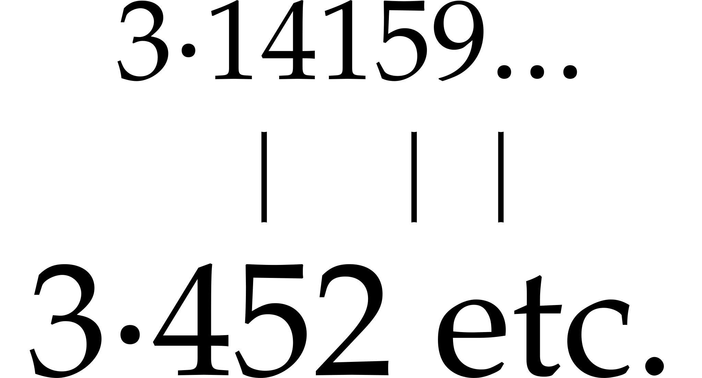? It seems to me to be on the same footing as . – But suppose that in extracting a root I make it a rule to write down only every second digit of the result! √2' = 1˙12 …. Is this now a number? Or, what comes to the same thing: Is this a law?

### [59\[1\]](https://cdn.wittgensteinnachlass.com/2000px/webp/Ms-107/59.webp)

It is easy to think up a multitude of infinite instructions. But are these all real numbers?

### [59\[2\]](https://cdn.wittgensteinnachlass.com/2000px/webp/Ms-107/59.webp)

But a law that yields fractions such as 0˙101001 etc. is surely an object of arithmetical interest.

### [59\[3\]](https://cdn.wittgensteinnachlass.com/2000px/webp/Ms-107/59.webp)

Could one not say of a rod that it has the length 0˙101001 etc.? I.e. it is longer than 0˙1 & shorter than 0˙2, & longer than 0˙101 but shorter than 0˙102 etc. But what does this “etc.” mean?

### [59\[4\]](https://cdn.wittgensteinnachlass.com/2000px/webp/Ms-107/59.webp)

But can I not say the same of ? It seems as if here I actually have to work out every stage in turn, whereas before I could look into infinity.

### [59\[5\]](https://cdn.wittgensteinnachlass.com/2000px/webp/Ms-107/59.webp)

But I do not see where the difference actually lies!

### [59\[6\]](https://cdn.wittgensteinnachlass.com/2000px/webp/Ms-107/59.webp)

Would 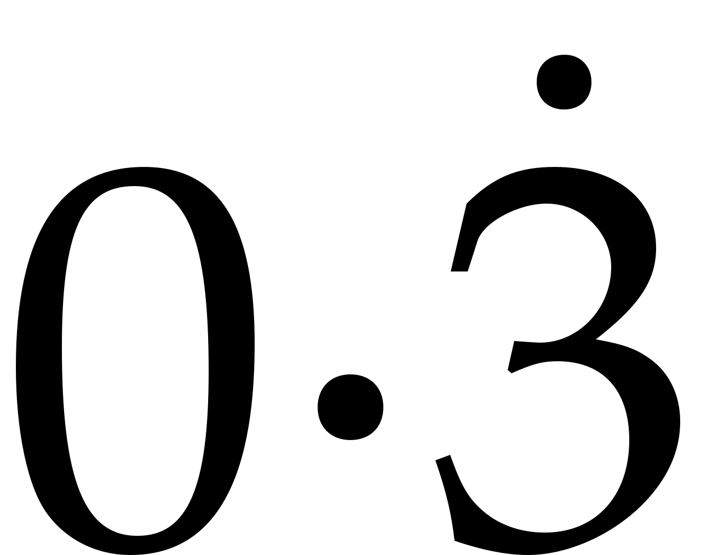 be a number if I did not know that it is a vulgar fraction?

### [59\[7\]](https://cdn.wittgensteinnachlass.com/2000px/webp/Ms-107/59.webp)

Is it not the existence of a law according to which rational numbers approach a definite limit that makes it a number? I.e. they approach the occurrence of a definite event. Namely, that of yielding 1 when multiplied by 3.

### [59\[8\]](https://cdn.wittgensteinnachlass.com/2000px/webp/Ms-107/59.webp)

I can attach as many more wheels as I like; I need only fit the stop to one of them.

### [60\[1\]](https://cdn.wittgensteinnachlass.com/2000px/webp/Ms-107/60.webp)

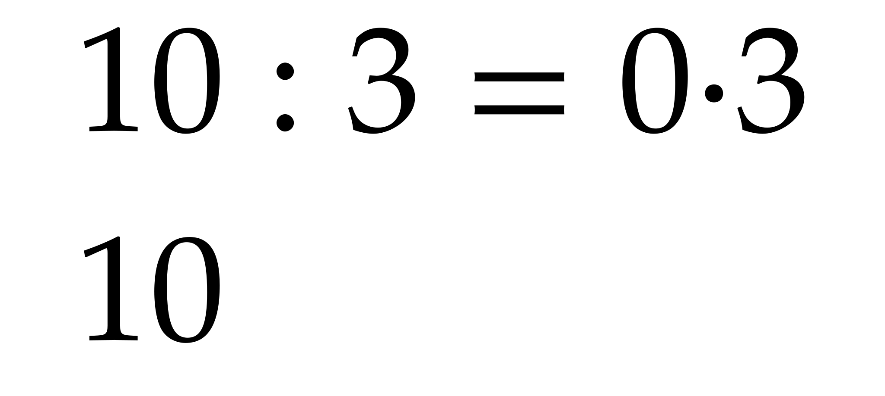 What I actually see & express by 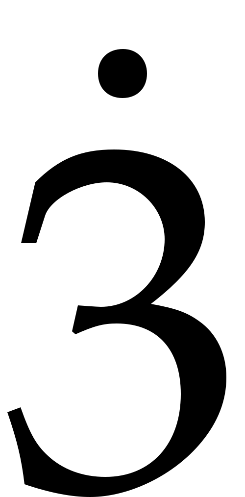 is that the circle closes.  does not mean “nothing but 3s occur”, but “a 3 must occur again and again”.

### [60\[2\]](https://cdn.wittgensteinnachlass.com/2000px/webp/Ms-107/60.webp)

It is clear that a law G such as 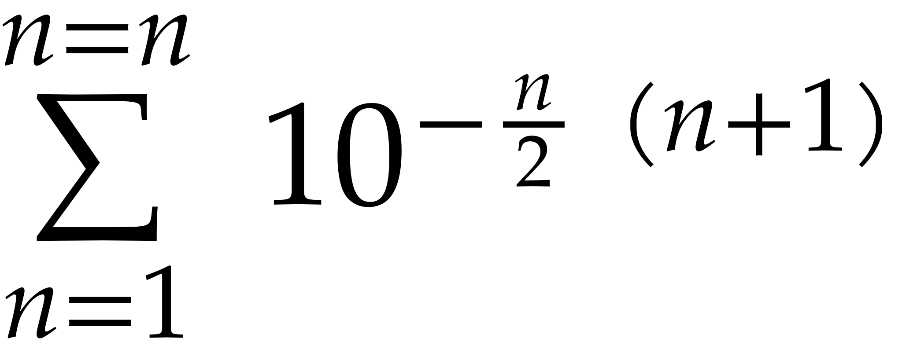 has all the properties of a number: Of any rational number I can say whether it is greater or smaller than G. I can approach G without limit by some process or other.

### [60\[3\]](https://cdn.wittgensteinnachlass.com/2000px/webp/Ms-107/60.webp)

But I can do that in the case of π' too. But I can also do that for the number determined by throwing dice. What I see in  is not a law, but only numbers constructed ad hoc (as if by throwing dice).

### [60\[4\]](https://cdn.wittgensteinnachlass.com/2000px/webp/Ms-107/60.webp)

But doesn’t π' have a definite place in the number series?

### [60\[5\]](https://cdn.wittgensteinnachlass.com/2000px/webp/Ms-107/60.webp)

Of course I could say that it has only a definite interval; I cannot specify its exact place. But can I specify the place of e any differently? The lack of a construction! Even if I cannot construct it graphically, the law itself is apparently a construction in another space, in which e can after all be determined exactly, i.e. can be determined.

### [60\[6\]](https://cdn.wittgensteinnachlass.com/2000px/webp/Ms-107/60.webp)

Just as √2 & √3 can also be compared without expanding them.

### [61\[1\]](https://cdn.wittgensteinnachlass.com/2000px/webp/Ms-107/61.webp)

[Perhaps there is another conception of the real numbers besides the one pursued here, but this is in any case a possible & important conception, from which it must be possible to justify everything.]

### [61\[2\]](https://cdn.wittgensteinnachlass.com/2000px/webp/Ms-107/61.webp)

Suppose that 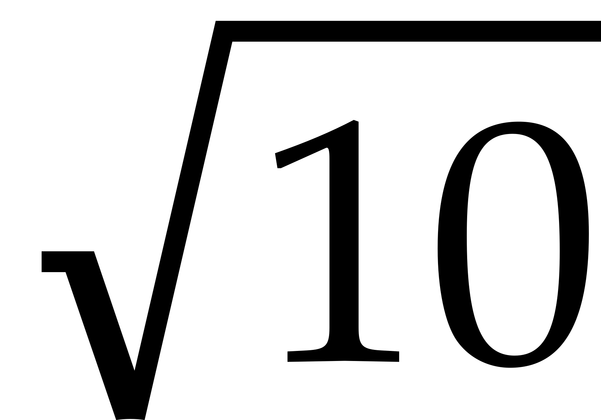 yielded the same digits as π, however far we had expanded it. Would we have no way of deciding which is greater, or whether they are equal?

### [61\[3\]](https://cdn.wittgensteinnachlass.com/2000px/webp/Ms-107/61.webp)

What I would really like to say is that there would have to be a system of quasi-algebraic numbers in which I do not need the expansions at all in order to compare these numbers with one another & calculate with them. This system calculates only with the laws themselves (thus with algebraic expressions) & in it – for example – π & e have their determinate place (point).

### [61\[4\]](https://cdn.wittgensteinnachlass.com/2000px/webp/Ms-107/61.webp)

To compare π with a rational number, I must calculate a _determinate_ number of digits. That is a clear calculational operation that I must perform to obtain the result. (And not simply an expansion, so to speak, into the blue).

### [61\[5\]](https://cdn.wittgensteinnachlass.com/2000px/webp/Ms-107/61.webp),[62\[1\]](https://cdn.wittgensteinnachlass.com/2000px/webp/Ms-107/62.webp)

But what about the comparison of π & e; there seem to be two different methods here; one that uses the extension & an intensional one. But the two would have to coexist & what one yields the other cannot yield as well (I mean, the two cannot compete). If, for example, I compare  & 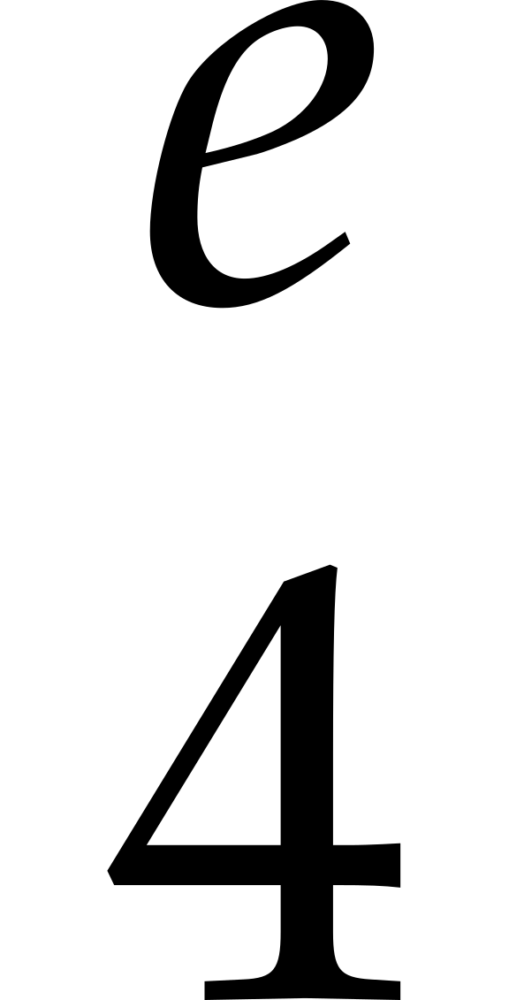, no method other than the comparison of these extensions can do _that_ for me. On the other hand, I cannot say: “π is greater than e if _there is an extension_ in which 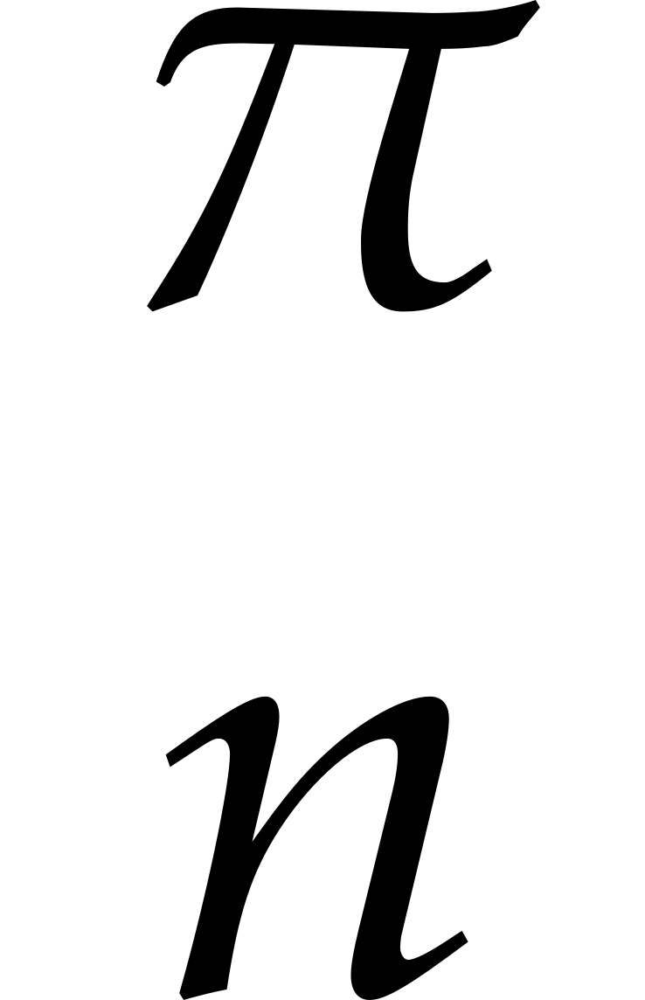 is greater than ”. It is really only this sentence that is inadmissible.

### [62\[2\]](https://cdn.wittgensteinnachlass.com/2000px/webp/Ms-107/62.webp)

But must not the comparison of the magnitudes of two “laws” ultimately be based on the comparison of numbers? Just as, for example, the comparison of √2 & √3 ultimately comes down to the comparison of 2 & 3.

### [62\[3\]](https://cdn.wittgensteinnachlass.com/2000px/webp/Ms-107/62.webp)

 belongs to e, but not .

### [62\[4\]](https://cdn.wittgensteinnachlass.com/2000px/webp/Ms-107/62.webp)

For I could say: certainly, the comparison of the magnitudes of the laws is based on the comparison of the magnitudes of the numbers, but only of the numbers that occur in the laws themselves. (Because the laws are autonomous). But does not  belong to e too? After all, it is a determinate number connected with the numbers of the law for e, & so is 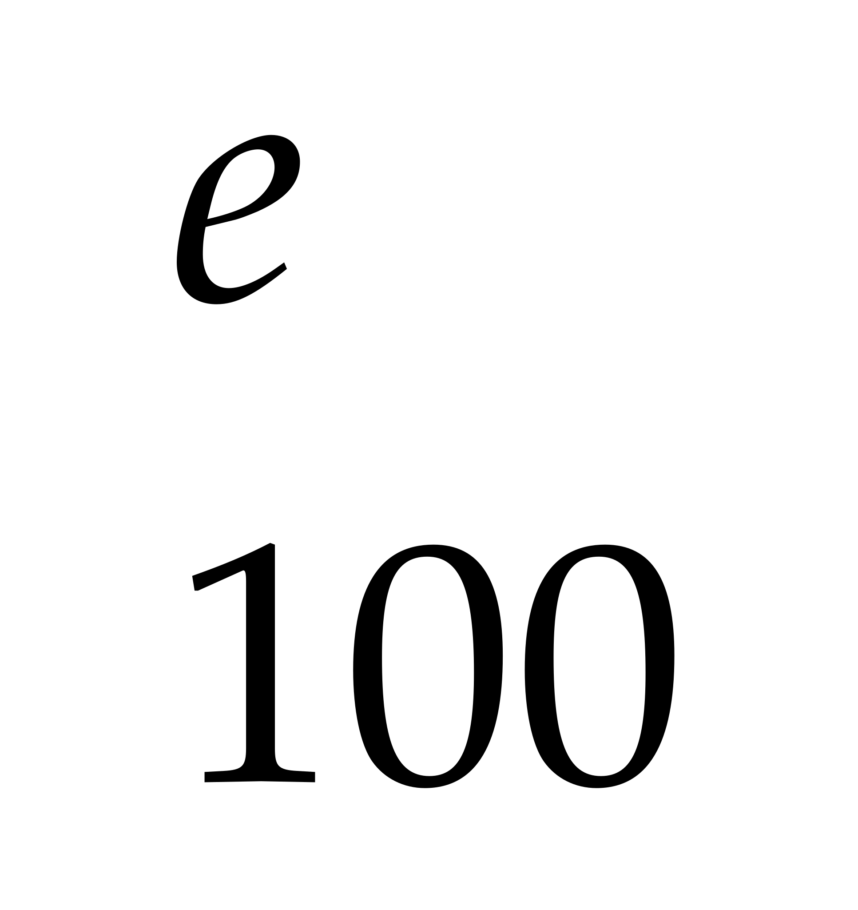, but not .

### [62\[5\]](https://cdn.wittgensteinnachlass.com/2000px/webp/Ms-107/62.webp)

In the case of √2 & √3 one sees this clearly.

### [62\[6\]](https://cdn.wittgensteinnachlass.com/2000px/webp/Ms-107/62.webp)

But by the determinate point of e & π in the system do I really mean a point on a scale of magnitudes & not a point in a multidimensional system where the definition itself already places the number?

### [62\[7\]](https://cdn.wittgensteinnachlass.com/2000px/webp/Ms-107/62.webp),[63\[1\]](https://cdn.wittgensteinnachlass.com/2000px/webp/Ms-107/63.webp)

A real number _yields_ extensions; it is not an extension. The real number is: an arithmetical law which yields the digits of a decimal fraction without end.

### [63\[2\]](https://cdn.wittgensteinnachlass.com/2000px/webp/Ms-107/63.webp)

This law has its place in arithmetical space. Or one could also say: in algebraic space.

### [63\[3\]](https://cdn.wittgensteinnachlass.com/2000px/webp/Ms-107/63.webp)

Whereas  does not use the arithmetical mode of expression & so assigns the law no place in this space.

### [63\[4\]](https://cdn.wittgensteinnachlass.com/2000px/webp/Ms-107/63.webp)

What is missing, as it were, is the arithmetical creature that produces these excretions.

### [63\[5\]](https://cdn.wittgensteinnachlass.com/2000px/webp/Ms-107/63.webp)

The incomparability of the magnitudes of π &  is connected with this homelessness of .

### [63\[6\]](https://cdn.wittgensteinnachlass.com/2000px/webp/Ms-107/63.webp)

One cannot say: two real numbers are identical if they agree in every place. One cannot say: they are different if they fail to agree at one place in their expansions. Nor can one say that one is greater than the other if its digit at the first place of disagreement is greater than the corresponding digit of the other.

### [63\[7\]](https://cdn.wittgensteinnachlass.com/2000px/webp/Ms-107/63.webp),[64\[1\]](https://cdn.wittgensteinnachlass.com/2000px/webp/Ms-107/64.webp)

Certainly, if a & b first fail to agree at the 4th place, one can say that they are therefore unequal. This 4th place does belong to the two numbers; but not the indeterminate nth place in the endless progression.

### [64\[2\]](https://cdn.wittgensteinnachlass.com/2000px/webp/Ms-107/64.webp)

One can therefore presumably recognize, from the fact that π & e differ at the _first_ place, that they are different. But one cannot say that they would be equal if all their digits were equal.

### [64\[3\]](https://cdn.wittgensteinnachlass.com/2000px/webp/Ms-107/64.webp)

One can ask whether two laws are identical only if one has a method for deciding the question.

### [64\[4\]](https://cdn.wittgensteinnachlass.com/2000px/webp/Ms-107/64.webp)

If the extensions of two laws agree for the time being & I cannot compare the laws as such, then the numbers defined, if I am entitled to speak of such numbers, are incomparable, & the question of which is greater, or whether they are equal, is nonsensical. Indeed, an equation that sets the two equal must be nonsensical! And that gives one pause. And it is true: we cannot mean anything by setting them equal if there is no internal connection between them; if they belong to different systems. (And the extension cannot help us.)

### [64\[5\]](https://cdn.wittgensteinnachlass.com/2000px/webp/Ms-107/64.webp)

But are these really two _numbers_ that cannot be compared with one another?

### [64\[6\]](https://cdn.wittgensteinnachlass.com/2000px/webp/Ms-107/64.webp)

Does that not contradict the simple conception of the number line?

### [64\[7\]](https://cdn.wittgensteinnachlass.com/2000px/webp/Ms-107/64.webp)

(A feeling rebels against this assumption).

### [65\[1\]](https://cdn.wittgensteinnachlass.com/2000px/webp/Ms-107/65.webp)

I believe: all real numbers must be comparable with one another.

### [65\[2\]](https://cdn.wittgensteinnachlass.com/2000px/webp/Ms-107/65.webp)

If one calls π' a number, it would be incomparable with π but comparable with e!

### [65\[3\]](https://cdn.wittgensteinnachlass.com/2000px/webp/Ms-107/65.webp)

What is remarkable here is that, although I can write 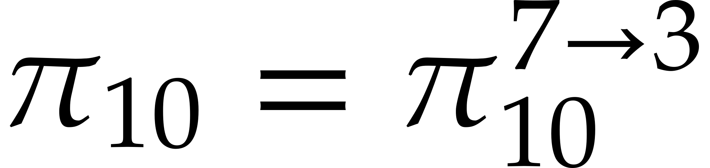, 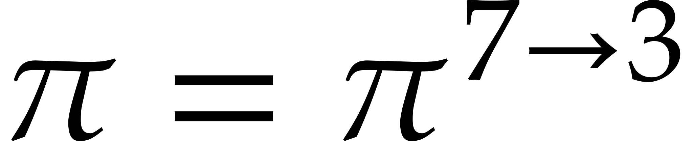 of course does not follow from it; but from 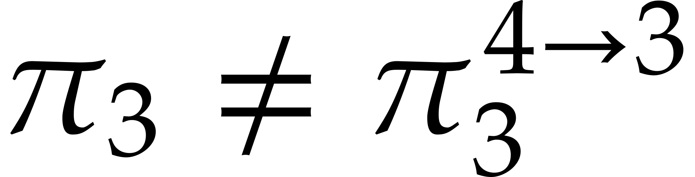 it seems to follow that 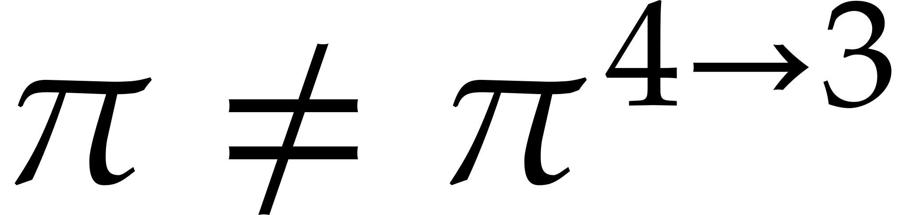.

### [65\[4\]](https://cdn.wittgensteinnachlass.com/2000px/webp/Ms-107/65.webp)

From the extensions I could never find out whether the different real numbers differ from one another by merely a rational amount.

### [65\[5\]](https://cdn.wittgensteinnachlass.com/2000px/webp/Ms-107/65.webp)

I could thus say that π & π' are not incomparable in so far as one could say that they agree with one another in the first 100 places, but on the other hand are so incomparable that we cannot sensibly connect them with one another in an equation. But then it seems to me that agreement in 100 places cannot be an agreement in any way essential to the real number. And what then of disagreement at places? What _is_ essential is that this signifies only a rational difference!

### [65\[6\]](https://cdn.wittgensteinnachlass.com/2000px/webp/Ms-107/65.webp),[66\[1\]](https://cdn.wittgensteinnachlass.com/2000px/webp/Ms-107/66.webp)

And could one not do away altogether with the significance of a rational difference between real numbers by giving them an indeterminate rational summand? So that one would write π + ℓ and e + ℓ etc.

### [66\[2\]](https://cdn.wittgensteinnachlass.com/2000px/webp/Ms-107/66.webp)

On the number line it would be like this: I could not specify a point for π', but only an interval of which π would be one endpoint. But is it not the same for e, since one cannot construct e graphically either. I think not. For I can after all posit the point e somewhere, perhaps wrongly; but I cannot even do that for the point π', since to begin with I do not know whether it coincides with the point π or not.

### [66\[3\]](https://cdn.wittgensteinnachlass.com/2000px/webp/Ms-107/66.webp)

But could one not also turn it round and regard π' as the original, & thus as the point assumed first, & then be in doubt about the warrant for π.

### [66\[4\]](https://cdn.wittgensteinnachlass.com/2000px/webp/Ms-107/66.webp)

As far as their extensions go, they are of course on an equal footing. But not otherwise.

### [66\[5\]](https://cdn.wittgensteinnachlass.com/2000px/webp/Ms-107/66.webp)

Is the operation  on an equal footing with ×?

### [66\[6\]](https://cdn.wittgensteinnachlass.com/2000px/webp/Ms-107/66.webp)

Or can one say that 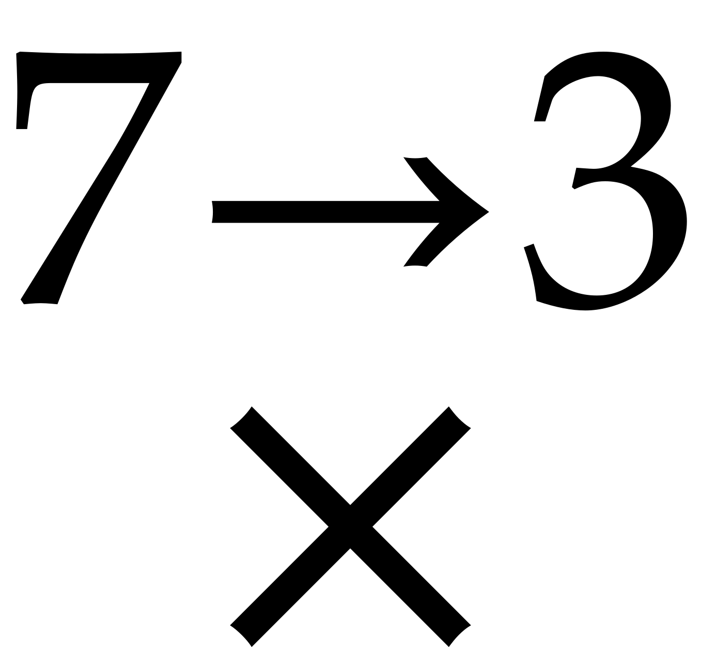 contains something that is essentially not understood. Can one say that the operation  has no arithmetical sense?

### [67\[1\]](https://cdn.wittgensteinnachlass.com/2000px/webp/Ms-107/67.webp)

One can conceive of an operation as a general law that holds – or does not hold – between any three numbers.

### [67\[2\]](https://cdn.wittgensteinnachlass.com/2000px/webp/Ms-107/67.webp)

If things are as they seem to me, namely, that an operation like 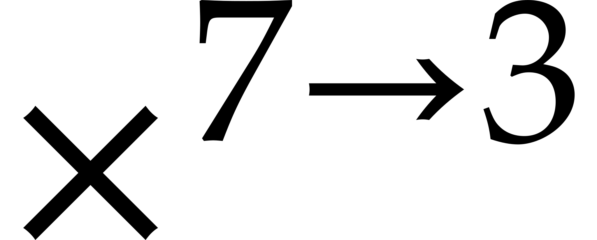 is not on an equal footing with the arithmetical operations, then the objection one must make to  is clear.

### [67\[3\]](https://cdn.wittgensteinnachlass.com/2000px/webp/Ms-107/67.webp)

I do not know the laws that 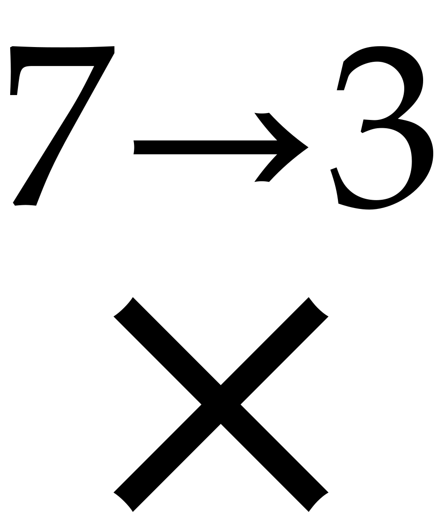 obeys. I do not know, for example, under what conditions 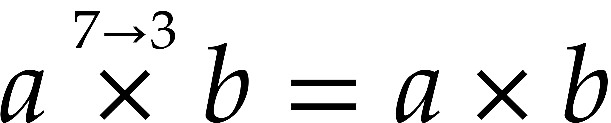. This ignorance of the laws seems to be the decisive thing. It makes it impossible, for example, ever to _apply_ .

### [67\[4\]](https://cdn.wittgensteinnachlass.com/2000px/webp/Ms-107/67.webp)

This is all connected, of course, with the fact that  is not incorporated into the arithmetical system.

### [67\[5\]](https://cdn.wittgensteinnachlass.com/2000px/webp/Ms-107/67.webp)

What does it mean to understand an operation of arithmetic?

### [67\[6\]](https://cdn.wittgensteinnachlass.com/2000px/webp/Ms-107/67.webp)

Does understanding it not mean being able to apply it?

### [67\[7\]](https://cdn.wittgensteinnachlass.com/2000px/webp/Ms-107/67.webp)

Isn’t it like this: as long as one calculates with strokes, one cannot carry out an operation without understanding it, & if I were able to translate  into an operation that no longer presupposes the decimal system in any way & works with strokes, then  would be an operation that was understood and stood on an equal footing with the other arithmetical operations.

### [68\[1\]](https://cdn.wittgensteinnachlass.com/2000px/webp/Ms-107/68.webp)

It is clear that if I could apply , all doubts about its warrant would be removed. For the possibility of application is the real criterion of arithmetical reality.

### [68\[2\]](https://cdn.wittgensteinnachlass.com/2000px/webp/Ms-107/68.webp)

Calculating with strokes is at the same time an application of the calculation. In the decimal system this no longer happens in so direct a way.

### [68\[3\]](https://cdn.wittgensteinnachlass.com/2000px/webp/Ms-107/68.webp)

After all, we are replacing 5 with 3 not in the number 3˙14159 but in _π_; that makes it arithmetically unintelligible.

### [68\[4\]](https://cdn.wittgensteinnachlass.com/2000px/webp/Ms-107/68.webp)

What does replacing the 3 (not _a_ 3) in the expansion of π _mean_. For what does the occurrence of 3 in the expansion of π mean. I do not know. For me it is something quite contingent, which disappears in another notation & which I have never connected with the essence of π & do not know how to connect with it.

### [68\[5\]](https://cdn.wittgensteinnachlass.com/2000px/webp/Ms-107/68.webp)

The expansion of π is at once an expression of the essence of π _and of the essence of the decimal system_.

### [68\[6\]](https://cdn.wittgensteinnachlass.com/2000px/webp/Ms-107/68.webp)

The expression  presupposes a connection between these two (it refers to both). This connection has not been established.

### [68\[7\]](https://cdn.wittgensteinnachlass.com/2000px/webp/Ms-107/68.webp),[69\[1\]](https://cdn.wittgensteinnachlass.com/2000px/webp/Ms-107/69.webp)

Arithmetical operations use the decimal system only as a means to an end; the rules of operation are thus such that they can be translated into the language of any other number system & have none of these systems as their _object_.

### [69\[2\]](https://cdn.wittgensteinnachlass.com/2000px/webp/Ms-107/69.webp)

The expansion of π is indeed an expression both of the essence of π and of decimal notation, but our interest ordinarily lies exclusively in what is essential to π, & we pay no attention to the other thing. It is a servant whom we regard only as a tool & not as a being with rights of his own. But if we now regard him as part of society, society has thereby changed.

### [69\[3\]](https://cdn.wittgensteinnachlass.com/2000px/webp/Ms-107/69.webp)

A general rule of operation gets its generality from the generality of the change it brings about in the numbers. That is why  will not do as a general rule of operation: the result of 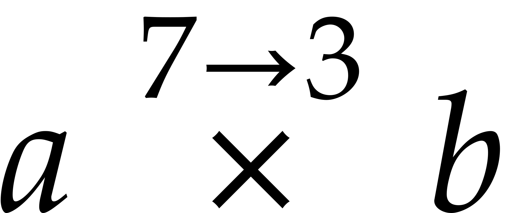 does not depend solely on the essence of the numbers a & b; the decimal system also comes into play. Of course it would not matter if this system were built into the operation as a further constant 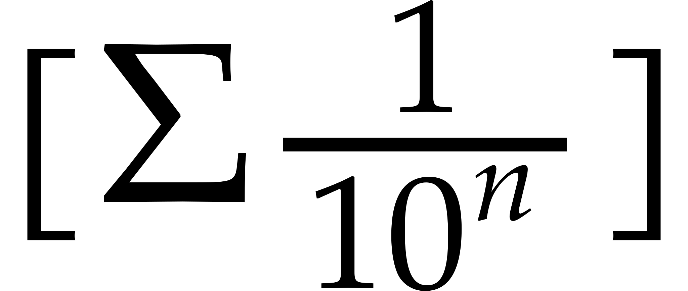 & presumably an operation can be found which corresponds to  & then has not only a & b but also the decimal system as its _object_. This operation will be written in a number system which withdraws in its capacity as servant & _of which_ the operation says nothing.

### [70\[1\]](https://cdn.wittgensteinnachlass.com/2000px/webp/Ms-107/70.webp)

In just the same way  makes the decimal system its object (or would have to make it its object if it were correct), so it is no longer enough that one can apply the rule in forming the extension. For this application is no longer the sign that the rule is in order, since the rule is not the expression of the arithmetical law at all, but merely makes an external alteration to the language.

### [70\[2\]](https://cdn.wittgensteinnachlass.com/2000px/webp/Ms-107/70.webp)

In π the decimal system serves only to express the expansion. If it is to become the object of consideration, this must happen (explicitly & ) where the essence (of the law) of the real number is developed, not in the expression of the extension.

### [70\[3\]](https://cdn.wittgensteinnachlass.com/2000px/webp/Ms-107/70.webp)

So if it is no longer to be a servant, it must formally sit down at table with the others & must therefore stop serving, for it cannot do both at once.

### [VB](/w-vb/#ms-107-70.4) [70\[4\]](https://cdn.wittgensteinnachlass.com/2000px/webp/Ms-107/70.webp)

Just let nature speak & acknowledge only _one_ thing higher than nature, but not what the others might think.

### [70\[5\]](https://cdn.wittgensteinnachlass.com/2000px/webp/Ms-107/70.webp),[71\[1\]](https://cdn.wittgensteinnachlass.com/2000px/webp/Ms-107/71.webp)

It is like this: the number π is represented in the decimal system. One cannot produce a modification of this law by taking the specific expression in the decimal system as one’s point of departure. What one affects in this way is not the law at all, but its contingent expression. This influence does not reach through to the law at all. It stands apart from it, on the other side. It is as if one wanted to influence a living being by acting on a secretion it has already secreted.

### [71\[2\]](https://cdn.wittgensteinnachlass.com/2000px/webp/Ms-107/71.webp)

The fact that there is a 4 in the third place of π has until now been merely a feature of the representation of this law characteristic of the decimal system. That is why this 4 is not spoken of in the law of π either.

### [71\[3\]](https://cdn.wittgensteinnachlass.com/2000px/webp/Ms-107/71.webp)

If I replace this 4 with 5, I thereby increase π by 0˙01 & if there is another 4 at the 12th place, then by replacing it I increase π by ; & since I know no law governing the occurrence of 4, I do not know any general operation by which I modify π when I replace the 4s with 5s.

### [71\[4\]](https://cdn.wittgensteinnachlass.com/2000px/webp/Ms-107/71.webp)

For these fours are not a product of π alone, but of π together with the particular method of representation. That is why the rule  is not the expression of a new arithmetical law, but would be so only if the connection between the occurrence of 4 and the law of π were represented _in the law_.

### [71\[5\]](https://cdn.wittgensteinnachlass.com/2000px/webp/Ms-107/71.webp)

If we were in possession of such a law π', we could indeed say that in the expansion of π' 5 takes the place of 4 in π, but in the same sense in which we can say that the expansion of ⅓ results from the expansion of ⅑ if we replace 1 with 3. (But this means only that instead of  one writes )

### [71\[6\]](https://cdn.wittgensteinnachlass.com/2000px/webp/Ms-107/71.webp),[72\[1\]](https://cdn.wittgensteinnachlass.com/2000px/webp/Ms-107/72.webp)

But what about a law  where p runs through the series of prime numbers, or the case where p runs through the series of integers, except those for which Fermat’s theorem  does not hold.

Do these rules determine real numbers?

### [VB](/w-vb/#ms-107-72.2) [72\[2\]](https://cdn.wittgensteinnachlass.com/2000px/webp/Ms-107/72.webp)

The tragedy consists in the tree not bending but breaking. Tragedy is something un-Jewish. Mendelssohn is probably the least tragic composer. The tragic holding fast, the defiant holding fast to a tragic situation in love, always seems to me quite alien to my ideal. Is my ideal feeble for that reason? I cannot _& ought not to judge it_. If it is feeble, it is bad. I believe that at bottom I have a gentle & quiet ideal. But God preserve my ideal from weakness & sentimentality!

### [72\[3\]](https://cdn.wittgensteinnachlass.com/2000px/webp/Ms-107/72.webp)

In the first case I feel uncertain, although I cannot make clear to myself why. In the second case I cannot imagine that this law is supposed to determine a number.

### [72\[4\]](https://cdn.wittgensteinnachlass.com/2000px/webp/Ms-107/72.webp)

And here again it must be that I do not understand an essential part of the law. Suppose, incidentally, that the x,y,z ranged only over the first 100 integers, so that I would certainly be able to test the proposition for every p.

### [72\[5\]](https://cdn.wittgensteinnachlass.com/2000px/webp/Ms-107/72.webp)

Would it not then be on exactly the same footing as the first example?

### [72\[6\]](https://cdn.wittgensteinnachlass.com/2000px/webp/Ms-107/72.webp),[73\[1\]](https://cdn.wittgensteinnachlass.com/2000px/webp/Ms-107/73.webp)

It is as though I wanted to say: that would be far too cheap, – if one could construct real numbers in such a way! The schema  is given to us & now we use an arbitrary endless prescription & let it determine the  etc.

### [73\[2\]](https://cdn.wittgensteinnachlass.com/2000px/webp/Ms-107/73.webp)

One could put it like this: The prescription is perfectly clear. _But can I use it anywhere_? and is it sensible to call it a number?

### [73\[3\]](https://cdn.wittgensteinnachlass.com/2000px/webp/Ms-107/73.webp)

Or is the essential thing here after all the difference between  etc. and  etc. After all, I _do_ want the number to be what the process approaches, not the process itself. Or should I say: “It is inherent _in_ the process that it approaches a limit; one cannot express that externally.”

### [73\[4\]](https://cdn.wittgensteinnachlass.com/2000px/webp/Ms-107/73.webp)

The number must measure in & of itself. That seems to me, as it were, its office.

### [73\[5\]](https://cdn.wittgensteinnachlass.com/2000px/webp/Ms-107/73.webp)

If it does not do so, if it leaves that to the rational numbers, then we do not need it.

### [73\[6\]](https://cdn.wittgensteinnachlass.com/2000px/webp/Ms-107/73.webp)

(The notation  etc. (instead of  etc.) corresponds to the conception according to which I write – in contrast to  – , & not .)

### [73\[7\]](https://cdn.wittgensteinnachlass.com/2000px/webp/Ms-107/73.webp)

How, then, can the law  possibly describe a terminating decimal fraction as well?! So no real number at all.

### [73\[8\]](https://cdn.wittgensteinnachlass.com/2000px/webp/Ms-107/73.webp),[74\[1\]](https://cdn.wittgensteinnachlass.com/2000px/webp/Ms-107/74.webp)

If  is permitted, then  is permitted too & then  must also be permitted. For the last case differs from the preceding ones only in that we know no expression  for the nth prime number; and can that be essential here?

### [74\[2\]](https://cdn.wittgensteinnachlass.com/2000px/webp/Ms-107/74.webp)

It is remarkable that for so many years I have scarcely ever felt the slightest need to make diary entries. In my very earliest days in Berlin, when I began writing down thoughts about myself on slips of paper, it was a need. It was an important step for me. Later it sprang partly from the urge to imitate (I had read Keller’s diaries) and partly from the need to set down something of myself after all. So it was largely vanity. To some extent, of course, it was also a substitute for someone I could confide in. Later, imitation of Pepys’s diaries came into it as well.

Of course, as always, it is difficult to be fair here, for what was natural & vain aspirations were thoroughly mixed.

### [74\[3\]](https://cdn.wittgensteinnachlass.com/2000px/webp/Ms-107/74.webp)

Just as in general there is little in my life to be found that is pure, beyond reproach. It is like an ore with little gold in it.

### [74\[4\]](https://cdn.wittgensteinnachlass.com/2000px/webp/Ms-107/74.webp),[75\[1\]](https://cdn.wittgensteinnachlass.com/2000px/webp/Ms-107/75.webp)

In so far as keeping a diary is not itself living, it is bad in my case. For, like everything I do, it is almost sure to become an occasion for vanity for me & the less time I have to contemplate myself vainly, the better. Life best disperses this smoke, blows it away & it is also less harmful if it is only thought of in passing.

### [75\[2\]](https://cdn.wittgensteinnachlass.com/2000px/webp/Ms-107/75.webp)

What matters is what the vanity concerns. It becomes destructive only when it concerns what is highest.

### [75\[3\]](https://cdn.wittgensteinnachlass.com/2000px/webp/Ms-107/75.webp)

If my diary is to be in order, I must be able to step out of it into the open – into life – as it were _on the level_, without having either to climb into the light as from a cellar or to jump back down to earth as from somewhere higher up.

### [75\[4\]](https://cdn.wittgensteinnachlass.com/2000px/webp/Ms-107/75.webp)

What cannot be written cannot be written.

### [75\[5\]](https://cdn.wittgensteinnachlass.com/2000px/webp/Ms-107/75.webp)

While I was copying these notes in here from a slip of paper, I had to keep telling myself that it would be better not to write them, since vanity was stirring the whole time. I was pleased to have written it, and in a foolish way, & I could not make clear to myself what pleased me, but it was not anything harmless. Now I am like a child who stifles his laughter & to whom one then says “Go on, laugh out loud! But why are you laughing?”

### [75\[6\]](https://cdn.wittgensteinnachlass.com/2000px/webp/Ms-107/75.webp),[76\[1\]](https://cdn.wittgensteinnachlass.com/2000px/webp/Ms-107/76.webp)

Where there is warmth, vanity cannot readily thrive.

### [76\[2\]](https://cdn.wittgensteinnachlass.com/2000px/webp/Ms-107/76.webp)

What others think of me always occupies me an extraordinary amount. Very often I am concerned to make a good impression. That is, I very often think about the impression I make on others & I am pleased if I think it is good & displeased otherwise.

### [76\[3\]](https://cdn.wittgensteinnachlass.com/2000px/webp/Ms-107/76.webp)

 I know individual finite sums but no infinite one. How does _the number_ come to light in the peculiarities of these sums? How could one have got the idea of seeing a number in these states of affairs?

### [76\[4\]](https://cdn.wittgensteinnachlass.com/2000px/webp/Ms-107/76.webp)

 etc. I should like to forget that I take this sequence to be a real number & let what is given lead me once again to see a number in it.

### [76\[5\]](https://cdn.wittgensteinnachlass.com/2000px/webp/Ms-107/76.webp)

The _subsequent_ proof of convergence cannot justify treating it as a number.

### [76\[6\]](https://cdn.wittgensteinnachlass.com/2000px/webp/Ms-107/76.webp)

Where the convergence _shows itself_, there the number would have to be looked for.

### [76\[7\]](https://cdn.wittgensteinnachlass.com/2000px/webp/Ms-107/76.webp),[77\[1\]](https://cdn.wittgensteinnachlass.com/2000px/webp/Ms-107/77.webp)

I want to show that whatever I append after the hundredths can never increase the number by even one hundredth. For that I would need  & the most I can write after them is , so we are still short by , but the most I can write after the thousandths is , so we are still short by , but the most etc. So there is _always_ something still missing. And that is a proof by induction (spiral movement) in which we _see_ that it always goes on like this.

### [77\[2\]](https://cdn.wittgensteinnachlass.com/2000px/webp/Ms-107/77.webp)

A word of praise occupies me for a long time & leaves a lasting impression, & so does a rebuke. Again and again I bring the pleasant situation to mind & savour it. That is how it is; but I do not want to run myself down. My life is often very fine after all, that is: I am often very happy in it.

### [77\[3\]](https://cdn.wittgensteinnachlass.com/2000px/webp/Ms-107/77.webp)

What we _see_ is an induction.

### [77\[4\]](https://cdn.wittgensteinnachlass.com/2000px/webp/Ms-107/77.webp)

I believe it will become clear that one takes this spiral to be a point on the number line. One could say: _no_ interval I should care to give as its equivalent would be small enough.

### [77\[5\]](https://cdn.wittgensteinnachlass.com/2000px/webp/Ms-107/77.webp)

There is no smallest distance between two spirals _after_ which they would merge into one another, would no longer be separate.

### [77\[6\]](https://cdn.wittgensteinnachlass.com/2000px/webp/Ms-107/77.webp)

The nesting is a process of induction & therefore one can take it to be a point.

### [77\[7\]](https://cdn.wittgensteinnachlass.com/2000px/webp/Ms-107/77.webp),[78\[1\]](https://cdn.wittgensteinnachlass.com/2000px/webp/Ms-107/78.webp)

 Is the spiral really _given in full_ to me here? I mean: Is the winding of the spiral with all its features really _given_ to me?

### [78\[2\]](https://cdn.wittgensteinnachlass.com/2000px/webp/Ms-107/78.webp)

For from now on the spiral must be left to itself.

### [78\[3\]](https://cdn.wittgensteinnachlass.com/2000px/webp/Ms-107/78.webp)

There must be no further problem: what will become of it, I wonder.

### [78\[4\]](https://cdn.wittgensteinnachlass.com/2000px/webp/Ms-107/78.webp)

And _so_ on.

### [78\[5\]](https://cdn.wittgensteinnachlass.com/2000px/webp/Ms-107/78.webp)

What about a root when I do not yet know whether it comes out exactly or not.

### [78\[6\]](https://cdn.wittgensteinnachlass.com/2000px/webp/Ms-107/78.webp)

If I do not know whether the root comes out exactly, a process whose length can be foreseen will nevertheless show me whether it does.

### [78\[7\]](https://cdn.wittgensteinnachlass.com/2000px/webp/Ms-107/78.webp)

The very essence of a real number must be induction. What I must see in a real number, its sign, is the induction.

### [78\[8\]](https://cdn.wittgensteinnachlass.com/2000px/webp/Ms-107/78.webp)

The so of which one can say “and so on”.

### [78\[9\]](https://cdn.wittgensteinnachlass.com/2000px/webp/Ms-107/78.webp)

In that prescription which uses Fermat’s formula there is indeed a _so_ that leads us ever onwards; but the formation of the numbers seems also to be detached from this so.

### [78\[10\]](https://cdn.wittgensteinnachlass.com/2000px/webp/Ms-107/78.webp),[79\[1\]](https://cdn.wittgensteinnachlass.com/2000px/webp/Ms-107/79.webp)

Mathematics textbooks are so wretched because they never foresee the objections a thinking person would want to raise. This is because the authors themselves do not _really_ understand the proofs, but regard a proof merely as a method by which _this_ actually, undeniably, comes out & not as a path along which they walk towards the goal with the goal in sight. To that extent, of course, the bad textbooks are only a sign of the bad readership. As crude as the pupil’s understanding, so crude can the teacher’s explanation be.

### [79\[2\]](https://cdn.wittgensteinnachlass.com/2000px/webp/Ms-107/79.webp)

Can there then be a real number of which we do not know whether it goes over into ? We see, say, from the expansion that, as far as we go, nothing but ones come up, & we have no proof that it does not go on like this according to a law. Suppose the number is 0˙00111 etc., then we cannot know whether it is  or not. Indeed, we cannot even ask.

### [79\[3\]](https://cdn.wittgensteinnachlass.com/2000px/webp/Ms-107/79.webp)

It would follow from all this that in the case of a real number one cannot speak of _greater_ & _smaller_ without further ado – i.e., without giving a definite stage of its expansion.

### [79\[4\]](https://cdn.wittgensteinnachlass.com/2000px/webp/Ms-107/79.webp),[80\[1\]](https://cdn.wittgensteinnachlass.com/2000px/webp/Ms-107/80.webp)

That has to do with the fact that there is no uniform notation for real numbers, in contrast to rational numbers. As long as one believes in the infinite extension, one can say: _the_ sign for a real number is an infinite decimal fraction. But we can no longer say that.

### [80\[2\]](https://cdn.wittgensteinnachlass.com/2000px/webp/Ms-107/80.webp)

Without further ado we could compare only the individual stages of the real numbers, whereas – – –

### [80\[3\]](https://cdn.wittgensteinnachlass.com/2000px/webp/Ms-107/80.webp)

Is it possible to prove that a is greater than b without being able to prove at which place the difference will come to light? I do not believe so!

### [80\[4\]](https://cdn.wittgensteinnachlass.com/2000px/webp/Ms-107/80.webp)

What relation does the proof that a is greater than b have to the difference that shows itself in the extensions?

### [80\[5\]](https://cdn.wittgensteinnachlass.com/2000px/webp/Ms-107/80.webp)

If the proof that √3 > √2, based on 3 > 2, is on the same footing as the one that shows that  and , then the absence of a proof of the first kind would have to be on the same footing as the absence of a proof of the second kind.

### [80\[6\]](https://cdn.wittgensteinnachlass.com/2000px/webp/Ms-107/80.webp)

Indeed, is one entitled to say “√3 > √2” on the strength of ? In any case, this surely must not be a transition from f(a) to (∃x) ∙ f(x).

### [80\[7\]](https://cdn.wittgensteinnachlass.com/2000px/webp/Ms-107/80.webp)

If one infers √3 > √2 from , then it is not as from a particular proposition to a more general one, but as from one particular proposition to another.

### [80\[8\]](https://cdn.wittgensteinnachlass.com/2000px/webp/Ms-107/80.webp)

Can one compare the positions of the spirals without speaking of individual turns?

### [80\[9\]](https://cdn.wittgensteinnachlass.com/2000px/webp/Ms-107/80.webp),[81\[1\]](https://cdn.wittgensteinnachlass.com/2000px/webp/Ms-107/81.webp)

If the spiral is the law, how can one then speak of higher & lower? And it is not the “totality of all” the turns. Must one not then speak of individual turns?

### [81\[2\]](https://cdn.wittgensteinnachlass.com/2000px/webp/Ms-107/81.webp)

It would almost be an argument to say: If there is a greater & smaller in the laws & in the stages of the extension, then there would be a twofold comparison of the numbers as to magnitude. There cannot be such a comparison, so there can be no greater & smaller in the laws.

### [81\[3\]](https://cdn.wittgensteinnachlass.com/2000px/webp/Ms-107/81.webp)

If we construct π, √2, √5 geometrically, and thus do not produce them by approximation, we obtain an indubitable greater & smaller.

### [81\[4\]](https://cdn.wittgensteinnachlass.com/2000px/webp/Ms-107/81.webp)

A good objection helps one forward, a shallow objection, even if it is right, is enervating. Ramsey’s objections are of this kind. The objection does not take hold of the matter at its root, where the life is, but so far out that nothing can any longer be rectified there, even if it is wrong. A good objection leads directly towards a solution, a shallow one must first be overcome & can then be left to one side as one comes up from further below (like a dead spot one has got past). (As when a tree bends round the scarred spot in order to grow further.)

### [82\[1\]](https://cdn.wittgensteinnachlass.com/2000px/webp/Ms-107/82.webp)

Once its law is given, the spiral automatically runs towards a goal.

### [82\[2\]](https://cdn.wittgensteinnachlass.com/2000px/webp/Ms-107/82.webp)

But is that true? It runs on automatically. But does it run towards a goal?

### [82\[3\]](https://cdn.wittgensteinnachlass.com/2000px/webp/Ms-107/82.webp)

If it runs towards a goal, that goal must lie within it; & it must be equivalent to the goal. But then it would have to be comparable with every other goal!

### [82\[4\]](https://cdn.wittgensteinnachlass.com/2000px/webp/Ms-107/82.webp)

The question is: Is there for every real number an analogue of the difficulty that exists in the case of the number F (which uses Fermat’s formula), or is this a difficulty peculiar to this kind of law? If that were the case, we could discard the unusable laws.

### [82\[5\]](https://cdn.wittgensteinnachlass.com/2000px/webp/Ms-107/82.webp)

For it seems to me that the law F lacks a goal.

### [VB](/w-vb/#ms-107-82.6) [82\[6\]](https://cdn.wittgensteinnachlass.com/2000px/webp/Ms-107/82.webp)

(A new word is like a fresh seed cast into the soil of the discussion.)

### [82\[7\]](https://cdn.wittgensteinnachlass.com/2000px/webp/Ms-107/82.webp)

If the law is not itself the goal, the development cannot give the law that goal.

### [VB](/w-vb/#ms-107-82.8) [82\[8\]](https://cdn.wittgensteinnachlass.com/2000px/webp/Ms-107/82.webp)

Every morning one has to work one’s way through the dead rubble again to get to the living, warm core.

### [82\[9\]](https://cdn.wittgensteinnachlass.com/2000px/webp/Ms-107/82.webp),[83\[1\]](https://cdn.wittgensteinnachlass.com/2000px/webp/Ms-107/83.webp)

A graphic illustration fixes the imagination in the wrong way, so that it cannot give itself over entirely to what is being said.

### [83\[2\]](https://cdn.wittgensteinnachlass.com/2000px/webp/Ms-107/83.webp)

It would have been a good question for the Scholastics: “Can God know all the digits of π?” The answer is, as in all such cases: The question means nothing.

### [83\[3\]](https://cdn.wittgensteinnachlass.com/2000px/webp/Ms-107/83.webp)

I say: the so-called “Fermat’s theorem” is not a _proposition_. (not even in the sense of arithmetic). Rather, what would correspond to it is a proof by induction. But if there is a number F, 0˙11000 etc. & that proof succeeds, then surely this would prove that F = 0˙11 & that surely is a proposition! Or: It is a proposition if the law F is a number.

### [83\[4\]](https://cdn.wittgensteinnachlass.com/2000px/webp/Ms-107/83.webp)

If that proof succeeds, then apparently I can write F = 0˙11; if it has not succeeded, it is nonsensical even to ask whether, or to suppose that, F is equal to 0˙11. (!)

### [83\[5\]](https://cdn.wittgensteinnachlass.com/2000px/webp/Ms-107/83.webp)

Well, what about a number  where n ranges over all those integers for which n × 5 = 5 × n? One will of course say: this number is therefore ; but is that right?

### [83\[6\]](https://cdn.wittgensteinnachlass.com/2000px/webp/Ms-107/83.webp)

A proof proves what it proves, & nothing more.

### [83\[7\]](https://cdn.wittgensteinnachlass.com/2000px/webp/Ms-107/83.webp)

It is difficult to preserve the naïveté of the investigation.

### [83\[8\]](https://cdn.wittgensteinnachlass.com/2000px/webp/Ms-107/83.webp),[84\[1\]](https://cdn.wittgensteinnachlass.com/2000px/webp/Ms-107/84.webp)

I believe: where I see the induction that nests one interval inside another, I cannot call it anything other than a number. But do I really encounter it in the case of F?

### [84\[2\]](https://cdn.wittgensteinnachlass.com/2000px/webp/Ms-107/84.webp)

I cannot imagine that, if I encounter the induction, I should not immediately call it a number.

### [84\[3\]](https://cdn.wittgensteinnachlass.com/2000px/webp/Ms-107/84.webp)

If I am given the interval between two numbers & can produce two numbers whose interval lies within the first & I see that this goes on in the same way without limit, then I shall call this process a number.

### [84\[4\]](https://cdn.wittgensteinnachlass.com/2000px/webp/Ms-107/84.webp)

The number F wants to use the spiral  & then select turns of this spiral according to a principle. But this principle does not belong to the spiral.

### [84\[5\]](https://cdn.wittgensteinnachlass.com/2000px/webp/Ms-107/84.webp)

The proof that no prime number is the last is of no use to me here as a merely external aid; rather, it supplies me with the finite process that generates the next number for me from a given one. It gives me the process of induction that I need.

### [84\[6\]](https://cdn.wittgensteinnachlass.com/2000px/webp/Ms-107/84.webp)

If I imagine the turns of the spiral , etc., written down, then F makes a remark on each turn, confirming it or crossing it out; & in doing so makes a selection _whose law we do not know_.

### [84\[7\]](https://cdn.wittgensteinnachlass.com/2000px/webp/Ms-107/84.webp),[85\[1\]](https://cdn.wittgensteinnachlass.com/2000px/webp/Ms-107/85.webp)

This is also how the paradox arises that it becomes nonsensical to ask whether F = 0˙11. For the assumption of F rests after all on the assumption of a law, an infinite law, according to which the numbers in Fermat’s formula behave. – But what does the infinity of the law mean to us? Only induction. And where does that lie here? In the infinitely many possibilities for the exponent n in , that is, in the unlimited possibility of making trials. But for us this is worth no more than the unlimited possibility of rolling a die, since we know of no law to which the _results_ of these trials correspond.

### [85\[2\]](https://cdn.wittgensteinnachlass.com/2000px/webp/Ms-107/85.webp)

One might of course say: is it any different with π? There too I know no law – that the digits of the expansion follow – just as here. But that is not how things are: In the case of π I do not know a law for the sequence of digits, because this is an expression of the interference between the law of π & decimal notation; but I am able to represent the law of π so that it is freed of everything inessential to it & is known to me _through and through_. (The law is _the_ winding of the spiral & this winding _must_ be _completely_ known to me, & nothing more.)

### [85\[3\]](https://cdn.wittgensteinnachlass.com/2000px/webp/Ms-107/85.webp),[86\[1\]](https://cdn.wittgensteinnachlass.com/2000px/webp/Ms-107/86.webp)

If the case of F were analogous to that of π, I would have to be able to free the law of F from the “inessential” (but here essential) sequence of digits in the decimal system & write it down in another notation in which only what is essential, but everything essential, to a transition (in the spiral) would be represented. (As when I represent e by .) If I do not know whether F is , that is precisely because I do not know whether the F-spiral has the same winding as the .

### [86\[2\]](https://cdn.wittgensteinnachlass.com/2000px/webp/Ms-107/86.webp)

It may be that the sequence of digits of π agrees somewhere with that of e without my knowing it, but that is in the inessential system; in the essential representation the agreement would have to show itself if there were any.

### [86\[3\]](https://cdn.wittgensteinnachlass.com/2000px/webp/Ms-107/86.webp)

But does the simile of the spiral not limp, since two spirals can after all converge on the same point? But from what can one learn that they tend towards _one_ point? Surely here too only from their law. Certainly not from their extension.

### [86\[4\]](https://cdn.wittgensteinnachlass.com/2000px/webp/Ms-107/86.webp)

If the law, the winding of the spiral, is a number, then it must be comparable with all the others in respect of its position (on the number line).

### [86\[5\]](https://cdn.wittgensteinnachlass.com/2000px/webp/Ms-107/86.webp)

After all, I determine the position only by the law.

### [86\[6\]](https://cdn.wittgensteinnachlass.com/2000px/webp/Ms-107/86.webp)

But now one might say: The position is no doubt determined solely by the law, but only successively.

### [86\[7\]](https://cdn.wittgensteinnachlass.com/2000px/webp/Ms-107/86.webp)

(Hard to untangle the skein of all possible thoughts.)

### [86\[8\]](https://cdn.wittgensteinnachlass.com/2000px/webp/Ms-107/86.webp),[87\[1\]](https://cdn.wittgensteinnachlass.com/2000px/webp/Ms-107/87.webp)

For though I can infer √3 > √2 from 3 > 2, I cannot infer that √3 is greater than 1˙5. So is a > b (for real numbers) merely a short way of saying: “the already expanded extension of a is greater than the corresponding extension of b”?

### [87\[2\]](https://cdn.wittgensteinnachlass.com/2000px/webp/Ms-107/87.webp)

Or might the expansion be necessary only for comparison with the rational numbers? (with the finite decimal fractions & expansions of fractions in all systems).

### [87\[3\]](https://cdn.wittgensteinnachlass.com/2000px/webp/Ms-107/87.webp)

For what about the equality of real numbers if I give up the general meaning of greater & smaller?

### [87\[4\]](https://cdn.wittgensteinnachlass.com/2000px/webp/Ms-107/87.webp)

If there were no greater & smaller among real numbers except with regard to the extension already expanded, then in certain cases I may not put the equality sign between real numbers either. And that means that equality or inequality cannot be ascertained & that in turn means that the expressions of the laws belong to different systems. Yet they must all belong to the system of arithmetic.

### [87\[5\]](https://cdn.wittgensteinnachlass.com/2000px/webp/Ms-107/87.webp)

11.09.1929

No forced solution is really natural to me. Each leaves a thorn in me. It is not natural to me.

### [87\[6\]](https://cdn.wittgensteinnachlass.com/2000px/webp/Ms-107/87.webp)

Suppose, for instance, that I had a law that had so far given me the prime numbers correctly (without my knowing why) & that I were to use this law in the form . (It would then give me the same extension as P, but I would not know whether this would go on.)

### [88\[1\]](https://cdn.wittgensteinnachlass.com/2000px/webp/Ms-107/88.webp)

The laws as such would then belong to different systems & would not be comparable. But is it not then only by chance that they seem to come onto one & the same ground in a series of numbers?

### [88\[2\]](https://cdn.wittgensteinnachlass.com/2000px/webp/Ms-107/88.webp)

I cannot assign digits to an arbitrary arithmetical event that I cannot foresee at all in its generality. That is then not an arithmetical way of generating them. {There is a break in this way of generating them.}

### [88\[3\]](https://cdn.wittgensteinnachlass.com/2000px/webp/Ms-107/88.webp)

Always be: first natural, then decent. Anything else is frightful. And yet how often I am!

### [88\[4\]](https://cdn.wittgensteinnachlass.com/2000px/webp/Ms-107/88.webp)

Only what I see is a law, not what I _describe_.

### [88\[5\]](https://cdn.wittgensteinnachlass.com/2000px/webp/Ms-107/88.webp)

I think that alone prevents me from expressing more in my signs than I can understand.

### [88\[6\]](https://cdn.wittgensteinnachlass.com/2000px/webp/Ms-107/88.webp),[89\[1\]](https://cdn.wittgensteinnachlass.com/2000px/webp/Ms-107/89.webp)

Here we keep coming up against something one might call an arithmetical experiment. What comes out is indeed determined by what is given, but I cannot recognize _how_ it is determined by it. (Rather as it is – for instance – with the occurrence of 7 in π.) In the same way, the prime numbers come out of the method for looking for them as results of an experiment. I can indeed satisfy myself that 7 is a prime number, but I cannot, so to speak, tell by looking at it. I do not see the connection between it (as such) & the condition to which it corresponds – I have merely found it & not generated it.

### [89\[2\]](https://cdn.wittgensteinnachlass.com/2000px/webp/Ms-107/89.webp)

I no doubt see a law in the instruction that teaches me how to find the prime numbers, but not in the numbers that come out of it. So it is not as in , etc., where I see a law _in the numbers_.

### [89\[3\]](https://cdn.wittgensteinnachlass.com/2000px/webp/Ms-107/89.webp)

Only such a law leaves no room for doubt.

### [89\[4\]](https://cdn.wittgensteinnachlass.com/2000px/webp/Ms-107/89.webp)

With √2, however, such an expression does not seem necessary to me at all! It is as if here the 2 ensured that the law determines a number. It is clear to me that √2 is an _arithmetical_ law.

### [89\[5\]](https://cdn.wittgensteinnachlass.com/2000px/webp/Ms-107/89.webp)

I should like to say: The laws of arithmetic _must_ be comparable with one another.

### [89\[6\]](https://cdn.wittgensteinnachlass.com/2000px/webp/Ms-107/89.webp)

But can one really tell by looking at the series , etc., that their sums tend towards the same value?

### [89\[7\]](https://cdn.wittgensteinnachlass.com/2000px/webp/Ms-107/89.webp),[90\[1\]](https://cdn.wittgensteinnachlass.com/2000px/webp/Ms-107/90.webp)

I should like to see a representation of the real number that shows me the number in an induction, so that here I have before me the one decisive, unambiguous sign. No doubt can then arise as to whether another law yields the same number, because only this – visible – law represents this number. But is this demand justified?

### [90\[2\]](https://cdn.wittgensteinnachlass.com/2000px/webp/Ms-107/90.webp)

Is the law of √2 such a law?

### [90\[3\]](https://cdn.wittgensteinnachlass.com/2000px/webp/Ms-107/90.webp)

The mathematical experiment must be ruled out.

### [90\[4\]](https://cdn.wittgensteinnachlass.com/2000px/webp/Ms-107/90.webp)

It must be the law itself that is the number, _not_ what comes out when the law is applied. Not what grows out of a law & in which one no longer sees a law.

### [90\[5\]](https://cdn.wittgensteinnachlass.com/2000px/webp/Ms-107/90.webp)

If the extension of a law agrees with that of √2 to 100 places, that gives us no grounds whatever for any conjecture.

### [90\[6\]](https://cdn.wittgensteinnachlass.com/2000px/webp/Ms-107/90.webp)

On the other hand, I could use 17 × 17 for a long time & the number 289 without knowing that they are the same number. But I must know a method for establishing this at any time.

### [90\[7\]](https://cdn.wittgensteinnachlass.com/2000px/webp/Ms-107/90.webp)

I could not imagine there being an operation in arithmetic whose result was incomparable with those of the other arithmetical operations.

### [90\[8\]](https://cdn.wittgensteinnachlass.com/2000px/webp/Ms-107/90.webp)

Could one call the series ½, ⅓, ¼, etc. 0 & 1, 2, 3, 4, etc. the number ‘∞’?

### [91\[1\]](https://cdn.wittgensteinnachlass.com/2000px/webp/Ms-107/91.webp)

Is determining the next prime number after n an arithmetical operation? It proceeds of course by purely arithmetical means, but – – –

### [91\[2\]](https://cdn.wittgensteinnachlass.com/2000px/webp/Ms-107/91.webp)

I must be able to write down a stretch of the series in such a way that one _recognizes_ the law.

### [91\[3\]](https://cdn.wittgensteinnachlass.com/2000px/webp/Ms-107/91.webp)

That is: There must be no _description_ in what is written down; everything must be represented.

### [91\[4\]](https://cdn.wittgensteinnachlass.com/2000px/webp/Ms-107/91.webp)

Where does the number first show itself clearly?

### [91\[5\]](https://cdn.wittgensteinnachlass.com/2000px/webp/Ms-107/91.webp)

The approximate values must themselves form a _manifest_ series.

### [91\[6\]](https://cdn.wittgensteinnachlass.com/2000px/webp/Ms-107/91.webp)

That is, the approximate values themselves must proceed according to a law.

### [91\[7\]](https://cdn.wittgensteinnachlass.com/2000px/webp/Ms-107/91.webp)

(If the thread of the writing shifts, the writing becomes illegible.)

### [91\[8\]](https://cdn.wittgensteinnachlass.com/2000px/webp/Ms-107/91.webp)

All this is very compelling, but is it true that the real number is an arithmetical process of induction?

### [91\[9\]](https://cdn.wittgensteinnachlass.com/2000px/webp/Ms-107/91.webp)

The process of extracting the square root of 2 in the decimal system, for instance, is also an _arithmetical experiment_; but that just means that this process is not wholly essential to the square root of 2, & there would have to be a representation in which the law can be recognized in its pure form.

### [92\[1\]](https://cdn.wittgensteinnachlass.com/2000px/webp/Ms-107/92.webp)

Can one really say that if I did not know the geometrical representation of π & √2, these numbers would be known to me only approximately? I think not!

### [92\[2\]](https://cdn.wittgensteinnachlass.com/2000px/webp/Ms-107/92.webp)

If two different expansions – say, in two different number systems – both represent √2, we certainly call them equal. That means that we regard the law of √2 as the essence of a real number.

### [92\[3\]](https://cdn.wittgensteinnachlass.com/2000px/webp/Ms-107/92.webp)

We say: only _one_ number is the square root of 2.

### [92\[4\]](https://cdn.wittgensteinnachlass.com/2000px/webp/Ms-107/92.webp)

The concept of the square root of 2 seems to us to be an immediate concept of number.

### [92\[5\]](https://cdn.wittgensteinnachlass.com/2000px/webp/Ms-107/92.webp)

What is the identity of two real numbers based on?

### [92\[6\]](https://cdn.wittgensteinnachlass.com/2000px/webp/Ms-107/92.webp)

On identity in the law? or on a proof by induction that links the extensions to one another?

### [92\[7\]](https://cdn.wittgensteinnachlass.com/2000px/webp/Ms-107/92.webp)

I must acknowledge this proof by induction as binding.

### [92\[8\]](https://cdn.wittgensteinnachlass.com/2000px/webp/Ms-107/92.webp)

But how can a sentence, an equation, correspond to it?

### [92\[9\]](https://cdn.wittgensteinnachlass.com/2000px/webp/Ms-107/92.webp)

So an equation between real numbers stands to its proof as an algebraic equation stands to the proof by induction to which it corresponds.

### [93\[1\]](https://cdn.wittgensteinnachlass.com/2000px/webp/Ms-107/93.webp)

But what is the relation of an algebraic equation to “its” proof by induction?

### [93\[2\]](https://cdn.wittgensteinnachlass.com/2000px/webp/Ms-107/93.webp)

In the proof there is something to be seen & this is taken as given in the algebraic sentence; that is, the sentence is chosen to take account of what is given in arithmetic.

### [93\[3\]](https://cdn.wittgensteinnachlass.com/2000px/webp/Ms-107/93.webp)

For this to be possible, there must be an unambiguous symbolic correspondence between proof & sentence.

### [93\[4\]](https://cdn.wittgensteinnachlass.com/2000px/webp/Ms-107/93.webp)

There is surely an obvious correspondence between the algebraic sentence – say, a + (b + c) = (a + b) + c – & the proof by induction in arithmetic that one ordinarily regards as _its_ proof. It is a clear _formal_ correspondence.

### [93\[5\]](https://cdn.wittgensteinnachlass.com/2000px/webp/Ms-107/93.webp)

The algebraic sentence is a profession of allegiance. To what shows itself in the “proof by induction”.

### [93\[6\]](https://cdn.wittgensteinnachlass.com/2000px/webp/Ms-107/93.webp)

That is connected with the question whether one can negate 2 = 2 as one can 2 × 35 = 70, & why one cannot negate a definition.

### [93\[7\]](https://cdn.wittgensteinnachlass.com/2000px/webp/Ms-107/93.webp),[94\[1\]](https://cdn.wittgensteinnachlass.com/2000px/webp/Ms-107/94.webp)

So I should say that equations that follow directly from proofs by induction are not mathematical sentences in the same sense as the others that are built upon them.

### [94\[2\]](https://cdn.wittgensteinnachlass.com/2000px/webp/Ms-107/94.webp)

– – – to which we directly declare our allegiance(?)

### [94\[3\]](https://cdn.wittgensteinnachlass.com/2000px/webp/Ms-107/94.webp)

Does the equation between particular stages of a real number stand to the equation between the real numbers themselves as the particular arithmetical proposition stands to the general one? That is, _is_ the proof of the equality of real numbers really a proof by induction?

### [94\[4\]](https://cdn.wittgensteinnachlass.com/2000px/webp/Ms-107/94.webp)

What kind of equation is ? The same kind as ?

### [94\[5\]](https://cdn.wittgensteinnachlass.com/2000px/webp/Ms-107/94.webp)

 runs through the cardinal numbers for which n ∙ 5 = 5 ∙ n. There is a proof by *induction* for that. (And how does it go on from here?) And if everything is now as one ordinarily assumes, then this proves that the defined number .

### [94\[6\]](https://cdn.wittgensteinnachlass.com/2000px/webp/Ms-107/94.webp)

 there are two kinds of proof for this. But underlying it all is a proof by induction.

### [94\[7\]](https://cdn.wittgensteinnachlass.com/2000px/webp/Ms-107/94.webp)

But does that not mean that strictly speaking there are no equations between real numbers? The induction that is seen takes their place.

### [94\[8\]](https://cdn.wittgensteinnachlass.com/2000px/webp/Ms-107/94.webp),[95\[1\]](https://cdn.wittgensteinnachlass.com/2000px/webp/Ms-107/95.webp)

The algebraic sentence acquires arithmetical meaning only when we substitute numerals for its letters & even then it acquires only _particular_ arithmetical meaning.

### [95\[2\]](https://cdn.wittgensteinnachlass.com/2000px/webp/Ms-107/95.webp)

Its generality lies not in the sentence itself but in the possibility of its correct application. And for that it must refer us back to the induction each time.

### [95\[3\]](https://cdn.wittgensteinnachlass.com/2000px/webp/Ms-107/95.webp)

Its generality, in turn, is what I see when I recognize that substituting numbers yields one of the propositions proved by induction.

### [95\[4\]](https://cdn.wittgensteinnachlass.com/2000px/webp/Ms-107/95.webp)

That is: It does not state its generality, it does not express it; rather, its generality shows itself in the formal relation to the result of the substitution; the substitution proves to be a term of the induction series.

### [95\[5\]](https://cdn.wittgensteinnachlass.com/2000px/webp/Ms-107/95.webp)

It seems to me that one could presumably use sentences like 2 ≠ 5, even if they were quite superfluous. 2 = 2 is senseless because its application has no visible effect. (the substitution of 2 for 2.)

### [95\[6\]](https://cdn.wittgensteinnachlass.com/2000px/webp/Ms-107/95.webp)

If real numbers are inductions, then an equation between two real numbers is an equation between two processes of induction.

### [95\[7\]](https://cdn.wittgensteinnachlass.com/2000px/webp/Ms-107/95.webp)

Or should one say?: An equation between real numbers belongs not to arithmetic but already to algebra.

### [95\[8\]](https://cdn.wittgensteinnachlass.com/2000px/webp/Ms-107/95.webp),[96\[1\]](https://cdn.wittgensteinnachlass.com/2000px/webp/Ms-107/96.webp)

 The proof is either algebraic & rests on algebraic definitions, or it begins with = & shows an induction. The algebraic proof too refers us to a proof by induction for its arithmetical usefulness.

### [96\[2\]](https://cdn.wittgensteinnachlass.com/2000px/webp/Ms-107/96.webp)

What can be expressed by an equation & what cannot?

### [96\[3\]](https://cdn.wittgensteinnachlass.com/2000px/webp/Ms-107/96.webp)

An equation is the expression either of a convention (definition) or of an insight. If of an insight, then of the insight that the same thing stands on the right & on the left when one takes our conventions into account. (An equation cannot be anything else.)

### [96\[4\]](https://cdn.wittgensteinnachlass.com/2000px/webp/Ms-107/96.webp)

One can also take the definition to be the expression of an insight if one thinks of the convention it ordinarily expresses as having been made tacitly.

### [96\[5\]](https://cdn.wittgensteinnachlass.com/2000px/webp/Ms-107/96.webp)

An equation can thus say “from now on this sign is to mean _that_”. But if it does not say that, then it can only mean that the two sides are _at bottom_ the same symbol.

### [96\[6\]](https://cdn.wittgensteinnachlass.com/2000px/webp/Ms-107/96.webp)

 Why do these sequences have the same limit 0? This can be proved with the aid of a number ladder. Namely , , x = 3n

### [96\[7\]](https://cdn.wittgensteinnachlass.com/2000px/webp/Ms-107/96.webp),[97\[1\]](https://cdn.wittgensteinnachlass.com/2000px/webp/Ms-107/97.webp)

 how is that proved? By induction? , , n ∙ x > m, , , ν + ξ > μ ξ > μ ‒ ν {(μ ‒ ν) + 1} > μ ‒ ν What about a + 1 > a? That too needs an induction if it is taken as a general proposition. For how else should one grasp the generality of numbers?

### [97\[2\]](https://cdn.wittgensteinnachlass.com/2000px/webp/Ms-107/97.webp)

I must shed more light on the relation of the proof by induction to the algebraic sentence.

### [97\[3\]](https://cdn.wittgensteinnachlass.com/2000px/webp/Ms-107/97.webp)

I said that the result of the proof by induction was not an equation & could not be rendered by any equation.

### [97\[4\]](https://cdn.wittgensteinnachlass.com/2000px/webp/Ms-107/97.webp)

√2 = √1+1 no _algebraic_ proof is required for this.

### [97\[5\]](https://cdn.wittgensteinnachlass.com/2000px/webp/Ms-107/97.webp)

What is the proof that a + (1 + 1) = a + 2? Is induction needed here? Certainly, if one takes the proposition not as a _particular algebraic_ one, but as a _general arithmetical_ one.

### [97\[6\]](https://cdn.wittgensteinnachlass.com/2000px/webp/Ms-107/97.webp)

But what then about a = a? Taken as a general arithmetical proposition.

### [97\[7\]](https://cdn.wittgensteinnachlass.com/2000px/webp/Ms-107/97.webp)

_Generality_ in arithmetic is represented by induction. Induction is the expression of arithmetical generality.

### [VB](/w-vb/#ms-107-97.8) [97\[8\]](https://cdn.wittgensteinnachlass.com/2000px/webp/Ms-107/97.webp)

With a full philosophical rucksack I can climb the mountain of mathematics only slowly.

### [98\[1\]](https://cdn.wittgensteinnachlass.com/2000px/webp/Ms-107/98.webp)

If, as with √3 & √2, I can see that one number is greater than the other, then I must also be able to specify the stage of the expansion at which this finds expression.

### [98\[2\]](https://cdn.wittgensteinnachlass.com/2000px/webp/Ms-107/98.webp)

Children no doubt learn 2 × 2 = 4 at school but not 2 = 2.

### [98\[3\]](https://cdn.wittgensteinnachlass.com/2000px/webp/Ms-107/98.webp)

With real numbers it seems possible for us to use two signs & only afterwards discover that they mean the same thing. But that must not be so.

### [98\[4\]](https://cdn.wittgensteinnachlass.com/2000px/webp/Ms-107/98.webp)

Is it as in the case of 25 × 25 = 625? Or must I have _one_ standard notation for real numbers in which there can be no doubt about identity?

### [98\[5\]](https://cdn.wittgensteinnachlass.com/2000px/webp/Ms-107/98.webp)

Or is it not like this: I need only – as in the case of 25 × 25 = 625 – know a method (hence a finite one) for establishing identity or difference.

### [98\[6\]](https://cdn.wittgensteinnachlass.com/2000px/webp/Ms-107/98.webp)

Does π ≠ e have a sense? Or only ≠, ≠ and so on?

### [98\[7\]](https://cdn.wittgensteinnachlass.com/2000px/webp/Ms-107/98.webp)

What does it mean to set two real numbers equal to one another? It can be an algebraic equation or an arithmetical one. But it is supposed to mean something arithmetical.

### [VB](/w-vb/#ms-107-98.8) [98\[8\]](https://cdn.wittgensteinnachlass.com/2000px/webp/Ms-107/98.webp)

Mendelssohn is not a peak but a plateau. What is English about him.

### [99\[1\]](https://cdn.wittgensteinnachlass.com/2000px/webp/Ms-107/99.webp)

Why should one not say after all that the algebraic proposition says precisely what is proved by the induction? Because this assertion leads to logical unintelligibilities which can be resolved only by separating the algebraic from the arithmetical.

### [99\[2\]](https://cdn.wittgensteinnachlass.com/2000px/webp/Ms-107/99.webp)

Can one then say: There is no such thing as an arithmetical equation between real numbers?

### [99\[3\]](https://cdn.wittgensteinnachlass.com/2000px/webp/Ms-107/99.webp)

Or is there such a thing as an arithmetical equation after all (not one like √5 = √3+2), because the real numbers are themselves inductions? Is that what I balked at: calling them functions?

### [99\[4\]](https://cdn.wittgensteinnachlass.com/2000px/webp/Ms-107/99.webp)

Let us remember that  for a particular _n_ differs in different systems of representation. It could be: √2 = 1, ,  etc. or  etc., etc. Of course, it must be possible to translate the different ladders of steps into one another. I.e. I must be able to say where the nth step of one system lies in the other.

### [99\[5\]](https://cdn.wittgensteinnachlass.com/2000px/webp/Ms-107/99.webp)

I believe one cannot say a > b without knowing at which place the two differ.

### [99\[6\]](https://cdn.wittgensteinnachlass.com/2000px/webp/Ms-107/99.webp),[100\[1\]](https://cdn.wittgensteinnachlass.com/2000px/webp/Ms-107/100.webp)

Is it like this? There are only _particular_ arithmetical equations. Generality in arithmetic is expressed not by an equation but by an inductive relation between equations.

### [VB](/w-vb/#ms-107-100.2) [100\[2\]](https://cdn.wittgensteinnachlass.com/2000px/webp/Ms-107/100.webp)

No one can think a thought for me, just as no one but me can put my hat on my head.

### [100\[3\]](https://cdn.wittgensteinnachlass.com/2000px/webp/Ms-107/100.webp)

 how is this equation to be expressed correctly? (For it is really an equation between real numbers.)

### [100\[4\]](https://cdn.wittgensteinnachlass.com/2000px/webp/Ms-107/100.webp)

There is a Freudian resistance in me to finding the truth & when I am reluctant to write down a sentence, with the feeling that it is stupid or repugnant to me, it is usually precisely that sentence that contains an important contribution towards the truth. When I am, as it were, embarrassed to write something down, it is usually something very important.

### [100\[5\]](https://cdn.wittgensteinnachlass.com/2000px/webp/Ms-107/100.webp)

 How is this to be understood? (In the end it will not present itself as an equation.)

### [100\[6\]](https://cdn.wittgensteinnachlass.com/2000px/webp/Ms-107/100.webp),[101\[1\]](https://cdn.wittgensteinnachlass.com/2000px/webp/Ms-107/101.webp)

 for every ν I can find a μ, i.e. the inequality can be solved for μ in general. And this solv*ability* will not be expressible by an equation.

### [101\[2\]](https://cdn.wittgensteinnachlass.com/2000px/webp/Ms-107/101.webp)

The inequality becomes:  & μ = 4ν; this proves , but _how_ does it prove it?! (A proof proves what it proves, etc.)

 how is this to be proved?

etc.

Can, e.g.,  be proved by induction?  hence  and so on, and that is the induction.

### [101\[3\]](https://cdn.wittgensteinnachlass.com/2000px/webp/Ms-107/101.webp)

The equation between real numbers is an equation between _limits_ & that belongs to algebra. No equation in arithmetic corresponds to it.

### [101\[4\]](https://cdn.wittgensteinnachlass.com/2000px/webp/Ms-107/101.webp)

What, then, is the correct arithmetical representation? Can it be negated?

### [101\[5\]](https://cdn.wittgensteinnachlass.com/2000px/webp/Ms-107/101.webp)

The conjecture F = 0˙11 makes just as little sense as the conjecture that Fermat’s theorem will turn out to be correct.

### [101\[6\]](https://cdn.wittgensteinnachlass.com/2000px/webp/Ms-107/101.webp)

: why is this not an arithmetical equation? And ought one not to be able to negate this proposition?

### [101\[7\]](https://cdn.wittgensteinnachlass.com/2000px/webp/Ms-107/101.webp)

Can one negate a + (b + c) = (a + b) + c? And what sense does that have?

### [102\[1\]](https://cdn.wittgensteinnachlass.com/2000px/webp/Ms-107/102.webp)

How can I avoid the notation “lim”?

### [102\[2\]](https://cdn.wittgensteinnachlass.com/2000px/webp/Ms-107/102.webp)

; how is the designation of generality here to be avoided or correctly understood?  etc.

### [102\[3\]](https://cdn.wittgensteinnachlass.com/2000px/webp/Ms-107/102.webp)

“” does correspond to an arithmetical fact, but not to one that makes an arithmetical equation correct.

that can only be an algebraic rule.

### [102\[4\]](https://cdn.wittgensteinnachlass.com/2000px/webp/Ms-107/102.webp)

25 × 25 = 625 is that not also a kind of algebraic rule?

### [102\[5\]](https://cdn.wittgensteinnachlass.com/2000px/webp/Ms-107/102.webp)

Does what one represents by an equation not _also_ _show_ itself, & yet I write down an equation & can negate it.

### [102\[6\]](https://cdn.wittgensteinnachlass.com/2000px/webp/Ms-107/102.webp)

The old lights go out & one must feel one’s way along a dark passage.

### [102\[7\]](https://cdn.wittgensteinnachlass.com/2000px/webp/Ms-107/102.webp)

I should like to say “∣∣∣ = ∣∣∣” is not an equation & perhaps “∣∣∣ + ∣∣ = ∣∣∣∣∣” is not either, whereas 3 + 2 = 5 is. Or rather, ∣∣∣ + ∣∣ = ∣∣∣∣∣ is one after all, because a convention is already needed here.

### [102\[8\]](https://cdn.wittgensteinnachlass.com/2000px/webp/Ms-107/102.webp)

_Must_ not every proper equation presuppose an arbitrary convention?

### [103\[1\]](https://cdn.wittgensteinnachlass.com/2000px/webp/Ms-107/103.webp)

“a = b” says I can replace “a” by “b”. And this replacement takes place in accordance with a given formal law. In recognition of a formal law.

### [103\[2\]](https://cdn.wittgensteinnachlass.com/2000px/webp/Ms-107/103.webp)

My investigation cannot declare what is actually used to be wrong, but can only distinguish different kinds of use.

### [103\[3\]](https://cdn.wittgensteinnachlass.com/2000px/webp/Ms-107/103.webp)

Should I say this? With real numbers it simply _is_ no different: it must be possible to compare them with the rational numbers, but it need not be possible to compare them with one another.

### [103\[4\]](https://cdn.wittgensteinnachlass.com/2000px/webp/Ms-107/103.webp)

So does it make no sense to say that  even when Fermat’s theorem has been proved? {If I were to read about it in the newspaper, say}

### [103\[5\]](https://cdn.wittgensteinnachlass.com/2000px/webp/Ms-107/103.webp)

It certainly seems to make sense. If Fermat’s theorem has been proved correct, then we are simply pointing to this proof with the equation . Or does  make sense, but not F = 0˙11?

### [103\[6\]](https://cdn.wittgensteinnachlass.com/2000px/webp/Ms-107/103.webp)

 Does not the equation  also refer to an induction?

Here, after all, we also have the “proof” that  holds.

### [103\[7\]](https://cdn.wittgensteinnachlass.com/2000px/webp/Ms-107/103.webp)

Only what one can set as an exercise at school is a mathematical problem.

### [104\[1\]](https://cdn.wittgensteinnachlass.com/2000px/webp/Ms-107/104.webp)

But can I not set this as an exercise?

### [104\[2\]](https://cdn.wittgensteinnachlass.com/2000px/webp/Ms-107/104.webp)

Or must I put it this way: ,  and so on; these are the results I obtain by division & which can be expressed by equations. , however, I obtain in quite a different way.

### [104\[3\]](https://cdn.wittgensteinnachlass.com/2000px/webp/Ms-107/104.webp)

I could also say this: I do not see that the division ever yields .

### [104\[4\]](https://cdn.wittgensteinnachlass.com/2000px/webp/Ms-107/104.webp)

 would thus be an algebraic equation in some sense.

### [104\[5\]](https://cdn.wittgensteinnachlass.com/2000px/webp/Ms-107/104.webp)

The equation  now makes no sense of any kind. It has no sense extensionally & none intensionally either. For if I ask whether  holds, I know a method of establishing this. But if I ask whether  holds, I know of none. But this must mean that F does not yet stand in any relation at all to .

### [104\[6\]](https://cdn.wittgensteinnachlass.com/2000px/webp/Ms-107/104.webp)

But does that not mean that _it_ can never come to stand in such a relation? (Only something else that can be confused with it in the expression.)

### [104\[7\]](https://cdn.wittgensteinnachlass.com/2000px/webp/Ms-107/104.webp)

That would mean that, apart from their rational values, there is an equation between real numbers only if the laws belong to the same system.

### [105\[1\]](https://cdn.wittgensteinnachlass.com/2000px/webp/Ms-107/105.webp)

The induction is an arithmetical fact _& I can be guided by it_. For that is what its further application consists in.

### [105\[2\]](https://cdn.wittgensteinnachlass.com/2000px/webp/Ms-107/105.webp)

 One could say that _this_ is the proper expression for the real number. But is this expression _alone_ not quite senseless?

### [105\[3\]](https://cdn.wittgensteinnachlass.com/2000px/webp/Ms-107/105.webp)

 does not approach any value, after all. But  does (estimate)

### [105\[4\]](https://cdn.wittgensteinnachlass.com/2000px/webp/Ms-107/105.webp)

Should I not say: I call a number that which can be compared with every rational number according to a rule.

### [105\[5\]](https://cdn.wittgensteinnachlass.com/2000px/webp/Ms-107/105.webp)

But what about comparing F & ⅑?

### [105\[6\]](https://cdn.wittgensteinnachlass.com/2000px/webp/Ms-107/105.webp)

Comparison with terminating decimal fractions is simple, but what about recurring ones?

### [105\[7\]](https://cdn.wittgensteinnachlass.com/2000px/webp/Ms-107/105.webp)

It seems a good rule for me to call something a number if it is comparable with any rational number whatsoever. That is, if it can be established whether it is greater than, less than or equal to the rational number.

### [105\[8\]](https://cdn.wittgensteinnachlass.com/2000px/webp/Ms-107/105.webp),[106\[1\]](https://cdn.wittgensteinnachlass.com/2000px/webp/Ms-107/106.webp)

I.e. it makes sense by analogy to call a construction a number if it stands in relations to the rational numbers that are analogous to (of the same multiplicity as) the relations of being greater than, smaller than & equal to.

### [106\[2\]](https://cdn.wittgensteinnachlass.com/2000px/webp/Ms-107/106.webp)

If the construction corresponds directly to one of the rational numbers, that must show itself.

### [106\[3\]](https://cdn.wittgensteinnachlass.com/2000px/webp/Ms-107/106.webp)

I am not _able_ to compare F with , so it is not a number.

### [106\[4\]](https://cdn.wittgensteinnachlass.com/2000px/webp/Ms-107/106.webp)

For this shows that F is not a spiral at all. For the point of the spiral is that I must be able to go past every point with it, above or below.

### [106\[5\]](https://cdn.wittgensteinnachlass.com/2000px/webp/Ms-107/106.webp)

[] If the real number is a rational number a, then comparing its law with a must yield that result. I.e., the law must be such that, as it were, it snaps into the rational number when it reaches the corresponding place (of this number).

### [106\[6\]](https://cdn.wittgensteinnachlass.com/2000px/webp/Ms-107/106.webp)

It would not do, for example, if one could not be sure whether  really stops at 5 (or whether there might still be something to follow.)

### [106\[7\]](https://cdn.wittgensteinnachlass.com/2000px/webp/Ms-107/106.webp)

One could also put it this way: The law must be such that any rational number can be substituted into it & tried.

### [106\[8\]](https://cdn.wittgensteinnachlass.com/2000px/webp/Ms-107/106.webp),[107\[1\]](https://cdn.wittgensteinnachlass.com/2000px/webp/Ms-107/107.webp)

But what then of the number P = 0˙1110101000 etc. Suppose someone asserted that it would become periodic & at some point it did look as though it would; then I would have to be able to try out the assumed number directly in the law, just as I can see directly by multiplication whether  is √2. But that is not possible after all.

### [107\[2\]](https://cdn.wittgensteinnachlass.com/2000px/webp/Ms-107/107.webp)

Is this connected with the fact that P – as I have said – is the result of an arithmetical experiment? I think so, but I do not see how.

### [107\[3\]](https://cdn.wittgensteinnachlass.com/2000px/webp/Ms-107/107.webp)

The rule P does satisfy the condition of convergence, i.e. it determines intervals nested within one another. – – –

### [107\[4\]](https://cdn.wittgensteinnachlass.com/2000px/webp/Ms-107/107.webp)

The visible induction: the sign of the real number.

### [107\[5\]](https://cdn.wittgensteinnachlass.com/2000px/webp/Ms-107/107.webp)

It is as if one wanted to thread a needle & some of the fibres keep missing the eye & one tries again and again until at last everything goes through the eye & one can pull the thread through.

### [107\[6\]](https://cdn.wittgensteinnachlass.com/2000px/webp/Ms-107/107.webp)

F is a spiral in the domain of a form of expression for numbers, but not in the domain of numbers.

### [107\[7\]](https://cdn.wittgensteinnachlass.com/2000px/webp/Ms-107/107.webp)

What is characteristic of the arithmetical experiment is that something about it is opaque.

### [108\[1\]](https://cdn.wittgensteinnachlass.com/2000px/webp/Ms-107/108.webp)

√2 does not seem to have this last kind of transparency either, but it does after all.

### [108\[2\]](https://cdn.wittgensteinnachlass.com/2000px/webp/Ms-107/108.webp)

Is this not simply because the rule says: “to know whether a number is greater or smaller than √2, multiply it by itself & if the square is greater than 2, etc. etc.”?

### [108\[3\]](https://cdn.wittgensteinnachlass.com/2000px/webp/Ms-107/108.webp)

How do I ascertain whether e is greater than, smaller than or equal to a given number? If the given number is a terminating decimal fraction, the matter is clear enough, but what about one that is periodic in the decimal system and with which the expansion of e agrees for the time being? Are these not the fundamental questions that have to be answered in defining a real number. It is difficult to see the _number_ in the law e. Where is it?

### [108\[4\]](https://cdn.wittgensteinnachlass.com/2000px/webp/Ms-107/108.webp)

Comparison is still impossible if we translate the recurring decimal fraction into a system in which it is not periodic, for then the other one continues in zeros & we do not know whether anything else will follow. And that suggests that this whole comparison rests on a false basis.

### [108\[5\]](https://cdn.wittgensteinnachlass.com/2000px/webp/Ms-107/108.webp)

The proof that shows that something has the properties required of a number must _show_ this number. I.e. it is precisely what brings the number to view.

### [109\[1\]](https://cdn.wittgensteinnachlass.com/2000px/webp/Ms-107/109.webp)

The law  makes it clear that it determines nested intervals.

### [109\[2\]](https://cdn.wittgensteinnachlass.com/2000px/webp/Ms-107/109.webp)

I asked “what else am I to call a law that represents an endless nesting but a number?” And what if I now apply that to F? – But why do I designate such a nesting as a number? Because it stands in the same relation to the numbers as a number does. – Because one can say with sense that every number lies to the right or to the left of this nesting.

### [109\[3\]](https://cdn.wittgensteinnachlass.com/2000px/webp/Ms-107/109.webp)

Is F not also an infinite narrowing of an interval?

How can I know that, or whether, the spiral will not contract around this point? In the case of √2 I know.

### [109\[4\]](https://cdn.wittgensteinnachlass.com/2000px/webp/Ms-107/109.webp)

Can I now call such a spiral a number too? A spiral that, for all I know, may stop at a rational point. But that cannot be it either. It is the lack of a _method_ of comparison with the rational numbers.

### [109\[5\]](https://cdn.wittgensteinnachlass.com/2000px/webp/Ms-107/109.webp),[110\[1\]](https://cdn.wittgensteinnachlass.com/2000px/webp/Ms-107/110.webp)

For working out the extension is no such method, since I can never know whether, or when, it will lead to a decision.

### [110\[2\]](https://cdn.wittgensteinnachlass.com/2000px/webp/Ms-107/110.webp)

Carrying on with the expansion indefinitely is not a method, even if doing so leads to a result of the comparison. By contrast, it is a method to square _a_ & see whether the square is greater or smaller than 2.

### [110\[3\]](https://cdn.wittgensteinnachlass.com/2000px/webp/Ms-107/110.webp)

Could one say this? The _general method_ of comparison with the rational numbers is the (real) number.

### [110\[4\]](https://cdn.wittgensteinnachlass.com/2000px/webp/Ms-107/110.webp)

Then the secure position of √2 that struck me earlier is clear.

### [110\[5\]](https://cdn.wittgensteinnachlass.com/2000px/webp/Ms-107/110.webp)

And this general method must also correspond to a spiral, just not to every spiral that is built up out of numbers.

### [110\[6\]](https://cdn.wittgensteinnachlass.com/2000px/webp/Ms-107/110.webp)

The question must make sense: “can this number be π?”

### [110\[7\]](https://cdn.wittgensteinnachlass.com/2000px/webp/Ms-107/110.webp)

Ramsey lacks originality; he is unable to see something as if it were new, as if he were encountering it for the first time & had not yet settled how one must treat it.

### [110\[8\]](https://cdn.wittgensteinnachlass.com/2000px/webp/Ms-107/110.webp),[111\[1\]](https://cdn.wittgensteinnachlass.com/2000px/webp/Ms-107/111.webp),[112\[1\]](https://cdn.wittgensteinnachlass.com/2000px/webp/Ms-107/112.webp),[113\[1\]](https://cdn.wittgensteinnachlass.com/2000px/webp/Ms-107/113.webp)

Of F I could say: one can compare it with most numbers anyway. Does it matter, then, that I cannot compare it with certain numbers? Which ones can I not compare it with? The law of F always determines only the individual places of F, not the magnitude of F as a number– – – Can I not put it this way: the law of F determines not a number but the interval , for it gives me no method for establishing that it is not a particular number in this interval. No method that cannot fail. That is, it can always happen that the method leaves the question undecided. That is not right: F is not the interval , for I can reach a certain decision even within this interval, but it is not a number in this interval, for we cannot make the decisions that would be needed for that. Could one say, then: F is presumably an arithmetical construct, only not a number (nor an interval). That is, I cannot compare F with a point & I cannot compare it with a line segment either. Is there a geometrical construct to which it corresponds? Or is it: an interval that I now know lies between 0˙11 & …? But that is not right either, for it was not the law that taught me that it lies between – & –. So I do not know that from the law. That is, I do know an interval inclusive of ˙11 – excl. 0˙1100000001, but it is not given by the law. The law, i.e. the method of comparison, says only that I shall get either the answers “less, greater or equal” – or – “greater” (but not equal). Similarly, when I walk into a dark room & say: I can only establish whether it is lower than I am or the same height – or – higher. And here one could say: so you cannot establish the height; _what, then, is it_ that you can establish? The comparison falls short only because if I bump my head I can after all determine the height, whereas in the case of F I cannot in principle ask “is it this point”. I know no method for determining whether it is this point, so it is (not this point &) no point at all. If the question of comparing F with a rational number makes no sense because all the expansion has still not given us the answer, then this question makes no sense before one has tried at random to decide the matter by means of the extension either. If it makes no sense now to ask “is F = 0˙11”, then it made no sense before one had examined 100 places of the extension, and so neither did it before one had examined just one. But then it would make no sense at all in this case to ask whether the number is equal to _any_ rational number. That is, as long as one has no method that decides the matter unconditionally.

This much I know so far about the “number”. The given rational number is either equal to, less than, or greater than the interval calculated so far. In the first case the point forms the lower bound of the interval, in the second it lies below it, and in the third above it. In none of these cases is there any question of comparing the positions of two points. But could one not understand the law in such a way that it is indeed comparable with any rational number but always unequal to it, by taking the case in which the rational number is the lower bound of the interval as also a case of the real number being greater? Can I not also take the lower bound as not belonging to the interval?

### [113\[2\]](https://cdn.wittgensteinnachlass.com/2000px/webp/Ms-107/113.webp)

But what if a proof by induction for F succeeds? The proof by induction for F (e.g.) (simply) shows that the law of F is identical with that of . Is it not rightly expressed by an equation, then? The equation is not proved by the proof but is only another expression, another way of writing the proof.

### [113\[3\]](https://cdn.wittgensteinnachlass.com/2000px/webp/Ms-107/113.webp),[114\[1\]](https://cdn.wittgensteinnachlass.com/2000px/webp/Ms-107/114.webp)

I can always establish whether a number is greater or less than – e.g. –  but not whether it is greater or less than F.

### [114\[2\]](https://cdn.wittgensteinnachlass.com/2000px/webp/Ms-107/114.webp)

You must first go out into the world & then you can return to your homeland & then you will understand it differently.

### [114\[3\]](https://cdn.wittgensteinnachlass.com/2000px/webp/Ms-107/114.webp)

The recursive proof of F does not prove _that_ F = 0˙11, but yields the number .

### [114\[4\]](https://cdn.wittgensteinnachlass.com/2000px/webp/Ms-107/114.webp)

The task of philosophy is to find the liberating word.

### [114\[5\]](https://cdn.wittgensteinnachlass.com/2000px/webp/Ms-107/114.webp)

The liberating word is the solution to a philosophical problem.

### [114\[6\]](https://cdn.wittgensteinnachlass.com/2000px/webp/Ms-107/114.webp)

I “make myself patent”.

### [114\[7\]](https://cdn.wittgensteinnachlass.com/2000px/webp/Ms-107/114.webp)

 is not a result of 1 : 3 in the same sense as, say, 0˙25 is of 1 : 4; it points to a different arithmetical fact.

### [114\[8\]](https://cdn.wittgensteinnachlass.com/2000px/webp/Ms-107/114.webp)

Suppose the division kept yielding the same digit 3, but one did not see in the division any necessity for it to do so; would it then make sense to conjecture that the result would be ?

### [114\[9\]](https://cdn.wittgensteinnachlass.com/2000px/webp/Ms-107/114.webp)

I.e. does  not designate just an induction that has been seen & not – an extension.

### [114\[10\]](https://cdn.wittgensteinnachlass.com/2000px/webp/Ms-107/114.webp),[115\[1\]](https://cdn.wittgensteinnachlass.com/2000px/webp/Ms-107/115.webp)

But then there is no conjecture that a division yields , but only a seeing of the law .

### [115\[2\]](https://cdn.wittgensteinnachlass.com/2000px/webp/Ms-107/115.webp)

My conscience is not yet quite clear.

### [115\[3\]](https://cdn.wittgensteinnachlass.com/2000px/webp/Ms-107/115.webp)

But how can there then be a conjecture that, say, a 4 will come out in the third place of a number?

### [115\[4\]](https://cdn.wittgensteinnachlass.com/2000px/webp/Ms-107/115.webp)

Can I conjecture that ∣∣ + ∣∣ = ∣∣∣∣?

### [115\[5\]](https://cdn.wittgensteinnachlass.com/2000px/webp/Ms-107/115.webp)

Can I conjecture only what does not show itself directly in my notation?

### [115\[6\]](https://cdn.wittgensteinnachlass.com/2000px/webp/Ms-107/115.webp)

To the question “is 25 × 25 equal to 625” comes the answer “I have to calculate it”.

### [115\[7\]](https://cdn.wittgensteinnachlass.com/2000px/webp/Ms-107/115.webp)

In mathematics one can ask a question (or make a conjecture) only where the answer is “I have to calculate it”. (Is that so?)

### [115\[8\]](https://cdn.wittgensteinnachlass.com/2000px/webp/Ms-107/115.webp)

But can I not say just that in the case of  too, even though the result is not an extension but precisely the emergence of that inductive relation?

### [115\[9\]](https://cdn.wittgensteinnachlass.com/2000px/webp/Ms-107/115.webp)

To do so, however, we must have a clear conception of this inductive relation; if we are to expect it.

### [115\[10\]](https://cdn.wittgensteinnachlass.com/2000px/webp/Ms-107/115.webp)

That is to say, here too we cannot simply conjecture or expect at random.

### [115\[11\]](https://cdn.wittgensteinnachlass.com/2000px/webp/Ms-107/115.webp),[116\[1\]](https://cdn.wittgensteinnachlass.com/2000px/webp/Ms-107/116.webp)

What the “mathematical question” has in common with a question proper is precisely that it can be answered.

### [116\[2\]](https://cdn.wittgensteinnachlass.com/2000px/webp/Ms-107/116.webp)

If the  in  points to a definite method, then (the)  in connection with F means nothing, since there is no method here.

### [VB](/w-vb/#ms-107-116.3) [116\[3\]](https://cdn.wittgensteinnachlass.com/2000px/webp/Ms-107/116.webp)

Whoever hears a child scream and listens with understanding will know that there are forces of the mind slumbering in the child other than those one usually supposes, dreadful ones. Deep rage & pain & a lust for destruction.

### [116\[4\]](https://cdn.wittgensteinnachlass.com/2000px/webp/Ms-107/116.webp)

The arithmetical experiment cannot be anything of arithmetical interest. It must always be incidental to something of primary importance. The inessential in something essential.

### [116\[5\]](https://cdn.wittgensteinnachlass.com/2000px/webp/Ms-107/116.webp)

In arithmetic, what does not manifestly follow a law is uninteresting.

### [116\[6\]](https://cdn.wittgensteinnachlass.com/2000px/webp/Ms-107/116.webp)

F is not a number, on the one hand because it is uninteresting in itself, on the other because it cannot be compared with the numbers, but the two must be one and the same.

### [116\[7\]](https://cdn.wittgensteinnachlass.com/2000px/webp/Ms-107/116.webp)

F is, so to speak, not essentially a number.

### [116\[8\]](https://cdn.wittgensteinnachlass.com/2000px/webp/Ms-107/116.webp),[117\[1\]](https://cdn.wittgensteinnachlass.com/2000px/webp/Ms-107/117.webp)

You perform this experiment with the _series of numbers_ & only _that_ introduces a regularity. The experiment itself falls outside this regularity. Turns are omitted at random from a spiral that follows a law.

### [117\[2\]](https://cdn.wittgensteinnachlass.com/2000px/webp/Ms-107/117.webp)

A law I do not know is no law.

### [117\[3\]](https://cdn.wittgensteinnachlass.com/2000px/webp/Ms-107/117.webp)

If I can use the series of cardinal numbers to form a law for a number, why not the series of prime numbers or of F-numbers? These series of numbers lack something. A regularity. (which the series of odd numbers – e.g. – has).

### [117\[4\]](https://cdn.wittgensteinnachlass.com/2000px/webp/Ms-107/117.webp)

The thought is buzzing above me like a fly, but I cannot catch it yet. And I am afraid it may fly away before I can get hold of it.

### [117\[5\]](https://cdn.wittgensteinnachlass.com/2000px/webp/Ms-107/117.webp)

There is a law there already (& with it an arithmetical interest too), but it does not apply directly to the number. The number is, as it were, a by-product, itself not governed by a law, of the law. As if someone were walking along a road with a law-governed stride & were now to roll dice at every step &, depending on how they fell, stick a stake into the ground or not; then these stakes would not stand in accordance with a law.

### [117\[6\]](https://cdn.wittgensteinnachlass.com/2000px/webp/Ms-107/117.webp),[118\[1\]](https://cdn.wittgensteinnachlass.com/2000px/webp/Ms-107/118.webp)

Or rather, the law in accordance with which they would stand would be only that of the striding & no other.

### [118\[2\]](https://cdn.wittgensteinnachlass.com/2000px/webp/Ms-107/118.webp)

The digits & what makes up the number that F + P yields are, in a way, merely the waste left over from a law, not an expression of the law itself.

### [118\[3\]](https://cdn.wittgensteinnachlass.com/2000px/webp/Ms-107/118.webp)

They make contributions, governed by no rules, to the formation of a number. How can an arithmetical construct arise in that way!

### [118\[4\]](https://cdn.wittgensteinnachlass.com/2000px/webp/Ms-107/118.webp)

For since only what I see as a rule is a rule, nothing arithmetical can arise without my understanding it.

### [118\[5\]](https://cdn.wittgensteinnachlass.com/2000px/webp/Ms-107/118.webp)

If I look for the prime numbers in the intervals n, (n! + 1) ‒ n, etc., this search is subject to a law, it follows a law, but the result does not.

### [118\[6\]](https://cdn.wittgensteinnachlass.com/2000px/webp/Ms-107/118.webp)

Examining the numbers for F follows a law, but the results do not.

### [118\[7\]](https://cdn.wittgensteinnachlass.com/2000px/webp/Ms-107/118.webp)

Thus in a certain sense the law of the number  corresponds to the regularity of this search. But everything else is chance. Chance of the same kind – and in the very same sense – as the fact that there is a 4 in the third place of π. (For that too is _not_ chance in another sense.)

### [118\[8\]](https://cdn.wittgensteinnachlass.com/2000px/webp/Ms-107/118.webp),[119\[1\]](https://cdn.wittgensteinnachlass.com/2000px/webp/Ms-107/119.webp)

We cannot express a law we do not know (that is the good thing). Hence no understood _whole_ can come from contributions that are not understood.

### [119\[2\]](https://cdn.wittgensteinnachlass.com/2000px/webp/Ms-107/119.webp)

One might also put it this way: the schemes for forming numbers, F & P, can never become a _whole_.

### [119\[3\]](https://cdn.wittgensteinnachlass.com/2000px/webp/Ms-107/119.webp)

The number as the result of an arithmetical experiment, and thus the experiment as the _description_ of a number, is an absurdity.

### [119\[4\]](https://cdn.wittgensteinnachlass.com/2000px/webp/Ms-107/119.webp)

The experiment would be the description, not the _representation_, of a number.

### [119\[5\]](https://cdn.wittgensteinnachlass.com/2000px/webp/Ms-107/119.webp)

It is remarkable that in arithmetic everything remains a matter of chance until it is represented as a law; but it remains _particular_; & only the law is a law, is general.

### [119\[6\]](https://cdn.wittgensteinnachlass.com/2000px/webp/Ms-107/119.webp)

The law F is a law for trying things out. But what has that to do with a real number?

### [119\[7\]](https://cdn.wittgensteinnachlass.com/2000px/webp/Ms-107/119.webp)

In the case of the person who strides regularly & drives in stakes without rules as he goes, it is still the striding that is regular.

### [119\[8\]](https://cdn.wittgensteinnachlass.com/2000px/webp/Ms-107/119.webp)

The law of F says: try the cardinal numbers in order in  (and analogously for P). But the results of these trials have nothing to do with the law.

### [119\[9\]](https://cdn.wittgensteinnachlass.com/2000px/webp/Ms-107/119.webp),[120\[1\]](https://cdn.wittgensteinnachlass.com/2000px/webp/Ms-107/120.webp)

The law brings the two Dedekind classes together. It shows that they are not separated (at any point) by a fixed interval. That they do not define an interval.

### [120\[2\]](https://cdn.wittgensteinnachlass.com/2000px/webp/Ms-107/120.webp)

The little truth buzzes around me, now I see it here for a moment, now there.

### [120\[3\]](https://cdn.wittgensteinnachlass.com/2000px/webp/Ms-107/120.webp)

These are the requirements for a real number that I see in √2. – – –

### [120\[4\]](https://cdn.wittgensteinnachlass.com/2000px/webp/Ms-107/120.webp)

The notation for the rational numbers is such, & must be such, that one can compare two (such) numbers directly (in it) – – –

### [VB](/w-vb/#ms-107-120.5) [120\[5\]](https://cdn.wittgensteinnachlass.com/2000px/webp/Ms-107/120.webp)

Mendelssohn is like someone who is cheerful only when everything is cheerful anyway, or good when everyone around him is good, & not really like a tree that stands firm as it stands, whatever may go on around it. I am rather like that myself & tend to be so.

### [120\[6\]](https://cdn.wittgensteinnachlass.com/2000px/webp/Ms-107/120.webp)

A garment must flatter the body.

### [120\[7\]](https://cdn.wittgensteinnachlass.com/2000px/webp/Ms-107/120.webp)

One sees clearly that comparison by mere expansion is impossible; try comparing F with .

### [120\[8\]](https://cdn.wittgensteinnachlass.com/2000px/webp/Ms-107/120.webp)

But the expansion cannot be merely incidental either. An incidental organ – – –

### [120\[9\]](https://cdn.wittgensteinnachlass.com/2000px/webp/Ms-107/120.webp),[121\[1\]](https://cdn.wittgensteinnachlass.com/2000px/webp/Ms-107/121.webp)

When one says √2 is approximately 1˙414, that means it lies between 1˙414 & 1˙415 & F lies between 0˙11 & 0˙11000001.

### [121\[2\]](https://cdn.wittgensteinnachlass.com/2000px/webp/Ms-107/121.webp)

Can one say, then: the possibility of expansion alone is not yet enough for comparison?

### [121\[3\]](https://cdn.wittgensteinnachlass.com/2000px/webp/Ms-107/121.webp)

It is true that the possibility of expansion in the decimal system follows immediately from the essence of the real number, since the successive stages of this expansion are an expression of the contracting interval. But the decimal expansion is not in general the essential (visible) expression of this process (that is, there is no real number without an expansion, but there is indeed an expansion without a real number).

### [121\[4\]](https://cdn.wittgensteinnachlass.com/2000px/webp/Ms-107/121.webp)

That is, there is always an expansion of the real number that is the _essential_ expression of its law. This expression _shows_ the numbers approaching one another without limit.

### [121\[5\]](https://cdn.wittgensteinnachlass.com/2000px/webp/Ms-107/121.webp)

But why should I not also call examining the first 100 cardinal numbers for F an arithmetical operation whose result, like the numbers that come out of

, does not itself express the law?

### [121\[6\]](https://cdn.wittgensteinnachlass.com/2000px/webp/Ms-107/121.webp),[122\[1\]](https://cdn.wittgensteinnachlass.com/2000px/webp/Ms-107/122.webp)

I have a method for generating numbers whose square approaches 2 without limit (all that is already contained in the method). This method represents for me an infinite series of such numbers (by iteration). I cannot see the law in the numbers themselves as written out (in the decimal system).

### [122\[2\]](https://cdn.wittgensteinnachlass.com/2000px/webp/Ms-107/122.webp)

I take, e.g.,  as a number (only written differently). And why does that not work with the operation of F?

### [122\[3\]](https://cdn.wittgensteinnachlass.com/2000px/webp/Ms-107/122.webp)

The method gives me a contracting interval, & given a rational number I can immediately determine where it lies in relation to this process of contraction.

### [122\[4\]](https://cdn.wittgensteinnachlass.com/2000px/webp/Ms-107/122.webp)

The process would determine a number only when it came to an end, but since it goes on to infinity & never finishes, it determines _no_ number.

### [122\[5\]](https://cdn.wittgensteinnachlass.com/2000px/webp/Ms-107/122.webp)

I have a process that is a number & I give a rational number & ask, is that the number you mean? Is it possible that I then do not know?

### [122\[6\]](https://cdn.wittgensteinnachlass.com/2000px/webp/Ms-107/122.webp)

Should I say: if the rational number were written in the right system, I would know?

### [122\[7\]](https://cdn.wittgensteinnachlass.com/2000px/webp/Ms-107/122.webp)

The process must look infinitely far ahead, otherwise it determines no number. There must be no “I don’t know yet”. For there is no _yet_ (in the infinite).

### [123\[1\]](https://cdn.wittgensteinnachlass.com/2000px/webp/Ms-107/123.webp)

Every rational number must stand in a visible relation to the law that is a number.

### [123\[2\]](https://cdn.wittgensteinnachlass.com/2000px/webp/Ms-107/123.webp)

That is the case with the law of √2. Given a number, I can compare it with the law at once.

### [123\[3\]](https://cdn.wittgensteinnachlass.com/2000px/webp/Ms-107/123.webp)

But there is an expansion in the case of F too. The first answer is: yes, but not an essential one. Not one intelligible to us, not one intelligible to us as a number.

### [123\[4\]](https://cdn.wittgensteinnachlass.com/2000px/webp/Ms-107/123.webp)

If it were an expansion intelligible to us as a number, then, if a given number were the number of this expansion, I would have to recognize it as such.

### [123\[5\]](https://cdn.wittgensteinnachlass.com/2000px/webp/Ms-107/123.webp)

The expansion may be directly intelligible in the decimal system as regards its law (e.g. 0˙1010010001 etc.), or it may not; in that case it must be so in another form of expression.

### [123\[6\]](https://cdn.wittgensteinnachlass.com/2000px/webp/Ms-107/123.webp)

The expansion proper is precisely the method of comparison with the rational numbers.

### [123\[7\]](https://cdn.wittgensteinnachlass.com/2000px/webp/Ms-107/123.webp)

The expansion proper of the number is the one that allows direct comparison with the rational numbers.

### [123\[8\]](https://cdn.wittgensteinnachlass.com/2000px/webp/Ms-107/123.webp),[124\[1\]](https://cdn.wittgensteinnachlass.com/2000px/webp/Ms-107/124.webp)

One could say, then, that F has no real expansion at all.

### [124\[2\]](https://cdn.wittgensteinnachlass.com/2000px/webp/Ms-107/124.webp)

The law must have a natural relation to every rational number.

### [124\[3\]](https://cdn.wittgensteinnachlass.com/2000px/webp/Ms-107/124.webp)

It is clear that the real number can only be what we possess & understand apart from the extension. (So something like a function.)

### [124\[4\]](https://cdn.wittgensteinnachlass.com/2000px/webp/Ms-107/124.webp)

The law is given, & the rational number elicits the comparison from the law.

### [124\[5\]](https://cdn.wittgensteinnachlass.com/2000px/webp/Ms-107/124.webp)

If one brings a rational number near the law, the law must react to it in a definite way.

### [124\[6\]](https://cdn.wittgensteinnachlass.com/2000px/webp/Ms-107/124.webp)

It must answer the question “is it that one”.

### [124\[7\]](https://cdn.wittgensteinnachlass.com/2000px/webp/Ms-107/124.webp)

It must stand in a _definite_ relation to a rational number.

### [124\[8\]](https://cdn.wittgensteinnachlass.com/2000px/webp/Ms-107/124.webp)

I should like to put it this way: the expansion proper is what comparison with a rational number elicits from the law.

### [124\[9\]](https://cdn.wittgensteinnachlass.com/2000px/webp/Ms-107/124.webp)

But is the process of extracting the root not different from that of checking whether √2 is greater or less than a given number? But how is it related to the first.

### [124\[10\]](https://cdn.wittgensteinnachlass.com/2000px/webp/Ms-107/124.webp),[125\[1\]](https://cdn.wittgensteinnachlass.com/2000px/webp/Ms-107/125.webp)

The law must have an essential relation to a magnitude.

### [125\[2\]](https://cdn.wittgensteinnachlass.com/2000px/webp/Ms-107/125.webp)

I do the same as someone who keeps picturing a face to himself over & over again, filling in the details, in order to find the right word for it.

### [125\[3\]](https://cdn.wittgensteinnachlass.com/2000px/webp/Ms-107/125.webp)

F: if one shows it a number () (it is at a loss), it does not know whether it is the number or not.

### [125\[4\]](https://cdn.wittgensteinnachlass.com/2000px/webp/Ms-107/125.webp)

One cannot say: F presumably represents a magnitude, I just do not know which! Rather, if I do not know, then it does not represent one either.

### [125\[5\]](https://cdn.wittgensteinnachlass.com/2000px/webp/Ms-107/125.webp)

Here too, of course, I can make the interval smaller and smaller, but that is not enough; I must be able to make it smaller on command.

### [125\[6\]](https://cdn.wittgensteinnachlass.com/2000px/webp/Ms-107/125.webp)

The contraction of the interval serves the comparison, after all, by making every number come to lie to the right or to the left. That works only if comparison with a given rational number forces the law to speak out in relation to that number.

### [125\[7\]](https://cdn.wittgensteinnachlass.com/2000px/webp/Ms-107/125.webp)

The real number is a rule that indicates for every rational number whether that rational number is less or greater than the real number.

### [125\[8\]](https://cdn.wittgensteinnachlass.com/2000px/webp/Ms-107/125.webp),[126\[1\]](https://cdn.wittgensteinnachlass.com/2000px/webp/Ms-107/126.webp)

√2˙25 is how one must write 1˙5 in order to compare it with √2.

### [126\[2\]](https://cdn.wittgensteinnachlass.com/2000px/webp/Ms-107/126.webp)

It works only if the law reacts to a rational number quasi-automatically by a contraction of the interval that shows where the law stands in relation to the given number

### [126\[3\]](https://cdn.wittgensteinnachlass.com/2000px/webp/Ms-107/126.webp)

The magnitude 0˙11 simply has no relation at all to the law F. (By contrast, the magnitude 1˙5 has a relation to √2, & if one writes it in the form √2˙25, this relation shows itself).

### [126\[4\]](https://cdn.wittgensteinnachlass.com/2000px/webp/Ms-107/126.webp)

What is at issue is not a relation to a particular stage of the expansion, but to the law as an infinite law.

### [126\[5\]](https://cdn.wittgensteinnachlass.com/2000px/webp/Ms-107/126.webp)

The relation to the _law_ shows itself precisely in the general necessity of the law’s reaction to a given number (in the sense of comparison).

### [126\[6\]](https://cdn.wittgensteinnachlass.com/2000px/webp/Ms-107/126.webp)

x⁵ + y⁵ = z⁵ is not the expression of a number at all, any more than the description “the third place in the decimal expansion of π”.

### [126\[7\]](https://cdn.wittgensteinnachlass.com/2000px/webp/Ms-107/126.webp)

Can I say: we see no connection between a numerical magnitude & the formula F (other than that between rolling the dice and the number rolled).

### [127\[1\]](https://cdn.wittgensteinnachlass.com/2000px/webp/Ms-107/127.webp)

It is not the case that x¹ + y¹ = z¹, x² + y² = z², x³ + y³ = z³ etc. are merely other forms of designation for numbers which, in this form, stand in a visibly law-governed relation, even if the decimal expressions obtained from them do not. It is not like the case of

etc. where one sees the law that one does not see in the decimal expansion. For the expressions  etc. are already numbers, & only the connection between these expressions and the decimal fractions is a matter of chance. But the expressions  are not numbers & it is by accidents that they are connected with numbers at all.

### [127\[2\]](https://cdn.wittgensteinnachlass.com/2000px/webp/Ms-107/127.webp)

[The arithmetical riddle, riddle question]

### [127\[3\]](https://cdn.wittgensteinnachlass.com/2000px/webp/Ms-107/127.webp)

What is at issue here is the difference between an arithmetical operation that yields a number for us and a process not understood arithmetically that yields digits for us.

### [127\[4\]](https://cdn.wittgensteinnachlass.com/2000px/webp/Ms-107/127.webp)

What is the difference between an arithmetical operation & a pseudo-operation?

### [127\[5\]](https://cdn.wittgensteinnachlass.com/2000px/webp/Ms-107/127.webp)

The pseudo-operation does not represent the connection between the bases and the result.

### [127\[6\]](https://cdn.wittgensteinnachlass.com/2000px/webp/Ms-107/127.webp)

There is a connection, but I have not designated it.

### [128\[1\]](https://cdn.wittgensteinnachlass.com/2000px/webp/Ms-107/128.webp)

Let Fx be an operation with base x, such that Fx = x if among the first 100 cardinal numbers there is a triple of numbers abc for which  & otherwise Fx = ∞. This is a perfectly clear rule that I can apply to any number x whatsoever. But is Fx then an arithmetical operation? – Why is it not an arithmetical operation?

### [128\[2\]](https://cdn.wittgensteinnachlass.com/2000px/webp/Ms-107/128.webp)

This is an extraordinarily important question.

### [128\[3\]](https://cdn.wittgensteinnachlass.com/2000px/webp/Ms-107/128.webp)

One could say: one cannot introduce a new operation at the surface of arithmetic; rather, it must permeate the whole of arithmetic. (Just as in logic one cannot set something alongside the truth-functions which just stands there without permeating them & becoming _one_ fabric with them.)

### [128\[4\]](https://cdn.wittgensteinnachlass.com/2000px/webp/Ms-107/128.webp)

Of course, this means nothing more than that arithmetic is _one_ being to which nothing can be attached except a garment.

### [128\[5\]](https://cdn.wittgensteinnachlass.com/2000px/webp/Ms-107/128.webp)

Concept of function Dirichlet & …

### [128\[6\]](https://cdn.wittgensteinnachlass.com/2000px/webp/Ms-107/128.webp)

At a glance, it looks as though an arithmetical operation represents an internal relation between numbers which is visible in those numbers alone.

### [128\[7\]](https://cdn.wittgensteinnachlass.com/2000px/webp/Ms-107/128.webp),[129\[1\]](https://cdn.wittgensteinnachlass.com/2000px/webp/Ms-107/129.webp)

At a glance, an arithmetical operation represents an internal relation between numbers in a directly visible way.

### [129\[2\]](https://cdn.wittgensteinnachlass.com/2000px/webp/Ms-107/129.webp)

How about an operation like this: xχy, one forms the product of x and y; if it is greater than 100, the result is the greater of the two numbers; if it is equal to or less than 100, the result is 0?

### [129\[3\]](https://cdn.wittgensteinnachlass.com/2000px/webp/Ms-107/129.webp)

12 χ 10 = 12 The operation is not arithmetically intelligible.

### [129\[4\]](https://cdn.wittgensteinnachlass.com/2000px/webp/Ms-107/129.webp)

To understand an operation one must understand it generally. Generally, i.e. for all possible numbers, & that means understanding an induction. (Skolem’s definitions by recursion)

### [129\[5\]](https://cdn.wittgensteinnachlass.com/2000px/webp/Ms-107/129.webp)

What matters is _who_ is dreaming.

### [129\[6\]](https://cdn.wittgensteinnachlass.com/2000px/webp/Ms-107/129.webp)

General definition of number by means of a general form of logical operation superfluous.

### [129\[7\]](https://cdn.wittgensteinnachlass.com/2000px/webp/Ms-107/129.webp)

“Be decent – & if you still dream then, your dreams will be an expression of decency & be transfigured by it.”

### [129\[8\]](https://cdn.wittgensteinnachlass.com/2000px/webp/Ms-107/129.webp)

Is an arithmetical experiment still possible where there is a definition by recursion?

### [129\[9\]](https://cdn.wittgensteinnachlass.com/2000px/webp/Ms-107/129.webp),[130\[1\]](https://cdn.wittgensteinnachlass.com/2000px/webp/Ms-107/130.webp)

I think: evidently not; because recursion makes every stage arithmetically intelligible. And the recursion goes back not to a generality again, but to a particular arithmetical case.

### [130\[2\]](https://cdn.wittgensteinnachlass.com/2000px/webp/Ms-107/130.webp)

The general form of a cardinal number ((((1) + 1) + 1) + 1)

### [130\[3\]](https://cdn.wittgensteinnachlass.com/2000px/webp/Ms-107/130.webp)

The recursive definition provides understanding by building on _one particular_ case that presupposes no generality.

### [130\[4\]](https://cdn.wittgensteinnachlass.com/2000px/webp/Ms-107/130.webp)

In the case of χ, F, P, I can indeed explain recursively the rule for examining the numbers, but not the result of the examination.

### [130\[5\]](https://cdn.wittgensteinnachlass.com/2000px/webp/Ms-107/130.webp)

I cannot build up the result.

### [VB](/w-vb/#ms-107-130.6) [130\[6\]](https://cdn.wittgensteinnachlass.com/2000px/webp/Ms-107/130.webp)

My ideal is a certain coolness. A temple that serves as a setting for the passions without interfering with them.

### [130\[7\]](https://cdn.wittgensteinnachlass.com/2000px/webp/Ms-107/130.webp)

How, then, do I know that there is an a such that ? Because I can _construct_ an a such that a² = 1˙999–.

### [130\[8\]](https://cdn.wittgensteinnachlass.com/2000px/webp/Ms-107/130.webp)

How do I know that there is an a for which a² = 1˙999–?

### [130\[9\]](https://cdn.wittgensteinnachlass.com/2000px/webp/Ms-107/130.webp)

If we want to see what has been proved, we must look at nothing but the proof.

### [131\[1\]](https://cdn.wittgensteinnachlass.com/2000px/webp/Ms-107/131.webp)

If I say that  approaches 2 & therefore reaches the numbers 1˙9, 1˙99, 1˙999 _at some point_, this is nonsensical if I cannot specify within how many steps these values will be reached, for “_at some point_” means nothing.

### [131\[2\]](https://cdn.wittgensteinnachlass.com/2000px/webp/Ms-107/131.webp)

x² = 1˙999– i.e.: (∃x)x² = 1˙999–

### [131\[3\]](https://cdn.wittgensteinnachlass.com/2000px/webp/Ms-107/131.webp)

This can follow only by induction

A² < (A + )² < (A + )² < (A + )² – – – < (A + )²

### [131\[4\]](https://cdn.wittgensteinnachlass.com/2000px/webp/Ms-107/131.webp)

### [131\[5\]](https://cdn.wittgensteinnachlass.com/2000px/webp/Ms-107/131.webp)

After how many steps does a decimal place stop changing?

### [131\[6\]](https://cdn.wittgensteinnachlass.com/2000px/webp/Ms-107/131.webp)

The effect of the addition always breaks against the 8. The remainder of a column can never have an effect beyond the next column.

### [131\[7\]](https://cdn.wittgensteinnachlass.com/2000px/webp/Ms-107/131.webp),[132\[1\]](https://cdn.wittgensteinnachlass.com/2000px/webp/Ms-107/132.webp)

How many 0s can occur in succession in e? If the nth decimal place stops changing after n + r steps and is preceded by a 0, that 0 must stop changing at the same time as the nth place, for another digit can become a 0 only if the next place is still changing too. Thus the number of 0s is bounded.

### [132\[2\]](https://cdn.wittgensteinnachlass.com/2000px/webp/Ms-107/132.webp)

One can & must show that the decimal places stop changing after a _definite_ number of steps.

### [132\[3\]](https://cdn.wittgensteinnachlass.com/2000px/webp/Ms-107/132.webp)

I feel as though one were walking along an Alpine path and saw a mountain pasture but was not there yet: to get there one still has to walk for half an hour through the woods & only then does one arrive where one seemed to have been already, namely with one’s eyes. That is how I keep coming to regions of logic that I have often seen in detail, but not at close quarters.

### [132\[4\]](https://cdn.wittgensteinnachlass.com/2000px/webp/Ms-107/132.webp)

One must always be able to determine the order of magnitude. Suppose there is nothing to rule out (in my notation) 100 3s in a row at a particular place in e; then there is something to rule out 10¹⁰⁰ 3s occurring in a row.

### [132\[5\]](https://cdn.wittgensteinnachlass.com/2000px/webp/Ms-107/132.webp)

Much must remain open in the decimal system that is determinate in the binary system.

### [132\[6\]](https://cdn.wittgensteinnachlass.com/2000px/webp/Ms-107/132.webp),[133\[1\]](https://cdn.wittgensteinnachlass.com/2000px/webp/Ms-107/133.webp)

It is necessary to be able to say not only whether a given rational number is the real number, but also how close it can possibly come to it. That is, it is not enough to be able to say that the spiral does not pass through this point & passes below it; we must also know limits within which its distance from the point lies. We must know an order of magnitude for the distance.

### [133\[2\]](https://cdn.wittgensteinnachlass.com/2000px/webp/Ms-107/133.webp)

The expansion in the decimal system does not give me that, since I cannot know how many 9s, for example, will follow a place that has been worked out.

### [133\[3\]](https://cdn.wittgensteinnachlass.com/2000px/webp/Ms-107/133.webp)

The question “is e ” is nonsensical, for it asks not about an extension but about a law, namely an induction of which, however, we have no conception here. In the case of division one can ask this question, only because we know the form of induction that we call .

### [133\[4\]](https://cdn.wittgensteinnachlass.com/2000px/webp/Ms-107/133.webp)

How close can e come to this fraction & how close can it not come to it.

### [133\[5\]](https://cdn.wittgensteinnachlass.com/2000px/webp/Ms-107/133.webp)

{Only a finite question can remain open.}

### [133\[6\]](https://cdn.wittgensteinnachlass.com/2000px/webp/Ms-107/133.webp)

In a certain sense, which is now easy to understand, I can compare e with ⅓ but not with .

### [133\[7\]](https://cdn.wittgensteinnachlass.com/2000px/webp/Ms-107/133.webp),[134\[1\]](https://cdn.wittgensteinnachlass.com/2000px/webp/Ms-107/134.webp)

The question “do the decimal places of e stop changing at some point” & the answer “they stop changing at some point” are both nonsense. The question is: After how many steps must the places stop changing.

### [134\[2\]](https://cdn.wittgensteinnachlass.com/2000px/webp/Ms-107/134.webp)

I must stop somewhere in the decimal expansion of e & wherever I stop, what has been worked out is compatible with e being a rational number.

### [134\[3\]](https://cdn.wittgensteinnachlass.com/2000px/webp/Ms-107/134.webp)

Can one say?: “e is not this number” means nothing; rather, one must say that it is at least this interval away from it.

### [134\[4\]](https://cdn.wittgensteinnachlass.com/2000px/webp/Ms-107/134.webp)

I believe that is how it is. But that would mean that the question could not be answered at all without at the same time giving some idea of the distance.

### [134\[5\]](https://cdn.wittgensteinnachlass.com/2000px/webp/Ms-107/134.webp)

Equation between processes of induction.

### [134\[6\]](https://cdn.wittgensteinnachlass.com/2000px/webp/Ms-107/134.webp)

How are they proved? That must lead to what they are.

### [134\[7\]](https://cdn.wittgensteinnachlass.com/2000px/webp/Ms-107/134.webp)

Is it not roughly like this: an “equation between two inductions” is an induction with an equation?

### [134\[8\]](https://cdn.wittgensteinnachlass.com/2000px/webp/Ms-107/134.webp)

The generality of an equation, not the equation between generalities.

### [134\[9\]](https://cdn.wittgensteinnachlass.com/2000px/webp/Ms-107/134.webp),[135\[1\]](https://cdn.wittgensteinnachlass.com/2000px/webp/Ms-107/135.webp)

There would then be two kinds of equation between inductions. One which is really only an equation between corresponding terms of the two inductions & something else which would not be an equation but, as it were, the “induction of an equation”.

### [135\[2\]](https://cdn.wittgensteinnachlass.com/2000px/webp/Ms-107/135.webp)

a = a

### [135\[3\]](https://cdn.wittgensteinnachlass.com/2000px/webp/Ms-107/135.webp)

It must, after all, be quite analogous to the case of greater and smaller in the comparison of a real number with a rational number. The < in √2 < 1˙5 is not the same as the one in 1 < 1˙5 either, & has to be explained first, & likewise the √2 ≠ e.

### [135\[4\]](https://cdn.wittgensteinnachlass.com/2000px/webp/Ms-107/135.webp)

The equation between real numbers is presumably arithmetical, but it is a different relation from the equation between rational numbers.

### [135\[5\]](https://cdn.wittgensteinnachlass.com/2000px/webp/Ms-107/135.webp)

The subject of the equation.

### [135\[6\]](https://cdn.wittgensteinnachlass.com/2000px/webp/Ms-107/135.webp)

The processes of induction for two equal real numbers, when brought into the same system, must yield the identical law.

### [135\[7\]](https://cdn.wittgensteinnachlass.com/2000px/webp/Ms-107/135.webp)

A real number is the subject of an equation in a different sense from a rational number. (“I hear the music” & “I hear the piano”)

### [135\[8\]](https://cdn.wittgensteinnachlass.com/2000px/webp/Ms-107/135.webp),[136\[1\]](https://cdn.wittgensteinnachlass.com/2000px/webp/Ms-107/136.webp)

Can an equation mean anything other than: – is replaceable by –? Certainly not! But replaceable according to what rules?!

### [136\[2\]](https://cdn.wittgensteinnachlass.com/2000px/webp/Ms-107/136.webp)

The induction does not prove an equation; rather, I put it _into_ an equation.

### [136\[3\]](https://cdn.wittgensteinnachlass.com/2000px/webp/Ms-107/136.webp)

 does not designate a proof but merely _refers_ to a proof, as does ; it could also be false, one can ask about it.

### [136\[4\]](https://cdn.wittgensteinnachlass.com/2000px/webp/Ms-107/136.webp)

“Unbounded” means that it exceeds every bound.

### [136\[5\]](https://cdn.wittgensteinnachlass.com/2000px/webp/Ms-107/136.webp)

We must go back to the origin.

### [136\[6\]](https://cdn.wittgensteinnachlass.com/2000px/webp/Ms-107/136.webp)

I cannot deny _the generality_ of general arithmetical propositions.

### [136\[7\]](https://cdn.wittgensteinnachlass.com/2000px/webp/Ms-107/136.webp)

Is it not that alone that I cannot reflect in the algebraic sentence?

### [136\[8\]](https://cdn.wittgensteinnachlass.com/2000px/webp/Ms-107/136.webp)

If I say: “the goal of the induction is 0”, it is as though I were putting a sentence into subject-predicate form when it does not originally have that form.

### [136\[9\]](https://cdn.wittgensteinnachlass.com/2000px/webp/Ms-107/136.webp)

The arithmetical fact about the generality is the induction.

### [136\[10\]](https://cdn.wittgensteinnachlass.com/2000px/webp/Ms-107/136.webp),[137\[1\]](https://cdn.wittgensteinnachlass.com/2000px/webp/Ms-107/137.webp)

If an expression  means a general inequality, there must be a _general_ rule of translation by means of which I can understand (interpret) the equation.

### [137\[2\]](https://cdn.wittgensteinnachlass.com/2000px/webp/Ms-107/137.webp)

The existence of this general rule guarantees the legitimacy of the use of the equation form.

### [137\[3\]](https://cdn.wittgensteinnachlass.com/2000px/webp/Ms-107/137.webp)

 _seems_ to be a description, but is a construction, like everything in mathematics that seems to be a description. (_The_ solution of the equation x² = 2.)

### [137\[4\]](https://cdn.wittgensteinnachlass.com/2000px/webp/Ms-107/137.webp)

, that is an ordinary equation; and now I see an (inductive) feature in this equation, and express it in turn in an equation . Thus the new equation is, so to speak, not on the same level as the first.

### [137\[5\]](https://cdn.wittgensteinnachlass.com/2000px/webp/Ms-107/137.webp)

One must therefore say that ⅓ is not equal to  in the same sense as it is equal to .

### [137\[6\]](https://cdn.wittgensteinnachlass.com/2000px/webp/Ms-107/137.webp)

An equation can be proved only by reducing it to _equations_.

### [137\[7\]](https://cdn.wittgensteinnachlass.com/2000px/webp/Ms-107/137.webp)

The last equations in this process are definitions.

### [137\[8\]](https://cdn.wittgensteinnachlass.com/2000px/webp/Ms-107/137.webp)

If an equation cannot be reduced to other equations, it is a definition.

### [138\[1\]](https://cdn.wittgensteinnachlass.com/2000px/webp/Ms-107/138.webp)

An induction cannot justify an equation.

### [138\[2\]](https://cdn.wittgensteinnachlass.com/2000px/webp/Ms-107/138.webp)

Hence, for example, the introduction of the notation  cannot relate to the induction of which it seems to be the sign. It must be similar to the relation of “a + (b + c) = (a + b) + c” to its proof by induction.

### [138\[3\]](https://cdn.wittgensteinnachlass.com/2000px/webp/Ms-107/138.webp)

Or rather, it presumably relates to the mere facts of the induction, but not to the generality that is its proper sense.

### [138\[4\]](https://cdn.wittgensteinnachlass.com/2000px/webp/Ms-107/138.webp)

I might explain it roughly like this: if  then I write , & here – – –

What would that mean? “They approach the same goal”

### [138\[5\]](https://cdn.wittgensteinnachlass.com/2000px/webp/Ms-107/138.webp)

When the series reaches a certain length, the similarity must already be noticeable.

### [138\[6\]](https://cdn.wittgensteinnachlass.com/2000px/webp/Ms-107/138.webp)

After N places the decimal expansions must agree up to the nth place and continue to do so. n = f(N)

### [139\[1\]](https://cdn.wittgensteinnachlass.com/2000px/webp/Ms-107/139.webp)

 &  are different spirals, but the same [rough] spiral can be derived from both in a particular way.

### [139\[2\]](https://cdn.wittgensteinnachlass.com/2000px/webp/Ms-107/139.webp)

And here again _one_ turn of the spiral must show everything.

### [139\[3\]](https://cdn.wittgensteinnachlass.com/2000px/webp/Ms-107/139.webp)

We always need equations that mean something other than what they directly express – namely, that it goes on like this –.

### [139\[4\]](https://cdn.wittgensteinnachlass.com/2000px/webp/Ms-107/139.webp)

Thus the equation that expresses for us that A = B will be an ordinary equation, but one in which we see something (which not everyone who understands it need see in it).

### [139\[5\]](https://cdn.wittgensteinnachlass.com/2000px/webp/Ms-107/139.webp)

Just as the equation which expresses that  reads .

### [139\[6\]](https://cdn.wittgensteinnachlass.com/2000px/webp/Ms-107/139.webp)

By means of equations I cannot rise above equations, I cannot get out of equations. That is one of my fundamental thoughts, which it is exceedingly difficult to grasp fully.

### [139\[7\]](https://cdn.wittgensteinnachlass.com/2000px/webp/Ms-107/139.webp),[140\[1\]](https://cdn.wittgensteinnachlass.com/2000px/webp/Ms-107/140.webp)

Now one could say, however: admittedly, the generality can be recognized in ordinary arithmetical equations, but the important thing is that I do not need a complete arithmetical equation for this at all, but can replace digits with letters, thus with schemata (even though I need not). And that is precisely what shows the generality clearly.

### [140\[2\]](https://cdn.wittgensteinnachlass.com/2000px/webp/Ms-107/140.webp)

2 × ∞ = ∞ The rules for the sign ∞ are laid down in agreement with these inductions. With the inductions that count as proofs of the propositions about ∞.

### [140\[3\]](https://cdn.wittgensteinnachlass.com/2000px/webp/Ms-107/140.webp)

There must therefore be a certain formal correspondence between the propositions & those inductions.

### [140\[4\]](https://cdn.wittgensteinnachlass.com/2000px/webp/Ms-107/140.webp)

 If one increases n by h, there are h' more 0s after the decimal point; _and so it goes on_.

### [140\[5\]](https://cdn.wittgensteinnachlass.com/2000px/webp/Ms-107/140.webp)

L emphasizes 0 as the goal of the process of approximation; the way one approaches it seems entirely immaterial.

### [140\[6\]](https://cdn.wittgensteinnachlass.com/2000px/webp/Ms-107/140.webp),[141\[1\]](https://cdn.wittgensteinnachlass.com/2000px/webp/Ms-107/141.webp)

The method of increasing n & approaching 0 would, admittedly, have to fall (out) from the calculation of its own accord, since _after all_ every such method can be translated into every other.

### [141\[2\]](https://cdn.wittgensteinnachlass.com/2000px/webp/Ms-107/141.webp)

Surely the generality to which L refers would have to come to light (somehow) in its application. (But how?)

### [141\[3\]](https://cdn.wittgensteinnachlass.com/2000px/webp/Ms-107/141.webp),[142\[1\]](https://cdn.wittgensteinnachlass.com/2000px/webp/Ms-107/142.webp)

The rules for calculating with “lim” must be such that the derived lim-expressions are in turn assigned to inductions according to a definite mode of assignment.

“lim” is an algebraic designation.

is _entirely_ analogous to 0˙3 = ⅓,

One _sees_ that multiplying the denominator by 2⁴ _always_ produces at least _one_ more zero after the decimal point.

And here I see still more clearly how each further multiplication of the denominator by 10 shifts the 1 to the right.

### [142\[2\]](https://cdn.wittgensteinnachlass.com/2000px/webp/Ms-107/142.webp)

What entitles me to express what shows itself here by the formula: ?

This question is misleading.

### [142\[3\]](https://cdn.wittgensteinnachlass.com/2000px/webp/Ms-107/142.webp)

The generality must again lie in the _application_ of . One such application is that . And the definitions must again and again lead to equations whose application is arithmetically correct.

### [142\[4\]](https://cdn.wittgensteinnachlass.com/2000px/webp/Ms-107/142.webp)

Relation of the algebraic sentence to arithmetical induction:

### [142\[5\]](https://cdn.wittgensteinnachlass.com/2000px/webp/Ms-107/142.webp),[143\[1\]](https://cdn.wittgensteinnachlass.com/2000px/webp/Ms-107/143.webp)

The arithmetical relation one sees between the structures and the equation it verifies stands to that equation as the immediate datum stands to a sentence of ordinary language that it verifies. It is the thing itself, not an expression of something else that could equally well be replaced by another expression. I.e., not a symptom of something else, but the thing itself. For that is how it is usually understood (wrongly, that is). One says that induction is a sign that such & such holds for all numbers. But induction is not a sign for anything other than itself. If there were something besides the induction for which _it_ was only a sign, that something would have to have a specific expression, which would be nothing other than the complete expression of that something.

### [143\[2\]](https://cdn.wittgensteinnachlass.com/2000px/webp/Ms-107/143.webp)

And this conception then goes further: the algebraic equation tells us what we see in the arithmetical induction. To do that it would have to have the same multiplicity as what it describes.

### [143\[3\]](https://cdn.wittgensteinnachlass.com/2000px/webp/Ms-107/143.webp)

The application of the algebraic sentence is justified not by the sentence itself but by the proof by induction.

### [143\[4\]](https://cdn.wittgensteinnachlass.com/2000px/webp/Ms-107/143.webp)

A sentence says how it is verified. Compare the generality of sentences proper with generality in arithmetic. It is verified differently & is therefore a different generality.

### [143\[5\]](https://cdn.wittgensteinnachlass.com/2000px/webp/Ms-107/143.webp)

Verification is not _an_ indication of truth, but _the_ sense of the sentence.

### [143\[6\]](https://cdn.wittgensteinnachlass.com/2000px/webp/Ms-107/143.webp)

(Einstein: How a quantity is measured is what it is.)

### [143\[7\]](https://cdn.wittgensteinnachlass.com/2000px/webp/Ms-107/143.webp),[144\[1\]](https://cdn.wittgensteinnachlass.com/2000px/webp/Ms-107/144.webp)

Russell, in fact, had already shown by his theory of descriptions that one cannot surreptitiously acquire knowledge (of things) by the back door & that it can only _seem_ as though we knew more about things than they have disclosed to us directly. But with the term “indirect knowledge” he concealed everything again.

### [144\[2\]](https://cdn.wittgensteinnachlass.com/2000px/webp/Ms-107/144.webp)

The sentence is one thing & its application is another. _It_ does not occur in its application. Except in so far as the schema is present in its applied form.

### [144\[3\]](https://cdn.wittgensteinnachlass.com/2000px/webp/Ms-107/144.webp)

The algebraic schema gets its sense from the way it is applied. This must therefore always stand behind it. Hence the proof by induction, for that justifies the application.

### [144\[4\]](https://cdn.wittgensteinnachlass.com/2000px/webp/Ms-107/144.webp)

The algebraic sentence is just as much an equation as 2 × 2 = 4; it is merely applied differently. Its relation to arithmetic is different. It is about the replaceability of other parts of speech.

### [144\[5\]](https://cdn.wittgensteinnachlass.com/2000px/webp/Ms-107/144.webp),[145\[1\]](https://cdn.wittgensteinnachlass.com/2000px/webp/Ms-107/145.webp)

I.e., the algebraic equation, that is, the equation between real numbers, _presumably_ is an arithmetical equation, for something arithmetical stands behind it. It just stands behind _it_ differently from the way it stands behind 1 + 1 = 2.

### [145\[2\]](https://cdn.wittgensteinnachlass.com/2000px/webp/Ms-107/145.webp)

Induction does not prove the algebraic proposition; because only an equation can prove an equation. But it justifies setting up the algebraic equations from the point of view of their application to arithmetic.

### [145\[3\]](https://cdn.wittgensteinnachlass.com/2000px/webp/Ms-107/145.webp)

I.e. it is only from induction that they get their sense, not their truth.

### [145\[4\]](https://cdn.wittgensteinnachlass.com/2000px/webp/Ms-107/145.webp)

Hence what cannot be reduced any further to other equations & can be justified only by induction is a _stipulation_.

### [145\[5\]](https://cdn.wittgensteinnachlass.com/2000px/webp/Ms-107/145.webp)

Which is connected with the fact that in applying this algebraic proposition I cannot appeal to it, but can only appeal once again to the induction.

### [145\[6\]](https://cdn.wittgensteinnachlass.com/2000px/webp/Ms-107/145.webp)

Hence these ultimate equations cannot be negated. I.e. no arithmetical content corresponds to their negation.

### [145\[7\]](https://cdn.wittgensteinnachlass.com/2000px/webp/Ms-107/145.webp),[146\[1\]](https://cdn.wittgensteinnachlass.com/2000px/webp/Ms-107/146.webp)

It is they that make the algebraic system applicable to numbers in the first place. They are therefore presumably, in a certain sense, the expression of something arithmetical, but as it were the expression of an arithmetical _existence_.

### [146\[2\]](https://cdn.wittgensteinnachlass.com/2000px/webp/Ms-107/146.webp)

It is they that make algebra an expression of something arithmetical. But not of what can be calculated.

### [146\[3\]](https://cdn.wittgensteinnachlass.com/2000px/webp/Ms-107/146.webp)

It is they that make algebra a garment for arithmetic. – And they are therefore arbitrary in so far as no one forces us to make algebra into that. They fit algebra to arithmetic.

### [146\[4\]](https://cdn.wittgensteinnachlass.com/2000px/webp/Ms-107/146.webp)

And once arithmetic has the garment on, it can move in it.

### [146\[5\]](https://cdn.wittgensteinnachlass.com/2000px/webp/Ms-107/146.webp)

So they are stipulations & as such not the expression of what can be calculated (otherwise they would be provable and thus not stipulations) but – – –

### [146\[7\]](https://cdn.wittgensteinnachlass.com/2000px/webp/Ms-107/146.webp)

They are not the expression of anything that can be calculated, & to that extent they are stipulations.

### [146\[8\]](https://cdn.wittgensteinnachlass.com/2000px/webp/Ms-107/146.webp),[147\[1\]](https://cdn.wittgensteinnachlass.com/2000px/webp/Ms-107/147.webp)

Can someone who sees these stipulations learn anything in arithmetic from them? And what? Can I learn of an arithmetical state of affairs, and which one? It is more like a name than like a sentence.

### [147\[2\]](https://cdn.wittgensteinnachlass.com/2000px/webp/Ms-107/147.webp)

One can learn nothing from it, but can only say “Ah, that’s what you’re referring to!”. “So it’s arithmetic you want to do”.

### [147\[3\]](https://cdn.wittgensteinnachlass.com/2000px/webp/Ms-107/147.webp)

But what then of the derived algebraic equations?

### [147\[4\]](https://cdn.wittgensteinnachlass.com/2000px/webp/Ms-107/147.webp)

But let us consider that the algebraic sentence, e.g. a + (b + c) = (a + b) + c, is not about a, b, c as 2 + 2 = 4 is about 2 & 4. After all, a b c stand in for other signs from the outset. If a + b = b + a is proved or stipulated, then c + d = d + c also counts as proved or laid down. But does (a + b) + (c + d) = (c + d) + (a + b) as well?

### [147\[5\]](https://cdn.wittgensteinnachlass.com/2000px/webp/Ms-107/147.webp)

That is due to the way the signs of algebra symbolize. – One would explain roughly: “By a & b I mean not just a & b but all signs formed in such & such a way”. But does one not need an induction to make this definition exact?

### [147\[6\]](https://cdn.wittgensteinnachlass.com/2000px/webp/Ms-107/147.webp)

Can one therefore say: the signs of algebra designate via an induction?

### [147\[7\]](https://cdn.wittgensteinnachlass.com/2000px/webp/Ms-107/147.webp),[148\[1\]](https://cdn.wittgensteinnachlass.com/2000px/webp/Ms-107/148.webp)

Suppose we take a, b, c as standing for values in the series of forms (1, ξ, ξ + 1) & prove the proposition for these values by induction. Is the algebraic proposition not then proved?

### [148\[2\]](https://cdn.wittgensteinnachlass.com/2000px/webp/Ms-107/148.webp)

No. It corresponds to a proof, but it is not proved. The “proof” is the arithmetical fact that the algebraic sentence designates.

### [148\[3\]](https://cdn.wittgensteinnachlass.com/2000px/webp/Ms-107/148.webp)

One can prove only a proposition whose truth one can ask about: “Is it this way or some other way?” “I shall prove to you that it is _this_ way.”

### [148\[4\]](https://cdn.wittgensteinnachlass.com/2000px/webp/Ms-107/148.webp)

(Proof in mathematics is calculation carried out.)

### [148\[5\]](https://cdn.wittgensteinnachlass.com/2000px/webp/Ms-107/148.webp)

If the sentence “a + (b + c) = (a + b) + c” corresponds to an induction, then nothing at all corresponds to its opposite.

### [148\[6\]](https://cdn.wittgensteinnachlass.com/2000px/webp/Ms-107/148.webp)

Induction stands to the algebraic sentence not as the proof to what is proved, but as what is designated to the sign.

### [148\[7\]](https://cdn.wittgensteinnachlass.com/2000px/webp/Ms-107/148.webp)

The system of algebraic propositions corresponds to a _system_ of inductions.

### [148\[8\]](https://cdn.wittgensteinnachlass.com/2000px/webp/Ms-107/148.webp),[149\[1\]](https://cdn.wittgensteinnachlass.com/2000px/webp/Ms-107/149.webp)

One can ask only from a standpoint from which a question is still possible. From which doubt is possible. Is “25 × 25 = 615?” (From what standpoint can one ask that?)

### [149\[2\]](https://cdn.wittgensteinnachlass.com/2000px/webp/Ms-107/149.webp)

If one were to ask “is a + (b + c) = (a + b) + c?”, it would have to be because I no longer remember whether it went _like that_ or perhaps “a + (b + c) = (a + b) ‒ c”.

### [149\[3\]](https://cdn.wittgensteinnachlass.com/2000px/webp/Ms-107/149.webp)

If one wanted to ask that, what would really answer us would not be the induction but the embarrassing feeling that it was only through the induction that we came to think of this equation at all.

### [149\[4\]](https://cdn.wittgensteinnachlass.com/2000px/webp/Ms-107/149.webp)

When we ask “is a + (b + c) = (a + b) + c?” what can we mean? Taken purely algebraically, the question means nothing, for the answer would be “as you wish, as you determine it”. Nor can the question mean “Does that hold for all numbers?”; it can ask what the induction says, but the induction tells us nothing at all.

### [149\[5\]](https://cdn.wittgensteinnachlass.com/2000px/webp/Ms-107/149.webp)

“Is it as the induction says?” (whatever it says).

### [149\[6\]](https://cdn.wittgensteinnachlass.com/2000px/webp/Ms-107/149.webp),[150\[1\]](https://cdn.wittgensteinnachlass.com/2000px/webp/Ms-107/150.webp)

How can one apply the sentence a + (b + c) = (a + b) + c in algebra? I.e. how can one apply it _as a general_ rule? How can I infer (c + d) + (r + t) = ((c + d) + r) + t from it? How does the sentence contain the generality of which this inference is a particular case? – For I must surely have understood it generally to make this application of it.

### [150\[2\]](https://cdn.wittgensteinnachlass.com/2000px/webp/Ms-107/150.webp)

The application of the algebraic sentence is not _general_ at all, but – of course – always a particular one.

### [150\[3\]](https://cdn.wittgensteinnachlass.com/2000px/webp/Ms-107/150.webp)

The stipulation concerning the values of the variables in the general sentence need only be such that one can tell for each expression whether it is an admissible value or not.

### [150\[4\]](https://cdn.wittgensteinnachlass.com/2000px/webp/Ms-107/150.webp)

If the induction is the proof of A, then the negation of the induction corresponds to the negation of A, but one cannot negate the induction.

### [150\[5\]](https://cdn.wittgensteinnachlass.com/2000px/webp/Ms-107/150.webp)

One cannot ask about what comes first, what makes any question possible at all.

### [150\[6\]](https://cdn.wittgensteinnachlass.com/2000px/webp/Ms-107/150.webp)

Not about what first establishes the system.

### [150\[7\]](https://cdn.wittgensteinnachlass.com/2000px/webp/Ms-107/150.webp)

That there must be such a thing is clear.

### [150\[8\]](https://cdn.wittgensteinnachlass.com/2000px/webp/Ms-107/150.webp),[151\[1\]](https://cdn.wittgensteinnachlass.com/2000px/webp/Ms-107/151.webp)

And it is also evident that in algebra what comes first must take the form of a rule of calculation with whose help one then tests the other propositions. An equation between real numbers is either a stipulation or derived from stipulations by substitution.

### [151\[2\]](https://cdn.wittgensteinnachlass.com/2000px/webp/Ms-107/151.webp)

One can search only in a _space_. For only in space does one have a relation to the there where one is not.

### [151\[3\]](https://cdn.wittgensteinnachlass.com/2000px/webp/Ms-107/151.webp)

= 

What is meant by this is expressed in an induction, or equally in an equation of an algebraic system that corresponds to this induction.

### [151\[4\]](https://cdn.wittgensteinnachlass.com/2000px/webp/Ms-107/151.webp)

I have always said: one cannot speak of _all_ numbers because there are no such things as _all_ numbers. But that is only the expression of a feeling. What one ought really to say is that “of _all_” numbers there is never any talk in arithmetic, & if one speaks that way all the same, one is – so to speak – making something up – something nonsensical – and adding it to the arithmetical facts. (What one makes up and adds to _logic_ must of course be _nonsensical_)

### [151\[5\]](https://cdn.wittgensteinnachlass.com/2000px/webp/Ms-107/151.webp)

To understand the sense of a proposition is to know how to settle whether it is true or false.

### [151\[6\]](https://cdn.wittgensteinnachlass.com/2000px/webp/Ms-107/151.webp),[152\[1\]](https://cdn.wittgensteinnachlass.com/2000px/webp/Ms-107/152.webp)

The essence of what we call the will is directly connected with the continuity of what is given. One must find one’s way from where one is to where the decision lies.

### [152\[2\]](https://cdn.wittgensteinnachlass.com/2000px/webp/Ms-107/152.webp)

The essence of the will has something to do with the essence of understanding a command.

### [152\[3\]](https://cdn.wittgensteinnachlass.com/2000px/webp/Ms-107/152.webp)

I must know which look settles the question.

### [152\[4\]](https://cdn.wittgensteinnachlass.com/2000px/webp/Ms-107/152.webp)

One cannot search in the wrong way; one _cannot_ search for a visual impression with the sense of touch.

### [152\[5\]](https://cdn.wittgensteinnachlass.com/2000px/webp/Ms-107/152.webp)

Value & worthlessness. The weights lying on the pans of a balance, in the position of equilibrium that is theirs & loudly voicing their conviction about their weight.

### [152\[6\]](https://cdn.wittgensteinnachlass.com/2000px/webp/Ms-107/152.webp)

One cannot compare a picture with reality if one cannot apply it to reality as a yardstick.

### [152\[7\]](https://cdn.wittgensteinnachlass.com/2000px/webp/Ms-107/152.webp)

One must be able to make the sentence coincide with reality.

### [152\[8\]](https://cdn.wittgensteinnachlass.com/2000px/webp/Ms-107/152.webp)

Reality as seen takes the place of the picture.

### [152\[9\]](https://cdn.wittgensteinnachlass.com/2000px/webp/Ms-107/152.webp),[153\[1\]](https://cdn.wittgensteinnachlass.com/2000px/webp/Ms-107/153.webp)

If I am to establish whether two points are a certain distance apart, I must look at the distance _that_ they are apart.

### [153\[2\]](https://cdn.wittgensteinnachlass.com/2000px/webp/Ms-107/153.webp)

After all, I must actually be able to _compare_ reality with the sentence.

### [153\[3\]](https://cdn.wittgensteinnachlass.com/2000px/webp/Ms-107/153.webp)

“Blue & white lie side by side”, that is apparently a sentence, apparently also a picture!

### [153\[4\]](https://cdn.wittgensteinnachlass.com/2000px/webp/Ms-107/153.webp),[154\[1\]](https://cdn.wittgensteinnachlass.com/2000px/webp/Ms-107/154.webp)

06.10.1929

Unable to think. Thoughts like a fever dream, repeating themselves. The same theme, whether musical or purely in thought or visual, persists for a long time, always with a very distinct, usually rather unpleasant, emotional colouring. “The theme pursues me”. This morning I dreamt: long ago I had commissioned someone to make me a waterwheel and now I don’t want it at all any more, but he is still working away at it. The shaft lay there, badly notched all the way round, perhaps to fit the paddles into it (as with the rotor of a turbine). He explained to me what a lengthy job it was & I thought, if only I had ordered an overshot wheel, that would have been easy to make. I was tormented by the feeling that the man was too stupid for me to explain anything to him or for the work to be done better & that I would have to let him go on muddling away like that. I thought, I have to live with people to whom I cannot make myself understood. – That is a thought I actually often have. Along with the feeling of my own guilt. The situation of the man working away senselessly and badly at the waterwheel was my own when I was making experiments in Manchester, with no prospect of success, with a view to constructing a gas turbine.

### [154\[2\]](https://cdn.wittgensteinnachlass.com/2000px/webp/Ms-107/154.webp),[155\[1\]](https://cdn.wittgensteinnachlass.com/2000px/webp/Ms-107/155.webp)

I am out of sorts because my work is not making progress. Mentally weary. Don’t spare yourself! I look into an abyss when I consider how dependent I am on nature. How utterly I live at nature’s mercy. If my talent fails me, in trouble or danger. Again and again I see how little I am equal to life, namely where I _ought_ to be. Feel very much a stranger here now. Thrown entirely on my own resources. That might be good for me if I knew how to make proper use of it. It is a curious thought how good other people are to me & how bad I am all the same. So many people are kind & good to me & sometimes I almost take some pride in that & yet I feel that I do not deserve it. Then I feel as though at the Last Judgement I would have to part company with these good people after all, because they would go to heaven and I to hell. When I cannot work, I am like a frightened or beaten child. I have no self-confidence, nothing to hold on to. I feel that I have no right to exist.

### [155\[2\]](https://cdn.wittgensteinnachlass.com/2000px/webp/Ms-107/155.webp)

07.10.1929

The sentence is not simply a picture, but a portrait.

### [155\[3\]](https://cdn.wittgensteinnachlass.com/2000px/webp/Ms-107/155.webp)

Is the fact that one can make pictures that are not portraits connected with the fact that the world is temporal?

### [155\[4\]](https://cdn.wittgensteinnachlass.com/2000px/webp/Ms-107/155.webp)

ab cd ef df “af” af

### [155\[5\]](https://cdn.wittgensteinnachlass.com/2000px/webp/Ms-107/155.webp)

My main thought is that one _compares_ the sentence with reality.

### [155\[6\]](https://cdn.wittgensteinnachlass.com/2000px/webp/Ms-107/155.webp),[156\[1\]](https://cdn.wittgensteinnachlass.com/2000px/webp/Ms-107/156.webp)

08.10.1929

Still can’t work properly, or at all. The philosophical region of my brain is still in darkness. And only when the light is switched on there again does the work start up again.

### [156\[2\]](https://cdn.wittgensteinnachlass.com/2000px/webp/Ms-107/156.webp)

What does it mean to _explain_ the emphasis we place on something?

### [156\[3\]](https://cdn.wittgensteinnachlass.com/2000px/webp/Ms-107/156.webp)

Can one say: emphasis expresses something that only it can express & that cannot be expressed without it.

### [156\[4\]](https://cdn.wittgensteinnachlass.com/2000px/webp/Ms-107/156.webp)

Had a conversation with Moore that did me good. (about ethics)

### [156\[5\]](https://cdn.wittgensteinnachlass.com/2000px/webp/Ms-107/156.webp)

09.10.1929

Emphasis can only be replaced by emphasis, not by what is emphasized.

### [156\[6\]](https://cdn.wittgensteinnachlass.com/2000px/webp/Ms-107/156.webp)

The problem of the truth of a sentence slips away from me.

### [156\[7\]](https://cdn.wittgensteinnachlass.com/2000px/webp/Ms-107/156.webp)

I am conscious that the most splendid problems lie very close to me. But I do not see them or cannot grasp them.

### [156\[8\]](https://cdn.wittgensteinnachlass.com/2000px/webp/Ms-107/156.webp)

(When I make notes, I usually think (with vanity) of what someone would think, or will think, if they read them.)

### [VB](/w-vb/#ms-107-156.9+157.1) [156\[9\]](https://cdn.wittgensteinnachlass.com/2000px/webp/Ms-107/156.webp),[157\[1\]](https://cdn.wittgensteinnachlass.com/2000px/webp/Ms-107/157.webp)

10.10.1929

I often wonder whether my cultural ideal is a new one, i.e. one in keeping with the times, or one from Schumann’s time. At the very least it seems to me to be a continuation of that ideal, though not the continuation it actually had at the time. Thus excluding the second half of the 19th century. I must say that it came to be this way purely by instinct & not as a result of reflection.

### [157\[2\]](https://cdn.wittgensteinnachlass.com/2000px/webp/Ms-107/157.webp)

Nor can one deny that one has stomach pains without having the possibility directly before one.

### [157\[3\]](https://cdn.wittgensteinnachlass.com/2000px/webp/Ms-107/157.webp)

But what does it mean here to “have the possibility before one”? On a primitive conception it would be something like this: the stomach M would be given to me in one connection & the pains S in another & I would then see that M & S are not connected with one another. But of course that is not how things are. After all, I can also say: I see a red patch without seeing anything red. Rather, the possibility of red lies in seeing any colour at all, and thus in seeing as such.

### [157\[4\]](https://cdn.wittgensteinnachlass.com/2000px/webp/Ms-107/157.webp),[158\[1\]](https://cdn.wittgensteinnachlass.com/2000px/webp/Ms-107/158.webp)

All that is essential is that I have before me the space in which the stomach is situated & the one in which the pains are situated.

### [158\[2\]](https://cdn.wittgensteinnachlass.com/2000px/webp/Ms-107/158.webp)

Just as it makes sense to say that the colour R is at the place P if I have visual space along with colour space “before me” at all. But these two spaces do not have equal standing. For I can _search_ in visual space but not in colour space. I can look for a white patch on my suit but not look on the colour scale for a place on my suit.

### [158\[3\]](https://cdn.wittgensteinnachlass.com/2000px/webp/Ms-107/158.webp)

But is that an essential difference? Is it not also possible to look for something on the colour scale. Suppose I had an apparatus for producing the colours of the rainbow on a strip one after another. Can I not then look for the place where a particular orange will appear?

### [158\[4\]](https://cdn.wittgensteinnachlass.com/2000px/webp/Ms-107/158.webp)

If I am given a continuous spectrum & the sentence “red is at the place S”, then to test the sentence can I not just as well look for red in the spectrum & see whether it is at the place S as look for the place S & see whether red is there?

### [158\[5\]](https://cdn.wittgensteinnachlass.com/2000px/webp/Ms-107/158.webp),[159\[1\]](https://cdn.wittgensteinnachlass.com/2000px/webp/Ms-107/159.webp)

Today I feel such a peculiar dearth of problems around me; a sure sign that the most important & toughest problems lie _ahead of me_.

### [159\[2\]](https://cdn.wittgensteinnachlass.com/2000px/webp/Ms-107/159.webp)

11.10.1929

The immediate is in constant flux. (It actually has the form of a stream.)

### [159\[3\]](https://cdn.wittgensteinnachlass.com/2000px/webp/Ms-107/159.webp)

It is quite clear that if one wants to say the last thing here, one must come up against the limit of the language that expresses it.

### [159\[4\]](https://cdn.wittgensteinnachlass.com/2000px/webp/Ms-107/159.webp),[160\[1\]](https://cdn.wittgensteinnachlass.com/2000px/webp/Ms-107/160.webp)

A bad person needs the sensation of pressure; only a good person can also live free of all pressure. And woe betide a bad person (such as me) if one takes the pressure away from him: he feels at once that something is not right. For he knows that perfect inner freedom could presumably arise only from a perfectly clear conscience. It would then be as if one saw a balance in equilibrium with unequal loads in its pans. One would have to say that the balance has not settled into equilibrium but is stuck. – I do not mean by this that the pressure I must be under must always be terrible. It can be the pressure of work (which is sweet at the same time).

### [160\[2\]](https://cdn.wittgensteinnachlass.com/2000px/webp/Ms-107/160.webp)

The worst philosophical errors always arise when one wants to apply our ordinary – physical – language in the domain of what is immediately given. If, for example, one asks “does the box still exist when I am not looking at it?” the only correct answer would be “certainly, if nobody has carried it off or destroyed it”. Of course the philosopher would not be satisfied with this answer, but it would quite rightly reduce his way of putting the question ad absurdum.

### [160\[3\]](https://cdn.wittgensteinnachlass.com/2000px/webp/Ms-107/160.webp)

All our forms of speech are taken from normal physical language & cannot be used in epistemology or phenomenology without casting a misleading light on the object.

### [160\[4\]](https://cdn.wittgensteinnachlass.com/2000px/webp/Ms-107/160.webp)

The mere turn of phrase “I perceive x” is already taken from the physical mode of expression, & x is meant here to be a physical object – a body, for example. It is already wrong to use this way of speaking in phenomenology, where x must then mean a datum. For now “I” & “perceive” cannot have the same sense as above either.

### [161\[1\]](https://cdn.wittgensteinnachlass.com/2000px/webp/Ms-107/161.webp)

If, for example, one says that one never sees a real circle, but always only approximate circles, this has a good, unobjectionable sense if it means that one can still discover inaccuracies in a body that looks circular by measuring it precisely or by looking at it through a microscope. But we lose this (unobjectionable) sense if we put what is immediately given, the patch, or whatever one wants to call it, in place of the circular body.

### [161\[2\]](https://cdn.wittgensteinnachlass.com/2000px/webp/Ms-107/161.webp)

_If_ a circle is at all what we see – see, in the same sense in which we see the blue patch – then we must be able to see _it_ & not merely something like it.

### [161\[3\]](https://cdn.wittgensteinnachlass.com/2000px/webp/Ms-107/161.webp)

God, keep my ideal straight!

### [161\[4\]](https://cdn.wittgensteinnachlass.com/2000px/webp/Ms-107/161.webp)

These are the dangerous shifts of sense: “I hear the music”, “I hear the piano”, “I hear him playing the piano”.

### [161\[5\]](https://cdn.wittgensteinnachlass.com/2000px/webp/Ms-107/161.webp),[162\[1\]](https://cdn.wittgensteinnachlass.com/2000px/webp/Ms-107/162.webp)

If I cannot see an exact circle, then in this sense I cannot see an approximate one either. – Rather, the Euclidean circle then – like the approximate Euclidean circle too – is not in this sense an object of my perception at all, but perhaps merely a different logical construction, obtainable from the objects of a space quite different from immediate visual space.

### [162\[2\]](https://cdn.wittgensteinnachlass.com/2000px/webp/Ms-107/162.webp)

But this mode of expression too is misleading & one must say instead that we see the Euclidean circle in another sense. That between the Euclidean circle and what is perceived there is, then, a different kind of projection from the one that one would naïvely assume.

### [162\[3\]](https://cdn.wittgensteinnachlass.com/2000px/webp/Ms-107/162.webp)

Inexactness is reproduced by inexactness.

### [162\[4\]](https://cdn.wittgensteinnachlass.com/2000px/webp/Ms-107/162.webp)

If I say that one cannot distinguish a 10000-gon from a circle, then the 10000-gon must here be given to me by its construction, by how it came into being. For how else would I know that it is “actually” a 10000-gon and not a circle.

### [162\[5\]](https://cdn.wittgensteinnachlass.com/2000px/webp/Ms-107/162.webp)

12.10.1929

There is no measurement in visual space.

### [162\[6\]](https://cdn.wittgensteinnachlass.com/2000px/webp/Ms-107/162.webp),[163\[1\]](https://cdn.wittgensteinnachlass.com/2000px/webp/Ms-107/163.webp)

I am never concerned with what is “actually drawn on the paper”, but only with what we see. And now the question is, for example: can one see a tip; is a tip possible in visual space (by whatever means of drawing this effect may be produced)?

### [163\[2\]](https://cdn.wittgensteinnachlass.com/2000px/webp/Ms-107/163.webp)

Strangely, it seems to me that the tip is just as possible as a straight segment or a circle, but things are not as simple with these concepts either as one initially assumes.

### [163\[3\]](https://cdn.wittgensteinnachlass.com/2000px/webp/Ms-107/163.webp)

In visual space, for example, one could perfectly well define: “straight is what is not curved”. And “a circle is a line of constant curvature”.

### [163\[4\]](https://cdn.wittgensteinnachlass.com/2000px/webp/Ms-107/163.webp)

(A line is the boundary between two colours. A point the place where three colours meet.)

### [163\[5\]](https://cdn.wittgensteinnachlass.com/2000px/webp/Ms-107/163.webp)

We would need new concepts & we keep taking those of physical language. The word “exactness” is one of those critical words. In ordinary language it relates to a _comparison_ & there it is quite intelligible. Where there is a certain degree of inexactness, there _can_ also be complete exactness. But what is it supposed to mean if I say that I can never see an exact circle & I now use this word not relatively but absolutely?

### [164\[1\]](https://cdn.wittgensteinnachlass.com/2000px/webp/Ms-107/164.webp)

The words “I see” in “I see a patch” & “I see a line” thus have different meanings.

### [164\[2\]](https://cdn.wittgensteinnachlass.com/2000px/webp/Ms-107/164.webp)

Suppose I have to say “I never see a perfectly sharp line”; then the question is “is a sharp one conceivable?” If it is correct to say “I see no sharp line”, then a sharp one _is_ conceivable.

### [164\[3\]](https://cdn.wittgensteinnachlass.com/2000px/webp/Ms-107/164.webp)

If it makes sense to say “I never see an exact circle”, then this means: an exact circle is conceivable in visual space. If an exact circle is inconceivable in the visual field, then the sentence “I never see an exact circle in the visual field” must be of the same kind as the sentence “I never see high c in the visual field”.

### [164\[4\]](https://cdn.wittgensteinnachlass.com/2000px/webp/Ms-107/164.webp),[165\[1\]](https://cdn.wittgensteinnachlass.com/2000px/webp/Ms-107/165.webp)

My explanation of the circle

and the straight line presupposes that it makes sense to say of every piece of a line that it is either curved or straight. But if I look at a short piece of a curve, I cannot see that it is curved. And so it seems that a piece of a curve can be straight. Let us imagine a circle divided into 100 parts. Let the parts be taken so small that one does not see their curvature. Will the circle now appear as a 100-gon or still as a circle & at the same time as composed of 100 uncurved pieces?

### [165\[2\]](https://cdn.wittgensteinnachlass.com/2000px/webp/Ms-107/165.webp)

If the latter, then here straight is not the opposite of curved.

### [165\[3\]](https://cdn.wittgensteinnachlass.com/2000px/webp/Ms-107/165.webp)

Again and again one would need an expression like “I do _not_ see that this line deviates from a circle, but I cannot say that I see the circle”. And yet one cannot say that if one considers visual space _absolutely_. But it shows that our mode of expression is _quite_ inadequate.

### [165\[4\]](https://cdn.wittgensteinnachlass.com/2000px/webp/Ms-107/165.webp)

One might think that the correct depiction of visual space would be a Euclidean drawing plane with its ideally fine constructions, which one makes tremble so that all the constructions blur to a certain extent (the plane trembling uniformly in all directions in its plane.)

### [165\[5\]](https://cdn.wittgensteinnachlass.com/2000px/webp/Ms-107/165.webp)

Indeed, one could also put it like this: it is to tremble just enough for us still not to notice it, and then its physical geometry is a picture of our phenomenological geometry.

### [165\[6\]](https://cdn.wittgensteinnachlass.com/2000px/webp/Ms-107/165.webp)

But the big question is: can one translate the “blurriness” of the phenomenon into an inexactness of the drawing? It seems to me not.

### [166\[1\]](https://cdn.wittgensteinnachlass.com/2000px/webp/Ms-107/166.webp)

It is impossible, for example, to represent the inexactness of what is immediately seen by thick strokes & dots in the drawing. Just as one cannot represent the very old memory of a picture by painting that picture in pale colours. The paleness of the memory is quite different from the paleness of the shade one sees, & the indistinctness of seeing is of a different _kind_ from the blurriness of an unsharp drawing. (Indeed, the unsharp drawing is seen with the very indistinctness that one wanted to represent by its lack of sharpness.)

### [166\[2\]](https://cdn.wittgensteinnachlass.com/2000px/webp/Ms-107/166.webp)

In the mental as in the physical realm, it is not speed that is a sign of force, but acceleration! One may have attained great speed in one’s youth through force. But later that is no proof of force, only of past force. That I am making rapid progress today is no proof that I am any good today. (Proof of that might even be furnished by my slowing down today.)

### [166\[3\]](https://cdn.wittgensteinnachlass.com/2000px/webp/Ms-107/166.webp)

The wind is all right as long as it knows its place & does not try to play the part of a tree

### [167\[1\]](https://cdn.wittgensteinnachlass.com/2000px/webp/Ms-107/167.webp)

But one can also look at the matter differently: the thick stroke on the paper is admittedly _not_ what I see when I look at the thin stroke, but it can have the same logical properties in Euclidean geometry as the immediately given correlate of the thin stroke: it may nevertheless be that the Euclidean geometry of the thick stroke is in fact the geometry of the visual field.

### [167\[2\]](https://cdn.wittgensteinnachlass.com/2000px/webp/Ms-107/167.webp)

So it would be – roughly – like this: a “circle” in the visual field – a visual circle – would be determined not by one equation but by two. Its logical, _not its visual_, picture on the drawing plane would be a band between two concentric circles.

### [167\[3\]](https://cdn.wittgensteinnachlass.com/2000px/webp/Ms-107/167.webp)

When a memory or a dream is to be represented in the cinema, one gives the images a bluish tint. But memory-images have no bluish tint, so the bluish projections are not correct _pictorial_ representations of the dreams, but pictures in a sense that is not immediately visual.

### [167\[4\]](https://cdn.wittgensteinnachlass.com/2000px/webp/Ms-107/167.webp)

But this does not say whether the geometry of the thick stroke really is that of the visual field. In fact, it certainly is not.

### [168\[1\]](https://cdn.wittgensteinnachlass.com/2000px/webp/Ms-107/168.webp)

A segment in the visual field need be neither straight nor curved; of course the third possibility is _not_ called “_doubtful_” (that is nonsense); rather, one would have to use another word for it, or rather replace the whole mode of expression using “straight” & “curved” with another.

### [168\[2\]](https://cdn.wittgensteinnachlass.com/2000px/webp/Ms-107/168.webp)

That visual space is not Euclidean is already shown by the occurrence of two different kinds of lines & points: we see the fixed stars as points, i.e. we cannot see the outline of a fixed star, & the intersection of two colour boundaries is also a point in another sense; something analogous holds for lines. I can see a luminous line without light, for otherwise I would have to be able to make out its intersection as a quadrilateral, or at least make out the four points where the outlines intersect.

### [168\[3\]](https://cdn.wittgensteinnachlass.com/2000px/webp/Ms-107/168.webp),[169\[1\]](https://cdn.wittgensteinnachlass.com/2000px/webp/Ms-107/169.webp)

All this is connected with the problem “how many grains of sand make a heap”. One could say: a heap is any group of more than 100 grains & fewer than 10 grains do not make a heap: but this must be understood in such a way that 100 & 10 are not taken to be limits essential to the concept of a heap. And this is the same problem as specifying at which of the vertical

strokes one first notices a difference in length from the first.

### [169\[2\]](https://cdn.wittgensteinnachlass.com/2000px/webp/Ms-107/169.webp)

Am I then to describe a visual circle by saying: it lies between the equations g1 & g2. And this would not be to say that g1 & g2 are _the_ narrowest limits – for there are none; they are merely some limits or other between which the circle lies.

### [169\[3\]](https://cdn.wittgensteinnachlass.com/2000px/webp/Ms-107/169.webp)

A visual circle & a visual straight line can have a stretch in common – – –

### [169\[4\]](https://cdn.wittgensteinnachlass.com/2000px/webp/Ms-107/169.webp)

What if one imagines the geometry of the visual field depicted by a drawing in which the lines are replaced by bands whose darkness fades outwards into the white of the paper and increases inwards to a maximum, but in such a way that this maximum is reached only along a geometrical line.

### [169\[5\]](https://cdn.wittgensteinnachlass.com/2000px/webp/Ms-107/169.webp),[170\[1\]](https://cdn.wittgensteinnachlass.com/2000px/webp/Ms-107/170.webp)

Here one really would, as it were, have represented blurriness by blurriness. For when we look at such a band – say, a cylinder whose darkest generator we take to be the straight line represented – we see the maximum darkness neither as a “sharp” straight line nor as a uniformly dark band of a certain width!

### [170\[2\]](https://cdn.wittgensteinnachlass.com/2000px/webp/Ms-107/170.webp)

Suppose a planet moves further & further away from us until we finally see it as a “point” like a fixed star; how does the transition take place from the circular patch that has an outline to a point of light without an outline.

### [170\[3\]](https://cdn.wittgensteinnachlass.com/2000px/webp/Ms-107/170.webp)

When I look at a drawn circle with a tangent, what would be remarkable is not that I never see a perfect circle & a perfect straight line touching one another; it is interesting only if I see that & the straight line then runs together with the circle for a stretch.

### [170\[4\]](https://cdn.wittgensteinnachlass.com/2000px/webp/Ms-107/170.webp)

I am very restless within. In part I have a craving for company. In part ideas move restlessly about in my head (driven in part by vanity).

### [170\[5\]](https://cdn.wittgensteinnachlass.com/2000px/webp/Ms-107/170.webp),[171\[1\]](https://cdn.wittgensteinnachlass.com/2000px/webp/Ms-107/171.webp)

For only that would show that the visual circle & the visual straight line differ essentially from the circle & the straight line of Euclidean geometry; not the first point, that one has never seen a perfect circle & a perfect straight line touching one another.

### [171\[2\]](https://cdn.wittgensteinnachlass.com/2000px/webp/Ms-107/171.webp)

The riddle I now face appears in a hundred forms in the world of the senses. Quite simply in the case of the piece of a circle that appears both uncurved & part of a circle

.

The problem of the “indeterminacy” of sense-data.

### [171\[3\]](https://cdn.wittgensteinnachlass.com/2000px/webp/Ms-107/171.webp)

The question is: _can_ one see a thousand-gon 1 dm in diameter – or is it merely that one cannot draw it & has therefore never seen it. It seems clear to me that one _cannot_ see it.

### [171\[4\]](https://cdn.wittgensteinnachlass.com/2000px/webp/Ms-107/171.webp)

For the _geometry_ of the visual field there seems to be no such thousand-gon, or it is _identical_ with the circle. When I look at the thousand-gon, it appears to me both as a thousand-gon & as a circle. The thousand-gon lacks nothing that would make it a thousand-gon & the circle nothing that would make it a circle. – – But then it is understandable that the straight line lacks nothing that would make it a straight line & yet the side of a polygon coincides with the circle for a long stretch.

### [171\[5\]](https://cdn.wittgensteinnachlass.com/2000px/webp/Ms-107/171.webp),[172\[1\]](https://cdn.wittgensteinnachlass.com/2000px/webp/Ms-107/172.webp)

There is an argument against the infinite divisibility of visual space & it lies in the fact that it is possible to see the point of intersection of two thin strokes without seeing its 4 corners. It seems  thus possible to put together a patch from indivis*ible* parts.

### [172\[2\]](https://cdn.wittgensteinnachlass.com/2000px/webp/Ms-107/172.webp)

Am full of stupid, vain thoughts. Lazy & craving distraction.

### [172\[3\]](https://cdn.wittgensteinnachlass.com/2000px/webp/Ms-107/172.webp)

15.10.1929

That is, what in Euclidean geometry corresponds to the visual circle is not a circle, but a class of figures that includes the circle, but also, for instance, the 100-gon, etc. The distinguishing mark of this class might be that it comprises all the figures that lie within a band produced by making a circle vibrate.

### [172\[4\]](https://cdn.wittgensteinnachlass.com/2000px/webp/Ms-107/172.webp)

But this too is wrong: for why should I take precisely the band produced by making a circle vibrate & not the one produced by making the 100-gon vibrate?

### [172\[5\]](https://cdn.wittgensteinnachlass.com/2000px/webp/Ms-107/172.webp)

And here I come up against the main difficulty, for it seems that even the exact _delimitation_ of the inexactness is impossible.

### [172\[6\]](https://cdn.wittgensteinnachlass.com/2000px/webp/Ms-107/172.webp)

For the delimitation is arbitrary: how does what corresponds to the vibrating circle differ from what corresponds to the vibrating 100-gon.

### [172\[7\]](https://cdn.wittgensteinnachlass.com/2000px/webp/Ms-107/172.webp),[173\[1\]](https://cdn.wittgensteinnachlass.com/2000px/webp/Ms-107/173.webp)

Something draws one towards the following explanation:

Everything inside a a appears as the visual circle K; everything outside bb does not appear as K. This would then be the case of the word “heap”. An indeterminate zone would be left open & the boundaries a & b are not essential to the concept defined.

### [173\[2\]](https://cdn.wittgensteinnachlass.com/2000px/webp/Ms-107/173.webp)

(When I close my eyes & see an afterimage of an object I have seen, for example the window, looking at this afterimage gives me a strange joy. It is as if I were entirely in _my_ world.)

### [173\[3\]](https://cdn.wittgensteinnachlass.com/2000px/webp/Ms-107/173.webp)

The boundaries a & b are, so to speak, only the walls of the _forecourts_ after all. They are drawn arbitrarily where one can still draw something definite. – As when one marks off a swamp with a wall, but the wall is not _the_ boundary of the swamp; it merely stands around it on firm ground. It is a sign that there is a swamp within it, but not that the swamp is exactly as large as the area it encloses. (Keep on the safe side.)

### [173\[4\]](https://cdn.wittgensteinnachlass.com/2000px/webp/Ms-107/173.webp),[174\[1\]](https://cdn.wittgensteinnachlass.com/2000px/webp/Ms-107/174.webp)

Now is the correlation between visual space & Euclidean space not this: Whatever Euclidean figure I show the observer, he must be able to tell whether it is the visual circle K or not. That is, by continually reducing the interval between the figures shown, I shall be able to narrow the indeterminate interval as much as I like, to “get as close as I like to a boundary between what I see as K and what I do not see as k”. On the other hand, I shall never be able to draw such a boundary as a line in Euclidean space, for if I could draw it, it would itself have to belong to one of the two classes and be the last in that class, so I would after all have to be able to see a Euclidean line.

### [174\[2\]](https://cdn.wittgensteinnachlass.com/2000px/webp/Ms-107/174.webp)

The axioms of geometry must not contain any truths.

### [174\[3\]](https://cdn.wittgensteinnachlass.com/2000px/webp/Ms-107/174.webp)

17.10.1929

To my mind the real number is comparable with the fiction of an infinite spiral, whereas constructs such as F, P, or π' are comparable only with finite pieces of a spiral. For the fact that I cannot establish how it passes a point means precisely that it is absurd to compare it with a whole spiral, since with that I would see on which side it leaves the point.

### [174\[4\]](https://cdn.wittgensteinnachlass.com/2000px/webp/Ms-107/174.webp),[175\[1\]](https://cdn.wittgensteinnachlass.com/2000px/webp/Ms-107/175.webp)

For there is still, in the background of the thinking, the idea that although I do not know the whole spiral & hence do not know how it runs at this place, what I do not know is nevertheless actually the case one way or the other.

### [175\[2\]](https://cdn.wittgensteinnachlass.com/2000px/webp/Ms-107/175.webp)

Probability & Galton’s photograph.

### [175\[3\]](https://cdn.wittgensteinnachlass.com/2000px/webp/Ms-107/175.webp)

Galton’s photograph is the image of a probability

### [175\[4\]](https://cdn.wittgensteinnachlass.com/2000px/webp/Ms-107/175.webp)

18.10.1929

The questions about probability are connected in some way with those about the “indeterminacy” of sense-data.

### [175\[5\]](https://cdn.wittgensteinnachlass.com/2000px/webp/Ms-107/175.webp)

If I say “in this class an average of 5 pupils are absent every day”, what does that mean. How is it verified; for “how a sentence is verified is what it says”. (It is of course quite clear what “_this year_ an average of 5 _have_ been absent” means)

### [175\[6\]](https://cdn.wittgensteinnachlass.com/2000px/webp/Ms-107/175.webp)

20.10.1929

The law of probability is the law of nature that one sees when one squints.

### [175\[7\]](https://cdn.wittgensteinnachlass.com/2000px/webp/Ms-107/175.webp)

We must free the concept of probability from its metaphysical trappings (rather as was done with the concept of force). This will then lead to an understanding of the meaning of these trappings.

### [175\[8\]](https://cdn.wittgensteinnachlass.com/2000px/webp/Ms-107/175.webp),[176\[1\]](https://cdn.wittgensteinnachlass.com/2000px/webp/Ms-107/176.webp)

22.10.1929

Have serious problems within me and am so unclear that I could not write down anything proper. Am to give lectures in the next two terms! Am doubtful how it will go. The main thing would be for my work to make good progress now.

### [176\[2\]](https://cdn.wittgensteinnachlass.com/2000px/webp/Ms-107/176.webp)

The assumption that a phenomenological language would be possible & that only it would really say what we have to express in philosophy is – I believe – absurd. We must make do with our ordinary language & simply understand it correctly. That is, we must not let it lead us into talking nonsense.

### [176\[3\]](https://cdn.wittgensteinnachlass.com/2000px/webp/Ms-107/176.webp)

I mean: what I call a sign must be what one calls a sign in grammar, something on the film, not on the screen.

### [176\[4\]](https://cdn.wittgensteinnachlass.com/2000px/webp/Ms-107/176.webp)

23.10.1929

“I cannot know whether” makes sense only if I _can_ know, not if it is inconceivable. – “I can never know whether what I see in front of me really is an armchair”.

### [VB](/w-vb/#ms-107-176.5) [176\[5\]](https://cdn.wittgensteinnachlass.com/2000px/webp/Ms-107/176.webp)

24.10.1929

When we think of the future of the world, we always mean the place where it will be if it goes on moving as we now see it move, and do not take into account that it is moving not in a straight line but in a curve & that its direction is constantly changing.

### [177\[1\]](https://cdn.wittgensteinnachlass.com/2000px/webp/Ms-107/177.webp)

If I say: “what I see standing here in front of me is a pair of shoes” & that is a sentence at all, then there must be a way of finding out with certainty whether it is so or not. If there were no such possibility, I could not teach a child the language at all, for then I would not be entitled to say “you see, _those_ are shoes”, but only “those seem to be shoes”.

### [177\[2\]](https://cdn.wittgensteinnachlass.com/2000px/webp/Ms-107/177.webp)

Where deception is _possible_, seeing the truth is possible too.

### [177\[3\]](https://cdn.wittgensteinnachlass.com/2000px/webp/Ms-107/177.webp)

In all philosophical theories we find words whose sense we know well from the phenomena of everyday life applied in an ultra-physical sense, and hence wrongly.

### [177\[4\]](https://cdn.wittgensteinnachlass.com/2000px/webp/Ms-107/177.webp)

What about the expression “I am certain that” in this respect.

### [177\[5\]](https://cdn.wittgensteinnachlass.com/2000px/webp/Ms-107/177.webp)

25.10.1929

Every sentence is an empty play of strokes or sounds without the relation to reality & the only relation is the way it is verified.

### [177\[6\]](https://cdn.wittgensteinnachlass.com/2000px/webp/Ms-107/177.webp)

26.10.1929

All that matters is that, however complicated the way in which they do so, the signs refer in the end to immediate experience & not to an intermediate link (a thing in itself).

### [178\[1\]](https://cdn.wittgensteinnachlass.com/2000px/webp/Ms-107/178.webp)

28.10.1929

Haven’t been able to work properly for a week now. My thoughts do not concentrate on the logical problems. I haven’t got into the frame of mind in which I feel at home among the philosophical problems.

### [178\[2\]](https://cdn.wittgensteinnachlass.com/2000px/webp/Ms-107/178.webp)

29.10.1929

We do not understand the 4 in the 3rd decimal place of √2, but we do not _need_ to understand it either. For this lack of understanding is overcome by the further (uniform) use of the decimal system(, so to speak, ).

### [178\[3\]](https://cdn.wittgensteinnachlass.com/2000px/webp/Ms-107/178.webp)

After all, the decimal system eventually recedes as a whole, & then all that remains in the calculation is what is essential to √2.

### [178\[4\]](https://cdn.wittgensteinnachlass.com/2000px/webp/Ms-107/178.webp)

30.10.1929

To compare the rational numbers with √2, I must (first) square them. – They then take the form √a, & √a is here an arithmetical operation. Written in this system they are directly comparable with √2, & it seems to me as though the “spiral” of the irrational number had here shrunk to a point.

### [178\[5\]](https://cdn.wittgensteinnachlass.com/2000px/webp/Ms-107/178.webp)

So is the square root of 2 the proof that it can be extracted in a number system?

### [179\[1\]](https://cdn.wittgensteinnachlass.com/2000px/webp/Ms-107/179.webp)

Was able to do a little more philosophy today. Thank God.

### [179\[2\]](https://cdn.wittgensteinnachlass.com/2000px/webp/Ms-107/179.webp)

31.10.1929

The word “otherwise”. If it is _otherwise_, it cannot be _so_.

### [179\[3\]](https://cdn.wittgensteinnachlass.com/2000px/webp/Ms-107/179.webp)

I am a weak beast. No wonder if I come to nothing.

### [179\[4\]](https://cdn.wittgensteinnachlass.com/2000px/webp/Ms-107/179.webp)

01.11.1929

I just daydream.

### [179\[5\]](https://cdn.wittgensteinnachlass.com/2000px/webp/Ms-107/179.webp)

In the end I must _see_ a formal law.

### [179\[6\]](https://cdn.wittgensteinnachlass.com/2000px/webp/Ms-107/179.webp)

02.11.1929

If I have shown that a term “a” is superfluous in philosophical language & it is then put to me that I still haven’t thereby proved that there is no such thing as _a_, that means nothing; the onus probandi is on the person who uses the term. _He_ has to show in what respect the term is necessary, i.e. what meaning it has.

### [179\[7\]](https://cdn.wittgensteinnachlass.com/2000px/webp/Ms-107/179.webp)

“𝔭↣ 4” is to mean: the 4th prime number. Can 𝔭↣ 4 be understood as an arithmetical operation with 4 as its base? So that 𝔭↣ 4 = 5 is then an arithmetical equation, like 4² = 16? Or is it that one can “only look for, but not build up” 𝔭↣ 4?

### [180\[1\]](https://cdn.wittgensteinnachlass.com/2000px/webp/Ms-107/180.webp)

Every calculation in mathematics is an application of itself & has sense only as such. _That is why_ it is not necessary, in justifying mathematics, to speak of the general form of logical operation.

### [180\[2\]](https://cdn.wittgensteinnachlass.com/2000px/webp/Ms-107/180.webp)

03.11.1929

A _real_ number is what is comparable with the rational numbers.

### [180\[3\]](https://cdn.wittgensteinnachlass.com/2000px/webp/Ms-107/180.webp)

But how does it show itself in general that something is comparable with the rational numbers? What is, so to speak, the general form of comparability?

### [180\[4\]](https://cdn.wittgensteinnachlass.com/2000px/webp/Ms-107/180.webp)

When I say that I call only what is comparable with the rational numbers an irrational number, I do not mean to overrate the stipulation of a mere name. I mean that this is precisely what has been meant or sought under the name “irrational number”.

### [180\[5\]](https://cdn.wittgensteinnachlass.com/2000px/webp/Ms-107/180.webp),[181\[1\]](https://cdn.wittgensteinnachlass.com/2000px/webp/Ms-107/181.webp)

Yes, the way irrational numbers are introduced in textbooks always sounds as if the point were to say: You see, there is no rational number there, but there is a number there all the same. But why, then, do we call what _is_ there “a number” all the same? And the answer must be: “because it is comparable in a certain way with the rational numbers”.

### [181\[2\]](https://cdn.wittgensteinnachlass.com/2000px/webp/Ms-107/181.webp)

05.11.1929

“You see, it really does always come out the same”, one would like to say. Taken in this way, we have carried out an experiment. We applied the rules of the addition table, & one cannot tell just by looking at them that they yield the same result in the three cases. One is, as it were, surprised that the digits work so correctly once detached from their definitions. Or rather: that the rules for the digits work so correctly (when they are not controlled by the definitions). This is (curiously) connected with the internal consistency of geometry. For one can say that the rules for the digits always presuppose the definitions. But in what sense? What does it mean for a sign to presuppose another which is not there at all at the moment? It presupposes its possibility; its possibility in sign-space (in grammatical space).

### [181\[3\]](https://cdn.wittgensteinnachlass.com/2000px/webp/Ms-107/181.webp)

If the rational number with which I want to compare my real number is given in the decimal system, then to carry out the comparison I must be given a relation between the law of the real number & decimal notation.

### [182\[1\]](https://cdn.wittgensteinnachlass.com/2000px/webp/Ms-107/182.webp)

1˙4, is that the square root of 2? _No, for_ it is the square root of 1˙96. That is, I can write it down at once as an approximation to √2; and of course see whether it is an upper or a lower approximation.

### [182\[2\]](https://cdn.wittgensteinnachlass.com/2000px/webp/Ms-107/182.webp)

What is an approximation? (After all, all rational numbers are either above or below the irrational number?) An approximation is a rational number written in such a way that we can compare it with the irrational number.

### [182\[3\]](https://cdn.wittgensteinnachlass.com/2000px/webp/Ms-107/182.webp)

Analogous to the above: “Is 3˙14 … the circumference of the unit circle? No, for it is the perimeter of the …-gon.”

### [182\[4\]](https://cdn.wittgensteinnachlass.com/2000px/webp/Ms-107/182.webp)

Decimal expansion is a method of comparison with rational numbers if it is determined in advance how many places I must work out to arrive at a decision.

### [182\[5\]](https://cdn.wittgensteinnachlass.com/2000px/webp/Ms-107/182.webp)

For this it must be shown that the expansion is endless in every number system. And the comparison is carried out in a system in which the rational number is not periodic.

### [182\[6\]](https://cdn.wittgensteinnachlass.com/2000px/webp/Ms-107/182.webp),[183\[1\]](https://cdn.wittgensteinnachlass.com/2000px/webp/Ms-107/183.webp)

If one wants to know the meaning of an expression: think what one says to a child to whom one wants to explain it.

### [183\[2\]](https://cdn.wittgensteinnachlass.com/2000px/webp/Ms-107/183.webp)

Could an engineer’s calculations show that – say – certain machine parts must essentially have the lengths that correspond to the series of prime numbers?

### [183\[3\]](https://cdn.wittgensteinnachlass.com/2000px/webp/Ms-107/183.webp)

06.11.1929

What I said right at the beginning of this volume about the essence of the arithmetical equation & about an equation not being replaceable by a tautology explains – I think – what Kant meant in insisting that 5 + 7 = 12 is not an analytic proposition but _synthetic_ a priori.

### [183\[4\]](https://cdn.wittgensteinnachlass.com/2000px/webp/Ms-107/183.webp)

07.11.1929

Can one build an irrational number with the help of the prime numbers? The answer is always: In so far as one can foresee the prime numbers, yes, & no further. If it is foreseeable that there must be a prime number in _this_ interval, then this interval is what can be foreseen & constructed, & it can therefore, I believe, play a role in the construction of an irrational number.

### [183\[5\]](https://cdn.wittgensteinnachlass.com/2000px/webp/Ms-107/183.webp),[184\[1\]](https://cdn.wittgensteinnachlass.com/2000px/webp/Ms-107/184.webp)

The error (circularity) in Dedekind’s explanation of the concept of infinity lies in the application of the concept _all_ in the formal implication. For there seems to be a formal implication that holds – if one may put it like that – independently of whether a finite or an infinite number of objects fall under its concepts. It says simply: If the one holds of an object, then the other holds of it too. It takes no account at all of the totality of objects, but says something only about whichever object is put before it, & _its application_ is finite or infinite, as the case may be. But how could we know such a proposition? – How is it verified?! What really corresponds to what we mean is (I believe) not a proposition at all, but _the inference_ from φx to ψx, if this inference is permitted – but that is not expressed by a proposition.

### [184\[2\]](https://cdn.wittgensteinnachlass.com/2000px/webp/Ms-107/184.webp)

But surely the prime number, once it has been found, is also completely & unambiguously constructed! Yes, but we did not foresee this construction. For us it stands on its own, so to speak, & is not _one_ stage in the application of a law.

### [184\[3\]](https://cdn.wittgensteinnachlass.com/2000px/webp/Ms-107/184.webp)

Being a prime number is, as it were, a _property_ of a number, not part of its essence.

### [VB](/w-vb/#ms-107-184.4+185.1) [184\[4\]](https://cdn.wittgensteinnachlass.com/2000px/webp/Ms-107/184.webp),[185\[1\]](https://cdn.wittgensteinnachlass.com/2000px/webp/Ms-107/185.webp)

I believe that what is good in things Austrian (Grillparzer, Lenau, Bruckner, Labor) is particularly difficult to understand. In a certain sense it is _subtler_ than everything else, and its truth is never on the side of probability.

### [185\[2\]](https://cdn.wittgensteinnachlass.com/2000px/webp/Ms-107/185.webp)

Could there be a mathematical expression for this: “n is a prime number or it is divisible by smaller numbers.”?

### [185\[3\]](https://cdn.wittgensteinnachlass.com/2000px/webp/Ms-107/185.webp)

Then one could say: “3 is prime or divisible by 2; 4 is prime or divisible by 2 or 3 or 2 & 3, and so on”.

### [185\[4\]](https://cdn.wittgensteinnachlass.com/2000px/webp/Ms-107/185.webp)

I believe we are coming up here against the problem of the use of truth-functions in mathematics. And of the representation of a “logical” inference in mathematics!

### [185\[5\]](https://cdn.wittgensteinnachlass.com/2000px/webp/Ms-107/185.webp)

How is it represented that 3 is not divisible by 2? Something like this: 3 ≠ 1 × 2 ∙ 3 ≠ 2 × 2 & that 3 is a prime number by:

3 ≠ 1 × 1 ∙ 3 ≠ 1 × 2 ∙ 3 ≠ 1 × 3

analogously 5εPr. ≝ 1 × 1 ≠ 5 ∙ 1 × 2 ≠ 5 ∙ 1 × 3 ≠ 5 ∙ 1 × 4 ≠ 5 ∙ 2 × 3 ≠ 5 ∙ 2 × 4 ≠ 5 ∙ 2 × 2 ≠ 5 ∙ 3 × 3 ≠ 5 ∙ 3 × 4 ≠ 5 ∙ 4 × 4 ≠ 5

### [185\[6\]](https://cdn.wittgensteinnachlass.com/2000px/webp/Ms-107/185.webp)

Or could one also write it like this: 3εPr. ≝ 1 × 1 = 1 ∙ 1 × 2 = 2 ∙ 2 × 2 = 4 or does the right-hand side say too much here? Not if I understand it correctly.

### [185\[7\]](https://cdn.wittgensteinnachlass.com/2000px/webp/Ms-107/185.webp),[186\[1\]](https://cdn.wittgensteinnachlass.com/2000px/webp/Ms-107/186.webp)

What do I _know_ when I know a mathematical inequality? That is: Is it possible to know only an inequality, without any _positive_ knowledge?

### [186\[2\]](https://cdn.wittgensteinnachlass.com/2000px/webp/Ms-107/186.webp)

If we have proved that one of the numbers from n + 1 to n! ‒ 1 must be a prime number, then we have proved a disjunction & this can play a role in the construction of a real number, but not the particular prime number among the terms of the disjunction that we found by trial.

### [186\[3\]](https://cdn.wittgensteinnachlass.com/2000px/webp/Ms-107/186.webp)

08.11.1929

“(3 × 4) ‒ 1 is not divisible by 3”: what kind of sentence is that? And what is its arithmetical expression? A notation for indivisibility would have to be _standardized_ &  might then be the expression for 11 not being divisible by 3.

### [186\[4\]](https://cdn.wittgensteinnachlass.com/2000px/webp/Ms-107/186.webp)

In philosophy it is always a matter of applying a number of extremely simple principles that every child knows, and the – enormous – difficulty is only in applying them amid the confusion our language creates. It is never a matter of the latest results of experiments with exotic fish or the latest results of mathematics. But the difficulty of applying the simple principles makes one doubt those very principles.

### [186\[5\]](https://cdn.wittgensteinnachlass.com/2000px/webp/Ms-107/186.webp),[187\[1\]](https://cdn.wittgensteinnachlass.com/2000px/webp/Ms-107/187.webp)

That 3 is a prime number could be expressed by 2 × 2 = 4. Or: 5εPr. ≝ 2 × 2 = 5 ‒ 1 ∙ 2 × 3 = 5 + 1.

### [187\[2\]](https://cdn.wittgensteinnachlass.com/2000px/webp/Ms-107/187.webp)

One sees that ∣∣ × ∣∣ is _not_ ∣∣∣∣∣∣∣∣ without actually counting out the last number.

### [187\[3\]](https://cdn.wittgensteinnachlass.com/2000px/webp/Ms-107/187.webp)

I regard the use of the law of excluded middle in a mathematical proof with mistrust.

### [187\[4\]](https://cdn.wittgensteinnachlass.com/2000px/webp/Ms-107/187.webp)

It is clear that we derive everything in our proof (that no prime number is the greatest) from the form (2 × 3 × 4 × 5) ‒ 1.

### [187\[5\]](https://cdn.wittgensteinnachlass.com/2000px/webp/Ms-107/187.webp)

How do I know that “9 is _not_ divisible by 4”? From the fact that 2 × 4 = 8 & 3 × 4 = 12?

### [187\[6\]](https://cdn.wittgensteinnachlass.com/2000px/webp/Ms-107/187.webp)

What kind of inference is this from 2 × 2 = 4 to 2 × 2 ≠ 5? Or do I simply see both at once in the same fact?

### [187\[7\]](https://cdn.wittgensteinnachlass.com/2000px/webp/Ms-107/187.webp)

How do I satisfy myself as to whether 719 is divisible by 13? How do I satisfy myself that it is not divisible by 13? How that 2 + 3 is not 4?

### [187\[8\]](https://cdn.wittgensteinnachlass.com/2000px/webp/Ms-107/187.webp),[188\[1\]](https://cdn.wittgensteinnachlass.com/2000px/webp/Ms-107/188.webp)

Does it make _sense_ to say that two people have the same body? This is an exceedingly important & interesting question. If it makes no _sense_, then what this says, I think, is that our bodies alone are the principle of individuation. It is evidently imaginable that I should feel a pain in the hand of a body other than my so-called own. But what if my old body were now to lose all feeling & become quite immobile, & I were to feel the pains etc. only in the other body?

### [188\[2\]](https://cdn.wittgensteinnachlass.com/2000px/webp/Ms-107/188.webp)

09.11.1929

It seems clear that negation means something different in arithmetic from what it means in the rest of language. If I say that 7 is not divisible by 3, I cannot make a picture of that either; I cannot imagine what it would be like if 7 were divisible by 3. All this follows, of course, from the fact that mathematical equations are not propositions.

### [188\[3\]](https://cdn.wittgensteinnachlass.com/2000px/webp/Ms-107/188.webp)

But what is the correct representation of 8 is divisible by 2? Is it:

“2 × 2 = 8 ⌵ 2 × 3 = 8 ⌵ 2 × 4 = 8 ⌵ 2 × 5 = 8 ⌵ 2 × 6 = 8 ⌵ 2 × 7 = 8”?

### [188\[4\]](https://cdn.wittgensteinnachlass.com/2000px/webp/Ms-107/188.webp),[189\[1\]](https://cdn.wittgensteinnachlass.com/2000px/webp/Ms-107/189.webp)

10.11.1929

It is clear, e.g., how one can apply the concept red to an object that in reality is not red but, say, blue; but it is not so clear how one can apply the idea of divisibility by 3 to a number that simply is not divisible by 3. Precisely because divisibility belongs to the essence of the number itself. “7 is not divisible by 3” seems in this respect analogous to the sentence: the colour A does not have a certain brightness. (If it did, it would not be the colour A.) On the other hand, one can of course say that the colour of this coat does not have such & such a brightness. And similarly it seems more intelligible if one says: “the number that results from this operation is not divisible by 3”, or “one of the numbers between a & b is not divisible by 3”. Another interpretation is of course that the number consists of a multiple of 3 & a remainder that is less than 3. Thus, for example: 5 is not divisible by 2 ≝ (2 × 1) + 1 = 5 ⌵ (2 × 2) + 1 = 5 ⌵ (2 × 3) + 1 = 5 ⌵ (2 × 4) + 1 = 5. But none of this is satisfactory either.

### [189\[2\]](https://cdn.wittgensteinnachlass.com/2000px/webp/Ms-107/189.webp)

It is very strange that one should have to use false equations as well in representing mathematics. For that is what it all comes down to. If negation or disjunction in the ordinary sense is necessary in arithmetic, then false equations are an essential part of its representation.

### [189\[3\]](https://cdn.wittgensteinnachlass.com/2000px/webp/Ms-107/189.webp)

If 2 × 2 = 4 is a _correct_ equation because the application of certain operations leads me to it, then to say that 2 × 2 = 5 is false means that the application of these operations does _not_ lead me to it.

### [189\[4\]](https://cdn.wittgensteinnachlass.com/2000px/webp/Ms-107/189.webp),[190\[1\]](https://cdn.wittgensteinnachlass.com/2000px/webp/Ms-107/190.webp)

This sheds light on the respect in which arithmetic is nothing but its own application.

### [190\[2\]](https://cdn.wittgensteinnachlass.com/2000px/webp/Ms-107/190.webp)

But surely I can always replace this “because it does not lead me to it” with “because it _leads me to something else_”!

### [190\[3\]](https://cdn.wittgensteinnachlass.com/2000px/webp/Ms-107/190.webp)

But surely the concept of _something else_ contains the equivalent of negation. For if 2 × 2 ≠ 5 is the same as 2 × 2 = 4, then all the negative sentences 2 × 2 ≠ 5, 2 × 2 ≠ 6, etc. must have the same meaning.

### [190\[4\]](https://cdn.wittgensteinnachlass.com/2000px/webp/Ms-107/190.webp)

But now our interest in negation in arithmetic seems to be limited in a peculiar way. (It seems to me, namely, that a certain generality is needed to make negation interesting to us)

### [190\[5\]](https://cdn.wittgensteinnachlass.com/2000px/webp/Ms-107/190.webp)

We say the sentence 2 × 3 ≠ 7 at school when a child has answered us that 2 × 3 = 7.

### [190\[6\]](https://cdn.wittgensteinnachlass.com/2000px/webp/Ms-107/190.webp),[191\[1\]](https://cdn.wittgensteinnachlass.com/2000px/webp/Ms-107/191.webp)

Connected with this is the fact that it can interest me that 145 is divisible by 5, but if instead of this sentence I write down the whole disjunction 2 × 5 = 145 ⌵ 3 × 5 = 145 and so on and so on, it seems silly. But this is presumably only because I recognize most of the terms of the disjunction as false _straight away_. If I wrote down only those terms that do not seem to me to be ruled out prima facie, the sentence would be in order.

### [191\[2\]](https://cdn.wittgensteinnachlass.com/2000px/webp/Ms-107/191.webp)

This is of greater significance than it may seem. For we can use rules of one kind or another to rule out a number of terms of these disjunctions in advance, & that is very remarkable. (Thus one might say, e.g., in the disjunction 2 × 5 = 145 ⌵ 3 × 5 = 145 etc., I leave out at once the terms in which the multiplier of 5 has one digit & those in which it has 3 digits.) But how far may I carry this exclusion?

### [191\[3\]](https://cdn.wittgensteinnachlass.com/2000px/webp/Ms-107/191.webp)

Incidentally, isn’t this determined precisely by the method by which we ordinarily determine the divisibility of a number, namely ordinary division? Here we rule out a large number of possibilities in advance by certain rules. E.g. when I begin the calculation 267 : 7 = 3.

### [191\[4\]](https://cdn.wittgensteinnachlass.com/2000px/webp/Ms-107/191.webp)

But one can represent *in*divisibility so that it is _plain to see_ (e.g. in the “sieve”). One _sees_ how all the divisible numbers lie above or below the number under consideration.

Negation in arithmetic is represented here by negation in space, by “somewhere else”.

### [192\[1\]](https://cdn.wittgensteinnachlass.com/2000px/webp/Ms-107/192.webp)

If it interests us that 8 is divisible by 2, it need not interest us that 2 × 4 = 8; rather, what interests us is what this case has in common with 2 × 3 = 6, 2 × 5 = 10 etc., and _that_ is what is expressed by an induction.

### [192\[2\]](https://cdn.wittgensteinnachlass.com/2000px/webp/Ms-107/192.webp)

And if it interests us that 7 is not divisible by any number preceding it, then here too what interests us is not simply 2 × 3 = 6 ∙ 2 × 4 = 8 ∙ 3 × 3 = 9 (which does show that 7 is prime) but again the general feature that an induction shows.

### [192\[3\]](https://cdn.wittgensteinnachlass.com/2000px/webp/Ms-107/192.webp)

That is: If I observe the indivisibility of one number by another, then what I observe is essentially a _negative_ feature.

### [192\[4\]](https://cdn.wittgensteinnachlass.com/2000px/webp/Ms-107/192.webp)

So I mean that positive & negative are not simply relative, but that there is something absolutely positive (& hence also something absolutely negative).

### [VB](/w-vb/#ms-107-192.5) [192\[5\]](https://cdn.wittgensteinnachlass.com/2000px/webp/Ms-107/192.webp)

If something is good, then it is also divine. Curiously, that sums up my ethics.

### [VB](/w-vb/#ms-107-192.6) [192\[6\]](https://cdn.wittgensteinnachlass.com/2000px/webp/Ms-107/192.webp)

Only the supernatural can express the supernatural.

### [192\[7\]](https://cdn.wittgensteinnachlass.com/2000px/webp/Ms-107/192.webp),[193\[1\]](https://cdn.wittgensteinnachlass.com/2000px/webp/Ms-107/193.webp)

15.11.1929

The general sentence [I see a circle on a red background] seems simply to be a sentence that leaves possibilities open. An incomplete picture, as it were. A portrait in which the eyes, for instance, have not been painted. But what would this generality have to do with the totality of objects?

### [193\[2\]](https://cdn.wittgensteinnachlass.com/2000px/webp/Ms-107/193.webp)

There must be incomplete elementary propositions, from whose application the concept of generality arises.

### [193\[3\]](https://cdn.wittgensteinnachlass.com/2000px/webp/Ms-107/193.webp)

When we compare this incomplete picture with reality, it is either right or wrong. According to whether or not reality accords with what can be seen from the picture.

### [193\[4\]](https://cdn.wittgensteinnachlass.com/2000px/webp/Ms-107/193.webp)

The theory of probability is connected with this in that the more general, i.e. the more incomplete, description is more likely to be correct than the more complete one.

### [193\[5\]](https://cdn.wittgensteinnachlass.com/2000px/webp/Ms-107/193.webp)

Generality in this sense thus enters into the doctrine of elementary propositions & not into the doctrine of truth-functions.

### [193\[6\]](https://cdn.wittgensteinnachlass.com/2000px/webp/Ms-107/193.webp),[194\[1\]](https://cdn.wittgensteinnachlass.com/2000px/webp/Ms-107/194.webp)

Suppose my incomplete picture is: A red circle is on a differently coloured background of colour x. It is clear that this picture can be used as a sentence in the positive sense, but also in the negative sense. In the negative sense it says what Russell expresses by ~(∃x) φx.

### [194\[2\]](https://cdn.wittgensteinnachlass.com/2000px/webp/Ms-107/194.webp)

Now is there also, on my conception, an analogue to Russell’s (∃x)~φx? That would mean: There is an x for which it is not true that a red circle is on the background of that colour. Or in other words: There is a colour of the background on which there is no red circle. And that is nonsense here!

### [194\[3\]](https://cdn.wittgensteinnachlass.com/2000px/webp/Ms-107/194.webp)

But what about the sentence “there is a red sphere that is not in the box.” Or “there is a red circle that is not in the square”. This is again the general description of a visual image.

### [194\[4\]](https://cdn.wittgensteinnachlass.com/2000px/webp/Ms-107/194.webp),[195\[1\]](https://cdn.wittgensteinnachlass.com/2000px/webp/Ms-107/195.webp)

Here negation now seems to be used in a different way. For it certainly seems as though I could express the sentence “this circle is not in the quadrilateral” in such a way that the “not” comes _before_ the sentence. But this seems to be an illusion. If by the expression “this circle” one means “the circle I am pointing to”, then it does work, for the sentence then says

“it is not true that I am pointing to a circle that is in the quadrilateral”, but it does not say _that I am pointing to a circle that is outside the quadrilateral_.

### [195\[2\]](https://cdn.wittgensteinnachlass.com/2000px/webp/Ms-107/195.webp)

Negation here is, as it were, a material negation.

### [195\[3\]](https://cdn.wittgensteinnachlass.com/2000px/webp/Ms-107/195.webp)

This has to do with the fact that it is nonsense to give a circle a name. For I cannot say “the circle _A_ is not in the quadrilateral”. For that would make sense only if it made sense to say “the circle A is in the quadrilateral” even when it is not in it.

### [195\[4\]](https://cdn.wittgensteinnachlass.com/2000px/webp/Ms-107/195.webp)

With logical negation I want to rule out a particular description as false. But what description do I rule out in this sense when I say: There is a blue circle that is not in the quadrilateral.

### [195\[5\]](https://cdn.wittgensteinnachlass.com/2000px/webp/Ms-107/195.webp)

(New perspectives open up.)

### [195\[6\]](https://cdn.wittgensteinnachlass.com/2000px/webp/Ms-107/195.webp),[196\[1\]](https://cdn.wittgensteinnachlass.com/2000px/webp/Ms-107/196.webp)

If generality no longer combines with the truth-functions to form a homogeneous whole, then no negation can stand _under_ a designation of generality. Admittedly, I could say: “There is a red circle outside the quadrilateral” means “it is not true that all red circles are in the quadrilateral”. But which circles are meant by _all_?

### [196\[2\]](https://cdn.wittgensteinnachlass.com/2000px/webp/Ms-107/196.webp)

All circles are in the square can only mean either “a certain number of circles are in the square” or “there is no circle outside”. But the sentence “there is no circle outside” is again the negation of a generality & not the generalization of a negation.

### [196\[3\]](https://cdn.wittgensteinnachlass.com/2000px/webp/Ms-107/196.webp)

The proposition, the hypothesis, is coupled to reality & more or less loosely. In the extreme case there is no longer any connection; reality can do as it likes without coming into conflict with the proposition: then the proposition, the hypothesis, is senseless!

### [VB](/w-vb/#ms-107-196.4) [196\[4\]](https://cdn.wittgensteinnachlass.com/2000px/webp/Ms-107/196.webp)

One cannot lead people to the good; one can only lead them somewhere; the good lies outside the space of facts.

### [196\[5\]](https://cdn.wittgensteinnachlass.com/2000px/webp/Ms-107/196.webp),[197\[1\]](https://cdn.wittgensteinnachlass.com/2000px/webp/Ms-107/197.webp)

16.11.1929

If one considers the thoughts about probability & its application, it always seems as though a priori & a posteriori were mingled, as though the very state of affairs whose existence is evident a priori could be (discovered or) confirmed by experience. This of course shows that something is not in order in our thoughts: apparently we are always confusing the assumed law of nature with experience.

### [197\[2\]](https://cdn.wittgensteinnachlass.com/2000px/webp/Ms-107/197.webp)

For it always seems as though our experience (say, when mixing) were in agreement with the probability calculated a priori. But that is nonsense. If experience agrees with the calculation, that means that my calculation is justified by experience, & of course not what is a priori in it but its foundations, which are a posteriori. These, however, must be certain laws of nature that I take as the basis of my calculations, _& it is these that are confirmed, not the calculus of probability_.

### [197\[3\]](https://cdn.wittgensteinnachlass.com/2000px/webp/Ms-107/197.webp)

The calculus of probability can only put the law of nature into another form. It transforms the law of nature. It is the medium through which we view and apply the law of nature.

### [197\[4\]](https://cdn.wittgensteinnachlass.com/2000px/webp/Ms-107/197.webp),[198\[1\]](https://cdn.wittgensteinnachlass.com/2000px/webp/Ms-107/198.webp)

If, for instance, I throw a die, I can apparently predict a priori that the numeral 1 will come up on average once in six throws & can then confirm this by experience. But what I confirm by the experiment is not the calculation, but the assumed law of nature, which the calculus of probability can present to me in various forms. Through the medium of the calculus of probability I check the law of nature on which the calculation is based. In our case this law of nature takes the following form: the probability of coming up is the same for each of the six faces. It is this law that we test.

### [198\[2\]](https://cdn.wittgensteinnachlass.com/2000px/webp/Ms-107/198.webp)

This is of course a law of nature only if it can be confirmed by a particular experiment & also refuted by a particular experiment. This is not the case on the usual view, for if _every_ event can be justified by some time interval or other, then _any_ experience _whatever_ can be brought into agreement with the law. But that means that the law runs idle: It is senseless.

### [198\[3\]](https://cdn.wittgensteinnachlass.com/2000px/webp/Ms-107/198.webp),[199\[1\]](https://cdn.wittgensteinnachlass.com/2000px/webp/Ms-107/199.webp)

Certain possible events must contradict the law if it is to be a law at all, & if they occur they must be explained (be accounted for) by another law.

### [199\[2\]](https://cdn.wittgensteinnachlass.com/2000px/webp/Ms-107/199.webp)

19.11.1929

Why do I call toothache “_my_ toothache”?

### [199\[3\]](https://cdn.wittgensteinnachlass.com/2000px/webp/Ms-107/199.webp)

When I say of the other person that he has toothache, by “toothache” I mean, as it were, an abstraction from what I usually call “_my_ toothache”.

### [199\[4\]](https://cdn.wittgensteinnachlass.com/2000px/webp/Ms-107/199.webp)

20.11.1929

One always bets on a possibility on the assumption of the uniformity of natural events.

### [199\[5\]](https://cdn.wittgensteinnachlass.com/2000px/webp/Ms-107/199.webp)

If one says that the molecules of a gas move according to the laws of probability, this gives the impression that they move according to some laws or other that are a priori. That is of course nonsense. The laws of probability, that is, those on which the calculation is _based_, are hypothetical assumptions, which are then ground up by the calculation & confirmed – or refuted – in another form by experience.

### [199\[6\]](https://cdn.wittgensteinnachlass.com/2000px/webp/Ms-107/199.webp),[200\[1\]](https://cdn.wittgensteinnachlass.com/2000px/webp/Ms-107/200.webp)

If one looks at what one calls a priori probability & then at its confirmation by the relative frequency of events, what strikes one above all is that a priori probability, which is something smooth, is supposed to determine relative frequency, which is something uneven. If the two bundles of hay are of equal size & at equal distances, that would explain why the donkey remains standing idle between them, but it does not explain why it eats from one about as often as from the other. _That_ requires _other_ laws of nature to explain it. – The fact that the die is homogeneous & has edges of exactly equal length, & that the laws of nature known to me say nothing about the outcome of a throw, is not enough to infer an approximately uniform distribution of the numerals 1 to 6 among the outcomes of the throws. Rather, the prediction that there will be such a distribution contains an assumption about those laws of nature that I do _not_ know exactly. Namely, the assumption that _they_ will produce such a distribution.

### [200\[2\]](https://cdn.wittgensteinnachlass.com/2000px/webp/Ms-107/200.webp),[201\[1\]](https://cdn.wittgensteinnachlass.com/2000px/webp/Ms-107/201.webp)

To explain the sentence “he has toothache” one might say: “quite simply, I know what it means for _me_ to have toothache” & when I say that he has toothache, I mean that he “now has what I had then”. But what does “he” mean and what does “_have_ toothache” mean? Is it a relation that the toothache had to me then & has to him now? Then I should now be conscious of the toothache too, and of his having it now, just as I can now see in his hand a purse that I once saw in mine. Does it make sense to say “I have pains, but I don’t notice them”? for in that sentence I could indeed then put “he has” in place of “I have”. And conversely, if the sentences “he has pains” & “I have pains” are on the same logical level, then in the sentence “he has pains that I don’t feel” I must be able to put “I have” in place of “he has”. – I could also put it this way: Only insofar as I can have pains that I don’t feel can he have pains that I don’t feel. It might then still be the case that I do in fact always feel the pains I have, but it must make sense to deny this.

### [201\[2\]](https://cdn.wittgensteinnachlass.com/2000px/webp/Ms-107/201.webp),[202\[1\]](https://cdn.wittgensteinnachlass.com/2000px/webp/Ms-107/202.webp)

It is not possible to believe something that one cannot imagine being verified in some way. If I say I believe that someone is sad, I see his behaviour, as it were, through the medium of sadness, from the point of view of sadness.

### [202\[2\]](https://cdn.wittgensteinnachlass.com/2000px/webp/Ms-107/202.webp)

But could one say: “it seems to me that I am sad, I am letting my head hang like this”?

### [202\[3\]](https://cdn.wittgensteinnachlass.com/2000px/webp/Ms-107/202.webp)

The God who found his place in the world, and hence in language, would be an idol.

### [202\[4\]](https://cdn.wittgensteinnachlass.com/2000px/webp/Ms-107/202.webp)

21.11.1929

Whatever I might wish to call sublime, one can also regard as trivial.

### [202\[5\]](https://cdn.wittgensteinnachlass.com/2000px/webp/Ms-107/202.webp),[203\[1\]](https://cdn.wittgensteinnachlass.com/2000px/webp/Ms-107/203.webp)

Suppose we had a device for switching off our visual activity entirely, so that we could lose the sense of sight, & suppose I had switched it off in this way: could I say in this state “I do not see a yellow spot on a red ground”? Could these words have sense for me? If, say, I am looking into a kaleidoscope & someone asks me “is the yellow spot still in this place?”, I know that I have to look to find out (& not, for instance, _listen_ to find out whether it is there). I have a definite method for finding out. – If someone asks me “is it raining outside?” and I answer “no”, he can say “how do you know it isn’t raining? After all, you haven’t looked”.

### [203\[2\]](https://cdn.wittgensteinnachlass.com/2000px/webp/Ms-107/203.webp)

What I mean is: What corresponds directly to a question is a _method_ of finding.

### [203\[3\]](https://cdn.wittgensteinnachlass.com/2000px/webp/Ms-107/203.webp)

Or one could say: A question _designates_ a method of searching.

### [203\[4\]](https://cdn.wittgensteinnachlass.com/2000px/webp/Ms-107/203.webp)

Here one encounters the problem of recognition. If I say “I have no toothache now but will have some soon”, this presupposes that I recognize the feeling of toothache as such when it occurs.

### [203\[5\]](https://cdn.wittgensteinnachlass.com/2000px/webp/Ms-107/203.webp)

One could also put the problem like this: By the word pain I mean something that does not now exist. Is the word pain then not nonsense, unless it is a description in Russell’s sense, made with the help of terms that now exist?

### [203\[6\]](https://cdn.wittgensteinnachlass.com/2000px/webp/Ms-107/203.webp)

When I say “I have no pains now”, I am evidently describing my present state. And so “no-pains” designates this state, whereas “pains” designates another state, & the formal relation between the two expressions means a formal relation between the states.

### [203\[7\]](https://cdn.wittgensteinnachlass.com/2000px/webp/Ms-107/203.webp),[204\[1\]](https://cdn.wittgensteinnachlass.com/2000px/webp/Ms-107/204.webp)

“I have no pains” means: When I compare the sentence “I have pains” with reality, it turns out to be false. – – So I must be able to compare it with what is actually the case. And this possibility of comparison – although the sentence does not agree with reality – is what we mean when we say that what is the case must occur in the same space as what is negated; it must _merely be different_.

### [204\[2\]](https://cdn.wittgensteinnachlass.com/2000px/webp/Ms-107/204.webp)

22.11.1929

One can show by induction that if one successively subtracts 3 from a number until one can do so no longer, only 0, 1, or 2 can remain as a remainder. One calls the cases in the first class those in which the division comes out exactly.

### [204\[3\]](https://cdn.wittgensteinnachlass.com/2000px/webp/Ms-107/204.webp)

24.11.1929

The search for a law governing the distribution of the prime numbers is simply an attempt to replace the negative criterion for a prime number with a positive one. Or rather, the indeterminate criterion with a determinate one.

### [204\[4\]](https://cdn.wittgensteinnachlass.com/2000px/webp/Ms-107/204.webp),[205\[1\]](https://cdn.wittgensteinnachlass.com/2000px/webp/Ms-107/205.webp)

I believe that negation here is not what it is in logic, but an indeterminacy. For how do I recognize, verify, what is negative? By means of something indeterminate but positive.

### [205\[2\]](https://cdn.wittgensteinnachlass.com/2000px/webp/Ms-107/205.webp)

25.11.1929

All that is needed for our propositions (about reality) to have sense is that our experience should _in some sense_ tend to agree with them or tend not to agree with them. That is, immediate experience need only bear out something about them, some _one_ facet. And this picture is taken straight from reality, for we say “here is an armchair” when we see only _one_ side of it.

### [205\[3\]](https://cdn.wittgensteinnachlass.com/2000px/webp/Ms-107/205.webp)

It is very difficult to talk about the relation of language to reality without talking nonsense or saying too little.

### [205\[4\]](https://cdn.wittgensteinnachlass.com/2000px/webp/Ms-107/205.webp)

Phenomenological language, or “primary language”, as I called it, is not now a goal I have in mind; I no longer consider it possible. All that is possible & necessary is to separate what is essential in _our_ language from what is inessential in it.

### [205\[5\]](https://cdn.wittgensteinnachlass.com/2000px/webp/Ms-107/205.webp),[206\[1\]](https://cdn.wittgensteinnachlass.com/2000px/webp/Ms-107/206.webp)

That is, if one describes, as it were, the class of languages that fulfil their purpose, one has thereby shown what is essential in them and thus represented immediate experience immediately. Every time I say that one could replace such-and-such a representation with this other one, we take a step further towards the goal of grasping the essence of what is represented.

### [206\[2\]](https://cdn.wittgensteinnachlass.com/2000px/webp/Ms-107/206.webp)

Knowing what is essential in our language & what is inessential in it for purposes of representation, knowing which parts of our language are wheels that turn idly, amounts to constructing a phenomenological language.

### [206\[3\]](https://cdn.wittgensteinnachlass.com/2000px/webp/Ms-107/206.webp),[207\[1\]](https://cdn.wittgensteinnachlass.com/2000px/webp/Ms-107/207.webp)

What does ~(5 × 5 = 30) mean? – It seems to me that one ought not to write it _like that_, but rather 5 × 5 ≠ 30; and that is because I want not to negate anything but to establish a relation, albeit an indeterminate one, between 5 × 5 and 30 (something positive, then). One could, admittedly, say: “granted, but at any rate this relation is incompatible with 5 × 5 = 30”. – And that is how the relation of indivisibility stands to the relation of divisibility! It is quite clear that if I exclude divisibility, that is equivalent in this logical system to establishing the relation of indivisibility. – And is this not the same case as that of a number which is less than 5 if it is _not_ equal to or greater than 5?

### [207\[2\]](https://cdn.wittgensteinnachlass.com/2000px/webp/Ms-107/207.webp)

Now something resists the application of the law of excluded middle in mathematics. Admittedly, the very name of this law is misleading. For it always sounds as if it concerned a case like this: “a frog is either brown or green; there is no third possibility”.

### [207\[3\]](https://cdn.wittgensteinnachlass.com/2000px/webp/Ms-107/207.webp)

Another thought that keeps recurring is that, although one cannot say “5 is not divisible”, because one cannot apply the concept of divisibility to 5 at all, one can speak of numbers that are not divisible, _in general_, as the numbers that lie outside the class of divisible numbers. Or: One cannot say that 5 is not divisible, but one can say that 5 is not one of the divisible numbers; 5 lies outside the divisible numbers.

### [207\[4\]](https://cdn.wittgensteinnachlass.com/2000px/webp/Ms-107/207.webp),[208\[1\]](https://cdn.wittgensteinnachlass.com/2000px/webp/Ms-107/208.webp)

26.11.1929

If I say: “All my siblings are in this company”, is that the same sentence as “P., M, G, H, are in the company”? No, for one could still ask me in response “and are those _all_ your siblings?” So I still need the sentence “P, M, G, H, are _all_ my siblings”. Now, above all, this sentence does _not_ mean that all the other people, enumerated, are not my siblings. For how would I know here where this enumeration comes to an end? & I would now need a further sentence saying that A, B, C, etc. are _all_ the people. And that is still a _sentence_ & not of the kind “A, B, C, etc. are _all_ the objects”. One could also interpret the sentence “A, B, C are _all_ the people” in roughly this way: Only in the cases A, B, C etc. have the molecules combined so as to give the form of a human being. And this sentence is of the kind “the molecules have combined into groups of this kind  in only _n_ cases.” And here there are two cases: Either the “molecules” are the elements & are distinguishable so that they can have proper names & this is the case I assumed in my book; then the fact is expressed by a logical product of terms of, say, the form R(x,y,z) & here there is no further sentence saying that these objects are _all_ the objects. Or the molecules are, in some sense, matter in a particular part of space at a particular time; then the description of the fact is analogous to that of the visual image in which there are, say, four groups of red circles .

### [208\[2\]](https://cdn.wittgensteinnachlass.com/2000px/webp/Ms-107/208.webp),[209\[1\]](https://cdn.wittgensteinnachlass.com/2000px/webp/Ms-107/209.webp)

27.11.1929

One can philosophize well only once the cramp in one’s thinking has been relieved. That is, once the needless & obstructive tension in the brain has ceased.

### [209\[2\]](https://cdn.wittgensteinnachlass.com/2000px/webp/Ms-107/209.webp)

Arithmetic does not speak of numbers, but works with numbers.

### [209\[3\]](https://cdn.wittgensteinnachlass.com/2000px/webp/Ms-107/209.webp)

How are numbers to be introduced correctly, & does one need to “introduce” them?

### [209\[4\]](https://cdn.wittgensteinnachlass.com/2000px/webp/Ms-107/209.webp)

The calculus presupposes the calculus.

### [209\[5\]](https://cdn.wittgensteinnachlass.com/2000px/webp/Ms-107/209.webp)

Are numbers not, then, a logical peculiarity of space & time?

### [209\[6\]](https://cdn.wittgensteinnachlass.com/2000px/webp/Ms-107/209.webp)

The calculus itself exists only in space & time.

### [209\[7\]](https://cdn.wittgensteinnachlass.com/2000px/webp/Ms-107/209.webp)

What one _can_ mean by a sentence, one _may_ also mean by it. If people say, by the sentence “there is an armchair here” I mean not merely what immediate experience shows me, but something beyond that, then one can only answer: What you can mean must be connected with some kind of experience, & whatever you _can_ mean is beyond challenge.

### [209\[8\]](https://cdn.wittgensteinnachlass.com/2000px/webp/Ms-107/209.webp),[210\[1\]](https://cdn.wittgensteinnachlass.com/2000px/webp/Ms-107/210.webp)

If it were true that numbers occur in no essentially different connection from that in (∃x,y,z), then 3 would simply be defined like this (∃xyz)… ≝ (∃xxx)… ≝ (∃3x)… & all numerals analogously & the variable number accordingly.

### [210\[2\]](https://cdn.wittgensteinnachlass.com/2000px/webp/Ms-107/210.webp)

(Е243x) φx ∙ (Е183x) ∙ ψx ∙ Indep. ⊃ (Е243 + 183x) φx ⌵ ψx How do I know that this is so if I have not introduced the concept of addition in connection with this application? I can arrive at this proposition only through induction. That is, to the general proposition (or rather, the tautology)  there corresponds an induction (spiral) & this induction is the proof of the proposition above, “(Е243x) φx etc.”, even before we have actually calculated 243 + 183 & tested whether that yields a tautology.

### [210\[3\]](https://cdn.wittgensteinnachlass.com/2000px/webp/Ms-107/210.webp),[211\[1\]](https://cdn.wittgensteinnachlass.com/2000px/webp/Ms-107/211.webp)

If it is put to us that language can express everything with the help of nouns, adjectives & verbs, we must say that in that case it is certainly necessary to distinguish between quite different kinds of nouns, etc., since different grammatical rules apply to them. This is shown by the fact that they are not permitted to be substituted for one another. This shows that their character as nouns was merely superficial & that we are really dealing with quite different word classes. A word’s class is determined only by _all_ the grammatical rules that apply to it. And viewed in this way our language has an immense number of different kinds of words.

### [211\[2\]](https://cdn.wittgensteinnachlass.com/2000px/webp/Ms-107/211.webp)

I said: If it were true that numbers occurred only – that is, in principle only – in the connection (∃nx) φx, they would have to be introduced through this connection. Now this is not true, but something else & yet analogous is the case. That is, numbers occur in some characteristic connection in our sentences & it is in this connection that they are to be introduced.

### [211\[3\]](https://cdn.wittgensteinnachlass.com/2000px/webp/Ms-107/211.webp)

It is now clear, for example, that the sentence there are 3 black circles in the white square is not of the kind (∃x,y,z) φx ∙ φy ∙ φz. And the error of thinking that it is, after all, is of the same kind as that of failing to distinguish different kinds of subject–predicate sentences.

### [211\[4\]](https://cdn.wittgensteinnachlass.com/2000px/webp/Ms-107/211.webp),[212\[1\]](https://cdn.wittgensteinnachlass.com/2000px/webp/Ms-107/212.webp)

In fact, Frege’s (& Russell’s) theory of numbers is connected with the subject–predicate theory of sentences, for concept & object are predicate & subject. And in the same sense in which one can speak _provisionally_ of subject & predicate, though one must bear in mind that one has not yet analysed the sentence, in that same sense one can introduce numbers in the connection (∃nx) φx, though it must be clear that this does not amount to an analysis of the sentence & is moreover misleading because the sign (∃ …) … allows for senseless constructions (external & internal negation)

### [212\[2\]](https://cdn.wittgensteinnachlass.com/2000px/webp/Ms-107/212.webp),[213\[1\]](https://cdn.wittgensteinnachlass.com/2000px/webp/Ms-107/213.webp)

28.11.1929

As soon as one tries to apply exact concepts of measurement to immediate experience, one comes up against a peculiar blurriness in that experience. But this means only blurriness relative to those concepts of measurement. And now it seems to me that this blurriness is not something provisional that more precise knowledge will later eliminate, but a characteristic logical peculiarity. If, for example, I say that I now see a red circle on a blue background & remember seeing one a few minutes ago that was the same size or perhaps a little smaller, & was a little lighter, then _this_ experience cannot be described more exactly. The words “approximately”, “roughly”, etc. of course have only a relative sense, but they are nonetheless _necessary_ & they characterize the nature of our experience; not as approximate or blurry in itself, but as approximate & blurry in relation to our means of representation.

### [213\[2\]](https://cdn.wittgensteinnachlass.com/2000px/webp/Ms-107/213.webp)

In philosophy it happens again and again that our limbs get into a position that is unnatural for them, but we cannot find the natural one & persuade ourselves that this is the natural one & that we need only get used to it. But we can hope to make progress only if we do not get used to it but keep trying to find the natural one & the relief that comes when we have found it tells us at once that this is it.

### [213\[3\]](https://cdn.wittgensteinnachlass.com/2000px/webp/Ms-107/213.webp)

The philosophical task in relation to visual space consists – as always – simply in rejecting false philosophical theories about it.

### [213\[4\]](https://cdn.wittgensteinnachlass.com/2000px/webp/Ms-107/213.webp)

The geometry of visual space is the syntax of sentences about objects in visual space.

### [213\[5\]](https://cdn.wittgensteinnachlass.com/2000px/webp/Ms-107/213.webp)

The axioms – for example – of Euclidean geometry are disguised rules of a syntax. This becomes very clear when one looks at what corresponds to them in analytic geometry.

### [214\[1\]](https://cdn.wittgensteinnachlass.com/2000px/webp/Ms-107/214.webp)

29.11.1929

One could imagine all the constructions of Euclidean geometry actually carried out, for example by using the edges of bodies as straight lines & their surfaces as planes. The axiom – for example – that a straight line can be drawn through any 2 points has the clear sense here that a straight line has not actually _been_ drawn through every arbitrary pair of points, but that it is _possible_ to draw one, and that only means that the sentence “a straight line passes through these points” has _sense_. That is, Euclidean geometry is the syntax of statements about _objects_ in Euclidean space. And these objects are not straight lines, planes & points, but _bodies_.

### [214\[2\]](https://cdn.wittgensteinnachlass.com/2000px/webp/Ms-107/214.webp),[215\[1\]](https://cdn.wittgensteinnachlass.com/2000px/webp/Ms-107/215.webp)

If one gives a body a name, one cannot in the same sense give names to its colour, its shape, its position, its surface. And conversely. “A” is the name of a shape, not of a group of graphite particles. The different kinds of use of names correspond exactly to the different ways of using the demonstrative pronoun. If I say “that is an armchair”, “that is the place where it stood”, “that is the colour it was”, the word “_that_” is used in so many different ways & manners. (I cannot point to a place, a colour, etc. in the same sense)

### [215\[2\]](https://cdn.wittgensteinnachlass.com/2000px/webp/Ms-107/215.webp)

To say that the points that this experiment provides lie, on average, on this line, e.g. a straight line, means something like saying that, seen from a certain distance, they appear to lie on a straight line.

### [215\[3\]](https://cdn.wittgensteinnachlass.com/2000px/webp/Ms-107/215.webp)

If I assert “that is the rule”, this makes sense only so long as I have stipulated the maximum number of exceptions to the rule that I will allow without overturning it.

### [215\[4\]](https://cdn.wittgensteinnachlass.com/2000px/webp/Ms-107/215.webp)

I can say of a line

that the general impression is that of a straight line, but not of the line , although it would be possible to see this segment as part of the course of a long stretch of line in which its deviation from a straight line would be lost. I mean: It makes sense to say only of the segment actually seen, & not of one hypothetically assumed, that it gives the general impression of a straight line.

### [215\[5\]](https://cdn.wittgensteinnachlass.com/2000px/webp/Ms-107/215.webp),[216\[1\]](https://cdn.wittgensteinnachlass.com/2000px/webp/Ms-107/216.webp)

Of sense-data in that sense of the word in which it is inconceivable that the other person has them, one cannot, for that very reason, say that the other person does not have them either. And for precisely this reason it is senseless to say that _I_, as opposed to the other person, _have_ them.

### [216\[2\]](https://cdn.wittgensteinnachlass.com/2000px/webp/Ms-107/216.webp)

This simply indicates that there is something wrong with the concept of sense-data.

### [216\[3\]](https://cdn.wittgensteinnachlass.com/2000px/webp/Ms-107/216.webp)

One says “I _cannot_ feel your toothache”; does one mean by this only that one has in fact never yet felt the other person’s toothache? And not rather that it is logically impossible?

### [216\[4\]](https://cdn.wittgensteinnachlass.com/2000px/webp/Ms-107/216.webp),[217\[1\]](https://cdn.wittgensteinnachlass.com/2000px/webp/Ms-107/217.webp)

The concept of toothache as a datum of feeling is indeed just as applicable to the other person’s tooth as it is to mine, but only in the sense in which it would be quite possible to feel pain in the tooth in another person’s mouth. In keeping with our present way of speaking, however, one would express this fact not with the words “I feel his toothache”, but with “I have pain in his tooth”. – One can now say: Of course you do not have his toothache, for it is quite possible even then that he says “I feel nothing in this tooth”. And should I say in that case “You’re lying, I can feel your tooth hurting”?

### [217\[2\]](https://cdn.wittgensteinnachlass.com/2000px/webp/Ms-107/217.webp),[218\[1\]](https://cdn.wittgensteinnachlass.com/2000px/webp/Ms-107/218.webp)

How does _his_ toothache differ from _mine_? If the word “toothache” has the same meaning in “I have toothache” & “he has toothache”, what does it mean, then, to say that he cannot have the same toothache as I have? How can one toothache differ from another? In intensity & similar characteristics & in location. But what if these are the same in both cases! But if one objects that the difference is precisely that in one case _I_ have it, in the other _he_ does; then the person who has it is a characteristic of the toothache itself; but what, then, is stated by the sentence “I have toothache” (or the other one)? Nothing at all! If the word “toothache” has the same meaning in both cases, then one must be able to compare the two people’s toothaches & if they agree in intensity etc., then they are the same toothache, just as two suits have the _same_ colour if they agree in brightness, saturation etc. Similarly, it is nonsense to say that two people cannot have the same sense-datum, if what is really meant by “sense-datum” is what is _primary_.

### [218\[2\]](https://cdn.wittgensteinnachlass.com/2000px/webp/Ms-107/218.webp)

Was heißt bei einem Häufigkeitsexperiment „in the long run”?

### [218\[3\]](https://cdn.wittgensteinnachlass.com/2000px/webp/Ms-107/218.webp)

30.11.1929

An experiment must have a beginning & an end!

### [218\[4\]](https://cdn.wittgensteinnachlass.com/2000px/webp/Ms-107/218.webp)

Geometry is the syntax of sentences about spatial objects.

### [218\[5\]](https://cdn.wittgensteinnachlass.com/2000px/webp/Ms-107/218.webp)

The experiment of throwing dice lasts a certain time & our expectations about the future can be based only on tendencies we perceive in the results of this experiment. That is, the experiment can only give grounds for expecting that it will now go on in the _way_ the experiment has shown; but we cannot expect that the experiment, if continued, will now yield results that agree more closely with a preconceived opinion about the course of the experiment than the results of the experiment actually carried out.

### [218\[6\]](https://cdn.wittgensteinnachlass.com/2000px/webp/Ms-107/218.webp),[219\[1\]](https://cdn.wittgensteinnachlass.com/2000px/webp/Ms-107/219.webp)

So if, e.g., I toss heads & tails & find in the results of the experiment itself no tendency for the numbers of heads & tails to come still closer together, the experiment gives me no grounds for assuming that continuing it will show such a convergence. Indeed, the expectation of this convergence must _itself_ refer to a particular time, for I cannot expect something to happen _sometime_ without specifying any finite time.

### [219\[2\]](https://cdn.wittgensteinnachlass.com/2000px/webp/Ms-107/219.webp)

I cannot say:  looks straight, for it may be a segment of a line that, taken as a whole, gives me the impression of being straight.

### [219\[3\]](https://cdn.wittgensteinnachlass.com/2000px/webp/Ms-107/219.webp)

Not only is the theory of knowledge unconcerned with the truth & falsity of the propositions proper, but it is actually a philosophical method to consider precisely those propositions whose content strikes us as the most impossible of all from a physical point of view (e.g. that someone has pain in someone else’s tooth). It thereby emphasizes, as it were, that its domain encompasses everything that is even conceivable.

### [219\[4\]](https://cdn.wittgensteinnachlass.com/2000px/webp/Ms-107/219.webp),[220\[1\]](https://cdn.wittgensteinnachlass.com/2000px/webp/Ms-107/220.webp),[221\[1\]](https://cdn.wittgensteinnachlass.com/2000px/webp/Ms-107/221.webp),[222\[1\]](https://cdn.wittgensteinnachlass.com/2000px/webp/Ms-107/222.webp)

01.12.1929

A strange dream. Towards morning today I dreamt: I see in an illustrated magazine a photograph of _Vertsagt_, who is a much-talked-about hero of the day. The picture shows him in his car. There is talk of his misdeeds; Hänsel is standing beside me, and so is someone else who looks like my brother Kurt. The latter says that Vertsag is a Jew but had the upbringing of a rich Scottish lord; now he is a labour leader. He had not changed his name because that was not the custom there. It is news to me that Vertsagt, whose name I pronounce with the stress on the first syllable, is a Jew & I realise that his name simply means verzagt (‘despondent’). It does not strike me that it is written with “ts”, which I see printed a little bolder than the rest. I think: must there be a Jew behind every indecency? Now Hänsel and I are on the terrace of a house, something like the big log house on the Hochreit, & along the road comes Vertsag in his motor car; he has a wicked face, slightly reddish-blond hair & a moustache like this (he does not look Jewish). He fires backwards with a machine gun at a cyclist riding behind him, who writhes in pain & is mercilessly shot to death by many bullets. Vertsag has passed by & now a young girl, looking poor, comes along on a bicycle & she too is hit by shots fired by Vertsag as he drives on. And these shots, which hit her in the chest, make a bubbling noise like a kettle with very little water in it over a flame. I felt pity for the girl and thought: only in Austria could it happen that no one takes enough pity on this girl to help her, and people stand by watching her suffer and be killed. I myself am afraid to help her too because I am afraid of Vertsag’s shots. I approach her but seek cover behind a plank. Then I wake up. I must add that in the conversation with Hänsel, first in the other man’s presence and then after he has left us, I feel embarrassed and do not want to say that I myself am descended from Jews, or that Vertsag’s case is my case too. On waking I realise that “verzagt” is not written with “ts”, but oddly enough I believe it is written with “Pf”: “pferzagt”. I noted down the dream immediately after waking. The area that corresponds roughly in the dream to the area behind the Hochreit chapel (on the side towards the Windhag) I picture in the dream as a steep wooded slope and a road in the valley, as I saw it in another dream. Like a stretch of the road from Gloggnitz to Schlagl. As I pity the poor girl I dimly see an old woman who pities her but does not take her in and help her. The log house on the Hochreit is not distinct either, but the road and what goes on there are. I think I had a notion that the name as I pronounce it in the dream, “Vért-sagt”, is Hungarian. For me the name had something _evil_, malicious, and very masculine about it.

### [222\[2\]](https://cdn.wittgensteinnachlass.com/2000px/webp/Ms-107/222.webp)

The stream of life, or the stream of the world, flows on [“everything flows”] & our sentences are, so to speak, verified only by instants.

### [222\[3\]](https://cdn.wittgensteinnachlass.com/2000px/webp/Ms-107/222.webp),[223\[1\]](https://cdn.wittgensteinnachlass.com/2000px/webp/Ms-107/223.webp)

Our sentences are verified only by the present. So they would have to be made in such a way that they can be verified by it. They must have what it takes to be verified by it. So they are in some way commensurable with the present & this commensurability cannot be theirs _despite_ their spatio-temporal nature; rather, that nature must stand to their commensurability as the corporeality of a yardstick stands to the extension by means of which it measures. In which case one cannot say either: “yes, the yardstick measures length despite its corporeality; of course, a yardstick that had nothing but length would be the ideal, would be, as it were, the _pure_ yardstick”. No, if a body has length, then there can be no length without a body. – And even if I understand that in a certain sense only the length of the yardstick measures, what I put in my pocket is still the yardstick, the body, & is not the length.

### [223\[2\]](https://cdn.wittgensteinnachlass.com/2000px/webp/Ms-107/223.webp)

Certainly, if physics changes its hypotheses, it does so only because they do not agree with some _observations_. And if they agree with the observations, then that is all physics demands of them; hence also all they do.

### [223\[3\]](https://cdn.wittgensteinnachlass.com/2000px/webp/Ms-107/223.webp)

The views of more recent physicists (Eddington) agree entirely with mine when they say that the signs in their equations no longer have “meanings” & that physics cannot arrive at any such meanings but must stop at the signs. What they fail to see, that is, is that these signs have meaning to the extent – & have meaning only to *that* extent – that the phenomenon observed directly (say, points of light) corresponds to them or does not correspond to them.

### [223\[4\]](https://cdn.wittgensteinnachlass.com/2000px/webp/Ms-107/223.webp)

The phenomenon is not a symptom of something else, but is reality.

### [223\[5\]](https://cdn.wittgensteinnachlass.com/2000px/webp/Ms-107/223.webp),[224\[1\]](https://cdn.wittgensteinnachlass.com/2000px/webp/Ms-107/224.webp)

The phenomenon is not a symptom of something else that makes the proposition true or false in the first place, but is itself what verifies it.

### [224\[2\]](https://cdn.wittgensteinnachlass.com/2000px/webp/Ms-107/224.webp)

02.12.1929

One can represent the equation of this line as the equation of a straight line A-B with a variable parameter whose variation expresses the _deviations_ from the straight line. It is not essential that these deviations be “slight”. They can be so great that the line does not look like a straight line. The “straight line with deviations” is _only a form_ of description. It enables me to disregard a certain part of the description – if I want to. The form of the rule with exceptions.

### [224\[3\]](https://cdn.wittgensteinnachlass.com/2000px/webp/Ms-107/224.webp)

All “grounded” expectation is expectation that a rule observed up to now will continue to hold. But the rule must have been observed & cannot itself in turn be merely expected.

### [224\[4\]](https://cdn.wittgensteinnachlass.com/2000px/webp/Ms-107/224.webp)

The theory of probability has to do with the state of expectation only to the *extent* that, say, logic has to do with thinking.

### [224\[5\]](https://cdn.wittgensteinnachlass.com/2000px/webp/Ms-107/224.webp)

Probability has to do, rather, with the form & a (certain) standard of expectation.

### [225\[1\]](https://cdn.wittgensteinnachlass.com/2000px/webp/Ms-107/225.webp)

What is at issue is the expectation that future experience will correspond to a law to which experience up to now has corresponded.

### [225\[2\]](https://cdn.wittgensteinnachlass.com/2000px/webp/Ms-107/225.webp)

To say that an event is likely to occur means: _something speaks in favour of_ its occurring.

### [225\[3\]](https://cdn.wittgensteinnachlass.com/2000px/webp/Ms-107/225.webp)

### [225\[4\]](https://cdn.wittgensteinnachlass.com/2000px/webp/Ms-107/225.webp),[226\[1\]](https://cdn.wittgensteinnachlass.com/2000px/webp/Ms-107/226.webp)

A ray of light is emitted from the light source Q; it strikes the disc AB & produces a spot of light there & then strikes the disc AB' & produces a spot of light on it. We have no grounds for assuming that the spot on AB is to the right or to the left of _M_, but no grounds either for assuming that the spot on AB' is to the right or to the left of _m_; this gives apparently contradictory probabilities. But suppose I have made an assumption about the probability that the spot on AB lies in AM: how is this assumption verified? Surely by an experiment to determine frequencies. Suppose this confirms one of the views, then that view is thereby recognized as correct and thus proves to be a _physical_ hypothesis. The geometrical construction shows only that the equality of the segments AM & BM was _no_ ground for assuming equal probability.

### [226\[2\]](https://cdn.wittgensteinnachlass.com/2000px/webp/Ms-107/226.webp)

To _believe_ Goldbach’s proposition would be to believe that one had a proof of it, for one cannot believe it, as it were, in extenso, because that means nothing, & one cannot imagine an induction to which it corresponds until one has it.

### [226\[3\]](https://cdn.wittgensteinnachlass.com/2000px/webp/Ms-107/226.webp)

03.12.1929

The contradiction of the Cretan liar could also be produced by writing down the sentence:

_“This sentence is false.”_

The demonstrative pronoun here plays the role of “I” in “I am lying”. The fundamental mistake, as in the earlier philosophy of logic, is to suppose that a word can, as it were, allude to its object (point to it from a distance) without having to stand for it.

### [226\[4\]](https://cdn.wittgensteinnachlass.com/2000px/webp/Ms-107/226.webp),[227\[1\]](https://cdn.wittgensteinnachlass.com/2000px/webp/Ms-107/227.webp)

A sentence that deals with all sentences, or all functions, is an impossibility from the outset: what such a sentence would be meant to express would have to be shown by an induction (e.g. that _all_ sentences ~p, ~~~p, ~~~~~p etc. say the same thing). This induction is not itself a sentence & therefore a circulus vitiosus is ruled out.

### [227\[2\]](https://cdn.wittgensteinnachlass.com/2000px/webp/Ms-107/227.webp),[228\[1\]](https://cdn.wittgensteinnachlass.com/2000px/webp/Ms-107/228.webp)

Does not the following fact contradict my view of probability: It is plainly conceivable that someone who throws dice every day should throw nothing but ones for – say – a week, & not because the dice are faulty, but simply because the movements of his hand, the position of the die in the cup and the friction against the tabletop come together in such a way that this is always the result. The man has examined the die and has also found that it gives the normal results when others throw it. Has this man grounds for thinking that there is a law of nature at work here that makes him always throw ones; has he grounds for believing that this is now probably going to continue, or has he grounds for assuming that this regularity cannot last much longer? That is: has he grounds for giving up the game, since it has turned out that he can throw only ones, or for going on playing, since it is now all the more likely that he will throw a higher number? In reality this man will refuse to recognize it as a law of nature that he can throw only ones. At the very least, this will have to go on for a long time before he considers that possibility. But why? I believe it is because so much previous experience in life speaks against such a law of nature, and all of it has, so to speak, to be overcome before we accept an entirely new way of looking at things.

### [228\[2\]](https://cdn.wittgensteinnachlass.com/2000px/webp/Ms-107/228.webp)

04.12.1929

The calculus of probability says that _everything_ will occur _sometime_ & that says nothing at all.

### [228\[3\]](https://cdn.wittgensteinnachlass.com/2000px/webp/Ms-107/228.webp)

If we draw conclusions from the relative frequency of an event about its relative frequency in the future, we can of course do so only on the basis of the frequency actually observed so far. And not on the basis of one we have obtained from the observed frequency by some procedure of the calculus of probability. For the calculated probability agrees _with any_ frequency actually observed, since it leaves the time open.

### [228\[4\]](https://cdn.wittgensteinnachlass.com/2000px/webp/Ms-107/228.webp),[229\[1\]](https://cdn.wittgensteinnachlass.com/2000px/webp/Ms-107/229.webp)

When the gambler or the insurance company goes by probability, they do not go by the calculus of probability, for one cannot go by that alone, since _whatever_ happens can be brought into agreement with it; rather, the insurance company goes by an actually observed frequency. And this is of course an absolute frequency.

### [229\[2\]](https://cdn.wittgensteinnachlass.com/2000px/webp/Ms-107/229.webp)

10.01.1930

### [229\[3\]](https://cdn.wittgensteinnachlass.com/2000px/webp/Ms-107/229.webp)

If one says: a word has meaning only in the context of a sentence, this means that a word has its function as a word only in a sentence, & this can no more be said than that an armchair fulfils its purpose only in a room. Or perhaps better: As a cogwheel performs its function only when it meshes with other teeth.

### [VB](/w-vb/#ms-107-229.4+230.1) [229\[4\]](https://cdn.wittgensteinnachlass.com/2000px/webp/Ms-107/229.webp),[230\[1\]](https://cdn.wittgensteinnachlass.com/2000px/webp/Ms-107/230.webp)

I said the other day to Arvid, with whom I had seen an ancient film at the cinema: A film of today stands to the old one as a motor car of today stands to one from 25 years ago. The old film looks just as ridiculous & clumsy as the old car, & the improvement in film corresponds to a technical improvement like that in the motor car. It does not correspond to the improvement – if one may call it that – of an artistic style. It would have to be much the same in modern dance music. It would have to be possible to improve a jazz dance as one improves a film. What distinguishes all this development from the emergence of a _style_ is that the spirit plays no part in it.

### [VB](/w-vb/#ms-107-230.2) [230\[2\]](https://cdn.wittgensteinnachlass.com/2000px/webp/Ms-107/230.webp)

11.01.1930

The difference today between a good & a bad architect is that the latter yields to every temptation while the good one resists it.

### [VB](/w-vb/#ms-107-230.3) [230\[3\]](https://cdn.wittgensteinnachlass.com/2000px/webp/Ms-107/230.webp)

I once said, & perhaps rightly: The old culture will become a heap of rubble & in the end a heap of ashes; but spirits will hover over the ashes.

### [230\[4\]](https://cdn.wittgensteinnachlass.com/2000px/webp/Ms-107/230.webp),[231\[1\]](https://cdn.wittgensteinnachlass.com/2000px/webp/Ms-107/231.webp)

In any case, I understand the sentence “this book is blue” in a sense in which I do not understand the sentence “this book is abracadabra”. And this understanding has nothing to do with any future events that may occur.

### [231\[2\]](https://cdn.wittgensteinnachlass.com/2000px/webp/Ms-107/231.webp)

I can detect a trace of “green” in a colour. This might lead me to add a drop of green when mixing a match for the colour.

### [231\[3\]](https://cdn.wittgensteinnachlass.com/2000px/webp/Ms-107/231.webp)

The colour green & the word “green” are connected for me like a thing & its label. I need only take them out of the drawer and there they are.

### [231\[4\]](https://cdn.wittgensteinnachlass.com/2000px/webp/Ms-107/231.webp)

Language must have the multiplicity of a railway signalling mechanism that brings about the actions corresponding to its sentences.

### [231\[5\]](https://cdn.wittgensteinnachlass.com/2000px/webp/Ms-107/231.webp)

Curiously, the problem of _understanding_ language has to do with the problem of the will. (I have said this once before) Understanding an order before one carries it out has an affinity with wanting to perform an action before one performs it.

### [231\[6\]](https://cdn.wittgensteinnachlass.com/2000px/webp/Ms-107/231.webp)

The pharmacist who understands a prescription.

### [231\[7\]](https://cdn.wittgensteinnachlass.com/2000px/webp/Ms-107/231.webp)

12.01.1930

My difficulty is again one of the relations between systems I & II.

### [231\[8\]](https://cdn.wittgensteinnachlass.com/2000px/webp/Ms-107/231.webp),[232\[1\]](https://cdn.wittgensteinnachlass.com/2000px/webp/Ms-107/232.webp)

Just as in a signal box all sorts of different things are done with handles, so it is with the words of language, which correspond to handles. One handle is the handle of a crank & the crank can be adjusted continuously; one belongs to a switch & can only be set either down or upright; a third belongs to a switch that allows three or more positions; a fourth is the handle of a pump & works only when it is moved up & down etc.; but all are handles, grasped by hand.

### [232\[2\]](https://cdn.wittgensteinnachlass.com/2000px/webp/Ms-107/232.webp)

If I say “this book is not green”, then I know, in some sense, what it would be like if the book were green. Now is it not immaterial what the mental act of knowing is like, so long as I am entitled to speak of it in some sense?

### [232\[3\]](https://cdn.wittgensteinnachlass.com/2000px/webp/Ms-107/232.webp)

When I speak of words & their syntax, I do so “in II”, _and the same_ must hold when I speak of the symbolizing relations between sentences & facts. I.e. here again we are speaking of something extended in time & not something momentary.

### [232\[4\]](https://cdn.wittgensteinnachlass.com/2000px/webp/Ms-107/232.webp),[233\[1\]](https://cdn.wittgensteinnachlass.com/2000px/webp/Ms-107/233.webp)

13.01.1930

Words are in a certain respect like paper money: orders for …. An order, say, for an action.

### [233\[2\]](https://cdn.wittgensteinnachlass.com/2000px/webp/Ms-107/233.webp)

A word has meaning only in the context of a sentence; that is like saying that a rod is a lever only in use. It is only its application that makes it a lever.

### [233\[3\]](https://cdn.wittgensteinnachlass.com/2000px/webp/Ms-107/233.webp)

Any instruction can be taken as a description, any description as an instruction.

### [233\[4\]](https://cdn.wittgensteinnachlass.com/2000px/webp/Ms-107/233.webp)

All this has to do with questions of possibility that never becomes reality.

### [233\[5\]](https://cdn.wittgensteinnachlass.com/2000px/webp/Ms-107/233.webp)

That this paper could be black is shown by the fact that the sentence “it is black” is false.

### [233\[6\]](https://cdn.wittgensteinnachlass.com/2000px/webp/Ms-107/233.webp)

But must I not be able to remember what black looks like in order to say that with sense?

### [233\[7\]](https://cdn.wittgensteinnachlass.com/2000px/webp/Ms-107/233.webp)

The application of words is easy to understand when considered as extended in time; by contrast, I find it infinitely difficult to understand the sense at the moment of application.

### [233\[8\]](https://cdn.wittgensteinnachlass.com/2000px/webp/Ms-107/233.webp),[234\[1\]](https://cdn.wittgensteinnachlass.com/2000px/webp/Ms-107/234.webp)

What does it mean, for example, to understand a sentence as _one_ member of a system of sentences? (It is as though I were to say: the application of a word does not take place in an instant.) (Any more than that of a lever does?)

### [234\[2\]](https://cdn.wittgensteinnachlass.com/2000px/webp/Ms-107/234.webp)

It would be rather like a switching mechanism whose lever can take up – let us say – four positions: Now of course it can take them up only one after another & that takes time; and suppose it never got to take up more than one position because the mechanism was then destroyed: Was it not nevertheless a switching mechanism with _four_ positions? Were four positions not possible?

### [234\[3\]](https://cdn.wittgensteinnachlass.com/2000px/webp/Ms-107/234.webp)

Anyone who had seen it would have seen how complicated it is & its complexity can be explained only by the intended use, which in fact never took place. So in the case of language I should like to say: What are all these arrangements for? They have a meaning only if they are used.

### [234\[4\]](https://cdn.wittgensteinnachlass.com/2000px/webp/Ms-107/234.webp)

Can one say: the sense of the sentence is its purpose? [Or of a word “its meaning is its purpose”.]

### [234\[5\]](https://cdn.wittgensteinnachlass.com/2000px/webp/Ms-107/234.webp)

But logic cannot be concerned with the natural history of the use of a word.

### [234\[6\]](https://cdn.wittgensteinnachlass.com/2000px/webp/Ms-107/234.webp),[235\[1\]](https://cdn.wittgensteinnachlass.com/2000px/webp/Ms-107/235.webp)

In what respect can the use of one form of a word presuppose the existence of the other form? Thus, for example, “dark” would presuppose “darker” and vice versa; or “white” would presuppose “whitish” and vice versa, etc.

### [235\[2\]](https://cdn.wittgensteinnachlass.com/2000px/webp/Ms-107/235.webp)

“Syntax teaches us nothing new”.

### [235\[3\]](https://cdn.wittgensteinnachlass.com/2000px/webp/Ms-107/235.webp)

14.01.1930

There is a kind of philosophy – one might call it psychologistic philosophy, but I have not yet found quite the right name for it – that is always talking about associations & the simultaneous or nearly simultaneous occurrence of events A, B & C, about the similar components of two events which result in the whole coming to mind when a part comes before our eyes. A typical philosophical dead end. The mixture of striving for exactness & actual irrelevance.

### [235\[4\]](https://cdn.wittgensteinnachlass.com/2000px/webp/Ms-107/235.webp)

If I expect an event & the one that fulfils my expectation occurs, does it then make sense to ask whether it really is the event I expected? I.e. how would a sentence asserting that be verified?

### [235\[5\]](https://cdn.wittgensteinnachlass.com/2000px/webp/Ms-107/235.webp),[236\[1\]](https://cdn.wittgensteinnachlass.com/2000px/webp/Ms-107/236.webp)

It is clear that the _only_ source of my knowledge here is the comparison of the _expression_ of my expectation with the event that occurred.

### [236\[2\]](https://cdn.wittgensteinnachlass.com/2000px/webp/Ms-107/236.webp)

How do I know that the colour of this paper, which I call “white”, is the same as the one I saw here yesterday? By recognizing it & this recognition is my only source of this knowledge. Then “that it is the same” _means_ that I recognize it!

### [236\[3\]](https://cdn.wittgensteinnachlass.com/2000px/webp/Ms-107/236.webp)

Nor can one then ask whether it might be the same & whether I might not be mistaken; whether it _is_ the same & does not merely _seem_ so.

### [236\[4\]](https://cdn.wittgensteinnachlass.com/2000px/webp/Ms-107/236.webp)

Of course it would also be possible to say that the colour is the same because chemical analysis reveals no change. So if it does not seem the same to me, I am mistaken. But then again something must be recognized immediately. And the “colour” I can immediately recognize & the one I establish by chemical analysis are two different things.

### [236\[5\]](https://cdn.wittgensteinnachlass.com/2000px/webp/Ms-107/236.webp)

Only _one thing_ flows from the same source.

### [237\[1\]](https://cdn.wittgensteinnachlass.com/2000px/webp/Ms-107/237.webp)

What does it mean to say: “I could recognize sky blue if it were shown to me now”?

### [237\[2\]](https://cdn.wittgensteinnachlass.com/2000px/webp/Ms-107/237.webp)

The colour red that I see before me is not only not the colour I mean by “white”, but for me it stands in the relation of – as it were – a certain distance to this word.

### [237\[3\]](https://cdn.wittgensteinnachlass.com/2000px/webp/Ms-107/237.webp)

I.e. I recognize the red not only as non-white but as being at a certain distance from white.

### [237\[4\]](https://cdn.wittgensteinnachlass.com/2000px/webp/Ms-107/237.webp),[238\[1\]](https://cdn.wittgensteinnachlass.com/2000px/webp/Ms-107/238.webp)

Is it an objection to my view that we often speak half or even entirely automatically? If someone asks me “is the curtain in this room green” & I look & say “no, red”, I of course need not hallucinate green &, say, compare it with the curtain. Indeed, looking at the curtain may very well produce that reply automatically. And yet this reply is of interest to logic, whereas a whistle that I might also produce automatically on seeing red is of no interest to it. Is it not the case that logic is interested in this reply only as part of a system of language? Of the system in which our books are written? Can one say that logic considers language in extenso? That is, in the way grammar does! Can one say, then, that logic has nothing to do with that utterance if it was merely automatic? Is logic supposed to concern itself with whether the sentence was really _thought_ through? And what criterion would one have for that? Surely not the lively play of images that accompanies the utterance of the sentence! Clearly we are here in a domain that is no concern of ours & from which we should withdraw as quickly as possible.

### [238\[2\]](https://cdn.wittgensteinnachlass.com/2000px/webp/Ms-107/238.webp)

(In logic a psychological remark about the state of the person conducting the investigation often helps.)

### [238\[3\]](https://cdn.wittgensteinnachlass.com/2000px/webp/Ms-107/238.webp),[239\[1\]](https://cdn.wittgensteinnachlass.com/2000px/webp/Ms-107/239.webp)

15.01.1930

So long as one pictures the soul as a _thing_, a _body_ that is in our head, this hypothesis is _not_ dangerous. The danger lies not in the imperfection and crudeness of our models but in their lack of clarity (indistinctness). The danger begins when we notice that the old model is inadequate but do not change it, merely sublimating it, as it were. As long as I say that the thought is in my head, everything is all right; it becomes dangerous when we say that the thought is not in my head but in my mind.

### [239\[2\]](https://cdn.wittgensteinnachlass.com/2000px/webp/Ms-107/239.webp)

What is the criterion for someone’s understanding a word? Is it not that he can apply it? But this application takes place over time!

### [239\[3\]](https://cdn.wittgensteinnachlass.com/2000px/webp/Ms-107/239.webp)

When I say “no, the curtain is not green”, I have only _one_ kind of use of the word “green” in mind, certainly not all the possible ones.

### [239\[4\]](https://cdn.wittgensteinnachlass.com/2000px/webp/Ms-107/239.webp)

Here we come to the seemingly trivial question of what logic understands by a word: whether it is the stroke of ink, the sequence of sounds, whether someone must attach or have attached a sense to it, etc. etc. – – And here the crudest view must evidently be the only correct one.

### [239\[5\]](https://cdn.wittgensteinnachlass.com/2000px/webp/Ms-107/239.webp),[240\[1\]](https://cdn.wittgensteinnachlass.com/2000px/webp/Ms-107/240.webp)

So I shall speak once again of “_books_”; here we have words; should a scratch occur somewhere that looks like a word, I shall say: that is not a word, it only looks like one, it was evidently not intended. One can treat this only from the standpoint of common sense. (It is remarkable that this is precisely where the change of view lies.)

### [240\[2\]](https://cdn.wittgensteinnachlass.com/2000px/webp/Ms-107/240.webp)

I do not believe that logic can speak of sentences differently from the way we ordinarily do when we say “there’s a sentence written down here” or “no, that only looks like a sentence, but it isn’t one” etc. etc.

### [240\[3\]](https://cdn.wittgensteinnachlass.com/2000px/webp/Ms-107/240.webp)

If one – as I suggested a long time ago – puts together sentences out of things like chairs, tables, etc., instead of out of printed words, it becomes particularly clear in what sense “words have meaning only in the context of a sentence”.

### [240\[4\]](https://cdn.wittgensteinnachlass.com/2000px/webp/Ms-107/240.webp)

The question “what is a word?” is entirely analogous to “what is a chess piece?”.

### [240\[5\]](https://cdn.wittgensteinnachlass.com/2000px/webp/Ms-107/240.webp)

(A red-green colour-blind person has a different colour system from a person who is not colour-blind.)

### [240\[6\]](https://cdn.wittgensteinnachlass.com/2000px/webp/Ms-107/240.webp),[241\[1\]](https://cdn.wittgensteinnachlass.com/2000px/webp/Ms-107/241.webp)

There is no doubt about it: I compare the sentence with reality. Someone tells me this wall is white, I look & say no.

### [241\[2\]](https://cdn.wittgensteinnachlass.com/2000px/webp/Ms-107/241.webp)

“I check whether the sentence is true” always means, after all, that I set it alongside reality.

### [241\[3\]](https://cdn.wittgensteinnachlass.com/2000px/webp/Ms-107/241.webp)

Suppose there were something white nearby & when I hear the sentence I look at the white thing & compare it with the wall: then the sentence has prompted me to make _this_ comparison.

### [241\[4\]](https://cdn.wittgensteinnachlass.com/2000px/webp/Ms-107/241.webp)

Aren’t agreement & non-agreement primary, just as recognition is primary and identity secondary? When we see the sentence verified, what other authority can we then appeal to in order to know whether it really is true?!

### [241\[5\]](https://cdn.wittgensteinnachlass.com/2000px/webp/Ms-107/241.webp)

Would that not mean that it is the possibility of agreement that makes the sentence a picture? And that means that in the case of a sentence we call something agreement which has a multiplicity similar to that of what we call agreement between a picture & what it depicts.

### [241\[6\]](https://cdn.wittgensteinnachlass.com/2000px/webp/Ms-107/241.webp),[242\[1\]](https://cdn.wittgensteinnachlass.com/2000px/webp/Ms-107/242.webp)

The agreement between sentence & reality is similar to the agreement between a picture & what it depicts only in the same respect as it is to the agreement between a memory-image & the object now present.

### [VB](/w-vb/#ms-107-242.2) [242\[2\]](https://cdn.wittgensteinnachlass.com/2000px/webp/Ms-107/242.webp)

16.01.1930

One wants to stuff the gaps in the organism of the work of art with straw, but to ease one’s conscience one takes the _best_ straw.

### [242\[3\]](https://cdn.wittgensteinnachlass.com/2000px/webp/Ms-107/242.webp)

The point is that one can take recognition, like memory, in two different ways: as the source of the concept of the past & of sameness, or as a check on what is past & on sameness.

### [242\[4\]](https://cdn.wittgensteinnachlass.com/2000px/webp/Ms-107/242.webp)

When I see two patches of colour side by side & say that they are the same colour, & when I say that this patch is the same colour as the one I saw a little while ago, the statement of sameness means something different in the latter case, because it is verified in a different way.

### [242\[5\]](https://cdn.wittgensteinnachlass.com/2000px/webp/Ms-107/242.webp)

One can say: that is not the colour _I mean_.

### [242\[6\]](https://cdn.wittgensteinnachlass.com/2000px/webp/Ms-107/242.webp)

Knowing that it _was_ the same colour is different from knowing that it is the same colour.

### [242\[7\]](https://cdn.wittgensteinnachlass.com/2000px/webp/Ms-107/242.webp),[243\[1\]](https://cdn.wittgensteinnachlass.com/2000px/webp/Ms-107/243.webp)

“The first drawer at the bottom, on the left; you open it; at the back there is a green box, you open that etc.”

### [243\[2\]](https://cdn.wittgensteinnachlass.com/2000px/webp/Ms-107/243.webp)

One can draw a plan from a description. One can translate the description into the plan. The rules of this translation are not essentially different from the rules for translating from one word-language into another.

### [243\[3\]](https://cdn.wittgensteinnachlass.com/2000px/webp/Ms-107/243.webp)

The language of musical notation an instruction for playing an instrument. But the very problem is: how is an instruction possible? (this also includes the problem of wanting). How can the instruction refer to its object, for that is not there until it is there & cannot have anything stand in for it. If I _say_ what the sign gives instructions for, I am merely saying something, giving a further instruction. Is it different or just the same if I introduce a language with actual pictures? Is it not like this: in some respect the picture must differ from what it depicts, otherwise it would simply be that very thing & here the element of standing in must come in.

### [243\[4\]](https://cdn.wittgensteinnachlass.com/2000px/webp/Ms-107/243.webp),[244\[1\]](https://cdn.wittgensteinnachlass.com/2000px/webp/Ms-107/244.webp)

The problem of standing in. For if I wish that p were the case, then p is not in fact the case & something must stand in for p in the state of affairs of wishing, just as in the expression of the wish.

### [244\[2\]](https://cdn.wittgensteinnachlass.com/2000px/webp/Ms-107/244.webp)

17.01.1930

In answer to the question of what p gives instructions for, I have no choice but to _say_ it, i.e. to give a further sign.

### [244\[3\]](https://cdn.wittgensteinnachlass.com/2000px/webp/Ms-107/244.webp)

But can one not even give an instruction by demonstrating an action? Certainly & now one must tell the other person “now do as I did”. One may already have had examples of this too, but then one must tell him that what happened before is to happen now.

### [244\[4\]](https://cdn.wittgensteinnachlass.com/2000px/webp/Ms-107/244.webp)

That is to say: at some point comes the leap from the sign to what it designates.

### [244\[5\]](https://cdn.wittgensteinnachlass.com/2000px/webp/Ms-107/244.webp)

The sense of a question is the method of answering it: What, then, is the sense of the question “do two people really mean the same thing by the word ‘white’?”?

### [244\[6\]](https://cdn.wittgensteinnachlass.com/2000px/webp/Ms-107/244.webp)

Tell me _how_ you search & I will tell you _what_ you are looking for.

### [244\[7\]](https://cdn.wittgensteinnachlass.com/2000px/webp/Ms-107/244.webp),[245\[1\]](https://cdn.wittgensteinnachlass.com/2000px/webp/Ms-107/245.webp)

I say to someone “turn your head round & tell me what colour you see”; he does not then turn his head and I ask “did you understand me?”; he says “yes but I can’t (or don’t want to) turn round”. How can I know whether he understood me? What do I accept as a test of that? I shall ask him to describe in some way what I asked him to do, perhaps to draw it & _only_ in this way can I satisfy myself that he understood.

### [245\[2\]](https://cdn.wittgensteinnachlass.com/2000px/webp/Ms-107/245.webp)

But what about my own case when the request is addressed to me? If I understand the request & do not comply with it, the understanding can consist only in a process that _stands in for_ carrying it out; hence in a _different_ process from that of carrying it out.

### [245\[3\]](https://cdn.wittgensteinnachlass.com/2000px/webp/Ms-107/245.webp)

What I want to say – I think – is that the assumption that the process standing in for it is a picture does not help me, since it does not do away with the transition from the _picture_ to what it represents either.

### [245\[4\]](https://cdn.wittgensteinnachlass.com/2000px/webp/Ms-107/245.webp)

Once again it is our language that makes it so hard for us to see clearly.

### [245\[5\]](https://cdn.wittgensteinnachlass.com/2000px/webp/Ms-107/245.webp)

How do I know that the colour of this paper is called “white”? I remember having seen this colour before & having always called it that.

### [245\[6\]](https://cdn.wittgensteinnachlass.com/2000px/webp/Ms-107/245.webp),[246\[1\]](https://cdn.wittgensteinnachlass.com/2000px/webp/Ms-107/246.webp)

One could explain understanding the sentence “there is a red circle in the white field” as being able to translate it into a painted language. But what does “being able” mean here? Isn’t understanding proved only once the translation has been carried out?

### [246\[2\]](https://cdn.wittgensteinnachlass.com/2000px/webp/Ms-107/246.webp)

In what else does this _ability_ to carry out the translation consist? When I say “I could show you the colour I mean if I had a paintbox to hand now”, I am evidently performing a substitute action here. But once again a *substitute* action.

### [246\[3\]](https://cdn.wittgensteinnachlass.com/2000px/webp/Ms-107/246.webp)

Or am I confusing the 1st & 2nd systems here? I.e. isn’t what I have said like saying: “memory does not show us the past as it really was but only a substitute.”? For that would be nonsense. Are we dealing here with an analogy between expectation & memory?

### [246\[4\]](https://cdn.wittgensteinnachlass.com/2000px/webp/Ms-107/246.webp)

If I expect the doorbell to ring & now it really does ring, there is no question whether what has happened really is what I expected.

### [246\[5\]](https://cdn.wittgensteinnachlass.com/2000px/webp/Ms-107/246.webp),[247\[1\]](https://cdn.wittgensteinnachlass.com/2000px/webp/Ms-107/247.webp)

18.01.1930

If one were to ask, for example: Do I expect the future as it really is, or only something like the future? That would be nonsense. Or if one were to say “we can never be sure that we really expected _that_”.

### [247\[2\]](https://cdn.wittgensteinnachlass.com/2000px/webp/Ms-107/247.webp)

The crudest way of looking at things is the best.

### [247\[3\]](https://cdn.wittgensteinnachlass.com/2000px/webp/Ms-107/247.webp)

It is likely that _my whole (hitherto held) view of sentences_ needs, as it were, to be turned through a small angle to be right.

### [247\[4\]](https://cdn.wittgensteinnachlass.com/2000px/webp/Ms-107/247.webp)

19.01.1930

The _agreement_ on signals always involves an element of generality, otherwise the agreement is unnecessary. It is an agreement that has to be understood in the particular case.

### [247\[5\]](https://cdn.wittgensteinnachlass.com/2000px/webp/Ms-107/247.webp)

20.01.1930

Gave my first regular lecture today: so-so. I think it will go better next time. – if nothing unforeseen happens.

### [247\[6\]](https://cdn.wittgensteinnachlass.com/2000px/webp/Ms-107/247.webp),[248\[1\]](https://cdn.wittgensteinnachlass.com/2000px/webp/Ms-107/248.webp)

Sentences, i.e. what we ordinarily call sentences, the sentences of our everyday use, seem to me to behave differently from what logic understands by sentences, if there is any such thing at all. This is because of their hypothetical character. Events do not seem to verify or falsify them in my original sense; rather, a door is always left open, as it were. Verification & its opposite are not definitive.

### [248\[2\]](https://cdn.wittgensteinnachlass.com/2000px/webp/Ms-107/248.webp)

Would it then be possible for everything I believe I know for certain – say, that I had parents, that I have siblings, that I am in England – for all of it to turn out to be false? I.e. could I ever recognize any evidence as sufficient to show that? And could there then be still stronger evidence that the first evidence was misleading?

### [248\[3\]](https://cdn.wittgensteinnachlass.com/2000px/webp/Ms-107/248.webp)

If I say “there is a chair over there”, this sentence refers to a series of expectations. I believe I shall be able to go over there, feel the chair & sit on it, I believe it is made of wood & I expect it to have a certain hardness, combustibility, etc. etc. If certain of these expectations are disappointed, I shall regard this as proof that there was no chair there.

### [248\[4\]](https://cdn.wittgensteinnachlass.com/2000px/webp/Ms-107/248.webp),[249\[1\]](https://cdn.wittgensteinnachlass.com/2000px/webp/Ms-107/249.webp)

Here one sees the way to the pragmatist view of truth & falsity. The sentence is true for as long as it proves useful. Every sentence we utter in ordinary life seems to have the character of a hypothesis.

### [249\[2\]](https://cdn.wittgensteinnachlass.com/2000px/webp/Ms-107/249.webp)

The hypothesis is a logical formation. That is, a symbol to which certain rules of representation apply.

### [249\[3\]](https://cdn.wittgensteinnachlass.com/2000px/webp/Ms-107/249.webp)

The point of talking about sense-data & immediate experience is that we are looking for a non-hypothetical representation.

### [249\[4\]](https://cdn.wittgensteinnachlass.com/2000px/webp/Ms-107/249.webp)

But now it seems that _representation_ loses its value altogether if one drops the hypothetical element in it, because the sentence no longer points to the future but is, as it were, self-satisfied & therefore worthless.

### [249\[5\]](https://cdn.wittgensteinnachlass.com/2000px/webp/Ms-107/249.webp)

Experience says, as it were, “it’s lovely elsewhere too & here I am in any case”. And through the telescope of expectation we look into the future.

### [249\[6\]](https://cdn.wittgensteinnachlass.com/2000px/webp/Ms-107/249.webp)

It makes no sense to speak of sentences that have no value as instruments.

### [249\[7\]](https://cdn.wittgensteinnachlass.com/2000px/webp/Ms-107/249.webp)

The sense of a sentence is its purpose.

### [249\[8\]](https://cdn.wittgensteinnachlass.com/2000px/webp/Ms-107/249.webp),[250\[1\]](https://cdn.wittgensteinnachlass.com/2000px/webp/Ms-107/250.webp)

When I tell someone “there is a chair over there”, I want to elicit in him certain expectations & ways of acting.

### [250\[2\]](https://cdn.wittgensteinnachlass.com/2000px/webp/Ms-107/250.webp)

Here it is terribly difficult not to lose one’s way in questions that are no concern of logic. Or rather, it is terribly difficult to find one’s way out of this thicket of questions & look at it as a whole from outside.

### [250\[3\]](https://cdn.wittgensteinnachlass.com/2000px/webp/Ms-107/250.webp)

How would it be to talk of confirmations of the hypothesis instead of verification of a hypothesis?

### [250\[4\]](https://cdn.wittgensteinnachlass.com/2000px/webp/Ms-107/250.webp)

“Do you see this pointer moving? When it reaches 10, you will feel a pain in your head”. Is such a sentence not verifiable? Or: “The red circle you now see will now gradually turn into a quadrilateral”. This too surely seems to be directly verifiable.

### [250\[5\]](https://cdn.wittgensteinnachlass.com/2000px/webp/Ms-107/250.webp)

21.01.1930

If a hypothesis cannot be verified definitively, then it cannot be verified at all, & there is no truth or falsity for it.

### [250\[6\]](https://cdn.wittgensteinnachlass.com/2000px/webp/Ms-107/250.webp),[251\[1\]](https://cdn.wittgensteinnachlass.com/2000px/webp/Ms-107/251.webp)

Now it seems that if a hypothesis cannot be verified by experience, it cannot be confirmed by experience either.

### [251\[2\]](https://cdn.wittgensteinnachlass.com/2000px/webp/Ms-107/251.webp)

If a hypothesis can be maintained in defiance of all experience, then no experience can confirm it either.

### [251\[3\]](https://cdn.wittgensteinnachlass.com/2000px/webp/Ms-107/251.webp)

Or is it that we say: My experience suggests that _this_ hypothesis will be able to represent it & future experience _simply_. If it turns out that another hypothesis represents the material of experience more simply, I choose the simpler method. The choice of representation is a procedure based on so-called induction [not mathematical induction].

### [251\[4\]](https://cdn.wittgensteinnachlass.com/2000px/webp/Ms-107/251.webp)

Thus one might try to represent the course of an experience, as depicted in the course of a curve, by different curves, depending on how much we know of its actual course.

### [251\[5\]](https://cdn.wittgensteinnachlass.com/2000px/webp/Ms-107/251.webp)

The line — is the actual course, insofar as it was observed at all. The lines – – –, – ∙ – ∙ –, – ∙ ∙ – ∙ ∙ –, are attempts at representation based on a larger or smaller portion of the entire body of observations.

### [251\[6\]](https://cdn.wittgensteinnachlass.com/2000px/webp/Ms-107/251.webp),[252\[1\]](https://cdn.wittgensteinnachlass.com/2000px/webp/Ms-107/252.webp)

When I say that the hypothesis that there is a pair of shoes here on the floor in front of me describes my experience so far in the simplest way & will, I assume, describe my future experience in that way too, what this says is that one quite definite class of experiences supports this hypothesis and others do not favour it. There would then be no question of verification proper, but of saying, for instance, that certain experiences fall within the framework of the hypothesis and others lie outside it.

### [252\[2\]](https://cdn.wittgensteinnachlass.com/2000px/webp/Ms-107/252.webp)

One gives up the hypothesis only at a price, an ever higher one.

### [252\[3\]](https://cdn.wittgensteinnachlass.com/2000px/webp/Ms-107/252.webp)

Induction is a procedure governed by a principle of economy.

### [252\[4\]](https://cdn.wittgensteinnachlass.com/2000px/webp/Ms-107/252.webp)

The hypothesis is, as it were, in a looser relation to reality than that of verification.

### [252\[5\]](https://cdn.wittgensteinnachlass.com/2000px/webp/Ms-107/252.webp)

The sense of the hypothesis would then be not the way it is verified, but the way it can be confirmed.

### [252\[6\]](https://cdn.wittgensteinnachlass.com/2000px/webp/Ms-107/252.webp)

The question of how simple a representation a particular hypothesis affords, once adopted, is – I believe – directly connected with the question of probability.

### [253\[1\]](https://cdn.wittgensteinnachlass.com/2000px/webp/Ms-107/253.webp)

22.01.1930

One could evidently explain a hypothesis by means of pictures. I mean, for instance, that one could explain the hypothesis “there is a book lying here” by means of pictures showing the book in plan, elevation & various cross-sections.

### [253\[2\]](https://cdn.wittgensteinnachlass.com/2000px/webp/Ms-107/253.webp)

Such a representation gives a _law_. Just as the equation of a curve gives a law for finding the ordinates when one takes sections at different abscissae.

### [253\[3\]](https://cdn.wittgensteinnachlass.com/2000px/webp/Ms-107/253.webp)

The individual verifications then correspond to such sections actually taken.

### [253\[4\]](https://cdn.wittgensteinnachlass.com/2000px/webp/Ms-107/253.webp)

If our experiences yield the points on a straight line, then the proposition that these experiences are the different views of a straight line is a hypothesis.

### [253\[5\]](https://cdn.wittgensteinnachlass.com/2000px/webp/Ms-107/253.webp)

The hypothesis is a way of representing this reality, for a new experience can agree or disagree with it, or make a change in the hypothesis necessary.

### [253\[6\]](https://cdn.wittgensteinnachlass.com/2000px/webp/Ms-107/253.webp),[254\[1\]](https://cdn.wittgensteinnachlass.com/2000px/webp/Ms-107/254.webp)

The essence of a hypothesis, I believe, is that it gives rise to an expectation by admitting of future confirmation. That is, it is the essence of a hypothesis that its confirmation is never complete.

### [254\[2\]](https://cdn.wittgensteinnachlass.com/2000px/webp/Ms-107/254.webp)

23.01.1930

When I say that a hypothesis cannot be verified definitively, what is meant is _not_ that there is a definitive verification of it to which one can come ever closer without ever reaching it. That is nonsense & a kind one often falls into. Rather, a hypothesis simply stands in a different formal relation to reality from that of verification.

### [254\[3\]](https://cdn.wittgensteinnachlass.com/2000px/webp/Ms-107/254.webp)

Hence the words “true” & “false” are of course also inapplicable here, or have a different meaning.

### [254\[4\]](https://cdn.wittgensteinnachlass.com/2000px/webp/Ms-107/254.webp)

The nature of the belief in the uniformity of what happens is _perhaps_ most clearly seen in the case in which we feel fear of the expected event. Nothing could induce me to put my hand in the flame, although I have been burnt _only in the past_.

### [254\[5\]](https://cdn.wittgensteinnachlass.com/2000px/webp/Ms-107/254.webp),[255\[1\]](https://cdn.wittgensteinnachlass.com/2000px/webp/Ms-107/255.webp)

24.01.1930

If someone sees my eyes, then I see his eyes; but if someone sees my feet, it does not follow that I necessarily see his feet & it is like this with love & love in return: if I love someone’s mind, he loves mine too, but it is not like this with the rest.

### [255\[2\]](https://cdn.wittgensteinnachlass.com/2000px/webp/Ms-107/255.webp)

A hypothesis is a law in the sense in which the equation of a curve is a law that enables one to find the corresponding ordinate for a given abscissa.

### [255\[3\]](https://cdn.wittgensteinnachlass.com/2000px/webp/Ms-107/255.webp)

When physics describes a body of a certain shape in physical space, it must assume the possibility of verification, even if this goes unspoken. Provision must be made for the points at which the hypothesis connects with immediate experience.

### [255\[4\]](https://cdn.wittgensteinnachlass.com/2000px/webp/Ms-107/255.webp)

If, for instance, we express the proposition that a sphere is at a certain distance from our eyes by means of a coordinate system & the equation of the sphere, this description has a greater multiplicity than that of verification by sight. This multiplicity corresponds not to _one_ verification, but to a _law_ that verifications obey.

### [255\[5\]](https://cdn.wittgensteinnachlass.com/2000px/webp/Ms-107/255.webp),[256\[1\]](https://cdn.wittgensteinnachlass.com/2000px/webp/Ms-107/256.webp)

26.01.1930

If I expect someone to come in through this door, then this expectation is expressed at least in part by my looking at the door. I mean that even if the expectation does not relate to the expected fact, since it may after all not come about, it nevertheless relates in some way to the space in which the fact is expected.

### [256\[2\]](https://cdn.wittgensteinnachlass.com/2000px/webp/Ms-107/256.webp)

If, for example, I expect a red light to appear on this wall at a certain time & it does not appear but a certain noise occurs, then the noise is not in the place where the light was expected.

### [256\[3\]](https://cdn.wittgensteinnachlass.com/2000px/webp/Ms-107/256.webp)

If I tell someone that the weather will be fine _tomorrow_, he shows his understanding by not trying to verify the sentence _now_.

### [256\[4\]](https://cdn.wittgensteinnachlass.com/2000px/webp/Ms-107/256.webp)

Expectation is connected with searching. Searching presupposes that I know what I am looking for, without what I am looking for actually having to exist.

### [256\[5\]](https://cdn.wittgensteinnachlass.com/2000px/webp/Ms-107/256.webp),[257\[1\]](https://cdn.wittgensteinnachlass.com/2000px/webp/Ms-107/257.webp)

I would formerly have put it this way: searching presupposes the elements of the complex, but not _the_ combination I am looking for. And that is not a bad simile. For in language this is expressed by the fact that the sense of a sentence presupposes only the grammatically correct application of certain words.

### [257\[2\]](https://cdn.wittgensteinnachlass.com/2000px/webp/Ms-107/257.webp)

I say to someone “look in the room to see whether A is there”; he looks & says “no, the room is empty”. Then later I say “look to see whether B is in the room” & he looks & says “no, the room is empty”. Both times he saw the same thing, but the disappointed expectation was different each time.

### [257\[3\]](https://cdn.wittgensteinnachlass.com/2000px/webp/Ms-107/257.webp)

How do I know that what I have found is _what_ I was looking for before? (that what I expected has come to pass, etc.)

### [257\[4\]](https://cdn.wittgensteinnachlass.com/2000px/webp/Ms-107/257.webp)

I cannot set the earlier expectation alongside the event that occurs!

### [257\[5\]](https://cdn.wittgensteinnachlass.com/2000px/webp/Ms-107/257.webp)

Rather, the expectation leads up to the event. The event replaces it. It takes its place. And that is the fundamental fact that I just cannot quite think at the moment.

### [257\[6\]](https://cdn.wittgensteinnachlass.com/2000px/webp/Ms-107/257.webp)

The event that takes the place of the expectation is its answer.

### [257\[7\]](https://cdn.wittgensteinnachlass.com/2000px/webp/Ms-107/257.webp),[258\[1\]](https://cdn.wittgensteinnachlass.com/2000px/webp/Ms-107/258.webp)

But for this it is necessary that _some_ event take its place, which means that the expectation must be in the same space as what is expected.

I speak here of an expectation only as something that must without fail be either fulfilled or disappointed, not as an expectation with nothing definite in view.

### [258\[2\]](https://cdn.wittgensteinnachlass.com/2000px/webp/Ms-107/258.webp)

The event that takes the place of the expectation answers it; that is, answering it consists in taking its place, _so there can be no question whether this really is the answer_. Such a question would call the _sense_ of a sentence into question.

### [258\[3\]](https://cdn.wittgensteinnachlass.com/2000px/webp/Ms-107/258.webp)

There is no way to prove that what I have found is _what_ I was looking for before, except by the finding taking the place of the searching. For even every approach to the actual finding by means of pictures of what I am looking for takes place only by _replacing_ a symbol with a picture & before the replacement took place the substitute was not there & after it took place the picture has taken the place of the symbol.

### [258\[4\]](https://cdn.wittgensteinnachlass.com/2000px/webp/Ms-107/258.webp)

Possibility, that is to say, is not a kind of half-reality.

### [259\[1\]](https://cdn.wittgensteinnachlass.com/2000px/webp/Ms-107/259.webp),[260\[1\]](https://cdn.wittgensteinnachlass.com/2000px/webp/Ms-107/260.webp)

27.01.1930

“I expect to see a red spot” describes – let us say – _my present state of mind_. “I see a red spot” describes the expected event, an entirely different event from the first. Now might one not ask whether the word red might not have a different meaning in the first case from the second? Does the first sentence not look like a _description_ of my state of mind made with the help of an extraneous, inessential event? Something like this: I am now in a state of expectation, which I characterize by specifying that it is satisfied by the event “I see a red spot”. As if I said: I am hungry & know from experience that eating a certain food will or would satisfy my hunger. But that is not how it is with expectation! The expectation is not described externally by specifying what is expected, as hunger is by specifying the food that satisfies it – after all, one can only surmise what food that is. Rather, the description of the expectation by way of what it expects is an internal description. The word “red” is simply used in _such a way_ that it functions in all these sentences: “I expect to see a red spot”

“I remember a red spot”

“I am afraid of a red spot”

etc.

### [260\[2\]](https://cdn.wittgensteinnachlass.com/2000px/webp/Ms-107/260.webp)

That must of course be intimately connected with the function of language.

### [260\[3\]](https://cdn.wittgensteinnachlass.com/2000px/webp/Ms-107/260.webp)

If I say “that is the same event as the one I expected” & “that is the same event that also took place in that other place”, here the word “same” means something different each time. (Nor would one normally say “that is the same as what I expected”, but “that is what I expected”.)

### [260\[4\]](https://cdn.wittgensteinnachlass.com/2000px/webp/Ms-107/260.webp)

But could we even imagine a language in which the expectation that p will come to pass would not be described with the help of p? Is that not _just as_ impossible as a language that expressed ~p without the help of “p”? I believe that is how it is.

### [260\[5\]](https://cdn.wittgensteinnachlass.com/2000px/webp/Ms-107/260.webp),[261\[1\]](https://cdn.wittgensteinnachlass.com/2000px/webp/Ms-107/261.webp)

Is it not simply because the _expectation_ uses the same symbol as the thought of its fulfilment? For if we think in signs, then we also expect & wish in signs. And one could almost say that someone could hope in German & fear in English (or vice versa).

### [261\[2\]](https://cdn.wittgensteinnachlass.com/2000px/webp/Ms-107/261.webp)

All these processes seem to me to be the interpretation of signs.

### [261\[3\]](https://cdn.wittgensteinnachlass.com/2000px/webp/Ms-107/261.webp)

28.01.1930

Another mental process that belongs to our group and is connected with all these things is _intention_. One could say that language is like a signal box operated with a particular _intention_ or built for a particular _purpose_.

### [261\[4\]](https://cdn.wittgensteinnachlass.com/2000px/webp/Ms-107/261.webp)

If a device _is meant_ to act as a brake but in fact for some reason makes the machine run faster, then the intention the device was meant to serve cannot be seen from the device alone. If one then says, for example, “this is the brake lever, but it doesn’t work”, one is speaking of the intention. It is the same when one still calls a broken clock a clock.

### [261\[5\]](https://cdn.wittgensteinnachlass.com/2000px/webp/Ms-107/261.webp),[262\[1\]](https://cdn.wittgensteinnachlass.com/2000px/webp/Ms-107/262.webp)

The psychological – trivial – discussions about expectation, association, etc. always leave out what is actually remarkable & one can tell that they are beating around the bush without touching the vital point. We say: the clock is there to … .

### [262\[2\]](https://cdn.wittgensteinnachlass.com/2000px/webp/Ms-107/262.webp)

I call the expectation, the thought, the wish, etc. that _p_ will come to pass by those names only when these processes have the multiplicity expressed in _p_, that is, only when they are _articulated_. But then they are what I call the interpretation of signs.

### [262\[3\]](https://cdn.wittgensteinnachlass.com/2000px/webp/Ms-107/262.webp)

I call only the articulated process a thought; so one might say “only what has an articulated expression.”

### [262\[4\]](https://cdn.wittgensteinnachlass.com/2000px/webp/Ms-107/262.webp)

If I do not expect something in words, then I expect it in other signs.

### [262\[5\]](https://cdn.wittgensteinnachlass.com/2000px/webp/Ms-107/262.webp)

The secretion of saliva in the mouth – however precisely it is measured – is _not_ what I call the expectation.

### [262\[6\]](https://cdn.wittgensteinnachlass.com/2000px/webp/Ms-107/262.webp),[263\[1\]](https://cdn.wittgensteinnachlass.com/2000px/webp/Ms-107/263.webp)

Perhaps one must say that the expression “interpretation of symbols” is misleading & that one should say “the use of symbols” instead. For “interpretation” sounds as if one were to assign the colour red to the word “red” (when the colour is not there at all), and so on. And the question arises again: What is the connection between sign & world? Could I look for something if there were no space in which to look for it?!

Where does the sign make contact with the world?

### [263\[2\]](https://cdn.wittgensteinnachlass.com/2000px/webp/Ms-107/263.webp)

Looking for something is certainly an expression of expectation. That is: _How_ one looks somehow expresses what one expects.

### [263\[3\]](https://cdn.wittgensteinnachlass.com/2000px/webp/Ms-107/263.webp)

The idea, then, would be that what expectation has in common with reality is that it relates to another point _in the same_ space. (Space understood in a quite general sense)

### [263\[4\]](https://cdn.wittgensteinnachlass.com/2000px/webp/Ms-107/263.webp)

I expect to see a red spot; then I _can_ say: What will confirm this expectation I shall call a red spot.

### [263\[5\]](https://cdn.wittgensteinnachlass.com/2000px/webp/Ms-107/263.webp)

I see a spot moving closer & closer to the place where I expect it.

### [263\[6\]](https://cdn.wittgensteinnachlass.com/2000px/webp/Ms-107/263.webp)

If I say “I remember a colour” – say, the colour of a particular book – one might take this as proof that I would be able to mix that colour again, or to recognize it, or to say of other colours that they are more or less far from the remembered one.

### [264\[1\]](https://cdn.wittgensteinnachlass.com/2000px/webp/Ms-107/264.webp)

The possibility of expecting a colour seems to be connected in a quite essential way with the possibility of remembering.

### [264\[2\]](https://cdn.wittgensteinnachlass.com/2000px/webp/Ms-107/264.webp)

Expectation, so to speak, gets a measuring rod ready with which the event is measured when it occurs & in such a way that it can be measured with it in any case, whether or not it coincides with the expected mark on the scale.

### [264\[3\]](https://cdn.wittgensteinnachlass.com/2000px/webp/Ms-107/264.webp)

It is rather as if I estimated someone’s height by eye & said “I think he’ll be 176 tall” & proceeded to hold a measuring rod up to him. Even if I do not know how tall he is, I do know that his height is measured with a measuring rod & not with a weighing scale.

### [264\[4\]](https://cdn.wittgensteinnachlass.com/2000px/webp/Ms-107/264.webp)

If I expect red, then I _get_ myself _ready_ for red. I can get a box ready into which a piece of wood that I am to receive is meant to fit & that is because the piece of wood, whatever it may be like, must have volume.

### [264\[5\]](https://cdn.wittgensteinnachlass.com/2000px/webp/Ms-107/264.webp),[265\[1\]](https://cdn.wittgensteinnachlass.com/2000px/webp/Ms-107/265.webp)

If the act of expectation were not linked to reality, one could expect nonsense.

### [265\[2\]](https://cdn.wittgensteinnachlass.com/2000px/webp/Ms-107/265.webp)

The expectation of p & the occurrence of p correspond roughly to the mould & the solid form of a body. Here p corresponds to the shape of the volume, & the different ways in which this shape is given correspond to the difference between expectation & occurrence.

### [265\[3\]](https://cdn.wittgensteinnachlass.com/2000px/webp/Ms-107/265.webp)

29.01.1930

If I say “I can draw that for you at any moment”, this presupposes that I _am_ in the same space in which that activity takes place.

### [265\[5\]](https://cdn.wittgensteinnachlass.com/2000px/webp/Ms-107/265.webp)

Our expectation anticipates the event. In this sense it makes a model of the event. But we can only make a model of a fact in _the_ world we live in. That is, the model must by its very nature bear a relation to the world we live in & this is so whether it is right or wrong.

### [265\[6\]](https://cdn.wittgensteinnachlass.com/2000px/webp/Ms-107/265.webp),[266\[1\]](https://cdn.wittgensteinnachlass.com/2000px/webp/Ms-107/266.webp)

The model must stand in the same relation to reality as a map to the landscape.

### [266\[2\]](https://cdn.wittgensteinnachlass.com/2000px/webp/Ms-107/266.webp)

30.01.1930

Fictional narrative, a play read & performed.

A fictional narrative which is not located in time & place is evidently on the same footing as a false one with a specified time & place. (Fairy tale, _legend_)

### [266\[3\]](https://cdn.wittgensteinnachlass.com/2000px/webp/Ms-107/266.webp)

If I say that the representation must be about my world, one cannot say “because otherwise I cannot verify it”, but rather, because otherwise it has no sense for me to begin with.

### [266\[4\]](https://cdn.wittgensteinnachlass.com/2000px/webp/Ms-107/266.webp)

(Often in philosophy one is not allowed to talk sense straight away; instead one must often utter the nonsense first, because _it_ is precisely what one is meant to overcome.)

### [266\[5\]](https://cdn.wittgensteinnachlass.com/2000px/webp/Ms-107/266.webp)

The part of expectation that corresponds to searching in space is the directing of attention.

### [266\[6\]](https://cdn.wittgensteinnachlass.com/2000px/webp/Ms-107/266.webp)

I can close my eyes & think: is this & this object now to my left or to my right?

### [266\[7\]](https://cdn.wittgensteinnachlass.com/2000px/webp/Ms-107/266.webp),[267\[1\]](https://cdn.wittgensteinnachlass.com/2000px/webp/Ms-107/267.webp)

What is strange about expectation is that we know it is an expectation. For the following situation, for example, is inconceivable: I have some mental image before me & say “now I don’t know whether this is an expectation or a memory or just a picture with no relation to reality at all.” And _that_ really shows that expectation is directly connected with reality. For of course one could not say that the future of which the expectation speaks – I mean the concept of the future – likewise merely stands in for the actual future!

### [267\[2\]](https://cdn.wittgensteinnachlass.com/2000px/webp/Ms-107/267.webp)

For my expecting is just as real as my _waiting_.

### [267\[3\]](https://cdn.wittgensteinnachlass.com/2000px/webp/Ms-107/267.webp)

Could one also say: One cannot describe the expectation if one cannot describe present reality. Or one cannot describe the expectation if one cannot give a _comparative_ description of expectation & present in the form: “Now I see a red circle here & expect a blue quadrilateral there later”. That is, the yardstick of language must be applied at the point of the present & then points beyond it – say, in the direction of the expectation.

### [267\[4\]](https://cdn.wittgensteinnachlass.com/2000px/webp/Ms-107/267.webp),[268\[1\]](https://cdn.wittgensteinnachlass.com/2000px/webp/Ms-107/268.webp)

(Just as one can sometimes only reproduce a piece of music in one’s inner ear, but not whistle it, because the whistling already drowns out the inner voice, so sometimes the voice of a philosophical thought is so faint that it is already drowned out by the noise of the spoken word & can no longer be heard when one is asked & is supposed to speak.)

### [268\[2\]](https://cdn.wittgensteinnachlass.com/2000px/webp/Ms-107/268.webp)

In what respect is not having an apple in one’s hand different from the fact of not having a pear in one’s hand? And I mean that this is the same question as: In what respect does the fact of not being 6 feet tall differ from that of not being 7 feet tall?

### [268\[3\]](https://cdn.wittgensteinnachlass.com/2000px/webp/Ms-107/268.webp)

It only makes sense to state the length of an object if I have a method of finding that object – for otherwise I cannot apply the yardstick.

### [268\[4\]](https://cdn.wittgensteinnachlass.com/2000px/webp/Ms-107/268.webp)

What I once called objects, the simple, is simply what I can designate without having to fear that it might not exist. That is, what admits of neither existence nor non-existence & that is to say what we can talk about whatever _is the case_.

### [269\[1\]](https://cdn.wittgensteinnachlass.com/2000px/webp/Ms-107/269.webp)

The visual table is not composed of electrons.

### [269\[2\]](https://cdn.wittgensteinnachlass.com/2000px/webp/Ms-107/269.webp)

31.01.1930

Nonsensical commands such as: “Move this table by acting at a distance”, “Keep your head & your eyes still & look backwards”.

### [269\[3\]](https://cdn.wittgensteinnachlass.com/2000px/webp/Ms-107/269.webp)

I expect A to come in through the door, but what if there is a double?

### [269\[4\]](https://cdn.wittgensteinnachlass.com/2000px/webp/Ms-107/269.webp)

Two doubles in a room who both assert the same thing about themselves & _agree_ with one another, for when one says something about himself, say “I have …”, the other says “quite right, I have …”.

### [269\[5\]](https://cdn.wittgensteinnachlass.com/2000px/webp/Ms-107/269.webp)

What if someone said to me “I expect 3 knocks at the door” & I answered: “How do you know that _there are knocks_?” Would that not be quite analogous to the question “how do you know that there are 6 feet” (if someone had said, for example, I believe that … is 6 feet high).

### [269\[6\]](https://cdn.wittgensteinnachlass.com/2000px/webp/Ms-107/269.webp),[270\[1\]](https://cdn.wittgensteinnachlass.com/2000px/webp/Ms-107/270.webp)

Can absolute silence be confused with inner deafness, by which I mean unfamiliarity with the concept of sound? If that were the case, one could not distinguish the lack of the sense of hearing from the lack of some other sense. But is that not exactly the same question as this: Is the man who now sees nothing red around him in the same position as the man who is incapable of seeing red? One can of course say: The first can still imagine red, but imagined red is not the same as red that is seen.

### [270\[2\]](https://cdn.wittgensteinnachlass.com/2000px/webp/Ms-107/270.webp)

One can only object that the yardstick with a mark at a particular height can say that something is that high, but not _what_ is that high.

### [270\[3\]](https://cdn.wittgensteinnachlass.com/2000px/webp/Ms-107/270.webp)

I might then reply that all I can do is say that something 3 m away from me is 2 m high.

### [270\[4\]](https://cdn.wittgensteinnachlass.com/2000px/webp/Ms-107/270.webp)

The two hypotheses, that other people have toothache & that other people behave exactly as I do but have no toothache, are identical in sense. That is, if I had learnt the second form of expression, I would, for example, speak in a tone of pity of people who have no toothache but behave as I do when I have it.

### [270\[5\]](https://cdn.wittgensteinnachlass.com/2000px/webp/Ms-107/270.webp),[271\[1\]](https://cdn.wittgensteinnachlass.com/2000px/webp/Ms-107/271.webp)

A proposition, so conceived that it can be true & false without any way of checking, is entirely detached from reality & no longer works as a proposition.

### [271\[2\]](https://cdn.wittgensteinnachlass.com/2000px/webp/Ms-107/271.webp)

The sentence “A has toothache” undoubtedly relates to my experience of toothache.

### [271\[3\]](https://cdn.wittgensteinnachlass.com/2000px/webp/Ms-107/271.webp)

Can I imagine pain in the tip of my nail or in my hair? Is not pain there just as imaginable & just as unimaginable as pain in any part of my body where I happen to feel none & do not remember feeling any either?

### [271\[4\]](https://cdn.wittgensteinnachlass.com/2000px/webp/Ms-107/271.webp)

Here the logic of our language is so difficult to grasp: Our language uses the expressions “my pains” & “his pains” and also the expressions “I have (or feel) pains” and “he has (or feels) pains”. An expression such as “I feel my pains” or “I feel his pains” is nonsense. And it seems to me that ultimately the whole controversy over Behaviourism rests on this.

### [271\[5\]](https://cdn.wittgensteinnachlass.com/2000px/webp/Ms-107/271.webp)

When I pity someone who has toothache, I put myself in his place in my thoughts. But it is _myself_ that I put in his place.

### [271\[6\]](https://cdn.wittgensteinnachlass.com/2000px/webp/Ms-107/271.webp),[272\[1\]](https://cdn.wittgensteinnachlass.com/2000px/webp/Ms-107/272.webp)

This is all the same question: how can I imagine sense-data that I do not see or otherwise have? And here too it simply depends on how I use the word sense-data. The question is whether it makes sense to say: “Only A can verify the sentence ‘A has pains’; I cannot”. But what if this sentence were false, if _I_ could then verify the sentence: could that mean anything other than that I would then have to feel pain? But would that be a verification? Let us not forget: it is nonsense to say that _I_ would have to feel _my_ pains or _his_. One could also ask: What in my experience justifies the ‘my’ in “I feel _my_ pains”? Where is the multiplicity in the feeling that justifies this word? & it can only be justified if another word can also take its place.

### [272\[2\]](https://cdn.wittgensteinnachlass.com/2000px/webp/Ms-107/272.webp)

01.02.1930

When one says that substance is indestructible, one _means_ that it is senseless to speak in any context – affirmatively or negatively – of “destroying substance”.

### [272\[3\]](https://cdn.wittgensteinnachlass.com/2000px/webp/Ms-107/272.webp)

Applying the yardstick, its application, presupposes no particular length of the object to be measured.

### [272\[4\]](https://cdn.wittgensteinnachlass.com/2000px/webp/Ms-107/272.webp),[273\[1\]](https://cdn.wittgensteinnachlass.com/2000px/webp/Ms-107/273.webp)

I can therefore learn to measure in general without doing so on _every_ measurable object. (This is not simply an analogy, but actually an example.) All I need is this: I must be able to be sure that I can apply my yardstick. So if I say “3 more steps & I shall see red”, this presupposes that I can in any case apply both the yardstick for length & the yardstick for colour.

### [273\[2\]](https://cdn.wittgensteinnachlass.com/2000px/webp/Ms-107/273.webp)

Arbitrariness of linguistic expression: could one say: the child certainly has to learn to speak a particular language, but not to think, i.e. it would think of its own accord even without learning any language at all? But what I mean is that when the child thinks, it makes pictures for itself, & these are arbitrary in a certain sense, namely in that other pictures would have done just as well. And on the other hand language also arose naturally, i.e. there must presumably have been a first person who expressed a particular thought in spoken words for the first time. And in any case this is quite immaterial, because any child learning the language learns it only by beginning to think in it. Begins suddenly; I mean: there is no preliminary stage in which the child already uses the language, uses it, as it were, for communication, but nevertheless does not think in it.

### [274\[1\]](https://cdn.wittgensteinnachlass.com/2000px/webp/Ms-107/274.webp)

Certainly ordinary people think in a mixture of symbols in which the strictly linguistic ones perhaps form only a small part.

### [274\[2\]](https://cdn.wittgensteinnachlass.com/2000px/webp/Ms-107/274.webp)

If I see only something black & say that it is not red, how do I know that I am not talking nonsense, that is, that it can be red, that there is such a thing as red? Unless red is simply another mark on the scale on which black is also a mark. What is the difference between “that is not red” & “that is not abrakadabra”? Evidently I must know that “black”, which describes the actual state (or helps to describe it), is what “red” stands in place of in the description. But what does that mean? How do I know that it is not “soft” that “red” stood in place of? Could one perhaps say that red differs less from black than from soft?! That would of course be nonsense.

### [274\[3\]](https://cdn.wittgensteinnachlass.com/2000px/webp/Ms-107/274.webp),[275\[1\]](https://cdn.wittgensteinnachlass.com/2000px/webp/Ms-107/275.webp)

“I have toothache”, when I use the sentence, is a sign of quite a different kind from what it is for me in someone else’s mouth; & that is because in someone else’s mouth it is senseless to me as long as I do not know which mouth uttered it. In this case the sentence-sign consists not in the sound alone, but in the fact that this mouth produces the sound. Whereas when I say it, or think it, the sign is the sound alone.

### [275\[2\]](https://cdn.wittgensteinnachlass.com/2000px/webp/Ms-107/275.webp)

In what respect can one compare colours with the points on a scale?

### [275\[3\]](https://cdn.wittgensteinnachlass.com/2000px/webp/Ms-107/275.webp)

Can one say that the direction leading from black to red is different from the one in which one has to go from black to blue?

### [275\[4\]](https://cdn.wittgensteinnachlass.com/2000px/webp/Ms-107/275.webp)

For if I am given black & expect red, it is different from when I am given black & expect blue. And if the comparison with the yardstick holds, the word blue must, so to speak, indicate to me the direction in which I get from black to blue; so to speak, the method by which I get to blue.

### [275\[5\]](https://cdn.wittgensteinnachlass.com/2000px/webp/Ms-107/275.webp)

Could one not also put it this way: the sentence must construct the location of blue, the point the fact must reach if such & such is blue.

### [275\[6\]](https://cdn.wittgensteinnachlass.com/2000px/webp/Ms-107/275.webp)

Surely it is connected with this that I can say that this colour comes closer to my expectation than the other one.

### [276\[1\]](https://cdn.wittgensteinnachlass.com/2000px/webp/Ms-107/276.webp)

But how are these different directions expressed in grammar?

### [276\[2\]](https://cdn.wittgensteinnachlass.com/2000px/webp/Ms-107/276.webp)

Is this not the same case as this one: I see a grey & say “I expect this grey to become darker”. How does grammar show the difference between “lighter” & “darker”? Or: how can I apply the yardstick that runs from white to black to the grey in a particular direction?

### [276\[3\]](https://cdn.wittgensteinnachlass.com/2000px/webp/Ms-107/276.webp)

It is as though the grey were only _one_ point, & how can I see the two _directions_ in it? Yet I ought somehow to be able to do that so that I can then reach a particular point in these directions.

### [276\[4\]](https://cdn.wittgensteinnachlass.com/2000px/webp/Ms-107/276.webp)

02.02.1930

Thermometer & clock as language.

### [276\[5\]](https://cdn.wittgensteinnachlass.com/2000px/webp/Ms-107/276.webp)

It feels as if ~p, in order to negate p, first had to make it true in a certain sense. One asks “not _what_?” “_What_ is not the case”. This must be represented, but it cannot be represented in such a way that p is actually made true.

### [276\[6\]](https://cdn.wittgensteinnachlass.com/2000px/webp/Ms-107/276.webp)

A red-green colour-blind person has a different colour system from one with normal vision.

### [276\[7\]](https://cdn.wittgensteinnachlass.com/2000px/webp/Ms-107/276.webp),[277\[1\]](https://cdn.wittgensteinnachlass.com/2000px/webp/Ms-107/277.webp)

A red-green colour-blind person would be like someone who could not turn his head & would therefore have a different kind of space, since for him there would be only visual space & thus, for example, no “behind”. This would of course not mean that for him Euclidean space would have a boundary! Rather, he would not arrive at the concept of Euclidean space – at least as far as seeing things is concerned.

### [277\[2\]](https://cdn.wittgensteinnachlass.com/2000px/webp/Ms-107/277.webp)

Is the question then something like: “can someone who is unfamiliar with red & green really see what we (or I) call ‘blue’ & ‘yellow’?”? This question must of course be just as nonsensical as the question whether the other person with normal vision really sees the same thing as I do.

### [277\[3\]](https://cdn.wittgensteinnachlass.com/2000px/webp/Ms-107/277.webp)

The grey must already be imagined in the space of darker & lighter if I want to speak of its being able to become darker or lighter.

### [277\[4\]](https://cdn.wittgensteinnachlass.com/2000px/webp/Ms-107/277.webp),[278\[1\]](https://cdn.wittgensteinnachlass.com/2000px/webp/Ms-107/278.webp)

One could therefore perhaps also put it this way: The yardstick must already be in place; I cannot put it in place – arbitrarily – I can only single out one mark on it. This comes down to the following: If it is perfectly quiet around me, I cannot arbitrarily attach the space of hearing to this silence, or not attach it. That is, either it is quiet for me as opposed to there being a sound, or the word quiet has no meaning for me. That is, I cannot _choose_ between _inner_ hearing & inner deafness. And likewise, when I see grey, I cannot _choose_ between normal inner vision, partial or complete colour-blindness.

### [278\[2\]](https://cdn.wittgensteinnachlass.com/2000px/webp/Ms-107/278.webp)

The philosophers who believe that one can, as it were, expand experience in thinking should remember that one can transmit speech through the telephone, but not measles.

### [278\[3\]](https://cdn.wittgensteinnachlass.com/2000px/webp/Ms-107/278.webp)

Nor can I feel time as limited at will, or the field of vision as homogeneous, etc.

### [278\[4\]](https://cdn.wittgensteinnachlass.com/2000px/webp/Ms-107/278.webp)

Would it be possible to discover a _new_ colour?! (Because a colour-blind person is in the same situation as we are; their colours form just as complete a system as ours; they see no gap where the other colours would still belong.)

### [278\[5\]](https://cdn.wittgensteinnachlass.com/2000px/webp/Ms-107/278.webp),[279\[1\]](https://cdn.wittgensteinnachlass.com/2000px/webp/Ms-107/279.webp)

The word “Red” corresponds to a point (location) in colour space whether there is anything there or not. But that is not quite correctly expressed either, for there must be a _grammatical space_ corresponding to colour space. And individual words such as “red”, “yellow”, “green”, etc. yield _no space_.

### [279\[2\]](https://cdn.wittgensteinnachlass.com/2000px/webp/Ms-107/279.webp)

Colour space is represented, for example, _approximately_ by the octahedron with the pure colours at the vertices. And this representation is grammatical, not psychological. To say that under such & such circumstances – say – a red after-image becomes visible, on the other hand, is psychology (_that_ may or may not be so, the other is a priori. The one can be established by experiments, the other cannot)

### [279\[3\]](https://cdn.wittgensteinnachlass.com/2000px/webp/Ms-107/279.webp)

It is understandable that the yardstick must be, and is, in the same space as the object measured. But in what respect are _the words_ in the same space as the object whose lengths are described in words, or in the same space as the colour, etc.? It sounds absurd.

### [279\[4\]](https://cdn.wittgensteinnachlass.com/2000px/webp/Ms-107/279.webp)

Black can become lighter but not louder. That means that it is in light–dark space & not in loud–quiet space. – But the object does, after all, cease to be black when it becomes lighter. But then it was black, & just as I can see a movement (in the ordinary sense), I can also see a movement of colour.

### [279\[5\]](https://cdn.wittgensteinnachlass.com/2000px/webp/Ms-107/279.webp),[280\[1\]](https://cdn.wittgensteinnachlass.com/2000px/webp/Ms-107/280.webp)

After all, the order, too, must take hold of the present situation. When I constructed the language that uses a coordinate system to represent a state of affairs in space, I thereby introduced into language a component that it does not otherwise use. This device is certainly permissible. And it shows the connection between language & reality. The written sign without the coordinate system is senseless. Must not something similar be used to represent colours?

### [280\[2\]](https://cdn.wittgensteinnachlass.com/2000px/webp/Ms-107/280.webp)

If I say something is 3 feet long, this presupposes that I have somehow specified what length is to count as a foot. It is in fact given by a description. In such & such a place lies a rod whose length is 1 foot. The “In such & such a place” indirectly describes a method of getting to the place; if it does not, the specification of the place is senseless. The specification of place “London” has sense only if it is possible to _look for_ London.

### [280\[3\]](https://cdn.wittgensteinnachlass.com/2000px/webp/Ms-107/280.webp)

An order is complete only if it has sense, whatever may be the case. One could also say: then it is completely analysed.

### [280\[4\]](https://cdn.wittgensteinnachlass.com/2000px/webp/Ms-107/280.webp),[281\[1\]](https://cdn.wittgensteinnachlass.com/2000px/webp/Ms-107/281.webp)

I shall count every fact whose obtaining is a precondition for the sense of a sentence as belonging _to language_.

### [281\[2\]](https://cdn.wittgensteinnachlass.com/2000px/webp/Ms-107/281.webp)

The working drawing, a linguistic means of expression.

### [281\[3\]](https://cdn.wittgensteinnachlass.com/2000px/webp/Ms-107/281.webp)

Our ordinary language has no means of describing a particular shade of colour, say the blue of my bedspread. It is therefore incapable of producing a picture of this colour.

### [281\[4\]](https://cdn.wittgensteinnachlass.com/2000px/webp/Ms-107/281.webp)

How can one apply memory to the present? For where word-language does not suffice, the language of memory often does.

### [281\[5\]](https://cdn.wittgensteinnachlass.com/2000px/webp/Ms-107/281.webp)

Memory & reality must be in _one_ space. I can also say: the mental image & reality are in one space.

### [281\[6\]](https://cdn.wittgensteinnachlass.com/2000px/webp/Ms-107/281.webp)

If I want to tell someone what colour a fabric should be, I send a sample & this sample evidently belongs to the language & so does the memory or mental image of a colour that I evoke by means of a word.

### [281\[7\]](https://cdn.wittgensteinnachlass.com/2000px/webp/Ms-107/281.webp),[282\[1\]](https://cdn.wittgensteinnachlass.com/2000px/webp/Ms-107/282.webp)

When I compare two colour samples before me with one another & when I compare a colour sample with my mental image of a sample, it is like comparing the lengths of two rods lying side by side, on the one hand, & the lengths of two rods at a distance from one another, on the other. I can then say, for instance, that they are the same height if I can shift my gaze from one tip to the other without raising or lowering it.

### [282\[2\]](https://cdn.wittgensteinnachlass.com/2000px/webp/Ms-107/282.webp)

03.02.1930

I have never actually seen a black spot gradually become lighter and lighter until it is white & then redder and redder until it is red, but I know that it is possible because I can imagine it. That is, I operate with my mental images in the space of colours & do with them what would be possible with the colours. And my words derive their sense from reflecting more or less completely the operations with the mental images. Rather like musical notation, which can be used to describe a piece as played but does _not_ reproduce, for example, the loudness of each individual note.

### [282\[3\]](https://cdn.wittgensteinnachlass.com/2000px/webp/Ms-107/282.webp)

Grammar gives language the degree of freedom it needs.

### [282\[4\]](https://cdn.wittgensteinnachlass.com/2000px/webp/Ms-107/282.webp)

The colour octahedron is grammar, for it says that we can speak of a reddish blue but not of a reddish green, etc.

### [283\[1\]](https://cdn.wittgensteinnachlass.com/2000px/webp/Ms-107/283.webp)

04.02.1930

A hypothesis is a law for forming sentences. One could also say: a hypothesis is a law for forming expectations.

### [283\[2\]](https://cdn.wittgensteinnachlass.com/2000px/webp/Ms-107/283.webp)

A sentence is, so to speak, a section through a hypothesis at a particular point.

### [283\[3\]](https://cdn.wittgensteinnachlass.com/2000px/webp/Ms-107/283.webp)

The probability of a hypothesis is measured by how much evidence is needed to make it advantageous to overturn it.

### [283\[4\]](https://cdn.wittgensteinnachlass.com/2000px/webp/Ms-107/283.webp)

Only in this sense can one say that repeated uniform experience in the past makes it probable that this uniformity will continue in the future.

### [283\[5\]](https://cdn.wittgensteinnachlass.com/2000px/webp/Ms-107/283.webp)

Now if I say in this sense: I assume that the sun will rise again tomorrow because the opposite is too improbable, then by “probable” or “improbable” I mean something quite different here from what is meant by these words in the sentence “it is equally probable that I toss heads or tails”. The two meanings of the word “probable” are indeed connected with one another, but they are not identical.

### [283\[6\]](https://cdn.wittgensteinnachlass.com/2000px/webp/Ms-107/283.webp),[284\[1\]](https://cdn.wittgensteinnachlass.com/2000px/webp/Ms-107/284.webp)

I call any sentence that is not capable of definitive verification a hypothesis.

### [284\[2\]](https://cdn.wittgensteinnachlass.com/2000px/webp/Ms-107/284.webp)

05.02.1930

What is essential is that I must be able to compare the expectation not only with what is regarded as the final answer (verification or falsification) but also with the present state of things. Only that makes the expectation a picture. That is: it must have sense _now_.

### [284\[3\]](https://cdn.wittgensteinnachlass.com/2000px/webp/Ms-107/284.webp)

To say that I see – say – a sphere amounts to nothing more than saying that I have a view such as a sphere affords, but that means only that I can construct views according to a certain law, that of the sphere, & that this is one such view.

### [284\[4\]](https://cdn.wittgensteinnachlass.com/2000px/webp/Ms-107/284.webp)

Communication of a thought.

### [284\[5\]](https://cdn.wittgensteinnachlass.com/2000px/webp/Ms-107/284.webp)

06.02.1930

In the language of a hypothesis one cannot get outside that hypothesis.

### [284\[6\]](https://cdn.wittgensteinnachlass.com/2000px/webp/Ms-107/284.webp)

What an odd, nonsensical question: “Do several people have the same toothache?”!

### [284\[7\]](https://cdn.wittgensteinnachlass.com/2000px/webp/Ms-107/284.webp),[285\[1\]](https://cdn.wittgensteinnachlass.com/2000px/webp/Ms-107/285.webp)

What Mach calls a thought experiment is of course no experiment at all. At bottom it is a grammatical consideration.

### [285\[2\]](https://cdn.wittgensteinnachlass.com/2000px/webp/Ms-107/285.webp)

Suppose I have stabbing pains in my right knee & my right leg twitches with each stab. At the same time I see another person whose leg twitches in the same way & who complains of stabbing pains & at the same time my left leg starts twitching in the same way, although I feel no pain in my left knee. Now I say: the person opposite me evidently has the same pains in his knee as I have in my right knee. But what about my left knee, isn’t it in exactly the same situation as the other person’s knee?

### [285\[3\]](https://cdn.wittgensteinnachlass.com/2000px/webp/Ms-107/285.webp)

When I say “A has toothache”, I use the mental image of the feeling of pain in the same way as I use, for example, the concept of flowing when I speak of an electric current flowing.

### [285\[4\]](https://cdn.wittgensteinnachlass.com/2000px/webp/Ms-107/285.webp)

If we suddenly hear the sentence “I have toothache” from the next room in a voice unfamiliar to us, we do not understand it.

### [285\[5\]](https://cdn.wittgensteinnachlass.com/2000px/webp/Ms-107/285.webp),[286\[1\]](https://cdn.wittgensteinnachlass.com/2000px/webp/Ms-107/286.webp)

I collect, as it were, sentences about toothache that make sense. That is the characteristic procedure of a grammatical investigation. I collect not true sentences but sentences that make sense, & that is why this inquiry is not a psychological one. (One is often tempted to call it metapsychology)

### [286\[2\]](https://cdn.wittgensteinnachlass.com/2000px/webp/Ms-107/286.webp)

One might say: Philosophy is constantly gathering a body of sentences without concerning itself with their truth or falsity; only in the case of logic & mathematics does it deal only with the “true” sentences.

### [286\[3\]](https://cdn.wittgensteinnachlass.com/2000px/webp/Ms-107/286.webp)

The experience of the feeling of toothache is not that a person, I, has something.

### [286\[4\]](https://cdn.wittgensteinnachlass.com/2000px/webp/Ms-107/286.webp)

In the pains I distinguish an intensity, a location, etc., but no owner.

### [286\[5\]](https://cdn.wittgensteinnachlass.com/2000px/webp/Ms-107/286.webp)

What would pains be like, for instance, that nobody happens to _have_? Pains that belong to nobody?

### [286\[6\]](https://cdn.wittgensteinnachlass.com/2000px/webp/Ms-107/286.webp)

The pains are represented as something one can perceive, in the sense in which one perceives a matchbox. Then, of course, what is unpleasant is not the pains but only the perception of them.

### [286\[7\]](https://cdn.wittgensteinnachlass.com/2000px/webp/Ms-107/286.webp),[287\[1\]](https://cdn.wittgensteinnachlass.com/2000px/webp/Ms-107/287.webp)

When I feel sorry for someone else because he has pains, I do no doubt imagine the pains, but I imagine that _I_ have them.

### [287\[2\]](https://cdn.wittgensteinnachlass.com/2000px/webp/Ms-107/287.webp)

I can imagine a matchbox that the other person has, but not pains that the other person has, that is, pains that I do not feel.

### [287\[3\]](https://cdn.wittgensteinnachlass.com/2000px/webp/Ms-107/287.webp)

Am I supposed to be able to imagine the pains of a tooth lying on the table too, or the pains of a teapot? Is one to say, perhaps: it’s just not true that the teapot has pains, but I can imagine it?!

### [287\[4\]](https://cdn.wittgensteinnachlass.com/2000px/webp/Ms-107/287.webp)

07.02.1930

But isn’t there a difference after all between the assumptions that other people have pains and that they have none & merely behave as I do when I have some?

### [287\[5\]](https://cdn.wittgensteinnachlass.com/2000px/webp/Ms-107/287.webp)

According to my principle, the two assumptions must be identical in sense if all _possible_ experience that confirms the one also confirms the other. If, that is, no decision between the two by experience is conceivable.

### [287\[6\]](https://cdn.wittgensteinnachlass.com/2000px/webp/Ms-107/287.webp),[288\[1\]](https://cdn.wittgensteinnachlass.com/2000px/webp/Ms-107/288.webp)

But to say that they have no pains presupposes that it makes sense to say that they have pains. I think it is clear that one says that other people have pains in the same sense in which one says that a chair has none.

### [288\[2\]](https://cdn.wittgensteinnachlass.com/2000px/webp/Ms-107/288.webp)

What if I had two bodies, i.e. if my body consisted of two separate physical bodies?

Here one sees again – I think – how the I is not on the same level as the others, for if the others each had two bodies, I could not tell.

### [288\[3\]](https://cdn.wittgensteinnachlass.com/2000px/webp/Ms-107/288.webp)

But can I imagine the experience of having two physical bodies? The visual experience certainly not.

### [288\[4\]](https://cdn.wittgensteinnachlass.com/2000px/webp/Ms-107/288.webp),[289\[1\]](https://cdn.wittgensteinnachlass.com/2000px/webp/Ms-107/289.webp)

In the idiom of ordinary language, the phenomenon of feeling pain in a tooth, with which I am familiar, is represented by “_I have_ pain in such & such a tooth”. Not by an expression of the kind “there is a feeling of pain in this place”. The _whole_ field of this experience is described in this language by expressions of the form “I have …”. Sentences of the form “N has toothache” are reserved for quite a different field. In this context, we cannot be surprised if nothing is found in the sentences “N has toothache” that is still connected with experience in that way.

### [289\[2\]](https://cdn.wittgensteinnachlass.com/2000px/webp/Ms-107/289.webp)

08.02.1930

A false view of how language functions of course destroys the _whole_ of logic & everything connected with it, & does not merely cause a small disturbance at some particular point.

### [289\[3\]](https://cdn.wittgensteinnachlass.com/2000px/webp/Ms-107/289.webp)

If one removes the element of intention from language, its whole function collapses.

### [289\[4\]](https://cdn.wittgensteinnachlass.com/2000px/webp/Ms-107/289.webp)

What is essential in the intention, in the intent, is the picture. The picture of what is intended.

### [289\[5\]](https://cdn.wittgensteinnachlass.com/2000px/webp/Ms-107/289.webp)

It may seem as though, with intention, one were introducing into our inquiry an element that cannot be checked, a metaphysical element, so to speak. But the essential difference between the picture view and the view of Russell, Ogden & Richards is that the former sees recognition as the apprehension of an internal relation, whereas the latter takes recognition to be an external relation.

### [289\[6\]](https://cdn.wittgensteinnachlass.com/2000px/webp/Ms-107/289.webp),[290\[1\]](https://cdn.wittgensteinnachlass.com/2000px/webp/Ms-107/290.webp)

That is: For me, only two things are involved in the fact that a thought is true, namely the thought & the fact; for Russell, by contrast, there are three, namely the thought, the fact & a third event which, when it occurs, is what constitutes recognition. This third event, as it were the satisfaction of hunger (the other two being the hunger & the eating of a particular food), this third event might, for example, be the onset of a feeling of pleasure. It makes no difference here how we describe this third event; that is immaterial to the essence of the theory.

### [290\[2\]](https://cdn.wittgensteinnachlass.com/2000px/webp/Ms-107/290.webp)

The causal connection between language & action is an external relation, whereas we need an internal relation.

### [290\[3\]](https://cdn.wittgensteinnachlass.com/2000px/webp/Ms-107/290.webp)

I think Russell’s theory would amount to this: If I give someone an order & what he does in response gives me pleasure, he has carried out the order. (If I wanted to eat an apple & someone dealt me a blow to the stomach so that I no longer felt like eating, then that blow was what I originally wished for.)

### [290\[4\]](https://cdn.wittgensteinnachlass.com/2000px/webp/Ms-107/290.webp)

The difficulty with representation here is that if one makes false assumptions about how language works & wants to represent something with language working in that way, what comes out is not something false but nonsense.

### [290\[5\]](https://cdn.wittgensteinnachlass.com/2000px/webp/Ms-107/290.webp),[291\[1\]](https://cdn.wittgensteinnachlass.com/2000px/webp/Ms-107/291.webp)

Thus on Russell’s theory I could of course not express at all that the order has been carried out _if_ what happens gives me pleasure, because I must recognize the pleasure too, and for that a further phenomenon must occur, which in turn I cannot describe in advance.

### [291\[2\]](https://cdn.wittgensteinnachlass.com/2000px/webp/Ms-107/291.webp)

Now if one says: Pictures do occur, but they are not the rule; how odd, though, if they are there on some occasion and a conflict arises between the two criteria of truth & falsity. In whose favour should it be decided?

### [291\[3\]](https://cdn.wittgensteinnachlass.com/2000px/webp/Ms-107/291.webp)

There would then of course be no difference between an order & its counter-order, since both could be obeyed in the same way.

### [291\[4\]](https://cdn.wittgensteinnachlass.com/2000px/webp/Ms-107/291.webp)

If, in first learning the language, connections are, as it were, established between language & actions – the connections, that is, between the levers & the machine – the question is, can these connections perhaps snap? If not, then I must accept every action as the right one; if so, what criterion do I have for saying that the connection has snapped? For what means do I have of _comparing_ the original agreement with the subsequent action?

### [291\[5\]](https://cdn.wittgensteinnachlass.com/2000px/webp/Ms-107/291.webp),[292\[1\]](https://cdn.wittgensteinnachlass.com/2000px/webp/Ms-107/292.webp)

It is the comparing that does not occur in Russell’s theory. And comparing does not consist in experiencing, when the representation is brought face to face with what it represents, a phenomenon that – as I said – was itself not describable in advance.

### [292\[2\]](https://cdn.wittgensteinnachlass.com/2000px/webp/Ms-107/292.webp)

But could recognition not consist in the following: if the sentence is verified, then that means that it appears, say, in red letters in my mind. Or this way: if the sentence p is verified, then I say _automatically_ “yes p”.

### [292\[3\]](https://cdn.wittgensteinnachlass.com/2000px/webp/Ms-107/292.webp)

(Whether the sentence is true or false is decided by experience, but its sense is not.)

### [292\[4\]](https://cdn.wittgensteinnachlass.com/2000px/webp/Ms-107/292.webp)

Thus the “yes p” determines the sense of p after the fact. For a dispute over whether the p was originally _meant_ that way is, after all, impossible here. But what about the sentence “he said ‘yes p’”. Since the uttering of “yes p” is a phenomenon in its own right, I must now recognize it as the same. – – — – — – –

### [292\[5\]](https://cdn.wittgensteinnachlass.com/2000px/webp/Ms-107/292.webp),[293\[1\]](https://cdn.wittgensteinnachlass.com/2000px/webp/Ms-107/293.webp)

How is the picture meant? The intention never lies in the picture itself, for whatever the picture is like, it can always be meant in different ways. But this does not mean that how the picture is meant will only show itself once a particular reaction has occurred, for the intention already finds expression in how I compare the picture with reality _now_.

### [293\[2\]](https://cdn.wittgensteinnachlass.com/2000px/webp/Ms-107/293.webp)

What if someone played chess & when he was checkmated said “you see, I’ve won, for _that_ was the goal I wanted to reach”. We would say that this man simply did not want to play chess, but a different game, whereas Russell would have to say that whoever plays with the pieces & is satisfied with the outcome has won at chess.

### [293\[3\]](https://cdn.wittgensteinnachlass.com/2000px/webp/Ms-107/293.webp)

I expect the rod to be 2 m high _in the same sense_ in which it is now 1 m 99 cm high.

### [293\[4\]](https://cdn.wittgensteinnachlass.com/2000px/webp/Ms-107/293.webp)

The fulfilment of the expectation does not consist in a third thing happening _which one could describe in some other way besides simply as “the fulfilment of the expectation”_, for example, as a feeling of satisfaction or of joy or whatever.

### [293\[5\]](https://cdn.wittgensteinnachlass.com/2000px/webp/Ms-107/293.webp),[294\[1\]](https://cdn.wittgensteinnachlass.com/2000px/webp/Ms-107/294.webp)

For the expectation that p will be the case must be the same as the expectation of the fulfilment of this expectation, whereas, if I am wrong, the expectation that p will come to pass would differ from the expectation that the fulfilment of this expectation will come to pass. Isn’t my theory fully expressed in this: that the state of affairs that satisfies the expectation of p is represented by the sentence p? That is, not by the description of an _entirely_ different event.

### [294\[2\]](https://cdn.wittgensteinnachlass.com/2000px/webp/Ms-107/294.webp)

11.02.1930

External and internal connection.

### [294\[3\]](https://cdn.wittgensteinnachlass.com/2000px/webp/Ms-107/294.webp)

I would like to say: if there were only the external connection, no connection at all could be described, for we describe the external connection only with the help of the internal one. If the latter is missing, we lack the foothold we need to conjecture anything at all. Just as we cannot move anything with our hands unless our feet are firmly planted.

### [294\[4\]](https://cdn.wittgensteinnachlass.com/2000px/webp/Ms-107/294.webp)

Causality rests on an observed uniformity. Now it is not being claimed that a uniformity observed up to now will always continue in the same way, but it must be established that the events have been uniform up to now; _that_ cannot in turn be the uncertain result of an empirical series which is itself not given either, but depends on an equally uncertain one, and so on ad inf.

### [294\[5\]](https://cdn.wittgensteinnachlass.com/2000px/webp/Ms-107/294.webp),[295\[1\]](https://cdn.wittgensteinnachlass.com/2000px/webp/Ms-107/295.webp)

If I say “I’m expecting 2 people” & only _one_ comes & that satisfies my expectation, one can say to me: But you were expecting two; where are they?

### [295\[2\]](https://cdn.wittgensteinnachlass.com/2000px/webp/Ms-107/295.webp)

I have influenza and my head is working even worse than usual.

### [295\[3\]](https://cdn.wittgensteinnachlass.com/2000px/webp/Ms-107/295.webp)

Equality of number is an external relation between the concepts but an internal relation between the complexes. Just as the relation lighter than is an internal relation between two shades of colour but an external one between two materials.

### [295\[4\]](https://cdn.wittgensteinnachlass.com/2000px/webp/Ms-107/295.webp)

To say that I have so many spoons that they _can_ be distributed 1 to 1 among a dozen bowls, what does that mean?

### [295\[5\]](https://cdn.wittgensteinnachlass.com/2000px/webp/Ms-107/295.webp)

12.02.1930

Either this sentence presupposes that I have 12 spoons, in which case I cannot say that they can be put into correspondence with the 12 bowls, for the opposite would be impossible, or the sentence does not presuppose that I have 12 spoons, in which case it says that I _can_ have 12 spoons & that goes without saying & again cannot be said.

### [295\[6\]](https://cdn.wittgensteinnachlass.com/2000px/webp/Ms-107/295.webp),[296\[1\]](https://cdn.wittgensteinnachlass.com/2000px/webp/Ms-107/296.webp)

One could also ask: Does that sentence say _less_ than that I have 12 spoons? Does it say something from which it follows only with the help of a further sentence that I have 12 spoons? If p follows from q alone, then q already says p. An apparent process of thought that effects the transition does not count.

### [296\[2\]](https://cdn.wittgensteinnachlass.com/2000px/webp/Ms-107/296.webp)

14.02.1930

The symbol for a class is a list.

### [296\[3\]](https://cdn.wittgensteinnachlass.com/2000px/webp/Ms-107/296.webp)

Can I know that there are equal numbers of apples & pears on this table & not know how many? And what does it mean not to know how many? And how can I find out? Presumably by counting.

It is evident that one can recognize equality of number by establishing a correspondence, without counting the classes.

### [296\[4\]](https://cdn.wittgensteinnachlass.com/2000px/webp/Ms-107/296.webp)

In Russell’s theory only the _actual_ correspondence can show the “similarity” of two classes. Not the _possibility_ of the correspondence, for this consists precisely in the equality of the numbers. The possibility must after all be an _internal_ relation between the extensions of the concepts, but this internal relation is given only by the equality of the two numbers.

### [296\[5\]](https://cdn.wittgensteinnachlass.com/2000px/webp/Ms-107/296.webp)

The cardinal number an internal achievement of a list.

### [297\[1\]](https://cdn.wittgensteinnachlass.com/2000px/webp/Ms-107/297.webp)

15.02.1930

We sort the evidence for the occurrence of a physical event according to the different kinds of such evidence, into evidence heard, seen, measured, etc. & see that in each of these kinds taken separately there is a formal element of order that we can call space.

### [297\[2\]](https://cdn.wittgensteinnachlass.com/2000px/webp/Ms-107/297.webp)

What kind of _impossibility_ is it to put – e.g. – 3 circles and 2 crosses into 1–1 correspondence?

One could also ask – & it would evidently be the same kind of question – what kind of impossibility is it to draw parallel straight lines to establish the correspondence, given the arrangement shown?

### [297\[3\]](https://cdn.wittgensteinnachlass.com/2000px/webp/Ms-107/297.webp)

That the 1–1 correspondence is possible is shown by the fact that a sentence with sense asserts – truly or falsely – that it obtains. And that the above correspondence is not possible is shown by the fact that we cannot describe it.

### [297\[4\]](https://cdn.wittgensteinnachlass.com/2000px/webp/Ms-107/297.webp),[298\[1\]](https://cdn.wittgensteinnachlass.com/2000px/webp/Ms-107/298.webp)

The whole difficulty is the same as the one about our being able to say that there are 2 circles in this quadrilateral, though in reality there are 3, & that is merely false. But I cannot say that this group of circles consists of 2 circles, & just as little can I say that it consists of 3 circles, because I would then be stating an _internal_ property.

### [298\[2\]](https://cdn.wittgensteinnachlass.com/2000px/webp/Ms-107/298.webp)

To say of an extension that it has such & such a number is nonsense, for the number is an _internal_ property of the extension. But one can predicate the number of the concept that brings the extension under one roof (in just the same way as one can say that this extension meets the requirements of the concept).

### [298\[3\]](https://cdn.wittgensteinnachlass.com/2000px/webp/Ms-107/298.webp),[299\[1\]](https://cdn.wittgensteinnachlass.com/2000px/webp/Ms-107/299.webp),[300\[1\]](https://cdn.wittgensteinnachlass.com/2000px/webp/Ms-107/300.webp)

“The concept a possible predicate”. What, for example, is the subject of which I state that it is a meeting or a thunderstorm? Of course I can say: _what I see here_ is a meeting & not a crowd. But if I say “the meeting proceeded stormily.”, am I saying here that a certain event which has _the property_ of being a meeting proceeded stormily? But even if that is so, what I can say is a meeting must surely be of a different nature from what I might say is a lamp. Or is the sentence that a meeting is a lamp really merely false?! At most in so far as, say, the visual image of a lamp & the visual image of a meeting belong to the same category, so that one can imagine someone seeing a meeting & taking it for a lamp. At any rate, what one can say, for example, is a piece of music is of a different form from what one can say is a patch of blue sky. What then is the subject of the predicate “white circle”? One can of course say “I saw _something_ that was not a green quadrilateral but a white circle”. And here the something is the subject & evidently means as much as a patch in the visual field. Now is it an analysis if I say that the sentence “the white circle is above the red quadrilateral” means: something that is a white circle is above something that is a red quadrilateral? I would think that the situation is fully described by specifying white circle, red quadrilateral & the positions, & that no subjects of which those concepts would be the predicates enter into it. Of course one can say “_this_ is above _that_” & _this_ is a white circle & _that_ a red quadrilateral. But the words “this” & “that”, like the predicates, are used in categorically different senses. For if I say “this is the colour red”, “this is a circle”, “this is the note _c_”, I have used the word “this” in three quite different ways, as is clear from the fact that it is a different thing to _point_ to a body, to a colour, or even to a note. (And here the word “point” is just as ambiguous as the word “this” was before.)

### [300\[2\]](https://cdn.wittgensteinnachlass.com/2000px/webp/Ms-107/300.webp)

What kind of sentence is “that is a watch & not a step counter”? It is not a definition. “That is not an exact circle.” Can I not say instead “I don’t see an exact circle here”? And can I not leave out the “here”. Isn’t it like the coordinate system that enters into the symbolism?! I certainly think so.

### [300\[3\]](https://cdn.wittgensteinnachlass.com/2000px/webp/Ms-107/300.webp)

I cannot say, while pointing, _that_ is above _that_, for in pointing I have already shown the position. But I can point to a coordinate system & refer the statement to it.

### [300\[4\]](https://cdn.wittgensteinnachlass.com/2000px/webp/Ms-107/300.webp)

What are all the things one can count?

### [300\[5\]](https://cdn.wittgensteinnachlass.com/2000px/webp/Ms-107/300.webp)

What is characteristic of sentences of the kind “this is …” is only that the reality outside the so-called sign-system somehow enters into the symbol.

### [300\[6\]](https://cdn.wittgensteinnachlass.com/2000px/webp/Ms-107/300.webp)

I may call only those constituents of a sentence that are notated in a certain way cardinal numbers. Thus the 2 does _not_ occur in the sentence (∃x,y) φx ∙ ψy but only in (∃2x) ∙ φx.
