# Ms-108

1 published remark, VB

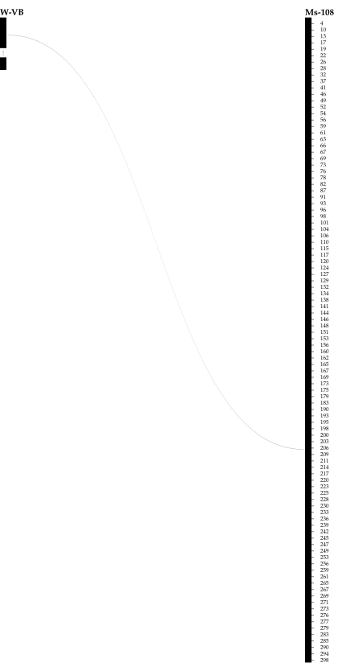

### [III\[1\]](https://cdn.wittgensteinnachlass.com/2000px/webp/Ms-108/III.webp)

## IV. Philosophical Remarks.

### [1\[1\]](https://cdn.wittgensteinnachlass.com/2000px/webp/Ms-108/1.webp)

13.12.1929

Language cannot say what belongs to the essence of the world. So it cannot _say_ that everything flows. Language can say only what we could also imagine otherwise.

### [1\[2\]](https://cdn.wittgensteinnachlass.com/2000px/webp/Ms-108/1.webp)

That everything flows must be expressed in the application of language, and not in _one_ way of applying it as opposed to another, but in _the_ application. In what we call the application of language at all.

### [1\[3\]](https://cdn.wittgensteinnachlass.com/2000px/webp/Ms-108/1.webp)

By application I mean what makes combinations of sounds or strokes on paper etc. into a language at all. In the sense in which it is the application that makes a stick marked with strokes into a _yardstick_. The _laying_ of language against reality.

### [1\[4\]](https://cdn.wittgensteinnachlass.com/2000px/webp/Ms-108/1.webp)

And this laying of language against reality is the verification of its sentences.

### [1\[5\]](https://cdn.wittgensteinnachlass.com/2000px/webp/Ms-108/1.webp),[2\[1\]](https://cdn.wittgensteinnachlass.com/2000px/webp/Ms-108/2.webp)

We are tempted to say: “Only the experience of the present moment has reality”. And the first reply must be: “As opposed to what?” Is this supposed to mean that, for example, my mother did not exist? And that I did not get up this morning? (For then there would be cause for concern.) But that is not what we mean. Does it mean that an event I do not remember at this moment did not take place? Not that either! That proposition, that only present experience has reality, seems to contain the ultimate consequence of solipsism. And in a sense it does; only it can no more say anything than solipsism can. – For what belongs to the essence of the world simply cannot be _said_. And philosophy, if it could say anything, would have to describe the essence of the world. But the essence of language is a picture of the essence of the world, & philosophy, as the custodian of grammar, can indeed grasp the essence of the world, only not in sentences of language but in rules for that language which exclude nonsensical combinations of signs.

### [2\[2\]](https://cdn.wittgensteinnachlass.com/2000px/webp/Ms-108/2.webp),[3\[1\]](https://cdn.wittgensteinnachlass.com/2000px/webp/Ms-108/3.webp)

If one says that only _present_ experience has reality, then the word “present” must already be superfluous here, as the word “I” is in other combinations. For it cannot mean _present_ as opposed to past & future. – Something else must be meant by the word, something that is not _in_ a space but is itself a space (in its own right). I.e. not adjacent to (and hence demarcable from) anything else. So, something that language cannot legitimately single out.

### [3\[2\]](https://cdn.wittgensteinnachlass.com/2000px/webp/Ms-108/3.webp)

If that sentence makes good sense, then _it_ must serve to disengage idle wheels in our symbolism. It would then have to say: we really mean only _this_; everything else is superfluous trimmings. And this endeavour makes sense, for idle wheels can be removed from our language; but not too many.

### [3\[3\]](https://cdn.wittgensteinnachlass.com/2000px/webp/Ms-108/3.webp),[4\[1\]](https://cdn.wittgensteinnachlass.com/2000px/webp/Ms-108/4.webp)

The present we are talking about here is not the frame of the film strip that is now in the lens of the projector, as opposed to the frames before & after it, which have not yet been there or have been there earlier; rather, it is the picture on the screen, which would wrongly be called present, because present is not used here in contrast to past & future. It is thus a meaningless epithet.

### [4\[2\]](https://cdn.wittgensteinnachlass.com/2000px/webp/Ms-108/4.webp),[5\[1\]](https://cdn.wittgensteinnachlass.com/2000px/webp/Ms-108/5.webp)

There are, of course, very interesting, quite general propositions of great importance, genuine propositions which do, then, describe an actual experience, one that could therefore also have been otherwise but happens to be _this way_. E.g. that I have only _one_ body.

That my sensitivity never extends beyond this body (except in cases where someone has had a limb, e.g. an arm, amputated & yet feels pain in his fingers). These are remarkable & interesting facts. But what one says in saying that I cannot remember the future does not belong to this category. For that means nothing & is, like its opposite, something unthinkable. That whenever I am awake I see out of my _eyes_, on the other hand, is a remarkable & interesting fact. It is also important that my visual image is changing almost all the time. “I” evidently means my body, for _I_ am in this room; & “I” is essentially something that is in a place, & in a place in the same space as the other bodies.

### [5\[2\]](https://cdn.wittgensteinnachlass.com/2000px/webp/Ms-108/5.webp)

“Realism”, “idealism”, etc. are metaphysical names from the outset. I.e. they indicate that their adherents believe they can say something definite about the essence of the world.

### [5\[3\]](https://cdn.wittgensteinnachlass.com/2000px/webp/Ms-108/5.webp),[6\[1\]](https://cdn.wittgensteinnachlass.com/2000px/webp/Ms-108/6.webp),[7\[1\]](https://cdn.wittgensteinnachlass.com/2000px/webp/Ms-108/7.webp)

Anyone who wants to dispute the proposition that only present experience is real (which is just as wrong as asserting it) might ask whether a sentence such as “Julius Caesar crossed the Alps” describes only my present state of mind, occupied as it is with this matter. And the answer is, of course: No! It describes an event that we believe happened about 2000 years ago. That is, if the word “describes” is understood as it is in the sentence “the sentence ‘I am writing’ _describes_ what I am doing at present”. The name Julius Caesar designates a person, of course! But what does all that say? I seem to be trying to dodge the real philosophical answer! Sentences about people, i.e. sentences containing personal names, can be verified in very different ways. Surely the sentence about Caesar says precisely what I believe when I believe it. And if I want to know what I believe, the best thing is to ask _why_ I believe it. For the answer to this why will at first invoke various causal connections, i.e. connections that an earlier experience has shown to hold, but eventually the reason why I believe something becomes (what I believe.) – That it is conceivable that Caesar’s corpse might yet be found is directly connected with the sense of the sentences about C. – But so is the possibility of finding a document from which it emerges that such a man never lived & that his existence was invented for certain purposes. So the sentences about J. C. must have a sense such that this is possible. If I utter the sentence: “I see a red patch moving across a green one”, the possibilities that arise in the case of “Caesar crossed the Alps” do not arise here, & that is what I mean when I say that the sentence about Caesar has sense in a more indirect way than the first one.

### [7\[2\]](https://cdn.wittgensteinnachlass.com/2000px/webp/Ms-108/7.webp)

Everything that, if it happened, would rightly strengthen a belief logically determines the nature of that belief. I.e. it shows something about the logical essence of that belief.

### [7\[3\]](https://cdn.wittgensteinnachlass.com/2000px/webp/Ms-108/7.webp)

The sentence about Julius Caesar is a framework (like the one about any other person) that allows the most varied verifications, though not all those it allows in the case of other people, e.g. people who are alive.

### [7\[4\]](https://cdn.wittgensteinnachlass.com/2000px/webp/Ms-108/7.webp)

Isn’t all I mean that there is no further link between the sentence & its verification that mediates this verification?

### [7\[5\]](https://cdn.wittgensteinnachlass.com/2000px/webp/Ms-108/7.webp),[8\[1\]](https://cdn.wittgensteinnachlass.com/2000px/webp/Ms-108/8.webp)

14.12.1929

Our ordinary language too must make provision for (provide for) all cases of uncertainty, & if we have any philosophical objection to it, it can only be on the grounds that in certain cases it gives rise to misinterpretations.

### [8\[2\]](https://cdn.wittgensteinnachlass.com/2000px/webp/Ms-108/8.webp)

One of the most misleading modes of representation in our language is the use of the word “I”, especially where our language uses that word to represent immediate experience, as in “I see a red patch”.

### [8\[3\]](https://cdn.wittgensteinnachlass.com/2000px/webp/Ms-108/8.webp)

Now it would be instructive to replace this way of expressing oneself with another in which immediate experience was not represented with the help of the personal pronoun, because one could see from this that the former representation is not essential to the facts. Not that the new representation would in any sense be more correct than the old one, but it would serve simply to show clearly what is logically essential to the representation.

### [8\[4\]](https://cdn.wittgensteinnachlass.com/2000px/webp/Ms-108/8.webp),[9\[1\]](https://cdn.wittgensteinnachlass.com/2000px/webp/Ms-108/9.webp),[10\[1\]](https://cdn.wittgensteinnachlass.com/2000px/webp/Ms-108/10.webp)

One could adopt the following representation: If I, L. W., have toothache, this is expressed by the sentence “There is toothache”. But if what is now expressed by the sentence “A has toothache” is the case, one says: “A behaves like L.W. when there is toothache.” Analogously, one says “It thinks” & “A behaves like L.W. when it thinks”. (One could imagine an Oriental despotism whose language is so formed that the despot is its centre & his name stands in place of L.W.) It is clear that, as regards its unambiguity & intelligibility, this way of expressing oneself is on a par with ours. But it is equally clear that this language can have anyone at all as its centre. Now, of all the languages that have different people as their centre & all of which I understand, the one that has me as its centre has a special position. It is particularly adequate. How can I express that? I.e. how can I correctly represent its advantage in words? It is not possible. For if I do it in the language that has me as its centre, then it is no wonder that the description of this language in its own terms occupies an exceptional position, & in the mode of expression of another language my language has no special position at all. – The special position lies in the application & if I describe this application, the special position is again not expressed, because the description depends on the language in which it is given. And which description means what I have in mind depends in turn on its application.

Only the application really distinguishes between the languages, but apart from it all the languages are on a par. – All these languages represent just one single, incomparable thing & _can_ represent nothing else. [The two ways of looking at it must lead to the same thing: the one, that what is represented is not one among several, that it admits of no contrast; the other, that I cannot put the advantage of _my_ language into words.]

### [10\[2\]](https://cdn.wittgensteinnachlass.com/2000px/webp/Ms-108/10.webp)

15.12.1929

The mathematical question must be as exact as the mathematical proposition.

### [10\[3\]](https://cdn.wittgensteinnachlass.com/2000px/webp/Ms-108/10.webp)

16.12.1929

The question “How can one know that” is a logical question, not a psychological one.

### [10\[4\]](https://cdn.wittgensteinnachlass.com/2000px/webp/Ms-108/10.webp)

If I want to know what  means, then a relevant question is: “How can I know that?” For the proof comes in answer to this “How” _& I know no more than it shows_.

### [11\[1\]](https://cdn.wittgensteinnachlass.com/2000px/webp/Ms-108/11.webp)

It is clear that every multiplication in the decimal system has a solution & that one can therefore prove any arithmetical equation of the form a × b = c, or prove its opposite. Now what does a proof of this provability look like? Evidently it is nothing more than a clarification of the symbolism & the exhibition of an induction that shows what kind of propositions the ladder leads to.

### [11\[2\]](https://cdn.wittgensteinnachlass.com/2000px/webp/Ms-108/11.webp)

Suppose now that I have two (clear) systems. One cannot ask for a system that encompasses them both. For not only can I not look for this system _now_, but if ever a system turns up that encompasses two systems analogous to the original ones, I see that I could never have looked for it.

### [11\[3\]](https://cdn.wittgensteinnachlass.com/2000px/webp/Ms-108/11.webp)

(In mathematics there is only black & white, & not the grey that can still turn into one or the other.)

### [11\[4\]](https://cdn.wittgensteinnachlass.com/2000px/webp/Ms-108/11.webp)

One can only look within a system: so there is necessarily something one _cannot_ look for.

### [11\[5\]](https://cdn.wittgensteinnachlass.com/2000px/webp/Ms-108/11.webp),[12\[1\]](https://cdn.wittgensteinnachlass.com/2000px/webp/Ms-108/12.webp)

What kind of discovery, for example, is Scheffer’s discovery that all truth-functions can be reduced to p ❘ q? Or the discovery of the method for extracting the cube root? What is it like when one has to apply a trick in mathematics? (As when solving an equation or integrating.) Here it is as when untying a knot. I can try one way or another at random, & the knot may become more tightly entangled, or it may come undone. (At any rate, every operation is a permitted operation & leads somewhere.)

### [12\[2\]](https://cdn.wittgensteinnachlass.com/2000px/webp/Ms-108/12.webp)

I want to say that finding a system for solving problems that one previously could solve only individually by separate methods is not merely discovering a more convenient vehicle, but discovering something quite new that one did not have at all before. The unified method is not just the method of producing an object that is the same however it was produced. The method is not a vehicle that takes us to a place that is really our goal, however we get there.

### [12\[3\]](https://cdn.wittgensteinnachlass.com/2000px/webp/Ms-108/12.webp),[13\[1\]](https://cdn.wittgensteinnachlass.com/2000px/webp/Ms-108/13.webp)

That is to say: I believe that in mathematics one cannot find a _route_ that is not itself a goal. One cannot say: I already had all these results; now I merely find a better route that leads to them all. Rather, this route is a new place that one did not have before. The new route constitutes a new system.

### [13\[2\]](https://cdn.wittgensteinnachlass.com/2000px/webp/Ms-108/13.webp)

Doesn’t this amount to saying that in mathematics one cannot learn anything new about an object, because it is then a new object?

### [13\[3\]](https://cdn.wittgensteinnachlass.com/2000px/webp/Ms-108/13.webp),[14\[1\]](https://cdn.wittgensteinnachlass.com/2000px/webp/Ms-108/14.webp)

This also amounts to this: If I hear a proposition of, say, number theory, but do not know its proof, then I do not understand the proposition either. This sounds very paradoxical. So I do not understand – this is what it means – the proposition that there are infinitely many prime numbers until I know its so-called proof. In coming to know the proof, then, I come to know something _quite_ new, not just the route to a goal I already know. But then it is incomprehensible that, when the proof is supplied, I should grant that it is the proof of precisely _this_ proposition, or the induction meant by this proposition. I want to say that a mathematical proposition is not the prose but the exact expression.

### [14\[2\]](https://cdn.wittgensteinnachlass.com/2000px/webp/Ms-108/14.webp)

17.12.1929

Doesn’t this also mean: One cannot prove the same mathematical proposition in one way & also in another? – There cannot be two independent proofs of a mathematical proposition.

### [14\[3\]](https://cdn.wittgensteinnachlass.com/2000px/webp/Ms-108/14.webp)

Untying knots in mathematics: Can one try to untie a knot that is one day proved impossible to untie? The cubic equation was solved; the trisection of the angle with straightedge & compass _could_ not succeed; both were attempted long before one knew the solution to the one problem & the insolubility of the other.

### [14\[4\]](https://cdn.wittgensteinnachlass.com/2000px/webp/Ms-108/14.webp),[15\[1\]](https://cdn.wittgensteinnachlass.com/2000px/webp/Ms-108/15.webp)

Let us imagine an apparent knot that in reality consists of many pieces of thread that loop back on themselves & perhaps some that do not form closed loops. Now I set someone the task of untying the knot. If he clearly sees how the pieces of string run, he will say that this is not a knot & that one therefore cannot untie it. If he sees only a tangle of strings, he may try to undo it by pulling at various ends at random, or actually carry out certain transformations because he does see certain parts of the knot clearly, even if he does not see its whole structure.

### [15\[2\]](https://cdn.wittgensteinnachlass.com/2000px/webp/Ms-108/15.webp)

Now I would say that one can speak of a genuine attempt to untie it only _insofar_ as the structure of the knot is seen clearly. Insofar as it is not seen clearly, it is all groping in the dark, for what looks like a knot to me may not be a knot at all; the best proof that I really had no method for looking for a solution. This process is not comparable to what happens when, e.g., I look methodically for an object in a room & thereby find out that it is not in the room at all. For here I am looking for a possible state of affairs & not an impossible one.

### [15\[3\]](https://cdn.wittgensteinnachlass.com/2000px/webp/Ms-108/15.webp),[16\[1\]](https://cdn.wittgensteinnachlass.com/2000px/webp/Ms-108/16.webp)

But now I want to say that the simile of the knot is imperfect, since I can have a knot & get to know it better and better, whereas what I want to say is that in mathematics I cannot get to know something already given to me in my signs better and better, but am always getting to know & designating something _new_. I do not see how the signs we ourselves made in order to express certain things should set us problems.

### [16\[2\]](https://cdn.wittgensteinnachlass.com/2000px/webp/Ms-108/16.webp)

It is more as if a knot or tangle were shown to us bit by bit & we (always) went on making pictures of it insofar as we could see it. We have no idea of what has not yet been revealed to us of the knot, & cannot conjecture about it in any way (by, for example, subjecting the pictures of the known part to an investigation).

### [16\[3\]](https://cdn.wittgensteinnachlass.com/2000px/webp/Ms-108/16.webp),[17\[1\]](https://cdn.wittgensteinnachlass.com/2000px/webp/Ms-108/17.webp)

What was it that one found back then, when one found that there are infinitely many prime numbers? What was it that one found when one saw that there are infinitely many cardinal numbers?! – Isn’t it quite analogous to the realization – if it is one – that Euclidean space is infinite, after we have long since formed sentences about the objects in that space. What does an investigation of space mean. – For every mathematical investigation is, as it were, an investigation of space. That one can investigate the _things_ in space is clear. But space! (Geometry & grammar always correspond to each other.) Let us remember that in mathematics the signs themselves _make_ mathematics, not describe mathematics. After all, mathematical signs are like the beads of an abacus. And the beads are in space, & an investigation of the abacus is an investigation of space.

### [17\[2\]](https://cdn.wittgensteinnachlass.com/2000px/webp/Ms-108/17.webp)

I used to wonder that our signs should set us problems, or that we should be able to use them to make discoveries about something that we ourselves had designated with them. But we can make discoveries about the signs because they are not mere signs but the objects of our calculation.

### [17\[3\]](https://cdn.wittgensteinnachlass.com/2000px/webp/Ms-108/17.webp)

One cannot write mathematics but can only make it.

### [18\[1\]](https://cdn.wittgensteinnachlass.com/2000px/webp/Ms-108/18.webp)

(But that is precisely why in mathematics one cannot “cuddle up” to these signs.)

### [18\[2\]](https://cdn.wittgensteinnachlass.com/2000px/webp/Ms-108/18.webp)

I do not make a discovery about something else & then express it in the signs (describe it); rather, I make the discovery about the signs themselves.

### [18\[3\]](https://cdn.wittgensteinnachlass.com/2000px/webp/Ms-108/18.webp)

What was not foreseen was not foresee*able*; for one did not have the system in which it could have been foreseen. (And would have been foreseen.)

### [18\[4\]](https://cdn.wittgensteinnachlass.com/2000px/webp/Ms-108/18.webp)

18.12.1929

The idea that mathematics might be a kind of investigation in natural science keeps pressing itself upon one.

### [18\[5\]](https://cdn.wittgensteinnachlass.com/2000px/webp/Ms-108/18.webp)

As if one could say “we did not have this connection before; now we know it”, or “we do not yet see a connection here but are looking for one”.

### [18\[6\]](https://cdn.wittgensteinnachlass.com/2000px/webp/Ms-108/18.webp)

Suppose I wanted to construct a regular pentagon but did not know how, & tried this and that & finally hit on the right construction by chance: don’t we really have here the case of the knot untied by trial and error?

### [19\[1\]](https://cdn.wittgensteinnachlass.com/2000px/webp/Ms-108/19.webp)

Am I to say: No, for if I do not understand this construction, it is not yet the construction of a pentagon for me at all.

### [19\[2\]](https://cdn.wittgensteinnachlass.com/2000px/webp/Ms-108/19.webp)

I can experiment on paper with strokes & letters but not with the sense of the signs.

### [19\[3\]](https://cdn.wittgensteinnachlass.com/2000px/webp/Ms-108/19.webp)

I can indeed write down the solution to equations of the 2nd degree by chance, but I cannot understand it by chance.

### [19\[4\]](https://cdn.wittgensteinnachlass.com/2000px/webp/Ms-108/19.webp)

The way I arrived at it then disappears in what I understand. I then understand what I understand. I.e. chance can concern only something external, as when one says, for instance: “I found that out after drinking strong coffee”. The coffee is no longer contained in my discovery.

### [19\[5\]](https://cdn.wittgensteinnachlass.com/2000px/webp/Ms-108/19.webp)

The discovery of the connection between two systems was not in the same space as those two systems, & had it been in the same space, it would not have been a discovery (but the solution to a school exercise).

### [20\[1\]](https://cdn.wittgensteinnachlass.com/2000px/webp/Ms-108/20.webp)

Where a connection is now known that was not known before, there was not previously a gap, something incomplete that has now been filled in. – (One could not say then “I know the thing this far; from here on it is no longer known to me”.)

### [20\[2\]](https://cdn.wittgensteinnachlass.com/2000px/webp/Ms-108/20.webp)

So I have said: Mathematics has no gaps. This contradicts the usual view.

### [20\[3\]](https://cdn.wittgensteinnachlass.com/2000px/webp/Ms-108/20.webp)

It is understandable that I can discover that something in space is where I did not expect it to be; but how can I make discoveries about space itself? And a proof in number theory & the construction of the pentagon seem to be discoveries about space.

### [20\[4\]](https://cdn.wittgensteinnachlass.com/2000px/webp/Ms-108/20.webp)

In mathematics there is no “not yet” and no “until further notice”. (Except in the trivial sense that one has not yet multiplied 1000-digit numbers together.)

### [20\[5\]](https://cdn.wittgensteinnachlass.com/2000px/webp/Ms-108/20.webp),[21\[1\]](https://cdn.wittgensteinnachlass.com/2000px/webp/Ms-108/21.webp)

19.12.1929

Induction has something in common with the multiplicity of a (finite, of course) class. On the other hand, it is not a class after all, & now one calls it an infinite class. –

### [21\[2\]](https://cdn.wittgensteinnachlass.com/2000px/webp/Ms-108/21.webp)

If, for example, I say “if I know one turn, I know the whole spiral”, what this really means is: If I know the law of the spiral, this is in many respects analogous to the case in which I know a totality of turns – a “finite” totality, of course, since there is no other kind –. Now one cannot say: yes, it is in many respects analogous to a finite totality, but not quite analogous, whereas it is entirely analogous to an infinite one. All we can say is that induction does not behave _quite_ like a totality.

### [21\[3\]](https://cdn.wittgensteinnachlass.com/2000px/webp/Ms-108/21.webp),[22\[1\]](https://cdn.wittgensteinnachlass.com/2000px/webp/Ms-108/22.webp)

Mathematics cannot be incomplete; just as a _sense_ cannot be incomplete. What I can understand, I must understand completely. This is connected with the fact that my language is in order as it stands & that logical analysis need not add anything to the existing sense of my sentences in order to arrive at complete clarity. So that after analysis even the most seemingly unclear sentence retains its original content untouched, & only its grammar is clarified.

### [22\[2\]](https://cdn.wittgensteinnachlass.com/2000px/webp/Ms-108/22.webp)

But must it not be a question whether or not there is a finite number of primes in all? Once one has arrived at this concept at all. For it does seem that, given the concept of a prime number, I can immediately ask “how many prime numbers are there?”. Just as, given the concept person in this room, I can straightforwardly frame the question “how many people are in this room?”.

### [22\[3\]](https://cdn.wittgensteinnachlass.com/2000px/webp/Ms-108/22.webp)

If this analogy misleads me, it can only be because the “concept of a prime number” is given to me in a quite different way from a concept proper. For what, after all, is the rigorous expression for the sentence “7 is a prime number”? It is plainly just that dividing 7 by smaller numbers leaves a remainder. There can be no other expression for it (except an analogous one), since we cannot describe mathematics, but can only do it. (And that alone does away with any “set theory”.)

### [22\[4\]](https://cdn.wittgensteinnachlass.com/2000px/webp/Ms-108/22.webp),[23\[1\]](https://cdn.wittgensteinnachlass.com/2000px/webp/Ms-108/23.webp)

So once I can write down the general form of a prime number, that is, an expression containing anything analogous to the “number of primes” at all, there is no longer any question of “how many” primes there are, & before that I cannot ask the question either. For I cannot ask “does the series of primes come to an end _at some point_?”, nor can I ask “does a prime _ever_ occur after 7?”

### [23\[2\]](https://cdn.wittgensteinnachlass.com/2000px/webp/Ms-108/23.webp)

For since we could have the word prime number in ordinary language even before there was a rigorous expression that, as it were, allows a number to be specified, one could already mistakenly frame the question of how many primes there were. This makes it look as if the problem had already existed & had now been solved. The word-language seemed to allow the question just as before, & this gave the impression that there had been a genuine problem & that a genuine solution ((of the problem) had been found. In the exact language, by contrast, one originally had nothing whose number one could ask for, & later had an expression from which one could read off the multiplicity directly.

### [23\[3\]](https://cdn.wittgensteinnachlass.com/2000px/webp/Ms-108/23.webp),[24\[1\]](https://cdn.wittgensteinnachlass.com/2000px/webp/Ms-108/24.webp)

What I mean to say, then, is this: Only in our word-language (which here leads to a misunderstanding of logical form) are there “as yet unsolved” problems in mathematics, & the problem of the finite “solvability of all mathematical questions”.

### [24\[2\]](https://cdn.wittgensteinnachlass.com/2000px/webp/Ms-108/24.webp)

My life is very strange! I do not know how bright or how dark it is. It is, as it were, half bright, half dark. Respi explained to me a few days ago that she would not kiss me any more because her feeling for me was not such as to justify this sign. Now I am painfully hurt by this and yet cheerful all the same. For what really matters, after all, is that the spirit does not leave me. For if the spirit does not leave me, then nothing that happens is sordid & petty. But I must spend a lot of time standing on tiptoe if I am not to go under.

### [24\[3\]](https://cdn.wittgensteinnachlass.com/2000px/webp/Ms-108/24.webp)

It seems to me that the idea of consistency in the axioms of mathematics, which so haunts mathematicians’ minds nowadays, rests on a misunderstanding.

### [24\[4\]](https://cdn.wittgensteinnachlass.com/2000px/webp/Ms-108/24.webp),[25\[1\]](https://cdn.wittgensteinnachlass.com/2000px/webp/Ms-108/25.webp)

This is (also) connected with the mathematicians’ not taking the axioms for what they are, namely sentences of syntax.

### [25\[2\]](https://cdn.wittgensteinnachlass.com/2000px/webp/Ms-108/25.webp)

If there is a contradiction in the syntax, it means that we have given our signs no fixed meaning, since a combination of signs is both permitted and forbidden.

### [25\[3\]](https://cdn.wittgensteinnachlass.com/2000px/webp/Ms-108/25.webp)

20.12.1929

There is no question of provability, and in *that* respect no proof of provability either. The so-called proof of provability is an induction, and coming to know that induction is coming to know a new system.

### [25\[4\]](https://cdn.wittgensteinnachlass.com/2000px/webp/Ms-108/25.webp),[26\[1\]](https://cdn.wittgensteinnachlass.com/2000px/webp/Ms-108/26.webp)

What about the sentence “the sum of the angles of a triangle is 180˚”? In any case one cannot tell by looking at it that it is a sentence of syntax.

The sentence “Vertically opposite angles are equal” means that if they do not turn out to be equal when measured, I shall declare the measurement incorrect. And “the sum of the angles of the ▵ is 180˚” means that if the sum does not turn out to be 180˚ when measured, I shall assume an error of measurement. So the sentence is a postulate about the way & manner in which the facts are described. Hence a sentence of syntax.

### [26\[2\]](https://cdn.wittgensteinnachlass.com/2000px/webp/Ms-108/26.webp)

A proof of consistency cannot be essential to the application of the axioms.

### [26\[3\]](https://cdn.wittgensteinnachlass.com/2000px/webp/Ms-108/26.webp)

There are postulates only for the way we express things. The “axioms” are postulates governing the way we express things.

### [26\[4\]](https://cdn.wittgensteinnachlass.com/2000px/webp/Ms-108/26.webp)

If I give someone the instruction “go straight ahead, then turn into the first street on the left, N Street” & N Street is the second street & not the first, then my instruction is contradictory. Such a contradiction is also conceivable in the postulates of geometry if, for example, I add to the Euclidean axioms the further axiom that the sum of the angles of the ▵ is to be 200˚. Russell’s contradiction & all analogous ones are _not_ of this kind. But what such a contradiction of the first kind means should be clearest in arithmetic, for here the form of the equation makes it clearer that we are dealing with rules for signs.

### [26\[5\]](https://cdn.wittgensteinnachlass.com/2000px/webp/Ms-108/26.webp),[27\[1\]](https://cdn.wittgensteinnachlass.com/2000px/webp/Ms-108/27.webp)

21.12.1929

How is it that I want at all to say that everything flows?

Do I only want to say by this that my immediate experience is continually changing, which need not be so (& which I can therefore say). Or do I want to express that it _can_ be continually changing, even if it were not?

### [27\[2\]](https://cdn.wittgensteinnachlass.com/2000px/webp/Ms-108/27.webp)

What I really seem to mean is that the present continually slips away & is, as it were, impossible to grasp. (But of course one cannot say that.) That I _want_ to say this must rest on some misunderstanding. This _wanting_ to capture the present must rest on a misunderstanding. Namely, that one wants to apply to immediate experience a category that is applicable only in the language of the physical world.

### [27\[3\]](https://cdn.wittgensteinnachlass.com/2000px/webp/Ms-108/27.webp)

What we are considering here is really the possibility of movement. Thus the logical form of movement.

### [27\[4\]](https://cdn.wittgensteinnachlass.com/2000px/webp/Ms-108/27.webp),[28\[1\]](https://cdn.wittgensteinnachlass.com/2000px/webp/Ms-108/28.webp)

In all this it seems to us as though memory were a somewhat secondary kind of experience compared with experience of the present. We say “we can _only_ remember it”! As though, in a primary sense, memory were a somewhat faint & uncertain picture of what we originally had before us in perfect clarity.

### [28\[2\]](https://cdn.wittgensteinnachlass.com/2000px/webp/Ms-108/28.webp)

In physical language that is right: I say “I can remember this house _only indistinctly_.”

### [28\[3\]](https://cdn.wittgensteinnachlass.com/2000px/webp/Ms-108/28.webp)

And why not leave it at that? After all, this mode of expression says everything we want to say & everything that can be said. But what we want to say is that it can also be said _differently_; & that is important.

### [28\[4\]](https://cdn.wittgensteinnachlass.com/2000px/webp/Ms-108/28.webp)

Can one say that in this other mode of expression the emphasis is, as it were, placed on something else. For the words “seem”, “error”, etc. have a certain emotional tinge that is not essential to the phenomena. They have something to do with the will & not merely with knowledge.

### [28\[5\]](https://cdn.wittgensteinnachlass.com/2000px/webp/Ms-108/28.webp),[29\[1\]](https://cdn.wittgensteinnachlass.com/2000px/webp/Ms-108/29.webp)

We speak, for example, of an optical illusion & associate the idea of a mistake with this expression, though there need not be any mistake involved, & if in life the way things looked were generally more important than the results of measurement, language too would take a different attitude towards these phenomena. If, for example, it were mostly a matter of architectural problems.

### [29\[2\]](https://cdn.wittgensteinnachlass.com/2000px/webp/Ms-108/29.webp)

There is no – as I used to think there was – primary language in contrast to our ordinary, “secondary” language. But one could speak of a primary language in contrast to ours in *so* far as it would have to express no preference for certain phenomena over others; it would have to be, so to speak, absolutely _impartial_.

### [29\[3\]](https://cdn.wittgensteinnachlass.com/2000px/webp/Ms-108/29.webp),[30\[1\]](https://cdn.wittgensteinnachlass.com/2000px/webp/Ms-108/30.webp)

How does indirect proof work, for example, in geometry. The strangest thing about it is that one sometimes tries to make an _ungeometrical_ drawing for it (the exact analogue of an illogical sentence). But of course this arises only from a mistaken conception of the proof. It is odd, for example, when one says “suppose the straight line g had two continuations from point P onwards”. But there is no need at all

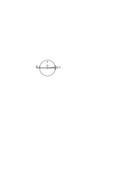

to suppose any such thing. Proofs in geometry, in mathematics, cannot be indirect in the proper sense, because one cannot assume the opposite of a geometrical proposition so long as one adheres to a particular geometry. That proof simply shows that the arcs α and α + α' approach each other ever more closely & without limit as α' approaches 0.

### [30\[2\]](https://cdn.wittgensteinnachlass.com/2000px/webp/Ms-108/30.webp)

22.12.1929

Is the time in which the experiences of visual space take place conceivable without experiences of sound? It seems so! & yet how strange that something should be able to have a form that would be conceivable even without just _this_ content. Or would someone who was given the gift of hearing thereby also become acquainted with a new time? The traditional questions are no use for the logical investigation of phenomena. These devise their own questions, or rather, give their own answers.

### [30\[3\]](https://cdn.wittgensteinnachlass.com/2000px/webp/Ms-108/30.webp)

To what extent is logic made uncertain by uncertainty about the analysis of elementary propositions? – What is certain?

### [30\[4\]](https://cdn.wittgensteinnachlass.com/2000px/webp/Ms-108/30.webp)

What is the difference between the logical multiplicity of an explanation of the phenomena by natural science & the logical multiplicity of a description?

### [30\[5\]](https://cdn.wittgensteinnachlass.com/2000px/webp/Ms-108/30.webp),[31\[1\]](https://cdn.wittgensteinnachlass.com/2000px/webp/Ms-108/31.webp)

If, for instance, a regularly ticking sound were to be represented in physics, the multiplicity of the picture 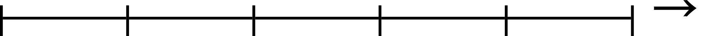 would suffice for that, but what is at issue here is not the logical multiplicity of the sound but that of the regularly observed phenomenon. And so the theory of relativity represents not the logical multiplicity of the phenomena themselves, but the multiplicity of the observed regularities.

### [31\[2\]](https://cdn.wittgensteinnachlass.com/2000px/webp/Ms-108/31.webp)

23.12.1929

The point is this: the grammatical rules for “and”, “not”, “or”, etc. are not exhausted by what I said in the treatise; there are rules for the truth-functions that also have to do with the elementary part of the sentence.

### [31\[3\]](https://cdn.wittgensteinnachlass.com/2000px/webp/Ms-108/31.webp)

What our grammar lacks above all is _surveyability_.

### [31\[4\]](https://cdn.wittgensteinnachlass.com/2000px/webp/Ms-108/31.webp),[32\[1\]](https://cdn.wittgensteinnachlass.com/2000px/webp/Ms-108/32.webp)

If I say “the upper segment 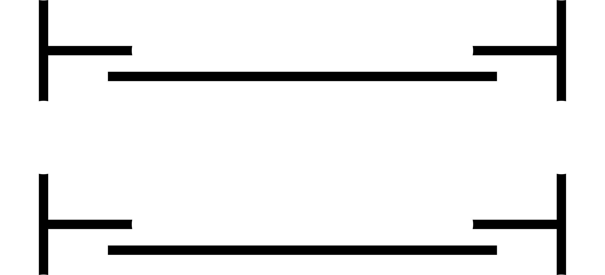 is as long as the lower one” & mean by this sentence what would otherwise be said by the sentence “the upper segment appears to me to be as long as the lower one”, then the word “equal” in that sentence has quite a different meaning from the one it has in the identically worded sentence whose verification consists in transferring the length with a pair of compasses. That is why I can speak, for example, of improving the methods of comparison in the second case but not in the first. The use of the same word “equal” with quite different meanings is very confusing. It is the typical case of words & turns of phrase that originally refer to the “things” of the physical mode of expression, the “bodies in space”, being applied to parts of our visual field, whereupon their meanings have to change completely & statements that previously had a sense lose it, & others that had none in the first mode of expression acquire one. Even if a certain analogy remains, the very one that tempts us to use the same expression.

### [32\[2\]](https://cdn.wittgensteinnachlass.com/2000px/webp/Ms-108/32.webp)

It is curious that in ordinary life we never have the feeling that the phenomenon is slipping away from us, the feeling of the constant flow of appearances, but have it only when we philosophize. This suggests that what we have here is a thought suggested to us by a mistaken use of our (ordinary) language.

### [32\[3\]](https://cdn.wittgensteinnachlass.com/2000px/webp/Ms-108/32.webp),[33\[1\]](https://cdn.wittgensteinnachlass.com/2000px/webp/Ms-108/33.webp)

The feeling, that is, is that the present recedes into the past without our being able to stop it. And here we are clearly making use of the picture of a strip that moves past us incessantly & that we cannot stop. But of course it is equally clear that the picture is being misused. That one cannot say “time flows” if by “time” one means the possibility of change.

### [33\[2\]](https://cdn.wittgensteinnachlass.com/2000px/webp/Ms-108/33.webp),[34\[1\]](https://cdn.wittgensteinnachlass.com/2000px/webp/Ms-108/34.webp)

Perhaps this whole difficulty rests on transferring the concept of physical time to the course of immediate experience. It is a confusion of the time of the film strip with the time of the picture on the screen. For “time” means something different when we take memory to be the source of time and when we take it to be a preserved picture of the past event. If we take memory to be a picture, then it is a picture of a physical event. The picture fades & I notice it fading when I compare it with other testimony about the past. Here memory is not a source of time, but a more or less faithful keeper of what “really” happened, & this was something we can also learn about in other ways, a physical event. It is quite different if we now consider memory as the source of time. Here it is not a picture & cannot fade either – in the sense in which a picture fades, so that it represents its object less & less faithfully. Both ways of speaking are in order & equally legitimate, but they cannot be mixed. It is clear, after all, that speaking of memory as a picture is itself only a picture; just like the way of speaking that calls mental images “pictures of objects in our minds” (or something of the sort). We know what a picture is, but mental images are not pictures at all. For ordinarily I can see the picture & the object it is a picture of; but here it is plainly quite different. We have used a simile, & now the simile tyrannizes us. In the language of this simile I cannot move outside the simile. It must lead to nonsense if one tries to use the language of this simile to speak of memory as the source of our knowledge, as the verification of our sentences. One can speak of present, past & future events in the physical world, but not of present, past & future mental images if by “mental image” one is not after all designating a kind of physical object (say, in this case a physical picture instead of the body), but precisely what is present. So one cannot apply the concept of time, i.e. the rules of syntax that hold for physical nouns, in the world of the imagination, i.e. not where one uses a radically different way of speaking.

### [35\[1\]](https://cdn.wittgensteinnachlass.com/2000px/webp/Ms-108/35.webp)

24.12.1929

The new conception of elementary propositions entails that a proposition can be more or less _close_ to the truth. (Since red is closer to orange than to blue & 2 m closer to 201 cm than to 3 m.)

### [35\[2\]](https://cdn.wittgensteinnachlass.com/2000px/webp/Ms-108/35.webp)

In this case sentences become even more like measuring rods than I formerly thought. – If _one_ measurement is right, that automatically rules out all the others. I automatically say: Just as all the marks are on _one_ rod, so the sentences that correspond to the marks belong together, & one cannot measure with one of them without at the same time measuring with all the others. – What I apply to reality as a yardstick is not the sentence but the _system_ of sentences.

### [35\[3\]](https://cdn.wittgensteinnachlass.com/2000px/webp/Ms-108/35.webp)

One could now lay down the rule that the same yardstick may be applied only *once* in a sentence. Or that the parts corresponding to different applications of the same yardstick must be brought together.

### [35\[4\]](https://cdn.wittgensteinnachlass.com/2000px/webp/Ms-108/35.webp)

Now does the question “are there sentences that stand on their own, in no system?” have a sense, for example?

### [36\[1\]](https://cdn.wittgensteinnachlass.com/2000px/webp/Ms-108/36.webp)

I believe the question cannot have a sense. Suppose there were no such sentence: how could one even think of it? So one cannot ask about it either, not even if there is such a sentence.

### [36\[2\]](https://cdn.wittgensteinnachlass.com/2000px/webp/Ms-108/36.webp)

25.12.1929

When I say something about verification & grammar, I am as clear about it as I am about the sense of the sentence “it is raining outside”; no clearer. But I cannot be any clearer about anything either.

### [36\[3\]](https://cdn.wittgensteinnachlass.com/2000px/webp/Ms-108/36.webp),[37\[1\]](https://cdn.wittgensteinnachlass.com/2000px/webp/Ms-108/37.webp)

“I have no stomach pain” is comparable to the sentence “these apples cost _nothing_”. That is, they cost no _money_; it is not that they cost no snow or no effort. The zero point is the zero point on _one_ scale. And since no point on the yardstick can be given to me without the yardstick, neither can its zero point. “I have no pain” does not designate a state in which pain is not spoken of. On the contrary, pain is spoken of. The sentence presupposes the capacity to feel pain, & that cannot be a “physiological capacity” – for how else would one know what it is a capacity for – but must be a logical possibility. – I describe my present state by allusion to something that is not the case. If this reference is necessary to the description (& not merely an embellishment), there must be something in my present state that makes this reference necessary. I compare this state with another, so it must be comparable with it. It too must lie in the space of pain, even if at a different point. – Otherwise my sentence would mean something like: my present state has _nothing to do_ with a painful one; rather as I would say that the colour of this rose has nothing to do with Caesar’s conquest of Gaul. That is, there is no connection. But what I mean is precisely that there is a connection between my present state & a painful one.

### [37\[2\]](https://cdn.wittgensteinnachlass.com/2000px/webp/Ms-108/37.webp)

Surely I do not describe a state of affairs by mentioning what has nothing to do with it & stating that it has nothing to do with it. That would not be a negative description.

### [37\[3\]](https://cdn.wittgensteinnachlass.com/2000px/webp/Ms-108/37.webp)

“The sense lies in its being possible to recognize it again”, but this is a logical possibility. I must be, in my thoughts, in the space in which what is to be expected lies.

### [37\[4\]](https://cdn.wittgensteinnachlass.com/2000px/webp/Ms-108/37.webp),[38\[1\]](https://cdn.wittgensteinnachlass.com/2000px/webp/Ms-108/38.webp)

Truth has a bedrock of granite; one can get as far as that & (in any case) no further.

### [38\[2\]](https://cdn.wittgensteinnachlass.com/2000px/webp/Ms-108/38.webp)

I am a pig & yet I am not unhappy. I am in danger of becoming even shallower. May God prevent it!

### [38\[3\]](https://cdn.wittgensteinnachlass.com/2000px/webp/Ms-108/38.webp)

26.12.1929

We can speak of two different infinite possibilities, but here the word different has a different sense from the one it has in the case of different finite possibilities. And this is also apparent from the fact that this difference has a different multiplicity.

### [38\[4\]](https://cdn.wittgensteinnachlass.com/2000px/webp/Ms-108/38.webp)

It makes clear & simple sense to say that two decimal fractions (finite, of course) are different. It makes quite a different (as it were, derivative) sense to say that the infinite possibilities of the two are different. And this difference has a different multiplicity from the former.

### [38\[5\]](https://cdn.wittgensteinnachlass.com/2000px/webp/Ms-108/38.webp),[39\[1\]](https://cdn.wittgensteinnachlass.com/2000px/webp/Ms-108/39.webp)

What does the sentence “A is my ancestor” mean? I.e.: how can I know that someone is my ancestor? If by looking for him among my ancestors, then that means among a finite number. Or the verification would be that he has a certain property that one has perceived in my father, grandfather, etc.; then the sentence says no more than: A has this property. But what if our ancestors had come into the world with a certain number of strokes on their foreheads, so that, say, my father has one, my grandfather two, and so on? Then “A is my ancestor” would mean: he has some number of strokes on his forehead. But here again the _apparent_ complete generality means nothing, for either I know that A has – say – 25 strokes on his forehead or I know that he has between n & m strokes. For one cannot _say_ that the strokes he has are _some number_ (that would only be a sentence of grammar about the numeral in question).

### [39\[2\]](https://cdn.wittgensteinnachlass.com/2000px/webp/Ms-108/39.webp)

It is important, for example, that in the sentence “there is a red patch close to the boundary of the visual field” the words “close to” have a different meaning from the one they have in a sentence like “the red patch in the visual field is close to the brown patch”. Furthermore, the word boundary in the earlier sentence has a different meaning – & is a different kind of word – from “boundary” in the sentence “the boundary between red & blue in the visual field is a circle”.

### [39\[3\]](https://cdn.wittgensteinnachlass.com/2000px/webp/Ms-108/39.webp),[40\[1\]](https://cdn.wittgensteinnachlass.com/2000px/webp/Ms-108/40.webp)

What sense does it make to say: our visual image is less distinct at the edges than towards the centre? That is, if we are not speaking here of seeing _physical objects_ more distinctly in the centre of the visual field. –

One of the clearest examples of the confusion between physical & phenomenological language is the picture that Mach drew of his visual field, & in which the so-called blurriness of the forms towards the edge of the visual field was rendered by a blurriness (in a quite different sense) of the drawing. No, one cannot make a visible picture of the visual image. So can I say that the patches of colour near the edge of the visual field no longer have sharp outlines: are outlines there even _conceivable_? But how is such a question possible at all? I think it is clear that this indistinctness is an internal property of visual space.

Does the word “colour”, for example, have a different meaning at bottom when it refers to forms near the edge? What can the investigation bring to light about visual space? The boundlessness of visual space is inconceivable without this “blurriness”.

### [40\[2\]](https://cdn.wittgensteinnachlass.com/2000px/webp/Ms-108/40.webp),[41\[1\]](https://cdn.wittgensteinnachlass.com/2000px/webp/Ms-108/41.webp)

The question is: What differences are there in visual space? Can one learn anything about this from the coordination of, for example, tactile space with visual space? By specifying, say, which changes in the one space correspond to no change in the other?

### [41\[2\]](https://cdn.wittgensteinnachlass.com/2000px/webp/Ms-108/41.webp)

The fact that one sees a physical 100-sided polygon as a circle and cannot distinguish it from a physical circle tells us nothing at all about the _possibility_ of seeing a 100-sided polygon.

### [41\[3\]](https://cdn.wittgensteinnachlass.com/2000px/webp/Ms-108/41.webp)

My not succeeding in finding a physical body that yields the visual image of a hundred-sided polygon is of no logical significance. The question is: Does it make _sense_ to speak of a visual hundred-sided polygon. Or: Does it make sense to speak of thirty strokes side by side ∣∣∣∣∣∣∣∣∣∣∣∣∣∣∣∣∣∣∣∣∣∣∣∣∣∣∣∣∣∣ _seen_ at once. I believe not!

### [41\[4\]](https://cdn.wittgensteinnachlass.com/2000px/webp/Ms-108/41.webp)

The process is not at all that one first sees a 3-sided polygon, then a 4-sided polygon, a 5-sided polygon, etc. up to, say, the 50-sided polygon, & then comes the circle; rather, one sees a 3-sided polygon, a 4-sided polygon, etc. up to perhaps the 8-sided polygon, and then all one sees is many-sided polygons with more or less long sides. The sides get smaller, then there begins a fluctuation towards the circle & then comes the circle.

### [41\[5\]](https://cdn.wittgensteinnachlass.com/2000px/webp/Ms-108/41.webp),[42\[1\]](https://cdn.wittgensteinnachlass.com/2000px/webp/Ms-108/42.webp)

Nor does the fact that a physical straight line drawn as a tangent to a circle yields the visual image of a straight line that coincides for a stretch with the curved one prove that our visual space is not Euclidean, for a different physical configuration, say , might very well produce the image corresponding to the Euclidean tangent. In fact, however, such an image is inconceivable.

### [42\[2\]](https://cdn.wittgensteinnachlass.com/2000px/webp/Ms-108/42.webp)

27.12.1929

What does the sentence “we never see an exact circle” mean? What is the criterion of exactness? Might I not just as well say “perhaps I see an exact circle, but I can never know”? All this makes sense only once one has laid down in what case one calls one measurement more exact than another. Now the concept of a circle – I believe – presupposes a concept of “greater exactness” that allows for an unlimited increase. And one can say that the concept of a circle _is_ the concept of the possibility of increasing exactness without limit. This capacity for unlimited increase would be a postulate of the mode of expression. It must then, of course, be clear in every case what I would count as an increase in exactness.

### [42\[3\]](https://cdn.wittgensteinnachlass.com/2000px/webp/Ms-108/42.webp),[43\[1\]](https://cdn.wittgensteinnachlass.com/2000px/webp/Ms-108/43.webp)

It means nothing, of course, to say that the circle is merely an ideal that realities could only approach. That is a false simile. For one can approach only something that is there, and if the circle is given to us in some form, so that we can approach it, then it would be precisely that form that mattered to us, and the approximation of another form to it would be incidental. But it may also be that we call an infinite possibility itself the circle. The circle is then like an irrational number.

### [43\[2\]](https://cdn.wittgensteinnachlass.com/2000px/webp/Ms-108/43.webp)

It seems to me essential to the application of Euclidean geometry that we speak of an _inexact_ circle, an _inexact_ sphere, etc. And also that it must be logically possible to reduce this inexactness without limit. So to understand the application of Euclidean geometry, one must know what the word “_inexact_” means. – For nothing else is given to us but the result of our measurement & the concept of inexactness. These two together must correspond to Euclidean geometry.

### [43\[3\]](https://cdn.wittgensteinnachlass.com/2000px/webp/Ms-108/43.webp)

Now is the inexactness of measurement the same concept as the inexactness of the visual image? I think: certainly not.

### [43\[4\]](https://cdn.wittgensteinnachlass.com/2000px/webp/Ms-108/43.webp),[44\[1\]](https://cdn.wittgensteinnachlass.com/2000px/webp/Ms-108/44.webp),[45\[1\]](https://cdn.wittgensteinnachlass.com/2000px/webp/Ms-108/45.webp)

If the statement that we never _see_ an exact circle is meant to say that, e.g., we see no straight line touching the circle at one point (i.e. that nothing in our space of sight has the multiplicity of a straight line touching a circle), then no arbitrarily high degree of exactness is conceivable as a counterpart to _this_ inexactness. The word equality has a different meaning when we apply it to segments in the space of sight from the one it has when applied to physical space. Equality in the space of sight has a different multiplicity from equality in physical space; _that is why_ in the space of sight

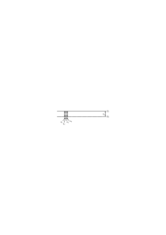

g1 & g2 can be straight lines (visual straight lines) & the segments can be such that 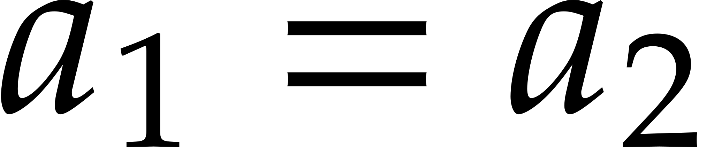, 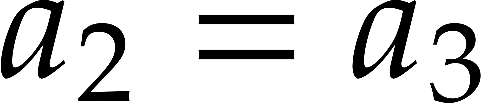 etc. but _not_ such that 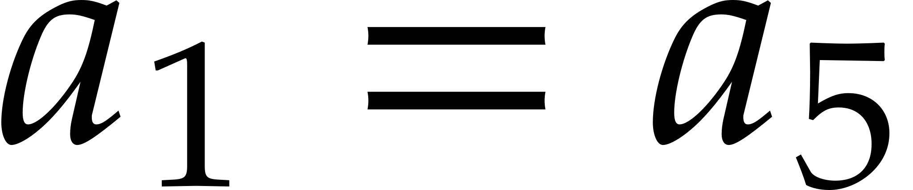. Likewise, the circle & the straight line in visual space have a different multiplicity from the circle & the straight line in physical space, for a short piece of a circle that is seen can be straight; “circle” & “straight line” being used here in the sense of visual geometry. Ordinary language makes do here with the word “seems” or “appears”. It says that 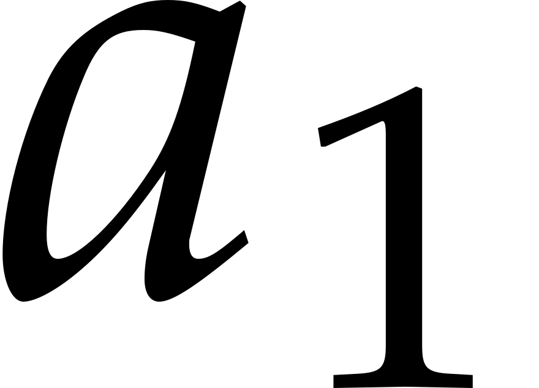 & 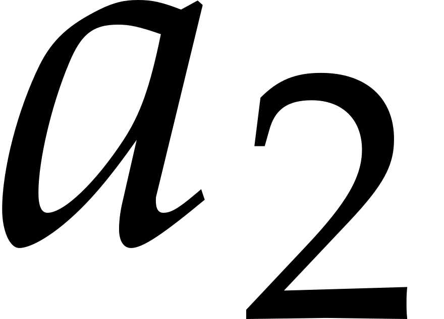 seem to be equal, whereas between a1 & a5 this semblance has already ceased to obtain. But it uses the word semblance ambiguously. For its meaning depends on what is now set against this semblance as the reality. In one case it is the result of a measurement, in the other a further appearance. So the meaning of the word “seem” is different in these cases.

### [45\[2\]](https://cdn.wittgensteinnachlass.com/2000px/webp/Ms-108/45.webp),[46\[1\]](https://cdn.wittgensteinnachlass.com/2000px/webp/Ms-108/46.webp)

28.12.1929

It is now time (for once) to criticize the word “sense-datum”.

A sense-datum is the appearance of this tree, whether “there really is a tree standing there” or there is a dummy, a reflection, a hallucination, etc. A sense-datum is the appearance of the tree, and what we want to say is that this linguistic representation is only _one_ description, but not _the_ essential one. Just as one can say of the expression “_my_ visual image” that it is only _one_ form of _description_, not the only possible & correct one. For the form of expression “the appearance of this tree” embodies a view according to which there would be an internal connexion between what we call this appearance and the “existence of a tree”, either through veridical cognition or through error. That is, if there is talk of “the appearance of a tree”, then either we would take something that is a tree for a tree or we would take something that is not a tree for one. But this connexion does not exist. Some (& in particular the idealists) would like to accuse language of representing the secondary as primary & the primary as secondary. But this happens only in these inessential valuations, which have nothing to do with knowledge (“only” the appearance). Apart from that, ordinary language makes no decision about what is primary & what secondary. One cannot see in what way the expression “the appearance of a tree” represents anything secondary to the expression “tree”. The expression “only a picture” goes back to the idea that we cannot eat the picture of an apple.

### [46\[2\]](https://cdn.wittgensteinnachlass.com/2000px/webp/Ms-108/46.webp),[47\[1\]](https://cdn.wittgensteinnachlass.com/2000px/webp/Ms-108/47.webp)

One can write the truth about oneself in the most varied spirits. In the most decent & the most indecent. And accordingly it is very desirable or very wrong that it should be written. Indeed, among the truthful autobiographies one could write there are all gradations from the highest to the lowest. I, for example, cannot write my biography at a higher level than I myself am at. And by the mere fact of writing it I do not _necessarily_ raise myself; I _can_ even make myself dirtier than I already was.

Something in me speaks in favour of writing my biography: I should like for once to lay out my life clearly, so as to have it clearly before me & so that others can see it too. Not so much in order to sit in judgement on it as to bring about clarity & truth, at any rate. This afternoon I listened to Koder, who played for me. I appealed to his conscience, telling him to take piano playing seriously; his playing was not serious enough for me. Then I went to Helene & whistled Schubert songs to her accompaniment & my thoughts were never really concentrated; I was always thinking of myself & could not really feel my way into what I was doing or give myself over to it. There was never any real _seriousness_. I was always doing something or other, but it was never, or hardly ever, the right thing. I told myself that the matter was serious, but it all flew past me. I felt that I was a swine because I mix even what is genuine with what is not. May God send me purity & truth.

### [47\[2\]](https://cdn.wittgensteinnachlass.com/2000px/webp/Ms-108/47.webp),[48\[1\]](https://cdn.wittgensteinnachlass.com/2000px/webp/Ms-108/48.webp)

That nothing strikes us when we look about, walk around in space, feel our own body, etc. etc. shows how natural these very things are to us. We do not perceive that we see space in perspective or that the visual image is in some sense blurred towards the edge. It never strikes us & can never strike us, because it is _the_ way we perceive. We never think about it & it is impossible to do so, because there is no contrast to the form of our world.

### [48\[2\]](https://cdn.wittgensteinnachlass.com/2000px/webp/Ms-108/48.webp)

I wanted to say that it is curious that those who ascribe reality only to things, not to our mental images, move about in the world of the imagination as a matter of course and never long to get out of it.

### [48\[3\]](https://cdn.wittgensteinnachlass.com/2000px/webp/Ms-108/48.webp)

I.e. how much we take the given for granted. Things would have to be devilishly strange if that were the little picture taken from an angle.

### [48\[4\]](https://cdn.wittgensteinnachlass.com/2000px/webp/Ms-108/48.webp)

29.12.1929

What we take for granted, _life_, is supposed to be something accidental, incidental; whereas something I normally never rack my brains over is supposed to be what is real!

### [48\[5\]](https://cdn.wittgensteinnachlass.com/2000px/webp/Ms-108/48.webp)

I.e. what one cannot go beyond, nor wants to go beyond, is supposed not to be the world!

### [48\[6\]](https://cdn.wittgensteinnachlass.com/2000px/webp/Ms-108/48.webp),[49\[1\]](https://cdn.wittgensteinnachlass.com/2000px/webp/Ms-108/49.webp)

30.12.1929

Again and again it is the attempt to delimit the world in language & single it out – but that cannot be done. The fact that the world is taken for granted finds expression precisely in the fact that language means only the world, & can mean only the world.

### [49\[2\]](https://cdn.wittgensteinnachlass.com/2000px/webp/Ms-108/49.webp)

For since language gets its way of meaning only from its meaning, from the world, no language is conceivable that does not represent this world.

### [49\[3\]](https://cdn.wittgensteinnachlass.com/2000px/webp/Ms-108/49.webp)

We can apply our old principle to sentences that state a probability & say that we will recognize their sense if we consider what verifies them.

### [49\[4\]](https://cdn.wittgensteinnachlass.com/2000px/webp/Ms-108/49.webp)

If I say “that will probably happen”, is this sentence verified by its happening or falsified by its not happening? I think the answer is clearly no. Then it says nothing about that either. For if a dispute arose as to whether it was probable or not, only arguments from the past would ever be adduced. _And even then only_ if what had happened was already known.

### [49\[5\]](https://cdn.wittgensteinnachlass.com/2000px/webp/Ms-108/49.webp),[50\[1\]](https://cdn.wittgensteinnachlass.com/2000px/webp/Ms-108/50.webp)

(In saying that I am not making a statement about the state of expectation I am in, for otherwise the statement would be of the same kind as _the_ statement “I have a headache” & one could then only express sympathy, but no dispute could arise over it.)

### [50\[2\]](https://cdn.wittgensteinnachlass.com/2000px/webp/Ms-108/50.webp)

31.12.1929

To understand the sense of a question, let us consider: What does the answer to this question look like?

### [50\[3\]](https://cdn.wittgensteinnachlass.com/2000px/webp/Ms-108/50.webp)

In answer to the question “is A my ancestor” I can only imagine the answers “A is to be found in my gallery of ancestors” or “A is not to be found in my gallery of ancestors”. (Where by gallery of ancestors I understand the sum total of all kinds of information about my forebears.) But then the question too could only mean the same as the question “is A to be found in my gallery of ancestors?”. (A gallery of ancestors has an end: that is a sentence of syntax.) If a god revealed to me that A was my ancestor, but not which one, then this revelation too could only have the sense for me that I will find A among my ancestors if only I look long enough; _but since it is **N** ancestors_ that I will search through, the revelation must mean that A is among those _N_ ancestors.

### [50\[4\]](https://cdn.wittgensteinnachlass.com/2000px/webp/Ms-108/50.webp),[51\[1\]](https://cdn.wittgensteinnachlass.com/2000px/webp/Ms-108/51.webp)

If I ask how many 9s follow immediately one after another after 3˙1415 in the expansion of π, & the question is meant to concern the extension, then the answer is either that in expanding the extension as far as the last place worked out (the Nth), one has got beyond the run of 9s, or that the 9s continue in succession up to the Nth place. But then the question too could have had no other sense than “are the first N–5 places of π all 9s or not?” But that, of course, is not the question that interests us.

### [51\[2\]](https://cdn.wittgensteinnachlass.com/2000px/webp/Ms-108/51.webp)

If I do not know how many 9s can follow 3˙1415, then I cannot specify any distance smaller than the difference between π and 3˙1416, & that means, I believe, that π does not correspond to a point on the number line, for if it corresponds to a point, then it must be possible to specify a segment shorter than the segment from this point to the point 3˙1416.

### [51\[3\]](https://cdn.wittgensteinnachlass.com/2000px/webp/Ms-108/51.webp),[52\[1\]](https://cdn.wittgensteinnachlass.com/2000px/webp/Ms-108/52.webp)

How strange it would be if logic were concerned with an “ideal” language & not with _ours_. For what would this ideal language express? Presumably what we now express in our ordinary language; then it is this language that logic must investigate. Or something else: but then how am I to know at all what that is. – Logical analysis is the analysis of something we have, not of something we do not have. So it is the analysis of sentences _as they are_. (It would be strange if human society had spoken up to now without managing to produce a proper sentence.)

### [52\[2\]](https://cdn.wittgensteinnachlass.com/2000px/webp/Ms-108/52.webp)

01.01.1930

The concept of the “elementary proposition” now loses its meaning altogether.

### [52\[3\]](https://cdn.wittgensteinnachlass.com/2000px/webp/Ms-108/52.webp)

The rules for _and_, _or_, _not_, etc. which I represented by means of the W-F-W notation are _a part_ of the grammar of these words, but not _the whole_ of it.

### [52\[4\]](https://cdn.wittgensteinnachlass.com/2000px/webp/Ms-108/52.webp)

One can, I believe, compare sentences in general with _those_ sentences that describe a coloured surface by describing the colour boundaries by means of a coordinate system & then in some way designating the colours on either side of these boundaries. Perhaps it is more correct to take only a particular piece of a plane surface or a spherical surface as the space & to describe the distribution of colours on it.

### [52\[5\]](https://cdn.wittgensteinnachlass.com/2000px/webp/Ms-108/52.webp)

The concept of the independent coordinates of description!

### [52\[6\]](https://cdn.wittgensteinnachlass.com/2000px/webp/Ms-108/52.webp)

The sentences that are joined by “and”, for example, are not independent of one another; rather, they form _One_ picture & can be tested for compatibility or incompatibility.

### [53\[1\]](https://cdn.wittgensteinnachlass.com/2000px/webp/Ms-108/53.webp)

In my old conception of elementary propositions there was no determination of the value of a coordinate; although my remark that a coloured body is in a colour space, etc., might have led me straight to this.

### [53\[2\]](https://cdn.wittgensteinnachlass.com/2000px/webp/Ms-108/53.webp)

A coordinate of reality may be determined only *one* time.

### [53\[3\]](https://cdn.wittgensteinnachlass.com/2000px/webp/Ms-108/53.webp)

02.01.1930

If I wanted to set out the general point of view, I would say: “One simply must not say one thing about a matter on one occasion and another on another”. But this matter would be the coordinate to which I can give _one_ value & no more.

### [53\[4\]](https://cdn.wittgensteinnachlass.com/2000px/webp/Ms-108/53.webp)

It misrepresents the matter to say that one must not ascribe two incompatible attributes to an object. For that makes it seem as though in each case one first had to investigate whether two determinations were compatible or not. The truth is (simply) that _two_ determinations of the same coordinate are impossible.

### [53\[5\]](https://cdn.wittgensteinnachlass.com/2000px/webp/Ms-108/53.webp)

What we have recognized is precisely that we are dealing with scales & not with, as it were, isolated graduation marks.

### [53\[6\]](https://cdn.wittgensteinnachlass.com/2000px/webp/Ms-108/53.webp),[54\[1\]](https://cdn.wittgensteinnachlass.com/2000px/webp/Ms-108/54.webp)

Every statement would then consist, as it were, in setting up a number of scales, and setting a scale to two graduation marks is _impossible_.

### [54\[2\]](https://cdn.wittgensteinnachlass.com/2000px/webp/Ms-108/54.webp)

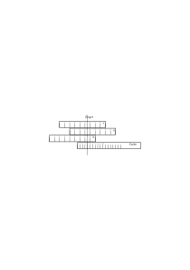

That would be, for example, the statement that a coloured circle of colour NN & radius … lies at position … . One might think of the signals on a ship: “Stop, full speed, etc.”

### [54\[3\]](https://cdn.wittgensteinnachlass.com/2000px/webp/Ms-108/54.webp)

Incidentally, they need not be scales, for one cannot call a disc with the signals “vacant” & “occupied” a scale. It can also be a disc that is half black and half white.

### [54\[4\]](https://cdn.wittgensteinnachlass.com/2000px/webp/Ms-108/54.webp)

What can be _not so_ can be otherwise.

### [54\[5\]](https://cdn.wittgensteinnachlass.com/2000px/webp/Ms-108/54.webp)

Sentences joined to one another by “and”, too, are connected _internally_.

### [54\[6\]](https://cdn.wittgensteinnachlass.com/2000px/webp/Ms-108/54.webp)

That all sentences contain time in some way seems accidental to us, compared with the fact that the truth-functions are applicable to all sentences. This seems to have to do with their essence as sentences, the other with the essence of reality as we find it.

### [54\[7\]](https://cdn.wittgensteinnachlass.com/2000px/webp/Ms-108/54.webp),[55\[1\]](https://cdn.wittgensteinnachlass.com/2000px/webp/Ms-108/55.webp)

True–False & the truth-functions have to do with the representation of reality by sentences. If someone were to say: well, how do you know that the whole of reality can be represented by sentences, the answer is: I know only that it can be represented by sentences in so far as it can be represented by sentences, and in language I cannot draw a boundary between a part that can & a part that cannot be represented in this way. ‘Language’ _means_ the totality of sentences.

### [55\[2\]](https://cdn.wittgensteinnachlass.com/2000px/webp/Ms-108/55.webp)

One might say: a sentence is what the truth-functions can be applied to. – The truth-functions are essential to _language_.

### [55\[3\]](https://cdn.wittgensteinnachlass.com/2000px/webp/Ms-108/55.webp)

From “the rose is not yellow” it does not follow that it is red, but from its being red it follows that it is not yellow: so one can say that the positive sentence says more than the negative one. (Provided this is not meant to signify anything further.)

### [55\[4\]](https://cdn.wittgensteinnachlass.com/2000px/webp/Ms-108/55.webp)

Syntax prohibits a construction like “A is green and A is red” (one’s first feeling is as if an injustice of a sort were being done to this sentence; as if its rights as a sentence were thereby curtailed.) But as far as “A is green” is concerned, the sentence “A is red” is, so to speak, not a _different_ sentence at all – & that is really what syntax registers – but a different form of the same sentence.

### [55\[5\]](https://cdn.wittgensteinnachlass.com/2000px/webp/Ms-108/55.webp),[56\[1\]](https://cdn.wittgensteinnachlass.com/2000px/webp/Ms-108/56.webp)

Syntax thus draws together sentences that are _one_ determination.

### [56\[2\]](https://cdn.wittgensteinnachlass.com/2000px/webp/Ms-108/56.webp)

03.01.1930

If I say that I did _not_ dream last night, I must nevertheless know where one would look for the dream. (I.e. the sentence “I dreamed”, applied to the situation, can only be false, not nonsensical.)

### [56\[3\]](https://cdn.wittgensteinnachlass.com/2000px/webp/Ms-108/56.webp)

I express the present situation by a position – the negative one – of the signal disc “dreams – no dreams”. But I must be able to distinguish it from other signal discs despite its negative position. I must know that it is _this_ signal disc that I am holding.

### [56\[4\]](https://cdn.wittgensteinnachlass.com/2000px/webp/Ms-108/56.webp)

One might now ask: does this mean that you did feel something in the night after all, a hint of a dream, so to speak, that makes you aware of the place where a dream would have been? Or when I say “I have no pain in my arm”, does that mean that I have a kind of shadowy feeling there that indicates the place where the pain would occur? But evidently not!

### [56\[5\]](https://cdn.wittgensteinnachlass.com/2000px/webp/Ms-108/56.webp),[57\[1\]](https://cdn.wittgensteinnachlass.com/2000px/webp/Ms-108/57.webp)

In what respect does the present painless state contain the possibility of pain?

### [57\[2\]](https://cdn.wittgensteinnachlass.com/2000px/webp/Ms-108/57.webp)

It makes a difference whether the answer to the question “have you any pain in your arm” is “no” or “I don’t understand the question”.

### [57\[3\]](https://cdn.wittgensteinnachlass.com/2000px/webp/Ms-108/57.webp)

If someone says: “for the word ‘pain’ to have meaning, it is necessary that one recognize pain when it occurs”, one can reply: “it is just as essential that one recognize the absence of pain”.

### [57\[4\]](https://cdn.wittgensteinnachlass.com/2000px/webp/Ms-108/57.webp)

One might say: yes, but the positive state of affairs is the primary one. The problem is connected with the fact that the word “pain” has meaning only in a sentence & that the state of being in pain is conveyed not by the word “pain” but by the _sentence_ “I am in pain”.

### [57\[5\]](https://cdn.wittgensteinnachlass.com/2000px/webp/Ms-108/57.webp)

“Pain” means, so to speak, the whole scale & not one of its marks. That it stands at a particular mark can only be expressed by a _sentence_.

### [57\[6\]](https://cdn.wittgensteinnachlass.com/2000px/webp/Ms-108/57.webp),[58\[1\]](https://cdn.wittgensteinnachlass.com/2000px/webp/Ms-108/58.webp)

If the knife is not lying on the book, then no shadow of the knife lies on the book either, but the multiplicity that affords the possibility is there & in the sentence it is used & represented as reality. It cannot be otherwise with stomach aches & dreams etc. than with the position of objects in space.

### [58\[2\]](https://cdn.wittgensteinnachlass.com/2000px/webp/Ms-108/58.webp)

What sort of question would this be: Could everything, then, _fail_ to be the case & nothing be the _case_? Could one imagine a state of a world in which only negative sentences could be uttered with truth? Is that not all manifestly nonsense? Are there, then, essentially negative & positive states?

### [58\[3\]](https://cdn.wittgensteinnachlass.com/2000px/webp/Ms-108/58.webp)

If one takes sentences as instructions for making models, their pictorial character becomes even clearer.

### [58\[4\]](https://cdn.wittgensteinnachlass.com/2000px/webp/Ms-108/58.webp)

For in order for the word to guide my hand, it _must_ have the multiplicity of the desired activity.

### [58\[5\]](https://cdn.wittgensteinnachlass.com/2000px/webp/Ms-108/58.webp),[59\[1\]](https://cdn.wittgensteinnachlass.com/2000px/webp/Ms-108/59.webp)

And this must also explain the essence of the negative sentence. Thus, for example, someone could show that he understands the sentence “the book is not red” by throwing away the red paint while making a model. This & similar cases would also show how the negative sentence has the multiplicity of the sentence negated & not of _those_ sentences that might be true in its place.

### [59\[2\]](https://cdn.wittgensteinnachlass.com/2000px/webp/Ms-108/59.webp)

What does it mean to say “I do not see any red around me, but if you give me a box of paints, I can show it to you in it”? How can one _know_ that one can show it, if …; that one can therefore recognize it when one sees it.

### [59\[3\]](https://cdn.wittgensteinnachlass.com/2000px/webp/Ms-108/59.webp)

What is meant here can be of two kinds: It might express the expectation that I will recognize it when it is shown to me, in the sense in which I expect to get a headache if I receive a blow to the head; that is then, as it were, a physical expectation, with the same basis as all expectations concerning the occurrence of physical events. Or else it is not a question of expecting a physical event at all, & so my sentence cannot be falsified if this event fails to occur. Rather, the sentence says, as it were, that I possess a prototype with which I could compare the colour at any time (and this possibility is a logical possibility).

### [59\[4\]](https://cdn.wittgensteinnachlass.com/2000px/webp/Ms-108/59.webp),[60\[1\]](https://cdn.wittgensteinnachlass.com/2000px/webp/Ms-108/60.webp)

On the first view: if I do in fact give a sign of recognition at the sight of a particular colour, how do I know that it is the colour I had _meant_?

### [60\[2\]](https://cdn.wittgensteinnachlass.com/2000px/webp/Ms-108/60.webp)

But in what form can I carry the prototype of the colour within me? I can say, for example, “no, it isn’t _that_ colour, but it’s close, the colour I mean is a little darker still”. In some sense I know the place of the colour I mean & I recognize an approximation to that place as such.

### [60\[3\]](https://cdn.wittgensteinnachlass.com/2000px/webp/Ms-108/60.webp)

The sentences of our grammar are always of the kind that physical sentences are, & not of the kind that sentences which are “primary” & deal with the immediate are.

### [60\[4\]](https://cdn.wittgensteinnachlass.com/2000px/webp/Ms-108/60.webp)

04.01.1930

The negative sentence draws the same boundary as the positive one, only interprets it differently.

### [60\[5\]](https://cdn.wittgensteinnachlass.com/2000px/webp/Ms-108/60.webp)

“Is the sheet blue” “no, it isn’t blue”: So I rule out blue. But how can I rule out blue by means of words? This is the same problem as: how can I get someone to choose (or rule out) a particular colour by means of these words?

### [60\[6\]](https://cdn.wittgensteinnachlass.com/2000px/webp/Ms-108/60.webp),[61\[1\]](https://cdn.wittgensteinnachlass.com/2000px/webp/Ms-108/61.webp)

The connection of the word “blue” with the colour blue cannot be different from that of one word with another.

### [61\[2\]](https://cdn.wittgensteinnachlass.com/2000px/webp/Ms-108/61.webp)

One could imagine a little blue tablet belonging to the word “blue” that is no more always in its place than, say, the negation of a sentence is when the sentence itself is present.

### [61\[3\]](https://cdn.wittgensteinnachlass.com/2000px/webp/Ms-108/61.webp)

Understanding the sentence “the sheet is not blue” also involves my being able to make a coloured picture of the sheet as it is not.

### [61\[4\]](https://cdn.wittgensteinnachlass.com/2000px/webp/Ms-108/61.webp)

There are two different ways in which one might come to realize that someone else does not have the same language as oneself. Either by hearing him make an utterance which is ungrammatical in my language, or by his asserting a sentence which would be false in my language. In the one case he might say, for instance, “a & b are identical to the same degree”, in the other “the sky is cloudless & red”.

### [61\[5\]](https://cdn.wittgensteinnachlass.com/2000px/webp/Ms-108/61.webp),[62\[1\]](https://cdn.wittgensteinnachlass.com/2000px/webp/Ms-108/62.webp)

A naïve view of the meaning of a word is that in hearing or reading the word one “imagines” its meaning. And the very same question does indeed arise for this imagining as for a word’s having meaning. For if, for example, one imagines the colour sky blue & recognizing & looking for the colour are to be based on this image, then surely one must say that the image of the colour (in the ordinary sense at least) is not identical with the colour actually seen & how can a comparison now take place? Or does the comparison take place not between the colour & the image of it at all, but between something derived from the colour seen & the image?

### [62\[2\]](https://cdn.wittgensteinnachlass.com/2000px/webp/Ms-108/62.webp)

If I say “this table top is not blue”, I must see _the way to_ blue. That is (precisely) what the possibility of recognizing blue consists in. I have also said: “I must know what it would be like if it were blue”.

### [62\[3\]](https://cdn.wittgensteinnachlass.com/2000px/webp/Ms-108/62.webp)

But what does it mean to know what it would be like?

### [62\[4\]](https://cdn.wittgensteinnachlass.com/2000px/webp/Ms-108/62.webp),[63\[1\]](https://cdn.wittgensteinnachlass.com/2000px/webp/Ms-108/63.webp)

Can that mean: recognizing it when one encounters it? But how do I know that I shall recognize blue when I get to see it? Perhaps that won’t happen for ten years & by then I’ll have gone mad. So is this “knowing what it would be like” really only a conjecture? And in that case one can only conjecture whether the sentence has sense. But that is surely not how it is!

### [63\[2\]](https://cdn.wittgensteinnachlass.com/2000px/webp/Ms-108/63.webp)

Can one not show that one understands a word by giving the rules of syntax that relate to it or – what comes to the same thing – by giving sentences with sense in which the word occurs (whether they are true or false)?

### [63\[3\]](https://cdn.wittgensteinnachlass.com/2000px/webp/Ms-108/63.webp)

If I understand the sentence “the table is blue”, whether or not I see something blue in front of me, I must know whether, for example, blue is a certain degree of brightness of red or whether blue is a particular sweet taste, etc.

### [63\[4\]](https://cdn.wittgensteinnachlass.com/2000px/webp/Ms-108/63.webp)

I want to know what it means to understand a sentence: How does one verify this statement, then?

### [63\[5\]](https://cdn.wittgensteinnachlass.com/2000px/webp/Ms-108/63.webp)

05.01.1930

Surely not by actually recognizing – say – blue on some later occasion!

### [63\[6\]](https://cdn.wittgensteinnachlass.com/2000px/webp/Ms-108/63.webp)

Is it not through introspection that I know I understand a sentence? Is subsequent verification conceivable here?

### [63\[7\]](https://cdn.wittgensteinnachlass.com/2000px/webp/Ms-108/63.webp)

Surely the naïve theory of _forming an image for oneself_ cannot be wholly wrong.

### [63\[8\]](https://cdn.wittgensteinnachlass.com/2000px/webp/Ms-108/63.webp),[64\[1\]](https://cdn.wittgensteinnachlass.com/2000px/webp/Ms-108/64.webp)

The blind alley is the (real) danger of philosophizing. That is the danger of thinking about something that does not concern one.

### [64\[2\]](https://cdn.wittgensteinnachlass.com/2000px/webp/Ms-108/64.webp)

I know I demonstrate my understanding of the sentence “A is blue” by pointing to a blue object, or to a bluish one & calling it bluish, or to two objects & saying “this one is more bluish than the other”. But is that precisely what my understanding _consists_ in? Is it the case here too that “understanding” has, as it were, facets, only a few of which come into play in the particular case? And would it be like that with grammar too, i.e. with the rules of syntax?

### [64\[3\]](https://cdn.wittgensteinnachlass.com/2000px/webp/Ms-108/64.webp)

I see something & the fact that the description “the table is white” occurs to me on seeing it is no less remarkable than my arriving at the description: the table is not blue.

### [64\[4\]](https://cdn.wittgensteinnachlass.com/2000px/webp/Ms-108/64.webp)

16.02.1930

In what respect is the concept of cardinal number connected with the concept of subject & predicate?

### [64\[5\]](https://cdn.wittgensteinnachlass.com/2000px/webp/Ms-108/64.webp),[65\[1\]](https://cdn.wittgensteinnachlass.com/2000px/webp/Ms-108/65.webp)

Russell & Frege, in a sense, understand the concept as a property of a thing. But it is very unnatural to understand the words man, tree, treatise, circle as properties of a substrate.

### [65\[2\]](https://cdn.wittgensteinnachlass.com/2000px/webp/Ms-108/65.webp)

The principium individuationis must _have_ the property. Must be its _bearer_.

### [65\[3\]](https://cdn.wittgensteinnachlass.com/2000px/webp/Ms-108/65.webp)

If a table is painted brown, it is easy to think of the wood as the bearer of the property brown & one can imagine what remains when the colour changes. Indeed, even in the case of _one_ particular circle that appears now red, now blue. So it is easy to imagine _what_ is red, but hard to imagine what is circular. What _remains_ here when shape & colour change? For position is part of the shape & it is arbitrary for me to stipulate that the centre is to remain fixed & that the shape is to change only through a change in the radius.

### [65\[4\]](https://cdn.wittgensteinnachlass.com/2000px/webp/Ms-108/65.webp),[66\[1\]](https://cdn.wittgensteinnachlass.com/2000px/webp/Ms-108/66.webp)

We shall have to stick to ordinary language again, and it says that a _patch_ is circular. It is clear that the expression bearer of the property gives a completely false – impossible – image here. – If I have a lump of clay, I can think of it as the bearer of a shape & that is more or less where this image comes from too.

### [66\[2\]](https://cdn.wittgensteinnachlass.com/2000px/webp/Ms-108/66.webp)

“The patch changes its shape” & “the lump of clay changes its shape” are, after all, fundamentally different sentential forms.

### [66\[3\]](https://cdn.wittgensteinnachlass.com/2000px/webp/Ms-108/66.webp)

Numerals are often used as names.

### [66\[4\]](https://cdn.wittgensteinnachlass.com/2000px/webp/Ms-108/66.webp)

If I point to something with my hand & say “this is red”, “this is hard”, “this is wood”, “this is a chair”, then “this” evidently means something different each time.

### [66\[5\]](https://cdn.wittgensteinnachlass.com/2000px/webp/Ms-108/66.webp)

One can say “measure to see whether _that_ is a circle” or “look to see whether _that_ thing lying there is a hat”. One can also say “measure to see whether _that_ is a circle or an ellipse”, but not “… whether that is a circle or a hat”, nor “look to see whether that is a hat or red.”

### [66\[6\]](https://cdn.wittgensteinnachlass.com/2000px/webp/Ms-108/66.webp)

If I point to a line & say “that is a circle”, one can object that if it were not a circle, it would no longer be _that_. That is to say: What I mean by the word “that” must be independent of what is stated about it.

### [66\[7\]](https://cdn.wittgensteinnachlass.com/2000px/webp/Ms-108/66.webp)

“Was _that_ thunder or a shot” But in this case one cannot ask “was that a noise”.

### [67\[1\]](https://cdn.wittgensteinnachlass.com/2000px/webp/Ms-108/67.webp)

But what if I say “I see 3 lines here”? Surely that does not mean 3 things that are lines.

### [67\[2\]](https://cdn.wittgensteinnachlass.com/2000px/webp/Ms-108/67.webp)

“There are 5 different colours in this picture.” How is this sentence to be explained?

### [67\[3\]](https://cdn.wittgensteinnachlass.com/2000px/webp/Ms-108/67.webp)

17.02.1930

In passing, the equation of a circle is the sign for the concept circle if no definite values are substituted for the coordinates of the centre & the radius, or if these are given only as lying within certain intervals. The object that falls under the concept is then the circle given with a definite position & size.

### [67\[4\]](https://cdn.wittgensteinnachlass.com/2000px/webp/Ms-108/67.webp)

In the statement there are 3 circles in this square, the 3 evidently relates to “there are ξ circles in this square” & the concept circle must there be given as above. But one could also say that the 3 relates to “circles in this square”. It is evident that I can frame the description so that it needs a number to complete it.

### [67\[5\]](https://cdn.wittgensteinnachlass.com/2000px/webp/Ms-108/67.webp)

What I count is the occurrence of a certain characteristic.

### [67\[6\]](https://cdn.wittgensteinnachlass.com/2000px/webp/Ms-108/67.webp),[68\[1\]](https://cdn.wittgensteinnachlass.com/2000px/webp/Ms-108/68.webp)

18.02.1930

How do two red circles of equal size differ? This question sounds as if they were, after all, more or less one thing & distinguished only by some small detail.

### [68\[2\]](https://cdn.wittgensteinnachlass.com/2000px/webp/Ms-108/68.webp)

In representation by equations, what they have in common is expressed by the form of the equation & their difference by the difference in the coordinates of their centres.

### [68\[3\]](https://cdn.wittgensteinnachlass.com/2000px/webp/Ms-108/68.webp)

It is as though the coordinates of the centres were what corresponded here to the objects falling under the concept.

### [68\[4\]](https://cdn.wittgensteinnachlass.com/2000px/webp/Ms-108/68.webp)

Could one not say “this point is the centre of a circle” instead of “this is a circle”? For being the centre of a circle is an external property of the point.

### [68\[5\]](https://cdn.wittgensteinnachlass.com/2000px/webp/Ms-108/68.webp)

In truth, the pair of numbers that represents the coordinates of the centre is no more a thing than the centre is; rather, the pair of numbers characterizes just that feature of the symbol which constitutes the “difference” between the circles.

### [68\[6\]](https://cdn.wittgensteinnachlass.com/2000px/webp/Ms-108/68.webp)

Three circles are represented by the equation of a circle & three pairs (or triples) of numbers.

### [69\[1\]](https://cdn.wittgensteinnachlass.com/2000px/webp/Ms-108/69.webp)

When we say that 3 elements admit of 6 permutations, are we specifying a number in the way we do when we say “there are 6 people in this room”? Certainly not.

### [69\[2\]](https://cdn.wittgensteinnachlass.com/2000px/webp/Ms-108/69.webp)

The very words “they admit of” show that something different is at issue here. What does it mean to say “6 permutations _are possible_”?

### [69\[3\]](https://cdn.wittgensteinnachlass.com/2000px/webp/Ms-108/69.webp)

If one wants to know what a sentence means, one can always ask “how do I know that”. Do I know that there are 6 permutations of 3 elements in the same way as I know that there are 6 people in the room? No. That is why the former sentence is of a different _kind_ from the latter.

### [69\[4\]](https://cdn.wittgensteinnachlass.com/2000px/webp/Ms-108/69.webp)

Another equally useful question is “how is this sentence actually applied in practice” & there that proposition of combinatorics is of course applied as a rule of inference, in passing from one sentence to another, each of which describes a reality, not a _possibility_.

### [69\[5\]](https://cdn.wittgensteinnachlass.com/2000px/webp/Ms-108/69.webp)

19.02.1930

One can presumably say quite generally that the use of apparent sentences about possibilities – & impossibilities – is always to pass from one actual sentence to another.

### [69\[6\]](https://cdn.wittgensteinnachlass.com/2000px/webp/Ms-108/69.webp),[70\[1\]](https://cdn.wittgensteinnachlass.com/2000px/webp/Ms-108/70.webp)

Thus, for example, from the sentence “I designate seven squares by permutations of a, b, c” I can infer that among them there is at least one with repetition. – And from the sentence “I distribute 5 spoons among 4 cups” it follows that one cup gets 2 spoons, and so on.

### [70\[2\]](https://cdn.wittgensteinnachlass.com/2000px/webp/Ms-108/70.webp)

If someone disagrees with us about the number of people in this room & asserts that there are 7, while we see only 6, we can understand him even though we disagree with him; but if he asserts that for him there are 5 pure colours, then we do not understand him, or we must assume that we completely misunderstand each other. This number is delimited in the dictionary & the grammar & not within language.

### [70\[3\]](https://cdn.wittgensteinnachlass.com/2000px/webp/Ms-108/70.webp),[71\[1\]](https://cdn.wittgensteinnachlass.com/2000px/webp/Ms-108/71.webp)

What is needed to describe – say – a book’s being in a particular place. The internal description of the book, i.e. of the concept, & the description of its position, & that could be given by specifying the coordinates of three points. The sentence “a book of this kind is _here_” would then mean that it has _these_ 3 triples of determining coordinates. For specifying the here must not prejudge _what_ is here. But does it not amount to the same thing whether I say “_this_ is a book” or “here is a book”? The sentence would then come down to saying something like “these are three (particular) corners of a book of this kind.”

### [71\[2\]](https://cdn.wittgensteinnachlass.com/2000px/webp/Ms-108/71.webp)

Similarly, one can also say “this circle is the projection of a sphere” or “this is the appearance of a human being”.

### [71\[3\]](https://cdn.wittgensteinnachlass.com/2000px/webp/Ms-108/71.webp)

So if I write the sentence “there are 3 circles in this square” in the form (∃x,y,z) φx ∙ φy ∙ φz, it seems to me that the x, y, z must be triples of numbers of which φ( ) says that they are the coordinates of the centre & the radius of a circle.

### [71\[4\]](https://cdn.wittgensteinnachlass.com/2000px/webp/Ms-108/71.webp)

All I am saying comes down to this: φ(x) must be an _external_ description of x.

### [71\[5\]](https://cdn.wittgensteinnachlass.com/2000px/webp/Ms-108/71.webp)

Now if I say in this sense, in three-dimensional space, “here is a circle” & on another occasion “here is a sphere”, are the two instances of _here_ of the same kind? Both could, after all, be the three coordinates of the centre in question. But the position of the circle in 3-dimensional space is not determined by the coordinates of its centre.

### [71\[6\]](https://cdn.wittgensteinnachlass.com/2000px/webp/Ms-108/71.webp),[72\[1\]](https://cdn.wittgensteinnachlass.com/2000px/webp/Ms-108/72.webp)

If I am right, there is no concept “pure colour”; the sentence “A has a pure colour” simply means “A is red or yellow or blue or green”. “This hat belongs to either A or B or C” is not the same as “this hat belongs to someone in this room” even if in fact only A, B & C are in the room, for that has to be stated in addition. There are two pure colours on this surface _means_: on this surface there are red & yellow or red & blue or red & green or yellow & blue or etc. Now if I cannot say “there are 4 pure colours”, the pure colours & the number 4 are nevertheless connected somehow & that too must find expression somehow. – E.g. when I say “on this surface I see four colours: yellow, blue, red, green.”

### [72\[2\]](https://cdn.wittgensteinnachlass.com/2000px/webp/Ms-108/72.webp),[73\[1\]](https://cdn.wittgensteinnachlass.com/2000px/webp/Ms-108/73.webp)

Now it must be quite analogous with permutations. The permutations (without repetition) of AB _are_ AB, BA. They are not the extension of a concept; rather, they alone are the concept. But then one cannot say that there are 2 of them. And yet that is apparently what one does in combinatorics. It seems to me that what is involved here is a correspondence like that between algebra & the inductions of arithmetic. Or is the connection that between geometry & arithmetic? The proposition that there are 2 permutations of AB really is quite analogous to the proposition that the straight line intersects the circle at 2 points. Or that an equation of the 2nd degree has 2 roots.

### [73\[2\]](https://cdn.wittgensteinnachlass.com/2000px/webp/Ms-108/73.webp),[74\[1\]](https://cdn.wittgensteinnachlass.com/2000px/webp/Ms-108/74.webp)

When one says that AB admits of 2 permutations, it sounds as if one were making a _general_ statement, analogous to “there are 2 people in the room”, where nothing further is said or need be known about the people. But it is not like that in the case of AB. I cannot describe AB, BA more generally, and so the proposition that 2 permutations are possible cannot say less than that the permutations AB & BA are possible. To say that 6 permutations of 3 elements are possible cannot say less, i.e. say something more general, than the schema

a b c

a c b

b a c

b c a

c a b

c b a

shows. For it is _impossible_ to know the number of possible permutations without knowing the permutations themselves. And if that were not so, combinatorics could not arrive at its general formulae. The law we recognize in the formation of the permutations is represented by the equation p = n!. In the same sense, I believe, in which a circle is represented by the equation of a circle. – I can of course assign the number 2 to the permutations AB, BA, and likewise 6 to the permutations of ABC that have been worked out, but that does not give me the proposition of combinatorics. – What I see in AB, BA is an internal relation, which therefore cannot be described. I.e. what makes this class of permutations complete cannot be described. – I can only count what is actually there, not possibilities. – But I can, e.g., calculate how many lines a person has to write if they put a permutation of 3 elements on each line & go on permuting until they cannot go any further without repetition. And that means they need 6 lines to write down the permutations a b c, a c b etc. etc. in this way, for these are precisely “_the_ permutations of a, b, c”. But it makes no sense to say that these are all the permutations of a b c.

### [74\[2\]](https://cdn.wittgensteinnachlass.com/2000px/webp/Ms-108/74.webp)

Isn’t the theory of harmony at least partly phenomenology, and so grammar?

### [74\[3\]](https://cdn.wittgensteinnachlass.com/2000px/webp/Ms-108/74.webp)

20.02.1930

A calculating machine for combinatorics is conceivable, quite analogous to the Russian one.

### [74\[4\]](https://cdn.wittgensteinnachlass.com/2000px/webp/Ms-108/74.webp)

It is clear that there is a mathematical question “how many permutations of – e.g. – 4 elements are there”, a question of exactly the same kind as “what is 25 × 18”. For there is a general method for solving both. But the question exists only in relation to this method.

### [75\[1\]](https://cdn.wittgensteinnachlass.com/2000px/webp/Ms-108/75.webp)

The sentence that there are 6 permutations of 3 elements is identical with the permutation schema, & that is why there is no sentence here “there are 7 permutations of 3 elements”, for no such schema corresponds to it.

### [75\[2\]](https://cdn.wittgensteinnachlass.com/2000px/webp/Ms-108/75.webp)

In this case one could also take the number 6 to be a different kind of count, the permutation number of a, b, c. Permuting as a different kind of counting.

### [75\[3\]](https://cdn.wittgensteinnachlass.com/2000px/webp/Ms-108/75.webp)

One can also say that the sentence “there are 6 permutations of 3 elements” stands in exactly the same relation to the sentence “there are 6 people in the room” as does the sentence 3 + 3 = 6, which one could also express in the form “there are 6 units in 3 + 3”. And just as in the one case I count the rows in the permutation schema, so in the other I can count the strokes in 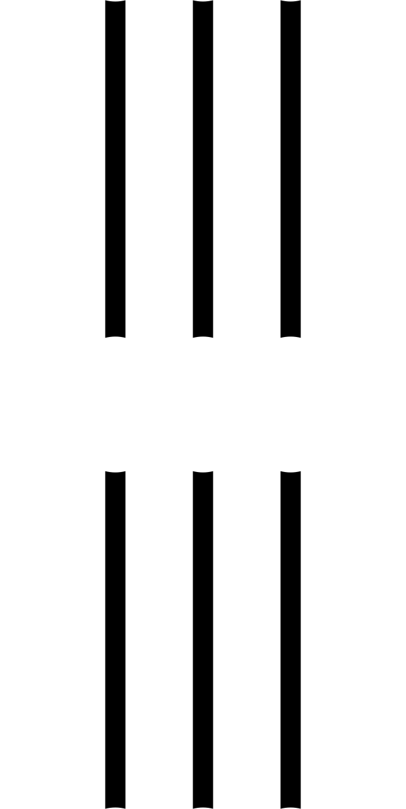.

### [75\[4\]](https://cdn.wittgensteinnachlass.com/2000px/webp/Ms-108/75.webp)

Just as I can prove 4 × 3 = 12 by means of the schema

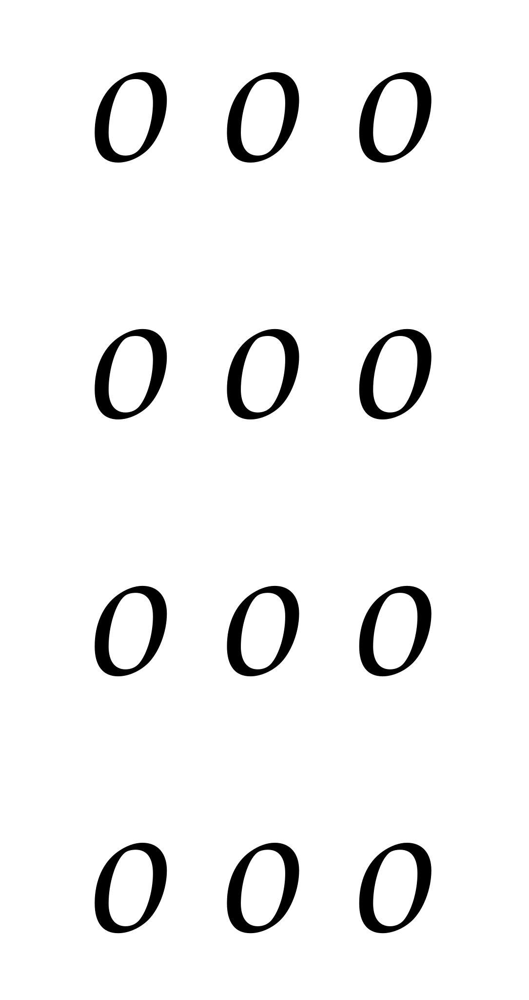

so I can prove 3! = 6 by means of the permutation schema.

### [75\[5\]](https://cdn.wittgensteinnachlass.com/2000px/webp/Ms-108/75.webp),[76\[1\]](https://cdn.wittgensteinnachlass.com/2000px/webp/Ms-108/76.webp)

In what respect can one say that grey is a mixture of black & white _in the same sense_ in which orange is a mixture of red & yellow. And that it does not lie between black & white in the sense in which red lies between bluish red & orange. If one represents the colours by a

double cone instead of an octahedron, there is only one _between_ on the colour circle, & on it red appears between purple & orange in the same sense in which purple lies between blue & red. And if that really is all one can say, then representation by the double cone suffices, or at least representation by a double 8-sided pyramid.

### [76\[2\]](https://cdn.wittgensteinnachlass.com/2000px/webp/Ms-108/76.webp)

Now, curiously, it seems clear from the outset that one cannot say that red has an orange tinge in the same sense in which one says that orange has a reddish tinge. That is, it seems clear that the expressions “ξ consists of x & y” & “ξ is the component common to x & y” are not interchangeable here. If they were interchangeable, the relation “between” would suffice for the representation.

### [76\[3\]](https://cdn.wittgensteinnachlass.com/2000px/webp/Ms-108/76.webp)

The expressions “component common to” & “mixture of” do not differ in meaning at all unless one can be used where the other cannot.

### [77\[1\]](https://cdn.wittgensteinnachlass.com/2000px/webp/Ms-108/77.webp)

Now it has no bearing on our investigation that if I mix a blue & a green pigment I get a blue-green one, but if I mix a blue-green & a bluish red one, no blue one results.

### [77\[2\]](https://cdn.wittgensteinnachlass.com/2000px/webp/Ms-108/77.webp)

Yellowish red & bluish red contain a common component in a sense in which red & blue do not. Or can I say that they _both have something of_ violet just as orange & violet both have something of red?!

### [77\[3\]](https://cdn.wittgensteinnachlass.com/2000px/webp/Ms-108/77.webp)

Does grey have something of black in the same sense in which black has something of grey?! Obviously not, for I can get from white to black via grey, but not from grey to white via black.

### [77\[4\]](https://cdn.wittgensteinnachlass.com/2000px/webp/Ms-108/77.webp)

One could also ask it this way: is it an accident of language that one does not call blue orange-violet?

### [77\[5\]](https://cdn.wittgensteinnachlass.com/2000px/webp/Ms-108/77.webp)

I would like to say that blue is not a colour in the same sense as bluish red. But how is that expressed?

### [77\[6\]](https://cdn.wittgensteinnachlass.com/2000px/webp/Ms-108/77.webp),[78\[1\]](https://cdn.wittgensteinnachlass.com/2000px/webp/Ms-108/78.webp)

Could one ask it like this, perhaps: if I were to remember four colours A, B, C, D or carry samples of them around with me, A being a blue-green, B a bluish red, C a yellowish green & D a yellowish red, – could I not then represent all colours & mixtures of colours just as well with these four as with the so-called pure colours?

### [78\[2\]](https://cdn.wittgensteinnachlass.com/2000px/webp/Ms-108/78.webp)

If my view is right, then “Red is a pure colour” is not a sentence, & what it is meant to indicate cannot be decided by experiment. It is then inconceivable that red should appear pure to me on one occasion and bluish red on another.

### [78\[3\]](https://cdn.wittgensteinnachlass.com/2000px/webp/Ms-108/78.webp)

The question is whether the internal relation between two colours is determined solely by the paths along which they can be transformed into one another.

### [78\[4\]](https://cdn.wittgensteinnachlass.com/2000px/webp/Ms-108/78.webp)

The remark I made above about mixing pigments gives a hint as to how the purity of a colour could be defined as an external property, that is, in a way I do not mean.

### [78\[5\]](https://cdn.wittgensteinnachlass.com/2000px/webp/Ms-108/78.webp),[79\[1\]](https://cdn.wittgensteinnachlass.com/2000px/webp/Ms-108/79.webp)

21.02.1930

Besides the transition from colour to colour on the colour circle, there seems to be another distinct transition, the one we have before us when we see small patches of one colour interspersed with small patches of the other. I mean here, of course, a transition that is _seen_. And this kind of transition gives the word mixture a new meaning, which does not coincide with the relation “between” on the colour circle.

### [79\[2\]](https://cdn.wittgensteinnachlass.com/2000px/webp/Ms-108/79.webp)

One could describe it like this: I can imagine an orange patch coming about through interspersing small red & yellow patches, but not a red one through interspersing violet & orange ones. – In this sense grey is a mixture of black & white & pink a mixture of red & white, but white is not a mixture of pink & a whitish green. Now I do not mean that it is established by an experiment in mixing that certain colours arise in this way from others. I could carry out the experiment with a spinning colour disc, say. It may then succeed or fail, but that only shows whether or not the visual process in question can be brought about in this physical way; it does not show whether it is possible. Just as the physical subdivision of a surface cannot establish or disprove its visual divisibility. For suppose I no longer see a physical subdivision as a visual subdivision, but when drunk I see the undivided surface as divided; was the visual surface then not divisible?

### [80\[1\]](https://cdn.wittgensteinnachlass.com/2000px/webp/Ms-108/80.webp)

Visual space & the retina. It is as if one were to project a sphere orthogonally onto a plane, rather in the way the two hemispheres of the earth are represented in an atlas, & someone might then think that what goes on in the plane outside the two projections of the sphere still corresponds to a possible extension of what is on the sphere. What is being projected here is a _complete space_ onto a _part_ of another space; and it is analogous with the limits of language in the dictionary.

### [80\[2\]](https://cdn.wittgensteinnachlass.com/2000px/webp/Ms-108/80.webp)

One might say that violet & orange partly cancel each other out when mixed, but that red & yellow do not.

### [80\[3\]](https://cdn.wittgensteinnachlass.com/2000px/webp/Ms-108/80.webp)

Orange is in any case a mixture of red & yellow in a sense in which yellow is not a mixture of red & green, even though yellow lies between red & green on the circle. And if that were obviously nonsense, the question is at what point it begins to make sense; i.e. when I now move from red & green closer to yellow on the circle & call yellow a mixture of the two colours in question.

### [80\[4\]](https://cdn.wittgensteinnachlass.com/2000px/webp/Ms-108/80.webp),[81\[1\]](https://cdn.wittgensteinnachlass.com/2000px/webp/Ms-108/81.webp)

For I no doubt recognize in yellow its affinity with red & green – namely the possibility of reddish yellow & greenish yellow – & yet I do not recognize green & red as constituents of yellow in the sense in which I recognize red & yellow as constituents of orange. Or again: yellow is not between green & red in the sense in which grey is between black & white, but orange does lie between yellow & red in this sense.

### [81\[2\]](https://cdn.wittgensteinnachlass.com/2000px/webp/Ms-108/81.webp)

I want to say that red is between violet & orange only in the same sense in which white is between pink & greenish white. But in this sense is not every colour between any two others, or at least between two that one can reach from the third by independent paths. Can one say that in this sense a colour lies between two others only in a given continuous transition. Say, then, blue between red & black.

### [81\[3\]](https://cdn.wittgensteinnachlass.com/2000px/webp/Ms-108/81.webp),[82\[1\]](https://cdn.wittgensteinnachlass.com/2000px/webp/Ms-108/82.webp)

Is it then like this: to say that a patch has a colour that is a mixture of orange & violet ascribes a different colour to it from saying that the patch has the colour that orange & violet have in common?

But that will not do either; for in the sense in which orange is a mixture of red & yellow, there is no mixture at all of orange & violet. If I imagine the mixture of a blue-green & a yellowish green, I see that it cannot simply take place, but that one constituent must first, as it were, be killed before the union can take place. That is not the case with red & yellow. Here I do not see a continuous transition – by way of green – before me in my imagination; rather, only the discrete shades are involved.

### [82\[2\]](https://cdn.wittgensteinnachlass.com/2000px/webp/Ms-108/82.webp)

I see the incompatible constituents in blue-green & yellowish green, but not in blue & green.

### [82\[3\]](https://cdn.wittgensteinnachlass.com/2000px/webp/Ms-108/82.webp)

22.02.1930

The boundlessness of visual space is most evident when we see nothing, in complete darkness.

### [82\[4\]](https://cdn.wittgensteinnachlass.com/2000px/webp/Ms-108/82.webp),[83\[1\]](https://cdn.wittgensteinnachlass.com/2000px/webp/Ms-108/83.webp)

I must know the meaning of the expression mixture of the colours A & B in general, since its application is not limited to a finite number of pairs. So if, for example, one shows me some orange or other & some white, & says that the colour of a patch is a mixture of these two, I must understand that, & I can understand it. If one tells me that the colour of a patch lies between violet & red, I understand that & can imagine a more reddish violet than the one given. If one now tells me that the colour lies between this violet & an orange – when I have no particular continuous transition before me in the form of a painted colour circle – the most I can imagine is that a more reddish violet is meant here too, but a more reddish orange might also be meant, for there is no colour that lies _in the middle_ between the two colours independently of a given colour circle, & for that very reason I cannot say at what point the orange that forms the one boundary already lies too near yellow still to be mixed with violet; I simply cannot recognize which orange lies 45˚ away from violet on a colour circle. The mixed colour’s lying in between here is just the same as yellow’s lying between red & green.

### [83\[2\]](https://cdn.wittgensteinnachlass.com/2000px/webp/Ms-108/83.webp)

A proof by induction, if it were a proof, would be a proof of generality, not a proof of a certain property of all – numbers, for example.

### [83\[3\]](https://cdn.wittgensteinnachlass.com/2000px/webp/Ms-108/83.webp),[84\[1\]](https://cdn.wittgensteinnachlass.com/2000px/webp/Ms-108/84.webp)

When I say in the ordinary sense that red & yellow give orange, there is no talk here of a _quantity_ of the constituents. So if an orange is given, I cannot say that still _more_ red would have made it a redder orange (after all, I am not talking about pigments), although of course it makes sense to speak of a redder orange. But it makes no sense, for example, to say that this orange & this violet contain the same amount of red. And how much red would _red_ contain?

### [84\[2\]](https://cdn.wittgensteinnachlass.com/2000px/webp/Ms-108/84.webp),[85\[1\]](https://cdn.wittgensteinnachlass.com/2000px/webp/Ms-108/85.webp)

The comparison one is wrongly inclined to make is that of the series of colours with a system of two weights on a graduated rule: by increasing or shifting the weights I can shift the centre of gravity of the system as I please.

Now it is nonsense to believe that if I keep pan A at violet & shift B into the red-yellow region, S will move towards red. And what about the weights I put on the pans: does it mean anything, then, to say _more_ of _this_ red? If I am not speaking of pigments. This can only mean something if by pure red I mean a definite number of units assumed in advance. But then the full number of these units means nothing other than that the scale pan is at _red_. So once again the numbers giving the ratio specify only a position of the pan, not a position & a weight.

### [85\[2\]](https://cdn.wittgensteinnachlass.com/2000px/webp/Ms-108/85.webp)

Now as long as my two boundary colours on the colour circle are – for example – in the blue-red region & I shift the redder colour towards red, I can say that the resultant also moves towards red. But if I go past red with one of the boundary colours & move towards yellow, the resultant does not get redder now! Mixing a yellowish red with a violet does not make the violet redder than mixing pure red with the violet. After all, the fact that the one red has now become yellower takes something away from the red & does not add red.

### [85\[3\]](https://cdn.wittgensteinnachlass.com/2000px/webp/Ms-108/85.webp)

One could also describe it like this: if I have a paint pot with violet pigment & one with orange, & now increase the amount of orange added to the mixture, the colour of the mixture will indeed pass gradually from violet to orange, but not by way of pure red.

### [85\[4\]](https://cdn.wittgensteinnachlass.com/2000px/webp/Ms-108/85.webp),[86\[1\]](https://cdn.wittgensteinnachlass.com/2000px/webp/Ms-108/86.webp)

I can say of two different shades of orange that for neither have I any reason to say it is nearer red than yellow. – There simply is no “in the middle” here. – On the other hand, I cannot see two different reds & be in doubt whether either of them is pure red, & which. Pure red is a point, whereas the middle between yellow & red is not.

### [86\[2\]](https://cdn.wittgensteinnachlass.com/2000px/webp/Ms-108/86.webp)

It is true, of course, that one can say of an orange that it is nearly yellow, so that it lies “nearer yellow than red”, & something analogous of a nearly red orange. But it does not follow – as I once believed – that there must also be a middle in the sense of a point between red & yellow. This is just as it is with the geometry of visual space as compared with Euclidean geometry. The quantities here are of a different kind from those represented by our rational numbers. The concepts nearer & further are simply of no use here at all, or are misleading if we use these words.

### [86\[3\]](https://cdn.wittgensteinnachlass.com/2000px/webp/Ms-108/86.webp),[87\[1\]](https://cdn.wittgensteinnachlass.com/2000px/webp/Ms-108/87.webp)

Put it this way too: To say of a colour that it lies between red & blue does not determine it unambiguously. But I would have to determine the pure colours _unambiguously_ by specifying that they lie between certain mixed colours. So here the words “lie between” mean something _different_ from what they mean in the first case. That is: if the expression “lie between” designates in one case the mixture of two simple colours and in another the simple component common to two mixed colours, the multiplicity of its application is different in each case. And that is _not_ a difference of degree, but an expression of the fact that we are dealing with two quite different categories.

### [87\[2\]](https://cdn.wittgensteinnachlass.com/2000px/webp/Ms-108/87.webp)

We say that a colour cannot lie between greenish yellow & bluish red in the same sense as between red & yellow, but we can say that only because in this case we can distinguish the angle of 45˚; because we see the _points_ yellow, red. But it is precisely this distinction that is lacking in the other case – where mixed colours are taken as primary. So here, as it were, we could never be sure whether the mixture was still possible or not. Of course I could choose any mixed colours & stipulate that they enclose an angle of 45˚, but that would be quite arbitrary, whereas it is not arbitrary to say that there is no mixture of bluish red & greenish yellow in the first sense.

### [87\[3\]](https://cdn.wittgensteinnachlass.com/2000px/webp/Ms-108/87.webp),[88\[1\]](https://cdn.wittgensteinnachlass.com/2000px/webp/Ms-108/88.webp)

23.02.1930

It is just as nonsensical to say that a colour is an orange-violet as to say that a colour is a reddish green. Here, then, grammar supplies the “angle of 45˚” & now one mistakenly thinks that one need only halve it & do the same with the next section to get another section of 45˚. But this is just where the _simile_ of the angle breaks down.

### [88\[2\]](https://cdn.wittgensteinnachlass.com/2000px/webp/Ms-108/88.webp)

Of course one can also arrange all the shades of colour in a line, say with black & white as its limits, as has been done, but then one has to rule out certain transitions by means of rules, & in the end the picture on the straight line has to acquire the same kind of topological connectedness as the one on the octahedron. This is quite analogous to the relation of ordinary language to a “logically clarified” mode of expression. The two are perfectly equivalent, except that in the one the rules of grammar are already expressed by the outward appearance itself.

### [88\[3\]](https://cdn.wittgensteinnachlass.com/2000px/webp/Ms-108/88.webp),[89\[1\]](https://cdn.wittgensteinnachlass.com/2000px/webp/Ms-108/89.webp)

A sentence whose grammar has been made completely clear has been completely analysed logically. It may be written down or uttered in whatever form of expression.

### [89\[2\]](https://cdn.wittgensteinnachlass.com/2000px/webp/Ms-108/89.webp)

The octahedral representation is a _surveyable_ representation of the grammatical rules.

### [89\[3\]](https://cdn.wittgensteinnachlass.com/2000px/webp/Ms-108/89.webp)

To see that being a _pure_ colour is not a property – an external property – of a colour is to see that I could not _imagine_ that violet, say, has this property or that pure blue does not have it.

### [89\[4\]](https://cdn.wittgensteinnachlass.com/2000px/webp/Ms-108/89.webp)

Exactly the same is the case when we say that one note is in harmony with another. It is nonsense (not false) to say that the third of C is in harmony with C.

### [89\[5\]](https://cdn.wittgensteinnachlass.com/2000px/webp/Ms-108/89.webp)

If I see the regularity of a figure that I did not notice before, then I now see a different figure. Thus I can see ∣∣∣∣∣∣ as a special case of ∣∣ ∣∣

∣∣ or of ∣∣∣

∣∣∣ or of ∣ ∣∣∣∣

❘, etc. That merely shows that what we see is not as simple as it seems.

### [89\[6\]](https://cdn.wittgensteinnachlass.com/2000px/webp/Ms-108/89.webp),[90\[1\]](https://cdn.wittgensteinnachlass.com/2000px/webp/Ms-108/90.webp)

If one asks whether the musical scale admits of infinite continuation, the answer is not given by the fact that one no longer perceives vibrations of the air above a certain frequency as notes, for it might be possible to produce sensations of higher notes in some other way. Rather, the finitude of the musical scale can follow only from its internal properties. For instance, one might recognize from a note _itself_ that it is the endpoint – that is, that this last note, or the last notes, exhibit internal properties that the middle ones do not have.

Just as thin lines in our visual field exhibit internal properties that thicker ones do not have, so that there is a line in our visual field which is not a boundary between colours but itself has colour & yet in a certain sense has no width, so that when it intersects another such line one does not see four points

A, B, C, D.

### [90\[2\]](https://cdn.wittgensteinnachlass.com/2000px/webp/Ms-108/90.webp),[91\[1\]](https://cdn.wittgensteinnachlass.com/2000px/webp/Ms-108/91.webp)

To understand a church mode does not mean getting used to the sequence of notes, in the sense in which I can get used to a smell & after a while no longer find it unpleasant. Rather, it means hearing something new that I have not heard before, rather like – indeed, quite analogous to – suddenly being able to see ten strokes ∣∣∣∣∣∣∣∣∣∣ as a characteristic whole, when before I could see them only as 2 times 5 strokes. Or suddenly seeing in three dimensions the drawing of a cube that I had only been able to see as a flat ornament.

### [91\[2\]](https://cdn.wittgensteinnachlass.com/2000px/webp/Ms-108/91.webp)

24.02.1930

If I am given two shades close to one another – reddish, say – it is impossible to doubt whether both lie between red & blue, both between red & yellow, or one between red & blue and the other between red & yellow. And in deciding this we have also decided whether both mix with blue, both with yellow, or one with blue and the other with yellow, & this holds however close one brings the shades to one another, as long as we can distinguish the pigments at all.

### [91\[3\]](https://cdn.wittgensteinnachlass.com/2000px/webp/Ms-108/91.webp)

The theory of harmony is not a matter of taste.

### [91\[4\]](https://cdn.wittgensteinnachlass.com/2000px/webp/Ms-108/91.webp)

Comparison between a mathematical expedition & a polar expedition. Making this comparison makes sense & is very useful.

### [91\[5\]](https://cdn.wittgensteinnachlass.com/2000px/webp/Ms-108/91.webp),[92\[1\]](https://cdn.wittgensteinnachlass.com/2000px/webp/Ms-108/92.webp)

How strange it would be if a geographical expedition did not know for certain whether it had a destination, and hence whether it had a route at all. We cannot imagine that; it yields nonsense. But that is exactly how things stand with the mathematical expedition. So perhaps it will be best to drop the comparison altogether.

### [92\[2\]](https://cdn.wittgensteinnachlass.com/2000px/webp/Ms-108/92.webp)

It would be like an expedition that was not sure _of space_!

### [92\[3\]](https://cdn.wittgensteinnachlass.com/2000px/webp/Ms-108/92.webp)

25.02.1930

How can there be conjectures in mathematics? Or rather: What is the nature of what looks like a conjecture in mathematics? If, for instance, I make conjectures about the distribution of the prime numbers.

### [92\[4\]](https://cdn.wittgensteinnachlass.com/2000px/webp/Ms-108/92.webp)

I could imagine, for example, that someone wrote down prime numbers in order in my presence, that I did not know they were the prime numbers – I might think, for example, that they were numbers written down as they occurred to him – & that I then tried to find some law in them. I could now go so far as to put forward a hypothesis about this sequence of numbers, as about any other sequence yielded by a physical experiment. In what sense have I thereby put forward a hypothesis about the distribution of the prime numbers?

### [93\[1\]](https://cdn.wittgensteinnachlass.com/2000px/webp/Ms-108/93.webp)

One might say that the value of a hypothesis in mathematics is that it fixes one’s thoughts on a particular object – I mean a particular domain – & one might say “we shall certainly find out something interesting about these things”.

### [93\[2\]](https://cdn.wittgensteinnachlass.com/2000px/webp/Ms-108/93.webp)

The trouble is that our language designates such fundamentally different things by each of the words “question”, “problem”, “investigation”, “discovery”. Likewise with the words “inference”, “sentence”, “proof”.

### [93\[3\]](https://cdn.wittgensteinnachlass.com/2000px/webp/Ms-108/93.webp)

The question again is: what kind of verification do I accept for my hypothesis? Or can I provisionally – faute de mieux – accept empirical verification as long as I have no “rigorous proof”? No. As long as there is no such proof, there is no connection at all between my hypothesis & the “concept” of a prime number.

### [93\[4\]](https://cdn.wittgensteinnachlass.com/2000px/webp/Ms-108/93.webp)

The concept of a prime number is the general law by which I check whether a number is a prime number or not.

### [93\[5\]](https://cdn.wittgensteinnachlass.com/2000px/webp/Ms-108/93.webp),[94\[1\]](https://cdn.wittgensteinnachlass.com/2000px/webp/Ms-108/94.webp)

It is only the so-called proof that connects the hypothesis with the prime numbers _as such_ at all. And this is evident from the fact that – as I said – until then the hypothesis can be understood as purely physical. – If, on the other hand, the proof has been given, it does not at all prove what was conjectured, for I cannot conjecture into infinity. I can only conjecture what can be confirmed, but only a finite number of conjectures can be confirmed by experience & one cannot conjecture the proof as long as one does not have it & not then either.

### [94\[2\]](https://cdn.wittgensteinnachlass.com/2000px/webp/Ms-108/94.webp)

What is the analytical expression for the parallel axiom?

### [94\[3\]](https://cdn.wittgensteinnachlass.com/2000px/webp/Ms-108/94.webp)

How are the equations of analysis connected with the results of measurements in space? I believe the connection is this: they – the equations – determine what is to count as an accurate measurement and what as an error.

### [94\[4\]](https://cdn.wittgensteinnachlass.com/2000px/webp/Ms-108/94.webp),[95\[1\]](https://cdn.wittgensteinnachlass.com/2000px/webp/Ms-108/95.webp)

26.02.1930

Every hypothesis is a heuristic method. And I believe that this is also the position of Euclidean or some other geometry when applied to the space of physical measurements. It is quite otherwise with what one may call the geometry of visual space.

### [95\[2\]](https://cdn.wittgensteinnachlass.com/2000px/webp/Ms-108/95.webp)

One could almost speak of an external & an internal geometry. What is arranged in visual space stands in this _kind_ of order a priori, i.e. by its logical nature, & geometry here is simply grammar. What the physicist relates to one another in the geometry of physical space are instrument readings, which in their _internal_ nature are no different whether we live in a straight or a spherical physical space. That is, it is not an investigation of the logical properties of these readings that leads the physicist to an assumption about the kind of physical space, but the facts read off.

### [95\[3\]](https://cdn.wittgensteinnachlass.com/2000px/webp/Ms-108/95.webp)

In this sense the geometry of physics has to do not with possibility but with facts. It is confirmed by facts, namely in the sense in which _part_ of a hypothesis is confirmed.

### [95\[4\]](https://cdn.wittgensteinnachlass.com/2000px/webp/Ms-108/95.webp)

Comparison of working with the calculating machine and measuring geometrical figures.

### [95\[5\]](https://cdn.wittgensteinnachlass.com/2000px/webp/Ms-108/95.webp),[96\[1\]](https://cdn.wittgensteinnachlass.com/2000px/webp/Ms-108/96.webp)

Are we conducting an experiment in making this measurement, or is it as with the calculating machine, where we merely establish internal relations & the physical result of our operations proves nothing?

### [96\[2\]](https://cdn.wittgensteinnachlass.com/2000px/webp/Ms-108/96.webp)

In visual space there is of course no geometrical experiment.

### [96\[3\]](https://cdn.wittgensteinnachlass.com/2000px/webp/Ms-108/96.webp)

I believe this is one of the main points of the misunderstanding about the a priori & the a posteriori in geometry.

### [96\[4\]](https://cdn.wittgensteinnachlass.com/2000px/webp/Ms-108/96.webp)

The question is in what sense the results of measurements can tell us something about _that_ which we also see.

### [96\[5\]](https://cdn.wittgensteinnachlass.com/2000px/webp/Ms-108/96.webp)

27.02.1930

It is remarkable that all this is directly connected with the question of infinite possibility.

### [96\[6\]](https://cdn.wittgensteinnachlass.com/2000px/webp/Ms-108/96.webp)

What physics calls its space is a hypothesis – unlike what we call our visual space or our space of movement.

### [96\[7\]](https://cdn.wittgensteinnachlass.com/2000px/webp/Ms-108/96.webp)

What does the Euclidean axiom that all right angles are equal to one another mean?

### [96\[8\]](https://cdn.wittgensteinnachlass.com/2000px/webp/Ms-108/96.webp),[97\[1\]](https://cdn.wittgensteinnachlass.com/2000px/webp/Ms-108/97.webp)

The paradox that all I can do in logic is make agreements concerning the _signs_. But I make these conventions for the purpose of representation.

### [97\[2\]](https://cdn.wittgensteinnachlass.com/2000px/webp/Ms-108/97.webp)

28.02.1930

How could a sentence represent a state of affairs that the very form of the thought contradicts?

### [97\[3\]](https://cdn.wittgensteinnachlass.com/2000px/webp/Ms-108/97.webp)

It is extraordinarily difficult to get to grips with all the nonsense that people can accept.

### [97\[4\]](https://cdn.wittgensteinnachlass.com/2000px/webp/Ms-108/97.webp)

To be able to say something about colours – for example – I must observe certain rules. These rules are therefore a picture of the purpose for which they were laid down.

### [97\[5\]](https://cdn.wittgensteinnachlass.com/2000px/webp/Ms-108/97.webp)

The rules adapt the language to this purpose.

### [97\[6\]](https://cdn.wittgensteinnachlass.com/2000px/webp/Ms-108/97.webp),[98\[1\]](https://cdn.wittgensteinnachlass.com/2000px/webp/Ms-108/98.webp)

I could make the grammatical conventions first without anyone knowing that I am constructing a language or how I intend to apply it. The only way I can make it clear to him how I then apply it is to _apply_ it in front of him, if I do not translate it into a language he knows. Or I can conduct the investigation in a language he knows, that is, one whose application he knows, & then the grammatical rules will contain only what he follows anyway when he applies the language in his own way. In this case one might say that I am not really making conventions, but stating what the correct application of the signs in question is. But I can also say that I am merely making conventions, but that in doing just that I fix the application of the language.

### [98\[2\]](https://cdn.wittgensteinnachlass.com/2000px/webp/Ms-108/98.webp)

In making the conventions I do, of course, as it were portray the logical form of a particular domain of application of my language, but they are nevertheless conventions. And I could make them differently, though I could then not apply the language in _the same way_ as in the first case.

### [98\[3\]](https://cdn.wittgensteinnachlass.com/2000px/webp/Ms-108/98.webp),[99\[1\]](https://cdn.wittgensteinnachlass.com/2000px/webp/Ms-108/99.webp)

If I could describe the purpose of these conventions by saying that I had to make them because, say, colours have certain properties, that would make the grammatical conventions superfluous, for then I could say precisely what the conventions exclude. Conversely, if the conventions were necessary, so that certain combinations of words had to be ruled out as nonsensical, then for that very reason I cannot specify a property of colours that made the conventions necessary, for then it would be conceivable that the colours did not have this property, & that could only be expressed in violation of the conventions.

### [99\[2\]](https://cdn.wittgensteinnachlass.com/2000px/webp/Ms-108/99.webp)

It cannot be proved that it is nonsensical to say of one colour that it is a third higher than another. I can only say “anyone who uses these words with the same meaning as I do cannot attach any sense to this combination; if it has a sense for him, he understands something different by the words from what I do.”

### [99\[3\]](https://cdn.wittgensteinnachlass.com/2000px/webp/Ms-108/99.webp)

The words “colour”, “tone”, “number”, etc. can appear in the chapter headings of the grammar. They need not occur in the chapters; rather, that is where the structure is given.

### [99\[4\]](https://cdn.wittgensteinnachlass.com/2000px/webp/Ms-108/99.webp),[100\[1\]](https://cdn.wittgensteinnachlass.com/2000px/webp/Ms-108/100.webp)

01.03.1930

If it made sense to say “red is a colour”, then there would be a sentence “there is a colour”. And what if there were none: how could we then say that there were none? But someone who understands something quite different by “colour” from what I do can say that; then, however, the same difficulty arises for him one step further back than it does for me. He will have to solve the same problem for the word “thing”.

### [100\[2\]](https://cdn.wittgensteinnachlass.com/2000px/webp/Ms-108/100.webp)

The possibility of explaining these things always rests on the other person’s using language as I do. If he asserts that a combination of words that has no sense for me has a sense for him, I can only assume that he is using the words here with a different meaning from mine, or that he is speaking without thinking.

### [100\[3\]](https://cdn.wittgensteinnachlass.com/2000px/webp/Ms-108/100.webp)

02.03.1930

Can anyone believe that it makes sense to say: “That is not a noise but a colour”?

### [100\[4\]](https://cdn.wittgensteinnachlass.com/2000px/webp/Ms-108/100.webp)

On the other hand, one can of course say: “What makes me nervous is not the noise but the colour” & here it might seem as though a variable took a colour & a noise as a value.

### [100\[5\]](https://cdn.wittgensteinnachlass.com/2000px/webp/Ms-108/100.webp)

“Sounds & colours can serve as linguistic means of expression.”

### [100\[6\]](https://cdn.wittgensteinnachlass.com/2000px/webp/Ms-108/100.webp),[101\[1\]](https://cdn.wittgensteinnachlass.com/2000px/webp/Ms-108/101.webp)

In visual space there is absolute position & hence absolute motion too. One is to imagine the image of two stars on a pitch-dark night, when I can see _nothing_ but these two, & they move in a circle around each other.

### [101\[2\]](https://cdn.wittgensteinnachlass.com/2000px/webp/Ms-108/101.webp)

It is clear that that sentence is of the same kind as: “If you hear a shot or see me beckon, run away.” For the convention on which the functioning of language heard or seen rests is of this kind.

### [101\[3\]](https://cdn.wittgensteinnachlass.com/2000px/webp/Ms-108/101.webp)

When the child learns “Blue is a colour, red is a colour, green, yellow, orange, these are all colours”, it learns nothing new about the colours but learns the meaning of a variable in sentences such as “the picture has beautiful colours” etc. That sentence gives it the values of a variable.

### [101\[4\]](https://cdn.wittgensteinnachlass.com/2000px/webp/Ms-108/101.webp)

There is obviously a method for making a straight ruler. This method includes an ideal, I mean, an approximation method with unlimited _possibility_, because this very method _is_ the ideal. Or rather: Only if it is an approximation method with unlimited possibility can (not must) the geometry of this method be Euclidean.

### [101\[5\]](https://cdn.wittgensteinnachlass.com/2000px/webp/Ms-108/101.webp)

Infinite divisibility & magnification of a part through a magnifying glass.

### [101\[6\]](https://cdn.wittgensteinnachlass.com/2000px/webp/Ms-108/101.webp),[102\[1\]](https://cdn.wittgensteinnachlass.com/2000px/webp/Ms-108/102.webp)

Infinite divisibility has of course nothing to do with the existence of electrons etc.

### [102\[2\]](https://cdn.wittgensteinnachlass.com/2000px/webp/Ms-108/102.webp)

Russell, Eddington etc. all want to be high priests of irreligion.

### [102\[3\]](https://cdn.wittgensteinnachlass.com/2000px/webp/Ms-108/102.webp)

How is a “formally certified proposition” possible? It would be a sentence whose truth or falsity one could determine just by looking at it. “Green is a colour” would be such a sentence. But how can one find out that the sentence or thought is true by looking at it? After all, the thought is something entirely different from the state of affairs that the sentence asserts. By looking at the sentence I can see only one thing about nature, which it does not assert, & that is the possibility of what it asserts.

### [102\[4\]](https://cdn.wittgensteinnachlass.com/2000px/webp/Ms-108/102.webp)

The grammar does not itself show that it was made for a particular purpose. Considered on its own it could be a mere collection of rules of a game. Its application lies outside it.

### [102\[5\]](https://cdn.wittgensteinnachlass.com/2000px/webp/Ms-108/102.webp)

If an explanation is to work, it must not blur the problem.

### [103\[1\]](https://cdn.wittgensteinnachlass.com/2000px/webp/Ms-108/103.webp),[104\[1\]](https://cdn.wittgensteinnachlass.com/2000px/webp/Ms-108/104.webp)

If I explain to someone the meaning of a word A by saying “this is A” & pointing to something, this expression can be meant in two ways. Either it is itself already a sentence, & in that case it can be understood only if the meaning of A is already known. That is, I can only leave it to fate whether the other person takes the sentence as I mean it or not. Or the sentence is a definition. Suppose I had said to someone, for example, “A is ill”, but he did not know whom I meant by A, & I now pointed to someone & said “this is A”. Now the expression is a definition, but it can be understood only if the kind of object was already known from a grammatical understanding of the sentence “A is ill”. But this means that every way of making a language intelligible already presupposes a language. And that the use of language in a certain sense cannot be taught. I.e. it cannot be taught through language, in the way that one might learn to play the piano through language. – Which is just to say: I cannot use language to get outside language.

### [104\[2\]](https://cdn.wittgensteinnachlass.com/2000px/webp/Ms-108/104.webp)

03.03.1930

Grammar is a “Theory of logical types”.

### [104\[3\]](https://cdn.wittgensteinnachlass.com/2000px/webp/Ms-108/104.webp)

04.03.1930

By a rule of representation I do not mean a convention that can be justified by sentences, sentences which describe what is represented & show that the representation is adequate. The conventions of grammar cannot be justified by a description of what is represented. Every such description already presupposes the rules of grammar. That is, what counts as nonsense in the grammar to be justified cannot count as sense in the grammar of the justifying sentences either, and vice versa.

### [104\[4\]](https://cdn.wittgensteinnachlass.com/2000px/webp/Ms-108/104.webp)

05.03.1930

One cannot go beyond the possibility of evidence with language.

### [104\[5\]](https://cdn.wittgensteinnachlass.com/2000px/webp/Ms-108/104.webp)

06.03.1930

One is always in danger in philosophy of giving a mythology of symbolism, or of psychology. Instead of simply saying what everyone knows & must admit.

### [104\[6\]](https://cdn.wittgensteinnachlass.com/2000px/webp/Ms-108/104.webp),[105\[1\]](https://cdn.wittgensteinnachlass.com/2000px/webp/Ms-108/105.webp)

07.03.1930

What kind of sentence is: “on this strip one can see all the shades of grey between black & white”?

At first sight it seems that what is spoken of here is infinitely many shades. Indeed, we apparently have the paradox here that, although we can distinguish only finitely many shades from one another & the difference between them is of course not infinitely small, we nevertheless see a continuous transition.

### [105\[2\]](https://cdn.wittgensteinnachlass.com/2000px/webp/Ms-108/105.webp)

09.03.1930

Weyl’s contradiction “heterological”:

~Φ(„Φ”) ≝ „Φ” is heterological ≝ F(„Φ”)

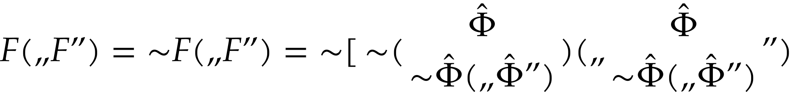

### [105\[3\]](https://cdn.wittgensteinnachlass.com/2000px/webp/Ms-108/105.webp)

The space in which human beings move is infinite, like time.

### [105\[4\]](https://cdn.wittgensteinnachlass.com/2000px/webp/Ms-108/105.webp)

The method of measurement, e.g. of spatial measurement, stands in exactly the same relation to a particular measurement as the sense of a sentence does to its truth or falsity.

### [105\[5\]](https://cdn.wittgensteinnachlass.com/2000px/webp/Ms-108/105.webp)

Geometry in the _one_ sense is a methodology of measurement.

### [105\[6\]](https://cdn.wittgensteinnachlass.com/2000px/webp/Ms-108/105.webp)

“No level of brightness below this one hurts my eyes”. That is, I have observed that my experiences so far correspond to a formal law.

### [106\[1\]](https://cdn.wittgensteinnachlass.com/2000px/webp/Ms-108/106.webp)

To the question whether philosophers have always talked real nonsense up to now, one might reply: no, they have simply not noticed that they use a word with quite different meanings. In this sense it is not necessarily nonsense to say that one thing is as identical as another, for anyone who says this with conviction means something by the word “identical” at that moment (perhaps big), but he does not know that he is using the word here with a different meaning from the one it has in 2 + 2 = 4.

### [106\[2\]](https://cdn.wittgensteinnachlass.com/2000px/webp/Ms-108/106.webp)

10.03.1930

What kind of discovery was Scheffer’s discovery that p ⌵ q & ~ p can be expressed by means of p ❘ q?

### [106\[3\]](https://cdn.wittgensteinnachlass.com/2000px/webp/Ms-108/106.webp)

One had no method for looking for p ❘ q, & if one found one today, that could make no difference.

### [106\[4\]](https://cdn.wittgensteinnachlass.com/2000px/webp/Ms-108/106.webp)

What was it that we did not know before the discovery? It was not something we did not know, but something we were not acquainted with.

### [106\[5\]](https://cdn.wittgensteinnachlass.com/2000px/webp/Ms-108/106.webp),[107\[1\]](https://cdn.wittgensteinnachlass.com/2000px/webp/Ms-108/107.webp)

One sees this very clearly if one imagines the objection being raised that p ❘ p is not at all what ~p says. The answer, of course, is that all that matters is that the system p ❘ q etc. has the requisite multiplicity. So Scheffer found a symbolic system that has the requisite multiplicity. Is it a search if I am not acquainted with Scheffer’s system & say that I would like to construct a system with only _one_ logical constant? No! The systems are, after all, not in a single space at all, so that I could say: There are systems with 3 & 2 logical constants; now I am trying to reduce the number of constants _in the same way_. Here there is no _same way_!

### [107\[2\]](https://cdn.wittgensteinnachlass.com/2000px/webp/Ms-108/107.webp)

One cannot regard a given grey as one of the infinitely many shades of grey between black & white.

### [107\[3\]](https://cdn.wittgensteinnachlass.com/2000px/webp/Ms-108/107.webp),[108\[1\]](https://cdn.wittgensteinnachlass.com/2000px/webp/Ms-108/108.webp)

But one does in fact perceive the continuous transition – e.g. from white to black. Is it here too merely a matter of an infinite _possibility_? Is not continuity itself a kind of infinite reality? But do we not have here the same case as that of the circle regarded as an ∞-gon? Here the circle is a limit. And do we not also regard the continuous transition from black to white as the limit of a sequence of discontinuous transitions?

### [108\[2\]](https://cdn.wittgensteinnachlass.com/2000px/webp/Ms-108/108.webp),[109\[1\]](https://cdn.wittgensteinnachlass.com/2000px/webp/Ms-108/109.webp)

11.03.1930

One can no more regard a particular grey as one of the infinitely many greys etc. than one can regard a

tangent t as one of the infinitely many stages in the transition from t1 to t2. If, say, I see a ruler roll along the circle from t1 to t2, then – if it moves continuously – I see not a single one of the intermediate positions in the sense in which I see t when the tangent is at rest; or else I see only a finite number of intermediate positions. But if in such a case I appear to infer a special case from a general proposition, experience is never the source of this general proposition, & the proposition is not really a proposition at all. If, for example, I say: “i saw the ruler move from t1 to t2, _so_ I must have seen it in t too”, we do not have a valid logical inference here: for if what I mean is that the ruler must have _appeared_ to me in position t – if, that is, I am speaking of the position in visual space – then that does not follow from the premise at all. But if I am speaking of the physical ruler, it is of course (very easily) possible that the ruler skipped position t & that the phenomenon in visual space was nevertheless continuous.

### [109\[2\]](https://cdn.wittgensteinnachlass.com/2000px/webp/Ms-108/109.webp),[110\[1\]](https://cdn.wittgensteinnachlass.com/2000px/webp/Ms-108/110.webp)

One can compare part of a hypothesis with the movement of part of a gear mechanism, a movement one can fix without thereby prejudging the movement one wants to produce. But then one does have to arrange the rest of the mechanism in a particular way so that it produces the desired movement. I am thinking of a differential gear.

If I have decided that there is to be no departure from a certain part of my hypothesis, whatever the experience to be described, then I have fixed a way of representing it, & that part of the hypothesis is now a postulate. A postulate must be such that no conceivable experience can refute it, however extremely inconvenient it may be to hold to the postulate. In so far as one can speak here of greater or lesser convenience, there is a greater or lesser probability of the postulate.

### [110\[2\]](https://cdn.wittgensteinnachlass.com/2000px/webp/Ms-108/110.webp)

12.03.1930

For the moment, then, it is senseless to speak of a measure of this probability. It is rather as in the case of, say, two kinds of number, where we can say with some justification that one is more like the other than it is to a third, but there is no numerical measure of the similarity. Of course, one could imagine a measure being constructed in such cases too, by counting, say, the postulates or axioms the two systems have in common, etc., etc.

### [110\[3\]](https://cdn.wittgensteinnachlass.com/2000px/webp/Ms-108/110.webp),[111\[1\]](https://cdn.wittgensteinnachlass.com/2000px/webp/Ms-108/111.webp)

I give someone this information & no other: At such and such a time you will see a spot of light appear on the segment AB.

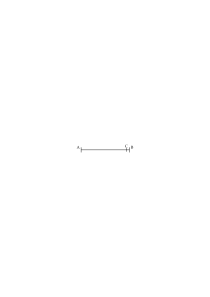

Now does the question “is it more probable that this spot will appear in the interval AC than in CB” have a sense? I think the answer is clearly no. I can, of course, stipulate that the ratio of the probability of the event occurring in CB to that of its occurring in AC is to be 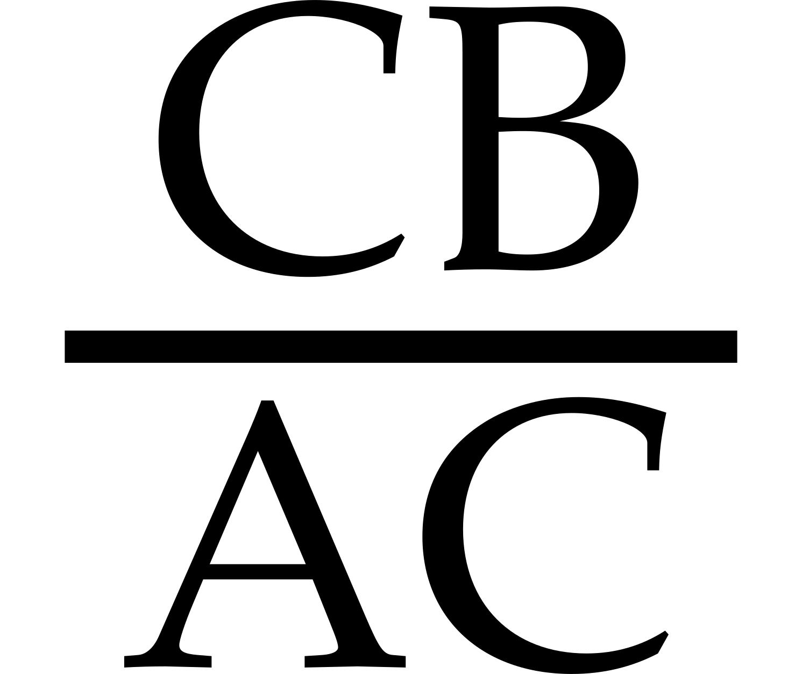, but that is a stipulation for which I can have empirical grounds; nothing, however, can be said about it a priori. The observed distribution of events can lead me to this assumption. Where infinitely many possibilities come into consideration, probability must of course be regarded as a limit. For if I divide the segment AB into as many parts as I please, as unequal as I please, & regard the probabilities of the event occurring in any of these parts as equal to one another, we immediately have before us the simple case of the die. And now I can lay down a law – arbitrarily – according to which parts of equal probability are to be formed. For example, the law that equal lengths of the parts entail equal probabilities. But any other law is equally permissible. Could I not also, in the case of the die, take, say, 5 faces together as one possibility & set them against the 6th as the second possibility? And what, apart from experience, can prevent me from regarding these two possibilities as equally probable?

### [111\[2\]](https://cdn.wittgensteinnachlass.com/2000px/webp/Ms-108/111.webp),[112\[1\]](https://cdn.wittgensteinnachlass.com/2000px/webp/Ms-108/112.webp)

If one believes one can imagine a 4-dimensional space, why not also 4-dimensional colours – that is, colours that, in addition to the degree of saturation, the hue & the luminosity, allow for a fourth determination?

### [112\[2\]](https://cdn.wittgensteinnachlass.com/2000px/webp/Ms-108/112.webp)

Let us imagine throwing a sphere (instead of a die) whose surface is divided into equal or unequal parts of different colours. Can I say a priori here that equal probabilities correspond to equal parts of the sphere’s surface?

### [112\[3\]](https://cdn.wittgensteinnachlass.com/2000px/webp/Ms-108/112.webp),[113\[1\]](https://cdn.wittgensteinnachlass.com/2000px/webp/Ms-108/113.webp)

13.03.1930

Imagine, say, a red ball being thrown that has only a very small green cap. In this case is it not much more probable that it will land on the red part than on the green? – But how would one justify this sentence? Presumably by the fact that the ball, when one throws it, lands much more often on the red surface than on the green. But that has nothing to do with logic. – One could always project the red & green surfaces & the events that occur on them onto a surface in such a way that the projection of the green surface would be as large as, or even larger than, that of the red, so that the events, considered in this projection, appear to stand in quite a different ratio of probabilities from that on the original surface. If, e.g., I let the events be reflected in a suitably curved mirror & then consider which event I would have taken to be the more probable if I see only the image in the mirror.

### [113\[2\]](https://cdn.wittgensteinnachlass.com/2000px/webp/Ms-108/113.webp)

What the mirror can _not_ change is the number of clearly delineated possibilities. So if I have n patches of colour on my ball, the mirror also shows n, and if I have _stipulated_ that these are to count as equally probable, I can retain this stipulation for the mirror image too.

### [113\[3\]](https://cdn.wittgensteinnachlass.com/2000px/webp/Ms-108/113.webp)

To make myself clearer still: if I carry out the experiment in the concave mirror, i.e. make the _observations_ in the concave mirror, it may look as though the ball lands more often on the small surface than on the much larger one, & it is clear that neither of the experiments – in the concave mirror & outside it – deserves preference.

### [113\[4\]](https://cdn.wittgensteinnachlass.com/2000px/webp/Ms-108/113.webp),[114\[1\]](https://cdn.wittgensteinnachlass.com/2000px/webp/Ms-108/114.webp)

But what does it really mean to stipulate that two possibilities have the same probability?

### [114\[2\]](https://cdn.wittgensteinnachlass.com/2000px/webp/Ms-108/114.webp)

Does it not mean that, first, the laws of nature known to us favour neither possibility & second, that the relative frequencies of the events in the two cases approach one another under certain circumstances?

### [114\[3\]](https://cdn.wittgensteinnachlass.com/2000px/webp/Ms-108/114.webp)

20.03.1930

Some theories in Russell’s & Frege’s logic make the mistake one would make if one said that a painted picture could also be used as a mirror, even if only for a single position. What is then overlooked is that the essential thing about a mirror is precisely that one can infer from it the position of the body in front of the mirror, whereas in the case of the painted picture one must first know that the positions agree before one can take the picture as a mirror image.

### [114\[4\]](https://cdn.wittgensteinnachlass.com/2000px/webp/Ms-108/114.webp),[115\[1\]](https://cdn.wittgensteinnachlass.com/2000px/webp/Ms-108/115.webp)

21.03.1930

The introduction of the cardinal number. Are they the same numbers with which I count the horses in a stable & the different kinds of animal in the stable? With which I count the strokes in a line & the kinds of group (according to the different numbers of strokes)? ∣∣∣ ∣∣∣ ∣∣∣∣ ∣∣∣∣∣ ∣∣ ∣∣∣∣ ∣∣ What is remarkable is that I can count people & human races, patches of colour & colours. Whether they are cardinal numbers in the same sense surely depends on whether the same syntactic rules apply to them. It is conceivable that there is no one in a room, but not that there is someone of _no_ race in it. If that is an essential difference, it must of course run through the whole of arithmetic.

### [115\[2\]](https://cdn.wittgensteinnachlass.com/2000px/webp/Ms-108/115.webp)

Arithmetic is the grammar of numbers. Kinds of number can differ only in the arithmetical rules that apply to them.

### [115\[3\]](https://cdn.wittgensteinnachlass.com/2000px/webp/Ms-108/115.webp)

One always feels reluctant to justify arithmetic by saying something about its application. It seems to us to be firmly enough grounded in itself. And this is all, of course, because arithmetic is its own application.

### [115\[4\]](https://cdn.wittgensteinnachlass.com/2000px/webp/Ms-108/115.webp),[116\[1\]](https://cdn.wittgensteinnachlass.com/2000px/webp/Ms-108/116.webp)

The danger in wanting to see things as simpler than they are in reality is often greatly overestimated today. But this danger is in fact present to the highest degree in the phenomenological investigation of sense impressions. These are always taken to be _much_ simpler than they (in reality) are.

### [116\[2\]](https://cdn.wittgensteinnachlass.com/2000px/webp/Ms-108/116.webp)

The cardinal number is to be applied to the subject–predicate form, but not to every variant of this form. And insofar as it is applicable, it characterizes precisely the subject–predicate form.

### [116\[3\]](https://cdn.wittgensteinnachlass.com/2000px/webp/Ms-108/116.webp)

On the one hand, it seems to me, one can develop arithmetic quite independently & its application takes care of itself, for wherever it is applicable, one is entitled to apply it. On the other hand, a nebulous introduction of the concept of number with the help of a general form of operation – as I did – cannot be necessary.

### [116\[4\]](https://cdn.wittgensteinnachlass.com/2000px/webp/Ms-108/116.webp)

I would like to set arithmetic out so that it can be applied when one needs it.

### [116\[5\]](https://cdn.wittgensteinnachlass.com/2000px/webp/Ms-108/116.webp),[117\[1\]](https://cdn.wittgensteinnachlass.com/2000px/webp/Ms-108/117.webp)

22.03.1930

That is why the conception of arithmetic as a game persists so stubbornly.

### [117\[2\]](https://cdn.wittgensteinnachlass.com/2000px/webp/Ms-108/117.webp)

One could say: arithmetic is a kind of geometry; i.e. what constructions on paper are in geometry, calculations (on paper) are in arithmetic. One could say it is a more general geometry.

### [117\[3\]](https://cdn.wittgensteinnachlass.com/2000px/webp/Ms-108/117.webp)

And can I not say that in this sense chess too (or any other game) is a kind of geometry? But then it must be possible to devise an _application_ of chess quite analogous to that of arithmetic.

### [117\[4\]](https://cdn.wittgensteinnachlass.com/2000px/webp/Ms-108/117.webp)

One could say: Why restrict the application of arithmetic? It takes care of itself.

### [117\[5\]](https://cdn.wittgensteinnachlass.com/2000px/webp/Ms-108/117.webp)

So that would be like what one could say: I can make a knife without regard to the class of materials that it will be possible to cut with it; that will become clear in due course.

### [117\[6\]](https://cdn.wittgensteinnachlass.com/2000px/webp/Ms-108/117.webp),[118\[1\]](https://cdn.wittgensteinnachlass.com/2000px/webp/Ms-108/118.webp)

For what tells against delimiting the field of application is the feeling that we can understand arithmetic without having such a field in view. Or let us put it this way: instinct balks at anything that is not simply an analysis of the thoughts already there.

### [118\[2\]](https://cdn.wittgensteinnachlass.com/2000px/webp/Ms-108/118.webp)

23.03.1930

Critique of Frege’s theory of cardinal numbers. It must begin with a critique of the concepts “concept” & “object”.

### [118\[3\]](https://cdn.wittgensteinnachlass.com/2000px/webp/Ms-108/118.webp)

24.03.1930

I count, e.g., the trees in the garden. Tree in the garden counts as (a) property. But what is the thing that has this property? Suppose they are some places or other in space; then what I count is the places. Even if I call a stick that puts out shoots in spring a tree, I can take the bearer of the predicate to be a kind of place.

### [118\[4\]](https://cdn.wittgensteinnachlass.com/2000px/webp/Ms-108/118.webp)

Here it might seem as though specifying a number involved some kind of generalization or indeterminacy. But what about a sentence like: The line segment AB is divided into 2, (3, 4, 5 etc.) equal parts? There is no indeterminacy here.

### [118\[5\]](https://cdn.wittgensteinnachlass.com/2000px/webp/Ms-108/118.webp),[119\[1\]](https://cdn.wittgensteinnachlass.com/2000px/webp/Ms-108/119.webp)

The question is always whether & how it is possible to represent the most general form of the application of arithmetic. And the strange thing here is precisely that in a certain sense this does not seem necessary. And if it really is not necessary, then it is also impossible.

### [119\[2\]](https://cdn.wittgensteinnachlass.com/2000px/webp/Ms-108/119.webp)

For it seems that the general form of its application is represented by saying _nothing_ about it. (And if that is a possible representation, then it is also _the_ correct one.)

### [119\[3\]](https://cdn.wittgensteinnachlass.com/2000px/webp/Ms-108/119.webp)

What is characteristic of specifying a number is that one can substitute any other number for the one given and the sentence must always retain its sense. What is characteristic is precisely the infinite series of sentences.

### [119\[4\]](https://cdn.wittgensteinnachlass.com/2000px/webp/Ms-108/119.webp)

The sense of the remark that arithmetic is a kind of geometry is precisely that arithmetical constructions are autonomous, like geometrical constructions, & hence, so to speak, guarantee their own applicability. For it must be possible to say of geometry too that it is its own application.

### [119\[5\]](https://cdn.wittgensteinnachlass.com/2000px/webp/Ms-108/119.webp),[120\[1\]](https://cdn.wittgensteinnachlass.com/2000px/webp/Ms-108/120.webp)

What does it mean: one can extend a straight line segment as far as one likes? Is there not an “and so on ad inf.” here that is quite different from that of mathematical induction? According to what has been said so far, the expression for the possibility of extending it would consist in the description of the extended piece, or of the extending. Here it seems, at first, to have nothing to do with numbers. I can imagine that the pencil that draws the line segment continues its movement & then always continues in the same way. But is it also conceivable that there is no possibility of accompanying this process with a countable process? I don’t think so.

### [120\[2\]](https://cdn.wittgensteinnachlass.com/2000px/webp/Ms-108/120.webp),[121\[1\]](https://cdn.wittgensteinnachlass.com/2000px/webp/Ms-108/121.webp)

Generality of Euclidean proofs. One says that the demonstration is carried out on _one_ triangle, but that the proof holds for all triangles – or for any triangle whatsoever. First, it is odd that what holds for one triangle should on that account hold for all the others. Surely a doctor could not examine a person & then infer that what he finds in this person must also be true of all the others. And if I now measure & add up the angles in one triangle, I really cannot infer that their sum will be just as large in every other triangle. It is clear that the Euclidean proof cannot say anything about a totality of triangles. A proof cannot go beyond itself. But the construction in the proof is not an experiment either, & if it were, the result could not prove anything for other cases. So there is no need actually to carry out the construction with paper & pencil; rather, the description of the construction must suffice for one to see everything essential from it. (The description of an experiment is not enough for one to obtain the result of the experiment from it; the experiment must actually be carried out.) The construction in the Euclidean proof is exactly analogous to the proof that 2 + 2 = 4 by means of the Russian abacus.

### [121\[2\]](https://cdn.wittgensteinnachlass.com/2000px/webp/Ms-108/121.webp)

And is this not also the kind of generality that belongs to the tautologies of logic, which are demonstrated for p q r etc.?

### [121\[3\]](https://cdn.wittgensteinnachlass.com/2000px/webp/Ms-108/121.webp),[122\[1\]](https://cdn.wittgensteinnachlass.com/2000px/webp/Ms-108/122.webp)

The essential thing in all these cases is that what is demonstrated cannot be expressed by a sentence.

### [122\[2\]](https://cdn.wittgensteinnachlass.com/2000px/webp/Ms-108/122.webp)

Euclidean geometry presupposes _no method of measuring_ angles & line segments; it no more says under what circumstances two angles are to count as equal than the calculus of probability says when two probabilities are to count as equal. If a particular method of measurement is then adopted, say one using iron rulers, the question is whether the measurements thus carried out yield Euclidean results.

### [122\[3\]](https://cdn.wittgensteinnachlass.com/2000px/webp/Ms-108/122.webp)

So geometry says, for example: If these two angles count as equal, then those count as equal too.

### [122\[4\]](https://cdn.wittgensteinnachlass.com/2000px/webp/Ms-108/122.webp),[123\[1\]](https://cdn.wittgensteinnachlass.com/2000px/webp/Ms-108/123.webp)

Does the case of the general sentence – a red circle is in the square – differ essentially from a general statement of numerical equality, such as “I have as many jackets as pairs of trousers”? And is this sentence not in turn quite analogous to “there are _a_ number of chairs in this room”? Of course, in ordinary life there is no need to go very far at all with the disjunction of numbers. But however far one wants to go, at some point one must stop. The question here is always: how do I know such a proposition? Can I ever know it as an infinite disjunction? Even if the first case is understood in such a way that we can determine the position & size of the circle by measurement, even then the general proposition can never be understood as a disjunction (or if it can, then only as a finite one). For what, then, is the criterion (for the general proposition) for the circle’s being in the square? Either nothing at all that has to do with a multiplicity of positions (or sizes, as the case may be), or else (of course) something that has to do with a finite number of such positions.

### [123\[2\]](https://cdn.wittgensteinnachlass.com/2000px/webp/Ms-108/123.webp)

One can indeed take rules for signs, e.g. definitions, as sentences that deal with signs, but one is not _obliged_ to take them as sentences at all. They are aids to language. Aids of a different kind from the sentences of language.

### [123\[3\]](https://cdn.wittgensteinnachlass.com/2000px/webp/Ms-108/123.webp),[124\[1\]](https://cdn.wittgensteinnachlass.com/2000px/webp/Ms-108/124.webp)

The question “how many solutions does this equation have?” is the keeping at the ready of the general method for solving it. And that is what a question in mathematics is in general: keeping a general method at the ready.

### [124\[2\]](https://cdn.wittgensteinnachlass.com/2000px/webp/Ms-108/124.webp)

This is an arithmetical construction & in a _somewhat_ wider sense also a geometrical (construction).

### [124\[3\]](https://cdn.wittgensteinnachlass.com/2000px/webp/Ms-108/124.webp)

Suppose I wanted to solve the following problem with this calculation: If I have 11 apples & want to give people 3 apples each, how many people can I give apples to?

The calculation gives me the answer 3. Now suppose I went through all the actions of handing them out, & in the end 4 people each had 3 apples in their hands. Would I then say that working it out had yielded a wrong result? Of course not. And that just means that working it out was not an experiment.

### [124\[4\]](https://cdn.wittgensteinnachlass.com/2000px/webp/Ms-108/124.webp),[125\[1\]](https://cdn.wittgensteinnachlass.com/2000px/webp/Ms-108/125.webp)

It might seem as though working it out mathematically entitled us to make a prediction, say that I would be able to give apples to 3 people & have 2 apples left over. But that is not how it is. What entitles us to make this prediction is a physical hypothesis that lies outside the calculation. The calculation is only a consideration of the logical forms, the structures, & can in itself yield nothing new.

### [125\[2\]](https://cdn.wittgensteinnachlass.com/2000px/webp/Ms-108/125.webp)

Different though strokes & court hearings are, one can nevertheless represent court hearings by strokes in a calendar. And one can count the one instead of the other. Strangely, it is not like that if, say, I want to count hat sizes. Here it would not be natural to represent three hat sizes by three strokes. Would it not be just the same if I wanted to represent a measurement – 3 m – by three strokes? Or rather: one can do that, of course; only then “∣∣∣” represents in a different way.

### [125\[3\]](https://cdn.wittgensteinnachlass.com/2000px/webp/Ms-108/125.webp)

If three strokes on paper are the sign for 3, then one can say that 3 is to be applied in the way that 3 strokes can be applied.

### [125\[4\]](https://cdn.wittgensteinnachlass.com/2000px/webp/Ms-108/125.webp),[126\[1\]](https://cdn.wittgensteinnachlass.com/2000px/webp/Ms-108/126.webp)

The letter π stands for a law. The sign 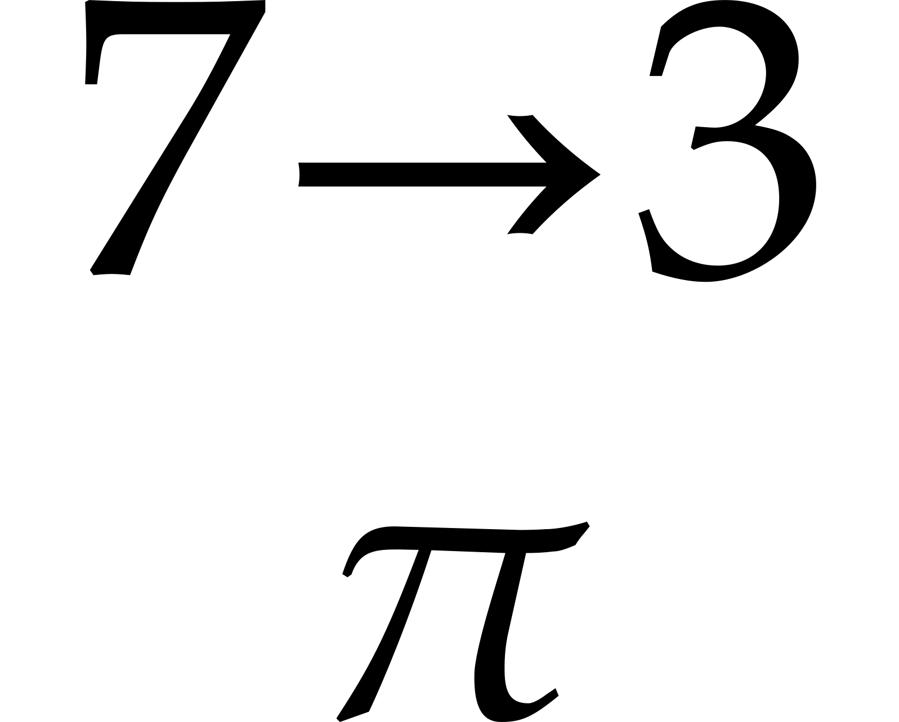 means nothing if the law for π makes no mention of a 7 that one can replace with a 3. The same applies, by analogy, to 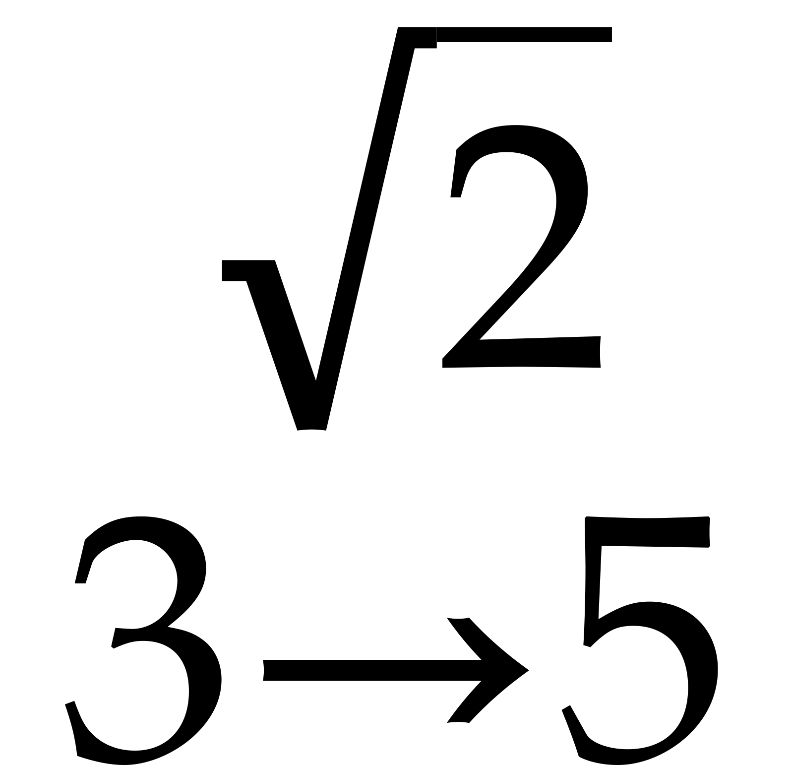. (By contrast,  could mean √5.)

### [126\[2\]](https://cdn.wittgensteinnachlass.com/2000px/webp/Ms-108/126.webp)

The concept “prime number” is the general form of testing a number for the property in question; the concept “divisible” is the general form of testing for divisibility, and so on.

### [126\[3\]](https://cdn.wittgensteinnachlass.com/2000px/webp/Ms-108/126.webp)

Is it not clear that it must be more determinate to say that 26 divided by 5 leaves a remainder of 1 than to say that it is not divisible by 5? I.e. does that not make it clear that in a certain sense I can have indeterminate propositions in arithmetic?

### [126\[4\]](https://cdn.wittgensteinnachlass.com/2000px/webp/Ms-108/126.webp)

One can see that 26 is not divisible by 5 from the fact that 26 does not have a 5 in the units place, and here again we have an indeterminate proposition.

### [126\[5\]](https://cdn.wittgensteinnachlass.com/2000px/webp/Ms-108/126.webp),[127\[1\]](https://cdn.wittgensteinnachlass.com/2000px/webp/Ms-108/127.webp)

But do we not have here what I once said before, namely that negation or inequalities in arithmetic can occur only with a certain generality? For it surely seems absurd to say that 26 does not have a 5 in the units place, but not to say that here there is a number that does not have 5 in the units place.

### [127\[2\]](https://cdn.wittgensteinnachlass.com/2000px/webp/Ms-108/127.webp)

An inequality, like an equation, must be either the result of a calculation or a stipulation.

5 ≠ 6 is a stipulation.

### [127\[3\]](https://cdn.wittgensteinnachlass.com/2000px/webp/Ms-108/127.webp)

Just as equations can be understood as rules for signs, as opposed to propositions, so it must be possible to do the same with inequalities.

### [127\[4\]](https://cdn.wittgensteinnachlass.com/2000px/webp/Ms-108/127.webp)

How, then, can one use an inequality? This leads to the thought that in logic there is also the internal relation of not following, & it can be important to recognize that one proposition does _not_ follow from another.

### [127\[5\]](https://cdn.wittgensteinnachlass.com/2000px/webp/Ms-108/127.webp)

The negation of an equation is as like & as unlike the negation of a proposition as the affirmation of an equation is like & unlike the affirmation of a proposition.

### [128\[1\]](https://cdn.wittgensteinnachlass.com/2000px/webp/Ms-108/128.webp)

It is quite clear that negation in arithmetic is entirely different from the negation proper of propositions.

### [128\[2\]](https://cdn.wittgensteinnachlass.com/2000px/webp/Ms-108/128.webp)

I believe it always corresponds to a certain disjunction of cases. And it is clear that where it corresponds essentially – by virtue of the logical relations – to a disjunction or to the exclusion of one part of a logical series in favour of another – there it must have quite a different meaning. It must be one with those logical forms and hence only apparently a negation.

### [128\[3\]](https://cdn.wittgensteinnachlass.com/2000px/webp/Ms-108/128.webp)

If “not-equal” means greater or less, then that cannot, so to speak, be an accident as far as the “not” is concerned.

### [128\[4\]](https://cdn.wittgensteinnachlass.com/2000px/webp/Ms-108/128.webp)

A mathematical _sentence_ can only be either a stipulation or a result calculated from stipulations by a particular method. And this must hold for “9 is divisible by 3” or “9 is not divisible by 3”.

### [129\[1\]](https://cdn.wittgensteinnachlass.com/2000px/webp/Ms-108/129.webp)

How does one calculate 2 × 2 ≠ 5? Differently from 2 × 2 = 4? If at all, then via “2 × 2 = 4” and with “4 ≠ 5”.

### [129\[2\]](https://cdn.wittgensteinnachlass.com/2000px/webp/Ms-108/129.webp)

And how does one calculate “9 is divisible by 3”?

### [129\[3\]](https://cdn.wittgensteinnachlass.com/2000px/webp/Ms-108/129.webp)

One could understand it as a disjunction & then first calculate 9 : 3 = 3 and then, in place of this determinate proposition, derive the disjunction by a rule of inference.

### [129\[4\]](https://cdn.wittgensteinnachlass.com/2000px/webp/Ms-108/129.webp)

etc. ad inf. here we have an induction. But of what kind?

### [129\[5\]](https://cdn.wittgensteinnachlass.com/2000px/webp/Ms-108/129.webp)

Does my remark that negation in arithmetic is only ever important in connection with generality not help us here? Generality, however, is expressed by an induction.

### [129\[6\]](https://cdn.wittgensteinnachlass.com/2000px/webp/Ms-108/129.webp)

It is clear to me that arithmetic does not need false equations for its construction, but it seems to me that one can probably say that there is a prime number between 11 & 17 without referring to false equations in doing so.

### [130\[1\]](https://cdn.wittgensteinnachlass.com/2000px/webp/Ms-108/130.webp)

And this makes it possible for negation & disjunction, which in the individual case (particular case) seem like superfluous indeterminacies, to become essential to arithmetic in the general “sentence”, i.e. in the induction.

### [130\[2\]](https://cdn.wittgensteinnachlass.com/2000px/webp/Ms-108/130.webp)

Division yields a pair of numbers. Is there any reason to give preference to one of the two numbers? That means nothing insofar as one could not write (2,3) instead of 13/5, but only 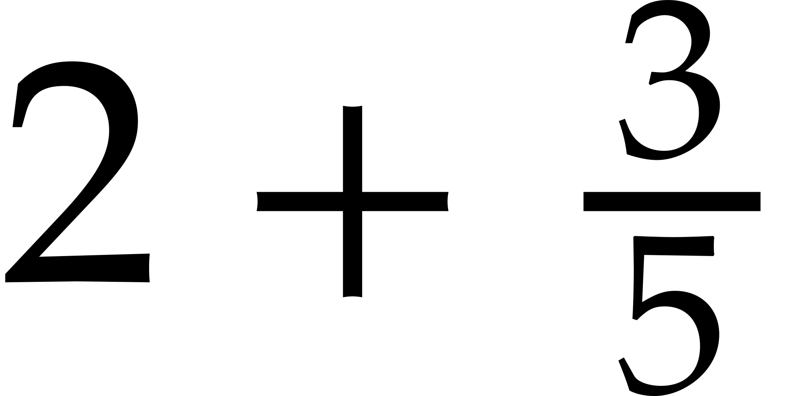.

### [130\[3\]](https://cdn.wittgensteinnachlass.com/2000px/webp/Ms-108/130.webp)

Just as 8 × 8 = 62 is a prediction that the multiplication will yield 60, so “60 is divisible by 8” is a prediction that the division will yield a remainder of 0. One can check both directly, there is a method, & so it should be possible to have questions & assertions here too.

, 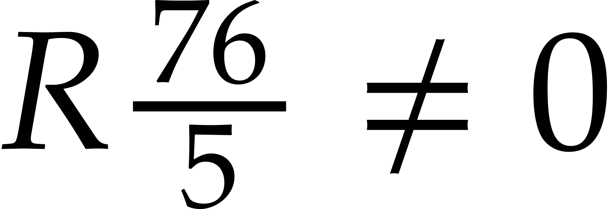

### [130\[4\]](https://cdn.wittgensteinnachlass.com/2000px/webp/Ms-108/130.webp)

An inequality can be checked for correctness just as well as an equation.

### [130\[5\]](https://cdn.wittgensteinnachlass.com/2000px/webp/Ms-108/130.webp),[131\[1\]](https://cdn.wittgensteinnachlass.com/2000px/webp/Ms-108/131.webp)

Is an inequality not a perfectly intelligible rule for signs, just like an equation? One permits a substitution, the other forbids a substitution. √ = ²√, √ ≠ ∛

### [131\[2\]](https://cdn.wittgensteinnachlass.com/2000px/webp/Ms-108/131.webp)

But is it not the case that what is not expressly permitted is forbidden?

### [131\[3\]](https://cdn.wittgensteinnachlass.com/2000px/webp/Ms-108/131.webp)

It can certainly matter (in practical life) that 3 × 3 is not 10 (say, when distributing things), but why do we never write 3 × 3 ≠ 10? When we actually draw the inference in ordinary life, we say “But 3 × 3 is 9 & so I can’t distribute the things that way”. To say “But 3 × 3 is not 10” would be (almost) ironic; but why should I not put it that way if what matters to me is not the result of 3 × 3 but only that I _cannot_ carry out the proposed distribution?

### [131\[4\]](https://cdn.wittgensteinnachlass.com/2000px/webp/Ms-108/131.webp),[132\[1\]](https://cdn.wittgensteinnachlass.com/2000px/webp/Ms-108/132.webp)

Perhaps the only essential thing is to see that what is expressed by inequalities is _essentially_ different from what is expressed by equations. And so one cannot directly compare a law that yields the places of a decimal fraction & works with inequalities with one that works with equations. Here we have quite different methods before us.

### [132\[2\]](https://cdn.wittgensteinnachlass.com/2000px/webp/Ms-108/132.webp)

That is, in arithmetic one cannot simply put equations & something else (say, inequalities) on _one_ level, as if they were, say, different genera of animals. Rather, the two methods will then be categorically different & define constructs that are incomparable with one another.

### [132\[3\]](https://cdn.wittgensteinnachlass.com/2000px/webp/Ms-108/132.webp)

Negation in arithmetic cannot be the same as the negation of propositions, for otherwise in 2 × 2 ≠ 5 I would have to make myself a picture of what it would be like if 2 × 2 = 5.

### [132\[4\]](https://cdn.wittgensteinnachlass.com/2000px/webp/Ms-108/132.webp)

“ = 5”, “divisible by 5”, “not divisible by 5”, “prime” could be called arithmetical predicates, & one could say: Arithmetical predicates always correspond to the application of a particular, generally defined method. One can also define a predicate like this: (ξ × 3 = 25) ≝ F(ξ).

### [132\[5\]](https://cdn.wittgensteinnachlass.com/2000px/webp/Ms-108/132.webp),[133\[1\]](https://cdn.wittgensteinnachlass.com/2000px/webp/Ms-108/133.webp)

Arithmetical predicates that are unimportant in the particular case – because the determinate form makes the indeterminate one superfluous – become significant in the general _law_, i.e. in the induction. For here they are not, so to speak, overtaken by a more determinate form. Or rather: they are not indeterminate at all in the general law.

### [133\[2\]](https://cdn.wittgensteinnachlass.com/2000px/webp/Ms-108/133.webp)

3 × 3 = 9 ⌵ 3 × 3 = 10 Why is that trivial?

### [133\[3\]](https://cdn.wittgensteinnachlass.com/2000px/webp/Ms-108/133.webp)

One could say “They are presumably different hat sizes, but then I represent them by three different strokes too”. But here the word “different” has two different meanings.

### [133\[4\]](https://cdn.wittgensteinnachlass.com/2000px/webp/Ms-108/133.webp)

Whatever three strokes are a picture of, they can serve as a picture of it.

### [133\[5\]](https://cdn.wittgensteinnachlass.com/2000px/webp/Ms-108/133.webp)

What the series of cardinal numbers relates to is never objects, in the sense of elements of knowledge, but formations, spatial & temporal, such as the strokes on my paper that represent them.

### [133\[6\]](https://cdn.wittgensteinnachlass.com/2000px/webp/Ms-108/133.webp)

25.04.1930

Back in Cambridge after the Easter holidays. Often with Marguerite in Vienna. Easter Sunday with her in Neuwaldegg. We kissed a lot for three hours and it was very lovely.

### [134\[1\]](https://cdn.wittgensteinnachlass.com/2000px/webp/Ms-108/134.webp)

The methods of the more recent mathematical logicians are reminiscent – I believe – of the method of present-day experimental psychologists. In both cases some definite work is indeed being done; it is just that both are mistaken about the meaning & scope of their work. The tests of intelligence, presence of mind, etc. do test something, but not what we call presence of mind, intelligence, etc., & the proofs of consistency presumably show something, but nothing important. At least that is what I believe. They are always crawling about on the surface of the questions & do not see what is really essential at all. But once the real work is done, many of those superficial games will become obsolete or else will first have to be interpreted quite differently. (Here again there is much technique & no spirit.)

### [134\[2\]](https://cdn.wittgensteinnachlass.com/2000px/webp/Ms-108/134.webp),[135\[1\]](https://cdn.wittgensteinnachlass.com/2000px/webp/Ms-108/135.webp)

27.04.1930

If one says that the spot A is somewhere between the bounds B & C, is it not 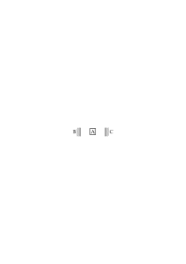 evidently possible to describe or depict a number of positions of A between B & C so that I see the succession of all these positions as a continuous transition? And then is not the disjunction of all these N positions precisely the proposition that A is somewhere between B & C? But what about these N pictures? It is clear that a picture & the one immediately after it must not be visually distinguishable, otherwise the transition is visually discontinuous.

### [135\[2\]](https://cdn.wittgensteinnachlass.com/2000px/webp/Ms-108/135.webp)

28.04.1930

Our notation or way of expressing ourselves also expresses which similarities – & which differences – we want to have particularly emphasized. Thus at one time one calls everything that has a structure similar to that of space spaces, & always wants to point out the similarity. Then again one wants only to shun this analogy, because it leads to confusions, & to emphasize the differences between the “spaces”, & now one calls the earlier way of expressing oneself misleading & oneself uses another that is just as misleading – that is, if one does not _fully_ understand it.

### [135\[3\]](https://cdn.wittgensteinnachlass.com/2000px/webp/Ms-108/135.webp),[136\[1\]](https://cdn.wittgensteinnachlass.com/2000px/webp/Ms-108/136.webp)

The smallest visible difference would be one that carried _within itself_ the criterion of being the smallest. For in the case of the patch A between B & C, we distinguish some positions & do _not_ distinguish others. But what we would need would be, so to speak, an infinitesimal difference, that is, a difference that carried within itself its being the smallest.

### [136\[2\]](https://cdn.wittgensteinnachlass.com/2000px/webp/Ms-108/136.webp)

To every truth someone puts to me in objection I must always say “I have nothing against it! Just analyse it thoroughly and then I must agree with you”.

### [136\[3\]](https://cdn.wittgensteinnachlass.com/2000px/webp/Ms-108/136.webp)

Space evidently does _not_ consist of discrete parts. For otherwise one would have to be able to say straight away which ones. But space is evidently homogeneous.

### [136\[4\]](https://cdn.wittgensteinnachlass.com/2000px/webp/Ms-108/136.webp)

It is remarkable that I shy away from dealing with the much simpler example “the quadrilateral is divided somewhere” instead of the example of the circle in the quadrilateral.

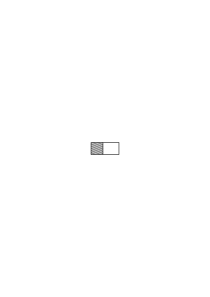

One would think this would be represented simply by means of a variable number.

### [136\[5\]](https://cdn.wittgensteinnachlass.com/2000px/webp/Ms-108/136.webp),[137\[1\]](https://cdn.wittgensteinnachlass.com/2000px/webp/Ms-108/137.webp)

29.04.1930

Go straight ahead and your hand will come up against something before you reach the other wall. Those general sentences are of this kind. Look along the table and you will see a line. One gives, as it were, a method, but I would not call it “general”, because it does not in any sense relate to a totality. Indeed, this is particularly clear when one makes a movement. If I say “Wipe the table”, I do not mean “Wipe every point”.

### [137\[2\]](https://cdn.wittgensteinnachlass.com/2000px/webp/Ms-108/137.webp)

One is inclined to think that it is not a generality at all, but something like a particular symptom of a generality. Rather as if I were to say: “If you see my window lit up, I am at home”. There is then a generality in the fact that I can be anywhere in my room; but the lit window does not have the multiplicity of a generality, & hence does not relate to a totality either, but to the substratum that can serve as the substratum of a totality.

### [137\[3\]](https://cdn.wittgensteinnachlass.com/2000px/webp/Ms-108/137.webp)

Logic must foresee the possibility, whatever kind it is (i.e. there is no logical surprise). And in space this very possibility does not consist of a number of discrete possibilities.

### [137\[4\]](https://cdn.wittgensteinnachlass.com/2000px/webp/Ms-108/137.webp)

30.04.1930

Space is, so to speak, _one_ possibility. It does not consist of several possibilities.

### [138\[1\]](https://cdn.wittgensteinnachlass.com/2000px/webp/Ms-108/138.webp)

So if I hear that the book is lying – somewhere – on the table, & then find it in a particular position, I cannot be surprised & say “Ah, I didn’t know there was such a position”, & yet I had not foreseen this particular position, i.e. considered it in advance as a particular possibility.

### [138\[2\]](https://cdn.wittgensteinnachlass.com/2000px/webp/Ms-108/138.webp)

But now what is the difference between the case “the book is lying somewhere on the table” & _the one_ “the event will occur sometime in the future”? Evidently this: in the one case we know a sure method of verifying whether the book is lying on the table; in the other there is no analogous method. If, say, a certain event were to occur at one of the infinitely many bisections of a line segment, or rather, if it were to occur when we cut the segment at _one_ point (with no further specification) & stay at that point for a minute, then this specification is just as senseless as the one about the infinite future.

### [138\[3\]](https://cdn.wittgensteinnachlass.com/2000px/webp/Ms-108/138.webp)

(Nonsense is just nonsense.)

### [138\[4\]](https://cdn.wittgensteinnachlass.com/2000px/webp/Ms-108/138.webp),[139\[1\]](https://cdn.wittgensteinnachlass.com/2000px/webp/Ms-108/139.webp)

If someone were to object to a Euclidean demonstration with straightedge & compasses, “yes, I can see that it holds in this case, but the question is whether it holds in all other cases”, we should have to answer him: “but it does not hold in _this_ case at all”. – And it would be, as already said, just as if someone were to say of the demonstration that p⊃q ∙ p ․⊃․ q is tautological, “yes, it certainly holds for the letters p & q, but does it hold generally?”.

### [139\[2\]](https://cdn.wittgensteinnachlass.com/2000px/webp/Ms-108/139.webp)

One always wants to say here, “it _does_ not _depend_ on the letters, or on the exact shape of the triangle”. But what does that mean?

### [139\[3\]](https://cdn.wittgensteinnachlass.com/2000px/webp/Ms-108/139.webp)

01.05.1930

What does it mean to “disregard everything inessential”?

### [139\[4\]](https://cdn.wittgensteinnachlass.com/2000px/webp/Ms-108/139.webp)

In the demonstration – for example – that vertically opposite angles are equal

α + β = β + γ :. α = γ one could imagine the figure in continual motion, with the two straight lines opening & closing like scissors, & one could carry out the demonstration on this moving figure just as well as on the stationary one. Incidentally, I do not mean by this that the figure moving in this way is the more general sign.

### [139\[5\]](https://cdn.wittgensteinnachlass.com/2000px/webp/Ms-108/139.webp),[140\[1\]](https://cdn.wittgensteinnachlass.com/2000px/webp/Ms-108/140.webp)

If one says to someone who has not yet tried it “try to move your ears”, he will first move something near his ears that he has moved before, & then either his ears will suddenly move or they will not. Now one could say of this process: he is trying to move his ears. But if this can be called an attempt, it is one in quite a different sense from the attempt to move our ears (or, say, our hands) when we no doubt know how it is done but someone is holding them, so that we can move them only with difficulty or not at all. An attempt in the first sense corresponds to an attempt “to solve a mathematical problem” for which there is no method. One can always make an effort to deal with the apparent problem. If one says to me: try to move the jug there at the other end of the room by sheer will, I shall look at it & make some odd movements with my facial muscles, so even in this case there seems to be such a thing as trying.

### [140\[2\]](https://cdn.wittgensteinnachlass.com/2000px/webp/Ms-108/140.webp),[141\[1\]](https://cdn.wittgensteinnachlass.com/2000px/webp/Ms-108/141.webp)

Suppose someone had not actually proved Pythagoras’s theorem but had been led to “conjecture” it by measuring the squares on the legs & hypotenuses of right-angled triangles. And now suppose he finds the proof & says that he has now proved what he conjectured before: this at least is surely a curious question: At what point in the proof does what he previously found confirmed by the individual experiments actually emerge, for the proof is quite different in nature from the earlier method. – Where do these two methods meet, given that they are supposed to yield the same thing in some sense. That is: If the proof & the experiments are only different views of the same thing (the same generality). (I said “from the same source only one thing flows” & one might say it would be too damn strange for the same thing to flow from _such_ different sources. The thought that the same thing can flow from different sources is so familiar to us from physics, i.e. from hypotheses. There we constantly infer the disease from symptoms & know that the most diverse symptoms can be symptoms of the same thing.)

### [141\[2\]](https://cdn.wittgensteinnachlass.com/2000px/webp/Ms-108/141.webp)

How could one conjecture, on the basis of the statistics, _what_ the proof then showed?

### [141\[3\]](https://cdn.wittgensteinnachlass.com/2000px/webp/Ms-108/141.webp),[142\[1\]](https://cdn.wittgensteinnachlass.com/2000px/webp/Ms-108/142.webp)

The proof of Pythagoras’s theorem is a general proof & not a proof of generality.

### [142\[2\]](https://cdn.wittgensteinnachlass.com/2000px/webp/Ms-108/142.webp)

If there were a conjecture that the proposition would be true in _all_ cases, then what was thus conjectured could never be proved, but only confirmed by infinite experience.

### [142\[3\]](https://cdn.wittgensteinnachlass.com/2000px/webp/Ms-108/142.webp)

03.05.1930

Let us think of what it means to _look_ for something in one’s memory. Here there is certainly _something like_ looking in the proper sense. But trying to produce a phenomenon does not mean _looking_ for it. Suppose I feel my hand for a painful spot: then presumably I am looking in tactile space, but not in pain-space. That is, what I may find is really a spot & not the pain. That is, even if experience has shown that pressing produces a pain, pressing is still not looking for a pain. Any more than turning an electrostatic machine is looking for a spark.

### [142\[4\]](https://cdn.wittgensteinnachlass.com/2000px/webp/Ms-108/142.webp)

Where in the proof is the very generality that the earlier experiments made probable supposed to emerge?

### [143\[1\]](https://cdn.wittgensteinnachlass.com/2000px/webp/Ms-108/143.webp)

I had conjectured the generality without conjecturing the proof (I assume), & now the proof proves precisely the generality I conjectured!?

### [143\[2\]](https://cdn.wittgensteinnachlass.com/2000px/webp/Ms-108/143.webp)

What does this mean: _every_ triangle has a base & a vertex, so in _every_ triangle one can draw a line through the vertex parallel to the base, and so on? Here we have the generality of grammar.

### [143\[3\]](https://cdn.wittgensteinnachlass.com/2000px/webp/Ms-108/143.webp)

Can I say: the grammatical rule simply has a different kind of generality from a sentence.

### [143\[4\]](https://cdn.wittgensteinnachlass.com/2000px/webp/Ms-108/143.webp)

04.05.1930

In some sense the generality of a rule lies only in its application. Or rather: in its applicability. In the possibility of its application, for each individual application is non-general.

### [143\[5\]](https://cdn.wittgensteinnachlass.com/2000px/webp/Ms-108/143.webp),[144\[1\]](https://cdn.wittgensteinnachlass.com/2000px/webp/Ms-108/144.webp)

Indeed, we speak of the circle, its diameter, etc., etc., as of a concept whose properties we describe, regardless of which objects fall under this concept. – But in this connection circle is not a predicate at all in the original sense. And, more generally, geometry is where concepts from the most diverse fields are mixed together.

### [144\[2\]](https://cdn.wittgensteinnachlass.com/2000px/webp/Ms-108/144.webp)

The generality of geometry seems again and again to be this: that a concept is being talked about and we do not concern ourselves with the objects that fall under this concept. But of course it cannot be like that; rather, here – as so often – we are following a false analogy.

### [144\[3\]](https://cdn.wittgensteinnachlass.com/2000px/webp/Ms-108/144.webp)

What kind of thing is a general instruction for a certain Euclidean construction? It has its effect, fulfils its purpose, only when one applies it, & then it places itself, as it were, at one’s disposal, in that the variables in it now take on values.

### [144\[4\]](https://cdn.wittgensteinnachlass.com/2000px/webp/Ms-108/144.webp)

One could put the question this way: Is a general geometrical proposition perhaps infinitely complex, since infinitely many particular applications follow from it? Well, it evidently is not.

### [144\[5\]](https://cdn.wittgensteinnachlass.com/2000px/webp/Ms-108/144.webp)

I always want to say: the generality of geometry is possible only because it does not consist of propositions.

### [144\[6\]](https://cdn.wittgensteinnachlass.com/2000px/webp/Ms-108/144.webp),[145\[1\]](https://cdn.wittgensteinnachlass.com/2000px/webp/Ms-108/145.webp)

One cannot call a bread knife general on the grounds that small & large pieces can be cut up with it.

### [145\[2\]](https://cdn.wittgensteinnachlass.com/2000px/webp/Ms-108/145.webp)

If you want to bisect a line segment, take it in the compasses, “etc.” And now one draws a figure in which all this has actually been carried out on _one_ line segment, & assumes that the other person will now be able to carry it out accordingly on any line segment whatever. The rule of course presupposes the infinite possibility of space, but not “an infinite number” of possibilities.

### [145\[3\]](https://cdn.wittgensteinnachlass.com/2000px/webp/Ms-108/145.webp)

Let us imagine a person who uses such a general prescription: he looks at the prescription, then at his paper: I am to take the line segment in the compasses, – now describe a circle, – etc., etc. But the prescription says nothing at all about _this_ line segment. But that is how the person who uses it takes it.

### [145\[4\]](https://cdn.wittgensteinnachlass.com/2000px/webp/Ms-108/145.webp)

To the prescription for bisection there corresponds a device for bisection, & in this one part might be, say, an adjustable slide that would adapt itself to the line segment to be divided. And here we would have the analogue of the generality of the bread knife.

### [145\[5\]](https://cdn.wittgensteinnachlass.com/2000px/webp/Ms-108/145.webp),[146\[1\]](https://cdn.wittgensteinnachlass.com/2000px/webp/Ms-108/146.webp)

Can one perhaps take the drawing

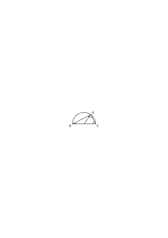

as _one_ position of a movable mechanism which would, so to speak, be the real construction of the proof? (Imagine, say, a crank at A & AB & AC as elastic strings, etc.)

### [146\[2\]](https://cdn.wittgensteinnachlass.com/2000px/webp/Ms-108/146.webp)

(Can one speak of an extensible proof?)

### [146\[3\]](https://cdn.wittgensteinnachlass.com/2000px/webp/Ms-108/146.webp)

Can one say that the figure serves only to demonstrate a certain multiplicity – – –

### [146\[4\]](https://cdn.wittgensteinnachlass.com/2000px/webp/Ms-108/146.webp)

Could one say: the figure can be viewed through certain kinds of distorting mirrors and, seen through them, retains its probative force. It is understood from the outset in such a way that it can be viewed through all these distorting mirrors. Only what is common to all these images and embodied by the figure is the real symbol.

### [146\[5\]](https://cdn.wittgensteinnachlass.com/2000px/webp/Ms-108/146.webp)

Now of course one could – wrongly – take the figure as the concept & its various images as the objects falling under it.

### [146\[6\]](https://cdn.wittgensteinnachlass.com/2000px/webp/Ms-108/146.webp)

06.05.1930

The proof cannot prophesy anything. I.e. it cannot prophesy anything real.

### [146\[7\]](https://cdn.wittgensteinnachlass.com/2000px/webp/Ms-108/146.webp)

We often recognize in the most distorted shadow the figure that casts it.

### [147\[1\]](https://cdn.wittgensteinnachlass.com/2000px/webp/Ms-108/147.webp)

The figure is a sign & neither what is designated nor an inexact picture of what is designated.

### [147\[2\]](https://cdn.wittgensteinnachlass.com/2000px/webp/Ms-108/147.webp)

It is hard not to exaggerate in philosophy.

### [147\[3\]](https://cdn.wittgensteinnachlass.com/2000px/webp/Ms-108/147.webp)

“This is here” is nonsense.

### [147\[4\]](https://cdn.wittgensteinnachlass.com/2000px/webp/Ms-108/147.webp)

We could very well know all our present numbers but not zero, & would have no means of finding it; there would be no gap in our system corresponding to it, but rather we would have a different system.

### [147\[5\]](https://cdn.wittgensteinnachlass.com/2000px/webp/Ms-108/147.webp)

What does the generality of a geometrical proof consist in? The general effect of a figure?

Which radiates out into space. This seeing that it is not the particular figure that matters at all.

### [147\[6\]](https://cdn.wittgensteinnachlass.com/2000px/webp/Ms-108/147.webp),[148\[1\]](https://cdn.wittgensteinnachlass.com/2000px/webp/Ms-108/148.webp)

One might think that the general validity of the figure can be justified by sentences like: Every such triangle must surely have equal sides because the radii are in a circle & therefore these angles must be equal in each one, etc., etc. But that really is _no_ justification. For what do words like “_every_”, etc., mean here? It only looks as though we are dealing with logical inferences here.

### [148\[2\]](https://cdn.wittgensteinnachlass.com/2000px/webp/Ms-108/148.webp)

(Then there follows, again and again, the thought – which, admittedly, I have never regarded as a solution but always as a mere appearance – that the proof is not about a central angle, a circle, etc., at all, but about circularity, the concept of a central angle, etc., etc. Admittedly there is _some_ truth even in this appearance.)

### [148\[3\]](https://cdn.wittgensteinnachlass.com/2000px/webp/Ms-108/148.webp)

I would say that the alchemists were not _looking_ for the art of making gold.

### [148\[4\]](https://cdn.wittgensteinnachlass.com/2000px/webp/Ms-108/148.webp)

The generality in question enters, of course, already into the definition of the circle as the locus of all points etc.

### [148\[5\]](https://cdn.wittgensteinnachlass.com/2000px/webp/Ms-108/148.webp),[149\[1\]](https://cdn.wittgensteinnachlass.com/2000px/webp/Ms-108/149.webp)

This must of course be a matter of the definition of a variable for which a certain range of values is determined, but certainly not as a class of values. – So if I begin the supposed chain of inference with the sentence “all radii of a circle are equally long”, that would already be wrong, i.e. a nonsensical beginning. If I define the circle, say, by the equation r = constant, then the infinite possibility of the r’s according to the position of the radius must of course be contained in the meaning of this definition; but not in the form of a class of possible values, rather, if it is a matter of a numerical geometry, through the law of the formation of rational numbers, and, insofar as it is a matter of a visual geometry, through the infinite visible possibility attaching to every radius.

### [149\[2\]](https://cdn.wittgensteinnachlass.com/2000px/webp/Ms-108/149.webp)

The irrational values come into consideration only insofar as they can be represented by sequences of rational numbers.

### [149\[3\]](https://cdn.wittgensteinnachlass.com/2000px/webp/Ms-108/149.webp),[150\[1\]](https://cdn.wittgensteinnachlass.com/2000px/webp/Ms-108/150.webp)

I once said earlier that one could also imagine a Euclidean demonstration carried out on a moving figure. But what is essential is not that it moves, but that it is movable. (i.e. variable) I.e. I must see in it the representative of the infinite spatial possibility.

### [150\[2\]](https://cdn.wittgensteinnachlass.com/2000px/webp/Ms-108/150.webp)

If I know a mathematical proposition & a proof of it, & later I get to know yet another proof of this proposition, then I have thereby got to know a new system.

### [150\[3\]](https://cdn.wittgensteinnachlass.com/2000px/webp/Ms-108/150.webp)

Suppose someone were examining even numbers to see whether Goldbach’s theorem holds for them. He would now express the conjecture – & it can be expressed – that if he continues with this investigation he will not, as long as he lives, come across a contradicting case. Suppose a proof of the theorem were now found: does it then prove the man’s conjecture too? How is that possible?

### [150\[4\]](https://cdn.wittgensteinnachlass.com/2000px/webp/Ms-108/150.webp)

07.05.1930

Can one answer: All that the proof of Goldbach’s proposition will prophesy is that this result will be correct, not that it will come out. (But the first ‘will’ here is nonsensical, for verbs in mathematics have no future.)

### [150\[5\]](https://cdn.wittgensteinnachlass.com/2000px/webp/Ms-108/150.webp),[151\[1\]](https://cdn.wittgensteinnachlass.com/2000px/webp/Ms-108/151.webp)

Someone says to me “I have worked out expressions of the form (a + b) + c and a + (b + c) & found that they yield the same result”, and I answer: “you will always find that, _provided, that is, that you calculate correctly_”. But this qualifying clause deprives the answer 08.05.1930 of any character of prediction.

### [151\[2\]](https://cdn.wittgensteinnachlass.com/2000px/webp/Ms-108/151.webp)

Can someone _believe_ that 25 × 25 = 625? What does it mean to believe that?

### [151\[3\]](https://cdn.wittgensteinnachlass.com/2000px/webp/Ms-108/151.webp)

Could one say that arithmetical or geometrical problems always look as though they concerned objects in space, or can mistakenly be understood that way, whereas they concern space itself?

### [151\[4\]](https://cdn.wittgensteinnachlass.com/2000px/webp/Ms-108/151.webp)

Thus one believes that the problem of trisecting the angle relates to the actual trisection of a particular angle, or even of all angles. Whereas it is _not_ a problem, & what one calls the solution to the problem is a demonstration of space.

### [151\[5\]](https://cdn.wittgensteinnachlass.com/2000px/webp/Ms-108/151.webp)

Is it not like this: To believe that Goldbach’s proposition will always hold ad inf. – is nonsense; to believe that it will hold 1000000 times is on the same level as believing that it will hold once, & that is on the same level as believing that 25 × 25 will yield 625.

### [152\[1\]](https://cdn.wittgensteinnachlass.com/2000px/webp/Ms-108/152.webp)

Strange as it sounds, it is possible to know the prime numbers up to – say – 7 & thus to possess a finite system of prime numbers. What we call the recognition that there are infinitely many is in truth the recognition of a system that is new & on an equal footing with the other.

### [152\[2\]](https://cdn.wittgensteinnachlass.com/2000px/webp/Ms-108/152.webp)

(Whatever I write, it is fragments, but someone who understands will derive a coherent picture of the world from them.)

### [152\[3\]](https://cdn.wittgensteinnachlass.com/2000px/webp/Ms-108/152.webp)

One can believe that 25 × 25 is 625 only insofar as one can also believe that 25 × 25 = 620. And it is of course impossible to form a picture of this state of affairs – or of that one.

### [152\[4\]](https://cdn.wittgensteinnachlass.com/2000px/webp/Ms-108/152.webp)

If savage peoples have a number system in which 5 is followed by an expression analogous to our “many”, & if, when specifying a number, they point first to the fingers of one hand and then to their hair, these people have just as complete a number system as we do.

### [152\[5\]](https://cdn.wittgensteinnachlass.com/2000px/webp/Ms-108/152.webp),[153\[1\]](https://cdn.wittgensteinnachlass.com/2000px/webp/Ms-108/153.webp)

To ask whether it would be conceivable for other people to have a space that ends at the walls of this room is nonsense, because this _and every_ question already contains a particular spatial conception of the wall.

### [153\[2\]](https://cdn.wittgensteinnachlass.com/2000px/webp/Ms-108/153.webp)

I can ask these questions in _no_ language, because each already presupposes a particular spatial conception.

### [153\[3\]](https://cdn.wittgensteinnachlass.com/2000px/webp/Ms-108/153.webp)

09.05.1930

The domain of a variable must be determined by the grammar. That is, it must be determined entirely by the signs & the rules for signs. However much one leaves open about the application of the system of signs, it must be self-contained.

### [153\[4\]](https://cdn.wittgensteinnachlass.com/2000px/webp/Ms-108/153.webp),[154\[1\]](https://cdn.wittgensteinnachlass.com/2000px/webp/Ms-108/154.webp)

One could say that the domain of generality must be determined insofar as one must be able to decide in each individual case whether it is such a case or not. But this does not mean that I must then be in a position to make the decision owing to some particular disposition of my mind or to particular external circumstances; rather, the _capacity_ we are speaking of here is a logical possibility. It must be clear _now_, as I utter the general proposition, what is to count as a particular case of this generality; the space of generality must be seen.

### [154\[2\]](https://cdn.wittgensteinnachlass.com/2000px/webp/Ms-108/154.webp)

The generality one means is often one that corresponds to the indeterminacy of the kind of chess pieces (say). When one gives the rules of chess, nothing at all is said about what kind of pieces are used to play the game, & the most diverse kinds are conceivable here, from wooden pieces on a board to written signs on paper. And it is important to see that neither kind is primary. For chess might just as well have been invented in written signs in the first place.

### [154\[3\]](https://cdn.wittgensteinnachlass.com/2000px/webp/Ms-108/154.webp)

10.05.1930

What kind of discovery is it that ~p ∙ ~p = ~p, that ~p is a special case of ~p ∙ ~q? Is there not, in the same sense, a discovery that ~~p = p, ~~~p = ~p, etc.? I discover a “connection”.

### [154\[4\]](https://cdn.wittgensteinnachlass.com/2000px/webp/Ms-108/154.webp),[155\[1\]](https://cdn.wittgensteinnachlass.com/2000px/webp/Ms-108/155.webp)

11.05.1930

Scheffer’s discovery is of course not the discovery of the definition ~p ∙ ~q = p ❘ q. Russell could very well have had this definition without thereby possessing Scheffer’s system, & on the other hand Scheffer could have established his system even without this definition. His system is wholly contained in the signs ~p ∙ ~p for ~p & ~(~p ∙ ~q) ∙ ~(~p ∙ ~q) for p⌵q, & p ❘ q of course merely permits an _abbreviation_. Indeed, one can say that someone could very well have known the sign ~(~p ∙ ~q) ∙ ~(~p ∙ ~q) for p⌵q and yet not have recognized the system p ❘ q ∙ ❘ ∙ p ❘ q in it. Indeed, it therefore seems, _absurd as it sounds_, that one could know the definition p ❘ q ∙ ❘ ∙ p ❘ q = p⌵q without realizing that in “ ❘ ” & “ ∙ ❘ ∙ ” one has the same operation before one.

### [155\[2\]](https://cdn.wittgensteinnachlass.com/2000px/webp/Ms-108/155.webp)

I call space what one can be _certain_ of while looking for something.

### [155\[3\]](https://cdn.wittgensteinnachlass.com/2000px/webp/Ms-108/155.webp)

If we make the matter clearer still by assuming Frege’s two primitive signs “~” and “ ∙ ”, the discovery still stands even if the definitions are written ~p ∙ ~p = ~p and ~(~p ∙ ~p) ∙ ~(~q ∙ ~q) = p ∙ q. Here apparently nothing at all has changed in the primitive signs.

### [155\[4\]](https://cdn.wittgensteinnachlass.com/2000px/webp/Ms-108/155.webp),[156\[1\]](https://cdn.wittgensteinnachlass.com/2000px/webp/Ms-108/156.webp)

One could imagine someone being shown these definitions & asking “what is gained by that, then?”; because he did not see the new system in them. One could also imagine that someone had already written out the whole of Frege’s or Russell’s logic in this system & yet, like Frege, called “~” and “ ∙ ” his primitive signs because he did not see the other system in his sentences.

### [156\[2\]](https://cdn.wittgensteinnachlass.com/2000px/webp/Ms-108/156.webp)

If someone then came along & gave the definition ~p ∙ ~q = p ❘ q, he would admittedly have introduced only an abbreviation that was in itself inessential, but it would be the expression of a discovery in the sense that it _emphasizes_ a particular new aspect. (Russell rightly pointed out that the meaning of definitions often rests on this emphasis.)

### [156\[3\]](https://cdn.wittgensteinnachlass.com/2000px/webp/Ms-108/156.webp)

(Almost as the form of name Mrs John Robinson emphasizes a particular relation between husband & wife.)

### [156\[4\]](https://cdn.wittgensteinnachlass.com/2000px/webp/Ms-108/156.webp)

There is a difference between looking at the steam engine as the machine par excellence (as one once did) and looking at it as _one_ machine – among many others. – And one sees a different system according as one can regard 12 strokes only as the system  (and so knows them only as that system) or sees this system as one of the many possible ones.

### [156\[5\]](https://cdn.wittgensteinnachlass.com/2000px/webp/Ms-108/156.webp)

One can no more “round off” mathematics than one can say “let us round off the 4 primary colours to 5 or 10”, or let us round the 8 notes of an octave off (or up) to 10.

### [157\[1\]](https://cdn.wittgensteinnachlass.com/2000px/webp/Ms-108/157.webp)

I use the word space for the possibility of movement.

### [157\[2\]](https://cdn.wittgensteinnachlass.com/2000px/webp/Ms-108/157.webp)

I once said in a discussion that two systems were the same space if they could be translated into one another. But what about, say, two systems of tautologies, one written in Frege’s manner with “~” and “ ∙ ”, the other in the system ~ξ ∙ ~η? These two can, of course, be translated into one another, but only once one _sees the second in the first_. One could perhaps apply this to the solution of any algebraic problem. E.g. the way & manner of solving an equation x² + ax + b = 0 can already be seen in it – one could imagine all the transformations projected into it. – But that means that the solution can be seen in it – if one sees it in the equation, however, one sees _something different_ from what one sees when one does not see the solution in it.

### [157\[3\]](https://cdn.wittgensteinnachlass.com/2000px/webp/Ms-108/157.webp),[158\[1\]](https://cdn.wittgensteinnachlass.com/2000px/webp/Ms-108/158.webp)

12.05.1930

One could also express my opinion in these words: one cannot discover a connection between parts of mathematics or logic that was already there unbeknown to one. Rather, if one did not yet know the connection, it was not there. And the system in which it is there is a new system.

### [158\[2\]](https://cdn.wittgensteinnachlass.com/2000px/webp/Ms-108/158.webp),[159\[1\]](https://cdn.wittgensteinnachlass.com/2000px/webp/Ms-108/159.webp)

One could put it like this: If I am looking for something – I mean, the North Pole or a house in London – I can describe what I am looking for _completely_ before I have found it (or found that it is not there) & this description will in any case be logically impeccable. Whereas in the case of “looking” in mathematics, where it does not take place _within_ a system, I cannot describe what I am looking for, or can do so only in appearance, for if I could describe it in every detail, I would already have it & before it is _completely_ described I cannot be sure whether _what_ I am looking for is logically impeccable, and hence can be described at all; that is, this imperfect description leaves out precisely what would be necessary for something to be looked for. So it is only a sham description of “what is being looked for”. Here one is easily misled by the legitimacy of an imperfect description when one is looking for an actual object, & here again a lack of clarity about description & object comes into play. If one says I am going to the North Pole & expect to find a flag there, on Russell’s view that would mean: I expect to find something (an x) that is a flag – say, of such & such a colour & size. And it then seems as if the expectation (& the search) here too concerns only a (description) & not the object itself, which I know directly (knowledge by acquaintance) only when I have it before me (whereas previously I am acquainted with it only indirectly). But that is nonsense. Whatever I can perceive there – insofar as it is a confirmation of my expectation – I can describe beforehand & “describe” here does not mean stating something about it, but expressing it. I.e.: I must _be able_ to describe what I am looking for _completely_.

### [159\[2\]](https://cdn.wittgensteinnachlass.com/2000px/webp/Ms-108/159.webp)

13.05.1930

The question is whether one can say that mathematics today has, as it were, jagged – or frayed – edges & that it will therefore be possible to round it off. I believe one can no more say the former than one can say that reality is shaggy because there are 4 primary colours, 7 notes in an octave, 3 dimensions in visual space, etc.

### [159\[3\]](https://cdn.wittgensteinnachlass.com/2000px/webp/Ms-108/159.webp),[160\[1\]](https://cdn.wittgensteinnachlass.com/2000px/webp/Ms-108/160.webp)

The solution of the equation x² + ax + b = 0 is discovered by finding a particular aspect of this equation.

### [160\[2\]](https://cdn.wittgensteinnachlass.com/2000px/webp/Ms-108/160.webp)

When one proves solvability, the concept of solution must be present somehow in the proof. (Something in the mechanism of the proof must correspond to this concept.) But this concept is not to be represented by an external description, but simply to be actually exhibited.

### [160\[3\]](https://cdn.wittgensteinnachlass.com/2000px/webp/Ms-108/160.webp)

Where the new connection was found, one had not previously seen a gap. And where one did think one saw a gap, one was mistaken.

### [160\[4\]](https://cdn.wittgensteinnachlass.com/2000px/webp/Ms-108/160.webp)

(I keep fighting – whether successfully, I do not know – against the tendency in my own mind to set up rules (to construct them) in philosophy, to make assumptions (hypotheses), instead of just seeing what is there.)

### [160\[5\]](https://cdn.wittgensteinnachlass.com/2000px/webp/Ms-108/160.webp)

(It is extremely taxing to strain one’s eyes & see the physiognomy of a thought in the distance, through a fog.)

### [160\[6\]](https://cdn.wittgensteinnachlass.com/2000px/webp/Ms-108/160.webp)

One could also call what is possible _before_ all new discoveries & inventions philosophy.

### [161\[1\]](https://cdn.wittgensteinnachlass.com/2000px/webp/Ms-108/161.webp)

I want to show again and again that logic is all right as it is.

### [161\[2\]](https://cdn.wittgensteinnachlass.com/2000px/webp/Ms-108/161.webp)

This must also have to do with the fact that I cannot give an explanation of the variable “sentence”. It is clear that this logical concept, this variable, must be of the same order as the concept “reality” or “world”.

### [161\[3\]](https://cdn.wittgensteinnachlass.com/2000px/webp/Ms-108/161.webp),[162\[1\]](https://cdn.wittgensteinnachlass.com/2000px/webp/Ms-108/162.webp)

The generality of variables in logic is the generality of demonstration. It consists in this: the fact that p⊃p is a tautology is _demonstrated with general validity_ using an arbitrarily chosen _particular_ case. I.e. from the demonstration in the particular case I actually see (however it was meant) everything I need in logic. I.e. the demonstration acquires its generality not by being meant that way but by actually demonstrating generally (i.e. with general validity). I.e. the generality here consists in the generality of the application. And this is there, so to speak, whether one wants it or not – simply by virtue of the internal relation of the individual case to the paradigm. – One could then say that a demonstration demonstrates as generally as it can be applied. I.e. it demonstrates generally by virtue of the space in which it is.

### [162\[2\]](https://cdn.wittgensteinnachlass.com/2000px/webp/Ms-108/162.webp)

14.05.1930

It is clear that the discovery of Scheffer’s system in ~p ∙ ~p = ~p and ~(~p ∙ ~p) ∙ ~(~q ∙ ~q) = p ∙ q corresponds to the discovery that  is a special case of a² + 2ab + b².

### [162\[3\]](https://cdn.wittgensteinnachlass.com/2000px/webp/Ms-108/162.webp)

One sees that something can be viewed in this way only once it is viewed in this way. One sees that an aspect is possible only once it is actually there.

### [162\[4\]](https://cdn.wittgensteinnachlass.com/2000px/webp/Ms-108/162.webp)

One could construct a trigonometry on the model of elementary trigonometry but independently of the image of triangles, a trigonometry that knew nothing of the trigonometrical series but had only the multiplicity of elementary trigonometry.

### [162\[5\]](https://cdn.wittgensteinnachlass.com/2000px/webp/Ms-108/162.webp)

The Dirichletian conception of the function is only possible where it does not want to express an infinite law through a list, because there is no infinite list.

### [162\[6\]](https://cdn.wittgensteinnachlass.com/2000px/webp/Ms-108/162.webp),[163\[1\]](https://cdn.wittgensteinnachlass.com/2000px/webp/Ms-108/163.webp)

If human warfare were more like chess than it actually is, one could try to represent a battle on the chessboard & solve mathematical problems concerning the possibilities of the battle on the chessboard. Only mathematical problems, of course, for one could not use the chess pieces to conduct experiments on how the battle unfolds, since they behave differently from human beings. Thus if one solved the problem of, say, checkmating the other player in N moves from a particular position, that would be the solution of a mathematical problem of warfare.

### [163\[2\]](https://cdn.wittgensteinnachlass.com/2000px/webp/Ms-108/163.webp)

There is nothing general in the demonstration; it is entirely particular, but the possibility of applying it contains the generality.

### [163\[3\]](https://cdn.wittgensteinnachlass.com/2000px/webp/Ms-108/163.webp)

The possibility of application radiates through the space & strikes the body that one brings into this space. One could call the rays of light general, because they illuminate any body whatsoever that gets in their way. But it would be absurd to call the source of light general.

### [163\[4\]](https://cdn.wittgensteinnachlass.com/2000px/webp/Ms-108/163.webp),[164\[1\]](https://cdn.wittgensteinnachlass.com/2000px/webp/Ms-108/164.webp)

15.05.1930

If the reason for believing something were not a verification but an external relation, one would have to ask further “and why is _that_ a reason for _this_ belief in particular”. And so it would go on. (E.g. “why do we take memory as a reason for believing that something happened in the past”.)

### [164\[2\]](https://cdn.wittgensteinnachlass.com/2000px/webp/Ms-108/164.webp)

The generality of the interpretation of a demonstration consists in this – and only in this – that we are interested in the internal relations of the demonstration & not in the physical process (the experiment) in it.

### [164\[3\]](https://cdn.wittgensteinnachlass.com/2000px/webp/Ms-108/164.webp)

The kind of number one uses where it _makes sense_ to go on counting indefinitely & the kind one uses where that is not possible differ from one another.

### [164\[4\]](https://cdn.wittgensteinnachlass.com/2000px/webp/Ms-108/164.webp)

I can say _Those_ are 3 circles only if “those” has a meaning that does not already predetermine the 3 circles.

### [164\[5\]](https://cdn.wittgensteinnachlass.com/2000px/webp/Ms-108/164.webp)

The generality of a demonstration is the scope of its effect.

### [164\[6\]](https://cdn.wittgensteinnachlass.com/2000px/webp/Ms-108/164.webp),[165\[1\]](https://cdn.wittgensteinnachlass.com/2000px/webp/Ms-108/165.webp)

A demonstration demonstrates everything that it demonstrates. Its scope does not depend on how it is _meant_, but on the demonstration itself. Just as a searchlight sends its light as far as it sends it, however far one means to send it.

### [165\[2\]](https://cdn.wittgensteinnachlass.com/2000px/webp/Ms-108/165.webp)

That is the difference between the demonstration & a sentence. For in the demonstration nothing is said; rather, something is shown. And so the scope of its application depends on it and its space, but not on us.

### [165\[3\]](https://cdn.wittgensteinnachlass.com/2000px/webp/Ms-108/165.webp)

For one might say: the demonstration is not general at all, but entirely particular. But it does demonstrate something, & that holds as generally as it holds. (The good thing is precisely that wherever else allusions & hints may count, in the demonstration only what is there counts. In this respect it is like an experiment.)

### [165\[4\]](https://cdn.wittgensteinnachlass.com/2000px/webp/Ms-108/165.webp)

Euclid, for example, gives instructions for bisecting a line segment by demonstrating the method (using an example). Now, these instructions hold as far as one can apply them. And if one could not apply them in a given case, it would do them no good to have been meant for that case.

### [166\[1\]](https://cdn.wittgensteinnachlass.com/2000px/webp/Ms-108/166.webp)

One can represent three only by means of the model of three.

### [166\[2\]](https://cdn.wittgensteinnachlass.com/2000px/webp/Ms-108/166.webp)

17.05.1930

The generality of the demonstration is only the space around this demonstration. Application to a particular case is a new body in this space.

### [166\[3\]](https://cdn.wittgensteinnachlass.com/2000px/webp/Ms-108/166.webp)

18.05.1930

There is a difference between a system _resting_ on first principles and its merely being developed from them as a starting point. There is a difference between its resting on its lowest walls like a house and its floating freely in space like, say, a celestial body, & our merely having started building at the bottom, though we could have done so somewhere else.

### [166\[4\]](https://cdn.wittgensteinnachlass.com/2000px/webp/Ms-108/166.webp)

Logic & mathematics do not _rest_ on axioms, any more than a group rests on the elements & operations that define it. Here lies the mistake in taking the obviousness, the self evidence, of the fundamental laws as a criterion of correctness in logic. A foundation that stands on nothing is a poor foundation.

### [166\[5\]](https://cdn.wittgensteinnachlass.com/2000px/webp/Ms-108/166.webp),[167\[1\]](https://cdn.wittgensteinnachlass.com/2000px/webp/Ms-108/167.webp)

Apart from the generality of demonstration, what kind of generality does an axiom have?

(One could of course also say “the generality of the whole system”.)

### [167\[2\]](https://cdn.wittgensteinnachlass.com/2000px/webp/Ms-108/167.webp)

This question seems to me to get to the actual use of geometry.

### [167\[3\]](https://cdn.wittgensteinnachlass.com/2000px/webp/Ms-108/167.webp)

What kind of generality is it when we say “a straight line can be drawn between _any two_ points”?

### [167\[4\]](https://cdn.wittgensteinnachlass.com/2000px/webp/Ms-108/167.webp)

The generality of the grammatical rule relates to the use of words.

### [167\[5\]](https://cdn.wittgensteinnachlass.com/2000px/webp/Ms-108/167.webp)

I must be able to imagine what a point is.

### [167\[6\]](https://cdn.wittgensteinnachlass.com/2000px/webp/Ms-108/167.webp)

It makes sense to say of two points that they are connected by a straight line. But does that mean “it makes sense to say of two things that are points etc.”?

### [167\[7\]](https://cdn.wittgensteinnachlass.com/2000px/webp/Ms-108/167.webp),[168\[1\]](https://cdn.wittgensteinnachlass.com/2000px/webp/Ms-108/168.webp)

How then do I know that a sign A designates a point? Perhaps by seeing that A may be combined in a particular way with other signs. But how do I know that these others designate straight lines etc.? Through the fact that they may be combined with A in this way? Surely they cannot determine each other’s meaning. The grammatical system (game) is simply autonomous, & its application is not given in it.

### [168\[2\]](https://cdn.wittgensteinnachlass.com/2000px/webp/Ms-108/168.webp)

But the system is characterized, for example, by the statement that no number of names (for points, for example) may be regarded as complete.

### [168\[3\]](https://cdn.wittgensteinnachlass.com/2000px/webp/Ms-108/168.webp)

Geometry understood otherwise than as pure grammar must be applied, & then there must be real points & straight lines etc.; the proposition that a straight line connects two points must then indeed have a real sense.

### [168\[4\]](https://cdn.wittgensteinnachlass.com/2000px/webp/Ms-108/168.webp)

And then the geometrical proposition does not say that all pairs of points _are_ connected by a straight line either, but that they _can_ be connected by a straight line. And here one then uses the words “_any two_ points” & not _all_ pairs of points, and thereby indicates the difference from another kind of generality.

### [168\[5\]](https://cdn.wittgensteinnachlass.com/2000px/webp/Ms-108/168.webp)

Grammar cannot state its rules generally at a venture (i.e. leave them open).

### [169\[1\]](https://cdn.wittgensteinnachlass.com/2000px/webp/Ms-108/169.webp)

19.05.1930

Let us imagine a game of draughts in which it would be permissible to use a board of any size, by which I mean a board with any number of squares (thus 64, 81, 100, etc.). This does not of course mean “it is permissible to use a board with infinitely many squares” (that is rubbish). We could hardly call this an infinite game.

### [169\[2\]](https://cdn.wittgensteinnachlass.com/2000px/webp/Ms-108/169.webp)

Possibility always corresponds to a permission in the grammatical rules of the game. What one calls infinite possibility corresponds to something one might call infinite permission. And that is of course not permission to do something infinite.

### [169\[3\]](https://cdn.wittgensteinnachlass.com/2000px/webp/Ms-108/169.webp)

The infinite possibility of forming names lies not only in the infinite possibility of signs of the form , 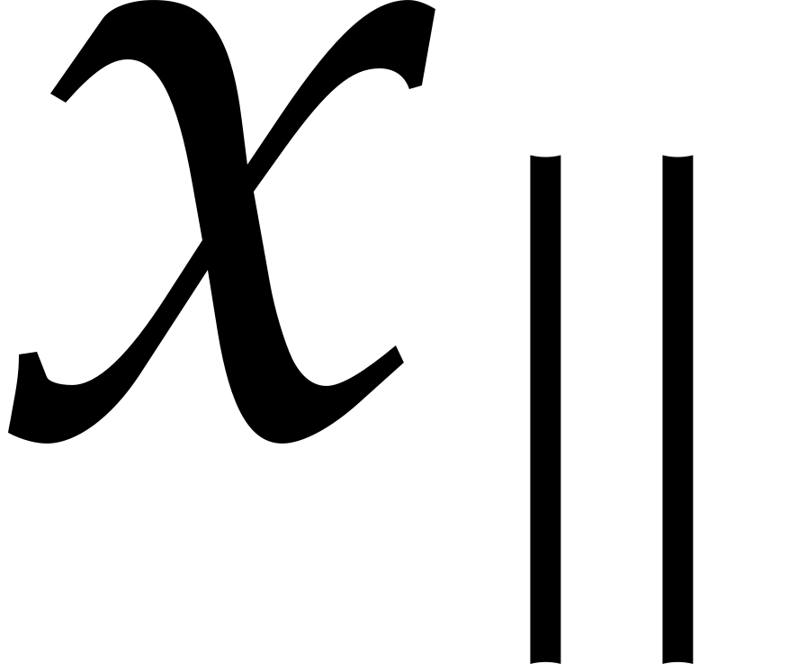, 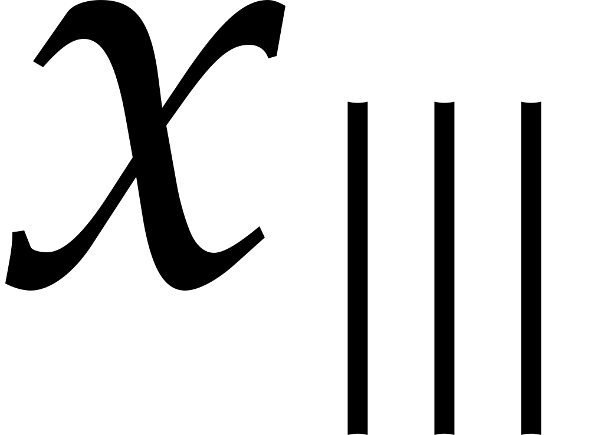, 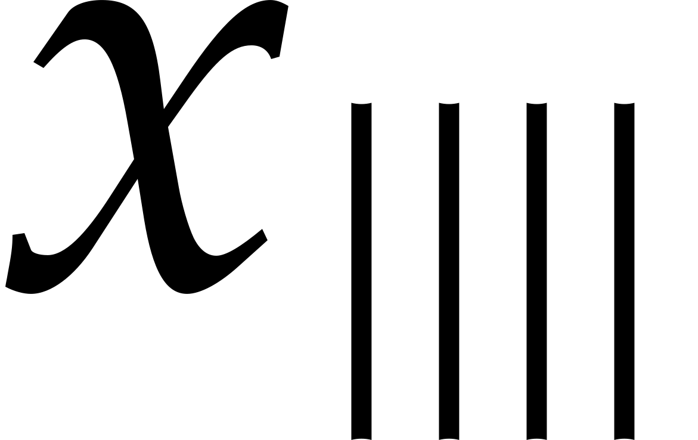 etc., but also, for example, in the infinite possibility space affords for altering the shape of the sign.

### [169\[4\]](https://cdn.wittgensteinnachlass.com/2000px/webp/Ms-108/169.webp)

Different kinds of piece, such as bishops, knights, etc., correspond to different parts of speech.

### [170\[1\]](https://cdn.wittgensteinnachlass.com/2000px/webp/Ms-108/170.webp)

20.05.1930

Here I come to that method of explaining signs which Frege made such fun of. For one could explain the words “knight”, “bishop”, etc. by giving the rules governing these pieces.

### [170\[2\]](https://cdn.wittgensteinnachlass.com/2000px/webp/Ms-108/170.webp),[171\[1\]](https://cdn.wittgensteinnachlass.com/2000px/webp/Ms-108/171.webp)

Exactly the same applies in every geometry to the expressions “point” and “straight line”, etc. What a point is & what a straight line is can be seen only from the places the one & the other occupy in the system of rules. Let us imagine, for example, a system of letters such that all permitted signs are groups of three letters & are arranged so that a letter which may occupy an outer position may not occupy the middle position and vice versa. This rule would distinguish between two “parts of speech”, and we could express this by using capital letters for the outer members and lower-case letters for the inner ones. – On the other hand, however, the distinction between two parts of speech makes no sense at all if they are _not_ syntactically distinguished in the way described above, that is, if they could not be recognized as different even without the different kinds of designation, simply by the rules that apply to them. (Two knights might look nothing like one another & still be identifiable as such, if one knows the rules of the game that apply to them.) Directly connected with this is the fact that introducing new generic names into the philosophy of logic does not get us a hair’s breadth further as long as the syntactic rules that make the difference are not given.

### [171\[2\]](https://cdn.wittgensteinnachlass.com/2000px/webp/Ms-108/171.webp)

21.05.1930

If I have counted a class of actual things & now see the 1-to-1 correspondence of another class with it, I can indeed infer that the other class too will have the number first obtained; but this is a hypothesis, just as the result of the first count is.

### [171\[3\]](https://cdn.wittgensteinnachlass.com/2000px/webp/Ms-108/171.webp)

I can see the equality in number in the correspondence, but I cannot infer it from the correspondence.

### [171\[4\]](https://cdn.wittgensteinnachlass.com/2000px/webp/Ms-108/171.webp),[172\[1\]](https://cdn.wittgensteinnachlass.com/2000px/webp/Ms-108/172.webp)

There are no two parts of speech that I can treat grammatically (exactly) alike, but which are nevertheless two parts of speech. Rather, the rules governing them constitute the parts of speech: The same rules, the same part of speech. This is connected with the fact that if one sign behaves exactly like another, the two are the same sign.

### [172\[2\]](https://cdn.wittgensteinnachlass.com/2000px/webp/Ms-108/172.webp)

22.05.1930

Dirichlet’s explanation of the function is the first step in set theory. But the truth is precisely that defining a function by a table & defining one by an infinite process yield essentially different things, for an infinite table, like an infinite list, is an absurdity.

### [172\[3\]](https://cdn.wittgensteinnachlass.com/2000px/webp/Ms-108/172.webp)

“Is it conceivable that 2 things have all their properties in common?” If it is not conceivable, then the opposite is not conceivable either.

### [172\[4\]](https://cdn.wittgensteinnachlass.com/2000px/webp/Ms-108/172.webp)

“Infinite” actually plays (unconsciously) the role of “very large”!

### [172\[5\]](https://cdn.wittgensteinnachlass.com/2000px/webp/Ms-108/172.webp)

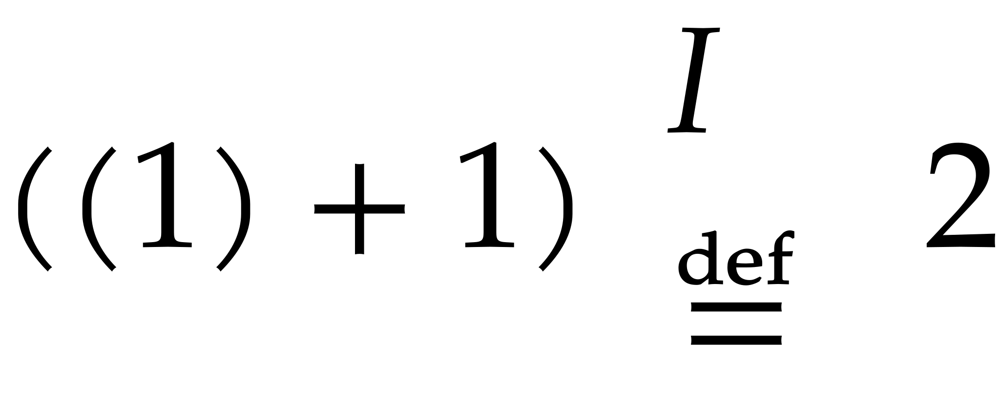, 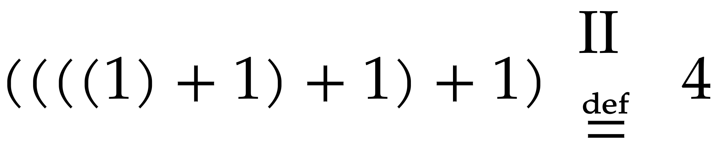, 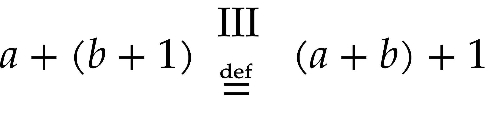,

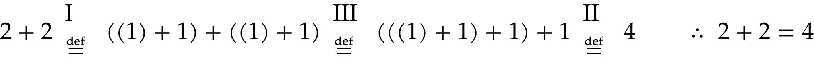

What makes 2 + 2 = 4 meaningful, that is, what makes 2 + 2 = 4 right & 2 + 2 = 5 wrong, rather than two equally legitimate stipulations, is the provability of 2 + 2 = 4, and that alone. That is, that ((1) + 1) + ((1) + 1) = (((1) + 1) + 1) + 1 belongs to the general system a + (b + 1) = (a + b) + 1.

### [173\[1\]](https://cdn.wittgensteinnachlass.com/2000px/webp/Ms-108/173.webp)

Without this provability, 2 + 2 = 4 would be an arbitrary rule for signs, & there would be no question of its being right or wrong. Demonstrability makes the equation something that can be compared with a proposition.

### [173\[2\]](https://cdn.wittgensteinnachlass.com/2000px/webp/Ms-108/173.webp)

23.05.1930

To call “a + (b + 1) = (a + b) + 1” a definition is already a mistake, strictly speaking. For it is a rule for signs of quite a different kind from, e.g., (1) + 1 = 2.

### [173\[3\]](https://cdn.wittgensteinnachlass.com/2000px/webp/Ms-108/173.webp)

One might now ask: What meaning does 2 + 2 = 4 have? Is it not a rule for signs? If so, it is arbitrary. The answer is that the meaning of 2 + 2 = 4 lies not in itself but in its provability, i.e. in its relation to other rules for signs, and thus in its belonging to a system. That is to say, that proof shows internal relations between 2 & 4 just as the proof that p⊃q ∙ p ․⊃․ q is a tautology shows internal relations between p⊃q ∙ p and q.

### [173\[4\]](https://cdn.wittgensteinnachlass.com/2000px/webp/Ms-108/173.webp)

If “a + (b + 1) = (a + b) + 1” is the general rule, then I can replace 2 + 2 with 4; that lies in the logical structure of the world.

### [174\[1\]](https://cdn.wittgensteinnachlass.com/2000px/webp/Ms-108/174.webp)

25.05.1930

The word number is nothing unless the variable number form (expressed in grammatical rules (rules for signs)) stands behind it.

### [174\[2\]](https://cdn.wittgensteinnachlass.com/2000px/webp/Ms-108/174.webp)

An equation acquires mathematical meaning only in a calculus.

### [174\[3\]](https://cdn.wittgensteinnachlass.com/2000px/webp/Ms-108/174.webp)

Thus “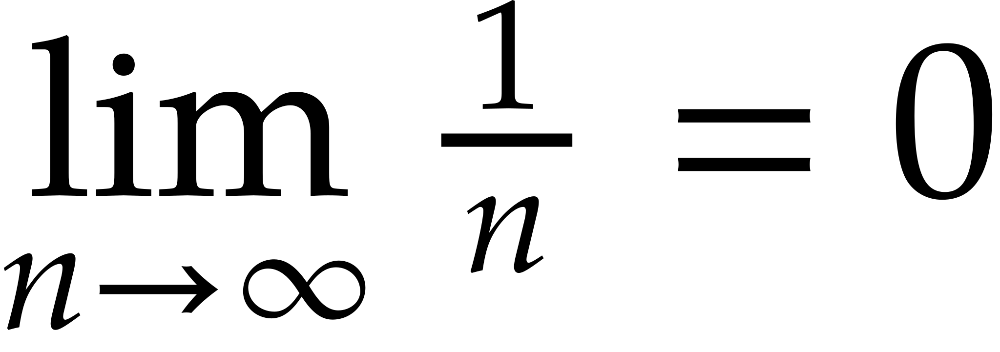” is an arbitrary substitution rule as long as the expression lim etc. does not occur in a calculus of limits. The connection of this calculus with the inductive properties of , for example, consists in the fact that the calculus permits the same transitions from equation to equation as are possible from one process of induction to another.

### [174\[4\]](https://cdn.wittgensteinnachlass.com/2000px/webp/Ms-108/174.webp),[175\[1\]](https://cdn.wittgensteinnachlass.com/2000px/webp/Ms-108/175.webp)

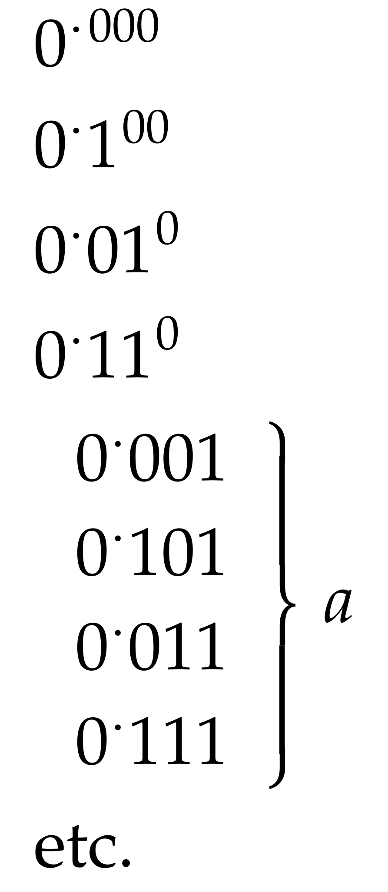

I understand the rule by which this is formed, but how can I put it in exact form? Since I understand it, it must be possible to put it in exact form.

For that I need the general form of a term like _a_, and this form must be correlated with that of the first such term in such a way that one can see how the first term is a case of the general term. And it must also be shown how the successor of the general term is a general term.

But this sign must be accompanied by a description or instructions for its use. And the difficulty is precisely to give this in exact, that is, presumably unambiguous, form.

### [175\[2\]](https://cdn.wittgensteinnachlass.com/2000px/webp/Ms-108/175.webp)

Description of such a rule of formation by means of word-language – – –

### [175\[3\]](https://cdn.wittgensteinnachlass.com/2000px/webp/Ms-108/175.webp)

In any case, one would need an expression for: All permutations with n repetitions of 0 and 1.

### [175\[4\]](https://cdn.wittgensteinnachlass.com/2000px/webp/Ms-108/175.webp),[176\[1\]](https://cdn.wittgensteinnachlass.com/2000px/webp/Ms-108/176.webp)

If I did not understand all those rules of induction, I could not calculate with decimals. But it is very difficult to state them exactly. – Or it presupposes a complicated technique. What kind of technique this would have to be to meet stringent requirements, & whether there is any such thing here as non-rigorous, I do not know. I am almost inclined to think that if one just sees the internal relation between the terms of the series of forms, everything is in order, & that there is no method at all of forcing someone, so to speak, to see the internal relation. It may also be that one must first see it in particular cases & can then build the expressions for other series of forms on this seeing.

### [176\[2\]](https://cdn.wittgensteinnachlass.com/2000px/webp/Ms-108/176.webp)

26.05.1930

The concept “irrational number” is a dangerous pseudo-concept.

### [176\[3\]](https://cdn.wittgensteinnachlass.com/2000px/webp/Ms-108/176.webp)

A cut is a _principle_ of division into greater & less.

### [176\[4\]](https://cdn.wittgensteinnachlass.com/2000px/webp/Ms-108/176.webp)

More precisely, an irrational number requires a _different_ definition of greater & less from that required by a rational number. All the artifices used in introducing irrational numbers are meant to conceal this novelty. I.e., the introduction of √2 is the introduction of a new mathematical world, & it is always supposed to look as though it had somehow already been contained in the earlier one.

### [176\[5\]](https://cdn.wittgensteinnachlass.com/2000px/webp/Ms-108/176.webp)

“~p” simply excludes p. What is then the case _instead of_ p follows from the nature of the world.

### [176\[6\]](https://cdn.wittgensteinnachlass.com/2000px/webp/Ms-108/176.webp),[177\[1\]](https://cdn.wittgensteinnachlass.com/2000px/webp/Ms-108/177.webp),[178\[1\]](https://cdn.wittgensteinnachlass.com/2000px/webp/Ms-108/178.webp)

12.06.1930

On the question of the existence of sense-data. One says that if something seems red, then _something_ must have _been_ red; if something _seemed_ to last a short time, then _something_ must have lasted a short time, etc. For one might ask: If something seemed red, how do we know that it seemed specifically _red_? Is it a matter of an empirical correlation between this appearance & this reality? If something “seemed to have the property φ”, how do we know that it seemed to have _this_ property – – –. What kind of connection is there between it seems so & it is so?

To begin with, the appearance can be right or wrong. – It is also in one sense connected with reality _empirically_. One says “this seems to be typhoid” & that means that these symptoms are empirically connected with those phenomena. If I say “this seems to be red” & then “yes, it really is red”, I have used a test for the second decision that was independent of the first appearance. If something _seemed_ red, then there was this appearance. And even if nothing in this appearance _is_ red in the same sense in which that other thing would be red if the appearance were right, there was nevertheless something in the appearance _corresponding_ to being red. – If it seems as though a physical object were brown & round, it does not of course follow that something must be brown & round in the physical sense, but something corresponding is the case. But in what respect can one speak of something corresponding?

– – –

### [178\[2\]](https://cdn.wittgensteinnachlass.com/2000px/webp/Ms-108/178.webp)

“Sentence” is just as general as, for example, “event”. How can one delimit “an event” against what is not an event? But “experiment” is just as general too, though it may seem more specific at first (and of course “action” & “to do” are just as general).

### [178\[3\]](https://cdn.wittgensteinnachlass.com/2000px/webp/Ms-108/178.webp),[179\[1\]](https://cdn.wittgensteinnachlass.com/2000px/webp/Ms-108/179.webp)

Of course one cannot say either that a sentence is what one can predicate true & false of, for that would determine something only if those words were meant in a particular way, but they can be so meant only in context. And precisely in the context of a sentence. All one can do here, as in all these cases, is to specify the grammatical game, give its rules & leave it at that.

Here it is a matter of the rules for ⌵, ~, etc.

### [179\[2\]](https://cdn.wittgensteinnachlass.com/2000px/webp/Ms-108/179.webp)

“Then an event occurred …”: this does not mean “an event” as opposed to something else.

### [179\[3\]](https://cdn.wittgensteinnachlass.com/2000px/webp/Ms-108/179.webp)

In set theory one ought to distinguish what is calculus from what aspires to be _doctrine_ (and of course cannot be). So one must separate the rules of the game from inessential statements about the chess pieces.

### [179\[4\]](https://cdn.wittgensteinnachlass.com/2000px/webp/Ms-108/179.webp),[180\[1\]](https://cdn.wittgensteinnachlass.com/2000px/webp/Ms-108/180.webp)

It is always, and rightly, “highly suspicious” when proofs in mathematics are carried out more generally than their known application warrants.

Here one invariably encounters the error of seeing general concepts & particular cases in mathematics. In set theory we encounter this suspicious generality at every turn. One is always tempted to say: “Let us get to the point!” Those general considerations only ever have sense if one has a particular field of application in view. There is, after all, no generality in mathematics whose application to particular cases cannot already be foreseen. One therefore always feels that the general considerations of set theory (if one does not regard them as a calculus) are idle chatter, & is quite astonished when shown an application of these considerations.

One feels that something here is not quite above board.

### [180\[2\]](https://cdn.wittgensteinnachlass.com/2000px/webp/Ms-108/180.webp)

15.06.1930

Given all I have already said about it, it may sound trivial if I now say that the flaw in the set-theoretic approach lies, time and again, in treating laws & enumerations (lists) as essentially one & in stringing them together; where one does not suffice, the other fills the gap. (This is what Dirichlet’s conception of functions does.)

### [180\[3\]](https://cdn.wittgensteinnachlass.com/2000px/webp/Ms-108/180.webp),[181\[1\]](https://cdn.wittgensteinnachlass.com/2000px/webp/Ms-108/181.webp)

If one applies my consideration to Cantor’s diagonal procedure, the result is this:

An infinite set of decimal fractions

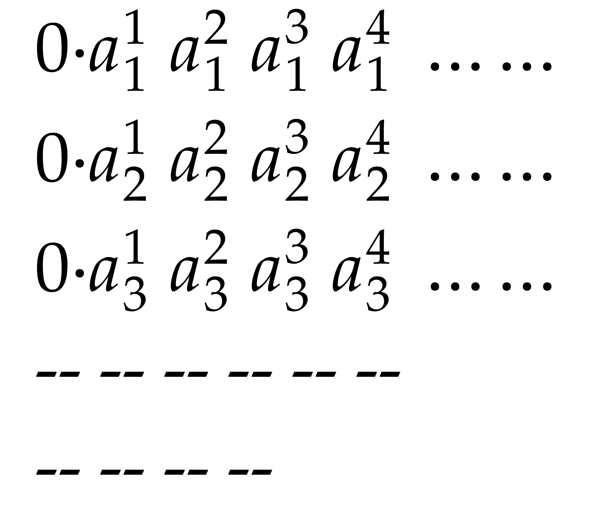

can only mean a law according to which laws are formed, and that really means a function of two variables. F(x,y) is the general form of these decimal fractions. F(x,n) is the nth of them & F(m,n) its mth digit. The decimal fraction taken along the diagonal is F(x,x), and when altered it takes the form, say, F(x,x) + 1 (for this one would have to stipulate that 0 + 1 = 1, 1 + 1 = 2, … q + 1 = 0, etc.).

And now a proof by induction shows that F(x,x) + 1 has a different expansion from any F(x,y). But where is the higher infinite here? (Or even the “infinite proper”?)

### [181\[2\]](https://cdn.wittgensteinnachlass.com/2000px/webp/Ms-108/181.webp)

Here again the difficulty lies in the formation of mathematical pseudo-concepts. If one says, e.g., that one can arrange the cardinal numbers in a sequence in order of magnitude, but not the rational numbers, this contains the unconscious presupposition that the concept of arranging in order of magnitude does after all have a sense for _the rational numbers_, & that, when tried, this way of arranging them proves impossible (which presupposes that the _attempt_ is conceivable). – So one thinks it is possible to try to arrange _the real numbers_ (as if this were a concept like, say, apple on this table) in a sequence, & that it then proves impossible to do.

### [182\[1\]](https://cdn.wittgensteinnachlass.com/2000px/webp/Ms-108/182.webp)

When the calculus of sets models its way of speaking as closely as possible on that of the calculus of cardinal numbers, that is no doubt instructive in some respects, because it points to certain formal similarities, but it is also misleading if, as it were, the calculus still calls something a knife when it no longer has either handle or blade. (Lichtenberg)

### [182\[2\]](https://cdn.wittgensteinnachlass.com/2000px/webp/Ms-108/182.webp)

It is as if one wanted to make tarot cards resemble chess pieces as closely as possible, though this makes tarot not a hair more like chess. It is, after all, _only_ the rules that “have meaning” here; not the pieces.

### [182\[3\]](https://cdn.wittgensteinnachlass.com/2000px/webp/Ms-108/182.webp)

A recurring decimal fraction, which is after all a law, can be contrasted only with non-periodic laws & not with non-periodic extensions.

### [182\[4\]](https://cdn.wittgensteinnachlass.com/2000px/webp/Ms-108/182.webp)

How is it that from ~ (a ≧ b) there follows a < b?

### [182\[5\]](https://cdn.wittgensteinnachlass.com/2000px/webp/Ms-108/182.webp),[183\[1\]](https://cdn.wittgensteinnachlass.com/2000px/webp/Ms-108/183.webp)

What does it mean: He is not taller than I am. It goes without saying that the sentence does not negate all heights above mine. I believe one can understand it only through the sentence “he is taller than I am”.

### [183\[2\]](https://cdn.wittgensteinnachlass.com/2000px/webp/Ms-108/183.webp)

16.06.1930

How does one prove that 2 × 2 is not 5? Is it a different proof from the proof that 2 × 2 = 4? For since the sense of the mathematical proposition lies in its provability & the way in which it is to be proved, the sense of the negative proposition must also be found in this way.

### [183\[3\]](https://cdn.wittgensteinnachlass.com/2000px/webp/Ms-108/183.webp)

If I say draw a line somewhere between these two ❘❘, I am not thereby giving an infinitely complicated order. On the other hand, the order must foresee what it will allow to count as its fulfilment.

### [183\[4\]](https://cdn.wittgensteinnachlass.com/2000px/webp/Ms-108/183.webp)

The purely causal account one wants to give oneself of the function of language – that is, without regard to intention – has its exact counterpart in a description of, say, how motor cars work. – Or again in a consideration of the special language of the working drawing that the engineer uses to make himself understood by the worker.

### [183\[5\]](https://cdn.wittgensteinnachlass.com/2000px/webp/Ms-108/183.webp),[184\[1\]](https://cdn.wittgensteinnachlass.com/2000px/webp/Ms-108/184.webp)

17.06.1930

Intention must of course also be a phenomenon. That is, if one takes all the phenomena into account, then if intention were not to show itself in them, it would not be there either.

### [184\[2\]](https://cdn.wittgensteinnachlass.com/2000px/webp/Ms-108/184.webp),[185\[1\]](https://cdn.wittgensteinnachlass.com/2000px/webp/Ms-108/185.webp),[186\[1\]](https://cdn.wittgensteinnachlass.com/2000px/webp/Ms-108/186.webp),[187\[1\]](https://cdn.wittgensteinnachlass.com/2000px/webp/Ms-108/187.webp),[187\[2\]](https://cdn.wittgensteinnachlass.com/2000px/webp/Ms-108/187.webp),[188\[1\]](https://cdn.wittgensteinnachlass.com/2000px/webp/Ms-108/188.webp),[189\[1\]](https://cdn.wittgensteinnachlass.com/2000px/webp/Ms-108/189.webp)

Suppose that pulling the brake lever sometimes slows the machine down & sometimes does not. From that alone it does not follow that it was intended as a brake lever. Now if a certain person gets annoyed whenever the lever fails to act as a brake lever –. That would still not show what I want to show. Indeed, one could then say that the lever sometimes operates the brake, sometimes the annoyance. – For how is it expressed that _what_ annoys the person is that the lever failed to operate the brake?

(For this _being annoyed about something_ is apparently of exactly the same kind as fearing something, wishing for something, expecting something, etc.) For “being annoyed about something” is not related to what one is annoyed about as an effect is to its cause, that is, as having upset one’s stomach with something is to the food that may have upset it. One can be in doubt about what upset one’s stomach & the food that may be the cause does not enter into the stomach pains as a constituent of those pains; by contrast, in a certain sense one cannot be in doubt about what one is annoyed about, what one is afraid of, what one believes. (One does not say “I don’t know, – today I believe; but I don’t know what I believe in!”) – And here, of course, we have the old problem: the thought that such & such is the case does not presuppose that it is the case. But on the other hand, something of the fact must surely be presupposed by the thought itself. “I cannot think that something is red if red does not exist at all”. The answer is that the thoughts must be in the same space as what is in doubt, though in a different place; that the present reality against which the yardstick of thought is set – does not guarantee – but constitutes the sense. The sense can no more need to be guaranteed first than it can be proved after the event that π is not rational; for without sense there is no thought. – In this & only in this consists the (pre-established) harmony between world & thought. But intention is of exactly the same kind as – for example – annoyance. And here it somehow seems as if one could never recognize the intention as an _intention_ when looking at it from outside; as if one had to intend it oneself in order to understand it as an opinion. But that would mean not regarding it as a phenomenon, not as a fact! This is of course the previous problem again, for the point is that one must be able to tell by looking at the thought (regarded as an independent fact) that it is the thought that such & such is the case. If one cannot tell this by looking at it (any more than one can tell from stomach pains where they come from), then it is of no logical interest, or rather, then there is no logic. – This also amounts to saying that one must be able to compare the thought with reality directly & that one cannot first need experience to establish that this reality corresponds to this thought. (That is also why thoughts differ according to their content, but stomach pains do not differ according to what brought them about.) My view seems nonsensical if one puts it like this: One is supposed to be able to see what someone is thinking about if one opens up his head; how is that possible, when the objects he is thinking about are not in his head at all (any more than they are in his thoughts)!

For one must understand thoughts, intentions (etc.) as such when looking at them from outside, _without_ being (further) instructed about the meaning of anything. For the relation of meaning is then itself seen as a phenomenon & I cannot then have to point in turn to a meaning of the phenomenon, since this very signifying is itself included in the phenomena.) 18.06.1930 If one looks at the thought, then there can be no more talk of understanding, for if one sees it, one must recognize it as the thought with this content; there is nothing to interpret. – But that is indeed how it is when we think; there is no interpreting. – And one could say: the thinker actually looks at the thought from outside & not from inside; everything one sees, one looks at from outside; i.e. everything one experiences is a phenomenon. – One can compare the expectation directly with the _present_; – that gives the solution. And one can say that of a wish too, indeed even of annoyance. And that means that if I am annoyed that someone has done something in Paris, I can compare it with the fact that I am now sitting in my room in Vienna. But that too is not yet the whole story. – Language is _understood_, thought is _not_. (Understanding language is thinking, but the understanding of language is not itself understood in turn.) – The causal explanation of meaning & understanding runs essentially as follows: to understand an order means that one would carry it out if a certain bolt were drawn back [the opposite of pushing it forward]. – Someone would be given an order to raise an arm & one says: to understand the order means to raise the arm. That is clear even if it goes against our linguistic usage (we call that “obeying the order”). But now one says: To understand the order means either raising the arm or, failing that, doing some definite other thing – say, raising the leg. But that is not “understanding” in the first sense, for the order was not “to raise the arm or the leg”. Thus the order (as before) relates to an action that has _not_ taken place. In other words, the distinction between understanding & obeying the order remains. And furthermore: an order that is not understood is not an order at all. – This understanding of the order cannot be just any action (say, raising one’s foot); it must contain the essence of the order itself.

### [189\[2\]](https://cdn.wittgensteinnachlass.com/2000px/webp/Ms-108/189.webp)

18.06.1930

[Can one forget a colour or even a tone?]

### [189\[3\]](https://cdn.wittgensteinnachlass.com/2000px/webp/Ms-108/189.webp),[190\[1\]](https://cdn.wittgensteinnachlass.com/2000px/webp/Ms-108/190.webp)

If I say to someone “take 3 steps” & he understands the order, then he can explain it to me, say, by means of one. He says, for instance: If here is the path & A the beginning, then

you want me to get to B, then to C & D; or something of the sort. And here it is clear that in a certain sense he has only given expression to something that he already knew earlier – when he heard & understood the order. He could now go on like this & explain the order still more closely, say with a diagram

and yet he would always only be producing what was already clear to him earlier. He is only translating from one language into another. And if he now finally carried out the order (himself), as a sign that he has understood it – would he not again merely be translating?

### [190\[2\]](https://cdn.wittgensteinnachlass.com/2000px/webp/Ms-108/190.webp)

[I see indistinctly a connexion between the problem of solipsism or idealism & that of a sentence’s mode of designation. Is the I perhaps replaced in these cases by the sentence, & the relation of the I to reality by the relation between sentence & reality?]

### [190\[3\]](https://cdn.wittgensteinnachlass.com/2000px/webp/Ms-108/190.webp)

20.06.1930

There must be a continuity between the order & its execution. The execution must, so to speak, be only the end surface of the order (of the order-body).

### [190\[4\]](https://cdn.wittgensteinnachlass.com/2000px/webp/Ms-108/190.webp)

21.06.1930

“He did not carry out the order _completely_”: it ought to be possible to refute the causal theory of meaning by means of this.

### [190\[5\]](https://cdn.wittgensteinnachlass.com/2000px/webp/Ms-108/190.webp)

The order must be a way of comparing a sentence with reality.

### [190\[6\]](https://cdn.wittgensteinnachlass.com/2000px/webp/Ms-108/190.webp),[191\[1\]](https://cdn.wittgensteinnachlass.com/2000px/webp/Ms-108/191.webp)

In order to make the essence of understanding clear to myself, I always think of a figure & a projection that one makes of it.

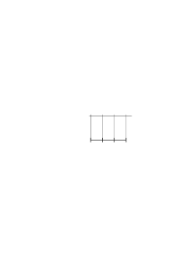

The method of projection can only be fixed by the comparison of the picture with the reality that is simply there.

### [191\[2\]](https://cdn.wittgensteinnachlass.com/2000px/webp/Ms-108/191.webp)

But then it seems as if one had to compare the sentence with reality _in a particular sense_ – that is, not just compare. As if, then, in certain cases reality had to feel a reproach or something of the sort through the comparison. If something approaches a _goal_, then what I mean lies here in the word “goal”. (The intention.)

### [191\[3\]](https://cdn.wittgensteinnachlass.com/2000px/webp/Ms-108/191.webp)

Everyone sees that in

the upper segment is longer & the lower one shorter; but he does not see in it that the lower segment _should be or become_ as long as the upper one. And how can a picture, of whatever kind, express that?

### [191\[4\]](https://cdn.wittgensteinnachlass.com/2000px/webp/Ms-108/191.webp),[192\[1\]](https://cdn.wittgensteinnachlass.com/2000px/webp/Ms-108/192.webp)

That is, the sentence (order) is not simply set alongside reality, but is compared with it with a _definite tendency_. But where does this tendency lie? (Is it rather like describing stomach pains & having someone ask “I understand that, but what accounts for the unpleasantness here?”.)

### [192\[2\]](https://cdn.wittgensteinnachlass.com/2000px/webp/Ms-108/192.webp)

The sentence – the order – as it were continues reality by linking up with reality & representing a change. It is as if one had a doll representing my body in its present position & one now made with it – in effigie – the changes intended for my body.

### [192\[3\]](https://cdn.wittgensteinnachlass.com/2000px/webp/Ms-108/192.webp)

So the problem would again be what the nature of the relation of standing in for something is, when one says, for instance, “this doll is to be you, etc.”.

### [192\[4\]](https://cdn.wittgensteinnachlass.com/2000px/webp/Ms-108/192.webp)

I feel that here too, I shall again come up against the limits of language by way of an answer. But I do not yet know how.

### [192\[5\]](https://cdn.wittgensteinnachlass.com/2000px/webp/Ms-108/192.webp),[193\[1\]](https://cdn.wittgensteinnachlass.com/2000px/webp/Ms-108/193.webp)

What does it mean to say: I can imagine that this point moves to here

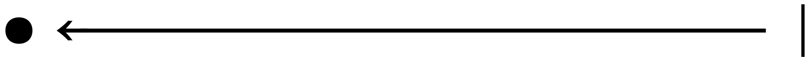

? Light must be shed on the strange illusion to which one is subject, that in the sentence the objects do what the sentence says.

### [193\[2\]](https://cdn.wittgensteinnachlass.com/2000px/webp/Ms-108/193.webp)

It is as if a shadow of the execution already lay in the order. But a shadow of just _this_ execution. _You_ go to such & such a place in the order. – But otherwise it would simply be a _different_ order.

### [193\[3\]](https://cdn.wittgensteinnachlass.com/2000px/webp/Ms-108/193.webp)

I know that I must drink in logical poison – to be able to overcome it. So now I actually keep telling myself that the fact surely must already lie in the order, in the sentence, although I know that it does not lie in it; but this _appearance_ must be tackled.

### [193\[4\]](https://cdn.wittgensteinnachlass.com/2000px/webp/Ms-108/193.webp)

28.06.1930

The sentence is an object of comparison – but how does the comparison proceed?

### [193\[5\]](https://cdn.wittgensteinnachlass.com/2000px/webp/Ms-108/193.webp),[194\[1\]](https://cdn.wittgensteinnachlass.com/2000px/webp/Ms-108/194.webp)

Somehow my difficulty is solved in that I am always moving _within language_. Cannot get out of it. When I talk about comparing, I am _talking_ about comparing; etc. (Thus, when I say “to understand a sentence is to know what is the case if it is true”, that too is merely said.) And here one comes upon something in which everything can presumably be expressed, namely the expression “the sentence … is true”. Everything will be contained in the fact that “‘p’ is true” says nothing but: p.

### [194\[2\]](https://cdn.wittgensteinnachlass.com/2000px/webp/Ms-108/194.webp)

I cannot give solutions to the old philosophical problems, but I can set limits to them.

### [194\[3\]](https://cdn.wittgensteinnachlass.com/2000px/webp/Ms-108/194.webp)

Underlying all my considerations is (the feeling) the insight that thought has an internal connexion with the world & not an external one.

That one thus _means_ what one says. But does that mean anything more than that one cannot move out of language while in language, or out of thoughts while in thoughts?

### [194\[4\]](https://cdn.wittgensteinnachlass.com/2000px/webp/Ms-108/194.webp),[195\[1\]](https://cdn.wittgensteinnachlass.com/2000px/webp/Ms-108/195.webp)

Can the connexion between “meaning that p is the case” & the occurrence of p be expressed in any way other than in the internal relation of these very expressions? (I do not believe so.)

### [195\[2\]](https://cdn.wittgensteinnachlass.com/2000px/webp/Ms-108/195.webp)

The whole problem is contained in the expression “to _mean_ something”.

### [195\[3\]](https://cdn.wittgensteinnachlass.com/2000px/webp/Ms-108/195.webp)

One feels that the thought _stands in_ for something.

### [195\[4\]](https://cdn.wittgensteinnachlass.com/2000px/webp/Ms-108/195.webp)

“I thought you would come to me”. It must be possible to show in this sentence everything one wants to show in _more exact_ sentences.

### [195\[5\]](https://cdn.wittgensteinnachlass.com/2000px/webp/Ms-108/195.webp)

In language everything is _settled_.

### [195\[6\]](https://cdn.wittgensteinnachlass.com/2000px/webp/Ms-108/195.webp)

If one says “I thought you would come today & I have already made the preparations”, then these preparations stand in some sort of continuity with the thought.

### [195\[7\]](https://cdn.wittgensteinnachlass.com/2000px/webp/Ms-108/195.webp)

If I push a chair towards someone _so that_ he sits down, here too the thought & the action form a chain.

### [195\[8\]](https://cdn.wittgensteinnachlass.com/2000px/webp/Ms-108/195.webp),[196\[1\]](https://cdn.wittgensteinnachlass.com/2000px/webp/Ms-108/196.webp)

But surely the closest kinship between language & reality is that when p occurs, “p” is borne out. But one cannot express that.

### [196\[2\]](https://cdn.wittgensteinnachlass.com/2000px/webp/Ms-108/196.webp)

The thought “that things are thus” (p) is made true by the fact that things are thus (p). That the connexion between thought & world cannot be represented in this way (for this representation says nothing at all) must be the answer to my problems.

### [196\[3\]](https://cdn.wittgensteinnachlass.com/2000px/webp/Ms-108/196.webp)

29.06.1930

It is, of course, not the case either that whatever verifies – satisfies – the thought “that p is the case” is simply called p. As if one were to say: I feel like an apple & whatever satisfies this desire I shall simply call an apple.

### [196\[4\]](https://cdn.wittgensteinnachlass.com/2000px/webp/Ms-108/196.webp)

For I am now _talking_ about the satisfaction of the thought (the expectation) before the thought has been satisfied.

### [196\[5\]](https://cdn.wittgensteinnachlass.com/2000px/webp/Ms-108/196.webp),[197\[1\]](https://cdn.wittgensteinnachlass.com/2000px/webp/Ms-108/197.webp)

For one might think: how does this work? The thought & the fact are different; yet we call the thought the one, namely that the fact is the case, or the fact the one that makes the thought true. Is the one, then, a description made with the aid of the other? Is the thought _described_ by means of the fact that makes it true, and thus described in terms of an external property, as when I say of someone that he is my uncle? Or is the fact likewise described by means of the thought?

### [197\[2\]](https://cdn.wittgensteinnachlass.com/2000px/webp/Ms-108/197.webp)

If one explains the expression “the thought that … is the case” as a _description_, that again explains nothing, because the question arises: how is such a description possible? It in turn presupposes the essence of thought, for it contains the relation to a fact that has not occurred, which is precisely what was problematic.

### [197\[3\]](https://cdn.wittgensteinnachlass.com/2000px/webp/Ms-108/197.webp)

It is – I believe – obvious that our difficulty lies precisely in “thinking about thought”. Here we come up against an impossibility & making this encounter clear is the solution.

### [197\[4\]](https://cdn.wittgensteinnachlass.com/2000px/webp/Ms-108/197.webp),[198\[1\]](https://cdn.wittgensteinnachlass.com/2000px/webp/Ms-108/198.webp)

My view is that thought is essentially what is expressed by the sentence, where expressed does not mean brought on: a cold is brought on by a cold bath, but not expressed by the cold bath. That thought is entirely _measure_, like the yardstick; I mean, just as everything about the yardstick is inessential except the measure of length.

### [198\[2\]](https://cdn.wittgensteinnachlass.com/2000px/webp/Ms-108/198.webp)

The thought is a symbol.

### [198\[3\]](https://cdn.wittgensteinnachlass.com/2000px/webp/Ms-108/198.webp)

“I, who am sitting here now, shall tomorrow …” The entry of reality (I, etc.) into the symbol must be the actual connexion of the sentence with reality.

### [198\[4\]](https://cdn.wittgensteinnachlass.com/2000px/webp/Ms-108/198.webp)

The (present) thought contains _all_ the reality that is presently there. (And it _cannot_ have more, after all.)

### [198\[5\]](https://cdn.wittgensteinnachlass.com/2000px/webp/Ms-108/198.webp),[199\[1\]](https://cdn.wittgensteinnachlass.com/2000px/webp/Ms-108/199.webp)

It is very remarkable – for anyone with eyes to see it – that the explanations in a book on differential calculus contain set-theoretical expressions & symbols which disappear entirely in the calculus. This is reminiscent of the first explanations in textbooks of physics, in which there is talk of the law of causality & the like, which, once we get down to business, is no longer mentioned.

### [199\[2\]](https://cdn.wittgensteinnachlass.com/2000px/webp/Ms-108/199.webp)

To compare the symbol – I mean what is used as a symbol – with reality is simple. The difficulty consists in comparing it, together with the symbolizing relation, as a thought with reality.

### [199\[3\]](https://cdn.wittgensteinnachlass.com/2000px/webp/Ms-108/199.webp)

Can the interpreted symbol be anything other than the symbol applied to present reality?

### [199\[4\]](https://cdn.wittgensteinnachlass.com/2000px/webp/Ms-108/199.webp)

The causal explanation of meaning is no use because it again speaks hypothetically of a state of affairs, which is precisely what is problematic.

### [199\[5\]](https://cdn.wittgensteinnachlass.com/2000px/webp/Ms-108/199.webp)

The wish, the expectation, the thought, the belief, the fear, – – – that he will come in, for instance, all make me look towards the door. –

### [199\[6\]](https://cdn.wittgensteinnachlass.com/2000px/webp/Ms-108/199.webp),[200\[1\]](https://cdn.wittgensteinnachlass.com/2000px/webp/Ms-108/200.webp)

I expect the door to open: it stays shut. Only the shut door is reality; the opening is present only in the symbol. But now the application of the opening to this (shut) door! It seems as if I cannot express the application but can only make it.

### [200\[2\]](https://cdn.wittgensteinnachlass.com/2000px/webp/Ms-108/200.webp)

The preceding list is somewhat misleading because expectation, wish and fear relate to the future. I should have added: the thought that something _is_ so, the description that something _is_ so, (perhaps) satisfaction that something is so. The problem does not arise only where the measure applied does not agree with the object; it arises even where it does agree, with the mere _application_ of the picture or sentence.

### [200\[3\]](https://cdn.wittgensteinnachlass.com/2000px/webp/Ms-108/200.webp)

I am glad that you are coming does not mean I am glad because you are coming. (In the latter case it would be a conjecture that _that_ is why I am in such a good mood.)

### [200\[4\]](https://cdn.wittgensteinnachlass.com/2000px/webp/Ms-108/200.webp),[201\[1\]](https://cdn.wittgensteinnachlass.com/2000px/webp/Ms-108/201.webp)

If I say: the words do not “mean” anything at all, I only want to produce a definite effect with them, then the very question is: What does it mean to produce _a definite effect_; that is precisely the application of language that I do not understand.

### [201\[2\]](https://cdn.wittgensteinnachlass.com/2000px/webp/Ms-108/201.webp)

For it is the intention that one wants to explain & one cannot explain it by means of itself.

### [201\[3\]](https://cdn.wittgensteinnachlass.com/2000px/webp/Ms-108/201.webp)

Thinking is using symbols.

### [201\[4\]](https://cdn.wittgensteinnachlass.com/2000px/webp/Ms-108/201.webp)

“A sentence does not mean, does not say, anything at all; it merely brings something about; like, for instance, a railway signal, which one could also replace with an automatic device.”

### [201\[5\]](https://cdn.wittgensteinnachlass.com/2000px/webp/Ms-108/201.webp)

“I think that the door is shut” and “I am glad that the door is shut” are on _one and the same_ level. (And the latter is by far the better example.)

### [201\[6\]](https://cdn.wittgensteinnachlass.com/2000px/webp/Ms-108/201.webp),[202\[1\]](https://cdn.wittgensteinnachlass.com/2000px/webp/Ms-108/202.webp)

I look at the shut door & imagine it opening. How can I imagine that _it_ opens? Is that analogous to: “I imagine that a red spot appears _there_”? – I measure (check) whether the chair is one metre high. If I imagine that a red spot appears there, then the place “there” _actually_ occurs in the process (& not, say, merely a picture of the place).

### [202\[2\]](https://cdn.wittgensteinnachlass.com/2000px/webp/Ms-108/202.webp)

One might say: thought links up with reality.

### [202\[3\]](https://cdn.wittgensteinnachlass.com/2000px/webp/Ms-108/202.webp),[203\[1\]](https://cdn.wittgensteinnachlass.com/2000px/webp/Ms-108/203.webp)

I look at the shut door & imagine it opening. My imaginary image (or my thought) is different from reality. But if I were now to fit another door, made perhaps of paper, onto the door & open it while the actual door remained shut, then this process could not replace the process in the imagination. Unless I now in turn _interpret_ this paper door as standing in for the other one. Yet one would think that the paper door & the door in the imagination, regarded from outside (and thus regarded at all), would be on the same level. But it is not so. And with interpretation that puzzling element comes in again. But is it not simply the connexion with the real door that the paper door lacks & that the door in the imagination lacks too, if the imagination does not link up with the real door?

### [203\[2\]](https://cdn.wittgensteinnachlass.com/2000px/webp/Ms-108/203.webp)

There is surely a difference between thinking about what _I_ shall do this afternoon and what another person, otherwise looking exactly like me, will do.

### [203\[3\]](https://cdn.wittgensteinnachlass.com/2000px/webp/Ms-108/203.webp)

One can imagine that something is the case which is not: very remarkable! For it is not remarkable that the mental image does not agree with reality, but it is remarkable that it represents it even then.

### [203\[4\]](https://cdn.wittgensteinnachlass.com/2000px/webp/Ms-108/203.webp),[204\[1\]](https://cdn.wittgensteinnachlass.com/2000px/webp/Ms-108/204.webp)

I was originally led to the picture theory of language by a newspaper item which said that in Paris, at a court hearing about a street accident, the accident was re-enacted with dolls & little omnibuses. Now how does such a re-enactment differ from playing with dolls, etc.? (Through its meaning, of course) but where does that lie? (Some would say: in its effect; that alone is its meaning.)

### [204\[2\]](https://cdn.wittgensteinnachlass.com/2000px/webp/Ms-108/204.webp)

The thought is a piece of reality. And how can one piece of reality be essentially preferable to another. Except in a relation to itself. In just such a way that one could think about everything, but not about thinking.

### [204\[3\]](https://cdn.wittgensteinnachlass.com/2000px/webp/Ms-108/204.webp)

Why does my thought seem to me such an exceptional piece of reality? Surely not because I know it “from within”; that means nothing, after all. Rather, apparently, it is because I settle everything in thought & I could, in turn, only _think_ about thinking.

### [204\[4\]](https://cdn.wittgensteinnachlass.com/2000px/webp/Ms-108/204.webp)

That would mean that thoughts are in an exceptional position only in relation to themselves.

### [204\[5\]](https://cdn.wittgensteinnachlass.com/2000px/webp/Ms-108/204.webp),[206\[1\]](https://cdn.wittgensteinnachlass.com/2000px/webp/Ms-108/206.webp)

The feeling about thought is something like this: If I _mean_ that (mean that such & such is the case), then I really do mean that such & such is the case. I mean the fact & nothing else, no third thing. (This seems to me to sum up the whole feeling.) But that surely says only that I mean what I mean, that is, that the expression of the content of the thought is the expression of the thought, or that language can in turn specify what it expresses only by means of its expression (“p” is true = p).

### [205\[2\]](https://cdn.wittgensteinnachlass.com/2000px/webp/Ms-108/205.webp)

There can be no more to the process of meaning that this door will open than what the person who means it experiences in doing so (for what is at issue here is not looking into someone’s head during a mental process). But this process of meaning is not described by language in its role as the expression of what one means.

### [205\[3\]](https://cdn.wittgensteinnachlass.com/2000px/webp/Ms-108/205.webp)

What happens when I describe the actual state of the door: “the door is now shut”? When, that is, I assign words to the reality I see? One would like to say that one assigns the words to reality according to a rule, but that is not true, for the rule would read: say “p” if p is the case.

### [205\[4\]](https://cdn.wittgensteinnachlass.com/2000px/webp/Ms-108/205.webp),[206\[1\]](https://cdn.wittgensteinnachlass.com/2000px/webp/Ms-108/206.webp)

What we want to describe is not what goes on during thinking, but what goes on in thinking.

### [206\[2\]](https://cdn.wittgensteinnachlass.com/2000px/webp/Ms-108/206.webp)

Why is it thinking, then, that we concern ourselves with, & not digestion? But it is not as though we simply happen to think & want to think about thinking; for we simply happen to digest, but the analogy goes no further.

### [206\[3\]](https://cdn.wittgensteinnachlass.com/2000px/webp/Ms-108/206.webp)

But interest, too, is not independent of philosophy, for philosophy also has to do with the essence of interest.

### [206\[4\]](https://cdn.wittgensteinnachlass.com/2000px/webp/Ms-108/206.webp)

Let us not forget, either, that the difference between a hypothesis, a sentence, a mathematical law, etc. bears on the question of the essence of thought & of interest.

### [206\[5\]](https://cdn.wittgensteinnachlass.com/2000px/webp/Ms-108/206.webp),[207\[1\]](https://cdn.wittgensteinnachlass.com/2000px/webp/Ms-108/207.webp)

The composite character of the sentence is also problematic. It is, rather, the connection with a particular reality that underlies this idea of its being essentially composite. What I have in mind is that a word, say “lion”, says nothing. But it does say something if in a particular situation I catch sight of a lion & cry “a lion!” Of course one can say that this is only an elliptical sentence for “here is a lion”. But all this “here is a” does is make the connection with the particular reality. – Now one could of course say that this connection with the particular reality is itself what constitutes a combination, but that does not seem quite right.

### [VB](/w-vb/#ms-108-207.2) [207\[2\]](https://cdn.wittgensteinnachlass.com/2000px/webp/Ms-108/207.webp)

If someone believes he has found the solution to the problem of life & wanted to say to himself that now everything is quite easy, to refute himself he need only tell himself that there was a time when this “solution” had not been found; but even at _that_ time one had to be able to live, & in the light of that time the solution he has found seems like a mere accident. And so it is with us in logic. If there were a “solution to the logical (philosophical) problems”, we would only have to remind ourselves that they were once unsolved (and even then one had to be able to live & think) – – –

### [208\[1\]](https://cdn.wittgensteinnachlass.com/2000px/webp/Ms-108/208.webp)

There is an essential difference between propositions like “that is a lion”, “the sun is larger than the earth”, which all contain a “this”, “here”, “now” & thus connect directly with reality, & propositions like “human beings have two hands”, etc. For if there happened to be no human beings around me, how would I check this proposition?

### [208\[2\]](https://cdn.wittgensteinnachlass.com/2000px/webp/Ms-108/208.webp)

What is essential about thought is that it does not function as a means to an end, as an instrument one could replace with another, but as something incomparable, autonomous.

### [208\[3\]](https://cdn.wittgensteinnachlass.com/2000px/webp/Ms-108/208.webp)

That is why one cannot conceive of a prosthesis for thought.

### [208\[4\]](https://cdn.wittgensteinnachlass.com/2000px/webp/Ms-108/208.webp)

But does that mean anything? I can indeed replace the stomach with a prosthesis, but not stomach pains. And can one not say the same of stomach pain as of thought?

### [208\[5\]](https://cdn.wittgensteinnachlass.com/2000px/webp/Ms-108/208.webp)

The feeling to which I now connect all my reflections is that of the uniqueness of thoughts.

### [208\[6\]](https://cdn.wittgensteinnachlass.com/2000px/webp/Ms-108/208.webp),[209\[1\]](https://cdn.wittgensteinnachlass.com/2000px/webp/Ms-108/209.webp)

It would also be conceivable that no order was ever obeyed & yet the orders would retain their sense.

### [209\[2\]](https://cdn.wittgensteinnachlass.com/2000px/webp/Ms-108/209.webp)

Whoever thinks lets pictures pass before his mind.

### [209\[3\]](https://cdn.wittgensteinnachlass.com/2000px/webp/Ms-108/209.webp)

If I say “I’m glad he’s alive” & yet in reality he is not alive, was my sentence false? What about the sentence “I’m glad I’m not in pain”?

### [209\[4\]](https://cdn.wittgensteinnachlass.com/2000px/webp/Ms-108/209.webp)

If one wants to imagine _the world_ otherwise than it is, one must assume a law for replacing the actual world with the imagined one, for otherwise the real world would not be replaced by the other one in the imagination.

### [209\[5\]](https://cdn.wittgensteinnachlass.com/2000px/webp/Ms-108/209.webp)

“Let us suppose you were this tall …” here the meaning of ‘you’ must occur in the symbol.

### [209\[6\]](https://cdn.wittgensteinnachlass.com/2000px/webp/Ms-108/209.webp)

Negation too contains a kind of generality.

### [209\[7\]](https://cdn.wittgensteinnachlass.com/2000px/webp/Ms-108/209.webp)

But of course affirmation must contain it too, and merely make a different use of it.

### [210\[1\]](https://cdn.wittgensteinnachlass.com/2000px/webp/Ms-108/210.webp)

To understand the reality underlying the sentence & the grammatical rules is already to understand it. It is also already to “know what is the case if it is true”. – To that extent this expression is misleading, since it makes one believe that there is a further synthesis in the understanding that would in some sense make what the sentence says into reality.

### [210\[2\]](https://cdn.wittgensteinnachlass.com/2000px/webp/Ms-108/210.webp)

[“Is a 6th sense conceivable?” The death’s-head entering the beehive.]

### [210\[3\]](https://cdn.wittgensteinnachlass.com/2000px/webp/Ms-108/210.webp)

I can describe an apparatus containing a wheel with a particular notch, & when the bolt is at this point & the wheel comes into this position, the bolt snaps into place. But can one do the same with the sentence: the sentence is built in such a way that if reality is now like this, reality snaps into place. So I would have to be able to describe the thought & then the reality, which is built in such a way that it agrees with it. But that means nothing at all.

### [210\[4\]](https://cdn.wittgensteinnachlass.com/2000px/webp/Ms-108/210.webp),[211\[1\]](https://cdn.wittgensteinnachlass.com/2000px/webp/Ms-108/211.webp)

08.07.1930

If I expect the white circle at a certain time to turn grey too, like the circle on the right, one thinks one has the fact fully before one here in the expectation. One says: “I know _exactly_ what I expect”. But one does admit that there is a difference between the expectation & its fulfilment. But can one say that when the fulfilment then occurs, something has after all occurred that could not have been foreseen (or was not foreseen)? Of course not! What could not have been foreseen is precisely what we cannot talk about.

### [211\[2\]](https://cdn.wittgensteinnachlass.com/2000px/webp/Ms-108/211.webp)

Nor can one say “that even the most vivid image does not, after all, come up to reality”, for then it would after all be conceivable that it did come up to it – even if that never happened –.

### [211\[3\]](https://cdn.wittgensteinnachlass.com/2000px/webp/Ms-108/211.webp),[212\[1\]](https://cdn.wittgensteinnachlass.com/2000px/webp/Ms-108/212.webp)

It is always as if the expectation (the thought) were a measuring rod that had the height, which is all that matters in its case, in _common_ with the object to be measured, or as when one says: Describe a hollow cylinder & a solid cylinder that fit together exactly. Insofar as they fit together, they have a shape in _common_.

And to that extent, then, the description describes _the same thing_.

### [212\[2\]](https://cdn.wittgensteinnachlass.com/2000px/webp/Ms-108/212.webp)

One can expect what one can also remember.

### [212\[3\]](https://cdn.wittgensteinnachlass.com/2000px/webp/Ms-108/212.webp)

What one expects is precisely what is _not_ given in the sign in the expectation.

### [212\[4\]](https://cdn.wittgensteinnachlass.com/2000px/webp/Ms-108/212.webp)

The expectation & the fact that fulfils the expectation evidently somehow fit together. One should now describe an expectation & a fact that fit together, so that one can see in what this agreement consists. One immediately thinks of the fitting of a solid form into a corresponding hollow form. But if one now wants to describe the two here, one sees that, as far as they fit, one description applies to both.

### [212\[5\]](https://cdn.wittgensteinnachlass.com/2000px/webp/Ms-108/212.webp),[213\[1\]](https://cdn.wittgensteinnachlass.com/2000px/webp/Ms-108/213.webp)

Even supposing my image in expectation could project the expected patch onto the surface in such a way that the fulfilment of the expectation showed itself in the event _coinciding_ completely with the expectation, even then precisely this would _not_ have been present in the expectation itself & would be something newly added in its fulfilment. For it seems as if what is added to the expectation when it is fulfilled is only reality added to possibility, thus, as it were – something amorphous – a coefficient – & nothing that was not already prefigured in the expectation.

### [213\[2\]](https://cdn.wittgensteinnachlass.com/2000px/webp/Ms-108/213.webp)

The solid form, too, differs from the hollow form only by an index, by something amorphous.

### [213\[3\]](https://cdn.wittgensteinnachlass.com/2000px/webp/Ms-108/213.webp)

‘I expect him to come, & he comes.’ One would like to say: The expectation could not, after all, reproduce any more of him than what then satisfied it in (the event). But of course that is not right either. For it is not as though the event consisted, as it were, of qualities, some of which the expectation of the event already had and some of which it did not yet have. One could say that the _only_ quality the expectation still lacks is reality, but that too would be wrong.

### [213\[4\]](https://cdn.wittgensteinnachlass.com/2000px/webp/Ms-108/213.webp),[214\[1\]](https://cdn.wittgensteinnachlass.com/2000px/webp/Ms-108/214.webp)

What is remarkable is expressed by saying that if this is the patch I expected, it does not differ from the one I expected. If one then asks: “How does the patch differ from the one you expected, given that the actual patch was not there in your expectation, for otherwise you could no longer have expected it?”, the answer is nonetheless: the patch _is_ the one I expected.

### [214\[2\]](https://cdn.wittgensteinnachlass.com/2000px/webp/Ms-108/214.webp)

Expectation & fulfilment are related as hollow form & solid form.

### [214\[3\]](https://cdn.wittgensteinnachlass.com/2000px/webp/Ms-108/214.webp)

“I expect this patch to become the same as this one, so that one can no longer distinguish it from it at all”; here _everything_ that fulfilment brings does seem to have been foreseen. But of course no more than in any other case. And why not take straight away the example: “I expect this patch to stay the same”?

### [214\[4\]](https://cdn.wittgensteinnachlass.com/2000px/webp/Ms-108/214.webp)

The expectation that the expectation that p will occur will be satisfied is the expectation that p will occur. The thought of the content of the thought p is the thought p. And that contains the truth about all the questions raised in this matter.

### [215\[1\]](https://cdn.wittgensteinnachlass.com/2000px/webp/Ms-108/215.webp)

The answer to every philosophical question is something obvious. It is just hard to find _the_ obvious thing that disposes of precisely what is troubling me now.

### [215\[2\]](https://cdn.wittgensteinnachlass.com/2000px/webp/Ms-108/215.webp)

One can only ever assert the truth of a sentence; it never lies in the sentence itself in such a way that the sentence would be merely the sign pointing to something already there.

### [215\[3\]](https://cdn.wittgensteinnachlass.com/2000px/webp/Ms-108/215.webp)

One should imagine the sentence “there is no gap in our visual field”. (Examine it to see what might be meant by it.)

### [215\[4\]](https://cdn.wittgensteinnachlass.com/2000px/webp/Ms-108/215.webp)

“I thought you would come; and you came”; here the sentence “you came” has no simpler, more real relation to reality than the sentence “you would come”. It is not as though the first were after all the name of a fact, whereas the second is only a tentative putting together of concepts.

### [215\[5\]](https://cdn.wittgensteinnachlass.com/2000px/webp/Ms-108/215.webp),[216\[1\]](https://cdn.wittgensteinnachlass.com/2000px/webp/Ms-108/216.webp)

It is – I believe – important to recognize that if, for instance, I believe someone will come to see me, my persisting state has nothing to do with the person in question & the other elements of the thought, i.e. it does not _contain_ them. But the same holds for expectation, wish, etc., etc. If I am expecting someone, I do not think all that time that he will come, or anything of the sort. Indeed, even when I am actually thinking it, this process is not an amorphous one, like that of pain, for instance, but consists only in my saying, say, the sentence “he will come” right now. One cannot _amorphously_ see that something is the case, believe that something is the case, wish, fear, think, etc.

### [216\[2\]](https://cdn.wittgensteinnachlass.com/2000px/webp/Ms-108/216.webp)

The amorphous is what is not a symbol & to which the considerations of the theory of causality & of Behaviourism apply.

### [216\[3\]](https://cdn.wittgensteinnachlass.com/2000px/webp/Ms-108/216.webp)

When I describe, I portray reality; but not according to rules. No rule can be given according to which a description describes reality, for that rule would presuppose itself.

### [216\[4\]](https://cdn.wittgensteinnachlass.com/2000px/webp/Ms-108/216.webp)

19.07.1930

Thought, insofar as one can speak of it at all, must be something altogether commonplace.

### [216\[5\]](https://cdn.wittgensteinnachlass.com/2000px/webp/Ms-108/216.webp),[217\[1\]](https://cdn.wittgensteinnachlass.com/2000px/webp/Ms-108/217.webp)

(One is in the habit of thinking of it as something ethereal, as yet unexplored; as if it were something of which we know only the outside, but whose essence is still unexplored, rather like that of our brain.)

### [217\[2\]](https://cdn.wittgensteinnachlass.com/2000px/webp/Ms-108/217.webp)

But thought has only an outside & no inside. And to analyse it is not to penetrate it.

### [217\[3\]](https://cdn.wittgensteinnachlass.com/2000px/webp/Ms-108/217.webp)

An amorphous thought is as inconceivable as an amorphous game of chess.

### [217\[4\]](https://cdn.wittgensteinnachlass.com/2000px/webp/Ms-108/217.webp)

What makes a thought a thought for us cannot be something _human_, something that has to do with the structure & nature of human beings, but something – purely logical – that obtains independently of the natural history of a living being.

### [217\[5\]](https://cdn.wittgensteinnachlass.com/2000px/webp/Ms-108/217.webp)

A prosthesis for thought is not possible because for us thought is nothing human. We could regard the calculating machine as a prosthesis in place of our 10 fingers, but the _calculation_ is nothing specifically human & there is no substitute for it.

### [217\[6\]](https://cdn.wittgensteinnachlass.com/2000px/webp/Ms-108/217.webp),[218\[1\]](https://cdn.wittgensteinnachlass.com/2000px/webp/Ms-108/218.webp)

Thinking is the forming of pictures in various ways & manners. But taking them as pictures, which is what is essential, cannot be conceived of in terms of establishing an external connection, for that would once again merely be establishing intermediate links; rather, like the relation between hollow form & solid form, it must be something that lies in the existence of the thought.

### [218\[2\]](https://cdn.wittgensteinnachlass.com/2000px/webp/Ms-108/218.webp)

There is certainly a similarity between our fantasies & actual experiences. But they are thoughts only when they are connected with reality & taken as pictures of it. On the other hand, a thought need not have that similarity to reality at all (It need only be a logical picture.)

### [218\[3\]](https://cdn.wittgensteinnachlass.com/2000px/webp/Ms-108/218.webp),[219\[1\]](https://cdn.wittgensteinnachlass.com/2000px/webp/Ms-108/219.webp)

If I dreamt today that A visited me & A now really does visit me, that does not make the dream fantasy an expectation or make the fact that A visited me a fulfilment of the expectation. The intention is missing. But can the intention be an external relation?! Since it is the intention that makes this process a picture, so that it is then borne out or not borne out, & since that constitutes the very essence of the intention, the intention cannot be a relation of the picture to something else.

### [219\[2\]](https://cdn.wittgensteinnachlass.com/2000px/webp/Ms-108/219.webp)

I see before me how the thought – the sentence as meant – reaches right up to reality, i.e. already prefigures its form. Like the measuring rod, or say two marks on the rod with which reality is then compared in particular.

One could say that the intention is the method of projection.

### [219\[3\]](https://cdn.wittgensteinnachlass.com/2000px/webp/Ms-108/219.webp)

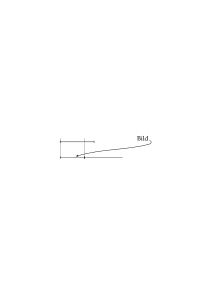

The picture (in the narrower sense) is not enough, for how it is to be compared with reality is not given with it. The method of projection must go with it; but then the picture reaches right into the place where the object of the picture is.

### [219\[4\]](https://cdn.wittgensteinnachlass.com/2000px/webp/Ms-108/219.webp),[220\[1\]](https://cdn.wittgensteinnachlass.com/2000px/webp/Ms-108/220.webp)

In any case, no ambiguity of the expectation or of the wish, etc., is expressed in language, such that an expectation could be satisfied by different things. And the justification for this must be that the complete picture, i.e. the complete thought, no longer admits of several interpretations but is unambiguous, namely, it already contains its interpretation. But already containing its interpretation can only mean tracing out the form of reality in advance. Yet this “tracing out in advance” too could be misconstrued, for – someone might say – can I not trace this out in advance

and mean that. Yes, but if I say “& mean that”, then this “that” itself is surely meant in some way. And what if I say: “quite right, I just meant the small one by the large one.”

– I simply cannot speak without already meaning it in some way. That is why meaning something must, so to speak, drop out of consideration. For if I want to say how something is meant, I do after all mean that itself in some way too.

### [220\[2\]](https://cdn.wittgensteinnachlass.com/2000px/webp/Ms-108/220.webp)

Can I then stipulate that the length is meant on a scale of 1:1?

### [220\[3\]](https://cdn.wittgensteinnachlass.com/2000px/webp/Ms-108/220.webp),[221\[1\]](https://cdn.wittgensteinnachlass.com/2000px/webp/Ms-108/221.webp)

But even if it is not meant in that way, there is still always a length that would then be meant on a scale of 1 : 1. – So it is enough if the picture just reaches up to what is represented, so that it can be compared directly with reality.

### [221\[2\]](https://cdn.wittgensteinnachlass.com/2000px/webp/Ms-108/221.webp)

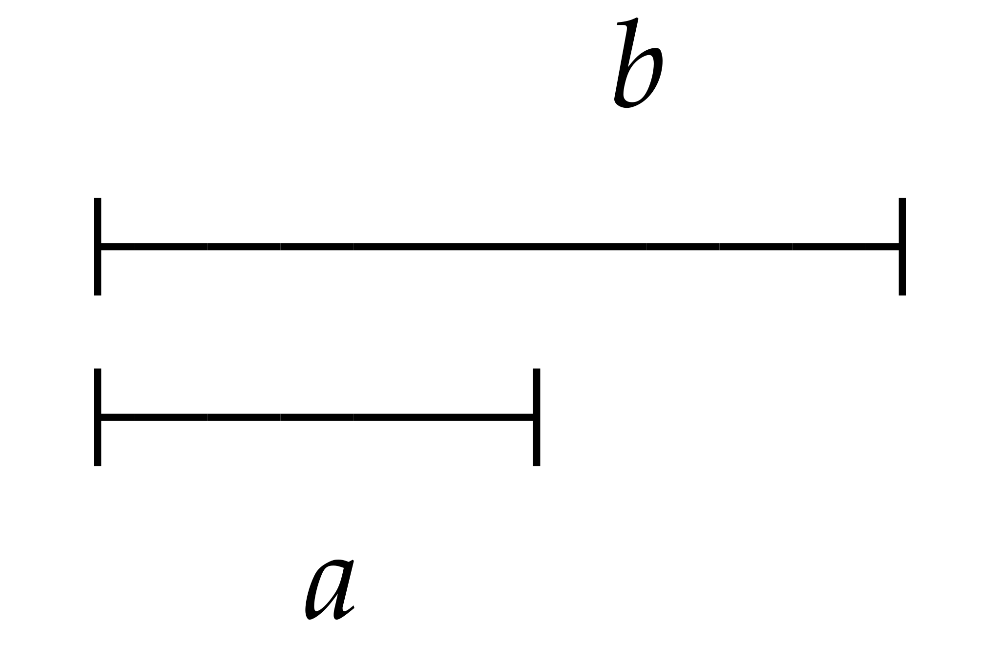

a is growing & I wait until it is as big as b. If I meant b on an enlarged scale, so that it signified just the length of a, my expectation would already be satisfied, but that is not the case.

### [221\[3\]](https://cdn.wittgensteinnachlass.com/2000px/webp/Ms-108/221.webp)

Let us consider that the expectation is not present at all in the reality of a & b, but exists only in symbols, & specifically, there must be a symbol for b & one for a, & they must _both_ already be meant in some way. And can it not be expressed by a rule that they are both meant in the same way?

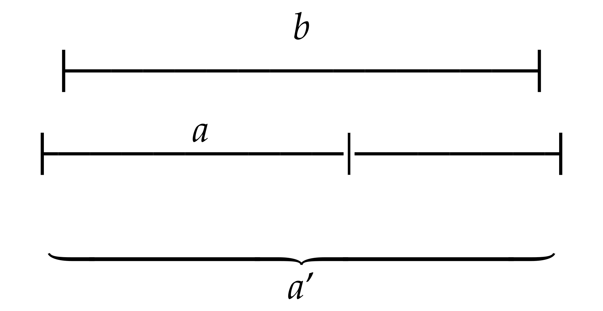

a' is the picture of a as it will look when it has become as big as b.

### [221\[4\]](https://cdn.wittgensteinnachlass.com/2000px/webp/Ms-108/221.webp)

I cannot step outside meaning something, so I cannot say how something is meant. But then the word ‘mean’ must itself be senseless; that is how it must turn out.

### [222\[1\]](https://cdn.wittgensteinnachlass.com/2000px/webp/Ms-108/222.webp)

20.07.1930

In the expectation _everything_ is made ready for the event to occur.

### [222\[2\]](https://cdn.wittgensteinnachlass.com/2000px/webp/Ms-108/222.webp)

Of the graduations on the measuring rod, only the points they have in common with the body to be measured count.

### [222\[3\]](https://cdn.wittgensteinnachlass.com/2000px/webp/Ms-108/222.webp)

_Everything_ must be made ready; that is what the unambiguity of the expectation consists in.

### [222\[4\]](https://cdn.wittgensteinnachlass.com/2000px/webp/Ms-108/222.webp)

Or it really consists in the fact that one cannot even _talk_ about it.

### [222\[5\]](https://cdn.wittgensteinnachlass.com/2000px/webp/Ms-108/222.webp)

Someone says “I wish to see a red piece of paper”; one shows him pieces of various colours, white, green, finally a red one; he says “_that_ is what I meant”. How then could he _mean_ the red without seeing it? – For even if he had an image, it was not what he then got to see (otherwise he would not have expected anything), so he had first to _mean_ this image in some way too. – Now is it not like this: he can also compare the image with the present – unexpected – visual impression & does compare it with it, & in doing so fixes, so to speak, the interpretation of this image.

### [223\[1\]](https://cdn.wittgensteinnachlass.com/2000px/webp/Ms-108/223.webp)

In the same sense in which he is now 1 m tall, he will later be 1˙5 m high.

### [223\[2\]](https://cdn.wittgensteinnachlass.com/2000px/webp/Ms-108/223.webp)

I imagine someone, say a little boy, being celebrated & what he will one day do as a man being represented in a tableau vivant. If one sees the presentation & the boy, one does not yet know what the whole thing means. One must know how the presentation is _meant_. But one knows that if one can compare it with the present state of affairs, with the boy as he is now. If I can say that he is not yet that tall, I have already taken the picture as a picture of his future. But how does one get the intention across to someone who sees the presentation but does not understand it? By _telling_ him!

### [223\[3\]](https://cdn.wittgensteinnachlass.com/2000px/webp/Ms-108/223.webp)

Can one say: One can speak of the intention only insofar as one can ask about it & explain it.

### [223\[4\]](https://cdn.wittgensteinnachlass.com/2000px/webp/Ms-108/223.webp)

That is, insofar as one expresses it in words and so adds further signs to the signs. One could, for instance, imagine an inscription above the tableau vivant explaining it.

### [224\[1\]](https://cdn.wittgensteinnachlass.com/2000px/webp/Ms-108/224.webp)

One can explain what is meant by the sign only by using signs, thus adding further signs to the first sign. This sign in turn can be explained only by signs, etc. So insofar as that is not an explanation of the intention, there is none. (That is, no explanation, but no intention either.)

### [224\[2\]](https://cdn.wittgensteinnachlass.com/2000px/webp/Ms-108/224.webp)

Certainly, if one wants to explain to someone how something was meant, one must use words – which are themselves meant in some way. Thus one adds the scale to the map, but now the whole thing is _one_ sign …

### [224\[3\]](https://cdn.wittgensteinnachlass.com/2000px/webp/Ms-108/224.webp)

21.07.1930

What is characteristic of thought, what makes it so unique for us, is that we do not have the feeling of an interpretation in it.

### [224\[4\]](https://cdn.wittgensteinnachlass.com/2000px/webp/Ms-108/224.webp)

Yes, it is evident that the expectation is concerned with the very same thing, the same reality, as the fact that fulfils it. And that is what makes it real to us.

### [224\[5\]](https://cdn.wittgensteinnachlass.com/2000px/webp/Ms-108/224.webp)

In expectation we look towards the same, actual door through which the person we are expecting is to come in.

### [225\[1\]](https://cdn.wittgensteinnachlass.com/2000px/webp/Ms-108/225.webp)

(One always forgets how simple & natural everything is.)

### [225\[2\]](https://cdn.wittgensteinnachlass.com/2000px/webp/Ms-108/225.webp)

I say “look over there, something black like a bird’s head will come into view”. He looks & I say “you see, there it is”. He says “_I expected something bigger_”. How did he do that? He was _set_ for something bigger. Or “I expected something darker”. He was set for something darker.

### [225\[3\]](https://cdn.wittgensteinnachlass.com/2000px/webp/Ms-108/225.webp)

I expect to see a yellow patch & now I say “yes, that’s how I imagined it, that’s what I expected”. And now someone asked me “how do you know you expected _that_, when you haven’t seen it?” It is evident that this question means nothing (& that therein lies the solution to my problem).

### [225\[4\]](https://cdn.wittgensteinnachlass.com/2000px/webp/Ms-108/225.webp),[226\[1\]](https://cdn.wittgensteinnachlass.com/2000px/webp/Ms-108/226.webp)

If that can be the same yellow as I imagined (so that there is no further external criterion for it, such as a reaction), then the expectation had to refer to what the mental image & reality have in common, for the mental image as such remains distinct from reality. What they have in common must then be like the length of two strips which are distinct, one on the right and the other on the left, but have their length in common.

### [226\[2\]](https://cdn.wittgensteinnachlass.com/2000px/webp/Ms-108/226.webp)

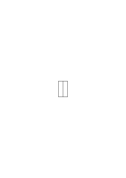

And that is why one cannot ask “how do you know that they agree in length”, as one might ask “how do you know that these two things have the same weight”.

### [226\[3\]](https://cdn.wittgensteinnachlass.com/2000px/webp/Ms-108/226.webp)

It makes no difference that the mental image is ambiguous & so leaves reality some latitude. For then the nonsensical question is simply: “how do you know that this yellow falls within that range”. That then corresponds to this picture:

### [226\[4\]](https://cdn.wittgensteinnachlass.com/2000px/webp/Ms-108/226.webp),[227\[1\]](https://cdn.wittgensteinnachlass.com/2000px/webp/Ms-108/227.webp)

We are occupied with questions of various kinds, such as “What is the specific gravity of this body”, “Will it stay fine today” “Who will come in through the door next” etc. But among our questions there are some of a special kind. Here we have a different experience. The questions seem more fundamental than the others. And now I say: when we have this experience, we have reached the boundary of language.

### [227\[2\]](https://cdn.wittgensteinnachlass.com/2000px/webp/Ms-108/227.webp)

One could say that the expectation is not a picture; it only makes use of a picture. I expect, for example, that my clock will now show half past six & express this through a picture of the position of the hands 🕢. I can now compare this picture with the actual position; but not the expectation. It has simply been fulfilled or not fulfilled; whereas one cannot say of the drawing that it has been fulfilled. For that first requires the _interpretation_ of the drawing.

### [227\[3\]](https://cdn.wittgensteinnachlass.com/2000px/webp/Ms-108/227.webp)

I have predicted something; only now does it happen, and now I simply say “_it_ has happened” & that already describes the state of affairs completely. Even now, then, it is described only to the extent that one could describe it before it had (yet) come about.

### [227\[4\]](https://cdn.wittgensteinnachlass.com/2000px/webp/Ms-108/227.webp)

If I can simply say “it has happened”, then on the other hand I cannot describe what a state of affairs must be like in order to satisfy a particular expectation. (And here again lies the whole solution, even if I still cannot state it clearly.)

### [227\[5\]](https://cdn.wittgensteinnachlass.com/2000px/webp/Ms-108/227.webp),[228\[1\]](https://cdn.wittgensteinnachlass.com/2000px/webp/Ms-108/228.webp)

An expectation does not stand to its satisfaction as hunger does to its satisfaction. I can quite well describe the hunger & what satisfies it & say that it satisfies it.

### [228\[2\]](https://cdn.wittgensteinnachlass.com/2000px/webp/Ms-108/228.webp)

The expectation is not a fantasy, for if I expect a bright point to appear there, then the _there_ must be the place where the point will _actually_ appear if it does appear.

### [228\[3\]](https://cdn.wittgensteinnachlass.com/2000px/webp/Ms-108/228.webp)

Both when one looks ahead in expectation and when one looks back at the time of fulfilment & in remembering the expectation, expectation & fulfilment are in the same space. And from the outset the expectation is already the expectation of the fulfilment & the fulfilment is only the affirmation of the expectation.

### [228\[4\]](https://cdn.wittgensteinnachlass.com/2000px/webp/Ms-108/228.webp)

Could one perhaps say that “red” has two different meanings when one calls an actual patch of colour red & on the other hand calls an imagined patch red? No. Red is what the two have in common.

### [228\[5\]](https://cdn.wittgensteinnachlass.com/2000px/webp/Ms-108/228.webp),[229\[1\]](https://cdn.wittgensteinnachlass.com/2000px/webp/Ms-108/229.webp)

The expectation can point to what is expected only _logically_. For every picture always remains in need of interpretation & the interpretation can establish only a logical relation. For any material relation we add to the picture does not lead us to the intention & leaves the picture still in need of interpretation. – The only thing in which reality can agree or fail to agree with the picture without any need for interpretation is the logical form. For only there is it also possible to doubt whether there is agreement between the expectation & a fact, and to show that there is not.

### [229\[2\]](https://cdn.wittgensteinnachlass.com/2000px/webp/Ms-108/229.webp)

This is also connected with the fact that the expectation, the thought, must be the proof of the possibility of the fact. Just as the metre rule at this spot is the “proof” that something _can_ be 1 m long.

### [229\[3\]](https://cdn.wittgensteinnachlass.com/2000px/webp/Ms-108/229.webp)

“If the expectation is still ambiguous, then at any rate we can no longer speak of this ambiguity.” For to the extent that reality can be described, the expectation describes it & to the extent that reality can be foreseen, the expectation foresees it.

### [229\[4\]](https://cdn.wittgensteinnachlass.com/2000px/webp/Ms-108/229.webp)

One can ask whether this really is the experience that satisfies the earlier expectation only in so far as one can check it. But one can check it only in so far as logical multiplicity is at issue. So nothing more is needed than that the thought should rest on reality & erect its edifice on it.

### [230\[1\]](https://cdn.wittgensteinnachlass.com/2000px/webp/Ms-108/230.webp)

22.07.1930

Does an imagined tone differ from the same tone actually heard in its timbre, perhaps?

### [230\[2\]](https://cdn.wittgensteinnachlass.com/2000px/webp/Ms-108/230.webp)

The difficulty is to understand that the fact is _wholly_ prefigured in the expectation.

### [230\[3\]](https://cdn.wittgensteinnachlass.com/2000px/webp/Ms-108/230.webp)

In the yardstick standing next to the growing object, the height too is prefigured, but not that this object will reach it.

### [230\[4\]](https://cdn.wittgensteinnachlass.com/2000px/webp/Ms-108/230.webp)

It is as if the thought were a shadow of the event; but in such a way that the question whether this event really is the one whose shadow we had before us is nonsensical.

I.e. the relation between shadow & fact cannot be an external one.

### [230\[5\]](https://cdn.wittgensteinnachlass.com/2000px/webp/Ms-108/230.webp)

And must that not be a false representation? For can there really be facts in the world of facts that are the shadows of others? Certainly not. But I myself say that the “shadow” is not something that is connected with the fact in an external way & that means that there is a _logical_ error in this comparison.

### [230\[6\]](https://cdn.wittgensteinnachlass.com/2000px/webp/Ms-108/230.webp),[231\[1\]](https://cdn.wittgensteinnachlass.com/2000px/webp/Ms-108/231.webp)

If I give someone an order & he hears it & then acts, I cannot tell from the action alone how he interpreted the order (for I do not know whether he wants to obey the order or not). But the interpretation would itself be an action again; what would it consist in, though?

### [231\[2\]](https://cdn.wittgensteinnachlass.com/2000px/webp/Ms-108/231.webp)

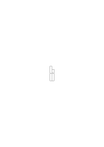

If I say “b is not as long as a”, this seems to presuppose that shadow of the fact that b is as long as a. But if I say “b is smaller than a”, this seems not to contain this shadow, and yet it too says (though it also says more than that) what the first sentence says.

### [231\[3\]](https://cdn.wittgensteinnachlass.com/2000px/webp/Ms-108/231.webp)

So one could say: “b is as long as a” makes sense because b is shorter than a. (Or “this book is blue” makes sense because in reality it is red.)

### [231\[4\]](https://cdn.wittgensteinnachlass.com/2000px/webp/Ms-108/231.webp),[232\[1\]](https://cdn.wittgensteinnachlass.com/2000px/webp/Ms-108/232.webp)

There is something to be said for the view that the interpretation of the picture lies in the use one makes of it. Let us suppose that understanding the order consists in hallucinating a particular activity & then comparing the picture presented by this hallucination with the actual action by laying it, as it were, over the space in which the action takes place. The order might have been to draw from point A towards the right a

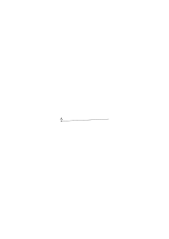

straight line; I now see the straight line to be drawn before me – starting, of course, from the actual point A – & can now either trace it or not. Let us even imagine the case as follows: I hallucinate the pencil moving in a straight line to the right & can now either follow it with the actual pencil (bring the actual pencil into coincidence with the hallucinated one) or not.

### [232\[2\]](https://cdn.wittgensteinnachlass.com/2000px/webp/Ms-108/232.webp)

(It is a special method of philosophy, one not permitted in the sciences, to assume the most favourable case.) (Most similar to this method is that in mathematics of assuming an extreme case in which such & such is sure to occur. (Argument a fortiori?))

### [232\[3\]](https://cdn.wittgensteinnachlass.com/2000px/webp/Ms-108/232.webp)

But now one would not be entitled to ask again “well, how does one know that one is to follow this hallucination, that it is to be taken as an order to do it this way”, for that would now have to consist, say, in one’s having a particular feeling of satisfaction if one follows it & not if one does not follow it.

### [232\[4\]](https://cdn.wittgensteinnachlass.com/2000px/webp/Ms-108/232.webp)

The thought would thus be a picture that had a particular effect.

### [232\[5\]](https://cdn.wittgensteinnachlass.com/2000px/webp/Ms-108/232.webp),[233\[1\]](https://cdn.wittgensteinnachlass.com/2000px/webp/Ms-108/233.webp)

One could ask: how do I know that it is my pencil that I see here in the hallucination, for all I can recognize is a picture that looks like my pencil & that it is _supposed_ to be my pencil is again _interpretation_. But the answer would be: the interpretation consists only in whether or not I _take that picture as an example_. This taking as an example – a particular reaction to the gap between the picture & a particular reality – is the taking of the picture as an order. It is like feeling reproached for not doing as someone else does. The thought is thus in a certain sense a model of reality.

### [233\[2\]](https://cdn.wittgensteinnachlass.com/2000px/webp/Ms-108/233.webp)

23.07.1930

Let us assume the “most favourable” case again, let us suppose that I hallucinate when I expect something (though how can I hallucinate that he _will_ come in in 5 minutes?)

### [233\[3\]](https://cdn.wittgensteinnachlass.com/2000px/webp/Ms-108/233.webp)

What does it mean to understand the word “twenty-three” but to understand its syntax, to be able to operate with it?

### [233\[4\]](https://cdn.wittgensteinnachlass.com/2000px/webp/Ms-108/233.webp),[234\[1\]](https://cdn.wittgensteinnachlass.com/2000px/webp/Ms-108/234.webp)

One can always make expectation, orders, etc. clear to oneself by considering a map & its use. The map is the picture that is interpreted. Let us imagine that we are ordered to walk along a road as shown on the map; or that the map is the picture of our expectation in that it shows that in an hour we shall get to such & such a place.

### [234\[2\]](https://cdn.wittgensteinnachlass.com/2000px/webp/Ms-108/234.webp)

Imagine that one gives someone the order to carry out a particular action, say to trace this line with the pencil 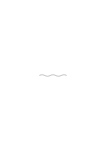. The matter becomes clearer if one imagines the order given by signs to someone who does not know our word-language. One will then demonstrate the action and now give him the pencil & nudge him & perhaps guide his hand a very little way (or something of the sort). That will be the order. Now of course one will say: that is merely the expression of the order & not what we really mean; what we mean is: …, & now one will give me _other signs_ for “what is meant”. – But what if one now carried out the order & pointed to the execution as a subsequent explanation of the order? Or in that case is the fulfilment, too, only a sign?

### [234\[3\]](https://cdn.wittgensteinnachlass.com/2000px/webp/Ms-108/234.webp),[235\[1\]](https://cdn.wittgensteinnachlass.com/2000px/webp/Ms-108/235.webp)

One could say: To understand the order means to carry it out or to resist it. (Rather as one might say that gravity manifests itself either in accelerating a body or, if my hand does not allow this, in the pressure the body exerts on my hand.)

### [235\[2\]](https://cdn.wittgensteinnachlass.com/2000px/webp/Ms-108/235.webp)

The sign of resistance might be a shake of the head, for example; so that if he moves along the line a

& does not shake his head, this means that he understood the order as telling him to move along a and is carrying it out. If he goes along a & shakes his head as he does so, this would mean that he took the order differently & wants to resist it by his action etc. etc.

### [235\[3\]](https://cdn.wittgensteinnachlass.com/2000px/webp/Ms-108/235.webp)

Suppose someone has given another person such an order by means of signs & I ask him “did you understand this order, then” & he replies “yes, he wanted me to …” & repeats the order to me in another language. In this way I do not get outside the signs.

### [235\[4\]](https://cdn.wittgensteinnachlass.com/2000px/webp/Ms-108/235.webp),[236\[1\]](https://cdn.wittgensteinnachlass.com/2000px/webp/Ms-108/236.webp)

24.07.1930

When one considers the example of the command communicated by gestures, one always wants, on the one hand, to say yes, this example is simply imperfect, the assumed language of gestures too crude, so it cannot express the intended sense completely – but in fact it is as good as any other conceivable language & fulfils its purpose as completely as can be conceived. (It is one of the most important insights that there is no improving logic.)

### [236\[2\]](https://cdn.wittgensteinnachlass.com/2000px/webp/Ms-108/236.webp)

So if I give someone an order, I can do nothing more than give him an example. The order must then differ from the order to carry out any other action & that means that the order must allow for the same multiplicity (the same geometry) as the actions. But it can do no more.

### [236\[3\]](https://cdn.wittgensteinnachlass.com/2000px/webp/Ms-108/236.webp)

It is quite trivial to say that, in expecting a patch, I must be able to distinguish the expectation of a circular one from that of an elliptical one & that in general there must be as many differences in expectation as there are in the fulfilments of the expectation. (Hunger & the apple that satisfies it do not have the same multiplicity.)

### [236\[4\]](https://cdn.wittgensteinnachlass.com/2000px/webp/Ms-108/236.webp)

But surely the order does not stand on its own, for in giving the order I _want_ something. Well, what? Why, for him to do such & such. Quite right, but here I have merely repeated the order in a different way.

### [237\[1\]](https://cdn.wittgensteinnachlass.com/2000px/webp/Ms-108/237.webp)

The sense is not something one can point to, as one might point to me as the meaning of my name; rather, it belongs to the sentence that has it. The sentence has it within itself.

### [237\[2\]](https://cdn.wittgensteinnachlass.com/2000px/webp/Ms-108/237.webp)

Suppose that the order were to make an object from a working drawing. Then in carrying out the order I project this drawing – the expression of the order – into reality. So I _use_ the drawing as a picture.

### [237\[3\]](https://cdn.wittgensteinnachlass.com/2000px/webp/Ms-108/237.webp)

But what does this “using as a picture” consist in? If, e.g., I am copying a model, does it make no difference whether I intentionally or unintentionally draw something resembling the model? And if I now make a mistake in drawing, does that mean I have abandoned the intention to copy the model? – And yet this intention can consist only in its yielding, together with the finished drawing, an exact picture of the model, or rather the model itself. The intention must supplement the execution so as to make up the model. But then is it not the case that eagerness or reluctance must supplement the carrying out or not carrying out of the order so as to make up the understanding of it?

### [238\[1\]](https://cdn.wittgensteinnachlass.com/2000px/webp/Ms-108/238.webp)

A geometrical figure together with its method of projection onto a particular plane does not first determine a figure in that plane, but already _contains_ this figure.

### [238\[2\]](https://cdn.wittgensteinnachlass.com/2000px/webp/Ms-108/238.webp)

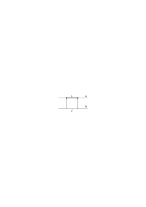

The orthogonal projection of s onto b already marks off the piece s' on b. That is not of course to say that this piece now has a special colour on b, and so is also bounded by the colour. Better to picture it with circles on

two parallel planes. The projection of the black circle onto the lower plane already bounds a circle on the latter, but that does not yet make it a coloured circle. (In this sentence there is something right & something wrong.)

### [238\[3\]](https://cdn.wittgensteinnachlass.com/2000px/webp/Ms-108/238.webp)

Now if I expect that a circle will appear on the lower plane, of which it is said that it is the orthogonal projection of the upper one & of the same colour –.

### [238\[4\]](https://cdn.wittgensteinnachlass.com/2000px/webp/Ms-108/238.webp)

(Philosophy will in the end consist of extremely trivial sentences, remarks; it is just enormously difficult to come to understand them. I.e. to understand them as philosophy.)

### [239\[1\]](https://cdn.wittgensteinnachlass.com/2000px/webp/Ms-108/239.webp)

(All the efforts I am making now are aimed only at understanding certain trivial sentences, i.e. to understand them in all their consequences.)

### [239\[2\]](https://cdn.wittgensteinnachlass.com/2000px/webp/Ms-108/239.webp)

– – – then I give nothing more than a method of projection. (A method of projection is a general rule-generality.) The method of projection I may know from other structures. But I know it, after all, only in such a way that one figure is the orthogonal projection of another; and surely not in such a way that no figure is the projection of a figure. I resolve to judge the phenomena on the lower plane in a particular way. Then the projection must already be contained in this _resolve_.

### [239\[3\]](https://cdn.wittgensteinnachlass.com/2000px/webp/Ms-108/239.webp)

Does that not mean: The expectation must supplement the white plane so as to make up a black circle.

### [239\[4\]](https://cdn.wittgensteinnachlass.com/2000px/webp/Ms-108/239.webp)

What does it mean _to examine_ a line segment _to see_ whether it is the orthogonal projection of another?

### [239\[5\]](https://cdn.wittgensteinnachlass.com/2000px/webp/Ms-108/239.webp),[240\[1\]](https://cdn.wittgensteinnachlass.com/2000px/webp/Ms-108/240.webp)

It can only mean drawing precisely the lines that one draws in such a case. – But what about the investigation of whether the lower colour is the same as the upper one. Or can one say: there too I adjust myself in a particular way, just as, say, I draw lines in order to be able to establish whether the lower figure is the projection of the upper one. I believe that is how it is. That is all an adjusting, but more than that I cannot now do. And this adjusting is not an adjusting to something else, i.e. not with reference to something that is not yet there, but it is autonomous, so to speak the setting up of a yardstick, whatever may happen.

### [240\[2\]](https://cdn.wittgensteinnachlass.com/2000px/webp/Ms-108/240.webp)

The solution of the riddle must lie in the prescribed way in which the phenomenon is then described when it comes.

### [240\[3\]](https://cdn.wittgensteinnachlass.com/2000px/webp/Ms-108/240.webp)

25.07.1930

It is uncommonly difficult to reach the real point of the difficulty with words.

### [240\[4\]](https://cdn.wittgensteinnachlass.com/2000px/webp/Ms-108/240.webp),[241\[1\]](https://cdn.wittgensteinnachlass.com/2000px/webp/Ms-108/241.webp)

Let us think of the setting as done by a pointer, like the yellow pointer on an aneroid barometer, and, say, such a barometer & a clock. On both

dials I set the free pointer & thereby express the expectation that when the clock hand gets to a' the other one will stand at a. (There is no doubt that this is a complete expression of the expectation, of the thought.)

If the clock now stops, say, so that its hand does not reach a', then the whole thing does not count, and likewise if, say, the pointer of the barometer suddenly vanished. Then there would simply be no sign there. But if it is there, then the barometer has, so to speak, no other choice than to stand at a or not to stand at a & then the thought has been verified or it has been falsified.

### [241\[2\]](https://cdn.wittgensteinnachlass.com/2000px/webp/Ms-108/241.webp)

But where in this propositional sign do we have words, or something that corresponds to words? Obviously a' “means” the clock hand & a the barometer pointer.

### [241\[3\]](https://cdn.wittgensteinnachlass.com/2000px/webp/Ms-108/241.webp)

I remain within the signs until, in applying them, I step outside them. Then my behaviour, my action, displays the logical kinship with the signs that such a sign displays with its translation.

### [241\[4\]](https://cdn.wittgensteinnachlass.com/2000px/webp/Ms-108/241.webp)

What I always want to say is that the thought is nothing human. That it is also not a particular feeling which one can only feel, but not, say, also _see_. One cannot, e.g., as it were place toothache outside oneself & look at it.

### [241\[5\]](https://cdn.wittgensteinnachlass.com/2000px/webp/Ms-108/241.webp),[242\[1\]](https://cdn.wittgensteinnachlass.com/2000px/webp/Ms-108/242.webp)

Of course one cannot say that one knows toothache from inside by feeling it & cannot view it from outside. For toothache (simply) has no inside & outside.)

### [242\[2\]](https://cdn.wittgensteinnachlass.com/2000px/webp/Ms-108/242.webp)

The view common today is that thinking – carried out by the head or the mind – is a privilege precisely of the head or the mind (as, say, natural digestion is of the stomach). And so it is, too, when considered as an act of natural history, just as digestion in this sense is peculiar to the stomach – but considered from the chemist’s standpoint, digestion is a process that does not belong to the animal stomach & is quite independent of where it actually takes place. – In the same way the logician is not dealing with a specifically human process.

### [242\[3\]](https://cdn.wittgensteinnachlass.com/2000px/webp/Ms-108/242.webp)

Logic is a geometry of thinking.

### [242\[4\]](https://cdn.wittgensteinnachlass.com/2000px/webp/Ms-108/242.webp)

Logic has nothing to do with what is human about thinking.

### [242\[5\]](https://cdn.wittgensteinnachlass.com/2000px/webp/Ms-108/242.webp),[243\[1\]](https://cdn.wittgensteinnachlass.com/2000px/webp/Ms-108/243.webp)

Of course one could say that the clock & the barometer with the adjustable pointers are only the expression of a thought, but not the thought itself; but then they are surely parts, instruments, of a thought & whatever the thought itself is, it is a different process from the one that verifies it & it has only as much in common with this process as those devices of the clock & the barometer have(.) – That is why one can – and must – in logic also operate with the “expression” of thoughts & pay no attention to the other thing.

### [243\[2\]](https://cdn.wittgensteinnachlass.com/2000px/webp/Ms-108/243.webp)

One could now say (and in a certain sense rightly) that that clock & barometer do not yet contain anything of the expectation, that one would need a further picture for that, namely another clock & barometer that, so to speak, demonstrate the process one expects from the first ones. But now one would need a further _pair_ of clocks etc. to demonstrate in turn the connection between those clocks & barometers, etc.

### [243\[3\]](https://cdn.wittgensteinnachlass.com/2000px/webp/Ms-108/243.webp)

The same thing happens in the case of the two planes, when I expect here to see on the lower one

a spot that is the perpendicular projection of the upper spot. Here I can also represent the method of projection, say by putting a glass cylinder between the planes. But this has brought me no closer to the expectation, or to the thought.

### [243\[4\]](https://cdn.wittgensteinnachlass.com/2000px/webp/Ms-108/243.webp),[244\[1\]](https://cdn.wittgensteinnachlass.com/2000px/webp/Ms-108/244.webp)

The thought is that in accordance with which one would have to be able to produce the fact, just as the command is that in accordance with which one can perform the action. Suppose the command were to produce a circle on the lower plane like the one above. In what respect, then, does the command determine how it is carried out? To what extent can one, leaving aside the reaction of the person giving the command, recognize merely by comparing the command with its execution that the command was carried out correctly? And insofar as one can, one is simply comparing two different processes & can at most infer from the difference in multiplicity that an error has been made; but in no other way.

### [244\[2\]](https://cdn.wittgensteinnachlass.com/2000px/webp/Ms-108/244.webp)

Once again: what is the criterion for the command’s having been carried out correctly? What is the criterion, that is, for the person giving the command as well? How can he know that the command was not carried out correctly? Suppose he is satisfied with the execution & now says: “but I won’t let this satisfaction deceive me, for I know that what happened was not after all what I wanted”. He must then remember, in some sense, how he meant the command – – –

### [244\[3\]](https://cdn.wittgensteinnachlass.com/2000px/webp/Ms-108/244.webp),[245\[1\]](https://cdn.wittgensteinnachlass.com/2000px/webp/Ms-108/245.webp)

Suppose the expectation consisted in one’s hallucinating the spot one expects; but one somehow needs a certain amount of force for this, & from the expenditure of force one can tell – it is, so to speak, a measure of this – how far the actual state still is from the expected one; until, say, the expectation is fulfilled & one no longer needs any force to (really) see what was expected. It would then be something like this: I expect a body I am carrying in my hand to begin to float freely, & from the weight I have to bear & from the decrease in that weight, I feel how far I am from the fulfilment of my expectation. But the force I need to sustain the hallucination or to carry the body is a third thing & not the pure measure of the distance between the actual and the expected state.

### [245\[2\]](https://cdn.wittgensteinnachlass.com/2000px/webp/Ms-108/245.webp)

If he says that he did not mean the command _that way_, then there must be a way in his language of describing the process that actually took place & in contrast to it, the process he wished for. – – –

### [245\[3\]](https://cdn.wittgensteinnachlass.com/2000px/webp/Ms-108/245.webp)

I mean: If he does not agree with the way the command was carried out, then he must be able to say where the error lies. But if he can say this at all, i.e. make it intelligible to me, then in his description he must refer to the way _I_ understand him. He simply has to give me signs again. – – –

### [245\[4\]](https://cdn.wittgensteinnachlass.com/2000px/webp/Ms-108/245.webp),[246\[1\]](https://cdn.wittgensteinnachlass.com/2000px/webp/Ms-108/246.webp)

He commands me “put the same colour here as there”, I put down a colour & he says “yes, that’s good” & I now say “what, is that what you meant by ‘the same colour’?” And he says “yes, that is what I meant by ‘the same colour’”. Can I now show him that he did not mean that? Indeed, can he be in doubt as to whether he meant that; and that is to say: does he have a method of finding out what he meant earlier & perhaps comparing his present understanding with his earlier one? Certainly not.

### [246\[2\]](https://cdn.wittgensteinnachlass.com/2000px/webp/Ms-108/246.webp)

“I didn’t mean it that way” is always followed by the question “how, then?” & the answer to that consists in further signs from the old system of signs.

### [246\[3\]](https://cdn.wittgensteinnachlass.com/2000px/webp/Ms-108/246.webp)

Isn’t what I want to say by this: One cannot change the way the _language_ is understood by means of signs, but can only go on speaking in the language.

### [246\[4\]](https://cdn.wittgensteinnachlass.com/2000px/webp/Ms-108/246.webp)

But that is why one must not speak at all of the way the _language_ is understood. For one cannot speak of different ways of understanding the language.

### [246\[5\]](https://cdn.wittgensteinnachlass.com/2000px/webp/Ms-108/246.webp)

This leads to the question: What happens if, say, I name a colour I have in front of me, if I say, for example, “that is red” or “this colour is red”?

### [246\[6\]](https://cdn.wittgensteinnachlass.com/2000px/webp/Ms-108/246.webp)

What I mean must be what I can say.

### [247\[1\]](https://cdn.wittgensteinnachlass.com/2000px/webp/Ms-108/247.webp)

The answer to the question “what do you mean” must be: p; and not “I mean what I mean by ‘p’”.

### [247\[2\]](https://cdn.wittgensteinnachlass.com/2000px/webp/Ms-108/247.webp)

I.e. the opinion, insofar as it cannot be explained, is a nothing. (And the opinion is the sense of the sentence.)

### [247\[3\]](https://cdn.wittgensteinnachlass.com/2000px/webp/Ms-108/247.webp)

The _mental image_ of the expected black spot is also only a sign, for it is not the expected black spot.

### [247\[4\]](https://cdn.wittgensteinnachlass.com/2000px/webp/Ms-108/247.webp)

And one cannot compare in imagination the mental image of the black spot with the black spot that is not there.

### [247\[5\]](https://cdn.wittgensteinnachlass.com/2000px/webp/Ms-108/247.webp)

The results of philosophy are the discovery of some simple nonsense, and the bumps that the intellect has acquired while running up against the limit of language. They, the bumps, let us understand the value of that discovery.

### [247\[6\]](https://cdn.wittgensteinnachlass.com/2000px/webp/Ms-108/247.webp)

26.07.1930

One cannot say that the meaning of the word “red” depends on there being something red somewhere, even if I do not have it in front of me now. For if, then, I have no evidence for the existence of such a red object, then perhaps it simply does not exist, & in that case the word has no meaning either.

### [248\[1\]](https://cdn.wittgensteinnachlass.com/2000px/webp/Ms-108/248.webp)

What cannot be expressed cannot be spoken about either.

### [248\[2\]](https://cdn.wittgensteinnachlass.com/2000px/webp/Ms-108/248.webp)

(What I am doing is not so much looking to make a discovery as doing exercises in thinking, i.e. practising a particular movement of thought, just as one does trunk exercises in order eventually to be able to execute a certain difficult movement.)

### [248\[3\]](https://cdn.wittgensteinnachlass.com/2000px/webp/Ms-108/248.webp)

Insofar as it cannot be explained in what respect a command was not carried out correctly, there is nothing to explain either.

### [248\[4\]](https://cdn.wittgensteinnachlass.com/2000px/webp/Ms-108/248.webp)

I said that in the expectation the fact was somehow already prefigured, but then it would seem as if one could say “you see, only this fact fits this expectation”. “I know what is the case if the expectation is fulfilled”. Well – if you know – what is the case, then? And the answer to that is a fresh expression of the expectation.

### [248\[5\]](https://cdn.wittgensteinnachlass.com/2000px/webp/Ms-108/248.webp)

That is: To know what is the case if the sentence is true is to have _another_ expression that one equates with the first sentence.

### [248\[6\]](https://cdn.wittgensteinnachlass.com/2000px/webp/Ms-108/248.webp),[249\[1\]](https://cdn.wittgensteinnachlass.com/2000px/webp/Ms-108/249.webp)

I am told: “You will see a bright circle here” & I say “oh, I know what that means” – that is, I have a mental image into which I translate the sentence. But this mental image anticipates the fulfilment of the expectation no more than that first sentence does. And when at last fulfilment or non-fulfilment comes, it can no more be anticipated than the time at which it occurs.

### [249\[2\]](https://cdn.wittgensteinnachlass.com/2000px/webp/Ms-108/249.webp)

But can one not nevertheless say that an expected process which I represent by a drawing or a coloured picture was anticipated more by this picture than by the mere sentence with which I describe it? But what if the process does not occur? – – –

### [249\[3\]](https://cdn.wittgensteinnachlass.com/2000px/webp/Ms-108/249.webp)

The expectation is, of course, not the picture, but the attitude I take towards the picture, & this makes the difference between expectation, fear, hope, belief and disbelief.

### [249\[4\]](https://cdn.wittgensteinnachlass.com/2000px/webp/Ms-108/249.webp),[250\[1\]](https://cdn.wittgensteinnachlass.com/2000px/webp/Ms-108/250.webp)

If I assign another picture to the sentence, the expression of the expectation, as an explanation of its sense, I can never assign it until it is there. If I now say “I know what that means, I can draw it for you”, this _ability_ to represent something means nothing other than that a representation is already there “in my head”. For the question would arise: Is this ability to be understood in such a way that it is proved only by actually doing it? Then the “I can” was only a conjecture. Or is it a certainty, so that it cannot be refuted even by my being prevented from doing it? Then the ability must in any case already have had the multiplicity of the performance, & that means that a picture is already there, & the attitude towards it that constitutes the intention to reproduce it in a particular way.

### [250\[2\]](https://cdn.wittgensteinnachlass.com/2000px/webp/Ms-108/250.webp)

For the wish or will to do something is, after all, of the same kind as expectation, belief, etc.

### [250\[3\]](https://cdn.wittgensteinnachlass.com/2000px/webp/Ms-108/250.webp)

In the case of a wish it is particularly clear; for it is clear that if I wish to raise my arm, I have not thereby raised it in any way. On the other hand, the elements of what is wished for must be present in the wish if it is to be this wish. For if it is doubtful whether a wish will be fulfilled, it cannot be doubtful which wish it is, i.e. what is wished for.

### [250\[4\]](https://cdn.wittgensteinnachlass.com/2000px/webp/Ms-108/250.webp)

One could say that the sentence lies in wait, & now the factum can only either happen or not happen.

But what about the not happening: does that not, after all, presuppose the happening in some sense?

### [251\[1\]](https://cdn.wittgensteinnachlass.com/2000px/webp/Ms-108/251.webp)

Yes or no must be a peculiarity of our world, which I therefore cannot represent as a peculiarity. For when I say “the event can now only happen or not happen”, I am not saying anything at all.

### [251\[2\]](https://cdn.wittgensteinnachlass.com/2000px/webp/Ms-108/251.webp)

“I know what it is like when it happens & now that is _not_ to be the case, it is to be switched off, as it were.” But whoever understands the sentence must already understand yes & no, for he cannot know whether the sentence is true or not. What, then, does the possibility of the pointer taking up the position of the rod _a_ consist in? In the fact that _a_ itself has this position, that _a_ is in the same space as the pointer. But is this shared space independent of a representation, of a picture?

### [251\[3\]](https://cdn.wittgensteinnachlass.com/2000px/webp/Ms-108/251.webp)

27.07.1930

Surprise, disappointment. One says “I thought the pointer would be there already, & now it still isn’t there”. One had made oneself a picture, that is clear. – – – But in what respect is this picture a picture of _this_ very pointer? A portrait. A portrait of a person who does not exist is an absurdity. So the person it represents _belongs_ to the portrait.

“That is meant to be him” – therein lies the whole problem of representation.

### [252\[1\]](https://cdn.wittgensteinnachlass.com/2000px/webp/Ms-108/252.webp)

Yet it is possible to give a general rule of translation _before_ the translation is carried out. And this rule seems to represent a method of projection, i.e. to give the projecting relation before both terms of that relation are present. How is that possible?!

Being able to project, being able to draw something, etc., also consists in knowing this method of projection. But how can one teach someone a method of projection? Surely only by showing him _projections_. And what of the instruction to make a projection when one says “draw such & such lines etc.”? Here a picture is made in language of the lines, but therefore also of what is projected. If, e.g., one wants to show someone by means of a picture how to project the line segment a perpendicularly onto b, & one

now draws a'

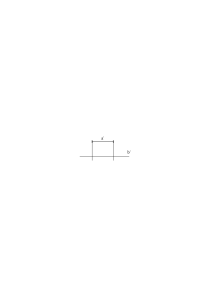

as a representative of a & draws the corresponding lines, then in doing so one also draws the projection of a' onto b'.

### [252\[2\]](https://cdn.wittgensteinnachlass.com/2000px/webp/Ms-108/252.webp),[253\[1\]](https://cdn.wittgensteinnachlass.com/2000px/webp/Ms-108/253.webp)

But I am speaking of the application of this method of projection to _a_. Is that, too, just another picture that has yet to be applied? – Certainly, if I explain the application, again I can only make a picture of it. –

### [253\[2\]](https://cdn.wittgensteinnachlass.com/2000px/webp/Ms-108/253.webp)

But if I want to apply it, surely I already know what I want! (It is always as though something had already been done, even before it is done.)

### [253\[3\]](https://cdn.wittgensteinnachlass.com/2000px/webp/Ms-108/253.webp)

Without altering the matter in the least, one could imagine everything greatly simplified. The command, expectation, etc. would always be to retrace, with a thicker line, a thin line that the command, the expectation, etc., draws. The reality of the thin picture is (then) the possibility of the thick line.

### [253\[4\]](https://cdn.wittgensteinnachlass.com/2000px/webp/Ms-108/253.webp)

But if I want in this way to replace the mental image that is in play in expectation etc. with a picture that is actually seen, something like the following happens: I was to draw a thick black line & have drawn a thin one as a picture. But the mental image goes further & says it already knows, too, that the line is to be thick. So I draw a thick line, but a somewhat paler one, yet the mental image says it already knows, too, that it ought to be black, not grey. (But if I draw the thick black line, it is no longer a picture.)

### [254\[1\]](https://cdn.wittgensteinnachlass.com/2000px/webp/Ms-108/254.webp)

So the mental image cannot be replaced by a picture that is seen. – Or should I say that it is only where one is actually thinking with the mental image that it cannot be replaced! – Is it like this? _The_ picture that is the picture of the thought is the one that is used in a particular way. – One cannot then say of the picture that another picture comes closer to the thought (“what is meant”). That is to say: the picture used in a particular way is the thought, the expectation is what is meant. This picture cannot be replaced by another, & the other will strike us as, so to speak, foreign, something standing outside. – This picture, the one “thought”, can be a “mental image”, but also a written picture or a sound-picture. This is what happens when one asks someone “what do you mean by this drawing” & he says “I mean that …” & then says it in words & thereby expresses what he means better to himself than by means of the other picture.

### [254\[2\]](https://cdn.wittgensteinnachlass.com/2000px/webp/Ms-108/254.webp)

I think one can reply to the causal theory of meaning simply by saying that if someone is pushed & is sent sprawling, we do not _call_ the falling over the meaning of the push.

### [254\[3\]](https://cdn.wittgensteinnachlass.com/2000px/webp/Ms-108/254.webp),[255\[1\]](https://cdn.wittgensteinnachlass.com/2000px/webp/Ms-108/255.webp)

Attending to the picture seems like mere play if it is not concerned with the reality that interests us. If I hope that he will come in through the door, then I am attending to _this_ door, say, to the floor he will step on. And the rest of what the imagination does is not play but a kind of preparation, an activity (a piece of work, so to speak) that bears within it the form of the picture. Rather as if (only not necessarily so explicit) I wanted to lay a carpet along his path & set out a chair in a particular place.

### [255\[2\]](https://cdn.wittgensteinnachlass.com/2000px/webp/Ms-108/255.webp)

Could one not put it like this: the preparations can be of different kinds: if someone wants to put something into my mouth, say, I open my mouth according to the size of the piece (that is one kind) & in addition my mouth may secrete saliva (that is the other kind). The first is a picture of the mouthful I want to swallow, the other is not.

### [255\[3\]](https://cdn.wittgensteinnachlass.com/2000px/webp/Ms-108/255.webp),[256\[1\]](https://cdn.wittgensteinnachlass.com/2000px/webp/Ms-108/256.webp)

Thinking makes plans. It draws plans of a simple or even very complicated kind. But now one says: surely that is not everything, one surely wants something with these plans, surely they mean something, i.e. they are surely drawn with an intention. Yes, but here there are two possibilities: either this intention is a feeling or something of the sort, in which case it does not interest us, or else it is part of the _matter_, in which case it belongs to the _picture_. Logic is always objective.

### [256\[2\]](https://cdn.wittgensteinnachlass.com/2000px/webp/Ms-108/256.webp)

If one considers that every thought – every sentence – draws up a plan, then one sees clearly where the causal theory overlooks what is essential.

### [256\[3\]](https://cdn.wittgensteinnachlass.com/2000px/webp/Ms-108/256.webp)

To know what the sign means is to interpret it. To construe it. Construing it means acting in accordance with the sign. Before the action was performed, one could only have a picture that becomes its picture when the action is performed.

### [256\[4\]](https://cdn.wittgensteinnachlass.com/2000px/webp/Ms-108/256.webp)

Isn’t it the case that before the action is performed, before the picture is interpreted, nothing rules out a different interpretation? It is a picture only when I interpret it – or have interpreted it. (What is typical of a thought is simply that I interpret it; that is how it differs from other causes of my actions.)

### [256\[5\]](https://cdn.wittgensteinnachlass.com/2000px/webp/Ms-108/256.webp),[257\[1\]](https://cdn.wittgensteinnachlass.com/2000px/webp/Ms-108/257.webp)

If the order consists, e.g., in taking a certain route, then I can express it with the help of a map (a plan). Hence the order can also say to go one route _or_ the other, & perhaps _not_ to go certain routes. That will then also find its expression in the picture

say by the excluded routes being crossed out. But the order could also look like this 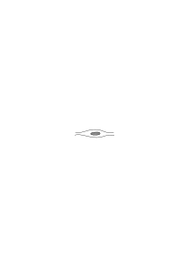 & that would mean, for example, that one may walk _anywhere_ between the two lines, except over the hatched area.

### [257\[2\]](https://cdn.wittgensteinnachlass.com/2000px/webp/Ms-108/257.webp)

Now if a route between two places is actually blocked off & several others are left open, are a negation & a disjunction already contained in these facts?

### [257\[3\]](https://cdn.wittgensteinnachlass.com/2000px/webp/Ms-108/257.webp)

But what about when I interpret an order in a particular way & act contrary to it? What makes it the case that my action is not my interpretation of the order but an acting-against? Is my earlier view not overturned by this? I can say: if the agent did not say so, one could never know that it is an acting-against. And if he now says so, we understand it only through our interpretation of negation.

### [257\[4\]](https://cdn.wittgensteinnachlass.com/2000px/webp/Ms-108/257.webp),[258\[1\]](https://cdn.wittgensteinnachlass.com/2000px/webp/Ms-108/258.webp)

One would think that if I can act contrary to the order _as I understand it_, then my action must directly conflict with the expression of my conception. – Or is it only the interpretation of my action that contradicts the interpretation of the order (on the same level, so to speak)?

### [258\[2\]](https://cdn.wittgensteinnachlass.com/2000px/webp/Ms-108/258.webp)

In general, I have always spoken of the picture or even of the hallucination, but how can one hallucinate that someone is going either along one route or along the other, or that he is going along some route or other within certain limits??

### [258\[3\]](https://cdn.wittgensteinnachlass.com/2000px/webp/Ms-108/258.webp)

Disjunction, negation etc. seem to lie in the setting in relation to a picture. This setting corresponds to the electrical circuit by which, say, a bell can be connected to switches.

### [258\[4\]](https://cdn.wittgensteinnachlass.com/2000px/webp/Ms-108/258.webp),[259\[1\]](https://cdn.wittgensteinnachlass.com/2000px/webp/Ms-108/259.webp)

Let us imagine the following settings:

1.) the bell rings only when I align pointer a with pointer b 2.) only when I align a with b does the bell fail to ring 3) the bell rings only when a is aligned either with b or also with c 4) the bell rings in all other pointer positions of a, except when it is aligned with b or c 5) the bell rings only when both b and c are aligned with a 6) the bell rings only when b is aligned with a but c is not aligned with a. etc. The bell signal means assent (or also the reverse). One could also fit such a circuit to the model of the permitted & forbidden routes. This model would then be the expression of an order. But could one rightly call it a picture?

### [259\[2\]](https://cdn.wittgensteinnachlass.com/2000px/webp/Ms-108/259.webp)

An opinion (i.e. a sense) that one cannot explain is no concern of ours, for one cannot act contrary to it either.

### [259\[3\]](https://cdn.wittgensteinnachlass.com/2000px/webp/Ms-108/259.webp)

28.07.1930

One teaches the child “not” by blocking its way, by preventing it from doing something.

### [259\[4\]](https://cdn.wittgensteinnachlass.com/2000px/webp/Ms-108/259.webp)

How, then, can one act _against a picture_?

### [259\[5\]](https://cdn.wittgensteinnachlass.com/2000px/webp/Ms-108/259.webp)

“I am not going into this area” describes a particular fact. If the inscription “Forbidden route” is a negative inscription, can it be replaced by a positive one?

### [259\[6\]](https://cdn.wittgensteinnachlass.com/2000px/webp/Ms-108/259.webp)

If the interpretation is a picture, then two opposite interpretations are opposite pictures.

### [259\[7\]](https://cdn.wittgensteinnachlass.com/2000px/webp/Ms-108/259.webp),[260\[1\]](https://cdn.wittgensteinnachlass.com/2000px/webp/Ms-108/260.webp)

In truth, however, what is forbidden must always be described in the prohibition. If a movement is forbidden, then it is _precisely this_ movement that must be described, that is, precisely what is to be excluded, & the description of what is permitted will (be able to) replace the prohibition only if this description _also describes_ what is excluded.

### [260\[2\]](https://cdn.wittgensteinnachlass.com/2000px/webp/Ms-108/260.webp)

(I am always looking for the point at which one can say “yes, that is just how our world is”. – Philosophy wants to describe the essence of the world, but when it looks for it, looks for sentences that describe it, at the decisive moment it arrives not at _philosophical_ sentences but at the limit of language.)

### [260\[3\]](https://cdn.wittgensteinnachlass.com/2000px/webp/Ms-108/260.webp)

(In philosophy one must always, as it were, pretend to be more stupid than one is, so as not to pass over any difficulty.)

### [260\[4\]](https://cdn.wittgensteinnachlass.com/2000px/webp/Ms-108/260.webp)

Is there a proof that someone has understood an order & knowingly acts contrary to it? – I ask someone “have you understood the order”, he says yes & gives me “samples” of his understanding & then acts contrary to the order. Now can the samples (also) be interpreted in such a way that the order was indeed obeyed as it was understood? Doesn’t one infer here, from something amorphous, e.g. the facial expression, which interpretation is to be made? (Somewhere in these questions there is a place for Behaviourism. Perhaps only insofar as one looks at _everything_ from outside).

### [260\[5\]](https://cdn.wittgensteinnachlass.com/2000px/webp/Ms-108/260.webp),[261\[1\]](https://cdn.wittgensteinnachlass.com/2000px/webp/Ms-108/261.webp)

In “understanding what someone means” one must be able to separate the specifically human conduct, all that is psychologically & physiologically interesting, from what belongs to the matter itself, what is logical. I.e. one must be able to look at it as a whole from outside & then distinguish the psychological trappings from what belongs to the matter.

### [261\[2\]](https://cdn.wittgensteinnachlass.com/2000px/webp/Ms-108/261.webp)

I.e. for us understanding is not essentially an _inner_ process, for insofar as it were, it would be no concern of ours.

### [261\[3\]](https://cdn.wittgensteinnachlass.com/2000px/webp/Ms-108/261.webp)

To fear that something will happen is to wish that it will not happen. So if one person fears that something will happen and another wishes that it will happen, they wish for opposite things.

### [261\[4\]](https://cdn.wittgensteinnachlass.com/2000px/webp/Ms-108/261.webp),[262\[1\]](https://cdn.wittgensteinnachlass.com/2000px/webp/Ms-108/262.webp)

What is the difference between: wishing for something to happen & wishing for that same thing _not_ to happen. If one wanted to represent it in a picture, one would do something with the picture of the action, cross it out, frame it in a particular way & the like. But this seems to us a _crude_ method of expression, yet – I believe – _every_ method must be essentially like this; in word-language I put the sign “not” before the sentence. As I said, this seems a clumsy expedient & one might think that in _thinking_ it does happen differently. But I believe that in thinking, expecting, wishing, it happens in just the same way. Otherwise the discrepancy between thinking & speaking – in which, after all, we think – would be intolerable.

### [262\[2\]](https://cdn.wittgensteinnachlass.com/2000px/webp/Ms-108/262.webp)

Once again: the expression of negation that we use when we employ any sort of language seems _primitive_ to us; as though there were a more correct one that is unavailable to me only under the crude conditions of this language.

### [262\[3\]](https://cdn.wittgensteinnachlass.com/2000px/webp/Ms-108/262.webp)

One might say that the negated sentence constitutes an obstacle that prevents what it negates from happening. I mean an obstacle that is a picture of what it prevents. If, for example, I want to prevent someone from bringing his arm into a particular position & do so by fastening a piece of wood where the arm must not lie, then the piece of wood is a picture of the forbidden position. But if I bring about the same thing by giving him a paralysing draught, the draught is not a picture of its effect. (Theory of causality)

### [262\[4\]](https://cdn.wittgensteinnachlass.com/2000px/webp/Ms-108/262.webp),[263\[1\]](https://cdn.wittgensteinnachlass.com/2000px/webp/Ms-108/263.webp)

Has not everything been said in saying that the expectation, the thought, that a red circle will appear here is different from the one that a green circle will appear here & different from the one that an ellipse will appear there & different from the one that no ellipse will appear there? But when I say that the thought that a green patch will appear here is different from the thought that a red patch will appear here, I am not thereby, after all, describing an empirical fact, such as the fact that the stomach of a roe deer differs from that of a red deer. – For the expectation is described internally by saying that it is the expectation that a green patch will appear here. But “described internally” is surely misleading here. ‒ ‒

### [263\[2\]](https://cdn.wittgensteinnachlass.com/2000px/webp/Ms-108/263.webp)

We have encountered before that primitiveness of the form of expression that struck us in the case of negation; for if, for example, one wants to make someone understand that he is to take a certain route, one can draw the route for him & do so with ever greater precision. But the indication meant to make him understand that _he_ is to take the route is again of the primitive sort that one would like to improve.

### [263\[3\]](https://cdn.wittgensteinnachlass.com/2000px/webp/Ms-108/263.webp)

(It is characteristic of philosophy to single out as remarkable what otherwise goes unnoticed as trivial.)

### [263\[4\]](https://cdn.wittgensteinnachlass.com/2000px/webp/Ms-108/263.webp),[264\[1\]](https://cdn.wittgensteinnachlass.com/2000px/webp/Ms-108/264.webp)

What is the difference between involuntarily copying a drawing – where, say, I watch the pencil doing the copying & keep discovering that it moves the way the lines of that drawing run – and deliberately copying it, where I _trace_ the drawing. Here I let the original guide my hand, as it were. – And what is it like when, say, I really am led somewhere by the hand. I walk, then, & adjust my steps so that a certain tension in my hand or arm does not arise (or is at least repeatedly relieved). But is this tension a picture of the discrepancy between the movements of the person leading me & my own? Is it not merely a matter of experience that a certain movement removes the sensation of pressure. Now what about someone who lets himself be _guided_ by a command. Is not acting in accordance with a command or even following it by interpreting it – quite different from comparing a command with a completed action or a finished interpretation?

### [264\[2\]](https://cdn.wittgensteinnachlass.com/2000px/webp/Ms-108/264.webp)

29.07.1930

In thinking I incorporate a picture into my life, so to speak.

### [264\[3\]](https://cdn.wittgensteinnachlass.com/2000px/webp/Ms-108/264.webp)

The picture I incorporate into my life is what is thought; every other picture appears to us as something external.

### [264\[4\]](https://cdn.wittgensteinnachlass.com/2000px/webp/Ms-108/264.webp),[265\[1\]](https://cdn.wittgensteinnachlass.com/2000px/webp/Ms-108/265.webp)

I always want to say something like: It is agreed from the outset that language will describe what satisfies the expectation by affirming the sentence that expresses the expectation. ‒ ‒

I should like to say: only in this way does language express what the expectation has in common with the world. – Or rather: ‒ ‒

### [265\[2\]](https://cdn.wittgensteinnachlass.com/2000px/webp/Ms-108/265.webp)

It is the attitude I take towards the picture that makes it a representative.

### [265\[3\]](https://cdn.wittgensteinnachlass.com/2000px/webp/Ms-108/265.webp)

I expect that when I take my watch out of my pocket now it will be 3 o’clock. This expectation _includes_ an indeterminate picture of the dial & of the position of the hands; it contains an attunement to my actual watch ‒ ‒ And if I now actually look at the watch – and the hands stand at 3, I shall say that the hands (really) stand at 3 – but that surely means nothing at all, and this impossibility of expressing through language the condition for agreement between a sentence with sense – a thought – & reality is the solution to the riddle.

### [265\[4\]](https://cdn.wittgensteinnachlass.com/2000px/webp/Ms-108/265.webp)

Bear in mind that there is a difference between the sentence that expresses the expectation & the one that describes it – say, as having once existed.

### [265\[5\]](https://cdn.wittgensteinnachlass.com/2000px/webp/Ms-108/265.webp)

It might be said: How can one expect the event, when it is not even there yet?

### [265\[6\]](https://cdn.wittgensteinnachlass.com/2000px/webp/Ms-108/265.webp),[266\[1\]](https://cdn.wittgensteinnachlass.com/2000px/webp/Ms-108/266.webp)

“Yes, _that_ is what I expected”. How could you have expected it, when it was not even there yet. (This contains the whole difficulty of the matter & its solution too.)

### [266\[2\]](https://cdn.wittgensteinnachlass.com/2000px/webp/Ms-108/266.webp)

And “That is what I expected” really means that _that_ is what I expected, & _not_ that I expected something exactly like it (or similar to it).

### [266\[3\]](https://cdn.wittgensteinnachlass.com/2000px/webp/Ms-108/266.webp)

“That is what I expected” could also be translated as: I was attuned to _that_.

### [266\[4\]](https://cdn.wittgensteinnachlass.com/2000px/webp/Ms-108/266.webp)

The feeling expressed in the sentences above is: surely I cannot catch a thief if there is no thief yet; how can I sit down on a chair that is not there. And this, of course, only shows that we see a false analogy here. I.e. we think we see an analogy where there is none.

### [266\[5\]](https://cdn.wittgensteinnachlass.com/2000px/webp/Ms-108/266.webp)

How can one be prepared for something to happen? I should like to say: only through language being prepared in any event, since either p will happen or it will not. That is a factual, logical property of language.

### [266\[6\]](https://cdn.wittgensteinnachlass.com/2000px/webp/Ms-108/266.webp)

All right, I say: When I take out my watch, it will now either present me with this picture 🕤 or not. But how can I express that I am deciding in favour of one of these assumptions? Every thought is the expression of a thought.

### [267\[1\]](https://cdn.wittgensteinnachlass.com/2000px/webp/Ms-108/267.webp)

One can adjust a gauge to the measurement of a body, have it ready. The measurement it is set to is then indeed implicit in this setting, but not in any way that a particular body has that measurement. Above all, no assumption is implicit in it as to whether the body has that measurement or not.

### [267\[2\]](https://cdn.wittgensteinnachlass.com/2000px/webp/Ms-108/267.webp)

What I mean is: Even if the expectation is accompanied by seeing an exact visual picture of what is expected, so that when I expect the watch to show ½ past 9 I see before me a picture of my watch with the hands at ½ past 9, so that I could compare the watch with the picture, this picture is still not the expectation that the hands of the watch are in this position. – For otherwise why should it not be the expectation that the hands are _not in this position_, since this expectation too must contain the _in this position_.

### [267\[3\]](https://cdn.wittgensteinnachlass.com/2000px/webp/Ms-108/267.webp)

If I expect someone to come into my room & I get a chair ready & two teacups, is there then any doubt whether I expect him to come or expect him not to come?

### [267\[4\]](https://cdn.wittgensteinnachlass.com/2000px/webp/Ms-108/267.webp)

30.07.1930

(It does no harm at all to talk nonsense in philosophy, if only one goes deeply enough into the nonsense.)

### [267\[5\]](https://cdn.wittgensteinnachlass.com/2000px/webp/Ms-108/267.webp),[268\[1\]](https://cdn.wittgensteinnachlass.com/2000px/webp/Ms-108/268.webp)

(If I am boarded up, I am boarded up for many, & if I fling open the gate, then I fling it open for many.)

### [268\[2\]](https://cdn.wittgensteinnachlass.com/2000px/webp/Ms-108/268.webp)

If I expect it to be ¼ past 10, then I am – somehow – attuned to ¼ past 10 (on the clock of my thoughts); that much is intelligible.

But now I look at the clock & see that it is not ¼ past 10. What does its being _not_ ¼ past 10 consist in? Surely I cannot compare the actual position of the hands with one that simply is not there.

### [268\[3\]](https://cdn.wittgensteinnachlass.com/2000px/webp/Ms-108/268.webp)

In reality, however, with “it is not ¼ past 10” I merely describe the state of affairs more generally than with “it is 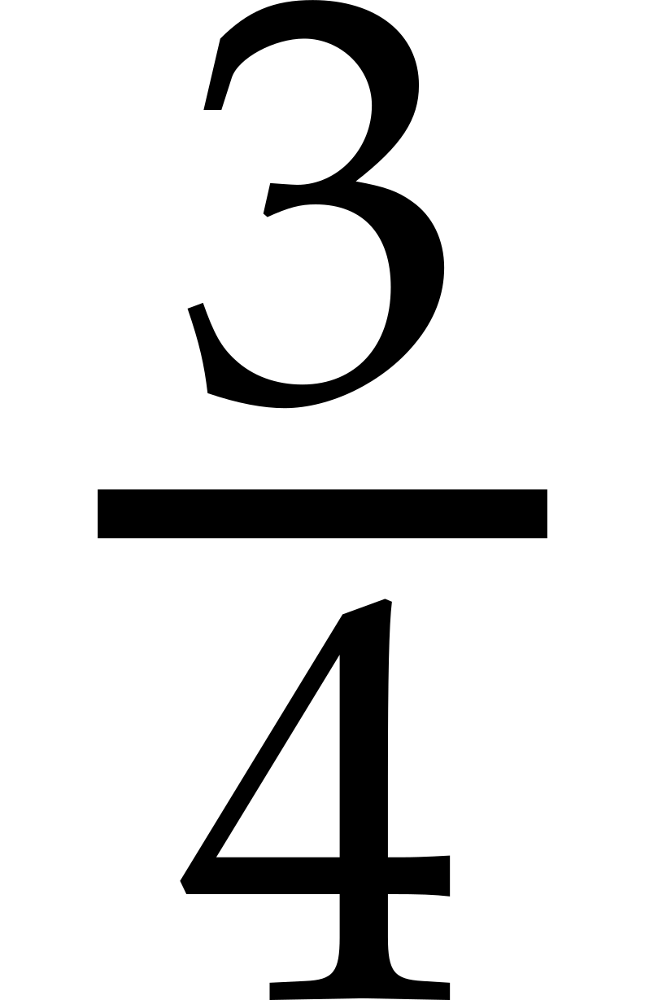 past 10”. I use, say, one picture  on one occasion and another 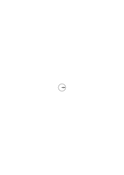 on another, or .

### [268\[4\]](https://cdn.wittgensteinnachlass.com/2000px/webp/Ms-108/268.webp)

What are opposed are the _pictures_  and . But so are  and .

### [268\[5\]](https://cdn.wittgensteinnachlass.com/2000px/webp/Ms-108/268.webp)

All my reflections are always directed towards showing that it is no _help_ to conceive of thinking as hallucinating. I.e. it is _superfluous_, but leaves the difficulty as it was. For a hallucination cannot bridge the gulf between picture & reality either; _no_ picture can, & the one can do so no more than the other.

### [268\[6\]](https://cdn.wittgensteinnachlass.com/2000px/webp/Ms-108/268.webp)

In the normal visual image of the moon the craters are not too small for one to see them; they are not there.

### [269\[1\]](https://cdn.wittgensteinnachlass.com/2000px/webp/Ms-108/269.webp)

It is remarkable, incidentally, that when we think that it is probably ½ past 2 now, we usually do not imagine the position of the hands precisely, or do not imagine it at all, but have the picture in language, as it were, in a toolbox from which we know we can take out & use the tool at any time, if we should need it. – This toolbox seems to me to be grammar with its rules.

### [269\[2\]](https://cdn.wittgensteinnachlass.com/2000px/webp/Ms-108/269.webp)

I always want to say: If I believe that it is ½ past 2, surely that is not playing about (with pictures) but something serious that may have consequences for my life, _so_ it must be an attitude I take towards this picture! For after all I act on this belief too. – It is something serious, nothing superfluous (I should like to say).

### [269\[3\]](https://cdn.wittgensteinnachlass.com/2000px/webp/Ms-108/269.webp)

Can one say: Thinking is an instrument of action.

### [269\[4\]](https://cdn.wittgensteinnachlass.com/2000px/webp/Ms-108/269.webp)

It is as if I were getting tools ready for future use in the toolbox of language. After all, a tool is also, to a certain extent, a likeness of its use.

### [269\[5\]](https://cdn.wittgensteinnachlass.com/2000px/webp/Ms-108/269.webp)

I am always looking for this impossibility of expression that is at the very root of the problem.

### [270\[1\]](https://cdn.wittgensteinnachlass.com/2000px/webp/Ms-108/270.webp)

How can I know that _that_ is what I expected except by its now satisfying my expectation, now corresponding to my expectation.

### [270\[2\]](https://cdn.wittgensteinnachlass.com/2000px/webp/Ms-108/270.webp)

A step is needed similar to the one in the theory of relativity.

### [270\[3\]](https://cdn.wittgensteinnachlass.com/2000px/webp/Ms-108/270.webp)

Can one say that expectation is a preparatory, expectant, action. – Someone throws me a ball; I stretch out my hands & position them to catch it. But suppose I had been pretending: I had expected him not to throw it, but wanted to act as if I expected it. What then does my expecting him not to throw it consist in, if my action expresses the opposite expectation? Surely it, too, had to consist in something I did. So in some way I was, after all, not prepared for the ball to come.

### [270\[4\]](https://cdn.wittgensteinnachlass.com/2000px/webp/Ms-108/270.webp)

I am prepared to see a red patch – this preparation is something _practical_, so to speak, rather like when I prepare my muscles to hold a weight. (And I should like to say: with the language that is the expression of that preparation, I cannot go beyond the possibilities of this preparation.)

### [270\[5\]](https://cdn.wittgensteinnachlass.com/2000px/webp/Ms-108/270.webp),[271\[1\]](https://cdn.wittgensteinnachlass.com/2000px/webp/Ms-108/271.webp)

If the preparation for eating an apple consists in my secreting saliva, then in the language of the salivary glands getting the apple simply means satisfaction, justification of the secretion of saliva. What I mean by this is: In the language of the salivary glands there is then no round & sweet & soft, but only what _they_ grasp of the apple.

### [271\[2\]](https://cdn.wittgensteinnachlass.com/2000px/webp/Ms-108/271.webp)

My whole thought is always that if someone could see the expectation, he would have to see from it what was expected.

### [271\[3\]](https://cdn.wittgensteinnachlass.com/2000px/webp/Ms-108/271.webp)

[My thoughts jostle one another, one displaces another, pushes to the front etc. like a crowd of crabs in a bowl.]

### [271\[4\]](https://cdn.wittgensteinnachlass.com/2000px/webp/Ms-108/271.webp)

The preparation is, as it were, itself the language & cannot go beyond itself. (It is in this inability to go beyond itself that the similarity between my considerations & those of the theory of relativity lies.)

### [271\[5\]](https://cdn.wittgensteinnachlass.com/2000px/webp/Ms-108/271.webp)

One might say that I check whether an expectation has been fulfilled like this: If the expectation was expressed by the sentence that p would be the case & the state of affairs that has come about is described by the sentence “p”, then the expectation has been fulfilled.

### [271\[6\]](https://cdn.wittgensteinnachlass.com/2000px/webp/Ms-108/271.webp),[272\[1\]](https://cdn.wittgensteinnachlass.com/2000px/webp/Ms-108/272.webp)

If I said earlier that what matters is whether _this_ picture is expected, i.e. whether it is this very picture that we “employ” (“use”), I could now say that what matters is whether _this_ very picture is our language.

### [272\[2\]](https://cdn.wittgensteinnachlass.com/2000px/webp/Ms-108/272.webp)

Language as the _expression_ of the expectation is what has been prepared.

### [272\[3\]](https://cdn.wittgensteinnachlass.com/2000px/webp/Ms-108/272.webp)

Language can only say: I used the sentence “p” earlier in preparation, & I use the sentence “p” again in the description.

### [272\[4\]](https://cdn.wittgensteinnachlass.com/2000px/webp/Ms-108/272.webp),[273\[1\]](https://cdn.wittgensteinnachlass.com/2000px/webp/Ms-108/273.webp)

The remarkable thing about this case is that in the expectation the event is _fully_ prefigured, so that when it occurs one need only say _yes_ to the expectation. That one can say, _that_ is what I expected, & that there is nothing at all surprising about what is _real_. – And the explanation always seems to be that language can grasp no more of reality than it already expresses in the expectation. That is, language sees no more of reality than it itself understands, & it has already said that in the expectation. For language did not describe the expectation, it expressed it. It did not first describe the expectation & then a fact that somehow fits the expectation (as if one were to describe a table & then a flower vase that fits it.)

Rather, it _was_ the expectation (for the expression of the thought is the thought; the thought is the expression of the thought) & is now fulfilled.

### [273\[2\]](https://cdn.wittgensteinnachlass.com/2000px/webp/Ms-108/273.webp)

After all, language has already said in the expectation everything it could say. It did not describe a state of being attuned, but attuned _itself_. And then again it does not describe the state of fulfilment but says yes to itself.

### [273\[3\]](https://cdn.wittgensteinnachlass.com/2000px/webp/Ms-108/273.webp)

31.07.1930

“_That_ is what I was afraid of.” – “That was what you were afraid of?” – “Yes, that is exactly how I had imagined it”. But one also says “Yes, _that_ is what I meant”. And in that case one had not imagined it at all, & the picture lay much further back (away from reality); and yet one had meant _it_.

### [273\[4\]](https://cdn.wittgensteinnachlass.com/2000px/webp/Ms-108/273.webp),[274\[1\]](https://cdn.wittgensteinnachlass.com/2000px/webp/Ms-108/274.webp)

I had been afraid of something, say, afraid that a certain person would come towards me with a certain facial expression. Now he comes; I can then perceive features that I had foreseen in my fear, and other features that I had imagined somewhat differently. He is not wearing the suit I expected, he comes faster than I had expected, his face is somewhat milder than would correspond to my expectation. – So I compare what comes towards me with what was given to me in the expectation. _Not all_ the details that reality has were in my expectation, & _some_ were _different_.

(To that extent the expectation is a picture.)

### [274\[2\]](https://cdn.wittgensteinnachlass.com/2000px/webp/Ms-108/274.webp)

The question is: Is it already in the nature of preparation that it is a *pre*paration? a preparation for something?

### [274\[3\]](https://cdn.wittgensteinnachlass.com/2000px/webp/Ms-108/274.webp)

I have the feeling: only the attitude we take towards the picture can make it real for us, i.e. can connect it with reality like a joining plate, as it were, that provides the transition from the picture to reality, holding the two in the 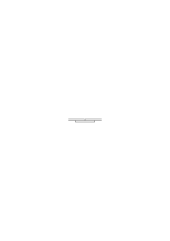 right position relative to each other by virtue of their both meaning the same thing to that attitude. Fear connects the picture with the horrors of reality.

### [274\[4\]](https://cdn.wittgensteinnachlass.com/2000px/webp/Ms-108/274.webp)

Nothing is in itself a preparation for something else.

### [274\[5\]](https://cdn.wittgensteinnachlass.com/2000px/webp/Ms-108/274.webp)

“I thought he would come now.” – “Yes, you said, ‘he’ll come in a moment’, but how do I know that that is what you meant by it?”.

### [274\[6\]](https://cdn.wittgensteinnachlass.com/2000px/webp/Ms-108/274.webp),[275\[1\]](https://cdn.wittgensteinnachlass.com/2000px/webp/Ms-108/275.webp)

The portrait is only a picture resembling N. (or not even that), but it has nothing in it (however close the likeness) that would make it a portrait of _this_ person, i.e. the intended portrait. (Indeed, the picture that is a deceptively close likeness of one person may of course in reality be a poor portrait of another.)

### [275\[2\]](https://cdn.wittgensteinnachlass.com/2000px/webp/Ms-108/275.webp)

A picture is _meant_ as a portrait, & even if it & its object could exist quite independently of a person, it can only be _meant_ as a portrait by a person. I.e. it makes no difference at all to the picture & its likeness whether anyone has painted it, seen it, or found it to be a likeness, but if one calls it a portrait, there must be someone who means it as a portrait. This is directly connected with what I said earlier about acting in accordance with a command & interpreting a sign. (This meaning it as such is the attitude I spoke of above.)

### [275\[3\]](https://cdn.wittgensteinnachlass.com/2000px/webp/Ms-108/275.webp)

Now, one can still ask: “How does it show that he means the picture as a portrait of N.?” – “Well, by his saying so.” – “But then how does it show that he means that by what he says?” – “It doesn’t show at all!”.

### [275\[4\]](https://cdn.wittgensteinnachlass.com/2000px/webp/Ms-108/275.webp),[276\[1\]](https://cdn.wittgensteinnachlass.com/2000px/webp/Ms-108/276.webp)

This is connected with the question: Can the discrepancy between a picture and an object be unpleasant to me in such a way that the unpleasant sensation is not connected with the discrepancy _causally_, that is, as a matter of experience, but rather the unpleasant feeling _contains_ the discrepancy, so that from an analysis of this sensation one could ascertain its cause – or better, its basis? Or is this sensation to be regarded, so to speak, as a pointer whose deflection is interpreted as a measure of the tension between picture & object?

### [276\[2\]](https://cdn.wittgensteinnachlass.com/2000px/webp/Ms-108/276.webp)

No examination of the picture can ever establish whose portrait it is (i.e. whom it is _supposed_ to depict.).

### [276\[3\]](https://cdn.wittgensteinnachlass.com/2000px/webp/Ms-108/276.webp)

The person who means it welds the picture to its object; not by altering it, making it still more like the object, – for in that way the picture would remain the picture, & still separate from the object.

### [276\[4\]](https://cdn.wittgensteinnachlass.com/2000px/webp/Ms-108/276.webp)

So what I call “meaning” has _nothing to do_ with the picture.

### [276\[5\]](https://cdn.wittgensteinnachlass.com/2000px/webp/Ms-108/276.webp)

I believe it is like this: The question how something is meant – talk of an opinion, a sense – has sense only in so far as it can be answered. But it can only be answered through language.

### [276\[6\]](https://cdn.wittgensteinnachlass.com/2000px/webp/Ms-108/276.webp)

Can I expect without language? But if not, how do _I_ know what sense the sentence has for me, if this question means anything at all?

### [277\[1\]](https://cdn.wittgensteinnachlass.com/2000px/webp/Ms-108/277.webp)

I call what can be expressed through a language thinking. Then it must be translated into this language from _another_. What I mean is: all thinking must then take place in signs.

### [277\[2\]](https://cdn.wittgensteinnachlass.com/2000px/webp/Ms-108/277.webp)

But if one says: “How am I supposed to know what he means, I only see his signs”, I say: “How is _he_ supposed to know what he means, he only has his signs too”.

### [277\[3\]](https://cdn.wittgensteinnachlass.com/2000px/webp/Ms-108/277.webp)

The question “_how_ is that meant” has sense only if one says “it is meant _like this_”. This “like this” is a linguistic expression.

### [277\[4\]](https://cdn.wittgensteinnachlass.com/2000px/webp/Ms-108/277.webp)

One can explain language only through language, so one cannot explain _language_.

### [277\[5\]](https://cdn.wittgensteinnachlass.com/2000px/webp/Ms-108/277.webp)

The aim of philosophy is to put up a wall where language stops anyway.

### [277\[6\]](https://cdn.wittgensteinnachlass.com/2000px/webp/Ms-108/277.webp)

One can also put it this way: If one expresses oneself only within a system of language & thus explains what a sentence means only by means of sentences belonging to that system, then in the end opinion drops out of language altogether, and thus out of consideration, & what remains is language, the only thing we can consider.

### [277\[7\]](https://cdn.wittgensteinnachlass.com/2000px/webp/Ms-108/277.webp),[278\[1\]](https://cdn.wittgensteinnachlass.com/2000px/webp/Ms-108/278.webp)

When we explain the sense of a sentence to someone, we translate it into a less ambiguous language. Now if someone explains a sentence to me by, say, drawing, pointing with his fingers etc. & I finally say, “ah, now I know what he means”, what have I grasped in the end but a sign-language that is in my toolbox?

### [278\[2\]](https://cdn.wittgensteinnachlass.com/2000px/webp/Ms-108/278.webp)

If someone gives me a complicated command in a sign-language – at first I do not understand it, then suddenly I understand: “ah, _that_ is what he wants” – what have I grasped (got hold of)? Perhaps the mental image of an action; but that too would be only a sign if I could not use it. Or I have no mental image, but signs of a system that I can already use.

### [278\[3\]](https://cdn.wittgensteinnachlass.com/2000px/webp/Ms-108/278.webp)

One does not have the thought & _alongside_ it, language. –

### [278\[4\]](https://cdn.wittgensteinnachlass.com/2000px/webp/Ms-108/278.webp)

So it is not as though one had signs for the other person but a silent thought for oneself.

### [278\[5\]](https://cdn.wittgensteinnachlass.com/2000px/webp/Ms-108/278.webp)

A thought is _always_ a construction.

### [278\[6\]](https://cdn.wittgensteinnachlass.com/2000px/webp/Ms-108/278.webp)

Negation must be part of the construction. For example, in every symbolism it must be the case that ~~p = p.

### [279\[1\]](https://cdn.wittgensteinnachlass.com/2000px/webp/Ms-108/279.webp)

One might put it this way: there is nothing private about _thought_. – Anyone can look into it.

### [279\[2\]](https://cdn.wittgensteinnachlass.com/2000px/webp/Ms-108/279.webp)

The truth-functions belong to the essence of the sentence, & therefore cannot be explained by sentences.

### [279\[3\]](https://cdn.wittgensteinnachlass.com/2000px/webp/Ms-108/279.webp)

One does not have the expression in signs &, alongside it, the (as it were obscure) thought for oneself. It would then be altogether too strange that one should be able to render the thought in words.

### [279\[4\]](https://cdn.wittgensteinnachlass.com/2000px/webp/Ms-108/279.webp)

That is: if the thought were not already articulated, how could its expression in language articulate it? But the articulated thought is in all essentials a sentence.

### [279\[5\]](https://cdn.wittgensteinnachlass.com/2000px/webp/Ms-108/279.webp)

01.08.1930

~p excludes p; what it then _allows_ depends on the nature of p.

### [279\[6\]](https://cdn.wittgensteinnachlass.com/2000px/webp/Ms-108/279.webp)

One can negate only a _sentence_, – so if one uses a sign with the same formal rules as the sign for negation in connection with equations, there will naturally be a temptation to call it negation, but there is no question here of negation in the first sense.

### [280\[1\]](https://cdn.wittgensteinnachlass.com/2000px/webp/Ms-108/280.webp)

In mathematics _everything_ is algorithm, _nothing_ meaning, even where it seems otherwise because we seem to be speaking _in words about_ mathematical things. Rather, what we do in that case is form an algorithm with those words.

### [280\[2\]](https://cdn.wittgensteinnachlass.com/2000px/webp/Ms-108/280.webp)

The only proof that two proofs prove the same thing is that they can be transformed into one another.

### [280\[3\]](https://cdn.wittgensteinnachlass.com/2000px/webp/Ms-108/280.webp)

A proof proves only what it proves; that is, no interpretation can get more out of it than what is in the proof itself.

### [280\[4\]](https://cdn.wittgensteinnachlass.com/2000px/webp/Ms-108/280.webp)

Two proofs that prove the same thing must surely meet. Like two paths that lead to the same place. Let us follow them and see how they meet.

### [280\[5\]](https://cdn.wittgensteinnachlass.com/2000px/webp/Ms-108/280.webp)

Can one construct from the inequality

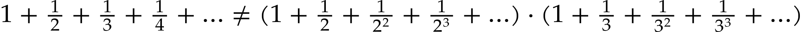

a number _v_ that is in any case still missing from the combinations on the right-hand side? Euler’s proof that “there are infinitely many primes” is supposed to be an existence proof, after all, & how is that possible without construction?

### [280\[6\]](https://cdn.wittgensteinnachlass.com/2000px/webp/Ms-108/280.webp),[281\[1\]](https://cdn.wittgensteinnachlass.com/2000px/webp/Ms-108/281.webp),[282\[1\]](https://cdn.wittgensteinnachlass.com/2000px/webp/Ms-108/282.webp)

02.08.1930

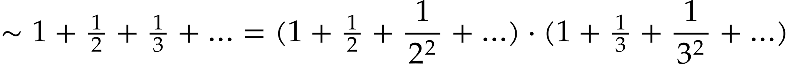

The argument runs as follows: The product on the right is a series of fractions  in whose denominators all the combinations  occur; if those were all the numbers, this series would have to be the same as 1 + ½ + ⅓ + … and then the sums too would have to be equal. But the one on the left is ∞ & the one on the right only a finite number , so infinitely many fractions are missing from the series on the right, i.e. _there are_ fractions in the series on the right that do not occur in the one on the left. And now the question is: is this argument correct? If we were dealing with finite series here, everything would be _clear_. For then one could find out from the method of summation just which terms of the series on the left are missing from the series on the right. One could only ask: how is it that the series on the right yields ∞, what must it contain besides the terms of the one on the left for this to happen? Indeed, the question is: does an equation like the one above, 1 + ½ + ⅓ + … = 3, make any sense at all? After all, I cannot find out from it _which_ terms on the left are extra. How do we know that all the terms on the right also occur on the left-hand side? In the case of finite series, I can say so only when I have checked this term by term; – and then I see at the same time which ones are left over. – What we lack here is the connection between the result of the summation & the terms, the only connection that could provide the proof. – Everything becomes clearest if one imagines working it out with a finite equation.

1 + ½ + ⅓ + ¼ + ⅕ + ⅙ ≠ (1 + ½) ∙ (1 + ⅓) = 1 + ½ + ⅓ + ⅙

For here again we have the curious thing that one might call a proof by circumstantial evidence in mathematics – which is never admissible. Or, a proof by _symptoms_. The result of the summation is a symptom (or is taken as one) of there being terms on the right that are missing on the left. The connection between the symptom and what one wants to prove is a _loose_ one. That is, a bridge has not been built, but one is content to _see_ the other shore. All the terms on the right-hand side occur on the left-hand side, but the sum on the left yields ∞ & the one on the right only a finite value – _so there must be_ … but in mathematics nothing _must_ be, except what _is_. The bridge must be built. In mathematics there is no symptom; there can be one only in the psychological sense for the mathematician. One might also put it this way: in mathematics nothing can be inferred that cannot be _seen_.

---

### [282\[2\]](https://cdn.wittgensteinnachlass.com/2000px/webp/Ms-108/282.webp)

(Mathematicians have no conception of rigour at all.)

### [282\[3\]](https://cdn.wittgensteinnachlass.com/2000px/webp/Ms-108/282.webp),[283\[1\]](https://cdn.wittgensteinnachlass.com/2000px/webp/Ms-108/283.webp)

The whole looseness of that argument is presumably due to a confusion between the sum & the limit of the sum. One can see this clearly: _however far_ one extends the series on the right, one can always extend the one on the left far enough to include all the terms on the right. (It still remains _open_ whether it then contains any other terms as well.)

### [283\[2\]](https://cdn.wittgensteinnachlass.com/2000px/webp/Ms-108/283.webp)

One might also ask: If one had only this proof, what could one venture on the strength of it? Suppose we had found the primes up to N: could we now, on the strength of it, go on searching indefinitely for another prime – since the proof guarantees that we shall find one? That is surely nonsense. – For “if only we search long enough” means nothing at all. (This applies to existence proofs in general.)

### [283\[3\]](https://cdn.wittgensteinnachlass.com/2000px/webp/Ms-108/283.webp)

Could I add further primes on the left on the strength of this proof? Certainly not, for I have no idea how to find any & that is: I have no concept of a prime at all; the proof has given me none. I could only add arbitrary numbers (or series, as the case may be). The question is whether that proof acquires probative force by the addition of the proof of unique factorization.

### [284\[1\]](https://cdn.wittgensteinnachlass.com/2000px/webp/Ms-108/284.webp)

2 & 3 will not do; which number am I to choose next?

### [284\[2\]](https://cdn.wittgensteinnachlass.com/2000px/webp/Ms-108/284.webp)

(False interpretations cling to mathematics as if by suction.)

### [284\[3\]](https://cdn.wittgensteinnachlass.com/2000px/webp/Ms-108/284.webp)

(There _must_ be another prime to come, means nothing in mathematics. This is directly connected with there being “nothing more general & nothing more specific in logic”.)

### [284\[4\]](https://cdn.wittgensteinnachlass.com/2000px/webp/Ms-108/284.webp)

“If the numbers were all combinations of 2 & 3, then  would have to yield , – but it does not …” What follows from this? (Law of excluded middle) Nothing follows from this except that the limits of the sums are different, hence nothing (new)). But one could now investigate why this is so. In doing so one may come across numbers that cannot be represented by , hence larger primes, but one will never see that _no_ number of such fundamental numbers suffices to represent all numbers.

### [284\[5\]](https://cdn.wittgensteinnachlass.com/2000px/webp/Ms-108/284.webp),[285\[1\]](https://cdn.wittgensteinnachlass.com/2000px/webp/Ms-108/285.webp)

03.08.1930

The question is: How is it that this apparent existence proof exhibits no existence? That it apparently issues us a blank slip as a draft. –

### [285\[2\]](https://cdn.wittgensteinnachlass.com/2000px/webp/Ms-108/285.webp)

However many terms of the form  I take together, they never yield more than 2, whereas the first 4 terms of the series on the left already yield more than 2. (So the proof must already lie _in this_.) And this is indeed where it lies, & with it the construction of a number that is not a power of 2, for the rule now is: find the segment of the series that in any case exceeds 2; it must contain a number that is not a power of 2.

### [285\[3\]](https://cdn.wittgensteinnachlass.com/2000px/webp/Ms-108/285.webp)

. If I now extend the sum 1 + ½ + ⅓ + … until it exceeds n, then this portion must contain a term that cannot be found in the series on the right, for if the series on the right contained all these terms, then it would have to yield a greater sum & not a smaller one.

### [285\[4\]](https://cdn.wittgensteinnachlass.com/2000px/webp/Ms-108/285.webp)

Now what if one existence proof shows that a number with the desired property occurs in a given interval, but another shows that one must be found in a smaller interval? Do these two now prove the same thing, namely existence? No.

### [285\[5\]](https://cdn.wittgensteinnachlass.com/2000px/webp/Ms-108/285.webp),[286\[1\]](https://cdn.wittgensteinnachlass.com/2000px/webp/Ms-108/286.webp),[287\[1\]](https://cdn.wittgensteinnachlass.com/2000px/webp/Ms-108/287.webp)

05.08.1930

The condition under which a portion of the series 1 + ½ + ⅓ + …, say , comes to be equal to or greater than 1 is as follows:

So what we want is:

Let us transform the left-hand side into:

So a sufficient condition for  is that ν ≧ 3n ‒ 1. If I now imagine such sections, each ≧ 1, strung together from the beginning of the series 1 + ½ + ⅓ + …, then the first of these sections extends from

The sum 1 + ½ + ⅓ + … extended to the  term therefore certainly exceeds _m_. Hence

Hence among the first  integers there must be at least one that is divisible by none of the first m numbers.

### [287\[2\]](https://cdn.wittgensteinnachlass.com/2000px/webp/Ms-108/287.webp)

06.08.1930

When I think, I am continually making plans. I am, as it were, continually recording processes (i.e. I make pictures of processes) & I could imagine myself thinking as I draw with a pencil. (When one is talking to someone about a division of time, it often happens that one takes out one’s watch, not to see what time it is, but to be able to form images of the division one is considering.)

### [287\[3\]](https://cdn.wittgensteinnachlass.com/2000px/webp/Ms-108/287.webp),[288\[1\]](https://cdn.wittgensteinnachlass.com/2000px/webp/Ms-108/288.webp)

How can one know that what the other person says (writes, etc.) is meant in such & such a way? Surely only from his telling us again – that is, giving other signs – or we “infer it from his behaviour”. But how do I know how what I say is meant? Does this question mean anything? Surely a _so_ must correspond to this “_how_ it is meant” & what would this _so_ consist in? For surely I cannot make it clearer to _myself_ by means of other signs. So this question evidently means nothing. There is no sense detached from the sentence at which I could point in order to establish a correlation between it & the sentence. Now that might almost lead one to the causal theory, for one might say: if it is only working with the sentence that gives it sense, then its sense is its effect; – If it has an effect, it has sense & if not, it is nonsensical. And yet that is quite wrong. This compares the sentence to, say, an acid & it would be absurd to say “the acid has sense if it has an effect, etc.” Or should I say: The sentence has sense if it has an effect, but its sense is not its effect; for to describe its effect – understood in this way – I need precisely it, the sentence.

### [288\[2\]](https://cdn.wittgensteinnachlass.com/2000px/webp/Ms-108/288.webp)

One might say: in response to the sentence “this sentence has sense” one cannot, in any essential way, ask “what sense?” Just as in response to the sentence “these words are a sentence” one really cannot ask “which one?”.

### [288\[3\]](https://cdn.wittgensteinnachlass.com/2000px/webp/Ms-108/288.webp)

Could one say: I interpret the sentence means: I trace it out in some form (within myself). I interpret it when in some form I _act in accordance with it_.

### [288\[4\]](https://cdn.wittgensteinnachlass.com/2000px/webp/Ms-108/288.webp),[289\[1\]](https://cdn.wittgensteinnachlass.com/2000px/webp/Ms-108/289.webp)

“The sentence has sense” is an unfortunate turn of phrase. And when one speaks of “the sense of this sentence”, it always seems as though it were a matter of a possession of the sentence that stands outside it, as when one says “this person’s hat” (where the hat can also be thought of apart from a person). “The sense of this sentence”, however, is analogous to “the sense of an arrow”.

### [289\[2\]](https://cdn.wittgensteinnachlass.com/2000px/webp/Ms-108/289.webp)

I believe it is not right to say “the sentence is composite”; rather, it can also be non-composite, at least in the literal sense; – its “composition” really consists in its being a special case of a general rule for the formation of signs. For one can, it is true, regard “ambulo” as composed of the root syllable & the ending, but what if this form were formed merely by the root syllable alone?

### [289\[3\]](https://cdn.wittgensteinnachlass.com/2000px/webp/Ms-108/289.webp)

Just as in a certain way one cannot talk about the sense of a sentence, so too one cannot talk about the expression of the thought, the wish, the command, etc., for to the question “which wish is expressed by this sentence”, the answer must be nothing more than an expression of the wish.

### [289\[4\]](https://cdn.wittgensteinnachlass.com/2000px/webp/Ms-108/289.webp),[290\[1\]](https://cdn.wittgensteinnachlass.com/2000px/webp/Ms-108/290.webp)

But one would like to ask, what then is the mechanism of this expressed wish?

### [290\[2\]](https://cdn.wittgensteinnachlass.com/2000px/webp/Ms-108/290.webp)

What I said above also holds of the expression “this sentence communicates something (definite) to me”. What, then?! (another sentence must follow in reply.)

### [290\[3\]](https://cdn.wittgensteinnachlass.com/2000px/webp/Ms-108/290.webp)

Is it not clear that the only condition for a sentence to have sense is that its words have meaning, & that in turn means nothing other than that the outward word-signs are connected with certain mental images or other processes & that in turn means that _the signs_ are of a certain nature.

We cannot go any further & do not want to. – Indeed, we do not get beyond the signs & never want to get beyond them, – if by signs one understands here the whole of what goes on in thinking the written or other sign.

### [290\[4\]](https://cdn.wittgensteinnachlass.com/2000px/webp/Ms-108/290.webp),[291\[1\]](https://cdn.wittgensteinnachlass.com/2000px/webp/Ms-108/291.webp)

And here one must – I believe – simply say that negation, disjunction, etc., are just as “primitive” in thought as in our sign-language. For how could one think negation _in_ it if it were only like an ill-fitting garment of negation? Or – one would expect – one would surely have to feel how the expression pinches one everywhere. (as it were like a hard shoe that does not really fit.)

### [291\[2\]](https://cdn.wittgensteinnachlass.com/2000px/webp/Ms-108/291.webp)

Is there an existence proof for prime numbers & one that proves the existence of infinitely many prime numbers? and in what relation do these stand to each other?

### [291\[3\]](https://cdn.wittgensteinnachlass.com/2000px/webp/Ms-108/291.webp)

07.08.1930

Through the _method of multiplying_ (say in the decimal system, but it does not matter in which system) the existence of products, of divisible numbers, is proved.

### [291\[4\]](https://cdn.wittgensteinnachlass.com/2000px/webp/Ms-108/291.webp)

08.08.1930

If n & m are relatively prime & n is the larger & , then the cases can occur that

### [292\[1\]](https://cdn.wittgensteinnachlass.com/2000px/webp/Ms-108/292.webp),[293\[1\]](https://cdn.wittgensteinnachlass.com/2000px/webp/Ms-108/293.webp)

If one now puts _n_ together to form 1n, 2n, 3n etc., one sees that, compared with a multiple of m, a remainder is left over until one gets to m ∙ n, no matter where the Euclidean algorithm ends (i.e. whichever of the formulae is applicable to m). In the first case, e.g., if

:

– – –

the remainder  in any case remains smaller than m until ; then . The remainder is still < m; but now we get

.

 is in any case smaller than m & the remainder vanishes only if . But then , and so the factor is . But if , the process continues & there now follow

– – –

.

This remainder is certainly smaller than m up to

 & is still smaller here. But

& here

the process again leaves no remainder only if , but then , so m is again equal to the factor multiplying n. – It goes on in the same way up to

 and

 and so on until

. It goes similarly if , etc. etc.

### [293\[2\]](https://cdn.wittgensteinnachlass.com/2000px/webp/Ms-108/293.webp)

If one has understood the law for forming a series “intuitively”, e.g. the various series of the _m_’s, so that one is thus able to form any , then one has understood the law of formation _completely_, that is, as well as any algebraic representation, say, could enable one to understand it. That is, one cannot come to understand it any better through such a representation. And so this representation is not any _more rigorous_ _in that respect_ either. Though of course it may be easier to remember.

### [293\[3\]](https://cdn.wittgensteinnachlass.com/2000px/webp/Ms-108/293.webp)

If one considers that the equation 2 × 2 = 4 is a proof of the sentence “there are even numbers”, then one can see how loosely the word proof is used here. Is the sentence “there are even numbers” supposed to follow from the equation 2 + 2 = 4?! – And what is the proof of the existence of prime numbers? – The method of decomposition into prime factors. But in this method, _nothing is said at all_, not even about “prime numbers”.

### [293\[4\]](https://cdn.wittgensteinnachlass.com/2000px/webp/Ms-108/293.webp),[294\[1\]](https://cdn.wittgensteinnachlass.com/2000px/webp/Ms-108/294.webp)

25 + 46 ≠ 78 is a correct inequality; it is confirmed when one forms the sum 25 + 46 = 71. One could represent the inequality by an inductive disjunction 25 + 46 = 1 ․⌵․ 25 + 46 = 2 ․⌵․ … ․⌵․ 25 + 46 = 77 ․⌵․ 25 + 46 = 79 ․⌵․ …

### [294\[1\]](https://cdn.wittgensteinnachlass.com/2000px/webp/Ms-108/294.webp)

This is a correct proof of 3 + 4 = 7

once the natural series of numerals has been set out: . For _if_ the natural sequence of numerals & the manner of pairing them are fixed, then where, for instance, the 4 in the lower row falls is merely an _arithmetical_ matter.

### [294\[2\]](https://cdn.wittgensteinnachlass.com/2000px/webp/Ms-108/294.webp)

A proof in mathematics is general if it is generally applicable. No other generality can be demanded in the name of rigour. _Every_ proof relies on _particular_ signs, on a particular notation. It is only that one kind of generality may appear more elegant than another.

### [294\[3\]](https://cdn.wittgensteinnachlass.com/2000px/webp/Ms-108/294.webp)

(The elegance of a mathematical proof can have only this one sense: to make certain analogies stand out particularly strongly when that is what is wanted; otherwise it springs from dull-wittedness & has only one effect: to conceal what should be clear & evident. The dull-witted pursuit of elegance is a chief reason why mathematicians do not understand their own operations, or do the lack of understanding & that pursuit spring from a common source.)

### [294\[4\]](https://cdn.wittgensteinnachlass.com/2000px/webp/Ms-108/294.webp),[295\[1\]](https://cdn.wittgensteinnachlass.com/2000px/webp/Ms-108/295.webp)

What distinguishes an equation (or inequality) from a sentence is its provability. A sentence cannot be proved – in that sense – for if it is shown to follow from other sentences, it has not thereby been proved. But the equation does not hold subject to the condition that certain premises are true & its derivation from apparent premises is therefore quite inessential. What it follows from, rather, are stipulations of the sign-language, thus conditions of sense, not of truth.

### [295\[2\]](https://cdn.wittgensteinnachlass.com/2000px/webp/Ms-108/295.webp)

Nothing is more fatal to philosophical understanding than the conception of proof & experience as two different, and hence comparable after all, methods of verification.

### [295\[3\]](https://cdn.wittgensteinnachlass.com/2000px/webp/Ms-108/295.webp)

An inequality is just as much a syntactical rule as an equation. The analogy between truth-functions in connection with equations and those of sentences is complete – i.e. the rules that apply are the same in both cases – except that equations are not sentences. (In truth-functions applied to hypotheses, after all, we have a further example of analogy.)

### [295\[4\]](https://cdn.wittgensteinnachlass.com/2000px/webp/Ms-108/295.webp),[296\[1\]](https://cdn.wittgensteinnachlass.com/2000px/webp/Ms-108/296.webp)

But to what extent can one call the picture  the proof of 3 + 4 = 7? (Since the formula does not in any sense follow from the picture.) Obviously only through a general rule that connects equations with such pictures. For if I set up the equation 2 + 5 = 9, one can say “we shall see straight away whether that is so” & now one carries out the _corresponding_ calculus & sees whether the equation is correct (and exactly the same naturally holds of the inequalities). But the corresponding calculus corresponds only on the basis of a general rule.

### [296\[2\]](https://cdn.wittgensteinnachlass.com/2000px/webp/Ms-108/296.webp)

Is it conceivable at all that this rule (is) not a general one, but is laid down only for a particular case? I do not think so. What sense would it have, i.e. what would it mean, to “justify” the formula 3 + 4 = 7 by means of the picture  if the grounds were not a general rule? A rule for a single case simply affords no “grounds”.

### [296\[3\]](https://cdn.wittgensteinnachlass.com/2000px/webp/Ms-108/296.webp),[297\[1\]](https://cdn.wittgensteinnachlass.com/2000px/webp/Ms-108/297.webp)

In the addition schema  the numerals are _ordinal numerals_. So they simply designate a particular place, the so-and-so-many-th place. One could make this clearer by writing . It is clear that with this algorithm one can also multiply, subtract & divide, _and that everything has full rigour_. (Incidentally, this method of calculation is of course that of the slide rule.)

### [297\[2\]](https://cdn.wittgensteinnachlass.com/2000px/webp/Ms-108/297.webp)

The word “Inn” over the gate of a house indicates that there is an inn _there_. It must be the special case of a general rule that is present, if we are to understand the word as a communication, that is, as a sentence. This shows us to what extent “composition” is a characteristic of the sentence.

### [297\[3\]](https://cdn.wittgensteinnachlass.com/2000px/webp/Ms-108/297.webp),[298\[1\]](https://cdn.wittgensteinnachlass.com/2000px/webp/Ms-108/298.webp)

“2 + 2 ≠ 5” is a rule for signs & from this one can already see how negation here means something different, since in any case there is no question of truth & falsity in a stipulation. I once said that negation in 2 + 2 ≠ 5 could not have the meaning of the negation of a sentence, because what is negated, 2 + 2 = 5, could not be a picture of a logical state of affairs that does not obtain. But affirmation & negation are on the _same_ level, & if one could affirm 2 + 2 = 4, then one can also negate it & then one can also affirm 2 + 2 = 5. In truth, I believe, 2 + 2 = 5 is a rule for signs like any other, neither correct nor false; & merely incompatible with our general rule of representation &, if that rule is accepted, false only in this sense. – That is why it is not a picture either – of how things would be if 2 + 2 = 5. (Only) the proof gives the picture of the logical state of affairs – but not the picture either, rather the thing itself.

### [298\[2\]](https://cdn.wittgensteinnachlass.com/2000px/webp/Ms-108/298.webp)

09.08.1930

To prove a mathematical sentence, we direct attention to a picture, but the proof is not yet understood; suddenly one says: “now _I see it_”. Only now has one seen _what_ mattered. (see p ❘ p․ ❘ ․q ❘ q etc.)

### [298\[3\]](https://cdn.wittgensteinnachlass.com/2000px/webp/Ms-108/298.webp)

Is it not clear: the sentences of pure mathematics can, in their application, only be rules for signs. (Only conditions of sense.)

### [298\[4\]](https://cdn.wittgensteinnachlass.com/2000px/webp/Ms-108/298.webp),[299\[1\]](https://cdn.wittgensteinnachlass.com/2000px/webp/Ms-108/299.webp)

3 + 4 < 9 is not a communication either – as it would be, for instance, to say that a certain line segment is longer than 9 metres (that a house is higher than 9 m). – Given what we understand by 3, 4 & 9, it is _self-evident_ (i.e. provable). But in saying this we are still looking at it in the same way as at the case of the house, only perhaps there it is a matter of something less self-evident. But that case cannot be compared at all with that of the sentence. – When I said at first “it is self-evident”, that means that what is at issue here is not a sentence but a rule for signs, which, incidentally, follows from a general rule. Again and again we are drawn to compare 3 + 4 < 9 with a sentence such as “if one lays these two rods end to end, one still doesn’t reach up to there”. And that applies even in the case of the line segments a, b, c. But

this sentence about the line segments a, b, & c is precisely not the arithmetical one. The latter is, rather, either the expression of a purely arbitrary choice – that we have put the sign “9” so far along the top row – or, if this is taken as given, self-evident.

If 3 + 4 < 9 were not an arbitrary stipulation or the consequence of a stipulation, it would be no concern of arithmetic. – The reason one sometimes wants to call it a tautology (which it is not in my sense) is precisely that one wants to say “yes, if you stipulate that, then of course it is self-evident”. [I am writing paraphrases of logical insights.]

### [299\[2\]](https://cdn.wittgensteinnachlass.com/2000px/webp/Ms-108/299.webp),[300\[1\]](https://cdn.wittgensteinnachlass.com/2000px/webp/Ms-108/300.webp)

For the arithmetical sentence does not say that in _some_ row of numerals one does not reach the sign “9” by laying 1 2 3 & 1 2 3 4 end to end; rather, it stands for this not happening in the row 1 2 3 4 5 6 7 8 9. This row is presupposed in the arithmetical sentence & the sentence is therefore not a description of this row from outside. – One could also put it like this: This is a sentence: “rod a & rod b laid end to end are shorter than rod c; or rod a is 3 m long, b 4 m & c 9 m.” (But of the lengths I cannot say that the length of the longer rod is longer than that of the shorter.) – These lengths are something I state of the rods, rightly or wrongly, in order to show that they, the rods, stand in certain relations to one another, but for that the sense of these statements of length must (already) be fixed & cannot be left to be asserted as well in a sentence. Or: The statement that a is 3 m long, b 4 m, c 9 m _is_ precisely the one by which I show that c is longer than a & b together. A sentence saying that 3 m + 4 m is less than 9 m would correspond to a sentence saying that longer is longer than shorter. (or “large > small”.) Such an expression would correspond rather to what has to be stipulated before anything can be said at all. 3 + 4 < 9 is itself also part of the “game” & is a position of the pieces that can only accord with the general rules or not. Longer & shorter are precisely an external property of the rods, but an _internal_ one of the lengths. (To express them by a sentence would be rather like trying to state the meaning of a word by a sentence in which the word occurs.)
