# Ms-109

18 published remarks, VB, PR

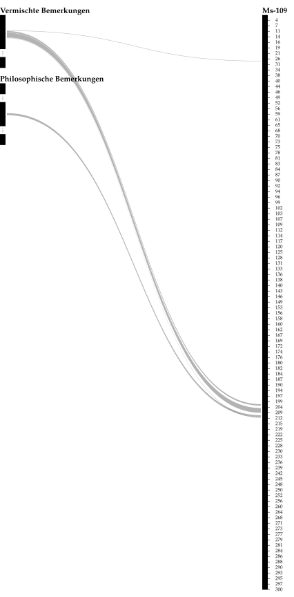

### [III\[1\]](https://cdn.wittgensteinnachlass.com/2000px/webp/Ms-109/III.webp)

## Remarks V.

### [1\[1\]](https://cdn.wittgensteinnachlass.com/2000px/webp/Ms-109/1.webp)

11.08.1930

2 × 3 ≠ 5 is a grammatical rule, just like 2 + 3 = 5.

### [1\[2\]](https://cdn.wittgensteinnachlass.com/2000px/webp/Ms-109/1.webp)

Is the way “~p” works explained by saying: ‘~p’ is true if ‘p’ is not true?

### [1\[3\]](https://cdn.wittgensteinnachlass.com/2000px/webp/Ms-109/1.webp)

12.08.1930

What kind of sentence is this “explanation” supposed to be? It is surely not a grammatical rule. Is it not very characteristic that the explanation, when expressed (as in the WF notation), simply forms part of the sign & becomes merely a point of purchase for grammatical rules – rules of the game? The “W” & “F” were meant to serve a certain purpose, but it is thwarted by the fact that now everything once again forms part of the sign after all. WF is now only an allusion & nothing more. And only an allusion to another _notation_, not to an explanation. – It is self-evident, after all: there cannot be an explanation of the notation _&_ the notation. For the explanation immediately becomes notation & cannot contain any more than the notation does.

### [1\[4\]](https://cdn.wittgensteinnachlass.com/2000px/webp/Ms-109/1.webp),[2\[1\]](https://cdn.wittgensteinnachlass.com/2000px/webp/Ms-109/2.webp),[3\[1\]](https://cdn.wittgensteinnachlass.com/2000px/webp/Ms-109/3.webp)

For if I explain “‘~p’ is true if ‘p’ is not true”, that presupposes that I understand what it means for ‘p’ not to be true. But then I have done nothing other than define

~p ≝ ‘p’ is not true

and of course nothing about this changes if I write

~p ≝ ‘p’ is false.

For what is essential is that the sign p on the right-hand side of the definition cannot be left out, or replaced by another (unless, again, by a definition). So long as that is not possible, one can & must also take the right-hand side as a function of p, namely

‘( )’ is false,

or, as Russell would write: ‘ξ̂’ is false. This is also connected with the fact that the ink-stroke is not _false_. (Neither is the picture, unless it is taken as a portrait.) For the ‘p’ on the right-hand side must be an allusion to p _taken as a sentence_, & is not the name of the ink-stroke “p”.

So even if I give the written mark “p” the name A & therefore write

~p ≝ A is false

this has a sense, i.e. the right-hand side can be understood, only if A stands for us as a *sentence*-sign. But then nothing has been gained, at least no _explanation_ of negation.

### [3\[2\]](https://cdn.wittgensteinnachlass.com/2000px/webp/Ms-109/3.webp)

And the same must be the case when one explains that “(x)fx” is true if f( ) is true for all substitutions. Here too one must already understand the logical mechanism of generalization. It is not as if one started off with no idea & generalization were only then set to work by the explanation. As when one puts a wheel into a machine & only then does it work (or the machine is initially there in two separate parts & only when they are put together does it function as this machine).

### [3\[3\]](https://cdn.wittgensteinnachlass.com/2000px/webp/Ms-109/3.webp),[4\[1\]](https://cdn.wittgensteinnachlass.com/2000px/webp/Ms-109/4.webp)

13.08.1930

When one considers general sentences of the kind ‘the circle is inside the square’, it keeps seeming as though giving the position within the square were _not a more precise specification_ of the statement that the circle lies _**inside** the square_ (at least not as far as visual space is concerned), but rather as though “inside the square” were a complete specification which in itself could not be specified any more precisely. Just as specifying the colour does not make a specification of a material’s hardness any more precise. – Now that is of course not how the specifications concerning the circle are related, & yet there is a reason for the feeling.

### [4\[2\]](https://cdn.wittgensteinnachlass.com/2000px/webp/Ms-109/4.webp)

One would therefore like to say: with “the circle is inside the square”, everything has, in one respect, been said; there is no need at all to think of different possible positions inside the square.

### [4\[3\]](https://cdn.wittgensteinnachlass.com/2000px/webp/Ms-109/4.webp)

“I (after all) only said that the circle would be _inside the square_; I didn’t say whether it would be in the middle or farther over in a corner”. – – –

### [4\[4\]](https://cdn.wittgensteinnachlass.com/2000px/webp/Ms-109/4.webp)

“He is in the room, I can hear him walking up & down.” Here it is clear that being in the room is a complete specification in its own right, to which the statement of the position in the room is added not as a more precise specification but as a new, extraneous specification.

### [4\[5\]](https://cdn.wittgensteinnachlass.com/2000px/webp/Ms-109/4.webp)

What multiplicity of possible special cases the general sentence foresees must lie in the grammatical rules for its terms. What does not lie in the rules is not foreseen.

### [5\[1\]](https://cdn.wittgensteinnachlass.com/2000px/webp/Ms-109/5.webp)

All these pictures could be different distortions of the same state of affairs. (One should imagine that the two white strips and the black strip in the middle can be stretched.)

### [5\[2\]](https://cdn.wittgensteinnachlass.com/2000px/webp/Ms-109/5.webp)

Is it impossible for infinitely many sentences to follow from one sentence, in the sense, that is, that new sentences could always be formed from the one according to a rule ad infinitum?

### [5\[3\]](https://cdn.wittgensteinnachlass.com/2000px/webp/Ms-109/5.webp)

Suppose we wrote out the first 1000 sentences of this series in conjunction. Would not the sense of this product have to come closer to the sense of the original sentence than that of the product of the first 100 sentences? Would one not get a closer and closer approximation to the first sentence the further one extended the product, & would that not show that infinitely many other sentences cannot follow from that sentence, since I am already unable to understand the product of 10¹⁰ terms & yet have understood the sentence to which the product of 10¹⁰⁰ terms comes even closer than the one with 10¹⁰ terms.?

### [5\[4\]](https://cdn.wittgensteinnachlass.com/2000px/webp/Ms-109/5.webp),[6\[1\]](https://cdn.wittgensteinnachlass.com/2000px/webp/Ms-109/6.webp)

Presumably one thinks of the general sentence as an abbreviated way of expressing the product. But what is there to abbreviate in the product? After all, it contains nothing superfluous.

### [6\[2\]](https://cdn.wittgensteinnachlass.com/2000px/webp/Ms-109/6.webp)

For the sentences that follow from a sentence must be thought along with it; – so at any rate the first 10000 sentences must be thought along with that sentence. (There is still something unclear here in the theory of what follows from what.)

### [6\[3\]](https://cdn.wittgensteinnachlass.com/2000px/webp/Ms-109/6.webp)

14.08.1930

For p to follow from q evidently means that q ∙ ~p cannot be a possible sentence but is a contradiction. – If q ∙ ~p is a sentence with sense, then p does not _follow_ from q.

### [6\[4\]](https://cdn.wittgensteinnachlass.com/2000px/webp/Ms-109/6.webp)

If p follows from q, then q ∙ p = q.

### [6\[5\]](https://cdn.wittgensteinnachlass.com/2000px/webp/Ms-109/6.webp)

Now what about the sentence: the surface is white from A to B?

Surely it follows from it that it is also white from A' to B'. It need not, after all, be a matter of visible white; and in any case the inference from the first sentence to the second is made again and again. Someone says to me, “I’ve coated the surface with it from A to B” & I reply, “so at any rate it is coated with it from A' to B'”.

### [7\[1\]](https://cdn.wittgensteinnachlass.com/2000px/webp/Ms-109/7.webp)

But if F(A'B') follows from that F(AB), then A' & B' must already be spoken of in F(AB). – “A'”, “B'” must therefore be symbols that can be constructed from “A” & “B”, as, for instance, the subdivisions of a scale can be constructed from its endpoints.

### [7\[2\]](https://cdn.wittgensteinnachlass.com/2000px/webp/Ms-109/7.webp)

Is a, then, spoken of in (x)fx, since fa follows from (x)fx? In _the_ sense of the general sentence whose verification consists in an enumeration, yes.

### [7\[3\]](https://cdn.wittgensteinnachlass.com/2000px/webp/Ms-109/7.webp)

Is it not rather the case that from “the strip from A to B is white” there follows “the  strip A'B' is white”, if the marks A' and B' had actually been drawn in the strip AB? Only the possibility of this kind of figure is infinite.

### [7\[4\]](https://cdn.wittgensteinnachlass.com/2000px/webp/Ms-109/7.webp),[8\[1\]](https://cdn.wittgensteinnachlass.com/2000px/webp/Ms-109/8.webp)

What follows from a thought must be thought along with it. For there is nothing about a thought that we do not yet know while we are thinking it. It is not a machine whose examination can bring unsuspected things to light, or a machine that can do something one does not at first see it can do. That is, _logically_ it does not work as a machine at all. As a thought, it contains no more than was put into it. As a machine, i.e. causally, it might be capable of anything; logically it yields only what we meant by it. When I say that the quadrilateral  is all white, I am not thinking of ten smaller rectangles within it that are white & I cannot think of _all_ the rectangles or patches within it because that is (a piece of) nonsense. Likewise, in the sentence “he is in the room”, I am not thinking of 100 possible positions he could occupy & certainly not of _all_ of them.

### [8\[2\]](https://cdn.wittgensteinnachlass.com/2000px/webp/Ms-109/8.webp)

(An infinite reality would be a cardinal number exceeding all other cardinal numbers.)

### [8\[3\]](https://cdn.wittgensteinnachlass.com/2000px/webp/Ms-109/8.webp),[9\[1\]](https://cdn.wittgensteinnachlass.com/2000px/webp/Ms-109/9.webp)

A thought from which infinitely many others follow is a thought that would be incompatible with infinitely many others. But why should a thought not be incompatible by its very nature with infinitely many others, i.e. why should it not be possible to form sentences according to a rule ad inf. that by their very nature would be incompatible with that first thought? – That thought would thus have to have as its very content that all the sentences formed ad inf. according to a certain rule are true. But how is it to think that? For it can then refer only to the rule, since it cannot consider what the rule produces in extenso, & the infinity is gone again.

### [9\[2\]](https://cdn.wittgensteinnachlass.com/2000px/webp/Ms-109/9.webp)

“Wherever, within this circle, you hit the target, you’ve won”.

“I think you will hit the target somewhere within this circle.” As for the first sentence, one might ask: how do you know? Have you tried _all_ the possible spots? And the answer would then have to be: this is not a proposition at all, but a general _stipulation_. “Wherever you hit the target, you will be satisfied”. “How do you know that?” – That is a hypothesis.

### [9\[3\]](https://cdn.wittgensteinnachlass.com/2000px/webp/Ms-109/9.webp),[10\[1\]](https://cdn.wittgensteinnachlass.com/2000px/webp/Ms-109/10.webp)

15.08.1930

At first sight there are two kinds of deduction: in one, what the conclusion is about is mentioned in the premise; in the other it is not. The inference from p ∙ q to q is of the first kind. Of the other kind is the inference: the whole rod is white, so the middle third is white too. This conclusion speaks of boundaries that were not mentioned in the first sentence. (That is suspicious.) Or if I say, “Wherever within this circle you hit the target, you will win the prize” & then “You hit it here, so …”, this spot was not foreseen in the first sentence. That is, the hole at this spot stands in a definite internal relation to the target as I saw it before, & the fact that the hole here falls under the general possibility that was foreseen consists in this. But the hole itself was not foreseen; it did not occur in the first picture. Or at any rate it did not have to occur in it. For even supposing I had thought of 1000 definite possibilities in doing so, it might at least have happened that the one that later came about was left out. And if foreseeing this possibility had been essential, overlooking this one possibility would have given the premise the wrong sense & the conclusion would now not follow from it. On the other hand, nothing is added to the sentence “Wherever within this circle you hit …” if one says: “Wherever within this circle you hit & if in particular you hit the black  dot …”. But if the black dot was already there when one uttered the first sentence, then of course it too was meant; if it was not there, then its presence has changed the sense of the sentence.

### [11\[1\]](https://cdn.wittgensteinnachlass.com/2000px/webp/Ms-109/11.webp)

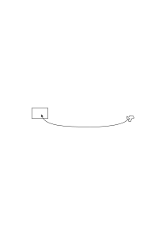

“This rectangle is white, so the figure placed inside it is white too.”

### [11\[2\]](https://cdn.wittgensteinnachlass.com/2000px/webp/Ms-109/11.webp)

That does not follow, for it might be black inside when we place it there.

### [11\[3\]](https://cdn.wittgensteinnachlass.com/2000px/webp/Ms-109/11.webp)

“The whole is white; consequently a part that is distinctive by virtue of such a boundary line is white too.” “The whole was white, so that part of it _was_ white too, even if I did not at the time perceive it as bounded (by a line) within the whole.” Did the rectangle, then, have no right & left halves before I perceived them as such? And yet one must say that.

### [11\[4\]](https://cdn.wittgensteinnachlass.com/2000px/webp/Ms-109/11.webp)

Nor does the inference go like this: “Wherever the shot hits the target, you’ve won the prize. You hit *there* on the target, so you’ve won the prize”. For where is this _there_? How is it marked apart from the shot, by a circle perhaps? And was the circle already on the target before. If not, the target has changed; but if so, that circle was in any case expressly provided for as a possible place to hit. Rather, it must go “You hit the target, so …”.

### [11\[5\]](https://cdn.wittgensteinnachlass.com/2000px/webp/Ms-109/11.webp),[12\[1\]](https://cdn.wittgensteinnachlass.com/2000px/webp/Ms-109/12.webp)

Does it not make sense, then, to say: But if one hits the target, one must hit it _somewhere_.? Or also: Wherever he hits the surface, it will not be a surprise of the kind that would make one say “I didn’t expect that; I didn’t even know there was such a place”. But that means, surely, that there can be no geometrical surprise.

### [12\[2\]](https://cdn.wittgensteinnachlass.com/2000px/webp/Ms-109/12.webp)

If p follows from q, then p must have been foreseen in q.

### [12\[3\]](https://cdn.wittgensteinnachlass.com/2000px/webp/Ms-109/12.webp)

With regard to an earlier sentence, it should be said that the _there_ need not be indicated by a mark on the target & that there is in any case a ‘nearer the centre or the edge’, an ‘at the top right or bottom left’. However the target is hit, such a description _must_ always be possible. (But there are not “infinitely many” of these descriptions either.)

### [12\[4\]](https://cdn.wittgensteinnachlass.com/2000px/webp/Ms-109/12.webp),[13\[1\]](https://cdn.wittgensteinnachlass.com/2000px/webp/Ms-109/13.webp)

16.08.1930

If one needs an example of infinitely many sentences following from _one_, perhaps the simplest would be that from “a is red” there follows the negation of all sentences that ascribe a different colour to _a_. These negative sentences are certainly not thought along with the one sentence. One could of course say: after all, we do not distinguish infinitely many shades of colour; but the question is: does the number of shades we distinguish have anything at all to do with the complexity of that first sentence; is it more or less complicated depending on whether we distinguish more or fewer shades? Would one not, then, have to put it like this: A sentence follows from it only once that sentence is there. Only when we have formed 10 sentences that follow from the first do they follow from it.

### [13\[2\]](https://cdn.wittgensteinnachlass.com/2000px/webp/Ms-109/13.webp)

Instead of colours I could have taken lengths. From “I am 170 cm tall” there follows “I am not 171 cm tall”, not 172, etc. ad inf.

### [13\[3\]](https://cdn.wittgensteinnachlass.com/2000px/webp/Ms-109/13.webp)

But what is it supposed to mean, then, to say that if one sentence follows from another, the first must be thought along with the second, when in the sentence “I am 170 cm tall” one does not have to think along with it even a single one of the others? There must be some nonsense here.

### [13\[4\]](https://cdn.wittgensteinnachlass.com/2000px/webp/Ms-109/13.webp)

I want to say that one sentence follows from another only when it is confronted with it. That etc. ad inf. refers only to the possibility of forming sentences that follow from the first, but does not yield any number of such sentences.

### [13\[5\]](https://cdn.wittgensteinnachlass.com/2000px/webp/Ms-109/13.webp),[14\[1\]](https://cdn.wittgensteinnachlass.com/2000px/webp/Ms-109/14.webp)

Could I therefore simply say: The _reason_ infinitely many sentences do not follow from one sentence is that it is impossible to write down infinitely many sentences (i.e. it is nonsense to say that.)

### [14\[2\]](https://cdn.wittgensteinnachlass.com/2000px/webp/Ms-109/14.webp)

One thing is presumably clear: the sentence that follows from p cannot be foreign to the grammar of p. The sentence could not be surprised that the other follows from it.

### [14\[3\]](https://cdn.wittgensteinnachlass.com/2000px/webp/Ms-109/14.webp)

“If from 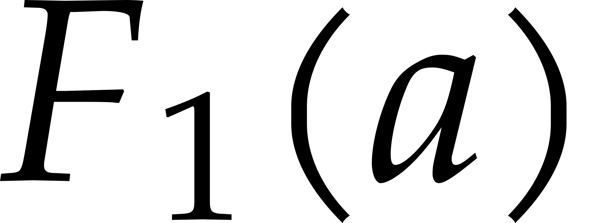 [ = a has the colour ] there follows 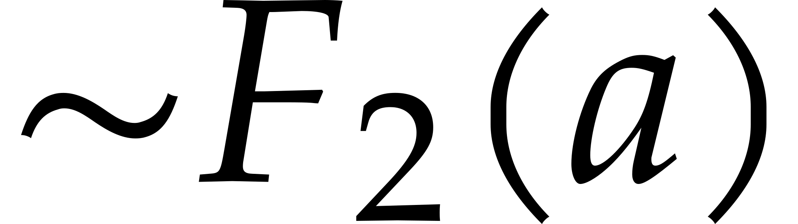, then the possibility of the second sentence must already have been foreseen in the grammar of the first (how else could we call  & 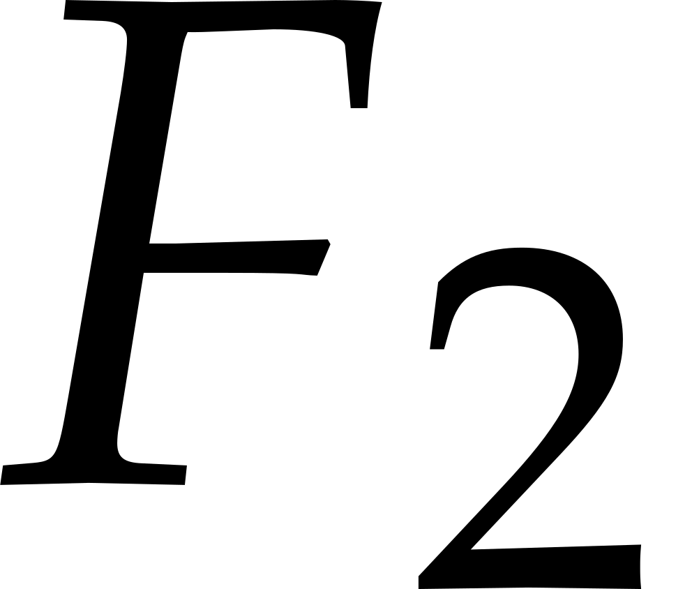 colours?).”

### [14\[4\]](https://cdn.wittgensteinnachlass.com/2000px/webp/Ms-109/14.webp)

“If the second sentence had come as a surprise to the first, so to speak, it could never follow from it.”

### [14\[5\]](https://cdn.wittgensteinnachlass.com/2000px/webp/Ms-109/14.webp)

“The first sentence must recognize the other as its consequence. Or rather, _one_ grammar must then unite them both & it must be the same as before the inference was drawn.”

### [14\[6\]](https://cdn.wittgensteinnachlass.com/2000px/webp/Ms-109/14.webp),[15\[1\]](https://cdn.wittgensteinnachlass.com/2000px/webp/Ms-109/15.webp)

(It is very hard here not to tell fairy tales about symbolic processes, just as elsewhere it is hard not to tell fairy tales about psychological processes ⋎ for everything is simple & familiar to everyone (and there is nothing new to invent). That is really what is outrageous about logic: that its extraordinary difficulty is due to there being nothing to construct but rather everything being already there & known.)

### [15\[2\]](https://cdn.wittgensteinnachlass.com/2000px/webp/Ms-109/15.webp)

“Any sentence that p does not recognize as its consequence is not its consequence.”

### [15\[3\]](https://cdn.wittgensteinnachlass.com/2000px/webp/Ms-109/15.webp)

That is, it must also emerge from the complete grammar of the sentence p which sentence follows from it, & if a new sentence were now found that follows from p, the sense of p would thereby be changed.

### [15\[4\]](https://cdn.wittgensteinnachlass.com/2000px/webp/Ms-109/15.webp)

If, for example, “a is not red” follows from “a is green”, then “a is green” must acknowledge the second sentence as its kin.

### [15\[5\]](https://cdn.wittgensteinnachlass.com/2000px/webp/Ms-109/15.webp)

Grammar is not infinitely complicated because it allows the endless formation of numerals.

### [15\[6\]](https://cdn.wittgensteinnachlass.com/2000px/webp/Ms-109/15.webp),[16\[1\]](https://cdn.wittgensteinnachlass.com/2000px/webp/Ms-109/16.webp)

Is it not simply this: It must follow from the grammar of the sentence – & from that alone – whether a sentence follows from it. No insight into a new sense can yield this; – only insight into the old one can. – It is not possible to find a new sentence that follows from that sentence and that one could not have formed (albeit without knowing whether it was true or false) when that sentence was formed. If one discovered a new sense & this were to follow from that first sentence, then that sentence would thereby have changed its sense.

### [16\[2\]](https://cdn.wittgensteinnachlass.com/2000px/webp/Ms-109/16.webp)

Consider: what reason does one have for calling a new phenomenon a _colour_ if it does not fit into the colour scheme we have had up to now?

### [16\[3\]](https://cdn.wittgensteinnachlass.com/2000px/webp/Ms-109/16.webp)

What one originally calls a sentence is a certain refrain that can be of all sorts, i.e. can fulfil all sorts of functions. 2 + 2 = 4, I see a yellow patch in blue surroundings, A book lies on the table in front of me, Every thing is identical with itself, etc., count as sentences.

### [16\[4\]](https://cdn.wittgensteinnachlass.com/2000px/webp/Ms-109/16.webp)

I call sentences about which one can always be mistaken hypotheses.

### [16\[5\]](https://cdn.wittgensteinnachlass.com/2000px/webp/Ms-109/16.webp)

17.08.1930

What can be said in philosophy must become ever more commonplace; & the only thing that is not commonplace is the limit of language.

### [16\[6\]](https://cdn.wittgensteinnachlass.com/2000px/webp/Ms-109/16.webp),[17\[1\]](https://cdn.wittgensteinnachlass.com/2000px/webp/Ms-109/17.webp)

For again and again one thinks: well, how am I to express this last thing?

But I am not to express the last thing at all; rather, it is the wall we come up against.

### [17\[2\]](https://cdn.wittgensteinnachlass.com/2000px/webp/Ms-109/17.webp)

I say to someone: there is a yellow book here in front of me. But I cannot know that for certain. What I can know for certain, on the other hand, can I communicate that? – Are not sentences in the narrower sense _merely_ sections of hypotheses & incapable of existing on their own?

### [17\[3\]](https://cdn.wittgensteinnachlass.com/2000px/webp/Ms-109/17.webp)

I would like to say: the old logic has much more convention & physics in it than one believed. If the noun is the name of a _body_, the verb serves, say, to designate a movement, and the adjective to designate a property of a body, then one can presumably see how much this logic presupposes & can assume that these original presuppositions also reach still deeper into the application of these words, into the logic of the sentences.

### [17\[4\]](https://cdn.wittgensteinnachlass.com/2000px/webp/Ms-109/17.webp),[18\[1\]](https://cdn.wittgensteinnachlass.com/2000px/webp/Ms-109/18.webp)

The crossword puzzle would be the best illustration of how one can hold an assumption on a ground that in turn has a ground, which has a ground, etc., etc., so that it becomes impossible to justify a single decision until everything is in place. For I believe that there is an a here because there is a word of 3 letters that reads …; but I take this to be the right word because there is an r at the end & there is a word of 5 letters whose 4th letter is an r; but I choose this word in turn because, and so on.

### [18\[2\]](https://cdn.wittgensteinnachlass.com/2000px/webp/Ms-109/18.webp)

Suppose a crossword puzzle had two solutions that met all the conditions: would one of them be _the_ solution? This has a significance in the theory of grammar.

### [18\[3\]](https://cdn.wittgensteinnachlass.com/2000px/webp/Ms-109/18.webp)

One might think it advantageous in logic to take fairly “definite” sentences as examples. But in fact a sentence like “this suit is a little too big for me” or “I look like my father” must serve us just as well. – Examples fail to serve us only when they belong to a different _kind_ of sentence from the one we want to consider. Vague sentences, then, would not serve us if we took them to be a distinct logical kind of sentence & did not wish to consider them at the moment. (But then we would have to consider them at some point after all.)

### [19\[1\]](https://cdn.wittgensteinnachlass.com/2000px/webp/Ms-109/19.webp)

Aristotelian logic is a game that _can_ be applied to sentences.

### [19\[2\]](https://cdn.wittgensteinnachlass.com/2000px/webp/Ms-109/19.webp)

All one can ask is to get to know the game _completely_. (The application is then to be made, not stated.)

### [19\[3\]](https://cdn.wittgensteinnachlass.com/2000px/webp/Ms-109/19.webp)

The simile of the magic lantern with the film & the isolated pictures on the screen is always a good one here; or that of the body rotating & lit up in flashes now & then. For strictly speaking this is not a simile at all: this is how things really are in the logic of hypotheses.

### [19\[4\]](https://cdn.wittgensteinnachlass.com/2000px/webp/Ms-109/19.webp)

18.08.1930

It is always facets of the hypothesis that are verified.

### [19\[5\]](https://cdn.wittgensteinnachlass.com/2000px/webp/Ms-109/19.webp)

The experiences, i.e. the primary events, are _compatible_ with the hypothesis. (The hypothesis _accounts_ for them.) One might say: the hypothesis _explains_ them.

### [19\[6\]](https://cdn.wittgensteinnachlass.com/2000px/webp/Ms-109/19.webp),[20\[1\]](https://cdn.wittgensteinnachlass.com/2000px/webp/Ms-109/20.webp)

Now is it not perhaps the case that _what_ the hypothesis explains can itself only be expressed by a hypothesis in turn? That is, of course, are there any primary propositions at all, as such conclusively verifiable & not facets of a hypothesis? (This is rather as if one were to ask “are there surfaces that are not the surfaces of bodies?”.)

### [20\[2\]](https://cdn.wittgensteinnachlass.com/2000px/webp/Ms-109/20.webp)

This would be most readily seen in the course of an experiment, if one wanted to describe the immediate experiences that decide the outcome of the experiment. For in the end it comes down to one’s seeing a pointer on a graduation, or a point of light in a telescope, etc. Now are there not sentences that describe this purely “subjective” element (which is of course not _subjective_), – those hooks on which everything is ultimately hung? But can such sentences serve for communication? Would they not be sentences that count as primary for the speaker but as hypotheses for the person addressed?

### [20\[3\]](https://cdn.wittgensteinnachlass.com/2000px/webp/Ms-109/20.webp)

19.08.1930

In any case there can be no difference between a hypothesis used as the expression of an immediate experience & a proposition in the narrower sense.

### [20\[4\]](https://cdn.wittgensteinnachlass.com/2000px/webp/Ms-109/20.webp),[21\[1\]](https://cdn.wittgensteinnachlass.com/2000px/webp/Ms-109/21.webp)

But what is curious then is the meaning of truth-functions when applied to hypotheses instead of primary propositions: the difference would of course correspond to the difference between the meanings of the word True (& False) in the two cases.

### [21\[2\]](https://cdn.wittgensteinnachlass.com/2000px/webp/Ms-109/21.webp)

20.08.1930

In any case there is a difference between sentences of which one says that what they say is probably the case & those of which one cannot say this with sense.

### [21\[3\]](https://cdn.wittgensteinnachlass.com/2000px/webp/Ms-109/21.webp)

There is a difference between a sentence like “there is a sphere lying here in front of me” & “it looks as if there were a sphere lying in front of me”. – This also shows itself in the following way: one can say “there seems to be a sphere lying in front of me”, but it is senseless to say: “there seems to seem to be a sphere lying here”. Just as one can say “there is probably a sphere lying here”, but not “it probably seems to me that there is a sphere lying here”. In such a case one would say “surely you must know whether it _seems_ so”.

### [21\[4\]](https://cdn.wittgensteinnachlass.com/2000px/webp/Ms-109/21.webp),[22\[1\]](https://cdn.wittgensteinnachlass.com/2000px/webp/Ms-109/22.webp),[23\[1\]](https://cdn.wittgensteinnachlass.com/2000px/webp/Ms-109/23.webp)

One might also want to say: “I do know _something_, namely what I _see_; I just don’t know whether it is a sphere”. But does it make sense to say “I know what I see”? – Suppose I see a yellow circle. Could one not then say: if this is not already another hypothesis (since it asserts that a physiological process is taking place), then it makes no sense at all. For in order for it to be a sentence, circle, yellow, etc. must already be concepts formed in advance. – One might ask: how can I know that the visual image agrees with these concepts – unless I now stipulate that these words are to describe this visual image, in which case it is of course no wonder that they agree. But is it arbitrary whether I answer yes or no when someone asks me: “do you see a light there”? On the other hand, it is surely clear that I can say apodictically “no, I don’t see one” or “yes, I see one”. It would surely be plainly nonsensical to say “I probably see a light”. (Unless it is again a matter of a physical fact, but that was not what was asked.) Surely one would reply: “You must _know_ whether you see a light or not”. (“Surely you must know whether it _seems_ so to you.”) And now it is probably also nonsense to say that the agreement (or disagreement) between sentence & world is arbitrarily created by a correlation. For how is this correlation to be expressed? It consists in the sentence “p” saying that _just this_ is the case. But how is this “just this” expressed? If by another sentence, we gain nothing by it; but if by reality, then it must already be conceived in a particular way – articulated. That is: one cannot point to a sentence & to a reality & say: “_this_ corresponds to _that_”. Rather, what corresponds to the sentence is again only what is already articulated.

### [23\[2\]](https://cdn.wittgensteinnachlass.com/2000px/webp/Ms-109/23.webp),[24\[1\]](https://cdn.wittgensteinnachlass.com/2000px/webp/Ms-109/24.webp),[25\[1\]](https://cdn.wittgensteinnachlass.com/2000px/webp/Ms-109/25.webp)

Now what about the general rule that makes the word “General Store” on a building into a _sentence_? This much is clear: we understand this word when it occurs in an (ordinary) sentence; if, on the other hand, I write it by itself on a slip of paper on my desk, it says nothing, & on seeing it like that one might ask: well, what about it?

It is then just a single wheel which we recognize as part of a mechanism, but which here, disconnected from everything else, serves no purpose. That word on the building, by contrast, serves the purpose of a communication. Now what is it connected with? – One might say that what is characteristic of a sign is that it must be possible to learn it from the outset, as the railway worker learns the railway signals. What he learns there is precisely the “general rule”. What I mean, then, is that in doing so he learns not only words of a language, but also a grammar. If, for example, “halt” were one of these words, it would not suffice by itself, for a rule is needed to know _which_ train is to halt. The ship’s signal “Stop” is also a one-word sentence; where is the _sentential context_ here? Or should one put it this way: the word “Stop” has sense only aboard ship, not when I write it by itself on some slip of paper or other; if, on the other hand, no other word could replace it in its place, it would again be senseless.

The sign “Bass & Ale” singles out for me _certain_ buildings from others that do not bear it. And even if it were put up on every building as a sign that these drinks are in fact available everywhere, it would still have to be conceivable, i.e. provided for in our grammar, that a building might not bear it. For if it belonged to a building as a matter of course, it could not express anything.

### [25\[2\]](https://cdn.wittgensteinnachlass.com/2000px/webp/Ms-109/25.webp)

If the word had sense outside all context, it would suffice for it to occur in the dictionary; i.e. it would not need to be mentioned anywhere else. It would suffice, so to speak, for one to know it once and for all. (One might then say “what is the word doing there? I know it already anyway.”) – But this word is supposed to be capable of being true & false; in that case, it could only be one or the other once and for all; it would then have to be, so to speak, of the same nature as the proposition 2 + 2 = 4.

### [25\[3\]](https://cdn.wittgensteinnachlass.com/2000px/webp/Ms-109/25.webp)

21.08.1930

There is nothing hypothetical in what connects the proposition with the given fact.

### [25\[4\]](https://cdn.wittgensteinnachlass.com/2000px/webp/Ms-109/25.webp),[26\[1\]](https://cdn.wittgensteinnachlass.com/2000px/webp/Ms-109/26.webp)

It is surely clear that reality – I mean immediate experience – answers a hypothesis sometimes with yes, sometimes with no (though here “yes” & “no” express only confirmation & failure of confirmation) & that one can give expression to this affirmation & negation.

### [26\[2\]](https://cdn.wittgensteinnachlass.com/2000px/webp/Ms-109/26.webp)

The hypothesis becomes a proposition when it is brought up against reality with _that_ facet.

### [26\[3\]](https://cdn.wittgensteinnachlass.com/2000px/webp/Ms-109/26.webp)

What about the sentences that occur in works of fiction. Surely there can be no talk of verification here, & yet these sentences have sense. They stand in the same relation to sentences for which there is verification as a genre painting does to a portrait. And this simile may well give a truly accurate representation of the matter.

### [26\[4\]](https://cdn.wittgensteinnachlass.com/2000px/webp/Ms-109/26.webp)

Do these sentences perhaps correspond to what Frege and Meinong called assumptions?

### [26\[5\]](https://cdn.wittgensteinnachlass.com/2000px/webp/Ms-109/26.webp)

For in those invented sentences the words surely have meaning just as they do in the others: red, blue, right, left, head, foot mean the same as they do elsewhere. That is, there is a connection with reality. In _one_ sense at least; – but the connection with the now & here is missing. (But let us remember how the meaning of a word is fixed.)

### [26\[6\]](https://cdn.wittgensteinnachlass.com/2000px/webp/Ms-109/26.webp),[27\[1\]](https://cdn.wittgensteinnachlass.com/2000px/webp/Ms-109/27.webp)

If I look at a picture, it tells me something, even if I do not for a moment believe (imagine) that the people are real, or that there were real people of whom this is a picture on a smaller scale. But “it tells me something” here can only mean that it brings about a certain attitude in me.

### [27\[2\]](https://cdn.wittgensteinnachlass.com/2000px/webp/Ms-109/27.webp)

Nor is my attitude towards the picture a hypothetical one, as though I were to say to myself, “If there were such people, then …”.

### [27\[3\]](https://cdn.wittgensteinnachlass.com/2000px/webp/Ms-109/27.webp)

And is it not nonsensical to say “the word ‘Red’ means in fiction what it means elsewhere”? What does it mean, then? May one say “it means this” & point to a red object? Is it not merely an application of this word that is to be seen here. Can this be compared with the case in which someone says “that is Ludwig”. And yet I can explain the word in that way to someone who knows that “red” designates a colour but does not know which. “‘red’ means here what it means elsewhere” could only mean: it means the same _colour_. For until one understands what kind of word “red” is, one does not understand the explanation “_that_ is red” either.

### [28\[1\]](https://cdn.wittgensteinnachlass.com/2000px/webp/Ms-109/28.webp)

If the sentence is a picture, it cannot be what one means by it that first makes it one. What one means by it only makes it a portrait.

### [VB](/w-vb/#ms-109-28.2+29.1+30.1) [28\[2\]](https://cdn.wittgensteinnachlass.com/2000px/webp/Ms-109/28.webp),[29\[1\]](https://cdn.wittgensteinnachlass.com/2000px/webp/Ms-109/29.webp),[30\[1\]](https://cdn.wittgensteinnachlass.com/2000px/webp/Ms-109/30.webp)

22.08.1930

Engelmann told me that when he rummaged at home in his drawer full of his manuscripts, they seemed so wonderfully beautiful to him that he thought them worth giving to other people. (This was also the case, he said, when he looked through letters from his deceased relatives.) But if he imagined a selection of them published, the whole thing lost all charm & value & became impossible. I said we had here a case like the following: Nothing could be more remarkable than seeing someone engaged in some quite simple everyday activity when he thinks he is unobserved. Let us imagine a theatre: the curtain would go up & we would see someone alone in his room walking up & down, lighting a cigarette, sitting down, and so on, so that we would suddenly see someone from outside as one can otherwise never see oneself; if we saw, as it were, a chapter of a biography with our own eyes, – that would have to be uncanny & wonderful at once. More wonderful than anything a playwright could arrange to have enacted or spoken on the stage. We would see life itself. – But we see that every day & it does not make the slightest impression on us! Yes, but we do not see it from _that_ perspective. – Thus when E. looks at his writings & finds them splendid (though he would not want to publish them individually), he sees his life as a work of art by God, & as such it is indeed worth contemplating, as is every life & everything. But only the artist can represent the particular in such a way that it appears to us as a work of art; those manuscripts _rightly_ lose their value when one looks at them individually & indeed whenever one looks at them un*prejudicedly*, that is, without already being filled with enthusiasm. The work of art forces us – so to speak – into the right perspective, but without art the object is a piece of nature like any other & the fact that _we_ can exalt it through enthusiasm does not entitle anyone to set it before us. (I always have to think of one of those insipid photographs of nature which the person who took it finds interesting because he was there himself and experienced something, but which a third party regards with justified coldness; if it is justifiable at all to regard a thing with coldness. But it now seems to me that besides the artist’s work there is another way of capturing the world sub specie äterni. It is – I believe – the way of thought that flies, as it were, over the world & leaves it as it is, – contemplating it from above in flight.

### [30\[2\]](https://cdn.wittgensteinnachlass.com/2000px/webp/Ms-109/30.webp)

That language produces a picture is already shown by the fact that pictures – in the ordinary sense of the word – fit into it naturally. An illustration in a book is not foreign to the book, but joins it as one kind of aid joins another of a related kind, – as a reamer joins a drill, for instance.

### [30\[3\]](https://cdn.wittgensteinnachlass.com/2000px/webp/Ms-109/30.webp)

If a person’s ugliness repels one, it can likewise repel one in a picture (in a painted picture), but also in a description, through words.

### [30\[4\]](https://cdn.wittgensteinnachlass.com/2000px/webp/Ms-109/30.webp),[31\[1\]](https://cdn.wittgensteinnachlass.com/2000px/webp/Ms-109/31.webp)

If someone asks what the word “red” means & I answer “this” & point to a red object, it is clear that the word would still have had its meaning if the red object had not (been) at hand, indeed if nothing red could have been found. It did not belong to _that_ sign, then, & when it is pointed to by way of explanation, it helps to form a new sign. The red object combines with the word to form a _sign_.

### [31\[2\]](https://cdn.wittgensteinnachlass.com/2000px/webp/Ms-109/31.webp)

This goes without saying: we can make up names of people but not names of, say, colours.

### [31\[3\]](https://cdn.wittgensteinnachlass.com/2000px/webp/Ms-109/31.webp)

In fiction we have only the play of thoughts & images. In so far as reality enters into this play, it enters as a sign.

### [31\[4\]](https://cdn.wittgensteinnachlass.com/2000px/webp/Ms-109/31.webp)

The agreement of thoughts as such with reality cannot be expressed. If one takes the word agreement in the sense of the … of a true proposition with reality, then this does not hold, because there are false thoughts too. But no other sense can be rendered in language. Like everything metaphysical, the (pre-established) harmony between thoughts & reality is given to us by the limit of language.

### [32\[1\]](https://cdn.wittgensteinnachlass.com/2000px/webp/Ms-109/32.webp)

The most everyday thing, the sentence, is the object of our investigation. (The sentence as everyone speaks it.)

### [32\[2\]](https://cdn.wittgensteinnachlass.com/2000px/webp/Ms-109/32.webp)

The sentence “I want to go to Vienna” has sense even if Vienna should have been destroyed by an earthquake without my having heard about it. The sentence “I am looking forward to seeing N.N.” has sense even if this person should no longer be alive, indeed even if he had never lived. Here we are dealing with hypotheses.

### [32\[3\]](https://cdn.wittgensteinnachlass.com/2000px/webp/Ms-109/32.webp)

Grammar constitutes a mechanism; for in allowing certain connections & forbidding others, it does the same thing as the bearings, guides (& indeed all the parts) of the mechanism: they allow certain movements & thus determine the movement (of the parts).

### [32\[4\]](https://cdn.wittgensteinnachlass.com/2000px/webp/Ms-109/32.webp)

The proposition in the narrower sense stands to the hypothesis as a projection of a body stands to the body.

### [32\[5\]](https://cdn.wittgensteinnachlass.com/2000px/webp/Ms-109/32.webp),[33\[1\]](https://cdn.wittgensteinnachlass.com/2000px/webp/Ms-109/33.webp)

Whether the body I see is a sphere may be doubtful, but that from here, say, it seems to be a sphere cannot be doubtful. – The mechanism of the hypothesis would not work if the appearance too were still doubtful; if, that is, not even one facet of the hypothesis were verified beyond doubt. If there were doubt here, what could remove it?

If this connection too were loose, there would also be no confirmation of a hypothesis; the hypothesis would then hang entirely in mid-air & would be pointless (& thus senseless).

### [33\[2\]](https://cdn.wittgensteinnachlass.com/2000px/webp/Ms-109/33.webp)

23.08.1930

I still have not grasped the machinery of the hypothesis & the proposition.

### [33\[3\]](https://cdn.wittgensteinnachlass.com/2000px/webp/Ms-109/33.webp)

If I say of something “that feels like a blade’s edge”, I thereby depict my feeling directly.

### [33\[4\]](https://cdn.wittgensteinnachlass.com/2000px/webp/Ms-109/33.webp),[34\[1\]](https://cdn.wittgensteinnachlass.com/2000px/webp/Ms-109/34.webp)

It is an immensely important point that, when using language, I do not remember how I learned it. I say “here I see a black sphere”. I do not know how I learned “black” & “sphere”. My application of the words is independent of this learning. It is as if I had coined the words myself. And now the old question comes up again: If the grammar that deals with the words is essential to their meaning, must I have all the grammatical rules that deal with a word in my head for it to mean anything to me? Or is it here as in the mechanism: the wheel that stands still, or that is turning, the wheel in one position, does not know what further movement is permitted to it, the piston does not know what law is prescribed for its movement; & yet the wheel & the piston operate only through that constraint.

### [34\[2\]](https://cdn.wittgensteinnachlass.com/2000px/webp/Ms-109/34.webp)

(The choice of words is so important because what matters is to capture the physiognomy of the thing exactly, because only a thought aimed with precision can lead onto the right track. The carriage must be set on the rail with hair’s-breadth precision if it is to roll on properly.)

### [34\[3\]](https://cdn.wittgensteinnachlass.com/2000px/webp/Ms-109/34.webp)

Should I therefore say: The grammatical rules operate in time? (Like that guide)

### [34\[4\]](https://cdn.wittgensteinnachlass.com/2000px/webp/Ms-109/34.webp),[35\[1\]](https://cdn.wittgensteinnachlass.com/2000px/webp/Ms-109/35.webp)

So: The word “sphere” functions only through the way it is applied. And one could imagine the strange question “how then can I know straight away what I mean by ‘sphere’, when surely I can’t have the whole manner of application in my head all at once?”.

### [35\[2\]](https://cdn.wittgensteinnachlass.com/2000px/webp/Ms-109/35.webp)

And if someone asks me “do you see a black sphere there”, surely I must have this application of the word before my eyes to be able to understand him & answer him.

### [35\[3\]](https://cdn.wittgensteinnachlass.com/2000px/webp/Ms-109/35.webp)

Now it is strange that I feel as if I carried the grammatical rules around with me in some way when I use the word. Just as I am not surprised that the wheel can only turn & I take in its freedom of movement, as it were, at a glance, just as I know a freedom of movement. In the same way, I should like to say, I already know in some sense that behind the hemisphere I see there is a second of the same size & not, say, a point; I know that the sphere also appears as a circle when seen from the side, etc. etc.. Or at least I can derive it for myself from what I carry around inside me.

### [35\[4\]](https://cdn.wittgensteinnachlass.com/2000px/webp/Ms-109/35.webp),[36\[1\]](https://cdn.wittgensteinnachlass.com/2000px/webp/Ms-109/36.webp)

In more difficult cases, inference does in fact proceed in this way: I have to look at the rules, look up the premises & thus use the apparatus of language like a machine.

### [36\[2\]](https://cdn.wittgensteinnachlass.com/2000px/webp/Ms-109/36.webp)

And isn’t it similar with chess: in some sense one can say that I know the rules of chess (have them in my head) the whole time I am playing. But isn’t this “having them in my head” really just a hypothesis. Do I not have them in my head only insofar as I apply them in each particular case? – Certainly, this knowledge is merely the hypothetical reservoir from which the water we actually see flows.

### [36\[3\]](https://cdn.wittgensteinnachlass.com/2000px/webp/Ms-109/36.webp)

The problem immediately related to ours is: What does “I _can_ play chess” mean? Isn’t it on exactly the same level as “I can pick up this book”? or “I can read”?

### [36\[4\]](https://cdn.wittgensteinnachlass.com/2000px/webp/Ms-109/36.webp)

“I know how a pawn is allowed to move” “I know how the word ‘sphere’ may be used.”

### [36\[5\]](https://cdn.wittgensteinnachlass.com/2000px/webp/Ms-109/36.webp),[37\[1\]](https://cdn.wittgensteinnachlass.com/2000px/webp/Ms-109/37.webp)

If I say “I can lift this weight”, one can answer “that will become clear when you try” & if I then fail, one can say “see, you couldn’t”, & I can _not_ answer “yes I could, when I said it; it was only when it came to lifting it that I couldn’t”. That is: being able to do this is not an experience: whether one can do it _will become clear_. It is different when I say “I understand this command”: this is, or seems to be, an experience. “I must know whether I understand it (now)” but not: I must know whether I can lift the weight now. – – – Where does the sentence “I can play chess” stand in this respect? Is this something that will become clear, or can one say “when I asserted it I could play chess, it’s only now that I can’t”. (I am now leaving aside the case where, at the time one asserted it, one had a particular rule in mind that one then forgot. For (in general), when I say I can play chess, one is not thinking of any of the rules at that moment.) Isn’t what justifies me simply that I remember having played chess before? And perhaps that, when asked, I can run through in my mind the rules for how the pieces move, as a test.

### [37\[2\]](https://cdn.wittgensteinnachlass.com/2000px/webp/Ms-109/37.webp),[38\[1\]](https://cdn.wittgensteinnachlass.com/2000px/webp/Ms-109/38.webp)

Isn’t it the same with the use of the word “sphere”? I use the word instinctively. But when asked to account for whether I understand it, I call up certain mental images, as if to test myself.

### [38\[2\]](https://cdn.wittgensteinnachlass.com/2000px/webp/Ms-109/38.webp)

“Do you see a roe deer there?” “Oh yes, quite clearly!” What a complicated object, how many views are possible & yet I understand at once. Or at least I can react to the question at once. For I have used language _instinctively_. As an instrument, like the stick with which I knock aside something that threatens to block my way.

### [38\[3\]](https://cdn.wittgensteinnachlass.com/2000px/webp/Ms-109/38.webp)

But what is the business of logical investigation: is it to investigate how the nervous mechanism works, how and along which pathways the reflex comes about? No. But then all that is left for it is to investigate the laws peculiar to language, for those are the mirror image – by whatever route – of laws of the world.

### [38\[4\]](https://cdn.wittgensteinnachlass.com/2000px/webp/Ms-109/38.webp),[39\[1\]](https://cdn.wittgensteinnachlass.com/2000px/webp/Ms-109/39.webp)

The psychological abyss is always looming in this investigation. (But one can only get across it once one has looked it squarely in the eye.) (It cannot matter whether language is used instinctively or semi-destinctively. We are here in the swamp of differences of degree, not on the firm ground of logic.)

### [39\[2\]](https://cdn.wittgensteinnachlass.com/2000px/webp/Ms-109/39.webp)

(When I paraphrase logic, of course, I too am in danger of beating about the bush.)

### [39\[3\]](https://cdn.wittgensteinnachlass.com/2000px/webp/Ms-109/39.webp)

Could one say: What matters is not how many rules of application he has in his head when he uses a word, but which rules he gives you when asked.

### [39\[4\]](https://cdn.wittgensteinnachlass.com/2000px/webp/Ms-109/39.webp),[40\[1\]](https://cdn.wittgensteinnachlass.com/2000px/webp/Ms-109/40.webp)

If I say “look, there’s a sphere” or “there’s a cone”, what I see (a circle) can fit either, & when I say “yes, I see it”, I nevertheless distinguish between the two hypotheses. Just as in chess I distinguish between a pawn & the king, even if the current move is one that both could make & even if a king piece were to function as a pawn. The word “sphere” is _familiar_ to me & stands for something in me, that is, it brings me into a certain position relative to it (as a magnet brings a needle into alignment with it).

### [40\[2\]](https://cdn.wittgensteinnachlass.com/2000px/webp/Ms-109/40.webp)

“Do you see a sphere there?” “No – oh yes, but one can only see part of it, the rest is covered”.

### [40\[3\]](https://cdn.wittgensteinnachlass.com/2000px/webp/Ms-109/40.webp)

This “taking in the way it operates” in the case of a wheel – isn’t it there when we associate a mental image with a word? Does that same indeterminacy attach to the mental image that, say, the word red evokes in us, so that it needs, as it were, written rules to give it a determinate degree of freedom?

### [40\[4\]](https://cdn.wittgensteinnachlass.com/2000px/webp/Ms-109/40.webp)

At any rate, written rules do not make language any less immediate, for otherwise written rules – the long chains of inference in mathematics – could not fit into our language without a break.

### [40\[5\]](https://cdn.wittgensteinnachlass.com/2000px/webp/Ms-109/40.webp)

24.08.1930

This much is clear: grammar is the life of the sentence-sign.

### [40\[6\]](https://cdn.wittgensteinnachlass.com/2000px/webp/Ms-109/40.webp),[41\[1\]](https://cdn.wittgensteinnachlass.com/2000px/webp/Ms-109/41.webp)

Isn’t it like this: If one were to let things designate themselves, nonsensical combinations of signs would be impossible rather than having to be prohibited.

But if mental images are signs, then just the same thing happens: I cannot imagine anything darker than black & I cannot imagine a colour that makes a sound, etc. – I mean that grammatical rules only take effect over time, as the word is used in different combinations, whereas the grammar of mental images operates, so to speak, automatically. But that too is a distorted representation. When I say “nonsensical combinations of signs would not have to be prohibited”, I mean it would be impossible to prohibit them because they cannot be described.

### [41\[2\]](https://cdn.wittgensteinnachlass.com/2000px/webp/Ms-109/41.webp)

How do I know all that the concept sphere entails – when I use the word “sphere” & surely must know what I mean by it? What happens is this: for some of the consequences I have to turn to geometry (that is, grammar) & others are (already) clear in the mental image.

### [42\[1\]](https://cdn.wittgensteinnachlass.com/2000px/webp/Ms-109/42.webp)

One might ask: How on earth do I manage to use a word correctly every time, do I always look it up in the grammar? No, the fact that I mean something – what I mean, stops me from talking nonsense; – but what do I mean? I say: I talk about dividing an apple, but not about dividing the colour red, because with dividing an apple I can think of something, imagine something, want something; with the expression “dividing a colour” I cannot. And is it perhaps just that one has not yet observed any effect on other people in the case of these words?! – And that too is not so nonsensical, but the sentence must always be a picture of the effect at issue here.

### [42\[2\]](https://cdn.wittgensteinnachlass.com/2000px/webp/Ms-109/42.webp)

If speaking is a game with words, then nonsense is as easy to play as sense. But something else is also going on (in the process); so that when I say “red is divided in half” I am not really playing the game at all.

### [42\[3\]](https://cdn.wittgensteinnachlass.com/2000px/webp/Ms-109/42.webp),[43\[1\]](https://cdn.wittgensteinnachlass.com/2000px/webp/Ms-109/43.webp)

“How do I know that I cannot divide red?” – The question itself means nothing. I should like to say: One has to _begin_ with the distinction between sense & nonsense. Nothing is possible before it. For otherwise I cannot speak at all.)

### [43\[2\]](https://cdn.wittgensteinnachlass.com/2000px/webp/Ms-109/43.webp)

[I am now in a state of immense confusion.]

### [43\[3\]](https://cdn.wittgensteinnachlass.com/2000px/webp/Ms-109/43.webp),[44\[1\]](https://cdn.wittgensteinnachlass.com/2000px/webp/Ms-109/44.webp)

What I am saying really always comes down to this: speaking & thinking are not one and the same. On the other hand, what I understand by thinking here is not essentially a human (animal) process, because that is not what interests me here. – And yet the process of thinking must be autonomous, for it must _contain within itself_ everything that makes the thought have sense. What _is required_ for the sentence to have sense, what belongs to the sentence if that is to be the case, must all lie within the thought. If I say “I should like to see a red circle here”, whether that has sense cannot depend on whether there is a red object somewhere, & in general the sense of a sentence cannot depend on anything existing outside the thought.

That would at once make the sense problematic; & what is problematic cannot be the sense.

### [44\[2\]](https://cdn.wittgensteinnachlass.com/2000px/webp/Ms-109/44.webp)

I want to say: don’t think that thinking has to go on in the head (as digestion does in the stomach). For me, thinking is not a human process but an objective one.

### [44\[3\]](https://cdn.wittgensteinnachlass.com/2000px/webp/Ms-109/44.webp)

No, what is problematic is not the thought (that is something else, not the thought.)

### [44\[4\]](https://cdn.wittgensteinnachlass.com/2000px/webp/Ms-109/44.webp)

In thought I never get outside the world of thought.

### [44\[5\]](https://cdn.wittgensteinnachlass.com/2000px/webp/Ms-109/44.webp)

If one were to ask a naïve person what a thought is, he would say it is a chain of mental images of things, & words.

### [44\[6\]](https://cdn.wittgensteinnachlass.com/2000px/webp/Ms-109/44.webp)

25.08.1930

Always trying to find the limit of language, to speak right up to it & thereby show it, I stumble over it into nonsense.

### [44\[7\]](https://cdn.wittgensteinnachlass.com/2000px/webp/Ms-109/44.webp),[45\[1\]](https://cdn.wittgensteinnachlass.com/2000px/webp/Ms-109/45.webp)

What distinguishes the way the word ‘sphere’ operates from the way the word ‘cone’ operates? Surely not the difference in how they sound or look when written, but only the grammatical rules that apply to them or the different mental images associated with them.

### [45\[2\]](https://cdn.wittgensteinnachlass.com/2000px/webp/Ms-109/45.webp)

(Doesn’t a calculation fit into our thoughts too?)

### [45\[3\]](https://cdn.wittgensteinnachlass.com/2000px/webp/Ms-109/45.webp)

How do sense & nonsense differ?

### [45\[4\]](https://cdn.wittgensteinnachlass.com/2000px/webp/Ms-109/45.webp)

Here it seems as if one could say something like: Word-language allows nonsensical expressions, but the language of imagination does not allow nonsensical images. (Of course, as it stands, that cannot mean anything.) Can’t I reply: oh yes, I can form nonsensical images, namely ones with which I think nothing.

### [45\[5\]](https://cdn.wittgensteinnachlass.com/2000px/webp/Ms-109/45.webp),[46\[1\]](https://cdn.wittgensteinnachlass.com/2000px/webp/Ms-109/46.webp)

If I decided (in my thoughts) to say “Abrakadabra” instead of “red”, how would it show that “Abrakadabra” stood in the place of “red”. What determines the place of a word? Suppose, for example, that I wanted to replace all the words of my language with others at once: how could _I_ know which word stands in the place of which. Is it then the mental images that remain & fix the word’s place. So that there is, as it were, a hook on a mental image, & if I hang a word on _that_, its place is thereby assigned to it? I cannot believe it. I cannot imagine that mental images have a different place in thinking from words.

### [46\[2\]](https://cdn.wittgensteinnachlass.com/2000px/webp/Ms-109/46.webp)

The naïve view would perhaps say: this word fills the same place as that earlier one if I mean the same by it as by the first. But for me to be able to mean something, it must be there, & if it is there, it belongs to the thought (for it is a condition of the existence of this thought).

### [46\[3\]](https://cdn.wittgensteinnachlass.com/2000px/webp/Ms-109/46.webp)

One can understand the word “exist” in such a way that “red exists” means: there is a thing that is red (this is a genuine sentence or at least a hypothesis), or one can understand it as meaning that the sentence “a is red” has sense.

### [46\[4\]](https://cdn.wittgensteinnachlass.com/2000px/webp/Ms-109/46.webp)

The question “have I seen this colour before” is nonsensical if I ask it in a primary sense & do not acknowledge memory as the _sole_ judge. (This bears directly on the matter.)

### [46\[5\]](https://cdn.wittgensteinnachlass.com/2000px/webp/Ms-109/46.webp),[47\[1\]](https://cdn.wittgensteinnachlass.com/2000px/webp/Ms-109/47.webp)

The following is connected with this: If I expect to see a colour & one appears & I say that is the one I expected: Can one ask “how do you know that, after all the colour was not there when you expected it”? In the primary sense, recognition is not simply the criterion of sameness but the origin of the concept of sameness. And this goes for recognition in remembering as well as in expecting.

### [47\[2\]](https://cdn.wittgensteinnachlass.com/2000px/webp/Ms-109/47.webp)

(In a certain sense all things lose their colour when they are caught in language.)

### [47\[3\]](https://cdn.wittgensteinnachlass.com/2000px/webp/Ms-109/47.webp)

Recognizing an expectation in the facts is not a check on similarity or sameness, but is being the same.

### [47\[4\]](https://cdn.wittgensteinnachlass.com/2000px/webp/Ms-109/47.webp)

But how does that square with considering expectation & event (thoughts & facts) separately?

### [47\[5\]](https://cdn.wittgensteinnachlass.com/2000px/webp/Ms-109/47.webp)

“That is the colour I expected”: there is no illusion here. There is no illusion because there is no _possibility_ of discovering an illusion either.

### [48\[1\]](https://cdn.wittgensteinnachlass.com/2000px/webp/Ms-109/48.webp)

Can one (really) _compare_ the expectation with the fact that has come about? After all, one says that the facts agree or do not agree with the expectation; but this agreement does not concern properties of the expectation (of the process of expecting) & properties of the event; rather, the agreement is expressed by an agreement of signs. I call the colour of a patch “red” when it satisfies the expectation that the patch would be red. Here we are at a limit of the function of language. At the point, as it were, where language abstracts reality.

### [48\[2\]](https://cdn.wittgensteinnachlass.com/2000px/webp/Ms-109/48.webp)

But it is not as if I said: “I feel like having an apple, so whatever will quiet this desire I will call an apple”. (so a sleeping draught too, for instance)

### [48\[3\]](https://cdn.wittgensteinnachlass.com/2000px/webp/Ms-109/48.webp)

The connection between recognition & the giving of names gives rise to that function of language & its limits.

### [48\[4\]](https://cdn.wittgensteinnachlass.com/2000px/webp/Ms-109/48.webp),[49\[1\]](https://cdn.wittgensteinnachlass.com/2000px/webp/Ms-109/49.webp)

26.08.1930

I see a book & say that it is red; in giving it this name I express recognition in language, so recognition is not expressible by a sentence.

### [49\[2\]](https://cdn.wittgensteinnachlass.com/2000px/webp/Ms-109/49.webp)

Somewhere there is a misunderstanding about the function of language that makes it so hard for us to see correctly here. It is presumably the misunderstanding that leads us to believe that the meaning of the word “red” is explained when we point to a red object & say “that is red”. (or alternatively “‘red’ means _that_”)

### [49\[3\]](https://cdn.wittgensteinnachlass.com/2000px/webp/Ms-109/49.webp)

It is wrong to call a thought a picture of a reality, for that makes it sound as though one compared the thought with a reality to see whether they were similar. Whereas similarity plays no part at all, but _identity_ does, and that is precisely what is indicated by the way names are given.

### [49\[4\]](https://cdn.wittgensteinnachlass.com/2000px/webp/Ms-109/49.webp)

What I expect is not similar to what fulfils the expectation; rather, it _is what_ fulfils the expectation.

### [49\[5\]](https://cdn.wittgensteinnachlass.com/2000px/webp/Ms-109/49.webp),[50\[1\]](https://cdn.wittgensteinnachlass.com/2000px/webp/Ms-109/50.webp)

I do not expect something similar to what then happens, but the very thing that happens. That is how it goes in language: I expect it & _it_ happens.

### [50\[2\]](https://cdn.wittgensteinnachlass.com/2000px/webp/Ms-109/50.webp)

It also makes sense to say that what happened was not what I expected but something similar; in contrast, however, to the case in which _the very thing_ that was expected happens. And this shows (into) _what_ misuse of language we are led here.

### [50\[3\]](https://cdn.wittgensteinnachlass.com/2000px/webp/Ms-109/50.webp)

27.08.1930

It is – I believe – the misunderstanding I mentioned above.

### [50\[4\]](https://cdn.wittgensteinnachlass.com/2000px/webp/Ms-109/50.webp)

Here the function of a sentence is misinterpreted in much the same way as in the case of the sentences “I have toothache” & “he has toothache”.

### [50\[5\]](https://cdn.wittgensteinnachlass.com/2000px/webp/Ms-109/50.webp),[51\[1\]](https://cdn.wittgensteinnachlass.com/2000px/webp/Ms-109/51.webp)

Suppose one now says: the red you imagine is surely not the same (the same thing) as what you actually see in front of you, – how then can you say ‘that is the same as what I imagined’? – Does that not merely show that what I call ‘this red’ is precisely what my mental image & reality have in common? For imagining red is of course different from seeing red, but that is why the one is called “imagining a red patch” & the other “seeing a red patch”. Yet the same word “Red” occurs in both (different) expressions, & so this word must designate only what belongs to _both_ processes. Is it not the same, then, in the sentences “there is a red patch here” & “there is no red patch here”. The word “red” occurs in both, _so_ this word cannot mean the presence of something red. – (The sentence “that is red” is only _one_ application of the word “red”, on an equal footing with all the others, such as the sentence “that is not red”.) (The word “red” – like every word – has a function only in the context of a sentence. And does the misunderstanding consist in believing that one can already see the sense of a sentence in the word alone?)

### [51\[2\]](https://cdn.wittgensteinnachlass.com/2000px/webp/Ms-109/51.webp)

[Reflection on philosophical questions supplies, so to speak, the material, – the sudden insight supplies the synopsis.]

### [51\[3\]](https://cdn.wittgensteinnachlass.com/2000px/webp/Ms-109/51.webp),[52\[1\]](https://cdn.wittgensteinnachlass.com/2000px/webp/Ms-109/52.webp)

If one says that I could not use the word “red” with sense if I had _never_ seen anything red, that is nonsense if what is meant here is the physical process of seeing. In some sense one could say: the word “red” would have no sense for me if I did not remember having seen red before; but here too I need not remember a particular occasion when I saw something red, & so all that remains is that I must be able to imagine red. But this mental image too is not the hallucination of a red object. But what if it were!! And so all that remains – it seems to me – is that I must be able to apply the word with sense in the sentence that is about the mental image.

### [52\[2\]](https://cdn.wittgensteinnachlass.com/2000px/webp/Ms-109/52.webp)

The comparison of the sentence with a yardstick comes closer to hand again & now seems to represent nothing more than the relation between thought & reality which is represented in the sentence by the fact that the expression of the expectation reads “I expect that p will occur” & the expression of the fulfilment “p has occurred”. p is – in the strictest sense – what the yardstick & what is measured have in common.

### [52\[3\]](https://cdn.wittgensteinnachlass.com/2000px/webp/Ms-109/52.webp),[53\[1\]](https://cdn.wittgensteinnachlass.com/2000px/webp/Ms-109/53.webp)

What thought & reality have in common, which is expressed linguistically through common constituents of the expression, cannot – for that very reason – be represented (described) by sentences. (Here we are at the limit of language again.)

### [53\[2\]](https://cdn.wittgensteinnachlass.com/2000px/webp/Ms-109/53.webp)

One cannot describe the essence of language in language.

### [53\[3\]](https://cdn.wittgensteinnachlass.com/2000px/webp/Ms-109/53.webp)

If what we call “thinking” consisted in a kind of crawling about inside the head, we could of course represent that in language like any other process; it is only what in thinking finds direct expression through language that language cannot consider from outside.

### [53\[4\]](https://cdn.wittgensteinnachlass.com/2000px/webp/Ms-109/53.webp)

How strange it would be to say: an event looks different when it happens than when it does not happen. Or: “a red patch looks different when it is there than when it is not there, but language abstracts from this _difference_, for it speaks of a red patch whether it is there or not”.

### [53\[5\]](https://cdn.wittgensteinnachlass.com/2000px/webp/Ms-109/53.webp),[54\[1\]](https://cdn.wittgensteinnachlass.com/2000px/webp/Ms-109/54.webp)

How does the red of a patch we see in front of us differ from that of this patch when we merely imagine it? – But how do we know that it is the red of _this_ patch if it differs from the former? – How do we know that it is the same red if it is different? – This gibberish shows that we have a misuse of language here.

### [54\[2\]](https://cdn.wittgensteinnachlass.com/2000px/webp/Ms-109/54.webp)

How is it possible that I expect, & what I expect comes?! How could I expect it, since it was not there?

### [54\[3\]](https://cdn.wittgensteinnachlass.com/2000px/webp/Ms-109/54.webp)

Reality is not a property that what is expected still lacks & that is then added when it happens. – Nor is it like daylight, which only then gives things their colour, when they are already there in the dark, as it were colourless. None of these grammatical forms represents the contrast between expectation & fulfilment. Language represents it only as it always does, through the contrast between the sentences “I expect p” & “p has come about”.

### [54\[4\]](https://cdn.wittgensteinnachlass.com/2000px/webp/Ms-109/54.webp),[55\[1\]](https://cdn.wittgensteinnachlass.com/2000px/webp/Ms-109/55.webp)

How could I expect _it_, & then _it_ actually comes; – as if the expectation were an unlit transparency & with its fulfilment the light behind it were lit. But every such simile is false because it represents reality as a describable addition to the expectation, which is nonsensical. (At bottom this is the same nonsense as representing the imagined colour as _dull_ in comparison with the actual one.)

### [55\[2\]](https://cdn.wittgensteinnachlass.com/2000px/webp/Ms-109/55.webp)

So, I should like to say, you can see from these examples how language actually works. – But that too misrepresents the matter, for it then seems that one imagined the function of language differently (could imagine it differently) & now has to resign oneself. But it is right to say: So you see how the words are actually used.

### [55\[3\]](https://cdn.wittgensteinnachlass.com/2000px/webp/Ms-109/55.webp),[56\[1\]](https://cdn.wittgensteinnachlass.com/2000px/webp/Ms-109/56.webp)

The whole answer to my problem lies in the fact that I cannot ask: “how do you know that this really is _what_ you expected”. – For one can neither tell from a third thing (a feeling of satisfaction). (otherwise it would have to be determined in advance by a rule that, whenever this feeling occurs …. But that in turn presupposes the possibility of an _assumption_.) Nor does it _explain_ anything if I say that I recognize what I expected. That is just a word added on, which does not help us.

### [56\[2\]](https://cdn.wittgensteinnachlass.com/2000px/webp/Ms-109/56.webp)

For if one could answer this question (if the question had a sense), the answer would contain a description of thought & reality, & of the condition of their agreement.

### [56\[3\]](https://cdn.wittgensteinnachlass.com/2000px/webp/Ms-109/56.webp)

One could also understand it like this: It is possible to describe the thought & the fact that corresponds to it; then it turns out that the thought in language (for it is only in language that I can represent anything) reads p & the fact: that p is the case. If you like, you can take that as characterizing the function of language.

### [56\[4\]](https://cdn.wittgensteinnachlass.com/2000px/webp/Ms-109/56.webp)

Is there another way of describing the thought besides giving the sign by means of which it was thought? No! – If there were another way, how would the two fit together? They would have to be consistent, but whatever the one gives, the other would have to give as well.

### [56\[5\]](https://cdn.wittgensteinnachlass.com/2000px/webp/Ms-109/56.webp),[57\[1\]](https://cdn.wittgensteinnachlass.com/2000px/webp/Ms-109/57.webp)

Is there a difference between imagining a memory-image & imagining an expectation-image? After all, I can, for example, expect to see the colour I remember seeing in such & such a place. For example, I remember seeing my sister in a particular position today & can now imagine that tomorrow she will appear again in that position in such & such a place. Does the mental image then change its character when I pass from remembering to expecting? Apparently not, I believe.

### [57\[2\]](https://cdn.wittgensteinnachlass.com/2000px/webp/Ms-109/57.webp)

I said it makes no sense to ask “how do you know that this is exactly what you expected”. (One would probably reply: “surely I must know what I expected”. But could one also reply like this: Yes, I still have the expectation before me & it & the colour here are exactly the same?

### [57\[3\]](https://cdn.wittgensteinnachlass.com/2000px/webp/Ms-109/57.webp),[58\[1\]](https://cdn.wittgensteinnachlass.com/2000px/webp/Ms-109/58.webp)

Can one now say: One can think in sentences of word-language or in mental images. Words are arbitrary whereas mental images are not, so does thinking here make use of two radically different means? – But what if thinking uses painted pictures? Isn’t that an even more striking case than that of the clearest mental image, & even then isn’t there still no possible comparison that would determine the intention of the picture a priori. That is: however vivid the mental image, it has no advantage over the arbitrary verbal expression, since its interpretation is not given by it (the mental image) itself.

### [58\[2\]](https://cdn.wittgensteinnachlass.com/2000px/webp/Ms-109/58.webp)

So every interpretation must be accepted when it comes, so long as it is an interpretation, i.e. a translation.

### [58\[3\]](https://cdn.wittgensteinnachlass.com/2000px/webp/Ms-109/58.webp)

28.08.1930

The intention can only be expressed by showing what is intended.

### [58\[4\]](https://cdn.wittgensteinnachlass.com/2000px/webp/Ms-109/58.webp)

Language conveys the relation, the connection between thought & reality, through what their expressions have in common. It cannot represent this relation in any other way. Here we have a kind of theory of relativity for language (before us). (And the analogy is no accident. –)

### [58\[5\]](https://cdn.wittgensteinnachlass.com/2000px/webp/Ms-109/58.webp),[59\[1\]](https://cdn.wittgensteinnachlass.com/2000px/webp/Ms-109/59.webp)

(An error does no harm; it helps, if only it is grasped deeply enough.) (So do not hesitate to repeat an error time and again & to examine it in depth.)

### [59\[2\]](https://cdn.wittgensteinnachlass.com/2000px/webp/Ms-109/59.webp)

I wanted to look at the expectation & the event from outside, to see where their similarity, what they have in common, their essential relation, lies. And when I actually look at them (& at the expectation as an expectation, not merely as a mental image), all I can say is that the event is the fulfilment of the expectation. But I do not want to accept this answer. If I regard the expectation merely as a picture, not as a portrait, then looking at it yields only similarity or dissimilarity & nothing about the essence of expectation; but if I regard it as an expectation – and not merely as an independent mental image – then looking at it yields only that the expectation is the expectation & the event is the answer to the expectation.

### [59\[3\]](https://cdn.wittgensteinnachlass.com/2000px/webp/Ms-109/59.webp)

The expectation waits until the moment of decision. But then it touches the decision. – – – As the calculation touches its result.

### [59\[4\]](https://cdn.wittgensteinnachlass.com/2000px/webp/Ms-109/59.webp),[60\[1\]](https://cdn.wittgensteinnachlass.com/2000px/webp/Ms-109/60.webp)

The fit between the expectation & the decision is expressed in the verbal expression they have in common.

### [60\[2\]](https://cdn.wittgensteinnachlass.com/2000px/webp/Ms-109/60.webp)

The “yes” (or “no”), or the description of the event, _interprets_ the event as the fulfilment of the expectation.

### [60\[3\]](https://cdn.wittgensteinnachlass.com/2000px/webp/Ms-109/60.webp)

_In language_, expectation & event touch each other.

### [60\[4\]](https://cdn.wittgensteinnachlass.com/2000px/webp/Ms-109/60.webp)

It is as if the description drew strokes on the event which then come into contact with those of the expectation.

### [60\[5\]](https://cdn.wittgensteinnachlass.com/2000px/webp/Ms-109/60.webp),[61\[1\]](https://cdn.wittgensteinnachlass.com/2000px/webp/Ms-109/61.webp)

“I expect a shot”; now it comes. What, you expected that, so was this racket somehow already in your expectation? Or does your expectation agree with what happened only in some other respect; was the noise not contained in your expectation & did it come in merely as an accidens when the expectation was fulfilled? But no, if the noise had not occurred, my expectation would not have been fulfilled, the noise fulfilled it, it did not come in addition to the fulfilment, like a second guest joining the one I was expecting.

### [61\[2\]](https://cdn.wittgensteinnachlass.com/2000px/webp/Ms-109/61.webp)

Was whatever in the event was not also in the expectation an accidens, an addition bestowed by fate? But what then was _not_ an addition, was there anything of the shot already in my expectation? And what was an addition, for did I not expect the whole shot?

### [61\[3\]](https://cdn.wittgensteinnachlass.com/2000px/webp/Ms-109/61.webp)

The conception of reality as an addition to the expectation is the nonsense I may take issue with directly.

### [61\[4\]](https://cdn.wittgensteinnachlass.com/2000px/webp/Ms-109/61.webp)

If the expectation were fulfilled only by what in the event was already in the expectation, then the expectation would no longer need fulfilment; it would be its own fulfilment. (I am now setting aside the simile of the yardstick, although it keeps proving to be the best one.)

### [61\[5\]](https://cdn.wittgensteinnachlass.com/2000px/webp/Ms-109/61.webp),[62\[1\]](https://cdn.wittgensteinnachlass.com/2000px/webp/Ms-109/62.webp)

The confusion that occurs here takes the case “I expected _it_ and _it_ happened” for the case “_it_ used to stand outside & now _it_ stands inside”.

### [62\[2\]](https://cdn.wittgensteinnachlass.com/2000px/webp/Ms-109/62.webp)

When one says that the expectation is expressed by the same sentence as the fact that fulfils it, it seems as if one were describing a peculiarity of language that one could also imagine being otherwise. It is as if one were giving a characteristic of our language as it happens to be, though one could also imagine it being otherwise. The discussion then gives the impression of being psychological rather than a matter of principle.

### [62\[3\]](https://cdn.wittgensteinnachlass.com/2000px/webp/Ms-109/62.webp)

29.08.1930

In recognizing what was expected, one can, as it were, only describe what happens, without giving a reason. – One is in a state of expectation & makes pictures until the event occurs that one recognizes as the decision. That one recognizes it as decisive is shown by one's describing it with the sentence that expressed the expectation. – Here the question arises: What relation holds between the description & the fact? What relation do I establish between the description & the fact? What relation to the fact do I establish when I make the description?

### [63\[1\]](https://cdn.wittgensteinnachlass.com/2000px/webp/Ms-109/63.webp)

I direct my words (evidently) according to the facts. That is, I portray the facts.

### [63\[2\]](https://cdn.wittgensteinnachlass.com/2000px/webp/Ms-109/63.webp)

I look through a telescope & someone asks me “what do you see?”, and I answer: “I see four stars forming a square”. – How did I come by these words? – How is it expressed that this description fits the fact?

### [63\[3\]](https://cdn.wittgensteinnachlass.com/2000px/webp/Ms-109/63.webp),[64\[1\]](https://cdn.wittgensteinnachlass.com/2000px/webp/Ms-109/64.webp)

Let us take the most extreme case: suppose this description can be read in a book – a sort of primer, say – next to a picture showing the four stars in the same arrangement in which they can be seen through the telescope. Could one then simply appeal to the primer to show that the description is correct? – Of course, the description in the primer could not then be taken as a _description_, for otherwise our problem would recur there; rather, the rule would simply have to read: a description is correct if its wording is found in this book next to the corresponding picture. – Is the difficulty, then, that this rule itself cannot be represented in this way? How do I know that this is the correct description? Because it stands here. But how do I know that what stands here is the correct description? – That is just a convention. But do I really remember an agreement every time I use words?

### [64\[2\]](https://cdn.wittgensteinnachlass.com/2000px/webp/Ms-109/64.webp)

That description could also have occurred to me in English; but if by chance the Chinese words for it had occurred to me, without my knowing that these combinations of sounds were the Chinese signs for this case, they would have seemed nonsensical to me; but no longer, once someone had taught me enough Chinese for me to be able to form this sentence in that language.

### [64\[3\]](https://cdn.wittgensteinnachlass.com/2000px/webp/Ms-109/64.webp)

But to be able to form this sentence in that language, it is not enough to learn the combination of sounds & to know that it stands in the (Chinese primer) next to that picture. For that does not enable me to portray the fact in Chinese.

### [64\[4\]](https://cdn.wittgensteinnachlass.com/2000px/webp/Ms-109/64.webp),[65\[1\]](https://cdn.wittgensteinnachlass.com/2000px/webp/Ms-109/65.webp)

Indeed, if I happened to forget the whole of German, but on a particular occasion suddenly recalled the combination of sounds that one uses in this case, I would not _understand_ that combination of sounds in this case.

### [65\[2\]](https://cdn.wittgensteinnachlass.com/2000px/webp/Ms-109/65.webp)

The portrayal of the fact by language is fully conveyed in the expression _be_-_schreiben_ [describe]. To describe is to copy in writing, to copy in drawing.

### [65\[3\]](https://cdn.wittgensteinnachlass.com/2000px/webp/Ms-109/65.webp)

Is there, then – in the primary case – a criterion for whether it was copied correctly in drawing? (For it seems to me that there could be no such thing.) “How do you know that these words reproduce what you see?” – Could one justify these words in that respect? And how, by a description in words? – Is it not clear that this justification would itself have to be a description of the state of affairs in some language or other (in the language of the justification)? For it would have to say: since things stand thus & so & the agreements are made in such and such a way, the description was correct.

### [65\[4\]](https://cdn.wittgensteinnachlass.com/2000px/webp/Ms-109/65.webp)

It is, incidentally, the same whether I describe a state of affairs or interpret a wording as a description.

### [65\[5\]](https://cdn.wittgensteinnachlass.com/2000px/webp/Ms-109/65.webp),[66\[1\]](https://cdn.wittgensteinnachlass.com/2000px/webp/Ms-109/66.webp)

If the description cannot be justified, then there can be no question of justification at all. And it leads us astray to think about the matter in such a way that a justification seems conceivable. The conclusion to draw would therefore be: A justification seemed conceivable to you, so you are looking at the whole matter wrongly.

### [66\[2\]](https://cdn.wittgensteinnachlass.com/2000px/webp/Ms-109/66.webp)

If one asks someone “how do you know that this description reproduces what you see”, he might answer “I mean this by these words”. But what is the “_this_” if it is not itself in turn articulated, and so already language? So “I mean this” is no answer at all. The answer is an explanation of the meaning of the words.

### [66\[3\]](https://cdn.wittgensteinnachlass.com/2000px/webp/Ms-109/66.webp),[67\[1\]](https://cdn.wittgensteinnachlass.com/2000px/webp/Ms-109/67.webp)

If I form the description according to rules, which is also possible, then I translate it as one translates one language from another. And of course I can do this with a grammar & a dictionary & justify it in this way. – But then the transposition is from something articulated into something articulated. And if I justify it by appealing to the grammar & the dictionary, I do nothing but establish a relation between reality & the description (a projective relation), but there is no question here of the intention of my description. (I.e. I can only check the likeness of the picture, nothing further.)

### [67\[2\]](https://cdn.wittgensteinnachlass.com/2000px/webp/Ms-109/67.webp)

(Everything is now contained in “interpret”. How the problem changes house!)

### [67\[3\]](https://cdn.wittgensteinnachlass.com/2000px/webp/Ms-109/67.webp)

I read this sense into these words. I read this state of affairs into these words.

### [67\[4\]](https://cdn.wittgensteinnachlass.com/2000px/webp/Ms-109/67.webp)

“She told me she meant to leave the Hochreith at 3 o’clock; she’ll take the shortest path, that takes 40 minutes, so she’ll be here at about 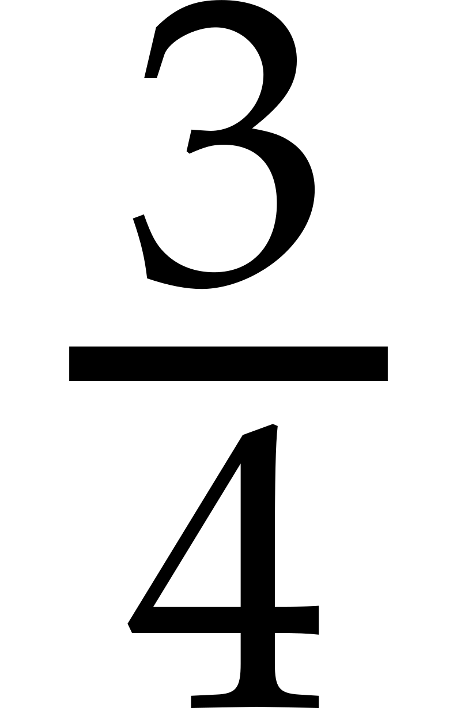 4; it’s ½ 4 now, so I must start getting ready” – this chain of thought leads to some _application_ or other, which is evidently its purpose. It is an operation with pictures for a purpose.

### [67\[5\]](https://cdn.wittgensteinnachlass.com/2000px/webp/Ms-109/67.webp)

30.08.1930

If I describe a state of affairs before me with the words “here is a red circle”, do these words perhaps reproduce the fact better than the sentence “here is a green quadrilateral”? Certainly not; but neither is it the sound of the words that depicts or copies the fact; rather, the word, in the relations it has through grammar, is a tool of depiction.

### [68\[1\]](https://cdn.wittgensteinnachlass.com/2000px/webp/Ms-109/68.webp)

The interpretation of the sentence lies in the giving of names. The giving of names is independent of the _hypothesis_ that we learnt this name in this application – in our youth, say. Historical matters (which are always hypothetical) cannot enter into it here. We give the name as if we were giving it for the first time. – But there is nonsense in the very idea of giving names: it is taken from the giving of names to people – & to some things, say – but leads to nonsense if one tries to apply it to words like “red”, “green”, etc. Where is what is designated by the word “green”? As has often been said, the word “green” is also used in a sentence where no green thing is present.

### [68\[2\]](https://cdn.wittgensteinnachlass.com/2000px/webp/Ms-109/68.webp)

Seeing the fact as articulated – – The verbal expression doubles the articulated picture.

### [68\[3\]](https://cdn.wittgensteinnachlass.com/2000px/webp/Ms-109/68.webp)

How can one learn the truth through thinking? How one learns to see a face better by drawing it.

### [68\[4\]](https://cdn.wittgensteinnachlass.com/2000px/webp/Ms-109/68.webp)

What is the _business_ of thinking?

### [68\[5\]](https://cdn.wittgensteinnachlass.com/2000px/webp/Ms-109/68.webp),[69\[1\]](https://cdn.wittgensteinnachlass.com/2000px/webp/Ms-109/69.webp)

Does one not see it in the case where, in a court hearing, an accident is represented with dolls & models? (From such a demonstration with models one can pass to a more schematic one with ordinary little blocks & from there to a drawing & to a schema of a few arbitrary signs & to our ordinary language.) Here, evidently, a serious application is made of this representation.

### [69\[2\]](https://cdn.wittgensteinnachlass.com/2000px/webp/Ms-109/69.webp)

One can be _guided_ by thoughts. – This cannot be something that attaches to them accidentally. It must – I believe – be essential to them, indeed it must be their business.

### [69\[3\]](https://cdn.wittgensteinnachlass.com/2000px/webp/Ms-109/69.webp)

The sentence is a _device_ that has served its purpose once it has measured itself against reality.

### [69\[4\]](https://cdn.wittgensteinnachlass.com/2000px/webp/Ms-109/69.webp)

Thinking is using sentences.

### [69\[5\]](https://cdn.wittgensteinnachlass.com/2000px/webp/Ms-109/69.webp)

One measures reality directly against the sentence.

### [69\[6\]](https://cdn.wittgensteinnachlass.com/2000px/webp/Ms-109/69.webp)

The reality one measures against it is its meaning, the decision as to its truth & falsity.

### [69\[7\]](https://cdn.wittgensteinnachlass.com/2000px/webp/Ms-109/69.webp),[70\[1\]](https://cdn.wittgensteinnachlass.com/2000px/webp/Ms-109/70.webp)

Thinking surely cannot be mere play, a game played by human faculties. And if it is, it would be of no interest to us.

### [70\[2\]](https://cdn.wittgensteinnachlass.com/2000px/webp/Ms-109/70.webp)

Suppose I am expecting someone: I look at the clock, then out of the window, put something in order in my room, look out again etc. I could call this activity expecting. Now am I thinking the whole time I am doing this? (i.e. is this activity essentially an activity of thinking, or is it accompanied by one?) Certainly not the latter. And if I were to call those activities thinking, what would be the words in which this thought would be expressed? – But thoughts, no doubt, will also occur to me while I wait. I shall _say_ to myself: “Perhaps he has been held up at home” & more of the same; perhaps also the articulated expectation “if only he would come”. In all those expectant actions there is nothing that interests us (the fulfilment of expectation in this sense is nothing other than the satisfaction of hunger). We are interested only in the picture made for a purpose – the _articulated_ thought.

### [70\[3\]](https://cdn.wittgensteinnachlass.com/2000px/webp/Ms-109/70.webp),[71\[1\]](https://cdn.wittgensteinnachlass.com/2000px/webp/Ms-109/71.webp)

I make myself the picture _on the occasion of_ a situation. But I give it its relation to its object as I do with any copy I make, whether I model something in clay or copy it in a drawing. What sort of relation is that? Is it not the same as the one that arises if, for instance, I want to represent the series of numbers 3, 7, 2, 5, 1 by a series of squares of corresponding areas & then proceed according to a rule (taking the square root, marking out the side, etc.)? If I copy a line, the rule reads something like: always draw parallel to this line, from left to right.

### [71\[2\]](https://cdn.wittgensteinnachlass.com/2000px/webp/Ms-109/71.webp)

Does depicting, then, consist in proceeding according to such a rule? But how is this rule given? – How am I conscious of the rule? What is its expression?

### [71\[3\]](https://cdn.wittgensteinnachlass.com/2000px/webp/Ms-109/71.webp)

I mean the rule here as something laid down in advance (as it were, a general programme).

### [71\[4\]](https://cdn.wittgensteinnachlass.com/2000px/webp/Ms-109/71.webp),[72\[1\]](https://cdn.wittgensteinnachlass.com/2000px/webp/Ms-109/72.webp)

Now the process of depicting is indeed described by giving what is to be depicted & the rule (say, 3, 7, 2, 5, 1 & the general prescription for the depiction).

But when I say that the process of depicting is described in this way, I mean _only_ that its multiplicity is then given. (the “intention” of the description is left out of play.)

### [72\[2\]](https://cdn.wittgensteinnachlass.com/2000px/webp/Ms-109/72.webp)

I wanted to describe the process of copying in this way: I let my hand be guided by what is to be depicted. But this guidance is precisely what is expressed in the rule of depiction.

### [72\[3\]](https://cdn.wittgensteinnachlass.com/2000px/webp/Ms-109/72.webp)

This would mean, then, that we translate reality into language with the help of rules. And that is easy to imagine if one constructs simple cases, a simpler world, so to speak. If, for instance, the world consisted of a square grid in which different grid points lit up at regular intervals, this process could be represented very simply by a language that, say, groups together in brackets the pairs of coordinates of the points lighting up at each interval, for example (7, 3; 5, 4; 8, 6) and so on.

### [72\[4\]](https://cdn.wittgensteinnachlass.com/2000px/webp/Ms-109/72.webp)

But would it not then be possible to justify the depiction by these rules? Yes & no; the depiction accords with the rules but is not described by them.

### [72\[5\]](https://cdn.wittgensteinnachlass.com/2000px/webp/Ms-109/72.webp),[73\[1\]](https://cdn.wittgensteinnachlass.com/2000px/webp/Ms-109/73.webp)

31.08.1930

What do we think for, then? For this will also show whether thinking is an important matter. It is quite clear here: we think for a purpose. The purpose of thinking evidently consists in my arranging my actions in accordance with it & in exactly the same way as I arrange them in accordance with the calculation for a steam boiler. (This calculation, after all, is also an act of thinking.)

### [73\[2\]](https://cdn.wittgensteinnachlass.com/2000px/webp/Ms-109/73.webp)

I make a plan, for example, a battle plan, an escape plan.

### [73\[3\]](https://cdn.wittgensteinnachlass.com/2000px/webp/Ms-109/73.webp)

The thought is the plan applied.

### [73\[4\]](https://cdn.wittgensteinnachlass.com/2000px/webp/Ms-109/73.webp)

More specifically, I make a plan not only to make myself understandable to others, but also to become clear about the matter myself. (That is, language is not only a means of communication.)

### [73\[5\]](https://cdn.wittgensteinnachlass.com/2000px/webp/Ms-109/73.webp)

The use of the plan is a translation back into our actions. A transposition into our actions. (It is clear that causal connections are seen here, but it would be odd to specify them as the essence of a plan.)

### [73\[6\]](https://cdn.wittgensteinnachlass.com/2000px/webp/Ms-109/73.webp),[74\[1\]](https://cdn.wittgensteinnachlass.com/2000px/webp/Ms-109/74.webp)

On the other hand, the causal theory of meaning may be based on the correct thought that the intention of the plan cannot be expressed by sentences.

### [74\[2\]](https://cdn.wittgensteinnachlass.com/2000px/webp/Ms-109/74.webp)

What makes something a portrait of A is, after all, not that it resembles A but that it is supposed to resemble A.

So it consists not in a particular rule of translation being readable from an examination of picture & object, but in a rule being given with the picture, according to which it is to be checked.

### [74\[3\]](https://cdn.wittgensteinnachlass.com/2000px/webp/Ms-109/74.webp)

Suppose for a moment that translation from one language into another, say from English into German, proceeded by one’s always using the dictionary to render each English word by a German word that corresponds to it unambiguously. If I now say that this text _is supposed to_ be the German translation of that English one, then in effect I thereby give the other person the German text & the English–German dictionary (the expression of the rule) so that it can be checked.

### [74\[4\]](https://cdn.wittgensteinnachlass.com/2000px/webp/Ms-109/74.webp),[75\[1\]](https://cdn.wittgensteinnachlass.com/2000px/webp/Ms-109/75.webp)

Checking a translation with the aid of the dictionary is an activity that does _not_ correspond to the verification of a sentence.

### [75\[2\]](https://cdn.wittgensteinnachlass.com/2000px/webp/Ms-109/75.webp)

Checking a translation against the dictionary is exactly analogous to checking a calculation according to the rules of calculation.

### [75\[3\]](https://cdn.wittgensteinnachlass.com/2000px/webp/Ms-109/75.webp)

Is not, then, a sentence like “this picture _is supposed to_ represent the object A” of the same kind as mathematical sentences? Like the equation 25 × 24 = 230, say – – –?

### [75\[4\]](https://cdn.wittgensteinnachlass.com/2000px/webp/Ms-109/75.webp)

Or if I say, for instance: the line  is supposed to be an exact copy of the line . (Understanding the rule of depiction is presupposed).

### [75\[5\]](https://cdn.wittgensteinnachlass.com/2000px/webp/Ms-109/75.webp)

I believe one can already see that this is not a sentence from the fact that in it the rule of depiction is given separately from the two complexes that stand in the internal relation.

### [75\[6\]](https://cdn.wittgensteinnachlass.com/2000px/webp/Ms-109/75.webp),[76\[1\]](https://cdn.wittgensteinnachlass.com/2000px/webp/Ms-109/76.webp)

“This line _is supposed to_ be a copy of that one” is a _stipulation_ & not a sentence.

It hands one, as it were, the picture, what is depicted & the rule of depiction. But the difficulty here is that it seems to hand us these things in silence. But how do we then know what to do with them.

### [76\[2\]](https://cdn.wittgensteinnachlass.com/2000px/webp/Ms-109/76.webp)

And yet the process seems to admit of no words; for whatever might be said about it, how would we know what it is supposed to mean?

### [76\[3\]](https://cdn.wittgensteinnachlass.com/2000px/webp/Ms-109/76.webp)

No addition would change the multiplicity of the matter, because no other addition with a different sense can be substituted for this one. It is therefore as superfluous (and hence meaningless) as, say, Frege’s “⊢”.

### [76\[4\]](https://cdn.wittgensteinnachlass.com/2000px/webp/Ms-109/76.webp)

Could I not even put the sign “ = ”, in the mathematical sense, between the two lines? Can I not plainly put it here with just as much right as between the English & German sentences? And here the equation is literally solved according to rules, like any mathematical equation.

### [76\[5\]](https://cdn.wittgensteinnachlass.com/2000px/webp/Ms-109/76.webp)

Can I not say: the definition is an expression of the intention? And the only possible one –?

### [76\[6\]](https://cdn.wittgensteinnachlass.com/2000px/webp/Ms-109/76.webp),[77\[1\]](https://cdn.wittgensteinnachlass.com/2000px/webp/Ms-109/77.webp)

If I say “the sense of a sentence is determined by how it is to be verified”, what must I then say about the sense of the sentence that says that this sentence is supposed to be the translation of that object? How, then, is that to be verified?

### [77\[2\]](https://cdn.wittgensteinnachlass.com/2000px/webp/Ms-109/77.webp)

01.09.1930

Language cannot express what belongs to the essence of the sentence, if only because it would be the same for every sentence; and a sign that had to occur in every sentence would, logically, be a mere bit of play. After all, the signs of the sentence are not talismans or magical signs supposed to produce a particular impression on the observer.

If there were philosophical signs in the sentence, their effect would have to be immediate in just this way.

### [77\[3\]](https://cdn.wittgensteinnachlass.com/2000px/webp/Ms-109/77.webp)

That is why language can express only the plan, not its application. And logic can investigate only the plan.

### [77\[4\]](https://cdn.wittgensteinnachlass.com/2000px/webp/Ms-109/77.webp),[78\[1\]](https://cdn.wittgensteinnachlass.com/2000px/webp/Ms-109/78.webp)

Thinking means making a plan & working with it. But what makes the plan a _plan_? What distinguishes it from any old scribble? What I intend to do with it. But what do you intend to do with it? A further plan follows. – No, the rule of translation also belongs with the plan; everything further is application.

### [78\[2\]](https://cdn.wittgensteinnachlass.com/2000px/webp/Ms-109/78.webp)

Language tolerates no embellishments, no psychological aids.

### [78\[3\]](https://cdn.wittgensteinnachlass.com/2000px/webp/Ms-109/78.webp)

Language cannot anticipate its application.

### [78\[4\]](https://cdn.wittgensteinnachlass.com/2000px/webp/Ms-109/78.webp)

“To know what is the case if the sentence is true” can only mean knowing the rule according to which it is to be checked. – But how is it expressed that it _is to be checked_ according to this rule? The rule, after all, is merely given alongside the sentence, but where is its application to the sentence represented? But wherever it might be represented, it would be by another picture, & so we would come to an endless regress (and enter into it). But how can one speak of representation there, & what is this representation for? We must get to the application, after all!

### [78\[5\]](https://cdn.wittgensteinnachlass.com/2000px/webp/Ms-109/78.webp),[79\[1\]](https://cdn.wittgensteinnachlass.com/2000px/webp/Ms-109/79.webp)

I make myself a plan to go by. The point

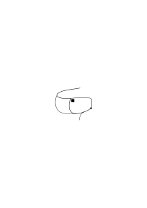

is me, where I am standing now. Such a plan is obviously a useful instrument. And that justifies an investigation of its effectiveness. But it is true that this is not yet all. To understand the plan it is not enough for me to see this drawing & see where I am standing & see the (possible) similarity of the landscape to the plan. I must also know what it means to follow a plan. I may have learnt this by actually following plans before. But it is not that fact that I can use here, but something I see in it. Just as I read a rule out of the beginning of the series 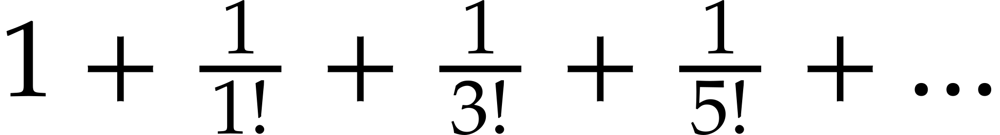.

### [79\[2\]](https://cdn.wittgensteinnachlass.com/2000px/webp/Ms-109/79.webp)

Insofar as every sentence is a plan & one cannot explain a plan by means of a plan, one cannot explain a plan by means of a sentence. Every explanation by means of a sentence provides – as I said – a new plan & never the essence of the plan.

### [79\[3\]](https://cdn.wittgensteinnachlass.com/2000px/webp/Ms-109/79.webp)

One could also put it this way: the sentence is an instrument of thought, so I cannot capture the thought in the sentence.

### [79\[4\]](https://cdn.wittgensteinnachlass.com/2000px/webp/Ms-109/79.webp),[80\[1\]](https://cdn.wittgensteinnachlass.com/2000px/webp/Ms-109/80.webp)

The matter is not fully clarified so long as there is still dissatisfaction with the limit of expression & that limit does not instead bring satisfaction. – For the point is not to resign oneself & withdraw a demand, but to recognize that the apparent demand was senseless.

### [80\[2\]](https://cdn.wittgensteinnachlass.com/2000px/webp/Ms-109/80.webp)

Following a plan is essentially the same activity as checking a projection (translation) according to a particular rule.

### [80\[3\]](https://cdn.wittgensteinnachlass.com/2000px/webp/Ms-109/80.webp)

I check the plan _according to the rule_. Through my activity I connect the rule with the plan. So when I said that the rule is given along with the plan, as it were without a connecting word, what this really means is: the connection between the rule and the plan is made by applying the rule to the plan.

### [80\[4\]](https://cdn.wittgensteinnachlass.com/2000px/webp/Ms-109/80.webp),[81\[1\]](https://cdn.wittgensteinnachlass.com/2000px/webp/Ms-109/81.webp)

“Check the series of numbers on the right; the numbers are always to be the squares of the numbers in the series on the left”. Or: “Form a series of numbers that are the squares of the numbers in the series on the left”. What is essential here is that the rule is given independently of the two series. And in just the same way I can say: “See whether this series of figures consists of the orthogonal projections of those figures”. Whether I make a plan or go by it, I always act in such a way that I have the rule of translation, the method of projection, before me independently of the (two) corresponding pictures.

### [81\[2\]](https://cdn.wittgensteinnachlass.com/2000px/webp/Ms-109/81.webp)

That is also the essence of the original (the original for a drawing) & one can take the sentence as an original.

### [81\[3\]](https://cdn.wittgensteinnachlass.com/2000px/webp/Ms-109/81.webp)

The sentence is put in the position of a judge & we feel answerable to it.

### [81\[4\]](https://cdn.wittgensteinnachlass.com/2000px/webp/Ms-109/81.webp)

02.09.1930

The answer to the question “What is meant by this plan?” could not be another plan but had to be something that leaves the relation to the other thing open, as it has to be, since it is an open question whether it will be satisfied or not. What leaves the relation open is the rule of translation.

### [81\[5\]](https://cdn.wittgensteinnachlass.com/2000px/webp/Ms-109/81.webp)

And it is clear that the plan together with the rule of translation gives the necessary multiplicity; this is shown simply by the fact that I need only give someone these two things for the check.

### [81\[6\]](https://cdn.wittgensteinnachlass.com/2000px/webp/Ms-109/81.webp),[82\[1\]](https://cdn.wittgensteinnachlass.com/2000px/webp/Ms-109/82.webp)

Now one could say: But it is not enough to give him the two things; you must (after all) also tell him how they are to be applied. But this would produce yet another plan, as much in need of explanation as the first.

### [82\[2\]](https://cdn.wittgensteinnachlass.com/2000px/webp/Ms-109/82.webp)

But the answer seems to be: You cannot explain language (as such) to the other person, that is, force him by means of a sentence to use it in a particular way. Here the function of explanation is, as it were, misunderstood.

### [82\[3\]](https://cdn.wittgensteinnachlass.com/2000px/webp/Ms-109/82.webp)

For when I understand the plan, this does not come about by my thinking a thought about it.

### [82\[4\]](https://cdn.wittgensteinnachlass.com/2000px/webp/Ms-109/82.webp)

(It will not do to try to explain the essence of explanation.)

### [82\[5\]](https://cdn.wittgensteinnachlass.com/2000px/webp/Ms-109/82.webp)

Rather, by my looking at reality through the plan.

### [82\[6\]](https://cdn.wittgensteinnachlass.com/2000px/webp/Ms-109/82.webp)

I would like to say: understanding a plan must already mean applying it. That is, understanding it as a plan already means acting according to it, following it in one's actions.

### [83\[1\]](https://cdn.wittgensteinnachlass.com/2000px/webp/Ms-109/83.webp)

The plan I have drawn in order to go by it later is not for me just any drawing on a piece of paper. How does it differ for me from any scrap of paper?

### [83\[2\]](https://cdn.wittgensteinnachlass.com/2000px/webp/Ms-109/83.webp)

By its relation to something else. But since the event of which it is the plan need not have taken place, the plan cannot point to it, but only to objects that are there whether or not this event takes place. Objects that allow it to have its sense, not ones that make it true. But these objects together with the drawing do not make a plan either, for the outward relation essential to it is directed precisely towards the contingent, the indeterminate.

### [83\[3\]](https://cdn.wittgensteinnachlass.com/2000px/webp/Ms-109/83.webp)

The plan can (therefore) only stretch out its feelers as far as the point where the event occurs or does not occur. And it is this _demanding_ reaching out that we understand in the plan as a plan.

### [83\[4\]](https://cdn.wittgensteinnachlass.com/2000px/webp/Ms-109/83.webp),[84\[1\]](https://cdn.wittgensteinnachlass.com/2000px/webp/Ms-109/84.webp)

What is demanding about it is that the plan is not complete (not a fact); for if it is a complete complex, it ceases to point outwards.

### [84\[2\]](https://cdn.wittgensteinnachlass.com/2000px/webp/Ms-109/84.webp)

The plan as a plan therefore cannot be described.

### [84\[3\]](https://cdn.wittgensteinnachlass.com/2000px/webp/Ms-109/84.webp)

[It must be possible to set all this out in plain, homely terms.]

### [84\[4\]](https://cdn.wittgensteinnachlass.com/2000px/webp/Ms-109/84.webp)

The plan, as a plan, is something unsatisfied. (Like the wish, the expectation, the conjecture, etc.)

### [84\[5\]](https://cdn.wittgensteinnachlass.com/2000px/webp/Ms-109/84.webp)

Sometimes I would like to describe my feeling towards the plan as an innervation. But the innervation itself is not unsatisfied either, not in need of supplementation.

### [84\[6\]](https://cdn.wittgensteinnachlass.com/2000px/webp/Ms-109/84.webp)

I should think this will show itself in my having somehow to supply what is missing when I speak of the plan.

### [84\[7\]](https://cdn.wittgensteinnachlass.com/2000px/webp/Ms-109/84.webp)

Having a plan & speaking of a plan are, after all, two different things.

### [84\[8\]](https://cdn.wittgensteinnachlass.com/2000px/webp/Ms-109/84.webp)

(The method of philosophizing is to drive oneself mad & then cure the madness.)

### [84\[9\]](https://cdn.wittgensteinnachlass.com/2000px/webp/Ms-109/84.webp),[85\[1\]](https://cdn.wittgensteinnachlass.com/2000px/webp/Ms-109/85.webp)

If I give the two corresponding pictures & the rule of translation, this situation is – so to speak – pregnant with a decision. – Any combination of these things that leaves the matter undecided changes nothing essential in the situation.

### [85\[2\]](https://cdn.wittgensteinnachlass.com/2000px/webp/Ms-109/85.webp)

A German text, an English text, the English–German dictionary. Of course, if I want someone to compare the texts by means of the dictionary, I do not put the three things into his hands without a word but say something as well. Yet all he needs for his activity, his only implements, are the texts & the dictionary; what I say may prompt him to do it but does not help him in doing it. When he carries out the comparison, he makes no use of those “connecting” words.

### [85\[3\]](https://cdn.wittgensteinnachlass.com/2000px/webp/Ms-109/85.webp)

Another way of putting it: When one maps a set of facts according to a rule, _it_ is the _original_ for the mapping. I need no further original to show me how the mapping is to proceed, and thus how to use the first original, for otherwise I would also need an original to show me how to use the second, and so on ad infinitum. That is, a further original is no use to me; at some point I have to act without an original after all.

### [86\[1\]](https://cdn.wittgensteinnachlass.com/2000px/webp/Ms-109/86.webp)

I can shift my activity so that I draw from a different original instead of the first, but that is all.

### [86\[2\]](https://cdn.wittgensteinnachlass.com/2000px/webp/Ms-109/86.webp)

So I cannot show the use of _the original_ as such by means of an original. Cannot make a plan whose sole purpose is to show how a plan (in general) is to be used.

### [86\[3\]](https://cdn.wittgensteinnachlass.com/2000px/webp/Ms-109/86.webp)

Nor does the second original connect the first original with the rule, for the last link is always missing. The one that only the application can supply.

### [86\[4\]](https://cdn.wittgensteinnachlass.com/2000px/webp/Ms-109/86.webp)

One could also put it this way: A drawing is a plan not because someone once went – by chance – in such a way that his route corresponded to the plan, but because he followed the plan according to a particular rule. Otherwise, of course, any route would correspond to the plan (according to some rule or other). That is: the plan is a plan only according to a particular rule. It takes both drawing & rule to make a plan.

### [86\[5\]](https://cdn.wittgensteinnachlass.com/2000px/webp/Ms-109/86.webp),[87\[1\]](https://cdn.wittgensteinnachlass.com/2000px/webp/Ms-109/87.webp)

The symbolism cannot merely hint at anything it is meant to express. But that is the difficulty in understanding the sign for negation. The symbolism must not (merely) give a hint at anything essential, must not merely hint at anything essential, as one nudges someone to remind him of something. But this nudge can only be understood if the matter has already been discussed in detail. And so the symbolism may only nudge us when this is merely to call to mind something it has already represented to us. (A definition is such a nudge.)

### [87\[2\]](https://cdn.wittgensteinnachlass.com/2000px/webp/Ms-109/87.webp)

03.09.1930

We can distinguish the plan from its negation. I mean: as far as the plan & its negation are concerned, we have perfect pitch, so to speak. They do not appear to us as opposites only when we set them against each other.

### [87\[3\]](https://cdn.wittgensteinnachlass.com/2000px/webp/Ms-109/87.webp),[88\[1\]](https://cdn.wittgensteinnachlass.com/2000px/webp/Ms-109/88.webp)

Does this not mean the following: The sentence is not formed from the picture, the rule of projection & a prefixed + or ‒ (yes or no), for otherwise one could not distinguish + & ‒ from one another absolutely. But is that true?

Different rules do apply to + and to ‒ ( ‒ ‒ = + but + + ≠ ‒ ). That is, yes and no are not, like right & left, simply opposed yet the same when taken absolutely. The sentence, then, does not consist of a picture, a rule of projection & a dial attached to it with an arrow that one can set pointing either right or left.

### [88\[2\]](https://cdn.wittgensteinnachlass.com/2000px/webp/Ms-109/88.webp)

What holds for “yes” & “no” holds analogously for “true” & “false”. Yes & no are related not as right & left but as reversing and leaving-as-it-is. That is, as turning and not turning, not as turning right and turning left.

### [88\[3\]](https://cdn.wittgensteinnachlass.com/2000px/webp/Ms-109/88.webp)

‘p’ is true = p. One uses the word “true” in contexts such as “what he says is true”, but that says the same thing as “he says ‘p’, & p”.

### [88\[4\]](https://cdn.wittgensteinnachlass.com/2000px/webp/Ms-109/88.webp),[89\[1\]](https://cdn.wittgensteinnachlass.com/2000px/webp/Ms-109/89.webp)

Since the “yes” indicates that everything stays as it is, one can leave it out altogether. One can therefore replace “yes p” with “p”; by contrast, one cannot replace “~p” with “p” & “p” with “~p”, for how then would one negate the negation in turn & obtain the affirmation?

### [89\[2\]](https://cdn.wittgensteinnachlass.com/2000px/webp/Ms-109/89.webp)

To _explain_ the essence of negation is as impossible as to explain the essence of the sentence.

### [89\[3\]](https://cdn.wittgensteinnachlass.com/2000px/webp/Ms-109/89.webp)

The explanation that ‘~p’ is true if ‘p’ is false would be identical with the explanation that ‘p⌵~p’ is not a sentence with sense but a tautology.

### [89\[4\]](https://cdn.wittgensteinnachlass.com/2000px/webp/Ms-109/89.webp)

Thinking means making plans.

### [89\[5\]](https://cdn.wittgensteinnachlass.com/2000px/webp/Ms-109/89.webp)

Is negation an _addition_ to the plan? That is, does the new plan now consist of the picture, the rule of projection _and_ the negation? Or has the negation changed the rule of projection?

### [89\[6\]](https://cdn.wittgensteinnachlass.com/2000px/webp/Ms-109/89.webp)

Negation _combines_ with the negated plan, & the negated plan does not occur as a plan in the new plan: that is, if I believe ~p, I do not thereby also believe p just because p occurs in ~p.

### [89\[7\]](https://cdn.wittgensteinnachlass.com/2000px/webp/Ms-109/89.webp),[90\[1\]](https://cdn.wittgensteinnachlass.com/2000px/webp/Ms-109/90.webp)

It would be characteristic of a certain erroneous conception if a philosopher believed that he had to have a sentence printed in red ink, since only then would it fully express what the author wants to say. (Here we would have the magical conception of signs instead of the logical one.)

(The magical sign would act like a drug, & the causal theory would be right for the drug.)

### [90\[2\]](https://cdn.wittgensteinnachlass.com/2000px/webp/Ms-109/90.webp)

What matters is the internal relation between the plans “~p” and “p”.

Clearly, if I have the plan ~p, I do not also have the plan p; _insofar_ as that is so, then, the plan p does not occur in the plan ~p. On the other hand, the occurrence of ‘p’ in ‘~p’ & even more clearly ~(~p) = p show the connection.

### [90\[3\]](https://cdn.wittgensteinnachlass.com/2000px/webp/Ms-109/90.webp)

p occurs in ~p in (exactly) the same sense as ~p occurs in p.

### [90\[4\]](https://cdn.wittgensteinnachlass.com/2000px/webp/Ms-109/90.webp)

The words “occur” etc. are, of course, indeterminate, like all such prose. Only the grammatical rules, which in the end must show what is at issue, are exact & unambiguous & indisputable.

### [90\[5\]](https://cdn.wittgensteinnachlass.com/2000px/webp/Ms-109/90.webp)

They are the final & only expression of how things really stand (that is, of what the situation is logically).

### [90\[6\]](https://cdn.wittgensteinnachlass.com/2000px/webp/Ms-109/90.webp),[91\[1\]](https://cdn.wittgensteinnachlass.com/2000px/webp/Ms-109/91.webp)

I draw a plan (of how I want to go) & add the sign of negation; but that is no use as long as one does not know that it is the sign of negation. But how can one know it, then? Perhaps by being told? But how are we told? All that can happen here is that one sign is substituted for another. For an explanation of negation would only be another sign for it.

### [91\[2\]](https://cdn.wittgensteinnachlass.com/2000px/webp/Ms-109/91.webp)

“Just as I can give a body by means of its different views & it is equivalent to them, so the nature of negation reveals itself in the various grammatically permitted applications of the negation sign.”

### [91\[3\]](https://cdn.wittgensteinnachlass.com/2000px/webp/Ms-109/91.webp)

“What good does it do to have just a hook in front of the sentence p as the sign of negation? I still have to _think_ the whole negation.”

### [91\[4\]](https://cdn.wittgensteinnachlass.com/2000px/webp/Ms-109/91.webp)

A method of projection may project a point into a circle, but the complexity of this method of projection will become apparent when one goes through all the forms that it transforms into one another.

### [91\[5\]](https://cdn.wittgensteinnachlass.com/2000px/webp/Ms-109/91.webp)

If, for example, I say I am not going this way, that is consistent with my going each of those other ways (& my going one way is not compatible with my going another) & this is how what ‘not’ means becomes apparent.

### [91\[6\]](https://cdn.wittgensteinnachlass.com/2000px/webp/Ms-109/91.webp),[92\[1\]](https://cdn.wittgensteinnachlass.com/2000px/webp/Ms-109/92.webp)

But one thing is clear: the “~” placed before the plan is a sign of a completely different kind from the plan itself or any of its parts.

### [92\[2\]](https://cdn.wittgensteinnachlass.com/2000px/webp/Ms-109/92.webp)

And does this difference too show itself conclusively only in the grammar?

### [92\[3\]](https://cdn.wittgensteinnachlass.com/2000px/webp/Ms-109/92.webp)

The “no” would be a jolt to remind us: “Mind you, this is a negation”.

### [92\[4\]](https://cdn.wittgensteinnachlass.com/2000px/webp/Ms-109/92.webp)

The sign “~” indicates that you are to take what follows negatively.

### [92\[5\]](https://cdn.wittgensteinnachlass.com/2000px/webp/Ms-109/92.webp)

_It indicates_ means that this is not the final linguistic expression. That this is not the picture of the thought. That there is more to negation than that.

### [92\[6\]](https://cdn.wittgensteinnachlass.com/2000px/webp/Ms-109/92.webp)

The explanation of a sign is straightaway a sign. For it could consist only in representing the thought more precisely than that sign does.

### [92\[7\]](https://cdn.wittgensteinnachlass.com/2000px/webp/Ms-109/92.webp)

What is the difference between the chessboard & a chess piece? The application is of a completely different kind. (Think of the way the operation signs ~, ⌵ etc. cancel one another out, which never occurs elsewhere.

### [92\[8\]](https://cdn.wittgensteinnachlass.com/2000px/webp/Ms-109/92.webp),[93\[1\]](https://cdn.wittgensteinnachlass.com/2000px/webp/Ms-109/93.webp)

04.09.1930

Let us imagine a plan for a route drawn & crossed out with a line meant to indicate that this plan is not to be carried out. Many lines are drawn on the plan, but the one that crosses it out has a completely different function from them.

### [93\[2\]](https://cdn.wittgensteinnachlass.com/2000px/webp/Ms-109/93.webp)

The sign has only one purpose, to communicate something to us; an explanation of the sign can therefore only make this communication clearer, so (the explanation) is itself only a sign in place of the first. An explanation of the sign of negation must therefore itself be no more than a grammatical analysis of negation.

### [93\[3\]](https://cdn.wittgensteinnachlass.com/2000px/webp/Ms-109/93.webp)

I want to say that in a certain sense one cannot explain a sign. It must speak for itself in the rules for its application. And say everything that can be said at all (by way of explanation).

### [93\[4\]](https://cdn.wittgensteinnachlass.com/2000px/webp/Ms-109/93.webp),[94\[1\]](https://cdn.wittgensteinnachlass.com/2000px/webp/Ms-109/94.webp)

If an explanation that did not belong to grammar could say something essential about negation, for instance, then this very essential thing would have to be missing from our use of the sign. – What pertains to the matter would then not suffice, & what does not pertain to it would contain what is needed for understanding.

### [94\[2\]](https://cdn.wittgensteinnachlass.com/2000px/webp/Ms-109/94.webp)

Language has only one purpose, its application; – once this is fixed by grammar, there can be nothing more of any essential import to say about it.

### [94\[3\]](https://cdn.wittgensteinnachlass.com/2000px/webp/Ms-109/94.webp)

A language must see to it that it is understood; the explanation is itself only language & if it can be understood better than the first, then it is simply the better expression.

### [94\[4\]](https://cdn.wittgensteinnachlass.com/2000px/webp/Ms-109/94.webp)

This is also how one is to understand that Frege’s explanation of the truth-functions, merely put into schematic form by me, yields a new notation for the truth-functions.

### [94\[5\]](https://cdn.wittgensteinnachlass.com/2000px/webp/Ms-109/94.webp)

Comparison of the different kinds of lines on a map with the kinds of words in a sentence. Someone who has not been taught sees a mass of lines & does not know that they have very different meanings.

### [94\[6\]](https://cdn.wittgensteinnachlass.com/2000px/webp/Ms-109/94.webp),[95\[1\]](https://cdn.wittgensteinnachlass.com/2000px/webp/Ms-109/95.webp)

The sign of negation prompts us to do something. But what? and how? Negation _only_ _prompts_ us to do something, to take the plan that follows in a different way. – But can this different way of taking it be explained more fully in some other way? Like a brief signal that can then be explained by a sentence.

### [95\[2\]](https://cdn.wittgensteinnachlass.com/2000px/webp/Ms-109/95.webp)

One has the feeling that negation merely prompts us to do something, but something much more complex than the signal.

And it is true: it is not the hook ~ in front of the sentence that explains negation to us. That _explains_ to us what we are to do. (It _just_ does not have the necessary multiplicity.)

### [95\[3\]](https://cdn.wittgensteinnachlass.com/2000px/webp/Ms-109/95.webp)

For the symbolism must _explain_ itself.

### [95\[4\]](https://cdn.wittgensteinnachlass.com/2000px/webp/Ms-109/95.webp)

There must be an answer to the question “What does that mean?”, or the question is nonsensical. But since the answer is always another sign, it is always a definition & so belongs to grammar.

### [95\[5\]](https://cdn.wittgensteinnachlass.com/2000px/webp/Ms-109/95.webp)

I say that negation is only a prompt to do something much more complex; but what? If the question cannot be answered (and replacing one symbol of negation with another is no answer), it is nonsensical & so is that first sentence.

### [96\[1\]](https://cdn.wittgensteinnachlass.com/2000px/webp/Ms-109/96.webp)

It is as if the “~” prompted us to do something, but what we are to do is apparently not said. It is as if it only needed to be hinted at, as if we already knew it. As if an explanation were now unnecessary, since we know the thing anyway.

Now one could even say that the explanation lies in extenso in all the applications, in the grammatical rules (which, incidentally – and this explains the “all” – contain an inductive rule).

### [96\[2\]](https://cdn.wittgensteinnachlass.com/2000px/webp/Ms-109/96.webp)

It is quite clear that the rules reflect the essence of negation (since they do not apply to a sign with a different meaning). The only question is whether they reflect it completely, or whether they still leave some latitude, so that the sign to which these rules apply, though it could not represent certain other things, could still represent certain others, so that at any rate not _everything_ has been said. For, mind, it must be possible to say it, for otherwise _everything_ has been said. If language has said everything there was to say, then it has said _everything_.

### [96\[3\]](https://cdn.wittgensteinnachlass.com/2000px/webp/Ms-109/96.webp),[97\[1\]](https://cdn.wittgensteinnachlass.com/2000px/webp/Ms-109/97.webp)

If there were a more explicit way of expressing negation, it would still have to be possible to map it into the other, & so it could not be of a different multiplicity. Unless there were a domain, a complex that was always considered only as a whole, so that we never went beyond a mere hint. But this contradicts the assumption that an analysis (an explanation) is possible, for it would have to penetrate into the interior of this complex.

### [97\[2\]](https://cdn.wittgensteinnachlass.com/2000px/webp/Ms-109/97.webp)

I simply cannot draw the limit of language in language.

### [97\[3\]](https://cdn.wittgensteinnachlass.com/2000px/webp/Ms-109/97.webp)

I simply cannot include the whole of language in my investigation & then still stand outside it in language.

### [97\[4\]](https://cdn.wittgensteinnachlass.com/2000px/webp/Ms-109/97.webp)

If I include the whole of language in my investigation, I cannot gain a foothold in language outside the investigation.

### [97\[5\]](https://cdn.wittgensteinnachlass.com/2000px/webp/Ms-109/97.webp)

If our symbolism includes the whole of language, there is no longer any room in it for an explanation of the symbolism. Here we have reached the limit of language.

### [97\[6\]](https://cdn.wittgensteinnachlass.com/2000px/webp/Ms-109/97.webp),[98\[1\]](https://cdn.wittgensteinnachlass.com/2000px/webp/Ms-109/98.webp)

05.09.1930

Let us remember that in language only logical multiplicity _represents_, but that everything one can talk about at all must be capable of being expressed.

### [98\[2\]](https://cdn.wittgensteinnachlass.com/2000px/webp/Ms-109/98.webp)

That is, there must be nothing that language merely hints at but thought spells out. For thought is itself only language in application.

### [98\[3\]](https://cdn.wittgensteinnachlass.com/2000px/webp/Ms-109/98.webp)

Language & thought are not related as a signal is to the execution of the command signalled. For in that case there is also a more detailed explanation to which the signal refers (as if by definition). Whereas in the case of language & thought the detailed explanation _itself belongs to language_. So that wherever there is any analysis at all, it itself belongs to language & where there is none in language, there can be no talk of any at all & hence none of a _signal_ either.

### [98\[4\]](https://cdn.wittgensteinnachlass.com/2000px/webp/Ms-109/98.webp),[99\[1\]](https://cdn.wittgensteinnachlass.com/2000px/webp/Ms-109/99.webp)

Now it does happen that word-language is not sufficient for communication. If, for example, I want to communicate to someone a colour as I imagine it, then, if it is a particular shade, I must send him a sample of that colour. But this sample too is only a component of a language. (Think of the impossibility of correlating language & reality, & compare the question “Does he really see the same thing as I see when he looks at the sample?”)

### [99\[2\]](https://cdn.wittgensteinnachlass.com/2000px/webp/Ms-109/99.webp)

Thought is not a secret – & hazy – process of which we see only hints in language, as if the negation were a blow & the thought that followed it were like a vague pain, brought on by the blow but entirely different from it.

### [99\[3\]](https://cdn.wittgensteinnachlass.com/2000px/webp/Ms-109/99.webp)

(Nothing is more important than bringing false thoughts fully to light & representing them with absolute accuracy & in concrete terms.)

### [99\[4\]](https://cdn.wittgensteinnachlass.com/2000px/webp/Ms-109/99.webp),[100\[1\]](https://cdn.wittgensteinnachlass.com/2000px/webp/Ms-109/100.webp)

But now the question would be: how does the distinctive feature of negation that we are familiar with show itself in the rules that govern the negation sign? That a drawn plan of a path is a picture of the path, for example, we understand at once; where the line on the drawing bends to the left, the path too bends to the left, etc. etc. But we do not see that the sign “not” excludes the plan. We see it more readily if we draw a line around something excluded, fence it off, as it were. But then one could take the “~” as a signboard saying “forbidden path”. But of course that still does not get us to understand it as a picture.

### [100\[2\]](https://cdn.wittgensteinnachlass.com/2000px/webp/Ms-109/100.webp)

One readily thinks here of the rule that ~p ∙ p does not yield a sentence with sense. And in the T–F notation the special status of this combination of signs is particularly clear.

### [100\[3\]](https://cdn.wittgensteinnachlass.com/2000px/webp/Ms-109/100.webp)

But what about this: if ~p is to be a picture, would not the best way to represent what it means be for what symbolically represents p _not_ to be the case? But it is clear that such a symbolism does not work. (This seems to me to be an important matter.) Not saying that p is the case does not mean saying that p is not the case.

### [100\[4\]](https://cdn.wittgensteinnachlass.com/2000px/webp/Ms-109/100.webp)

But isn’t it sometimes like that after all, when, for example, one says “no answer is also an answer”? Or when the doctor does not say that the illness is dangerous & one concludes from this that he meant it was not dangerous. – Or when one sees no sign saying “forbidden path” & says that this means the path is not forbidden. (“What is not forbidden is permitted.”)

### [101\[1\]](https://cdn.wittgensteinnachlass.com/2000px/webp/Ms-109/101.webp)

It is no explanation to say (as I once did) that such a negative symbolism would work, only it cannot be used because one cannot know from it _what_ is negated. If it does not communicate to us what is needed, then it simply is not a symbolism of negation. And then it lacks something essential. After all, there is (also) a reason why in certain cases negative symbolism works & no answer is also an answer. In those cases the meaning of silence is unambiguously fixed.

### [101\[2\]](https://cdn.wittgensteinnachlass.com/2000px/webp/Ms-109/101.webp)

This is (of course) connected with the fact that the words of our language are word types, not the written marks of individual word tokens. Thus no fact of “a” & “b” not standing one on each side of “R” corresponds to the combination of signs aRb as its opposite.

### [101\[3\]](https://cdn.wittgensteinnachlass.com/2000px/webp/Ms-109/101.webp)

In the negative sentence the picture (the plan) is used differently from the way it is used in the positive sentence, in that it is used to exclude, to bar.

### [101\[4\]](https://cdn.wittgensteinnachlass.com/2000px/webp/Ms-109/101.webp),[102\[1\]](https://cdn.wittgensteinnachlass.com/2000px/webp/Ms-109/102.webp)

A picture meant to show how things are not gives a different kind of portrait from one that shows how things are.

### [102\[2\]](https://cdn.wittgensteinnachlass.com/2000px/webp/Ms-109/102.webp)

The question now would be: can a portrait of the negative kind ever portray the same thing as one of the positive kind; that is, be made true or false by the same state of affairs?

### [102\[3\]](https://cdn.wittgensteinnachlass.com/2000px/webp/Ms-109/102.webp)

To specify that something is not red is to give a different kind of colour specification from specifying that it is red (or blue). That is, it is not a colour specification in the same sense.

### [102\[4\]](https://cdn.wittgensteinnachlass.com/2000px/webp/Ms-109/102.webp)

By contrast, the negation of a sentence _can_ be a specification of the same kind as the negated sentence.

### [102\[5\]](https://cdn.wittgensteinnachlass.com/2000px/webp/Ms-109/102.webp)

The negative sentence excludes something & whether what is not excluded is of the same kind as what is excluded depends on the domain in which the exclusion takes place.

### [102\[6\]](https://cdn.wittgensteinnachlass.com/2000px/webp/Ms-109/102.webp)

(My method consists in always throwing new words, like fresh seeds, into the investigation.)

### [102\[7\]](https://cdn.wittgensteinnachlass.com/2000px/webp/Ms-109/102.webp)

I can draw a picture of two people kissing each other; but surely not of two people not kissing each other. (That is, not a picture that represents just this.)

### [103\[1\]](https://cdn.wittgensteinnachlass.com/2000px/webp/Ms-109/103.webp)

One cannot draw the contradictory negative, but only the contrary (that is, represent it positively).

### [103\[2\]](https://cdn.wittgensteinnachlass.com/2000px/webp/Ms-109/103.webp)

“They are not kissing each other” does not mean that there is no mention of their kissing; rather, it _is_ mentioned & is (merely) excluded.

### [103\[3\]](https://cdn.wittgensteinnachlass.com/2000px/webp/Ms-109/103.webp)

The kissing is here, as it were, thrown away. But could one not then represent the state in such a way that the kissing has simply been thrown away, and so is not there? One could, no doubt, but then one must represent the actual state in some general way (if, that is, one does not want to represent a particular positive state), so that the kissing & only that is excluded, & then it is after all once again determined by what is represented.

### [103\[4\]](https://cdn.wittgensteinnachlass.com/2000px/webp/Ms-109/103.webp)

If I want to say “he is not in this circle ◯”, I can of course represent this by showing him somewhere outside, but then the circle occurs in the representation after all.

### [103\[5\]](https://cdn.wittgensteinnachlass.com/2000px/webp/Ms-109/103.webp),[104\[1\]](https://cdn.wittgensteinnachlass.com/2000px/webp/Ms-109/104.webp)

So it is clear that I need the intact picture of the positive sentence in the negative sentence. But how does the “~” lead me to understand the following sentence as excluding? How does it show this? So it would have to show itself that p and ~p are opposites.

### [104\[2\]](https://cdn.wittgensteinnachlass.com/2000px/webp/Ms-109/104.webp)

06.09.1930

If I include the whole of language in my investigation, then everything one can ask about at all must be explained in it, & there must be no question left asking for an explanation.

### [104\[3\]](https://cdn.wittgensteinnachlass.com/2000px/webp/Ms-109/104.webp)

Negation _cannot_ show itself in the sign ~. “not” is simply a hint as to how the sentence is to be understood. And the nature of what is hinted at can show itself only in the use of negation.

### [104\[4\]](https://cdn.wittgensteinnachlass.com/2000px/webp/Ms-109/104.webp)

(Remember that p ∙ ~p is contradictory, p⌵~p tautological. ~(~p) = p, ~(~(~p)) = ~p etc. etc.)

### [104\[5\]](https://cdn.wittgensteinnachlass.com/2000px/webp/Ms-109/104.webp),[105\[1\]](https://cdn.wittgensteinnachlass.com/2000px/webp/Ms-109/105.webp)

“I have painted the segment from A to B

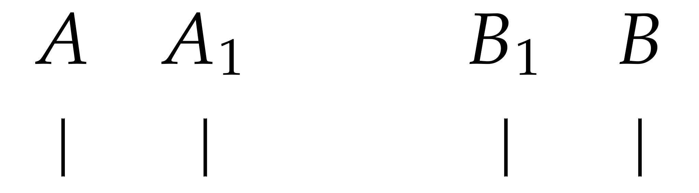

so the segment 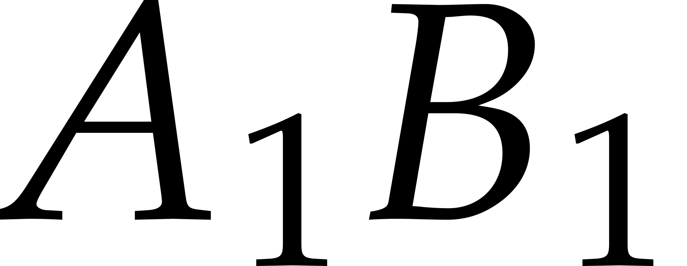 is certainly painted.” Here infinitely many sentences seem to follow from one. This inference does, however, have the character of something constructed. As if what was really at issue were not (a) thought but a more complicated machine. – As if these inferences were predetermined to perform particular services.

### [105\[2\]](https://cdn.wittgensteinnachlass.com/2000px/webp/Ms-109/105.webp)

For we ask ourselves: when we think that we have painted the whole segment from A to B, we seem to be thinking something simple & not at all something from which, say, 1000 sentences might then follow. – Not something that would contain 1000 sentences. – We feel that if these sentences follow from the first, then it is by way of a hypothesis & not because they really lie in it. Indeed, the first sentence, taken as a sentence, has something simple about it. And if I am right, not even _one_ sentence of that kind can follow from it. And it is the same when, for example, visual space is in question. A white surface seen without division does not consist of two halves. For if one were to describe it by describing two halves, one would not have described the undivided surface.

### [105\[3\]](https://cdn.wittgensteinnachlass.com/2000px/webp/Ms-109/105.webp)

“A surface seen as undivided has no parts.”

### [105\[4\]](https://cdn.wittgensteinnachlass.com/2000px/webp/Ms-109/105.webp),[106\[1\]](https://cdn.wittgensteinnachlass.com/2000px/webp/Ms-109/106.webp)

But I can still predict: the left half of this white surface in the visual field will turn brown. So I make myself a picture (of some kind) of a divided surface whose ends represent the ends of the surface seen.

(Let us imagine a surface half white, half black & the black half turns white; then the division _disappears_.)

### [106\[2\]](https://cdn.wittgensteinnachlass.com/2000px/webp/Ms-109/106.webp)

But let us imagine a graduated scale laid against the surface, so that, say, we had before us first the picture  then the picture 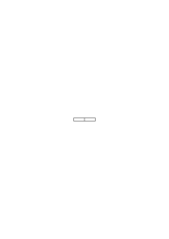 and then ; then from the fact that the first strip is white throughout it does not at all follow that in the second & third everything but the graduation marks is white.

### [106\[3\]](https://cdn.wittgensteinnachlass.com/2000px/webp/Ms-109/106.webp),[107\[1\]](https://cdn.wittgensteinnachlass.com/2000px/webp/Ms-109/107.webp)

The normal conception of the example of painting is characterized by its making no difference whether we imagine the marks A' & B' to be present already when the rod is painted, or whether we measure off the segment A'B' on it only later. – If the marks A' & B' are already here from the outset, then that second sentence does indeed follow from the first (then the complexity is plainly already present in the first sentence); but then only as many sentences follow from the first as correspond to its complexity (hence never infinitely many).

### [107\[2\]](https://cdn.wittgensteinnachlass.com/2000px/webp/Ms-109/107.webp)

When I say “there is a black spot in the square”, it always seems to me as if I again had something simple before me. As if I need not think of different possible positions & sizes. And yet one can say: if there is a spot in the square, it must be somewhere & have some shape. But there can certainly be no question of my thinking in advance of _all_ the possible positions (etc.) of a spot. – Rather, in the first sentence I seem to catch them, so to speak, through a sieve, so that “spot within the square” seems to correspond to _one_ impression for which the where etc. does not yet come into consideration at all, as if it were (despite all appearances) something connected with that first state of affairs only physically, not logically.

### [107\[3\]](https://cdn.wittgensteinnachlass.com/2000px/webp/Ms-109/107.webp)

(The cruder the pictures I make for myself, the better.)

### [107\[4\]](https://cdn.wittgensteinnachlass.com/2000px/webp/Ms-109/107.webp),[108\[1\]](https://cdn.wittgensteinnachlass.com/2000px/webp/Ms-109/108.webp)

The expression “sieve” enters the investigation in this way: if, for instance, I look at a landscape through a glass that lets through only differences of darkness & brightness, but not differences of colour, one can call such a glass a sieve. Now if one imagines looking at the square through a glass that would let through only the difference between the spot being inside and its not being inside, but not a difference in the position of the spot within the square, we could speak of a sieve here too. The question is, is _such_ a sieve conceivable?

### [108\[2\]](https://cdn.wittgensteinnachlass.com/2000px/webp/Ms-109/108.webp)

But there can in fact be no question of a sieve here, I believe.

### [108\[3\]](https://cdn.wittgensteinnachlass.com/2000px/webp/Ms-109/108.webp)

07.09.1930

We must know what _explanation_ means. There is a constant danger of wanting to use this word in logic in a sense taken from physics.

### [108\[4\]](https://cdn.wittgensteinnachlass.com/2000px/webp/Ms-109/108.webp)

Misunderstanding this word is one of the chief dangers in philosophy.

### [108\[5\]](https://cdn.wittgensteinnachlass.com/2000px/webp/Ms-109/108.webp),[109\[1\]](https://cdn.wittgensteinnachlass.com/2000px/webp/Ms-109/109.webp)

When I say the spot lies in the square, I know – and must know – that there are different possible positions for it. But also that I could not give a definite number for all such positions. I do not know in advance how many positions “I could distinguish”. – And an experiment on this does not teach me what I want to know here either. Unless it showed me positions that I would have to call neighbouring _in themselves_. That would, of course, not be an experimental result. And since as things stand I know of no neighbouring positions anyway, the question of divisibility fades into obscurity for me.

### [109\[2\]](https://cdn.wittgensteinnachlass.com/2000px/webp/Ms-109/109.webp)

The obscurity surrounding the possibilities of position etc. is the present logical situation. Just as dim lighting is also a definite lighting condition.

### [109\[3\]](https://cdn.wittgensteinnachlass.com/2000px/webp/Ms-109/109.webp)

Surely it cannot come down to this: that infinitely many sentences cannot follow from one, but one can follow from infinitely many.

### [109\[4\]](https://cdn.wittgensteinnachlass.com/2000px/webp/Ms-109/109.webp)

It is important that I could not paint the state of affairs: the circle is somewhere in the square, without painting a particular case, which, however, is not what I mean here.

### [109\[5\]](https://cdn.wittgensteinnachlass.com/2000px/webp/Ms-109/109.webp)

I should prefer to represent the state of affairs by a loose circle in the square, or by throwing the circle, so to speak, into the square without showing where it lands.

### [110\[1\]](https://cdn.wittgensteinnachlass.com/2000px/webp/Ms-109/110.webp)

It is always as if one could not fully survey a logical form, since one does not know how many, or which, possible positions there are for the spot in the quadrilateral. On the other hand, one does know, since none of them surprises one when it occurs.

### [110\[2\]](https://cdn.wittgensteinnachlass.com/2000px/webp/Ms-109/110.webp)

But that would be so with everything one sees. If I see a strange flower the like of which I have never seen, I am not surprised by its _possibility_, & yet I am surprised because I had never imagined anything like it.

### [110\[3\]](https://cdn.wittgensteinnachlass.com/2000px/webp/Ms-109/110.webp)

It is as if one saw the general in the particular & compared _that_ with the general sentence, without paying (much) attention to the particular (one sets the particular aside). And yet the general is bound to something particular.

### [110\[4\]](https://cdn.wittgensteinnachlass.com/2000px/webp/Ms-109/110.webp)

It is as if the general thought articulated reality differently.

### [110\[5\]](https://cdn.wittgensteinnachlass.com/2000px/webp/Ms-109/110.webp)

One could say that a sentence is always a sieve (which sorts, lets one thing through and holds another back). And then the general sentence is one too.

### [111\[1\]](https://cdn.wittgensteinnachlass.com/2000px/webp/Ms-109/111.webp)

There is also something wrong here with the concept of a _definite_ position.

### [111\[2\]](https://cdn.wittgensteinnachlass.com/2000px/webp/Ms-109/111.webp)

A position is definite if it is determinable; if it is determined by a specification.

### [111\[3\]](https://cdn.wittgensteinnachlass.com/2000px/webp/Ms-109/111.webp)

One can specify the definite position in visual space only by means of graphic pictures. And here we enter the domain of representation by imitation rather than by a language of signs. And here real problems await us. What is essential about what we cannot represent in words? – But doesn’t this begin wherever we have to call on a mental image at all? Thus wherever, for example, red & blue are spoken of, even when no quite definite shades of these colours are at issue.

### [111\[4\]](https://cdn.wittgensteinnachlass.com/2000px/webp/Ms-109/111.webp)

For exactly corresponding cases also arise with the circle in the square. For example, I need no drawing to understand what it means for the spot to lie in the upper left quarter of the square. (One can also allude to a particular memory in the description. “It looks like a …”)

### [112\[1\]](https://cdn.wittgensteinnachlass.com/2000px/webp/Ms-109/112.webp)

“If the spot lies _there_, then it lies _in_ the quadrilateral”. – – – –

### [112\[2\]](https://cdn.wittgensteinnachlass.com/2000px/webp/Ms-109/112.webp)

In what sense does the general thought here foresee every particular case? I say: I cannot learn a new possibility through experience.

### [112\[3\]](https://cdn.wittgensteinnachlass.com/2000px/webp/Ms-109/112.webp)

(The difficult thing is to see the _system_ of grammar.)

### [112\[4\]](https://cdn.wittgensteinnachlass.com/2000px/webp/Ms-109/112.webp)

I should like to say that in the sentence “a spot lies in the square” there is no question at all of the particular position. I do not then see the position in the picture ; I disregard it. As if, say, the distances from the sides of the square could stretch & contract and their length did not count.

### [112\[5\]](https://cdn.wittgensteinnachlass.com/2000px/webp/Ms-109/112.webp),[113\[1\]](https://cdn.wittgensteinnachlass.com/2000px/webp/Ms-109/113.webp)

We look at the picture & disregard the distances of the circle from the sides. They do not count. “I do not look at the position; it does not matter.” I should like to make it actually blur. Indeed, can’t the spot actually move about within the quadrilateral? Isn’t that just a special case of _its_ being in the quadrilateral? Then it would not, after all, be the case that the spot must be at a particular place in the quadrilateral if it is in it at all.

### [113\[2\]](https://cdn.wittgensteinnachlass.com/2000px/webp/Ms-109/113.webp)

I want to say that there seems to be a relation of the spot to the boundary that is independent of the distance. – As if there were a geometry in which there is no distance, but there is an inside & an outside. Seen in this way, the pictures  and 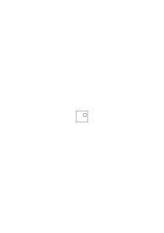 are indeed the same too.

### [113\[3\]](https://cdn.wittgensteinnachlass.com/2000px/webp/Ms-109/113.webp)

If someone did not understand what the sentence “a circle is in the square” says, one would explain it to him in some such way as this: it is either like this  or like this  or like this  etc., & would thus show a few positions of the circle. But of course this explanation is to be understood only as showing a rule, like the first terms of a formal series.

### [113\[4\]](https://cdn.wittgensteinnachlass.com/2000px/webp/Ms-109/113.webp)

(But I believe there is still something wrong with my whole conception of generality.)

### [113\[5\]](https://cdn.wittgensteinnachlass.com/2000px/webp/Ms-109/113.webp),[114\[1\]](https://cdn.wittgensteinnachlass.com/2000px/webp/Ms-109/114.webp)

The sentence “the spot is in the square” as it were _itself_ merely keeps the spot within the square, that is, it restricts the spot’s freedom only in this way & otherwise gives it freedom. The sentence then forms a frame that limits the spot’s freedom & leaves it free inside, that is, _has nothing to do_ with its position. – But for this the sentence (as it were a box in which the circle – otherwise free – is shut up) must have the logical nature of this frame, & it does, for I could explain the sentence to someone & then set out those possibilities, & do so (quite) independently of whether such a sentence is true or not, hence independently of a fact.

### [114\[2\]](https://cdn.wittgensteinnachlass.com/2000px/webp/Ms-109/114.webp)

But can one now say that the sentence follows from infinitely many? – That is, that there would be, as it were, infinitely many around it, of which it is the common constituent?

### [114\[3\]](https://cdn.wittgensteinnachlass.com/2000px/webp/Ms-109/114.webp)

08.09.1930

(From seeing a thought in the distance to recognizing it quite clearly is not as far as it seems at first.)

### [114\[4\]](https://cdn.wittgensteinnachlass.com/2000px/webp/Ms-109/114.webp),[115\[1\]](https://cdn.wittgensteinnachlass.com/2000px/webp/Ms-109/115.webp)

For the sentence to leave reality _free_ in one respect means that it exerts _no_ influence on reality in that respect (that is, reality exerts none on its truth). That it knows nothing of reality in that respect. The sentence keeps reality on a leash & as long as the leash is not pulled taut (because reality moves within its radius), it is no concern of the sentence.

### [115\[2\]](https://cdn.wittgensteinnachlass.com/2000px/webp/Ms-109/115.webp)

It seems to me that everything is said by the sentence “the spot is in the quadrilateral” being understood. And by what follows from it (& what it follows from) being determined by its being understood; _not_ by whether it is true or false.

### [115\[3\]](https://cdn.wittgensteinnachlass.com/2000px/webp/Ms-109/115.webp)

That is, from the fact that it is understood, that it has a definite sense, I draw the confidence that there are definite rules of grammar for it, rules that determine precisely its sense, & that the indeterminacy in it nevertheless defines a definite range of freedom (definite by its nature). – That the sentences that follow from it, & those it follows from, are determined by what it means, not by the facts: that is what I really mean when I say there would be no surprises in it. For grammar – the game – is where there are no surprises, & a picture  that I might make of an expected situation belongs among the _signs_, and so is governed by grammar.

### [115\[4\]](https://cdn.wittgensteinnachlass.com/2000px/webp/Ms-109/115.webp),[116\[1\]](https://cdn.wittgensteinnachlass.com/2000px/webp/Ms-109/116.webp)

Now this is connected with the meaning of the “_definite position_” of the spot in the quadrilateral. If we cannot speak of determination by measurement, then the sign (picture) is the _sole_ determination & is therefore autonomous (in a certain sense).

### [116\[2\]](https://cdn.wittgensteinnachlass.com/2000px/webp/Ms-109/116.webp)

One cannot determine this picture otherwise than by the picture itself. That is why it is not, as one might think, an inexact determination, but an exact one.

### [116\[3\]](https://cdn.wittgensteinnachlass.com/2000px/webp/Ms-109/116.webp)

Of course, “position of the circle in this square” is not a concept with the particular position an object falling under it.

### [116\[4\]](https://cdn.wittgensteinnachlass.com/2000px/webp/Ms-109/116.webp)

A thought moves astonishingly quickly from the great distance at which it first appears to the immediate proximity in which we see it clearly.

### [116\[5\]](https://cdn.wittgensteinnachlass.com/2000px/webp/Ms-109/116.webp)

As though objects were found which one ascertains are also positions of the circle in the square, but of which one previously knew nothing.

### [116\[6\]](https://cdn.wittgensteinnachlass.com/2000px/webp/Ms-109/116.webp),[117\[1\]](https://cdn.wittgensteinnachlass.com/2000px/webp/Ms-109/117.webp)

That is, ‘position of the circle in the square’ cannot be an amorphous concept. I also know that if two positions differ, one must be above, below, to the right or to the left of the other. That there is a position at the centre of the square & one to the right, to the left, etc. of the centre, but, for example, no position seen in which the circle is only a 23rd of its diameter from the midpoint of the lower edge.

### [117\[2\]](https://cdn.wittgensteinnachlass.com/2000px/webp/Ms-109/117.webp)

The central position of the circle & other distinguished positions are, incidentally, entirely analogous to the primary colours in the colour scale. (This simile could usefully be taken further.)

### [117\[3\]](https://cdn.wittgensteinnachlass.com/2000px/webp/Ms-109/117.webp)

But what about this inference: “If a circle of the same size as this one fits into the triangle, then _every_ smaller one fits into it too”? For I still cannot

see why it should not be possible for infinitely many sentences to follow from one according to a rule, _in the very same sense, namely,_ in which one sentence can follow from infinitely many. Although something says that this is so, the formulation is not right.

### [117\[4\]](https://cdn.wittgensteinnachlass.com/2000px/webp/Ms-109/117.webp),[118\[1\]](https://cdn.wittgensteinnachlass.com/2000px/webp/Ms-109/118.webp)

For if it follows from the circle’s being in the square _there_ that it is in the square, does it not also follow that it is in every square one draws enclosing the first? Or must I say that such a sentence follows only if a square enclosing the first is _there_? So that only the possibility of sentences following from the first in this way is infinite, but one cannot speak of infinitely many such sentences.

### [118\[2\]](https://cdn.wittgensteinnachlass.com/2000px/webp/Ms-109/118.webp)

“It follows from infinitely many sentences” would mean: one can continue the series of sentences from which it follows to infinity. But instead of “to infinity” one would have to say “one can continue it indefinitely”. Yet even that does not quite get at my difficulty. For something in me rebels not only against infinitely many sentences following from one, but also against 1000 sentences following from one so simple. What I am dealing with here is not at all the difficulty of conceiving infinity, which I believe is easy to overcome, but quite a different difficulty.

### [118\[3\]](https://cdn.wittgensteinnachlass.com/2000px/webp/Ms-109/118.webp),[119\[1\]](https://cdn.wittgensteinnachlass.com/2000px/webp/Ms-109/119.webp)

Now it is indeed clear that “the circle is in the square” follows from 1000 sentences of the form “the circle is at _that_ place in the square”; at least if it follows from even _one_ such sentence.

And on the other hand: if even _one_ sentence of the kind “this smaller circle fits into it” follows from “_this_ circle fits into the square”, then one cannot see why 1000 such sentences should not follow from the one. And so the problem has shifted elsewhere.

### [119\[2\]](https://cdn.wittgensteinnachlass.com/2000px/webp/Ms-109/119.webp)

09.09.1930

Is not the question whether I can dilute the sense of a sentence to infinity? That is, dilute it as much as I please. One can speak of dilution & concentration of sense.

### [119\[3\]](https://cdn.wittgensteinnachlass.com/2000px/webp/Ms-109/119.webp)

Of course one can dilute indefinitely (disjunction, etc., already makes that possible), but only in this way do as many sentences as one pleases follow from _one_, & from mere dilution we learn nothing new. – – –

### [119\[4\]](https://cdn.wittgensteinnachlass.com/2000px/webp/Ms-109/119.webp),[120\[1\]](https://cdn.wittgensteinnachlass.com/2000px/webp/Ms-109/120.webp)

Can we imagine a language that operates only with primary sentences, and not with hypotheses? (Could one imagine, for instance, human beings who know nothing of hypotheses but possess a language?)

### [120\[2\]](https://cdn.wittgensteinnachlass.com/2000px/webp/Ms-109/120.webp)

But does that mean anything? After all, we do not form hypotheses from new material for knowledge, but from sentences, & sentences without the possibility of hypotheses are as inconceivable as multiplication without the possibility of extracting roots.

### [120\[3\]](https://cdn.wittgensteinnachlass.com/2000px/webp/Ms-109/120.webp)

Does the essence of the hypothesis depend on the concept of time? I.e. would there be no hypotheses without time, & what does this question mean at all?

### [120\[4\]](https://cdn.wittgensteinnachlass.com/2000px/webp/Ms-109/120.webp)

How is it expressed that time belongs to phenomenology but the truth-functions do not? And how is what we feel expressed, namely that the truth-functions are more fundamental than the phenomenological? For this too, I believe, must be expressed in grammar alone.

### [120\[5\]](https://cdn.wittgensteinnachlass.com/2000px/webp/Ms-109/120.webp)

10.09.1930

That a hypothesis adds no new material to a sentence can also be seen from the fact that a hypothesis becomes a sentence by means of the expression “it seems” (or an expression corresponding to it).

### [120\[6\]](https://cdn.wittgensteinnachlass.com/2000px/webp/Ms-109/120.webp),[121\[1\]](https://cdn.wittgensteinnachlass.com/2000px/webp/Ms-109/121.webp)

If grammar lay before us in the form of a book, it would not consist of a series of chapters merely set side by side, but would exhibit a different structure. And in this structure one would – if I am right – also have to see the difference between the phenomenological & the non-phenomenological. There would, for example, be a chapter on colours, in which the use of colour words would be regulated; but what grammar would say about the words not, or, etc. (the “logical constants”) would not be comparable to that. For example, it would follow from the rules that these latter words were to be applied in every sentence (but not the colour words). And this “every” would not have the character of empirical generality, but of the unappealable generality of a supreme rule of the game. It seems to me rather like the way one can presumably play chess (or at least continue playing it) without certain pieces, but never without the chessboard.

### [121\[2\]](https://cdn.wittgensteinnachlass.com/2000px/webp/Ms-109/121.webp),[122\[1\]](https://cdn.wittgensteinnachlass.com/2000px/webp/Ms-109/122.webp)

Can the essential difference between “logical & phenomenological constants” also show itself in grammar alone? Is a theory not needed here after all? Perhaps one that distinguishes between two kinds of grammar? (I would like to say: what emerges from the rules of chess is not only the difference between the knight & the bishop but also the difference between the chess pieces & the chessboard.) And consider: is the theory supposed to say something about negation & the colour red that makes the difference between them clear? Or is it merely supposed to say that there are different kinds of interpretation of signs here? That would then be something that could be expressed with the help of different indices, & we would arrive here only at an extension of grammar.

### [122\[2\]](https://cdn.wittgensteinnachlass.com/2000px/webp/Ms-109/122.webp)

I always want to show that everything that is business in logic must be stated in grammar.

### [122\[3\]](https://cdn.wittgensteinnachlass.com/2000px/webp/Ms-109/122.webp)

Just as, for instance, the course of a business must be capable of being read off fully & completely from its ledgers. So that one must be able to point to the ledgers and say: Here! This is where everything must show up; and what does not show up here does not count. For in the end everything must come out here.

### [123\[1\]](https://cdn.wittgensteinnachlass.com/2000px/webp/Ms-109/123.webp)

All actual business – that is what this means – must be transacted in grammar.

### [123\[2\]](https://cdn.wittgensteinnachlass.com/2000px/webp/Ms-109/123.webp)

(A fashionable bit of foolishness in popular physics today is to say that the space occupied by, say, an iron cube is not, as the layperson believes, wholly or almost wholly filled with matter, but is on the contrary nearly empty, since the electrons are tiny compared with the distances between them. In truth, however, the layperson’s view would of course be justified _however small_ one takes the electrons to be, for what corresponds in the physical hypothesis to the space’s being filled with matter in the ordinary sense, its being filled as a matter of experience, is not its being filled with electron mass at all, but _the frequency_ of the electrons.)

### [123\[3\]](https://cdn.wittgensteinnachlass.com/2000px/webp/Ms-109/123.webp),[124\[1\]](https://cdn.wittgensteinnachlass.com/2000px/webp/Ms-109/124.webp),[125\[1\]](https://cdn.wittgensteinnachlass.com/2000px/webp/Ms-109/125.webp)

What I call ‘the view of this object from here’ is also part of the hypothesis, _i.e._ of the representation. I.e. the solid body with its different views from the different points in space, or with the rule for constructing these, is all the hypothesis. I.e. the hypothesis is a system of signs & stands wholly, & completely, outside experience. It is, as it were, a many-faced solid, each face of which _can_ correspond to an experience. One could also imagine a polygon each side of which would be a measure for certain line segments lying round

the polygon & of which the polygon is a correct or incorrect depiction.

The best simile for any hypothesis & itself an example is a solid body with its views, constructed according to a definite rule, from different points in space.

One must think of the points A as determined by a coordinate system.

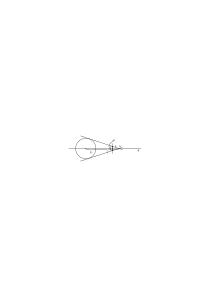

p = 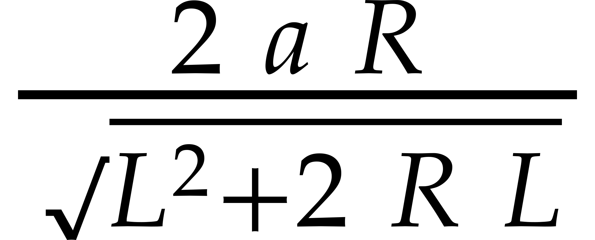

a = 1, 2 R = D 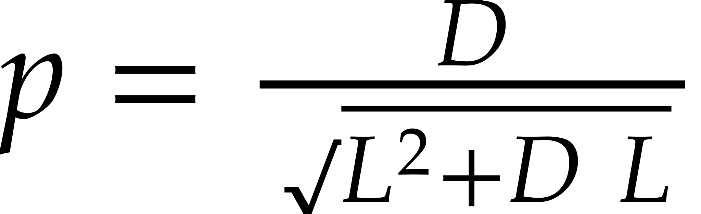 is the view of the circle from A. To say that there is a circle at a distance L from A means, then, that the view p changes, as one moves along the straight line g, in accordance with the equation.

### [125\[2\]](https://cdn.wittgensteinnachlass.com/2000px/webp/Ms-109/125.webp)

11.09.1930

One does not think at all of how remarkable 3-dimensional seeing is. How strange a picture, a photograph, would look, for instance, if we were able to see it as a distribution of grey, white & black patches on a flat surface.

What we see would then strike us as quite senseless. Likewise if we could see in two dimensions with one eye.

It is not at all clear, for example, what happens when we see objects _more three-dimensionally_ with two eyes than with one. For they look three-dimensional even when seen with one eye. And the difference between relief & sculpture in the round is not a fitting analogy either.

### [125\[3\]](https://cdn.wittgensteinnachlass.com/2000px/webp/Ms-109/125.webp)

It seems to me that the hypothesis need not necessarily have anything to do with _time_, except insofar as all sentences might deal with something temporal.

### [125\[4\]](https://cdn.wittgensteinnachlass.com/2000px/webp/Ms-109/125.webp),[126\[1\]](https://cdn.wittgensteinnachlass.com/2000px/webp/Ms-109/126.webp)

But is _that_ true? And if so, what kind of generality is this? Why, then, is time not fundamental in logic as the truth-functions are? – Is it really true that time enters into all sentences? – Here it seems to me as if it were actually mentioned only in a particular group of sentences. Does it enter wherever there is talk of a change (at all)? And does it perhaps enter _everywhere_ because every state of affairs admits of the possibility of change? Does it not enter everywhere because we can _expect_ any state of affairs? Because, then, anything can be the case in the future, or can have been the case earlier? That is: every state of affairs is an event.

### [126\[2\]](https://cdn.wittgensteinnachlass.com/2000px/webp/Ms-109/126.webp)

Yet if I say, for example, “the sky is blue” & leave aside everything hypothetical in it, time does not seem to occur here, at least not explicitly.

### [126\[3\]](https://cdn.wittgensteinnachlass.com/2000px/webp/Ms-109/126.webp)

“True” & “False” are in fact only words in a particular notation for the truth-functions.

### [126\[4\]](https://cdn.wittgensteinnachlass.com/2000px/webp/Ms-109/126.webp)

(When a problem comes vividly into view, much has always been gained already.)

### [126\[5\]](https://cdn.wittgensteinnachlass.com/2000px/webp/Ms-109/126.webp),[127\[1\]](https://cdn.wittgensteinnachlass.com/2000px/webp/Ms-109/127.webp)

I say “if I leave aside everything hypothetical” because it is certain that time plays a part in the hypothesis, but – so it seems to me – not so interesting.

### [127\[2\]](https://cdn.wittgensteinnachlass.com/2000px/webp/Ms-109/127.webp)

I think I could also ask it this way: Can one actually put every sentence into the future & the perfect tense with sense? (Not mathematical sentences, of course.)

### [127\[3\]](https://cdn.wittgensteinnachlass.com/2000px/webp/Ms-109/127.webp)

And if that is the case, how is it that it strikes us as almost accidental in comparison with the rules for negation & disjunction?

### [127\[4\]](https://cdn.wittgensteinnachlass.com/2000px/webp/Ms-109/127.webp),[128\[1\]](https://cdn.wittgensteinnachlass.com/2000px/webp/Ms-109/128.webp)

Negation & disjunction, we want to say, have to do with the essence of the proposition, whereas time does not, but has to do with its content. But how can grammar show that one thing has to do with the essence of the proposition & another does not, if they are both equally general? Or should I say that time is less general, since mathematical propositions can be negated & disjoined but are not temporal. There is presumably a connection, even if presenting the matter in this form is misleading. It seems to me as if the present, as it occurs in the sentence “the sky is Blue”, were not a form of time. As if, then, the present in _this_ sense were atemporal.

### [128\[2\]](https://cdn.wittgensteinnachlass.com/2000px/webp/Ms-109/128.webp)

But it is curious that there should be an essential & an inessential generality _in grammar_. A phenomenological & a logical one. But how do they differ from one another?

### [128\[3\]](https://cdn.wittgensteinnachlass.com/2000px/webp/Ms-109/128.webp)

How does grammar distinguish between sentential form & content? For these are supposed to be grammatical distinctions. How could one describe them if grammar does not show them? What _are we to make of_ the schema “_Things are thus & so”_? – Here “Things are” indicates the sentential form & “thus & so” stands for the content. – One could also say that “things are” is the handle the truth-functions take hold of.

### [128\[4\]](https://cdn.wittgensteinnachlass.com/2000px/webp/Ms-109/128.webp),[129\[1\]](https://cdn.wittgensteinnachlass.com/2000px/webp/Ms-109/129.webp)

My theory amounts to this: in a certain respect one cannot explain language.

### [129\[2\]](https://cdn.wittgensteinnachlass.com/2000px/webp/Ms-109/129.webp)

“Things are”, then, is only an expression in a notation for the truth-functions. An expression that shows us which part of grammar comes into operation here.

### [129\[3\]](https://cdn.wittgensteinnachlass.com/2000px/webp/Ms-109/129.webp)

Grammar is the ledger of language; from it everything must be discernible that (concerns) not feelings but hard facts.

### [129\[4\]](https://cdn.wittgensteinnachlass.com/2000px/webp/Ms-109/129.webp)

What I really want to say, then, is: There is no such thing as grammar &, on top of that, interpretation of the signs. Rather, insofar as there can be any talk of an interpretation, that is, of an explanation of the signs, grammar itself must provide it. For I need only ask: Is the interpretation to be given by means of sentences? And how should these sentences relate to the language they create?

### [129\[5\]](https://cdn.wittgensteinnachlass.com/2000px/webp/Ms-109/129.webp),[130\[1\]](https://cdn.wittgensteinnachlass.com/2000px/webp/Ms-109/130.webp)

These two kinds of generality would be as strange as if, of two rules of a game that both apply equally without exception, one were called the more fundamental. As though one could ask whether the king or the chessboard was more essential to chess. Which of the two was more essential, which more accidental.

### [130\[2\]](https://cdn.wittgensteinnachlass.com/2000px/webp/Ms-109/130.webp)

One could also ask it this way: Is a sentence that cannot be negated harder to conceive than a timeless one? – Is it easier to conceive of the phenomenological as otherwise than it is than to conceive of the logical as otherwise than it is? Or is the obstacle to conceiving the one different from the obstacle to conceiving the other? But is there any difference between nonsense & nonsense that counts for us?

### [130\[3\]](https://cdn.wittgensteinnachlass.com/2000px/webp/Ms-109/130.webp)

12.09.1930

How is one to put correctly into words what I clearly feel to be the difference between the logic of content & formal logic in the sentence? (these are still not the right expressions.) The difference between the logic of content & the logic of sentential form in general. One seems colourful, as it were, the other dull. One deals with what the picture represents, the other is, like the frame of the picture, a characteristic of pictorial form.

### [130\[4\]](https://cdn.wittgensteinnachlass.com/2000px/webp/Ms-109/130.webp),[131\[1\]](https://cdn.wittgensteinnachlass.com/2000px/webp/Ms-109/131.webp)

For it is as if one could say that although time has nothing to do with the essence _of the sentence_, it nevertheless occurs in _every_ sentence. And again one must ask: what kind of generality is this? How can I know that time occurs in every sentence unless it belongs to the essence of the sentence? I would like to answer that by saying: it belongs to the essence of reality, not to the essence of the sentence (that is, of representation by means of sentences.)

### [131\[2\]](https://cdn.wittgensteinnachlass.com/2000px/webp/Ms-109/131.webp)

But now it is curious that the time I am talking about here is not time in the physical sense. What is at issue here is not a measurement of time. And it is suspicious that something that has nothing to do with such a measurement should play a similar role in sentences to the role physical time plays in the hypotheses of physics.

### [131\[3\]](https://cdn.wittgensteinnachlass.com/2000px/webp/Ms-109/131.webp)

It is also incomprehensible that time, if it belongs to the _essence_ of reality, should not evidently belong to the essence of the sentence.

### [131\[4\]](https://cdn.wittgensteinnachlass.com/2000px/webp/Ms-109/131.webp)

It looks as if we could get outside our world after all: if not outside the logic of sentential form, then at least beyond the phenomenological boundary.

### [131\[5\]](https://cdn.wittgensteinnachlass.com/2000px/webp/Ms-109/131.webp),[132\[1\]](https://cdn.wittgensteinnachlass.com/2000px/webp/Ms-109/132.webp)

At the very least, a question seems warranted: if I had written out the grammar & the various chapters, on colour words, etc., etc., were set down one after another, like rules for all the pieces in chess, how would I know that these were now _all_ the chapters? And if the chapters that are there all share a common feature, then here apparently we are dealing with a logical generality, but not an essential, i.e. foreseeable, generality. But surely one cannot say that the fact that chess is played with 16 pieces is less essential to it than the fact that it is played on a chessboard.

### [132\[2\]](https://cdn.wittgensteinnachlass.com/2000px/webp/Ms-109/132.webp)

It is evident that the character of the temporal lies in the meaning of the words “earlier” “later” etc. In the series formed in this way. And the question is whether we experience each experience as a member of the series. – Nor does duration seem to me to enter directly into every experience.

### [132\[3\]](https://cdn.wittgensteinnachlass.com/2000px/webp/Ms-109/132.webp),[133\[1\]](https://cdn.wittgensteinnachlass.com/2000px/webp/Ms-109/133.webp)

One could say that what is at issue are the words “earlier” & “later” on the one hand & “not” & “or” on the other. And what we would see is that where the latter words are applicable, the former need not always be applicable too.

### [133\[2\]](https://cdn.wittgensteinnachlass.com/2000px/webp/Ms-109/133.webp)

For how is the temporality of facts revealed, how is it expressed, except in the requirement that certain turns of phrase occur in the sentences? That is: How is the temporality of facts expressed, if not grammatically?!

### [133\[3\]](https://cdn.wittgensteinnachlass.com/2000px/webp/Ms-109/133.webp)

Language cannot be taught by means of an explanation.

### [133\[4\]](https://cdn.wittgensteinnachlass.com/2000px/webp/Ms-109/133.webp)

Since time & truth-functions taste so different, & since they reveal their essence solely & entirely in grammar, grammar must explain the difference in taste.

### [133\[5\]](https://cdn.wittgensteinnachlass.com/2000px/webp/Ms-109/133.webp)

One tastes of content, the other of form of representation.

### [133\[6\]](https://cdn.wittgensteinnachlass.com/2000px/webp/Ms-109/133.webp)

They taste as different as the plan & the line drawn through the plan.

### [133\[7\]](https://cdn.wittgensteinnachlass.com/2000px/webp/Ms-109/133.webp)

I believe that the _essential_ feature of truth-functions is that they cancel one another out.

### [133\[8\]](https://cdn.wittgensteinnachlass.com/2000px/webp/Ms-109/133.webp),[134\[1\]](https://cdn.wittgensteinnachlass.com/2000px/webp/Ms-109/134.webp)

But one more thing: reality outside the sign does play a part in the symbol, & let us consider whether that is not where the difference between content & truth-function lies. For everything that belongs to the sense belongs to the symbol.

### [134\[2\]](https://cdn.wittgensteinnachlass.com/2000px/webp/Ms-109/134.webp)

When one says that a proposition is anything that can be true or false, that means _the same_ as: a proposition is anything that can be negated.

### [134\[3\]](https://cdn.wittgensteinnachlass.com/2000px/webp/Ms-109/134.webp)

The possibility of the truth-function is what we take to be the essence of the proposition. The truth-function is the representative of *sentential* form. – – – What I mean is that when we speak of what is essential to sentential form as such, we mean the truth-function.

### [134\[4\]](https://cdn.wittgensteinnachlass.com/2000px/webp/Ms-109/134.webp)

13.09.1930

When I say “I am going there now”, the symbol contains a number of things that are not in the sign alone. The sentence, if I come across it somewhere, say, written on a slip of paper in an unknown hand, says nothing at all; the word “I”, the word “now” & “there” are meaningless on their own without the presence of the person speaking, the present situation & the direction indicated in space.

### [134\[5\]](https://cdn.wittgensteinnachlass.com/2000px/webp/Ms-109/134.webp),[135\[1\]](https://cdn.wittgensteinnachlass.com/2000px/webp/Ms-109/135.webp)

“Now”, “earlier”, “here”, “there”, “I”, “you”, “this” are words of this kind for making a connection with reality. “But the reality that in this way belongs to the symbol falls within the domain of grammar.”

### [135\[2\]](https://cdn.wittgensteinnachlass.com/2000px/webp/Ms-109/135.webp)

If I say that a sentence of, say, set theory is in order but must be given a new interpretation, that means only that this part of set theory is left intact in itself but must be put into a different grammatical setting.

### [135\[3\]](https://cdn.wittgensteinnachlass.com/2000px/webp/Ms-109/135.webp)

I say to someone “go there”; he hears the words but does not understand them, since I did not look at him as I spoke. This is like a map without a rule for orientation.

### [135\[4\]](https://cdn.wittgensteinnachlass.com/2000px/webp/Ms-109/135.webp)

Now one might ask: Is the compass rose still part of the map?

Or rather: Is the rule according to which the compass rose is applied still part of the map? And it is clear that I can replace this rule with another rule for orientation, in which there is no mention of the compass rose, but instead, say, of a path on the map & of what corresponds to it in the area.

### [135\[5\]](https://cdn.wittgensteinnachlass.com/2000px/webp/Ms-109/135.webp),[136\[1\]](https://cdn.wittgensteinnachlass.com/2000px/webp/Ms-109/136.webp)

Instead of the words “Go there” it might equally be “Ludwig, go there” & then I might know who was meant. The personal name then corresponds to the compass rose, which is likewise of no use without a rule for its application. For “East” & “West”, or alternatively “Sun”, are names just like that personal name.

### [136\[2\]](https://cdn.wittgensteinnachlass.com/2000px/webp/Ms-109/136.webp)

So in my sentences a name can function in place of the word “this”, an indication of time in place of “now”, the name of a direction in place of “there”. And then this name is just as much and just as little open to misunderstanding as, say, pointing with one’s finger, which of course must also be interpreted and does not already carry its own interpretation within it. (I.e. is also only a _sign_.) And on the other hand, to have meaning, the indication of time must refer to a clock that is there, the personal name to a person who is there; or at least there must be a method for finding out whether this person is there, & for that a connection with the actual world must again have been made.

### [136\[3\]](https://cdn.wittgensteinnachlass.com/2000px/webp/Ms-109/136.webp)

But I did say already that the map must be connected with reality by a rule of translation.

### [136\[4\]](https://cdn.wittgensteinnachlass.com/2000px/webp/Ms-109/136.webp),[137\[1\]](https://cdn.wittgensteinnachlass.com/2000px/webp/Ms-109/137.webp)

A sign means what it does according to how it is applied right now; so one cannot anticipate this application.

### [137\[2\]](https://cdn.wittgensteinnachlass.com/2000px/webp/Ms-109/137.webp)

What I want to say is that one can indeed, e.g. by pointing, incorporate an object, say a clock, into the map, & it then belongs to the map, perhaps as an essential component, but it thereby now belongs to the picture; the interpretation of this picture has not thereby been carried out.

### [137\[3\]](https://cdn.wittgensteinnachlass.com/2000px/webp/Ms-109/137.webp)

I say “I can sing this theme”, I try & get stuck. Could I sing it, then, when I said I could sing it, so that in any case I was right to say it, or did my getting stuck prove that I was wrong? That depends. etc. etc.

### [137\[4\]](https://cdn.wittgensteinnachlass.com/2000px/webp/Ms-109/137.webp)

Let us now imagine, for example, that I bring a person into a plan in this way by pointing, say by saying “You will go this way” & handing him a plan. In any case the person in question then plays quite a different role in the plan from that of the lines, points, etc. of the plan.

### [137\[5\]](https://cdn.wittgensteinnachlass.com/2000px/webp/Ms-109/137.webp),[138\[1\]](https://cdn.wittgensteinnachlass.com/2000px/webp/Ms-109/138.webp)

If (in a sentence “I want you to go there”) the speaker, the person addressed & the arrow pointing in the direction belong to the symbolism, then at any rate they play quite a different role in it from that of the words.

### [138\[2\]](https://cdn.wittgensteinnachlass.com/2000px/webp/Ms-109/138.webp)

But if grammar is to encompass the whole symbolism, how is it apparent in grammar that the words “I”, “you”, “this”, etc. need to be supplemented by objects of reality?

### [138\[3\]](https://cdn.wittgensteinnachlass.com/2000px/webp/Ms-109/138.webp)

For it is _grammar_ that must say that that sentence says nothing without such a supplement. If it is to be the complete ledger of language (as I call it.)

### [138\[4\]](https://cdn.wittgensteinnachlass.com/2000px/webp/Ms-109/138.webp)

If, for example, I say “the circle has this position in the quadrilateral 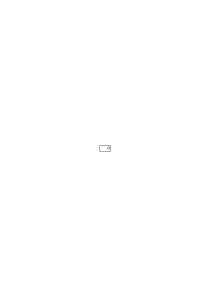”; does the drawing play the same role here as the arrow does there? Or: does what the drawn plan has in common with the actual route play the same role in the plan as the person to whom I hand it to carry out plays in the order?

### [138\[5\]](https://cdn.wittgensteinnachlass.com/2000px/webp/Ms-109/138.webp)

“For children to understand the arithmetic of primary school, they would have to be great philosophers; failing that, they need practice.”

### [138\[6\]](https://cdn.wittgensteinnachlass.com/2000px/webp/Ms-109/138.webp),[139\[1\]](https://cdn.wittgensteinnachlass.com/2000px/webp/Ms-109/139.webp)

Could I put it like this: the sign has various things in common with reality, among them spatial properties, directions, colours, but also bodies or patches of colour, as the case may be.

### [139\[2\]](https://cdn.wittgensteinnachlass.com/2000px/webp/Ms-109/139.webp)

How does grammar explain the word “now”? Presumably by the rules it gives for its use.

The same goes for the word “I”.

### [139\[3\]](https://cdn.wittgensteinnachlass.com/2000px/webp/Ms-109/139.webp)

Is there an analogy here with what was said about the word “not”? And how do the two cases differ?

### [139\[4\]](https://cdn.wittgensteinnachlass.com/2000px/webp/Ms-109/139.webp)

Language cannot be taught by explanation – but it is taught by example & that is important. Let us always remember how the essence of a series of forms is shown by giving some of its members.

### [139\[5\]](https://cdn.wittgensteinnachlass.com/2000px/webp/Ms-109/139.webp)

14.09.1930

Grammar explains the meaning of words to the extent that it can be explained. And it can be explained to the extent that there is a question to be asked about it, & one can ask about it to the extent that it can be explained.

### [139\[6\]](https://cdn.wittgensteinnachlass.com/2000px/webp/Ms-109/139.webp)

What is the meaning of a word? The expression “the word has meaning” is intelligible. The unit of expression is then “to have meaning” & the question “_What_ does it mean”, “what meaning does it have”, must then have no sense.

### [140\[1\]](https://cdn.wittgensteinnachlass.com/2000px/webp/Ms-109/140.webp)

How does one explain the meaning of the word “now”? – for that is, after all, what philosophy wants to do.

### [140\[2\]](https://cdn.wittgensteinnachlass.com/2000px/webp/Ms-109/140.webp)

Meaning can only be what we explain in the explanation of a word.

### [140\[3\]](https://cdn.wittgensteinnachlass.com/2000px/webp/Ms-109/140.webp)

One always has the mistaken idea that the meaning of a word is a matter of an object, i.e. a thing, in the sense in which the sword Nothung was the meaning of the word “Nothung”. But something is not right here either, for I can say “Nothung no longer exists” & is ‘Nothung’ here perhaps meaningless precisely because the sword no longer exists? – – –

### [140\[4\]](https://cdn.wittgensteinnachlass.com/2000px/webp/Ms-109/140.webp)

I could imagine someone pointing to the current position of the hands of a clock in order to explain the word “now”. Just as, to explain the expression “in five minutes”, he can point to the numeral on the clock where the hand will be in 5 minutes.

Clearly all that this does is to incorporate the clock into our language of signs.

### [141\[1\]](https://cdn.wittgensteinnachlass.com/2000px/webp/Ms-109/141.webp)

The word “now” works, as it were, like the strike of a timepiece. It indicates a time by sounding.

One can, indeed, actually replace it with another time signal. When one says, for example: do that when I clap my hands. The clap is then a time signal, just as the arrow is a sign of direction when I say “I am going → there”.

### [141\[2\]](https://cdn.wittgensteinnachlass.com/2000px/webp/Ms-109/141.webp)

If, for example, I am told what someone else said yesterday: “such & such is happening now”, then I must understand that the sentence, when I hear it, cannot be verified in the way it would have to be verified if its speaker were to utter it now. Similarly, if I said yesterday “it happens today”, that amounts to the same as saying today “it happened yesterday”.

### [141\[3\]](https://cdn.wittgensteinnachlass.com/2000px/webp/Ms-109/141.webp)

But I must distinguish between the strict part of the explanation of a word and the sulphur that serves to elucidate it in an indefinite way.

### [141\[4\]](https://cdn.wittgensteinnachlass.com/2000px/webp/Ms-109/141.webp),[142\[1\]](https://cdn.wittgensteinnachlass.com/2000px/webp/Ms-109/142.webp)

If I wanted to talk about two circular patches on this paper, say about the change in their colour, then I could call the two A & B & write the names above the circles as a sign of what I call them. But is it an explanation

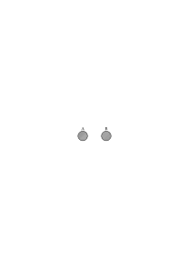

if I say that the name designates the circle below it? It is an explanation, for in certain cases one might be in doubt whether the name belongs to the circle below it or to one above it. But does that explain what it means for a name _to belong to a circle_?

### [142\[2\]](https://cdn.wittgensteinnachlass.com/2000px/webp/Ms-109/142.webp)

15.09.1930

The only thing that does not belong to grammar is what makes a sentence true or false. That alone is not the concern of grammar. All the conditions for comparing the sentence with the facts belong to grammar. That is, all the conditions of understanding. (All the conditions of sense.)

### [142\[3\]](https://cdn.wittgensteinnachlass.com/2000px/webp/Ms-109/142.webp)

Instead of writing the names A & B above their circles, we could also have pointed to the circles and said “this is A, this is B” & this sentence is more correctly put as “this is called ‘A’, this is called ‘B’”.

### [142\[4\]](https://cdn.wittgensteinnachlass.com/2000px/webp/Ms-109/142.webp),[143\[1\]](https://cdn.wittgensteinnachlass.com/2000px/webp/Ms-109/143.webp)

Now if one says “he is called Ludwig”, grammar must tell us that this sequence of words has no sense unless it is supplemented by an act of pointing. The formula “may I introduce Mr N. to you” says nothing if one does not actually introduce anyone.

### [143\[2\]](https://cdn.wittgensteinnachlass.com/2000px/webp/Ms-109/143.webp)

Does introducing things (in this sense) really belong to grammar?

### [143\[3\]](https://cdn.wittgensteinnachlass.com/2000px/webp/Ms-109/143.webp)

If at a gathering I hear people speak of a Mr N. whom I do not know, saying that he is travelling with his wife etc. etc., these sentences are not complete nonsense to me, even if N. has never been introduced to me.

### [143\[4\]](https://cdn.wittgensteinnachlass.com/2000px/webp/Ms-109/143.webp)

If the circle A has already disappeared, one can still talk about it.

### [143\[5\]](https://cdn.wittgensteinnachlass.com/2000px/webp/Ms-109/143.webp)

Isn’t this too a sentence: I point first to one circle, then to the other & say as I do so “– – – greater than – – –”? And aren’t the very things that I translate into names when introducing them functioning here as signs? Or when I point to two people & say: “↖ cleverer than ↗”. In this sense I could also point to the current position of the hands of a clock and say “he is coming ↗” & mean “he is coming now”.

### [144\[1\]](https://cdn.wittgensteinnachlass.com/2000px/webp/Ms-109/144.webp)

I can still talk about the circles A & B when they no longer exist – on the other hand, the sign (everything that belongs to the sign) of the sentence I utter must exist.

I believe that the signs “A” & “B” have a different meaning when the circles to which they belonged no longer exist; they then stand for descriptions & if someone then asks what does A mean? I cannot answer “this circle” but must say: “there was once a circle here that was the circle A”. I.e. the meaning of “A” & “B” is then different from what it was when I could say “↑ is greater than ↑” instead of “A is greater than B”. There I was evidently using the circles as part of the symbolism. For the sentence “↑ greater than ↑” is senseless not only if I do not actually point as I say it, but also if there is nothing there that I am pointing to.

### [144\[2\]](https://cdn.wittgensteinnachlass.com/2000px/webp/Ms-109/144.webp)

What does the explanation of a sign look like? Surely this would have to be an extraordinarily important form for language, whether this device is a sentence or not.

### [145\[1\]](https://cdn.wittgensteinnachlass.com/2000px/webp/Ms-109/145.webp)

Think of collating the sentence by means of reality. Here reality is compared with the sentence step by step, translated into it.

### [145\[2\]](https://cdn.wittgensteinnachlass.com/2000px/webp/Ms-109/145.webp)

But let us imagine a language in which I express “A is greater than B” not only like this: “↑ is greater than ↑”, but in which I also make a gesture in place of the word ‘greater’, a gesture which shows the meaning of the word. – Now how could I explain such a language? (How could I explain the signs of such a language?)

### [145\[3\]](https://cdn.wittgensteinnachlass.com/2000px/webp/Ms-109/145.webp)

I believe that if there is an explanation of the meaning of a word, then this explanation must be able to take the place of the word. One could imagine the words of the sentence “A eats two apples” being explained by pointing; in answer to the question “who is A” one points to a person & says “this person is A”; in answer to the question “what is eating” one demonstrates it & says “this is called eating” & similarly for ‘two’ & ‘apples’. And now one could utter the sentence in a language of pictures & gestures. But would we thereby have put things in place of signs? After all, one sometimes uses such a language of gestures to communicate with people whose language one does not understand.

### [146\[1\]](https://cdn.wittgensteinnachlass.com/2000px/webp/Ms-109/146.webp)

Let us not forget: the sentence “this is called A”, together with the pointing gesture, must also be interpreted. The mere question of what this sentence is an answer to cannot be asked unless one already understands the essence, the method, of the language.

### [146\[2\]](https://cdn.wittgensteinnachlass.com/2000px/webp/Ms-109/146.webp)

“This cannot be described” – – – –

### [146\[3\]](https://cdn.wittgensteinnachlass.com/2000px/webp/Ms-109/146.webp)

I say “this is red” to explain the word ‘red’, but who explains this sentence to me, together with the gesture that accompanies it?

### [146\[4\]](https://cdn.wittgensteinnachlass.com/2000px/webp/Ms-109/146.webp)

The explanations should really run: “this colour is called ‘red’”, “this person is called ‘Paul’”, “this activity is called ‘eating’” (instead of “this is called ‘red’”, “this is called ‘person’” etc.); and if these sentences are to have sense, the expressions ‘this colour’, ‘this activity’, etc., must already be understood and could, as I said, be used (with the pointing hand) in place of the names.

### [146\[5\]](https://cdn.wittgensteinnachlass.com/2000px/webp/Ms-109/146.webp),[147\[1\]](https://cdn.wittgensteinnachlass.com/2000px/webp/Ms-109/147.webp)

I should like to say: if understanding the language is possible without continually understanding explanations at the same time, then the explanation plays only a historical part (hence only a hypothetical, inessential part) in the understanding of the language. If the explanation is needed, it is still only its result that matters & if that result is not related to the explanation as a mathematical proposition is to its proof, so that it cannot stand without the explanation, then the explanation is not an _essential_ aid to understanding.

### [147\[2\]](https://cdn.wittgensteinnachlass.com/2000px/webp/Ms-109/147.webp)

But shouldn’t one really say: “‘red’ ↗”, for after all we must already know what kind of word ‘red’ is.

### [147\[3\]](https://cdn.wittgensteinnachlass.com/2000px/webp/Ms-109/147.webp)

But if this explanation is essential to understanding, how can I then use & understand the word ‘red’ in the absence of the explanation, in the absence of anything red? For the understanding must be complete in itself & independent of how it was originally arrived at. For ‘red’ occurs in the sentence “this is not red” just as it does in “this is red” & why can one show what the word means only where something _has_ the colour, & not where something does not have the colour?

### [147\[4\]](https://cdn.wittgensteinnachlass.com/2000px/webp/Ms-109/147.webp)

That would suggest that that _explanation_ of the word is only a particular _application_ of it. (But that too seems not to be right.) Or only a translation from a particular language.

### [148\[1\]](https://cdn.wittgensteinnachlass.com/2000px/webp/Ms-109/148.webp)

16.09.1930

But suppose I say to someone “this mixture of red & yellow is called ‘orange’” (showing him the colour as I do so): doesn’t he then acquire from this explanation a meaning [to take with him, so to speak] which is now the meaning of the word ‘orange’ whenever he needs it? Yes, – but against this stands the fact that all instances of the occurrence of ‘orange’ may now disappear & yet the word retains its meaning for him – so the only essential thing in the connexion (between object & word) made by the explanation must be what remains even when we do not actually see anything orange. What remains is, roughly speaking, a mental image. What enables me to compare a colour I actually see with orange – to say that it is more yellowish, more reddish, etc., than orange. It would also be possible for me to forget the meaning of the word again (and that does in fact happen). On the other hand, whatever is essential in the connexion is part of what constitutes the symbol.

### [148\[2\]](https://cdn.wittgensteinnachlass.com/2000px/webp/Ms-109/148.webp),[149\[1\]](https://cdn.wittgensteinnachlass.com/2000px/webp/Ms-109/149.webp)

What I mean, then, is this: the mental image that is _necessary_, essential, to the use of the sign belongs to the symbol.

### [149\[2\]](https://cdn.wittgensteinnachlass.com/2000px/webp/Ms-109/149.webp)

There is evidently a reality independent of the sign: that is the reality to be judged by the sentence and which makes the sentence true or false. But then there is a (reality) without which the sentence cannot be true or false (and so) cannot have sense. This belongs to the sentence and grammar must speak of it. If the explanation of the sign gives us the condition for using the sign with sense (and if it does not, it is irrelevant), only then does it give us the symbol.

### [149\[3\]](https://cdn.wittgensteinnachlass.com/2000px/webp/Ms-109/149.webp)

(Complete lack of clarity often looks like a state in which it is as though all problems had been solved, since in both the possibility of a clear question is absent.)

### [149\[4\]](https://cdn.wittgensteinnachlass.com/2000px/webp/Ms-109/149.webp)

It is very interesting to compare Russell’s (& Frege’s) notation for generality with ordinary language. For in doing so it becomes apparent that it is ordinary language that accords with reason.

### [149\[5\]](https://cdn.wittgensteinnachlass.com/2000px/webp/Ms-109/149.webp),[150\[1\]](https://cdn.wittgensteinnachlass.com/2000px/webp/Ms-109/150.webp)

Our language says “there is a red circle in this quadrilateral”; Russell’s notation says “there is a thing that is a red circle in this quadrilateral”. This form of expression is evidently formed on the model: “there is a substance that glows in the dark”, “there is a circle in this quadrilateral that is red”. – Perhaps the very expression “there is” is misleading. “There is” really means something like “there is to be found” or “among these circles there is one …”. What one ordinarily says, after all, is “in this quadrilateral there _is_ a circle”. So if one comes as close as possible to Russell’s way of expressing it and says “there is a place in this quadrilateral where there is a red circle”, what that really means is that among these places there is one where etc.

### [150\[2\]](https://cdn.wittgensteinnachlass.com/2000px/webp/Ms-109/150.webp)

17.09.1930

The expression “there is a place in this quadrilateral” would of course mean nothing on its own, & saying that a circle in the quadrilateral is in a place says just as little.

### [150\[3\]](https://cdn.wittgensteinnachlass.com/2000px/webp/Ms-109/150.webp),[151\[1\]](https://cdn.wittgensteinnachlass.com/2000px/webp/Ms-109/151.webp)

To say “There is a place in the quadrilateral where a circle is located” has sense only if it means: _among the places in the quadrilateral there is one_ where the circle is located. And that presupposes that one thinks of these places as given as a class (totality). But that does not correspond to reality. – And that, I believe, is precisely why one has the feeling from the outset, with the sentence “there is a circle in the quadrilateral”, that what is at issue is a _simple_ relation between quadrilateral & circle. What I expressed earlier in this way (by saying) that in this sentence one disregards the position, the location, altogether. And does not let the sentence react at all to the location of the circle in the quadrilateral. On that earlier view, the sentence is, as it were, a box that merely keeps the circle within its walls but leaves it completely free inside. But that one can describe this freedom simply _like this_, by the expression “free in the box”, and so does not first have to specify the various possible positions in the box in order to describe the freedom the circle has, already expresses what is meant by the “simplicity of the relation”.

### [151\[2\]](https://cdn.wittgensteinnachlass.com/2000px/webp/Ms-109/151.webp)

(The most difficult standpoint in logic is that of common sense. For it demands the whole truth in justification of its opinion & does not help us out with the slightest concession (or construction).)

### [151\[3\]](https://cdn.wittgensteinnachlass.com/2000px/webp/Ms-109/151.webp),[152\[1\]](https://cdn.wittgensteinnachlass.com/2000px/webp/Ms-109/152.webp)

The (right) expression of this kind of generality is thus the one in ordinary language, “there is a circle in the quadrilateral”, which simply leaves the position of the circle _open_ (leaves it _undecided_)

(“undecided” is an apt expression, because the decision is simply _missing_). But now the question arises: how are the truth-functions related to this logical generality? For there must be a connexion established by logical consequence. I.e. it is no use simply assuming a new kind of generality; it must now justify itself before the truth-functions.

### [152\[2\]](https://cdn.wittgensteinnachlass.com/2000px/webp/Ms-109/152.webp)

For from the specification that the circle is at a particular place in the quadrilateral it must _follow_ that it is in the square. – But that means that – for example – the logical product of the first proposition & the negation of the second must be a contradiction. Or (what amounts to the same thing) I ․⊃․ II must be a tautology. This must come about through the specification of the place containing within itself whether the place lies outside or inside the quadrilateral. So it lies in the geometry of the space in question.

### [153\[1\]](https://cdn.wittgensteinnachlass.com/2000px/webp/Ms-109/153.webp)

It is precisely the relevant geometry that supplies the rule that these two specifications are to contradict one another and that that implication yields a tautology.

### [153\[2\]](https://cdn.wittgensteinnachlass.com/2000px/webp/Ms-109/153.webp)

That tautology & contradiction say nothing does not follow from the W-F schema, but must be stipulated. And the schemata merely simplify the form of the general stipulation.

### [153\[3\]](https://cdn.wittgensteinnachlass.com/2000px/webp/Ms-109/153.webp)

And thus – I think – which combinations of our general propositions say nothing must also simply be stipulated by us. But here a difficulty arises. For how do we distinguish between tautology & contradiction here?

### [153\[4\]](https://cdn.wittgensteinnachlass.com/2000px/webp/Ms-109/153.webp)

If fa is the particular & fξ the general proposition, then the truth-possibilities are as follows:

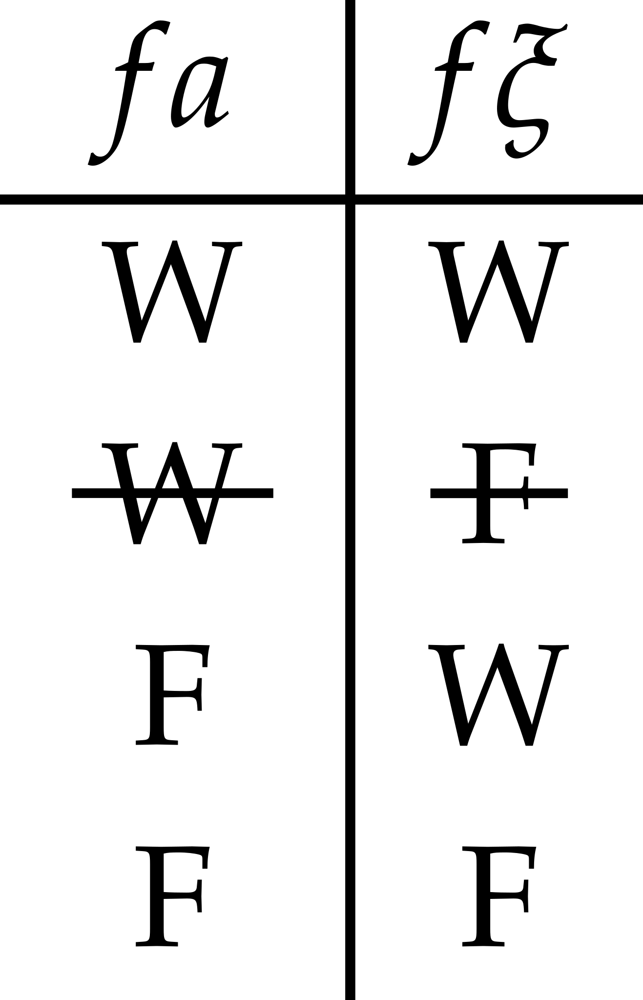

and from these, of course, everything else would follow.

### [153\[5\]](https://cdn.wittgensteinnachlass.com/2000px/webp/Ms-109/153.webp),[154\[1\]](https://cdn.wittgensteinnachlass.com/2000px/webp/Ms-109/154.webp)

When negation excludes one possibility from the field of possibilities, it thereby leaves the rest of the field open (and is general in so far as it does so). But this may happen as if someone were locked out of a house in the dark. He then knows exactly where he cannot go, what he is excluded from, but sees no possibilities before him as to where he might turn.

### [154\[2\]](https://cdn.wittgensteinnachlass.com/2000px/webp/Ms-109/154.webp)

Can one not say, then: “A is red” belongs to the field of possibilities allowed by “A is not green”. “A is green” is excluded & everything else is thereby left open. “A is red” is also within this whole remaining field.

### [154\[3\]](https://cdn.wittgensteinnachlass.com/2000px/webp/Ms-109/154.webp)

But how is this to be expressed symbolically? – namely, that ‘A is red’ lies outside ‘A is green’. How does it show itself that “A is red” lies in the domain of “A is not green”? How else than by a combination of truth-values being excluded?

### [154\[4\]](https://cdn.wittgensteinnachlass.com/2000px/webp/Ms-109/154.webp)

“A is not green” includes “A is red” as a possibility.

### [154\[5\]](https://cdn.wittgensteinnachlass.com/2000px/webp/Ms-109/154.webp),[155\[1\]](https://cdn.wittgensteinnachlass.com/2000px/webp/Ms-109/155.webp)

18.09.1930

The geometry of these propositions must show itself (it must appear in the language). (It is a case entirely analogous to this:

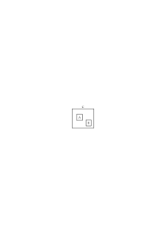

a patch which is in the large quadrilateral C but _not in A_ can be in B.)

### [155\[2\]](https://cdn.wittgensteinnachlass.com/2000px/webp/Ms-109/155.webp)

That “A is green” & “A is red” are contrary propositions must show itself in a similar (analogous) way to the way it shows itself that “A is green” & “A is not green” are contradictory opposites.

### [155\[3\]](https://cdn.wittgensteinnachlass.com/2000px/webp/Ms-109/155.webp)

How, then, does it show itself that “p” and “~p” are complementary? – For it must show itself in the same way that “A is red” lies in the complement of “A is green”.

### [155\[4\]](https://cdn.wittgensteinnachlass.com/2000px/webp/Ms-109/155.webp)

The former evidently shows itself in the fact that p⌵~p is tautological. And that in turn is made clear by the fact that q ∙ (p⌵~p) = q. (And (by) other similar relations.)

### [155\[5\]](https://cdn.wittgensteinnachlass.com/2000px/webp/Ms-109/155.webp),[156\[1\]](https://cdn.wittgensteinnachlass.com/2000px/webp/Ms-109/156.webp)

If, of course, one objects to this explanation that the sense of “ ∙ ” is precisely what has not yet been explained & itself needs explanation, then the answer, I think, is that there is no explanation other than setting out the rules in full. And surely the concept of “and” needs explanation no less than that of tautology. And they are explained only all together, or not at all. (Grammar a game of chess.)

### [156\[2\]](https://cdn.wittgensteinnachlass.com/2000px/webp/Ms-109/156.webp)

Incidentally, anyone who wants to explain negation soon notices that he is only putting forward a negation again in another form (he uses “exclusion”, say, or some other expression.)

### [156\[3\]](https://cdn.wittgensteinnachlass.com/2000px/webp/Ms-109/156.webp)

q ∙ (a is red ․⊃․ ~(a is green)) = q

### [156\[4\]](https://cdn.wittgensteinnachlass.com/2000px/webp/Ms-109/156.webp)

The explanation one receives when one asks about the essence of the proposition, that a proposition is anything that can be true or false, is not altogether wrong. It is the form of the truth-function (in whatever form of notation it is expressed) that constitutes the logical essence of the proposition.

### [156\[5\]](https://cdn.wittgensteinnachlass.com/2000px/webp/Ms-109/156.webp)

I said that in the sentence “there is a red circle in the quadrilateral” there was no mention of a totality of places where a circle can be, so that there was no “for all …” corresponding to this “there is …”. – But must I not say that the sentence “there is a red circle in the quadrilateral” follows from _every_ sentence that describes a definite position of the spot in the quadrilateral? Is that generality not the correlate of this existential proposition?

### [157\[1\]](https://cdn.wittgensteinnachlass.com/2000px/webp/Ms-109/157.webp)

In truth, corresponding to “in the quadrilateral there is …” there is a “wherever in the quadrilateral there is a red circle …”. “If there is a red circle in the quadrilateral, then …” can always also be expressed in this way: “Wherever in the quadrilateral there is a red circle, …”.

### [157\[2\]](https://cdn.wittgensteinnachlass.com/2000px/webp/Ms-109/157.webp)

(∃x) ∙ φx ․⊃․ p = (x):φx ․⊃․ p

But this also shows us how we are to understand “wherever …”. For “wherever …” likewise contains no reference to a totality.

### [157\[3\]](https://cdn.wittgensteinnachlass.com/2000px/webp/Ms-109/157.webp)

The explanation of the sign “in the quadrilateral there is …”, that it follows from every sentence stating that the spot is at a definite place in the quadrilateral, is no better than the explanation that the sentence “in the quadrilateral there is …” follows from a sentence if it states that the spot is at such & such a definite place, etc.

### [157\[4\]](https://cdn.wittgensteinnachlass.com/2000px/webp/Ms-109/157.webp)

How does the explanation that ~p always follows from p not being the case stand in relation to this?

### [157\[5\]](https://cdn.wittgensteinnachlass.com/2000px/webp/Ms-109/157.webp)

Is it strange or incorrect that, in the grammatical rule for the generality that concerns us, this generality itself must be applied? Is that not, on the contrary, quite obvious?

### [158\[1\]](https://cdn.wittgensteinnachlass.com/2000px/webp/Ms-109/158.webp)

19.09.1930

In any case it is unreasonable to demand that the generality whose symbolism is to be explained should not occur in this explanation itself, for _it_ cannot be explained in any case & some concepts or other have to be used in the syntactical rules.

### [158\[2\]](https://cdn.wittgensteinnachlass.com/2000px/webp/Ms-109/158.webp)

“Wherever the spot is in the quadrilateral …” means “if it is in the quadrilateral …” & here only the freedom (being *un*constrained) within the quadrilateral is meant, not a multitude of positions.

### [158\[3\]](https://cdn.wittgensteinnachlass.com/2000px/webp/Ms-109/158.webp)

There is, of course, a logical similarity (formal analogy) between this freedom & the totality of possibilities, which is why one often uses the same words in both cases (“all”, “every”, etc.).

### [158\[4\]](https://cdn.wittgensteinnachlass.com/2000px/webp/Ms-109/158.webp)

“Wherever it is …” means that it is tied to no place. But here again the “no” is ambiguous (since it could mean: none of these …) & one should say perhaps “it is not tied down as to place”. – The multiplicity that the sentence “in the quadrilateral there is …” has is the right one. If in reality it had a different one from the apparent one, this would have to show itself in its application.

### [158\[5\]](https://cdn.wittgensteinnachlass.com/2000px/webp/Ms-109/158.webp),[159\[1\]](https://cdn.wittgensteinnachlass.com/2000px/webp/Ms-109/159.webp)

When I said that the sentence was composite, what I meant was that the sentence could not in a certain sense be simple. But why, & in what respect, can it not be simple?

### [159\[2\]](https://cdn.wittgensteinnachlass.com/2000px/webp/Ms-109/159.webp)

If it were simple, i.e. present once and for all and unchanging, _one would not need it at all_.

### [159\[3\]](https://cdn.wittgensteinnachlass.com/2000px/webp/Ms-109/159.webp)

In exactly the same way as a sign that occurred in all sentences is superfluous.

### [159\[4\]](https://cdn.wittgensteinnachlass.com/2000px/webp/Ms-109/159.webp)

The method of philosophy is to listen to _all_ voices & to reconcile them all with one another (reconcile).

### [159\[5\]](https://cdn.wittgensteinnachlass.com/2000px/webp/Ms-109/159.webp)

The sign has a purpose only if I can operate with it. And then it must be able to occur in different contexts.

### [159\[6\]](https://cdn.wittgensteinnachlass.com/2000px/webp/Ms-109/159.webp)

The essential thing, the sense (i.e. purpose), of the sentence is that I can explain the individual signs by means of a rule of translation, but the sentence explains itself.

### [159\[7\]](https://cdn.wittgensteinnachlass.com/2000px/webp/Ms-109/159.webp)

The formation of word-signs is only preliminary.

### [159\[8\]](https://cdn.wittgensteinnachlass.com/2000px/webp/Ms-109/159.webp),[160\[1\]](https://cdn.wittgensteinnachlass.com/2000px/webp/Ms-109/160.webp)

That is, it is worthless in itself & its purpose is the subsequent formation of a combination out of them. Let us imagine someone saying “this little piece of wood is to be A, this one is to be B”; and stopping there. Then we would ask: what about them, then; why have you represented A & B by the pieces of wood? For surely this can only be a preparation for your wanting to say something about them.

### [160\[2\]](https://cdn.wittgensteinnachlass.com/2000px/webp/Ms-109/160.webp)

As I said: the propositional sign does not represent. – It depicts.

### [160\[3\]](https://cdn.wittgensteinnachlass.com/2000px/webp/Ms-109/160.webp)

If the sentence were simple, what am I to do with it? Suppose I wanted to communicate something to someone: _a_. But for him to understand it, I would have to explain the meaning of a to him; yet then he would already know everything I could tell him with “a”. It must be one thing to learn the language & another to receive a communication in the language. But here, if the sentence were simple, it would be (only) one thing. But then there would be no need for language at all.

### [160\[4\]](https://cdn.wittgensteinnachlass.com/2000px/webp/Ms-109/160.webp)

For if I utter a sign to someone, he does not understand it. It has to be explained to him. But why give it to him at all, then? (It is different when one explains it for future use.)

### [161\[1\]](https://cdn.wittgensteinnachlass.com/2000px/webp/Ms-109/161.webp)

07.10.1930

There is no metamathematics.

### [161\[2\]](https://cdn.wittgensteinnachlass.com/2000px/webp/Ms-109/161.webp)

The distinction between something general that one could know & the particular that one does not, however, know, or between the description of an object, which one knows, & the object, which one has not seen, is also something carried over from the physical description of the world into logic. The idea that our reason can recognize questions but not their answers belongs here too.

### [161\[3\]](https://cdn.wittgensteinnachlass.com/2000px/webp/Ms-109/161.webp)

Remark “read …”. Explanation of the pronunciation of these signs by means of the pronunciation of those. But not an explanation of the pronunciation of signs in general, hence of the relation between signs & pronunciation in general.

### [161\[4\]](https://cdn.wittgensteinnachlass.com/2000px/webp/Ms-109/161.webp)

Hypothesis that everyone is really on their way to N. & it is only a matter of sooner or later; & some (most) die before they get there. Sample of a scientific hypothesis.

### [161\[5\]](https://cdn.wittgensteinnachlass.com/2000px/webp/Ms-109/161.webp),[162\[1\]](https://cdn.wittgensteinnachlass.com/2000px/webp/Ms-109/162.webp)

“The room is 12 foot (or 12 feet) high.” Meaning of singular & plural in this case. (Frege Foundations of Arithmetic)

### [162\[2\]](https://cdn.wittgensteinnachlass.com/2000px/webp/Ms-109/162.webp)

13.10.1930

When we say “it took a very long time …” we often draw out the words to depict the length & conversely when we say “it was a brief moment” we pronounce the words briefly & distinctly. It would have a very comical effect if we were to draw out the words in this expression in the former way.

### [162\[3\]](https://cdn.wittgensteinnachlass.com/2000px/webp/Ms-109/162.webp)

It is hard not to see the first figure as three-dimensional, whereas it becomes

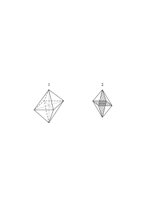

easy if one hatches it as in figure 2.

### [162\[4\]](https://cdn.wittgensteinnachlass.com/2000px/webp/Ms-109/162.webp),[163\[1\]](https://cdn.wittgensteinnachlass.com/2000px/webp/Ms-109/163.webp)

16.10.1930

If I say “A has a grey hat” & am asked “who is A” & answer “this is A”, I thereby make the person A a symbol in my sentence, or at least it is _possible_ for me to make him a constituent of my sentence; but that does not _have_ to happen & the name can stand for a description – which retains its sense even if the object A is destroyed. But it is strange & runs counter to a feeling that, when we use the name A, we are not conscious on one occasion of the fact that A stands for a description, and on another that it has meaning only in conjunction with the body A. Does this problem also arise when, for example, it is a matter of a colour? If, say, I say “the cloth is mauve” &, in answer to the question “what is ‘mauve’”, point to an object of this colour. One might say as one does so “remember, this is mauve” & in doing so one has in mind a quite definite sort of effect of this pointing.

### [163\[2\]](https://cdn.wittgensteinnachlass.com/2000px/webp/Ms-109/163.webp),[164\[1\]](https://cdn.wittgensteinnachlass.com/2000px/webp/Ms-109/164.webp)

Now if the person in question forgets (as in fact often happens) which colour one designated in this way, but does not forget that on a certain occasion the meaning of the word “mauve” was explained to him & now the word comes up again & all he knows is that it is the colour spoken of on that occasion, does the word now have a different meaning for him from the one it had when he knew what mauve looked like? I believe it does.

### [164\[2\]](https://cdn.wittgensteinnachlass.com/2000px/webp/Ms-109/164.webp)

But it is just the same when I get to know A & forget what he looks like & later hear him spoken of. And one can give sentences that are senseless to me if no visual memory-image corresponds to the name a.

### [164\[3\]](https://cdn.wittgensteinnachlass.com/2000px/webp/Ms-109/164.webp)

17.10.1930

In _one_ sense the sword Nothung is the meaning of the name “Nothung”. In such a way, indeed, that the name loses its meaning when this sword ceases to exist. In the other sense, in which the name does not lose its meaning even if the thing is destroyed, its meaning _never_ depended on the existence of the thing, not even at the moment when the explanation was given: “this sword is Nothung”, for the explanation retains its sense even if it was a matter of an illusion & in reality there was no sword there at all. If, on the other hand, one explains the word “red” by pointing to something red, – – –

### [165\[1\]](https://cdn.wittgensteinnachlass.com/2000px/webp/Ms-109/165.webp)

I could explain the meaning of “red” by saying: press on your eyelids, what you see then is red.

### [165\[2\]](https://cdn.wittgensteinnachlass.com/2000px/webp/Ms-109/165.webp)

But couldn’t I also call up in someone the false memory of having seen something red, or indeed the mental image of red, without his ever having seen red? Can I not at any rate bring – let us say – a bluish green into his imagination by means of a description, even if he has never actually seen one & has seen only, say, blue & green?

### [165\[3\]](https://cdn.wittgensteinnachlass.com/2000px/webp/Ms-109/165.webp)

I want to say: If it is not essential that there should be something red for the word red to have meaning, then it can never have been essential. The _history_ of learning a meaning can never be essential.

### [165\[4\]](https://cdn.wittgensteinnachlass.com/2000px/webp/Ms-109/165.webp)

22.10.1930

Language _itself_ cannot be learnt through correspondence lessons.

(So what we can learn in this way stands in contrast to language.)

### [165\[5\]](https://cdn.wittgensteinnachlass.com/2000px/webp/Ms-109/165.webp),[166\[1\]](https://cdn.wittgensteinnachlass.com/2000px/webp/Ms-109/166.webp)

We must know that every piece of scrap iron we find in the street is a key & that, so to speak, it is only a matter of using them in the right order to be able to unlock all the doors of the house one after another.

### [166\[2\]](https://cdn.wittgensteinnachlass.com/2000px/webp/Ms-109/166.webp),[167\[1\]](https://cdn.wittgensteinnachlass.com/2000px/webp/Ms-109/167.webp)

What does it mean to understand a sentence? I believe that whatever understanding there is must be capable of being shown & that it exists only in so far as it can be shown. The question is not really “what does it mean to understand a sentence as someone else meant it” but “what does it mean to understand a sentence in some way or other”, or better: to interpret it. How would I show that I interpret the dictionary as a rule of translation? Surely by carrying out a translation in accordance with it. Suppose this is my dictionary:

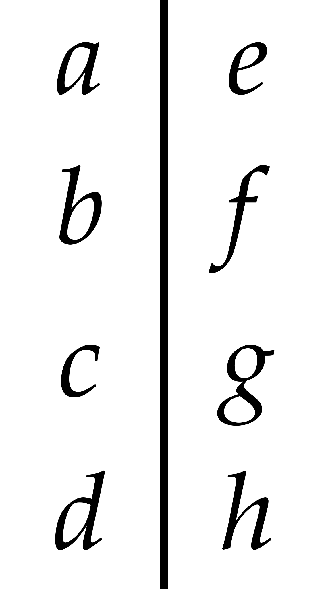

and I use it to translate the sentence bdca into fhge. Now I have shown – in the ordinary sense – that I understand the use of the dictionary & can say that I can translate the sentence cdab in the same way if I want to. – So if the sentence cdab is a command to write down the corresponding sentence in the second language, I understand this command much as I understand the command to take ∣∣∣∣∣∣ steps if I have been shown how the corresponding commands with the numbers ❘, ∣∣, ∣∣∣, ∣∣∣∣, are executed. One can say outright: I have now shown you what f(❘), f(∣∣), f(∣∣∣) & f(∣∣∣∣) mean; now you will understand what f(∣∣∣∣∣∣) means. That is, one counts on his having retained something – as it were an impression – from the demonstration of how f(❘), f(∣∣), etc. are executed, and that he will now apply what he retained to f(∣∣∣∣∣∣).

### [167\[2\]](https://cdn.wittgensteinnachlass.com/2000px/webp/Ms-109/167.webp)

But of course this cannot be any different from when, for example, I say “I want to paint this patch red”, have an image of the colour & now “_know_” how this image is to be translated into reality. It is the relation of the image to the colour now seen that makes it possible to understand the image as a sign. Indeed, this relation must constitute the understanding, not merely make it possible.

### [168\[1\]](https://cdn.wittgensteinnachlass.com/2000px/webp/Ms-109/168.webp)

Yes, the whole problem is already contained in this: What does it mean to know what the patch would look like if it corresponded to my image?

### [168\[2\]](https://cdn.wittgensteinnachlass.com/2000px/webp/Ms-109/168.webp)

This knowledge must lie wholly & entirely in what is actually given.

### [168\[3\]](https://cdn.wittgensteinnachlass.com/2000px/webp/Ms-109/168.webp)

If the image were there on its own, no reality could be constructed from it.

### [168\[4\]](https://cdn.wittgensteinnachlass.com/2000px/webp/Ms-109/168.webp)

What matters is that I see the distance between the image and what is.

### [168\[5\]](https://cdn.wittgensteinnachlass.com/2000px/webp/Ms-109/168.webp)

I must, it seems, understand a general rule of translation in its generality.

### [168\[6\]](https://cdn.wittgensteinnachlass.com/2000px/webp/Ms-109/168.webp)

When we have a simple case before us, it is good to try to understand it first; whether or not it turns out to be prototypical of all cases.

### [168\[7\]](https://cdn.wittgensteinnachlass.com/2000px/webp/Ms-109/168.webp),[169\[1\]](https://cdn.wittgensteinnachlass.com/2000px/webp/Ms-109/169.webp)

23.10.1930

What does it mean to understand a general rule? One can see the numbers ∣∣, ∣∣∣∣, ∣∣∣∣∣∣, without understanding a general rule for their formation & one can derive a general rule from them. The command can indeed run: ∣∣, ∣∣∣∣, ∣∣∣∣∣∣, – continue this series.

### [169\[2\]](https://cdn.wittgensteinnachlass.com/2000px/webp/Ms-109/169.webp)

The rule of interpretation cannot be expressed, because every expression requires an interpretation.

### [169\[3\]](https://cdn.wittgensteinnachlass.com/2000px/webp/Ms-109/169.webp)

The dictionary gives the general rule of translation. But the dictionary itself must first be understood in this way. Is there an understanding of a general rule as such other than through its application?

### [169\[4\]](https://cdn.wittgensteinnachlass.com/2000px/webp/Ms-109/169.webp),[170\[1\]](https://cdn.wittgensteinnachlass.com/2000px/webp/Ms-109/170.webp)

If one says that translating from one sign-language into the other is all by which I can demonstrate my understanding, indeed all that it consists in, then – I believe – one need guard against only one objection: that the final translation into reality & with it the sense of the sentence then remains indeterminate. What one would like to object to this view is: So you are saying that I cannot know which deed satisfies the command until it has been done. But that is precisely what I am _not_ saying. We fear that the sentence would then become ambiguous. But ambiguity is something (quite) different. An expectation is not ambiguous because what it expects has not actually happened yet.

### [170\[2\]](https://cdn.wittgensteinnachlass.com/2000px/webp/Ms-109/170.webp)

But when I use signs in thinking, I surely do not merely speak but mean something quite definite! Of course, something quite definite as opposed to the case where someone speaks & knows only vaguely what the words mean. One can give examples of both cases, but neither goes outside language.

### [170\[3\]](https://cdn.wittgensteinnachlass.com/2000px/webp/Ms-109/170.webp)

If I say I expect a red circle here, surely I expect something quite definite; this blue circle then surely cannot satisfy my expectation just as well. Of course not, but I did not say that either & we have not thereby got as far as settling what we expect, but have merely rejected a translation.

### [170\[4\]](https://cdn.wittgensteinnachlass.com/2000px/webp/Ms-109/170.webp),[171\[1\]](https://cdn.wittgensteinnachlass.com/2000px/webp/Ms-109/171.webp)

Now if one asks: Is the fact, then, determined by the expectation as to yes & no, or not, i.e. is it determined in what sense the expectation will be answered by an event, whatever event occurs, then one must answer: _yes_! It would be indeterminate, for instance, if there were a disjunction in the expression of the expectation.

### [171\[2\]](https://cdn.wittgensteinnachlass.com/2000px/webp/Ms-109/171.webp)

If I foresee how things will turn out, do I perhaps after all not foresee how things will turn out because I cannot project my foresight into the reality that is not yet there? On the contrary, the possibility of my foresight rests precisely on the fact that the reality belonging to this foresight does not also include the fulfilment (or its opposite) of the foresight.

### [171\[3\]](https://cdn.wittgensteinnachlass.com/2000px/webp/Ms-109/171.webp)

The apparent indeterminacy I spoke of is *no more* present than the one some people talk about, which is supposed to arise from our not being able to know whether two people see the same colour when they look at an object. That is nonsense, for we mean something quite different by seeing different colours & in this sense there are criteria for whether the two see the same colour or different colours.

### [171\[4\]](https://cdn.wittgensteinnachlass.com/2000px/webp/Ms-109/171.webp),[172\[1\]](https://cdn.wittgensteinnachlass.com/2000px/webp/Ms-109/172.webp)

24.10.1930

Could I expect a patch of colour if I saw no colour now? If not, then seeing a colour is essential to the expectation. And belongs to it.

### [172\[2\]](https://cdn.wittgensteinnachlass.com/2000px/webp/Ms-109/172.webp)

Is saying that a mental process is the expectation that a red patch will appear here only _one_ way of describing it, or is it the internal description of this process in the sense in which the sentence “a red patch appears there” is the internal description of the fulfilment of that expectation? I believe – evidently the latter.

### [172\[3\]](https://cdn.wittgensteinnachlass.com/2000px/webp/Ms-109/172.webp)

The expression of the expectation is the expectation.

### [172\[4\]](https://cdn.wittgensteinnachlass.com/2000px/webp/Ms-109/172.webp)

“My expectation is made in such a way that whatever comes must agree with it or not.”

### [172\[5\]](https://cdn.wittgensteinnachlass.com/2000px/webp/Ms-109/172.webp)

25.10.1930

To prove that one really knows what one means by the sentence “I expect a red patch here”, one might say: of course I know what I expect, I can now see the patch clearly before me!

### [173\[1\]](https://cdn.wittgensteinnachlass.com/2000px/webp/Ms-109/173.webp)

When I walk, the individual step does not contain the destination that the walking will bring me to.

### [173\[2\]](https://cdn.wittgensteinnachlass.com/2000px/webp/Ms-109/173.webp)

I make attempts to let myself, or my listener, fall into the water & then pull him out so as to demonstrate a rescue. But it does not go very elegantly: on one occasion I do not quite manage to throw him into the water & roll him about on the ground without getting him into the water, & then on another I have thrown him into the water but cannot get him out again & he is in danger of drowning.

### [173\[3\]](https://cdn.wittgensteinnachlass.com/2000px/webp/Ms-109/173.webp)

If I reach the destination, each step was a step towards that destination.

### [173\[4\]](https://cdn.wittgensteinnachlass.com/2000px/webp/Ms-109/173.webp)

How can one depict something that is not there!? (Evidently there is an ambiguity here in the words “something” & “is there”.)

### [173\[5\]](https://cdn.wittgensteinnachlass.com/2000px/webp/Ms-109/173.webp)

In the fact of understanding, understanding (whatever it is) must find expression. In the process of understanding (whatever process that may be), understanding must be _expressed_.

### [173\[6\]](https://cdn.wittgensteinnachlass.com/2000px/webp/Ms-109/173.webp),[174\[1\]](https://cdn.wittgensteinnachlass.com/2000px/webp/Ms-109/174.webp)

One is tempted (by false grammar) to ask: how does one think the sentence p, how does one expect that such & such will happen (how does one do it). And this false question probably contains the whole difficulty in nuce.

### [174\[2\]](https://cdn.wittgensteinnachlass.com/2000px/webp/Ms-109/174.webp)

The false comparison here consists in our imagining the thing as a mechanism whose exterior we know but whose inner workings are still hidden from us.

### [174\[3\]](https://cdn.wittgensteinnachlass.com/2000px/webp/Ms-109/174.webp)

It is one of the chief activities of philosophy to warn against false comparisons. To warn against (the) false comparisons that underlie our way of expressing ourselves – without our being quite conscious of it. I believe our method here resembles that of psychoanalysis, which likewise aims to make what is unconscious conscious & thereby harmless, & I believe that this similarity is not a purely superficial one.

### [174\[4\]](https://cdn.wittgensteinnachlass.com/2000px/webp/Ms-109/174.webp)

The something we expect always seems to us like, say, the person who is to come in through the door, not like the fact that he is to come.

### [174\[5\]](https://cdn.wittgensteinnachlass.com/2000px/webp/Ms-109/174.webp),[175\[1\]](https://cdn.wittgensteinnachlass.com/2000px/webp/Ms-109/175.webp)

The meaning of a sign is the whole symbol to which the sign belongs. Or one might say it is the place in grammatical space where the sign stands.

### [175\[2\]](https://cdn.wittgensteinnachlass.com/2000px/webp/Ms-109/175.webp)

In a certain sense one can say: A propositional sign has sense only in the system of a language.

### [175\[3\]](https://cdn.wittgensteinnachlass.com/2000px/webp/Ms-109/175.webp)

If I give a command, I must also be able to describe in the same language the deed that goes against the command.

### [175\[4\]](https://cdn.wittgensteinnachlass.com/2000px/webp/Ms-109/175.webp)

26.10.1930

If someone _understands_ the command expressed in the plan

then he _must_ also understand the following command:

That is, it is impossible to understand only _one_ sentence of a language.

### [175\[5\]](https://cdn.wittgensteinnachlass.com/2000px/webp/Ms-109/175.webp)

That is, a sentence can be understood only as part of a system.

### [175\[6\]](https://cdn.wittgensteinnachlass.com/2000px/webp/Ms-109/175.webp)

Can one say: To understand what the sentence says: “a red circle will appear here”, is to be able to translate the present state into the _same_ language (to be able to describe the present state in the _same_ language)?

### [176\[1\]](https://cdn.wittgensteinnachlass.com/2000px/webp/Ms-109/176.webp)

One cannot understand a sentence detached from a language.

### [176\[2\]](https://cdn.wittgensteinnachlass.com/2000px/webp/Ms-109/176.webp)

“To express in the same language” means to measure with the same yardstick.

### [176\[3\]](https://cdn.wittgensteinnachlass.com/2000px/webp/Ms-109/176.webp)

We can compare only within language.

### [176\[4\]](https://cdn.wittgensteinnachlass.com/2000px/webp/Ms-109/176.webp)

Is it like this: to think is to apply the plan. But the application cannot lie in the plan.

### [176\[5\]](https://cdn.wittgensteinnachlass.com/2000px/webp/Ms-109/176.webp)

_Reading thoughts_ can consist only in interpreting signs, that is, simply in reading (only perhaps _different_ signs). Or else it consists in thoughts coming to one when one holds another person’s hand (or is in contact with them in some other way), thoughts which, on subsequent questioning, turn out to be the other person’s thoughts too. But here there is no reading at all; one would be entitled only to the _hypothesis_ that two people under certain circumstances were thinking the same thing.

### [177\[1\]](https://cdn.wittgensteinnachlass.com/2000px/webp/Ms-109/177.webp)

Since thinking is a symbolic process, it can be a matter of complete indifference to us where this process takes place, provided its symbolic properties, that is, what constitutes its purpose, are preserved. (If we are not interested in the psychological side of certain of these processes.)

### [177\[2\]](https://cdn.wittgensteinnachlass.com/2000px/webp/Ms-109/177.webp)

Is thinking an instantaneous process or perhaps an enduring state of which the words, the sentence, are only a clumsy rendering (so that one might say, as of the impression made by a landscape: words simply cannot render that)? The thought takes as long as its expression. Because the expression is the thought.

### [177\[3\]](https://cdn.wittgensteinnachlass.com/2000px/webp/Ms-109/177.webp)

27.10.1930

To understand a symbol is to understand its multiplicity. To understand the multiplicity of its application.

### [177\[4\]](https://cdn.wittgensteinnachlass.com/2000px/webp/Ms-109/177.webp),[178\[1\]](https://cdn.wittgensteinnachlass.com/2000px/webp/Ms-109/178.webp)

28.10.1930

I once read that a Frenchman – I believe M. Briand – had said that the French language is distinguished by the fact that its words (in a sentence) stand in the order in which one actually thinks. – That is a very significant statement, though complete nonsense. For it indicates a particular conception – – –

### [178\[2\]](https://cdn.wittgensteinnachlass.com/2000px/webp/Ms-109/178.webp)

If farmers quarrel with one another because one has given the other too little money for the cows he bought from him & this dispute comes before the judge & is settled, then clearly it cannot matter what sort of mental image one or the other has (had) on hearing the word ‘cow’. Rather, one calculates with words, so to speak, & the application of the result is likewise an exact translation of language into an action (say, counting out coins.)

### [178\[3\]](https://cdn.wittgensteinnachlass.com/2000px/webp/Ms-109/178.webp)

When logicians describe the psychological operations that they take to be thinking & the interpretation of sentences, it is always a marvel how anything as definite as a judgement is supposed to be able to emerge from such vague processes.

### [178\[4\]](https://cdn.wittgensteinnachlass.com/2000px/webp/Ms-109/178.webp),[179\[1\]](https://cdn.wittgensteinnachlass.com/2000px/webp/Ms-109/179.webp)

To understand a general rule is to _apply_ it in some case or other. (not ‘to be able to apply it’) If, for example, I express my understanding of a sentence expressing an expectation by describing the present state in the same language, that is the application of the general rule in _one_ case.

### [179\[2\]](https://cdn.wittgensteinnachlass.com/2000px/webp/Ms-109/179.webp)

But here I always want to say: the application of the general rule is not enough; rather, the rule must somehow be emphasized in it. – But that is wrong.

### [179\[3\]](https://cdn.wittgensteinnachlass.com/2000px/webp/Ms-109/179.webp)

Is not understanding, that is, being able to apply a sentence, on a par with being able to play chess. In the sense in which I cannot be mistaken either when I am asked ‘can you play chess’ & I answer ‘yes’, in that sense I must run through the rules in my mind & thus apply them in some way; for in any other sense I can, after all, be mistaken & suddenly realize that I have forgotten the rules for one piece & be unable to say ‘I could play chess when I said I could, etc.’.

### [180\[1\]](https://cdn.wittgensteinnachlass.com/2000px/webp/Ms-109/180.webp)

But hasn’t this made the sense of the sentence problematic again?

### [180\[2\]](https://cdn.wittgensteinnachlass.com/2000px/webp/Ms-109/180.webp)

Or may I say: The sense of the sentence is *just* as unproblematic as the rules of grammar.

### [180\[3\]](https://cdn.wittgensteinnachlass.com/2000px/webp/Ms-109/180.webp)

One would say: ‘I understand the translation rule’ means: I _can_ apply it if there are no external obstacles. ‘I understand the translation rule 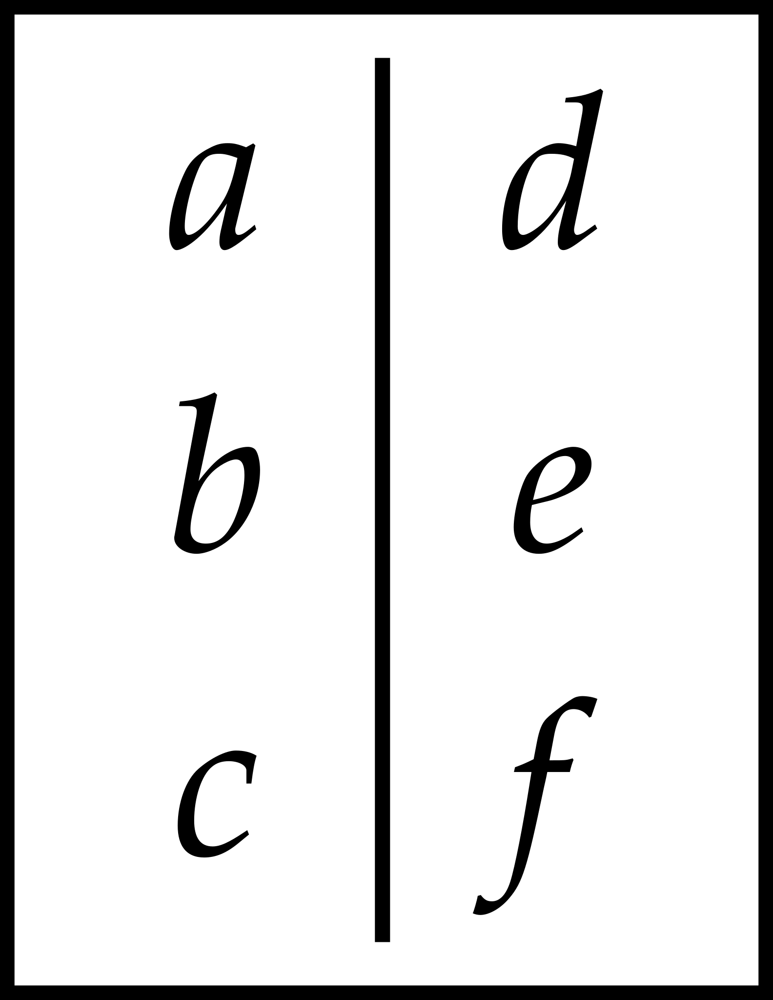’

seems to me to be on exactly the same footing as the statement ‘I can play chess’. Could I, without having thought of the rules for moving the rook when I made this statement, & if I now found (on trying) that I had forgotten them, could I now say ‘I could play chess when you asked me & it is only now that I can’t’?

### [180\[4\]](https://cdn.wittgensteinnachlass.com/2000px/webp/Ms-109/180.webp),[181\[1\]](https://cdn.wittgensteinnachlass.com/2000px/webp/Ms-109/181.webp)

Can I _know_ that I know the rules if I do not run through them? Can I know that I knew a rule when I was asked whether I knew it, if I did not actually call it to mind at the time? I certainly think not.

### [181\[2\]](https://cdn.wittgensteinnachlass.com/2000px/webp/Ms-109/181.webp)

Can I not be mistaken when I say ‘I can multiply’ if I do not demonstrate multiplication to myself in some way as I say it, & what then of extracting roots, which I am not sure about & which, if I try it, I may find I can still do, or may find I cannot?

### [181\[3\]](https://cdn.wittgensteinnachlass.com/2000px/webp/Ms-109/181.webp)

29.10.1930

No one would ask whether the multiplication of two numbers (carried out, say, in the usual way) runs parallel to the thought. Because everyone regards multiplication as an instrument. Whereas one does not regard the thought as an instrument.

### [181\[4\]](https://cdn.wittgensteinnachlass.com/2000px/webp/Ms-109/181.webp),[182\[1\]](https://cdn.wittgensteinnachlass.com/2000px/webp/Ms-109/182.webp)

One distinguishes between merely reading a command & reading the command with understanding. So something else goes on in this reading or seeing of the plan. And it is accompanied – so it seems to me – by a translation. Or is that wrong & should I say: I merely become aware that it is a plan I am to go by, that is, I merely become aware of the whole symbol – whereas in the first case only of the sign.

### [182\[2\]](https://cdn.wittgensteinnachlass.com/2000px/webp/Ms-109/182.webp)

The conception of the sentence, and thus of understanding & of thought, must surely justify the possibility of the calculus. And the calculus is carried out in time & is – so to speak – spread out.

### [182\[3\]](https://cdn.wittgensteinnachlass.com/2000px/webp/Ms-109/182.webp)

Isn’t understanding a sentence analogous to understanding a chess move as such. Someone who knows nothing of chess & sees someone make a move will not understand it, i.e. will not understand it as a move in a game. And following the move with understanding is different from merely seeing it.

### [182\[4\]](https://cdn.wittgensteinnachlass.com/2000px/webp/Ms-109/182.webp)

Can one say that I see the move in chess-space?

### [182\[5\]](https://cdn.wittgensteinnachlass.com/2000px/webp/Ms-109/182.webp),[183\[1\]](https://cdn.wittgensteinnachlass.com/2000px/webp/Ms-109/183.webp)

But what is it, then, that always gives us the feeling that understanding a sentence is understanding something that lies outside it, & not the world outside the sign as it is, but the world as the sign – as it were – wishes it to be.

### [183\[2\]](https://cdn.wittgensteinnachlass.com/2000px/webp/Ms-109/183.webp)

Of the world as part of the whole game (of which we _see_ only _one_ move)

### [183\[3\]](https://cdn.wittgensteinnachlass.com/2000px/webp/Ms-109/183.webp)

How can I resolve to follow a general rule.

### [183\[4\]](https://cdn.wittgensteinnachlass.com/2000px/webp/Ms-109/183.webp)

Is it not _only_ in so far as I can express the rule?

### [183\[5\]](https://cdn.wittgensteinnachlass.com/2000px/webp/Ms-109/183.webp)

This is (all) connected with the fact that one cannot ask: ‘is this really the colour you have called red on other occasions.’ Unless one is asking ‘is this the colour you expected & not rather _that_’. Every difference must be expressed as a difference in _one_ language.

### [183\[6\]](https://cdn.wittgensteinnachlass.com/2000px/webp/Ms-109/183.webp)

I can resolve to follow _one_ rule & not another. Then both must be expressed.

### [183\[7\]](https://cdn.wittgensteinnachlass.com/2000px/webp/Ms-109/183.webp)

Only what can be checked can be expressed in language.

### [183\[8\]](https://cdn.wittgensteinnachlass.com/2000px/webp/Ms-109/183.webp),[184\[1\]](https://cdn.wittgensteinnachlass.com/2000px/webp/Ms-109/184.webp)

Of course one can help one’s memory with a note, but one cannot save the interpretation of the note for later.

### [184\[2\]](https://cdn.wittgensteinnachlass.com/2000px/webp/Ms-109/184.webp)

One can speak of difference only (when) a comparison is possible. And that is possible only in _one_ language & two languages must first be translated into one another (brought to a common denominator) before a comparison of expressions is possible, but then it takes place precisely in _one_ language.

### [184\[3\]](https://cdn.wittgensteinnachlass.com/2000px/webp/Ms-109/184.webp)

30.10.1930

In language one can speak of _one_ thing only as opposed to something _else_.

### [184\[4\]](https://cdn.wittgensteinnachlass.com/2000px/webp/Ms-109/184.webp)

The rules of chess distinguish chess from a game that has different rules in the same language.

### [184\[5\]](https://cdn.wittgensteinnachlass.com/2000px/webp/Ms-109/184.webp)

Each sentence of a language has sense only in contrast to other combinations of words in the same language.

### [184\[6\]](https://cdn.wittgensteinnachlass.com/2000px/webp/Ms-109/184.webp),[185\[1\]](https://cdn.wittgensteinnachlass.com/2000px/webp/Ms-109/185.webp)

We could imagine two chess players who, having no memory, would have the rules of the game written out before them & would follow the written rules at every move.

### [185\[2\]](https://cdn.wittgensteinnachlass.com/2000px/webp/Ms-109/185.webp)

To understand a plan one must in a certain sense first understand the general principle of representation by plans & one understands the plan as opposed to others that do not apply. Now when I say that, does it refer to the momentary state of mind of the person grasping the plan? Surely not – he no more goes through all the other possibilities of representation than a chess player continually recapitulates the rules of chess (and if he did, he would have to recite to himself first one and then another, not all at once).

### [185\[3\]](https://cdn.wittgensteinnachlass.com/2000px/webp/Ms-109/185.webp)

One might ask the question this way: Is being able to play chess an enduring – as it were amorphous – state of mind, rather like toothache?

### [185\[4\]](https://cdn.wittgensteinnachlass.com/2000px/webp/Ms-109/185.webp),[186\[1\]](https://cdn.wittgensteinnachlass.com/2000px/webp/Ms-109/186.webp)

The understanding of language – of the game, as it were – seems to be like a background against which the individual sentence first acquires meaning.

### [186\[2\]](https://cdn.wittgensteinnachlass.com/2000px/webp/Ms-109/186.webp)

Only the general rule contains the degree of freedom, the mobility of the mechanism. The picture of the mechanism in one of its positions contains nothing of this.

### [186\[3\]](https://cdn.wittgensteinnachlass.com/2000px/webp/Ms-109/186.webp)

Should I now say that the degree of freedom of the mechanism can reveal itself only over time? But how can I ever know, then, that it _cannot_ make certain movements (and that it can make certain movements that it just hasn’t made yet). Surely the answer to that is: the degree of freedom of the mechanism can, after all, be _described_. Granted, but then nothing more is given than what this description gives. (And the description itself is only a position of a mechanism!)

### [186\[4\]](https://cdn.wittgensteinnachlass.com/2000px/webp/Ms-109/186.webp)

Understanding as a _disposition_ of the mind or of the brain is no concern of ours.

### [186\[5\]](https://cdn.wittgensteinnachlass.com/2000px/webp/Ms-109/186.webp),[187\[1\]](https://cdn.wittgensteinnachlass.com/2000px/webp/Ms-109/187.webp)

Surely the expression of understanding the rules of chess is reciting those rules in some form or other. But that is only an expression of knowledge of _these_ rules as opposed to others – incorrect ones – which could have been recited in this language.

### [187\[2\]](https://cdn.wittgensteinnachlass.com/2000px/webp/Ms-109/187.webp)

But one might ask: is understanding not something different from the expression of understanding? Is it not the case that the expression of understanding is an imperfect expression? That presumably means an expression that essentially leaves out something inexpressible. For otherwise I could indeed find a better one. So the expression would be a perfect _expression_. – – –

### [187\[3\]](https://cdn.wittgensteinnachlass.com/2000px/webp/Ms-109/187.webp)

A mechanism reveals its purpose little by little as it is used time & again. And so it must be with a sentence, with the expression of a thought.

### [187\[4\]](https://cdn.wittgensteinnachlass.com/2000px/webp/Ms-109/187.webp),[188\[1\]](https://cdn.wittgensteinnachlass.com/2000px/webp/Ms-109/188.webp)

What is this whole investigation for anyway, why should thought, thinking, etc., interest me, why am I not entirely indifferent to this process? In what way is it more interesting to me than toothache (or some other mental process)?

### [188\[2\]](https://cdn.wittgensteinnachlass.com/2000px/webp/Ms-109/188.webp)

Incidentally, if one uses the word ‘mental’ as I just did, it is because one necessarily pictures thinking as a series of images of the imagination. But what if one replaces these images with perceptions (accompanies the word ‘red’, where necessary, by showing a red object). Images of the imagination are not essential to our thinking.

### [188\[3\]](https://cdn.wittgensteinnachlass.com/2000px/webp/Ms-109/188.webp)

What relation does the mental image of a photograph I saw today bear to the photograph (the visual image of the photograph)? Is it _like_ it? Assuming that it agrees exactly with reality (whatever ‘to agree with reality’ means in the case of a mental image) –. I say: That is exactly how I imagined it. And someone replies, say, ‘that is impossible, for the one was a mental image & the other is not & did you perhaps take your mental image for reality?’

### [189\[1\]](https://cdn.wittgensteinnachlass.com/2000px/webp/Ms-109/189.webp)

‘That is the red I meant’. ‘How could you mean _it_, it wasn’t there at all (before).’ ‘Yes, I wanted you to do _that_.’ How could you want it, since it hadn’t been done at all yet.

### [189\[2\]](https://cdn.wittgensteinnachlass.com/2000px/webp/Ms-109/189.webp)

(The expression ‘Non- …ian – – –’ designates a movement of thought that began with the construction of a non-Euclidean geometry & was at the time a deed of merit & significance, but today is still fashionable & popular among mathematicians, although the work this movement of thought was meant to do has long since been done.)

### [189\[3\]](https://cdn.wittgensteinnachlass.com/2000px/webp/Ms-109/189.webp)

If one can replace the process of letting mental images pass before one in thinking with another process, say writing signs (or some other process) that serves the same purpose, then the procession of mental images has thereby become a matter of indifference to us. All that interests us about a thought is its application.

### [189\[4\]](https://cdn.wittgensteinnachlass.com/2000px/webp/Ms-109/189.webp),[190\[1\]](https://cdn.wittgensteinnachlass.com/2000px/webp/Ms-109/190.webp)

When we say that my mental image of this picture was like reality, we mean that it agreed with reality in one respect but not in another, yet in such a way that complete agreement would also be conceivable (though the mental image would still remain a mental image.)

### [190\[2\]](https://cdn.wittgensteinnachlass.com/2000px/webp/Ms-109/190.webp)

Does this mean, then, that I imagined this colour, for example, by applying a quite definite translation rule? And can I change this translation rule, the mode of projection, if I want to?

### [190\[3\]](https://cdn.wittgensteinnachlass.com/2000px/webp/Ms-109/190.webp)

Can one say that a mental image, what goes on, say, when a sentence is uttered, is a thought only when it is applied? Just as a mechanism functions as such only when it works. But we call a stopped clock a clock too.

### [190\[4\]](https://cdn.wittgensteinnachlass.com/2000px/webp/Ms-109/190.webp)

31.10.1930

In an onomatopoeic word, the sound is part of the symbol. It is as if one were to write the word ‘red’ in red ink, the word ‘green’ in green ink.

### [190\[5\]](https://cdn.wittgensteinnachlass.com/2000px/webp/Ms-109/190.webp)

How is a plan used, for that is the only question that concerns us here & whose answer can show what understanding the plan consists in, so far as it is of interest to us.

### [191\[1\]](https://cdn.wittgensteinnachlass.com/2000px/webp/Ms-109/191.webp)

01.11.1930

There are sentences one can understand only in connection with others. If, for example, I read, say, in a novella: ‘After he had said that, he left her, as on the previous day’. If one asks me whether I understand this sentence, it would not be easy to answer. It is a German sentence & in that respect I understand it. I would know how one _could_ use this sentence, say; I could invent a context for it myself. And yet I do not understand it _as_ I would if I had read the book up to there.

### [191\[2\]](https://cdn.wittgensteinnachlass.com/2000px/webp/Ms-109/191.webp)

Philosophical problems are like safe locks which are opened by setting a particular word or number, so that no force can open the gate until precisely that word has been hit upon, & once it has been hit upon any child can open the locks.

### [191\[3\]](https://cdn.wittgensteinnachlass.com/2000px/webp/Ms-109/191.webp),[192\[1\]](https://cdn.wittgensteinnachlass.com/2000px/webp/Ms-109/192.webp),[193\[1\]](https://cdn.wittgensteinnachlass.com/2000px/webp/Ms-109/193.webp)

If I were asked ‘can you recite the alphabet’, I would answer, yes. ‘Are you sure’, ‘yes’. But if I then got stuck while reciting it & did not know how to go on, I could not say: ‘when I said “I can recite it” I could recite it; it is only now that I cannot.’ – Now there is nevertheless a case in which I would say ‘yes, when I said it, I could indeed recite it’ & that is if I had recited it to myself ‘in my mind’ at the time. I would also offer this as proof. But this means that reciting it in one’s mind contains the ability to recite it for real – as we understand the word ability here. (It cannot be that this recitation in one’s mind is only a _symptom_ of the ability to recite it for real, for then the assumption of this ability would again be merely a hypothesis.) On the other hand, the ability proved by reciting it in one’s mind does not extend to actually producing the sounds in the recitation proper. I.e. if my tongue or my breath failed me in doing so, I could not say that I could have done that too at the time. That means – I believe – that after all I have proved only my ability to do what I actually did. Being _able_ to do something has precisely that shadowy character, i.e. it appears as a shadow of the actual doing, just as the sense of the sentence appears as a shadow of its verification, or the understanding of a command as a shadow of its execution. The command ‘already casts its shadow before it, as it were’, or in the command the deed casts its shadow before it. – But this shadow, _whatever_ it may be, is what it is, & not the event.

It is complete in itself & points no further than it itself reaches.

### [193\[2\]](https://cdn.wittgensteinnachlass.com/2000px/webp/Ms-109/193.webp),[194\[1\]](https://cdn.wittgensteinnachlass.com/2000px/webp/Ms-109/194.webp)

The idea that one language, unlike another, can have a word order that corresponds to the order of thinking comes from the view that thinking goes on separately from the expression of the thought. So it is an essentially different process. On this view one might, of course, say: The essential properties of the negation sign do, of course, reveal themselves only little by little in use, but I _think_ the negation all at once. The sign ‘not’ merely points to the thought ‘not’. It just gives me a nudge so that I think the right thing. (It is only a signal.)

### [194\[2\]](https://cdn.wittgensteinnachlass.com/2000px/webp/Ms-109/194.webp)

Yes, when one teaches someone philosophy, one feels exactly like someone trying different settings with the knobs of a safe lock until perhaps at last _all_ the conditions for the door to open are met.

### [194\[3\]](https://cdn.wittgensteinnachlass.com/2000px/webp/Ms-109/194.webp)

But what I said above comes out as something like: to be able to do something is to do something _else_. But what relation must there be between the two?

### [194\[4\]](https://cdn.wittgensteinnachlass.com/2000px/webp/Ms-109/194.webp)

The question what it means ‘to understand a sentence p’ is the same as: What makes the thought that p is the case the thought that is satisfied precisely by p being the case. That is: what is the relation – – –?

### [194\[5\]](https://cdn.wittgensteinnachlass.com/2000px/webp/Ms-109/194.webp),[195\[1\]](https://cdn.wittgensteinnachlass.com/2000px/webp/Ms-109/195.webp)

If one asks: what makes the shadow of this event the shadow of _this_ event in particular, or what makes this shadow the shadow of this event, one might, for example, point to similarities between the shadow & the event that link the two. But in the case of thought & fact this will not do. For all that makes the fact a verification of the thought is that one has taken it as such, that one has translated the thought into the fact. For before it happened one could not translate the thought into it.

### [195\[2\]](https://cdn.wittgensteinnachlass.com/2000px/webp/Ms-109/195.webp)

And if one translates the thought, or rather the expression of the thought, into the deed, then the expression plus the method of projection, i.e. the thought, does reach as far as the fact and touches it as a yardstick touches the object.

### [195\[3\]](https://cdn.wittgensteinnachlass.com/2000px/webp/Ms-109/195.webp)

Understanding a symbol means to know how it works.

### [195\[4\]](https://cdn.wittgensteinnachlass.com/2000px/webp/Ms-109/195.webp)

Thinking in a certain sense seems to reach further than any describable process that does not involve the truth of the thought. But what reaches further is precisely the projecting.

### [195\[5\]](https://cdn.wittgensteinnachlass.com/2000px/webp/Ms-109/195.webp)

True & false are not related as right & left are.

### [195\[6\]](https://cdn.wittgensteinnachlass.com/2000px/webp/Ms-109/195.webp),[196\[1\]](https://cdn.wittgensteinnachlass.com/2000px/webp/Ms-109/196.webp)

One could conceive of a negative portrait, i.e. a picture that is _meant_ to represent how Mr A. does _not_ look. (which would therefore be a bad portrait if it resembled A.)

### [196\[2\]](https://cdn.wittgensteinnachlass.com/2000px/webp/Ms-109/196.webp)

02.11.1930

A language I do not understand is not a language. Now suppose I heard a Chinese sentence that therefore says nothing to me & I wanted to give it a sense (any sense at all). Suppose, for example, I wanted it to say that I am to go a certain way. Now, to begin with, could I simply proceed by saying that this sequence of sounds is now to say that? No, for the question would immediately be: _how_ does this sequence of sounds express that. And the answer need not be for me to translate a Chinese word into a German one; rather, I need only translate the range of possibilities for forming German sentences into that for forming sentences in the other language.

### [196\[3\]](https://cdn.wittgensteinnachlass.com/2000px/webp/Ms-109/196.webp)

‘How do you know that you are expecting a red patch?’ – but one might just as well ask: ‘how do you know that that _is_ a red patch?’

### [196\[4\]](https://cdn.wittgensteinnachlass.com/2000px/webp/Ms-109/196.webp),[197\[1\]](https://cdn.wittgensteinnachlass.com/2000px/webp/Ms-109/197.webp)

How do you know that what you did really was to recite the alphabet in your head? – But how do you know that what you are reciting really _is_ the alphabet? This is of course the same question as: How do you know that what you call red is really the same as what the other person calls red. And the one question is just as nonsensical as the other.

### [197\[2\]](https://cdn.wittgensteinnachlass.com/2000px/webp/Ms-109/197.webp)

One should really speak of recognition only where, in addition to the recognition, there is a criterion for my having recognized it correctly.

### [197\[3\]](https://cdn.wittgensteinnachlass.com/2000px/webp/Ms-109/197.webp)

Someone whom one shows a photograph of A & asks, don’t you think the photograph looks like him, might say ‘Not a bit; it doesn’t look like him at all: the paper is rectangular & very thin & he isn’t …’.

### [197\[4\]](https://cdn.wittgensteinnachlass.com/2000px/webp/Ms-109/197.webp)

On the preceding: ‘How do you know that what you are reciting now is what you recited in your mind earlier?’ – ‘It is that’ simply means: I project it into the symbol I produced earlier.

### [197\[5\]](https://cdn.wittgensteinnachlass.com/2000px/webp/Ms-109/197.webp)

(I believe Bergson pointed out something similar.)

### [197\[6\]](https://cdn.wittgensteinnachlass.com/2000px/webp/Ms-109/197.webp),[198\[1\]](https://cdn.wittgensteinnachlass.com/2000px/webp/Ms-109/198.webp)

Do you perhaps compare it & say: ‘yes, that’s it, it has the right similarity to the symbol’? But what is the right similarity? Had I already settled on it earlier & how do I know that this is it now? How could I have decided earlier how I would compare later, when the object of comparison was not there at all yet?

### [198\[2\]](https://cdn.wittgensteinnachlass.com/2000px/webp/Ms-109/198.webp)

This is also the point at which Russell’s causal theory of the symbol is to be dismissed. For when I say that the symbol is what produces this effect, the question is just how I can speak of this effect when it is not there at all (yet). And how I know that it _is the one I meant_ when it comes.

### [198\[3\]](https://cdn.wittgensteinnachlass.com/2000px/webp/Ms-109/198.webp)

It is therefore no explanation to say: very simple, we compare the fact with our memory-image, because comparing presupposes a particular method of comparison, which is not given.

### [198\[4\]](https://cdn.wittgensteinnachlass.com/2000px/webp/Ms-109/198.webp)

It would be more correct to speak of identifying or *ac*knowledging the fact as the one expected rather than of *re*cognizing it.

### [198\[5\]](https://cdn.wittgensteinnachlass.com/2000px/webp/Ms-109/198.webp)

For one can give reasons for recognizing it, but not for acknowledging it.

### [199\[1\]](https://cdn.wittgensteinnachlass.com/2000px/webp/Ms-109/199.webp)

We say ‘a long, long way’ but not ‘a short, short way’.

### [199\[2\]](https://cdn.wittgensteinnachlass.com/2000px/webp/Ms-109/199.webp)

03.11.1930

Has anyone ever shown me the mental image of the colour blue & said that this is it?

### [199\[3\]](https://cdn.wittgensteinnachlass.com/2000px/webp/Ms-109/199.webp)

Frege’s assertion sign is in place if all it is to mark is the beginning of the sentence. One could say “the beginning of the assertion”, as opposed to the sentences that may occur in the assertion. The assertion sign then serves (exactly) the same purpose as the full stop at the end of the preceding sentence, or, say, the initial capital letter.

### [199\[4\]](https://cdn.wittgensteinnachlass.com/2000px/webp/Ms-109/199.webp)

“I think p” then has _only_ “p” in common with “⊢p”.

### [199\[5\]](https://cdn.wittgensteinnachlass.com/2000px/webp/Ms-109/199.webp)

04.11.1930

The movement of thought needed here is again the typical movement of the theory of relativity. – When I say: That is just how language works, – – –

### [199\[6\]](https://cdn.wittgensteinnachlass.com/2000px/webp/Ms-109/199.webp),[200\[1\]](https://cdn.wittgensteinnachlass.com/2000px/webp/Ms-109/200.webp)

A mechanism is essentially something whose functioning one can describe, something one can explain. So one can _not_ compare language to a mechanism. Language is a mechanism only when considered from the psychological or physiological standpoint. As a stimulant of the nerves & the brain etc.

### [200\[2\]](https://cdn.wittgensteinnachlass.com/2000px/webp/Ms-109/200.webp)

In ordinary life, when I give someone a command, it is _quite enough_ for me to give them signs. And I would never say: these are just words, & I must get behind the words. Similarly, if I had asked someone something & they give me an answer (that is, signs), I am satisfied – that was just what I expected – & do not object: that is merely an answer. It is clear that nothing else could have been expected & that the answer presupposes the use of language, like everything that is to be said.

### [VB](/w-vb/#ms-109-200.3+201.1) [200\[3\]](https://cdn.wittgensteinnachlass.com/2000px/webp/Ms-109/200.webp),[201\[1\]](https://cdn.wittgensteinnachlass.com/2000px/webp/Ms-109/201.webp)

05.11.1930

I read in Renan’s Peuple d'Israel: “La naissance, la maladie, la mort, le délire, la catalepsie, le sommeil, les rêves frappaient infiniment, et, même aujourd'hui, il n'est donné qu'à un petit nombre de voir clairement que ces phénomènes ont leurs causes dans notre organisation.” On the contrary, there is no reason at all to wonder at these things; for they are so commonplace. If primitive man _must_ wonder at them, how much more so the dog & the ape. Or does one assume that human beings, as it were, suddenly woke up & suddenly noticed these things that had always been there & were understandably astonished? – Yes, one might even assume something of the sort; but not that they perceived these things for the first time, rather that they suddenly began to wonder at them. But that in turn has nothing to do with their primitiveness. Unless one calls it primitive not to wonder at things; but then it is precisely people today who are primitive, & Renan himself, if he believes that scientific explanation can dispel wonder. As if lightning were more commonplace or less worthy of wonder today than it was 2000 years ago. A human being must wake up to wonder – and perhaps peoples must too. Science is a means of putting him back to sleep.

### [VB](/w-vb/#ms-109-201.2+202.1) [201\[2\]](https://cdn.wittgensteinnachlass.com/2000px/webp/Ms-109/201.webp),[202\[1\]](https://cdn.wittgensteinnachlass.com/2000px/webp/Ms-109/202.webp)

I.e. it is simply wrong to say: Of course, these primitive peoples _had_ to marvel at all phenomena. But perhaps it is right to say: these peoples _did_ marvel at everything around them. – That they had to marvel at such things is a primitive superstition. (Like the superstition that they _had_ to fear all the forces of nature & we, of course, need not fear them. But experience may teach us that certain primitive tribes are very prone to fear natural phenomena. Yet it is not out of the question that highly civilized peoples will once again be prone to that very fear & their civilization & scientific knowledge will not protect them from it. Admittedly, it is true that the _spirit_ in which science is pursued today is incompatible with such fear.)

### [VB](/w-vb/#ms-109-202.2) [202\[2\]](https://cdn.wittgensteinnachlass.com/2000px/webp/Ms-109/202.webp)

When Renan speaks of the bon sens précoce of the Semitic races (an idea I already had in mind a long time ago), what he is talking about is the _unpoetic_, what goes straight to the concrete. What characterizes my philosophy. Things lie there directly before our eyes, with no veil over them. – Here religion & art part ways.

### [202\[3\]](https://cdn.wittgensteinnachlass.com/2000px/webp/Ms-109/202.webp),[203\[1\]](https://cdn.wittgensteinnachlass.com/2000px/webp/Ms-109/203.webp)

The analysis of a sentence is possible only by means of definitions; but these only lead us back from one sentence-sign to another. So if one asks, what does the expectation have in common with the fact that fulfils it, it must be something that shows itself in an expression of the expectation; for if it is something that is not contained in this expression but is stated of the expectation, then the same must hold of the fulfilment & in that case I expect not only what is said in the so-called expression of the expectation but something else besides. For if I could make that statement about what was expected, then it also made sense to make the opposite & then it would be possible for what the expression of the expectation says to happen & yet for the expectation not to be fulfilled. But in that case the expression of the expectation was not complete.

### [203\[2\]](https://cdn.wittgensteinnachlass.com/2000px/webp/Ms-109/203.webp),[204\[1\]](https://cdn.wittgensteinnachlass.com/2000px/webp/Ms-109/204.webp)

Whatever I may say about the fulfilment of the expectation, insofar as what I say is supposed to make it the fulfilment of this expectation, counts as part of the expectation, changes the _expression_ of the expectation. I.e. the expression of the expectation is the _complete_ expression of the expectation. And beyond that expression, nothing logically essential to the expectation can be said about it (only things psychological & physiological). I should have said “which is essential to it” – – –

### [204\[2\]](https://cdn.wittgensteinnachlass.com/2000px/webp/Ms-109/204.webp)

I can make no statement about a thought that describes it more precisely than its expression does.

### [204\[3\]](https://cdn.wittgensteinnachlass.com/2000px/webp/Ms-109/204.webp)

06.11.1930

To say “yes, the demonstration of this Euclidean proposition with compasses & straightedge does convince me in this case, but how do I know that it also holds in all other cases” is exactly as if one were to say: Yes, now at four o’clock the proposition holds, but how do I know whether it holds at every other time. Anyone who said that would thereby show that they had quite misunderstood the demonstration, its nature. Perhaps they took it for an experiment & then the second objection is indeed (as) valid as the first.

### [VB](/w-vb/#ms-109-204.4+205.1+206.1) [204\[4\]](https://cdn.wittgensteinnachlass.com/2000px/webp/Ms-109/204.webp),[205\[1\]](https://cdn.wittgensteinnachlass.com/2000px/webp/Ms-109/205.webp),[206\[1\]](https://cdn.wittgensteinnachlass.com/2000px/webp/Ms-109/206.webp)

For a preface:

This book is written for those who are sympathetic to the spirit in which it is written. This spirit is, I believe, different from that of the great European & American civilization. The spirit of this civilization, whose expression is the industry, architecture, music, Fascism & Socialism of the present day, is a spirit alien and uncongenial to the author. This is not a value judgement. Not that I do not know that what passes for architecture today is not architecture, & not that he does not regard what is called modern music with the greatest mistrust without understanding its language, but the disappearance of the arts does not justify a dismissive judgement on humanity. For genuine & strong natures in precisely this age turn away from the domain of the arts & towards other things, & the worth of the individual finds expression somehow. Admittedly, not as in the age of a great culture. A culture is, as it were, a great organization which assigns everyone who belongs to it a place where they can work in the spirit of the whole, and their strength can with some justification be measured by their success in terms of the whole.

In an age without culture, however, energies are dissipated and the individual’s strength is used up by opposing forces & frictional resistances & finds expression not in the distance covered but perhaps only in the heat he generated in overcoming the frictional resistance. But energy remains energy & so even if the spectacle this age presents is not that of a great cultural work in the making, in which the best all work towards the same great goal, but the unimpressive spectacle of a crowd whose best pursue only private goals, we must not forget that it is not the spectacle that matters. So while it is clear to me that the disappearance of a culture does not mean the disappearance of human worth, but merely of certain means of expressing that worth, the fact remains that I watch the current of European civilization without sympathy, without understanding its goals, if it has any. I am really writing, then, for friends who are scattered in corners of the world.

### [VB](/w-vb/#ms-109-206.2) [206\[2\]](https://cdn.wittgensteinnachlass.com/2000px/webp/Ms-109/206.webp)

It makes no difference to me whether I am understood or appreciated by the typical Western scientist, since he does not understand the spirit in which I write anyway.

### [VB](/w-vb/#ms-109-207.1) [207\[1\]](https://cdn.wittgensteinnachlass.com/2000px/webp/Ms-109/207.webp)

Our civilization is characterized by the word progress. Progress is its form; its progressing is not one of its properties. It is typically constructive. Its activity is to construct an ever more complicated structure. And clarity, too, only serves this purpose in turn & is not an end in itself. For me, by contrast, clarity, transparency, is an end in itself. I am not interested in putting up a building but in having the foundations of possible buildings transparently before me. My aim, then, is different from that of scientists & my movement of thought differs from theirs.

### [VB](/w-vb/#ms-109-207.2) [207\[2\]](https://cdn.wittgensteinnachlass.com/2000px/webp/Ms-109/207.webp)

Every sentence I write already means the whole, and thus always the same thing, & these are, as it were, only views of an object seen from different angles.

### [VB](/w-vb/#ms-109-207.3+208.1) [207\[3\]](https://cdn.wittgensteinnachlass.com/2000px/webp/Ms-109/207.webp),[208\[1\]](https://cdn.wittgensteinnachlass.com/2000px/webp/Ms-109/208.webp)

I could say: If the place I want to reach could only be climbed to on a ladder, I would give up trying to get there. For where I really must go, there I must actually already be. What can be reached on a ladder does not interest me.

### [VB](/w-vb/#ms-109-208.2) [208\[2\]](https://cdn.wittgensteinnachlass.com/2000px/webp/Ms-109/208.webp)

The one movement puts one thought after another, the other always aims at the same place.

### [VB](/w-vb/#ms-109-208.3) [208\[3\]](https://cdn.wittgensteinnachlass.com/2000px/webp/Ms-109/208.webp)

The one movement builds & takes up (in its hand) stone after stone, the other reaches again and again for the same thing.

### [VB](/w-vb/#ms-109-208.4+209.1) [208\[4\]](https://cdn.wittgensteinnachlass.com/2000px/webp/Ms-109/208.webp),[209\[1\]](https://cdn.wittgensteinnachlass.com/2000px/webp/Ms-109/209.webp)

07.11.1930

The danger of a long preface is that the spirit of a book must show itself in the book & cannot be described. For if a book is written only for a few, this will show itself precisely in the fact that only a few understand it. The book must automatically separate those who understand it from those who do not. The preface, too, is written precisely for those who understand the book. There is no sense in saying something to someone that they do not understand, even if one adds that they cannot understand it. (This happens so often with someone one loves.) If you do not want certain people to go into a room, put a lock on it for which they have no key. But it is senseless to talk to them about it, unless after all you want them to admire the room from outside! The decent thing is to put a lock on the door that attracts only those who can open it & does not catch the attention of the others. But it is right to say that in my opinion the book has nothing to do with advancing European & American civilization. That this civilization may be the necessary surroundings of this spirit but that they have different aims. Everything ritualistic (as it were, high-priestly) is to be strictly avoided because it immediately rots. A kiss, admittedly, is also a rite & it does not rot; but only as much ritual is allowed as is as genuine as a kiss.

### [VB](/w-vb/#ms-109-209.2) [209\[2\]](https://cdn.wittgensteinnachlass.com/2000px/webp/Ms-109/209.webp)

There is a great temptation to want to make the spirit explicit.

### [209\[3\]](https://cdn.wittgensteinnachlass.com/2000px/webp/Ms-109/209.webp),[210\[1\]](https://cdn.wittgensteinnachlass.com/2000px/webp/Ms-109/210.webp)

Expression & description of thought. Analogy between the equality sign in mathematics & the sign “:.” in the passage from one proposition to another in a chain of inferences.

### [210\[2\]](https://cdn.wittgensteinnachlass.com/2000px/webp/Ms-109/210.webp)

A thought is completely described by its expression. A description that lies outside the expression of the thought is no concern of ours, since it belongs to psychology or physiology.

### [210\[3\]](https://cdn.wittgensteinnachlass.com/2000px/webp/Ms-109/210.webp)

Thinking means using sentences, but the use of sentences is presupposed in every explanation. The only thing one can explain about language is its structure (its grammar). For its application eludes our explanation. Unless it is its application in producing certain effects, that is, its causal relations. But these interest the psychologist, not us. Insofar as that goes, Ogden & Richards are right in their causal view, only they do not see the other aspect.

### [210\[4\]](https://cdn.wittgensteinnachlass.com/2000px/webp/Ms-109/210.webp),[211\[1\]](https://cdn.wittgensteinnachlass.com/2000px/webp/Ms-109/211.webp)

08.11.1930

The scapegoat on which one lays one’s sin & which runs off into the wilderness with it is a false picture, like all those that cause philosophical errors. One could say that philosophy cleanses thinking of a (false) mythology (Paul Ernst’s preface to Grimm’s fairy tales).

### [PR](/w-pr/#ms-109-211.2) [211\[2\]](https://cdn.wittgensteinnachlass.com/2000px/webp/Ms-109/211.webp)

This book is written for those who are sympathetic to the spirit in which it is written. This spirit is different from that of the great current of European & American civilization. The latter expresses itself in progress, in building ever larger & more complicated structures, the former in striving for clarity & transparency of every possible structure. The latter wants to grasp the periphery of the sphere, the former its centre. Hence the latter puts one stone next to another or climbs from one step to the next, while the former stays where it is & seeks again and again to grasp the same thing.

### [PR](/w-pr/#ms-109-211.3) [211\[3\]](https://cdn.wittgensteinnachlass.com/2000px/webp/Ms-109/211.webp)

This book is written for those who are sympathetic to its spirit. This spirit is different from that of the great current of European & American civilization in which we all stand.

### [PR](/w-pr/#ms-109-211.4+212.1) [211\[4\]](https://cdn.wittgensteinnachlass.com/2000px/webp/Ms-109/211.webp),[212\[1\]](https://cdn.wittgensteinnachlass.com/2000px/webp/Ms-109/212.webp)

The latter wants to grasp the world by its periphery – in its multiplicity – the former at its centre – its essence. Hence the latter puts one structure next to another, climbs ever further, as it were, from step to step, while the former stays where it is & always wants to grasp the same thing.

### [PR](/w-pr/#ms-109-212.2) [212\[2\]](https://cdn.wittgensteinnachlass.com/2000px/webp/Ms-109/212.webp)

I should like to say “this book is written to the glory of God”, but today that would be an affectation, i.e. it would not be rightly understood. It means that it is written with good will & to the extent that it is not written with good will, that is, that it is written out of vanity etc., the author would wish it to be condemned. He cannot cleanse it of these ingredients any further than he is himself free of them.

### [VB](/w-vb/#ms-109-212.3) [212\[3\]](https://cdn.wittgensteinnachlass.com/2000px/webp/Ms-109/212.webp)

Where one comes up against the limits of one’s own decency, there arises, as it were, a whirl of thoughts (&) an endless regress: one may _say_ what one likes, it takes one no further.

### [212\[4\]](https://cdn.wittgensteinnachlass.com/2000px/webp/Ms-109/212.webp)

I hand this book over to all those who are sympathetic to the spirit in which it is meant.

### [212\[5\]](https://cdn.wittgensteinnachlass.com/2000px/webp/Ms-109/212.webp),[213\[1\]](https://cdn.wittgensteinnachlass.com/2000px/webp/Ms-109/213.webp)

In my earlier book the solution to the problems is still not presented nearly plainly enough; it still looks too much as if discoveries were necessary to solve our problems & it has all still been put far too little into the form of grammatical truisms in ordinary language. It all still looks too much like discoveries.

### [213\[2\]](https://cdn.wittgensteinnachlass.com/2000px/webp/Ms-109/213.webp)

09.11.1930

We confuse the word “green” with the sentence “a is green”. (Hence also our difficulty in explaining it in the sentence “a is not green”.) [This too is one of those truisms.] Just as, in the difficulties concerning ‘toothache’, we confuse the word “toothache” with the sentence “I have toothache”. That is, we believe that what is expressed only in this sentence already lies in the _word_.

### [213\[3\]](https://cdn.wittgensteinnachlass.com/2000px/webp/Ms-109/213.webp)

We ask: What is a thought, what kind of thing must something be to be able to perform the function of thought. And this question is entirely analogous to: What is a sewing machine, or how does it work. “How does it do that?” But the answer could be: Look at the stitch; everything _essential_ to the sewing machine can be seen in it; everything else can be one way or another.

### [213\[4\]](https://cdn.wittgensteinnachlass.com/2000px/webp/Ms-109/213.webp),[214\[1\]](https://cdn.wittgensteinnachlass.com/2000px/webp/Ms-109/214.webp)

We ask what thought must be like to perform its function; but what is its function? If it does not lie in the thought itself (i.e. if its function is not to be what it is), it lies in its _effect_, but that does not interest us.

### [214\[2\]](https://cdn.wittgensteinnachlass.com/2000px/webp/Ms-109/214.webp)

What kind of movement _must_ the sewing hand & needle make for this stitch to come out? – One can change everything – i.e. it is inessential – except what is essential to the stitch itself. What the stitch must have in common with that whole apparatus.

### [214\[3\]](https://cdn.wittgensteinnachlass.com/2000px/webp/Ms-109/214.webp)

The _logical_ explanation of the sewing machine could therefore do nothing but describe the stitch. Specifically, what is geometrical about it, while everything else is represented as inessential.

### [214\[4\]](https://cdn.wittgensteinnachlass.com/2000px/webp/Ms-109/214.webp)

10.11.1930

One cannot make a simile for language, only give an example.

### [214\[5\]](https://cdn.wittgensteinnachlass.com/2000px/webp/Ms-109/214.webp),[215\[1\]](https://cdn.wittgensteinnachlass.com/2000px/webp/Ms-109/215.webp)

Until the combination lock is set to the right combination, no force can open the door & once the right combination is set, no force is _needed_ to open it. It is hard for people to get used to this if they have always dealt with doors that can be opened by exerting force (and in proportion to the force applied).

### [215\[2\]](https://cdn.wittgensteinnachlass.com/2000px/webp/Ms-109/215.webp)

“How does thought work, how does it employ its expression?”, that is analogous to the question: “how does the loom work, how does it employ the cards?”.

### [215\[3\]](https://cdn.wittgensteinnachlass.com/2000px/webp/Ms-109/215.webp),[216\[1\]](https://cdn.wittgensteinnachlass.com/2000px/webp/Ms-109/216.webp)

It is precisely from the fact that we describe the one thing with the words “I believe that p” and the other with the words “p” that we are to learn how the words in the sentence p are used. It is clear that the two sentences describe quite different facts. The question is: are these words used in different ways in the two cases? As if, for instance, the second case were only about the words & the sentence p belonged in quotation marks. But that is evidently not the case. The feeling is that the sentence “I believe that p is the case” does not describe the process of believing. (That all we are given of the loom is the cards & everything else is merely hinted at.) That one could replace the description “I believe p” with a description of a mechanism in which p, i.e. now the sequence of words of p, like the cards in the loom, would occur as only _one_ component. But here is the mistake: whatever this description contained would be worthless to us, except for the sentence p itself _with its grammar_. The grammar is the actual mechanism in which the sentence is embedded.

### [216\[2\]](https://cdn.wittgensteinnachlass.com/2000px/webp/Ms-109/216.webp)

One may have the feeling: surely the ‘p’ in the sentence “I believe that p” cannot mean the same as in the assertion “p”, since the fact that p is not contained in the fact of believing that p. But ‘p’ is also composite in the first sentence & is not a name.

### [216\[3\]](https://cdn.wittgensteinnachlass.com/2000px/webp/Ms-109/216.webp)

What does the sentence “N never lived” mean.

### [216\[4\]](https://cdn.wittgensteinnachlass.com/2000px/webp/Ms-109/216.webp),[217\[1\]](https://cdn.wittgensteinnachlass.com/2000px/webp/Ms-109/217.webp)

One has the feeling that in the sentence “I expect that he is coming” I use the words “he is coming” in a different way from the way I use them in the assertion “he is coming”. – But if that were so, I could never know whether the fact satisfies that expectation.

### [217\[2\]](https://cdn.wittgensteinnachlass.com/2000px/webp/Ms-109/217.webp),[218\[1\]](https://cdn.wittgensteinnachlass.com/2000px/webp/Ms-109/218.webp)

But now one could ask: What does it look like when he comes? – “The door opens & a man comes in who …”. And what does it look like when I expect that he is coming? – “I walk up & down, look at the clock …”. – But the one process bears not the slightest similarity to the other! How can one then use the same words to describe them? But I could also walk up & down without expecting him to come, and look at the clock too, etc.; so that is not what is characteristic of expecting that he is coming. What is characteristic is given precisely by these words alone. And “he” means the same as in the assertion “he is coming” & “is coming” means the same as in the assertion & putting them together does not mean anything different. Of course, the expectation must have something in common with the fact. But this too is expressed by the fact that language describes both in the same words. And that only shows that the words stand for something other than what one ordinarily thinks. Namely, only for a multiplicity. For the process of expecting really has nothing else in common with the fact.

### [218\[2\]](https://cdn.wittgensteinnachlass.com/2000px/webp/Ms-109/218.webp)

Words are the vertices of certain structures.

### [218\[3\]](https://cdn.wittgensteinnachlass.com/2000px/webp/Ms-109/218.webp)

11.11.1930

“The mental image associated with the word red is certainly the one that corresponds to the fact that something is red, not the one that corresponds to the fact that something is blue, and thus _not red_. Instead of explaining the word by saying ‘that↗ is red’, I should say ‘this is what it looks like when something is red’.

Indeed, the mental image red is the mental image of something’s being red. And that is the basis of the confusion of word & sentence that I spoke of earlier.”

### [218\[4\]](https://cdn.wittgensteinnachlass.com/2000px/webp/Ms-109/218.webp),[219\[1\]](https://cdn.wittgensteinnachlass.com/2000px/webp/Ms-109/219.webp)

I often take the ditches of philosophy with a running jump. But then if someone comes along & says: we did not understand this crossing, show it to us once more, very slowly – – –.

### [219\[2\]](https://cdn.wittgensteinnachlass.com/2000px/webp/Ms-109/219.webp)

The process of thinking traces reality.

### [219\[3\]](https://cdn.wittgensteinnachlass.com/2000px/webp/Ms-109/219.webp)

But the copy of reality that the process of thinking makes has meaning, i.e. is not an inconsequential assignment, only because it is part of a system. I mean: only thereby does it _commit_ one to anything. Only thereby does it have further consequences.

### [219\[4\]](https://cdn.wittgensteinnachlass.com/2000px/webp/Ms-109/219.webp)

The assignment of the sentence to reality ceases to be arbitrary (is a description) only when the sentence belongs to a system of language.

### [219\[5\]](https://cdn.wittgensteinnachlass.com/2000px/webp/Ms-109/219.webp)

That the word is not a sentence, that the sentence – as I said – must be composite, means nothing other than that the sentence must be part of a grammatical system (mechanism).

### [219\[6\]](https://cdn.wittgensteinnachlass.com/2000px/webp/Ms-109/219.webp),[220\[1\]](https://cdn.wittgensteinnachlass.com/2000px/webp/Ms-109/220.webp)

I can presumably describe a state, a fact, in a wholly new language of my own invention, i.e. assign to it a combination of sounds I have never heard before, but this combination of sounds or combination of new words is a sentence only if it is conceived within a system & in contrast to other sentences of the same system.

### [220\[2\]](https://cdn.wittgensteinnachlass.com/2000px/webp/Ms-109/220.webp)

Is “to see the sentence in a system” not a misleading expression? – Can it have any meaning other than seeing the position  of the mechanism as one in a system of positions? I do not think so.

### [220\[3\]](https://cdn.wittgensteinnachlass.com/2000px/webp/Ms-109/220.webp)

“By what right do I call the colour of this patch ‘red’?”

### [220\[4\]](https://cdn.wittgensteinnachlass.com/2000px/webp/Ms-109/220.webp),[221\[1\]](https://cdn.wittgensteinnachlass.com/2000px/webp/Ms-109/221.webp)

One might say that the mobility, the freedom of movement, of a mechanism such as the one above is expressed by a _general_ equation x = f(y); the values to be substituted are numbers (and it suffices to assume that they are cardinal numbers) & the numbers are given to us by their law of formation. But has this got us any further? Why should the concept of “and so on” not be applied directly to the drawing of the mechanism? To the possible positions of the crankpin in the circle, for example?

Indeed, have I really done anything more than translate the drawing of the mechanism into the equation?

### [221\[2\]](https://cdn.wittgensteinnachlass.com/2000px/webp/Ms-109/221.webp)

12.11.1930

What does it mean to perceive a law in a series of phenomena?

### [221\[3\]](https://cdn.wittgensteinnachlass.com/2000px/webp/Ms-109/221.webp)

The expression of a general rule is also a sign that must be used in a calculus (only differently from other signs).

### [221\[4\]](https://cdn.wittgensteinnachlass.com/2000px/webp/Ms-109/221.webp)

Grammar consists of such general rules. And there is nothing between the expression of such a rule & the result of its application.

### [221\[5\]](https://cdn.wittgensteinnachlass.com/2000px/webp/Ms-109/221.webp),[222\[1\]](https://cdn.wittgensteinnachlass.com/2000px/webp/Ms-109/222.webp)

What happens when we discover & express the general rule governing a series of cases? When, for example, I see the cases 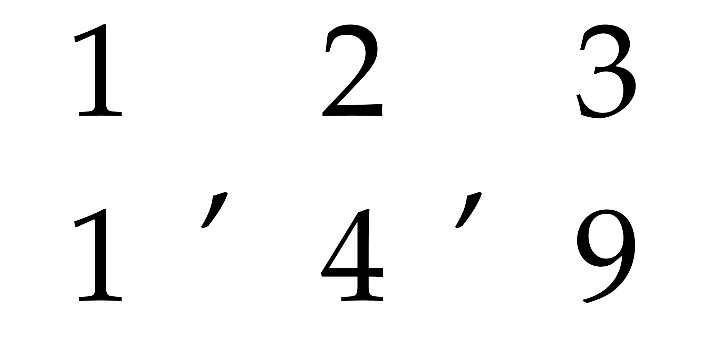 & say that the rule is 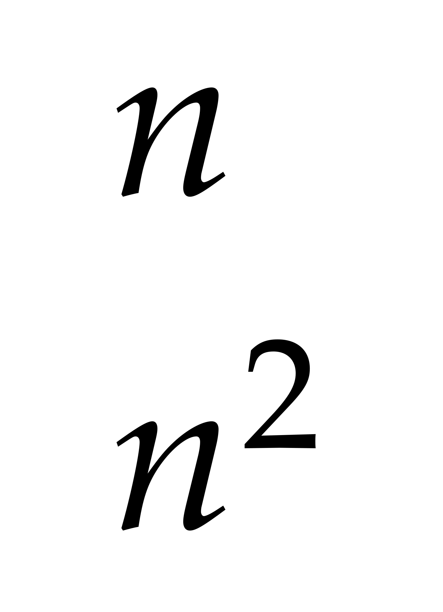? But when I now make use of a general rule, how does it occur in this use? When, for example, I translate a a c b _according to_ the rule 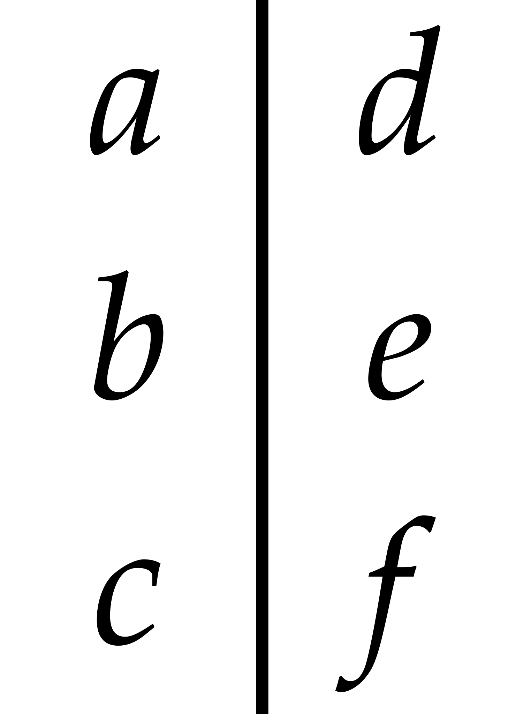 into d d f e – – –?

In what way do I make use of the sign for the general rule. Here it is clear that this sign (again) does not act magically or like a medicinal remedy; rather, it has sense only in contrast to other signs of the same system, for example 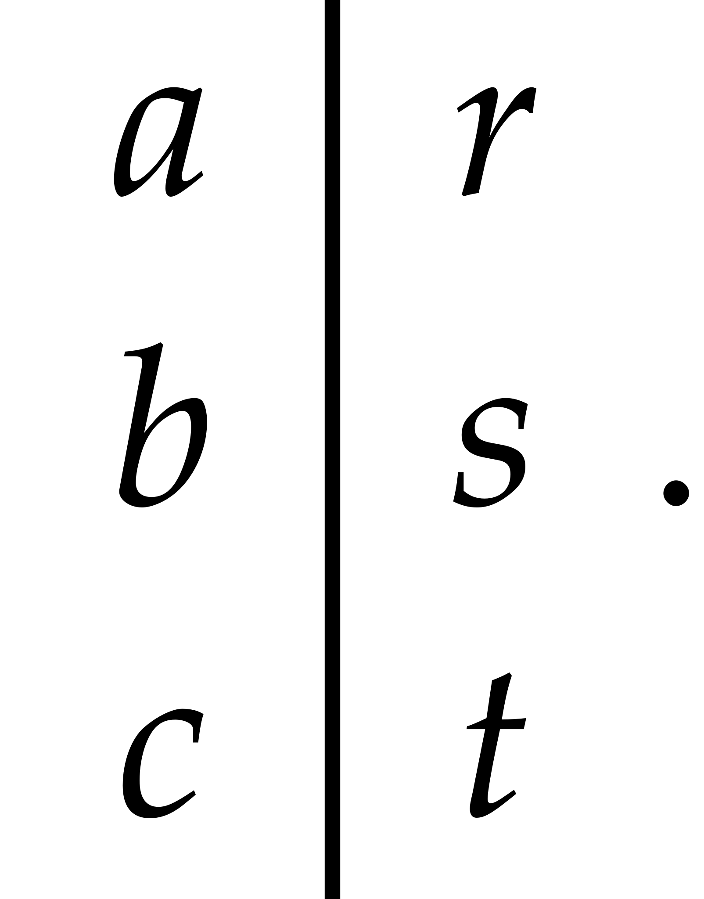 This must also show itself when, for example, I make a note of something & do so with signs not ordinarily in use. Suppose I wanted to make a quick note of the number of male & female listeners in the room & for this purpose put a cross in my notebook for each man and a stroke for each woman; this note too is a note only within a system I have quickly devised for myself.

### [222\[2\]](https://cdn.wittgensteinnachlass.com/2000px/webp/Ms-109/222.webp),[223\[1\]](https://cdn.wittgensteinnachlass.com/2000px/webp/Ms-109/223.webp)

Every explanation I give (of whatever kind) is likewise an explanation that says that it is so as opposed to another case, that it is _so_ (and not otherwise). This ‘so’ must itself be in a space of other possibilities. It is the case of pointing to a place when one says, for example, “here is a red patch”. This pointing indicates a place in contrast to other places or, more correctly, in contrast to the rest of space. The indication given by pointing must be understood as a case within a system of indications, or of indicating. But can I understand a system as such without moving within it? On the other hand, no movement exhausts the possibilities of the system, does it? Do I really need a movement, then, in order to understand the system. There is the analogous case of explaining a formal law by listing a few terms of a series, for example 1, 8, 27, 64,

### [223\[2\]](https://cdn.wittgensteinnachlass.com/2000px/webp/Ms-109/223.webp)

Of course, the sign for a system of sentences designates it only in contrast to other systems & itself presupposes a system. (An internal relation that obtains only if its terms are there.)

### [223\[3\]](https://cdn.wittgensteinnachlass.com/2000px/webp/Ms-109/223.webp)

13.11.1930

I work out what the date is today & say to myself in my thoughts: “Monday the 10th Tuesday the 11th Wednesday the 12th Thursday the 13th”; & write ‘13’. At Monday the 10th I had in mind an invitation I had for that day, which was why I had remembered that date.

### [223\[4\]](https://cdn.wittgensteinnachlass.com/2000px/webp/Ms-109/223.webp),[224\[1\]](https://cdn.wittgensteinnachlass.com/2000px/webp/Ms-109/224.webp)

Thinking as a whole & its application proceed automatically, so to speak. – However many intermediate stages I put between the thought & its application, each intermediate stage follows the preceding one – and the application follows the last – without an intervening link. And here we have the same case as when we try to bridge the gap between decision & deed by inserting intermediate links.

### [224\[2\]](https://cdn.wittgensteinnachlass.com/2000px/webp/Ms-109/224.webp)

The connection of our main problem with the epistemological problem of willing occurred to me some time ago. When such a persistent problem arises in psychology, it is never a question about actual experience (such a question is always much more well-behaved), but a logical, and therefore actually grammatical, problem.

### [224\[3\]](https://cdn.wittgensteinnachlass.com/2000px/webp/Ms-109/224.webp)

Why grammatical problems are so stubborn & seemingly impossible to root out – because they are connected with the oldest habits of thought, i.e. with the oldest pictures imprinted in our language itself.

### [224\[4\]](https://cdn.wittgensteinnachlass.com/2000px/webp/Ms-109/224.webp)

I have a particular mental image, & then someone comes in through the door. But why do I now call the mental image I had “the mental image that this person will come in through the door”? But that is just how we use language.

### [225\[1\]](https://cdn.wittgensteinnachlass.com/2000px/webp/Ms-109/225.webp)

Every description of the expectation that is relevant to us is at the same time a description of what is expected.

### [225\[2\]](https://cdn.wittgensteinnachlass.com/2000px/webp/Ms-109/225.webp)

But, one will say, that I use language in this way is not enough; I must be entitled to use it in this way. – But the use of language cannot be justified. For to justify it would be to justify it by means of sentences.

### [225\[3\]](https://cdn.wittgensteinnachlass.com/2000px/webp/Ms-109/225.webp)

But where then does the need for justification come from? the dissatisfaction? In any case it is the _same_ misunderstanding of our logic of language that makes us feel that p⌵~p does still say something, that it does not fill the whole of logical space, or that if it does, one can still demarcate this space from something outside it. Indeed, the expression “the whole of” in the preceding sentence already contains the same misunderstanding.

### [225\[4\]](https://cdn.wittgensteinnachlass.com/2000px/webp/Ms-109/225.webp),[226\[1\]](https://cdn.wittgensteinnachlass.com/2000px/webp/Ms-109/226.webp)

I do not call it _that because_ it has certain properties. Except when one can name these properties instead of saying ‘that’ (when ‘that’ is defined by them). Indeed, what I call something is quite immaterial (because arbitrary). All that matters is that I use the _same_ word to characterize the same constituent.

### [226\[2\]](https://cdn.wittgensteinnachlass.com/2000px/webp/Ms-109/226.webp)

And here, I believe, a principal source of misunderstanding is that the “occurrence of red” in two states of affairs has two quite different meanings. In the one case it means that something _is red_ in each – i.e. has the property of being red. In the other it is not a matter of having a colour in common (which would of course be expressed by specifying a colour).

### [226\[3\]](https://cdn.wittgensteinnachlass.com/2000px/webp/Ms-109/226.webp)

What they have in common here is precisely the harmony between world & thought, which cannot be described.

### [226\[4\]](https://cdn.wittgensteinnachlass.com/2000px/webp/Ms-109/226.webp)

Can one say: The mechanism must function when one uses it. Only then must the degree of freedom manifest itself, & of course it then manifests itself only in _one_ particular case. But in just this way the degree of freedom of a grammatical construction need only show itself in the case of its application.

### [226\[5\]](https://cdn.wittgensteinnachlass.com/2000px/webp/Ms-109/226.webp),[227\[1\]](https://cdn.wittgensteinnachlass.com/2000px/webp/Ms-109/227.webp)

Could one also say: We do use words in accordance with the grammatical rules, but without continually having these rules in view. So having the rules in view is not essential at all (the rules are of course sentences of some kind).

### [227\[2\]](https://cdn.wittgensteinnachlass.com/2000px/webp/Ms-109/227.webp)

If one uses a sentence, it must already _function_ in some way. That is, one does not use it to assign a noise to a fact.

### [227\[3\]](https://cdn.wittgensteinnachlass.com/2000px/webp/Ms-109/227.webp)

That is, the thought must already represent a movement of the mechanism, not simply one of its positions.

### [227\[4\]](https://cdn.wittgensteinnachlass.com/2000px/webp/Ms-109/227.webp)

The thought cannot be just any process. How else could a dispute flare up over a description?

### [227\[5\]](https://cdn.wittgensteinnachlass.com/2000px/webp/Ms-109/227.webp),[228\[1\]](https://cdn.wittgensteinnachlass.com/2000px/webp/Ms-109/228.webp)

Someone says “this flower has four leaves”; I look at it & say “yes”. To compare the statement with reality, I had to count the leaves, direct my attention to them in a _particular_ way. And that is what interpreting the sentence in accordance with the grammatical rules consisted in. I had to articulate reality in order to compare it with the sentence. This articulation finds very clear expression in the collation of reality with the sentence.

### [228\[2\]](https://cdn.wittgensteinnachlass.com/2000px/webp/Ms-109/228.webp)

14.11.1930

What makes one say that speaking cannot be thinking is that speaking is felt to be something arbitrary, and thinking is not. And of course there is some truth in that. It is just that speaking is on no different level from any other process used as a symbol.

### [228\[3\]](https://cdn.wittgensteinnachlass.com/2000px/webp/Ms-109/228.webp)

As long as an assignment does not bind one to anything (commit), it is not symbolic.

### [228\[4\]](https://cdn.wittgensteinnachlass.com/2000px/webp/Ms-109/228.webp)

Are words not like paper money, which merely mediates between two real values?

### [228\[5\]](https://cdn.wittgensteinnachlass.com/2000px/webp/Ms-109/228.webp)

But, I feel I have committed myself, when I say “I wish for something brown here”.

### [228\[6\]](https://cdn.wittgensteinnachlass.com/2000px/webp/Ms-109/228.webp)

Is that so? In describing reality I am already making use of the rules of grammar (or acting in accordance with these rules). Precisely because I must already see reality as articulated in order to describe it. – I have already translated reality into the sentence _in a certain way_ & have thus already fixed the use of language & have thereby, as it were, undertaken an obligation.

### [229\[1\]](https://cdn.wittgensteinnachlass.com/2000px/webp/Ms-109/229.webp)

But even when someone asks me “is there a brown patch there” & I answer “no, a blue patch”, I was already bound to say that. It was not an arbitrary assignment of words to what I saw.

### [229\[2\]](https://cdn.wittgensteinnachlass.com/2000px/webp/Ms-109/229.webp)

It would not count as portraying a state of affairs if, say, I scribbled arbitrary lines on paper & said “there is surely a method of projection that projects this state of affairs into this drawing”.

### [229\[3\]](https://cdn.wittgensteinnachlass.com/2000px/webp/Ms-109/229.webp)

Yes, here too (in portraying) I feel bound even at the first stroke – i.e. it is not arbitrary. In any case, the _picture_ begins only where the obligation begins.

### [229\[4\]](https://cdn.wittgensteinnachlass.com/2000px/webp/Ms-109/229.webp)

Does following a rule mean following an expressed (uttered) rule?

### [229\[5\]](https://cdn.wittgensteinnachlass.com/2000px/webp/Ms-109/229.webp),[230\[1\]](https://cdn.wittgensteinnachlass.com/2000px/webp/Ms-109/230.webp)

When I intentionally copy a certain shape, the process of copying – I mean, the whole mental process – has this shape in common with reality at a particular point. It is a facet of the process of copying. A facet that lies against the object copied & coincides with it there.

### [230\[2\]](https://cdn.wittgensteinnachlass.com/2000px/webp/Ms-109/230.webp)

When I copy the figure 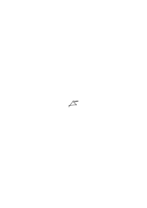 & start, say, with the upper horizontal line, I can let it guide my pencil in different ways. I may try to reproduce this line as regards its length – or not. Then in the one case my pencil will suddenly be stopped (by the model) & if I overshoot the mark, there will be another particular reaction equivalent here to actually stopping. In the other case, when the scale of the reproduction does not matter, my pencil will also stop, but the accompanying mental phenomena will be different. I might say that the body of the whole process of copying has one particular facet lying against the original.

### [230\[3\]](https://cdn.wittgensteinnachlass.com/2000px/webp/Ms-109/230.webp),[231\[1\]](https://cdn.wittgensteinnachlass.com/2000px/webp/Ms-109/231.webp)

And of course the sentence that describes the copying also has a facet in common with the sentence that describes the original.

### [231\[2\]](https://cdn.wittgensteinnachlass.com/2000px/webp/Ms-109/231.webp)

One might then say: Even if my pencil misses the original, the intention always hits it.

### [231\[3\]](https://cdn.wittgensteinnachlass.com/2000px/webp/Ms-109/231.webp)

Thus I might say that the body of the describing, if I say, for example, “here is a brown circle”, has one of its facets lying against what is described. By my having portrayed, traced, the fact with these words. I.e. the action of tracing has one _quite particular_ facet lying against the original. (It has this facet in common with the original – or again, the original forms this facet.)

### [231\[4\]](https://cdn.wittgensteinnachlass.com/2000px/webp/Ms-109/231.webp)

The rule by which I projected the original would in a certain sense be a description of the body of this copying. For it would describe _how_ I let my pencil be guided by the original. It would be, as it were, a retrospective description of the mechanism interposed between original & picture. And would describe the further possibilities of movement of this mechanism.

### [232\[1\]](https://cdn.wittgensteinnachlass.com/2000px/webp/Ms-109/232.webp)

But does one also portray something when one expresses an expectation?

### [232\[2\]](https://cdn.wittgensteinnachlass.com/2000px/webp/Ms-109/232.webp)

15.11.1930

The sentence “I expect a red patch here” evidently depicts something of the present state & something else besides.

### [232\[3\]](https://cdn.wittgensteinnachlass.com/2000px/webp/Ms-109/232.webp)

What if I describe a memory? – Is it not _essentially_ different from describing an expectation?

### [232\[4\]](https://cdn.wittgensteinnachlass.com/2000px/webp/Ms-109/232.webp)

The description of the expectation is in one sense a negative description of the present. For if I expect a red patch to appear here, that means, in any case, that there is none here now. I might say: what describes the future in this description is its relation to the description of the present in the same language. Or: is its particular relation to the present.

### [232\[5\]](https://cdn.wittgensteinnachlass.com/2000px/webp/Ms-109/232.webp),[233\[1\]](https://cdn.wittgensteinnachlass.com/2000px/webp/Ms-109/233.webp)

But what if I say: “Imagine a room …” & then describe a room & something happening in it. Such a sentence stands in the same relation to an assertion as a picture in general does to a portrait. Now if, for example, I look at a Dutch genre painting, I do not take the people painted in it to be real people; on the other hand, their likeness to people is essential to understanding the picture.

### [233\[2\]](https://cdn.wittgensteinnachlass.com/2000px/webp/Ms-109/233.webp)

A puzzle picture is an excellent example of the different ways in which we can see a picture before us.

### [233\[3\]](https://cdn.wittgensteinnachlass.com/2000px/webp/Ms-109/233.webp)

Does “imagining red” mean “imagining that something (say, part of my visual field) is red”? Or are there two different mental images & the one is that part of the visual field (or the whole of it) is red; the other: the mental image of the colour red; hence the mental image of what corresponds to the _word_ red, not of what corresponds to a sentence containing the word (red)?

And if there were such a thing, how would these two mental images be related to one another?

### [233\[4\]](https://cdn.wittgensteinnachlass.com/2000px/webp/Ms-109/233.webp),[234\[1\]](https://cdn.wittgensteinnachlass.com/2000px/webp/Ms-109/234.webp)

I can translate that description of a room into a drawing. And that is essential to it. I can form a mental image from a description (i.e. by following a description). In that case I evidently translate the description into the mental image just as I could transpose reality into the description.

### [234\[2\]](https://cdn.wittgensteinnachlass.com/2000px/webp/Ms-109/234.webp)

Playing from sheet music.

### [234\[3\]](https://cdn.wittgensteinnachlass.com/2000px/webp/Ms-109/234.webp)

The signal, unlike its explanation, does not give the full multiplicity of the fact. But the explanation cannot give more than this multiplicity.

### [234\[4\]](https://cdn.wittgensteinnachlass.com/2000px/webp/Ms-109/234.webp)

I show someone the score of a piece of music & say “can you read this”. He skims through it & says “yes”. In skimming through it he has done something or other, perhaps made movements with his larynx or innervated certain muscles & more precisely, he has translated the musical notation into another system of innervations or movements.

### [234\[5\]](https://cdn.wittgensteinnachlass.com/2000px/webp/Ms-109/234.webp),[235\[1\]](https://cdn.wittgensteinnachlass.com/2000px/webp/Ms-109/235.webp)

The rule according to which I translate shows itself in my translation plus the reactions of dissatisfaction where, by the rule’s standards, I have translated incorrectly.

### [235\[2\]](https://cdn.wittgensteinnachlass.com/2000px/webp/Ms-109/235.webp)

To what extent does understanding a language, insofar as it is shown by translating it into another language (by tracing this language), presuppose other sentences of the same language, hence grammatical rules.

### [235\[3\]](https://cdn.wittgensteinnachlass.com/2000px/webp/Ms-109/235.webp)

One might also put it this way: Does the process of translating _one_ sentence already contain unambiguously the _general_ rule for translating the language of that sentence. (Is that not like asking: is the whole way the mechanism works already unambiguously expressed in this movement of it?)

### [235\[4\]](https://cdn.wittgensteinnachlass.com/2000px/webp/Ms-109/235.webp),[236\[1\]](https://cdn.wittgensteinnachlass.com/2000px/webp/Ms-109/236.webp)

Let us imagine the simple case in which someone intentionally copies the line segment 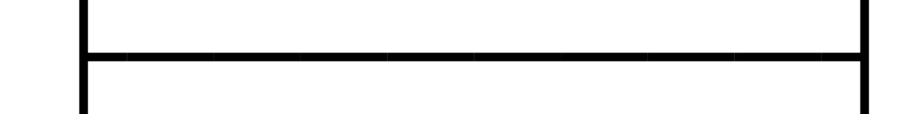 at a scale of 1 : 1. Is the understanding of how to copy any line segment at a scale of 1 : 1 already contained in the process of copying? That is, is the way in which my pencil is guided by the line segment precisely this general law? I held my pencil, as it were, without presupposing anything at all, & it was guided _only_ by the length of the original.

### [236\[2\]](https://cdn.wittgensteinnachlass.com/2000px/webp/Ms-109/236.webp)

I would then say: Had the original been longer, I would have gone further with my pencil & had it been shorter, not as far. But was the spirit expressed here already contained, as it were, in the tracing of the one line.

### [236\[3\]](https://cdn.wittgensteinnachlass.com/2000px/webp/Ms-109/236.webp),[237\[1\]](https://cdn.wittgensteinnachlass.com/2000px/webp/Ms-109/237.webp)

I can resolve: I will walk until I find him (say, I want to meet someone in a street.) And now I walk along the street & meet him at a particular point & stop. Was the following of the general rule I had set myself contained in the process of walking, or in some other simultaneous process. Or was the process merely _in accordance_ with this rule, but also with other, opposing rules? But if I had resolved to follow the general rule, then holding fast to this resolution already contained what made the walking a following of just that one general rule. In the resolution the length of the distance is deliberately left open. This is what I previously wanted to indicate with the word “presuppositionless”.

### [237\[2\]](https://cdn.wittgensteinnachlass.com/2000px/webp/Ms-109/237.webp)

But that can only mean: there is a difference between one resolution & another. I could also have resolved to walk a km & that happened to be the distance I had to walk to meet that person. (Here the word “ground” is explained too.)

### [237\[3\]](https://cdn.wittgensteinnachlass.com/2000px/webp/Ms-109/237.webp)

Must this resolving then consist in my uttering a sentence, the resolution, _before_ carrying out my action?

### [237\[4\]](https://cdn.wittgensteinnachlass.com/2000px/webp/Ms-109/237.webp)

For example, I might want to draw a line so that it is parallel to the line a, which might, incidentally, be a

parabola. But I do not want to draw a parabola; I draw one only incidentally when I move parallel to a. But I might also have wanted to draw a parabola that then happened to be parallel to a. The whole process, however, would have been different in each of the two cases.

### [238\[1\]](https://cdn.wittgensteinnachlass.com/2000px/webp/Ms-109/238.webp)

16.11.1930

Our language keeps tying new knots in thinking. And philosophy never finishes untying them.

### [238\[2\]](https://cdn.wittgensteinnachlass.com/2000px/webp/Ms-109/238.webp)

Intending is a human mental process.

### [238\[3\]](https://cdn.wittgensteinnachlass.com/2000px/webp/Ms-109/238.webp)

I give someone the order to draw a line from A parallel to a. He tries (intends) to do it, but the result is that the line is parallel to b. Was the process of copying then the same as if he had intended to draw parallel to b & had carried out his intention? Evidently I think not. He let himself be guided by the line a.

### [238\[4\]](https://cdn.wittgensteinnachlass.com/2000px/webp/Ms-109/238.webp)

If the general law of mapping is expressed in the activity of mapping, then it must lie in a feature of this activity & the general law must be a necessary part of the description of the process.

### [238\[5\]](https://cdn.wittgensteinnachlass.com/2000px/webp/Ms-109/238.webp)

That is: The general law of mapping must be part of the _particular_ description of _this_ process of mapping.

### [238\[6\]](https://cdn.wittgensteinnachlass.com/2000px/webp/Ms-109/238.webp),[239\[1\]](https://cdn.wittgensteinnachlass.com/2000px/webp/Ms-109/239.webp)

If I let my pencil be guided by this line (the original), it is as if I interposed a particular mechanism between the line & my hand. And this mechanism is an expression of the general rule of mapping.

### [239\[2\]](https://cdn.wittgensteinnachlass.com/2000px/webp/Ms-109/239.webp)

The generality must consist in one’s leaving something open. And this leaving open is expressed in my saying: I let my pencil be guided only by the line, _however_ it goes, I yield to it.

### [239\[3\]](https://cdn.wittgensteinnachlass.com/2000px/webp/Ms-109/239.webp)

The question now is: if I have (now) copied an original in this way, is it then possible to describe the process of copying as it actually was, correctly, according to another general rule as well. Or can I reject such a description with the words: “no, I really let myself be guided only by _this_ (general) rule (and not by that other one which in this case would indeed have given the same result as well)”.

### [239\[4\]](https://cdn.wittgensteinnachlass.com/2000px/webp/Ms-109/239.webp),[240\[1\]](https://cdn.wittgensteinnachlass.com/2000px/webp/Ms-109/240.webp)

Let us imagine that we actually interposed a copying machine between the original & the pencil (for after all we too are a copying machine). Now there could be no question of intention here & whatever the copying machine produces is the copy. Where, then, is the intention here? It is expressed in this way: If, e.g., all the rods of the machine remain rigid, I call what the machine produces a correct copy. But if a rod bends, then the copy consists of what it produces plus a correction corresponding to the bend.

### [240\[2\]](https://cdn.wittgensteinnachlass.com/2000px/webp/Ms-109/240.webp)

I said: If I let myself be guided by an original, it is as if I interposed a mechanism between myself & the original. But what if this mechanism fails to work? Well, that means nothing here; for if it fails to work, the error in its working is reckoned as a correction to what it produces.

### [240\[3\]](https://cdn.wittgensteinnachlass.com/2000px/webp/Ms-109/240.webp),[241\[1\]](https://cdn.wittgensteinnachlass.com/2000px/webp/Ms-109/241.webp)

No, a mechanism is not the expression of a general rule, even if its movements have been found in experience to accord with a definite rule. Unless I rule out the case of its failing to work by stipulating: however it moves, its movement is by definition in accordance with the rule. The intention is a way of regarding things (or a norm) in accordance with which whatever happens is regarded. It is as if I expressed the measured height of all people by saying that they were 6 feet tall + or ‒ a certain amount.

### [241\[2\]](https://cdn.wittgensteinnachlass.com/2000px/webp/Ms-109/241.webp)

Suppose there is a pointer in our mental apparatus whose deflection indicates the deviation of the activity from the intention; then to ascertain the intention one must look not only at the result but also at the pointer (which indicates the correction). If, say, the result follows a rule, one must still check whether the pointer has deflected in the process & only if it has not is this rule an expression of the intention.

### [241\[3\]](https://cdn.wittgensteinnachlass.com/2000px/webp/Ms-109/241.webp),[242\[1\]](https://cdn.wittgensteinnachlass.com/2000px/webp/Ms-109/242.webp)

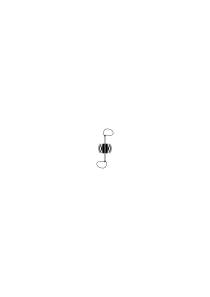

Copying machine.

Again: What does recognizing a law consist in? This process does after all actually occur. I show someone the series 2x, 4x², 6x⁴, 8x⁸, and he says “yes, now I know how to go on, I see the law”. (Perhaps after the first two terms he had conjectured a different law & was surprised when I wrote down the third term; then he saw a new law.) To see a general law means that in what one sees something has in some sense been left open.

### [242\[2\]](https://cdn.wittgensteinnachlass.com/2000px/webp/Ms-109/242.webp)

Our question can then be put like this: Is there a difference between the two cases if I write down the terms 2x, 4x² on one occasion as terms of the series 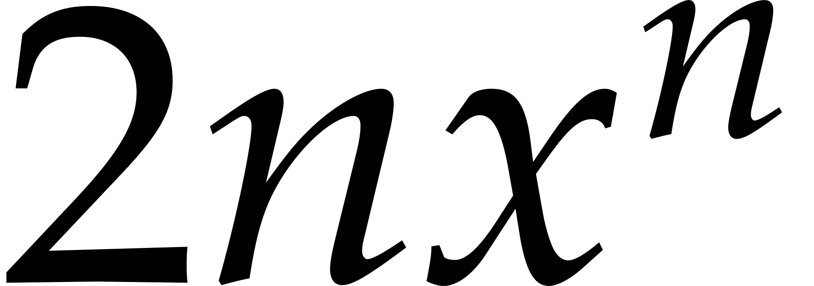 and on another as terms of the series 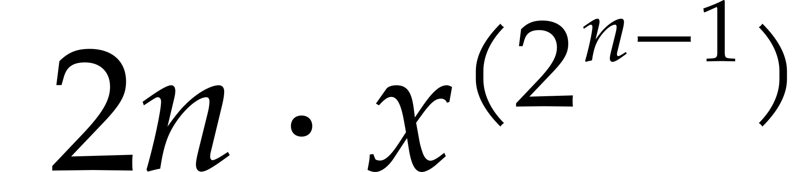? Clearly there is a difference.

### [242\[3\]](https://cdn.wittgensteinnachlass.com/2000px/webp/Ms-109/242.webp)

Must not the written general rule be a _picture_ of the process when I do something according to this rule?!

### [242\[4\]](https://cdn.wittgensteinnachlass.com/2000px/webp/Ms-109/242.webp)

17.11.1930

How can the word “red” in the sentence guide me, or how can I be guided to this word?

### [242\[5\]](https://cdn.wittgensteinnachlass.com/2000px/webp/Ms-109/242.webp)

I believe it was the main thought (or at least _one_ of them) of my book that one must be _guided_ by the word “red” too, or by what goes along with it & surrounds it.

### [242\[6\]](https://cdn.wittgensteinnachlass.com/2000px/webp/Ms-109/242.webp),[243\[1\]](https://cdn.wittgensteinnachlass.com/2000px/webp/Ms-109/243.webp)

_Explanation_ of accidentals in musical notation. Must it not supply the multiplicity that the sign lacks, the multiplicity that makes it a signal? The word red is merely a _signal_. But a signal for what? Where must that be expressed if not in its explanation?

(Musical accidentals are signals in this way.)

### [243\[2\]](https://cdn.wittgensteinnachlass.com/2000px/webp/Ms-109/243.webp)

One might imagine the meaning of ‘red’ being fixed in an archive, like the standard metre, in the form of a small plaque of the colours in question. (In the case of the standard metre too, _something_ must be 1 m long.)

### [243\[3\]](https://cdn.wittgensteinnachlass.com/2000px/webp/Ms-109/243.webp)

How could one ever understand a signal, indeed how could one attach anything to it in one’s own mind, & how could the question of how it should be used in an exact way be the subject of a dispute if there were no explanation for it, no criterion that it means _this_? In so far as it can be discussed (disputed), it must also be possible to decide the matter.

### [243\[4\]](https://cdn.wittgensteinnachlass.com/2000px/webp/Ms-109/243.webp),[244\[1\]](https://cdn.wittgensteinnachlass.com/2000px/webp/Ms-109/244.webp)

Can one imagine a standard not, just as one can imagine a standard red? Had Russell & Frege dealt with the colour red, they would have felt obliged to include in the book an exact sample of what they mean by ‘red’.

### [244\[2\]](https://cdn.wittgensteinnachlass.com/2000px/webp/Ms-109/244.webp)

18.11.1930

On the other hand, this standard red cannot be necessary, since we actually understand a sentence in which the word ‘red’ occurs without the sample. This might be compared to a case in which one took a metre to mean a metre as judged by eye. (Mind: the metre as judged by eye is not an inexact metre but something _different_ from the physical metre.)

### [244\[3\]](https://cdn.wittgensteinnachlass.com/2000px/webp/Ms-109/244.webp),[245\[1\]](https://cdn.wittgensteinnachlass.com/2000px/webp/Ms-109/245.webp)

But suppose now that language actually used a small red plaque which one points to instead of the word ‘red’; this form of expression would certainly be possible. And this too means something. – But the question is: does this form of expression help us more in understanding what is meant & if so, in what respect? For since we understand the verbal form of expression too, there must then be something present besides the word, namely what the sample had over the word alone. For: A form of expression cannot be more than intelligible & there are no extra exercises here. The two forms of expression must be entirely equivalent to one another, except that what lies here in the visible sign may lie elsewhere there.

### [245\[2\]](https://cdn.wittgensteinnachlass.com/2000px/webp/Ms-109/245.webp)

Now if I did not have my small red plaque to hand & pointed instead to something else red; & what if I took for this purpose the very red thing that I want to say is red? If, say, I pointed to an apple & said “_That_ is _like this_”? Or: “_Here_ is _this_ colour”? Now why does that say nothing? Because it is right whatever is the case. Because I cannot ask: “as opposed to – – –?” This is of course the same case as the answer “It’s me” to the question “Who’s there?”.

### [245\[3\]](https://cdn.wittgensteinnachlass.com/2000px/webp/Ms-109/245.webp)

But it makes sense to say: Here is the colour I mean.

### [245\[4\]](https://cdn.wittgensteinnachlass.com/2000px/webp/Ms-109/245.webp)

But it makes no more sense to say “I call this colour here ‘red’ & here is red” than to say “here is this colour”.

### [245\[5\]](https://cdn.wittgensteinnachlass.com/2000px/webp/Ms-109/245.webp),[246\[1\]](https://cdn.wittgensteinnachlass.com/2000px/webp/Ms-109/246.webp)

The reply to the statement “this colour is here” would be: “wouldn’t you say that _in every case_?” And that shows that what is missing here is the space in which the statement must be made if it is to have sense.

### [246\[2\]](https://cdn.wittgensteinnachlass.com/2000px/webp/Ms-109/246.webp)

23.11.1930

If I have forgotten which colour “red” means, I cannot know whether “reddish green” has a sense.

### [246\[3\]](https://cdn.wittgensteinnachlass.com/2000px/webp/Ms-109/246.webp)

When philosophers use a word & inquire into its meaning, one must always ask oneself: is this word ever actually used in that way in the language that created it? One will usually find that it is not & that the word is being used contrary to its normal grammar. (“knowledge”, “to be”, “thing”)

### [246\[4\]](https://cdn.wittgensteinnachlass.com/2000px/webp/Ms-109/246.webp),[247\[1\]](https://cdn.wittgensteinnachlass.com/2000px/webp/Ms-109/247.webp)

“I would recognize this colour, I still remember it exactly.” So remembering it is taken here as a guarantee of the possibility of recognizing it. And that seems only natural, indeed self-evident. Curiously, something in me now rebels against the traditional view. And it is the memory-image that gives me trouble. “Would you recognize your brother if he came through the door now?” – “Certainly”. But how can I be certain of that? And if I do not recognize him when he actually comes in, can I then say: Yes, when I said it, I would indeed have recognized him? The case of failure to recognize that I mean here would be one in which someone came through the door & I had to say “I don’t know whether that is my brother” (for if I said “no, that’s not what he looks like”, that too would after all be a case of recognition). In the case of failure to recognize, the word would, as it were, have lost its meaning.

### [247\[2\]](https://cdn.wittgensteinnachlass.com/2000px/webp/Ms-109/247.webp)

“I know how this word is to be used”. What does that mean? How can it be set down how a word is to be used? The word “red”, for example. –

### [247\[3\]](https://cdn.wittgensteinnachlass.com/2000px/webp/Ms-109/247.webp),[248\[1\]](https://cdn.wittgensteinnachlass.com/2000px/webp/Ms-109/248.webp)

Perhaps the real difficulty is this (though it may seem almost foolish to some): I explain the word “red” by pointing to something red & saying “that is red”, yet this red thing later disappears from my view. And now apparently _something else_ takes its place (the memory, or whatever one may call it).

### [248\[2\]](https://cdn.wittgensteinnachlass.com/2000px/webp/Ms-109/248.webp)

“So this is the _way_ this word is used!” But how do I retain this _way_ in memory?

### [248\[3\]](https://cdn.wittgensteinnachlass.com/2000px/webp/Ms-109/248.webp)

The word “red” is used via the memory-image.

### [248\[4\]](https://cdn.wittgensteinnachlass.com/2000px/webp/Ms-109/248.webp)

24.11.1930

The explanation of a sign must of course be able to remove every difference of opinion about its meaning. That is, it must express all contrasts of meaning. And now the question is: is there then still a question to be decided?

### [248\[5\]](https://cdn.wittgensteinnachlass.com/2000px/webp/Ms-109/248.webp)

Any explanation of a sign can be substituted for the sign (in its place).

### [248\[6\]](https://cdn.wittgensteinnachlass.com/2000px/webp/Ms-109/248.webp),[249\[1\]](https://cdn.wittgensteinnachlass.com/2000px/webp/Ms-109/249.webp)

The explanation of the symbol must bear the entire responsibility for its application.

### [249\[2\]](https://cdn.wittgensteinnachlass.com/2000px/webp/Ms-109/249.webp)

Every question in dispute can be decided, – but no more is needed.

### [249\[3\]](https://cdn.wittgensteinnachlass.com/2000px/webp/Ms-109/249.webp)

Where a difference of opinion about the meaning of a word is possible, the explanation must remove it.

### [249\[4\]](https://cdn.wittgensteinnachlass.com/2000px/webp/Ms-109/249.webp)

One could explain the essence of language using a system of signals as an example.

### [249\[5\]](https://cdn.wittgensteinnachlass.com/2000px/webp/Ms-109/249.webp)

E.g. a, b, c, d stand for movements, namely a = ↑, b = ↓, c = →, d = ←,

so, for example, bccbda means 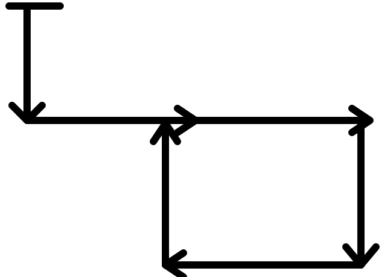 etc. Now, isn’t the sentence “bccbda” similar to that path? Clearly it is, in a way. (Isn’t it exactly the similarity between a photograph & the object photographed?)

### [249\[6\]](https://cdn.wittgensteinnachlass.com/2000px/webp/Ms-109/249.webp)

If there is only a choice between four movements, then 4 signals suffice.

### [249\[7\]](https://cdn.wittgensteinnachlass.com/2000px/webp/Ms-109/249.webp)

If the explanation merely puts one sign in place of another, what is it needed for at all? – It is needed only where it increases the multiplicity.

### [249\[8\]](https://cdn.wittgensteinnachlass.com/2000px/webp/Ms-109/249.webp),[250\[1\]](https://cdn.wittgensteinnachlass.com/2000px/webp/Ms-109/250.webp)

25.11.1930

“To go by something”. Is the same as letting oneself be guided by something.

### [250\[2\]](https://cdn.wittgensteinnachlass.com/2000px/webp/Ms-109/250.webp)

Can one “_leave open_” something in an essentially different sense from that in which one leaves a pair of brackets empty?

### [250\[3\]](https://cdn.wittgensteinnachlass.com/2000px/webp/Ms-109/250.webp)

I let myself be guided by language (the original), but for that I must hand it the reins in a certain way. And only then can it guide me.

### [250\[4\]](https://cdn.wittgensteinnachlass.com/2000px/webp/Ms-109/250.webp)

Nor does the printed note compel the finger to press down on the key. The notation does not compel me to let myself be guided by it in this (or any) way. Once I have resolved to let myself be guided by it in this way, it then guides me to these & these movements.

### [250\[5\]](https://cdn.wittgensteinnachlass.com/2000px/webp/Ms-109/250.webp)

But this looks as if a particular _general_ resolution must precede the act of translation, of mapping (the resolution to let myself be guided in this way).

### [251\[1\]](https://cdn.wittgensteinnachlass.com/2000px/webp/Ms-109/251.webp)

I entrust myself to the rule.

### [251\[2\]](https://cdn.wittgensteinnachlass.com/2000px/webp/Ms-109/251.webp)

I let my action be determined by the original. When, e.g., I play from sheet music.

### [251\[3\]](https://cdn.wittgensteinnachlass.com/2000px/webp/Ms-109/251.webp)

26.11.1930

It is not the notes that lead us to play the piano at all, but they do lead us to play _in the way_ (we do).

### [251\[4\]](https://cdn.wittgensteinnachlass.com/2000px/webp/Ms-109/251.webp)

That is, it is not the system of signals that gets us to entrust ourselves to it; rather, we entrust ourselves to it & are then guided in accordance with it.

### [251\[5\]](https://cdn.wittgensteinnachlass.com/2000px/webp/Ms-109/251.webp)

That is how we entrust ourselves to language too.

### [251\[6\]](https://cdn.wittgensteinnachlass.com/2000px/webp/Ms-109/251.webp)

“Which tone will you play?” – “I will go by which note is written there”.

### [251\[7\]](https://cdn.wittgensteinnachlass.com/2000px/webp/Ms-109/251.webp),[252\[1\]](https://cdn.wittgensteinnachlass.com/2000px/webp/Ms-109/252.webp)

My thought is that it must be possible to read off the so-called general rule from the individual case of going by something. So this general rule is not a hypothesis that can be determined with greater certainty by more individual cases; on the contrary, it must already be possible to say of a second individual case that it is not formed according to the same rule as the first.

### [252\[2\]](https://cdn.wittgensteinnachlass.com/2000px/webp/Ms-109/252.webp)

As when, in consulting an oracle, one lets oneself be guided by the number of these petals by counting off the buttons of one’s coat or the petals of a daisy.

### [252\[3\]](https://cdn.wittgensteinnachlass.com/2000px/webp/Ms-109/252.webp)

I said earlier that if this is so, then something must be left open in the process. Thus in intending to go by the flower oracle I must leave open how many petals the flower will actually have. The expression of this intention also runs: “However many petals the flower may have, …”.

### [252\[4\]](https://cdn.wittgensteinnachlass.com/2000px/webp/Ms-109/252.webp),[253\[1\]](https://cdn.wittgensteinnachlass.com/2000px/webp/Ms-109/253.webp)

Now can this leaving open be of a different kind from that which we have before us when, say, we throw a ball against a wall & the throw leaves open when the ball will come back because that depends on the distance of the wall, which is not predetermined by the throw? Or, is it not the same leaving open that we have before us when the printing press leaves open what text will come out when it prints because it does not predetermine what setting of type will be put into it?

### [253\[2\]](https://cdn.wittgensteinnachlass.com/2000px/webp/Ms-109/253.webp)

In all these cases what is at issue is treating a predetermined component of the sentence as argument & hence all the rest as function.

### [253\[3\]](https://cdn.wittgensteinnachlass.com/2000px/webp/Ms-109/253.webp)

For the hypothetical “if the wall had been further away, then …” does not help us. “If the note had been on the next line, then …”. I might reply: “I don’t know what would have happened then, or if I do know, it is only from what I have before me _now_”. For this “if the note had been on the other line” can express nothing but the general rule itself, which I must, however, discern from the present case, if I can discern it at all. – It is different if this “if …” is the expression of a hypothesis & is then still to be confirmed or refuted by experience.

### [254\[1\]](https://cdn.wittgensteinnachlass.com/2000px/webp/Ms-109/254.webp)

Is a blank sheet of paper in any sense general – because it gives us the opportunity to write whatever we want on it? Is an empty box general? –

### [254\[2\]](https://cdn.wittgensteinnachlass.com/2000px/webp/Ms-109/254.webp)

But if I can read off the general rule from the particular case, can I read off more than the _expression_ of the general rule?

### [254\[3\]](https://cdn.wittgensteinnachlass.com/2000px/webp/Ms-109/254.webp)

When I count a number of strokes on a sheet of paper, I let myself be guided by their number. And here, in the decimal system, & where there are say fewer than 10 strokes, we have, in addition, a case in which we are _guided_ to structurally unrelated signs, the words 1, 2, 3, 4, 5, etc. But are we not dealing here with a mistaken use of the analogy of guidance?

### [254\[4\]](https://cdn.wittgensteinnachlass.com/2000px/webp/Ms-109/254.webp),[255\[1\]](https://cdn.wittgensteinnachlass.com/2000px/webp/Ms-109/255.webp)

We know that I can form a resolve. I can say: “I shall count these strokes”. And this is a general resolve because it leaves open how many strokes there actually are. Now if this expression of the resolve means something, it is not inconceivable that what lies in that resolve can also lie in the action (of counting, say) alone. I might say that this resolve – whatever kind it may be – governs the action in some sense.

### [255\[2\]](https://cdn.wittgensteinnachlass.com/2000px/webp/Ms-109/255.webp)

But what if a mechanical counter (a machine) counts something (say, the number of km a car travels)? It too then lets itself be guided & where is the general rule here? If it is expressed in the mechanism, it is only the generality of the empty box. If we know this so precisely, whatever the machine may be, then how can the generality of a process of thinking be of a different kind?

### [255\[3\]](https://cdn.wittgensteinnachlass.com/2000px/webp/Ms-109/255.webp),[256\[1\]](https://cdn.wittgensteinnachlass.com/2000px/webp/Ms-109/256.webp)

In a machine there is what one calls an adjustable stop; the distance a part of the machine moves is governed by it. Here again and again it is as if the generality could lie not in the machine itself but in the _conception_ of the machine. And again not in a person’s conceiving it (an activity of a person), but in a system of signs. As if the _conception_ could be set down only in the grammar of a system of signs.

### [256\[2\]](https://cdn.wittgensteinnachlass.com/2000px/webp/Ms-109/256.webp),[257\[1\]](https://cdn.wittgensteinnachlass.com/2000px/webp/Ms-109/257.webp)

I sing or play a piece from sheet music; suddenly I come across a # and now I interpret it as the order (or, what amounts to the same thing, remember that it is the order) to sing a semitone higher. It is not that the sight of the # gets me to sing a semitone higher, as if by magic or like a drug. What happens can rather be expressed in this way: I act as if I were going by a general rule which stipulates that one is to sing a semitone higher wherever a # stands before a note. And that is so even if I did not know this general rule from the start & decided to adopt it only when I saw the #. After all, I could have invented it myself on the spot & resolved to follow it & then perhaps on the very next occasion, i.e. at the next #, dropped the rule & stipulated another, say. But even then – I want to say – I would have acted according to a general rule at the first #.

### [257\[2\]](https://cdn.wittgensteinnachlass.com/2000px/webp/Ms-109/257.webp)

27.11.1930

If I take the order – say, the notation – as a picture of its execution, then the occurrence of the # is of course no picture of the activity I carry out in following the #; rather, the occurrence of the # becomes pictorial only through my repeating this very same activity wherever it occurs.

### [257\[3\]](https://cdn.wittgensteinnachlass.com/2000px/webp/Ms-109/257.webp),[258\[1\]](https://cdn.wittgensteinnachlass.com/2000px/webp/Ms-109/258.webp)

But of course this repetition itself is not essential either, for the # might occur only _once_ & would then still have to act just as it would if it occurred twice or 1000 times. Here again it is the possibility, not the reality, of the occurrence that is at issue. What is at issue, again, is the occurrence of the # in a _space_. For then the non-occurrence of the # must have meaning too. That is, it must have meaning as long as this system of rules is in force at all.

### [258\[2\]](https://cdn.wittgensteinnachlass.com/2000px/webp/Ms-109/258.webp)

One could also put it like this: In a language there is no arbitrariness. Every law is a general law. If what was essential about the signs were that they prompted me by some forces or other to do this & that, there would be no need for a system at all. To this one might of course reply: Language is simply a particular kind of drug that takes effect through an arrangement (an agreement). But we are interested only in the essence of the arrangement, not in its empirical consequences. We are not interested in anything that could be otherwise.

### [258\[3\]](https://cdn.wittgensteinnachlass.com/2000px/webp/Ms-109/258.webp),[259\[1\]](https://cdn.wittgensteinnachlass.com/2000px/webp/Ms-109/259.webp)

Someone who goes by a sign acts in accordance with a general rule. And this cannot mean that he acts as he does & the general rule (as it were) looks on from afar.

### [259\[2\]](https://cdn.wittgensteinnachlass.com/2000px/webp/Ms-109/259.webp)

And here again there is a danger of misunderstanding: It seems as if once again there were a mechanism to investigate, as one investigates a sewing machine when one opens it up (& examines the way the parts engage with one another).

But of course that cannot be what is at issue, for otherwise all one would have arrived at, once again, would be something hypothetical.

### [259\[3\]](https://cdn.wittgensteinnachlass.com/2000px/webp/Ms-109/259.webp)

So the general law would have to be consciously expressed in my action. But there is surely no doubt that we very often react to signs quite automatically. For instance, when a practised reader of music sight-reads a piece. He then reacts to the signs like a machine (We are evidently in an area here that does not really concern us). But what if the pianist strikes the wrong key? –

### [259\[4\]](https://cdn.wittgensteinnachlass.com/2000px/webp/Ms-109/259.webp),[260\[1\]](https://cdn.wittgensteinnachlass.com/2000px/webp/Ms-109/260.webp)

It is only the intention that reaches as far as the model. And this is expressed by the fact that the expression of the intention contains the description of the model & the expression of the rule of projection. What I actually play does not matter; experience will tell & the description of what was played need have nothing in common with the description of the notation. If, on the other hand, I want to describe my intention, I must say that I intend to map this notation onto sounds in this way. And only this can express that the intention reaches as far as the original & contains a general rule.

### [260\[2\]](https://cdn.wittgensteinnachlass.com/2000px/webp/Ms-109/260.webp)

To be guided by the original means nothing other than to have the intention of mapping the original in this way. The only description of this intention is its expression.

### [260\[3\]](https://cdn.wittgensteinnachlass.com/2000px/webp/Ms-109/260.webp)

The general law I am speaking of here must not be a hypothesis, because it must be settled & no series of experiences can establish a hypothetical law conclusively.

### [260\[4\]](https://cdn.wittgensteinnachlass.com/2000px/webp/Ms-109/260.webp),[261\[1\]](https://cdn.wittgensteinnachlass.com/2000px/webp/Ms-109/261.webp)

28.11.1930

If I made a device that could play from a score, and so responded to the notation (the reflected rays of light) by – say – pressing the corresponding keys of a keyboard (a “Pianola” is, after all, essentially of this kind) & if this device had always worked flawlessly up to now, neither it nor its way of working would be the expression of a general rule. Furthermore, however it works, its functioning is in itself neither right nor wrong, that is, it neither corresponds nor fails to correspond to the score. No mechanism of any kind can establish such a rule. One can only say: so far the mechanism works in accordance with this rule (which of course means it also works _in accordance_ with other rules). The functioning of the device up to the present moment would rule out certain rules for describing it, but would never determine a rule unambiguously.

### [261\[2\]](https://cdn.wittgensteinnachlass.com/2000px/webp/Ms-109/261.webp),[262\[1\]](https://cdn.wittgensteinnachlass.com/2000px/webp/Ms-109/262.webp)

The expression “geistiger (psychischer) Vorgang”, “mental process”, is responsible for much confusion. When we say that thought and intention are mental processes, what we imagine is something similar or analogous to what we imagine on hearing the expression chemical process or physiological process. – And in so far as that is right, we are not dealing with thought & intention.

### [262\[2\]](https://cdn.wittgensteinnachlass.com/2000px/webp/Ms-109/262.webp)

Don’t _we_ use the words “thought”, “intention” in much the same way as one uses the expressions “geometrical straight line”, “geometrical solid”, which leads to the misunderstanding that, besides the actual straight line (say, the edge of a solid body), there is another, as it were ethereal, straight line? But the expression “geometrical straight line” is often useful, provided one knows its grammar & the same would hold for the word “thought” etc.

### [262\[3\]](https://cdn.wittgensteinnachlass.com/2000px/webp/Ms-109/262.webp)

Intention, as I understand the word, is not a mental machine that can do what a machine made of wood and iron cannot do. Rather, I do not use the word at all to designate a kind of mechanism. Is it the _form_ of a mechanism? The relation of a particular process to _language_.

### [262\[4\]](https://cdn.wittgensteinnachlass.com/2000px/webp/Ms-109/262.webp),[263\[1\]](https://cdn.wittgensteinnachlass.com/2000px/webp/Ms-109/263.webp)

When I actually trace a shape, I may copy it partly automatically; that is, the result of my acting automatically will be in agreement with my intention. Indeed, I could even find the copy already made & all that would be needed would be to interpret the copy as a copy in relation to a particular rule of projection. This would have to be done, say, by checking the agreement.

### [263\[2\]](https://cdn.wittgensteinnachlass.com/2000px/webp/Ms-109/263.webp)

The intention sets a standard, (sets a standard) by which the fact can now be judged.

### [263\[3\]](https://cdn.wittgensteinnachlass.com/2000px/webp/Ms-109/263.webp)

“This is how this machine is _meant_ to work.”

### [263\[4\]](https://cdn.wittgensteinnachlass.com/2000px/webp/Ms-109/263.webp),[264\[1\]](https://cdn.wittgensteinnachlass.com/2000px/webp/Ms-109/264.webp)

“When one copies, that is, when one maps in general, letting oneself be guided by an original, what is characteristic is that I become conscious only of the original, not of the mode of projection. I am conscious that the original guides me now this way, now that, but I take the how of this transfer for granted, so to speak; I do not otherwise notice it. And that is because I do not compare it with another. I follow the rule of projection, but I do not express it & it drops out of consideration, so to speak, because it is not compared with anything. If I describe it, that presupposes that I compare it with other rules.”

### [264\[2\]](https://cdn.wittgensteinnachlass.com/2000px/webp/Ms-109/264.webp)

“Yes, in a certain sense all that happens in reproducing the original is that this original passes before us and we match it more or less well. That is, it is the end of the copying machine that runs along our original that we observe; we take the whole rest of the machine as given. So to speak, we notice only what changes, not what stays the same. We have made allowance for the mode of mapping by means of a setting that stays the same (once and for all). – And all we _feel_ is the model.”

### [264\[3\]](https://cdn.wittgensteinnachlass.com/2000px/webp/Ms-109/264.webp)

“That is why, when we sing or play wrongly from a score – different as this mapping is in kind from its model – we feel it as an offence against the _model_.”

### [264\[4\]](https://cdn.wittgensteinnachlass.com/2000px/webp/Ms-109/264.webp),[265\[1\]](https://cdn.wittgensteinnachlass.com/2000px/webp/Ms-109/265.webp)

“The whole connection between tone & note must be given. Their connection must be something one can feel. But what connects this tone with this note is the general rule. – What makes it possible for me to feel a tone as an offence against this note. This means of course that something must reach from the tone to the note, for how else could the tone offend against it? as it were, strike against it? The connection is evidently expressed by the fact that from the position of the note I must be able to calculate, to obtain, the position of the tone.”

### [265\[2\]](https://cdn.wittgensteinnachlass.com/2000px/webp/Ms-109/265.webp)

What if I want to check the correctness of a mapping, say the series 1, 4, 9, 16 by the rule y = x²? Here too, of course, I use an interpretation of the general rule, but this interpretation is not itself part of what I check.

### [265\[3\]](https://cdn.wittgensteinnachlass.com/2000px/webp/Ms-109/265.webp),[266\[1\]](https://cdn.wittgensteinnachlass.com/2000px/webp/Ms-109/266.webp)

29.11.1930

“If, in constructing the series 1, 2, 5, 26, 677, I go by the rule 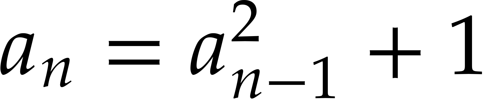 then of course I must interpret this rule in doing so. One might think that the fact that I actually obtained 677 by calculating (26 × 26) + 1 expresses the law by which the series is generated; but that is not true, for what matters is that this 26 is the 26 of the preceding term. I had to _go by_ this term (and not just happen to perform the calculation with 26.).”

### [266\[2\]](https://cdn.wittgensteinnachlass.com/2000px/webp/Ms-109/266.webp)

I could say that the first term, 1, makes the next term 2 in a certain way, & 2 makes the next term 5 in the same way. What _reaches_ from 2 to 5 is the rule.

### [266\[3\]](https://cdn.wittgensteinnachlass.com/2000px/webp/Ms-109/266.webp)

“According to the rule this point should be here.” – “But how do you know that, according to the rule, this point should be here?” This question somehow means nothing. –

### [266\[4\]](https://cdn.wittgensteinnachlass.com/2000px/webp/Ms-109/266.webp),[267\[1\]](https://cdn.wittgensteinnachlass.com/2000px/webp/Ms-109/267.webp)

“It is important that I can understand (see) a rule of projection without having it before me in a general notation. I can gather a general rule from the series 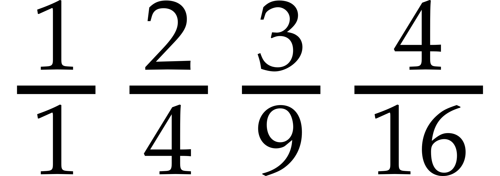 – of course any number of others too, _but still one_ definite rule as well & that means that for me this series was somehow the expression of this one rule.” What I see in that series is something like 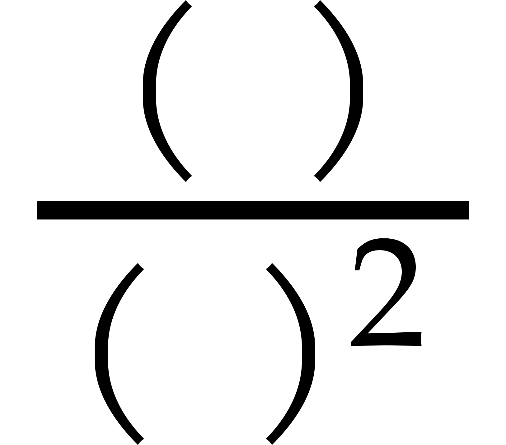. Now the objection to such an explanation is that the degree of freedom of a mechanism is not apparent from looking at the mechanism, so that, for example, the drawing of a crosshead guide 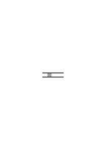 says nothing about how the mechanism will actually work. If we already see the degree of freedom indicated in this drawing, it is because we take the drawing as the expression of a particular rule. But the schema  is precisely not a representation of a mechanism.

### [267\[2\]](https://cdn.wittgensteinnachlass.com/2000px/webp/Ms-109/267.webp)

Incidentally, it is clear that one would not be tempted to express the rule by  if this were not a genuine representation of the situation.

### [267\[3\]](https://cdn.wittgensteinnachlass.com/2000px/webp/Ms-109/267.webp),[268\[1\]](https://cdn.wittgensteinnachlass.com/2000px/webp/Ms-109/268.webp)

Surely what I want to designate is something that 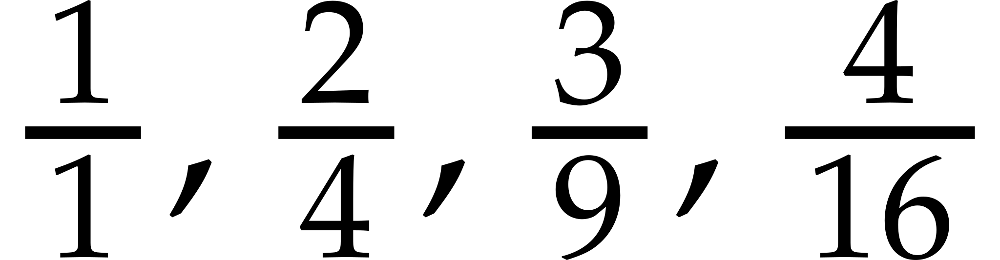 have in common. But I cannot possibly write down what they have in common separately from the series. For what is at issue here is not a component.

### [268\[2\]](https://cdn.wittgensteinnachlass.com/2000px/webp/Ms-109/268.webp)

The expression of the rule, though of course it must be a picture of the application of the rule, cannot occur in the application itself; or rather, if it is contained in the application of the rule, it is precisely the way it is contained in it that is significant & the expression in isolation cannot show the way it occurs.

### [268\[3\]](https://cdn.wittgensteinnachlass.com/2000px/webp/Ms-109/268.webp)

Can I say: the intention sees this rule followed or not followed in the mapping.

### [268\[4\]](https://cdn.wittgensteinnachlass.com/2000px/webp/Ms-109/268.webp)

It would then be as if the intention underlined a certain function, a certain feature of the description. Rather as if one wrote the subject of every sentence in red ink in order to bring out the predicate as a function.

### [268\[5\]](https://cdn.wittgensteinnachlass.com/2000px/webp/Ms-109/268.webp)

The intention is nothing but a yardstick that we lay against what happens & _by_ which we describe it.

### [269\[1\]](https://cdn.wittgensteinnachlass.com/2000px/webp/Ms-109/269.webp)

If, for example, we read a piece of music from a score, we judge the result by the intention to translate the notation in a particular way. This judgement reacts in a certain way to what appears in the description of the result as agreement with or deviation from the intended translation.

### [269\[2\]](https://cdn.wittgensteinnachlass.com/2000px/webp/Ms-109/269.webp)

If, say, my intention were to map the numerals 1, 2, 3, 4, 5 onto their squares & the result were 1, 5, 9, 15, 27, I could first write this result as 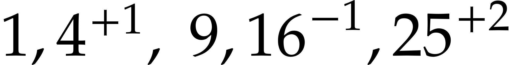 & my reaction to the result might be: 0, + 1, 0, ‒ 1, + 2.

### [269\[3\]](https://cdn.wittgensteinnachlass.com/2000px/webp/Ms-109/269.webp)

We can, no doubt, use a machine to illustrate the co-ordination of two processes, the mapping of the one onto the other, but only the machine _as it is meant to work_, that is, the machine understood in a quite definite way as an expression, and thus as part of language.

### [269\[4\]](https://cdn.wittgensteinnachlass.com/2000px/webp/Ms-109/269.webp),[270\[1\]](https://cdn.wittgensteinnachlass.com/2000px/webp/Ms-109/270.webp)

Only in this sense does the pianola, for example, map the perforated script on the roll onto the piece of music. Or the pattern loom the language of the punched cards onto the pattern of the woven fabric.

### [270\[2\]](https://cdn.wittgensteinnachlass.com/2000px/webp/Ms-109/270.webp)

30.11.1930

By understanding I mean a correlate of explanation, _not_ of the exertion of an influence – a medical one, say. So by misunderstanding I essentially mean something that can be eliminated by explanation. I do not call another kind of disagreement a misunderstanding.

### [270\[3\]](https://cdn.wittgensteinnachlass.com/2000px/webp/Ms-109/270.webp)

The intention to follow the original has the original in view.

### [270\[4\]](https://cdn.wittgensteinnachlass.com/2000px/webp/Ms-109/270.webp)

02.12.1930

It is nonsensical to say “I see the things in visual space”. As opposed to what? Is it conceivable that I hear them, or that someone else sees them?

### [270\[5\]](https://cdn.wittgensteinnachlass.com/2000px/webp/Ms-109/270.webp),[271\[1\]](https://cdn.wittgensteinnachlass.com/2000px/webp/Ms-109/271.webp)

That is why I cannot say either that the object in my visual space is the cause of my seeing it. That is also why it is nonsense to say that out of the primordial nebula there evolved the suns, planets, the simplest living beings & finally a being so organized that it can see all these things & reflect on them. Unless by these reflections one means the purely physical manifestations, in the sense of behaviourism. In this sense one can also say of a photographic camera that it perceives something.)

### [271\[2\]](https://cdn.wittgensteinnachlass.com/2000px/webp/Ms-109/271.webp)

There is nothing in visual space that would essentially be a subject. And likewise nothing in my toothache that one could call the owner of these pains.

### [271\[3\]](https://cdn.wittgensteinnachlass.com/2000px/webp/Ms-109/271.webp)

If one were asked: what is the difference between a tone & a colour, & the answer were “tones we hear, whereas colours we see”, then this is only a hypothesis justified by experience, if saying it is to make any sense at all. And in this sense it is conceivable that one day I shall perceive tones with my eyes, that is, see them, & hear colours. What is essential to tones & colours is evidently shown in the grammar of the words for tones & colours.

### [271\[4\]](https://cdn.wittgensteinnachlass.com/2000px/webp/Ms-109/271.webp)

_[→ Continued in Vol. VI]_

### [272\[1\]](https://cdn.wittgensteinnachlass.com/2000px/webp/Ms-109/272.webp)

29.01.1931

And if I said that it restricts the truth to yes & no, that means that it fixes nothing, (or) nothing that can be said.

### [272\[2\]](https://cdn.wittgensteinnachlass.com/2000px/webp/Ms-109/272.webp)

I said that the sentence was like a yardstick laid against reality: but the yardstick, like all correct similes for the sentence, is a special case of the sentence. And it too determines nothing as long as one does not measure with it. But measuring is comparing (and must mean translating).

### [272\[3\]](https://cdn.wittgensteinnachlass.com/2000px/webp/Ms-109/272.webp)

The yardstick is also a picture, but it must be taken as a picture.

### [272\[4\]](https://cdn.wittgensteinnachlass.com/2000px/webp/Ms-109/272.webp)

One wants to say: place the yardstick against a body; it does not say that the body is this long. Rather, it is in itself as it were dead & does none of what the thought does. It is as if we had imagined that the essential thing about a living person was the outward shape, & had now made a wooden doll of this shape & were looking with disappointment at the dead block, which bears no likeness to life either.

### [273\[1\]](https://cdn.wittgensteinnachlass.com/2000px/webp/Ms-109/273.webp)

I say to someone: “Go and call Peter”. – How is he to know what I mean? It must have been explained to him. But again only by means of signs. He now follows this explanation.

### [273\[2\]](https://cdn.wittgensteinnachlass.com/2000px/webp/Ms-109/273.webp)

If understanding was a necessary preparation for obeying, then it must have added something to the sign; but something that in any case was not the execution.

### [273\[3\]](https://cdn.wittgensteinnachlass.com/2000px/webp/Ms-109/273.webp)

Can one, then, and in what sense can one, derive the execution from the sign plus the understanding (that is, the interpretation) before it takes place? After all, all one derives is a description of the execution & even this description was not there until one had derived _it_.

### [273\[4\]](https://cdn.wittgensteinnachlass.com/2000px/webp/Ms-109/273.webp)

It is only when we carry out the command that we derive its _execution_ from it.

### [273\[5\]](https://cdn.wittgensteinnachlass.com/2000px/webp/Ms-109/273.webp),[274\[1\]](https://cdn.wittgensteinnachlass.com/2000px/webp/Ms-109/274.webp)

But now one might ask: Why do I call just the one translation of the symbol its execution, & not the other translations as well? Well, one could also take one of the other translations as the execution of the command, & if the person giving the command does not regard this as the translation he wants, then he must add a further explanation to the command, that is, alter & extend the command itself.

### [274\[2\]](https://cdn.wittgensteinnachlass.com/2000px/webp/Ms-109/274.webp)

All one knows in advance is that whatever one derives from this command will have been derived from it.

### [274\[3\]](https://cdn.wittgensteinnachlass.com/2000px/webp/Ms-109/274.webp)

“But surely before I carry it out I already understand what I have to do”. – Certainly. And what exactly is it?

### [274\[4\]](https://cdn.wittgensteinnachlass.com/2000px/webp/Ms-109/274.webp)

When I say “surely the proposition already determines in advance what will make it true”: Certainly, the proposition ‘p’ determines that p must be the case for it to be true; but that is all one can say about it.

### [274\[5\]](https://cdn.wittgensteinnachlass.com/2000px/webp/Ms-109/274.webp),[275\[1\]](https://cdn.wittgensteinnachlass.com/2000px/webp/Ms-109/275.webp)

If one were to say that the person receiving the order receives in addition to the words mental images that are similar to the execution of the order (whereas the words are said not to be), then I go even further & assume that the order is given by our making the other person perform now, through mechanical influence (guiding his hand etc.), the movements that he is to perform in, say, 5 minutes; & presumably I can come no closer to the execution of the order in the expression of the order. Then we have replaced the similarity of the mental image with a much greater similarity. And the path from the symbol to reality seems to have been greatly shortened here. (Likewise, to describe what position I was in on such & such an occasion, I could assume that position.) This also shows that the occurrence of images of fantasy is quite inessential to thought.

### [276\[1\]](https://cdn.wittgensteinnachlass.com/2000px/webp/Ms-109/276.webp)

(With some problems one must first become familiar by making a run at them countless times. One then comes to know the taste of the problem.)

### [276\[2\]](https://cdn.wittgensteinnachlass.com/2000px/webp/Ms-109/276.webp)

Here I come up against the uniqueness of a fact, & that is connected with the sense of the sentence “everything flows”.

### [276\[3\]](https://cdn.wittgensteinnachlass.com/2000px/webp/Ms-109/276.webp)

If someone misunderstands the command & takes a translation that we regard only as a picture of its execution for the execution itself, his translation would still correspond to a command in our language, & indeed to one that would look very much like ours. The command to carry out a particular movement, for example, & the command merely to draw this movement have the description of this movement in common. But they also differ from one another, & only thereby can the one command one thing and the other command another.

### [277\[1\]](https://cdn.wittgensteinnachlass.com/2000px/webp/Ms-109/277.webp)

The command can determine its execution only insofar as one can derive the execution from it. –

### [277\[2\]](https://cdn.wittgensteinnachlass.com/2000px/webp/Ms-109/277.webp)

‘That it determines its execution’ can mean only this: that one can derive the execution from it.

### [277\[3\]](https://cdn.wittgensteinnachlass.com/2000px/webp/Ms-109/277.webp)

The command 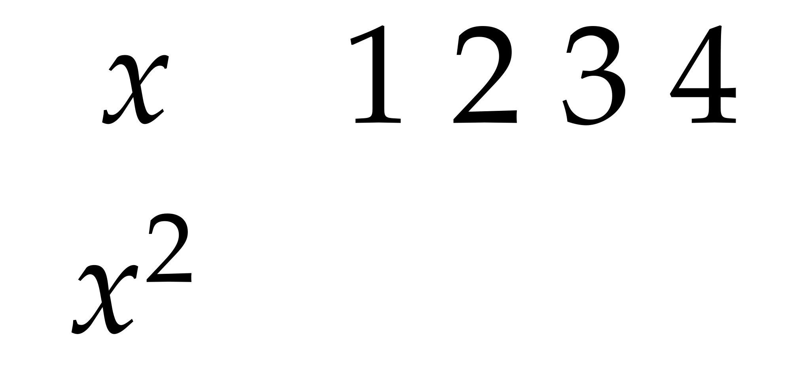 seems incomplete to us. It seems to us as if something that is not said were only hinted at.

### [277\[4\]](https://cdn.wittgensteinnachlass.com/2000px/webp/Ms-109/277.webp)

But something is only hinted at in so far as a system is not explicitly laid down, or is imperfectly laid down. We want to say that it is imperfectly hinted at to us, or that the sign merely suggests indistinctly what we are to do. It is supposed to be indistinct in something like the sense in which a sign reading “Keep left” becomes clearer when there is also an arrow pointing in that direction.

### [277\[5\]](https://cdn.wittgensteinnachlass.com/2000px/webp/Ms-109/277.webp),[278\[1\]](https://cdn.wittgensteinnachlass.com/2000px/webp/Ms-109/278.webp)

But for us the command that is unambiguous is clear; & there is none clearer.

### [278\[2\]](https://cdn.wittgensteinnachlass.com/2000px/webp/Ms-109/278.webp)

It can become unambiguous, however, only if a distinction whose absence is precisely what gives rise to the ambiguity is made in the command system. (If, then, the system is given the right multiplicity.)

### [278\[3\]](https://cdn.wittgensteinnachlass.com/2000px/webp/Ms-109/278.webp)

I could also say: It seems to us as though, when we understand the order (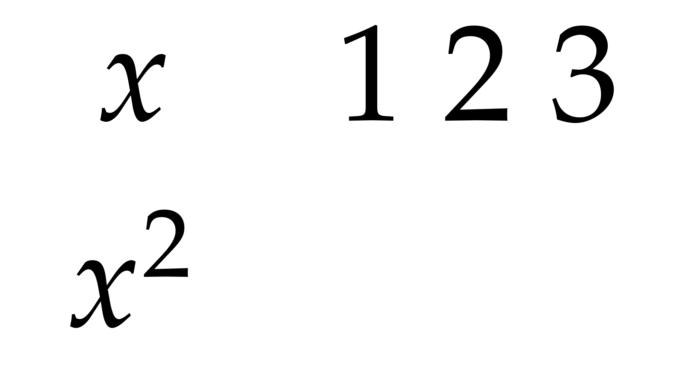 for example), we add something that fills the gap. So that we can answer someone who says (to us) “but you do understand it”: yes, but only because I add something else: namely the interpretation.

### [278\[4\]](https://cdn.wittgensteinnachlass.com/2000px/webp/Ms-109/278.webp)

Now one would, of course, have to say in reply: But what prompts you to give precisely _that_ interpretation? If it is the order, then it was already unambiguous, since it was only this interpretation that it commanded. Or did you add the interpretation arbitrarily? – In that case you did not understand the order either, but only what you made of it (on your own initiative).

### [279\[1\]](https://cdn.wittgensteinnachlass.com/2000px/webp/Ms-109/279.webp)

(My method is in a certain sense a psychological one.)

### [279\[2\]](https://cdn.wittgensteinnachlass.com/2000px/webp/Ms-109/279.webp)

What does it mean to derive the action from the order, other than simply to carry it out? For how else can the action be given to me except through a description? But then I am only deriving one description from another.

### [279\[3\]](https://cdn.wittgensteinnachlass.com/2000px/webp/Ms-109/279.webp)

Knowing what the sentence says can only mean: being able to answer the question “what does it say?”.

### [279\[4\]](https://cdn.wittgensteinnachlass.com/2000px/webp/Ms-109/279.webp)

Understanding the sense of a sentence can only mean: being able to answer the question “what is its sense?”

### [279\[5\]](https://cdn.wittgensteinnachlass.com/2000px/webp/Ms-109/279.webp)

For if “having sense” is used here intransitively, so that one cannot distinguish _the_ sense of one sentence from that of another, then having sense is a matter that accompanies the use of the sentence and does not interest us.

### [279\[6\]](https://cdn.wittgensteinnachlass.com/2000px/webp/Ms-109/279.webp),[280\[1\]](https://cdn.wittgensteinnachlass.com/2000px/webp/Ms-109/280.webp)

But if I say: I derive my action from the order with the help of a rule, that makes sense only if I can ask: With the help of _which_ rule? And the answer to this question must be an expression of the rule. (For here again, of course, it can only be a matter of _one_ rule as opposed to another.)

### [280\[2\]](https://cdn.wittgensteinnachlass.com/2000px/webp/Ms-109/280.webp)

But how does the rule come into acting according to the rule?

### [280\[3\]](https://cdn.wittgensteinnachlass.com/2000px/webp/Ms-109/280.webp)

Not necessarily in such a way that my action corresponds to the rule. But part of the whole process of derivation must correspond to the rule: it must be our intention to follow the rule. – And one might say that this consists precisely in our intention following the rule.

### [280\[4\]](https://cdn.wittgensteinnachlass.com/2000px/webp/Ms-109/280.webp),[281\[1\]](https://cdn.wittgensteinnachlass.com/2000px/webp/Ms-109/281.webp)

But what is the connection between the use of language & the rules of grammar? Am I to say that the rules of grammar are the rules according to which (i.e. in accordance with which) the speech of a group of people actually proceeds.

### [281\[2\]](https://cdn.wittgensteinnachlass.com/2000px/webp/Ms-109/281.webp)

30.01.1931

Does ‘following the rules of grammar’ mean, in any sense, thinking of these rules while speaking? No. – Does it mean always speaking in accordance with certain rules? No. – It means following rules. – But surely anyone who does anything does that; for there is bound to be a rule to which what he does corresponds.

### [281\[3\]](https://cdn.wittgensteinnachlass.com/2000px/webp/Ms-109/281.webp)

One would like to say: “one need only _mean_ something by what one says, and then everything essential is given”. And so I regard ‘meaning something’ & ‘following a rule’ as having the same meaning.

### [281\[4\]](https://cdn.wittgensteinnachlass.com/2000px/webp/Ms-109/281.webp)

Can I say: If I _mean_ something, then I have chosen my words according to a certain rule?

### [281\[5\]](https://cdn.wittgensteinnachlass.com/2000px/webp/Ms-109/281.webp)

Or like this? If I mean something, then I have portrayed something, and thus represented it according to a rule.

### [281\[6\]](https://cdn.wittgensteinnachlass.com/2000px/webp/Ms-109/281.webp),[282\[1\]](https://cdn.wittgensteinnachlass.com/2000px/webp/Ms-109/282.webp)

Is grammar merely a description of how language is actually handled? So that its sentences could really be understood as sentences of a natural science? But then this is not the descriptive science of thinking, but of speaking.

### [282\[2\]](https://cdn.wittgensteinnachlass.com/2000px/webp/Ms-109/282.webp)

After all, the rules of chess could also be understood as sentences from the natural history of human beings. (Just as the games of animals are described in books of natural history.)

### [282\[3\]](https://cdn.wittgensteinnachlass.com/2000px/webp/Ms-109/282.webp)

“But surely I do mean something by these words”. Certainly: in contrast to the case where I mean nothing, where I might string syllables together for the sake of their (pleasant or) funny sound.

### [282\[4\]](https://cdn.wittgensteinnachlass.com/2000px/webp/Ms-109/282.webp)

I.e. Uttering a sentence with sense is a different process from, say, singing lalala.

### [282\[5\]](https://cdn.wittgensteinnachlass.com/2000px/webp/Ms-109/282.webp)

What I really want to say is that “I mean something by the word” just means: I do distinguish this case from that of senseless babbling etc. And that much is granted. But that does not yet give us any particular theory of meaning something.

### [282\[6\]](https://cdn.wittgensteinnachlass.com/2000px/webp/Ms-109/282.webp),[283\[1\]](https://cdn.wittgensteinnachlass.com/2000px/webp/Ms-109/283.webp)

And so it goes in all such cases. Suppose someone says: “but I really do mean that the other person has toothache; not that he merely behaves that way”. One must always answer: “Certainly” & concede that we too have to make this distinction.

### [283\[2\]](https://cdn.wittgensteinnachlass.com/2000px/webp/Ms-109/283.webp)

The process of ‘following a rule’ must be described by a rule.

One might say that it is so called because it must be described by a rule.

### [283\[3\]](https://cdn.wittgensteinnachlass.com/2000px/webp/Ms-109/283.webp)

Or again: One could derive a grammar from any sentence that makes sense.

### [283\[4\]](https://cdn.wittgensteinnachlass.com/2000px/webp/Ms-109/283.webp)

I must be able to extract a rule from the process of _transforming_ 1, 2, 3, 4 into 1, 4, 9, 16. – What does that mean? Surely that I must be able to derive an expression of a rule from the process; i.e. _one_ expression as opposed to another.

### [283\[5\]](https://cdn.wittgensteinnachlass.com/2000px/webp/Ms-109/283.webp)

I.e. that in a _system_ of rules I will be able to pick out one as the one that fits.

### [284\[1\]](https://cdn.wittgensteinnachlass.com/2000px/webp/Ms-109/284.webp)

If, for example, I say: “I believe he will come” – where do I get these words. Why do I choose _them_. Is there something there before this expression that I depict.

### [284\[2\]](https://cdn.wittgensteinnachlass.com/2000px/webp/Ms-109/284.webp)

Admittedly, I am not explicitly conscious of grammatical rules when I use language, but I am conscious that I am not inventing language ad hoc. And if I did invent it, it would be of no use if I did not want to go by the rules I had invented on subsequent occasions.

### [284\[3\]](https://cdn.wittgensteinnachlass.com/2000px/webp/Ms-109/284.webp)

That is, language functions as language only by virtue of the rules we follow in using it. (Just as a game functions as a game only by virtue of rules.)

### [284\[4\]](https://cdn.wittgensteinnachlass.com/2000px/webp/Ms-109/284.webp)

And that is so whether I speak to myself or to others. For I communicate nothing even to myself if I associate groups of sounds ad hoc with just any facts.

### [284\[5\]](https://cdn.wittgensteinnachlass.com/2000px/webp/Ms-109/284.webp),[285\[1\]](https://cdn.wittgensteinnachlass.com/2000px/webp/Ms-109/285.webp)

When I speak to myself, I must play on an already given keyboard of language.

### [285\[2\]](https://cdn.wittgensteinnachlass.com/2000px/webp/Ms-109/285.webp)

When I use a word in the language, it is either because I want to strike it as an already familiar note, or inasmuch as I want to stipulate that I will use the word this way in future.

### [285\[3\]](https://cdn.wittgensteinnachlass.com/2000px/webp/Ms-109/285.webp)

31.01.1931

‘I understand these words’ (which I may be saying to myself), ‘I mean something by them’, ‘they have a sense’ must always mean the same as: ‘they are not sounds invented ad hoc, but signs taken from a system’.

### [285\[4\]](https://cdn.wittgensteinnachlass.com/2000px/webp/Ms-109/285.webp)

Roughly, as the graduation marks on a measuring rod are such only if they form a system.

### [285\[5\]](https://cdn.wittgensteinnachlass.com/2000px/webp/Ms-109/285.webp)

We use language only for the sake of its consequences.

### [285\[6\]](https://cdn.wittgensteinnachlass.com/2000px/webp/Ms-109/285.webp)

One can say: “given the way I use the word ‘love’ here, I cannot say of it …”

### [286\[1\]](https://cdn.wittgensteinnachlass.com/2000px/webp/Ms-109/286.webp)

_Understanding_ what the other person says can only be described as following a rule given in advance.

### [286\[2\]](https://cdn.wittgensteinnachlass.com/2000px/webp/Ms-109/286.webp)

For when we obey a command, we do not interpret the words arbitrarily. That is, once again, we must recognize the distinction between “obeying a command” & “arbitrarily assigning an action”.

### [286\[3\]](https://cdn.wittgensteinnachlass.com/2000px/webp/Ms-109/286.webp)

And the justification of a way of acting as obedience to an order would always be: “that’s how I learnt it”.

### [286\[4\]](https://cdn.wittgensteinnachlass.com/2000px/webp/Ms-109/286.webp)

But how does a justification like this work: “I was told that _that_ was a chair” or “… that that was red” etc. Or again I was told that when it says ‘do p & q’, I am to do it _like this_ (where I demonstrate the activity).

### [286\[5\]](https://cdn.wittgensteinnachlass.com/2000px/webp/Ms-109/286.webp)

These are misunderstandings that can be cleared up. “Is _that_ an orange? I thought _that_ was one.”

### [287\[1\]](https://cdn.wittgensteinnachlass.com/2000px/webp/Ms-109/287.webp)

Can one say: “Is that red? I thought that was a chair.”

### [287\[2\]](https://cdn.wittgensteinnachlass.com/2000px/webp/Ms-109/287.webp)

But couldn’t one imagine (if, say, one doesn’t know German) that ‘rot’ means loud (i.e. is used the way ‘laut’ is actually used). But how would this misunderstanding be cleared up? Perhaps like this: “rot is a colour, not a degree of loudness”? – One could of course give such an explanation, but it would be intelligible only to someone who already knows their way around the grammar completely.

### [287\[3\]](https://cdn.wittgensteinnachlass.com/2000px/webp/Ms-109/287.webp)

The sentence “Is that red? I thought that was a chair” makes sense only if the word “that” is used in the same sense both times, & then I must take either ‘red’ as a noun or “a chair” as an adjective.

### [287\[4\]](https://cdn.wittgensteinnachlass.com/2000px/webp/Ms-109/287.webp)

The justification can be understood only if it is given in a language that exists independently of the misunderstanding.

### [287\[5\]](https://cdn.wittgensteinnachlass.com/2000px/webp/Ms-109/287.webp),[288\[1\]](https://cdn.wittgensteinnachlass.com/2000px/webp/Ms-109/288.webp)

One can clear up a misunderstanding only if the clarification is understood.

### [288\[2\]](https://cdn.wittgensteinnachlass.com/2000px/webp/Ms-109/288.webp)

In the explanation “_that_ is a chair, not _that_”, the two words “that” & the accompanying gestures must be understood & are then fully fledged signs. The explanation can then also be given like this: “_that_ is called ‘chair’, not _that_” & this is a sentence like, for example, “the chair is blue, not red”. – But of course what is explained here is not language, but _a_ language (with the help of another that already exists).

### [288\[3\]](https://cdn.wittgensteinnachlass.com/2000px/webp/Ms-109/288.webp)

[I could choose as the motto of my book: A fool can ask more questions than ten wise men can answer. Strictly speaking, it should say “ten clever men” here.]

### [288\[4\]](https://cdn.wittgensteinnachlass.com/2000px/webp/Ms-109/288.webp)

Is it like this: grammar has language only as a phenomenon extended in time.

### [288\[5\]](https://cdn.wittgensteinnachlass.com/2000px/webp/Ms-109/288.webp)

But surely the sentence is something extended in space or time, or in space & time.

### [289\[1\]](https://cdn.wittgensteinnachlass.com/2000px/webp/Ms-109/289.webp)

Uttering a sentence would not be a portrayal if I did not choose my words from a system, so that one can say that I choose _them_ rather than others. But if the words do not belong to a grammatical system, they are all of equal value, & so it would then make no difference which I chose; indeed – one might say – as words they would (then) not differ from one another at all. One must choose the words [in the same sense as] one chooses the lines with which one depicts a body.

### [289\[2\]](https://cdn.wittgensteinnachlass.com/2000px/webp/Ms-109/289.webp)

01.02.1931

Someone who learns musical notation does not learn every piece of music, but the notes & rules & only thereby is musical notation of use to him.

### [289\[3\]](https://cdn.wittgensteinnachlass.com/2000px/webp/Ms-109/289.webp)

But not, perhaps, because only then is it economical, but because otherwise it is not a notation.

### [289\[4\]](https://cdn.wittgensteinnachlass.com/2000px/webp/Ms-109/289.webp)

(The rule has the same generality as a hypothesis.)

### [289\[5\]](https://cdn.wittgensteinnachlass.com/2000px/webp/Ms-109/289.webp),[290\[1\]](https://cdn.wittgensteinnachlass.com/2000px/webp/Ms-109/290.webp)

If one has taught the dog to follow combinations of the signs a, b, c, d (where a = →, b = ↓, c = ←, d = ↑), it may do so mechanically, but if I now want to know which sign I must give it to make it run along the path made up of straight segments

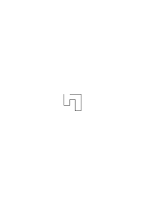

I must derive the sign from that path according to the rule.

### [290\[2\]](https://cdn.wittgensteinnachlass.com/2000px/webp/Ms-109/290.webp)

The written record of the rule helps me only insofar as it reminds me of this rule rather than others, – prevents me from thinking, for example, that a means ↓, etc.

### [290\[3\]](https://cdn.wittgensteinnachlass.com/2000px/webp/Ms-109/290.webp)

If I say I am following a rule, then it must make sense to ask in reply: Which rule? And the answer is the expression of a rule (like the one above). But no more than that can be given in answer, & so the question cannot ask for anything beyond what this expression answers.

### [290\[4\]](https://cdn.wittgensteinnachlass.com/2000px/webp/Ms-109/290.webp)

But where does the dissatisfaction come from? What is it that we would like to say that cannot be said?

### [290\[5\]](https://cdn.wittgensteinnachlass.com/2000px/webp/Ms-109/290.webp),[291\[1\]](https://cdn.wittgensteinnachlass.com/2000px/webp/Ms-109/291.webp)

If, following the rules, I write “a” instead of “→”, it is as if a causal connection were at play here that was not hypothetical but immediately experienced. (Of course nothing of the kind is the case.)

### [291\[2\]](https://cdn.wittgensteinnachlass.com/2000px/webp/Ms-109/291.webp)

One thing is clear: if I have followed the rule (correctly), the result will stand in an internal relation to the model & the expression of the rule, a relation I cannot express except by reproducing those three complexes, because (odd as it sounds) this reproduction alone already determines everything.

### [291\[3\]](https://cdn.wittgensteinnachlass.com/2000px/webp/Ms-109/291.webp)

“Seeing the internal relation” can of course mean nothing other than seeing the complexes that stand in it. One might object that one can also see the complexes without being struck by the internal relation. But then one simply sees something different from what one sees ‘when it strikes one’.

But the relation that strikes one can only be something that can be described, & the internal relation can only be shown by describing the complexes.

### [291\[4\]](https://cdn.wittgensteinnachlass.com/2000px/webp/Ms-109/291.webp),[292\[1\]](https://cdn.wittgensteinnachlass.com/2000px/webp/Ms-109/292.webp)

(Again and again the move in thought that Freud makes, for example, when he says he will call the manifest dream what is recounted as such after waking.)

### [292\[2\]](https://cdn.wittgensteinnachlass.com/2000px/webp/Ms-109/292.webp)

If I say that, in copying a model, I go by it according to a rule, what I mean is: in contrast to the case in which I do not go by a model according to a rule. Then this feature of copying can only be an external one, like any other that distinguishes one process from another.

### [292\[3\]](https://cdn.wittgensteinnachlass.com/2000px/webp/Ms-109/292.webp)

Strictly speaking, the words “according to a rule” are superfluous. Everything lies in the words “_going_ by the model”. The rule merely describes _one_ way of going by something as opposed to another. – The words are superfluous because one can only go by something according to a rule.

### [292\[4\]](https://cdn.wittgensteinnachlass.com/2000px/webp/Ms-109/292.webp),[293\[1\]](https://cdn.wittgensteinnachlass.com/2000px/webp/Ms-109/293.webp)

That is, depicting can differ from another process only as one process differs from another, & that means that this difference cannot have logical significance.

### [293\[2\]](https://cdn.wittgensteinnachlass.com/2000px/webp/Ms-109/293.webp)

Just as I said once before: Intention too can only be a phenomenon like any other, if I may speak of it at all.

### [293\[3\]](https://cdn.wittgensteinnachlass.com/2000px/webp/Ms-109/293.webp)

So choosing the strokes in copying from a model is indeed a different process from, say, merely drawing these strokes when I am “not following the model”, but the difference is an external, describable one, like the difference between the groups of signs 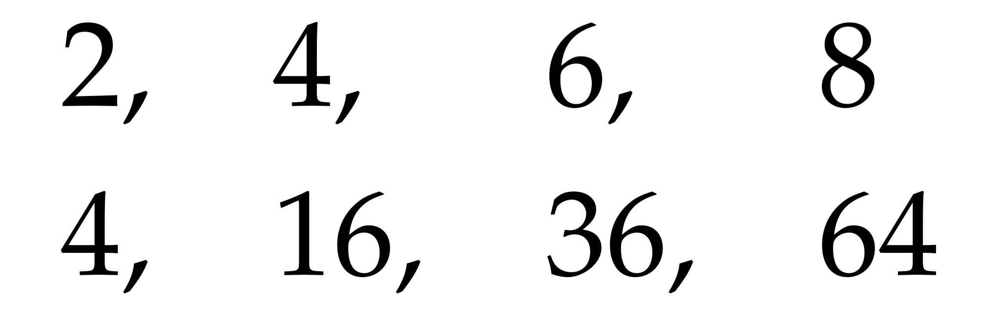 and 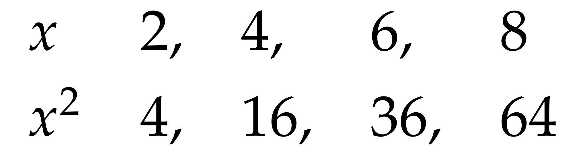 & is on the same level as that difference.

### [293\[4\]](https://cdn.wittgensteinnachlass.com/2000px/webp/Ms-109/293.webp)

And so it is with choosing the words when I describe something in words: this process differs from that of arbitrarily assigning words, but only externally, just as the two signs in the preceding sentence differ.

### [294\[1\]](https://cdn.wittgensteinnachlass.com/2000px/webp/Ms-109/294.webp)

Not only are we not conscious of the grammatical rules when speaking, but if we were, it would not help, would not make anything clearer.

### [294\[2\]](https://cdn.wittgensteinnachlass.com/2000px/webp/Ms-109/294.webp)

Being conscious of the rules can surely only mean having before us an expression of the rule.

### [294\[3\]](https://cdn.wittgensteinnachlass.com/2000px/webp/Ms-109/294.webp)

What is not needed in logic does not _help_ either. What is not needed is superfluous.

### [294\[4\]](https://cdn.wittgensteinnachlass.com/2000px/webp/Ms-109/294.webp)

Indeed, even if we were always conscious of the grammatical rules while speaking, that would not help my case to its feet.

### [294\[5\]](https://cdn.wittgensteinnachlass.com/2000px/webp/Ms-109/294.webp)

Language as a whole cannot be misunderstood. For otherwise there would in principle be no explanation for this misunderstanding.

### [294\[6\]](https://cdn.wittgensteinnachlass.com/2000px/webp/Ms-109/294.webp)

That is just to say that the whole of language must speak for itself.

### [294\[7\]](https://cdn.wittgensteinnachlass.com/2000px/webp/Ms-109/294.webp),[295\[1\]](https://cdn.wittgensteinnachlass.com/2000px/webp/Ms-109/295.webp)

We find out why we use one word – & not another – at this point when we ask someone: why do you use the word A here. The answer will be: such & such is called A.

And that is a rule of grammar which determines the word’s position in the language. And (as a sign that this really is a matter of grammar) if A had been the word “and”, there would be nothing further one could do but give the rules for “and”.

### [295\[2\]](https://cdn.wittgensteinnachlass.com/2000px/webp/Ms-109/295.webp)

Explanations such as “_that_ is red” or “_that_ is sweet” also belong to grammar (for they only explain signs by means of signs.) And what this explanation leaves us with besides the word “red” is not arbitrary in the same sense as the spoken or written form “red”. For the images of a red & a green patch form a system, whereas the mere words red & green do not.

### [295\[3\]](https://cdn.wittgensteinnachlass.com/2000px/webp/Ms-109/295.webp)

What does the mental image of my walk have in common with it (the walk)? Just what is expressed by my calling the one my walk and the other the mental image of it.

### [296\[1\]](https://cdn.wittgensteinnachlass.com/2000px/webp/Ms-109/296.webp)

What does it mean when one says: “I cannot imagine the opposite of that” or “what would it be like if it were different”; e.g. if someone has said that my mental images are private, or that only I myself can know whether I feel pain, and the like.

### [296\[2\]](https://cdn.wittgensteinnachlass.com/2000px/webp/Ms-109/296.webp)

If I cannot imagine what it would be like if it were different, then I cannot imagine how it can be like this either. For “I cannot imagine” does not mean here what it means in the sentence “I cannot imagine a skull”. I do not mean by that to point to a lack of powers of imagination.

### [296\[3\]](https://cdn.wittgensteinnachlass.com/2000px/webp/Ms-109/296.webp)

The mental image here supplies us with the language that in any case has the right multiplicity. The language with the simpler grammar.

### [296\[4\]](https://cdn.wittgensteinnachlass.com/2000px/webp/Ms-109/296.webp)

The justification in reply to the question, why do you use the word blue here?: “Because this colour is called ‘blue’”, corresponds exactly to the answer to the question “why do you read (the sound) ‘a’ here”: “because the sign is read ‘a’”. In both cases I appeal to a rule.

### [297\[1\]](https://cdn.wittgensteinnachlass.com/2000px/webp/Ms-109/297.webp)

02.02.1931

What do I describe something for, then? (for the essence of language is supposed to emerge from that). And this seems easy enough to show in the case of the dog that I want to direct by signs.

### [297\[2\]](https://cdn.wittgensteinnachlass.com/2000px/webp/Ms-109/297.webp)

What does proceeding according to a rule consist in? – can one ask that? – Presumably it means that one obeys the general command contained in the rule.

### [297\[3\]](https://cdn.wittgensteinnachlass.com/2000px/webp/Ms-109/297.webp)

I proceed according to a rule means: I proceed in such a way that what comes out … That what comes out satisfies this rule.

### [297\[4\]](https://cdn.wittgensteinnachlass.com/2000px/webp/Ms-109/297.webp)

To proceed according to the rule means to proceed _like this_, & that must contain the rule.

### [297\[5\]](https://cdn.wittgensteinnachlass.com/2000px/webp/Ms-109/297.webp)

The general rule is itself a command; how then can it serve to explain the essence of a command?

### [297\[6\]](https://cdn.wittgensteinnachlass.com/2000px/webp/Ms-109/297.webp)

Of course, in the case I mentioned above, I can quite easily describe what I have to do & why.

### [298\[1\]](https://cdn.wittgensteinnachlass.com/2000px/webp/Ms-109/298.webp)

03.02.1931

If the rule says “where you see an ↑, write a ‘c’”, then what I am to do is given by that, as far as it can be given at all.

### [298\[2\]](https://cdn.wittgensteinnachlass.com/2000px/webp/Ms-109/298.webp)

For nothing can be determined more fully than by an exact description. For to determine can only _mean_ to describe it. And that is very important.

### [298\[3\]](https://cdn.wittgensteinnachlass.com/2000px/webp/Ms-109/298.webp)

For this seems to be the simple answer to our long-standing difficulties.

### [298\[4\]](https://cdn.wittgensteinnachlass.com/2000px/webp/Ms-109/298.webp)

All difficulty in philosophy can only rest on misunderstandings. A discovery is never needed, can never be needed to resolve it. It is a misunderstanding & can only be resolved as such. I.e. without force. For the door opens & everything about it is in order; you need only understand the lock & move it in the _right_ way.

### [298\[5\]](https://cdn.wittgensteinnachlass.com/2000px/webp/Ms-109/298.webp),[299\[1\]](https://cdn.wittgensteinnachlass.com/2000px/webp/Ms-109/299.webp)

Then an action is not determined if the description still leaves something open (so that one can say “I do not yet know whether …”), which the description can therefore determine. If the description is complete, the action is determined. And that means that only _one_ action can correspond to the description (this is the only way we can use the word).

### [299\[2\]](https://cdn.wittgensteinnachlass.com/2000px/webp/Ms-109/299.webp)

(Let us recall the argument about “toothache”.)

### [299\[3\]](https://cdn.wittgensteinnachlass.com/2000px/webp/Ms-109/299.webp),[300\[1\]](https://cdn.wittgensteinnachlass.com/2000px/webp/Ms-109/300.webp)

Here too is the connection with the question: “when the other person sees blue, does he really see the same colour as I do?” Of course, he sees blue! That is precisely the same colour. – I.e. the question whether the colour he sees as blue is the same is nonsensical if it is assumed that we are entitled to designate what he sees & what I see as blue. If it can be established in the ordinary sense – i.e. by the ordinary method – that he does not see the same colour, then I cannot say that we both see blue. And if it can be established that we both see blue, then “we both see the same colour”, for this sentence refers only to these tests.

### [300\[2\]](https://cdn.wittgensteinnachlass.com/2000px/webp/Ms-109/300.webp)

And that is how things stand with the question: “is what I now call ‘yellow’ certainly the same colour as what I used to call ‘yellow’?” – Certainly, for it is yellow. – But how do you know that? – Because I remember. – But can memory not deceive? – No. Not when its datum is precisely what I go by. (Incidentally, I do not know whether it still makes sense to say “because I remember”; couldn’t I just as well answer “because I know”?) There is no test to establish that _that_ is blue. (i.e. that I call _this_ colour blue)

### [300\[3\]](https://cdn.wittgensteinnachlass.com/2000px/webp/Ms-109/300.webp)

We ask: “How can a sentence determine a state of affairs?” But does it make sense to say: “A sentence determines a state of affairs”?

### [300\[4\]](https://cdn.wittgensteinnachlass.com/2000px/webp/Ms-109/300.webp)

Isn’t this the sense of the simile of the sewing machine: If what is at issue is the causal explanation of the mechanism, the question “How does the sewing machine do that” makes sense. But if that is not what is meant, then the answer lies …
