# Ms-110

28 published remarks, VB, GB I

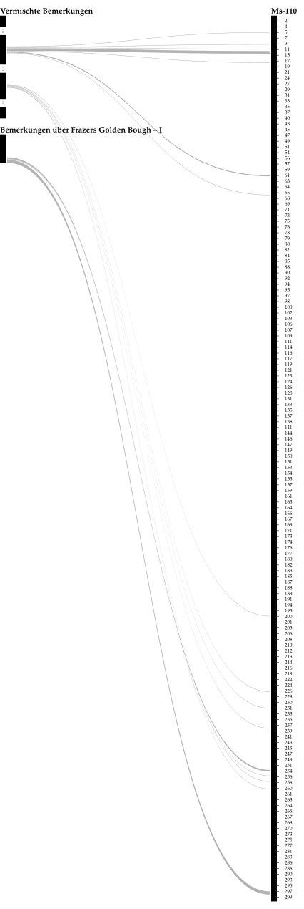

### [III\[1\]](https://cdn.wittgensteinnachlass.com/2000px/webp/Ms-110/III.webp)

## VI. Philosophical Remarks

### [1\[1\]](https://cdn.wittgensteinnachlass.com/2000px/webp/Ms-110/1.webp)

10.12.1930

All I can do in language is say _something_: say _the one_. (Say the one within the space of what I could have said.)

### [1\[2\]](https://cdn.wittgensteinnachlass.com/2000px/webp/Ms-110/1.webp)

One could also put it this way: Language works relatively & not absolutely.

### [1\[3\]](https://cdn.wittgensteinnachlass.com/2000px/webp/Ms-110/1.webp)

If a sentence were not _one_ possible formation among others, it would have no function.

### [1\[4\]](https://cdn.wittgensteinnachlass.com/2000px/webp/Ms-110/1.webp)

That is: if a sentence were not the result of a decision, it would have nothing to say.

### [1\[5\]](https://cdn.wittgensteinnachlass.com/2000px/webp/Ms-110/1.webp)

The proof of the consistency of the axioms – the proof mathematicians make such a fuss about today. I have the feeling: if there were a contradiction in the axioms of a system, it would not be such a great disaster at all. Nothing easier than to remove it.

### [1\[6\]](https://cdn.wittgensteinnachlass.com/2000px/webp/Ms-110/1.webp)

A sentence can only say one thing (point to _one_ place in space).

### [1\[7\]](https://cdn.wittgensteinnachlass.com/2000px/webp/Ms-110/1.webp),[2\[1\]](https://cdn.wittgensteinnachlass.com/2000px/webp/Ms-110/2.webp)

11.12.1930

The first thing we would like to say about thought is that it is an activity. A comparison that immediately suggests itself to us is with digestion. Then we say that the process, whatever kind it may be, does not interest us as a typically human or organic process (or as a process in a living being). It does not interest us as a specifically physiological or as a specifically psychological (process).

### [2\[2\]](https://cdn.wittgensteinnachlass.com/2000px/webp/Ms-110/2.webp)

Next comes the comparison with the chemist, who likewise is interested in the processes in the human intestine not as such but as chemical processes that could just as well take place in a test tube.

### [2\[3\]](https://cdn.wittgensteinnachlass.com/2000px/webp/Ms-110/2.webp),[3\[1\]](https://cdn.wittgensteinnachlass.com/2000px/webp/Ms-110/3.webp)

We say: For us there is no essential distinction between outer & inner processes (Every process is in a certain sense an outer process). We will examine thinking from the standpoint that it could also be carried out by a machine. But here we are looking at it in an entirely wrong way. We regard thinking as a process like writing or weaving, as though it were the production of a product, the thought, just as weaving is the production of a fabric etc. And then of course one can say that it must be possible in essence to interpret this process of production as carried out by a machine too. But here our conception is quite wrong. Thinking interests us only in so far as we are immediately conscious of it (acquainted with it). It is a process only in what is immediately given.

### [3\[2\]](https://cdn.wittgensteinnachlass.com/2000px/webp/Ms-110/3.webp)

For us there is no question at all of a product & something that produces it.

### [3\[3\]](https://cdn.wittgensteinnachlass.com/2000px/webp/Ms-110/3.webp)

Neither the organism nor the machine is an object of comparison. For nothing we do not already know interests us.

### [3\[4\]](https://cdn.wittgensteinnachlass.com/2000px/webp/Ms-110/3.webp)

Even calling thinking an activity is in a way misleading. We say: speaking is an activity of our mouth. For we see our mouth moving when we speak & feel it etc. In this sense one cannot say that thinking is an activity of our brain.

### [3\[5\]](https://cdn.wittgensteinnachlass.com/2000px/webp/Ms-110/3.webp)

And can one say that thinking is an activity of the mouth or larynx or hands (for instance when we think as we write)?

### [3\[6\]](https://cdn.wittgensteinnachlass.com/2000px/webp/Ms-110/3.webp)

To say that thinking is simply an activity of the mind as speaking is of the mouth is a travesty of the truth.

### [3\[7\]](https://cdn.wittgensteinnachlass.com/2000px/webp/Ms-110/3.webp),[4\[1\]](https://cdn.wittgensteinnachlass.com/2000px/webp/Ms-110/4.webp)

We are simply using a picture when we speak of the activity of the mind.

### [4\[2\]](https://cdn.wittgensteinnachlass.com/2000px/webp/Ms-110/4.webp)

Thinking is not to be compared with the working of a mechanism that we see from the outside but have to look inside in order to understand its activity.

### [4\[3\]](https://cdn.wittgensteinnachlass.com/2000px/webp/Ms-110/4.webp)

Thinking is not to be compared with the activity of a mechanism, an activity we see from the outside but whose interior we would have to see in order to understand it.

### [4\[4\]](https://cdn.wittgensteinnachlass.com/2000px/webp/Ms-110/4.webp)

Thinking is not the activity of a mechanism, an activity we watch from the outside but whose inner workings have to be investigated.

### [4\[5\]](https://cdn.wittgensteinnachlass.com/2000px/webp/Ms-110/4.webp)

Thinking is not to be compared with the activity of a mechanism that we see from the outside but whose interior we first have to penetrate.

### [4\[6\]](https://cdn.wittgensteinnachlass.com/2000px/webp/Ms-110/4.webp)

For whatever in thinking we were not conscious of does not belong to it.

### [4\[7\]](https://cdn.wittgensteinnachlass.com/2000px/webp/Ms-110/4.webp)

Thinking is not a matter of something being digested in an enclosed space.

### [4\[8\]](https://cdn.wittgensteinnachlass.com/2000px/webp/Ms-110/4.webp)

Thinking is altogether comparable to drawing pictures.

### [4\[9\]](https://cdn.wittgensteinnachlass.com/2000px/webp/Ms-110/4.webp),[5\[1\]](https://cdn.wittgensteinnachlass.com/2000px/webp/Ms-110/5.webp)

But one can also say: Thinking is not comparable (essentially) to any process & what seems to be an object of comparison is really an example.

### [5\[2\]](https://cdn.wittgensteinnachlass.com/2000px/webp/Ms-110/5.webp)

12.12.1930

Interpreting a picture in accordance with reality is already an _application_ of the picture.

### [5\[3\]](https://cdn.wittgensteinnachlass.com/2000px/webp/Ms-110/5.webp)

The application of the picture always consists in a translation.

### [5\[4\]](https://cdn.wittgensteinnachlass.com/2000px/webp/Ms-110/5.webp)

The process of translation – say, of playing from a score – is described by the words: He, the one translating, goes by the notes. Now is that the actual, purely factual description of the process, or has a picture (simile) already been introduced into it (a sort of anthropomorphism)?

### [5\[5\]](https://cdn.wittgensteinnachlass.com/2000px/webp/Ms-110/5.webp)

He goes by the notes does not, above all, mean that he plays “correctly”. It does, however, describe his intention.

### [5\[6\]](https://cdn.wittgensteinnachlass.com/2000px/webp/Ms-110/5.webp)

To say “He intends to play _this_ piece” (while one points to the score) makes no sense at all unless a rule of projection is presupposed. For otherwise every sequence of tones, or none, is _this piece_.

### [VB](/w-vb/#ms-110-5.7+6.1) [5\[7\]](https://cdn.wittgensteinnachlass.com/2000px/webp/Ms-110/5.webp),[6\[1\]](https://cdn.wittgensteinnachlass.com/2000px/webp/Ms-110/6.webp)

I read in Lessing: (on the Bible) “Add to this the form in which it is clothed and the style ……, full throughout of tautologies, but of such as exercise the acuteness of the mind, now seeming to say something different and yet saying the very same thing, now seeming to say the very same thing and at bottom meaning, or being capable of meaning, something different: …”

### [6\[2\]](https://cdn.wittgensteinnachlass.com/2000px/webp/Ms-110/6.webp)

Consider the remarkable method of projection by which the drawing  is projected into a human face.

### [6\[3\]](https://cdn.wittgensteinnachlass.com/2000px/webp/Ms-110/6.webp)

Someone who reads makes what they do depend on what is written there. But the dependence can be expressed only by a rule.

### [6\[4\]](https://cdn.wittgensteinnachlass.com/2000px/webp/Ms-110/6.webp)

What, after all, would a general rule have to express at all, if not that?

### [6\[5\]](https://cdn.wittgensteinnachlass.com/2000px/webp/Ms-110/6.webp)

In so far as he does not make what he does depend on what is written there, to that extent he is not reading; even if what is written there prompts him to do what he does.

### [6\[6\]](https://cdn.wittgensteinnachlass.com/2000px/webp/Ms-110/6.webp)

The intention must be such that its expression makes it possible to check whether it was carried out. So it must be possible to derive (as it were, to calculate) the correct execution from the model and the expression of the intention.

### [6\[7\]](https://cdn.wittgensteinnachlass.com/2000px/webp/Ms-110/6.webp),[7\[1\]](https://cdn.wittgensteinnachlass.com/2000px/webp/Ms-110/7.webp)

If I describe something, I must read the description off what is to be described.

### [7\[2\]](https://cdn.wittgensteinnachlass.com/2000px/webp/Ms-110/7.webp)

If I do not read the description off the fact, it is a combination of sounds arbitrarily assigned to it.

### [7\[3\]](https://cdn.wittgensteinnachlass.com/2000px/webp/Ms-110/7.webp)

If one says that sense-data are “private”, that no one else can see, hear, feel my sense-data, & does not mean by this a fact of our experience, then this would have to be a philosophical proposition. But there is no such proposition & what is meant is expressed in a person’s not entering into the description of sense-data.

### [7\[4\]](https://cdn.wittgensteinnachlass.com/2000px/webp/Ms-110/7.webp)

For if someone else _can_ not have my toothache, then _I_ – in this sense – cannot have it either.

### [7\[5\]](https://cdn.wittgensteinnachlass.com/2000px/webp/Ms-110/7.webp)

In the sense in which it is not permissible to say that the other person has these pains, it is not permissible to say that I have them either.

### [7\[6\]](https://cdn.wittgensteinnachlass.com/2000px/webp/Ms-110/7.webp)

What is it supposed to mean: He has _these_ pains? except that he has _such_ pains: i.e. pains of such an intensity, kind etc. But only in that sense can I too have these pains.

### [7\[7\]](https://cdn.wittgensteinnachlass.com/2000px/webp/Ms-110/7.webp),[8\[1\]](https://cdn.wittgensteinnachlass.com/2000px/webp/Ms-110/8.webp)

What is essentially private, or seems to be, has no owner. That is to say, the subject–object form is not applicable here.

### [8\[2\]](https://cdn.wittgensteinnachlass.com/2000px/webp/Ms-110/8.webp)

The subject–object form relates to the body & the things around it that act on it.

### [8\[3\]](https://cdn.wittgensteinnachlass.com/2000px/webp/Ms-110/8.webp)

13.12.1930

This seems to be an objection to the description of what is immediately experienced: “for whom am I describing it?” But what if I make a drawing of it? And description must always be a drawing from something. And so far as a person comes into consideration (at all) for understanding it, my own person & the other person are on the same footing. After all, it is just as it is with toothache.

### [8\[4\]](https://cdn.wittgensteinnachlass.com/2000px/webp/Ms-110/8.webp)

Describing is making a copy & I do not necessarily have to copy it _for_ anyone.

### [8\[5\]](https://cdn.wittgensteinnachlass.com/2000px/webp/Ms-110/8.webp)

If I make myself understood to another person by means of language, what is at issue here must be understanding in the sense of behaviourism. That he has understood me is a hypothesis, just as that I have understood him is.

### [8\[6\]](https://cdn.wittgensteinnachlass.com/2000px/webp/Ms-110/8.webp)

In the non-hypothetical description of what is seen or heard – these words designate grammatical forms here – the I does not appear; there is no talk here of subject and object.

### [9\[1\]](https://cdn.wittgensteinnachlass.com/2000px/webp/Ms-110/9.webp)

“For whom would I describe my immediate experience? Not for myself, for I already have it; & not for anyone else, for he could never get it from the description?” – He can get it from the description to just the same extent, & with just the same limitations, as from a painted picture. After all, the agreements about language were made with the help of painted pictures (or what amounts to the same thing as these). And by our ordinary way of speaking, he does get something from a painted picture. And to ask whether he gets the same thing as we see is nonsense; just as much nonsense as asking whether my memory might not be deceiving me when it tells me that this is the colour I saw in this picture a minute ago.

### [9\[2\]](https://cdn.wittgensteinnachlass.com/2000px/webp/Ms-110/9.webp)

It is misleading, precisely, to say “memory tells me that this is the same colour, etc.” In so far as it tells me something, it can also deceive me (that is, tell me something false). When I describe the immediately given past, I describe my memory & not something that this memory indicates. (Something of which this memory would be a symptom.)

### [9\[3\]](https://cdn.wittgensteinnachlass.com/2000px/webp/Ms-110/9.webp),[10\[1\]](https://cdn.wittgensteinnachlass.com/2000px/webp/Ms-110/10.webp)

And here “memory” – like “sight” & “hearing” earlier – does not designate a mental faculty either, but a particular part of the logical structure of our world.

### [VB](/w-vb/#ms-110-10.2) [10\[2\]](https://cdn.wittgensteinnachlass.com/2000px/webp/Ms-110/10.webp)

If I do not quite know how to begin a book, it is because something is still unclear. For I should like to begin with what is given to philosophy, the written & spoken sentences, the books as it were. And here one encounters the difficulty of “Everything flows”. And perhaps that is where one has to begin in the first place.

### [10\[3\]](https://cdn.wittgensteinnachlass.com/2000px/webp/Ms-110/10.webp)

Is mathematics about signs? No more than chess is about wooden pieces.

### [10\[4\]](https://cdn.wittgensteinnachlass.com/2000px/webp/Ms-110/10.webp)

When we talk about the sense of mathematical sentences or about what they are about, we are using a false picture. For here too it is as though inessential, arbitrary signs had what is essential, namely the sense, in common.

### [10\[5\]](https://cdn.wittgensteinnachlass.com/2000px/webp/Ms-110/10.webp)

16.12.1930

Because mathematics is a calculus & hence is essentially not about anything, there is no metamathematics.

### [10\[6\]](https://cdn.wittgensteinnachlass.com/2000px/webp/Ms-110/10.webp),[11\[1\]](https://cdn.wittgensteinnachlass.com/2000px/webp/Ms-110/11.webp)

One can never express anything but what is inessential. If, for example, I wanted to begin philosophy with the sentence that we use a language to represent facts, this would again be inessential; but what is essential, that such a language _can_ be used, cannot be said.

### [11\[2\]](https://cdn.wittgensteinnachlass.com/2000px/webp/Ms-110/11.webp)

Something tells me: really, a contradiction in the axioms of a system should do no harm until it comes to light. One imagines a hidden contradiction as a hidden illness that does harm although (and perhaps precisely because) it does not show itself clearly to us. But two rules of a game that contradict one another in a particular case are perfectly in order until that case arises & only then does a further rule become necessary to decide between them.

### [11\[3\]](https://cdn.wittgensteinnachlass.com/2000px/webp/Ms-110/11.webp)

17.12.1930

Logic, too, is not metamathematics, i.e. even operations of the logical calculus cannot bring to light essential truths _about_ mathematics. See in this connection the “decision problem” and the like in modern mathematical logic.

### [11\[4\]](https://cdn.wittgensteinnachlass.com/2000px/webp/Ms-110/11.webp)

No calculus can settle a philosophical problem.

### [VB](/w-vb/#ms-110-11.5) [11\[5\]](https://cdn.wittgensteinnachlass.com/2000px/webp/Ms-110/11.webp)

25.12.1930

If one is merely ahead of one’s time, it will catch up with one some day.

### [11\[6\]](https://cdn.wittgensteinnachlass.com/2000px/webp/Ms-110/11.webp),[12\[1\]](https://cdn.wittgensteinnachlass.com/2000px/webp/Ms-110/12.webp)

27.12.1930

The calculus cannot give us any fundamental insights into mathematics.

### [12\[2\]](https://cdn.wittgensteinnachlass.com/2000px/webp/Ms-110/12.webp)

So there can be no “leading problems” of mathematical logic either, for these would be problems whose solution would at last give us the right to do arithmetic as we do.

### [12\[3\]](https://cdn.wittgensteinnachlass.com/2000px/webp/Ms-110/12.webp)

And for that we cannot wait for the stroke of luck of a mathematical problem being solved.

### [VB](/w-vb/#ms-110-12.4) [12\[4\]](https://cdn.wittgensteinnachlass.com/2000px/webp/Ms-110/12.webp)

12.01.1931

Music seems to some to be a primitive art, with its few notes & rhythms. But only its surface is simple, while the body that makes the interpretation of this manifest content possible possesses all the infinite complexity that we find hinted at in the outward appearance of the other arts & that music leaves unspoken. In a certain sense it is the most sophisticated of all the arts.

### [VB](/w-vb/#ms-110-12.5+13.1) [12\[5\]](https://cdn.wittgensteinnachlass.com/2000px/webp/Ms-110/12.webp),[13\[1\]](https://cdn.wittgensteinnachlass.com/2000px/webp/Ms-110/13.webp)

16.01.1931

There are problems I will never reach, which do not lie in my line or in my world. Problems in the world of Western thought that Beethoven (& perhaps in part Goethe) reached & that he wrestled with, but that no philosopher ever tackled (perhaps Nietzsche passed by them). And perhaps they are lost to Western philosophy, i.e. there will be no one who experiences the course of this culture as an epic, and so can describe it. Or rather, it simply is no longer an epic, or at any rate is one only for someone who looks at it from outside & perhaps Beethoven did this by looking ahead (as Spengler once suggests). One could say that a civilization must have its epic poet in advance. Just as one can only foresee one’s own death and describe it in anticipation, not report on it as a contemporary. So one could say: If you want to see the epic of a whole culture written, you must look for it among the works of that culture’s greatest figures, thus at a time when the end of that culture could only have been *fore*seen, for later there is no one left to describe it. And so it is no wonder if it is written only in the obscure language of foresight & intelligible to very few.

### [VB](/w-vb/#ms-110-13.2+14.1) [13\[2\]](https://cdn.wittgensteinnachlass.com/2000px/webp/Ms-110/13.webp),[14\[1\]](https://cdn.wittgensteinnachlass.com/2000px/webp/Ms-110/14.webp)

But I never get to these problems at all. When I “have done with the world”, I will have created an amorphous (transparent) mass & the world with all its multiplicity is left to one side like an uninteresting junk room. Or perhaps more accurately: the whole result of the whole work is the leaving-aside of the world. (The throwing of the whole world into the junk room.)

### [VB](/w-vb/#ms-110-14.2) [14\[2\]](https://cdn.wittgensteinnachlass.com/2000px/webp/Ms-110/14.webp)

There is nothing tragic in this world (mine) & hence none of all that is infinite which brings forth the tragic (as a result). Everything is soluble in ether, so to speak; there are no hard points. That is to say, harshness and conflict become not something glorious but a _fault_.

### [VB](/w-vb/#ms-110-14.3) [14\[3\]](https://cdn.wittgensteinnachlass.com/2000px/webp/Ms-110/14.webp)

The conflict is resolved rather as the tension in a spring in a mechanism disappears when one melts the mechanism (or dissolves it in nitric acid). In this solution there are no tensions left.

### [14\[4\]](https://cdn.wittgensteinnachlass.com/2000px/webp/Ms-110/14.webp)

Most of what presents itself to me as a form of thought full of intimations I cannot express at all, & perhaps my power of expression is flagging more & more.

### [14\[5\]](https://cdn.wittgensteinnachlass.com/2000px/webp/Ms-110/14.webp),[15\[1\]](https://cdn.wittgensteinnachlass.com/2000px/webp/Ms-110/15.webp)

17.01.1931

Understanding a sentence can only be the condition for our being able to apply it. That is, it can be nothing but this condition & it must be the condition for its application.

### [15\[2\]](https://cdn.wittgensteinnachlass.com/2000px/webp/Ms-110/15.webp)

Someone who understands the symbol cannot know more than the symbol, for there is nothing more there.

### [15\[3\]](https://cdn.wittgensteinnachlass.com/2000px/webp/Ms-110/15.webp)

The symbol contains everything needed for understanding it & what it does not contain is quite irrelevant to the matter. So knowledge of the symbol must not only be sufficient; any further knowledge must not even be of help, but – as I said – quite irrelevant.

### [15\[4\]](https://cdn.wittgensteinnachlass.com/2000px/webp/Ms-110/15.webp)

Understanding a command can only be the condition for my being able to carry it out. No more & no less.

### [15\[5\]](https://cdn.wittgensteinnachlass.com/2000px/webp/Ms-110/15.webp)

If understanding the command does not help me carry it out, then it does not interest me at all.

### [15\[6\]](https://cdn.wittgensteinnachlass.com/2000px/webp/Ms-110/15.webp)

Understanding the command might be a play of mental images, say, but the question is: is it essential to dealing with the command or not?

### [15\[7\]](https://cdn.wittgensteinnachlass.com/2000px/webp/Ms-110/15.webp),[16\[1\]](https://cdn.wittgensteinnachlass.com/2000px/webp/Ms-110/16.webp)

If, for example, the command had been that I should leave the room, one might think the command was followed if I left the room, say, at the appointed hour. But that could also have happened “purely mechanically”, without following the command. Nor would it be enough for the command somehow to have been the cause of my leaving the room. Rather, the command was followed only if I read off from it what I did in following it. For this it is necessary, say, that I look at the clock & wait until it is time to carry out the command (or rather, this too is already part of carrying it out, or at least of the reaction to the command). In reality what will happen is that I look at the clock, then think of something else, then look at the clock again, and so on. So what is essential? That at some point I notice whether or not I kept to the time. That is, at some point I must become conscious of the agreement or disagreement of my action with the command. If (i.e. precisely if) that happens, then I understand the command.

### [17\[1\]](https://cdn.wittgensteinnachlass.com/2000px/webp/Ms-110/17.webp)

Once again: Understanding is a condition of following. Now, what sort of condition of following is there? Understanding is meant to be grasping the command as such. Experiencing the command as a command: without that it is not a command for me at all. And if it is, then I have understood it too. Understanding the command must be grasping the sign together with what makes the sign the sign of a command.

### [17\[2\]](https://cdn.wittgensteinnachlass.com/2000px/webp/Ms-110/17.webp)

To understand a sentence means to understand a language.

### [17\[3\]](https://cdn.wittgensteinnachlass.com/2000px/webp/Ms-110/17.webp)

We cannot speak of an understanding that we have essentially no means of bringing about.

### [17\[4\]](https://cdn.wittgensteinnachlass.com/2000px/webp/Ms-110/17.webp)

18.01.1931

If we think that the thought anticipates the fact, as it were in a shadowy fashion, this is precisely because it is the thought. That is, because its expression contains the description of its verification.

### [17\[5\]](https://cdn.wittgensteinnachlass.com/2000px/webp/Ms-110/17.webp)

The philosopher strives to find the redeeming word; that is the word that finally allows us to grasp what has all along weighed on our consciousness without our being able to grasp it.

### [17\[6\]](https://cdn.wittgensteinnachlass.com/2000px/webp/Ms-110/17.webp),[18\[1\]](https://cdn.wittgensteinnachlass.com/2000px/webp/Ms-110/18.webp)

(It is as if one had a hair on one’s tongue; one feels it but cannot grasp it & therefore cannot get rid of it.)

### [18\[2\]](https://cdn.wittgensteinnachlass.com/2000px/webp/Ms-110/18.webp)

The philosopher gives us the word with which I can express the matter & render it harmless.

### [VB](/w-vb/#ms-110-18.3) [18\[3\]](https://cdn.wittgensteinnachlass.com/2000px/webp/Ms-110/18.webp)

If I say that my book is intended only for a small circle of people (if one can call that a circle), I do not mean that in my view this circle is the élite of humanity, but it is the circle I address (not because they are better or worse than the others, but) because they are my cultural circle, as it were the people of my homeland, in contrast to the others, who are _foreign_ to me.

### [18\[4\]](https://cdn.wittgensteinnachlass.com/2000px/webp/Ms-110/18.webp)

22.01.1931

No psychological process can symbolize better than signs written on paper.

### [18\[5\]](https://cdn.wittgensteinnachlass.com/2000px/webp/Ms-110/18.webp)

Nor can the psychological process do more than the written signs on paper.

### [18\[6\]](https://cdn.wittgensteinnachlass.com/2000px/webp/Ms-110/18.webp)

For again and again one feels the temptation to try to explain a symbolic process by a special mental process, as though the mind could do much more in this matter than the sign.

### [18\[7\]](https://cdn.wittgensteinnachlass.com/2000px/webp/Ms-110/18.webp),[19\[1\]](https://cdn.wittgensteinnachlass.com/2000px/webp/Ms-110/19.webp)

Here we are misled by the false analogy with a mechanism that works by other means & can therefore explain a particular movement. As when we say: this movement cannot be explained by the meshing of cogwheels alone.

### [19\[2\]](https://cdn.wittgensteinnachlass.com/2000px/webp/Ms-110/19.webp)

What somehow belongs here is this: that it is not self-evident that the sign can be _replaced_ by its explanation. Rather, it is a remarkable, important insight into the nature of _this_ (kind of) explanation to see that it can be so replaced.

### [19\[3\]](https://cdn.wittgensteinnachlass.com/2000px/webp/Ms-110/19.webp)

The description of what is mental would itself, after all, have to be usable as a symbol in turn.

### [19\[4\]](https://cdn.wittgensteinnachlass.com/2000px/webp/Ms-110/19.webp)

If we express the disposition to translate a sign “a a d d d c b a” by means of the rule

“a →

b ↑

c ←

d ↓”

by means of

“a →

b ↑

c ←

d ↓”

itself, then there cannot be essentially more to that disposition than there is to the expression of the rule in signs, either.

### [19\[5\]](https://cdn.wittgensteinnachlass.com/2000px/webp/Ms-110/19.webp)

That is, this disposition differs, for example, from the disposition to translate the sentence according to

“a ←

b ↗

c ↙

d →”

as the first sign for the rule differs from the second.

### [19\[6\]](https://cdn.wittgensteinnachlass.com/2000px/webp/Ms-110/19.webp),[20\[1\]](https://cdn.wittgensteinnachlass.com/2000px/webp/Ms-110/20.webp)

If I translate the sentence a a d d d b c according to

a →

b ←

c ↑

d ↓

into 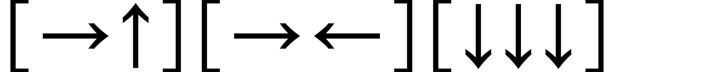, I follow the rule in the same sense as when I translate 1 2 3 4 according to x … x² into 1 4 9 16.

### [20\[2\]](https://cdn.wittgensteinnachlass.com/2000px/webp/Ms-110/20.webp)

In the particular case, of course, the rule does not occur with its generality emphasized, just as f(x) does not occur in f(a) as something general.

### [20\[3\]](https://cdn.wittgensteinnachlass.com/2000px/webp/Ms-110/20.webp),[21\[1\]](https://cdn.wittgensteinnachlass.com/2000px/webp/Ms-110/21.webp)

Now if I translate as above, the way I translate consists in the way I arrived at the result of the translation. It is undeniable, after all, that I can get from 1, 2, 3, 4 to 1, 4, 9, 16 in different ways, & I can assert no more than that. Now if I describe a state of affairs in words, say the shape & colour of a patch, I do not indeed consult any rule of calculation, but I do arrive at the words of the description in a quite definite way, different from simply making whatever sounds, or even letting myself be led to such sounds by association. If, for example, I describe a patch in certain words, it is surely conceivable that I use words for this that I have never heard & never used. At least one could imagine a case in which the people around me (who may be with me all the time) have never heard these words & (so) do not understand me either; but in which I imagine (as they would put it) that this is what the things are called. In that case I have thereby invented a language. For, as I understand it, that is what the things are called if I imagine that that is what they are called.

### [21\[2\]](https://cdn.wittgensteinnachlass.com/2000px/webp/Ms-110/21.webp)

To understand a sentence means to understand a language & to speak a sentence means to speak a language.

### [21\[3\]](https://cdn.wittgensteinnachlass.com/2000px/webp/Ms-110/21.webp)

23.01.1931

“Do you understand the word ‘table’?” – “Yes” – “What does it mean?” – (with a gesture) “A thing like this” – “Do you understand the sign ‘A thing like this’?” “Yes” – “what does it mean?” –

### [21\[4\]](https://cdn.wittgensteinnachlass.com/2000px/webp/Ms-110/21.webp)

The method of projection is the way & manner in which we derive 1, 4, 9 from 1, 2, 3 or 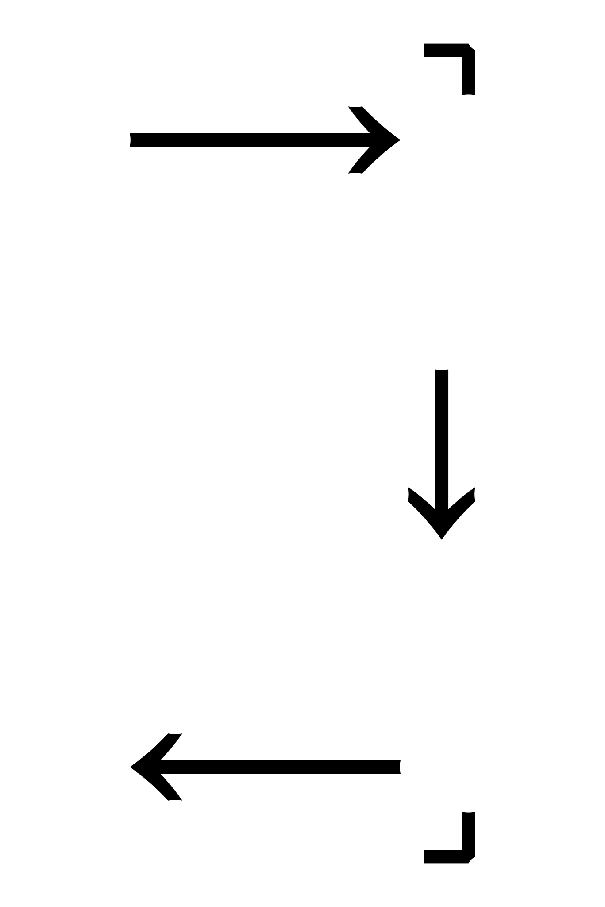 from a a b b c.

### [21\[5\]](https://cdn.wittgensteinnachlass.com/2000px/webp/Ms-110/21.webp)

There is, after all, a difference between my writing down the second sign under the influence, in some way, of the first, and my reading it off from the first sign.

### [21\[6\]](https://cdn.wittgensteinnachlass.com/2000px/webp/Ms-110/21.webp)

And causal influence is not a conscious process, after all.

### [21\[7\]](https://cdn.wittgensteinnachlass.com/2000px/webp/Ms-110/21.webp),[22\[1\]](https://cdn.wittgensteinnachlass.com/2000px/webp/Ms-110/22.webp)

But now if I am annoyed _because_ someone comes in through the door, can I be mistaken about the connection here, or do I experience it as I experience the annoyance? In a certain sense I can be mistaken, for I can say to myself “I don’t know why his coming annoys me so much today”. That is, the causes of my annoyance are open to dispute. – On the other hand, there is no disputing that the thought of his coming is – as one says – tinged with displeasure.

### [22\[2\]](https://cdn.wittgensteinnachlass.com/2000px/webp/Ms-110/22.webp)

But what about this case: I see the man & at the sight of him hatred of him flares up in me against him. – One might ask: how do I know that it is _him_ I hate, that _he_ is the cause of my hatred? And how do I know that the sight of him rekindles this hatred? As to the first question: “I hate him” does not mean “I hate & he is the cause of my hatred”. Rather, he, or the visual image of him – etc. – occurs in my hatred, is a constituent of my hatred. (Here too a stand-in will not do, for what guarantees to me that what it stands for exists?) In the second case his appearance occurs directly in my hatred, or, if it does not, then his appearance really is only the hypothetical cause of my feeling & I can be mistaken in thinking that it is what gives rise to the feeling.

### [22\[3\]](https://cdn.wittgensteinnachlass.com/2000px/webp/Ms-110/22.webp),[23\[1\]](https://cdn.wittgensteinnachlass.com/2000px/webp/Ms-110/23.webp)

It must be exactly the same with acting _according to_ an expression in signs. The expression in signs must be involved in this process, whereas it is not involved if it is merely the cause of my action.

### [23\[2\]](https://cdn.wittgensteinnachlass.com/2000px/webp/Ms-110/23.webp)

[I know that what I have been writing here for many weeks is bad; but I write it in the hope that something better may follow again. If nothing better follows, well, then this was meant to be the end.]

### [23\[3\]](https://cdn.wittgensteinnachlass.com/2000px/webp/Ms-110/23.webp)

And so it is: I derive my action from it.

### [23\[4\]](https://cdn.wittgensteinnachlass.com/2000px/webp/Ms-110/23.webp)

Now if I say that I derive my action from the expression in signs _in a certain way_, then this way can be contained in the actual process only as a function f(x) is contained in f(a).

### [23\[5\]](https://cdn.wittgensteinnachlass.com/2000px/webp/Ms-110/23.webp)

If the sentence “I hate him” is understood like this: I hate & he is the cause; then the question is possible “are you sure it is _him_ you hate, might it not be someone else or something else” and that is obviously nonsense.

### [23\[6\]](https://cdn.wittgensteinnachlass.com/2000px/webp/Ms-110/23.webp)

Incidentally, the only proof that an analysis is wrong is that it leads to patent nonsense; that is, to an expression that patently violates the grammar corresponding to the normal mode of application.

### [23\[7\]](https://cdn.wittgensteinnachlass.com/2000px/webp/Ms-110/23.webp),[24\[1\]](https://cdn.wittgensteinnachlass.com/2000px/webp/Ms-110/24.webp)

If I am thinking of him: what conditions must be fulfilled for that to be the case? What non-hypothetical determinations? If I am expecting him – for example – must he exist now, must I have a memory-image of him? Must I have seen him at some time? And in what sense. Whatever need not be the case we rule out, & what must be the case constitutes the existence of the thought.

### [24\[2\]](https://cdn.wittgensteinnachlass.com/2000px/webp/Ms-110/24.webp)

24.01.1931

If I produce a sequence of sounds & then say that I read this sentence, there can be no doubt whether I really read this sentence or whether my sequence of sounds was caused in some other way. That is, my having read this sentence says nothing at all about what caused the sequence of sounds to come about.

### [24\[3\]](https://cdn.wittgensteinnachlass.com/2000px/webp/Ms-110/24.webp)

It can never be essential for us that a phenomenon takes place in the mind & not on paper, visible to someone else.

### [24\[4\]](https://cdn.wittgensteinnachlass.com/2000px/webp/Ms-110/24.webp),[25\[1\]](https://cdn.wittgensteinnachlass.com/2000px/webp/Ms-110/25.webp)

One can say that whether I am reading or merely making sounds while a text is before my eyes cannot be settled by observation from outside. But reading cannot be essentially an _inner_ affair. Deriving the translation from the sign, if it is a process at all, must also be capable of being a visible process. Thus one must also be able to take as such, for example, the process that takes place on paper when the terms of the series 1, 4, 9, 16 (as a translation of 1, 2, 3, 4) appear worked out by means of the equations 1 × 1 = 1, 2 × 2 = 4, 3 × 3 = 9, etc.

From the standpoint of behaviourism one could then say: If a person writes that down, then he has obtained the bottom row by calculation, but if he merely writes down the bottom row, then he has not. But if he were now to write

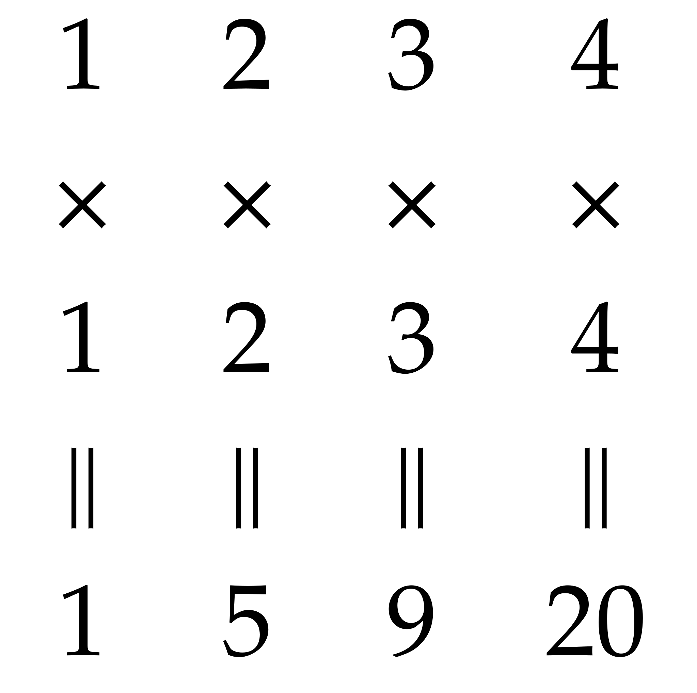

then we would say that he had calculated incorrectly, because 2 × 2 is not 5, etc.

### [25\[2\]](https://cdn.wittgensteinnachlass.com/2000px/webp/Ms-110/25.webp)

Of course one could just as well write

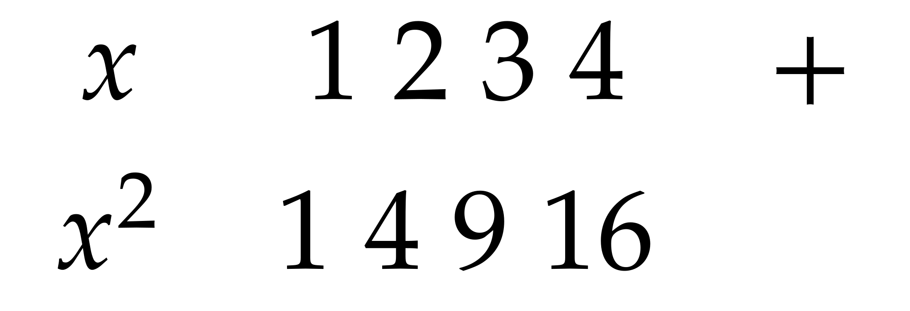

this representation is entirely equivalent to the first, or indeed to any other, provided a rule is laid down that distinguishes it from another representation.

### [25\[3\]](https://cdn.wittgensteinnachlass.com/2000px/webp/Ms-110/25.webp),[26\[1\]](https://cdn.wittgensteinnachlass.com/2000px/webp/Ms-110/26.webp)

The feeling one has with any such representation, that it is crude (clumsy), is misleading, for we are tempted to look for a “better” representation. But there is no such thing. One is as good as another so long as the multiplicity is right; i.e. so long as to every difference in what is represented there corresponds a difference in the representation.

### [26\[2\]](https://cdn.wittgensteinnachlass.com/2000px/webp/Ms-110/26.webp)

But then the thought as a mental process can do no more than this “crude” sign either.

### [26\[3\]](https://cdn.wittgensteinnachlass.com/2000px/webp/Ms-110/26.webp)

One cannot ask: What kind of processes are mental processes, that they can be true & false when non-mental ones cannot? For if the “mental” ones can, the others must be able to as well; and conversely.

### [26\[4\]](https://cdn.wittgensteinnachlass.com/2000px/webp/Ms-110/26.webp)

For if mental processes can do it, the description must be able to do it too. For it must show itself in their description how it is possible.

### [26\[5\]](https://cdn.wittgensteinnachlass.com/2000px/webp/Ms-110/26.webp),[27\[1\]](https://cdn.wittgensteinnachlass.com/2000px/webp/Ms-110/27.webp)

25.01.1931

When one says that thought is an activity of the psyche, or an activity of the mind, one thinks of the mind as a murky, gaseous entity in which things can happen that cannot happen outside. And of which one must expect things that are otherwise impossible. The doctrine of thoughts deals, as it were, with the organic part, as opposed to the inorganic part, the sign.

### [27\[2\]](https://cdn.wittgensteinnachlass.com/2000px/webp/Ms-110/27.webp)

It is as if the thought were the organic part of the symbol, the sign the inorganic part. And that organic part can accomplish things that the inorganic part could not.

### [27\[3\]](https://cdn.wittgensteinnachlass.com/2000px/webp/Ms-110/27.webp)

As if something essential still took place _behind_ the expression, something that cannot be expressed – that can perhaps only be pointed to – something that takes place in this cloud (the mind) & makes the thought a thought in the first place. Here we are thinking of a process analogous to digestion, & the idea is that chemical changes take place inside the body other than those we can produce outside it, that the organic part of digestion has a different chemistry from that of anything we could do to the food outside the body.

### [27\[4\]](https://cdn.wittgensteinnachlass.com/2000px/webp/Ms-110/27.webp)

Or: As if the thought consisted, as it were, of an inorganic part (the sign) and an organic part, say the interpretation, which would be essentially mental.

### [28\[1\]](https://cdn.wittgensteinnachlass.com/2000px/webp/Ms-110/28.webp)

26.01.1931

Of course one cannot say: The proposition is what is true or false. (As if that still ruled something out.)

### [28\[2\]](https://cdn.wittgensteinnachlass.com/2000px/webp/Ms-110/28.webp)

The intention, insofar as it concerns us, cannot be anything essentially mental.

### [28\[3\]](https://cdn.wittgensteinnachlass.com/2000px/webp/Ms-110/28.webp)

Since a machinery of the mind is of no concern to us, we must also be able to construct a mechanical human being that must be able to do everything that is essential for us.

### [28\[4\]](https://cdn.wittgensteinnachlass.com/2000px/webp/Ms-110/28.webp)

Again and again one would like to ask about the _purpose_ of thinking: What does one think for at all, what is this activity for? But what sort of answer does one want to get to that? We feel that thinking can have value only as an instrument.

### [28\[5\]](https://cdn.wittgensteinnachlass.com/2000px/webp/Ms-110/28.webp)

.

A schema of deliberation. We take what is given to us into consideration & arrive at a result.

### [28\[6\]](https://cdn.wittgensteinnachlass.com/2000px/webp/Ms-110/28.webp)

27.01.1931

To say of a picture that it is the picture of this process alters the picture.

### [28\[7\]](https://cdn.wittgensteinnachlass.com/2000px/webp/Ms-110/28.webp)

In the end the picture must speak for itself.

### [28\[8\]](https://cdn.wittgensteinnachlass.com/2000px/webp/Ms-110/28.webp),[29\[1\]](https://cdn.wittgensteinnachlass.com/2000px/webp/Ms-110/29.webp)

After all, a sign is always there for a living being, so that must be something essential to a sign. Certainly: a chair too is only ever there for a person, but it can be described without our talking about its purpose. A sign has a purpose only in human society, but this purpose is of no concern to us at all. Indeed, in the end we do not ascribe a single property to the signs – for these do not interest us – but state only the (general) rules of their use. Anyone describing chess neither specifies properties of the chess pieces nor talks about the usefulness & use of chess.

### [29\[2\]](https://cdn.wittgensteinnachlass.com/2000px/webp/Ms-110/29.webp)

If thought were, so to speak, a private amusement & had nothing to do with the outside world, it would be of no interest to us at all (like, say, the feelings one has with an upset stomach). What we want to know is: What does thought have to do with what happens outside thought? For that is the only source of its meaning, I mean its importance. What does what I think have to do with what is the case?

### [29\[3\]](https://cdn.wittgensteinnachlass.com/2000px/webp/Ms-110/29.webp),[30\[1\]](https://cdn.wittgensteinnachlass.com/2000px/webp/Ms-110/30.webp)

If I know A & know that B is his son, I do not thereby know what B looks like. Thus no external relation helps me to know the thing when I am given its stand-in.

### [30\[2\]](https://cdn.wittgensteinnachlass.com/2000px/webp/Ms-110/30.webp)

The thought is different from what makes it true, & it cannot be more different than simply not being the same.

### [30\[3\]](https://cdn.wittgensteinnachlass.com/2000px/webp/Ms-110/30.webp)

28.01.1931

It is connected with another process only through being applied, i.e. through being translated.

### [30\[4\]](https://cdn.wittgensteinnachlass.com/2000px/webp/Ms-110/30.webp)

Can one say that the words of the sentence (or the constituents of the thought) stand for something only during the translation?

### [30\[5\]](https://cdn.wittgensteinnachlass.com/2000px/webp/Ms-110/30.webp)

What makes the thought true cannot be determined in advance, because otherwise it would already be there. “But what it is like if the thought is true is determined in advance.” But surely there would need to be nothing more than the fact, the verification itself. This “the proposition says what is the case if it is true” says nothing, for p itself shows that p is the case if etc. That is, only p could be given in answer to the question “what would be the case if …?” But that is a mere tautology.

### [30\[6\]](https://cdn.wittgensteinnachlass.com/2000px/webp/Ms-110/30.webp)

The difficulty lies in the concept of determining.

### [30\[7\]](https://cdn.wittgensteinnachlass.com/2000px/webp/Ms-110/30.webp),[31\[1\]](https://cdn.wittgensteinnachlass.com/2000px/webp/Ms-110/31.webp)

What the proposition would really have to determine would be, as it were, that p or ~p must be the case, but that is only apparently a determination; in reality it determines nothing at all. [→ ]

### [31\[2\]](https://cdn.wittgensteinnachlass.com/2000px/webp/Ms-110/31.webp)

03.02.1931

### [31\[3\]](https://cdn.wittgensteinnachlass.com/2000px/webp/Ms-110/31.webp)

But if that is not what is meant, then the answer lies in the description of _what_ it does.

### [31\[4\]](https://cdn.wittgensteinnachlass.com/2000px/webp/Ms-110/31.webp)

It is extraordinarily hard to rid oneself altogether of the idea that explanation is supposed to shed light on what is hidden.

### [31\[5\]](https://cdn.wittgensteinnachlass.com/2000px/webp/Ms-110/31.webp)

Solipsism might be refuted by the fact that the word “I” has no central position in grammar, but is a word like any other.

### [31\[6\]](https://cdn.wittgensteinnachlass.com/2000px/webp/Ms-110/31.webp)

If there were essentially subject & object in the world, then the word ‘I’ would have to stand opposed to the other words in a unique way.

### [31\[7\]](https://cdn.wittgensteinnachlass.com/2000px/webp/Ms-110/31.webp)

In language, as in visual space, there is no metaphysical subject.

### [31\[8\]](https://cdn.wittgensteinnachlass.com/2000px/webp/Ms-110/31.webp),[32\[1\]](https://cdn.wittgensteinnachlass.com/2000px/webp/Ms-110/32.webp)

One can only use the words “to be certain that” of a hypothesis. It means nothing to say “I am certain that I have toothache”, except in a system in which it is after all possible to doubt whether I have toothache. But can’t I say: I am certain that I shall soon see a light? (Or: “that I shall soon get toothache”) And yet there was something true in the remark above.

### [32\[2\]](https://cdn.wittgensteinnachlass.com/2000px/webp/Ms-110/32.webp)

What does it mean to be certain that one will have toothache? (If it is not _possible_ to be certain, then grammar does not allow the word to be used in this connection.

### [32\[3\]](https://cdn.wittgensteinnachlass.com/2000px/webp/Ms-110/32.webp)

04.02.1931

One cannot say of a proposition (in the narrower sense) that the truth of another confirms it – without proving it.

### [32\[4\]](https://cdn.wittgensteinnachlass.com/2000px/webp/Ms-110/32.webp)

One says: “When I say that I see an armchair there, I say more than I know for certain”. And then what one usually says is: “But there is _one_ thing I do know for certain”. But when one tries to say what that is, one finds oneself in some difficulty.

### [32\[5\]](https://cdn.wittgensteinnachlass.com/2000px/webp/Ms-110/32.webp)

“I see something _brown_ – that is certain”; what one really means to say by this is that the brown colour is seen & is not perhaps merely surmised (as, for instance, when I infer it from certain other indications). And one does also simply say: “I _see_ something brown.”

### [32\[6\]](https://cdn.wittgensteinnachlass.com/2000px/webp/Ms-110/32.webp)

If I am told: “Look through this telescope & draw what you see for me”, then what I draw is the expression of a proposition, not of a hypothesis.

### [33\[1\]](https://cdn.wittgensteinnachlass.com/2000px/webp/Ms-110/33.webp)

(It is hard in philosophy not to add anything of one’s own invention & to tell _only_ the truth.)

### [33\[2\]](https://cdn.wittgensteinnachlass.com/2000px/webp/Ms-110/33.webp)

Is it not clear that it is only for lack of a corresponding convention that I cannot render in words what I – for example – represent in a drawing?

### [33\[3\]](https://cdn.wittgensteinnachlass.com/2000px/webp/Ms-110/33.webp)

When I say “there is a kettle here”, by this – as one says – “more” is meant than a description of what I perceive. And this can only mean that this proposition need not be true, even if the description of what is seen is correct. Under what circumstances, then, will I say that the proposition was not true? Clearly: when certain other propositions that were included in the first are not true. But it is not as if the first had been a logical product.

### [33\[4\]](https://cdn.wittgensteinnachlass.com/2000px/webp/Ms-110/33.webp)

If one asks “How does thought manage to represent?” the answer could be: “Don’t you (really) know? You can see it, after all, when you think.” Nothing is hidden, after all.

### [33\[5\]](https://cdn.wittgensteinnachlass.com/2000px/webp/Ms-110/33.webp)

How does the sentence do that? – Don’t you know? Nothing is concealed, after all.

### [33\[6\]](https://cdn.wittgensteinnachlass.com/2000px/webp/Ms-110/33.webp),[34\[1\]](https://cdn.wittgensteinnachlass.com/2000px/webp/Ms-110/34.webp)

That everything flows seems to prevent us from expressing the truth, for it is as if we could not grasp it because it slips away from us.

### [34\[2\]](https://cdn.wittgensteinnachlass.com/2000px/webp/Ms-110/34.webp)

But it simply does not prevent us from expressing it. – We know what it means to want to capture in a description something that is fleeing. It happens, for example, when we forget one thing while trying to describe another. But that is not what is at issue here. And that is how the expression “to flee” is to be used.

### [34\[3\]](https://cdn.wittgensteinnachlass.com/2000px/webp/Ms-110/34.webp)

We bring words back from their metaphysical use to their proper use in language.

### [34\[4\]](https://cdn.wittgensteinnachlass.com/2000px/webp/Ms-110/34.webp)

The man who said that one cannot step twice into the same river said something false; one can step twice into the same river.

### [34\[5\]](https://cdn.wittgensteinnachlass.com/2000px/webp/Ms-110/34.webp)

And this is what the solution to all philosophical difficulties looks like. The answers to them, if they are right, must be homely & ordinary. But one need only look at them in the right spirit and then it doesn’t matter.

### [34\[6\]](https://cdn.wittgensteinnachlass.com/2000px/webp/Ms-110/34.webp)

But to the answer “You know how the sentence does it, after all, there’s nothing hidden”, one would like to say: “Yes, but it all flows past so quickly, & I’d like to see it, as it were, spread out more widely”.

### [35\[1\]](https://cdn.wittgensteinnachlass.com/2000px/webp/Ms-110/35.webp)

But here too we are mistaken. For nothing happens in the process that we miss because of the speed.

### [35\[2\]](https://cdn.wittgensteinnachlass.com/2000px/webp/Ms-110/35.webp)

05.02.1931

Why can’t we imagine a machine with a memory? It has often been said that memory consists in events leaving traces in which certain processes would then have to take place. As when, then, water makes itself a bed & the water that follows must flow in that bed; the one process wears a track for the next. But if this happens in a machine, as it actually does, no one says the machine has a memory, or that it has remembered the process.

### [35\[3\]](https://cdn.wittgensteinnachlass.com/2000px/webp/Ms-110/35.webp),[36\[4\]](https://cdn.wittgensteinnachlass.com/2000px/webp/Ms-110/36.webp)

Now this is just like saying that a machine can’t think, or can’t be in pain. And what matters here is what one understands by “being in pain”. It is clear that I can imagine a machine that behaves exactly as a person in pain does (in every detail). Or rather: I can call the other person a machine in pain, i.e. the other _body_. And likewise, of course, my body. In contrast, the phenomenon of pain, as it occurs when ‘I am in pain’, has nothing at all to do with my body, i.e. with the experiences I sum up as the existence of my body. (I can have toothache without teeth.) And here there is no place for the machine at all. – It is clear that the machine can take the place only of a physical body. And in the sense in which one can say of such a body that it “is” in pain, one can say it of a machine too. Or again, we can compare the _bodies_ we say are in pain to machines & call them machines too.

### [36\[2\]](https://cdn.wittgensteinnachlass.com/2000px/webp/Ms-110/36.webp)

And it is exactly the same with thinking & memory.

### [36\[3\]](https://cdn.wittgensteinnachlass.com/2000px/webp/Ms-110/36.webp)

It seems to us – as I said – that we are in the same position with a thought as with a landscape we have seen & are to describe, but cannot remember accurately enough to describe how all its parts fit together. So, we believe, we cannot describe thinking afterwards because by then we have lost all the many finer processes.

### [36\[4\]](https://cdn.wittgensteinnachlass.com/2000px/webp/Ms-110/36.webp)

We would like to see this finer interlacing under a magnifying glass, so to speak.

### [36\[5\]](https://cdn.wittgensteinnachlass.com/2000px/webp/Ms-110/36.webp)

(One must treat an unhatched thought gently to keep it alive. One must not demand anything of it yet, & must bed it in the soft medium of continuing uncertainty. Once it has fledged, it leaves this nest of its own accord.)

### [37\[1\]](https://cdn.wittgensteinnachlass.com/2000px/webp/Ms-110/37.webp)

Everything essential about the thought is said in saying that the thought that p is the case is not the fact that p is the case. That the thought is a _different_ fact. Further, that the thought, the complete symbol, is part of a system of symbols, a language.

### [37\[2\]](https://cdn.wittgensteinnachlass.com/2000px/webp/Ms-110/37.webp)

What about the fact that the thought cannot be misunderstood (or understood)?

### [37\[3\]](https://cdn.wittgensteinnachlass.com/2000px/webp/Ms-110/37.webp)

Just as Frege substituted new words for the signs “greater”, “less”, “ + ”, “ ‒ ”, etc. in Cantor’s purported definition in order to show that there was no real definition, so throughout mathematics one could substitute entirely new, hitherto meaningless expressions for the familiar words, especially for the word “infinite” & its relatives, to see what the calculus actually accomplishes with these signs & what it does not. If the opinion were widespread that chess tells us something about kings & rooks, I would propose giving the pieces new shapes & different names, to make it easier to see that everything belonging to the game of chess must lie in its rules.

### [37\[4\]](https://cdn.wittgensteinnachlass.com/2000px/webp/Ms-110/37.webp),[38\[1\]](https://cdn.wittgensteinnachlass.com/2000px/webp/Ms-110/38.webp)

To someone who says “but there really is a table here” one must reply: “of course there is a real table here – as opposed to an imitation”. But if he were to go on & say that mental images are _only_ pictures of things, I should have to contradict (him) & say that the comparison of a mental image with a picture of the body is quite misleading, since it is essential to a picture that it can be compared with its object.

### [38\[2\]](https://cdn.wittgensteinnachlass.com/2000px/webp/Ms-110/38.webp)

But if someone says: “mental images are the only real things”, I must say that I do not understand the word “real” here & do not know what property one is actually ascribing to mental images with it & – perhaps – denying to bodies. For I cannot see how it can make sense to ascribe a property to mental images & physical bodies – whether truly or falsely.

### [38\[3\]](https://cdn.wittgensteinnachlass.com/2000px/webp/Ms-110/38.webp),[39\[1\]](https://cdn.wittgensteinnachlass.com/2000px/webp/Ms-110/39.webp)

When one says that everything flows, we feel that we are prevented from holding on to what is real, to reality proper. The process on the screen slips away from us precisely because it is a process. But we do describe something; – & is that another process? Clearly, the description is connected with the very picture on the screen. There must be a false picture underlying our feeling of helplessness. For whatever we want to be able to describe, we can describe.

### [39\[2\]](https://cdn.wittgensteinnachlass.com/2000px/webp/Ms-110/39.webp)

Isn’t this false picture that of a strip of pictures running past so fast that we have no time to take in a picture?

### [39\[3\]](https://cdn.wittgensteinnachlass.com/2000px/webp/Ms-110/39.webp)

For in that case we would be inclined to run after the picture. But there is nothing analogous to that in the course of a process.

### [39\[4\]](https://cdn.wittgensteinnachlass.com/2000px/webp/Ms-110/39.webp)

If the saying that one cannot step into the same river twice (only) means that in the meantime different water has come to take the place of the old, still, one can see the same green patch twice, & here there is nothing analogous to the flowing away of the water.

### [39\[5\]](https://cdn.wittgensteinnachlass.com/2000px/webp/Ms-110/39.webp)

The simile of the flow of time is of course misleading &, if we hold on to it, is bound to lead us into difficulties.

### [39\[6\]](https://cdn.wittgensteinnachlass.com/2000px/webp/Ms-110/39.webp)

That something goes on “in our mind” is meant, I think, to suggest that it cannot be located in physical space. One doesn’t say of stomach pains that they go on in our mind, even though the physical stomach, after all, is not the immediate site of the pains.

### [39\[7\]](https://cdn.wittgensteinnachlass.com/2000px/webp/Ms-110/39.webp),[40\[1\]](https://cdn.wittgensteinnachlass.com/2000px/webp/Ms-110/40.webp)

If one asks where thinking goes on, one must perhaps answer: in visual space, in the space of certain kinaesthetic sensations.

### [40\[2\]](https://cdn.wittgensteinnachlass.com/2000px/webp/Ms-110/40.webp)

But that is wrong, for specifying the space is not specifying a place. (Specifying the space is ultimately specifying a geometry.)

### [40\[3\]](https://cdn.wittgensteinnachlass.com/2000px/webp/Ms-110/40.webp)

“Thinking goes on in the head” really means nothing more than that our head has something to do with thinking. To be sure, one also says: “I think with my pen on paper”, & this specification of place is at least as good as the first.

### [40\[4\]](https://cdn.wittgensteinnachlass.com/2000px/webp/Ms-110/40.webp)

When we ask “Where does thinking go on”, what always lies behind this is the idea of a mechanical process going on in an enclosed space, very like the process in a calculating machine.

### [40\[5\]](https://cdn.wittgensteinnachlass.com/2000px/webp/Ms-110/40.webp)

If “understanding a sentence” means: acting on it in a certain sense, then understanding cannot be the condition for our acting on it.

### [40\[6\]](https://cdn.wittgensteinnachlass.com/2000px/webp/Ms-110/40.webp)

One can, I think, compare understanding a description with drawing a picture from that description. (And here again the simile is a particular case of what it is a simile for.) And in many cases it would also be taken as proof of understanding.

### [41\[1\]](https://cdn.wittgensteinnachlass.com/2000px/webp/Ms-110/41.webp)

What does it mean to understand a painting? There, too, there is understanding and not understanding.

### [41\[2\]](https://cdn.wittgensteinnachlass.com/2000px/webp/Ms-110/41.webp)

And here, too, understanding & not understanding can mean different things. – We can imagine a picture that is meant to represent an arrangement of objects in 3-dimensional space, but in part of the picture we are unable to see bodies in space and see only the painted surface of the picture. We can then say that we do not understand these parts of the picture. It may be that the objects in space that are depicted are familiar to us, i.e. are shapes we know from looking at bodies, but the picture may also depict shapes we have never seen. And here again there is the case where something looks, for example, like a bird, but not like one of a kind I know, or else where a configuration in space is depicted the like of which I have never seen. In these latter cases too one can speak of not understanding the picture, but in a different sense from the first case.

### [41\[3\]](https://cdn.wittgensteinnachlass.com/2000px/webp/Ms-110/41.webp),[42\[1\]](https://cdn.wittgensteinnachlass.com/2000px/webp/Ms-110/42.webp)

One could – by analogy with earlier explanations – say: To understand the picture is to be able to reproduce it in three dimensions. But what does “to be able to” mean? If it does not mean actually reproducing the picture in this way, then this reproduction is not needed for understanding, & what is essential must be the other thing that makes me say I am _able_ to represent the picture in three dimensions.

### [42\[2\]](https://cdn.wittgensteinnachlass.com/2000px/webp/Ms-110/42.webp)

But one more thing: Suppose the picture depicted people, but was small, & the people in it were about an inch tall. Now suppose there were people of that height; then we would recognize _them_ in the picture & it would make quite a different impression on us, even though the illusion of three-dimensional objects would be exactly the same. And yet the actual impression, as it stands, is independent of my actually having seen people of the usual size at some time & never having seen dwarfs, even though this is the cause of the impression.

### [42\[3\]](https://cdn.wittgensteinnachlass.com/2000px/webp/Ms-110/42.webp)

This seeing of the painted people as people (as opposed to dwarfs, say) is quite analogous to seeing the picture as a 3-dimensional configuration. We cannot say here that we always see the same thing & afterwards take it now as this & now as that; rather, we see something different each time.

### [42\[4\]](https://cdn.wittgensteinnachlass.com/2000px/webp/Ms-110/42.webp),[43\[1\]](https://cdn.wittgensteinnachlass.com/2000px/webp/Ms-110/43.webp)

And so too when we read a sentence with understanding and without understanding. (Remember what it is like when one reads a sentence with the wrong stress, does not understand it as one reads it & finally realizes how it is to be read.)

### [43\[2\]](https://cdn.wittgensteinnachlass.com/2000px/webp/Ms-110/43.webp)

I understand this picture perfectly, I could model it in clay. – I understand this description perfectly, I could make a drawing from it.

### [43\[3\]](https://cdn.wittgensteinnachlass.com/2000px/webp/Ms-110/43.webp)

Understanding the picture has to do only with the picture. Understanding the sentence only with the sentence.

### [43\[4\]](https://cdn.wittgensteinnachlass.com/2000px/webp/Ms-110/43.webp)

To understand the sentence-sign is to obtain through it a datum which, since it is not the state of affairs represented, can still be called the sentence.

### [43\[5\]](https://cdn.wittgensteinnachlass.com/2000px/webp/Ms-110/43.webp)

If the ostensive definition communicates understanding to us, then henceforth something different from what happened before must happen on hearing the word that has been explained. (When we hear it in a sentence.)

### [43\[6\]](https://cdn.wittgensteinnachlass.com/2000px/webp/Ms-110/43.webp)

07.02.1931

How does the (ostensive) definition convey an understanding of the language?

### [43\[7\]](https://cdn.wittgensteinnachlass.com/2000px/webp/Ms-110/43.webp),[44\[1\]](https://cdn.wittgensteinnachlass.com/2000px/webp/Ms-110/44.webp)

I say “Pick out all the blue balls”; but he does not know what “blue” means. Now I point & say “this is blue”. Now he understands me & can follow my command. I enable him to follow the command. But what happens now when he hears this command in future? Is it necessary that he remember that _explanation_, i.e. that one occasion of explanation? Is it necessary that the mental image of the blue object, or of a blue object, come before his mind? All of this seems _not_ to be necessary, though it may happen. And yet the word “blue” now has a different aspect for him than it did before it was explained to him. It gains depth, as it were. He now sees something different in it.

### [44\[2\]](https://cdn.wittgensteinnachlass.com/2000px/webp/Ms-110/44.webp)

He _can_ follow the command does not mean that he follows it, so it means something else; and – I should like to say – the closest kinship two facts can have is for one to be a picture of the other.

### [44\[3\]](https://cdn.wittgensteinnachlass.com/2000px/webp/Ms-110/44.webp)

Or: It does not help either if “being able to follow” has components in common with “following”; for the difference begins somewhere.

### [44\[4\]](https://cdn.wittgensteinnachlass.com/2000px/webp/Ms-110/44.webp),[45\[1\]](https://cdn.wittgensteinnachlass.com/2000px/webp/Ms-110/45.webp)

But in certain cases one could go so far as to lay it down as a condition of understanding that one must be able to draw the sense of the sentence. – But suppose I ask: How do you know that you can draw the sense? (unless it means that you _have_ drawn it).

### [45\[2\]](https://cdn.wittgensteinnachlass.com/2000px/webp/Ms-110/45.webp)

So, one would say, _one_ experience is called “drawing”, another “the experience of being _able_ to draw”. – But that is not how it is. Rather, “being able to draw it” consists in understanding (the meaning of) “drawing it”.

### [45\[3\]](https://cdn.wittgensteinnachlass.com/2000px/webp/Ms-110/45.webp)

Let us think of understanding a story told in pictures. Here, incidentally, the criterion of understanding is taken to be that we can tell the story in words from the pictures.

### [45\[4\]](https://cdn.wittgensteinnachlass.com/2000px/webp/Ms-110/45.webp)

Let us also look at what it means to understand a score. Here, to be sure, it seems that someone who reads it with understanding is already translating it in so doing, by humming the piece to himself, for instance, or by making corresponding movements of the larynx.

### [45\[5\]](https://cdn.wittgensteinnachlass.com/2000px/webp/Ms-110/45.webp)

What effect, then, did the ostensive explanation have? Did it have only an automatic effect, so to speak? But that is to ask: is it now needed again and again, or did it have a causal effect like that of an inoculation, say, which has changed us once and for all, or at least for the time being?

### [45\[6\]](https://cdn.wittgensteinnachlass.com/2000px/webp/Ms-110/45.webp),[46\[1\]](https://cdn.wittgensteinnachlass.com/2000px/webp/Ms-110/46.webp)

Isn’t it the case that, in so far as the definition has given us understanding once and for all, it has changed our language & therefore comes into consideration only as the history of our understanding, – or: that for this reason it does _not_ come into consideration for us.

### [46\[2\]](https://cdn.wittgensteinnachlass.com/2000px/webp/Ms-110/46.webp)

The definition comes into consideration for us only where it is used again.

### [46\[3\]](https://cdn.wittgensteinnachlass.com/2000px/webp/Ms-110/46.webp)

The definition works in this way: if I hear the sentence “the sky was red” & ask “what is ‘red’” & in reply someone points to a piece of red paper & I understand this explanation, then I would have had to understand the sentence if the paper had been pointed to instead of the word “red” being used.

### [46\[4\]](https://cdn.wittgensteinnachlass.com/2000px/webp/Ms-110/46.webp)

I can imagine a practised contrapuntist reading a score, e.g. of a fugue, without forming any images of the sounds & perhaps deriving pleasure from the mere sight of the notes; quite analogous to the pleasure we have in reading a description without translating it into a visual image. But there is also no doubt that when the musician looks at the score he sees something different from what I see, say, when I look at it.

### [46\[5\]](https://cdn.wittgensteinnachlass.com/2000px/webp/Ms-110/46.webp),[47\[1\]](https://cdn.wittgensteinnachlass.com/2000px/webp/Ms-110/47.webp)

When we read, we have at our disposal the arrangement of the words & whatever dispositions, images, etc. it evokes. Nothing else. Understanding must be made up of these.

### [47\[2\]](https://cdn.wittgensteinnachlass.com/2000px/webp/Ms-110/47.webp)

I could say figuratively: in my mind I find the word red (present) as the label of a red mental image. (Bergson)

### [47\[3\]](https://cdn.wittgensteinnachlass.com/2000px/webp/Ms-110/47.webp)

If I understand the signs “~” and “ ∙ ”, I can explain p ❘ q by ~p ∙ ~q = p ❘ q Def. But I can get so far in using the form ξ ❘ η that I no longer need to translate it into ~ξ ∙ ~η in order to understand it, & then the definition has become obsolete, & this shows that it would not have been strictly necessary in the first place, for all that was needed was to know the grammatical rules for ξ ❘ η.

### [47\[4\]](https://cdn.wittgensteinnachlass.com/2000px/webp/Ms-110/47.webp)

Now isn’t it similar in the case where we explained the word “blue” by pointing and saying “this is blue”? That is, don’t we need the ostensive definition only in quite specific cases, whereas otherwise the rules that apply to the word “blue” suffice?

### [47\[5\]](https://cdn.wittgensteinnachlass.com/2000px/webp/Ms-110/47.webp)

An explanation cannot act at a distance. I mean: it works only where it is applied. If it also has some other “effect”, it does not have it as an explanation.

### [47\[6\]](https://cdn.wittgensteinnachlass.com/2000px/webp/Ms-110/47.webp),[48\[1\]](https://cdn.wittgensteinnachlass.com/2000px/webp/Ms-110/48.webp)

Understanding the sentence cannot essentially lie in reproducing it in another language. What is at issue is rather the “possibility” of this reproduction, & that must lie in how one sees the sentence itself. Just as the possibility of reproducing the painting in three dimensions lies in seeing it in three dimensions.

### [48\[2\]](https://cdn.wittgensteinnachlass.com/2000px/webp/Ms-110/48.webp)

If understanding consists in _being able_ to reproduce the sentence, there are two cases here: First, that I can be mistaken about this, as when I say I can lift 50 kg & the attempt shows that I can’t. Or second, that the sentence “I can …” is the description of an immediate experience; so that even if I am prevented from carrying it out for “external reasons”, this does not count against the truth of the statement.

### [48\[3\]](https://cdn.wittgensteinnachlass.com/2000px/webp/Ms-110/48.webp)

The ability is then an _inner_ ability (as I might call it), the other an outer one.

### [48\[4\]](https://cdn.wittgensteinnachlass.com/2000px/webp/Ms-110/48.webp)

And here I can be interested only in the inner ability, which is equivalent to understanding, about which I cannot be mistaken and which cannot be confirmed or called into doubt by a future experience.

### [48\[5\]](https://cdn.wittgensteinnachlass.com/2000px/webp/Ms-110/48.webp)

One might say, as it were: “I could draw that now if I wanted to & no obstacles got in the way.”

### [49\[1\]](https://cdn.wittgensteinnachlass.com/2000px/webp/Ms-110/49.webp)

That presumably means: _one_ condition for it is met. And this condition of course lies in what is before me.

### [49\[2\]](https://cdn.wittgensteinnachlass.com/2000px/webp/Ms-110/49.webp)

But then the sentence “I can draw this sense” must be a statement to the effect that I now see a certain multiplicity in it, and hence of the kind: I now see the figure  in three dimensions.

### [49\[3\]](https://cdn.wittgensteinnachlass.com/2000px/webp/Ms-110/49.webp)

“I can draw that if nothing prevents me”: what an odd qualification. Doesn’t that mean: I can if I can? For it is not of the same kind as: “I can do this work if I don’t fall ill”. For here I have ruled out only an external cause, & if that is the only one I have ruled out, then the sentence means: I will do the work if I don’t fall ill. In the earlier sentence, however, I have predicted nothing at all & allowed every obstacle to count as such (for I cannot _know_ anything in advance, after all). So that the “can” really loses all sense if the words that describe _what_ I can do are not meant to characterize the multiplicity of what is experienced.

### [49\[4\]](https://cdn.wittgensteinnachlass.com/2000px/webp/Ms-110/49.webp)

To understand the symbol can only mean to know it.

### [49\[5\]](https://cdn.wittgensteinnachlass.com/2000px/webp/Ms-110/49.webp),[50\[1\]](https://cdn.wittgensteinnachlass.com/2000px/webp/Ms-110/50.webp)

We say to someone “_that_ is green, don’t forget it!”. Now the word “green” occurs & he is to act on it. And now he tries to remember which colour was called “green”. But what does this search consist in? Looking up what was called green. He presses a certain button, say, & what pops out is what he is looking for (if anything pops out).

### [50\[2\]](https://cdn.wittgensteinnachlass.com/2000px/webp/Ms-110/50.webp)

So one could also put it this way: He depends on whether something reports itself – in a particular way – when he hears the word “green”.

### [50\[3\]](https://cdn.wittgensteinnachlass.com/2000px/webp/Ms-110/50.webp)

Now in so far as the definition has the consequence that something reports itself, it is not a definition but, as it were, a mechanical aid.

### [50\[4\]](https://cdn.wittgensteinnachlass.com/2000px/webp/Ms-110/50.webp)

The definition attaches a little label with the word “green” to something green.

### [50\[5\]](https://cdn.wittgensteinnachlass.com/2000px/webp/Ms-110/50.webp)

Now what does it mean to use a definition? Does it necessarily mean looking at the written definition? Doesn’t it mean: substituting one thing for the other in accordance with it? – For isn’t the substitution in accordance with the definition even when the sign, the expression, of the definition was not looked at or imagined?

### [50\[6\]](https://cdn.wittgensteinnachlass.com/2000px/webp/Ms-110/50.webp),[51\[1\]](https://cdn.wittgensteinnachlass.com/2000px/webp/Ms-110/51.webp)

And so what I said in the previous sentence & further above would be wrong, & it _would_ be a proper use of the definition if the green patch came to mind _in the particular way_ at the word “green”.

### [51\[2\]](https://cdn.wittgensteinnachlass.com/2000px/webp/Ms-110/51.webp)

If ‘understanding’ already means translating, then one need not understand in order to be able to translate.

### [51\[3\]](https://cdn.wittgensteinnachlass.com/2000px/webp/Ms-110/51.webp)

And here a way out suggests itself to us which is no way out at all, namely: that the first translation, the one that constitutes understanding, is automatic, whereas the one that follows understanding is voluntary. (Every such false way out is (however) interesting, for it would not suggest itself to us if there were not something right about it.)

### [51\[4\]](https://cdn.wittgensteinnachlass.com/2000px/webp/Ms-110/51.webp)

If understanding does not mean translating, then it means seeing the sign in the space of its grammatical rules.

### [51\[5\]](https://cdn.wittgensteinnachlass.com/2000px/webp/Ms-110/51.webp)

One can do philosophy no greater favour than to paraphrase the ordinary & mistaken view & set it out clearly.

### [51\[6\]](https://cdn.wittgensteinnachlass.com/2000px/webp/Ms-110/51.webp),[52\[1\]](https://cdn.wittgensteinnachlass.com/2000px/webp/Ms-110/52.webp)

Chess is certainly characterized solely & entirely by its rules (its list of rules). It is equally clear that someone who is playing a game of chess & now makes his move is doing something different from someone who cannot play chess (i.e. doesn’t know the game) & now picks up a piece & happens to move it in accordance with the rule.) On the other hand, it is just as clear that the difference does not consist in the first person in some form saying the rules of chess to himself or going over them. – Now if I say that his being able to play chess consists in his knowing the rules, is this knowledge of the rules contained in every move in some form? In a certain sense, it seems, Yes! For otherwise it would take a future experience to show whether he really is playing chess, i.e. “he is playing chess” would then be a hypothesis which, incidentally, for that very reason could only be confirmed by experience, but not proved. On the other hand, in a certain sense there seems to be no room for doubt that I am playing chess, & so in this sense it must lie in what is now taking place as I make my move. It must therefore be because I see this move differently (compare 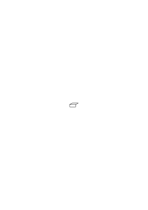) from the way someone who is not playing sees it.

### [52\[2\]](https://cdn.wittgensteinnachlass.com/2000px/webp/Ms-110/52.webp)

It must be just the same when I make a move with the words “and” “not” etc., when I utter a sentence in which they occur.

### [52\[3\]](https://cdn.wittgensteinnachlass.com/2000px/webp/Ms-110/52.webp),[53\[1\]](https://cdn.wittgensteinnachlass.com/2000px/webp/Ms-110/53.webp)

If asked what I mean by “and” in the sentence “give me the bread _and_ the butter”, I would answer with a gesture, & this gesture would illustrate the meaning. Just as the little green sample illustrates “green” _& as the W-F-notation_ illustrates “and” & “not”.

### [53\[2\]](https://cdn.wittgensteinnachlass.com/2000px/webp/Ms-110/53.webp)

So understanding a sign apparently consists in our seeing in it or with it a configuration of a certain multiplicity that someone who does not understand does not see.

### [53\[3\]](https://cdn.wittgensteinnachlass.com/2000px/webp/Ms-110/53.webp)

That is, there is a sense in which the sentence “I am playing chess” is a hypothesis, & another in which it is not.

### [53\[4\]](https://cdn.wittgensteinnachlass.com/2000px/webp/Ms-110/53.webp)

We can take a behaviourist (hideous word) view of anything we like, since it makes no difference to us _what_ happens & we are interested only in the multiplicity of what happens.

### [53\[5\]](https://cdn.wittgensteinnachlass.com/2000px/webp/Ms-110/53.webp)

For one could now say: If such complicated processes play a part in understanding the word “and”, & understanding is something essential for us, how is it that these processes are never mentioned in symbolic logic? How is it that they are never mentioned in logic, nor need be?

### [53\[6\]](https://cdn.wittgensteinnachlass.com/2000px/webp/Ms-110/53.webp),[54\[1\]](https://cdn.wittgensteinnachlass.com/2000px/webp/Ms-110/54.webp)

Understanding is not only brought about by the explanations, but must (also) itself have the same multiplicity as these explanations.

### [54\[2\]](https://cdn.wittgensteinnachlass.com/2000px/webp/Ms-110/54.webp)

That is, we can again take the system of explanations as the understanding.

### [54\[3\]](https://cdn.wittgensteinnachlass.com/2000px/webp/Ms-110/54.webp)

One could also ask this way: Mustn’t someone who understands a negation know all the rules concerning negation? So these too. Now if he is not applying them at the moment, what does his knowing them consist in? Is it only a hypothesis, a disposition? Then it does not interest us. But what does it mean to know _all_ the rules about negation?

### [54\[4\]](https://cdn.wittgensteinnachlass.com/2000px/webp/Ms-110/54.webp)

Can I say: If I perceive a body in visual space, it supplies me with (certain) rules for the word that designates it.

### [54\[5\]](https://cdn.wittgensteinnachlass.com/2000px/webp/Ms-110/54.webp)

Or shouldn’t I rather say: If this body is the sign & one of its surfaces, say, is another sign, then the rules linking the two are thereby given.

### [54\[6\]](https://cdn.wittgensteinnachlass.com/2000px/webp/Ms-110/54.webp)

09.02.1931

Remember how hard it is for children to believe (or to see) that _one_ word really has two quite different meanings.

### [54\[7\]](https://cdn.wittgensteinnachlass.com/2000px/webp/Ms-110/54.webp),[54\[8\]](https://cdn.wittgensteinnachlass.com/2000px/webp/Ms-110/54.webp)

For us, an unarticulated understanding is no understanding.

### [55\[1\]](https://cdn.wittgensteinnachlass.com/2000px/webp/Ms-110/55.webp)

Whatever accompanies the sentence in an unarticulated way does not interest us.

### [55\[2\]](https://cdn.wittgensteinnachlass.com/2000px/webp/Ms-110/55.webp)

“Leave the room in 5 minutes! Have you understood?” Yes, in 5 minutes (pointing to the clock) I am to leave the room (pointing to the door). I’ll show you what I’m going to do. So, when the hand is here, I’ll do it like this. (He demonstrates it.) – Now one will say that he has nevertheless not shown that he had understood, and I say that he has shown everything that was there.

### [55\[3\]](https://cdn.wittgensteinnachlass.com/2000px/webp/Ms-110/55.webp)

There is a view that he can, as it were, show only imperfectly whether he has understood. That, as it were, he can only ever point to it from a distance, even approach it, but can never touch it with his hand. And that the final thing always remains unsaid.

### [55\[4\]](https://cdn.wittgensteinnachlass.com/2000px/webp/Ms-110/55.webp)

One wants to say: He understands it fully, to be sure, but cannot show it fully, since otherwise he would already have to do what may only be done in obeying the command. So he cannot show that he understands it fully. That is, he always knows more than he can show. But that is not how it is. He knows no more than he can show. And he knows only what he can show.

### [55\[5\]](https://cdn.wittgensteinnachlass.com/2000px/webp/Ms-110/55.webp),[56\[1\]](https://cdn.wittgensteinnachlass.com/2000px/webp/Ms-110/56.webp)

One would like to say: In his understanding he is _at_ the fact, but the explanation can never contain the execution. But the understanding does not contain the execution, but is only the symbol that is translated in the execution.

### [56\[2\]](https://cdn.wittgensteinnachlass.com/2000px/webp/Ms-110/56.webp)

Our question should not have been “What does it mean to understand a sentence?” but “What does it mean to understand it _in this way_?” For the explanation corresponds to this understanding (this interpretation) & not to understanding as such.

### [56\[3\]](https://cdn.wittgensteinnachlass.com/2000px/webp/Ms-110/56.webp)

When I say that all understanding corresponds to an explanation & that there is no understanding that could not be explained, by ‘understanding’ I mean understanding in this way (as opposed to understanding differently). But I do not mean understanding as such (as opposed to not understanding, i.e. not taking it as a sentence).

### [56\[4\]](https://cdn.wittgensteinnachlass.com/2000px/webp/Ms-110/56.webp)

No explanation, however, corresponds to that.

### [56\[5\]](https://cdn.wittgensteinnachlass.com/2000px/webp/Ms-110/56.webp)

But what, then, does it mean to understand a sentence at all (as such)?

### [56\[6\]](https://cdn.wittgensteinnachlass.com/2000px/webp/Ms-110/56.webp)

The understanding that an explanation cannot provide cannot be provided by language.

### [56\[7\]](https://cdn.wittgensteinnachlass.com/2000px/webp/Ms-110/56.webp)

But if there were an explanation of this understanding (i.e. of the process of this understanding), there would also have to be (linguistic) instruction in it (an explanation in the first sense, then).

### [57\[1\]](https://cdn.wittgensteinnachlass.com/2000px/webp/Ms-110/57.webp)

What I call ‘understanding’ when, for example, I see in a comic paper a picture story in which a cyclist is riding along a road is not that I then specifically picture to myself an actual cyclist of that sort in my imagination; rather, I am satisfied with what I see in the pictures, even if I see it differently from someone who has never seen a cyclist. “Ah yes, there’s a cyclist”, I say & thereby show that I understand.

### [57\[2\]](https://cdn.wittgensteinnachlass.com/2000px/webp/Ms-110/57.webp)

10.02.1931

We have said: understanding corresponds to the explanation; but insofar as it does not correspond to the explanation, it is unarticulated & is therefore no concern of ours; or it is articulated & corresponds to the sentence itself whose understanding we wanted to describe.

### [57\[3\]](https://cdn.wittgensteinnachlass.com/2000px/webp/Ms-110/57.webp)

The question at issue is really this: Are the processes that occur in understanding (thinking) described when I say that they are certain mental images, etc.; or is there, besides these mental images, _whatever kind they may be_, something further of a _different_ kind, which one would have to call the interpretation?

### [57\[4\]](https://cdn.wittgensteinnachlass.com/2000px/webp/Ms-110/57.webp)

But then I would have to say: Thinking is not a self-contained fact of any kind whatsoever. For ‘kind’ here must mean logical kind.

### [57\[5\]](https://cdn.wittgensteinnachlass.com/2000px/webp/Ms-110/57.webp),[58\[1\]](https://cdn.wittgensteinnachlass.com/2000px/webp/Ms-110/58.webp)

For if the former is the case, then, since the particular psychological kind of the processes is of no interest to us at all, we can consider any others in their place (say, those on a writing slate). And then the objection is that this dead thing is not thinking. And we go on to think that only a living being thinks. But in doing so we reduce our train of thought ad absurdum. For surely we are not concerned with life or with the difference between what is dead & what is alive. Rather, what is at issue is evidently the distinction between primary & secondary. And the idea that _something_ thinks. For the objection occurs to us at once: surely a machine cannot think. But thought in the primary sense contains no subject. (“It thinks.”)

### [58\[2\]](https://cdn.wittgensteinnachlass.com/2000px/webp/Ms-110/58.webp)

(To convince someone of the truth it is not enough to state the truth; one must find the _way_ from error to truth.)

### [58\[3\]](https://cdn.wittgensteinnachlass.com/2000px/webp/Ms-110/58.webp)

(One must start with the error and lead it over into the truth.)

### [58\[4\]](https://cdn.wittgensteinnachlass.com/2000px/webp/Ms-110/58.webp)

That is, one must uncover the source of the error, otherwise hearing the truth is of no use to us. It cannot get in while something else occupies its place.

### [58\[5\]](https://cdn.wittgensteinnachlass.com/2000px/webp/Ms-110/58.webp),[59\[1\]](https://cdn.wittgensteinnachlass.com/2000px/webp/Ms-110/59.webp)

I say: Let understanding consist in my having a particular _experience_. – But for this experience to be the understanding _of that_ – which I understand – is for this experience to be a part of my _language_.

### [59\[2\]](https://cdn.wittgensteinnachlass.com/2000px/webp/Ms-110/59.webp)

A sentence’s being a sentence consists not in my meaning _that_ by it, but in my expressing it by means of the sentence; that I mean _that_ by it must be apparent from _it_.

### [59\[3\]](https://cdn.wittgensteinnachlass.com/2000px/webp/Ms-110/59.webp)

(Here we now seem to come up against something transcendent. And we are inclined towards a particularly intense introspection.)

### [59\[4\]](https://cdn.wittgensteinnachlass.com/2000px/webp/Ms-110/59.webp)

Could we call something language if it were not actually applied? Could one speak of language if no language had ever been spoken? (Is language a concept like centaur, which exists even if there has never been such a creature?)

### [59\[5\]](https://cdn.wittgensteinnachlass.com/2000px/webp/Ms-110/59.webp)

Language can be described only by means of language; therein lies the solution to the riddle.

### [59\[6\]](https://cdn.wittgensteinnachlass.com/2000px/webp/Ms-110/59.webp)

When I say, “What is called language cannot be explained”, that is of course wrongly put. (For if there were a problem, there would also be an explanation.) Rather, the phenomenon of human language can perfectly well be described & also explained. – – –

### [59\[7\]](https://cdn.wittgensteinnachlass.com/2000px/webp/Ms-110/59.webp)

Language is unique; that is why it cannot be explained.

### [59\[8\]](https://cdn.wittgensteinnachlass.com/2000px/webp/Ms-110/59.webp)

Language must show itself.

### [60\[1\]](https://cdn.wittgensteinnachlass.com/2000px/webp/Ms-110/60.webp)

Can one say: We believe that language points beyond itself because at some point it is translated into something else? But what does it mean to know that? When I say: I know that the words ‘go out of the room’ are translated into the action ‘going out of the room’, what do I know?

### [60\[2\]](https://cdn.wittgensteinnachlass.com/2000px/webp/Ms-110/60.webp)

Here I seem to distinguish between the symbol & the sense.

### [60\[3\]](https://cdn.wittgensteinnachlass.com/2000px/webp/Ms-110/60.webp)

The sense would be precisely this essence which one can only point to with symbols, but which one can never reach.

### [60\[4\]](https://cdn.wittgensteinnachlass.com/2000px/webp/Ms-110/60.webp)

(In this investigation one is constantly led astray by will-o’-the-wisps.)

### [60\[5\]](https://cdn.wittgensteinnachlass.com/2000px/webp/Ms-110/60.webp)

I say to him “go out of the room” & he goes out of the room. This can be expressed by: I say “go …” & he does it.

### [60\[6\]](https://cdn.wittgensteinnachlass.com/2000px/webp/Ms-110/60.webp)

Now it makes sense to say: I say to him “go …” & he translates it into action. But that I cannot explain this except by repeating the same sentence shows the limits of what can be expressed, the limits of language.

### [60\[7\]](https://cdn.wittgensteinnachlass.com/2000px/webp/Ms-110/60.webp)

If I were to say: I only call it a translation of ‘p’ if he does p, then of course that means p as opposed to q.

### [61\[1\]](https://cdn.wittgensteinnachlass.com/2000px/webp/Ms-110/61.webp)

But can it not be that we﹖ have ‘p’ & ‘q’, but that it is impossible to explain which action I mean by ‘p’ and which I mean by ‘q’?

Or: Is it not possible that we have both words, ‘blue’ & ‘red’, & mean different things by them, but that it is impossible to explain which we mean by the one and which by the other? – No. The explanation is equivalent to the meaning.

### [VB](/w-vb/#ms-110-61.2) [61\[2\]](https://cdn.wittgensteinnachlass.com/2000px/webp/Ms-110/61.webp)

The limit of language shows itself in the impossibility of describing the fact that corresponds to a sentence (is its translation) without simply repeating the sentence.

### [VB](/w-vb/#ms-110-61.3) [61\[3\]](https://cdn.wittgensteinnachlass.com/2000px/webp/Ms-110/61.webp)

(We are dealing here with Kant’s solution to the problem of philosophy.)

### [61\[4\]](https://cdn.wittgensteinnachlass.com/2000px/webp/Ms-110/61.webp)

One could also put an essential question like this: If I tell someone “paint this circle red”, how does he get from the word ‘red’ which colour he is to use?

### [61\[5\]](https://cdn.wittgensteinnachlass.com/2000px/webp/Ms-110/61.webp)

One cannot explain the sign by interposing signs.

### [61\[6\]](https://cdn.wittgensteinnachlass.com/2000px/webp/Ms-110/61.webp),[62\[1\]](https://cdn.wittgensteinnachlass.com/2000px/webp/Ms-110/62.webp)

How is he to know which colour to choose when he hears the word ‘red’? – Very simple: he should take the colour whose image comes to mind on hearing the word. – But how is he to know what the ‘colour’ is ‘whose image comes to mind’? Does this require a further criterion? And so on.

### [62\[2\]](https://cdn.wittgensteinnachlass.com/2000px/webp/Ms-110/62.webp)

How does he know which colour to choose at the word ‘red’? – Because it has been explained to him. And insofar as this explanation functions as an explanation, it has the multiplicity of the understanding.

### [62\[3\]](https://cdn.wittgensteinnachlass.com/2000px/webp/Ms-110/62.webp)

There is no criterion, no symptom, of this colour being red.

### [62\[4\]](https://cdn.wittgensteinnachlass.com/2000px/webp/Ms-110/62.webp)

Red is the colour that I translate into the word ‘red’. But what does it mean to translate something into the word …?

### [62\[5\]](https://cdn.wittgensteinnachlass.com/2000px/webp/Ms-110/62.webp)

It means devising a language for oneself, as we do when we want to make a note of something, think up a method, say, & then make the first note accordingly. I say to myself, for instance: If I meet M in the street, I shall put a cross against that day in my calendar. Now if I start doing this today, I have already followed this rule today, i.e. if I had met him not today but only tomorrow, there would be no cross against today, but there would be one against tomorrow. (For our inquiry this language has the advantage that I invented it & I alone am to understand it.)

### [62\[6\]](https://cdn.wittgensteinnachlass.com/2000px/webp/Ms-110/62.webp)

11.02.1931

The sentence, when I understand it, gains depth for me.

### [63\[1\]](https://cdn.wittgensteinnachlass.com/2000px/webp/Ms-110/63.webp)

When I say “draw a circle on the wall”, I point away from myself towards the wall & is that not the model for that outward-pointing of the sentence?

### [63\[2\]](https://cdn.wittgensteinnachlass.com/2000px/webp/Ms-110/63.webp)

One might say (something like) this: I’m not just saying “draw a circle”; I do wish the other person to do something. (Certainly!) And this doing is surely different from the saying & is just what lies outside, what I am pointing to.

### [63\[3\]](https://cdn.wittgensteinnachlass.com/2000px/webp/Ms-110/63.webp)

Every symbol as such seems to leave something open.

### [63\[4\]](https://cdn.wittgensteinnachlass.com/2000px/webp/Ms-110/63.webp)

(I must keep plunging into the water of doubt.)

### [63\[5\]](https://cdn.wittgensteinnachlass.com/2000px/webp/Ms-110/63.webp)

But what does the sentence “draw …” leave open? Well, whether the other person draws or does not draw.

### [63\[6\]](https://cdn.wittgensteinnachlass.com/2000px/webp/Ms-110/63.webp)

In what sense can one call the wish ‘unsatisfied’? What is the prototype of dissatisfaction? Is it the empty cavity (into which something fits)? And would one say that an empty space is unsatisfied? Wouldn’t _that_ also be a metaphor? Isn’t it a certain feeling that we call dissatisfaction? Hunger, for example. But hunger does not contain the picture of its satisfaction. Is our prototype of dissatisfaction, then, perhaps the empty stomach _&_ the hunger?

### [63\[7\]](https://cdn.wittgensteinnachlass.com/2000px/webp/Ms-110/63.webp),[64\[1\]](https://cdn.wittgensteinnachlass.com/2000px/webp/Ms-110/64.webp)

I could imagine this: When I am hungry, I open my mouth & the open mouth is now (as it were) a symbol of dissatisfaction. – But why is neither it alone nor the hunger alone unsatisfied?

### [64\[2\]](https://cdn.wittgensteinnachlass.com/2000px/webp/Ms-110/64.webp)

Again: The open mouth is unsatisfied only as part of a language. Or should I say: Only as part of a system that also contains the satisfaction.

### [64\[3\]](https://cdn.wittgensteinnachlass.com/2000px/webp/Ms-110/64.webp)

The hollow form is unsatisfied only in the system in which the corresponding solid form also occurs.

### [64\[4\]](https://cdn.wittgensteinnachlass.com/2000px/webp/Ms-110/64.webp)

But what does that mean: “in a system etc. etc.”? How can one describe such a system?

### [64\[5\]](https://cdn.wittgensteinnachlass.com/2000px/webp/Ms-110/64.webp)

That is, one cannot use the word “unsatisfied” of a fact as such. But in a system it can help describe a fact. I could stipulate, for instance, that I want to call the hollow cylinder the unsatisfied cylinder and the corresponding solid cylinder _its_ satisfaction, & that such a notation is _possible_ is, of course, characteristic of the system. That one can say, then: “He said ‘p is the case’ & _so_ it was”.

### [64\[6\]](https://cdn.wittgensteinnachlass.com/2000px/webp/Ms-110/64.webp),[65\[1\]](https://cdn.wittgensteinnachlass.com/2000px/webp/Ms-110/65.webp)

I could say: The wish is not satisfied & sketches out its own satisfaction in advance. – Indeed, only on that account can we say that it is unsatisfied. – And certainly, the wish that p may be the case shows us that it would be satisfied if p were the case. And what else can we mean by that sketching in advance?

### [65\[2\]](https://cdn.wittgensteinnachlass.com/2000px/webp/Ms-110/65.webp)

But one cannot say that the wish ‘may p be the case’ is satisfied by the fact p. For if the first p already has a sense, then it already says this itself; but if it has none as yet, then the first was not yet a wish, & the sentence amounts to an explanation of a sign, which, incidentally, here explains a sign by means of itself and so explains nothing.

### [65\[3\]](https://cdn.wittgensteinnachlass.com/2000px/webp/Ms-110/65.webp)

“The wish that he come in & the fact that he comes in are (surely) different”. But one cannot say that. What one wants to say is shown by language.

### [65\[4\]](https://cdn.wittgensteinnachlass.com/2000px/webp/Ms-110/65.webp)

12.02.1931

Legitimate use of the word ‘language’: It means either the empirical fact that human beings speak (on a par with the fact that dogs bark), or it means an established system of communication in the expressions “the English language”, “German language”, “language of Negroes”, etc. ‘Language’ as a logical concept could only be equivalent to ‘sentence’ & would then be a heading for a part of grammar. But if it is supposed to be the heading for the whole of grammar, then it is not a word at all & cannot be used.

### [66\[1\]](https://cdn.wittgensteinnachlass.com/2000px/webp/Ms-110/66.webp)

When I say “language is unique”, that just means that ‘language’ is not a word here, i.e. it cannot be applied in this way.

### [66\[2\]](https://cdn.wittgensteinnachlass.com/2000px/webp/Ms-110/66.webp)

What I can show as proof of my understanding can also express my understanding completely.

### [66\[3\]](https://cdn.wittgensteinnachlass.com/2000px/webp/Ms-110/66.webp)

One sees this clearly, I believe, when one repeats a command, perhaps in a different form, to show that one has understood it.

### [66\[4\]](https://cdn.wittgensteinnachlass.com/2000px/webp/Ms-110/66.webp)

When one reflects on the problem of understanding, one always thinks that merely getting hold of a mental image (or the like) cannot be enough in understanding. But how is one to want more?!

### [66\[5\]](https://cdn.wittgensteinnachlass.com/2000px/webp/Ms-110/66.webp)

What satisfies one, to be sure, is not the mental image itself, but its position in relation to us.

### [66\[6\]](https://cdn.wittgensteinnachlass.com/2000px/webp/Ms-110/66.webp)

As it were, the direction in which it lies from where we are.

### [66\[7\]](https://cdn.wittgensteinnachlass.com/2000px/webp/Ms-110/66.webp)

The picture that comes with understanding must be part of a picture-language.

### [66\[8\]](https://cdn.wittgensteinnachlass.com/2000px/webp/Ms-110/66.webp)

I explain a plan to someone & how he is to go & say, pointing to a place on the plan: “Here we are; you go …” Now he sees the map differently.

### [66\[9\]](https://cdn.wittgensteinnachlass.com/2000px/webp/Ms-110/66.webp)

Understanding is not: seeing a picture, but a picture in a particular position.

### [VB](/w-vb/#ms-110-67.1) [67\[1\]](https://cdn.wittgensteinnachlass.com/2000px/webp/Ms-110/67.webp)

Can I say that the play has its own time, which is not a segment of historical time? I.e. I can speak of earlier and later in it, but the question whether the events occurred, say, before or after Caesar’s death makes _no sense_.

### [67\[2\]](https://cdn.wittgensteinnachlass.com/2000px/webp/Ms-110/67.webp)

Someone commands me: “go across the Great Court”. I understand the command & as I do so I see myself in my mind’s eye going across the Great Court. But how can I call the picture I see there ‘me’, ‘me going across etc.’? Here it is apparently the words that determine the picture, not the picture that determines the words. But an engraving could also be used in place of the mental image. Now I point to the picture and say: “That is the Great Court”. In doing so I experience it differently from how I would if it were for me merely a picture of some buildings or other. This consists in my bringing it into relation with present reality. Say I am sitting in my room & now it is as if the picture & my room were on _one_ plan.

### [67\[3\]](https://cdn.wittgensteinnachlass.com/2000px/webp/Ms-110/67.webp)

Someone who understands the instruction ‘go there’ must in doing so understand his present position. I mean, he must see his present position & the relation between the two positions.

### [67\[4\]](https://cdn.wittgensteinnachlass.com/2000px/webp/Ms-110/67.webp)

If I have lost my bearings while blindfolded & am then told: go to such & such a place, this command has no sense for me.

### [68\[1\]](https://cdn.wittgensteinnachlass.com/2000px/webp/Ms-110/68.webp)

Is there not a space “of familiar objects”? So that if everything around us were continually moving – if _all_ shapes were continually dissolving like wisps of fog – we would be in a different kind of physical space?

### [68\[2\]](https://cdn.wittgensteinnachlass.com/2000px/webp/Ms-110/68.webp)

To recognize the picture as a picture of the Great Court, I must myself be on it too.

### [68\[3\]](https://cdn.wittgensteinnachlass.com/2000px/webp/Ms-110/68.webp)

(The map can guide me only if I am on the map too.)

### [68\[4\]](https://cdn.wittgensteinnachlass.com/2000px/webp/Ms-110/68.webp)

13.02.1931

But however that may be, whoever explains the plan gives further signs. And whoever understands it apprehends them.

### [68\[5\]](https://cdn.wittgensteinnachlass.com/2000px/webp/Ms-110/68.webp)

The understanding of the command can have no other relation to its execution than one fact has to a completely different one.

### [68\[6\]](https://cdn.wittgensteinnachlass.com/2000px/webp/Ms-110/68.webp)

“Five minutes ago I wanted to do the same thing as I have just done”. What I did then is precisely what is called “_wanting_ to do what I have just done”. That is how language is used.

### [68\[7\]](https://cdn.wittgensteinnachlass.com/2000px/webp/Ms-110/68.webp)

Let language teach you how the expression “wanting such & such” is used. (Let language teach you how the words “having toothache” are used.)

### [68\[8\]](https://cdn.wittgensteinnachlass.com/2000px/webp/Ms-110/68.webp)

Whenever I say something that makes sense, it turns out to be something inessential.

### [69\[1\]](https://cdn.wittgensteinnachlass.com/2000px/webp/Ms-110/69.webp)

One feels like asking: What an extraordinary process wanting must be, for me to be able to want _that_ which I will only do in five minutes??

### [69\[2\]](https://cdn.wittgensteinnachlass.com/2000px/webp/Ms-110/69.webp)

(I do nothing but portray the same face over & over again.)

### [69\[3\]](https://cdn.wittgensteinnachlass.com/2000px/webp/Ms-110/69.webp)

The answer is: If that seems odd to you, you are comparing it with something it cannot be compared with. – With this, for instance: How can I shake hands now with the man who will not come in for another 5 minutes? Or even: how can I shake hands with someone who may not exist at all?)

### [69\[4\]](https://cdn.wittgensteinnachlass.com/2000px/webp/Ms-110/69.webp)

The ‘foreshadowing’ of the fact evidently consists in our being able to think now that _what_ _will_ only happen later will happen. Or, as it is misleadingly put: in our being able to think of _what_ _will_ only happen later.

### [69\[5\]](https://cdn.wittgensteinnachlass.com/2000px/webp/Ms-110/69.webp)

“We can already think now of _what_ will only happen later.” And this creates the appearance that a thing is both here & not here at the same time.

### [69\[6\]](https://cdn.wittgensteinnachlass.com/2000px/webp/Ms-110/69.webp),[70\[1\]](https://cdn.wittgensteinnachlass.com/2000px/webp/Ms-110/70.webp)

“The command anticipates the execution”. In what respect, then, does it anticipate it? By commanding _what_ is later carried out (or not carried out). Or: What we mean when we say that the command anticipates the execution is _the same_ as what is expressed by saying that the command commands what later happens. But to be precise: “happens or does not happen”. And that says nothing. (The command can only _show_ its essence.)

### [70\[2\]](https://cdn.wittgensteinnachlass.com/2000px/webp/Ms-110/70.webp)

Only the application of language can show how it is applied.

### [70\[3\]](https://cdn.wittgensteinnachlass.com/2000px/webp/Ms-110/70.webp)

“The command anticipates that”: this sounds quite extraordinary & is quite ordinary.

### [70\[4\]](https://cdn.wittgensteinnachlass.com/2000px/webp/Ms-110/70.webp)

I say: There is nothing red around me here, but if there were something red here, I _could_ recognize it. – Here I am evidently making a statement about the present state, since it does not depend on further experience whether I was right to say that I can recognize red. On the contrary, it cannot be confirmed by any further experience at all.

### [70\[5\]](https://cdn.wittgensteinnachlass.com/2000px/webp/Ms-110/70.webp)

Nor can one say: If there is nothing red around you now, the sentence that says so has sense only if you have seen something red at some time. The history of my concepts is not what matters. If it makes sense to use the word “red”, then it makes sense; i.e. if I can use it according to certain rules, then I may use it.

### [70\[6\]](https://cdn.wittgensteinnachlass.com/2000px/webp/Ms-110/70.webp),[71\[1\]](https://cdn.wittgensteinnachlass.com/2000px/webp/Ms-110/71.webp)

But even if my wish does not determine what will be the case, it does, so to speak, determine the theme of a fact, whether or not that fact fulfils the wish.

### [71\[2\]](https://cdn.wittgensteinnachlass.com/2000px/webp/Ms-110/71.webp)

Now, must it know anything in advance in order to do that? No. p⌵~p really says _nothing_.

### [71\[3\]](https://cdn.wittgensteinnachlass.com/2000px/webp/Ms-110/71.webp)

What surprises us – so to speak – is not that someone knows the future but that he can prophesy at all (correctly or incorrectly).

### [71\[4\]](https://cdn.wittgensteinnachlass.com/2000px/webp/Ms-110/71.webp)

It is as if the mere prophecy (whether right or wrong) already anticipated a shadow of the future. – Whereas it knows nothing about the future, and cannot know less than nothing.

### [71\[5\]](https://cdn.wittgensteinnachlass.com/2000px/webp/Ms-110/71.webp)

(It always seems to me as if I could show that the word “thought” is used incorrectly. That if I call the thought unsatisfied, I must use the word, so to speak, as a function in a sentence in which it is satisfied together with something else. I then want to say that the word is used not absolutely but relatively.)

### [71\[6\]](https://cdn.wittgensteinnachlass.com/2000px/webp/Ms-110/71.webp),[72\[1\]](https://cdn.wittgensteinnachlass.com/2000px/webp/Ms-110/72.webp)

I say “I wish this table were this high” & indicate a height with my hand as I say it. Now one says: Surely this wish cannot (simply) consist in my contemplating this height with longing. What I wish is precisely that _this table_ were this high; so the fact of the wish must surely determine entirely & utterly what is wished for. Certainly; and when I say “I wish this table were this high”, that leaves no room for any doubt that might have remained had I merely indicated the height with my hand above the table. Precisely because word-language has sufficient multiplicity to rule out doubt, since we would say something _different differently_. But then this anticipation of the fact means only that the wish must leave no doubt as to what is meant. But how does it do that? It must contain everything that is being spoken of (if this table is what is being spoken of, then this table is part of the symbol) & have the multiplicity needed to distinguish itself from every sentence that says something different.

### [72\[2\]](https://cdn.wittgensteinnachlass.com/2000px/webp/Ms-110/72.webp)

But why, then, should the hand raised above the table not be able to express the wish?

### [72\[3\]](https://cdn.wittgensteinnachlass.com/2000px/webp/Ms-110/72.webp)

It can express it. But whether it expresses it depends on whether we have expressed it by that means, i.e. whether we have established that as language. The cross in my calendar _can_ express that I am to give a lecture today, if I assign it that role. A single arbitrary association of this sign with my lecture does not make it that expression.

### [73\[1\]](https://cdn.wittgensteinnachlass.com/2000px/webp/Ms-110/73.webp)

But what is this process of establishing a way of expressing something?

### [73\[2\]](https://cdn.wittgensteinnachlass.com/2000px/webp/Ms-110/73.webp)

14.02.1931

An expression must be part of a way of expressing something.

### [73\[3\]](https://cdn.wittgensteinnachlass.com/2000px/webp/Ms-110/73.webp)

The expression of the wish contains the wish & is not a translation of the wish or correlated with it in some way.

### [73\[4\]](https://cdn.wittgensteinnachlass.com/2000px/webp/Ms-110/73.webp)

That is: the wish itself is articulated.

### [73\[5\]](https://cdn.wittgensteinnachlass.com/2000px/webp/Ms-110/73.webp)

The expression of the wish is not a subsequent manifestation of the wish which was already there unexpressed. We wish through – or in – this expression as we see a face _in_ .

### [73\[6\]](https://cdn.wittgensteinnachlass.com/2000px/webp/Ms-110/73.webp)

The place of the word in the language is its meaning.

### [73\[7\]](https://cdn.wittgensteinnachlass.com/2000px/webp/Ms-110/73.webp)

(This is reminiscent of James’s “one does not cry because one is sad, but one is sad because one cries”. Which is of course also a misleading representation.)

### [73\[8\]](https://cdn.wittgensteinnachlass.com/2000px/webp/Ms-110/73.webp)

One cannot replace the wish with something else that is not a wish; and then wonder that it is not a wish.

### [73\[9\]](https://cdn.wittgensteinnachlass.com/2000px/webp/Ms-110/73.webp),[74\[1\]](https://cdn.wittgensteinnachlass.com/2000px/webp/Ms-110/74.webp)

If I ask: what does it consist in to wish the table were this high, & now give an answer; say, that it consists in holding one’s hand above the table, etc. etc., then, after all, I have replaced what I wanted to explain with something else. And how is this other thing, whose expression exists in the language _alongside_ what is to be explained, supposed to explain the wishing?

### [74\[2\]](https://cdn.wittgensteinnachlass.com/2000px/webp/Ms-110/74.webp)

For ‘to explain’ here again cannot mean: to bring to light what is hidden – since nothing is hidden here.

### [74\[3\]](https://cdn.wittgensteinnachlass.com/2000px/webp/Ms-110/74.webp)

Again, one can only make explicit the grammar of the word “wish”. (And likewise that of the word “think” etc.)

### [74\[4\]](https://cdn.wittgensteinnachlass.com/2000px/webp/Ms-110/74.webp)

An arrow points in a particular direction & then again it does not.

### [74\[5\]](https://cdn.wittgensteinnachlass.com/2000px/webp/Ms-110/74.webp)

One cannot translate with intention either intentionally or unintentionally.

### [74\[6\]](https://cdn.wittgensteinnachlass.com/2000px/webp/Ms-110/74.webp)

If language rests on an agreement, then this agreement must in turn have been made by means of signs, hence language, & therefore the whole of language does not rest on agreement.

### [74\[7\]](https://cdn.wittgensteinnachlass.com/2000px/webp/Ms-110/74.webp)

(For) it seems that the word ‘wish’, ‘thought’ etc. is only sometimes used to designate a process, a fact, but is sometimes used differently; as it were as an incomplete symbol supplemented by another.

### [74\[8\]](https://cdn.wittgensteinnachlass.com/2000px/webp/Ms-110/74.webp),[75\[1\]](https://cdn.wittgensteinnachlass.com/2000px/webp/Ms-110/75.webp)

Suppose I indicate to someone, with my hand above the table, how much higher he is to make it. “What do you mean when you make the sign?” – I mean that he is to make the table this high. – Now it seems here as though I really ought to say: I mean by the gesture what I mean by the words “ …”. And that would amount to saying that the sense could only ever be described as _the_ sense of this sign, (that) we can never convey it itself. As though, for example, the question “who is A’s father” could only ever be answered by a sentence of the form “he is B’s father”.

### [75\[2\]](https://cdn.wittgensteinnachlass.com/2000px/webp/Ms-110/75.webp)

But if a word is used only in a particular context, it can be left out.

### [75\[3\]](https://cdn.wittgensteinnachlass.com/2000px/webp/Ms-110/75.webp)

A complicated command can be given by a simple movement of the hand if everything else goes without saying.

### [75\[4\]](https://cdn.wittgensteinnachlass.com/2000px/webp/Ms-110/75.webp)

I said: Whoever understands the command 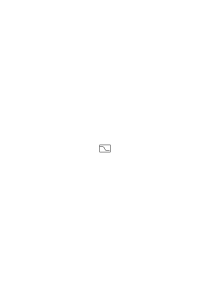 must, or would have to, understand the command . But what does this “he would have to” mean. It must evidently be a description of what goes on in understanding the first command. It was a description of what he sees in that command.

### [75\[5\]](https://cdn.wittgensteinnachlass.com/2000px/webp/Ms-110/75.webp)

If we direct our attention to a different property of the curve, we see something different.

### [75\[6\]](https://cdn.wittgensteinnachlass.com/2000px/webp/Ms-110/75.webp),[76\[1\]](https://cdn.wittgensteinnachlass.com/2000px/webp/Ms-110/76.webp)

Holding my hand above the table, I say, “I wish this table were this high”. Now the curious thing is this: The hand above the table in & of itself expresses nothing at all. That is, it is a hand above a table, but not a symbol (just as the arrow that is supposed, say, to show which way to walk expresses nothing in itself.)

### [76\[2\]](https://cdn.wittgensteinnachlass.com/2000px/webp/Ms-110/76.webp)

↦ in contrast to ↗ is a different sign from ↦ in contrast to ⟼.

### [76\[3\]](https://cdn.wittgensteinnachlass.com/2000px/webp/Ms-110/76.webp)

The grammatical rule also describes the understanding.

### [76\[4\]](https://cdn.wittgensteinnachlass.com/2000px/webp/Ms-110/76.webp)

For the question is: would he still have used this word if other rules had applied to it?

### [76\[5\]](https://cdn.wittgensteinnachlass.com/2000px/webp/Ms-110/76.webp)

And will he say that he understood the signs in this way if I change the grammatical rules?

### [76\[6\]](https://cdn.wittgensteinnachlass.com/2000px/webp/Ms-110/76.webp)

(Above all, no hypotheses!)

### [76\[7\]](https://cdn.wittgensteinnachlass.com/2000px/webp/Ms-110/76.webp)

The knot in the handkerchief as a sign. In what sense can it remind me to do something.

### [76\[8\]](https://cdn.wittgensteinnachlass.com/2000px/webp/Ms-110/76.webp)

The chess piece is not the little block of wood, but the intersection of certain rules. Hence the rules are not about wood or ivory. Any more than the laws of Euclidean geometry are about particles of graphite on paper.

### [76\[9\]](https://cdn.wittgensteinnachlass.com/2000px/webp/Ms-110/76.webp)

Nor, in the same way, are grammatical rules about ink.

### [76\[10\]](https://cdn.wittgensteinnachlass.com/2000px/webp/Ms-110/76.webp)

“Go this way → not that way ↗” has sense only if it is the direction that is essential to the arrow here, & not, say, just its length.

### [77\[1\]](https://cdn.wittgensteinnachlass.com/2000px/webp/Ms-110/77.webp)

It would be nonsensical to find fault with the map of the Underground by saying that it should be like this: 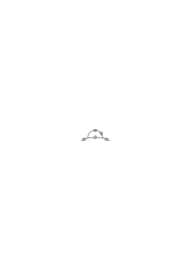 and not like this: 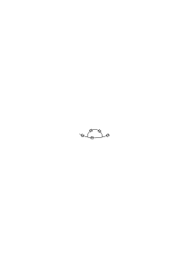.

### [77\[2\]](https://cdn.wittgensteinnachlass.com/2000px/webp/Ms-110/77.webp)

Can’t I say: I mean the negation which, when doubled, yields an affirmation?

### [77\[3\]](https://cdn.wittgensteinnachlass.com/2000px/webp/Ms-110/77.webp)

Wouldn’t that be like saying: I mean the straight line, two of which intersect at a point.

### [77\[4\]](https://cdn.wittgensteinnachlass.com/2000px/webp/Ms-110/77.webp)

That is: When you spoke of red, did you mean that of which one can say that it is bright, but not green, even if you didn’t think of this rule or make use of it? – Did you use the ~ for which ~ ~ ~p = ~p holds? even if you didn’t use this rule? Is it perhaps a hypothesis that it was _that_ ~? Can there be doubt as to whether it was the same one, & can its being the same one be confirmed by experience?

### [77\[5\]](https://cdn.wittgensteinnachlass.com/2000px/webp/Ms-110/77.webp)

The geometry of our visual space is given to us, i.e. no investigation of hitherto hidden facts is needed to find it. The investigation is no investigation in the sense of a physical or psychological investigation. And yet one can say that we do not yet know this geometry.

### [77\[6\]](https://cdn.wittgensteinnachlass.com/2000px/webp/Ms-110/77.webp),[78\[1\]](https://cdn.wittgensteinnachlass.com/2000px/webp/Ms-110/78.webp)

One can say that this geometry lies open before us (like everything logical – in contrast to the practical geometry of physical space).

### [78\[2\]](https://cdn.wittgensteinnachlass.com/2000px/webp/Ms-110/78.webp)

How is it possible that, without thinking of this, I can mean the blue of which one cannot say …?

### [78\[3\]](https://cdn.wittgensteinnachlass.com/2000px/webp/Ms-110/78.webp)

If the essential use of the symbol is to be translated, then there can be no essential understanding of the symbol that does not take place with a view to the translation.

### [78\[4\]](https://cdn.wittgensteinnachlass.com/2000px/webp/Ms-110/78.webp)

But what does it mean to say “with a view” to the translation if it has not been made?

### [78\[5\]](https://cdn.wittgensteinnachlass.com/2000px/webp/Ms-110/78.webp)

And if we say that understanding the command is a different translation from obeying it, then what use is this other translation to us?

### [78\[6\]](https://cdn.wittgensteinnachlass.com/2000px/webp/Ms-110/78.webp)

15.02.1931

The element of stress in word-language does not concern us at all in & of itself, but that it _can_ be used to make the sense clear is very important to us.

### [78\[7\]](https://cdn.wittgensteinnachlass.com/2000px/webp/Ms-110/78.webp)

What does it mean to understand that something is a command, even if one does not yet understand the command itself? (“He means: I should do something, but I do not know what he means.”)

### [78\[8\]](https://cdn.wittgensteinnachlass.com/2000px/webp/Ms-110/78.webp)

After all, I understand a command as a command, i.e. I do not just see a configuration in it, but the configuration has – so to speak – an influence on me. I react to a command (even before I obey it) differently from the way I react to a communication or a question, for example.

### [79\[1\]](https://cdn.wittgensteinnachlass.com/2000px/webp/Ms-110/79.webp)

There cannot be a necessary intermediate stage between taking in an order & obeying it.

### [79\[2\]](https://cdn.wittgensteinnachlass.com/2000px/webp/Ms-110/79.webp)

(All the habits of language are against you. –)

### [79\[3\]](https://cdn.wittgensteinnachlass.com/2000px/webp/Ms-110/79.webp)

Someone says something to me; now, however he means it, _I_ take it as a command, though without carrying it out yet. How the other person means it is in any case always quite immaterial to us. After all, all I am given are his words & possibly his gestures & his facial expression, which are all on a par. – I.e., I must interpret them _all_.

### [79\[4\]](https://cdn.wittgensteinnachlass.com/2000px/webp/Ms-110/79.webp)

Interpreting. – Do we interpret anything, then, when someone gives us a command. We apprehend what we see; or: we see what we see.

### [79\[5\]](https://cdn.wittgensteinnachlass.com/2000px/webp/Ms-110/79.webp)

Unless, after all, we apply “interpret” only to the words & say: We interpret them with the aid of his gesture, which then means _only_ that we perceive the words & the gesture.

### [79\[6\]](https://cdn.wittgensteinnachlass.com/2000px/webp/Ms-110/79.webp)

If someone asks me: ‘What time is it’, then no work of interpretation goes on in me. Rather, I react immediately to what I see & hear.

### [79\[7\]](https://cdn.wittgensteinnachlass.com/2000px/webp/Ms-110/79.webp)

Philosophy is set down not in sentences but in a language.

### [80\[1\]](https://cdn.wittgensteinnachlass.com/2000px/webp/Ms-110/80.webp)

That is, I take these words & facial expressions as a command not because I decide to do so, but because that is precisely what a command is for me, because _that_ is what I understand by a command.

### [80\[2\]](https://cdn.wittgensteinnachlass.com/2000px/webp/Ms-110/80.webp)

I interpret the words; no doubt; but do I also interpret the facial expressions? Do I, for example, _interpret_ a facial expression as threatening? or friendly? –

### [80\[3\]](https://cdn.wittgensteinnachlass.com/2000px/webp/Ms-110/80.webp)

If I were now to press the earlier objection here & say: It is not enough that I perceive the threatening face as a configuration; I must first interpret it.

### [80\[4\]](https://cdn.wittgensteinnachlass.com/2000px/webp/Ms-110/80.webp)

Someone draws a knife & I say: “I understand this as a threat”.

### [80\[5\]](https://cdn.wittgensteinnachlass.com/2000px/webp/Ms-110/80.webp)

The subject enters into understanding in the primary sense no more than it enters into seeing the sign.

### [80\[6\]](https://cdn.wittgensteinnachlass.com/2000px/webp/Ms-110/80.webp)

I see inscriptions that communicate something to me & I see scratches on the wall that communicate nothing to me, although they _could_ communicate something to me (i.e. in themselves they would be just as capable of it as those inscriptions).

### [80\[7\]](https://cdn.wittgensteinnachlass.com/2000px/webp/Ms-110/80.webp)

So I see the ones differently from the others (which is of course easily explained by the prehistory of these impressions). The difference is expressed by the words “the one communicates something to me, the other does not”.

### [81\[1\]](https://cdn.wittgensteinnachlass.com/2000px/webp/Ms-110/81.webp)

But here the ‘something’ is misleading, for it now makes no sense to ask: “what?”, since the same sign might have to be given in reply. So I would need an intransitive “communicate”.

### [81\[2\]](https://cdn.wittgensteinnachlass.com/2000px/webp/Ms-110/81.webp)

I see a German inscription & a Chinese one. – Is the Chinese one perhaps unsuitable for communicating something? – I say that I have not learnt Chinese. But the learning of the language, as mere cause, as history, falls outside the present. All that matters are its effects, & these are phenomena that simply do not occur when I see the Chinese writing (why they do not occur is quite immaterial).

### [81\[3\]](https://cdn.wittgensteinnachlass.com/2000px/webp/Ms-110/81.webp)

The learning of a language is not _contained_ in its use. (Just as the cause is not contained in its effect.)

### [81\[4\]](https://cdn.wittgensteinnachlass.com/2000px/webp/Ms-110/81.webp)

One cannot in turn interpret the sign plus its sense (i.e. one cannot interpret the thought). But the sign with its sense (the symbol) is a phenomenon like the sign itself.

### [81\[5\]](https://cdn.wittgensteinnachlass.com/2000px/webp/Ms-110/81.webp)

Laying down a rule is the history of following the rule. It falls outside the latter, but the rule does not: it is embodied in the following of it (in that the following is described by the expression of the rule.)

### [82\[1\]](https://cdn.wittgensteinnachlass.com/2000px/webp/Ms-110/82.webp)

I can _stipulate_ the rule myself & teach myself a language. I go for a walk & say to myself: Wherever I come across a tree, let that be my sign to turn left at the next crossroads, & now I let the trees guide me in this way (take their position as a command.)

### [82\[2\]](https://cdn.wittgensteinnachlass.com/2000px/webp/Ms-110/82.webp)

_Forming_ the resolution belongs to the history of its execution, whereas the _resolution itself_ is contained in its execution.

### [82\[3\]](https://cdn.wittgensteinnachlass.com/2000px/webp/Ms-110/82.webp)

My train of thought:  or  a lot of movement that makes little headway.

### [82\[4\]](https://cdn.wittgensteinnachlass.com/2000px/webp/Ms-110/82.webp)

“The hand points that way”: But in what sense does it point that way? simply because it tapers in one direction? (Does a nail point into the wall?) i.e. does it come to the same thing to say “it points etc.” or “it tapers in this direction”?

### [82\[5\]](https://cdn.wittgensteinnachlass.com/2000px/webp/Ms-110/82.webp)

“But the sign does tell me something, it gives me information!” Since it can show me nothing other than itself & the impressions it causes, it cannot give me anything more either. _What_ it tells me is not something outside it to which it points, but lies in it.

### [82\[6\]](https://cdn.wittgensteinnachlass.com/2000px/webp/Ms-110/82.webp)

If there were something to which it essentially points, that would have to be present as a condition of sense & would then be part of the symbol.

### [82\[7\]](https://cdn.wittgensteinnachlass.com/2000px/webp/Ms-110/82.webp),[83\[1\]](https://cdn.wittgensteinnachlass.com/2000px/webp/Ms-110/83.webp)

“Stepping onto this bridge is dangerous” does not point to the danger of stepping onto the bridge. And insofar as it points to the bridge, the bridge is part of the symbol.

### [83\[2\]](https://cdn.wittgensteinnachlass.com/2000px/webp/Ms-110/83.webp)

Fear resonating with the sign.

### [83\[3\]](https://cdn.wittgensteinnachlass.com/2000px/webp/Ms-110/83.webp)

What does the question mean: Is that the same ‘~’ for which the rule ~~~p = ~p holds?

### [83\[4\]](https://cdn.wittgensteinnachlass.com/2000px/webp/Ms-110/83.webp)

“Do you mean the ‘~’ in such a way that I can infer ~~~ p from ~p?”

### [83\[5\]](https://cdn.wittgensteinnachlass.com/2000px/webp/Ms-110/83.webp)

If no rule holds for _this_ ‘~’, then the sign is meaningless.

### [83\[6\]](https://cdn.wittgensteinnachlass.com/2000px/webp/Ms-110/83.webp)

“The word ‘is’ in the sentence ‘the sky is blue’ is the same as the one in the sentence ‘the rose is red’, but not the same as the ‘is’ in ‘2 × 2 is 4’”. If I can say that, it already means that I do not distinguish or identify the words by their sound alone. And yet I must recognize them again, for it is only what they have in common that expresses a commonality of sense.

### [83\[7\]](https://cdn.wittgensteinnachlass.com/2000px/webp/Ms-110/83.webp)

Could we use the same word for ‘blue’, ‘red’, ‘green’, ‘yellow’ as we do for ‘ = ’ and ‘ε’, even if there were a risk of confusion but still the _possibility_ of distinguishing?

### [83\[8\]](https://cdn.wittgensteinnachlass.com/2000px/webp/Ms-110/83.webp)

Just as laws become interesting only when there is a tendency to break them, so certain grammatical rules become interesting only when philosophers would like to break them.

### [84\[1\]](https://cdn.wittgensteinnachlass.com/2000px/webp/Ms-110/84.webp)

One can learn in two ways that the German word ‘ist’ & the English word ‘is’ mean the same thing. Either I have learnt one language independently of the other & learn the other with the aid of (by translation from) the first, so that I learn from the dictionary that ‘is’ means ‘ist’. Or I have learnt both languages independently of one another, in the way one learns one’s mother tongue in childhood, & then discover that ‘is’ & ‘ist’ correspond to one another.

### [84\[2\]](https://cdn.wittgensteinnachlass.com/2000px/webp/Ms-110/84.webp)

How do you know that the word ‘and’ is the same in these two sentences?

### [84\[3\]](https://cdn.wittgensteinnachlass.com/2000px/webp/Ms-110/84.webp)

(There seems to be something wrong with this way of posing the question.)

### [84\[4\]](https://cdn.wittgensteinnachlass.com/2000px/webp/Ms-110/84.webp)

One says to the child: “no, no more lumps of sugar!” & takes the lump away from the child. That is how the child learns the meaning of the word ‘no’ in ‘no more’.

If one had given the child a lump of sugar with the same words, the child would have learnt to understand the word differently.

### [84\[5\]](https://cdn.wittgensteinnachlass.com/2000px/webp/Ms-110/84.webp)

16.02.1931

The rule describes its application.

### [84\[6\]](https://cdn.wittgensteinnachlass.com/2000px/webp/Ms-110/84.webp)

Is it, then, arbitrary what interpretation we give to the words that are said to us? Does not the experience of interpretation come with the experience of hearing the signs when we ‘understand the other person’s language’?

### [84\[7\]](https://cdn.wittgensteinnachlass.com/2000px/webp/Ms-110/84.webp),[85\[1\]](https://cdn.wittgensteinnachlass.com/2000px/webp/Ms-110/85.webp)

17.02.1931

“The configuration & what it calls forth can, after all, only ever show themselves to us, not point outwards from themselves. And that is what the symbol seems to do.

### [85\[2\]](https://cdn.wittgensteinnachlass.com/2000px/webp/Ms-110/85.webp)

Insofar, then, as one can describe understanding as a process, it is a phenomenon like the seeing of the sign itself. But the question then is: where do we now find that something pointing out from itself into space which the symbol seems to be?

### [85\[3\]](https://cdn.wittgensteinnachlass.com/2000px/webp/Ms-110/85.webp)

For all signs, & what they bring with them, seem to us to be essentially of the same kind. It is what it is, but it is not a symbol.

### [85\[4\]](https://cdn.wittgensteinnachlass.com/2000px/webp/Ms-110/85.webp)

I can see things as a symbol only if I look at them from a different standpoint.

### [85\[5\]](https://cdn.wittgensteinnachlass.com/2000px/webp/Ms-110/85.webp),[86\[1\]](https://cdn.wittgensteinnachlass.com/2000px/webp/Ms-110/86.webp)

If, for example, I say  represents a hand, or: I understand it as a hand, then I am saying something about the impression the sign makes. Yet it is not a hand, nor is an actual hand involved, & if I say that it reminds me of a hand, that means it calls up mental images in me in which no hand occurs. So does that mean that I could have described these mental images etc. differently, without mentioning the hand, and that the allusion to the hand was superfluous? But that is obviously the same question as this: if I imagine a red patch on the wall that is not there, something does happen in which nothing actually red & in any case no red patch on this wall plays a part, for there is none there: Can I not, then, describe what happens in this imagining without mentioning the objects that are not involved in the fact, or at least mention them only as part of an indirect description of the object that is really at issue. – But of course that is not how it is. And this account only shows what the mistaken train of thought that we are tempted to follow consists in.

### [86\[2\]](https://cdn.wittgensteinnachlass.com/2000px/webp/Ms-110/86.webp)

If I say: I imagine a red patch on this wall, then that is indeed the description of a process, of a fact, independent of that other fact which the sentence “there is a red patch on this wall” describes, but I cannot describe this fact except by means of the expressions ‘red’ & ‘patch’ etc., indeed only in this combination (in a language, that is, in which the fact that there is a red patch on the wall is described in these words).

### [86\[3\]](https://cdn.wittgensteinnachlass.com/2000px/webp/Ms-110/86.webp)

And if I am surprised at _that_, then I must be surprised at every linguistic expression.

### [86\[4\]](https://cdn.wittgensteinnachlass.com/2000px/webp/Ms-110/86.webp)

Here, I think, one sees what misunderstanding our logic of language means!

### [86\[5\]](https://cdn.wittgensteinnachlass.com/2000px/webp/Ms-110/86.webp),[87\[1\]](https://cdn.wittgensteinnachlass.com/2000px/webp/Ms-110/87.webp)

We have been led astray by false analogies & cannot extricate ourselves from this entanglement. That is the morbus philosophicus.

### [87\[2\]](https://cdn.wittgensteinnachlass.com/2000px/webp/Ms-110/87.webp)

I.e. there is simply no more reason to be surprised at the expression “I imagine a red patch on the wall” (or I wish for one etc.) than at the expression: there is a red patch on the wall, & at its similarity to the sentence: there is no red patch on the table. The occurrence of the word ‘red’ simply does not mean that something is red, & having the word ‘red’ in common does not mean that two objects have the colour in common (it can mean the opposite, as in the sentences “A is red” & “B is not red”.)

### [87\[3\]](https://cdn.wittgensteinnachlass.com/2000px/webp/Ms-110/87.webp)

But surely I could say that the thought, the mental image that something is the case, the wish, is a symbol. – – –

### [87\[4\]](https://cdn.wittgensteinnachlass.com/2000px/webp/Ms-110/87.webp)

Don’t I say that something symbolizes because I understand it? Surely that is certain.

### [87\[5\]](https://cdn.wittgensteinnachlass.com/2000px/webp/Ms-110/87.webp)

Only by leaving the psychological _entirely_ out of account can we get at what is essential for us.

### [87\[6\]](https://cdn.wittgensteinnachlass.com/2000px/webp/Ms-110/87.webp),[88\[1\]](https://cdn.wittgensteinnachlass.com/2000px/webp/Ms-110/88.webp)

I see the word “Silence” written up in the corridors of a hospital. This word has an effect on me (I mean the understanding) which the word ‘abracadabra’ does not have; this effect is produced by my having learnt the meaning of the word earlier (which, however, is immaterial to us). If the Chinese for ‘Silence’ stands next to this word, it does not produce the effect on me, but it does on a Chinese person, and conversely. Now if I obey the command, first of all something happens that is expressed by the sentence “I keep silent”, but obeying does not consist in that alone; rather, the command itself enters into this fact as well, & so does a certain process which one may call that of transfer; what this consists in is immaterial to us. – – –

### [88\[2\]](https://cdn.wittgensteinnachlass.com/2000px/webp/Ms-110/88.webp)

Isn’t it like this: In the process of transferring the sign it has the symbolic character, that which points beyond itself by telling us what we have to do.

### [88\[3\]](https://cdn.wittgensteinnachlass.com/2000px/webp/Ms-110/88.webp)

We could imagine a Martian who only gradually learnt, on Earth, to understand the human facial expression as such & who learns to feel a threatening expression as such only after certain experiences. Until then he would have looked at this shape of a face as we look at the shape of a stone.

### [88\[4\]](https://cdn.wittgensteinnachlass.com/2000px/webp/Ms-110/88.webp)

Can I not say it this way: he only _learns_ to understand the commanding gesture in a certain sentential form.

### [88\[5\]](https://cdn.wittgensteinnachlass.com/2000px/webp/Ms-110/88.webp)

When someone says something to me & I understand it, this happens to me just as my hearing what he says does.

### [88\[6\]](https://cdn.wittgensteinnachlass.com/2000px/webp/Ms-110/88.webp),[89\[1\]](https://cdn.wittgensteinnachlass.com/2000px/webp/Ms-110/89.webp)

Can one compare the process of understanding an order with the process of obeying it, in order to show that _this_ way of obeying it really corresponds to _this_ understanding, this construal? and in what respect they agree?

### [89\[2\]](https://cdn.wittgensteinnachlass.com/2000px/webp/Ms-110/89.webp)

How does language describe the process of understanding the sentence ‘p’. Can it do so otherwise than by the sentence that I understand ‘p’? And can it describe obedience to the order ‘q’ otherwise than by saying that I obey ‘q’? For everything about these processes that is not yet described in this way is inessential & can be one way or another.

### [89\[3\]](https://cdn.wittgensteinnachlass.com/2000px/webp/Ms-110/89.webp)

After all, it is only in understanding a sentence that one sees what makes it a sentence. (Before it is understood, it is, after all, a pattern or a series of sounds.)

### [89\[4\]](https://cdn.wittgensteinnachlass.com/2000px/webp/Ms-110/89.webp)

To understand a sentence means to see it as a sentence & obeying the command can have no description other than the command itself.

### [89\[5\]](https://cdn.wittgensteinnachlass.com/2000px/webp/Ms-110/89.webp),[90\[1\]](https://cdn.wittgensteinnachlass.com/2000px/webp/Ms-110/90.webp)

Drury told me today that he had considered that one could not remember the state in which one could not yet speak. – One might of course have memory-images from that time, but one cannot remember feeling the lack of language, since one cannot have a concept of language before one speaks, & of course not afterwards either, because there is no such concept. Nor can one remember the need for linguistic expression, for where that exists, there is already a language in which one thinks.

### [90\[2\]](https://cdn.wittgensteinnachlass.com/2000px/webp/Ms-110/90.webp)

Why can one not command anyone to understand a sentence?

### [90\[3\]](https://cdn.wittgensteinnachlass.com/2000px/webp/Ms-110/90.webp)

On hearing a word I cannot call the explanation of that word to mind; it comes, or it does not.

### [90\[4\]](https://cdn.wittgensteinnachlass.com/2000px/webp/Ms-110/90.webp)

18.02.1931

Since everything lies open to view, there is nothing to explain either. For whatever may not lie open to view does not interest us.

### [90\[5\]](https://cdn.wittgensteinnachlass.com/2000px/webp/Ms-110/90.webp)

So with negation, – if we understand it, – – – –

### [90\[6\]](https://cdn.wittgensteinnachlass.com/2000px/webp/Ms-110/90.webp)

The answer to the question asking for an explanation of negation really is: don’t you understand it, then? Well, if you don’t understand it, what explanation is there still to give, what is there left for an explanation to do?

### [90\[7\]](https://cdn.wittgensteinnachlass.com/2000px/webp/Ms-110/90.webp)

But we do distinguish language from what is not language. We see strokes & say that we understand them, & others, & say that they mean nothing (or nothing to us). This surely characterizes a general experience, which we could call “understanding something as language” – quite apart from _what_ we read out of the given configuration.

### [91\[1\]](https://cdn.wittgensteinnachlass.com/2000px/webp/Ms-110/91.webp)

(Flower oracle) Counting off buttons. In these cases too we lay down a rule & then act in accordance with it. We read something off our buttons.

### [91\[2\]](https://cdn.wittgensteinnachlass.com/2000px/webp/Ms-110/91.webp)

We distinguish writing from what is not writing. What does it mean to see something as writing? Does it mean that I act in accordance with it?

### [91\[3\]](https://cdn.wittgensteinnachlass.com/2000px/webp/Ms-110/91.webp)

Now if I act in accordance with it – do I choose the way in which I act in accordance with it? No, for otherwise I would not be acting in accordance with the sign, at least in this respect. But what if I do choose the way of interpreting it? (Throwing dice)

### [91\[4\]](https://cdn.wittgensteinnachlass.com/2000px/webp/Ms-110/91.webp),[92\[1\]](https://cdn.wittgensteinnachlass.com/2000px/webp/Ms-110/92.webp)

Suppose I let myself be guided (as I described above) by the trees along my walk: This surely presupposes that I lay down a rule & act in accordance with that _stipulation_, i.e. it would make no sense to say that _I am guided_ by the trees if I meant to determine the way of interpreting them afresh in each individual case, i.e. in this case it would not be an interpretation at all, but a quite superfluous assignment. It cannot be: Here is a tree, so I want to go left here this time, but rather: Here is a tree, so I must go etc. here …. The ‘so’ in the first sentence makes no sense & here it must simply be ‘and’. But in the interpretation it makes sense. And the ‘so’ is of course not causal, & we cannot ask “are you sure that you must go left _for that reason_?”.

### [92\[2\]](https://cdn.wittgensteinnachlass.com/2000px/webp/Ms-110/92.webp)

Now I might also say “_so_, according to my stipulation, I must go left”. But what is remarkable here is that I do not then say once again: “and this stipulation is to be interpreted in this way according to that other one (stipulation)”, & it would be nonsensical to do so, for this regress is endless.

### [92\[3\]](https://cdn.wittgensteinnachlass.com/2000px/webp/Ms-110/92.webp)

But what I wrote in the [→ last remark] was wrong after all. It is true that _so_ belongs to interpretation & not _and_. But I might say that it was not necessary to make a stipulation, i.e. to state the general rule beforehand (that is history), but it was necessary to follow a stipulation. And I might say that it is not enough to follow a rule, for that happens whatever I do; rather, I must follow a stipulation, that is a different process.

### [92\[4\]](https://cdn.wittgensteinnachlass.com/2000px/webp/Ms-110/92.webp)

But I want to say that this process can differ only outwardly from an action that is not guided by a stipulation. As different as two kinds of behaviour can be (or two groups of signs on the board).

### [92\[5\]](https://cdn.wittgensteinnachlass.com/2000px/webp/Ms-110/92.webp)

“I acted in accordance with this rule in doing so” describes a particular (psychical, physical) process. A different one from the one described by the sentence: The results _follow_ this rule – – – –

### [93\[1\]](https://cdn.wittgensteinnachlass.com/2000px/webp/Ms-110/93.webp)

Following the stipulation must be a process from which one can read off the expression of the rule. It does not, then, consist in several processes, intentions, following a rule, for then this rule would be an empirical proposition again & of course would not be unambiguously determined by the processes. And I must be able to read the rule _unambiguously_ off the process. Otherwise it might not have to be contained in the description of the process either.

### [93\[2\]](https://cdn.wittgensteinnachlass.com/2000px/webp/Ms-110/93.webp)

Someone who now writes out the general rule he recognizes writes down more than he sees.

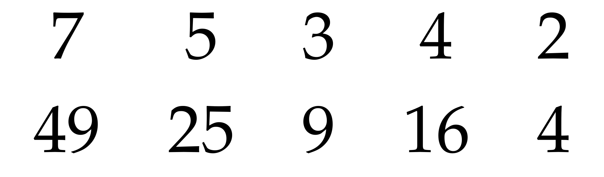 Behaviourist interpretation:

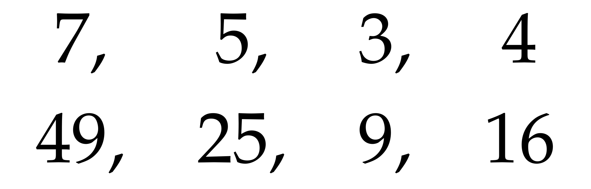 He writes the squares of the numbers above.

---

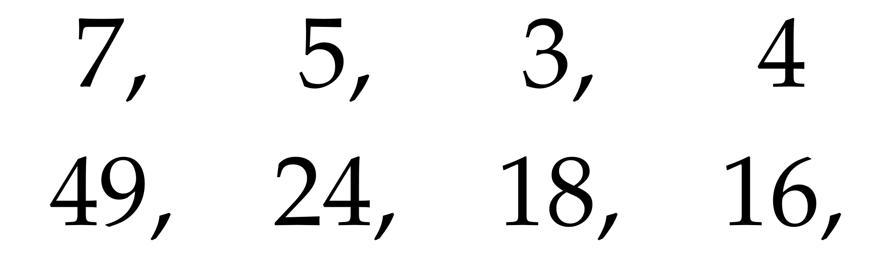 He does not write the squares …

---

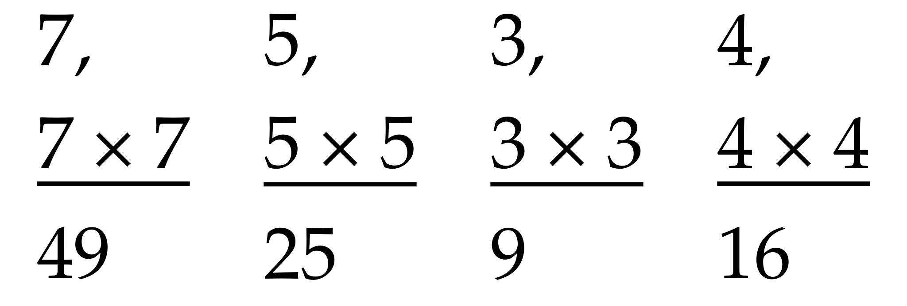

He _wants_ to write down the squares & does so.

---

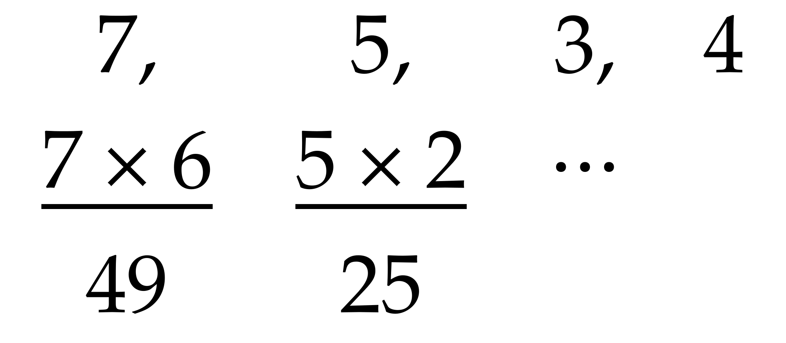

He does not want to write down the squares but does so.

---

etc.

### [93\[3\]](https://cdn.wittgensteinnachlass.com/2000px/webp/Ms-110/93.webp)

The process of learning of course has something in common with the application of language. What the expression of the general rule has in common with its application.

### [94\[1\]](https://cdn.wittgensteinnachlass.com/2000px/webp/Ms-110/94.webp)

The order is the description of its execution.

### [94\[2\]](https://cdn.wittgensteinnachlass.com/2000px/webp/Ms-110/94.webp)

Do we not have here the essence of the motive as opposed to the cause? Obviously we do. When I obey the order, it becomes the motive for my way of acting.

### [94\[3\]](https://cdn.wittgensteinnachlass.com/2000px/webp/Ms-110/94.webp)

And the motive is not hypothetical. I cannot be mistaken about the motive; it is contained in my action, but its cause is not contained in it in this way.

### [94\[4\]](https://cdn.wittgensteinnachlass.com/2000px/webp/Ms-110/94.webp)

(Ogden & Richards & Russell’s theory of meaning thus rests on a confusion, or identification, of motive and cause.)

### [94\[5\]](https://cdn.wittgensteinnachlass.com/2000px/webp/Ms-110/94.webp)

19.02.1931

On the earlier sentence: The tree must make the decision.

### [94\[6\]](https://cdn.wittgensteinnachlass.com/2000px/webp/Ms-110/94.webp)

Obeying the order consists in my doing something ‒ ‒ But can I also say “in my doing what it orders”? Is there a criterion for this being the action that obeys it?

### [94\[7\]](https://cdn.wittgensteinnachlass.com/2000px/webp/Ms-110/94.webp)

There is no criterion for this being the action that obeys the order.

### [94\[8\]](https://cdn.wittgensteinnachlass.com/2000px/webp/Ms-110/94.webp)

This must of course mean “we cannot speak of such a criterion”.

### [94\[9\]](https://cdn.wittgensteinnachlass.com/2000px/webp/Ms-110/94.webp),[95\[1\]](https://cdn.wittgensteinnachlass.com/2000px/webp/Ms-110/95.webp)

This is directly connected with the fact that we cannot anticipate an action. Which again means only that there is no sense in saying that the action at a particular time takes place at a certain time.

### [95\[2\]](https://cdn.wittgensteinnachlass.com/2000px/webp/Ms-110/95.webp)

What we want, presumably, is to make clear the grammar of the expression “the order is obeyed”.

### [95\[3\]](https://cdn.wittgensteinnachlass.com/2000px/webp/Ms-110/95.webp)

“Yes, but how do I know, then, that I have obeyed the order?” – – –

### [95\[4\]](https://cdn.wittgensteinnachlass.com/2000px/webp/Ms-110/95.webp)

(I cannot find the central grammatical error on which all these problems rest.)

### [95\[5\]](https://cdn.wittgensteinnachlass.com/2000px/webp/Ms-110/95.webp)

It is of course the same question as this: How do I know that this sentence describes this fact?

### [95\[6\]](https://cdn.wittgensteinnachlass.com/2000px/webp/Ms-110/95.webp)

And I always want to answer: “because, after all, I read it off this fact”. And: “surely I must know how I came by it”.

### [95\[7\]](https://cdn.wittgensteinnachlass.com/2000px/webp/Ms-110/95.webp)

If I could give a criterion, I must give it in language, & then I would have to be able to recognize it from the linguistic expression; but to recognize it I would in turn need the criterion itself.

### [95\[8\]](https://cdn.wittgensteinnachlass.com/2000px/webp/Ms-110/95.webp),[96\[1\]](https://cdn.wittgensteinnachlass.com/2000px/webp/Ms-110/96.webp)

If I can choose words so that they fit the fact – in some sense or other – then I must already have had a concept of this fitting. And now the problem starts all over again, for how do I know that this state of affairs corresponds to the concept of fitting?

### [96\[2\]](https://cdn.wittgensteinnachlass.com/2000px/webp/Ms-110/96.webp)

But why, then, do I describe the fact in just _this way_? What made you say _these_ words?

### [96\[3\]](https://cdn.wittgensteinnachlass.com/2000px/webp/Ms-110/96.webp)

And if I were now to say: “all that happens is just that I look at these objects & then use these words”, the answer would be: “so describing consists in nothing more & is it always a description if someone …?”. And to that I would have to say: “No. It’s just that I can’t describe the process in any other way—or at least not with any other multiplicity—than by saying: ‘I describe what I see’ & that is _why_ no further explanation is possible, because my sentence already has the right multiplicity.”

### [96\[4\]](https://cdn.wittgensteinnachlass.com/2000px/webp/Ms-110/96.webp)

I could also ask it this way: Why do you ask for explanations? When these are given, you will once again come up against a stopping point. They cannot take you any further than you are now.

### [96\[5\]](https://cdn.wittgensteinnachlass.com/2000px/webp/Ms-110/96.webp)

For if I ask: “what does ‘translating according to a rule’ mean, then?”, I (presumably) expect an answer: it means such & such; but then I can go on to ask “& what does _that_ mean?”. And so on.

### [96\[6\]](https://cdn.wittgensteinnachlass.com/2000px/webp/Ms-110/96.webp)

In the end we have to use language without explanation.

### [97\[1\]](https://cdn.wittgensteinnachlass.com/2000px/webp/Ms-110/97.webp)

Explaining sewing or smoking as opposed to explaining translating. In the former case the explanation always gives a description other than that of what is immediately perceived.

### [97\[2\]](https://cdn.wittgensteinnachlass.com/2000px/webp/Ms-110/97.webp)

20.02.1931

The person had a concept of sewing or smoking before one explained it to him. And after the explanation he knows _more_ about it than before. But the explanation of thinking that we demand is _supposed_ not to tell us more about it than we know.

### [97\[3\]](https://cdn.wittgensteinnachlass.com/2000px/webp/Ms-110/97.webp)

That is why he can ask for an explanation of smoking. And the answer cannot be the description of what he understands by “smoking”, but the description of a different process.

### [97\[4\]](https://cdn.wittgensteinnachlass.com/2000px/webp/Ms-110/97.webp)

(I can never say: “for these reasons it _must_ be this way”. For what is not manifest does not exist for me.)

### [97\[5\]](https://cdn.wittgensteinnachlass.com/2000px/webp/Ms-110/97.webp)

21.02.1931

### [97\[6\]](https://cdn.wittgensteinnachlass.com/2000px/webp/Ms-110/97.webp)

To say (to understand) the rule “you must square” is something different from squaring 5.

### [97\[7\]](https://cdn.wittgensteinnachlass.com/2000px/webp/Ms-110/97.webp)

“Whenever we say something, even if it goes against customary grammar, we mean something by it”; what does that mean?

### [97\[8\]](https://cdn.wittgensteinnachlass.com/2000px/webp/Ms-110/97.webp),[98\[1\]](https://cdn.wittgensteinnachlass.com/2000px/webp/Ms-110/98.webp)

If it means anything, it must be the description of a phenomenon. But of which phenomenon?

### [98\[2\]](https://cdn.wittgensteinnachlass.com/2000px/webp/Ms-110/98.webp)

This phenomenon is evidently that of thinking. –

### [98\[3\]](https://cdn.wittgensteinnachlass.com/2000px/webp/Ms-110/98.webp)

The trivial thing I have to say is that a further sentence, in signs of some sort, stands as the answer to the sentence “I don’t just _say_ that, I mean something by it” & the question “what?”.

### [98\[4\]](https://cdn.wittgensteinnachlass.com/2000px/webp/Ms-110/98.webp)

(I can only hand over the keys; each person must unlock for himself.)

### [98\[5\]](https://cdn.wittgensteinnachlass.com/2000px/webp/Ms-110/98.webp)

But surely I can also ask: What does a sunset look like? even if I disregard everything hypothetical.

### [98\[6\]](https://cdn.wittgensteinnachlass.com/2000px/webp/Ms-110/98.webp)

And in this way I can of course describe thinking too, for I can describe speaking too, after all.

### [98\[7\]](https://cdn.wittgensteinnachlass.com/2000px/webp/Ms-110/98.webp)

“I don’t just say that, I also mean something by it.” – If one considers what happens within us when we _mean_ words (& not just say them), it seems as if something is then coupled with these words, whereas otherwise they run empty. – As if they, as it were, intervened in us.

### [98\[8\]](https://cdn.wittgensteinnachlass.com/2000px/webp/Ms-110/98.webp)

No one can teach us to know our visual space better. But we can learn to survey its representation in language.

### [98\[9\]](https://cdn.wittgensteinnachlass.com/2000px/webp/Ms-110/98.webp),[99\[1\]](https://cdn.wittgensteinnachlass.com/2000px/webp/Ms-110/99.webp)

If I am right, then philosophical problems, unlike all others, really must admit of solutions that leave nothing over.

### [99\[2\]](https://cdn.wittgensteinnachlass.com/2000px/webp/Ms-110/99.webp)

When I say: Here we are at the limit of language, it always seems as though resignation were called for here, whereas on the contrary one is fully satisfied, since _no_ question remains.

### [99\[3\]](https://cdn.wittgensteinnachlass.com/2000px/webp/Ms-110/99.webp)

The problems are dissolved in the literal sense – like a substance in water.

### [99\[4\]](https://cdn.wittgensteinnachlass.com/2000px/webp/Ms-110/99.webp)

All we can provide that is of interest is the description of language. – This includes everything we can say by way of explaining its application.

### [99\[5\]](https://cdn.wittgensteinnachlass.com/2000px/webp/Ms-110/99.webp)

The ‘explanation of thinking’ would have to be able to explain what thinking is to someone who does not know. So it would also have to be able to show someone who had not done it before how to do it. And all this by means of thought.

### [99\[6\]](https://cdn.wittgensteinnachlass.com/2000px/webp/Ms-110/99.webp)

In so far as every activity (writing, speaking, sewing, smoking) can be described and taught, thinking is not an activity. No more than getting annoyed is, which is just as little amenable to being taught. (My remark about ‘no subject in thinking’. No activity without an agent.)

### [99\[7\]](https://cdn.wittgensteinnachlass.com/2000px/webp/Ms-110/99.webp)

Our interest in what is psychological about thinking is cancelled by the fact that we are interested only in the relation of thinking to itself, & what is psychological thereby drops out, cancels itself out.

### [100\[1\]](https://cdn.wittgensteinnachlass.com/2000px/webp/Ms-110/100.webp)

It is essential to language that a word occurs in different sentences, that different sentences have this word in common. And that the sameness of sound of the words, if different grammatical rules apply to them, could instead be replaced by words that sound different, because in that case the sound is an insignificant, outward similarity.

### [100\[2\]](https://cdn.wittgensteinnachlass.com/2000px/webp/Ms-110/100.webp)

But now if I consider the word “is”: How can I distinguish two different ways of applying it here if I look only at the grammatical rules? For these are precisely what allow the use of the word in the contexts “the rose is red” & “2 × 2 is 4”. From these rules I do not see that we are dealing with two different words. – But I see it, for instance, if I try to put ‘is equal to’ in place of ‘is’ in both sentences (or alternatively: ‘has the property’). But here again only because I know the rule for the expression “is equal to”, that it must not be inserted in “the rose … red”.

### [100\[3\]](https://cdn.wittgensteinnachlass.com/2000px/webp/Ms-110/100.webp)

More generally: what do the grammatical rules apply to when they apply to the word ‘is’? To the sound that I utter then & there? To what all ‘is’-sounds have in common? They apply to ‘is’ when it is used in this sense. – “If you apply it _like that_, then you are simply not using it in _this_ sense”.

### [100\[4\]](https://cdn.wittgensteinnachlass.com/2000px/webp/Ms-110/100.webp),[101\[1\]](https://cdn.wittgensteinnachlass.com/2000px/webp/Ms-110/101.webp)

For the question is: is everything I am doing here not mythology? Am I not inventing something to add to what is manifest? That is, when I speak of the process that goes on in understanding (uttering or hearing with understanding) the sentence.

### [101\[2\]](https://cdn.wittgensteinnachlass.com/2000px/webp/Ms-110/101.webp)

I.e., could I not regard language as a social institution subject to certain rules because it would not be effective otherwise. But this is the point: I cannot say the latter; even in this way I cannot give a justification for the rules. I could only describe language as a game that people play.

### [101\[3\]](https://cdn.wittgensteinnachlass.com/2000px/webp/Ms-110/101.webp)

If I refuse to use a word, e.g. the word ‘is equal to’, in two contexts, the reason is what we describe in the words “the word has a different meaning in the two cases”.

### [101\[4\]](https://cdn.wittgensteinnachlass.com/2000px/webp/Ms-110/101.webp)

But can I now describe what the grammatical rules say about a word in another way as well, namely by describing the process that takes place when we understand the word?

### [101\[5\]](https://cdn.wittgensteinnachlass.com/2000px/webp/Ms-110/101.webp)

So if grammar is – for instance – the geometry of negation, can I replace it with a description of what, so to speak, stands behind the word ‘not’ when it is used?

### [101\[6\]](https://cdn.wittgensteinnachlass.com/2000px/webp/Ms-110/101.webp)

But such a description would, as I said, be a substitute for the word ‘not’, rather like

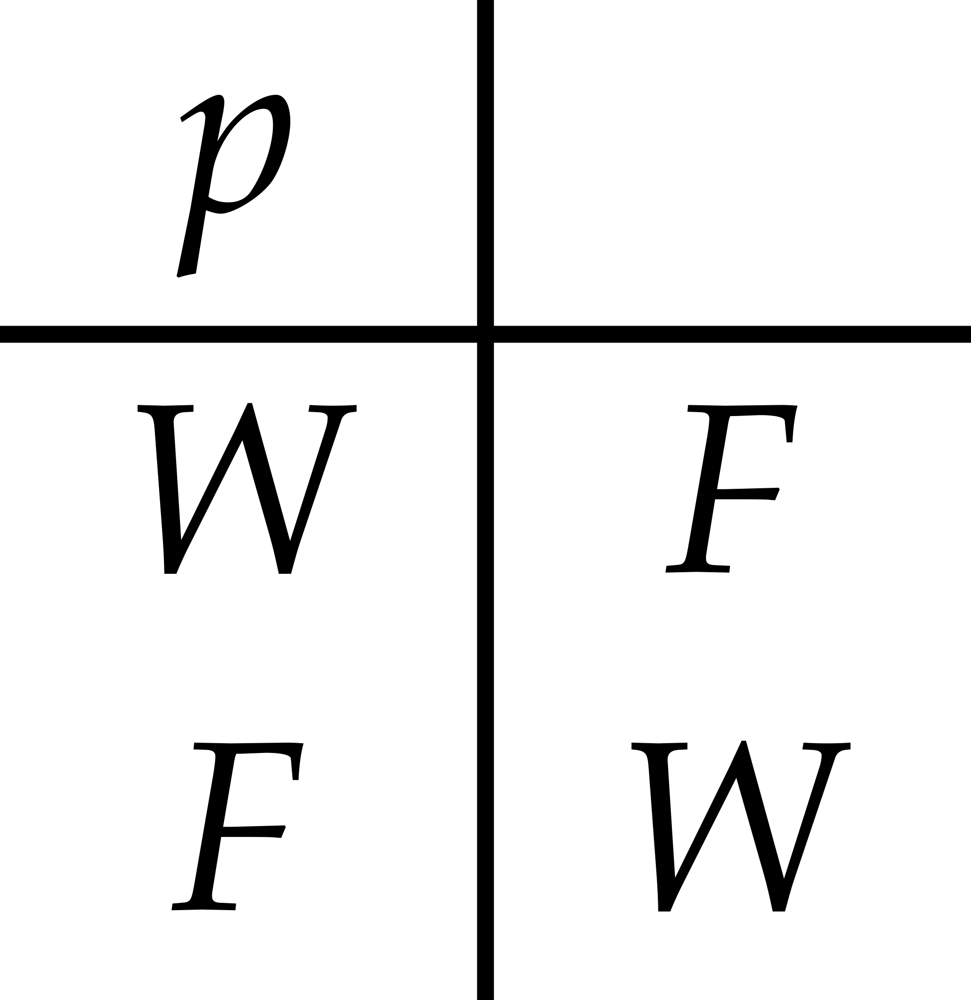

and could not replace the grammar.

### [102\[1\]](https://cdn.wittgensteinnachlass.com/2000px/webp/Ms-110/102.webp)

In my representation, after all, the grammatical rules seemed to be the laying out of what I experience all at once in using the word. So to speak, (only) consequences, manifestations of the properties that I experience all at once in understanding. This must of course be nonsense.

### [102\[2\]](https://cdn.wittgensteinnachlass.com/2000px/webp/Ms-110/102.webp)

One would go so far as to say: negation has the property of yielding an affirmation when doubled (rather like: iron has the property of yielding iron sulphate with sulphuric acid), whereas the rule does not further describe, but rather constitutes, negation.

### [102\[3\]](https://cdn.wittgensteinnachlass.com/2000px/webp/Ms-110/102.webp)

By using this word in accordance with this rule, substituting that for it, etc., we show how we mean it.

### [102\[4\]](https://cdn.wittgensteinnachlass.com/2000px/webp/Ms-110/102.webp)

The word ‘not’ in the grammatical rule has no meaning, otherwise _that_ could not be said of it.

### [102\[5\]](https://cdn.wittgensteinnachlass.com/2000px/webp/Ms-110/102.webp)

Negation has no property other than, for instance, that of yielding truth in certain sentences. And likewise a circle has the property of being situated here or there, of having this colour, of _actually_ being intersected by a straight line; but not what geometry seems to ascribe to it. (Namely, being able to have these properties.)

### [103\[1\]](https://cdn.wittgensteinnachlass.com/2000px/webp/Ms-110/103.webp)

What does it mean to say: “This paper is not black & ‘not’ is used here in the sense that a triple negation yields a negation”? How, then, did that show itself in the use?

### [103\[2\]](https://cdn.wittgensteinnachlass.com/2000px/webp/Ms-110/103.webp)

Or: “This paper is not black & two of these negations give an affirmation”. Can I say that?

### [103\[3\]](https://cdn.wittgensteinnachlass.com/2000px/webp/Ms-110/103.webp)

Or: “This book is red & the rose is red & the two words ‘red’ have the same meaning”. (This sentence is of the same kind as the sentences above.) What kind of sentence is that, then? a grammatical one? Does it say anything about the book and the rose?

### [103\[4\]](https://cdn.wittgensteinnachlass.com/2000px/webp/Ms-110/103.webp)

If the addition is not needed for understanding the first sentence, it is nonsense, & if it is needed, then the first part was not yet a sentence; & the same holds in the cases above.

### [103\[5\]](https://cdn.wittgensteinnachlass.com/2000px/webp/Ms-110/103.webp)

“That 3 negations again yield a negation must surely already lie in the one negation that I am now using”. But am I not already interpreting again here? (i.e. am I not about to invent a mythology?)

### [103\[6\]](https://cdn.wittgensteinnachlass.com/2000px/webp/Ms-110/103.webp)

But are the grammatical rules not exclusively rules for passing from one sentence to another?

### [103\[7\]](https://cdn.wittgensteinnachlass.com/2000px/webp/Ms-110/103.webp)

In what respect can one say: “this rule applies to _this_ negation”?

### [103\[8\]](https://cdn.wittgensteinnachlass.com/2000px/webp/Ms-110/103.webp),[104\[1\]](https://cdn.wittgensteinnachlass.com/2000px/webp/Ms-110/104.webp)

Does it mean anything to say that three _such_ negations yield a negation? (It always reminds one of “three such horses can move this carriage”.) But, as I said, that logical sentence is not about negation at all (only sentences like: it is not raining are about negation) but only about the word ‘not’, & it is a rule about replacing one sign with another.

### [104\[2\]](https://cdn.wittgensteinnachlass.com/2000px/webp/Ms-110/104.webp)

But can we not see the warrant for this rule if we understand negation? Is it not a consequence of the essence of negation? It is not a consequence, but an expression of this essence.

### [104\[3\]](https://cdn.wittgensteinnachlass.com/2000px/webp/Ms-110/104.webp)

What we see when we see that a double negation etc., must be of the same kind as what we perceive in the sign

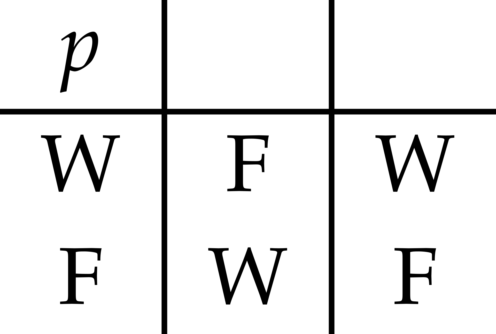.

### [104\[4\]](https://cdn.wittgensteinnachlass.com/2000px/webp/Ms-110/104.webp)

When I see a three-dimensional configuration, say a cube, I see in a certain sense the possibility of adding cubes of the same size to this cube in three directions. Geometry then tells me that I _can_ do this. If I see a square, I do not see this possibility. Etc.

### [104\[5\]](https://cdn.wittgensteinnachlass.com/2000px/webp/Ms-110/104.webp)

(The perspective drawing of a cube & of such groups of cubes is a splendid example of how one can map three-dimensional space onto the plane.)

### [104\[6\]](https://cdn.wittgensteinnachlass.com/2000px/webp/Ms-110/104.webp),[105\[1\]](https://cdn.wittgensteinnachlass.com/2000px/webp/Ms-110/105.webp)

But geometry speaks of cubes just as little as logic speaks of negation. (One might perhaps object here that geometry deals with the concept of the cube & logic with the concept of negation. But there are no such concepts.)

### [105\[2\]](https://cdn.wittgensteinnachlass.com/2000px/webp/Ms-110/105.webp)

A cube – I mean what is essential to the cube – is not something one can describe. But can I not describe how one makes a box, for example? and has a description of the cube not thereby been made? What is essential to the cube is not described thereby; rather, it lies in the possibility of this description, i.e. in its being a description; not in its being correct.

### [105\[3\]](https://cdn.wittgensteinnachlass.com/2000px/webp/Ms-110/105.webp)

But surely I can say: “I see the figure 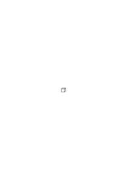 as 3-dimensional”. But this sentence corresponds to the description of a box. It describes a particular cube, not the cubical form. Of course I can define the word “cubical form”. I.e. give signs that can replace it.

### [105\[4\]](https://cdn.wittgensteinnachlass.com/2000px/webp/Ms-110/105.webp)

One cannot describe a geometrical figure. Nor does the equation describe it; rather, it stands for it by virtue of the rules that apply to the equation.

### [105\[5\]](https://cdn.wittgensteinnachlass.com/2000px/webp/Ms-110/105.webp),[106\[1\]](https://cdn.wittgensteinnachlass.com/2000px/webp/Ms-110/106.webp)

And have we not applied the word figure here as we have so often applied the word “thought” or “symbol” in our investigations? The kind of application of this word of which I said that in such a case it did not mean a phenomenon but was, as it were, an incomplete symbol & corresponded precisely to a function.

### [106\[2\]](https://cdn.wittgensteinnachlass.com/2000px/webp/Ms-110/106.webp)

Nor can one say that the cubical form has the property of having all its faces equal. A wooden block, by contrast, does have this property. (Nor is it the case that “the number one has the property of yielding two when added to itself”.)

### [106\[3\]](https://cdn.wittgensteinnachlass.com/2000px/webp/Ms-110/106.webp)

I did say: It seemed as though the grammatical rules were the consequences-in-time of what we perceive in an instant when we understand a negation. And so as though there were two representations of the essence of negation: the act (say, the mental act) of negation itself, & its reflection in the system of grammar.

### [106\[4\]](https://cdn.wittgensteinnachlass.com/2000px/webp/Ms-110/106.webp)

One is tempted to say: surely the shape of a cube is represented both by the grammar of the word “cube” and by a cube .

### [106\[5\]](https://cdn.wittgensteinnachlass.com/2000px/webp/Ms-110/106.webp)

In “~p ∙ (~~p = p)” the second part can only be a rule of the game.

### [106\[6\]](https://cdn.wittgensteinnachlass.com/2000px/webp/Ms-110/106.webp)

It looks as though one could _infer_ from the meaning of negation that ~~p means p.

### [106\[7\]](https://cdn.wittgensteinnachlass.com/2000px/webp/Ms-110/106.webp)

23.02.1931

As though the rules for the negation sign _followed_ from the nature of negation. So that, in a certain sense, negation is there first & then the rules of grammar.

### [107\[1\]](https://cdn.wittgensteinnachlass.com/2000px/webp/Ms-110/107.webp)

So it is as though the essence of negation had a twofold expression in language: what I see when I understand negation, & the consequences of this essence in grammar. On the other hand, it is clear that if the rules arise from the essence of negation, they do not follow as they would from a rule, a sentence. And if they did, that very sentence would be the actual rule that mattered to us.

### [107\[2\]](https://cdn.wittgensteinnachlass.com/2000px/webp/Ms-110/107.webp)

So what I want to say is: the rules do not _follow_ from the essence of negation, but express it.

### [107\[3\]](https://cdn.wittgensteinnachlass.com/2000px/webp/Ms-110/107.webp)

I can, so to speak, read the rules for negation off negation itself. But this seems precisely to say that they are already written down somewhere else, namely in negation. What I read them off must have the same multiplicity as they themselves have.)

### [107\[4\]](https://cdn.wittgensteinnachlass.com/2000px/webp/Ms-110/107.webp)

Is this not like the way I can read geometrical propositions off a figure?

### [107\[5\]](https://cdn.wittgensteinnachlass.com/2000px/webp/Ms-110/107.webp)

Instead of considering negation, I could consider an arrow → & say, for example: if I turn it twice through 180˚, it points again in the direction in which it is pointing now; a sentence which corresponds to ~~p = p. Now what about the representation of the essence of this arrow by language? Surely that sentence must be derived directly from this essence & thus represent it.

### [108\[1\]](https://cdn.wittgensteinnachlass.com/2000px/webp/Ms-110/108.webp)

Or take the case of a square & a rectangle, & the sentences that the square can be made to coincide with itself by a quarter-turn; the rectangle, however, only by a half-turn. Evidently I read them off the square & the rectangle. But what kind of sentences are these anyway? If they were about particular square or rectangular pieces, they would be hypotheses. Here, however, they are geometrical propositions.

### [108\[2\]](https://cdn.wittgensteinnachlass.com/2000px/webp/Ms-110/108.webp)

It is quite clear that this turning is analogous to excluding part of a surface 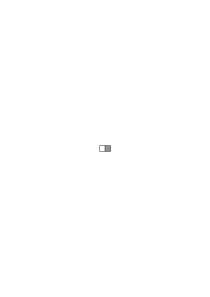, & that in turn to negation, & the sentences cited to the rules for negation.

### [108\[3\]](https://cdn.wittgensteinnachlass.com/2000px/webp/Ms-110/108.webp)

How do I know that a word is applied with different meanings in these cases?

### [108\[4\]](https://cdn.wittgensteinnachlass.com/2000px/webp/Ms-110/108.webp)

How do I know that a word is an adjective here and a noun there?

### [108\[5\]](https://cdn.wittgensteinnachlass.com/2000px/webp/Ms-110/108.webp)

By the fact that nothing they have in common is lost if I substitute words that sound different for those that sound alike.

### [108\[6\]](https://cdn.wittgensteinnachlass.com/2000px/webp/Ms-110/108.webp)

How do I know that I can replace these two words with one, because they mean the same thing? I.e., how do I know that they mean the same thing?

### [108\[7\]](https://cdn.wittgensteinnachlass.com/2000px/webp/Ms-110/108.webp),[109\[1\]](https://cdn.wittgensteinnachlass.com/2000px/webp/Ms-110/109.webp)

Could the mere external experience of hearing people speak (if there were no substitutes for the word ‘is’) lead us to distinguish different meanings, different words ‘is’? Evidently not, for every difference in behaviour would already constitute a different sign.

### [109\[2\]](https://cdn.wittgensteinnachlass.com/2000px/webp/Ms-110/109.webp)

24.02.1931

To say that a quarter-turn makes a square coincide with itself plainly means nothing other than: the square is symmetrical about two axes perpendicular to one another, & this in turn means that it makes sense to speak of the two perpendicular axes, whether they are there or not. This is a sentence of grammar.

### [109\[3\]](https://cdn.wittgensteinnachlass.com/2000px/webp/Ms-110/109.webp)

The difficulty again is that it seems as though a sentence containing, for example, the word ‘square’ already contained the shadow of another sentence with this word. – Namely, the very _possibility_ of forming that other sentence, which, as I said, lies in the sense of the word square.

### [109\[4\]](https://cdn.wittgensteinnachlass.com/2000px/webp/Ms-110/109.webp)

And yet one can only say that the other sentence is not uttered along with this one, not even in shadowy form. (And may never be uttered.)

### [109\[5\]](https://cdn.wittgensteinnachlass.com/2000px/webp/Ms-110/109.webp)

But surely it has already been uttered when I say “_it_ can be uttered”.

### [109\[6\]](https://cdn.wittgensteinnachlass.com/2000px/webp/Ms-110/109.webp),[110\[1\]](https://cdn.wittgensteinnachlass.com/2000px/webp/Ms-110/110.webp)

Let us remember that one need never utter the rules of grammar & can still use the language. (Human language certainly existed before anyone uttered grammatical rules, & a child learns the language without such rules, & children in turn have no grammar. That does not mean, of course, that their language follows no grammatical rules; they simply do not utter these rules.)

### [110\[2\]](https://cdn.wittgensteinnachlass.com/2000px/webp/Ms-110/110.webp)

Grammar is a description of language after the event.

### [110\[3\]](https://cdn.wittgensteinnachlass.com/2000px/webp/Ms-110/110.webp)

Grammar says, for example: this is how the word ‘square’ is used. But surely that must already lie in the _one_ use of this word! But what does it mean to say: it _must_ lie in it? Does it mean anything other than that I must be able to state the rules for the word even after this one use?

### [110\[4\]](https://cdn.wittgensteinnachlass.com/2000px/webp/Ms-110/110.webp)

That I can say: “No, that is not how I _used_ it, not in the sense in which I could say – – – –, but in the sense – – – – –.

### [110\[5\]](https://cdn.wittgensteinnachlass.com/2000px/webp/Ms-110/110.webp)

One could also put my problem like this: “How can that explanation (which I once learnt) refer to _this_ word (which I just uttered)?”

### [110\[6\]](https://cdn.wittgensteinnachlass.com/2000px/webp/Ms-110/110.webp),[111\[1\]](https://cdn.wittgensteinnachlass.com/2000px/webp/Ms-110/111.webp)

And my opinion is that the grammatical rules for negation, e.g. ~~p = p, could be used to explain the meaning of ‘~’: that the rules would be such an explanation; & that their effect would therefore be precisely what one calls understanding the negation sign. And that would be the relation of this understanding to the grammatical rules. (Here ‘effect’ is not to be understood causally.)

### [111\[2\]](https://cdn.wittgensteinnachlass.com/2000px/webp/Ms-110/111.webp)

That a word has meaning only in a sentence means nothing other than that it has its function only in a sentence. On its own it may well evoke a mental image, but this is not its meaning, nor is it the function of a word to call up a particular mental image.

### [111\[3\]](https://cdn.wittgensteinnachlass.com/2000px/webp/Ms-110/111.webp)

No sentence of the language can come as a surprise to us (though a truth can). Surely this is what I mean when I say: after the one use of the word we can state the rules for the word. For this means describing its use in sentences. I.e. giving a general description of all possible sentences.

### [111\[4\]](https://cdn.wittgensteinnachlass.com/2000px/webp/Ms-110/111.webp),[112\[1\]](https://cdn.wittgensteinnachlass.com/2000px/webp/Ms-110/112.webp)

It might now be objected that I could interchange the meanings of, for example, the words ‘blue’ & ‘red’, & that this would make sentences that were formerly true now false and vice versa, but would not make any sentence that formerly had sense now nonsensical, or vice versa. That is true. But it leaves out of account that sentences such as “that has this colour” also belong to our language, & that grammar must then tell me that this sentence means the same as “that is red”.

### [112\[2\]](https://cdn.wittgensteinnachlass.com/2000px/webp/Ms-110/112.webp)

The question is simply: What kind of sentence is this: “the word ‘is’ in ‘the rose is red’ is the same as in ‘the book is red’, but not the same as in ‘2 × 2 is 4’”? One cannot answer that it means different rules apply to the two words, for that is to go round in a circle. But it does mean that the word in its different combinations can be replaced by two signs which cannot be substituted for one another. If, on the other hand, I replace the word in the first two sentences by two different words, I can substitute them for one another.

### [112\[3\]](https://cdn.wittgensteinnachlass.com/2000px/webp/Ms-110/112.webp)

Now I could ask again: are these rules only a _consequence_ of what _comes first_: that in the one case the two words ‘is’ have the same meaning, and in the other case they do not? Or is this rule precisely the linguistic expression of the fact that the words mean the same thing?

### [112\[4\]](https://cdn.wittgensteinnachlass.com/2000px/webp/Ms-110/112.webp),[113\[1\]](https://cdn.wittgensteinnachlass.com/2000px/webp/Ms-110/113.webp)

I want to compare it to the word ‘is’ having a different word-body behind it. To its being the same face both times, but belonging to a different body, as when I see a triangle in the foreground which in one case is the end face of a prism, in the other of a tetrahedron.

### [113\[2\]](https://cdn.wittgensteinnachlass.com/2000px/webp/Ms-110/113.webp)

Or let us imagine this case: we have glass cubes, each with one face coloured red. If we place them in a row, only one quite particular arrangement of red squares can arise in space, determined by the cubical form of the bodies. Now I could state the rule according to which red squares can be arranged here without even mentioning the cubes, yet the essence of the cubical form would already be settled by it. Not, of course, that we have cubes made of glass, but certainly the geometry of the cube.

### [113\[3\]](https://cdn.wittgensteinnachlass.com/2000px/webp/Ms-110/113.webp)

But when we _see_ such a cube, are all the laws of possible arrangement truly already given _thereby_?! That is, the whole geometry? Can I read the geometry of the cube off a cube.

### [113\[4\]](https://cdn.wittgensteinnachlass.com/2000px/webp/Ms-110/113.webp)

Must I not already see in it a rule expressed very simply in order to do so?

### [113\[5\]](https://cdn.wittgensteinnachlass.com/2000px/webp/Ms-110/113.webp)

The cube is then a notation of the rule. And if we had found such a rule, we really could not notate it better than by means of a drawing of a cube (and the fact that a drawing suffices here is again immensely important.)

### [114\[1\]](https://cdn.wittgensteinnachlass.com/2000px/webp/Ms-110/114.webp)

And now the question is: how far can the cube or the drawing (for the two come to the same thing here) serve as a notation for the geometrical rules?

### [114\[2\]](https://cdn.wittgensteinnachlass.com/2000px/webp/Ms-110/114.webp)

But even then, only in so far as it belongs to a system: that is, the cube with its one red end face will notate something different from a pyramid with a square red base, etc. I.e., what is notated is that feature of the rules in which, for example, the cube differs from the pyramid.

### [114\[3\]](https://cdn.wittgensteinnachlass.com/2000px/webp/Ms-110/114.webp)

And this brings me back to the point that every explanation of a sign ought to be able to serve in place of the sign. I.e., if I build up a sign, as it were, by means of explanations, then the building up must be equivalent to the result of building it up. (Since it is never a matter of (different) attributes.)

### [114\[4\]](https://cdn.wittgensteinnachlass.com/2000px/webp/Ms-110/114.webp)

25.02.1931

“It already lies in the act of negation that, when doubled, it cancels itself out”. What already ‘lies in it’ can only ever be expressed by a rule, because one cannot express it in so far as it lies in it, but only in detachment. That is why ‘~’ in ~~p = p is not a negation.

### [114\[5\]](https://cdn.wittgensteinnachlass.com/2000px/webp/Ms-110/114.webp),[115\[1\]](https://cdn.wittgensteinnachlass.com/2000px/webp/Ms-110/115.webp)

The only correlate, in language, to a natural necessity is an arbitrary rule. It is the only thing that can be extracted from this necessity into sentences.

### [115\[2\]](https://cdn.wittgensteinnachlass.com/2000px/webp/Ms-110/115.webp)

“Surely I don’t merely say these words; I also mean something by them”. If, for example, I say “You may not come in”, the natural act to accompany these words is to stand in front of the door & hold it shut. But it would not so obviously be natural for me to open it for him as I said these words. These words, as they are understood here, evidently have something to do with that act. The act is, so to speak, an illustration of them – it would have to be possible to take it as language. On the other hand, it is also the act that, apart from any symbolism, it is in my nature to want to perform.

### [115\[3\]](https://cdn.wittgensteinnachlass.com/2000px/webp/Ms-110/115.webp)

The sentence is precisely the motive for the action.

### [115\[4\]](https://cdn.wittgensteinnachlass.com/2000px/webp/Ms-110/115.webp)

Negation in the sentence is like the _wooden_ cube. It negates _something_, after all, & can exist only in this way.

### [115\[5\]](https://cdn.wittgensteinnachlass.com/2000px/webp/Ms-110/115.webp)

The grammatical rule mirrors in language the way we follow the negation.

### [115\[6\]](https://cdn.wittgensteinnachlass.com/2000px/webp/Ms-110/115.webp),[116\[1\]](https://cdn.wittgensteinnachlass.com/2000px/webp/Ms-110/116.webp)

The way I carry out an order presumably shows how I understand it. But the link between carrying it out & the order is the invisible (glass) body of the symbol, which is made visible in the rules of language.

### [116\[2\]](https://cdn.wittgensteinnachlass.com/2000px/webp/Ms-110/116.webp)

Every sign of negation is equivalent to every other, for “” is just as much a complex of strokes as the word ‘not’, & it becomes negation only through the way it ‘_works_’. But what is meant here is not its effect in the psychological sense (so the word ‘effect’ is not used causally), but the form of its effect.

### [116\[3\]](https://cdn.wittgensteinnachlass.com/2000px/webp/Ms-110/116.webp)

I would like to say: the sign works only dynamically, not statically. Thought is dynamic.

### [116\[4\]](https://cdn.wittgensteinnachlass.com/2000px/webp/Ms-110/116.webp)

Surely that means that the sign works as a sign only if I act in accordance with it. (Money works as money only if I receive it or give it in exchange for something.)

### [116\[5\]](https://cdn.wittgensteinnachlass.com/2000px/webp/Ms-110/116.webp)

If I act in accordance with the sentence ‘~p’, then what I do is of course also characterized by the negation. But I cannot describe the part the negation plays in determining my action, for that is expressed by the negation itself; I can, however, show the internal properties of negation by means of the rules that apply to the negation sign.

### [116\[6\]](https://cdn.wittgensteinnachlass.com/2000px/webp/Ms-110/116.webp)

My task is only to attend to everything that everyone knows but has not attended to as essential.

### [117\[1\]](https://cdn.wittgensteinnachlass.com/2000px/webp/Ms-110/117.webp)

“No, that is not at all how I meant the word …, not in the sense in which one can say …, but in the sense of ….”

### [117\[2\]](https://cdn.wittgensteinnachlass.com/2000px/webp/Ms-110/117.webp)

Think how I put the negation of a sentence into practice. Surely this is precisely where I must make use of the properties of that body which lies behind the word ‘not’.

### [117\[3\]](https://cdn.wittgensteinnachlass.com/2000px/webp/Ms-110/117.webp)

I might say, for example, that the way cubes behave in relation to one another does depend on their material, but given the material, the behaviour of the bodies depends on their shape.

### [117\[4\]](https://cdn.wittgensteinnachlass.com/2000px/webp/Ms-110/117.webp)

If I translate negation, surely I must make use of its geometrical properties.

### [117\[5\]](https://cdn.wittgensteinnachlass.com/2000px/webp/Ms-110/117.webp)

Let us imagine the case in which I indicate, by hatching an area on a plan, that this area is not to be entered.

### [117\[6\]](https://cdn.wittgensteinnachlass.com/2000px/webp/Ms-110/117.webp)

I should like to say: besides its logical properties, negation also has physical ones.

### [117\[7\]](https://cdn.wittgensteinnachlass.com/2000px/webp/Ms-110/117.webp)

26.02.1931

Bear in mind that one teaches negation to a child, too, only by means of various individual examples.

### [117\[8\]](https://cdn.wittgensteinnachlass.com/2000px/webp/Ms-110/117.webp),[118\[1\]](https://cdn.wittgensteinnachlass.com/2000px/webp/Ms-110/118.webp)

Anyone who reads and understands a sentence sees the different kinds of word in different ways, although their appearance & sound do not differ in kind. We quite forget that ‘not’ & ‘table’ & ‘green’, considered as sounds or written forms, do not differ essentially from one another, & see this clearly only in a language foreign to us.

### [118\[2\]](https://cdn.wittgensteinnachlass.com/2000px/webp/Ms-110/118.webp)

The words evidently have quite different functions in the sentence. And these functions seem to us to be expressed in the rules that apply to the words.

### [118\[3\]](https://cdn.wittgensteinnachlass.com/2000px/webp/Ms-110/118.webp)

One need only think what it means for a word to _refer_ to this part of the sentence!

### [118\[4\]](https://cdn.wittgensteinnachlass.com/2000px/webp/Ms-110/118.webp)

Think of a language in which negation would be expressed by turning the written image of the sentence through 180˚! Would it not be especially clear here that the turned image in itself would not look _essentially_ different from any other & that the essence of negation would therefore not be expressed?

### [118\[5\]](https://cdn.wittgensteinnachlass.com/2000px/webp/Ms-110/118.webp)

When reading scrawled handwriting, one can recognize what it means to see something in the given picture.

### [118\[6\]](https://cdn.wittgensteinnachlass.com/2000px/webp/Ms-110/118.webp)

Yet all this seems to be merely static, not dynamic.

### [118\[7\]](https://cdn.wittgensteinnachlass.com/2000px/webp/Ms-110/118.webp),[119\[1\]](https://cdn.wittgensteinnachlass.com/2000px/webp/Ms-110/119.webp)

An overturned armchair is perceived differently when it is recognized as such than when it is seen merely as a wooden construction, without reference to another possible position.

### [119\[2\]](https://cdn.wittgensteinnachlass.com/2000px/webp/Ms-110/119.webp)

Think of puzzle pictures. A complex of strokes is suddenly recognized & seen as an upside-down picture of a man.

### [119\[3\]](https://cdn.wittgensteinnachlass.com/2000px/webp/Ms-110/119.webp)

When one reads a clock, one sees a complex of strokes, patches, etc., but in a quite particular way if one wants to regard it as a clock & its hands.

### [119\[4\]](https://cdn.wittgensteinnachlass.com/2000px/webp/Ms-110/119.webp)

If, for example, I say: “it is 7 o’clock, so I must go”, then it was not enough simply to see the complex of strokes etc. ‘statically’.

### [119\[5\]](https://cdn.wittgensteinnachlass.com/2000px/webp/Ms-110/119.webp)

27.02.1931

What does not trickle from the spring cannot flow in the river.

### [119\[6\]](https://cdn.wittgensteinnachlass.com/2000px/webp/Ms-110/119.webp)

The ‘Not’ makes a gesture of warding off.

### [119\[7\]](https://cdn.wittgensteinnachlass.com/2000px/webp/Ms-110/119.webp)

Every ethical justification of an action must appeal to the man to whom I justify it.

### [119\[8\]](https://cdn.wittgensteinnachlass.com/2000px/webp/Ms-110/119.webp)

An element of description cannot characterize description.

### [119\[9\]](https://cdn.wittgensteinnachlass.com/2000px/webp/Ms-110/119.webp),[120\[1\]](https://cdn.wittgensteinnachlass.com/2000px/webp/Ms-110/120.webp)

When I follow the order, _in doing so_ I understand it in a certain sense. But can I also understand it without following it? I.e. is understanding essentially a part of following? Understanding is understanding, & following is following.

### [120\[2\]](https://cdn.wittgensteinnachlass.com/2000px/webp/Ms-110/120.webp)

Understanding negation is seeing its gesture of warding off.

### [120\[3\]](https://cdn.wittgensteinnachlass.com/2000px/webp/Ms-110/120.webp)

Or: Understanding negation is the same as understanding a gesture of warding off. And what I said above about ‘static’ & ‘dynamic’ applies in full to this gesture too.

### [120\[4\]](https://cdn.wittgensteinnachlass.com/2000px/webp/Ms-110/120.webp)

We can say: I can imagine perceiving this gesture & not feeling it to be ‘warding off’. For the mere outstretched hand & the body leaning back are no more warding anything off than a cone or a water jug. I should like to say: it is the effect of the movement on me that makes it a warding off. But it is not the effect, for I would not _know_ its cause, & I would not call a medicine that had the same effect (whatever it might be) a warding off. It is, as I put it earlier, ‘the way I see this movement’. But that would again be static. I think it is that something definite in me is guided by this movement.

### [120\[5\]](https://cdn.wittgensteinnachlass.com/2000px/webp/Ms-110/120.webp)

But what in this assertion is mere hypothesis (mythology)?

### [120\[6\]](https://cdn.wittgensteinnachlass.com/2000px/webp/Ms-110/120.webp),[121\[1\]](https://cdn.wittgensteinnachlass.com/2000px/webp/Ms-110/121.webp)

What, for example, is the logical content of my statement: “The ‘gesture of warding off’ in itself has no more of warding off about it than any movement or bodily shape”? Surely this means: the description of this movement alone does not describe the warding off. I.e. it makes sense to say of _this_ movement that it is a gesture of warding off.

### [121\[2\]](https://cdn.wittgensteinnachlass.com/2000px/webp/Ms-110/121.webp)

And now I want to say: it is not because of the particular movement that it is not in & of itself a gesture of warding off; rather, a movement is in itself no gesture at all. Nor, of course, is it because it is not a resting attitude but a movement, for the movement is in itself, in my sense, just as ‘static’ as the resting position.

### [121\[3\]](https://cdn.wittgensteinnachlass.com/2000px/webp/Ms-110/121.webp)

Gesture-language is a _language_ & we have not – in the ordinary sense – learnt it. That is: it was not (intentionally,) deliberately taught to us. And yet we have learnt it. –

### [121\[4\]](https://cdn.wittgensteinnachlass.com/2000px/webp/Ms-110/121.webp)

I can understand the gesture of warding off even when it is directed at someone else.

### [121\[5\]](https://cdn.wittgensteinnachlass.com/2000px/webp/Ms-110/121.webp)

We understand Chinese gestures as little as we understand Chinese sentences.

### [121\[6\]](https://cdn.wittgensteinnachlass.com/2000px/webp/Ms-110/121.webp)

(To be understood, the gesture, like any sign, must be taken as a picture, that is, as belonging to a system.)

### [121\[7\]](https://cdn.wittgensteinnachlass.com/2000px/webp/Ms-110/121.webp),[122\[1\]](https://cdn.wittgensteinnachlass.com/2000px/webp/Ms-110/122.webp)

One could imagine learning a language by analogy with hunting the thimble, where the desired movement is brought about by ‘hot, hot’, ‘cold, cold’. One could imagine that instead of using these words the teacher elicits pleasant & unpleasant sensations in some way (by facial expressions, say), & that the learner is then brought to perform, on command, _the_ movement which is regularly accompanied by the pleasant sensation (or leads to it). We could imagine him being trained in this way to react to certain signs in a particular way. (And this is how training really takes place.)

### [122\[2\]](https://cdn.wittgensteinnachlass.com/2000px/webp/Ms-110/122.webp)

Now if we had learnt to follow the signs in this way, things would stand as follows: we would observe that in response to certain movements & words of the other person we make certain movements reflexively, & would explain this after the event by saying that these movements had once helped us to obtain pleasant sensations. This explanation would stand to our actions as the Darwinian explanation of frowning – in terms of a certain benefit it is supposed to have brought our animal ancestors – stands to the act of frowning, which now has no relation to that purpose. The explanation would be hypothetical & would concern the cause of the action, not the motive.

### [122\[3\]](https://cdn.wittgensteinnachlass.com/2000px/webp/Ms-110/122.webp)

Let us imagine a language in which every order is given by a demonstration with dolls etc. Here it is much easier to recognize following as following a rule. Or, simpler still, the person giving the order shows us how to do everything (himself).

### [123\[1\]](https://cdn.wittgensteinnachlass.com/2000px/webp/Ms-110/123.webp)

(A. I don't agree with you there.

B. Alright, then I won't agree with you either.)

### [123\[2\]](https://cdn.wittgensteinnachlass.com/2000px/webp/Ms-110/123.webp)

28.02.1931

It is very strange: we would like to explain understanding a gesture by translating it into words, & understanding words by means of gestures corresponding to them.

### [123\[3\]](https://cdn.wittgensteinnachlass.com/2000px/webp/Ms-110/123.webp)

And indeed we will explain words by a gesture & a gesture by words.

### [123\[4\]](https://cdn.wittgensteinnachlass.com/2000px/webp/Ms-110/123.webp)

It is particularly difficult to restrain ourselves from wanting to penetrate _behind_ the phenomena in philosophy.

### [123\[5\]](https://cdn.wittgensteinnachlass.com/2000px/webp/Ms-110/123.webp)

Depicting (imitating) essentially involves a certain readiness – receptiveness, a readiness to let oneself be guided, to follow the model, to be the function for which the model will be the argument. And indeed the expression of this is that I am, as it were, x² or ( )², & if the model is now 5, the result is 5² “of itself”. (Keeping oneself undetermined for the model, & letting oneself be determined by it.)

### [123\[6\]](https://cdn.wittgensteinnachlass.com/2000px/webp/Ms-110/123.webp)

Now if I was x² & along comes 5, it would now have to follow from that alone that I become 5².

### [123\[7\]](https://cdn.wittgensteinnachlass.com/2000px/webp/Ms-110/123.webp),[124\[1\]](https://cdn.wittgensteinnachlass.com/2000px/webp/Ms-110/124.webp)

And in one sense this is the case & in another it is not. It is not the case in the sense in which I cannot show an action to be the carrying out of an order by comparing the action with the order. And it is the case in the sense in which I can justify the action by checking it against the order.

### [124\[2\]](https://cdn.wittgensteinnachlass.com/2000px/webp/Ms-110/124.webp)

I am x², now along comes 5 & I now become 5². Now I can justify 5² by means of 5 and x² in one sense, but not in another. And I should like to say that in so far as I cannot justify it, there is no sense in using the word “justify”.

### [124\[3\]](https://cdn.wittgensteinnachlass.com/2000px/webp/Ms-110/124.webp)

I can justify 5² by means of x² if in doing so I contrast x² with x³ or some other sign in the system.

### [124\[4\]](https://cdn.wittgensteinnachlass.com/2000px/webp/Ms-110/124.webp)

The sentence “if 6 had come along, I would have become 6²” must lie in the general readiness. That is, in the x².

### [124\[5\]](https://cdn.wittgensteinnachlass.com/2000px/webp/Ms-110/124.webp)

The difficulty is evidently not to try to justify what has no justification.

### [124\[6\]](https://cdn.wittgensteinnachlass.com/2000px/webp/Ms-110/124.webp)

If one asks: “why are you writing 5²?” & I answer “it says right there that I am to square it”, then that is a justification – & a _full_ one –. To demand a justification in a sense in which this is not one is senseless.

### [124\[7\]](https://cdn.wittgensteinnachlass.com/2000px/webp/Ms-110/124.webp),[125\[1\]](https://cdn.wittgensteinnachlass.com/2000px/webp/Ms-110/125.webp)

If that is not a justification, then there is none. That is what we call a justification.

### [125\[2\]](https://cdn.wittgensteinnachlass.com/2000px/webp/Ms-110/125.webp)

Suppose I had given someone all sorts of explanations of what the order “square these numbers” means. (And these are all signs, after all.) Suppose he then squares them & now I ask him “why do you do _that_ in response to these explanations?” Then it would make no sense to answer me: “But you told me: (the explanations are repeated)”. But no other kind of answer to this question is possible either, & the question simply means nothing. To make sense it would have to go: “Why do you do _that_ & not this other thing in response to these explanations (after all, I told you …)”.

### [125\[3\]](https://cdn.wittgensteinnachlass.com/2000px/webp/Ms-110/125.webp)

Now suppose one were to ask: How long before the application of the rule must the disposition “x²” have lasted? A second, or two? This question naturally sounds like a parody, and rightly so. We feel that this cannot matter at all. But this kind (of question) keeps coming up.

### [125\[4\]](https://cdn.wittgensteinnachlass.com/2000px/webp/Ms-110/125.webp)

“The way” I follow the rule, if this word is to have any sense at all, must be what is expressed by a further rule about the application of the first. If there is no such further rule, there is no _way_ of applying the first, but only its application. It is a way in contrast to another way.

### [126\[1\]](https://cdn.wittgensteinnachlass.com/2000px/webp/Ms-110/126.webp)

Why should I repeat the rule to myself before doing the squaring? For if I am _able_ to repeat it, I can just as well apply it straight away. Repeating the wording of the general rule would make sense only if I wanted to highlight _it_ as against other rules. For the general sign of the rule does not work by magic, but has sense only in so far as it points to a place in a system.

### [126\[2\]](https://cdn.wittgensteinnachlass.com/2000px/webp/Ms-110/126.webp)

Grammar describes the system, the space in which the symbol points to a particular place.

### [126\[3\]](https://cdn.wittgensteinnachlass.com/2000px/webp/Ms-110/126.webp)

In a certain sense we must know the range of things that could stand in place of the rule x² in order to understand this sign.

### [126\[4\]](https://cdn.wittgensteinnachlass.com/2000px/webp/Ms-110/126.webp)

Could one then say: in order to be understood, the sign must enter as an argument into a function which characterizes precisely the space in which the sign then indicates the place as opposed to other places?

### [126\[5\]](https://cdn.wittgensteinnachlass.com/2000px/webp/Ms-110/126.webp)

That is why the sign cannot exist without grammar.

### [126\[6\]](https://cdn.wittgensteinnachlass.com/2000px/webp/Ms-110/126.webp)

The sign without grammar would be the ‘static’ one.

### [126\[7\]](https://cdn.wittgensteinnachlass.com/2000px/webp/Ms-110/126.webp)

That is, I cannot understand a gesture either unless I see it as a possibility in a particular space. And so there is also a grammar of gestures (namely their geometry).

### [127\[1\]](https://cdn.wittgensteinnachlass.com/2000px/webp/Ms-110/127.webp)

If I am to understand the gesture of the clock hand, I must take it as the one value of a particular variable. Grammar tells me the possible positions of the clock hand, i.e. gives me this variable.

### [127\[2\]](https://cdn.wittgensteinnachlass.com/2000px/webp/Ms-110/127.webp)

Now, I think, we also see why the thought seemed to us in a certain sense to need supplementing, to be incomplete.

### [127\[3\]](https://cdn.wittgensteinnachlass.com/2000px/webp/Ms-110/127.webp)

One can add an explanation to a sign, say to the arrow ↗ intended to indicate a particular direction: As opposed to ↑ or ↖. And although this is not an exhaustive grammar, it does show that we can thereby hint at an explanation, that what is hinted at in this explanation is somehow sous-entendu in the understanding.

### [127\[4\]](https://cdn.wittgensteinnachlass.com/2000px/webp/Ms-110/127.webp)

01.03.1931

I think: in which direction will the arrow point, I wonder; – & now it points in _this_ one.

### [127\[5\]](https://cdn.wittgensteinnachlass.com/2000px/webp/Ms-110/127.webp)

The space in which the arrow is understood cannot be characterized by a sign added to the arrow in any way. For the same indeterminacy would have to attach to this sign too.

### [127\[6\]](https://cdn.wittgensteinnachlass.com/2000px/webp/Ms-110/127.webp),[128\[1\]](https://cdn.wittgensteinnachlass.com/2000px/webp/Ms-110/128.webp)

Every sentence says: it is so, & not otherwise. That is why one cannot describe language.

### [128\[2\]](https://cdn.wittgensteinnachlass.com/2000px/webp/Ms-110/128.webp)

When one sees the straight, untied piece of thread, it is hard to recognize which piece of the knotted thread it used to be. One no longer recognizes in the solution the problems it solved.

### [128\[3\]](https://cdn.wittgensteinnachlass.com/2000px/webp/Ms-110/128.webp)

Depicting the segment a consists not in my putting the equally long a' beside it, but 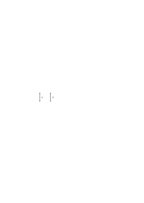 in a yielding a' when it is put into the general disposition. The general disposition is described by my saying: if a _had been_ twice as long, I _would have_ made a' twice as long too. (etc.)

### [128\[4\]](https://cdn.wittgensteinnachlass.com/2000px/webp/Ms-110/128.webp)

If one asks: “Why then must language have grammar? surely this must have something to do with its application”, then I would have to say: Yes, for how else should I describe something, assign a sentence to a fact, if I could not choose what fits in a particular system, or – what comes to the same thing – choose _according to_ a particular system? Otherwise the assignment would be arbitrary. And conversely, how should I follow a sign, assign a movement, an action, to it, if not according to a system?

### [128\[5\]](https://cdn.wittgensteinnachlass.com/2000px/webp/Ms-110/128.webp),[129\[1\]](https://cdn.wittgensteinnachlass.com/2000px/webp/Ms-110/129.webp)

If, in moving the point P from A to B 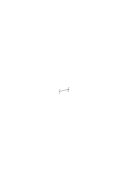, I follow the arrow 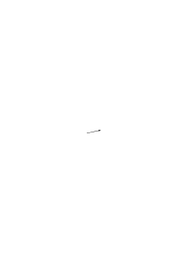, then this is described only by my describing the system of arrows to which this one belongs. – Now I might well say: Is that enough? Must I not also give the rule according to which the translation takes place, for instance here, that I must move parallel to the arrow? But I can imagine this rule of translation appended to the arrow in the form of, say, the sign “∣∣” (as opposed, say, to “∣ –”); but then the sign “↗∣∣” would be on no different level from “↗” & now I could still only describe the system to which this sign belongs, unless I want to add further signs to the one above ad infinitum, _and hence fruitlessly_.

### [129\[2\]](https://cdn.wittgensteinnachlass.com/2000px/webp/Ms-110/129.webp)

Here you say that what happens when I follow a sign is not described by describing the sign & my action; rather, _for that_ the grammar of the sign must also be described. Which of course is not the same as saying that the person following the sign is conscious of the expression of the grammatical rules. But it does mean that a different process of copying corresponds to a different expression.

### [129\[3\]](https://cdn.wittgensteinnachlass.com/2000px/webp/Ms-110/129.webp)

The expression “in agreement with” (the arrow, for example) has no sense unless it refers to a system to which the arrow belongs.

### [129\[4\]](https://cdn.wittgensteinnachlass.com/2000px/webp/Ms-110/129.webp),[130\[1\]](https://cdn.wittgensteinnachlass.com/2000px/webp/Ms-110/130.webp)

02.03.1931

A sign works not through its suggestive appearance but through the system to which it belongs.

### [130\[2\]](https://cdn.wittgensteinnachlass.com/2000px/webp/Ms-110/130.webp)

03.03.1931

Let us imagine that chess had been invented not as a board game, but as a game to be played with digits & letters on paper, & in such a way that no one playing it had imagined a square with 64 squares, etc. But now suppose someone had discovered that this game corresponded exactly to one that could be played on a board in such & such a way. This invention would have made the game much easier to play (people who would formerly have found it too difficult could now play it). But it is clear that this new illustration of the rules of the game would only be a new, more readily surveyable symbolism, which, incidentally, would stand on the same footing as what was written. Now compare this with the talk about how physics today no longer works with mechanical models, but “only with symbols”.

### [130\[3\]](https://cdn.wittgensteinnachlass.com/2000px/webp/Ms-110/130.webp),[131\[1\]](https://cdn.wittgensteinnachlass.com/2000px/webp/Ms-110/131.webp)

If one asked: But would it not after all be possible to give an account of what happens in squaring 5 in x² 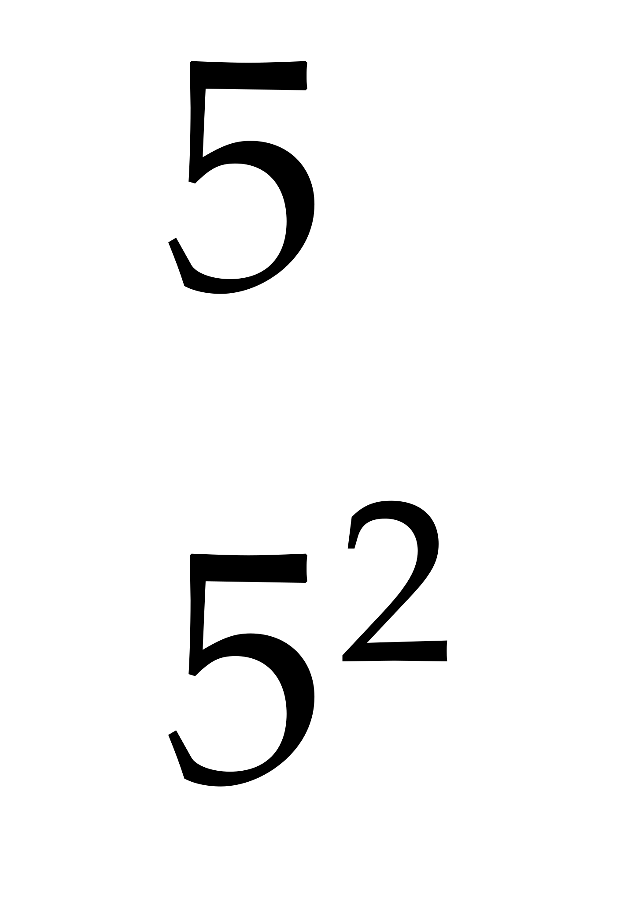 simply by saying that, influenced by the sign x², I wrote ‘5²’ under ‘5’; then I must ask: but how do I know that it happened under the influence of x²? That is, after all, only a hypothesis & one that cannot interest me at all here. So all I can say is that x² was there _and_ that I wrote 5² under the 5! And now it is clear that all I want to explain is precisely the “_because of that_”.

### [131\[2\]](https://cdn.wittgensteinnachlass.com/2000px/webp/Ms-110/131.webp)

And only this Because of that explains the system, & only the system explains the Because of that.

### [131\[3\]](https://cdn.wittgensteinnachlass.com/2000px/webp/Ms-110/131.webp)

Here we keep running into the awkward question whether the writing of 5² (for example) might not have taken place more or less (or entirely) automatically, & feel that this might be the case & that it is no concern of ours at all. That here we are on quite irrelevant ground, where we do not belong.

### [131\[4\]](https://cdn.wittgensteinnachlass.com/2000px/webp/Ms-110/131.webp)

For we should like to say: Insofar as the writing takes place automatically, it is no concern of ours, & no interpretation of a sign has taken place. – Only when I justify what I write down by means of a sign does this justification point to what is expressed in the rules of grammar.

### [131\[5\]](https://cdn.wittgensteinnachlass.com/2000px/webp/Ms-110/131.webp)

That is to say: Whenever I write ξ _because_ η is written here, this Because presupposes a rule.

### [131\[6\]](https://cdn.wittgensteinnachlass.com/2000px/webp/Ms-110/131.webp)

After all, in the end I cannot say more than everyone knows.

### [131\[7\]](https://cdn.wittgensteinnachlass.com/2000px/webp/Ms-110/131.webp),[132\[1\]](https://cdn.wittgensteinnachlass.com/2000px/webp/Ms-110/132.webp)

After all, I can only draw attention to what everyone knows, i.e. immediately admits to be true. (The Socratic recollection of the truth.)

### [132\[2\]](https://cdn.wittgensteinnachlass.com/2000px/webp/Ms-110/132.webp)

“I write ‘5²’ because it says ‘x²’ here”. But what if I said: “I write ‘+’ because it says ‘σ’ here”? One would ask: Do you write ‘+’ wherever it says ‘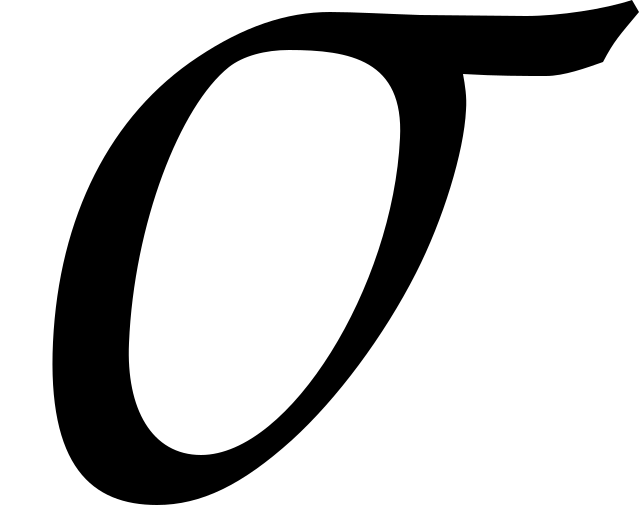’? That is, one would ask for a general rule. And otherwise the ‘because’ in the last sentence would make no sense.

### [132\[3\]](https://cdn.wittgensteinnachlass.com/2000px/webp/Ms-110/132.webp)

So I mean that the ‘because’ (here) refers to a general rule, i.e. it must always be possible to supplement it with a general rule.

### [132\[4\]](https://cdn.wittgensteinnachlass.com/2000px/webp/Ms-110/132.webp)

Let us return to the clock hand: Certainly we do not imagine the hand in different positions when we read off its present position (nor would that help us). And perhaps, when we say “it is 5 o’clock, I must go”, we say this & go automatically. But I might just as well have looked at the matchbox, like the drunk, & said “Thursday, I must go then”. And as far as cause and effect are concerned, I see no difference between the two cases.

### [132\[5\]](https://cdn.wittgensteinnachlass.com/2000px/webp/Ms-110/132.webp)

But can I simply say: Wherever there is a ‘because’ of this kind (‘because of that’, etc.), I _can_ state a general rule that describes the process?

### [132\[6\]](https://cdn.wittgensteinnachlass.com/2000px/webp/Ms-110/132.webp),[133\[1\]](https://cdn.wittgensteinnachlass.com/2000px/webp/Ms-110/133.webp)

So if someone says “5 – I must write 5² here”, it must be possible to write in addition: “because I must square every number that comes my way”, & this addition must add nothing to the fact.

### [133\[2\]](https://cdn.wittgensteinnachlass.com/2000px/webp/Ms-110/133.webp)

The arrow alone does not point.

### [133\[3\]](https://cdn.wittgensteinnachlass.com/2000px/webp/Ms-110/133.webp)

There can be no discussion about whether these rules or others are the correct ones for the word ‘not’. For the word does not yet have a meaning without these rules, & if we change the rules, it now has a different meaning (or none), & then we can just as well change the word too. These rules are therefore arbitrary, because it is the rules that make the sign in the first place.

### [133\[4\]](https://cdn.wittgensteinnachlass.com/2000px/webp/Ms-110/133.webp)

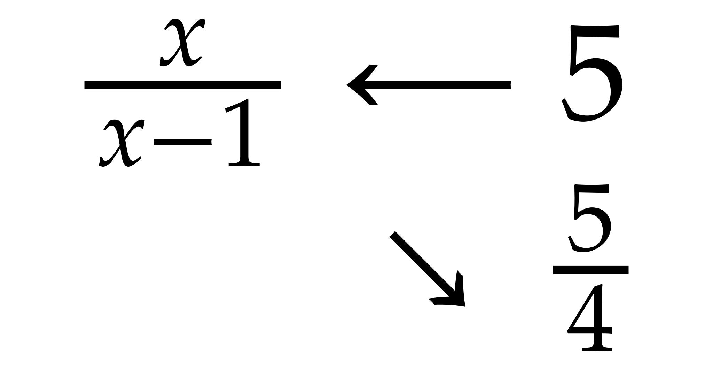 I obtained it by means of the expression 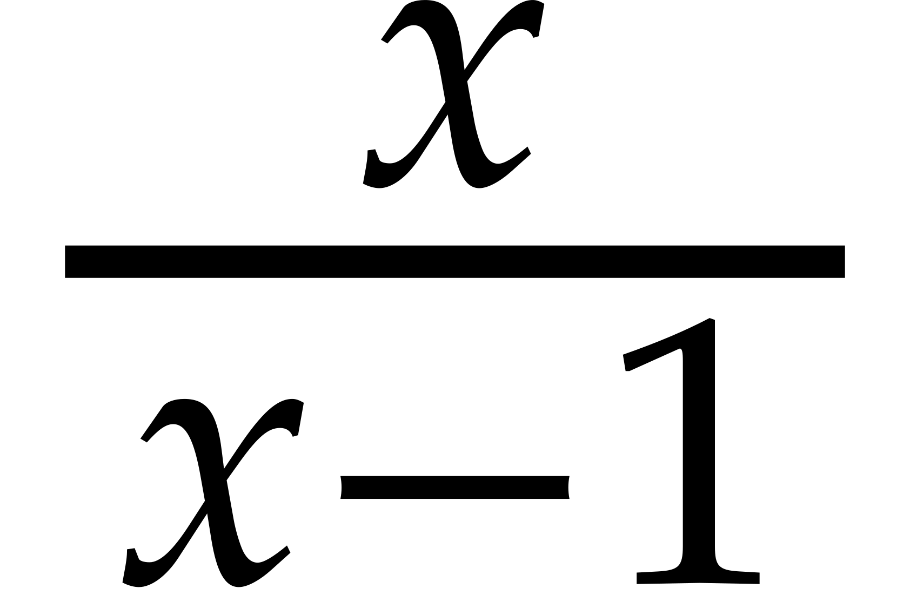 in a certain way. This way is what remains constant in the cases 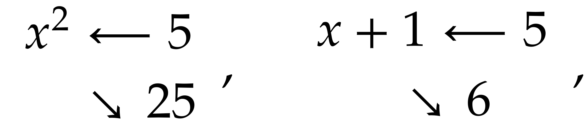 etc., and is thus given by the system of signs f(x). This way can be expressed by saying: in the expression f(x) I substitute 5 for x (substitute the number I am given). Does that not already determine the grammar of the sign “” etc.?

### [133\[5\]](https://cdn.wittgensteinnachlass.com/2000px/webp/Ms-110/133.webp)

I use the sign “” to get from 5 to 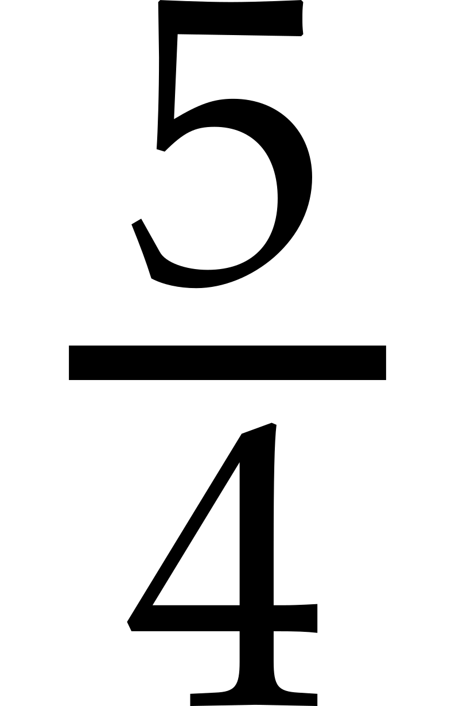.

### [133\[6\]](https://cdn.wittgensteinnachlass.com/2000px/webp/Ms-110/133.webp),[134\[1\]](https://cdn.wittgensteinnachlass.com/2000px/webp/Ms-110/134.webp)

The justification that I write ‘’ _because_ it says ‘’ there, of course, says nothing other than: “I obtained  from ”. And here one can ask: “how?” & the answer must be a rule that does not relate only to the sign ‘’, for one would not need this sign if it stood alone. That a sign can guide me _in this way_ presupposes that it could also have guided me differently.

### [134\[2\]](https://cdn.wittgensteinnachlass.com/2000px/webp/Ms-110/134.webp)

04.03.1931

Observing how language is used does not give us grammar, for from this observation one might conclude, for example, that the same word occurs in the sentences ‘the rose _is_ red’ & ‘2 × 2 is 4’ & that the grammatical rules therefore allow this occurrence.

### [134\[3\]](https://cdn.wittgensteinnachlass.com/2000px/webp/Ms-110/134.webp)

One has to know what to look at in the sign. For instance: which numeral the hand is pointing to, not how long it is.

### [134\[4\]](https://cdn.wittgensteinnachlass.com/2000px/webp/Ms-110/134.webp)

“Go in the direction the pointer is pointing in”.

“Go as many metres per second as the arrow is cm long”.

“Take as many steps as I draw arrows”.

“Copy this arrow.” The same arrow can stand for each of these commands. – – –

### [134\[5\]](https://cdn.wittgensteinnachlass.com/2000px/webp/Ms-110/134.webp)

Is it like this: does taking the order as the motive for my action amount to knowing, while one acts, that one is thereby following the order or acting contrary to it?

### [134\[6\]](https://cdn.wittgensteinnachlass.com/2000px/webp/Ms-110/134.webp),[135\[1\]](https://cdn.wittgensteinnachlass.com/2000px/webp/Ms-110/135.webp)

“Knowing that one is following the order” clearly means something, & it must contain what is expressed in the grammatical rules.

### [135\[2\]](https://cdn.wittgensteinnachlass.com/2000px/webp/Ms-110/135.webp)

What I am trying to do here is not to make a hypothesis about the influence of the grammatical rules, but only to say what is certain.

### [135\[3\]](https://cdn.wittgensteinnachlass.com/2000px/webp/Ms-110/135.webp)

Someone shows me a clock for the first time & wants me to take it as my guide. I then ask: what should I pay attention to in this thing? And he says: To the position of the hands.

### [135\[4\]](https://cdn.wittgensteinnachlass.com/2000px/webp/Ms-110/135.webp)

It does not matter whether, while acting, I was conscious that I was acting _in accordance_ with the order. But if I compare the action with the order, even after the event, say to justify it, I must understand the order in doing so, i.e. this comparison depends on the grammatical space in which the order exists, which is given by the grammatical rules. For _then_ I must understand the arrow differently according to how it is explained.

### [135\[5\]](https://cdn.wittgensteinnachlass.com/2000px/webp/Ms-110/135.webp)

“Follow the direction of the arrow”, that gives the whole grammar of the arrow. The word ‘direction’ is the variable that represents the space.

### [135\[6\]](https://cdn.wittgensteinnachlass.com/2000px/webp/Ms-110/135.webp)

Grammar describes how the signs are used. But not how they are used according to a series of observations; rather, it describes the use in each individual case.

### [136\[1\]](https://cdn.wittgensteinnachlass.com/2000px/webp/Ms-110/136.webp)

“I must pay attention to the length”, “I must pay attention to the direction”, that already means: to this length as opposed to others, etc.

### [136\[2\]](https://cdn.wittgensteinnachlass.com/2000px/webp/Ms-110/136.webp)

Now can one also _pay attention_ to the direction of the arrow without following that direction? (For this amounts to asking: can one understand without translating?)

### [136\[3\]](https://cdn.wittgensteinnachlass.com/2000px/webp/Ms-110/136.webp)

“Follow the arrow” makes no sense at all unless it is an abbreviation of a particular explanation (out of several possible ones).

### [136\[4\]](https://cdn.wittgensteinnachlass.com/2000px/webp/Ms-110/136.webp)

And if I now take the sign ↗ in some way & follow it, no such explanation need be present to my mind (and if it were, I would in turn have to understand it in some way as a sign in a system & so it would not help me), but what I do is described by such an explanation; it _corresponds_ to such an explanation. Which, however, being itself a sign, cannot help me build up the essence of the sign.

### [136\[5\]](https://cdn.wittgensteinnachlass.com/2000px/webp/Ms-110/136.webp),[137\[1\]](https://cdn.wittgensteinnachlass.com/2000px/webp/Ms-110/137.webp)

05.03.1931

Temporal relation between the order “go out through the door” & the action that carries it out. Let us imagine the order being given by a trumpet signal. And the difference between following the order “go out through the door” & following an order that, say, maps out each step to the door for me. The former order is evidently analogous to an element of the other.

### [137\[2\]](https://cdn.wittgensteinnachlass.com/2000px/webp/Ms-110/137.webp)

“There is the word ‘blau’, so I must take this colour”.

### [137\[3\]](https://cdn.wittgensteinnachlass.com/2000px/webp/Ms-110/137.webp)

If the word ‘blau’ occurred in another language & meant there what ‘rot’ means in German, then in my actions I would also have to be guided by whether the order was given in German or in the other language.

### [137\[4\]](https://cdn.wittgensteinnachlass.com/2000px/webp/Ms-110/137.webp)

We take the signal as the motive for our action.

### [137\[5\]](https://cdn.wittgensteinnachlass.com/2000px/webp/Ms-110/137.webp)

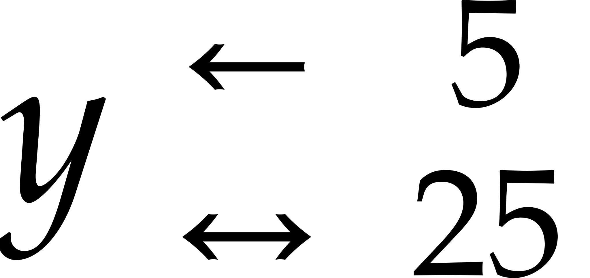 Why do you write 25? – Because it says ‘y’ there. – Well, is that the signal for 25? – No, but I wrote ‘25’ because it says ‘y’ there. – How do you know, then, that is why you wrote it?

### [137\[6\]](https://cdn.wittgensteinnachlass.com/2000px/webp/Ms-110/137.webp)

Let us think of the verification of sentences (not the following of orders). For the justification after following the order is, after all, just a verification like any other. But: I followed the order p means nothing other than: the order was p and I did p.

### [137\[7\]](https://cdn.wittgensteinnachlass.com/2000px/webp/Ms-110/137.webp),[138\[1\]](https://cdn.wittgensteinnachlass.com/2000px/webp/Ms-110/138.webp)

But what does it mean: I am going to the door _because_ the order was “go to the door”? And how does this sentence compare with: I am going to the door although the order was “go to the door”. Or: I am going to the door, but not because the order was “go to the door, but …” Or: I am _not_ going to the door because the order was “go to the door”.

### [138\[2\]](https://cdn.wittgensteinnachlass.com/2000px/webp/Ms-110/138.webp)

Does “I did it because you ordered it” mean the same as: “You ordered it & I wished for it”?

### [138\[3\]](https://cdn.wittgensteinnachlass.com/2000px/webp/Ms-110/138.webp)

06.03.1931

No: I say “I am doing this because A orders me to, not because B orders it”.

### [138\[4\]](https://cdn.wittgensteinnachlass.com/2000px/webp/Ms-110/138.webp)

I can always translate the ‘I do’ by an ‘I wish’, because I am not the master of my actions.

### [138\[5\]](https://cdn.wittgensteinnachlass.com/2000px/webp/Ms-110/138.webp)

“I wish for his wish to be fulfilled”. By this I mean not only: I wish for what he wishes for, but also: I wish for his satisfaction.

### [138\[6\]](https://cdn.wittgensteinnachlass.com/2000px/webp/Ms-110/138.webp)

07.03.1931

Grammatical rules have meaning where they are used; and only there.

### [138\[7\]](https://cdn.wittgensteinnachlass.com/2000px/webp/Ms-110/138.webp)

“How can the word ‘not’ negate?” Well, apart from negation by means of a sign, do we still have a concept of negation? Still, something comes to mind, such as: an obstacle, a gesture of warding off, exclusion. But all of that (is) always embodied in a sign, after all.

### [138\[8\]](https://cdn.wittgensteinnachlass.com/2000px/webp/Ms-110/138.webp)

How am I to take the clock as my guide? How can I take this picture  as my _guide_? Just as with any other.

### [138\[9\]](https://cdn.wittgensteinnachlass.com/2000px/webp/Ms-110/138.webp)

Grammatical rules have meaning only where I cannot help but use them.

### [139\[1\]](https://cdn.wittgensteinnachlass.com/2000px/webp/Ms-110/139.webp)

The position of the hands  could of course also be explained to me as an independent signal, by my being told: “Keep looking at the clock from time to time, & when it looks like this, then …”. That would be like: If you hear a trumpet signal, then ….

### [139\[2\]](https://cdn.wittgensteinnachlass.com/2000px/webp/Ms-110/139.webp)

Incidentally, this means that I need not speak of a _general_ rule for a sign, for the rule can be: “If you hear ringing in half an hour, then …” & apply only on this occasion. To be sure, there is a generality here too, since I have to take the exact time of the signal as my guide. But even that can be dispensed with if it says: “If it rings in exactly half an hour, then come; if it does not ring at that time, then do not.”

### [139\[3\]](https://cdn.wittgensteinnachlass.com/2000px/webp/Ms-110/139.webp)

If someone asks “how can the word ‘not’ negate”, one could ask in reply: How can the arrow ↙ indicate a time (& it can if we see it as the hour hand of a clock). But how can the expression “7 o’clock” indicate a (time)? And the sign ‘7’ (like all the digits from 0 to 9) is just such a signal: one can wonder at the fact that it designates a number.

### [140\[1\]](https://cdn.wittgensteinnachlass.com/2000px/webp/Ms-110/140.webp)

08.03.1931

“I must go now”. – “Why?” – “Because the arrow points in this ↙ direction.” – “So does the arrow show you the direction in which you have to go?” – “No, it shows that it is 7 o’clock & at 7 o’clock I must go”.

### [140\[2\]](https://cdn.wittgensteinnachlass.com/2000px/webp/Ms-110/140.webp)

And what I want to say is that originally, when I said “I must go now because the arrow points _like this_”, I took it as my guide in the one sense & not in the other. And that this explanation (that the arrow indicates the time to me & not the direction of movement) is a description of the earlier process & not a new fact that might, say, be causally connected with the first.

### [140\[3\]](https://cdn.wittgensteinnachlass.com/2000px/webp/Ms-110/140.webp)

Could I simply put it like this: The meaning of a word plays a part in its application & the grammatical rules describe its meaning.

### [140\[4\]](https://cdn.wittgensteinnachlass.com/2000px/webp/Ms-110/140.webp)

One could agree, for example, always to put ‘not’ in place of ‘nicht’ in German, & in turn to put ‘nicht’ in place of ‘rot’. So the word ‘nicht’ would remain in the language. And yet one could now say that ‘not’ is used _in the same way_ as ‘nicht’ used to be & that ‘nicht’ is now used _differently_ from before.

### [140\[5\]](https://cdn.wittgensteinnachlass.com/2000px/webp/Ms-110/140.webp),[141\[1\]](https://cdn.wittgensteinnachlass.com/2000px/webp/Ms-110/141.webp)

One never looks deeply enough for what is philosophically significant, i.e. one does not descend deeply enough into the trivial.

### [141\[2\]](https://cdn.wittgensteinnachlass.com/2000px/webp/Ms-110/141.webp)

One could also put it like this: The word must _have_ its meaning in the sentence. I.e. it must carry it along with it. And only that meaning makes the sentence a sentence.

### [141\[3\]](https://cdn.wittgensteinnachlass.com/2000px/webp/Ms-110/141.webp)

There is another temptation, to suppose that when the word is uttered, if it is used (thought) with meaning, a very complicated process must take place, lasting about as long as the utterance of the word & going on very rapidly. This is – of course – no more the case than that in reading the clock one somehow carries out in thought a more complicated process than the one given by the position of the hands. After all, such a more complicated process would not help us at all. Why on earth should the process have to be more complicated?! No. The hand, seen in this space, is not more complicated; & ‘not’ seen as negation is not more complicated. The rules do not describe a complicated process that takes place behind the signs.

### [141\[4\]](https://cdn.wittgensteinnachlass.com/2000px/webp/Ms-110/141.webp),[142\[1\]](https://cdn.wittgensteinnachlass.com/2000px/webp/Ms-110/142.webp)

Is not what I keep trying to do now to replace the grammatical rules with something else – another description? For if they alone can do it, then it is said only by means of them alone.

### [142\[2\]](https://cdn.wittgensteinnachlass.com/2000px/webp/Ms-110/142.webp)

And is everything I can say said by this: One cannot say of grammatical rules that they are an arrangement to enable language to serve its purpose. As one says, for instance: if the steam engine had no valve gear, the piston could not move back & forth as it should. As though one could also imagine a language without grammar.

### [142\[3\]](https://cdn.wittgensteinnachlass.com/2000px/webp/Ms-110/142.webp)

For if I take the arrow as my guide in acting, I can take it as my guide in different ways. That is, however I take it as my guide, I can describe this (say, afterwards) as one way in contrast to another.

### [142\[4\]](https://cdn.wittgensteinnachlass.com/2000px/webp/Ms-110/142.webp),[143\[1\]](https://cdn.wittgensteinnachlass.com/2000px/webp/Ms-110/143.webp)

10.03.1931

Grammatical rules, as they stand, are rules for the use of words. If we break them, we can still use the words with sense all the same. What would grammatical rules be for, then? To make the use of language more uniform overall? (for aesthetic reasons, perhaps?) To make the use of language as a social institution possible? like traffic regulations, then, so that no collision occurs? (But what do we care if there is one?) The collision that must not occur must be unable to occur! I.e. without grammar it is not a bad language, but no language at all.

### [143\[2\]](https://cdn.wittgensteinnachlass.com/2000px/webp/Ms-110/143.webp)

But again, the _necessity_ of grammar cannot be stated; only grammar itself can (be described). It is simply not comparable to a set of traffic regulations.

### [143\[3\]](https://cdn.wittgensteinnachlass.com/2000px/webp/Ms-110/143.webp)

On the other hand, one must after all say that the grammar of a language as _a generally recognized institution_ is a set of traffic regulations. For using the word “table” _always_ in this way is not essential to language as such, but is, as it were, merely a practical arrangement.

### [143\[4\]](https://cdn.wittgensteinnachlass.com/2000px/webp/Ms-110/143.webp)

But how can one describe what is essential to language “as such”? It is also given in that institution, namely in the very fact that it _can_ be used. And also in the fact that I can change the grammar.

### [143\[5\]](https://cdn.wittgensteinnachlass.com/2000px/webp/Ms-110/143.webp)

The question is: When I use ‘not’, to what extent am I making use of the grammatical rules?

### [143\[6\]](https://cdn.wittgensteinnachlass.com/2000px/webp/Ms-110/143.webp),[144\[1\]](https://cdn.wittgensteinnachlass.com/2000px/webp/Ms-110/144.webp)

One could also ask the question this way: is the whole sentence merely an unarticulated sign in which I recognize similarities to other sentences only afterwards?

### [144\[2\]](https://cdn.wittgensteinnachlass.com/2000px/webp/Ms-110/144.webp)

When one utters a sentence, it is as if one were producing an organism. And the words do not stand separately, nor indeed are they fused; rather, since they are only foregrounds, they have no warrant at all on their own & that of which they are the foregrounds is quite unthinkable on its own.

### [144\[3\]](https://cdn.wittgensteinnachlass.com/2000px/webp/Ms-110/144.webp)

They stand to one another not as bricks & mortar stand to one another, but as solidity, bricks & mortar do. That is, they are not joined to one another by chains, but as one link is joined to the next.

### [144\[4\]](https://cdn.wittgensteinnachlass.com/2000px/webp/Ms-110/144.webp)

I should have to be able to say: Make a language & it must have a grammar.

### [144\[5\]](https://cdn.wittgensteinnachlass.com/2000px/webp/Ms-110/144.webp)

11.03.1931

Whatever language I construct, it must be translatable into an existing one & then the grammar of the latter will apply to the former. But as yet that tells me nothing.

### [144\[6\]](https://cdn.wittgensteinnachlass.com/2000px/webp/Ms-110/144.webp),[145\[1\]](https://cdn.wittgensteinnachlass.com/2000px/webp/Ms-110/145.webp)

Suppose I use the same word for red & high. It would seem that I could then combine the grammatical rules for both & the logical sum of the combinations would then be permitted. For if, say, we use the word “high” in both cases, it would now be permissible to say that blood is high.

### [145\[2\]](https://cdn.wittgensteinnachlass.com/2000px/webp/Ms-110/145.webp)

Indeed, one could put our question in a very elementary form: why is a language with only one word not possible, given that a word does sometimes have several meanings (in one language) (why not all of them, then?)

### [145\[3\]](https://cdn.wittgensteinnachlass.com/2000px/webp/Ms-110/145.webp)

Is there such a thing as a complete grammar of the word ‘not’, for example?

### [145\[4\]](https://cdn.wittgensteinnachlass.com/2000px/webp/Ms-110/145.webp)

13.03.1931

One thing one can certainly say is that in this language this combination is not a sentence. And that no sense is lost thereby. And that should be enough.

### [145\[5\]](https://cdn.wittgensteinnachlass.com/2000px/webp/Ms-110/145.webp)

Now I should like to say: And the words alone determine the sense of the sentence. But what does that really mean? Given that the words have no meaning outside the sentence. I should like to say: To understand the sentence, no further agreement is needed beyond the agreements concerning the words. That is to say, to understand the sentence we only learn to understand words. But it is already in sentences that we learn to understand the words.

### [146\[1\]](https://cdn.wittgensteinnachlass.com/2000px/webp/Ms-110/146.webp)

The sentence explains itself.

### [146\[2\]](https://cdn.wittgensteinnachlass.com/2000px/webp/Ms-110/146.webp)

The ‘agreement’ as the history of the meaning of a word is of no interest to us. But it seems to me to enter into the function of a word in a logical sense. In something like this way: when one understands a word, one can always think of an agreement as underlying this understanding.

### [146\[3\]](https://cdn.wittgensteinnachlass.com/2000px/webp/Ms-110/146.webp)

Everything I can rightly say about language is simply uninteresting.

### [146\[4\]](https://cdn.wittgensteinnachlass.com/2000px/webp/Ms-110/146.webp)

The word ‘Teekanne’ has a meaning, certainly, in contrast to the word Abrakadabra, namely in the German language. But of course we could give the latter a meaning too; that would be an act quite analogous to my hanging a little sign inscribed ‘Teekanne’ on a teapot. But what have I here other than a teapot with a sign on which strokes are painted? So, again, nothing of logical interest. Stipulating the meaning of a word can never be (essentially) of a different kind.

### [146\[5\]](https://cdn.wittgensteinnachlass.com/2000px/webp/Ms-110/146.webp)

17.03.1931

“The arrow points there”: does that simply mean that its tip is there?

### [146\[6\]](https://cdn.wittgensteinnachlass.com/2000px/webp/Ms-110/146.webp),[147\[1\]](https://cdn.wittgensteinnachlass.com/2000px/webp/Ms-110/147.webp)

So does it make no sense to say that the arrow

A

↑

B

is meant as pointing to B? And that of course means something. Namely, something like: “Take note of where the tail end of the arrow points.”

### [147\[2\]](https://cdn.wittgensteinnachlass.com/2000px/webp/Ms-110/147.webp)

One also says: “All that _matters_ is where _this_ end of the arrow points”.

### [147\[3\]](https://cdn.wittgensteinnachlass.com/2000px/webp/Ms-110/147.webp)

Is everything expressed by saying that the expression “take … as one’s guide” can be used only with a variable? Namely: “take the _direction_ of the arrow as one’s guide, or its _length_, or the angle formed by these two straight lines etc.?

### [147\[4\]](https://cdn.wittgensteinnachlass.com/2000px/webp/Ms-110/147.webp)

03.05.1931

A good picture: The person who looks in the mirror to see himself wink; & what he actually sees. (Unsuitable physical theories)

### [147\[5\]](https://cdn.wittgensteinnachlass.com/2000px/webp/Ms-110/147.webp)

One might think that the arrow’s ‘pointing’ is connected with, say, an imagined movement. That one thus sees the arrow in flight, as it were. And this may actually be the case. But the symbol is not this movement, or the arrow in motion.

### [147\[6\]](https://cdn.wittgensteinnachlass.com/2000px/webp/Ms-110/147.webp)

The arrow points in _this_ direction, so I go _this way_, if it pointed another way etc.

### [147\[7\]](https://cdn.wittgensteinnachlass.com/2000px/webp/Ms-110/147.webp)

I follow it _where_ it goes.

### [147\[8\]](https://cdn.wittgensteinnachlass.com/2000px/webp/Ms-110/147.webp),[148\[1\]](https://cdn.wittgensteinnachlass.com/2000px/webp/Ms-110/148.webp)

It is not the other _positions_ that come into consideration, but only the space (the possibility of those positions). But this space surely cannot be described: I mean, not in the sign itself.

### [148\[2\]](https://cdn.wittgensteinnachlass.com/2000px/webp/Ms-110/148.webp)

It _can_ only be described in the grammar, outside the sentence.

### [148\[3\]](https://cdn.wittgensteinnachlass.com/2000px/webp/Ms-110/148.webp)

But how then does it play a part in the use of the sign? It cannot do so in the seeing of the sign, for I can describe what is recognized & it must reappear in the description.

### [148\[4\]](https://cdn.wittgensteinnachlass.com/2000px/webp/Ms-110/148.webp)

What can only be said afterwards can only be said afterwards. I.e. if it can be said of negation in the grammar that ~~p = p, then that must be all there is to it – – –

### [148\[5\]](https://cdn.wittgensteinnachlass.com/2000px/webp/Ms-110/148.webp)

After all, ~~p = p is not a description of negation given after the fact. One of which one might ask whether it was already correct before. That is the temptation, to look at it that way.

### [148\[6\]](https://cdn.wittgensteinnachlass.com/2000px/webp/Ms-110/148.webp),[149\[1\]](https://cdn.wittgensteinnachlass.com/2000px/webp/Ms-110/149.webp)

“I use the word ‘~’ in such a way that ~³p = ~p”, “I mean ‘rotation through 180˚’ in the sense that 3 such rotations do the same as one” 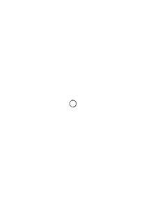. Now how is the essence of a half-turn related to this rule? (Incidentally, in exactly the same way as the essence of negation is related to that one.) The rule seems like a mirror image of the essence in language. (Like a definition)

### [149\[2\]](https://cdn.wittgensteinnachlass.com/2000px/webp/Ms-110/149.webp)

“If you mean _that_ by it, then this rule applies” – if you mean _what_ by it? No, the rule can only be an expression of what is meant.

### [149\[3\]](https://cdn.wittgensteinnachlass.com/2000px/webp/Ms-110/149.webp)

Quite right: as I remarked once before; I read the rule off from negation, as I read off a proposition of geometry from a figure.

### [149\[4\]](https://cdn.wittgensteinnachlass.com/2000px/webp/Ms-110/149.webp)

If I want to give rules, then the meaning of the signs is expressed in them _in this way_.

### [149\[5\]](https://cdn.wittgensteinnachlass.com/2000px/webp/Ms-110/149.webp)

And what use is the rule ~³p = ~p to me, then? How do I use it? By _meaning_ the same thing by ~³p as by ~p?

### [149\[6\]](https://cdn.wittgensteinnachlass.com/2000px/webp/Ms-110/149.webp)

How, then, is it expressed in the use of the words that I mean the same thing by ~³p as by ~p?

### [149\[7\]](https://cdn.wittgensteinnachlass.com/2000px/webp/Ms-110/149.webp)

What does it mean when I say: “In the case of the 3 half-turns I look only at the result, & that is the same as for one half-turn”?

### [149\[8\]](https://cdn.wittgensteinnachlass.com/2000px/webp/Ms-110/149.webp),[150\[1\]](https://cdn.wittgensteinnachlass.com/2000px/webp/Ms-110/150.webp)

Or when I say: “That ~³p = ~p shows me only what in the sign ‘~³p’ symbolizes.”?

### [150\[2\]](https://cdn.wittgensteinnachlass.com/2000px/webp/Ms-110/150.webp)

But again that sounds as though I could then extract the symbol proper from all the signs with the same meaning & would then no longer need a grammar. But that is not how it is.

### [150\[3\]](https://cdn.wittgensteinnachlass.com/2000px/webp/Ms-110/150.webp)

“I follow the direction of the arrow ↗ not its length” [Is not everything already expressed in this?]

### [150\[4\]](https://cdn.wittgensteinnachlass.com/2000px/webp/Ms-110/150.webp)

Is it then the case that the variable must enter into the description of the phenomenon of following?

### [150\[5\]](https://cdn.wittgensteinnachlass.com/2000px/webp/Ms-110/150.webp)

I must make do with what is immediately given.

### [150\[6\]](https://cdn.wittgensteinnachlass.com/2000px/webp/Ms-110/150.webp)

“I take the arrow as my guide” must mean that my action is determined by it.

### [150\[7\]](https://cdn.wittgensteinnachlass.com/2000px/webp/Ms-110/150.webp)

And this in turn means, surely, that it can be derived from the arrow. But one can derive something only from a general expression.

### [150\[8\]](https://cdn.wittgensteinnachlass.com/2000px/webp/Ms-110/150.webp)

All problems vanish in the world of the imagination, where there is neither cause nor effect.

### [150\[9\]](https://cdn.wittgensteinnachlass.com/2000px/webp/Ms-110/150.webp)

We are not in the realm of explanations.

### [151\[1\]](https://cdn.wittgensteinnachlass.com/2000px/webp/Ms-110/151.webp)

Taking a sign as one’s guide means that the sign, inserted into a variable arrangement, yields the way of acting.

### [151\[2\]](https://cdn.wittgensteinnachlass.com/2000px/webp/Ms-110/151.webp)

Only what we take as our guide is a sign.

### [151\[3\]](https://cdn.wittgensteinnachlass.com/2000px/webp/Ms-110/151.webp)

The sign is the value of a variable.

### [151\[4\]](https://cdn.wittgensteinnachlass.com/2000px/webp/Ms-110/151.webp)

Every sentence says: it is _like this_ & not otherwise.

### [151\[5\]](https://cdn.wittgensteinnachlass.com/2000px/webp/Ms-110/151.webp)

Any explanation of this seems impossible: I mean any description of this process.

### [151\[6\]](https://cdn.wittgensteinnachlass.com/2000px/webp/Ms-110/151.webp)

Reading the map: roads, rivers, & on the other hand the gamekeeper’s lodge, the inn, the church, etc.

### [151\[7\]](https://cdn.wittgensteinnachlass.com/2000px/webp/Ms-110/151.webp)

We find the meaning of a word within us, just as if it were given to us in an explanatory table (legend) 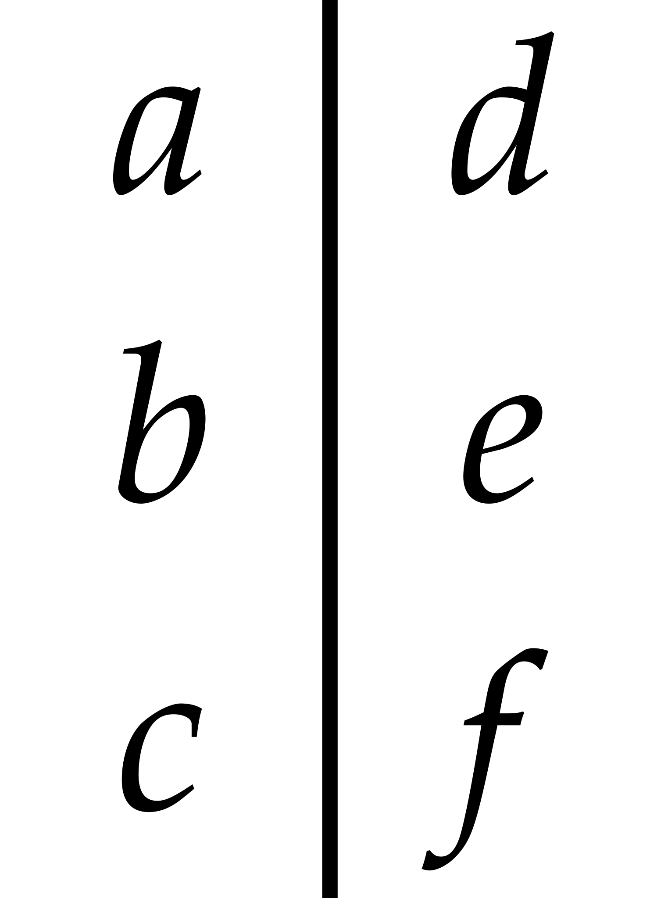.

### [151\[8\]](https://cdn.wittgensteinnachlass.com/2000px/webp/Ms-110/151.webp)

The word & its meaning, that is what I call a “symbol”.

### [151\[9\]](https://cdn.wittgensteinnachlass.com/2000px/webp/Ms-110/151.webp)

“Double negation yields an affirmation” sounds like: carbon and oxygen yield carbon dioxide. But in reality double negation _yields_ nothing; it _is_ something.

### [151\[10\]](https://cdn.wittgensteinnachlass.com/2000px/webp/Ms-110/151.webp),[152\[1\]](https://cdn.wittgensteinnachlass.com/2000px/webp/Ms-110/152.webp)

“Someone who understands negation knows that double negation … …”

### [152\[2\]](https://cdn.wittgensteinnachlass.com/2000px/webp/Ms-110/152.webp)

Here something misleads us into thinking there is a fact.

### [152\[3\]](https://cdn.wittgensteinnachlass.com/2000px/webp/Ms-110/152.webp)

As though we saw a result _of the logical_ process. Whereas the result is only that of the physical process.

### [152\[4\]](https://cdn.wittgensteinnachlass.com/2000px/webp/Ms-110/152.webp)

That method of proof in Indian mathematics, “Look at the figure, then you see …”, is connected with this.

### [152\[5\]](https://cdn.wittgensteinnachlass.com/2000px/webp/Ms-110/152.webp)

The description that describes

this arrangement of arrows has sense.

### [152\[6\]](https://cdn.wittgensteinnachlass.com/2000px/webp/Ms-110/152.webp)

Substitution too is a move in a game & what matters is how one _uses_ it.

### [152\[7\]](https://cdn.wittgensteinnachlass.com/2000px/webp/Ms-110/152.webp)

One can describe a circular region divided by diameters into 8 congruent parts, but it is senseless to say this of an elliptical region. And in that lies what geometry says in this respect about the circular & elliptical regions.

### [152\[8\]](https://cdn.wittgensteinnachlass.com/2000px/webp/Ms-110/152.webp)

Grammar describes language as a temporal phenomenon: But without meaning, i.e. it can acquire importance only through its application.

### [153\[1\]](https://cdn.wittgensteinnachlass.com/2000px/webp/Ms-110/153.webp)

Just think of drawing an inference, which also takes place in time.

### [153\[2\]](https://cdn.wittgensteinnachlass.com/2000px/webp/Ms-110/153.webp)

“Following the arrow” must also be a phenomenon, for what else could it be?

### [153\[3\]](https://cdn.wittgensteinnachlass.com/2000px/webp/Ms-110/153.webp)

The child too _learns_ one language only by means of another.

### [153\[4\]](https://cdn.wittgensteinnachlass.com/2000px/webp/Ms-110/153.webp)

It learns word-language by means of gesture-language. But adults must either take the child’s understanding of the latter for granted or wait for it to emerge.

### [153\[5\]](https://cdn.wittgensteinnachlass.com/2000px/webp/Ms-110/153.webp)

No one thinks of teaching the child gesture-language.

### [153\[6\]](https://cdn.wittgensteinnachlass.com/2000px/webp/Ms-110/153.webp)

No one could think of doing so.

### [153\[7\]](https://cdn.wittgensteinnachlass.com/2000px/webp/Ms-110/153.webp)

↗, _therefore_ ⋰. Why does the emphasis here fall on a generality, on substituting the arrow into a general formula?

### [153\[8\]](https://cdn.wittgensteinnachlass.com/2000px/webp/Ms-110/153.webp)

There is no relation between 5, x², therefore 25.

### [153\[9\]](https://cdn.wittgensteinnachlass.com/2000px/webp/Ms-110/153.webp),[154\[1\]](https://cdn.wittgensteinnachlass.com/2000px/webp/Ms-110/154.webp)

I compare one course of a line with another, say, & say: yes, _it agrees_. What does that mean? The agreement, of course, does not lie in the two courses of the lines. And it never lies in two facts at all. Of no fact can one say that it agrees with another (of course, not with a mental fact either). It is not, as one might suppose, a peculiarity of certain mental processes that something can agree with them.

### [154\[2\]](https://cdn.wittgensteinnachlass.com/2000px/webp/Ms-110/154.webp)

How do we use the expression “it agrees”?

### [154\[3\]](https://cdn.wittgensteinnachlass.com/2000px/webp/Ms-110/154.webp)

What does this mean: I try to draw this line parallel to that other one?

### [154\[4\]](https://cdn.wittgensteinnachlass.com/2000px/webp/Ms-110/154.webp)

(When I say above that “one fact cannot agree with another”, this of course means that it makes no _sense_ to say such a thing.)

### [154\[5\]](https://cdn.wittgensteinnachlass.com/2000px/webp/Ms-110/154.webp)

I couple the action with the model.

### [154\[6\]](https://cdn.wittgensteinnachlass.com/2000px/webp/Ms-110/154.webp)

In what respect are the rules about this word (in this sentence)?

### [154\[7\]](https://cdn.wittgensteinnachlass.com/2000px/webp/Ms-110/154.webp)

It is clear that speaking can take place automatically & then interests us no more than any movement or noise.

### [154\[8\]](https://cdn.wittgensteinnachlass.com/2000px/webp/Ms-110/154.webp)

Is it like this: Language (speaking) interests us only when it portrays something.

### [154\[9\]](https://cdn.wittgensteinnachlass.com/2000px/webp/Ms-110/154.webp)

It must turn out that one cannot ask how language works.

### [154\[10\]](https://cdn.wittgensteinnachlass.com/2000px/webp/Ms-110/154.webp),[155\[1\]](https://cdn.wittgensteinnachlass.com/2000px/webp/Ms-110/155.webp)

And what I mean is this: that in the end language is after all only model & copy.

### [155\[2\]](https://cdn.wittgensteinnachlass.com/2000px/webp/Ms-110/155.webp)

“I cannot make this order any clearer.”

### [155\[3\]](https://cdn.wittgensteinnachlass.com/2000px/webp/Ms-110/155.webp)

I could express my view by saying that in the sentence “go there” the words, too, have only the same function as the movement of the hand.

### [155\[4\]](https://cdn.wittgensteinnachlass.com/2000px/webp/Ms-110/155.webp)

In what sense does one say that one knows the meaning of the word A before one has even followed the order in which it occurs? And to what extent can one say that one has learnt the meaning by following the order? Can the two meanings contradict one another?

### [155\[5\]](https://cdn.wittgensteinnachlass.com/2000px/webp/Ms-110/155.webp)

The fundamental expressed grammatically: What about the sentence “one cannot walk through the same river twice”?

### [155\[6\]](https://cdn.wittgensteinnachlass.com/2000px/webp/Ms-110/155.webp)

I wish to be given an apple. In what sense can I say that even before the fulfilment of the wish I know the meaning of the word apple? How, then, is knowledge of the meaning manifested? i.e. what does one understand by it?

### [155\[7\]](https://cdn.wittgensteinnachlass.com/2000px/webp/Ms-110/155.webp),[156\[1\]](https://cdn.wittgensteinnachlass.com/2000px/webp/Ms-110/156.webp)

Evidently, understanding the word is given by an explanation of the word; which is not the fulfilment of the wish.

### [156\[2\]](https://cdn.wittgensteinnachlass.com/2000px/webp/Ms-110/156.webp)

One thing, incidentally: If the sentence “I can draw him if you give me a pencil”, [as a proof of understanding] is certain & is not first proved by the deed, then it is also made true by a fact quite independent of that deed, & the sentence is then correct even if the drawing is _not_ done when the occasion arises. (But then that sentence loses some of its significance for us.)

### [156\[3\]](https://cdn.wittgensteinnachlass.com/2000px/webp/Ms-110/156.webp)

If that sentence is certain & is not ‘first’ proved by the deed, then it is not proved by the deed at all & its opposite is not proved by the opposite deed, i.e. _it_ is simply independent of this deed.

### [156\[4\]](https://cdn.wittgensteinnachlass.com/2000px/webp/Ms-110/156.webp)

Is there not, then, for us, something essential & something inessential in language? Has Heraclitus not, then, singled out at least one _essential_ property of our language?

### [156\[5\]](https://cdn.wittgensteinnachlass.com/2000px/webp/Ms-110/156.webp),[157\[1\]](https://cdn.wittgensteinnachlass.com/2000px/webp/Ms-110/157.webp)

Imagine the standpoint of an investigator: he finds that in the language of the Earth there is a sign in use that is used according to such & such rules (say, those of negation), & asks himself: What can they use it for? But the answer would be: Whenever a sign with these rules can be used.

### [157\[2\]](https://cdn.wittgensteinnachlass.com/2000px/webp/Ms-110/157.webp)

Language gains _meaning_ from the occasion on which it is used. After all, we do not use language for fun.

### [157\[3\]](https://cdn.wittgensteinnachlass.com/2000px/webp/Ms-110/157.webp)

We can say, in the old way of speaking: the essential thing about a word is its meaning.

### [157\[4\]](https://cdn.wittgensteinnachlass.com/2000px/webp/Ms-110/157.webp)

“_The bearer of the name_ now lives in Paris.”

### [157\[5\]](https://cdn.wittgensteinnachlass.com/2000px/webp/Ms-110/157.webp)

The word _has_ a meaning. How, then, is this meaning fixed? Otherwise than by the explanations of the word?

### [157\[6\]](https://cdn.wittgensteinnachlass.com/2000px/webp/Ms-110/157.webp)

I could say: If the word really points to something, then that too is part of the symbol.

### [157\[7\]](https://cdn.wittgensteinnachlass.com/2000px/webp/Ms-110/157.webp)

It really is “the meaning of meaning” that we are investigating: Or the grammar of the word “meaning”.

### [157\[8\]](https://cdn.wittgensteinnachlass.com/2000px/webp/Ms-110/157.webp)

We say: the essential thing about a word is its meaning; we can replace the word with another word that has the same meaning. In this way, a place for the word is fixed, as it were, & one can put one word in place of the other, if one puts it in the same place.

### [157\[9\]](https://cdn.wittgensteinnachlass.com/2000px/webp/Ms-110/157.webp),[158\[1\]](https://cdn.wittgensteinnachlass.com/2000px/webp/Ms-110/158.webp)

How do I know that two words have the same meaning? Surely either because it is said that A = B, or because both are explained in the same way. But that means that both replace the same sign (A = C & B = C). One might think, however, that there is a kind of explanation (as it were, through application) that would not consist in replacing one sign with another! As when, for instance, one teaches a child negation by preventing it from doing certain things. Do we not thereby prompt the child to attach a sense to words without our replacing them with another sign, and thus without expressing this sense in another way? Do we not, as it were, prompt the child to do something privately, something to which no outward expression is given, or to which the outward expression bears only the relation of an indication, a signal? The meaning could not be put into words; one could only point to it from afar. But then what sense does it make at all to speak of this meaning?

### [158\[2\]](https://cdn.wittgensteinnachlass.com/2000px/webp/Ms-110/158.webp)

Let us imagine an absent-minded person who, on the command “right turn”, had turned to the left & then, touching his forehead, said “oh, I see – ‘right–turn’!” & turned right.

### [158\[3\]](https://cdn.wittgensteinnachlass.com/2000px/webp/Ms-110/158.webp),[159\[1\]](https://cdn.wittgensteinnachlass.com/2000px/webp/Ms-110/159.webp)

“I’m going that way because the edge of the room runs this way”. – “What does that mean: ‘because’?!”

### [159\[2\]](https://cdn.wittgensteinnachlass.com/2000px/webp/Ms-110/159.webp)

I stamp my foot, whereupon someone comes into the room &, in answer to my question ‘why’, says: “I thought that noise meant I should come in”.

### [159\[3\]](https://cdn.wittgensteinnachlass.com/2000px/webp/Ms-110/159.webp)

What kind of investigation is ours? Do I examine the cases I cite as examples to see how probable they are? or whether they are actual? No, I cite only what is possible, so I give grammatical examples.

### [159\[4\]](https://cdn.wittgensteinnachlass.com/2000px/webp/Ms-110/159.webp)

The investigation of whether the meaning of a sign is its effect is also a grammatical investigation.

### [159\[5\]](https://cdn.wittgensteinnachlass.com/2000px/webp/Ms-110/159.webp)

Can experience (or experiment) determine the meaning of a word? So the experiment has shown: “this is the meaning of the word”. But couldn’t we have specified that earlier?

### [159\[6\]](https://cdn.wittgensteinnachlass.com/2000px/webp/Ms-110/159.webp)

One cannot _emphasize_ the internal relation, because it is only there once the derivation is already over.

### [159\[7\]](https://cdn.wittgensteinnachlass.com/2000px/webp/Ms-110/159.webp)

The general disposition can only be given as a general expression is given (variable expression).

### [160\[1\]](https://cdn.wittgensteinnachlass.com/2000px/webp/Ms-110/160.webp)

Can one say: ↗ is derived from ↗ only in so far as one can justify it by means of the latter?

### [160\[2\]](https://cdn.wittgensteinnachlass.com/2000px/webp/Ms-110/160.webp)

Certainly, I _justify_ my action by means of the paradigm.

### [160\[3\]](https://cdn.wittgensteinnachlass.com/2000px/webp/Ms-110/160.webp)

The phenomenon of justification

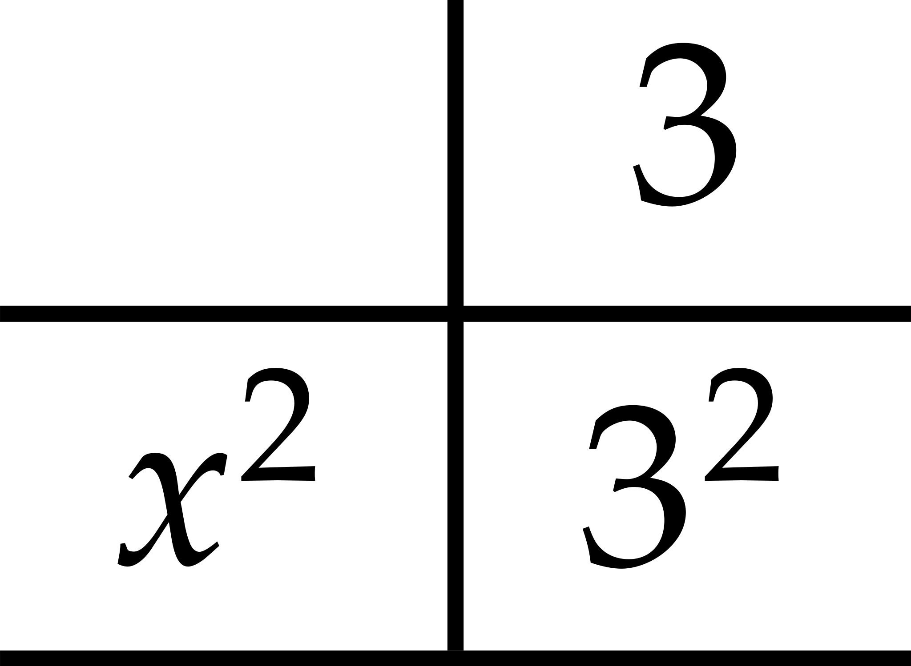.

I justify the result 3² by means of x². This is what every justification looks like.

### [160\[4\]](https://cdn.wittgensteinnachlass.com/2000px/webp/Ms-110/160.webp)

In a certain sense that takes us no further. But it cannot, after all, take us _further_, that is, to the metalogical.

### [160\[6\]](https://cdn.wittgensteinnachlass.com/2000px/webp/Ms-110/160.webp)

In what sense can one say of someone who leaves the room at the word “out!” that he took this word as his guide?!

### [160\[7\]](https://cdn.wittgensteinnachlass.com/2000px/webp/Ms-110/160.webp)

The problem also manifests itself in the question: How does a misunderstanding show itself? For that is the same as the problem: How does it become apparent that I have understood correctly? And that is: How can I explain the meaning? The question now is: Can a misunderstanding manifest itself in one person denying what the other affirms?

### [160\[8\]](https://cdn.wittgensteinnachlass.com/2000px/webp/Ms-110/160.webp),[161\[1\]](https://cdn.wittgensteinnachlass.com/2000px/webp/Ms-110/161.webp)

No, for this, as it is, is a difference of opinion & can be maintained as such. Until we _assume_ that the other person is right ….

### [161\[2\]](https://cdn.wittgensteinnachlass.com/2000px/webp/Ms-110/161.webp)

So if, to explain the word “lilac”, I point to a patch and say “this patch is lilac”, can this explanation then function in two ways?: on the one hand as a definition that uses the patch as a sign & on the other hand as an elucidation? And how would the latter work? I would have to assume that the other person is telling the truth & sees the same thing as I do. The case that actually occurs is this: A tells B in my presence that a certain object is lilac. I hear this, have also seen the object, & think to myself: “now I do know what ‘lilac’ means”. That is, I have drawn an explanation of a word from those sentences. I could say: If what A tells B is the truth, then the word ‘lilac’ must have _this_ meaning. So I can also assume this meaning as a kind of hypothesis & say: if I understand the word _this way_, A is right.

### [161\[3\]](https://cdn.wittgensteinnachlass.com/2000px/webp/Ms-110/161.webp)

One says: “yes, if the word means _that_, then the sentence is true”.

### [161\[4\]](https://cdn.wittgensteinnachlass.com/2000px/webp/Ms-110/161.webp)

But this “that” must surely be expressed somehow.

### [162\[1\]](https://cdn.wittgensteinnachlass.com/2000px/webp/Ms-110/162.webp)

Suppose the explanation of meaning was only a hint: couldn’t one then say: Yes, if this hint is understood _this way_, then the word in this combination yields a true sentence etc. But then this “this way” must be expressed.

### [162\[2\]](https://cdn.wittgensteinnachlass.com/2000px/webp/Ms-110/162.webp)

One could also ask this: Is the explanation something exact, or need it not be anything exact?

### [162\[3\]](https://cdn.wittgensteinnachlass.com/2000px/webp/Ms-110/162.webp)

“In 5 minutes a black patch will appear here”.

“In 5 minutes a black 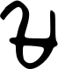 will appear here”. “Do you understand that?”

### [162\[4\]](https://cdn.wittgensteinnachlass.com/2000px/webp/Ms-110/162.webp)

“A  is this: ” that too must be meant in a particular way. That is, the explanation of the sign must itself be meant _in such & such a way_. How could one uncover a misunderstanding here (verification of understanding).

### [162\[5\]](https://cdn.wittgensteinnachlass.com/2000px/webp/Ms-110/162.webp)

Is it really characteristic of following (being guided) that it operates with a general rule?

↗ so then ⋰. That there is a _principle_ of following?

### [162\[6\]](https://cdn.wittgensteinnachlass.com/2000px/webp/Ms-110/162.webp)

Could one say: If no misunderstanding can be established, then there is no difference in meaning either.

### [162\[7\]](https://cdn.wittgensteinnachlass.com/2000px/webp/Ms-110/162.webp),[163\[1\]](https://cdn.wittgensteinnachlass.com/2000px/webp/Ms-110/163.webp)

The patch  as a sign in place of the word “patch” has its own grammar too, & indeed a different one from the grammar it has as a sign of – say – this particular shape. But how is that grammar present to us when we give the explanation of the sign?

### [163\[2\]](https://cdn.wittgensteinnachlass.com/2000px/webp/Ms-110/163.webp)

This problem is not “how can I understand it _this way_” but “how can I understand it in any way at all, so to speak, all at once”.

### [163\[3\]](https://cdn.wittgensteinnachlass.com/2000px/webp/Ms-110/163.webp)

Strange as it sounds: the words ‘line’, ‘surface’, ‘point’ are _as_ different as a line, a surface & a point.

### [163\[4\]](https://cdn.wittgensteinnachlass.com/2000px/webp/Ms-110/163.webp)

“I meant something specific by it when I said …”. – “When did you mean it & how long did it take. And did you mean something different by each word or the same thing throughout the entire sentence?” One can see clearly: there is a lack of clarity here in the use of the word “mean”.

### [163\[5\]](https://cdn.wittgensteinnachlass.com/2000px/webp/Ms-110/163.webp)

Incidentally, how odd that, if one means something by every word – every German word, say – a combination of such words can be nonsense!

### [163\[6\]](https://cdn.wittgensteinnachlass.com/2000px/webp/Ms-110/163.webp)

Recognition: “I saw this man yesterday”. – “How do you know that?” – “I remember his face.” – “How do you know that?” This question is now senseless. The recognition of the man was hypothetical – the remembering was not. But as something non-hypothetical it does not vouch for anything else either, only for itself.

### [164\[1\]](https://cdn.wittgensteinnachlass.com/2000px/webp/Ms-110/164.webp)

One could say: There is no such thing as the meaning of the word “table”, only its use. But that too is misleading.

### [164\[2\]](https://cdn.wittgensteinnachlass.com/2000px/webp/Ms-110/164.webp)

Does the explanation of the word give me the meaning, or does it merely help me arrive at the meaning? So that this meaning would not be contained in the explanation, but would merely be brought about by it from outside, as an illness is brought about by something one eats.

### [164\[3\]](https://cdn.wittgensteinnachlass.com/2000px/webp/Ms-110/164.webp)

To say that the sentence is a picture brings out certain features in the grammar of the word “sentence”.

### [164\[4\]](https://cdn.wittgensteinnachlass.com/2000px/webp/Ms-110/164.webp)

Where do the old philosophical problems get their meaning from?

### [164\[5\]](https://cdn.wittgensteinnachlass.com/2000px/webp/Ms-110/164.webp)

The proposition of identity, for example, seemed to have a fundamental significance. But the proposition that this “proposition” is nonsense has taken over that significance.

### [164\[6\]](https://cdn.wittgensteinnachlass.com/2000px/webp/Ms-110/164.webp)

How then do the rules of language differ from those of behaviour?

### [164\[7\]](https://cdn.wittgensteinnachlass.com/2000px/webp/Ms-110/164.webp)

If one cannot specify any goal that would not be attained if these rules were different.

### [164\[8\]](https://cdn.wittgensteinnachlass.com/2000px/webp/Ms-110/164.webp)

Building blocks that would be named after their shapes – – –

### [164\[9\]](https://cdn.wittgensteinnachlass.com/2000px/webp/Ms-110/164.webp),[165\[1\]](https://cdn.wittgensteinnachlass.com/2000px/webp/Ms-110/165.webp)

Whence the meaning of language? Can one really say: Without language we could not communicate with one another. No, that is not like: without a telephone we could not talk from America to Europe. (Unless by “telephone” we mean any device which etc. etc.)

### [165\[2\]](https://cdn.wittgensteinnachlass.com/2000px/webp/Ms-110/165.webp)

But we can say: Without language we could not influence people. Or could not comfort them. Or we could not build houses & machines without a language.

### [165\[3\]](https://cdn.wittgensteinnachlass.com/2000px/webp/Ms-110/165.webp)

It is also correct to say that without the use of their mouths or hands people cannot communicate.

### [165\[4\]](https://cdn.wittgensteinnachlass.com/2000px/webp/Ms-110/165.webp)

The paradox, surely, is that the arbitrary rule has an importance for us. Whereas ordinarily it is precisely what is arbitrary that does not interest us (e.g. rules of a game).

### [165\[5\]](https://cdn.wittgensteinnachlass.com/2000px/webp/Ms-110/165.webp)

The solution can come only when one gives up the resistance of the wrong method.

### [165\[6\]](https://cdn.wittgensteinnachlass.com/2000px/webp/Ms-110/165.webp)

Talk of grammatical rules being arbitrary must be misleading too. What does it mean to say: “they cannot be justified”? And what does it mean to say that the rules of a game are arbitrary, & which rules are not?

### [165\[7\]](https://cdn.wittgensteinnachlass.com/2000px/webp/Ms-110/165.webp),[166\[1\]](https://cdn.wittgensteinnachlass.com/2000px/webp/Ms-110/166.webp)

They cannot be arbitrary in the sense in which one says this of rules that might be other than arbitrary.

### [166\[2\]](https://cdn.wittgensteinnachlass.com/2000px/webp/Ms-110/166.webp)

One would say: The rules by which the dimensions of a steam boiler are determined are not arbitrary, unlike those governing the colour it is painted.

### [166\[3\]](https://cdn.wittgensteinnachlass.com/2000px/webp/Ms-110/166.webp)

In what sense can I say that the sentence is a picture? When I think about it, I want to say: it must be a picture so that it can show me what to do, so that I can take it as my guide. But, comes the answer, then you only want to say that you take the sentence as your guide in the same sense in which you take a picture as your guide.

### [166\[4\]](https://cdn.wittgensteinnachlass.com/2000px/webp/Ms-110/166.webp)

Is every picture a sentence? And what does it mean to say, for instance, that every picture can be used as a sentence?

### [166\[5\]](https://cdn.wittgensteinnachlass.com/2000px/webp/Ms-110/166.webp)

I can translate the description of the garden into a painted picture, and the picture into a description.

### [166\[6\]](https://cdn.wittgensteinnachlass.com/2000px/webp/Ms-110/166.webp)

The word “many”.

### [166\[7\]](https://cdn.wittgensteinnachlass.com/2000px/webp/Ms-110/166.webp)

You use a word, but what it means must surely show itself in the use of this word, for how else is it to show itself?

### [166\[8\]](https://cdn.wittgensteinnachlass.com/2000px/webp/Ms-110/166.webp),[167\[1\]](https://cdn.wittgensteinnachlass.com/2000px/webp/Ms-110/167.webp)

“One cannot say what a word means”.

### [167\[2\]](https://cdn.wittgensteinnachlass.com/2000px/webp/Ms-110/167.webp)

I can describe the whole language in advance; indeed, in a certain sense I can also utter it.

### [167\[3\]](https://cdn.wittgensteinnachlass.com/2000px/webp/Ms-110/167.webp)

Can I be guided better by a red tablet in the sentence than by the word red?

### [167\[4\]](https://cdn.wittgensteinnachlass.com/2000px/webp/Ms-110/167.webp)

“Yes, but the word red once had to be explained to me with the help of such a tablet”. Perhaps, but the red tablet is precisely what is not given to you now. Indeed, you have quite forgotten how you actually learnt the meaning of the word “red” & you use it & it serves you as well as the red tablet (indeed, better).

### [167\[5\]](https://cdn.wittgensteinnachlass.com/2000px/webp/Ms-110/167.webp)

So one would think that one can mean exactly the same thing by the word & just as well as by the tablet.

### [167\[6\]](https://cdn.wittgensteinnachlass.com/2000px/webp/Ms-110/167.webp)

But that is not to say that the language of gestures which makes use of the red object is not more natural to us as human beings.

### [167\[7\]](https://cdn.wittgensteinnachlass.com/2000px/webp/Ms-110/167.webp)

Can I not mean the same thing by “red” as by the red tablet, & can I not also mean something different by the red tablet from what I now mean by “red”?!

### [168\[1\]](https://cdn.wittgensteinnachlass.com/2000px/webp/Ms-110/168.webp)

If language is not a picture & yet makes clear to us how things stand in reality, then it calls up pictures (causally) of which it is not a picture, which it therefore does not determine.

### [168\[2\]](https://cdn.wittgensteinnachlass.com/2000px/webp/Ms-110/168.webp)

Well then, I call those pictures the language proper.

### [168\[3\]](https://cdn.wittgensteinnachlass.com/2000px/webp/Ms-110/168.webp)

But then there is no distinction in principle between sense & nonsense among our signs. For language is, so to speak, not responsible for what it brings forth.

### [168\[4\]](https://cdn.wittgensteinnachlass.com/2000px/webp/Ms-110/168.webp)

What about the blind man; can a part of _language_ not be explained to him? Or rather, not be _described_ to him?

### [168\[5\]](https://cdn.wittgensteinnachlass.com/2000px/webp/Ms-110/168.webp)

If the word ‘red’ is as good as the red tablet, one would think that a blind man could learn the language just as well as a sighted person.

### [168\[6\]](https://cdn.wittgensteinnachlass.com/2000px/webp/Ms-110/168.webp)

Couldn’t I, for example, assume that he sees something red if I hit him on the head?

### [168\[7\]](https://cdn.wittgensteinnachlass.com/2000px/webp/Ms-110/168.webp),[169\[1\]](https://cdn.wittgensteinnachlass.com/2000px/webp/Ms-110/169.webp)

Assuming that, he is still blind for practical life. That is, he does not react like a normal person. But if someone were blind in his eyes, but behaved in such a way that we would have to say that he sees with his palms (this behaviour is easy to imagine), then we would treat him as someone who can see, & we would also consider it possible here to explain the word ‘red’ with the tablet.

### [169\[2\]](https://cdn.wittgensteinnachlass.com/2000px/webp/Ms-110/169.webp)

But suppose _I_ were blind. But how does that help? I can of course assume that I no longer see with my eyes. But here I am in the realm of facts (not of grammar).

### [169\[3\]](https://cdn.wittgensteinnachlass.com/2000px/webp/Ms-110/169.webp)

Or must I not now say: The language of gestures does not exist for the blind man, & it is an essential part of our language? No, for this can only mean that my gestures do not bring it about that he sees gestures. But perhaps it could be done in an entirely different way.

### [169\[4\]](https://cdn.wittgensteinnachlass.com/2000px/webp/Ms-110/169.webp),[170\[1\]](https://cdn.wittgensteinnachlass.com/2000px/webp/Ms-110/170.webp)

Is the situation of someone born blind essentially different from that of someone who has gone blind? I can surely imagine that someone born blind also has a visual inner life, & if someone asks for an explanation of this, I will say that he inherited the impressions. (Of course that is quite immaterial). Only, despite this assumption, he is blind for all practical purposes. And all I want to show by this is that what is at issue here is not a difference in grammar, and thus in what is essential to the world, but facts.

### [170\[2\]](https://cdn.wittgensteinnachlass.com/2000px/webp/Ms-110/170.webp)

_I_ could not give the blind man the ostensive explanation “this is red”. But he could give it to himself in his imagination. But that would make no difference for practical purposes.

### [170\[3\]](https://cdn.wittgensteinnachlass.com/2000px/webp/Ms-110/170.webp)

After all, in geometry too we use letters to designate lines and points, as well as surfaces & solids.

### [170\[4\]](https://cdn.wittgensteinnachlass.com/2000px/webp/Ms-110/170.webp)

What does it mean: I can imagine that in 5 minutes a red circle will appear on this wall.

### [170\[5\]](https://cdn.wittgensteinnachlass.com/2000px/webp/Ms-110/170.webp)

To say that a word has meaning only in the context of a sentence is to say that words which we say have meaning in our language yield _no_ sense in certain combinations. That is, the result is no less nonsensical than an arbitrary combination of strings of sounds which we do not say have meaning.

### [170\[6\]](https://cdn.wittgensteinnachlass.com/2000px/webp/Ms-110/170.webp)

Can one speak of an understanding for which there is no exact criterion?

### [170\[7\]](https://cdn.wittgensteinnachlass.com/2000px/webp/Ms-110/170.webp),[171\[1\]](https://cdn.wittgensteinnachlass.com/2000px/webp/Ms-110/171.webp)

Or of a distinction in understanding, or in meaning, for which there is no such criterion?

### [171\[2\]](https://cdn.wittgensteinnachlass.com/2000px/webp/Ms-110/171.webp)

That is, of a difference in meaning that is not given by the difference between two explanations? But that means: not ultimately by the difference between two signs.

### [171\[3\]](https://cdn.wittgensteinnachlass.com/2000px/webp/Ms-110/171.webp)

Or, what would be even stranger: Is there _one_ difference in meaning that can be explained & another that does not come to light in an explanation?

### [171\[4\]](https://cdn.wittgensteinnachlass.com/2000px/webp/Ms-110/171.webp)

Experience is not something that one can demarcate, by specifying its characteristics, from something else that is not experience; rather, it is a logical form.

### [171\[5\]](https://cdn.wittgensteinnachlass.com/2000px/webp/Ms-110/171.webp)

If one imagines giving names by labelling objects, one could not label a colour (attach a tablet to it) in the same sense as one could label (say) a person or the circular shape.

### [171\[6\]](https://cdn.wittgensteinnachlass.com/2000px/webp/Ms-110/171.webp)

If at the words “red circle” a mental image of a red circle floats before me: how are the words related to this mental image?

### [171\[7\]](https://cdn.wittgensteinnachlass.com/2000px/webp/Ms-110/171.webp)

The mental image evoked by a word serves in thought only as a sign in its turn.

### [172\[1\]](https://cdn.wittgensteinnachlass.com/2000px/webp/Ms-110/172.webp)

I can obviously express an expectation at one time in the words “I expect a red circle”, and at another time, in place of the last words, by means of the coloured image of a red circle. But in this expression there are not two things corresponding to the two words “red” & “circle”. Thus the expression of the second language is of _an entirely different kind_.

### [172\[2\]](https://cdn.wittgensteinnachlass.com/2000px/webp/Ms-110/172.webp)

Does that not show that the explanations “this is red”, “this is a circle” are not yet all there is, but that there is also such an explanation as “this is a red circle”.

### [172\[3\]](https://cdn.wittgensteinnachlass.com/2000px/webp/Ms-110/172.webp)

Besides this, there would also be a language in which red circle would be expressed by placing a circle & a red patch next to each other (just as one could, for instance, designate 3 people & 3 trees by

,

,

but also by ∣∣∣ , ∣∣∣ .)

### [172\[4\]](https://cdn.wittgensteinnachlass.com/2000px/webp/Ms-110/172.webp)

Even if I now have two signs at my disposal, the expression “red circle” & the coloured picture, or the mental image, of the red circle, the question would still be: how, then, is one word assigned to the colour and the other to the shape? For one seems to be able to say that one word directs attention to the colour, the other to the shape. But what does that mean? How can one translate these words into this picture?

### [173\[1\]](https://cdn.wittgensteinnachlass.com/2000px/webp/Ms-110/173.webp)

Or again: If the word ‘red’ brings a colour to mind, then the colour must surely be connected with a shape, how, then, can I abstract from the shape?

### [173\[2\]](https://cdn.wittgensteinnachlass.com/2000px/webp/Ms-110/173.webp)

The important question here is never: how does he know what he is to abstract from? but: how is that possible at all? or: what does it mean?

### [173\[3\]](https://cdn.wittgensteinnachlass.com/2000px/webp/Ms-110/173.webp)

Perhaps it will become clearer if one compares _the_ two languages: in one, a red tablet & one with a circle (say, a black one on a white background) replace the words “red circle”; & in the other, a red circle is painted instead. How does the translation proceed here? He looks, for example, first at the red tablet & chooses a red pencil, then at the circle, & now draws a circle with this pencil. For example, one would first learn that the first tablet always determines the choice of pencil, the second, what we are supposed to draw with it. The two tablets thus belong to different parts of speech (say, a noun and a verb). But in the second language, there would be nothing that one could call two words here.

### [173\[4\]](https://cdn.wittgensteinnachlass.com/2000px/webp/Ms-110/173.webp)

Suppose the order is: “Imagine a red circle”. And I do so: How could I follow the words in this way?

### [174\[1\]](https://cdn.wittgensteinnachlass.com/2000px/webp/Ms-110/174.webp)

Surely that is a sign that we can obey words even without mental images.

### [174\[2\]](https://cdn.wittgensteinnachlass.com/2000px/webp/Ms-110/174.webp)

Our greatest difficulty is to take the world as it is.

### [174\[3\]](https://cdn.wittgensteinnachlass.com/2000px/webp/Ms-110/174.webp)

How can I _justify_ forming this mental image in response to these words?

### [174\[4\]](https://cdn.wittgensteinnachlass.com/2000px/webp/Ms-110/174.webp)

Or: Where does justification end? For where it ends, we too leave off considering the matter.

### [174\[5\]](https://cdn.wittgensteinnachlass.com/2000px/webp/Ms-110/174.webp)

The order is “write a capital a” & I write: A ‒ ‒

### [174\[6\]](https://cdn.wittgensteinnachlass.com/2000px/webp/Ms-110/174.webp)

The fact that interests us is not that I write A; I could just as well have written B (through a slip); but that I now recognize the A as a capital a. But does this recognition consist in anything more than my describing what I have done with the sentence: “I have written a capital a”?

### [174\[7\]](https://cdn.wittgensteinnachlass.com/2000px/webp/Ms-110/174.webp)

How could one use the sound a to justify the written sign “A”, or to show that “E” would be wrong!

### [174\[8\]](https://cdn.wittgensteinnachlass.com/2000px/webp/Ms-110/174.webp),[175\[1\]](https://cdn.wittgensteinnachlass.com/2000px/webp/Ms-110/175.webp)

“But you did not _follow_ the order at all. I said ‘write a’ & you wrote ‘A’. Where is the following here?” To this I would have to reply: “No; there was a connection between the words & what I wrote”.

### [175\[2\]](https://cdn.wittgensteinnachlass.com/2000px/webp/Ms-110/175.webp)

The “causal connection” is not a primary connection, so it makes no sense to feel it either (or anything of the sort).

### [175\[3\]](https://cdn.wittgensteinnachlass.com/2000px/webp/Ms-110/175.webp)

“A gesture can only be understood in such & such a way”. Surely that can only be a sentence of grammar about the word ‘understand’.

### [175\[4\]](https://cdn.wittgensteinnachlass.com/2000px/webp/Ms-110/175.webp)

I say: “what I imagined was not arbitrary (& causal dependence is not dependence), but is determined by a word”.

### [175\[5\]](https://cdn.wittgensteinnachlass.com/2000px/webp/Ms-110/175.webp)

This dependence must be describable: Because you said _that_, I imagined _that_. That means that the dependence _consists_ only in what is described there.

### [175\[6\]](https://cdn.wittgensteinnachlass.com/2000px/webp/Ms-110/175.webp)

Again and again the mistake one is in danger of making is the one expressed in the question “do two people really see the same colour when they speak of red”. (Here one does not consider the criterion of sameness.)

### [175\[7\]](https://cdn.wittgensteinnachlass.com/2000px/webp/Ms-110/175.webp)

In what sense can I say that what I did was in accordance with your order?

### [175\[8\]](https://cdn.wittgensteinnachlass.com/2000px/webp/Ms-110/175.webp),[176\[1\]](https://cdn.wittgensteinnachlass.com/2000px/webp/Ms-110/176.webp)

The justification must always look like this: You said, this … & I did that …. And if one asks further, explanations of words must follow. And if one asks “why did you write A when I said ‘write a capital A’?” then by way of justification one can only appeal to something like the table 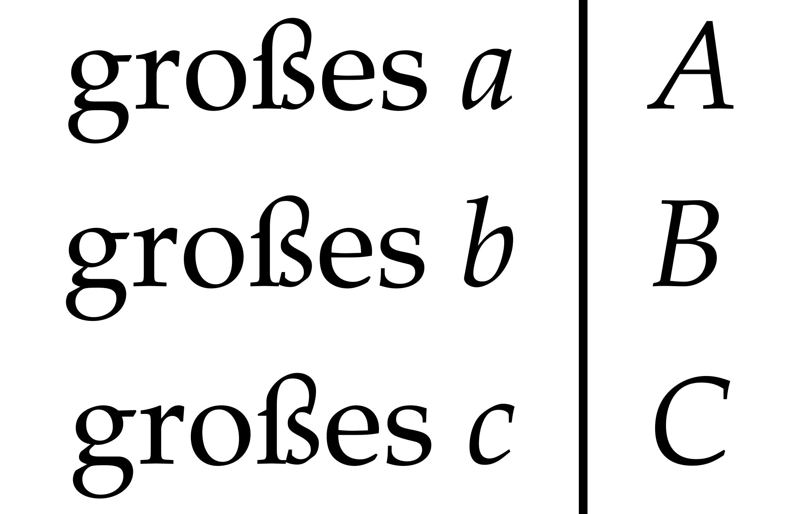. A justification cannot look any different.

### [176\[2\]](https://cdn.wittgensteinnachlass.com/2000px/webp/Ms-110/176.webp)

When we say that philosophy is not to consist of empirical propositions, we are already saying that it is not to consist of propositions about space, time, substance, negation etc.

### [176\[3\]](https://cdn.wittgensteinnachlass.com/2000px/webp/Ms-110/176.webp)

The purpose of grammar is only the purpose of language. The purpose of grammar is the purpose of language.

### [176\[4\]](https://cdn.wittgensteinnachlass.com/2000px/webp/Ms-110/176.webp)

The importance of grammar is the importance of language.

### [176\[5\]](https://cdn.wittgensteinnachlass.com/2000px/webp/Ms-110/176.webp)

After all, grammar describes the meaning of signs.

### [176\[6\]](https://cdn.wittgensteinnachlass.com/2000px/webp/Ms-110/176.webp)

Let us think of the witty meaning we give to Lewis Carroll’s grammatical games. – – –

### [176\[7\]](https://cdn.wittgensteinnachlass.com/2000px/webp/Ms-110/176.webp),[177\[1\]](https://cdn.wittgensteinnachlass.com/2000px/webp/Ms-110/177.webp)

I might ask: Why do I find a grammatical joke in a certain sense deep? (And that is of course philosophical depth.)

### [177\[2\]](https://cdn.wittgensteinnachlass.com/2000px/webp/Ms-110/177.webp)

The words someone says on a given occasion are not arbitrary in so far as it is precisely _these_ words that mean what he wants to say in the language he wants (or has) to speak, i.e. in so far as these grammatical rules apply to precisely those words. But what he means, i.e. the grammatical rules, are not arbitrary in so far as he believes this is the only way to achieve a particular purpose.

### [177\[3\]](https://cdn.wittgensteinnachlass.com/2000px/webp/Ms-110/177.webp)

One might also call a word, e.g. “red”, important in so far as it is used often & for important purposes, in contrast to, say, the word “pipe-lid”. And the grammar of the word ‘red’ is then important because it describes the meaning of the word ‘red’.

### [177\[4\]](https://cdn.wittgensteinnachlass.com/2000px/webp/Ms-110/177.webp)

19.06.1931

### [177\[5\]](https://cdn.wittgensteinnachlass.com/2000px/webp/Ms-110/177.webp)

I now believe it would be right to begin a book with remarks on metaphysics as a kind of magic.

### [177\[6\]](https://cdn.wittgensteinnachlass.com/2000px/webp/Ms-110/177.webp)

In which, however, I must neither speak in favour of magic nor make fun of it.

### [177\[7\]](https://cdn.wittgensteinnachlass.com/2000px/webp/Ms-110/177.webp)

The depth of magic would have to be retained. –

### [177\[8\]](https://cdn.wittgensteinnachlass.com/2000px/webp/Ms-110/177.webp)

Indeed, the elimination of magic here has the character of magic itself.

### [178\[1\]](https://cdn.wittgensteinnachlass.com/2000px/webp/Ms-110/178.webp)

For when I began by speaking of the “_world_” (and not of this tree or table) what else did I want but to bind something higher within my words.

### [178\[2\]](https://cdn.wittgensteinnachlass.com/2000px/webp/Ms-110/178.webp)

Frazer’s representation of people’s magical & religious views is unsatisfactory: it makes these views appear as _errors_.

### [178\[3\]](https://cdn.wittgensteinnachlass.com/2000px/webp/Ms-110/178.webp)

So was Augustine in error when he invokes God on every page of the Confessions? But – one may say – if he was not in error, then surely the Buddhist saint was – or whoever it might be – whose religion gives expression to quite different views. But _none_ of them was in error, except where he put forward a theory.

### [178\[4\]](https://cdn.wittgensteinnachlass.com/2000px/webp/Ms-110/178.webp),[179\[1\]](https://cdn.wittgensteinnachlass.com/2000px/webp/Ms-110/179.webp)

The very idea of wanting to explain the custom – the killing of the priest-king, for example – seems to me misguided. All Frazer does is make it plausible to people who think much as he does. It is very remarkable that in the end all these customs are represented, so to speak, as acts of stupidity. But it will never be plausible that people do all these things out of sheer stupidity. If he explains to us, for example, that the king must be killed in his prime because, according to the views of the savages, his soul would not otherwise be kept fresh, then all one can say is: where that custom and this view go together, the custom does not spring from the view; rather, they are both there. It can happen, and often happens nowadays, that someone gives up a custom after recognizing an error on which that custom was based. But this is the case only where it is enough to draw someone’s attention to his error to dissuade him from his way of acting. But that is not the case with the religious customs of a people, & _that_ is why there is _no_ question of an error.

### [179\[2\]](https://cdn.wittgensteinnachlass.com/2000px/webp/Ms-110/179.webp)

Frazer says that it is very difficult to discover the error in magic – and that is why it persists for so long – because, for instance, an incantation meant to bring rain is sure to appear effective sooner or later. But then it is remarkable that people do not realize sooner that it rains sooner or later anyway.

### [179\[3\]](https://cdn.wittgensteinnachlass.com/2000px/webp/Ms-110/179.webp),[180\[1\]](https://cdn.wittgensteinnachlass.com/2000px/webp/Ms-110/180.webp)

I believe that the undertaking of an explanation is misguided for this reason alone: one need only put together correctly what one _knows_ & add nothing, & the satisfaction sought through the explanation comes of its own accord. And it is not the explanation at all that satisfies here. When Frazer begins & tells us the story of the King of the Wood at Nemi, he does so in a tone which shows that he feels & wants us to feel that something remarkable & terrible is happening here. But the question “why does this happen?” is really answered thus: because it is terrible. That is, the very thing that strikes us as terrible, grand, eerie, tragic, etc., as anything but trivial & meaningless, in this occurrence – _that_ is what brought this occurrence into being.

### [180\[2\]](https://cdn.wittgensteinnachlass.com/2000px/webp/Ms-110/180.webp)

Here one can only _describe_ & say: this is what human life is like.

### [180\[3\]](https://cdn.wittgensteinnachlass.com/2000px/webp/Ms-110/180.webp)

A motto for this book: “Do you see the moon standing there? Only half of it can be seen & yet it is round & beautiful.”

### [180\[4\]](https://cdn.wittgensteinnachlass.com/2000px/webp/Ms-110/180.webp)

The explanation is too uncertain compared with the impression that what is described makes on us.

### [180\[5\]](https://cdn.wittgensteinnachlass.com/2000px/webp/Ms-110/180.webp)

Every explanation is, after all, a hypothesis.

### [181\[1\]](https://cdn.wittgensteinnachlass.com/2000px/webp/Ms-110/181.webp)

But a hypothetical explanation will be of little help to someone troubled by love, say. – It will not put his mind at rest.

### [181\[2\]](https://cdn.wittgensteinnachlass.com/2000px/webp/Ms-110/181.webp)

The throng of thoughts that cannot get out because they all want to push to the front & so get wedged in the exit.

### [181\[3\]](https://cdn.wittgensteinnachlass.com/2000px/webp/Ms-110/181.webp)

If one sets the phrase “the majesty of death” alongside that tale of the priest-king of Nemi, one sees that the two are one. The life of the priest-king represents what is meant by that phrase.

### [181\[4\]](https://cdn.wittgensteinnachlass.com/2000px/webp/Ms-110/181.webp)

Someone who is moved by the majesty of death can give expression to this through such a life. – This too is of course no explanation, but merely substitutes one symbol for another. Or: one ceremony for another.

### [181\[5\]](https://cdn.wittgensteinnachlass.com/2000px/webp/Ms-110/181.webp)

No _opinion_ underlies a religious symbol. And error corresponds only to opinion.

### [181\[6\]](https://cdn.wittgensteinnachlass.com/2000px/webp/Ms-110/181.webp)

One would like to say: Such & such an occurrence took place; laugh if you can.

### [181\[7\]](https://cdn.wittgensteinnachlass.com/2000px/webp/Ms-110/181.webp),[182\[1\]](https://cdn.wittgensteinnachlass.com/2000px/webp/Ms-110/182.webp)

The religious actions, or the religious life, of the priest-king are no different in kind from any genuinely religious action today, say a confession of sins. This too can be “explained” & cannot be explained.

### [182\[2\]](https://cdn.wittgensteinnachlass.com/2000px/webp/Ms-110/182.webp)

Inventing a _language_.

### [182\[3\]](https://cdn.wittgensteinnachlass.com/2000px/webp/Ms-110/182.webp)

Do I know that this apple tree will not bear pears this year?

### [182\[4\]](https://cdn.wittgensteinnachlass.com/2000px/webp/Ms-110/182.webp)

20.06.1931

Burning in effigie. – Kissing the picture of one’s beloved. This is _of course not_ based on a belief in a particular effect on the object that this picture represents. It aims at satisfaction & attains it too. Or rather, it _aims_ at nothing at all; we simply act this way and feel satisfied afterwards.

### [182\[5\]](https://cdn.wittgensteinnachlass.com/2000px/webp/Ms-110/182.webp)

One could also kiss the name of one’s beloved & here it would be clear that the name stood in for her.

### [182\[6\]](https://cdn.wittgensteinnachlass.com/2000px/webp/Ms-110/182.webp)

The same savage who pierces the picture of his enemy, apparently in order to kill him, actually builds his hut of wood & skilfully carves his arrow, & not in effigie.

### [182\[7\]](https://cdn.wittgensteinnachlass.com/2000px/webp/Ms-110/182.webp)

The idea that one can beckon an inanimate object towards oneself as one beckons a person. Here the principle is that of personification.

### [182\[8\]](https://cdn.wittgensteinnachlass.com/2000px/webp/Ms-110/182.webp)

And magic is always based on the idea of symbolism & language.

### [183\[1\]](https://cdn.wittgensteinnachlass.com/2000px/webp/Ms-110/183.webp)

The representation of a wish is eo ipso the representation of its fulfilment. But magic represents a wish; it expresses a wish.

### [183\[2\]](https://cdn.wittgensteinnachlass.com/2000px/webp/Ms-110/183.webp)

Baptism as washing. An error arises only when magic is interpreted scientifically.

### [183\[3\]](https://cdn.wittgensteinnachlass.com/2000px/webp/Ms-110/183.webp)

If the adoption of a child takes place by the mother drawing it through her clothes, it is surely crazy to believe that there is an _error_ here & that she believes she has given birth to the child.

### [183\[4\]](https://cdn.wittgensteinnachlass.com/2000px/webp/Ms-110/183.webp)

The magic in Alice in Wonderland of drying oneself by having the driest thing there is read aloud.

### [183\[5\]](https://cdn.wittgensteinnachlass.com/2000px/webp/Ms-110/183.webp)

In the magical cure of an illness one _intimates_ to it that it should leave the patient.

### [183\[6\]](https://cdn.wittgensteinnachlass.com/2000px/webp/Ms-110/183.webp)

After a description of such a magical cure one always wants to say: If the illness does not understand _that_, then I do not know how one is to tell it.

### [183\[7\]](https://cdn.wittgensteinnachlass.com/2000px/webp/Ms-110/183.webp),[184\[1\]](https://cdn.wittgensteinnachlass.com/2000px/webp/Ms-110/184.webp)

One must distinguish from magical operations those that rest on a false, too simple conception of things & processes. When one says, for instance, that the illness moves from one part of the body to another, or makes arrangements to draw the illness off as if it were a liquid or a thermal state. In that case one forms a false picture, which here means an inaccurate one.

### [184\[2\]](https://cdn.wittgensteinnachlass.com/2000px/webp/Ms-110/184.webp)

What narrowness of mental life in Frazer! Hence: how impossible for him to comprehend any life other than the English life of his time! Frazer cannot imagine a priest who is not at bottom an English parson of our time, with all his stupidity and insipidity.

### [184\[3\]](https://cdn.wittgensteinnachlass.com/2000px/webp/Ms-110/184.webp)

Why should a person’s name not be sacred to him? After all, it is on the one hand the most important instrument he is given, and on the other like a piece of jewellery hung round his neck at birth.

### [184\[4\]](https://cdn.wittgensteinnachlass.com/2000px/webp/Ms-110/184.webp)

If my book is ever published, its preface must acknowledge Paul Ernst’s preface to Grimm’s fairy tales, which I should already have mentioned in the Tractatus Logico-Philosophicus as the source of the expression “misunderstanding of the logic of language”.

### [184\[5\]](https://cdn.wittgensteinnachlass.com/2000px/webp/Ms-110/184.webp)

Nothing is so difficult as doing justice to the facts.

### [184\[6\]](https://cdn.wittgensteinnachlass.com/2000px/webp/Ms-110/184.webp),[185\[1\]](https://cdn.wittgensteinnachlass.com/2000px/webp/Ms-110/185.webp)

Pictures: The soul that leaves the body, that is kept in a receptacle, death as a person or the death of a particular person as a thing standing in some relation to that person.

### [185\[2\]](https://cdn.wittgensteinnachlass.com/2000px/webp/Ms-110/185.webp)

The world & the “end of the world”.

### [185\[3\]](https://cdn.wittgensteinnachlass.com/2000px/webp/Ms-110/185.webp)

The grammar of the word “language”.

### [185\[4\]](https://cdn.wittgensteinnachlass.com/2000px/webp/Ms-110/185.webp)

Suppose: In the Egyptian records there is repeated mention of a colour said to be particularly splendid. We do not know which colour it was. We can only surmise from hints that it must have been a particular brownish red. But one day a brownish-red slab is found, preserved in a special way (by excluding air etc. etc.), & beneath it that name for the colour. Now it is said: now we know what colour it was. (And all the Cambridge aesthetes will wear ties like that.)

### [185\[5\]](https://cdn.wittgensteinnachlass.com/2000px/webp/Ms-110/185.webp)

For us there is no connection that can be described, only the one that shows itself.

### [185\[6\]](https://cdn.wittgensteinnachlass.com/2000px/webp/Ms-110/185.webp)

How am I to know that I have used a word twice with the same meaning? Can I set down the meaning? Or: only in so far as I can set it down can I speak of _it_.

### [185\[7\]](https://cdn.wittgensteinnachlass.com/2000px/webp/Ms-110/185.webp)

What we call meaning must be connected with the primitive language of gestures (of pointing).

### [185\[8\]](https://cdn.wittgensteinnachlass.com/2000px/webp/Ms-110/185.webp),[186\[1\]](https://cdn.wittgensteinnachlass.com/2000px/webp/Ms-110/186.webp)

In what respect can this ostensive explanation now clash with the rules of use?

### [186\[2\]](https://cdn.wittgensteinnachlass.com/2000px/webp/Ms-110/186.webp)

For strictly speaking rules must not clash unless they contradict one another. For in other respects they determine a meaning and are not accountable to one in such a way that they could contradict it.

### [186\[3\]](https://cdn.wittgensteinnachlass.com/2000px/webp/Ms-110/186.webp)

If someone speaks of an ideal language, one would have to ask: ideal in what respect?

### [186\[4\]](https://cdn.wittgensteinnachlass.com/2000px/webp/Ms-110/186.webp)

One cannot learn a language unless one already understands one.

### [186\[5\]](https://cdn.wittgensteinnachlass.com/2000px/webp/Ms-110/186.webp)

The language of the arrangement of the chairs in the room. I can interpret the people coming towards me in the street as language.

### [186\[6\]](https://cdn.wittgensteinnachlass.com/2000px/webp/Ms-110/186.webp)

Whether someone who says a German sentence to me really means it as I understand it is only a hypothesis. All that is certain is that I interpret it _this way_.

### [186\[7\]](https://cdn.wittgensteinnachlass.com/2000px/webp/Ms-110/186.webp),[187\[1\]](https://cdn.wittgensteinnachlass.com/2000px/webp/Ms-110/187.webp)

But what does it mean to interpret it this way? How does this interpretation differ from another? Presumably by the explanation I can give of it. If, for example, I say “in this sense the sentence is made true by _this_ fact, in that sense by that one”, then by pointing to this fact & that I have once again made use of a sign. So in the end it is the _signs_ that must differ.

### [187\[2\]](https://cdn.wittgensteinnachlass.com/2000px/webp/Ms-110/187.webp)

“wet paint”

### [187\[3\]](https://cdn.wittgensteinnachlass.com/2000px/webp/Ms-110/187.webp)

But what does it mean at all to interpret a fact (a complex), as opposed to not taking it as a sign at all?

### [187\[4\]](https://cdn.wittgensteinnachlass.com/2000px/webp/Ms-110/187.webp)

Example: One must read some sentences more than once in order to understand them as sentences.

### [187\[5\]](https://cdn.wittgensteinnachlass.com/2000px/webp/Ms-110/187.webp)

Can one understand anything other than a sentence? Or: Is it not a sentence until one understands it? Thus: Can one understand something otherwise than _as a sentence_?

### [187\[6\]](https://cdn.wittgensteinnachlass.com/2000px/webp/Ms-110/187.webp)

One could talk of “experiencing a sentence”. Now, can this experience be described?

### [187\[7\]](https://cdn.wittgensteinnachlass.com/2000px/webp/Ms-110/187.webp)

When I hear or utter a German sentence, what matters is not that I am well acquainted with German, & the history of that acquaintance does not matter. But what is essential to the particular experience is there: I experience a fact as a sentence.

### [187\[8\]](https://cdn.wittgensteinnachlass.com/2000px/webp/Ms-110/187.webp)

Here it is important that in a certain sense there is no half-sentence.

### [187\[9\]](https://cdn.wittgensteinnachlass.com/2000px/webp/Ms-110/187.webp),[188\[1\]](https://cdn.wittgensteinnachlass.com/2000px/webp/Ms-110/188.webp)

That is, what applies to the word applies to the half-sentence: it has sense only in the context of the sentence.

### [188\[2\]](https://cdn.wittgensteinnachlass.com/2000px/webp/Ms-110/188.webp)

But understanding only begins with the sentence.

### [188\[3\]](https://cdn.wittgensteinnachlass.com/2000px/webp/Ms-110/188.webp)

One cannot say “this structure is still missing something that would make it a sentence”. Rather, it is missing something that would make it _this_ sentence.

### [188\[4\]](https://cdn.wittgensteinnachlass.com/2000px/webp/Ms-110/188.webp)

Example: Mr. N.N. out – in. Where, incidentally, is the verb here? Must one perhaps always supply it mentally in order to understand? That would be like someone believing that one always needs an arrow to indicate a direction & that ⚬ ▶ indicates no direction unless one imagines a line connecting the circle and the point.

### [188\[5\]](https://cdn.wittgensteinnachlass.com/2000px/webp/Ms-110/188.webp)

The Russians who say “he good” instead of “he is good” lose nothing & they do not supply a verb in their minds either.

### [188\[6\]](https://cdn.wittgensteinnachlass.com/2000px/webp/Ms-110/188.webp)

It is no more possible to characterize the complete sentence than the complete fact.

### [188\[7\]](https://cdn.wittgensteinnachlass.com/2000px/webp/Ms-110/188.webp)

Philosophy must not interfere with the actual use of language in any way; in the end, then, it can only describe it.

### [188\[8\]](https://cdn.wittgensteinnachlass.com/2000px/webp/Ms-110/188.webp)

For it cannot justify it either.

### [189\[1\]](https://cdn.wittgensteinnachlass.com/2000px/webp/Ms-110/189.webp)

It leaves everything as it is.

### [189\[2\]](https://cdn.wittgensteinnachlass.com/2000px/webp/Ms-110/189.webp)

It also leaves mathematics as it is (as it is now) & no mathematical discovery can advance it.

### [189\[3\]](https://cdn.wittgensteinnachlass.com/2000px/webp/Ms-110/189.webp)

A “leading problem of mathematical logic” (Ramsey) is a problem of mathematics _like any other_.

### [189\[4\]](https://cdn.wittgensteinnachlass.com/2000px/webp/Ms-110/189.webp)

Just as there is no metaphysics, so there is no metalogic. The word “understand”, the expression “understand a sentence”, is not metalogical either, but an expression like _any_ other in language.

### [189\[5\]](https://cdn.wittgensteinnachlass.com/2000px/webp/Ms-110/189.webp)

As I have often said, philosophy does not lead to renouncing anything, since I do not refrain from saying something, but give up a certain combination of words as senseless. In another sense, however, philosophy does require resignation, but of feeling, not of the intellect. And perhaps that is what makes it so difficult for many. It can be hard not to use an expression, just as it is hard to hold back tears or an outburst of rage.

### [189\[6\]](https://cdn.wittgensteinnachlass.com/2000px/webp/Ms-110/189.webp),[190\[1\]](https://cdn.wittgensteinnachlass.com/2000px/webp/Ms-110/190.webp)

Whenever one says “of course” in response to an assertion (at once, or after some reflection) (in the sense: how could it be otherwise), there is something wrong with that assertion. (If it could not be _otherwise_, then it cannot be _so_ either.)

### [190\[2\]](https://cdn.wittgensteinnachlass.com/2000px/webp/Ms-110/190.webp)

Understanding becomes important when one takes it to be a necessary condition of – say – obeying an order. Let the order be given by a picture of the action ordered. “Yes, but I must also understand this picture”. – What does that mean? – “I must know that I am to do _that_”. But since understanding the order does not yet get that done, this knowledge can only consist in my getting hold of a fact _other_ than that of obeying the order.

### [190\[3\]](https://cdn.wittgensteinnachlass.com/2000px/webp/Ms-110/190.webp)

One can understand a structure (take it as a sentence) in different ways. The way must show itself in an explanation.

### [190\[4\]](https://cdn.wittgensteinnachlass.com/2000px/webp/Ms-110/190.webp)

I believe we would gain a deeper insight if we became clear about the reply: “one cannot imagine how it could be otherwise” (“What would it be like, if it were otherwise”).

### [190\[5\]](https://cdn.wittgensteinnachlass.com/2000px/webp/Ms-110/190.webp)

“To understand a sentence is to know what it says.”

### [190\[6\]](https://cdn.wittgensteinnachlass.com/2000px/webp/Ms-110/190.webp)

“To understand the gesture is to know what it means” (“to know what he means”).

### [191\[1\]](https://cdn.wittgensteinnachlass.com/2000px/webp/Ms-110/191.webp)

That would mean “to know that it means this & not that”. But then this understanding would have to have the multiplicity of a sentence.

### [191\[2\]](https://cdn.wittgensteinnachlass.com/2000px/webp/Ms-110/191.webp)

Now the question is: must I really understand the sign in such a sense in order, say, _to be able to act_ on it? – If someone says: “certainly! otherwise I would not know what I have to do”, I would reply: “But there is no transition from knowing to doing. And no justification in principle for its having been _that_ which corresponded to the order”.

### [191\[3\]](https://cdn.wittgensteinnachlass.com/2000px/webp/Ms-110/191.webp)

One can presumably say by way of justification: I had to do that, after all, for you said “ …” & if one were asked further “but why?”, one would have to give explanations of words of the kind “but that is a book”, yet that would still only be replacing one sign with another.

### [191\[4\]](https://cdn.wittgensteinnachlass.com/2000px/webp/Ms-110/191.webp)

One should note in the penultimate sentence the expression “to be _able_ to act” & the word “what” in “_what_ I have to do”.

### [191\[5\]](https://cdn.wittgensteinnachlass.com/2000px/webp/Ms-110/191.webp)

So what does the sentence “I must understand the order before I can act on it” mean? For this sentence naturally has a sense. But again, certainly not a metalogical one.

### [192\[1\]](https://cdn.wittgensteinnachlass.com/2000px/webp/Ms-110/192.webp)

“But surely I must understand an order to be able to act on it”. Here the ‘must’ is suspicious. If this really is a must – I mean – if it is a logical must, then what we have here is a grammatical remark.

### [192\[2\]](https://cdn.wittgensteinnachlass.com/2000px/webp/Ms-110/192.webp)

One might also ask: How long before obeying the order must you understand it, then?

### [192\[3\]](https://cdn.wittgensteinnachlass.com/2000px/webp/Ms-110/192.webp)

What if one says: “I cannot carry out the order unless I interpret it”? – That means nothing, for carrying it out is an interpretation.

### [192\[4\]](https://cdn.wittgensteinnachlass.com/2000px/webp/Ms-110/192.webp)

“I cannot carry out the order because I do not understand what you mean. – Yes, now I understand you”. What went on when I suddenly understood the other person? I could of course be mistaken, & that I understood the other person was a hypothesis. But an interpretation suddenly occurred to me that struck me as convincing. But was this interpretation anything other than a sentence of a language?

### [192\[5\]](https://cdn.wittgensteinnachlass.com/2000px/webp/Ms-110/192.webp)

Before this understanding, I might also have had several interpretations floating before me, one of which I finally decide on. But the interpretations’ floating before me was the floating before me of expressions.

### [193\[1\]](https://cdn.wittgensteinnachlass.com/2000px/webp/Ms-110/193.webp)

Instead of the play of mental images, we could always suppose that physical pictures were produced – with a pencil on paper, say – so that no “private” language would arise.

### [193\[2\]](https://cdn.wittgensteinnachlass.com/2000px/webp/Ms-110/193.webp)

“Put the book on the table. – Did you understand me?” – “Yes”. “Put the book on the Abracadabra. – Did you understand me?” “No”. – Now I point to the chair with an explanatory gesture & say “Abracadabra” as I do so. “Put the book on the Abracadabra. – Did you understand me this time?” “Yes”. – So what has changed? We have been given a different sign.

### [193\[3\]](https://cdn.wittgensteinnachlass.com/2000px/webp/Ms-110/193.webp)

When I rectify a philosophical error & say that one has always imagined it this way, but it is not like that, I always point to an analogy that one has been guided by, & show that this analogy does not hold.

### [193\[4\]](https://cdn.wittgensteinnachlass.com/2000px/webp/Ms-110/193.webp),[194\[1\]](https://cdn.wittgensteinnachlass.com/2000px/webp/Ms-110/194.webp)

The idea one has of understanding is something like this: in understanding, one gets from the sign closer to the verifying fact, perhaps by imagining it. And even if one gets no closer in any essential sense, i.e. logically, there is still something right about the idea that understanding consists in imagining the fact. The language of imagination is primitive in the same sense as the language of gestures.

### [194\[2\]](https://cdn.wittgensteinnachlass.com/2000px/webp/Ms-110/194.webp)

Therefore, there is also some truth to the idea that unimaginability is a criterion of nonsensicality.

### [194\[3\]](https://cdn.wittgensteinnachlass.com/2000px/webp/Ms-110/194.webp)

What do we call fundamental?

### [194\[4\]](https://cdn.wittgensteinnachlass.com/2000px/webp/Ms-110/194.webp)

What do we call a natural necessity?

### [194\[5\]](https://cdn.wittgensteinnachlass.com/2000px/webp/Ms-110/194.webp)

Why do we feel that the investigation of grammar is fundamental?

### [194\[6\]](https://cdn.wittgensteinnachlass.com/2000px/webp/Ms-110/194.webp)

The word “fundamental” cannot mean anything metalogical or philosophical either, if it has any meaning at all.

### [194\[7\]](https://cdn.wittgensteinnachlass.com/2000px/webp/Ms-110/194.webp)

We chase metaphysics out of all its hiding places.

### [194\[8\]](https://cdn.wittgensteinnachlass.com/2000px/webp/Ms-110/194.webp)

The investigation of grammar is fundamental in the same sense in which we can call language fundamental – call it, say, its own foundation.

### [194\[9\]](https://cdn.wittgensteinnachlass.com/2000px/webp/Ms-110/194.webp),[195\[1\]](https://cdn.wittgensteinnachlass.com/2000px/webp/Ms-110/195.webp)

After all, our grammatical investigation differs from that of a scholar of English or German, etc.; we are interested, for example, in translation from one language into other languages. More generally, we are interested in rules that the philologist does not consider at all. So we can no doubt draw attention to this difference.

### [195\[2\]](https://cdn.wittgensteinnachlass.com/2000px/webp/Ms-110/195.webp)

“But that is only an outward distinction”. I think there is no other.

### [195\[3\]](https://cdn.wittgensteinnachlass.com/2000px/webp/Ms-110/195.webp)

On the other hand, it would be misleading to say that we deal with what is essential in grammar (and he with what is accidental).

### [195\[4\]](https://cdn.wittgensteinnachlass.com/2000px/webp/Ms-110/195.webp)

We might rather say that what we call grammar is something different from what he calls grammar. Just as we distinguish parts of speech where for him there is no distinction (to be found).

### [195\[5\]](https://cdn.wittgensteinnachlass.com/2000px/webp/Ms-110/195.webp),[196\[1\]](https://cdn.wittgensteinnachlass.com/2000px/webp/Ms-110/196.webp),[197\[1\]](https://cdn.wittgensteinnachlass.com/2000px/webp/Ms-110/197.webp)

22.06.1931

How misleading Frazer’s explanations are can be seen – I believe – from the fact that one could quite well invent primitive customs oneself & it would have to be a coincidence if they were not actually found somewhere. That is, the principle according to which these customs are ordered is much more general than Frazer’s explanation makes it out to be & is present in our own minds, so that we could think up all the possibilities ourselves. – We can no doubt imagine, for instance, that the king of a tribe is kept out of everyone’s sight, but also that every man of the tribe is to see him. The latter will surely not be allowed to happen in some more or less haphazard way; rather, he will be _shown_ to the people. Perhaps no one will be permitted to touch him, but perhaps everyone will _have to_ touch him. Let us remember that after Schubert’s death his brother cut up Schubert’s scores into small pieces & gave his favourite pupils pieces of a few bars each. This action as a sign of piety is _just as_ intelligible to us as the other, that of keeping the scores untouched and inaccessible to anyone. And had Schubert’s brother burnt the scores, that too would be intelligible as a sign of piety. The ceremonial (hot or cold), as opposed to the accidental (lukewarm) (haphazard), characterizes piety. Indeed, Frazer’s explanations would not be explanations at all if they did not ultimately appeal to an inclination in ourselves. Eating & drinking involve dangers not only for the savage but also for us; nothing is more natural than that one should want to protect oneself against them; & now we could think up such precautions ourselves. – But by what principle do we think them up? Evidently by reducing all dangers in form to a few very simple ones that are immediately apparent to people. Thus by the same principle by which the uneducated among us say that the illness moves from the head into the chest etc. etc. In these simple pictures personification will of course play a large part, for we know that people (and so spirits) can be dangerous to people.

### [197\[2\]](https://cdn.wittgensteinnachlass.com/2000px/webp/Ms-110/197.webp)

That a person’s shadow, which looks like a person, or his reflection, that rain, thunderstorms, the phases of the moon, the changes of season, the similarities and differences among animals & between animals and human beings, the phenomena of death, birth & sexual life, in short everything that a person perceives around him year in, year out, interwoven in the most various ways, will figure in his thinking (his philosophy) & his customs, goes without saying, or rather is what we really know & what is interesting.

### [197\[3\]](https://cdn.wittgensteinnachlass.com/2000px/webp/Ms-110/197.webp),[198\[1\]](https://cdn.wittgensteinnachlass.com/2000px/webp/Ms-110/198.webp)

How could fire, or the similarity of fire to the sun, have failed to make an impression on the awakening human mind? But not, perhaps, “because it cannot explain it to itself” (the stupid superstition of our time) – for does an “explanation” make it less impressive? –

### [198\[2\]](https://cdn.wittgensteinnachlass.com/2000px/webp/Ms-110/198.webp),[199\[1\]](https://cdn.wittgensteinnachlass.com/2000px/webp/Ms-110/199.webp)

I do not mean that it must be _fire_ in particular that makes an impression on everyone. Fire no more than any other phenomenon, & one phenomenon makes an impression on one person, another on another. For no phenomenon is in itself particularly mysterious, but any may become so for us & what is characteristic of the awakening human mind is precisely that a phenomenon becomes significant for it. One might almost say that the human being is a ceremonial animal. That is probably partly false and partly nonsensical, but there is also something right about it. That is, one might begin a book on anthropology like this: If one looks at the life & behaviour of human beings on earth, one sees that besides the actions one might call animal, the taking of nourishment etc. etc. etc., they also perform actions that have quite a different character & that one might call ritual actions. But now it is nonsense to go on to say that what is characteristic of _these_ actions is that they spring from mistaken views about the physics of things (this is what Frazer does when he says that magic is essentially false physics, or false medicine, technique, etc.). Rather, what is characteristic of ritual action is not a view or an opinion at all, whether right or wrong, although an opinion – a belief – may itself also be ritual, may belong to the rite.

### [199\[2\]](https://cdn.wittgensteinnachlass.com/2000px/webp/Ms-110/199.webp)

If one takes it for granted that human beings delight in their imagination, one should consider that this imagination is not like a painted picture or a sculpted model, but a complicated structure made up of heterogeneous components: words & pictures. One will then no longer contrast operating with written & spoken signs with operating with “mental images” of events.

### [199\[3\]](https://cdn.wittgensteinnachlass.com/2000px/webp/Ms-110/199.webp)

What does someone who constructs (invents) a new language do? By what principle does he proceed? For this principle is the concept of ‘language’.

### [199\[4\]](https://cdn.wittgensteinnachlass.com/2000px/webp/Ms-110/199.webp),[200\[1\]](https://cdn.wittgensteinnachlass.com/2000px/webp/Ms-110/200.webp)

To invent a language does not mean inventing a device for a particular purpose on the basis of laws of nature (or in accordance with them). As in the invention of the petrol engine or the sewing machine, for instance. The invention of a game is not an invention in _this_ sense either, but it is comparable to the invention of a language.

### [200\[2\]](https://cdn.wittgensteinnachlass.com/2000px/webp/Ms-110/200.webp)

I need hardly say that I am only describing the grammar of the word “language” further by bringing it into connection with the grammar of the word “invention”.

### [VB](/w-vb/#ms-110-200.3) [200\[3\]](https://cdn.wittgensteinnachlass.com/2000px/webp/Ms-110/200.webp)

Speaking in passing, in the old conception – say, that of the (great) Western philosophers – there were two kinds of problem in the scientific sense: essential, great, universal problems, & inessential, as it were accidental ones. Our conception, by contrast, is that there is no _great_, essential problem in the scientific sense.

### [200\[4\]](https://cdn.wittgensteinnachlass.com/2000px/webp/Ms-110/200.webp)

To invent a language is to construct a language. To lay down its rules. To write its grammar.

### [200\[5\]](https://cdn.wittgensteinnachlass.com/2000px/webp/Ms-110/200.webp)

Does every invented language extend the concept of language?

### [200\[6\]](https://cdn.wittgensteinnachlass.com/2000px/webp/Ms-110/200.webp)

What holds for the word “language” must also hold for the expression “system of rules”. And so for the word “calculus” too.

### [200\[7\]](https://cdn.wittgensteinnachlass.com/2000px/webp/Ms-110/200.webp)

Incidentally, is it not remarkable that mathematicians always work with pen on paper? And why, for example, never with continuous transitions of colour?

### [200\[8\]](https://cdn.wittgensteinnachlass.com/2000px/webp/Ms-110/200.webp),[201\[1\]](https://cdn.wittgensteinnachlass.com/2000px/webp/Ms-110/201.webp)

How did I come to the concept of ‘language’? Only through the languages that I have learned. But they have led me in a certain sense beyond themselves, because I would now be able to construct a new language, e.g. to invent words. So this method of construction also belongs to the concept of language. But only if I define it in this way.

### [201\[2\]](https://cdn.wittgensteinnachlass.com/2000px/webp/Ms-110/201.webp)

The concept of communicating something to one another. If, for example, I say: I shall call any system of signs that people agree on among themselves in order to communicate with one another ‘language’, one might already ask here: And what do you include under the concept of ‘sign’?

### [201\[3\]](https://cdn.wittgensteinnachlass.com/2000px/webp/Ms-110/201.webp)

Time and again my “and so on” has a limit.

### [201\[4\]](https://cdn.wittgensteinnachlass.com/2000px/webp/Ms-110/201.webp)

What do I call “action”, what “sense perception”?

### [201\[5\]](https://cdn.wittgensteinnachlass.com/2000px/webp/Ms-110/201.webp)

The words “world”, “experience”, “language”, “sentence”, “calculus”, “mathematics” can all serve only to mark trivial distinctions, like “eating”, “resting”, etc.

### [201\[6\]](https://cdn.wittgensteinnachlass.com/2000px/webp/Ms-110/201.webp)

For even if such a word were the title of our grammar – say, the word “grammar” – this title would have only to distinguish this book from other books.

### [201\[7\]](https://cdn.wittgensteinnachlass.com/2000px/webp/Ms-110/201.webp),[202\[1\]](https://cdn.wittgensteinnachlass.com/2000px/webp/Ms-110/202.webp)

There are no general discussions of the world & language.

### [202\[2\]](https://cdn.wittgensteinnachlass.com/2000px/webp/Ms-110/202.webp)

I say a sentence, “I see a black circle”; but surely the words are not what matters; so let us put “a b c d e” in its place. But now I cannot simply connect these signs with the sense given above (unless I take “a b c d e” as one word & take this word as an abbreviation of the sentence above). And yet this difficulty is strange. I could put it this way: I am not used to saying ‘a’ instead of ‘I’ & ‘b’ instead of ‘see’, etc. But I do not mean by this that, if I were used to it, I would immediately associate the word ‘a’ with the word ‘I’; rather, I mean that I am not used to using ‘a’ in place of ‘I’ – with the meaning of ‘I’.

### [202\[3\]](https://cdn.wittgensteinnachlass.com/2000px/webp/Ms-110/202.webp)

I hold my cheek, & someone asks why I am doing it & I reply: “Toothache”. This plainly means the same as “I have toothache”, but I neither picture the missing words in my mind nor feel their absence in any way. So it is also possible for me to utter the words “I have toothache” in the sense in which I would utter just the last word, or as if the three were just _one_ word.

### [202\[4\]](https://cdn.wittgensteinnachlass.com/2000px/webp/Ms-110/202.webp),[203\[1\]](https://cdn.wittgensteinnachlass.com/2000px/webp/Ms-110/203.webp)

Is it perhaps like this: a kind of building block can be important because it is used a great deal & for important things, and the word is a building block?

### [203\[2\]](https://cdn.wittgensteinnachlass.com/2000px/webp/Ms-110/203.webp)

And yet there is still something that is not clear, as can be seen, for instance, in the threefold use of the word ‘is’. For what does it mean when I say that in the sentence ‘the rose is red’ the word ‘is’ has a different meaning from the one it has in ‘2 × 2 is 4’? If one says this means that different rules hold for these two words, one must first say that here we have only _one_ word. But to say that in one case _these_ rules hold for it and in the other case those do is nonsense. And that in turn is connected with the question: how are we conscious of all the rules when we use a word with a particular meaning, & yet the rules constitute the meaning?

### [203\[3\]](https://cdn.wittgensteinnachlass.com/2000px/webp/Ms-110/203.webp)

One could imagine a language in which the meaning of words alternates according to certain rules, for example: in the morning, the word A means this, in the afternoon it means that. Or a language in which the words change daily, with each day every letter of the previous day being replaced by the next in the alphabet (& z by a).

### [203\[4\]](https://cdn.wittgensteinnachlass.com/2000px/webp/Ms-110/203.webp),[204\[1\]](https://cdn.wittgensteinnachlass.com/2000px/webp/Ms-110/204.webp)

23.06.1931

One says that the soul _leaves_ the body, but then, to strip it of every similarity to the body & so that one does not for a moment think that some kind of gaseous thing is meant, one says that the soul is incorporeal, non-spatial; but with the word “leaves” one has already said everything. Show me _how_ you use the word “psychical”, & I will see whether the soul is “incorporeal”, & what you understand by “spirit”.

### [204\[2\]](https://cdn.wittgensteinnachlass.com/2000px/webp/Ms-110/204.webp)

Frazer would be capable of believing that a savage dies because of an error. The primary-school readers say that Attila undertook his great campaigns because he believed he possessed the sword of the god of thunder.

### [204\[3\]](https://cdn.wittgensteinnachlass.com/2000px/webp/Ms-110/204.webp)

We must plough through the whole of language.

### [204\[4\]](https://cdn.wittgensteinnachlass.com/2000px/webp/Ms-110/204.webp),[205\[1\]](https://cdn.wittgensteinnachlass.com/2000px/webp/Ms-110/205.webp)

Frazer: “… That these observances are dictated by fear of the ghost of the slain seems certain; …” But why does he use the word “ghost”? So he understands this superstition very well, since he explains it to us with a superstitious word familiar to him. Or rather, he could have seen from this that there is something in us too that speaks for those ways of acting of the savages. – If I, who do not believe that there are anywhere human-superhuman beings that one can call gods – if I say: “I fear the vengeance of the gods”, that shows that I (can) mean something by it, or can give expression to a feeling that has nothing to do with that belief.

### [205\[2\]](https://cdn.wittgensteinnachlass.com/2000px/webp/Ms-110/205.webp)

I want to say: nothing shows our kinship with those savages better than the fact that Frazer has ready to hand a word as familiar to him & to us as “ghost” or “shade” to describe the views of these people.

### [205\[3\]](https://cdn.wittgensteinnachlass.com/2000px/webp/Ms-110/205.webp)

(For that is different from his describing the savages, for instance, as imagining that their heads fall off when they have slain an enemy. Here there would be nothing superstitious or magical about _our description_.)

### [205\[4\]](https://cdn.wittgensteinnachlass.com/2000px/webp/Ms-110/205.webp)

Indeed, this peculiarity does not concern just the expressions “ghost” & “shade”, & far too little is made of the fact that we count the words “soul”, “mind” (“Spirit”) as part of our own cultivated vocabulary. By contrast it is a trifle that we do not believe our soul eats & drinks.

### [205\[5\]](https://cdn.wittgensteinnachlass.com/2000px/webp/Ms-110/205.webp)

Frazer is much more of a savage than most of his savages, for they will not be so far from understanding a spiritual matter as an Englishman of the 20th century. _His_ explanations of primitive customs are much cruder than the sense of these customs themselves.

### [205\[6\]](https://cdn.wittgensteinnachlass.com/2000px/webp/Ms-110/205.webp)

A whole mythology is laid down in our language.

### [206\[1\]](https://cdn.wittgensteinnachlass.com/2000px/webp/Ms-110/206.webp)

Driving out death or killing death; but on the other hand death is represented as a skeleton, and so is itself in a certain sense dead. “As dead as death”. ‘Nothing is as dead as death; nothing as beautiful as beauty itself. The picture in terms of which one imagines reality here is that beauty, death, etc. are the pure (concentrated) substance, whereas in a beautiful object the substance is present as an admixture. – And don’t I recognize here my own reflections on object & complex?

### [206\[2\]](https://cdn.wittgensteinnachlass.com/2000px/webp/Ms-110/206.webp)

The primitive forms of our language: noun, adjective & verb show the simple picture to whose form it seeks to make everything conform.

### [206\[3\]](https://cdn.wittgensteinnachlass.com/2000px/webp/Ms-110/206.webp)

Looking for strawberries & the visual field.

### [206\[4\]](https://cdn.wittgensteinnachlass.com/2000px/webp/Ms-110/206.webp)

But if the general concept of language thus dissolves, so to speak, doesn’t philosophy dissolve too? No, for its task is not to create a new language but to clean up the one we have.

### [206\[5\]](https://cdn.wittgensteinnachlass.com/2000px/webp/Ms-110/206.webp)

But now one might say: “You give us rules for the use of sentences; but how are we to recognize that something is a sentence?”

### [206\[6\]](https://cdn.wittgensteinnachlass.com/2000px/webp/Ms-110/206.webp),[207\[1\]](https://cdn.wittgensteinnachlass.com/2000px/webp/Ms-110/207.webp)

I should not have said that natural necessity is characteristically expressed by an arbitrary rule. Rather: what is naturally necessary is not expressed, as what is necessary is, by a necessary proposition, but is characteristically expressed by a rule that simply describes what is the case.

### [207\[2\]](https://cdn.wittgensteinnachlass.com/2000px/webp/Ms-110/207.webp)

I want to say: the whole of grammar must be taken as an arrangement of external rules, including all the rules for substitution, for example, & what is essential must be seen only in the application of this whole structure.

### [207\[3\]](https://cdn.wittgensteinnachlass.com/2000px/webp/Ms-110/207.webp)

A grammatical rule is to forbid something, for example, say, putting the word ‘A’ in place of the word ‘B’. But how can it (then) forbid putting the ‘is’ from “2 × 2 = 4” in place of the word ‘is’ in “the rose is red”? That is nonsense.

### [207\[4\]](https://cdn.wittgensteinnachlass.com/2000px/webp/Ms-110/207.webp)

It comes from the pernicious idea that behind the word there is an invisible trail of rules, so that it would make sense to speak of _two_ words that look alike. What we have is _one_ word that can be replaced by two words that must not be substituted for each other.

### [207\[5\]](https://cdn.wittgensteinnachlass.com/2000px/webp/Ms-110/207.webp)

Imagine the absurd rule: there is _one_ word ‘A’ that I may substitute as an argument in f(ξ) & one that I may not substitute.

### [208\[1\]](https://cdn.wittgensteinnachlass.com/2000px/webp/Ms-110/208.webp)

Language must be taken & considered as an institution in its entirety.

### [208\[2\]](https://cdn.wittgensteinnachlass.com/2000px/webp/Ms-110/208.webp)

[The poor spelling of my youth, up to about my 18th or 19th year, is connected with the rest of my character (my weakness in learning).]

### [208\[3\]](https://cdn.wittgensteinnachlass.com/2000px/webp/Ms-110/208.webp)

Imagine a diary kept with signals. Say, the page divided into sections, one for each hour, and now ‘☓’ means I am sleeping, ‘|’ I am getting up, ‘Г’ I am writing, etc.

### [208\[4\]](https://cdn.wittgensteinnachlass.com/2000px/webp/Ms-110/208.webp)

Must not the rule of the language – that this sign means _this_, then – be laid down somewhere?

### [208\[5\]](https://cdn.wittgensteinnachlass.com/2000px/webp/Ms-110/208.webp)

Must not the mere fact that it _can_ be laid down say everything?

### [208\[6\]](https://cdn.wittgensteinnachlass.com/2000px/webp/Ms-110/208.webp)

Of course, too: I cannot do _more_ than lay down the rule.

### [208\[7\]](https://cdn.wittgensteinnachlass.com/2000px/webp/Ms-110/208.webp)

And why should I not call ‘☓’ standing on this line a picture of my going to bed then? Of course, I cannot demand that it reproduce the multiplicity contained in those words.

### [208\[8\]](https://cdn.wittgensteinnachlass.com/2000px/webp/Ms-110/208.webp)

After all, going to bed was not determined by that either.

### [209\[1\]](https://cdn.wittgensteinnachlass.com/2000px/webp/Ms-110/209.webp)

How can I check that what I call ‘☓’ is always the same. Unless, for instance, I bring in a memory-image. But that then belongs to the sign.

### [209\[2\]](https://cdn.wittgensteinnachlass.com/2000px/webp/Ms-110/209.webp)

And if I describe it only in the language of signals, then all I know is that ☓ differs from Г, & nothing else.

### [209\[3\]](https://cdn.wittgensteinnachlass.com/2000px/webp/Ms-110/209.webp)

If, for example, someone asks: how do you know that you are doing the same thing now as you did an hour ago, & I reply: well, I’ve written it down; there’s a ‘☓9’ here!

### [209\[4\]](https://cdn.wittgensteinnachlass.com/2000px/webp/Ms-110/209.webp)

So if I express myself in _this_ language, I shall always mean the same thing by “Г”. It must make sense to say that I do the same thing both times when I obey the command “Г” (or that I did the same thing when I did what I designated by “Г”).

### [209\[5\]](https://cdn.wittgensteinnachlass.com/2000px/webp/Ms-110/209.webp)

“I always mean the same thing (by it) when I write ‘it is raining’ in my diary”. – “And what exactly?” The answer would then have to be “well, just that it is raining”, or else another picture must be used. One would point either to actual rain, or to a painted picture of rain, or to a ‘more precise’ description.

### [210\[1\]](https://cdn.wittgensteinnachlass.com/2000px/webp/Ms-110/210.webp)

That the order is a picture means (only) that what I have to do must be clear from the order.

### [210\[2\]](https://cdn.wittgensteinnachlass.com/2000px/webp/Ms-110/210.webp)

Or let us put it this way: it must be clear from the order, in so far as it can be clear from anything at all.

### [210\[3\]](https://cdn.wittgensteinnachlass.com/2000px/webp/Ms-110/210.webp)

(This is of course all a false representation. One cannot say that what I have to do must be clear from the order, for that would mean: the order must be clear from the order.)

### [210\[4\]](https://cdn.wittgensteinnachlass.com/2000px/webp/Ms-110/210.webp)

For suppose it could be clearer from a picture: then someone would have to be able to do something that would go against the order in words, but not against the picture that expresses this order – only more clearly. But it would have to be possible to derive the picture from the order in words, or at least to show by comparison that both order the same thing.

### [210\[5\]](https://cdn.wittgensteinnachlass.com/2000px/webp/Ms-110/210.webp)

The action can be determined by the order _just_ as well as it can be described afterwards. I.e. in so far as it can be described at all; in so far as we can (therefore) talk about it (can distinguish it from other actions), to that extent it can also be determined in advance by language (the order).

### [210\[6\]](https://cdn.wittgensteinnachlass.com/2000px/webp/Ms-110/210.webp),[211\[1\]](https://cdn.wittgensteinnachlass.com/2000px/webp/Ms-110/211.webp)

(Here, of course, I mislead with the words “in so far as it can at all, etc.” For that would mean that one could distinguish a degree of description that can still be attained from one that can no longer be attained; that one could speak of a degree of description that one could get to, as opposed to something that could no longer be described. As though in the end the action had of course not been quite described after all.)

### [211\[2\]](https://cdn.wittgensteinnachlass.com/2000px/webp/Ms-110/211.webp)

In so far as the fact can determine the words of the description, words can determine the fact.

### [211\[3\]](https://cdn.wittgensteinnachlass.com/2000px/webp/Ms-110/211.webp)

Is 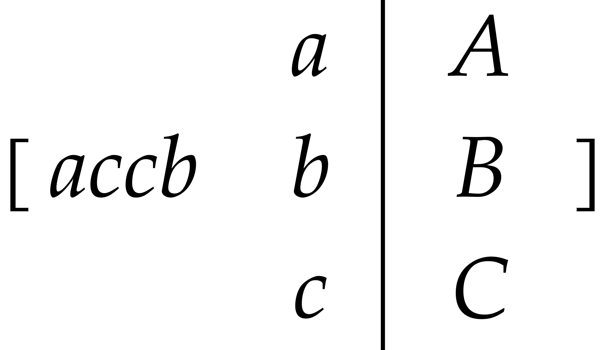 a picture of ACCB?

### [211\[4\]](https://cdn.wittgensteinnachlass.com/2000px/webp/Ms-110/211.webp)

Let us remember that a drawn picture, too, is a picture only by virtue of a particular method of projection.

### [211\[5\]](https://cdn.wittgensteinnachlass.com/2000px/webp/Ms-110/211.webp)

Remember: if you project something complex into something simple in a system of projection, the complex nature of what is projected will nevertheless come to light in the further application of the rule of projection.

### [211\[6\]](https://cdn.wittgensteinnachlass.com/2000px/webp/Ms-110/211.webp)

No logical connection between things can escape language if it is to be able to describe all relations.

### [211\[7\]](https://cdn.wittgensteinnachlass.com/2000px/webp/Ms-110/211.webp),[212\[1\]](https://cdn.wittgensteinnachlass.com/2000px/webp/Ms-110/212.webp)

If one asks: “Is the sentence ‘leave the room’ really a picture of this action?”, I can ask in return: is this stroke / a picture of this book? And yet it may very well be; it all depends on the method of projection. It must be very complicated if the stroke really is to be a picture of the book, & that will show up elsewhere; very simple relations will then get very complicated projections.

### [212\[2\]](https://cdn.wittgensteinnachlass.com/2000px/webp/Ms-110/212.webp)

You must justify your action by reference to the words in a general way; i.e. by reference to the explanations you received not with this case in mind, but in advance, whatever case might arise. The explanation of the language was not to assert or presuppose any particular state of affairs, but had to leave open what is actually the case.

### [212\[3\]](https://cdn.wittgensteinnachlass.com/2000px/webp/Ms-110/212.webp)

“I’m coming because you rang.”

### [212\[4\]](https://cdn.wittgensteinnachlass.com/2000px/webp/Ms-110/212.webp)

How, then, does blue differ from red?

### [212\[5\]](https://cdn.wittgensteinnachlass.com/2000px/webp/Ms-110/212.webp)

Surely we do not mean that one has these properties and the other those. Incidentally, among the properties of blue & red are that this body (or place) is blue and that that one is red.

### [212\[6\]](https://cdn.wittgensteinnachlass.com/2000px/webp/Ms-110/212.webp),[213\[1\]](https://cdn.wittgensteinnachlass.com/2000px/webp/Ms-110/213.webp)

24.06.1931

To the question “What difference is there between blue and red?” one would like to answer: one is blue, the other red. But of course that means nothing, & what one is really thinking of here is the difference between the surfaces or places that have this colour. For otherwise the question has no sense at all.

### [213\[2\]](https://cdn.wittgensteinnachlass.com/2000px/webp/Ms-110/213.webp)

So what I am saying amounts to this: one cannot describe red. But can one not represent it in a painting by painting something red?

### [213\[3\]](https://cdn.wittgensteinnachlass.com/2000px/webp/Ms-110/213.webp)

No, that is not a painterly representation of the meaning of the word ‘red’ (there is no such thing). The portrait of red.

### [213\[4\]](https://cdn.wittgensteinnachlass.com/2000px/webp/Ms-110/213.webp)

But in any case it is surely no accident that, in explaining the meaning of the word ‘red’, one quite naturally points to a red object!

### [213\[5\]](https://cdn.wittgensteinnachlass.com/2000px/webp/Ms-110/213.webp)

(What is natural about it is represented in this sentence by the two occurrences of the word ‘red’.)

### [213\[6\]](https://cdn.wittgensteinnachlass.com/2000px/webp/Ms-110/213.webp)

How far does the ostensive explanation “_that_ is ‘red’” help one to understand the word?

### [213\[7\]](https://cdn.wittgensteinnachlass.com/2000px/webp/Ms-110/213.webp)

(It does not ‘_help_’ at all, but simply _is_ one of the symbolic rules for the use of the word ‘red’.)

### [213\[8\]](https://cdn.wittgensteinnachlass.com/2000px/webp/Ms-110/213.webp)

In what case do we say that two people give a word the same meaning? How, then, is the meaning fixed? Only by explanations of the language itself: i.e. descriptions of the language.

### [214\[1\]](https://cdn.wittgensteinnachlass.com/2000px/webp/Ms-110/214.webp)

[My book is to be called: A Philosophical Reflection. (As the main title, not the subtitle)]

### [214\[2\]](https://cdn.wittgensteinnachlass.com/2000px/webp/Ms-110/214.webp)

Must it not be _like this_, if I am right: it must be clear from the description of the language what meaning each word has?

### [214\[3\]](https://cdn.wittgensteinnachlass.com/2000px/webp/Ms-110/214.webp)

(And here the expression “if I am right” is incorrect; for if I am really doing philosophy, I must not have to be right. For it is philosophy only when I say nothing but what is self-evident.)

### [214\[4\]](https://cdn.wittgensteinnachlass.com/2000px/webp/Ms-110/214.webp)

I.e. the picture of the picture must itself be a picture in the first sense.

### [214\[5\]](https://cdn.wittgensteinnachlass.com/2000px/webp/Ms-110/214.webp)

I.e. the picture of the picture must be able to replace it.

### [214\[6\]](https://cdn.wittgensteinnachlass.com/2000px/webp/Ms-110/214.webp)

If the description of language gives its meaning at the same time, then one can call language a picture of the world.

### [214\[7\]](https://cdn.wittgensteinnachlass.com/2000px/webp/Ms-110/214.webp)

The description of language must do the same work as language.

### [214\[8\]](https://cdn.wittgensteinnachlass.com/2000px/webp/Ms-110/214.webp)

For then I really can see from the sentence, the description, how things stand in reality.

### [214\[9\]](https://cdn.wittgensteinnachlass.com/2000px/webp/Ms-110/214.webp),[215\[1\]](https://cdn.wittgensteinnachlass.com/2000px/webp/Ms-110/215.webp)

(But only _that_ is called “description”, & only that is called “seeing how things stand”!)

### [215\[2\]](https://cdn.wittgensteinnachlass.com/2000px/webp/Ms-110/215.webp)

(And it is nothing else that we are all saying by this: that we see from the description how things actually stand.)

### [215\[3\]](https://cdn.wittgensteinnachlass.com/2000px/webp/Ms-110/215.webp)

Suppose we leave out the translation into the language of gestures; does it then become apparent in the application (I mean, in the grammatical rules of application) that this translation is possible?

### [215\[4\]](https://cdn.wittgensteinnachlass.com/2000px/webp/Ms-110/215.webp)

And can it become apparent only that it is _possible_, or also that it is necessary?

### [215\[5\]](https://cdn.wittgensteinnachlass.com/2000px/webp/Ms-110/215.webp)

But how could that be? For then the ostensive explanations would be superfluous; but that already means that they are implicitly contained in the others. How can a rule of a game be superfluous _if_ it is to be _that_ very game, the one that is characterized by _this_ rule too?

### [215\[6\]](https://cdn.wittgensteinnachlass.com/2000px/webp/Ms-110/215.webp),[216\[1\]](https://cdn.wittgensteinnachlass.com/2000px/webp/Ms-110/216.webp)

The mistake here, time and again, is that I forget that it takes _all_ the rules to characterize the game, the language, & that these rules are not accountable to a reality that could serve as a check on them & thereby allow one to doubt whether a rule was necessary or correct. (Compare the problem of the consistency of non-Euclidean geometry!)

### [216\[2\]](https://cdn.wittgensteinnachlass.com/2000px/webp/Ms-110/216.webp)

Grammar is not accountable to any reality.

### [216\[3\]](https://cdn.wittgensteinnachlass.com/2000px/webp/Ms-110/216.webp)

(Grammar is not answerable to reality.)

### [216\[4\]](https://cdn.wittgensteinnachlass.com/2000px/webp/Ms-110/216.webp)

If it is _necessary_, that means that the language using the little red tablet is in some sense necessary; & not on an equal footing with the word-language.

### [216\[5\]](https://cdn.wittgensteinnachlass.com/2000px/webp/Ms-110/216.webp)

I can call a light red ‘A’ & a dark one ‘B’, but it will be apparent in the grammar of these words that they mean things that are related in the same sense in which light red & dark red are related. It will be possible to say, for example, that the colour of a patch is A & then grows darker and darker until it is B.

### [216\[6\]](https://cdn.wittgensteinnachlass.com/2000px/webp/Ms-110/216.webp),[217\[1\]](https://cdn.wittgensteinnachlass.com/2000px/webp/Ms-110/217.webp)

(A simile belongs to our structure; but we cannot draw any consequences from it either; it does not lead us beyond itself, but must stand as a simile. We cannot draw any inferences from it. So, when we compare a sentence with a picture (where, of course, what we understand by ‘picture’ must already be fixed in us) or when I compare the application of language with that of, say, the calculus of multiplication. Philosophy simply lays everything out & explains nothing & infers nothing.)

### [217\[2\]](https://cdn.wittgensteinnachlass.com/2000px/webp/Ms-110/217.webp)

But where does the certainty come from that it must become apparent? Here I lack an expression.

### [217\[3\]](https://cdn.wittgensteinnachlass.com/2000px/webp/Ms-110/217.webp)

For only what becomes apparent in the application is the meaning! On the other hand, if one says “it must become apparent in the application that the word has _this_ meaning”, that is misleading. _Which_ meaning, then? – And the expression that answers this question must contain the application that shows the meaning.

### [217\[4\]](https://cdn.wittgensteinnachlass.com/2000px/webp/Ms-110/217.webp)

The explanation of the word-meaning is the explanation of the application of the word.

### [217\[5\]](https://cdn.wittgensteinnachlass.com/2000px/webp/Ms-110/217.webp)

To say that the word “red”, with all the prescriptions that apply to it, might mean what the word “blue” actually means, and thus that the meaning is not fixed by these rules, makes sense only if I can express the two possible meanings & then say which is the one I have specified.

### [218\[1\]](https://cdn.wittgensteinnachlass.com/2000px/webp/Ms-110/218.webp)

(But this last statement is precisely the rule that was previously missing and that makes the meaning unambiguous.)

### [218\[2\]](https://cdn.wittgensteinnachlass.com/2000px/webp/Ms-110/218.webp)

What if a language consisted entirely of simple & independent signals?! Imagine this case: suppose it is a matter of describing a surface on which all sorts of figures can appear in black and white. Would it now be possible to label all possible figures by independent symbols? (I am assuming here that I want to talk about only, say, 100000 figures.) If I am right, the whole of geometry must reappear in the rules for the use of these 100000 signals. (Just as arithmetic would if instead of 10 independent numerals we used a trillion.)

### [218\[3\]](https://cdn.wittgensteinnachlass.com/2000px/webp/Ms-110/218.webp)

To express a dependence, a dependence is needed.

### [218\[4\]](https://cdn.wittgensteinnachlass.com/2000px/webp/Ms-110/218.webp),[219\[1\]](https://cdn.wittgensteinnachlass.com/2000px/webp/Ms-110/219.webp)

If one says that surely it must be apparent in the rule for the application of two words if they designate things that have an internal kinship, one makes the mistake here of forgetting that I can speak of this kinship of meanings only if it shows up in the explanation of the meaning – in the ostensive explanation, say. So if, for instance, I say “‘A’ means _this_ colour, ‘B’ _this_ one”, then whatever kinship there is in the meanings I have put into the explanation.

### [219\[2\]](https://cdn.wittgensteinnachlass.com/2000px/webp/Ms-110/219.webp)

“But surely ‘red’ & ‘blue’ now have a quite definite meaning for me.” No doubt, I attest this to myself by imagining something at ‘blue’ & something at ‘red’. But in doing so I am already translating the word-language into another language. The grammar of the word-language has nothing else to do but make the two signs different. For there was nothing else we could say except that blue and red are different.

### [219\[3\]](https://cdn.wittgensteinnachlass.com/2000px/webp/Ms-110/219.webp)

Objection: “If I had only the words, I could imagine now one thing, now another in connection with them”. But what is the criterion for my always imagining the same thing, or for its being now one thing, now another?

### [219\[4\]](https://cdn.wittgensteinnachlass.com/2000px/webp/Ms-110/219.webp),[220\[1\]](https://cdn.wittgensteinnachlass.com/2000px/webp/Ms-110/220.webp)

I said “there was nothing else we could say except that blue & red are different”. But surely this is laid down only in the grammatical rule that those two words are not to be substituted for one another. What is said in other grammatical rules is not said in this one. And there _are_ other rules that deal with the words ‘blue’ & ‘red’ (e.g. the ostensive rules “_this_ is blue” & “_this_ is red”, in accordance with which I also called up those mental images). The only essential point is that one cannot say that the meaning of these words comes & goes with the mental images called up, that the mental image is the meaning. And that, insofar as they attest to a meaning, they must accord with the very rules that fix the meaning.

### [220\[2\]](https://cdn.wittgensteinnachlass.com/2000px/webp/Ms-110/220.webp)

The meaning must be specifiable from the outset.

### [220\[3\]](https://cdn.wittgensteinnachlass.com/2000px/webp/Ms-110/220.webp)

A word can mean a colour, but also a coloured patch. But that does not mean that this patch is the meaning of the word. That I can say of the meaning of the word, for example, that it is to the left of another patch or that it disappears etc. So it would probably be better to say ‘designate’ instead of ‘mean’ in the first sentence.

### [220\[4\]](https://cdn.wittgensteinnachlass.com/2000px/webp/Ms-110/220.webp),[221\[1\]](https://cdn.wittgensteinnachlass.com/2000px/webp/Ms-110/221.webp)

The sentence similar to the fact! Similarity of a geometrical figure to its projection. Obvious & non-obvious similarity.

Projection of 2 + 3 into 5.

A mental image apparently on a different level from another picture.

The description of the mental image similar to the description of the fact. But the description of the sentence also similar to the description of the fact, provided we describe the whole system of projection.

Only the sign _with_ its grammar is what justifies following it in this way, & hence what has a description that contains the description of the fact (following). The sentence is as similar to the fact as “5” is to the expression 2 + 3.

### [221\[2\]](https://cdn.wittgensteinnachlass.com/2000px/webp/Ms-110/221.webp)

The application of language goes beyond language, but interpretation does not. Interpretation still takes place at the general level, in preparation for any application. It takes place within _grammar_ & not in the use of language.

### [221\[3\]](https://cdn.wittgensteinnachlass.com/2000px/webp/Ms-110/221.webp)

It is hard not to lose oneself in some simile.

### [221\[4\]](https://cdn.wittgensteinnachlass.com/2000px/webp/Ms-110/221.webp)

Can one say, then: It is quite enough for philosophy to make its remarks about expression in the German language, about the chemist’s language etc.? I.e., philosophy makes its remarks about expression in different languages, not about a concept superordinate to them.

### [221\[5\]](https://cdn.wittgensteinnachlass.com/2000px/webp/Ms-110/221.webp),[222\[1\]](https://cdn.wittgensteinnachlass.com/2000px/webp/Ms-110/222.webp)

We are speaking of the spatial & temporal _phenomena_ of language. Not of some absurdity outside space & time. But we speak of language as we do of the pieces in a game of chess, by tabulating rules for them, not by describing their physical properties.

### [222\[2\]](https://cdn.wittgensteinnachlass.com/2000px/webp/Ms-110/222.webp)

Dogmatism in philosophy arises when assertions are made that are not grammatical rules which everyone recognizes as rules of their own expression. This again gives the impression that in philosophy we have to construct things & make new discoveries, find connections.

### [222\[3\]](https://cdn.wittgensteinnachlass.com/2000px/webp/Ms-110/222.webp)

In logic we (admittedly) seem to be dealing with ‘_all propositions_’. But we merely construct a calculus & leave its application to itself.

### [222\[4\]](https://cdn.wittgensteinnachlass.com/2000px/webp/Ms-110/222.webp)

In philosophy we work with languages, the very ones we use, for what we want to establish are the rules for _their_ use.

### [222\[5\]](https://cdn.wittgensteinnachlass.com/2000px/webp/Ms-110/222.webp)

In philosophy we work with languages, those everyday formations – – –

### [222\[6\]](https://cdn.wittgensteinnachlass.com/2000px/webp/Ms-110/222.webp)

Nor can we attain any greater _generality_ in philosophy than in what we say in life and in science. (I.e. here too we leave everything as it is.)

### [222\[7\]](https://cdn.wittgensteinnachlass.com/2000px/webp/Ms-110/222.webp)

Thus a sensational definition of number is no business of philosophy.

### [222\[8\]](https://cdn.wittgensteinnachlass.com/2000px/webp/Ms-110/222.webp),[223\[1\]](https://cdn.wittgensteinnachlass.com/2000px/webp/Ms-110/223.webp)

Philosophy has to do with existing languages & is not to pretend that it must deal with an abstract language.

### [223\[2\]](https://cdn.wittgensteinnachlass.com/2000px/webp/Ms-110/223.webp)

25.06.1931

Addendum etc.: Surely I can quite plainly let myself be guided by colour, & in a way in which I cannot let myself be guided by words, because I do not have words for all the shades.

### [223\[3\]](https://cdn.wittgensteinnachlass.com/2000px/webp/Ms-110/223.webp)

The meaning of, say, the word “chair” is anchored in many ways.

### [223\[4\]](https://cdn.wittgensteinnachlass.com/2000px/webp/Ms-110/223.webp)

Whatever incidental things go on in uttering the sentence, I must then be able to act in accordance with it. And in doing so the meaning of the words will show itself; but not as if it only then came to light in the action. For it comes to light only in the action that corresponds to the sentence. And whether it corresponds to it can in turn be decided only on the basis of the meaning of the words. Rather, the word-meaning shows itself in _deciding whether_ the action corresponds to the sentence. I.e., the meaning shows itself in collating the fact against the sentence.

### [223\[5\]](https://cdn.wittgensteinnachlass.com/2000px/webp/Ms-110/223.webp),[224\[1\]](https://cdn.wittgensteinnachlass.com/2000px/webp/Ms-110/224.webp)

Insofar as the meaning of the words comes to light in the fact (action), it already comes to light in the description of the fact. (So it is determined entirely within language.)

In what could have been foreseen; what one could already speak of before the fact occurred.)

### [224\[2\]](https://cdn.wittgensteinnachlass.com/2000px/webp/Ms-110/224.webp)

“Bedeutung” comes from “deuten”.

### [224\[3\]](https://cdn.wittgensteinnachlass.com/2000px/webp/Ms-110/224.webp)

But this collation is, after all, independent of whether the sentence is correct or not.

### [224\[4\]](https://cdn.wittgensteinnachlass.com/2000px/webp/Ms-110/224.webp)

But this collation, like the concept of meaning, is a remnant of a primitive conception.

### [224\[5\]](https://cdn.wittgensteinnachlass.com/2000px/webp/Ms-110/224.webp)

If, for example, I collate the actual seating arrangement at a table with a written list, it makes good sense to point to a particular person at each name. But if I were to compare the description of a picture with the picture itself, & the description, besides listing the people, also said that A is kissing B, I would not know what to point to as the correlate of the word ‘kiss’. Or if it said, for example, “A is bigger than B”, what am I to point to at the word ‘bigger’? – Quite clearly I cannot point to anything corresponding to this word in the sense in which I point, say, to the person A in the picture.

### [224\[6\]](https://cdn.wittgensteinnachlass.com/2000px/webp/Ms-110/224.webp),[225\[1\]](https://cdn.wittgensteinnachlass.com/2000px/webp/Ms-110/225.webp)

The word “a certain” & its grammar. An example of how one piles up words to secure a meaning, instead of attending to the rules of the game. (As though one wanted to paint a real face on the king in chess to ensure that it had the right effect.)

### [225\[2\]](https://cdn.wittgensteinnachlass.com/2000px/webp/Ms-110/225.webp)

There is, of course, such an act as “directing attention to the size of the people” or to what they are doing, & in this sense one can also collate the kissing & the relative sizes. This shows how the general concept of meaning could arise. Something analogous happens here to what happens when the pigment takes the place of the colour.

### [225\[3\]](https://cdn.wittgensteinnachlass.com/2000px/webp/Ms-110/225.webp)

The sentence that a word has meaning only in the context of a sentence must of course also read quite differently when correctly formulated. (As a rule of language, of course.)

### [225\[4\]](https://cdn.wittgensteinnachlass.com/2000px/webp/Ms-110/225.webp)

Historical explanation, explanation as a hypothesis of development, is only _one_ way of bringing the data together – of giving a synopsis of them. It is just as possible to see the data in their relation to one another & bring them together in a general picture without doing so in the form of a hypothesis about their development over time.

### [225\[5\]](https://cdn.wittgensteinnachlass.com/2000px/webp/Ms-110/225.webp)

Identification of one’s own gods with gods of other peoples. One convinces oneself that the names have the same meaning.

### [225\[6\]](https://cdn.wittgensteinnachlass.com/2000px/webp/Ms-110/225.webp),[226\[1\]](https://cdn.wittgensteinnachlass.com/2000px/webp/Ms-110/226.webp)

The German language, & every language, not only lays down forms of language but also says what they are to mean, fixes their meaning.

### [226\[2\]](https://cdn.wittgensteinnachlass.com/2000px/webp/Ms-110/226.webp)

29.06.1931

What a sentence is is determined by grammar. I.e. within grammar. (That was also what my “general sentential form” was aimed at.)

### [VB](/w-vb/#ms-110-226.3) [226\[3\]](https://cdn.wittgensteinnachlass.com/2000px/webp/Ms-110/226.webp)

(Structure and feeling in music. Feelings accompany the apprehension of a piece of music as they accompany the events of life.)

### [226\[4\]](https://cdn.wittgensteinnachlass.com/2000px/webp/Ms-110/226.webp)

[The lovely difference in temperature between the parts of a human body.]

### [226\[5\]](https://cdn.wittgensteinnachlass.com/2000px/webp/Ms-110/226.webp)

“I can apply the word ‘yellow’” – is that on a different level from “I can play chess”, or “I can use the king in chess”?

### [226\[6\]](https://cdn.wittgensteinnachlass.com/2000px/webp/Ms-110/226.webp),[227\[1\]](https://cdn.wittgensteinnachlass.com/2000px/webp/Ms-110/227.webp)

Let us think again of the intention to play chess. I sit down & say “now let’s play chess”. In a certain sense, in saying this I have resolved to follow the rules of chess. But have I run through all these rules in my mind? No. – For example, I did not think of the rule for castling. But now it comes to castling. Why do I recognize this rule as a rule of chess? Because it is in the chess book? No. After all, I could imagine that when I go to look it up, it is not in any book. Because I had resolved to follow it? No, for I had not thought of it. So it is decided in another way whether a rule belongs to chess, and thus whether I have followed my resolution or not.

### [227\[2\]](https://cdn.wittgensteinnachlass.com/2000px/webp/Ms-110/227.webp)

The rules of chess are also part of the grammar of the word “chess”.

### [227\[3\]](https://cdn.wittgensteinnachlass.com/2000px/webp/Ms-110/227.webp)

Now if I say: chess consists in the rules, where are these rules to be found? I do not, after all, recognize the authority of chess books, since I think it _possible_ that they do not contain the rules I mean. And my resolution becomes a different one if I resolve to follow whatever rules I find in a particular book.

### [227\[4\]](https://cdn.wittgensteinnachlass.com/2000px/webp/Ms-110/227.webp)

Now can one say, perhaps, that my intention is to do what I find at a particular place in my memory?

### [227\[5\]](https://cdn.wittgensteinnachlass.com/2000px/webp/Ms-110/227.webp)

That is, a particular criterion is given in the intention, by which it is then decided whether something accords with a rule of chess. (As it were, the _concept_ of a rule of chess.)

### [227\[6\]](https://cdn.wittgensteinnachlass.com/2000px/webp/Ms-110/227.webp),[228\[1\]](https://cdn.wittgensteinnachlass.com/2000px/webp/Ms-110/228.webp)

So if I say that I understand the word “yellow”, here too it is only later that I shall decide whether this use accords with the original meaning or not. For here too I cannot go by a list of rules. For who knows what I shall find in it.

### [228\[2\]](https://cdn.wittgensteinnachlass.com/2000px/webp/Ms-110/228.webp)

I can do nothing but set down rules in a _book_.

### [228\[3\]](https://cdn.wittgensteinnachlass.com/2000px/webp/Ms-110/228.webp)

And that shows the relation my activity bears to what is immediate.

### [228\[4\]](https://cdn.wittgensteinnachlass.com/2000px/webp/Ms-110/228.webp)

If, for example, I say that these rules hold for negation, then it must make no sense to ask: How do you know that you are still speaking of the same thing (negation in the same sense)? For in this sense the rules constitute negation, just as the rules of chess constitute chess.

### [228\[5\]](https://cdn.wittgensteinnachlass.com/2000px/webp/Ms-110/228.webp)

When I speak of ‘the meaning’ of the word “chess” (or “yellow”), rather than (merely) using the word, I presuppose a list of rules. If I write a book about a language, it must contain the rules, or mesh with other books that contain the rules. (I mean “mesh” as one cogwheel meshes with another.)

### [228\[6\]](https://cdn.wittgensteinnachlass.com/2000px/webp/Ms-110/228.webp)

No more scruples about language are justified than a chess player has about the game of chess, namely none.

### [228\[7\]](https://cdn.wittgensteinnachlass.com/2000px/webp/Ms-110/228.webp),[229\[1\]](https://cdn.wittgensteinnachlass.com/2000px/webp/Ms-110/229.webp)

Can one have an intention without expressing it? Can one have the intention of playing chess (in the sense in which one says apodictically “I intended to play chess; _surely I must know that_”) without an expression of that intention? – Couldn’t one ask here: How do you know that what you had was _this_ intention? Is the intention to play chess perhaps like a fondness for the game or for a person. There too one might ask: Do you have this fondness all the time or etc. & the answer is that “having a fondness” includes certain actions, thoughts & feelings & excludes others.

### [229\[2\]](https://cdn.wittgensteinnachlass.com/2000px/webp/Ms-110/229.webp)

Mustn’t I say: “I know that I had the intention, _because_ I thought to myself ‘now I finally get to play chess’ or etc. etc.”?

### [229\[3\]](https://cdn.wittgensteinnachlass.com/2000px/webp/Ms-110/229.webp)

It would also be entirely consistent with the intention in this sense for me to discover, on making the first move, that I had forgotten all the rules of chess, & in such a way that I couldn’t say, for instance, “yes, when I had the intention I still knew them”.

### [229\[4\]](https://cdn.wittgensteinnachlass.com/2000px/webp/Ms-110/229.webp)

It would be important to express in general terms the mistake I tend to make in all these considerations. The false analogy from which it springs.

### [229\[5\]](https://cdn.wittgensteinnachlass.com/2000px/webp/Ms-110/229.webp),[230\[1\]](https://cdn.wittgensteinnachlass.com/2000px/webp/Ms-110/230.webp)

After all, one of the most important tasks is to express every false line of thought in such a characteristic way that the reader says “yes, that is exactly what I meant”. To trace the physiognomy of every error.

### [230\[2\]](https://cdn.wittgensteinnachlass.com/2000px/webp/Ms-110/230.webp)

And after all, we can only show someone else his error if he recognizes that this really is the expression of his feeling.

### [230\[3\]](https://cdn.wittgensteinnachlass.com/2000px/webp/Ms-110/230.webp)

That is, only if he recognizes it as such _is_ it the right expression. (Psychoanalysis)

### [230\[4\]](https://cdn.wittgensteinnachlass.com/2000px/webp/Ms-110/230.webp)

I think that mistake lies in the idea that the meaning of a word is a mental image that accompanies the word. And this conception in turn has to do with the conception of consciousness. Of what I always called “the primary”.

### [230\[5\]](https://cdn.wittgensteinnachlass.com/2000px/webp/Ms-110/230.webp)

For when I speak about language – word, sentence etc. – I must speak the language of everyday life. – But is there any other?

### [230\[6\]](https://cdn.wittgensteinnachlass.com/2000px/webp/Ms-110/230.webp)

Is this language perhaps too crude, too material, for what we want to say? And can there be another? And how strange, then, that we can still do something with our own.

### [230\[7\]](https://cdn.wittgensteinnachlass.com/2000px/webp/Ms-110/230.webp),[231\[1\]](https://cdn.wittgensteinnachlass.com/2000px/webp/Ms-110/231.webp)

Surely it is clear that any language that does the same thing would have to be the same language. So that our ordinary language is no worse than any other.

### [231\[2\]](https://cdn.wittgensteinnachlass.com/2000px/webp/Ms-110/231.webp)

That in explaining language (in our sense) I already have to use the full language (not some preparatory, provisional one) already shows that I can say only external things about language.

### [231\[3\]](https://cdn.wittgensteinnachlass.com/2000px/webp/Ms-110/231.webp)

Yes, but how can these explanations then satisfy us? – Well, your questions too were already formulated in this language; they had to be expressed in this language if anything was to be asked!

### [231\[4\]](https://cdn.wittgensteinnachlass.com/2000px/webp/Ms-110/231.webp)

And your scruples are misunderstandings.

### [231\[5\]](https://cdn.wittgensteinnachlass.com/2000px/webp/Ms-110/231.webp)

Your questions refer to words, so I must talk about words.

### [VB](/w-vb/#ms-110-231.6) [231\[6\]](https://cdn.wittgensteinnachlass.com/2000px/webp/Ms-110/231.webp)

(Labor’s seriousness is a very late seriousness.)

### [231\[7\]](https://cdn.wittgensteinnachlass.com/2000px/webp/Ms-110/231.webp)

One says: Surely it is not the word that matters, but its meaning, & one always thinks of the meaning as if it were a thing of the same kind as the word, though different from it. Here is the word, here the meaning. (The money, & the cow one can buy with it. But on the other hand: the money, & its usefulness.)

### [231\[8\]](https://cdn.wittgensteinnachlass.com/2000px/webp/Ms-110/231.webp),[232\[1\]](https://cdn.wittgensteinnachlass.com/2000px/webp/Ms-110/232.webp)

The completed grammar of the word “chess” must, of course, contain all the rules of chess; i.e. the rules will be able to come up in the course of using this word. – –

### [232\[2\]](https://cdn.wittgensteinnachlass.com/2000px/webp/Ms-110/232.webp)

What he recognizes as the source of his thought is the analogy I offer him.

### [232\[3\]](https://cdn.wittgensteinnachlass.com/2000px/webp/Ms-110/232.webp)

“I’ve long wished for …” What does wishing consist in & how is it related to its linguistic expression?

### [232\[4\]](https://cdn.wittgensteinnachlass.com/2000px/webp/Ms-110/232.webp)

When I said that the rules of the game enter into the grammar of the word “chess”, I could instead have said: the word “chess” is defined with the help of the rules. Its meaning explained by these rules.

### [232\[5\]](https://cdn.wittgensteinnachlass.com/2000px/webp/Ms-110/232.webp)

(The style of my sentences often has – I think – the fault of bad musical composition. One thinks one hears this voice, but if one plays it, it does not fit because these notes should have been placed elsewhere.)

### [232\[6\]](https://cdn.wittgensteinnachlass.com/2000px/webp/Ms-110/232.webp)

But for someone who has forgotten the rules of the game, chess cannot be defined in this way, but, say, as the board game with these pieces. – But is that true? Surely if I remind him of the rules, he will recognize them as the rules of the game he meant.

### [233\[1\]](https://cdn.wittgensteinnachlass.com/2000px/webp/Ms-110/233.webp)

The player who intended to play chess already had that intention in saying to himself, for instance, “now let’s play chess”. What I want to say is that the word “chess” too is (only) an element in a calculus. When the calculus is described, we have to tabulate the rules, but when it is applied, we proceed now according to one rule, now according to another; we may or may not have their expression in mind as we do so.

### [233\[2\]](https://cdn.wittgensteinnachlass.com/2000px/webp/Ms-110/233.webp)

Must someone who uses the word “chess” have a definition of the word in mind? Certainly not. – It is only when asked what he understands by “chess” that he will give one. This definition is itself a particular step in his calculus.

### [233\[3\]](https://cdn.wittgensteinnachlass.com/2000px/webp/Ms-110/233.webp)

But suppose I now asked him: When you uttered the word, what did you mean by it then? If he answers: “I meant the game we’ve played so often etc. etc.”, I know that he did not in any way have this explanation in mind when he used the word, & that his reply does not answer my question in _the_ sense of telling me what, as it were, “went on in him” when he said that word.

### [233\[4\]](https://cdn.wittgensteinnachlass.com/2000px/webp/Ms-110/233.webp),[234\[1\]](https://cdn.wittgensteinnachlass.com/2000px/webp/Ms-110/234.webp)

For the question is precisely whether by the “meaning in which one uses a word” we are to understand a process that we experience when speaking or hearing the word.

### [234\[2\]](https://cdn.wittgensteinnachlass.com/2000px/webp/Ms-110/234.webp)

The source of the error seems to be the idea of a _thought_ _that accompanies the sentence_. Or that precedes its expression. A verbal expression can of course be preceded by another expression, but the difference between those two expressions – or thoughts – is not at issue for us. And the thought can be thought directly in its verbal form.

### [234\[3\]](https://cdn.wittgensteinnachlass.com/2000px/webp/Ms-110/234.webp)

“He said these words, but wasn’t thinking anything at all as he said them.” “Yes, I was thinking something as I said them.” – “And what, precisely?” – “Well, what I said”.

### [234\[4\]](https://cdn.wittgensteinnachlass.com/2000px/webp/Ms-110/234.webp)

But one must beware of calling the mental images that accompany a word incidental accompaniments – waste products, so to speak. They can be quite essential & important, but they are of interest to us only insofar as they are in turn elements of a calculus, and thus symbols. And as such they are on an equal footing with words, but are not “the meanings” of the words.

### [234\[5\]](https://cdn.wittgensteinnachlass.com/2000px/webp/Ms-110/234.webp)

“Surely this word has a quite definite meaning”. Well, how is it quite definite?

### [235\[1\]](https://cdn.wittgensteinnachlass.com/2000px/webp/Ms-110/235.webp)

No reason can be given why one should think. Unless it is a reason of the kind for which one should eat.

### [235\[2\]](https://cdn.wittgensteinnachlass.com/2000px/webp/Ms-110/235.webp)

One can justify a thought on the basis of other thoughts, but not thinking itself. That, I believe, is what makes our investigation purely descriptive.

### [235\[3\]](https://cdn.wittgensteinnachlass.com/2000px/webp/Ms-110/235.webp)

30.06.1931

I believe that if someone says “surely I know what the word ‘Yellow’ means”, he calls up a mental image, or he means nothing at all. Or else he means it just as one does when one says: “I can play chess, but not draughts”.

### [235\[4\]](https://cdn.wittgensteinnachlass.com/2000px/webp/Ms-110/235.webp)

What if one asked: When _can_ you play chess? Always? Or while you are saying so? But throughout the whole sentence? – And how strange that being able to play chess lasts so short a time & a game of chess so much longer!

### [235\[5\]](https://cdn.wittgensteinnachlass.com/2000px/webp/Ms-110/235.webp)

Are you describing a disposition by that?

### [235\[6\]](https://cdn.wittgensteinnachlass.com/2000px/webp/Ms-110/235.webp)

Now if “understanding the word ‘yellow’” means being able to apply it, the same question remains: When _can_ you apply it? Are you talking about a disposition? Is it a conjecture?

### [235\[7\]](https://cdn.wittgensteinnachlass.com/2000px/webp/Ms-110/235.webp)

“I can play chess. – But at the moment I’ve quite forgotten how, – but I’ve played it countless times.”

### [235\[8\]](https://cdn.wittgensteinnachlass.com/2000px/webp/Ms-110/235.webp),[236\[1\]](https://cdn.wittgensteinnachlass.com/2000px/webp/Ms-110/236.webp)

Do you know the alphabet? Are you sure? – Yes! – Is that compatible with your trying to recite it & getting stuck? – _Yes_! Surely this is the same case as: “Can you raise your arm?” In what case would I have to say no, or doubt it? Such cases are easy to imagine.

### [236\[2\]](https://cdn.wittgensteinnachlass.com/2000px/webp/Ms-110/236.webp)

We take, say, a twitch of the muscles or a slight movement of the arm as confirmation that we can raise our arm. Or the required movement itself, performed now, as a criterion that I _can_ perform it again a moment later.

### [236\[3\]](https://cdn.wittgensteinnachlass.com/2000px/webp/Ms-110/236.webp)

That I can do something is either a hypothesis awaiting confirmation by the deed, or it is verified by my having done something akin to that deed, & therefore says only that.

### [236\[4\]](https://cdn.wittgensteinnachlass.com/2000px/webp/Ms-110/236.webp)

Being able & understanding are apparently described as a state, like toothache, & that is the false analogy I am labouring under.

### [236\[5\]](https://cdn.wittgensteinnachlass.com/2000px/webp/Ms-110/236.webp),[237\[1\]](https://cdn.wittgensteinnachlass.com/2000px/webp/Ms-110/237.webp)

The use of the words “fact” & “deed”. – “That was a noble deed”. – “But that never happened”. – It is tempting to want to use the word deed in such a way that it corresponds only to the _true_ sentence. So one does not then speak of a deed that was never done. But surely the sentence “that was a noble deed” must retain a sense even if I am mistaken in thinking that what I call the deed happened. And that already contains everything important, & I can only stipulate that I shall use the words deed, fact (and perhaps event too) only in a sentence which, taken as a whole, asserts that this fact obtains.

### [237\[2\]](https://cdn.wittgensteinnachlass.com/2000px/webp/Ms-110/237.webp)

(p ∙ q) ⌵ (p·~q) ⌵ (~p ∙ q) ⌵ (~p ∙ ~q): this becomes my tautology, & then I would say only that every “proposition of logic” can be brought into this form according to certain rules. But that amounts to saying that it can be derived from it; & here we would have arrived at Russell’s manner of demonstration, & all we add is that this initial form is not itself an independent proposition & that this & all other “laws of logic” have the property p ∙ Log = p, p⌵Log = Log.

### [237\[3\]](https://cdn.wittgensteinnachlass.com/2000px/webp/Ms-110/237.webp)

Having an intention, being able to do something, wishing for something (having an intention, an ability, a wish) are treated as tonus, like being glad, cheerful or sad. It is only in so far as a disposition is at issue here, and thus a property of, say, the body, that there is talk of a (lasting) state.

### [237\[4\]](https://cdn.wittgensteinnachlass.com/2000px/webp/Ms-110/237.webp),[238\[1\]](https://cdn.wittgensteinnachlass.com/2000px/webp/Ms-110/238.webp)

Absurd questions such as “how long does it take one to _be able_ to play chess” are on the one hand absurd because it would be nonsense to ask “how long does it take one to have toothache”, but on the other hand they seem to have some justification because they carry the duration from the question “how long does a game of chess last” over into the question about the ability.

### [238\[2\]](https://cdn.wittgensteinnachlass.com/2000px/webp/Ms-110/238.webp)

On “deed” & “fact”: It would be better to drop the restriction on the use of these words, since it only misleads, & simply to say: “this deed was not done”, “this fact does not obtain”, “this event did not occur”.

### [238\[3\]](https://cdn.wittgensteinnachlass.com/2000px/webp/Ms-110/238.webp)

Specifying how a sentence is verified is a contribution to its grammar.

### [238\[4\]](https://cdn.wittgensteinnachlass.com/2000px/webp/Ms-110/238.webp)

So in logic we are not concerned with understanding the sentence; for we ourselves must understand it for it to be a sentence for us.

### [238\[5\]](https://cdn.wittgensteinnachlass.com/2000px/webp/Ms-110/238.webp)

It would also be strange if science & mathematics used sentences but did not speak of understanding them.

### [VB](/w-vb/#ms-110-238.6) [238\[6\]](https://cdn.wittgensteinnachlass.com/2000px/webp/Ms-110/238.webp)

(Talent is a spring from which fresh water keeps flowing. But this spring becomes worthless if it is not used in the right way, that is.)

### [238\[7\]](https://cdn.wittgensteinnachlass.com/2000px/webp/Ms-110/238.webp),[239\[1\]](https://cdn.wittgensteinnachlass.com/2000px/webp/Ms-110/239.webp)

One sees the essential thing in understanding, the incidental thing in the sign. – But then, what is the sign for at all? – Merely to make oneself understood by others? But how is that possible at all. – Here the sign is treated as a kind of medicine that is supposed to produce in the other person the same stomach pains that I have.

### [239\[2\]](https://cdn.wittgensteinnachlass.com/2000px/webp/Ms-110/239.webp)

In philosophy we are deceived by an appearance. But this appearance is itself something, & I must first put it quite clearly before my eyes before I can say that it is only an appearance.

### [239\[3\]](https://cdn.wittgensteinnachlass.com/2000px/webp/Ms-110/239.webp)

In what respect is a red panel a better sign for red than the word ‘red’?

### [239\[4\]](https://cdn.wittgensteinnachlass.com/2000px/webp/Ms-110/239.webp)

(Just try saying that without the word ‘red’ in places 1 & 2!)

### [239\[5\]](https://cdn.wittgensteinnachlass.com/2000px/webp/Ms-110/239.webp)

Or: does it mean anything to say that the word ‘red’, to be a usable sign, needs a supplement – say, in memory? I.e., in what respect is it not a sign on its own, & are we not mistaken in thinking that something more is needed to produce this sign?

### [239\[6\]](https://cdn.wittgensteinnachlass.com/2000px/webp/Ms-110/239.webp)

(The word ‘red’ is a piece in a calculus & the red tile is one too.)

### [239\[7\]](https://cdn.wittgensteinnachlass.com/2000px/webp/Ms-110/239.webp)

I should like to say that the step we take in fulfilling the sign can also only be described, not designated.

### [239\[8\]](https://cdn.wittgensteinnachlass.com/2000px/webp/Ms-110/239.webp),[240\[1\]](https://cdn.wittgensteinnachlass.com/2000px/webp/Ms-110/240.webp)

Or do I want to say: identification is possible only through a description?

### [240\[2\]](https://cdn.wittgensteinnachlass.com/2000px/webp/Ms-110/240.webp)

What is true in idealism is really that the sense of a sentence derives entirely from its verification.

### [240\[3\]](https://cdn.wittgensteinnachlass.com/2000px/webp/Ms-110/240.webp)

Hot. The air is populated by disgusting creatures.

### [240\[4\]](https://cdn.wittgensteinnachlass.com/2000px/webp/Ms-110/240.webp),[241\[1\]](https://cdn.wittgensteinnachlass.com/2000px/webp/Ms-110/241.webp)

When idealism says that the tree is only my mental image, it must be pointed out to it that the expression “this tree” does not have the same meaning as “my mental image of this tree”. If idealism says that my mental image alone exists (has reality), not the tree, it misuses the word “exist” or “have reality”.

1.) For here you seem to be saying that the mental image has a property the tree does not have. But how do you know that? Have you examined all mental images & trees with this in mind? Or is this an a priori proposition? Then it is to be put in the form of a grammatical rule that says that one may say something specific with sense about the mental image but not about the tree. 2.) But what is it supposed to mean to ascribe reality to a mental image? In accordance with use, at most that this mental image is present. In another sense – of course – we also say of a tree that it exists (has reality), as opposed, for instance, to the case where it has already been cut down. And all that remains is that the word “tree”, in the meaning in which one can say “the tree is being cut down & burnt”, belongs to a different grammatical category from the expression “my mental image of the tree”, in, say, the sentence: “my mental image of the tree is growing less and less distinct”. But if realism says that mental images are after all “only the subjective pictures of things”, then it must be said that this rests on a false analogy between the mental image of a thing & the picture of the thing. Simply because it is no doubt possible to see a thing _&_ its picture (side by side, for instance), but not a thing & the mental image of it. What is at issue is the grammar of the word ‘mental image’ as opposed to the grammar of ‘things’.

### [241\[2\]](https://cdn.wittgensteinnachlass.com/2000px/webp/Ms-110/241.webp)

“What's red like?”

### [241\[3\]](https://cdn.wittgensteinnachlass.com/2000px/webp/Ms-110/241.webp)

“What’s white like?” – “A swan is white”.

### [241\[4\]](https://cdn.wittgensteinnachlass.com/2000px/webp/Ms-110/241.webp)

Yes, what fulfils a sentence can be set down _in language_ only by means of a sentence. And if it is set down by means of a painted or sculpted image, then this image is a sentence.

### [241\[5\]](https://cdn.wittgensteinnachlass.com/2000px/webp/Ms-110/241.webp)

(I mean that I cannot complain that this sign does not have the requisite multiplicity, either, except in a language that has it.)

### [241\[6\]](https://cdn.wittgensteinnachlass.com/2000px/webp/Ms-110/241.webp),[242\[1\]](https://cdn.wittgensteinnachlass.com/2000px/webp/Ms-110/242.webp)

If I want to fix the meaning (of a sign), I must fix it generally, i.e. by a description, & not, as it were, for the particular case.

### [242\[2\]](https://cdn.wittgensteinnachlass.com/2000px/webp/Ms-110/242.webp)

In a certain sense the particular case cannot be described as such. (Of course this is all quite incorrectly expressed, but what I am looking for is the right expression for it.)

### [242\[3\]](https://cdn.wittgensteinnachlass.com/2000px/webp/Ms-110/242.webp)

If I describe an experience with the words “there is a blue kettle in front of me”, is there some further justification for these words besides the experience described in them, such as the memory that I have always used the word ‘blue’ for this colour, etc.?

### [242\[4\]](https://cdn.wittgensteinnachlass.com/2000px/webp/Ms-110/242.webp)

Or conversely: What, apart from the command, justifies the action that follows it?

### [242\[5\]](https://cdn.wittgensteinnachlass.com/2000px/webp/Ms-110/242.webp)

It is humiliating to have to show oneself to be an empty bag that is inflated only by the spirit.

### [242\[6\]](https://cdn.wittgensteinnachlass.com/2000px/webp/Ms-110/242.webp),[243\[1\]](https://cdn.wittgensteinnachlass.com/2000px/webp/Ms-110/243.webp)

If I tell someone “When I ring, come to me”, then at first, when he hears the bell ring, he will translate this command (the ringing) into words for himself & only then obey the command as translated. After a while, however, he will translate the ringing into action without the intervention of other signs. And so, if I say “point to a red patch”, he obeys this command without an imagined picture of a red patch first appearing to him as a sign for ‘red’.

### [243\[2\]](https://cdn.wittgensteinnachlass.com/2000px/webp/Ms-110/243.webp)

The multiplicity depends on which possibilities there is a choice between.

### [243\[3\]](https://cdn.wittgensteinnachlass.com/2000px/webp/Ms-110/243.webp)

When he rings, I come to him without first imagining a picture of my movements that I then act on.

### [243\[4\]](https://cdn.wittgensteinnachlass.com/2000px/webp/Ms-110/243.webp)

(Perhaps I should begin my book with the analysis of an everyday sentence, say “there is a lamp on my table”. From there one ought to be able to get anywhere. That also accords with the feeling I had some time ago, namely that I should begin my book with a description of nature, i.e. more generally, with the description of a situation. So as to obtain from it the material for everything that follows.)

### [243\[5\]](https://cdn.wittgensteinnachlass.com/2000px/webp/Ms-110/243.webp),[244\[1\]](https://cdn.wittgensteinnachlass.com/2000px/webp/Ms-110/244.webp)

01.07.1931

Now if he rings today, I can (but need not) remember that he did so yesterday too, & that I went to him yesterday too. (Just as I could remember having done something else in response to the ringing yesterday). And then this memory would also be a sign I can follow. – The command could also be: do today what you did yesterday at the ringing (in response to it). And now I can act in accordance with the memory-image; but now it makes no sense to ask for a further instruction as to how I am to act in accordance with this image. And that is really what I want to say.

### [244\[2\]](https://cdn.wittgensteinnachlass.com/2000px/webp/Ms-110/244.webp)

When I say that every picture still needs an interpretation, ‘interpretation’ means translation into a further picture or into action.

### [244\[3\]](https://cdn.wittgensteinnachlass.com/2000px/webp/Ms-110/244.webp)

But how does that agree with the assertion that the command determines how it is obeyed – isn’t this contradicted by saying that the command still has to be interpreted (even if it were given in the form of a model of the action)? No; the action is determined by the command only insofar as it can be derived from it, as 5² from x², x = 5.

### [244\[4\]](https://cdn.wittgensteinnachlass.com/2000px/webp/Ms-110/244.webp)

You get your knowledge of what you have to do from the command. And yet the command gives you only itself, & its _effect_ is immaterial.

### [244\[5\]](https://cdn.wittgensteinnachlass.com/2000px/webp/Ms-110/244.webp)

The command tells me what I have to do; it can communicate this to me only in itself.

### [244\[6\]](https://cdn.wittgensteinnachlass.com/2000px/webp/Ms-110/244.webp)

I.e. it must contain within itself everything we mean by this communication.

### [244\[7\]](https://cdn.wittgensteinnachlass.com/2000px/webp/Ms-110/244.webp)

“I know what I have to do” does not, after all, mean that it gets done.

### [244\[8\]](https://cdn.wittgensteinnachlass.com/2000px/webp/Ms-110/244.webp),[245\[1\]](https://cdn.wittgensteinnachlass.com/2000px/webp/Ms-110/245.webp)

This only becomes strange when the command is, say, a bell signal. – For in what sense does this sign communicate to me what I have to do, apart from my simply doing it _and_ the sign having been there – –. For it is not a matter of experience showing that I invariably do it when the sign is given, either.

### [245\[2\]](https://cdn.wittgensteinnachlass.com/2000px/webp/Ms-110/245.webp)

That is why it _makes no sense_ just like that to say: “I must go because the bell rang”. Something else has to be given as well.

### [245\[3\]](https://cdn.wittgensteinnachlass.com/2000px/webp/Ms-110/245.webp)

Normal – abnormal: We lay down the norm & then regard it as something given a priori. It is a given form of representation.

### [245\[4\]](https://cdn.wittgensteinnachlass.com/2000px/webp/Ms-110/245.webp)

This other thing is, or is connected with, my having resolved – for example – to act in this way at the bell signal. But in making the resolution I did not actually act in that way either, & even if I performed an action of the same kind, I was still not carrying out my resolution, and my action was a further symbol. I mean: I keep speaking here of “this action” (or say that I resolved to act “_in this way_”), but in doing so I can at most give a picture of it.

### [245\[5\]](https://cdn.wittgensteinnachlass.com/2000px/webp/Ms-110/245.webp),[246\[1\]](https://cdn.wittgensteinnachlass.com/2000px/webp/Ms-110/246.webp)

(But this too is misleadingly expressed. “Only a picture of it”? Only a picture of _what_? – Here again we see the matter as though the fact were a thing, say a person, who can be here, which corresponds to the fact’s obtaining, or can be absent, though still existing, & this is supposed to correspond to the fact’s not obtaining. For when I say: here too I have _only_ a picture of it, not the fact itself, this of course presupposes that it makes sense to say that I would have the fact itself before me as opposed to a mere picture. But this could only mean that it is now taking place, & it is already conceded that this is not the case. The false comparison makes it seem that I could see the fact even if it has not (yet) come about, just as I can see a person even if he is not in the room with me. And that the fact obtains in some sense (is intact) even if it has not come about, just as a person exists in his own right even if he is not here.)

### [246\[2\]](https://cdn.wittgensteinnachlass.com/2000px/webp/Ms-110/246.webp)

That is, making the resolution could consist either in words or in images of the imagination, or again in my actually performing an action _like_ the one I resolved to perform.

### [246\[3\]](https://cdn.wittgensteinnachlass.com/2000px/webp/Ms-110/246.webp)

How, then, does forming the intention to perform this action differ from forming the intention to perform another?

### [246\[4\]](https://cdn.wittgensteinnachlass.com/2000px/webp/Ms-110/246.webp)

Now if I act in the same way again at a further stroke of the bell, this repetition is not hypothetical; rather, I repeat the action _consciously_. That is, I go by my memory.

### [246\[5\]](https://cdn.wittgensteinnachlass.com/2000px/webp/Ms-110/246.webp),[247\[1\]](https://cdn.wittgensteinnachlass.com/2000px/webp/Ms-110/247.webp)

Nobody likes to have hurt another person; that is why everyone feels so much better when the other person does not show that he is hurt. Nobody likes being faced with someone sulking. Remember that. It is much easier to stay out of the way of the person who insulted one, patiently – & putting up with it – than to go and meet him in a friendly way. That takes courage too.

### [247\[2\]](https://cdn.wittgensteinnachlass.com/2000px/webp/Ms-110/247.webp)

Whenever I speak of the fulfilment of a sentence, I speak of it in general terms. I describe it in some form or other. Indeed, this generality already lies in my being able to give the description in advance, & in any case independently of whether the fact comes about.

### [247\[3\]](https://cdn.wittgensteinnachlass.com/2000px/webp/Ms-110/247.webp)

(These sentences display serious grammatical ailments.)

### [247\[4\]](https://cdn.wittgensteinnachlass.com/2000px/webp/Ms-110/247.webp)

When I say “I speak of the fulfilment of the sentence _in general terms_”, I mean that I speak in words that are not made for this particular occasion.

### [247\[5\]](https://cdn.wittgensteinnachlass.com/2000px/webp/Ms-110/247.webp)

Everything is of course already expressed in the words “I describe the fact”. And all I can do is keep false interpretations away from this sentence. To rule out false comparisons that force themselves upon us.

### [247\[6\]](https://cdn.wittgensteinnachlass.com/2000px/webp/Ms-110/247.webp),[248\[1\]](https://cdn.wittgensteinnachlass.com/2000px/webp/Ms-110/248.webp)

The sentences above, for example, are only of use because they show the ailments in our ways of looking at things, & in so far as they give clear expression to them. The cure, however, consists in pointing out the misleading picture that leads to these sentences.

### [248\[2\]](https://cdn.wittgensteinnachlass.com/2000px/webp/Ms-110/248.webp)

When one says that the fact is described “in a general way”, we mentally contrast this way with another. (But we take this contrast, of course, from somewhere else.) We imagine that at the fulfilment something new comes into being & is now there which was not there before. That is to say, we think of an object or complex that we can now point to, or that can now represent itself, whereas the description was only its picture. As if I had painted in advance the apple that will grow on this branch, and now the apple itself comes along. One could then say that the description of the apple was general, i.e. that it was made with words, colours, etc., that were there before the apple & were not there especially for it. Old junk, as it were, compared with the actual apple. Forerunners that all have to abdicate when the one expected himself comes.

### [248\[3\]](https://cdn.wittgensteinnachlass.com/2000px/webp/Ms-110/248.webp)

But _the one expected_ is not the fulfilment; rather: that he has come.

### [248\[4\]](https://cdn.wittgensteinnachlass.com/2000px/webp/Ms-110/248.webp)

This mistake is deeply rooted in our language: we say “I expect him” & “I expect his coming” & “I expect that he will come”.

### [248\[5\]](https://cdn.wittgensteinnachlass.com/2000px/webp/Ms-110/248.webp),[249\[1\]](https://cdn.wittgensteinnachlass.com/2000px/webp/Ms-110/249.webp)

To say that the fact is described in general terms is to say that it is put together out of old components. _It_ is described: that is as if it were given to us in some other way apart from the description.

### [249\[2\]](https://cdn.wittgensteinnachlass.com/2000px/webp/Ms-110/249.webp)

Here the fact is put on a par with a house or some other complex.

### [249\[3\]](https://cdn.wittgensteinnachlass.com/2000px/webp/Ms-110/249.webp)

Once more the comparison: the person enters – the fact enters: As if the fact were already formed in advance outside the door of reality & were now to enter into it when it enters.

### [249\[4\]](https://cdn.wittgensteinnachlass.com/2000px/webp/Ms-110/249.webp)

Complex ≠ fact. For I say of a complex, for example, that it moves from one place to another, but I do not say this of a fact. But that this complex is now there is a fact.

### [249\[5\]](https://cdn.wittgensteinnachlass.com/2000px/webp/Ms-110/249.webp)

In German one can also say “in this room the three vases form an ornament” or (albeit somewhat stiltedly) “in this room the fact obtains that …”, & this means the same as: the ornament (the complex) of the three vases is in this room.

### [249\[6\]](https://cdn.wittgensteinnachlass.com/2000px/webp/Ms-110/249.webp)

“If a complex of spheres lies in this room” = “if spheres stand in this room in some arrangement or other”.

### [249\[7\]](https://cdn.wittgensteinnachlass.com/2000px/webp/Ms-110/249.webp)

“This complex of buildings is being demolished” = “the buildings that stand together in this way are being demolished”.

### [250\[1\]](https://cdn.wittgensteinnachlass.com/2000px/webp/Ms-110/250.webp)

I call the flower, the house and the constellation complexes, namely complexes of bricks, of leaves, of stars etc. Of course, that this constellation is here can be described by a sentence in which only its stars are spoken of & neither the word constellation nor its name occurs.

### [250\[2\]](https://cdn.wittgensteinnachlass.com/2000px/webp/Ms-110/250.webp)

But that is also all one can say about the relation between complex & fact. And a complex is a spatial object consisting of spatial objects. (The concept ‘spatial’ can be extended somewhat.)

### [250\[3\]](https://cdn.wittgensteinnachlass.com/2000px/webp/Ms-110/250.webp)

A complex consists of its parts, the things of the same kind that form it. (This is of course a sentence of grammar about the words ‘complex’, ‘part’ & ‘consist’.)

### [250\[4\]](https://cdn.wittgensteinnachlass.com/2000px/webp/Ms-110/250.webp)

To say that a red circle _consists of_ redness & circularity or that it is a complex made up of these constituents is a misuse of these words & is misleading (Frege knew this). It is just as misleading to say that the fact that this circle is red (that I am tired) is a complex made up of the constituents circle & redness; (I & tiredness).

### [250\[5\]](https://cdn.wittgensteinnachlass.com/2000px/webp/Ms-110/250.webp)

Nor is the house a complex made up of the bricks & their spatial relations. That is, this too goes against the correct use of the words.

### [251\[1\]](https://cdn.wittgensteinnachlass.com/2000px/webp/Ms-110/251.webp)

Now one can indeed point to a configuration and say: this configuration consists entirely of constituents I already know; but one cannot ‘point to a fact’ & say this.

### [251\[2\]](https://cdn.wittgensteinnachlass.com/2000px/webp/Ms-110/251.webp)

I cannot point to something with my finger and say: “look at this fact”. For the other person would then rightly ask “which fact” & the answer would have to be a sentence that states the fact & not a remark such as “well, _this_ one here”, as one might answer the question “which flower do you mean?”.

### [251\[3\]](https://cdn.wittgensteinnachlass.com/2000px/webp/Ms-110/251.webp)

The expression “to describe a fact” or “the description of a fact” for the statement that asserts that the fact obtains is also misleading, because it sounds like “to describe the animal I saw”.

### [251\[4\]](https://cdn.wittgensteinnachlass.com/2000px/webp/Ms-110/251.webp)

Of course one also says “to point to a fact”, but this always means “to point to the fact that …”. By contrast, “to point at (or to) a flower” does not mean pointing to the fact that this blossom is on this stalk; for this blossom & this stalk need not be spoken of at all.

### [251\[5\]](https://cdn.wittgensteinnachlass.com/2000px/webp/Ms-110/251.webp)

Nor can it mean pointing to the fact that this flower is there.

### [252\[1\]](https://cdn.wittgensteinnachlass.com/2000px/webp/Ms-110/252.webp)

To point to a fact is to assert, to state something. ‘To point to a flower’ does not mean this.

### [252\[2\]](https://cdn.wittgensteinnachlass.com/2000px/webp/Ms-110/252.webp)

The chain too consists only of its links, not of them and their spatial relations.

### [252\[3\]](https://cdn.wittgensteinnachlass.com/2000px/webp/Ms-110/252.webp)

The fact that these links are connected in this way does not _consist_ of anything at all.

### [252\[4\]](https://cdn.wittgensteinnachlass.com/2000px/webp/Ms-110/252.webp)

The root of this confusion is the confusing use of the word “object”.

### [252\[5\]](https://cdn.wittgensteinnachlass.com/2000px/webp/Ms-110/252.webp)

The part smaller than the whole. Applied to fact & constituent, that would yield an absurdity.

### [252\[6\]](https://cdn.wittgensteinnachlass.com/2000px/webp/Ms-110/252.webp)

In logic, one cannot extend generality any further than our logical foresight allows. Or rather: than our logical vision allows.

### [252\[7\]](https://cdn.wittgensteinnachlass.com/2000px/webp/Ms-110/252.webp),[253\[1\]](https://cdn.wittgensteinnachlass.com/2000px/webp/Ms-110/253.webp)

In my autobiography I would have to try to represent my life quite truthfully & _to understand_ it. Thus my unheroic _nature_ must not appear as a regrettable accidens, but precisely as an essential property (not a virtue). If I may make this clear by a comparison: if a “street cur” were to write his biography, there would be a danger A) that he would either deny his nature, or B) find a reason to be proud of it, or C) represent the matter as if this nature of his were of secondary importance. In the first case he lies; in the second he imitates pride, a property natural only to the naturally noble, a vitium splendidum that he can no more truly possess than a crippled body can possess natural grace. In the third case he makes, as it were, the social-democratic gesture of putting cultivation above the crude properties of the body, but this too is a deception. He is what he is & that is at once important & significant, but no reason for pride, though always an object of self-respect. Indeed, I can acknowledge the other person’s aristocratic pride & his contempt for my nature, for in doing so I merely acknowledge my own nature & the other person who belongs to the surroundings of my nature, the world whose centre is this perhaps ugly object, my person.

### [GB I](/w-gb-1/#ms-110-253.2+254.1) [253\[2\]](https://cdn.wittgensteinnachlass.com/2000px/webp/Ms-110/253.webp),[254\[1\]](https://cdn.wittgensteinnachlass.com/2000px/webp/Ms-110/254.webp)

I could imagine that I had been given a choice of a creature on earth to be the dwelling of my soul & that my spirit had chosen this unprepossessing (unattractive) creature as its seat & vantage point. Perhaps because it would dislike having a beautiful seat as an exception. For that, of course, the spirit would have to be very sure of itself.

### [GB I](/w-gb-1/#ms-110-254.2) [254\[2\]](https://cdn.wittgensteinnachlass.com/2000px/webp/Ms-110/254.webp)

One might say “there is some charm to be found in every view”, but that would be wrong. What is right is to say that every view is significant to one who sees it as significant (though that does not mean seeing it otherwise than it is). Indeed, in this sense every view is equally significant.

### [GB I](/w-gb-1/#ms-110-254.3) [254\[3\]](https://cdn.wittgensteinnachlass.com/2000px/webp/Ms-110/254.webp)

Indeed, it is important that I must also make the other person’s contempt for me my own, as an essential & significant part of the world seen from where I stand.

### [254\[4\]](https://cdn.wittgensteinnachlass.com/2000px/webp/Ms-110/254.webp)

(My book could also be called: Philosophical Grammar. This title would admittedly have the whiff of a textbook title, but that does not matter, since the book stands behind it.)

### [254\[5\]](https://cdn.wittgensteinnachlass.com/2000px/webp/Ms-110/254.webp)

Not: every picture still needs an interpretation; but: every picture still admits of an interpretation.

### [254\[6\]](https://cdn.wittgensteinnachlass.com/2000px/webp/Ms-110/254.webp)

We must destroy all inventions & get back to what has always been there & everyone knows.

### [254\[7\]](https://cdn.wittgensteinnachlass.com/2000px/webp/Ms-110/254.webp)

Going astray does one good if one returns.

### [254\[8\]](https://cdn.wittgensteinnachlass.com/2000px/webp/Ms-110/254.webp),[255\[1\]](https://cdn.wittgensteinnachlass.com/2000px/webp/Ms-110/255.webp)

“Law of excluded middle”: this expression is to be compared with the expression “with without”; when one asks a child “do you want your roll with butter or without” & the child answers “with without, please”. As if the absence of butter were related to butter in the same way as lard is to butter, so that one could also speak of a third thing that is excluded.

### [255\[2\]](https://cdn.wittgensteinnachlass.com/2000px/webp/Ms-110/255.webp)

One can only seemingly “go beyond every possible experience”; yes, this word also only seems to have sense, because it is formed by analogy with expressions that have sense.

### [255\[3\]](https://cdn.wittgensteinnachlass.com/2000px/webp/Ms-110/255.webp)

“Consideration of number from many sides”.

### [GB I](/w-gb-1/#ms-110-255.4) [255\[4\]](https://cdn.wittgensteinnachlass.com/2000px/webp/Ms-110/255.webp)

If a person were free to choose which tree in a forest to be born into, there would be some who would pick the most beautiful or the tallest tree, some who would choose the smallest, & some who would choose an average or below-average tree, & I mean not out of philistinism, but for the very same reason, or kind of reason, for which another chose the tallest. That the feeling we have for our life is comparable to that of such a being, which could choose its standpoint in the world, is, I believe, what underlies the myth – or the belief – that we chose our body before birth.

### [255\[5\]](https://cdn.wittgensteinnachlass.com/2000px/webp/Ms-110/255.webp),[256\[1\]](https://cdn.wittgensteinnachlass.com/2000px/webp/Ms-110/256.webp)

The “philosophy of ‘as if’” is itself based on this confusion between simile & reality.

### [256\[2\]](https://cdn.wittgensteinnachlass.com/2000px/webp/Ms-110/256.webp)

The fulfilment of the sentence ‘p is the case’ is: that p is the case. And nothing more.

### [256\[3\]](https://cdn.wittgensteinnachlass.com/2000px/webp/Ms-110/256.webp)

02.07.1931

In the old rites we have the use of a highly developed language of gestures. And when I read Frazer, at every turn I want to say: all these processes, these changes of meaning, are still there before us in our word-language. If what is hiding in the last sheaf is called the corn-wolf, but so are the sheaf itself & the man who binds it, then we recognize in this a linguistic process well known to us.

### [256\[4\]](https://cdn.wittgensteinnachlass.com/2000px/webp/Ms-110/256.webp)

Our language is an embodiment of old myths. And the rite of the old myths was a language.

### [256\[5\]](https://cdn.wittgensteinnachlass.com/2000px/webp/Ms-110/256.webp)

“That is not an experience, that is an idea.” (Schiller)

### [256\[6\]](https://cdn.wittgensteinnachlass.com/2000px/webp/Ms-110/256.webp),[257\[1\]](https://cdn.wittgensteinnachlass.com/2000px/webp/Ms-110/257.webp)

“And so the chorus points to a secret law” is what one would like to say of Frazer’s collection of facts. Now I _can_ express this law, this idea, by a hypothesis of development, or again, by analogy with the schema of a plant, by the schema of a religious ceremony, or else by grouping the factual material alone in a “_surveyable_” representation.

### [257\[2\]](https://cdn.wittgensteinnachlass.com/2000px/webp/Ms-110/257.webp)

The concept of a surveyable representation is of fundamental importance to us. It designates our form of representation, the way we see things. (A kind of ‘world-view’, such as apparently typifies our time. Spengler)

### [257\[3\]](https://cdn.wittgensteinnachlass.com/2000px/webp/Ms-110/257.webp)

This surveyable representation conveys the understanding that consists precisely in our “seeing the connections”. Hence the importance of the _intermediate links_.

### [257\[4\]](https://cdn.wittgensteinnachlass.com/2000px/webp/Ms-110/257.webp)

In this case, however, a hypothetical intermediate link is meant to do nothing but draw attention to the similarity, the connection, among the _facts_. As if one wanted to illustrate an internal relation between the circular form and the ellipse by gradually transforming an ellipse into a circle; _but not in order to assert that a certain ellipse actually, historically, arose from a circle_ (hypothesis of development), but only to sharpen our eye for a formal connection. Yet I can also see the hypothesis of development as nothing more than a way of clothing a formal connection.

### [VB](/w-vb/#ms-110-257.5+258.1) [257\[5\]](https://cdn.wittgensteinnachlass.com/2000px/webp/Ms-110/257.webp),[258\[1\]](https://cdn.wittgensteinnachlass.com/2000px/webp/Ms-110/258.webp)

“What the wise man knows is hard to know.” Does Goethe’s contempt for experiment in the laboratory and his urging us to go out into nature & learn there, does this have to do with the thought that the hypothesis (wrongly understood) is already a falsification of the truth? And with the beginning I now have in mind for my book, which might consist in a description of nature?

### [258\[2\]](https://cdn.wittgensteinnachlass.com/2000px/webp/Ms-110/258.webp)

For it should begin with the “hypotheses”, not with the “propositions”. And it would now be more correct to say “proposition” instead of “hypothesis” & to substitute another expression for the word “proposition” as I have just used it.

### [258\[3\]](https://cdn.wittgensteinnachlass.com/2000px/webp/Ms-110/258.webp)

The hypothesis can be understood in such a way that it does not go beyond experience, that is, that it is not the expression of an expectation of future experience. Thus the sentence “there seems to be a lamp standing on the table in front of me” may do nothing more than describe my experience (or, as one says, immediate experience).

### [258\[4\]](https://cdn.wittgensteinnachlass.com/2000px/webp/Ms-110/258.webp)

What about the accuracy of this description. Is it right to say: My visual image is so complicated that it is impossible to describe it completely?? This is a very fundamental question.

### [258\[5\]](https://cdn.wittgensteinnachlass.com/2000px/webp/Ms-110/258.webp),[259\[1\]](https://cdn.wittgensteinnachlass.com/2000px/webp/Ms-110/259.webp)

For that seems to say that one could say of Something that it cannot be described, or not with the means now available, or (at any rate) that one does not know how to describe it. (The question, the problem, in mathematics.)

How then is the It that I do not know how to describe given? – My visual image is not a painted picture, or the portion of nature that I see, such that I could examine it more closely. – Is this It already articulated & is the difficulty merely to represent it in words, or is it still to await its articulation?

### [259\[2\]](https://cdn.wittgensteinnachlass.com/2000px/webp/Ms-110/259.webp)

“The flower was a reddish yellow, but I cannot describe it more precisely (or, cannot describe it more precisely in words).” What does that mean?

### [259\[3\]](https://cdn.wittgensteinnachlass.com/2000px/webp/Ms-110/259.webp)

“I see it before me & could paint it.”

### [259\[4\]](https://cdn.wittgensteinnachlass.com/2000px/webp/Ms-110/259.webp)

When one says that one could not describe this colour precisely in words, one (always) thinks of a possibility of such a description (of course, for otherwise the words “precise description” would have no sense), and one has in mind the case of a measurement that was not carried out for lack of adequate means. I have nothing to hand that is this colour or a similar one.

### [259\[5\]](https://cdn.wittgensteinnachlass.com/2000px/webp/Ms-110/259.webp)

The very foundations of a person’s inquiry do not strike him at all. Unless _this_ has struck him at some point. (Frazer etc. etc.).

### [259\[6\]](https://cdn.wittgensteinnachlass.com/2000px/webp/Ms-110/259.webp)

And that means: the most striking (strongest) thing does not strike him.

### [259\[7\]](https://cdn.wittgensteinnachlass.com/2000px/webp/Ms-110/259.webp)

If one wanted to put forward _theses_ in philosophy, they could never come up for discussion, because everyone would agree with them.

### [260\[1\]](https://cdn.wittgensteinnachlass.com/2000px/webp/Ms-110/260.webp)

We do not feel the expression “der 3te Juni” to be an abbreviation of “der 3te Tag des Juni” but of “der 3te Junitag”. Feeling an expression to be an abbreviation (alteration) of this expression, not that one, is quite analogous to seeing  as a variant of , not of 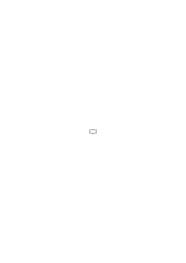. The difference between E sharp and F.

### [260\[2\]](https://cdn.wittgensteinnachlass.com/2000px/webp/Ms-110/260.webp)

“The spider is floating in the air – no, if one looks more closely, it is hanging from a ‘thread’.” The visual spider & the physical one.

### [VB](/w-vb/#ms-110-260.3) [260\[3\]](https://cdn.wittgensteinnachlass.com/2000px/webp/Ms-110/260.webp)

When people find a flower or an animal ugly, they are always under the impression that it is something artificial. “It looks like …”, they then say. That throws light on the meaning of the words “ugly” and “beautiful”.

### [260\[4\]](https://cdn.wittgensteinnachlass.com/2000px/webp/Ms-110/260.webp)

When one says that one cannot describe the visual image completely, one means that one cannot give a description from which one could reproduce this visual image exactly for oneself.

### [260\[5\]](https://cdn.wittgensteinnachlass.com/2000px/webp/Ms-110/260.webp)

But what does “exact reproduction” mean here? This itself is in turn based on a false picture.

### [260\[6\]](https://cdn.wittgensteinnachlass.com/2000px/webp/Ms-110/260.webp)

What is the criterion of exact reproduction?

### [260\[7\]](https://cdn.wittgensteinnachlass.com/2000px/webp/Ms-110/260.webp),[261\[1\]](https://cdn.wittgensteinnachlass.com/2000px/webp/Ms-110/261.webp)

We cannot speak of the visual image any _further_ than our language now reaches. Nor can we _mean_ (think) any more than our language says. (Not mean more than we can say)

### [261\[2\]](https://cdn.wittgensteinnachlass.com/2000px/webp/Ms-110/261.webp)

One of the most dangerous comparisons is that of the visual field with a painted surface (or, what comes to the same thing, a coloured three-dimensional model).

### [261\[3\]](https://cdn.wittgensteinnachlass.com/2000px/webp/Ms-110/261.webp)

Connected with this is the following: Could I then recognize the visual image “in every detail”? Or rather, does this question have any sense at all?

### [261\[4\]](https://cdn.wittgensteinnachlass.com/2000px/webp/Ms-110/261.webp)

For a painted picture or a model still strikes us as the least objectionable representation of the visual image. But the fact that the question of “recognizing it in every detail” is senseless already shows how inadequate picture & model are.

### [261\[5\]](https://cdn.wittgensteinnachlass.com/2000px/webp/Ms-110/261.webp)

“I am taking you along a path I have never taken before”. The problem of searching.

### [261\[6\]](https://cdn.wittgensteinnachlass.com/2000px/webp/Ms-110/261.webp)

When an animal is originally revered, then regarded as unclean, is that not what happens when we give up a habit as a fault & then hate it anxiously?

### [261\[7\]](https://cdn.wittgensteinnachlass.com/2000px/webp/Ms-110/261.webp)

One says “the man nourishes me” of the man who gives me food, but also “the food nourishes me”.

### [261\[8\]](https://cdn.wittgensteinnachlass.com/2000px/webp/Ms-110/261.webp)

“I ordered him to do p.” – “Well & what did he do?” – “p” – “Well then, it’s all right”.

### [262\[1\]](https://cdn.wittgensteinnachlass.com/2000px/webp/Ms-110/262.webp)

“I said ‘leave the room’ & he left the room.”

“I said ‘leave the room’ & he slowly left the room”.

“I said ‘leave the room’ & he jumped out of the window”.

A justification is possible here even where the description of the action is not the one given by the command.

### [262\[2\]](https://cdn.wittgensteinnachlass.com/2000px/webp/Ms-110/262.webp)

I can certainly say: “Do now what, as you remember it, you did at this time yesterday”. And if he remembers, he can follow his memory. But if he does not remember, the order has no sense for him.

### [262\[3\]](https://cdn.wittgensteinnachlass.com/2000px/webp/Ms-110/262.webp)

Would this order then be like this one: “Do what is written on the slip of paper in this drawer”. If there is no slip in the drawer, this is not an order.

### [262\[4\]](https://cdn.wittgensteinnachlass.com/2000px/webp/Ms-110/262.webp)

“Say what you said to me yesterday”.

### [262\[5\]](https://cdn.wittgensteinnachlass.com/2000px/webp/Ms-110/262.webp)

Isn’t it like this: if I set the signal for an activity, I must have been _able_ to form the intention of using this signal _in this way_. But in doing so I must already have connected it with another symbolism.

### [262\[6\]](https://cdn.wittgensteinnachlass.com/2000px/webp/Ms-110/262.webp)

But even if I formed this intention by saying that this signal means _this_ & carrying out a certain activity as I said it, the memory of this activity must later work together with the sign.

### [263\[1\]](https://cdn.wittgensteinnachlass.com/2000px/webp/Ms-110/263.webp)

The knot in the handkerchief. Does it mean: “Remember something!”? In any case, these words would serve the same purpose.

### [263\[2\]](https://cdn.wittgensteinnachlass.com/2000px/webp/Ms-110/263.webp)

I can forget which colour a word designates & also what a particular colour is called (say, in English).

### [263\[3\]](https://cdn.wittgensteinnachlass.com/2000px/webp/Ms-110/263.webp)

I am asked to imagine the colour orange & have forgotten what ‘orange’ means. What happens here? And what happens when I remember it again? The question, that is, is this: what does my being able to comply with the request to imagine the colour A depend on?

### [263\[4\]](https://cdn.wittgensteinnachlass.com/2000px/webp/Ms-110/263.webp)

One more question: Can one speak of different interpretations of the memory-image? In what sense can one not?

### [263\[5\]](https://cdn.wittgensteinnachlass.com/2000px/webp/Ms-110/263.webp)

(If there is anywhere one is hampered by prejudices, it is in philosophy.)

### [263\[6\]](https://cdn.wittgensteinnachlass.com/2000px/webp/Ms-110/263.webp)

“Paint a red strip”. – “I have forgotten what ‘red’ means; the word tells me nothing”.

### [263\[7\]](https://cdn.wittgensteinnachlass.com/2000px/webp/Ms-110/263.webp)

If the word ‘red’, in order to have meaning, must call up a mental image which is what really counts as the picture, why should it not suffice for the word, when confronted with an actual colour, to elicit a particular feeling, say one of satisfaction?

### [263\[8\]](https://cdn.wittgensteinnachlass.com/2000px/webp/Ms-110/263.webp)

The justification “You told me ‘bring something red’; this is called ‘red’, after all” is _general_ in the previous sense.

### [264\[1\]](https://cdn.wittgensteinnachlass.com/2000px/webp/Ms-110/264.webp)

Didn’t I say that the justification must always be of the form: black … •; so: make a black circle … •

### [264\[2\]](https://cdn.wittgensteinnachlass.com/2000px/webp/Ms-110/264.webp)

Could the justification go like this: “You said ‘bring something red’ & in response to that this here gave me a feeling of satisfaction, so I brought it”?

### [264\[3\]](https://cdn.wittgensteinnachlass.com/2000px/webp/Ms-110/264.webp)

Would one not have to answer: But I didn’t tell you to bring me whatever would give you such a feeling in response to my words!

### [264\[4\]](https://cdn.wittgensteinnachlass.com/2000px/webp/Ms-110/264.webp)

But would this objection also hold if I had answered: “You did say I should bring something red & then I remembered that you had previously called _this_ ‘red’”. I think the objection would not hold here.

### [264\[5\]](https://cdn.wittgensteinnachlass.com/2000px/webp/Ms-110/264.webp)

In any case I could appeal, by way of justification, to a table of colours & their names.

### [264\[6\]](https://cdn.wittgensteinnachlass.com/2000px/webp/Ms-110/264.webp)

But it might also be that I go against such a table & appeal to my memory (or is it something else?).

### [264\[7\]](https://cdn.wittgensteinnachlass.com/2000px/webp/Ms-110/264.webp)

Does this mean, then, that in my memory I have, as it were, another table that says something different?! And what justifies the choice between the two?

### [264\[8\]](https://cdn.wittgensteinnachlass.com/2000px/webp/Ms-110/264.webp),[265\[1\]](https://cdn.wittgensteinnachlass.com/2000px/webp/Ms-110/265.webp)

If I tell someone “paint the green of your room door from memory”, that determines what he is to do no more unambiguously than the order “paint the green you see on this board”.

### [265\[2\]](https://cdn.wittgensteinnachlass.com/2000px/webp/Ms-110/265.webp)

(“The wind carries my thoughts away.” – “Weight of a quantity of energy.”)

### [265\[3\]](https://cdn.wittgensteinnachlass.com/2000px/webp/Ms-110/265.webp)

If what matters for the meaning of the word “red” is the image my memory automatically reproduces at the sound of this word, then I must rely on this reproduction just as if it were determined that I would establish the meaning by looking it up in a book, in which case I would be putting myself, as it were, entirely at the mercy of that book.

### [265\[4\]](https://cdn.wittgensteinnachlass.com/2000px/webp/Ms-110/265.webp)

But that would mean: the meaning of the word is what occurs to me in a particular way in connection with it.

### [265\[5\]](https://cdn.wittgensteinnachlass.com/2000px/webp/Ms-110/265.webp)

I am at the mercy of memory.

### [265\[6\]](https://cdn.wittgensteinnachlass.com/2000px/webp/Ms-110/265.webp)

In a certain sense, “to recognize a colour” means nothing.

### [265\[7\]](https://cdn.wittgensteinnachlass.com/2000px/webp/Ms-110/265.webp)

And yet I can say: “Where can I have seen this green before”, or “this combination of colours”.

### [265\[8\]](https://cdn.wittgensteinnachlass.com/2000px/webp/Ms-110/265.webp)

I should like to say: only what can be described can be recognized.

### [265\[9\]](https://cdn.wittgensteinnachlass.com/2000px/webp/Ms-110/265.webp)

And now “green” _seems_ to be the description of a _colour_!

### [265\[10\]](https://cdn.wittgensteinnachlass.com/2000px/webp/Ms-110/265.webp),[266\[1\]](https://cdn.wittgensteinnachlass.com/2000px/webp/Ms-110/266.webp)

“Bring me a yellow flower.” How do you justify what you bring me?

### [266\[2\]](https://cdn.wittgensteinnachlass.com/2000px/webp/Ms-110/266.webp)

If you say “but isn’t this colour called ‘yellow’?”, your question refers only to a particular linguistic convention (and is therefore trivial).

### [266\[3\]](https://cdn.wittgensteinnachlass.com/2000px/webp/Ms-110/266.webp)

If I look for a yellow flower with a little yellow card in my hand, that is analogous to working out a multiplication such as 165 × 280; but if I go looking with the word “yellow”, it is analogous to an arithmetical proposition 2 + 3 = 5, where nothing shows an internal relation.

### [266\[4\]](https://cdn.wittgensteinnachlass.com/2000px/webp/Ms-110/266.webp)

Surely it is not impossible for one person to look for the yellow flower using an image in his imagination just as another does using the little coloured card, or a third, in some sense, using an image of a reaction that what he is looking for is supposed to elicit (bell). But whatever he sets out with (whatever paradigm he uses), nothing compels him to accept as what he was looking for the thing he actually accepts in the end, & the justification he then gives for the result in words or other signs is once again a justification only in relation to another description in the same language.

### [266\[5\]](https://cdn.wittgensteinnachlass.com/2000px/webp/Ms-110/266.webp)

The difficulty is to stop asking ‘why’ (I mean, to refrain from asking this question).

### [267\[1\]](https://cdn.wittgensteinnachlass.com/2000px/webp/Ms-110/267.webp)

There is clearly a difference between my saying “this strip↑ is white” and my saying “I shall call the colour of this strip ‘A’”.

### [267\[2\]](https://cdn.wittgensteinnachlass.com/2000px/webp/Ms-110/267.webp)

An ‘interpretation’ is presumably something that is given in words! It is _this_ interpretation as opposed to another (which is worded differently). – So if one says “every sentence requires a further interpretation”, that would mean: no sentence can be understood without an addition, which is nonsense. – But if one says that every sentence admits of a further interpretation, this means that every sign can, by further additions, be incorporated into systems of still greater multiplicity. And this, if it were anything at all, would be a mathematical proposition; but as it stands it is, I think, vague & meaningless.

### [267\[3\]](https://cdn.wittgensteinnachlass.com/2000px/webp/Ms-110/267.webp)

We can imagine someone taking the meanings of the colour names from a table in which they stand next to the corresponding colours, until, as one says, he _has the table in his head_.

### [267\[4\]](https://cdn.wittgensteinnachlass.com/2000px/webp/Ms-110/267.webp)

Presumably that means that something has now taken the place of this table.

### [267\[5\]](https://cdn.wittgensteinnachlass.com/2000px/webp/Ms-110/267.webp)

Could not the objection I made earlier to the use of such a table be made to any calculation?

### [267\[6\]](https://cdn.wittgensteinnachlass.com/2000px/webp/Ms-110/267.webp)

What about the two sentences: “this leaf is red” & “this leaf has the colour that is called ‘rot’ in German”? Do they both say the _same thing_?

### [268\[1\]](https://cdn.wittgensteinnachlass.com/2000px/webp/Ms-110/268.webp)

03.07.1931

Doesn’t that depend on what the criterion is for a colour being called ‘rot’ in German?

### [268\[2\]](https://cdn.wittgensteinnachlass.com/2000px/webp/Ms-110/268.webp)

Can one also say, instead of “fetch me a yellow flower”: “fetch me a flower whose colour you call ‘yellow’”?

### [268\[3\]](https://cdn.wittgensteinnachlass.com/2000px/webp/Ms-110/268.webp)

Is the wording of the description derived only from what is described, or from this & a table or something analogous to it?

### [268\[4\]](https://cdn.wittgensteinnachlass.com/2000px/webp/Ms-110/268.webp)

Being good to someone who does not like you requires not only a great deal of good nature but also a great deal of _tact_.

### [268\[5\]](https://cdn.wittgensteinnachlass.com/2000px/webp/Ms-110/268.webp)

You command me “bring me a yellow flower”; I bring one & you ask: “why did you bring me one like that?”. Then this question makes sense only if it can be completed with “and not one of this (other) kind”.

### [268\[6\]](https://cdn.wittgensteinnachlass.com/2000px/webp/Ms-110/268.webp)

That is, this question already refers to a system; and the answer must refer to the same system.

### [268\[7\]](https://cdn.wittgensteinnachlass.com/2000px/webp/Ms-110/268.webp)

In reply to the question “why do you do _that_ at my command?” one can ask: “What?”

### [268\[8\]](https://cdn.wittgensteinnachlass.com/2000px/webp/Ms-110/268.webp),[269\[1\]](https://cdn.wittgensteinnachlass.com/2000px/webp/Ms-110/269.webp)

Now it would be absurd to ask “why do you bring me a yellow flower when I commanded you to bring me a yellow flower”. One might rather ask “why do you bring a red flower when I said you should bring a yellow one” or “why do you bring a dark yellow one in response to the command ‘bring a yellow one’?”.

### [269\[2\]](https://cdn.wittgensteinnachlass.com/2000px/webp/Ms-110/269.webp)

How can one derive the action from the command “fetch a yellow flower”? – How can one derive the sign “5” from the sign “2 + 3”?

### [269\[3\]](https://cdn.wittgensteinnachlass.com/2000px/webp/Ms-110/269.webp)

What, then, about the designation of a quite particular shade of yellow. Here it does seem clear that the word-language is not sufficient to describe every such shade, although it can say a reddish or greenish yellow, and so on? On the other hand: Give this shade a name & it is on the same footing, in no different position from the word “yellow” or “red”.

### [269\[4\]](https://cdn.wittgensteinnachlass.com/2000px/webp/Ms-110/269.webp)

Is it not conceivable, then, that a grammatical system has two (or more) applications in reality?

### [269\[5\]](https://cdn.wittgensteinnachlass.com/2000px/webp/Ms-110/269.webp)

Yes, but if we can say this at all, we must also be able to distinguish the two applications by a description.

### [269\[6\]](https://cdn.wittgensteinnachlass.com/2000px/webp/Ms-110/269.webp),[270\[1\]](https://cdn.wittgensteinnachlass.com/2000px/webp/Ms-110/270.webp)

If we think of two applications of the grammatical schema for colours, we can describe them. But what is essential about this description is that it describes only a new multiplicity of signs & does not connect with reality in any sense in which the sign would be more than a sign. But where does the concept of such a sense come from (at all)?

### [270\[2\]](https://cdn.wittgensteinnachlass.com/2000px/webp/Ms-110/270.webp)

Where does the idea come from that we could leave the domain of signs?

### [270\[3\]](https://cdn.wittgensteinnachlass.com/2000px/webp/Ms-110/270.webp)

Doesn’t this come from our being, as I should like to say, quite familiar with certain signs? Apart from the languages we speak fluently, many gestures are familiar to us in this sense. But what does this familiarity consist in? I beckon to someone & he comes to me. But suppose he did not understand this language so readily, yet after some thought interpreted it (correctly); then he would have translated it in his thoughts into a language in which he is fluent.

### [270\[4\]](https://cdn.wittgensteinnachlass.com/2000px/webp/Ms-110/270.webp)

“He says to _me_ ‘bring _me_ a flower’.” What determines the meaning of the word “me”. ‒ ‒

### [270\[5\]](https://cdn.wittgensteinnachlass.com/2000px/webp/Ms-110/270.webp)

Isn’t the reason why we think that with an ostensive explanation we are leaving the domain of language, of the system of signs, that we confuse this stepping outside the *written* signs with an application of language, say a description of what I see?

### [270\[6\]](https://cdn.wittgensteinnachlass.com/2000px/webp/Ms-110/270.webp),[271\[1\]](https://cdn.wittgensteinnachlass.com/2000px/webp/Ms-110/271.webp)

One might want to ask: But is it an accident that in order to explain signs, and thus to complete the system of signs, I have to step outside written or spoken signs? Isn’t that precisely how I enter the domain in which what is to be described then takes place? But then it is strange that I can do anything at all with the written signs. – One then takes it (say) that the written signs merely stand in for the things one points to. – But how strange _that such a substitution is possible_. And the most important thing now would be to understand how written signs _can_ stand in for other things. What property must they have to enable them to stand in for these things. For I can’t say: I drink water instead of milk & eat wood instead of bread, by letting water stand in for milk & wood for bread.

Of course, I can after all say that the definiendum stands for the definiens; & here the latter stands behind the former, as the electorate stands behind its representative. And in this sense one can also say that the sign explained in the ostensive definition can stand for the pointing gesture, since one really could put the latter in place of the former in a language of gestures. But this is still a substitution in the sense of a definition, for a language of gestures is a language like any other. And that is perhaps the gist of this consideration. I should like to say: It is just as far from an order in a language of gestures to its being carried out as it is from the same order in a word-language.

### [272\[1\]](https://cdn.wittgensteinnachlass.com/2000px/webp/Ms-110/272.webp)

For ostensive explanations too have to be given once and for all.

### [272\[2\]](https://cdn.wittgensteinnachlass.com/2000px/webp/Ms-110/272.webp)

That is, they too belong to the basic stock of explanations that prepare the calculus & not to its application ad hoc.

### [272\[3\]](https://cdn.wittgensteinnachlass.com/2000px/webp/Ms-110/272.webp)

For this is how I see a language: one learns it (its grammar, its dictionary); & then speaks it. Or: there is a course of instruction dealing with it, & courses of instruction in which it is spoken.

### [272\[4\]](https://cdn.wittgensteinnachlass.com/2000px/webp/Ms-110/272.webp)

The ostensive explanations could all be given in the grammar book. They all belong to grammar.

### [272\[5\]](https://cdn.wittgensteinnachlass.com/2000px/webp/Ms-110/272.webp)

Using a wire to look for a short circuit; one has found it when the bell rings. But am I thereby also looking for something that is the same as the idea of the bell ringing? etc. etc.

### [272\[6\]](https://cdn.wittgensteinnachlass.com/2000px/webp/Ms-110/272.webp),[273\[1\]](https://cdn.wittgensteinnachlass.com/2000px/webp/Ms-110/273.webp)

I can say, after all: “mix colours to match the ones I paint for you”, but not: “mix colours according to the words I call out to you” – if these words are not already known to me. – I can likewise say “Draw the curves I draw for you”; but only in certain cases: “Draw the curves I call out to you”. But isn’t that the case we would have if we designated various complicated truth-functions on the one hand by new names and on the other by the T-F notation?

### [273\[2\]](https://cdn.wittgensteinnachlass.com/2000px/webp/Ms-110/273.webp)

“Mix colours according to the words I say to you” of course comes to the same thing as: “Mix a colour according to the word ‘A’”.

### [273\[3\]](https://cdn.wittgensteinnachlass.com/2000px/webp/Ms-110/273.webp)

That means, after all, a colour that can be justified by the word ‘A’. But in what respect can a colour be justified by a _colour_?

### [273\[4\]](https://cdn.wittgensteinnachlass.com/2000px/webp/Ms-110/273.webp)

We are struggling with language.

### [273\[5\]](https://cdn.wittgensteinnachlass.com/2000px/webp/Ms-110/273.webp)

“An event occurs.” “A person enters.”

### [273\[6\]](https://cdn.wittgensteinnachlass.com/2000px/webp/Ms-110/273.webp)

The whole problem of the meaning of words is opened up by my looking for A before I have found him. – What is to be said about this is that I can look for him even if in a certain sense he does not exist. If we say that a picture is needed for this, that in some sense we must carry a picture of him around with us, I say: perhaps; but what sense does it make to say that it is a picture of _him_. That too, then, makes sense only if I have another picture of him, corresponding to the word “him”.

### [273\[7\]](https://cdn.wittgensteinnachlass.com/2000px/webp/Ms-110/273.webp)

The solution of philosophical problems compared with the gift in the fairy tale, which appears magical inside the enchanted mountain & is only a piece of iron when one looks at it outside in daylight.

### [274\[1\]](https://cdn.wittgensteinnachlass.com/2000px/webp/Ms-110/274.webp)

One might say: If I speak of the sun, I must have a picture of the sun in me. – But how can one say that it is a picture of the sun. Here the sun is surely mentioned again, in contrast to its picture. And for me to be able to say “this is a picture of the sun”, I would have to have another picture of the sun. And so on. To say that the memory is a picture of what was makes sense only if I can set what was alongside this picture & compare the two, say. This too is possible if by what was one understands what is hypothetical, but not if one understands by it just what is given in memory.

### [274\[2\]](https://cdn.wittgensteinnachlass.com/2000px/webp/Ms-110/274.webp)

How strange, I can look for it when it is not there, but I cannot point to it when it is not there. That is really the problem of looking for something & it shows the misleading comparison. One might want to say: surely it must also be there when I look for _it_. – Then it must also be there when I do not find it & also when it does not exist.

### [274\[3\]](https://cdn.wittgensteinnachlass.com/2000px/webp/Ms-110/274.webp)

Looking for _it_ (say, my stick) is a way of looking & differs from looking for something else in what one does (says, thinks) while looking, not in what one finds.

### [274\[4\]](https://cdn.wittgensteinnachlass.com/2000px/webp/Ms-110/274.webp),[275\[1\]](https://cdn.wittgensteinnachlass.com/2000px/webp/Ms-110/275.webp)

And if I carry a picture or a mental image with me while looking, well and good. And if I say that the picture is a picture of what I am looking for, that only says what place the picture occupies in the process of looking. And if I find it & say “there it is! _that’s_ what I was looking for”, the last words are not an explanation of the words designating the object I was looking for (say, the words “my stick”) that could only now be given, once it has been found. – Just as one does not know what one wishes for any better, or have any better way of explaining it, after the fulfilment of the wish than before.

### [275\[2\]](https://cdn.wittgensteinnachlass.com/2000px/webp/Ms-110/275.webp)

One cannot hang the thief before one has him, but one can already look for him.

### [275\[3\]](https://cdn.wittgensteinnachlass.com/2000px/webp/Ms-110/275.webp)

“You were looking for _that_ man (point to him)? How was that possible? He wasn’t even there!”

### [275\[4\]](https://cdn.wittgensteinnachlass.com/2000px/webp/Ms-110/275.webp)

“I’m looking for my stick. – There it is!” The latter is not an explanation of the expression “my stick” that would be essential to understanding the first sentence & that I therefore could not have given before my stick was found. Rather, the sentence “There it is”, if it is not a repetition of the explanation of the words that was also possible earlier, must be a new synthetic proposition.

### [275\[5\]](https://cdn.wittgensteinnachlass.com/2000px/webp/Ms-110/275.webp)

The problem arises from a confusion of a word or expression with the sentence that asserts the existence, the presence, of the object.

### [275\[6\]](https://cdn.wittgensteinnachlass.com/2000px/webp/Ms-110/275.webp),[276\[1\]](https://cdn.wittgensteinnachlass.com/2000px/webp/Ms-110/276.webp)

“Were you looking for _him_? You couldn’t even know if he was there!” (Compare, on the other hand, the search for the trisection of the angle.)

### [276\[2\]](https://cdn.wittgensteinnachlass.com/2000px/webp/Ms-110/276.webp)

Here, too, we have the confusion between the meaning & the bearer of a word. For the object I point at when I say “_that one_” is the bearer of the name, not its meaning.

### [276\[3\]](https://cdn.wittgensteinnachlass.com/2000px/webp/Ms-110/276.webp)

In short: I am looking for the bearer of the name, not its meaning.

But on the other hand: I look for & hang the bearer of the name.

### [276\[4\]](https://cdn.wittgensteinnachlass.com/2000px/webp/Ms-110/276.webp)

One can say of the bearer of the name that he (exists or) does not exist, & this is, of course, not an activity, although one could mistake it for one & say that surely he must be there when he does not exist. (And this has certainly been written by a philosopher once before.)

### [276\[5\]](https://cdn.wittgensteinnachlass.com/2000px/webp/Ms-110/276.webp)

(“I’m looking for him.” – “What does he look like?” – “I don’t know, but I’m sure I’ll recognize him when I see him.”)

### [276\[6\]](https://cdn.wittgensteinnachlass.com/2000px/webp/Ms-110/276.webp)

04.07.1931

One could only say: If he speaks of the sun, he must see a visual image (or a configuration of such & such a character – round, yellow, etc.) before him. Not that this is true, but it makes sense, & this image is then part of the sign.

### [276\[7\]](https://cdn.wittgensteinnachlass.com/2000px/webp/Ms-110/276.webp),[277\[1\]](https://cdn.wittgensteinnachlass.com/2000px/webp/Ms-110/277.webp)

I go looking for the yellow flower. Even if I have a picture in mind while seeing, do I need it when I see the yellow flower – or another one? – And if I say “as soon as I see a yellow flower, something in my memory clicks into place, as it were”: can I foresee, expect, this clicking into place any more readily than the yellow flower? I don’t see why. That is, if in a particular case I really do expect not the yellow flower but some other (indirect) criterion, this is in any case no explanation of expecting.

### [277\[2\]](https://cdn.wittgensteinnachlass.com/2000px/webp/Ms-110/277.webp)

But doesn’t a phenomenon of assent (or satisfaction) always go hand in hand with the occurrence of what is expected? Then I ask: Is this phenomenon something other than the occurrence of what is expected? If so, then I don’t know whether such a distinct phenomenon always accompanies fulfilment. – Or is it the same thing as fulfilment? If I say: The person whose expectation is fulfilled doesn’t _have_ to say “yes, that’s it” (or something of the sort), one may reply: “certainly, but surely he must _know_ that the expectation is fulfilled.” – Yes, insofar as knowing is part of the fact _that_ the expectation is fulfilled. In this sense: if he didn’t know it, it wouldn’t be fulfilled. – “True, but when someone’s expectation is fulfilled, surely there is always a release of tension!” – How do you know that? –

### [277\[3\]](https://cdn.wittgensteinnachlass.com/2000px/webp/Ms-110/277.webp),[278\[1\]](https://cdn.wittgensteinnachlass.com/2000px/webp/Ms-110/278.webp)

It is perhaps most instructive to think that when we use a yellow tile to look for the flower, the relation of sameness of colour is in any case not present to us in a further picture. Rather, we are quite content with the one.

### [278\[2\]](https://cdn.wittgensteinnachlass.com/2000px/webp/Ms-110/278.webp)

(Just as we would not think for a moment of teaching a child the language of gestures.)

### [278\[3\]](https://cdn.wittgensteinnachlass.com/2000px/webp/Ms-110/278.webp)

Of course we could imagine that the person who gives me the yellow tile to look for the flower were at the same time to explain the word “same” to me, by pointing to patches of the same colour. Indeed, that he gave me two tiles of the same colour to take with me as a reminder of this explanation, or else the sentence “look for a flower of the same colour as this tile” on a slip of paper. And the words _of the same colour_ would then correspond to the two tiles of the same colour. But: he had thus explained his first instruction to me, & this explanation itself consisted of signs, just like the instruction, & these signs could therefore be explained further. Every explanation joins the existing signs as a sign & thus yields a _different_ system (a different multiplicity). (_No_ explanation, therefore, is absolutely essential, makes the sign into a sign; & _none_ is essentially the last.)

### [278\[4\]](https://cdn.wittgensteinnachlass.com/2000px/webp/Ms-110/278.webp),[279\[1\]](https://cdn.wittgensteinnachlass.com/2000px/webp/Ms-110/279.webp)

Thus I can explain the meaning of the signs 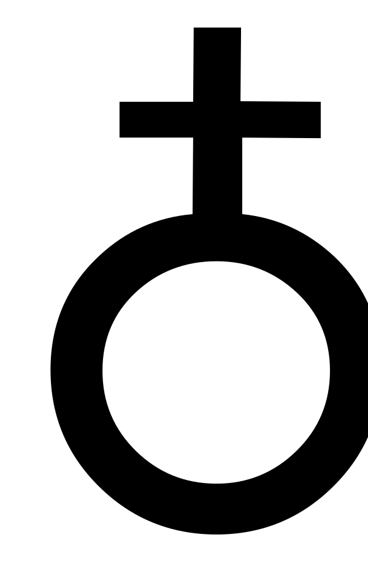 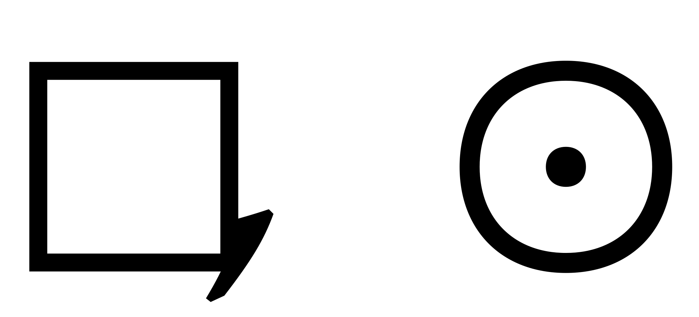 by means of the table

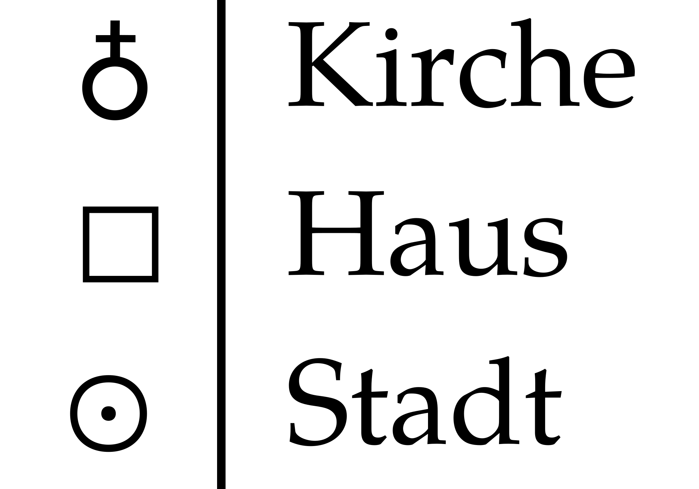

; but I can in turn explain this table by writing it like this:

& setting it against another one:

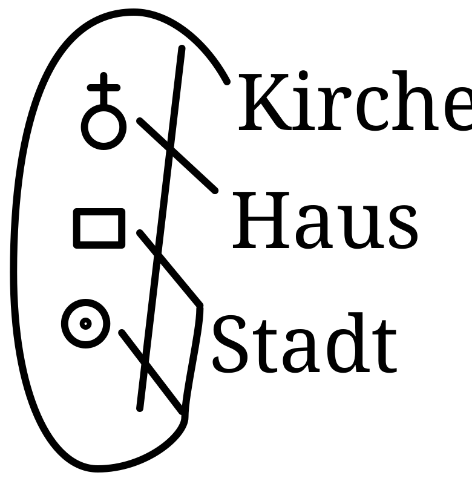

etc. etc.

### [279\[2\]](https://cdn.wittgensteinnachlass.com/2000px/webp/Ms-110/279.webp)

But could the first explanation have been left out as well? Certainly, if the signs ,  had (say) originally been taught to us in the same way as the words “Kirche”, “Haus”, “Stadt”. But surely these had to be explained to us! – Insofar as they were “explained” to us at all, it was by means of a language of gestures that was not explained to us. – But could this language of gestures have been explained? – Certainly; for example, by means of a word-language.

### [279\[3\]](https://cdn.wittgensteinnachlass.com/2000px/webp/Ms-110/279.webp)

Of course one can say: in reality the yellow tile is not decisive either, because memory is used as a check on the tile. But first, this is not true when we are to go by a quite definite shade of colour (then we often trust the tile & not our memory) & second: what of the relation between what memory gives & what I recognize in reality as corresponding to it? Do I carry around a picture of this relation?

### [279\[4\]](https://cdn.wittgensteinnachlass.com/2000px/webp/Ms-110/279.webp),[280\[1\]](https://cdn.wittgensteinnachlass.com/2000px/webp/Ms-110/280.webp)

The word “given”. One can get up to a lot of mischief with it. “Only the mental images of the tree are given to me, not the tree itself”. “What I expect is given to me only through its description”. “That is given to me only in a description”. – “What?!” This is directly connected with the conception in the last sentence. For I want to ask: How, then, is “what in reality corresponds to the memory” given to me? Memory is itself a language.

### [280\[2\]](https://cdn.wittgensteinnachlass.com/2000px/webp/Ms-110/280.webp)

The question “how, then, is that given to me” makes sense when it asks about the verification of a sentence in order to make its sense clear. For example, we can say that the length of this body is given to us by the result of a measurement with a yardstick – not by judging by eye. The answer to the question “how is _it_ given to me” is thus meant to make the meaning of “it” clearer, and is therefore a grammatical explanation. (As one could have foreseen, the question surely cannot be settled by an experiment.)

### [280\[3\]](https://cdn.wittgensteinnachlass.com/2000px/webp/Ms-110/280.webp)

Earlier I set “what memory gives me” against “what I recognize as corresponding to it in reality”. But these can only be two symbols, & ones that can be translated into one another, if they have anything to do with one another at all. Or is it the memory (or expectation) & the fulfilment of the expectation?

### [280\[4\]](https://cdn.wittgensteinnachlass.com/2000px/webp/Ms-110/280.webp),[281\[1\]](https://cdn.wittgensteinnachlass.com/2000px/webp/Ms-110/281.webp)

What I wanted to say above was that memory, even when used as a check on the tile, is in the same position as the tile. That is, even here one could speak of an interpretation (of that relation “of what is given in memory to …”) & one can ask whether an expression of this interpretation would have to be given to the person who is to look for something by relying on memory, for that person to take along.

### [281\[2\]](https://cdn.wittgensteinnachlass.com/2000px/webp/Ms-110/281.webp)

Could I assert that my memory always darkens a little? In any case I could say: “choose the colour you remember” & also “choose a slightly darker colour than the one you remember”. Of course one can speak of something darkening only by comparison with something, & it is not enough to say “well, with the colour as it really was”, because here the particular kind of verification, i.e. the particular grammar of the words “as it was”, has not yet been fixed; these words (therefore) still have more than one meaning.

### [281\[3\]](https://cdn.wittgensteinnachlass.com/2000px/webp/Ms-110/281.webp)

But the question is: If the colour of the tile changes relative to my memory (a bold expression), must one in any sense unconditionally give preference to the interpretation that the tile has changed & I must therefore go by my memory? Obviously not. Besides, the ‘interpretation’ that the tile & not the memory-image has changed amounts to nothing but an explanation of the words “change” & “stay the same”.

### [281\[4\]](https://cdn.wittgensteinnachlass.com/2000px/webp/Ms-110/281.webp)

(Above a piece of music, the composer has written ♩ = 88, but in order to play it correctly today, it must be played at ♩ = 94; which is _the tempo intended by the composer._)

### [281\[5\]](https://cdn.wittgensteinnachlass.com/2000px/webp/Ms-110/281.webp),[282\[1\]](https://cdn.wittgensteinnachlass.com/2000px/webp/Ms-110/282.webp)

One could also put it this way: If my intention is to paint (or find) something darker or lighter than what the tile shows me, the relation of what is found to the sample is _no less direct_ than that of sameness of colour. Or: if the instruction is “bring me a flower darker than this tile”, then the tile plays no other role in the search (is not applied any more indirectly) than in the case previously considered.

### [282\[2\]](https://cdn.wittgensteinnachlass.com/2000px/webp/Ms-110/282.webp)

And this also shows that the memory is still open to interpretation. For if I say “the flower is to have the same colour as the colour you remember”, the word “same” already shows where the interpretation can begin. (And I could lay down a language in which leaving out any such qualification, thus “the flower is to be the colour of the tile”, means precisely what the sentence with the qualification “darker than” now says.)

### [282\[3\]](https://cdn.wittgensteinnachlass.com/2000px/webp/Ms-110/282.webp)

All explanation seems to come to an end here. Of course, we are not in the domain of explanations at all.

### [282\[4\]](https://cdn.wittgensteinnachlass.com/2000px/webp/Ms-110/282.webp)

In a game of hide-and-seek I expect to find the thimble. When I find it, I give a sign of satisfaction, or at least feel satisfaction. I may have expected this phenomenon too (or not), but this expectation is not the expectation of finding the thimble. I can have both expectations, & they are clearly quite distinct.

### [283\[1\]](https://cdn.wittgensteinnachlass.com/2000px/webp/Ms-110/283.webp)

I expect to find a yellow flower, and a picture of a yellow flower floats before me. Couldn’t a picture of a red flower float before me as I expect this – that is, of a non-yellow flower?

### [283\[2\]](https://cdn.wittgensteinnachlass.com/2000px/webp/Ms-110/283.webp)

It is not that we feel a dissatisfaction that is then removed by finding the thimble, & then say: “so that phenomenon was the expectation of the thimble”. No, the first phenomenon is the expectation of the thimble just as surely as the second is the finding of the thimble. The word “thimble” belongs to the description of the first just as necessarily as to the description of the second. Only let us not confuse “the meaning of the word ‘thimble’” (the place of this word in grammatical space) with the fact that a thimble is here.

### [283\[3\]](https://cdn.wittgensteinnachlass.com/2000px/webp/Ms-110/283.webp)

The thought that it is (only) finding that shows us what we expected means judging the process as one would judge, for instance, the _symptoms of expectation_ in another person. I see him, say, pacing restlessly up & down; someone comes in through the door & he becomes calm & shows signs of satisfaction; & now I say: “he apparently expected this person”.

### [283\[4\]](https://cdn.wittgensteinnachlass.com/2000px/webp/Ms-110/283.webp),[284\[1\]](https://cdn.wittgensteinnachlass.com/2000px/webp/Ms-110/284.webp)

The ‘symptoms of expectation’ are not the expression of the expectation. And to believe that only after finding do I know what I was looking for (only after fulfilment what I wished for) amounts to a nonsensical “behaviourism”.

### [284\[2\]](https://cdn.wittgensteinnachlass.com/2000px/webp/Ms-110/284.webp)

“I wish I had a yellow flower.” – “Yes, I’ll go & look for a yellow flower for you. Here, I’ve found one.” – Does the meaning of “yellow flower” belong to the last sentence any more than to the preceding two?

### [284\[3\]](https://cdn.wittgensteinnachlass.com/2000px/webp/Ms-110/284.webp)

To justify the words that describe the expectation, I could only say: There must be a difference depending on whether I expect a yellow flower, a red one, a yellow fruit, etc.

### [284\[4\]](https://cdn.wittgensteinnachlass.com/2000px/webp/Ms-110/284.webp)

What does looking for a yellow flower consist in? Well, I walk about, look at the flowers and – if I see a yellow flower, I pick it, say.

### [284\[5\]](https://cdn.wittgensteinnachlass.com/2000px/webp/Ms-110/284.webp)

We have simply put ourselves outside (the domain of) all explanation.

### [284\[6\]](https://cdn.wittgensteinnachlass.com/2000px/webp/Ms-110/284.webp)

We can only describe, since causal connections, i.e. the actual sequence of events, do not interest us (since in this respect we are prepared to believe anything). And the connections that then remain are formal ones, which cannot be described but are expressed in grammar.

### [284\[7\]](https://cdn.wittgensteinnachlass.com/2000px/webp/Ms-110/284.webp)

What does wishing for a yellow flower consist in? Essentially in missing a yellow flower in what one sees. And so also in recognizing what is expressed in the sentence “I see no yellow flower now”.

### [284\[8\]](https://cdn.wittgensteinnachlass.com/2000px/webp/Ms-110/284.webp),[285\[1\]](https://cdn.wittgensteinnachlass.com/2000px/webp/Ms-110/285.webp),[286\[1\]](https://cdn.wittgensteinnachlass.com/2000px/webp/Ms-110/286.webp)

This sentence arose from the view that the use of the expression “yellow flower” with sense does not presuppose seeing a yellow flower, but does presuppose the presence of colour space. What I mean is: if I talk about a yellow flower, I need not see one, to be sure, but I must see _something_, & the word “yellow flower” has meaning, as it were, only in accord with or in contrast to what I see. Its meaning would, as it were, be determined solely from what I see: either as what I see, or as what lies at such & such a distance away from it in such & such a direction. Here, though, I do not mean direction or distance in the ordinary spatial sense; what is meant could be the direction from red to blue & the distance in colour from red to a particular bluish red. – But even so my conception is not right. It is true that the sentence “I wish for a yellow flower” presupposes visual space, namely only insofar as it presupposes that in our language the sentence “I see a yellow flower now” & its opposite must have sense. Indeed, it must also make sense, or rather, it does also make sense, to say “the yellow I wish for is greener than the one I see”. But on the other hand, the grammatical place of the word “yellow flower” is not determined by specifying a measure relative to what I now see. Though, insofar as one can speak of any such distance & direction at all, this distance & direction must be given in grammatical space by the description of the present visual image & of what is wished for.

### [286\[2\]](https://cdn.wittgensteinnachlass.com/2000px/webp/Ms-110/286.webp)

The meaning of the word “yellow” is not the existence of a yellow patch: That is what I would like to say about the word meaning.

### [286\[3\]](https://cdn.wittgensteinnachlass.com/2000px/webp/Ms-110/286.webp)

What about this: “A” means the direction →, “B” the direction ←.

### [286\[4\]](https://cdn.wittgensteinnachlass.com/2000px/webp/Ms-110/286.webp)

Strange inscription for a book: “This book may only be read in _this_ room.” (One could explain a great deal by means of this.)

### [286\[5\]](https://cdn.wittgensteinnachlass.com/2000px/webp/Ms-110/286.webp)

As for the explanation of the arrow, it is clear that one can say: “This arrow does not mean that you are to go that way (pointing with the hand), but this way.” – And of course I would understand this explanation. – “One would (however) have to write that alongside it”.

### [286\[6\]](https://cdn.wittgensteinnachlass.com/2000px/webp/Ms-110/286.webp),[287\[1\]](https://cdn.wittgensteinnachlass.com/2000px/webp/Ms-110/287.webp)

That inscription for a library book & the remark I once actually read at the foot of a set of rules for a room, “These rules must not be broken”, are just as _ineffectual_ as a machine my father once invented & whose ineffectuality he did not see at first. It was meant to be a road roller. The working cylinder is fixed inside the roller &

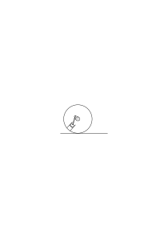

so of course the whole thing is a rigid system, whose parts cannot move relative to one another. And on the other hand one can roll it back & forth on the road as one pleases & it permits everything. What I mean is: whatever one does with the roller is all right as far as the inside of the roller is concerned. (And here lies the analogy.)

### [287\[2\]](https://cdn.wittgensteinnachlass.com/2000px/webp/Ms-110/287.webp)

05.07.1931

Immediate experience (sense-datum) is either a concept with a trivial demarcation or a form.

### [287\[3\]](https://cdn.wittgensteinnachlass.com/2000px/webp/Ms-110/287.webp)

I could follow the explanation of the arrow with a mental image. That would be like following it with a drawing (& what is at issue here is the ‘primary’ in the drawing, not what is physical. But then the mental image seems to play yet another role, in which it is apparently not open to interpretation. Not open to interpretation because it is already interpreted, or rather because it is already sign & interpretation. But how does one interpret signs, then? Surely by means of other signs.

### [287\[4\]](https://cdn.wittgensteinnachlass.com/2000px/webp/Ms-110/287.webp)

What I want to say is: one cannot interpret language as a whole.

### [287\[5\]](https://cdn.wittgensteinnachlass.com/2000px/webp/Ms-110/287.webp)

An interpretation is always only _one_ in contrast to _another_. It attaches itself to the sign & incorporates it into a further system.

### [287\[6\]](https://cdn.wittgensteinnachlass.com/2000px/webp/Ms-110/287.webp),[288\[1\]](https://cdn.wittgensteinnachlass.com/2000px/webp/Ms-110/288.webp)

Now, is it _necessary_, in order to interpret, to explain the word ‘yellow’, to point to a yellow object? Could one not, for example, point to a blue one with the words “that is yellow”, point to a green one & say “that is red”, and so on, always giving the name of the complementary colour? It is clear enough that this would give rise to a misunderstanding, but wouldn’t this explanation be in the same position as, say, this one: someone points a finger in one direction & says that is ‘red’ & thereby explains the colour of the object lying in the opposite direction. This explanation too would give rise to misunderstandings, but it would be as unobjectionable as the hand of a clock that points like this

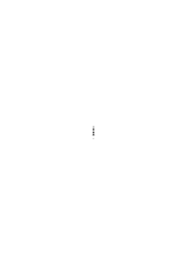

to 6.

### [288\[2\]](https://cdn.wittgensteinnachlass.com/2000px/webp/Ms-110/288.webp)

One so easily confuses the painted picture in the physical sense with the corresponding visual image. The latter can very well stand in place of the memory-image; why ever not. If one feels that this is not possible, one is thinking of the physical picture.

### [288\[3\]](https://cdn.wittgensteinnachlass.com/2000px/webp/Ms-110/288.webp)

It is therefore correct to say: “I remember *that* ↗ – what I see here before me”. The image is then in a certain sense present & past.

### [288\[4\]](https://cdn.wittgensteinnachlass.com/2000px/webp/Ms-110/288.webp)

So the process of comparing a picture with reality is not essential to remembering.

### [288\[5\]](https://cdn.wittgensteinnachlass.com/2000px/webp/Ms-110/288.webp)

If one says to me “bring a yellow flower” & I imagine fetching a yellow flower, I have proved that I have understood the order. But equally if I were to paint a picture of the process. – Why? Presumably because what I do must be described using words from the order. Or should I say that I have actually carried out a related order (related to the first).

### [289\[1\]](https://cdn.wittgensteinnachlass.com/2000px/webp/Ms-110/289.webp)

Why does one take it as proof that a sentence has sense that I can imagine what it says? Because I would have to describe this image with a sentence related to the first. After all, I have thereby merely repeated the sentence in a more primitive symbolism.

### [289\[2\]](https://cdn.wittgensteinnachlass.com/2000px/webp/Ms-110/289.webp)

But does it follow that there is no difference between one picture & another? One symbol & another?

### [289\[3\]](https://cdn.wittgensteinnachlass.com/2000px/webp/Ms-110/289.webp)

“I imagine what it will be like.” (When the chair has been painted white.) – How can I imagine it, then, when it is not so?! Is imagination a kind of magic? No, the description of the mental image is not (after all) the same as the description of the expected event.

### [289\[4\]](https://cdn.wittgensteinnachlass.com/2000px/webp/Ms-110/289.webp)

“You told me ‘leave the room’, so I did _that_” (and now he draws what happened, or acts it out). But there is apparently no connection at all!

### [289\[5\]](https://cdn.wittgensteinnachlass.com/2000px/webp/Ms-110/289.webp)

How can one calculate that 3 + 2 = 5?! when after all ‘5’ has no internal relation to ‘3 + 2’? The only way to do it is one that establishes this relation.

### [289\[6\]](https://cdn.wittgensteinnachlass.com/2000px/webp/Ms-110/289.webp)

The sentence is as similar to the fact as the sign ‘5’ is to the sign ‘3 + 2’. And the painted picture is as similar to the fact as ‘∣∣∣∣∣’ is to the sign ‘∣∣ + ∣∣∣’.

### [289\[7\]](https://cdn.wittgensteinnachlass.com/2000px/webp/Ms-110/289.webp),[290\[1\]](https://cdn.wittgensteinnachlass.com/2000px/webp/Ms-110/290.webp)

When one says: I imagine the sun moving rapidly across the sky; surely the mental image is not described by saying that “the sun is moving rapidly across the sky”! Now, on the one hand I could ask: Isn’t what you see before you a yellow disc in motion? But not specifically the sun. – On the other hand, when I say “I imagine the sun thus & so”, that is not the same as coming to see such a picture (in a film, for example). Indeed, it made sense to ask of this picture: “Does that represent the sun?”

### [290\[2\]](https://cdn.wittgensteinnachlass.com/2000px/webp/Ms-110/290.webp)

Suppose there were two suns I & II in the sky that looked alike, & now someone says: “I imagine sun I moving in this way”. Could one then ask him: “How do you know it’s sun I in particular”? The difference cannot lie in anything about the mental image that is comparable to a painted picture.

### [290\[3\]](https://cdn.wittgensteinnachlass.com/2000px/webp/Ms-110/290.webp)

On imagining as proof of sense: If it makes sense to say “I can imagine that p is the case”, then it also makes sense to say “p is the case”.

### [290\[4\]](https://cdn.wittgensteinnachlass.com/2000px/webp/Ms-110/290.webp)

The mental image in the sense in which I spoke of it earlier is like a picture with the caption “Portrait of N.N.”.

### [290\[5\]](https://cdn.wittgensteinnachlass.com/2000px/webp/Ms-110/290.webp)

My brain will probably one day go blind with age, as it were. But not necessarily only when I am much older than I am now.

### [290\[6\]](https://cdn.wittgensteinnachlass.com/2000px/webp/Ms-110/290.webp),[291\[1\]](https://cdn.wittgensteinnachlass.com/2000px/webp/Ms-110/291.webp)

What does it mean, then, to “discover that a sentence has sense”? Or let us ask it this way: How can one substantiate the claim that a sentence is nonsensical (say, “this body is extended”) by saying: “I cannot imagine what it would be like if it were otherwise”? For can I even try to imagine it? Does it not mean: To say that I imagine it is senseless? How then does this recasting of one piece of nonsense into another help me? – And why does one say precisely: “I cannot imagine what it would be like if it were _otherwise_”? and not – which after all comes to the same thing – “I cannot imagine what that would be like”? One seems to acknowledge in the nonsensical sentence something like a tautology, as distinct from a contradiction. But that too is wrong. – One says, as it were: “Yes, it is extended, but how could it be otherwise? So why say it”. It is the same tendency that leads us to reply to the sentence “this rod has a definite length” not with “Nonsense!”, but with: “Of course!”. But what is the reason (for) this tendency? This tendency might also be described thus: When we hear the two sentences “this rod has a length” & its negation “this rod has no length”, we are biased & incline towards the first sentence (instead of declaring both nonsense). But the reason for this is a confusion: We see the first sentence as verified (and the second as falsified) by “the rod being 4 m long”. And one will say: “and surely 4 m is a length” and forget that what one has here is a sentence of grammar.

### [292\[1\]](https://cdn.wittgensteinnachlass.com/2000px/webp/Ms-110/292.webp)

When one sometimes says that one could not see what is light if one did not see what is dark, this is not a sentence of physics or psychology – for here it isn’t true & I can very well see an entirely white surface & nothing dark alongside it – but what it must mean is: it makes no sense in our language to speak of lightness if it does not make sense to speak of something dark.

### [292\[2\]](https://cdn.wittgensteinnachlass.com/2000px/webp/Ms-110/292.webp)

What does it mean, then, to “discover that a sentence has no sense”? And what does this mean: “If I mean something by it, surely it must have sense”? “If I mean something by it …” – if I mean _what_ by it?!

### [292\[3\]](https://cdn.wittgensteinnachlass.com/2000px/webp/Ms-110/292.webp)

What does it mean: “If I can imagine something in connection with it, surely it must have sense”? If I can imagine _what_ in connection with it? What I say? – That means nothing. – And ‘Something’? That would mean: if I can use the words in this way, then they have sense. Or rather: if I use them to calculate, then they have sense.

### [292\[4\]](https://cdn.wittgensteinnachlass.com/2000px/webp/Ms-110/292.webp)

(No one understands philosophy: either one does not understand what is written, or one understands it: but not that it is philosophy.)

### [292\[5\]](https://cdn.wittgensteinnachlass.com/2000px/webp/Ms-110/292.webp),[293\[1\]](https://cdn.wittgensteinnachlass.com/2000px/webp/Ms-110/293.webp)

“You made a movement with your hand; did you mean something by it? – I thought you meant that I should come to you”.

### [293\[2\]](https://cdn.wittgensteinnachlass.com/2000px/webp/Ms-110/293.webp)

The question is whether one may ask “_what_ did you mean”. The answer to this question (however) is a sentence. Whereas if one may not ask the question that way, then meaning is – so to speak – amorphous. And “I mean something by the sentence” then has the same form as “the sentence is useful”, or “this sentence has an effect on my life”.

### [293\[3\]](https://cdn.wittgensteinnachlass.com/2000px/webp/Ms-110/293.webp)

Now if one asks “did you mean something by this movement of your hand”, the answer may be “no, I didn’t mean anything by it at all” or “yes, I meant something”. And in that case one will ask “what?” and the answer will be words, say.

### [293\[4\]](https://cdn.wittgensteinnachlass.com/2000px/webp/Ms-110/293.webp)

But could one answer: “I meant something by this movement that I can express only through this movement”?

### [293\[5\]](https://cdn.wittgensteinnachlass.com/2000px/webp/Ms-110/293.webp)

I seem to want to say: understanding means only grasping (receiving) a particular kind of sign.

### [293\[6\]](https://cdn.wittgensteinnachlass.com/2000px/webp/Ms-110/293.webp)

“No, I didn’t mean anything at all by this movement. I made it quite involuntarily”. Or alternatively: “Yes, I meant something, I wanted you to come”. But then this wanting the other person to come was a separate process. That is to say, I have now translated the whole process into the sentence “I wanted you to come”. But then it was, after all, only a sign again.

### [294\[1\]](https://cdn.wittgensteinnachlass.com/2000px/webp/Ms-110/294.webp)

The answer to the question “what do you mean” would have to be an explanation of the _system of signs_ to which the given sign belongs. – And that is all that the answer “I mean that you are to come” does, for the sign has now been translated into a sentence of a language familiar to us. And a language is intelligible to us only because we know it, know its system. For all that any explanation can do is teach us the language.

### [294\[2\]](https://cdn.wittgensteinnachlass.com/2000px/webp/Ms-110/294.webp)

But this last sentence is to be taken with caution. For can one say that we understand the language of gestures because we know its system? Yes & no.

### [294\[3\]](https://cdn.wittgensteinnachlass.com/2000px/webp/Ms-110/294.webp)

It might also go like this: after the answer “yes, I meant something by the movement” & the question “what?” comes the answer: “You know what I mean, you understand me”. And this answer shows the essence of understanding most clearly, for if the other person now understands all at once what was meant, he now sees _one thing_ in the sign as opposed to others. If he now interprets it, he interprets it _this way_ as opposed to another way.

### [294\[4\]](https://cdn.wittgensteinnachlass.com/2000px/webp/Ms-110/294.webp)

“Oh yes, I didn’t know where you were pointing; that you were pointing at _him_!”

### [294\[5\]](https://cdn.wittgensteinnachlass.com/2000px/webp/Ms-110/294.webp),[295\[1\]](https://cdn.wittgensteinnachlass.com/2000px/webp/Ms-110/295.webp)

The explanation “Didn’t you understand me, then? I pointed at _him_” explains a system, for it explains from what point of view I ought to have taken the sign. “Just look who he is pointing at!”

### [295\[2\]](https://cdn.wittgensteinnachlass.com/2000px/webp/Ms-110/295.webp)

Now I am always prone to the mistake of believing that a system could exist outside its expression, in the grammar, say.

### [295\[3\]](https://cdn.wittgensteinnachlass.com/2000px/webp/Ms-110/295.webp)

“Now I see it: he keeps pointing at the people going past over there”. He has understood a system: like someone to whom I show the numerals 1, 4, 9, 16 & who says “now I understand the system, now I can write on by myself”. But what happened to this person when he suddenly understood the system? Is it anything other than that the variable “x²” or an analogous sign occurred to him?

### [295\[4\]](https://cdn.wittgensteinnachlass.com/2000px/webp/Ms-110/295.webp)

One may say: quite right, the form x² occurred to him, but as opposed to x³ or 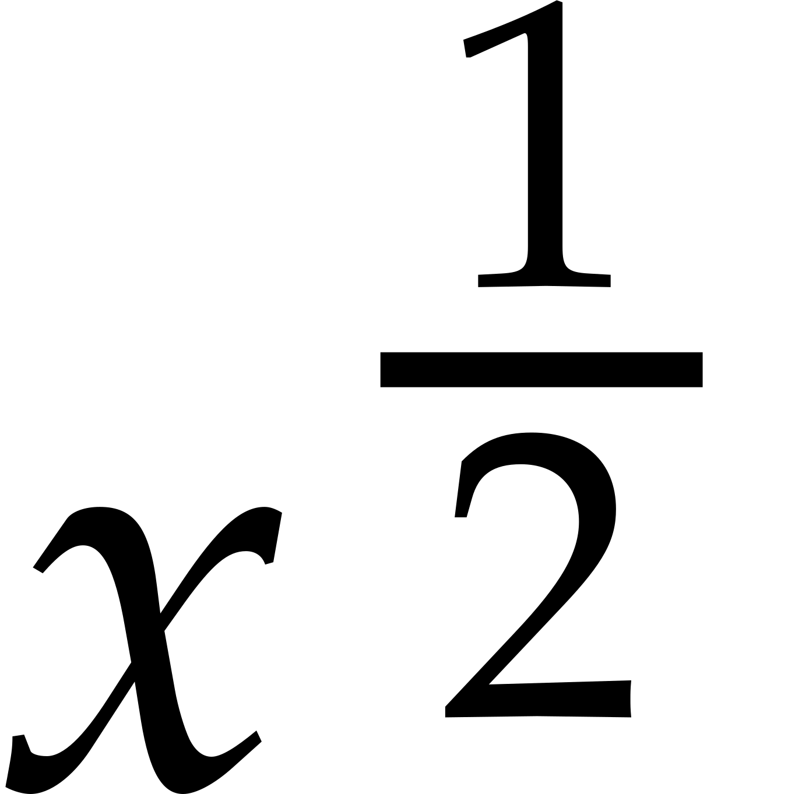. But what does “as opposed to …” mean here? This contrast may be set out in a book, or may come to light through a further step. In short, the development of the system takes place in time (and in the space of the book).

### [295\[5\]](https://cdn.wittgensteinnachlass.com/2000px/webp/Ms-110/295.webp)

What underlies the ability in “now I can write on by myself” is likewise only the occurrence to him of the expression for the variable (thus of a _sign_, again only a piece in the calculus, which itself unfolds only in time) & perhaps the calculation “in his head” of a few further numbers.

### [295\[6\]](https://cdn.wittgensteinnachlass.com/2000px/webp/Ms-110/295.webp),[296\[1\]](https://cdn.wittgensteinnachlass.com/2000px/webp/Ms-110/296.webp)

Understanding is not a matter of an act of grasping the grammar instantaneously, so to speak non-discursively. As if one could, as it were, swallow it all at once.

### [296\[2\]](https://cdn.wittgensteinnachlass.com/2000px/webp/Ms-110/296.webp)

So what the person does who suddenly interprets the other’s movement (I am not saying “interprets it correctly”) is a step in a calculus. He _does_ roughly what he _says_ when he gives expression to his understanding. – And that is, after all, always our principle of knowledge –. And when I say “what he does is a step in a calculus”, that means I already know this calculus; in the sense in which I know German, or the multiplication tables. And I do not have these in me as if the whole of German grammar & the equations of the multiplication tables had been compressed into something that one can now grasp all at once, as a whole.

### [296\[3\]](https://cdn.wittgensteinnachlass.com/2000px/webp/Ms-110/296.webp)

So I conceive of understanding, in some sense, in behaviourist terms.

### [296\[4\]](https://cdn.wittgensteinnachlass.com/2000px/webp/Ms-110/296.webp)

I call only that for which a grammar can be written ‘language’.

### [296\[5\]](https://cdn.wittgensteinnachlass.com/2000px/webp/Ms-110/296.webp)

‘Calculus’ only what a list of rules can be drawn up for.

### [296\[6\]](https://cdn.wittgensteinnachlass.com/2000px/webp/Ms-110/296.webp),[297\[1\]](https://cdn.wittgensteinnachlass.com/2000px/webp/Ms-110/297.webp)

Certainly, the process of “Now I understand …!” is a quite specific one, but it _is_ also a quite specific process when we come upon a familiar calculus, when we “know how to go on”. But this knowing how to go on is also _discursive_ (not intuitive). (And what I wrote down a long time ago comes out precisely here: that we must talk “about books” & things of that sort & not about some linguistic cloud-cuckoo-land.)

### [297\[2\]](https://cdn.wittgensteinnachlass.com/2000px/webp/Ms-110/297.webp)

The behaviouristic feature of my conception consists only in my making no distinction between ‘outside’ & ‘inside’. Because psychology is no concern of mine.

### [GB I](/w-gb-1/#ms-110-297.3) [297\[3\]](https://cdn.wittgensteinnachlass.com/2000px/webp/Ms-110/297.webp)

06.07.1931

I believe that what is characteristic of primitive man is that he does not act on _opinions_ (contra Frazer). Among many similar examples I read of a rain-king in Africa whom the people ask for rain _when the rainy season comes_. But that surely means that they do not really think he can make rain, otherwise they would do it in the dry seasons of the year when the land is “a parched and arid desert”. For if one assumes that the people once instituted this office of rain-king out of stupidity, it is surely clear that they already knew from experience that the rain begins in March & they would then have had the rain-king do his job for the rest of the year. Or to put it another way: Towards morning, when the sun is about to rise, people celebrate rites of daybreak, but not at night, when they simply burn lamps.

### [GB I](/w-gb-1/#ms-110-297.4+298.1) [297\[4\]](https://cdn.wittgensteinnachlass.com/2000px/webp/Ms-110/297.webp),[298\[1\]](https://cdn.wittgensteinnachlass.com/2000px/webp/Ms-110/298.webp)

When I am angry about something I sometimes strike the ground or a tree etc. with my stick, but I do not _believe_ that the ground is to blame or that striking it can do any good. “I let my anger out.” And all rites are of this kind. One can call such actions instinct-actions. – And a historical explanation, for example that I once believed or that my ancestors once believed that striking the ground did some good, is mere subterfuge, for such explanations are superfluous assumptions that explain _nothing_. What matters is the similarity of the act to an act of punishment, but nothing beyond this similarity can be established. Once such a phenomenon is connected with an instinct that I myself possess, that is precisely the explanation sought; i.e. the one that resolves the particular puzzlement. And an enquiry into the history of my instinct now proceeds along different lines.

### [GB I](/w-gb-1/#ms-110-298.2) [298\[2\]](https://cdn.wittgensteinnachlass.com/2000px/webp/Ms-110/298.webp)

It cannot have been some minor reason, i.e. any _reason_ at all, that led certain races of men to venerate the oak tree, but only the fact that they & the oak were united in a common life, thus united not by choice but as the flea & the dog are united in their origins. (If fleas developed a rite, it would concern the dog.)

### [GB I](/w-gb-1/#ms-110-298.3) [298\[3\]](https://cdn.wittgensteinnachlass.com/2000px/webp/Ms-110/298.webp)

One might say it was not their union (that of oak & man) that gave rise to these rites, but perhaps their separation.

### [GB I](/w-gb-1/#ms-110-298.4) [298\[4\]](https://cdn.wittgensteinnachlass.com/2000px/webp/Ms-110/298.webp)

For the awakening of the intellect takes place with a separation from the original _soil_, the original basis of life. (The emergence of _choice_.)

### [GB I](/w-gb-1/#ms-110-299.1) [299\[1\]](https://cdn.wittgensteinnachlass.com/2000px/webp/Ms-110/299.webp)

(The form of the awakening mind is veneration.)

### [299\[2\]](https://cdn.wittgensteinnachlass.com/2000px/webp/Ms-110/299.webp)

“Is the mental image only the mental image, or is the mental image of something in reality?” “Is the mental image only the mental image, or is the mental image related to reality?” “Is the mental image only the mental image, or is it an image of something in reality?”

### [299\[3\]](https://cdn.wittgensteinnachlass.com/2000px/webp/Ms-110/299.webp)

And one could also grasp the relation of the mental image to the painted picture by starting from this question.

### [299\[4\]](https://cdn.wittgensteinnachlass.com/2000px/webp/Ms-110/299.webp)

But the question could not be: “Is the mental image always an image of something that exists in reality” – for plainly it is not always that –; it would have to be: does the mental image always refer to reality, truly or falsely? – For that is something one cannot say of a painted picture. –

### [299\[5\]](https://cdn.wittgensteinnachlass.com/2000px/webp/Ms-110/299.webp)

But why then shouldn’t one say that a mental image is an image of a dream?

### [299\[6\]](https://cdn.wittgensteinnachlass.com/2000px/webp/Ms-110/299.webp)

Are not the mental image & reality related as a plane picture is to three-dimensional space? in which there _can_ always be something of which the plane picture is the projection? (Presumably, then, as language is to reality in space.)

### [300\[1\]](https://cdn.wittgensteinnachlass.com/2000px/webp/Ms-110/300.webp)

… quia plus loquitur inquisitio quam inventio … (Augustine)

### [300\[2\]](https://cdn.wittgensteinnachlass.com/2000px/webp/Ms-110/300.webp)

Manifestissima & usitatissima sunt, & eadem rursus nimis latent, & nova est inventio eorum. (Augustine)

### [300\[3\]](https://cdn.wittgensteinnachlass.com/2000px/webp/Ms-110/300.webp)

If one says that mental images are private, one is again misled by an analogy.

### [300\[4\]](https://cdn.wittgensteinnachlass.com/2000px/webp/Ms-110/300.webp)

Could I paint that things are so if it made no sense to say “things are so”? But this expression “paint that things are so” is itself problematic. It already imports an interpretation into the picture.

### [300\[5\]](https://cdn.wittgensteinnachlass.com/2000px/webp/Ms-110/300.webp)

One will say: the painter of the “Malheurs de Chasse” _did not mean_ that things really happen like that; but had he meant his pictures didactically (to show how things happen), he would have been wrong.

### [300\[6\]](https://cdn.wittgensteinnachlass.com/2000px/webp/Ms-110/300.webp)

But the same holds for tales, Baron Münchhausen’s, for example. In _the_ sense in which one can say of them that they are not true, one can indeed also say it of any picture that is not meant to depict a historical event.

### [300\[7\]](https://cdn.wittgensteinnachlass.com/2000px/webp/Ms-110/300.webp)

On the other hand, one cannot say that those tales are untrue insofar as they do not point to a method of verification at all. (Just like a genre painting.)
