# Ms-111

14 published remarks, VB

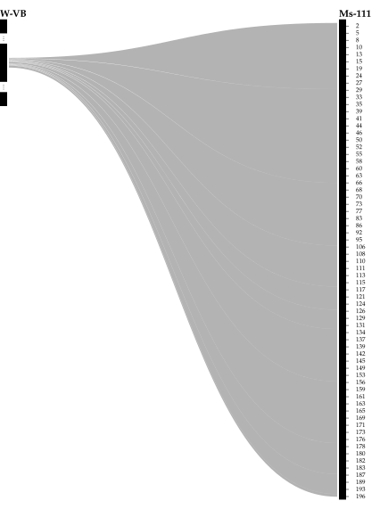

### [III\[1\]](https://cdn.wittgensteinnachlass.com/2000px/webp/Ms-111/III.webp)

## VII. Remarks on Philosophy.

### [1\[1\]](https://cdn.wittgensteinnachlass.com/2000px/webp/Ms-111/1.webp)

07.07.1931

Historical drama; can one call it false? “No, it is not meant as historical writing, after all”. What does this _way of meaning it_ consist in?

### [1\[2\]](https://cdn.wittgensteinnachlass.com/2000px/webp/Ms-111/1.webp)

Let us imagine someone who had written a historical work in due form, but nevertheless _meant_ it not as a historical work but as a fictitious historical work. What would it mean to take this work now one way, now another? What does this way of taking it consist in? Surely in something _outside_ the work. In an _addition_ to the work, as it were. Or doesn’t it consist rather in a particular use or effect of the work, in an impression it makes on me? For an addition of signs can itself be taken in one way or another.

### [1\[3\]](https://cdn.wittgensteinnachlass.com/2000px/webp/Ms-111/1.webp)

We tend to count every phenomenon only as a symptom of the way something is taken or meant, but not as that itself.

### [1\[4\]](https://cdn.wittgensteinnachlass.com/2000px/webp/Ms-111/1.webp),[2\[1\]](https://cdn.wittgensteinnachlass.com/2000px/webp/Ms-111/2.webp)

How language moves away from the description of verification. One has to discover again that one measures time with a clock. – And one does not even realize in doing so that one has made a grammatical discovery.

### [VB](/w-vb/#ms-111-2.2) [2\[2\]](https://cdn.wittgensteinnachlass.com/2000px/webp/Ms-111/2.webp)

(Where Labor writes good music, he is absolutely unromantic. That is a very remarkable & significant sign.)

### [2\[3\]](https://cdn.wittgensteinnachlass.com/2000px/webp/Ms-111/2.webp)

A way of taking something is _one_ as opposed to another.

### [2\[4\]](https://cdn.wittgensteinnachlass.com/2000px/webp/Ms-111/2.webp)

“p is the case”. “It is _true_ that p is the case”. “It really is true that p is the case.” If nothing is added to the multiplicity, what is added is meaningless, pointless. So the addition that expresses a way of taking something must not be of this kind.

### [2\[5\]](https://cdn.wittgensteinnachlass.com/2000px/webp/Ms-111/2.webp)

What is the difference between the actual application of a sentence & an imitated, simulated application?

### [2\[6\]](https://cdn.wittgensteinnachlass.com/2000px/webp/Ms-111/2.webp)

Can one speak of a ‘description’ & an ‘expression’ of the way something is taken?

### [2\[7\]](https://cdn.wittgensteinnachlass.com/2000px/webp/Ms-111/2.webp)

The fictitious portrait. In a book, an illustration with the caption: Baron Münchhausen.

### [2\[8\]](https://cdn.wittgensteinnachlass.com/2000px/webp/Ms-111/2.webp),[3\[1\]](https://cdn.wittgensteinnachlass.com/2000px/webp/Ms-111/3.webp)

“However, such annoyances tend to stimulate the powers of thought.” How does a thought help one overcome an annoyance?

### [3\[2\]](https://cdn.wittgensteinnachlass.com/2000px/webp/Ms-111/3.webp)

“Did you mean that seriously or as a joke?” “Meaning it seriously” does not consist in silently adding something to the spoken sentence, say the words “I mean it seriously”. Of the _whole_ sentence, the spoken sentence together with the words added in thought, one could again ask: how was it meant. But one cannot ask that of seriousness or joking. So the way one means it (the way one takes it) in this sense is a particular experience that goes hand in hand with the signs of the sentence, but does not change the sense of the sentence, whether the experience is one way or another.

### [3\[3\]](https://cdn.wittgensteinnachlass.com/2000px/webp/Ms-111/3.webp)

If sense were not determined by signs & rules, there would be no communication & nothing we could call language.

### [3\[4\]](https://cdn.wittgensteinnachlass.com/2000px/webp/Ms-111/3.webp)

How does ‘(to) believe what one says’ differ from saying it without believing it?

### [3\[5\]](https://cdn.wittgensteinnachlass.com/2000px/webp/Ms-111/3.webp),[4\[1\]](https://cdn.wittgensteinnachlass.com/2000px/webp/Ms-111/4.webp)

“I said ‘she isn’t at home’, but _as I said it_ I knew she was at home”. How does this knowledge go together in time with saying the sentence? Like a continuous accompaniment, a pedal point, to a theme? Did you know it at every instant, & does knowing take no time? A false picture misleads us.

### [4\[2\]](https://cdn.wittgensteinnachlass.com/2000px/webp/Ms-111/4.webp)

This way of considering things, which keeps recurring, derives its importance from the fact that it makes us aware of a false conception we have of the immediate.

### [4\[3\]](https://cdn.wittgensteinnachlass.com/2000px/webp/Ms-111/4.webp)

It does, of course, make sense to say: “While I was telling him that, I knew (the whole time) that it wasn’t true”, just as it does to say “while I was telling it, I believed it too”. Only the two occurrences are very complicated & look very simple; i.e. each of the two sentences can describe many different processes. Rather as when I say “I spent half an hour changing my clothes”, and the most varied activities, one after another, correspond to this sentence.

### [4\[4\]](https://cdn.wittgensteinnachlass.com/2000px/webp/Ms-111/4.webp),[5\[1\]](https://cdn.wittgensteinnachlass.com/2000px/webp/Ms-111/5.webp)

For we labour under the error that believing, meaning, knowing, wishing, looking for, thinking, etc. are _states_ & that therefore something of a different kind must be hidden behind the symbolic processes in thinking, something that contains the sense of a sentence, as it were, in amorphous form, i.e. intuitively, like the seeing of an unchanging picture, not discursively, that is, not in a way comparable to an activity (such as washing).

### [5\[2\]](https://cdn.wittgensteinnachlass.com/2000px/webp/Ms-111/5.webp),[6\[1\]](https://cdn.wittgensteinnachlass.com/2000px/webp/Ms-111/6.webp)

For we must give up the view that, in order to speak of the immediate, we would have to speak of the state at a moment in time. This view is expressed when one says: “all that is given to us is the visual image & the data of the other senses, as well as memory, in the present instant”. That is nonsense; for what does one mean by the “present instant”? Rather, this conception is already based on a physical picture, namely that of the stream of experiences, which I now cut across at one point. Here there is a tendency & an error similar to those found in idealism (or solipsism). But where does this tendency to want to get “to the immediate” come from? Does it not spring from a need to understand the verification of the sentence, a verification that our language completely obscures.

### [6\[2\]](https://cdn.wittgensteinnachlass.com/2000px/webp/Ms-111/6.webp)

Intuitive thinking would be like a game of chess reduced to the form of a lasting, unchanging state (equally unthinkable).

### [6\[3\]](https://cdn.wittgensteinnachlass.com/2000px/webp/Ms-111/6.webp)

That tendency too must be overcome by understanding the grammar of the language we use to express ourselves & the causes of our misunderstandings.

### [6\[4\]](https://cdn.wittgensteinnachlass.com/2000px/webp/Ms-111/6.webp)

The question “how did you mean that” can be answered in several ways:

“I meant it seriously (as a joke)”

“What I wanted to say by that was that … (a sentence follows)”

“I just wanted to take you in.”

### [6\[5\]](https://cdn.wittgensteinnachlass.com/2000px/webp/Ms-111/6.webp)

What happens when one utters a sentence & only wants to take the other person in? One speaks, smiles, watches what the other person does, feels a tension. But the amorphous way of meaning it is nowhere to be found. One imagines it, as it were, as the contents of a crucible on which the sentence is inscribed.

### [6\[6\]](https://cdn.wittgensteinnachlass.com/2000px/webp/Ms-111/6.webp)

“Content of the sentence”.

### [7\[1\]](https://cdn.wittgensteinnachlass.com/2000px/webp/Ms-111/7.webp)

It bothers us, as it were, that the thought of a sentence is not fully present at any moment. Here we see that we are comparing the thought to a thing we produce & never possess as a whole; rather, scarcely does one part come into being before another disappears. That is in a way unsatisfying, because – again misled by an explanation – we expect something different.

### [7\[2\]](https://cdn.wittgensteinnachlass.com/2000px/webp/Ms-111/7.webp)

In the living use of language, of course, we feel no such dissatisfaction; we feel it only when we want to apply a particular picture to the processes. But it is hard to say which picture that is.

### [7\[3\]](https://cdn.wittgensteinnachlass.com/2000px/webp/Ms-111/7.webp),[8\[1\]](https://cdn.wittgensteinnachlass.com/2000px/webp/Ms-111/8.webp)

(When methodology speaks of measurement, it does not tell us, say, what material would be most advantageous for making the yardstick in order to obtain such & such a result; even though that too belongs to the method of measuring. Rather, this investigation is concerned only with the circumstances under which we say that a length, a current strength (etc.) has been measured. It seeks to tabulate the familiar methods we already use, in order thereby to fix the meaning of the words “length”, “current strength”, etc.)

### [8\[2\]](https://cdn.wittgensteinnachlass.com/2000px/webp/Ms-111/8.webp)

The moment in time that I say is the present containing everything that is given to me itself belongs to physical time.

### [8\[3\]](https://cdn.wittgensteinnachlass.com/2000px/webp/Ms-111/8.webp)

For how (then) is such a moment determined? By the stroke of a bell, say? And can I really describe the whole experience simultaneous with this stroke? If one thinks of trying, one realizes at once that what we are talking about is a fiction.

### [8\[4\]](https://cdn.wittgensteinnachlass.com/2000px/webp/Ms-111/8.webp)

We picture the process of experiencing as a strip of film, so that one can say: this frame, & no other, is in front of the lens at this instant.

### [8\[5\]](https://cdn.wittgensteinnachlass.com/2000px/webp/Ms-111/8.webp),[9\[1\]](https://cdn.wittgensteinnachlass.com/2000px/webp/Ms-111/9.webp)

But only in the film can one speak of a picture present at this moment; not when one passes from physical space & its time to visual space & its time.

### [9\[2\]](https://cdn.wittgensteinnachlass.com/2000px/webp/Ms-111/9.webp)

It is much stranger than one probably thinks that one came upon the concept of a ray of light within the domain of ordinary language.

### [9\[3\]](https://cdn.wittgensteinnachlass.com/2000px/webp/Ms-111/9.webp)

It would hardly have happened if one did not sometimes see “rays of light” in the dust in the air.

### [9\[4\]](https://cdn.wittgensteinnachlass.com/2000px/webp/Ms-111/9.webp)

And the assumption of a speed of light is connected with this.

### [9\[5\]](https://cdn.wittgensteinnachlass.com/2000px/webp/Ms-111/9.webp)

“One has called what a cm3 of water weighs ‘1 gram’” – “Yes, but what does it weigh?” (“Meaning of a word”)

### [9\[6\]](https://cdn.wittgensteinnachlass.com/2000px/webp/Ms-111/9.webp),[10\[1\]](https://cdn.wittgensteinnachlass.com/2000px/webp/Ms-111/10.webp)

08.07.1931

If the picture is meant to depict Napoleon’s coronation, one would not have to write that underneath it if it were contained in the picture. If, that is, it too were described in the mere description of the picture. And one might now draw a sharp distinction between thought & picture by saying that the description of the _thought_, unlike that of the mere picture, must also contain a description of the reality to which the thought refers. But there is an error here.

### [10\[2\]](https://cdn.wittgensteinnachlass.com/2000px/webp/Ms-111/10.webp)

Doesn’t the difference arise from the fact that the painted picture is not in itself part of a much more comprehensive picture – a language? By giving it a caption we incorporate the picture into the more comprehensive one. Could we not do this just as effectively by incorporating it into a series of painted pictures?

### [10\[3\]](https://cdn.wittgensteinnachlass.com/2000px/webp/Ms-111/10.webp)

What is characteristic of language is that all explanations can be given from the outset. I.e. it must have been possible to foresee them all, & none needs to be given ad hoc. (And this is what seems to constitute its pictorial character.)

### [10\[4\]](https://cdn.wittgensteinnachlass.com/2000px/webp/Ms-111/10.webp),[11\[1\]](https://cdn.wittgensteinnachlass.com/2000px/webp/Ms-111/11.webp)

I could present my problem like this: if I wanted to investigate whether Napoléon’s coronation really took place in such & such a way, I could use the picture, rather than a description, as a documentary record. And then the question arises: is the whole comparison of the record with reality of the same kind as the comparison of reality with the picture, or is there also something else involved, of a different kind?

### [11\[2\]](https://cdn.wittgensteinnachlass.com/2000px/webp/Ms-111/11.webp)

But what is one to compare reality with, if not with the sentence? And what else is one to do but compare it with the sentence?

### [11\[3\]](https://cdn.wittgensteinnachlass.com/2000px/webp/Ms-111/11.webp)

Or should I say: As long as one does not compare the picture with anything, one _can_ compare it with anything. But when we think, we are already comparing the picture with reality, for we know, for example, that Napoléon is not here now, but Mr N.N. is.

### [11\[4\]](https://cdn.wittgensteinnachlass.com/2000px/webp/Ms-111/11.webp)

That is connected with the problem of _here_ & _now_.

### [11\[5\]](https://cdn.wittgensteinnachlass.com/2000px/webp/Ms-111/11.webp)

(The capacity for philosophy consists in the capacity to receive a strong & lasting impression from a fact of grammar.)

### [11\[6\]](https://cdn.wittgensteinnachlass.com/2000px/webp/Ms-111/11.webp),[12\[1\]](https://cdn.wittgensteinnachlass.com/2000px/webp/Ms-111/12.webp)

In a certain sense the meaning of the words “here”, “now” (etc.) is the only one I cannot fix in advance. But that is of course a misleading way of putting it: the meaning _can_ be fixed & is fixed when the rules for these words are fixed, & that can be done before the words are applied in a particular case; for why else use _one_ word in different cases.

### [12\[2\]](https://cdn.wittgensteinnachlass.com/2000px/webp/Ms-111/12.webp)

The words “here”, “now”, etc. designate the origin of a coordinate system:

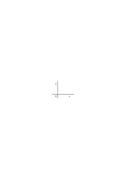.

Like the letter “O”, but they do not describe its position relative to the objects in space.

### [12\[3\]](https://cdn.wittgensteinnachlass.com/2000px/webp/Ms-111/12.webp)

To understand the meaning of a word is to know, to understand, its use.

### [12\[4\]](https://cdn.wittgensteinnachlass.com/2000px/webp/Ms-111/12.webp),[13\[1\]](https://cdn.wittgensteinnachlass.com/2000px/webp/Ms-111/13.webp)

Can a logical product be hidden in a sentence? And if so, how does one find out, & what methods do we have for bringing to light what is hidden in it. If we have no reliable methods yet of finding it, then neither can we speak of something being hidden or possibly being hidden. And if we have a method for looking for it, then the logical product, for example, can be hidden in the sentence only in the way that divisibility by 3 is hidden in the number 753 as long as I have not yet applied the criterion, or that √7 is hidden as long as I have not yet calculated it. For finding the hidden logical product is a mathematical task.

### [13\[2\]](https://cdn.wittgensteinnachlass.com/2000px/webp/Ms-111/13.webp)

So an elementary proposition is one that does not present itself as a truth-function of other propositions in the calculus as I am now using it.

### [13\[3\]](https://cdn.wittgensteinnachlass.com/2000px/webp/Ms-111/13.webp)

14.07.1931

We can shed light on our way of talking about words by looking at what Sokrates says in the “Kratylos”. Kratylos: “It is by far & without question better, Sokrates, to represent what one wants to represent by means of something similar than by means of the first thing that comes to hand.” – Sokrates: “Well said, …”.

### [13\[4\]](https://cdn.wittgensteinnachlass.com/2000px/webp/Ms-111/13.webp),[14\[1\]](https://cdn.wittgensteinnachlass.com/2000px/webp/Ms-111/14.webp)

Connection between word & thing established by the explanation. What sort of connection is that, what kind? What kinds of connection are there? A connection may work or not work: application to the connection established by the explanation of a word.

### [14\[2\]](https://cdn.wittgensteinnachlass.com/2000px/webp/Ms-111/14.webp)

Sokrates to Theaitetos: “And he who imagines, should he not imagine something?”

Theaitetos: “Necessarily.”

Sokrates: “And he who imagines something, nothing real?”

Theaitetos: “So it seems.”

### [14\[3\]](https://cdn.wittgensteinnachlass.com/2000px/webp/Ms-111/14.webp)

What does it mean to form a mental image that does not correspond to reality?

### [14\[4\]](https://cdn.wittgensteinnachlass.com/2000px/webp/Ms-111/14.webp)

How infinitely simple this problem is! And how strange that one can want to regard it as a problem at all.

### [14\[5\]](https://cdn.wittgensteinnachlass.com/2000px/webp/Ms-111/14.webp)

I try to do something, but I cannot. – But what does it mean to “not be able to try to do something”?

### [14\[6\]](https://cdn.wittgensteinnachlass.com/2000px/webp/Ms-111/14.webp)

“We cannot even _try_ to imagine a round quadrilateral.”

### [14\[7\]](https://cdn.wittgensteinnachlass.com/2000px/webp/Ms-111/14.webp),[15\[1\]](https://cdn.wittgensteinnachlass.com/2000px/webp/Ms-111/15.webp)

One should compare imagining with painting a picture. So he paints a picture of the person as that person is not in reality.

### [15\[2\]](https://cdn.wittgensteinnachlass.com/2000px/webp/Ms-111/15.webp)

Very simple. But why do we call it a picture of this person? For if it is not that, then (of course) it is not wrong. – We call it that because he himself has written it above the picture.

### [15\[3\]](https://cdn.wittgensteinnachlass.com/2000px/webp/Ms-111/15.webp)

So he has done nothing more than paint that picture & write that name above it. And presumably that is what he did in his imagination too.

### [15\[4\]](https://cdn.wittgensteinnachlass.com/2000px/webp/Ms-111/15.webp)

Augustinus on learning language.

### [15\[5\]](https://cdn.wittgensteinnachlass.com/2000px/webp/Ms-111/15.webp)

15.07.1931

Plato calls hope a form of speech. (Philebos)

### [15\[6\]](https://cdn.wittgensteinnachlass.com/2000px/webp/Ms-111/15.webp),[16\[1\]](https://cdn.wittgensteinnachlass.com/2000px/webp/Ms-111/16.webp),[17\[1\]](https://cdn.wittgensteinnachlass.com/2000px/webp/Ms-111/17.webp)

When Augustinus speaks of learning language, he speaks exclusively of how we give things names, or understand the names of things. Here, then, naming seems to be the foundation & the be-all and end-all of language. (And what Augustinus says is important to us because it is the view of a man who thinks clearly by nature and who, being far removed from us in time, certainly does not belong to our particular circle of thought.) This conception of the foundation of language is evidently equivalent to the one that takes the form of explanation “this is…” to be fundamental. – Augustinus does not speak of a difference between words, so by ‘names’ he evidently means words such as “tree”, “table”, “bread”, & certainly the proper names of people, but then presumably also “eat”, “go”, “here”, “there”; in short, all words. But he is certainly thinking _in the first instance of nouns_ & of the others as something that will sort itself out. (And Plato says that the sentence consists of nouns & verbs.) They simply describe the game as simpler than it is. But this game presumably does occur in reality. Suppose, for example, that I want to build a house out of building stones that someone else is to hand me. We could first reach an agreement by my pointing to one stone and saying “this is a pillar”, then pointing to another and saying “this is a cube”, – “this is a slab” and so on. And now the application would consist in calling out those words “pillar”, “slab”, etc. in the order in which I need them. And quite similar, of course, are the agreement 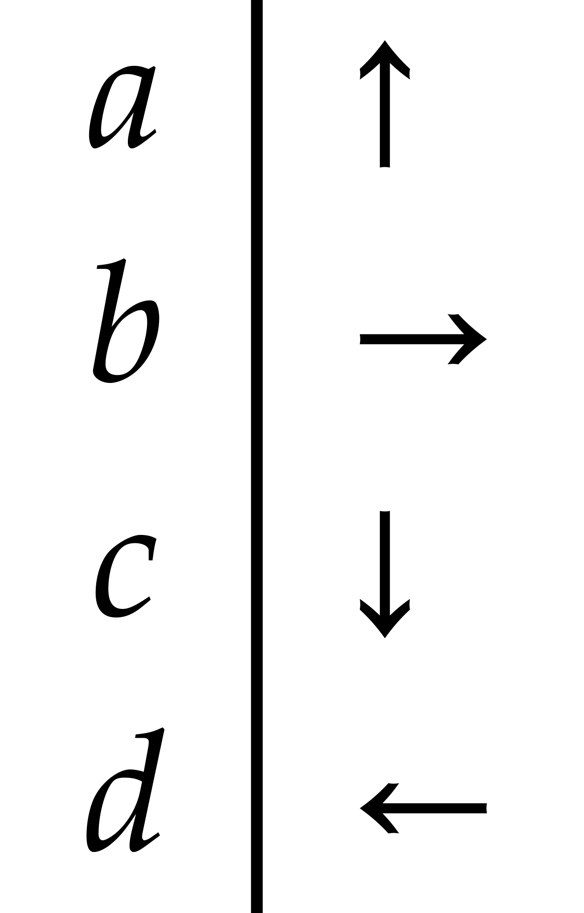, &, say, one that would work with colours.

### [17\[2\]](https://cdn.wittgensteinnachlass.com/2000px/webp/Ms-111/17.webp)

What I mean by this is: Augustinus really does describe a calculus; only not everything we call language is this calculus.

### [17\[3\]](https://cdn.wittgensteinnachlass.com/2000px/webp/Ms-111/17.webp)

(And _that_ is what one must say in a great many cases in which the question is: is this representation useful or useless? The answer then is: “yes, useful; but only for *that*, not for the whole area you purported to represent”.)

### [17\[4\]](https://cdn.wittgensteinnachlass.com/2000px/webp/Ms-111/17.webp)

So it is as if someone explained: “playing consists in moving things on a surface in accordance with certain rules‥‥․” and we replied: You are certainly thinking of board games, & your description does apply to them. But those are not the only games. So you can correct your explanation by claiming only that this is how board games are played.

### [18\[1\]](https://cdn.wittgensteinnachlass.com/2000px/webp/Ms-111/18.webp)

(So one could say that Augustinus represents the learning of language too simply; but also: he represents something simpler.)

### [18\[2\]](https://cdn.wittgensteinnachlass.com/2000px/webp/Ms-111/18.webp)

(Someone who describes chess more simply (with simpler rules) than it is nevertheless describes a game, but a different one.)

### [18\[3\]](https://cdn.wittgensteinnachlass.com/2000px/webp/Ms-111/18.webp),[19\[1\]](https://cdn.wittgensteinnachlass.com/2000px/webp/Ms-111/19.webp)

What I really meant to say was: The way Augustinus describes the learning of language can show us where this conception comes from in the first place. (From what primitive view.) One could compare it with the case of a script in which letters were used to designate sounds, but also, say, to indicate the strength & weakness of pronunciation and as punctuation marks. If we then take this script as a language for describing the sound image, one could imagine someone describing the script as if each letter simply corresponded to a sound & as if the letters did not also have quite different functions. – And such a – too simple – description of the script is exactly what Augustin’s description of language resembles.

### [19\[2\]](https://cdn.wittgensteinnachlass.com/2000px/webp/Ms-111/19.webp)

One can, for example, speak – in a way others understand – of _combinations of colours with shapes_ (say, of the colours red & blue with the shapes square & circle), just as one can speak of combinations of different shapes or bodies. And here we have the root of the misleading expression that a fact is a complex of objects. Thus here a person’s being ill is _compared_ with the putting together of two things, one of which is the person, while the other represents the illness. And all I can say is: let us beware of this simile, or of forgetting that it is a simile. Or one must say that it is with the word “combination”, or “complex”, here as it is with the word “number”, which is also used in different – more or less logically similar – ways (or, if one likes, meanings).

### [19\[3\]](https://cdn.wittgensteinnachlass.com/2000px/webp/Ms-111/19.webp)

To philosophize is to reject false arguments.

### [20\[1\]](https://cdn.wittgensteinnachlass.com/2000px/webp/Ms-111/20.webp)

Sokrates: So if one imagines what is not, does one imagine nothing?

Theaitetos: So it seems.

Sokrates: But if one imagines nothing, surely one does not imagine at all?

Theaitetos: Apparently, as we see. If we substitute, say, “cut up” for “imagine” in this argument [_& the one preceding it_], it amounts to a rule for the use of this word. One is not to say: “I cut up something that does not exist”.

### [20\[2\]](https://cdn.wittgensteinnachlass.com/2000px/webp/Ms-111/20.webp),[21\[1\]](https://cdn.wittgensteinnachlass.com/2000px/webp/Ms-111/21.webp)

I can imagine a deer in this meadow that is not there, but I cannot kill one that is not there. – And to imagine a deer that is not there means to imagine that a deer is there, although none is there. But to kill a deer does not mean: to kill that a deer is there (so: different grammatical rules). If, however, someone says: “in order for me to imagine a deer, there must surely be such a deer in some sense”, the answer is: no, there need not _be_ such a deer in any sense for that. And if the reply were: But surely there must be, for example, the colour brown for me to be able to imagine it, then one should say: “‘There is such a colour as brown’ means nothing at all, except perhaps that it occurs here or there as the colouring of an object (patch), & this is not necessary for me to be able to imagine a brown deer”.

### [21\[2\]](https://cdn.wittgensteinnachlass.com/2000px/webp/Ms-111/21.webp)

“The sound seems to me to come from _there_.” – “From exactly which direction?”

### [21\[3\]](https://cdn.wittgensteinnachlass.com/2000px/webp/Ms-111/21.webp)

Euclidean heap & heap in the visual field.

### [21\[4\]](https://cdn.wittgensteinnachlass.com/2000px/webp/Ms-111/21.webp),[22\[1\]](https://cdn.wittgensteinnachlass.com/2000px/webp/Ms-111/22.webp)

“He came from _roughly_ there →.”

“The brightest point on the horizon is roughly _there_.”

“Make the board roughly 2 m long.”

“The board is roughly 2 m long.”

To be able to say that, must I know limits that determine the latitude for this length? Obviously not. Is it not enough, for example, to say: “a latitude of ± 1 cm is allowed without question; ± 2 cm would already be too much”? – Surely it is also essential to the sense of my sentence that I am unable to give the latitude “exact” limits. Isn’t this plainly because the space I am working in here has a different metric from Euclidean space? For if one tried to determine the latitude exactly by experiment, changing the length, approaching the limits of the latitude & asking each time whether this length was still acceptable or no longer so, after a few steps of narrowing it down one would arrive at contradictions: on one occasion a point would still be said to lie within the limits, on another a point further inside would be declared inadmissible, both, perhaps, with the comment that the judgements were no longer (quite) certain.

### [22\[2\]](https://cdn.wittgensteinnachlass.com/2000px/webp/Ms-111/22.webp)

Isn’t it like the way one weighs meat at the butcher’s, say, only to the nearest decagram, although that, on the other hand, is arbitrary and determined only by the customary brass weights? Here it is enough to know: it weighs no more than 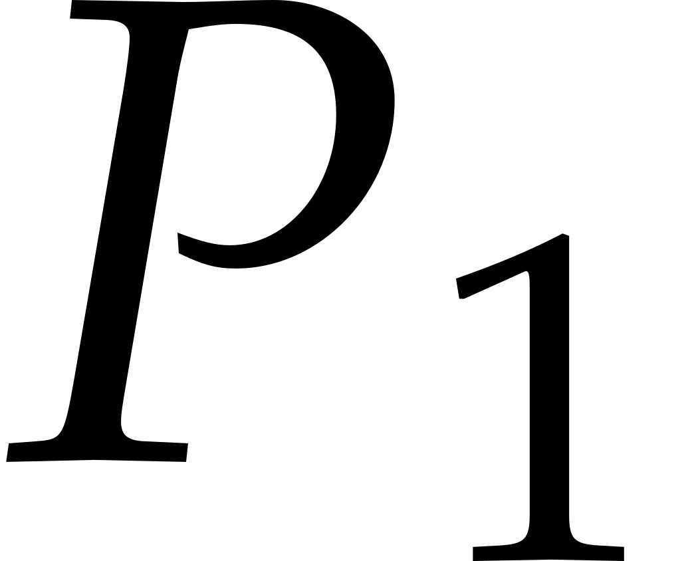 & no less than 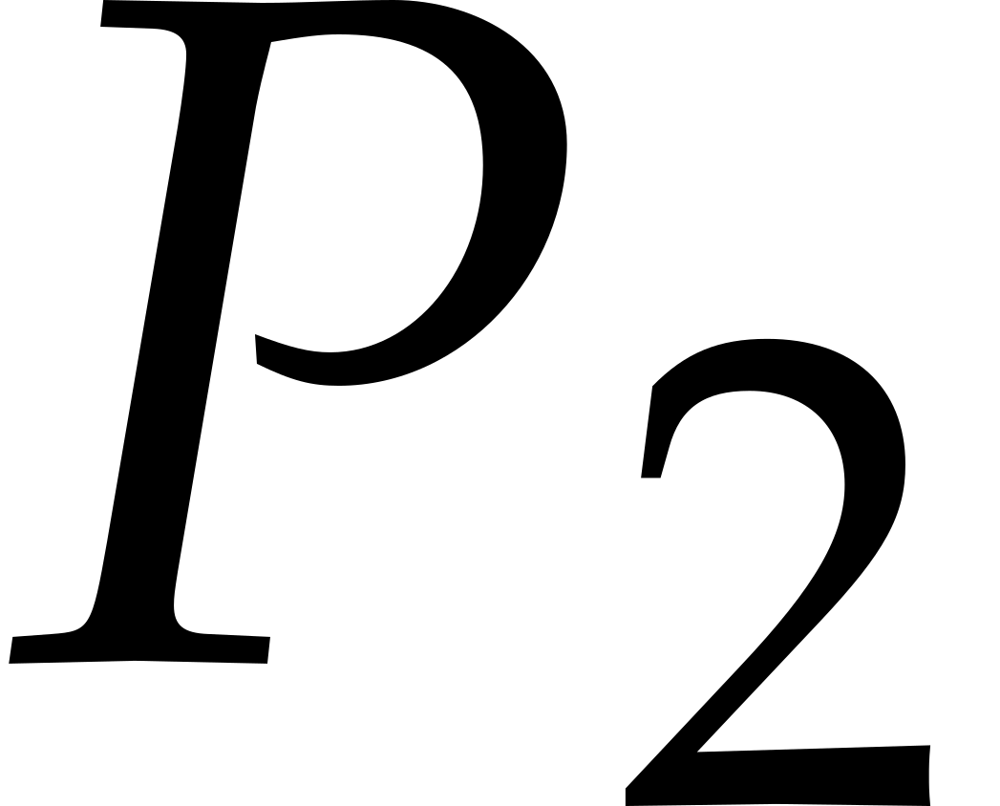. One could say: in principle, stating the weight here consists not in specifying a number but in specifying an interval, & the intervals form a discontinuous series.

### [22\[3\]](https://cdn.wittgensteinnachlass.com/2000px/webp/Ms-111/22.webp),[23\[1\]](https://cdn.wittgensteinnachlass.com/2000px/webp/Ms-111/23.webp)

One could surely say: “In any case, keep _within_ ± 1 cm”, thereby setting an arbitrary limit. – If it were then said: “All right, but that isn’t the actual limit of the permissible latitude; what is it, then?”, the answer might be “I don’t know of one; I only know that ± 2 cm would already be too much”.

### [23\[2\]](https://cdn.wittgensteinnachlass.com/2000px/webp/Ms-111/23.webp)

Now even if there were no wavering in the experiment to determine the limits for as long as we actually go on with it, we must nevertheless stop at some point, & the result will always be only that a certain length is still permissible and another is already impermissible. Here again the false conception of the infinite leads us astray when we imagine the endless process of this investigation completed & then speak of a boundary point as if there were a law here, a geometrical construction to which the boundary point corresponded.

### [23\[3\]](https://cdn.wittgensteinnachlass.com/2000px/webp/Ms-111/23.webp),[24\[1\]](https://cdn.wittgensteinnachlass.com/2000px/webp/Ms-111/24.webp)

“Make me a heap of sand here” – “All right, he’ll surely still call that a heap”. I could carry out the command, so it was in order. But what about this command: “Make me the smallest heap you would still call a heap”? I would say: that is nonsense; I can only fix a provisional upper & lower limit. But that too does not capture exactly how things really stand. Rather, the uncertainty seems usually to be of the same kind as that involved in specifying the highest point of this curve

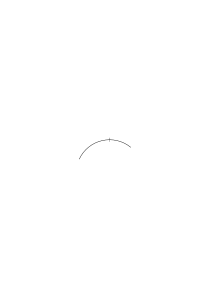.

We are simply not in Euclidean space & there is no highest point in the Euclidean sense. The answer will be: “the highest point is roughly _there_”, & the grammar of the word roughly – in this context – then belongs to the geometry of our space.

### [24\[2\]](https://cdn.wittgensteinnachlass.com/2000px/webp/Ms-111/24.webp)

“I was of the opinion that Napoléon had been crowned in 1805”. – “Were you of that opinion continuously the whole time?”

### [24\[3\]](https://cdn.wittgensteinnachlass.com/2000px/webp/Ms-111/24.webp),[25\[1\]](https://cdn.wittgensteinnachlass.com/2000px/webp/Ms-111/25.webp)

But what has your opinion got to do with Napoléon? What connection is there between your opinion & Napoléon? The connection may, for example, consist in the occurrence of the word “Napoléon” in the expression of my opinion & in the connection this word has with its bearer. For instance, that he signed his name that way, was addressed that way, etc. etc. etc.

### [25\[2\]](https://cdn.wittgensteinnachlass.com/2000px/webp/Ms-111/25.webp),[26\[1\]](https://cdn.wittgensteinnachlass.com/2000px/webp/Ms-111/26.webp)

“But with the word Napoléon you are surely designating this very person while you are uttering it”. – How, in your opinion, does this act of designation take place, then? Instantaneously? Or does it take time? – “Yes, but if one asks you ‘did you (just) now mean the man who won the battle of Austerlitz?’, you will surely say ‘yes’. So you meant this man _when you uttered the sentence in which his name occurs_!” – Granted, but only in much the same sense in which I also knew at the time that 2 + 2 = 4. That is, not as if a particular process had taken place at that time which we could call this ‘meaning’; even if perhaps the utterance was accompanied by certain images that are characteristic of this opinion & might have been different if the word Napoléon had had a different meaning. Rather, the answer “yes, I meant the victor of Austerlitz” is a further step in the calculus. What is misleading about this step is the past tense, which seems to give a description of what had gone on “inside me” while the sentence was being uttered. In reality the past tense merely refers back to the sentence uttered earlier.

### [26\[2\]](https://cdn.wittgensteinnachlass.com/2000px/webp/Ms-111/26.webp)

How thought is related to speech is something one can best understand by considering whether, for instance, the understanding (the thought) of a calculation (a multiplication, say) goes on as a separate process alongside the actual calculation.

### [26\[3\]](https://cdn.wittgensteinnachlass.com/2000px/webp/Ms-111/26.webp)

If one takes understanding, knowing, etc. to be a _state_, then only hypothetically, in the sense of a mental disposition on the same footing as a physiological disposition.

### [26\[4\]](https://cdn.wittgensteinnachlass.com/2000px/webp/Ms-111/26.webp)

“Were you thinking, then, when you said the sentence, that Napoléon …” – “I was only thinking what I said”.

### [26\[5\]](https://cdn.wittgensteinnachlass.com/2000px/webp/Ms-111/26.webp),[27\[1\]](https://cdn.wittgensteinnachlass.com/2000px/webp/Ms-111/27.webp)

In Plato I do not find, in response to a question like “what is knowledge”, the provisional answer: Let us first look at how this word is used.

### [27\[2\]](https://cdn.wittgensteinnachlass.com/2000px/webp/Ms-111/27.webp)

Knowing something is akin to having a slip of paper in a drawer of my desk with it written down on it.

### [27\[3\]](https://cdn.wittgensteinnachlass.com/2000px/webp/Ms-111/27.webp)

16.07.1931

When I say: “the present situation enters into my thoughts”, this does not mean: the situation insofar as I can describe it. For insofar as I can describe it, I can paint it.

### [27\[4\]](https://cdn.wittgensteinnachlass.com/2000px/webp/Ms-111/27.webp)

Here & Now are geometrical concepts, like, for example, the centre of my visual field.

### [27\[5\]](https://cdn.wittgensteinnachlass.com/2000px/webp/Ms-111/27.webp)

Here & Now have no greater multiplicity than they seem to have. The great danger is to assume that they do. Replace them with whatever expression you like, it is always only _one_ word – & so one is as good as another.

### [27\[6\]](https://cdn.wittgensteinnachlass.com/2000px/webp/Ms-111/27.webp)

“I am here now.” In what situation does this make sense, and in what situation does it not?

### [27\[7\]](https://cdn.wittgensteinnachlass.com/2000px/webp/Ms-111/27.webp),[28\[1\]](https://cdn.wittgensteinnachlass.com/2000px/webp/Ms-111/28.webp)

Let us imagine a letter dated: “Here, Now”. But I thought this shows what these words mean; they stand for the _preprinted_ “Place …, Date …”.

Difference between legend & fairy tale, fairy tales (& other works of fiction) cut off from the Now & Here.

### [28\[2\]](https://cdn.wittgensteinnachlass.com/2000px/webp/Ms-111/28.webp)

But it is an important proposition in the grammar of the word “here” that it makes no sense to write “here” where a location is to be specified; that I should therefore not attach to my chair a little sign bearing the inscription “This chair is always to be used here and nowhere else”.

### [28\[3\]](https://cdn.wittgensteinnachlass.com/2000px/webp/Ms-111/28.webp)

“This is here now”.

### [28\[4\]](https://cdn.wittgensteinnachlass.com/2000px/webp/Ms-111/28.webp)

Of course, with regard to the words “now” & “here” etc. I can only do what I do in other cases, namely describe their use. And this description must be general. I.e. given in advance, _before_ any use.

### [28\[5\]](https://cdn.wittgensteinnachlass.com/2000px/webp/Ms-111/28.webp),[29\[1\]](https://cdn.wittgensteinnachlass.com/2000px/webp/Ms-111/29.webp)

Is a space conceivable that contains only the rational points, all of them, but not the irrational ones? Would this structure perhaps be too imprecise for our space? Because we could then (always) reach the irrational points only approximately? So our net would not be fine enough? No. What we would lack is the laws, not the extensions.

### [29\[2\]](https://cdn.wittgensteinnachlass.com/2000px/webp/Ms-111/29.webp)

Is a space conceivable that contains only the rational points, all of them, but not the irrational ones? And that means only: are the irrational numbers not predetermined by the rational ones? No more so than chess is predetermined by draughts. The irrational numbers do not fill a gap left open by the rational ones.

### [29\[3\]](https://cdn.wittgensteinnachlass.com/2000px/webp/Ms-111/29.webp)

The patch of a single colour in the coloured plane is not composed of smaller parts, except in the way that 10, say, is composed of a hundred hundredths.

### [29\[4\]](https://cdn.wittgensteinnachlass.com/2000px/webp/Ms-111/29.webp)

The smallest visible piece is a piece of the physical surface, not of the visual field. The experiment that determines what is smallest and still visible shows a relation between _two_ appearances.

### [29\[5\]](https://cdn.wittgensteinnachlass.com/2000px/webp/Ms-111/29.webp)

The experiment does not investigate visual space, & one cannot investigate visual space. Cannot penetrate deeper into it.

### [30\[1\]](https://cdn.wittgensteinnachlass.com/2000px/webp/Ms-111/30.webp)

(If one wanted to describe what is plain to see, one could not “investigate what is plain to see”.)

### [30\[2\]](https://cdn.wittgensteinnachlass.com/2000px/webp/Ms-111/30.webp)

One might believe that the visual field is composed of minima visibilia, of nothing but little squares, say, that one sees as indivisible patches. Nonsense. The visual field is not composite if we do not see its composition. For by the word “composition” we have in mind, after all, the composition of a larger patch out of smaller ones. It is misleading to speak of the smallest visible parts of the visual field; are there then parts of the visual field that we no longer see? And if we call the image of a fixed star that, for example, it could only mean that it makes no sense here to speak of ‘smaller’, & not that in fact no patch in the visual field is smaller. So the superlative “the smallest …” is wrongly applied.

### [30\[3\]](https://cdn.wittgensteinnachlass.com/2000px/webp/Ms-111/30.webp),[31\[1\]](https://cdn.wittgensteinnachlass.com/2000px/webp/Ms-111/31.webp)

It seems that one cannot see a patch of a single colour as composite unless one imagines it as _not_ of a single colour. The mental image of a dividing line makes the patch multicoloured; for the dividing line must be a different colour from the rest of the patch.

### [31\[2\]](https://cdn.wittgensteinnachlass.com/2000px/webp/Ms-111/31.webp)

“An object cannot, in a certain sense, be described” (also in Plato: “it cannot be described (explained), but only named”). By “object” one means here “meaning of a word that cannot be defined any further”, & by “description” or “explanation” one really means “definition”. For of course it is not denied that the object can be ‘described from outside’, that properties, for instance, can be ascribed to it.

### [31\[3\]](https://cdn.wittgensteinnachlass.com/2000px/webp/Ms-111/31.webp)

So when we consider a sentence like the one above, we think of a calculus with indefinable – or, more correctly, undefined – signs, the names, & say of them that they cannot be explained.

### [31\[4\]](https://cdn.wittgensteinnachlass.com/2000px/webp/Ms-111/31.webp),[32\[1\]](https://cdn.wittgensteinnachlass.com/2000px/webp/Ms-111/32.webp)

Does the proposition that the circle lies between the two straight lines follow from the proposition that it lies just _here_? – But how is this here determined? From the words “the circle lies here” the first (proposition) of course does not follow. A picture goes with the ‘here’. So does the proposition “the circle lies between the straight lines a & b” follow from the proposition “the circle lies _like this_ in relation to the straight lines 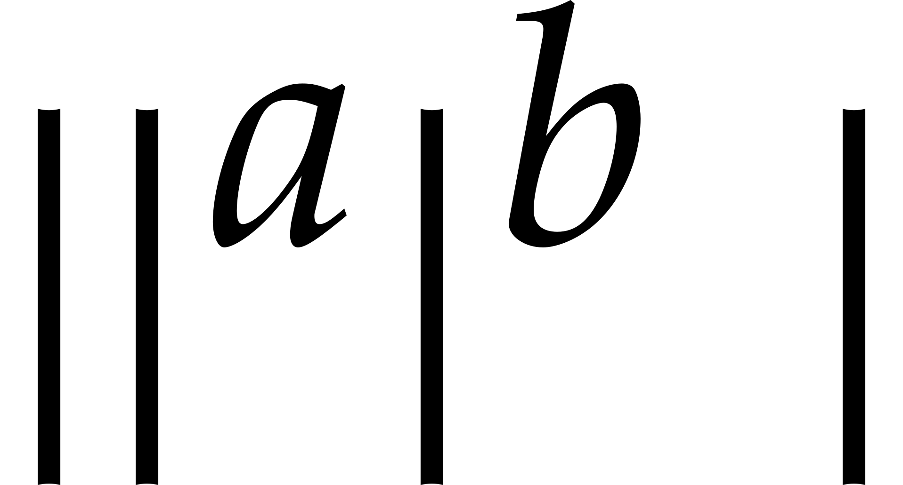: ❘ •❘”? The circle might now be hidden, say, so that one could not know whether (or not) it lies between the straight lines a & b (which are visible), & I know that I must remove what is hiding it to see whether the proposition is true.

### [32\[2\]](https://cdn.wittgensteinnachlass.com/2000px/webp/Ms-111/32.webp)

p ∙ q = p means “q follows from p”

### [32\[3\]](https://cdn.wittgensteinnachlass.com/2000px/webp/Ms-111/32.webp)

But it is not clear that the case above is one of following in this sense.

### [32\[4\]](https://cdn.wittgensteinnachlass.com/2000px/webp/Ms-111/32.webp),[33\[1\]](https://cdn.wittgensteinnachlass.com/2000px/webp/Ms-111/33.webp)

How is the extension of the concept “lying between” determined? After all, which possibilities belong to this concept is supposed to be fixed in advance. It can be no surprise, as I say, that I call _that_ “lying between” too. Or: How can the rules for the expression “lying between” be given, seeing that I cannot enumerate the cases of lying between? Of course, that very point must be characteristic of the meaning of this expression.

### [33\[2\]](https://cdn.wittgensteinnachlass.com/2000px/webp/Ms-111/33.webp)

Nor, after all, would we try to explain the expression to someone by pointing to _all the particular cases_, but by pointing to one such case (or a few) & indicating somehow that the particular case does not matter.

### [33\[3\]](https://cdn.wittgensteinnachlass.com/2000px/webp/Ms-111/33.webp)

Enumerating positions is not only unnecessary; here anything of the sort is out of the question in principle.

### [33\[4\]](https://cdn.wittgensteinnachlass.com/2000px/webp/Ms-111/33.webp)

But how, then, does implication fit into the rules for truth-functions? Or is this achieved by a _stipulated_ rule of the form p ∙ q = p?

### [33\[5\]](https://cdn.wittgensteinnachlass.com/2000px/webp/Ms-111/33.webp),[34\[1\]](https://cdn.wittgensteinnachlass.com/2000px/webp/Ms-111/34.webp)

So I shall have a general sign of the form “❘ •❘” which stands to the one used earlier as x² + x stands to 4˙3² + 4˙3. And these two signs must be outwardly distinguishable & different rules must hold for them (as for “x” and “4”). – But one rule must say that 4, or any other number, may take the place of x. And now one could ask: how is one to express that any number whatever may stand for “x”, seeing that this would already require such a variable?

### [34\[2\]](https://cdn.wittgensteinnachlass.com/2000px/webp/Ms-111/34.webp)

p ⌵ q = q means “q follows from p”. This follows from p ∙ q = p, for p ⌵ q is in general = (p ∙ q) ⌵ (p ∙ ~q) ⌵ (~p ∙ q). But if q follows from p, this becomes = p ⌵ Cont ⌵ (~p ∙ q) = p ⌵ (~p ∙ q) = q.

### [34\[3\]](https://cdn.wittgensteinnachlass.com/2000px/webp/Ms-111/34.webp)

To say “the circle lies either between the two straight lines or _here_” (where this ‘here’ is a place between the lines) evidently amounts merely to saying “the circle lies between the two straight lines” & the addition “or here” appears superfluous. One will say: the ‘here’ is already included in the ‘somewhere’. But that is curious, because it is not mentioned in it.

### [34\[4\]](https://cdn.wittgensteinnachlass.com/2000px/webp/Ms-111/34.webp),[35\[1\]](https://cdn.wittgensteinnachlass.com/2000px/webp/Ms-111/35.webp)

A particular difficulty lies in the words’ not seeming to say what the thought grasps, or: when the words do not say what the thought seems to grasp.

### [35\[2\]](https://cdn.wittgensteinnachlass.com/2000px/webp/Ms-111/35.webp)

As when we say “this proposition holds for all numbers” & believe that we have grasped all the numbers in the thought as though we had them all in a box like apples.

### [35\[3\]](https://cdn.wittgensteinnachlass.com/2000px/webp/Ms-111/35.webp)

One can no doubt lay down a rule for the use of the variable, & it is no pleonasm that in doing so we use this kind of variable. For if we did not need it, the variable would after all be defined by the rules. And we are not assuming that it can be defined, or: that it must be defined (for the definitions do come to an end somewhere).

### [35\[4\]](https://cdn.wittgensteinnachlass.com/2000px/webp/Ms-111/35.webp)

That means (only) that – e.g. – the variable “x²” is not an abbreviation (say, for a logical sum) & that in our thoughts, too, there is only a sign of this multiplicity.

### [35\[5\]](https://cdn.wittgensteinnachlass.com/2000px/webp/Ms-111/35.webp),[36\[1\]](https://cdn.wittgensteinnachlass.com/2000px/webp/Ms-111/36.webp)

But now one could ask: How can I now know in advance from which propositions this general proposition follows? If I cannot specify those propositions.

### [36\[2\]](https://cdn.wittgensteinnachlass.com/2000px/webp/Ms-111/36.webp)

But can one say: “one cannot say from which propositions this proposition follows”? That sounds like: one does not know. But of course it is not like that. And I can after all state propositions, & state them in advance, from which it follows. – “Only not _all_ of them”. – But that is just what means nothing.

### [36\[3\]](https://cdn.wittgensteinnachlass.com/2000px/webp/Ms-111/36.webp)

There are just the general proposition & particular propositions (not: the particular propositions). But the general proposition does not enumerate particular propositions. But what, then, characterizes it as general & what shows that it does not simply encompass those particular propositions of which we speak in this particular case?

### [36\[4\]](https://cdn.wittgensteinnachlass.com/2000px/webp/Ms-111/36.webp)

It cannot be characterized by its special cases; for however many one enumerates, it could always be confused with the product of the cases cited. Its generality thus lies in a property of the variable.

### [36\[5\]](https://cdn.wittgensteinnachlass.com/2000px/webp/Ms-111/36.webp),[37\[1\]](https://cdn.wittgensteinnachlass.com/2000px/webp/Ms-111/37.webp)

How one can regard the drawing ❘ ⚬❘ as a representation of the “general case”. As it were, not in metric space, but in such a way that the distances from the circle to the straight lines make no difference at all. One then sees the picture as a case belonging to a different system from the one it belongs to when one sees it as a representation of a particular position of the circle between the straight lines. Or rather: it is then part of a different calculus. Different rules hold for the variable than for its particular value.

### [37\[2\]](https://cdn.wittgensteinnachlass.com/2000px/webp/Ms-111/37.webp)

But what does the infinite possibility of assigning a value to a variable consist in, for example? How can one go by a rule such as “no number may be put in this place”? The generality of such a prescription must be of the kind found in hypothetical generality (all men must die).

### [37\[3\]](https://cdn.wittgensteinnachlass.com/2000px/webp/Ms-111/37.webp)

For it seems as if a generality could go beyond a definite enumeration by means of a kind of shadowy enumeration.

### [38\[1\]](https://cdn.wittgensteinnachlass.com/2000px/webp/Ms-111/38.webp)

For suppose I had enumerated 7 cases & said “but their logical sum is not the general proposition”; that is not enough, & I want to say in addition that no other number of cases yields the general proposition either. But in this addition I now seem once again to be carrying out an enumeration, albeit not actually, but in a shadowy sort of way. But that is not how it is, for the words that occur in the addition are quite different from the number words.

### [38\[2\]](https://cdn.wittgensteinnachlass.com/2000px/webp/Ms-111/38.webp)

“But how am I to forbid _a_ number word from being substituted at such & such a place? After all, I cannot foresee, so as to forbid it, which number word someone will want to substitute”. – You can forbid it when it comes up. – But then we are already speaking, generally, of the concept of number!

### [38\[3\]](https://cdn.wittgensteinnachlass.com/2000px/webp/Ms-111/38.webp),[39\[1\]](https://cdn.wittgensteinnachlass.com/2000px/webp/Ms-111/39.webp)

I should have to say: The numerical variable is a sign akin to the numeral (in virtue of the rules that hold for it – rather as the bishop is more akin to the queen than to the knight). And what we mean when we say that one is a special case of the other must also lie in the kinship of the rules.

### [39\[2\]](https://cdn.wittgensteinnachlass.com/2000px/webp/Ms-111/39.webp)

But there is no such thing as something that is an enumeration & yet not an enumeration. A generality that enumerates in a hazy sort of way, but not actually & up to a definite limit.

### [39\[3\]](https://cdn.wittgensteinnachlass.com/2000px/webp/Ms-111/39.webp)

The dots in “1 + 1 + 1 + 1 ....” are likewise just the four dots. A sign for which it must be possible to specify certain rules. (Namely the same ones as for the sign “etc. ad inf.”.) This sign does imitate an enumeration in a certain way, but it is not an enumeration. And that presumably means that the rules that hold for it agree up to a point with those that hold for an enumeration, but do not agree entirely.

### [39\[4\]](https://cdn.wittgensteinnachlass.com/2000px/webp/Ms-111/39.webp)

There is nothing midway between a definite enumeration & the variable.

### [39\[5\]](https://cdn.wittgensteinnachlass.com/2000px/webp/Ms-111/39.webp),[40\[1\]](https://cdn.wittgensteinnachlass.com/2000px/webp/Ms-111/40.webp)

I once said that there could not be numbers _and_ the concept of number. And that is right if it means that the variable does not stand to a number as the concept apple stands to an apple (or the concept sword to Nothung). On the other hand, _the numerical variable is not a numeral_.

### [40\[2\]](https://cdn.wittgensteinnachlass.com/2000px/webp/Ms-111/40.webp)

But I also wanted to say that the concept of number could not be given independently of the numbers, & that is not true. Rather, the numerical variable is independent of individual numbers in the sense that there is, no doubt, a calculus with a class of our numerals & without the general numerical variable. Of course, not all the rules that hold for our numbers then hold for these numbers, but they still correspond to ours as the pieces in draughts correspond to those in losing draughts.

### [40\[3\]](https://cdn.wittgensteinnachlass.com/2000px/webp/Ms-111/40.webp),[41\[1\]](https://cdn.wittgensteinnachlass.com/2000px/webp/Ms-111/41.webp)

But what makes a sign an expression of infinity? What gives it the peculiar character of what we call infinite? I believe it is rather like the sign for an enormous number. For what is characteristic of the infinite, as one conceives it in this way, is its enormous magnitude.

### [41\[2\]](https://cdn.wittgensteinnachlass.com/2000px/webp/Ms-111/41.webp)

If one asks, say, “is this the last rule in the series, then”, the answer would be: of course not. – One can also say: none will be the last. – But here one is already using a variable, for no logical product corresponds to ‘none’.

### [41\[3\]](https://cdn.wittgensteinnachlass.com/2000px/webp/Ms-111/41.webp)

Should I say, then: none is the last, – or: It is senseless to speak of a ‘last’ one, & the word ‘none’ is not permitted in this context either?

### [41\[4\]](https://cdn.wittgensteinnachlass.com/2000px/webp/Ms-111/41.webp)

The grammar of the expression “etc., ad inf.”

### [41\[5\]](https://cdn.wittgensteinnachlass.com/2000px/webp/Ms-111/41.webp)

If, for instance, we give the rules for division or multiplication, they already contain the ‘infinite generality’. That is, the absence of a limit & the ‘etc.’. (And in this way one can satisfy oneself that everything is in order.)

### [41\[6\]](https://cdn.wittgensteinnachlass.com/2000px/webp/Ms-111/41.webp),[42\[1\]](https://cdn.wittgensteinnachlass.com/2000px/webp/Ms-111/42.webp)

Even the child at school learns the rules of calculation with this infinite generality. We show the child a few multiplications & require the child then to carry out others unaided with numbers larger than those in the paradigm.

### [42\[2\]](https://cdn.wittgensteinnachlass.com/2000px/webp/Ms-111/42.webp)

“How many dots must one put in a row to indicate the ‘etc.’?” Doesn’t _one_ do it?

### [42\[3\]](https://cdn.wittgensteinnachlass.com/2000px/webp/Ms-111/42.webp)

Can one say of the number series that it has no end? “But what would it be like if it were otherwise?” But can I not say of chess: the series of chess pieces has an end, & in another game it has no end, if one were permitted to occupy arbitrarily many squares with pieces, in accordance with a rule?

### [42\[4\]](https://cdn.wittgensteinnachlass.com/2000px/webp/Ms-111/42.webp)

That is to say: is it even permissible to say that something has an end, or has none?

### [42\[5\]](https://cdn.wittgensteinnachlass.com/2000px/webp/Ms-111/42.webp)

To say “this series has no end” of course means the same as: “It goes on like this”.

### [42\[6\]](https://cdn.wittgensteinnachlass.com/2000px/webp/Ms-111/42.webp),[43\[1\]](https://cdn.wittgensteinnachlass.com/2000px/webp/Ms-111/43.webp)

Of course one has written down only the numbers up to a certain highest one – say 10¹⁰ –. Now what does the _possibility_ of writing down numbers one has not yet written down consist in? How strange this feeling as though they were somehow all there already. (Frege said that in a certain sense a construction line is already there even before it is drawn)!

### [43\[2\]](https://cdn.wittgensteinnachlass.com/2000px/webp/Ms-111/43.webp)

Here the difficulty is to resist the thought that possibility is a kind of shadowy existence.

### [43\[3\]](https://cdn.wittgensteinnachlass.com/2000px/webp/Ms-111/43.webp)

Here the thought forces itself on one that generality does after all anticipate the particular cases in a shadowy way. That the variable is only an abbreviation for particular cases.

### [43\[4\]](https://cdn.wittgensteinnachlass.com/2000px/webp/Ms-111/43.webp)

In the rules for the variable a there can occur a variable b & also particular numerals; but no totality of numbers either.

### [43\[5\]](https://cdn.wittgensteinnachlass.com/2000px/webp/Ms-111/43.webp),[44\[1\]](https://cdn.wittgensteinnachlass.com/2000px/webp/Ms-111/44.webp)

But now it seems as if something were thereby being _denied away_ from logic: perhaps precisely the generality; or what the dots indicate. The unfinished (loose, extensible) character of the series. And of course we must not & cannot deny anything away. So where does this indeterminacy find expression? Perhaps like this: when we list numbers that we may substitute for the variable a, we do not say of any of them that it is the last or the highest.

### [44\[2\]](https://cdn.wittgensteinnachlass.com/2000px/webp/Ms-111/44.webp)

But now if, after an explanation of a method of calculation, someone were to ask us: “and is 103 _the_ last sign I can use, then?” what should we answer? “No, it is not the last” or “there is no last one”? – But must I not ask him in return: “And if it is not the last, what would come next?” And if he then said “104”, I should have to say: Quite right, you can continue the series yourself.

### [44\[3\]](https://cdn.wittgensteinnachlass.com/2000px/webp/Ms-111/44.webp)

I cannot speak of an end to possibility at all.

### [44\[4\]](https://cdn.wittgensteinnachlass.com/2000px/webp/Ms-111/44.webp),[45\[1\]](https://cdn.wittgensteinnachlass.com/2000px/webp/Ms-111/45.webp)

(It is only chatter that one must guard against in philosophy. But a rule that can be applied in practice is always in order.)

### [45\[2\]](https://cdn.wittgensteinnachlass.com/2000px/webp/Ms-111/45.webp)

It is clear that one can follow a rule of the kind ❘a, ξ, ξ + 1❘; I mean, without already being able to write down the series in advance, but by actually following the formation rule. It is then just as if I began a series with, say, the number 1 & said: “now add 7 to it, multiply by 5 & take the square root, & apply this composite operation to the result over and over again”. (That would be the rule 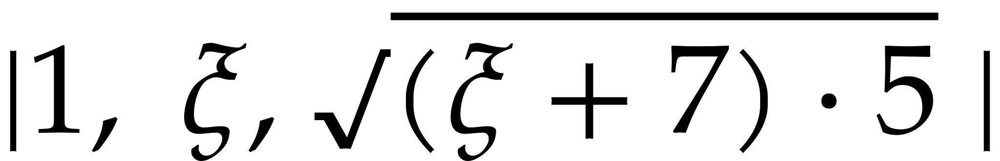.)

### [45\[3\]](https://cdn.wittgensteinnachlass.com/2000px/webp/Ms-111/45.webp)

But what does someone who understands this rule do? Does he perhaps already apply it to all numbers in a shadowy sort of way? –

### [45\[4\]](https://cdn.wittgensteinnachlass.com/2000px/webp/Ms-111/45.webp),[46\[1\]](https://cdn.wittgensteinnachlass.com/2000px/webp/Ms-111/46.webp)

Now, to apply the rule 3 times in succession, say, there is no need for a further rule governing this application (establishing the connection between the first rule and the number 3). Rather, it is precisely our leaving the space for application open that is our sign for endless generality.

### [46\[2\]](https://cdn.wittgensteinnachlass.com/2000px/webp/Ms-111/46.webp)

After all, the word “etc.” is nothing other than the _word_ “_etc._” (i.e. again as a sign of the calculus, which can do no more than have meaning through the rules that hold for it. Which can say no more than it shows.)

### [46\[3\]](https://cdn.wittgensteinnachlass.com/2000px/webp/Ms-111/46.webp)

That is, there is no secret power in the word “etc.” by virtue of which the series is now continued without being continued.

### [46\[4\]](https://cdn.wittgensteinnachlass.com/2000px/webp/Ms-111/46.webp)

Probably not, one will say, but it does have the meaning of infinite continuation.

### [46\[5\]](https://cdn.wittgensteinnachlass.com/2000px/webp/Ms-111/46.webp)

“Can one imagine an empty space?” (Curiously enough, this question belongs here.)

### [46\[6\]](https://cdn.wittgensteinnachlass.com/2000px/webp/Ms-111/46.webp)

It is one of the most deeply rooted errors of philosophy: possibility as a shadow of reality. But on the other hand it cannot be an error & it is not one if one calls the proposition this shadow.

### [46\[7\]](https://cdn.wittgensteinnachlass.com/2000px/webp/Ms-111/46.webp),[47\[1\]](https://cdn.wittgensteinnachlass.com/2000px/webp/Ms-111/47.webp),[48\[1\]](https://cdn.wittgensteinnachlass.com/2000px/webp/Ms-111/48.webp)

To explain the infinite possibility, it must be enough to point to the features of the sign that lead us to the assumption of this infinite possibility, or rather: from which we discern this infinite possibility. That is (only) to say that what is actually there in the sign must suffice, & that the possibilities of the sign, which could in turn show themselves only in a description of signs, must not come into consideration. So everything must already be contained in the sign “❘1, ξ, ξ + 1❘” – the expression of the formation rule. I must not use the infinite possibility to introduce a mythical element into logic again. If one describes the process of division 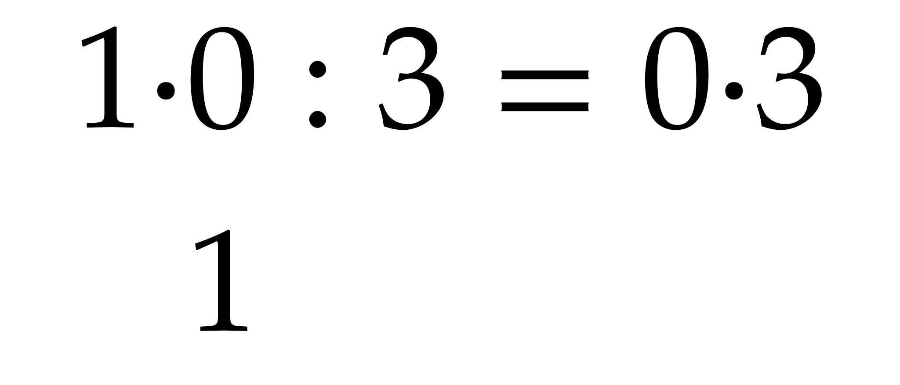, which yields the quotient 0˙3 & the remainder 1, then the infinite possibility of continuing with the same result every time must already lie in this description, for nothing else is given to us when we see “that it must always go on like this”. And when we “see the infinite possibility of continuing”, we surely cannot see anything that is not described when we describe the very sign we see.

### [48\[2\]](https://cdn.wittgensteinnachlass.com/2000px/webp/Ms-111/48.webp)

The danger here, of course, is again that of falling into a _positivism_, namely one that deserves a name of its own & therefore of course must be an error. For we must have no tendency at all, no particular conception of things, but (we) must acknowledge everything anyone has ever said about them, except in so far as he himself had a particular conception or theory.

### [48\[3\]](https://cdn.wittgensteinnachlass.com/2000px/webp/Ms-111/48.webp)

For the sign “etc.”, or a corresponding sign, is presumably essential for the designation of endlessness. Through the rules that hold for such a sign, of course. That is, we can no doubt distinguish the segment of a series “1, 1 + 1, 1 + 1 + 1” from the series “1, 1 + 1, 1 + 1 + 1, u.s.w.” And the last sign & its use are just as essential to the calculus as any one of the preceding signs.

### [48\[4\]](https://cdn.wittgensteinnachlass.com/2000px/webp/Ms-111/48.webp),[49\[1\]](https://cdn.wittgensteinnachlass.com/2000px/webp/Ms-111/49.webp)

Now what troubles me is that “etc.” apparently has to occur in the rules for the sign “etc.” too. E.g. 1, 1 + 1, u.s.w. = 1, 1 + 1, 1 + 1 + 1, u.s.w., u.s.w.

### [49\[2\]](https://cdn.wittgensteinnachlass.com/2000px/webp/Ms-111/49.webp)

But do we not have here the old insight that we can describe language only from the outside. That we must therefore not expect a description of language to take us substantially deeper than language itself reveals: For we describe language by means of language.

### [49\[3\]](https://cdn.wittgensteinnachlass.com/2000px/webp/Ms-111/49.webp)

We could say: There is really no reason to fear that we use the word “etc.” in a way that goes beyond the finite.

### [49\[4\]](https://cdn.wittgensteinnachlass.com/2000px/webp/Ms-111/49.webp)

Besides, the part of the grammar of “etc.” that is characteristic of it cannot consist in rules for combining “etc.” with individual numerals (not: “_the_ individual numerals”) – for these rules in turn give an arbitrary segment of a series – but in rules for combining “etc.” with “etc.”.

### [49\[5\]](https://cdn.wittgensteinnachlass.com/2000px/webp/Ms-111/49.webp),[50\[1\]](https://cdn.wittgensteinnachlass.com/2000px/webp/Ms-111/50.webp)

But here I have already used the word “arbitrary”, & how is it expressed that a specified part of the series is arbitrary?

### [50\[2\]](https://cdn.wittgensteinnachlass.com/2000px/webp/Ms-111/50.webp)

The sign “1, 1 + 1, 1 + 1 + 1, …” cannot in essentials be any clearer than “❘1, ξ, ξ + 1❘”. (This is very important.)

### [50\[3\]](https://cdn.wittgensteinnachlass.com/2000px/webp/Ms-111/50.webp)

What does someone see who recognizes in

“”

that it now goes on repeating in this way? Can one not see this division without seeing that?

### [50\[4\]](https://cdn.wittgensteinnachlass.com/2000px/webp/Ms-111/50.webp)

Of the sign “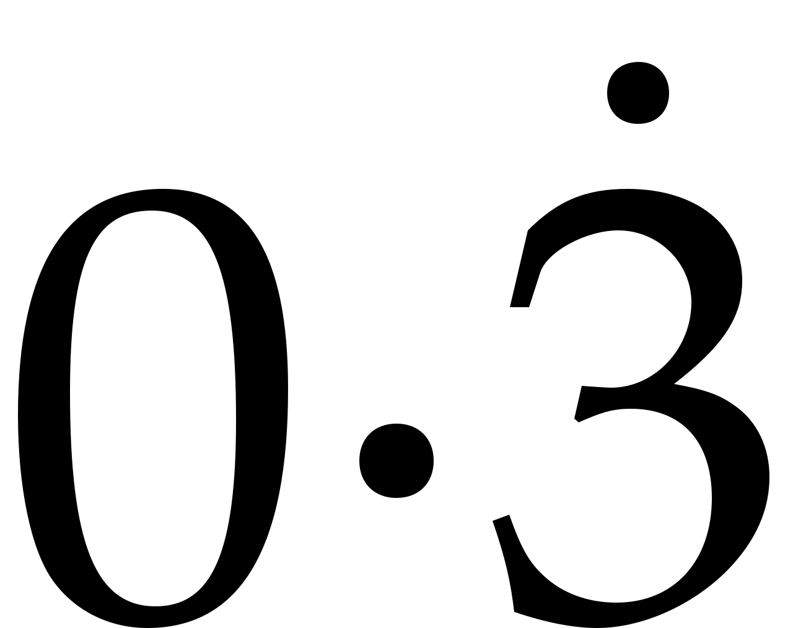” one can say: _it is not an abbreviation_.

### [50\[5\]](https://cdn.wittgensteinnachlass.com/2000px/webp/Ms-111/50.webp)

I had once said of the division: “I simply see something definite _in it_ when I recognize the periodicity.” – Must I not now say that it belongs to a different system in this case from the one it belongs to when I do not recognize the periodicity?

### [50\[6\]](https://cdn.wittgensteinnachlass.com/2000px/webp/Ms-111/50.webp),[51\[1\]](https://cdn.wittgensteinnachlass.com/2000px/webp/Ms-111/51.webp)

One might ask “does nothing strike you about this division?” (The periodicity.) “Yes, what strikes me is that it must always go on like this”. If I were now to ask: “What do you mean by ‘always go on like this’”, he might first list a few identical steps for me & then say “etc.”. It is clear here that there could have been any number of steps listed & that they could therefore have been omitted altogether, so that ‘etc.’ remains as the essential sign of continuation.

### [51\[2\]](https://cdn.wittgensteinnachlass.com/2000px/webp/Ms-111/51.webp)

It is clear, incidentally, that there is no _more exact_ proof of the periodicity of this division than the segment worked out above.

### [51\[3\]](https://cdn.wittgensteinnachlass.com/2000px/webp/Ms-111/51.webp)

What I see in this division enables me, for example, to write down the four-digit result 0˙3333 on request, without further calculation. And this is what the other way of using this sign consists in.

### [51\[4\]](https://cdn.wittgensteinnachlass.com/2000px/webp/Ms-111/51.webp),[52\[1\]](https://cdn.wittgensteinnachlass.com/2000px/webp/Ms-111/52.webp)

It is as if we were to discover, on certain solids lying in front of us, faces by which they can be joined in a row. Or rather, as if we were to discover that they can be joined in a row by such & such faces, which we already knew before. This is the way many games or riddles are solved.

### [52\[2\]](https://cdn.wittgensteinnachlass.com/2000px/webp/Ms-111/52.webp)

Whoever discovers periodicity invents a new calculus. The question is, how does the calculus with periodic division differ from the calculus that knows nothing of periodicity?

### [52\[3\]](https://cdn.wittgensteinnachlass.com/2000px/webp/Ms-111/52.webp)

(We could have carried on a calculus with cubes without ever thinking of joining them one after another to form prisms.)

### [52\[4\]](https://cdn.wittgensteinnachlass.com/2000px/webp/Ms-111/52.webp)

What is it that makes me know that the definition “a + ((b) + 1) = (a + b) + 1 Def” can be applied recursively to all numbers? Or: How does the periodicity of this definition show itself?

### [52\[5\]](https://cdn.wittgensteinnachlass.com/2000px/webp/Ms-111/52.webp)

I could say, incidentally, that the sign “1, 1 + 1, 1 + 1 + 1, u.s.w.” differs from the sign “1, 1 + 1, 1 + 1 + 1” in its application. That they belong to different calculi.

### [52\[6\]](https://cdn.wittgensteinnachlass.com/2000px/webp/Ms-111/52.webp),[53\[1\]](https://cdn.wittgensteinnachlass.com/2000px/webp/Ms-111/53.webp)

The difficulty begins as soon as I am to say that signs of the form 1, (1) + 1, ((1) + 1) + 1, u.s.w. are allowed in place of the letters. (The arbitrary length of the enumeration is already awkward.)

### [53\[2\]](https://cdn.wittgensteinnachlass.com/2000px/webp/Ms-111/53.webp)

It must be possible to replace this enumeration with “❘1, ξ, (ξ) + 1❘”.

### [53\[3\]](https://cdn.wittgensteinnachlass.com/2000px/webp/Ms-111/53.webp)

But on the other hand it must also be clear that “1, (1) + 1, ((1) + 1) + 1, u.s.w.” _is not an abbreviation_.

### [53\[4\]](https://cdn.wittgensteinnachlass.com/2000px/webp/Ms-111/53.webp)

Rather, it too must be the complete sign of a calculus. That is, one must be able to work with it just as exactly as with any other.

### [53\[5\]](https://cdn.wittgensteinnachlass.com/2000px/webp/Ms-111/53.webp)

30.07.1931

But now one might ask: How is it that someone who now applies the general rule to a further number is following only _this_ rule? That no further rule was needed to allow him to apply the general one to this case too; & yet this case was not mentioned in the general rule.

### [53\[6\]](https://cdn.wittgensteinnachlass.com/2000px/webp/Ms-111/53.webp),[54\[1\]](https://cdn.wittgensteinnachlass.com/2000px/webp/Ms-111/54.webp)

So what surprises us is that we cannot bridge this gulf between the individual numbers & the general proposition.

### [54\[2\]](https://cdn.wittgensteinnachlass.com/2000px/webp/Ms-111/54.webp)

How do you know he is in the room? – Because I put him in there & there is nowhere he can get out. – So your knowledge of the general fact that he is somewhere in the room is also of the same multiplicity as this ground: Drawn roughly like this:

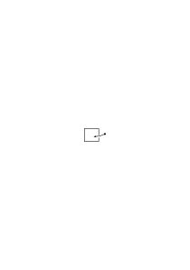

So the picture of the general state of affairs would also be ❘ •❘. And this sign would merely be used differently from when it indicates a particular position. Incidentally, we have the same thing when we give a proof in geometry by means of a drawing & draw _one_ (general) triangle. Different rules then hold for the use of the general triangle from those for the use of the particular one.

### [54\[3\]](https://cdn.wittgensteinnachlass.com/2000px/webp/Ms-111/54.webp)

One says: “the size of this triangle does not matter here”.

### [54\[4\]](https://cdn.wittgensteinnachlass.com/2000px/webp/Ms-111/54.webp),[55\[1\]](https://cdn.wittgensteinnachlass.com/2000px/webp/Ms-111/55.webp)

When the intuitionists speak of “basic intuition”, – is this a psychological process? And how does it get into mathematics, then? Or is what they mean, after all, merely a primitive sign in (Frege’s sense); a component of a calculus?

### [55\[2\]](https://cdn.wittgensteinnachlass.com/2000px/webp/Ms-111/55.webp)

It is presumably characteristic of the general ❘ ⚬❘ that ❘ ⚬❘ = ❘ ⚬ ❘, but one cannot explain the general sign by enumerating such equations, since again one cannot enumerate _all_ of them. (That is why I said earlier that “etc.” must be characterized by its possible combinations with itself, not with its particular cases.)

### [VB](/w-vb/#ms-111-55.3) [55\[3\]](https://cdn.wittgensteinnachlass.com/2000px/webp/Ms-111/55.webp)

(When one reads the Socratic dialogues, one has the feeling: what a dreadful waste of time! What is the point of these arguments that prove nothing & clarify nothing.)

### [55\[4\]](https://cdn.wittgensteinnachlass.com/2000px/webp/Ms-111/55.webp)

It is as if there were a general _conception_ of the sign (say, of a triangle in a geometrical construction, etc.).

### [55\[5\]](https://cdn.wittgensteinnachlass.com/2000px/webp/Ms-111/55.webp),[56\[1\]](https://cdn.wittgensteinnachlass.com/2000px/webp/Ms-111/56.webp)

There is a “between” in which one cannot speak of a particular place. Which thus has, as it were, all the features of the spatial “between” except those that relate to definite positions. That is, there is a calculus with a relation that one could call “between”, but in which there would be no question of (a) generality. On the other hand, however, this is the calculus for the notation for generality of spatial position. But how does it acquire the character of generality if it does not acquire it through its relations to particular cases? – But what does this character of generality consist in? Are we not dealing here again with a false comparison?

### [56\[2\]](https://cdn.wittgensteinnachlass.com/2000px/webp/Ms-111/56.webp)

Generality is as ambiguous as the subject–predicate form.

### [56\[3\]](https://cdn.wittgensteinnachlass.com/2000px/webp/Ms-111/56.webp)

“Apart from this chair, this one, this one & this one, there are none in the room & they are all brown.” “Count the chairs in this room”.

### [56\[4\]](https://cdn.wittgensteinnachlass.com/2000px/webp/Ms-111/56.webp),[57\[1\]](https://cdn.wittgensteinnachlass.com/2000px/webp/Ms-111/57.webp)

All that one really needs to know in philosophy is that every difference in the use of a word is a logical difference, & that we are thus dealing with different forms (whose _grammatical kinship_ is at most indicated by the same word).

### [57\[2\]](https://cdn.wittgensteinnachlass.com/2000px/webp/Ms-111/57.webp)

That is, one must simply not pass over a difference in forms – as one might well pass over a difference between chairs if, say, it is very slight. In a certain sense there are for us – that is, in grammar – no slight differences. And in any case the word difference means something quite different from what it means where the difference is between two things.

### [57\[3\]](https://cdn.wittgensteinnachlass.com/2000px/webp/Ms-111/57.webp),[58\[1\]](https://cdn.wittgensteinnachlass.com/2000px/webp/Ms-111/58.webp)

What does the character of generality of the general calculus consist in? For I want it to deal with the particular cases generally & not to be something altogether detached, as it were, from the particular cases. (As is also indicated in the notation “1, 1 + 1, 1 + 1 + 1 u.s.w.”) Where is the _kinship_ between generality & the particular? It must evidently be expressed in the notation. (And that is why the general numerical form “[1, ξ, (ξ + 1)]” also contains the sign “1”.)

### [58\[2\]](https://cdn.wittgensteinnachlass.com/2000px/webp/Ms-111/58.webp)

I want to say: the general picture ❘ ⚬ ❘ has a different metric from the particular one.

### [58\[3\]](https://cdn.wittgensteinnachlass.com/2000px/webp/Ms-111/58.webp)

The possibility of listing still further numbers. The difficulty seems to us to be that the numbers I have actually listed are by no means essential & nothing indicates that they are an _arbitrary_ collection: _the ones among all the numbers that happen to have been written down_. (As if I had all the cards of a pack in a box &, on the table beside it, a chance selection from the box.

Or as if some of the digits had been _traced over_ in ink, while all of them had, as it were, already been faintly drawn in.) But that apart from the ones we happen to have used, we have only the general form. Incidentally, do we not have here – odd as it sounds – the difference between numerals & numbers?

### [59\[1\]](https://cdn.wittgensteinnachlass.com/2000px/webp/Ms-111/59.webp)

Is it not clear that in these difficulties we are labouring under a false picture?

### [59\[2\]](https://cdn.wittgensteinnachlass.com/2000px/webp/Ms-111/59.webp)

In the general sign ❘ ⚬ ❘ distances play as little part as they do in the sign aRb (the distances between the letters).

### [59\[3\]](https://cdn.wittgensteinnachlass.com/2000px/webp/Ms-111/59.webp)

Consider that a logical sum with, say, 100 summands might follow from the general proposition, even though we certainly did not think of them when we uttered the general proposition. Can we nonetheless say that it follows from it?

### [59\[4\]](https://cdn.wittgensteinnachlass.com/2000px/webp/Ms-111/59.webp)

31.07.1931

“Did you understand it without interruption the whole time?”

### [59\[5\]](https://cdn.wittgensteinnachlass.com/2000px/webp/Ms-111/59.webp)

The notation for generality in our ordinary language captures the logical form much more superficially still than I formerly believed. In just this respect it is comparable to the subject–predicate form.

### [59\[6\]](https://cdn.wittgensteinnachlass.com/2000px/webp/Ms-111/59.webp),[60\[1\]](https://cdn.wittgensteinnachlass.com/2000px/webp/Ms-111/60.webp)

Let us take the particular cases of the general state of affairs in which the cross is between the boundary marks 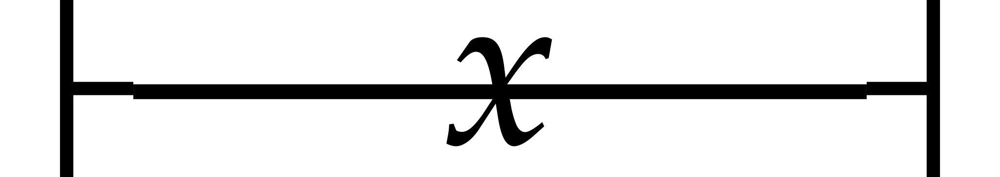   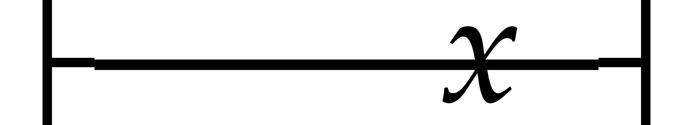. Each of these cases, for example, has a particular individuality. Does this individuality enter in any way into the sense of the general sentence? Evidently not.

### [60\[2\]](https://cdn.wittgensteinnachlass.com/2000px/webp/Ms-111/60.webp)

“The cross lies on the straight line _like this_: 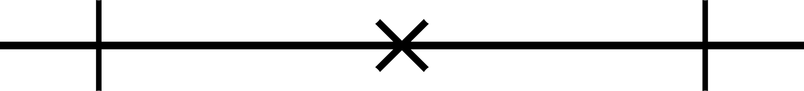”. – “It _therefore_ lies between the marks ….” “It is 16½ degrees here”. – “So at any rate it is more than 15˚.”

### [60\[3\]](https://cdn.wittgensteinnachlass.com/2000px/webp/Ms-111/60.webp)

If, incidentally, one is surprised that this sentence follows from that one, although one was not thinking of this one at all when thinking of that one, one need only recall that p⌵q follows from p, & I certainly do not think (of) all sentences p⌵ξ when I think of p.

### [60\[4\]](https://cdn.wittgensteinnachlass.com/2000px/webp/Ms-111/60.webp)

The whole idea that when one thinks a sentence from which another follows one must think the latter rests on a false, & psychologizing, conception. After all, we have only to attend to what lies in the signs & (their) rules.

### [60\[5\]](https://cdn.wittgensteinnachlass.com/2000px/webp/Ms-111/60.webp)

By contrast, it is a real difficulty that following always seems to be linked with the calculus of truth-functions.

### [61\[1\]](https://cdn.wittgensteinnachlass.com/2000px/webp/Ms-111/61.webp)

Do I want to say that following must always result from the agreement of the truth-possibilities?

### [61\[2\]](https://cdn.wittgensteinnachlass.com/2000px/webp/Ms-111/61.webp)

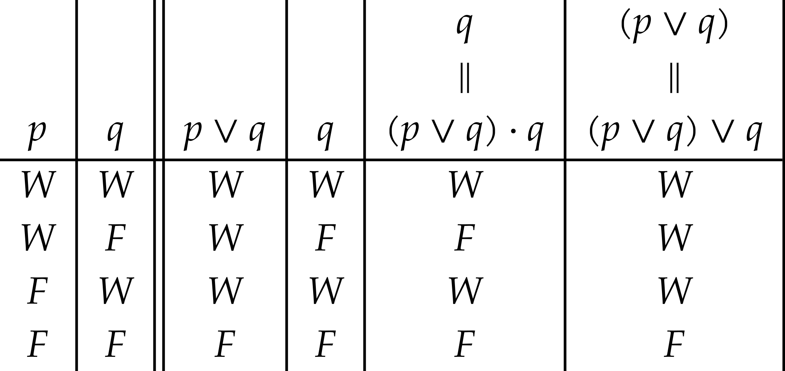

### [61\[3\]](https://cdn.wittgensteinnachlass.com/2000px/webp/Ms-111/61.webp),[61\[1\]](https://cdn.wittgensteinnachlass.com/2000px/webp/Ms-111/61.webp)

(∃x)fx ⌵ fa = (∃x)fx, (∃x)fx ∙ fa = fa How do I know that? (For I have, so to speak, proved what is above). One might be inclined to say: “I simply understand (∃x)fx”. (A splendid example of what ‘understand’ means.) But I could just as well ask “how do I know that (∃x)fx follows from fa” & answer: “because I understand (∃x)fx”. But how do I really know that it follows? – because I calculate in this way.

How do I know that fa follows from (x)fx? Do I see, as it were, behind the sign (∃x)fx, & see the sense that stands behind it & see from that that it follows from fa? Is _that_ understanding? No, that equation is part of the understanding (which thus lies spread out before me.) For the assumption of an understanding that is originally graspable at a stroke and can only then be spread out in this way is mistaken. If I say “I know that it follows because I understand it”, that would mean that in understanding it I see something _other_ than the given sign, as it were a definition of the sign from which its following emerges.

### [62\[2\]](https://cdn.wittgensteinnachlass.com/2000px/webp/Ms-111/62.webp)

Mathematics consists of calculations.

### [62\[3\]](https://cdn.wittgensteinnachlass.com/2000px/webp/Ms-111/62.webp)

01.08.1931

My conception of the general proposition was, after all, that (∃x)fx is a logical sum & that it is just that its summands are not enumerated _here_, though they could be enumerated (& specifically from the dictionary & grammar of the language). For if they could not be enumerated, it would not after all be a logical sum. (Perhaps a law for forming logical sums.)

### [62\[4\]](https://cdn.wittgensteinnachlass.com/2000px/webp/Ms-111/62.webp),[63\[1\]](https://cdn.wittgensteinnachlass.com/2000px/webp/Ms-111/63.webp)

Number is by no means a “fundamental mathematical concept”. There are so many calculi in which there is no mention of numbers. And as far as arithmetic is concerned, what we are still willing to call numbers is more or less arbitrary. Beyond that, the calculus – of cardinal numbers, for example – is to be described, i.e. its rules are to be stated, & with that the foundations of arithmetic are given

### [63\[2\]](https://cdn.wittgensteinnachlass.com/2000px/webp/Ms-111/63.webp)

Teach it to us, and you have laid its foundations.

### [63\[3\]](https://cdn.wittgensteinnachlass.com/2000px/webp/Ms-111/63.webp)

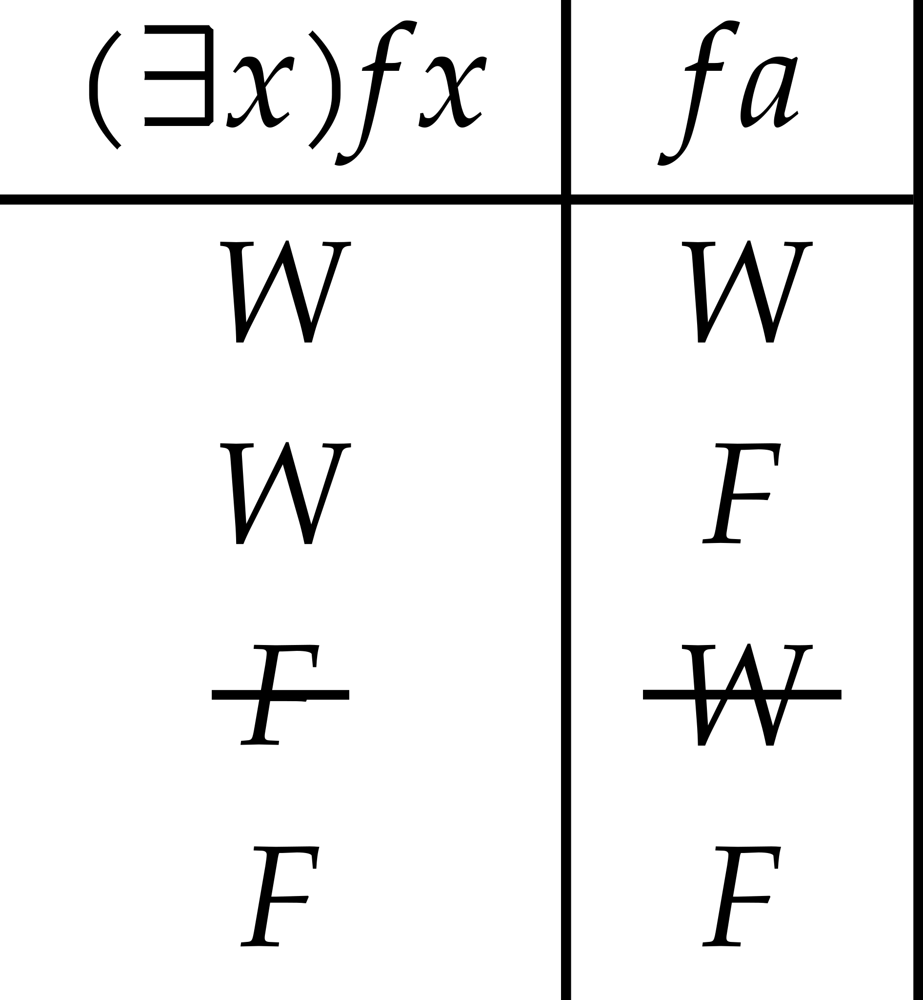

But, I thought, mustn’t (∃x)fx be a truth-function of fa, then, for that to be possible? For this dependence to be possible?

### [63\[4\]](https://cdn.wittgensteinnachlass.com/2000px/webp/Ms-111/63.webp)

But doesn’t (∃x)fx ⌵ fa = (∃x)fx say precisely that fa is already contained in (∃x)fx? Doesn’t it precisely show the dependence of fa on (∃x)fx? No, unless (∃x)fx is _defined_ as a logical sum (with fa as a summand). – If that is so, then (∃x)fx is nothing more than an abbreviation.

### [63\[5\]](https://cdn.wittgensteinnachlass.com/2000px/webp/Ms-111/63.webp)

There is no hidden connection in logic.

### [63\[6\]](https://cdn.wittgensteinnachlass.com/2000px/webp/Ms-111/63.webp),[64\[1\]](https://cdn.wittgensteinnachlass.com/2000px/webp/Ms-111/64.webp)

One of the greatest obstacles to philosophy is the expectation of new, deep insights.

### [64\[2\]](https://cdn.wittgensteinnachlass.com/2000px/webp/Ms-111/64.webp)

Isn’t the dependence, rather, established & laid down by the equation? For there simply is no hidden dependence.

### [64\[3\]](https://cdn.wittgensteinnachlass.com/2000px/webp/Ms-111/64.webp)

(∃x)fx ∙ ~fa, (∃x)fx ∙ ~fa ∙ ~fb ∙ ~fc.

“The cross is somewhere between the strokes, except in position a.” One might now ask: does such a continued subtraction of possibilities eventually produce a contradiction?

### [64\[4\]](https://cdn.wittgensteinnachlass.com/2000px/webp/Ms-111/64.webp)

Suppose I gave a disjunction of so many positions that it would be impossible for me to recognize a position as different from all those given; would the disjunction _now_ be the general proposition (∃x)fx? Would it not be pedantic, so to speak, still to refuse to recognize the disjunction as the general proposition? Or is there an essential difference, & might the disjunction bear no resemblance at all to the general proposition?

### [65\[1\]](https://cdn.wittgensteinnachlass.com/2000px/webp/Ms-111/65.webp)

What strikes us is that one sentence is so complicated, the other so simple. Or is the simple one just a shorthand for the complicated one?

### [65\[2\]](https://cdn.wittgensteinnachlass.com/2000px/webp/Ms-111/65.webp)

But ‘lying between the strokes, or walls’ seems to us to be something simple, of which the various positions (whether the visual appearances or the positions established by measurement) are quite independent. That is, when we speak of the individual (seen) positions, we seem to be speaking of something quite different from what is spoken of in the general sentence.

### [65\[3\]](https://cdn.wittgensteinnachlass.com/2000px/webp/Ms-111/65.webp)

Our stipulation of generality belongs to one calculus, & it is another that gives that disjunction. When we say that the cross lies between these marks, we have no disjunction ready to take the place of the general sentence.

### [65\[4\]](https://cdn.wittgensteinnachlass.com/2000px/webp/Ms-111/65.webp),[66\[1\]](https://cdn.wittgensteinnachlass.com/2000px/webp/Ms-111/66.webp)

But is there any objection in principle to a generality that appears as _generality_, for which, therefore, (∃x)fx ∙ fa = fa, & which is nevertheless not a truth-function of a given number of propositions?

### [66\[2\]](https://cdn.wittgensteinnachlass.com/2000px/webp/Ms-111/66.webp)

Or: Is it possible for (∃x)fx ∙ fa = fa without (∃x)fx being a truth-function of fa?

### [66\[3\]](https://cdn.wittgensteinnachlass.com/2000px/webp/Ms-111/66.webp)

(It cannot be a truth-function of fa without one knowing it.)

### [66\[4\]](https://cdn.wittgensteinnachlass.com/2000px/webp/Ms-111/66.webp)

(What I do with the signs is, for the mathematician, a messing… (& was so for Ramsey, for example), & rightly so, for he wants to make progress, whereas I linger undisturbed over a few signs & two steps of the calculus.)

### [66\[5\]](https://cdn.wittgensteinnachlass.com/2000px/webp/Ms-111/66.webp)

Surely I can have a calculus in which there is only one a b a, one b a a & one a a b, 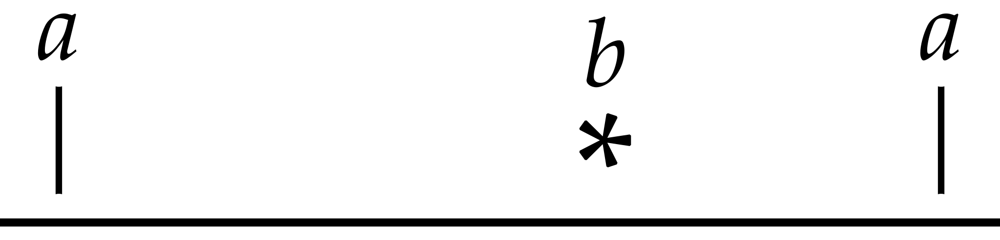, but on the other hand also one in which  means one definite position, & 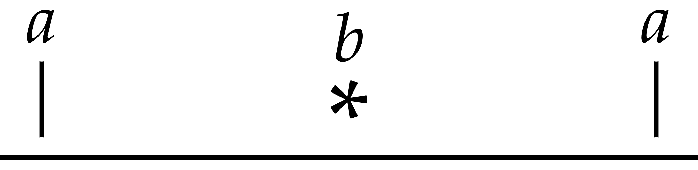 another, etc. And why should I not now combine the two so that one can always take a sign “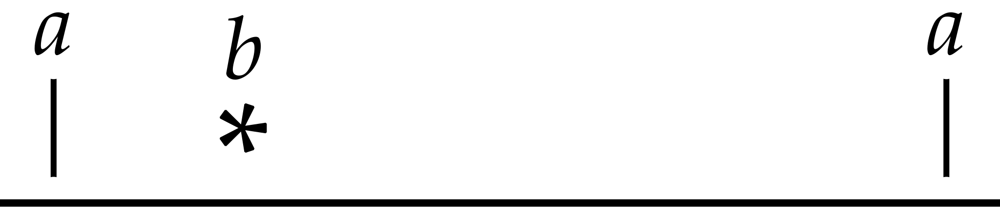” or “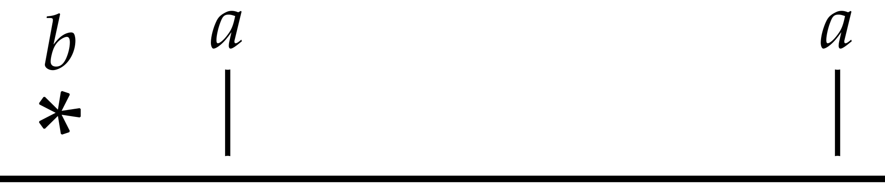” etc. in both ways, so that “a b a” then follows from “”, etc.?

### [66\[6\]](https://cdn.wittgensteinnachlass.com/2000px/webp/Ms-111/66.webp),[67\[1\]](https://cdn.wittgensteinnachlass.com/2000px/webp/Ms-111/67.webp)

But can I specify the rules of following in this case? For how do I know that it is from fa that (∃x)fx follows? After all, I cannot specify _all_ the propositions from which it follows. – But that is not necessary at all; if (∃x)fx follows from fa, then _that_ at any rate could be known before any particular experience, & it was possible to specify it in the grammar. – But then is the grammar not incapable of completion in this sense, since new signs of the form fξ can always be used? – Those that are used are used, & I can always make provision for them in the grammar.

### [67\[2\]](https://cdn.wittgensteinnachlass.com/2000px/webp/Ms-111/67.webp)

I say “it was possible to know before any experience that (∃x)fx follows from fa & to specify it in the grammar”. But it should read: ‘(∃x)fx follows from fa’ is not a proposition (empirical proposition) of the language to which ‘(∃x)fx’ & ‘fa’ belong, but a rule laid down in its grammar.

### [67\[3\]](https://cdn.wittgensteinnachlass.com/2000px/webp/Ms-111/67.webp)

I consider language & grammar from the point of view of the calculus, that is, of operations according to fixed rules.

### [67\[4\]](https://cdn.wittgensteinnachlass.com/2000px/webp/Ms-111/67.webp),[68\[1\]](https://cdn.wittgensteinnachlass.com/2000px/webp/Ms-111/68.webp)

All that matters is that we cannot say (here) that we found out through experience that there is also this case of grammar. For we would have to describe it in this statement, & although it is only now that I see that the description is true, I would have had to understand it even before this experience.

### [68\[2\]](https://cdn.wittgensteinnachlass.com/2000px/webp/Ms-111/68.webp)

It is the old question: to what extent can one speak now of an experience one is not having now? What I cannot foresee, I cannot foresee. – And what I can speak of now, I can speak of independently of what I can _not_ speak of now. Logic is always complete.

### [68\[3\]](https://cdn.wittgensteinnachlass.com/2000px/webp/Ms-111/68.webp)

“How can I know all that will follow.” – What I can know then, I can know now too.

### [68\[4\]](https://cdn.wittgensteinnachlass.com/2000px/webp/Ms-111/68.webp)

A general rule of inference, in so far as it is not a logical product of particular rules, is of quite a different kind from a particular rule of inference.

### [68\[5\]](https://cdn.wittgensteinnachlass.com/2000px/webp/Ms-111/68.webp)

But are there actually general rules, rather than just rules about general signs?

### [69\[1\]](https://cdn.wittgensteinnachlass.com/2000px/webp/Ms-111/69.webp)

What, for instance, would be a general & a particular rule in chess (or in another game)? Every rule, after all, is general.

### [69\[2\]](https://cdn.wittgensteinnachlass.com/2000px/webp/Ms-111/69.webp)

Yet the rule that p⌵q follows from p has a different kind of generality from the rule that every sentence of the form p, ~~p, ~~~~p, … follows from p ∙ q. But isn’t the generality of the rule for the knight’s move different from that of a rule for the beginning of a game?

### [69\[3\]](https://cdn.wittgensteinnachlass.com/2000px/webp/Ms-111/69.webp)

Does the word “rule” have several senses at all? And are we therefore not to speak of rules in general, any more than of languages in general? But only of rules in particular cases.

### [69\[4\]](https://cdn.wittgensteinnachlass.com/2000px/webp/Ms-111/69.webp)

Socrates asks what knowledge is and is not satisfied with a list of things one knows. But we do not concern ourselves much with this general concept & are glad if we understand shoemaking, geometry, etc.

### [69\[5\]](https://cdn.wittgensteinnachlass.com/2000px/webp/Ms-111/69.webp)

But doesn’t this consideration also apply to the concept of following?

### [70\[1\]](https://cdn.wittgensteinnachlass.com/2000px/webp/Ms-111/70.webp)

We do not believe that the only person who understands a game is one who can give a definition of the concept ‘game’.

### [70\[2\]](https://cdn.wittgensteinnachlass.com/2000px/webp/Ms-111/70.webp)

I am making things easier & easier for myself in philosophy. But the difficulty is in making things easier for oneself & yet remaining exact.

### [70\[3\]](https://cdn.wittgensteinnachlass.com/2000px/webp/Ms-111/70.webp)

“No created mind penetrates into the interior of nature”. How can it then speak of what is inner? Or rather, what we have here is a picture that does not fit.

### [70\[4\]](https://cdn.wittgensteinnachlass.com/2000px/webp/Ms-111/70.webp)

One cannot get behind the rules, because there is no ‘behind’.

### [70\[5\]](https://cdn.wittgensteinnachlass.com/2000px/webp/Ms-111/70.webp)

fE ∙ fa = fa Can one say: this is possible only if fE follows from fa; or must one say: this stipulates that fE follows from fa?

### [70\[6\]](https://cdn.wittgensteinnachlass.com/2000px/webp/Ms-111/70.webp),[71\[1\]](https://cdn.wittgensteinnachlass.com/2000px/webp/Ms-111/71.webp)

If the former, then it must follow by virtue of the structure, for instance by fE being so determined by a definition that it has the corresponding structure. But can its following really emerge, as it were, from the visible structure of the signs, as physical behaviour emerges from a physical property, & does it not rather always require such _stipulations_ as the equation fE ∙ fa = fa? Can one tell by looking at p⌵q that it follows from p, or even by looking at the rules Russell gives for the truth-functions?

### [71\[2\]](https://cdn.wittgensteinnachlass.com/2000px/webp/Ms-111/71.webp)

And why should the rule fE ∙ fa = fa be derived from another rule rather than be the primary rule?

### [71\[3\]](https://cdn.wittgensteinnachlass.com/2000px/webp/Ms-111/71.webp)

For what is “fE must surely contain fa in some way” supposed to mean? It simply does not contain it, in so far as we can work with fE without mentioning fa. It does, though, in so far as the rule fE ∙ fa = fa holds.

### [71\[4\]](https://cdn.wittgensteinnachlass.com/2000px/webp/Ms-111/71.webp)

For the opinion is that fE ∙ fa = fa can hold only by virtue of the definition of fE.

### [71\[5\]](https://cdn.wittgensteinnachlass.com/2000px/webp/Ms-111/71.webp)

And that – I think – because otherwise it falsely appears as if a further stipulation about fE were being made after it had already been introduced into the language. In fact, however, no stipulation is left to future experience.

### [72\[1\]](https://cdn.wittgensteinnachlass.com/2000px/webp/Ms-111/72.webp)

And of course defining fE from ‘all the individual cases’ is _just as_ impossible as listing _all_ the rules of the form fE ∙ fx = fx.

### [72\[2\]](https://cdn.wittgensteinnachlass.com/2000px/webp/Ms-111/72.webp)

Indeed, the individual equations fE ∙ fx = fx are precisely an expression of this impossibility.

### [72\[3\]](https://cdn.wittgensteinnachlass.com/2000px/webp/Ms-111/72.webp),[73\[1\]](https://cdn.wittgensteinnachlass.com/2000px/webp/Ms-111/73.webp)

But how is it expressed in our rules that the cases fx dealt with are not an essentially closed class? – Presumably only through the generality of the general rule. – That they do not have _the same_ meaning for the calculus as a closed group of primitive signs (say, the names of the 6 primary colours). How else than through the rules stated about them? – If in a game, say, I am allowed to borrow pieces of a certain kind in any number, while others are present in a fixed number; or if the game is unlimited in time but limited in space, then we presumably have the same case. And the difference between the one kind of piece & the other must be laid down by the rules of the game. It might then say of one kind: you can take as many pieces of this kind as you like. – And I must not look for another, more exact expression of the rule.

### [73\[2\]](https://cdn.wittgensteinnachlass.com/2000px/webp/Ms-111/73.webp)

That is, the expression for the unboundedness of the individual cases dealt with will (of course) be a general expression & cannot be any other kind of expression, not one in which the other individual cases, not dealt with, occur in a shadowy way.

### [73\[3\]](https://cdn.wittgensteinnachlass.com/2000px/webp/Ms-111/73.webp)

It is clear that I do not recognize any logical sum as a definition of the sentence “the cross lies between the strokes”. And surely that says it all.

### [73\[4\]](https://cdn.wittgensteinnachlass.com/2000px/webp/Ms-111/73.webp),[74\[1\]](https://cdn.wittgensteinnachlass.com/2000px/webp/Ms-111/74.webp)

If one is asked “But is it certain, then, that no calculus other than this one is used?” one must say: If that means “Don’t we use other calculi in our actual language as well?”, I can only answer “I don’t know of any others at present” (just as if someone asked “Are those all the calculi of present-day mathematics?”, I might say “I don’t recall any others, but I can perhaps check the books more carefully”). But the question cannot mean “Can no other calculus be used?” For how would I answer this question?

### [74\[2\]](https://cdn.wittgensteinnachlass.com/2000px/webp/Ms-111/74.webp)

A calculus exists in virtue of one’s describing it.

### [74\[3\]](https://cdn.wittgensteinnachlass.com/2000px/webp/Ms-111/74.webp)

Can one say: ‘calculus’ is not a mathematical concept?

### [74\[4\]](https://cdn.wittgensteinnachlass.com/2000px/webp/Ms-111/74.webp),[75\[1\]](https://cdn.wittgensteinnachlass.com/2000px/webp/Ms-111/75.webp)

11.08.1931

“– How? he said, could it really be of no use? For if prudence is indeed the knowledge of knowledge, & presides over other forms of knowledge, then it must also preside over this knowledge which is concerned with the good, & must therefore be useful to us. – Does it also make us healthy, I said, rather than medicine? So too with the other arts; does it perform their functions, & not rather each of them its own? Or have we not long since agreed that it is only the knowledge of knowledge & ignorance, & not of any other matter? – No doubt. – Then it will not make us healthy? – Presumably not. – Because health belongs to another art? – Yes. – Therefore, it will not bring us any benefit either, my friend. For we have now assigned this task too to another art. – Of course. – How, then, can prudence be useful, if it brings us no benefit at all?”

### [75\[2\]](https://cdn.wittgensteinnachlass.com/2000px/webp/Ms-111/75.webp)

It is clear that the question “what is a calculus” is of exactly the same kind as “what is a game” or “what is a rule”.

### [75\[3\]](https://cdn.wittgensteinnachlass.com/2000px/webp/Ms-111/75.webp)

It is clear that we can teach someone to play chess. And the question is: Does he understand it any the less for not having learnt ‘what a game is’? Or does that make no difference at all?

### [75\[4\]](https://cdn.wittgensteinnachlass.com/2000px/webp/Ms-111/75.webp),[76\[1\]](https://cdn.wittgensteinnachlass.com/2000px/webp/Ms-111/76.webp)

What does “indefinable” mean? This word is evidently misleading, for it gives the impression that we might try something here which would then prove impossible to carry out. As though the indefinable were something that could not be defined any further, as a weight that is too heavy cannot be lifted. We might say: “What do you mean, ‘indefinable’?! Can we even _try_ to define it?”.

### [76\[2\]](https://cdn.wittgensteinnachlass.com/2000px/webp/Ms-111/76.webp),[77\[1\]](https://cdn.wittgensteinnachlass.com/2000px/webp/Ms-111/77.webp)

Now one might of course say: a definition is arbitrary, that is, however I define a word, that is how it is defined. But one can reply: what matters is to define it in accordance with what we mean by the word. So that, on being given the definition of the word “table”, for example, we say: yes, that is what I mean by the word. But was it the definition that led you to mean that by the word, or do you want to say that this is what you have always meant? And if the latter, then you have always meant _that_ which the definition says (as opposed to something else it might say.) That is: the definition is also a description of what you meant before. So you already had a translation of this definition; it merely said aloud, so to speak, what you already knew in silence. So in substance it did not analyse anything either.

### [VB](/w-vb/#ms-111-77.2) [77\[2\]](https://cdn.wittgensteinnachlass.com/2000px/webp/Ms-111/77.webp)

[The story of Peter Schlemihl should, it seems to me, go like this: He signs away his soul to the devil for money. Then he regrets it & now the devil demands his shadow as ransom. But Peter Schlemihl is left with the choice of giving his soul to the devil or giving up, along with his shadow, life in human society.]

### [77\[3\]](https://cdn.wittgensteinnachlass.com/2000px/webp/Ms-111/77.webp)

Someone who points out that a word has been used in two different meanings, or that when we use this expression we have this picture in mind, & who in general ascertains (tabulates) the rules according to which words are used, is under no obligation at all to give an explanation (definition) of the word “rule” (or “word”, “language”, “sentence” etc.).

### [77\[4\]](https://cdn.wittgensteinnachlass.com/2000px/webp/Ms-111/77.webp),[78\[1\]](https://cdn.wittgensteinnachlass.com/2000px/webp/Ms-111/78.webp)

I said above “calculus is not a mathematical concept”; that is, the word ‘calculus’ is not a chess piece of mathematics. It need not occur in mathematics. – And if it is used in a calculus all the same, that calculus is not thereby a metacalculus. Rather, it is then once again only a chess piece like all the others.

### [78\[2\]](https://cdn.wittgensteinnachlass.com/2000px/webp/Ms-111/78.webp)

Thus I am allowed to use the word rule without necessarily first tabulating the rules about this word. And these rules are not meta-rules.

### [78\[3\]](https://cdn.wittgensteinnachlass.com/2000px/webp/Ms-111/78.webp)

The word “rule” need not be used in the explanation of a game (nor, of course, need an equivalent word).

### [78\[4\]](https://cdn.wittgensteinnachlass.com/2000px/webp/Ms-111/78.webp),[79\[1\]](https://cdn.wittgensteinnachlass.com/2000px/webp/Ms-111/79.webp),[80\[1\]](https://cdn.wittgensteinnachlass.com/2000px/webp/Ms-111/80.webp)

And how, then, do we use the word rule (when, for instance, we talk about games)? In contrast to what? We say, for example, “that follows from this rule”, but then couldn’t we quote the rule of the game & so replace the word “rule”? Or we speak of “all the rules of the game” & must then either have listed them (& then we are back to the first case), or we speak of the rules as a group – whose members are generated in a particular way from certain basic positions & then the word rule stands for the expression of _these_ basic positions & operations. Or we say “_This_ is a rule, _that_ isn’t”, when, say, the second is just a single word, or perhaps a configuration of the pieces. (Or: “no, that too is a rule under the new agreement”.) If, for instance, we had to write out the list of rules of the game, something like this might be said, & then it would mean: _this_ goes in (along with the others), _that_ doesn’t. But not by virtue of a particular property (namely, that of being a rule), as when one wants to pack nothing but apples into a crate & says “no, that doesn’t go in, that’s a pear”. Yes, but surely we call some things “games” and others not, & some things “rules” & others not! Yes, but drawing a boundary between everything we call a game and everything else is never what matters. For us, games are _the_ games we have heard of, the ones we can list, & perhaps a few more newly invented by analogy with others; and if someone were to write a book about games, he would not really need the word “game” even in the title: the title could be a list of the names of the individual games. And if asked: But what is it that all these things have in common, on account of which you group them together? he could say: I can’t specify it in one sentence, but _you_ can see plenty of analogies. Besides, the question is idle, since I can again proceed by analogy in imperceptible steps and arrive at constructions that no one in ordinary life would still call a game, so that what one chose to call a ‘game’ would once again be arbitrary. So I call what is on this list a ‘game’, as well as whatever is similar to these games to a certain degree (which I have not specified more precisely). Beyond that I reserve the right to decide in each new case whether or not to count something among the games.

### [80\[2\]](https://cdn.wittgensteinnachlass.com/2000px/webp/Ms-111/80.webp),[81\[1\]](https://cdn.wittgensteinnachlass.com/2000px/webp/Ms-111/81.webp)

Now the same applies to the concept of a rule. Only in quite particular cases are we concerned with distinguishing rules from something that is not a rule, & in all these cases it is easy to give a criterion for the distinction. That is, we use the word “rule” in contrast to “word”, “configuration of the pieces” and a few other things, & these boundaries are clearly drawn. On the other hand, it is idle to draw boundaries where we do not need them. Isn’t it the same here as with, say, the concept ‘plant’? We use this word in a definite sense, but in the case of single-celled organisms the question of whether one should call them animals or plants remained open for some time, & one could also construct as many other borderline cases as one liked in which it would still have to be decided whether something still fell under the concept of a plant. But does that make the meaning of the word plant vague in all other cases, so that one could say that we use the word without understanding it? Indeed, would a definition that delimited the concept on different sides make the meaning of the word clearer to us in all sentences, so that we would also understand all the sentences in which it occurs better? Evidently not.

### [81\[2\]](https://cdn.wittgensteinnachlass.com/2000px/webp/Ms-111/81.webp)

What does it mean to know what a plant is? What does it mean to know it & not be able to say it? “You know it & can speak Greek, so surely you must be able to say it.”

### [81\[3\]](https://cdn.wittgensteinnachlass.com/2000px/webp/Ms-111/81.webp),[82\[1\]](https://cdn.wittgensteinnachlass.com/2000px/webp/Ms-111/82.webp)

[One kind of madness is a fainting of the understanding because it can no longer bear a pain.]

### [82\[2\]](https://cdn.wittgensteinnachlass.com/2000px/webp/Ms-111/82.webp)

The idleness of the definition, say, of the concept of a plant. But isn’t a definition a requirement of exactness? “The ground was completely covered with plants”: we don’t mean bacilli by that. Indeed, we may be thinking of green plants of a certain order of size. If someone told us we didn’t know what we were saying as long as we hadn’t given a definition of a plant, we would rightly think him mad. Indeed, even with such a definition we would be no better able to make ourselves understood in ordinary cases. Indeed, it even seems that in a certain sense we would not be able to make ourselves understood at all, because in this case it is precisely what is undefined that seems to belong to our language.

### [82\[3\]](https://cdn.wittgensteinnachlass.com/2000px/webp/Ms-111/82.webp),[83\[1\]](https://cdn.wittgensteinnachlass.com/2000px/webp/Ms-111/83.webp)

12.08.1931

Imagine replacing the words “grasses” & “herbs” with definitions in the sentence from a story “the ground was completely covered with grasses & herbs”. Clearly these definitions must be long & complicated expressions; & now the question is whether we really meant by the sentence what is now said in the incomparably more complicated one. We would say – I think – that we hadn’t thought of all that at all.

### [83\[2\]](https://cdn.wittgensteinnachlass.com/2000px/webp/Ms-111/83.webp)

But can one apply the idea of a calculus to such a language? And isn’t that like being supposed to speak of boundaries between colours in a picture in which all the patches of colour run into one another?

### [83\[3\]](https://cdn.wittgensteinnachlass.com/2000px/webp/Ms-111/83.webp)

Or is it like this: imagine a game, say tennis, in whose rules nothing is said about the height a ball must not exceed in flight. And now someone said: But the game isn’t governed by rules at all, for if someone throws the ball so high that it doesn’t fall back to earth, or so far that it flies around the earth, we don’t know whether this ball is to count as ‘out’ or ‘in’. One would answer him – I think – that if such a case arose, one would give rules for it; for now there is no need.

### [83\[4\]](https://cdn.wittgensteinnachlass.com/2000px/webp/Ms-111/83.webp),[84\[1\]](https://cdn.wittgensteinnachlass.com/2000px/webp/Ms-111/84.webp)

Couldn’t we, more generally, imagine a game with an incomplete list of rules, in which we had agreed to supplement the rules later as needed, provided that no future rule would be allowed to contradict any of the rules already laid down? (Just as in tennis nothing is laid down about how long one’s strides may be when running, but this could still be laid down if necessary.) Think of the rules about jumping over pieces in a board game & of the particular cases that arise when the piece to be jumped over is at the edge of the board or immediately next to another piece.

### [84\[2\]](https://cdn.wittgensteinnachlass.com/2000px/webp/Ms-111/84.webp)

Still, grammatical rules can be specified for the use of the word “plant”, & so we can answer questions of the kind “does it follow from _this_ state of affairs that there’s a plant there”. But we are not equipped to answer other such questions & can reply: Such a case has never arisen & it would be idle for us to make provision for it. (If, say, someone succeeded in producing a living being half mechanically & half organically & the question were then asked: does this still count as an animal or a plant.)

### [84\[3\]](https://cdn.wittgensteinnachlass.com/2000px/webp/Ms-111/84.webp),[85\[1\]](https://cdn.wittgensteinnachlass.com/2000px/webp/Ms-111/85.webp)

Suppose, for instance, that in a shooting competition no provisions have been made for certain borderline cases as to whether a shot like this should count as hitting the bull’s-eye (or not). But now suppose that no such shot is fired in our competition; could one still say that the whole awarding of prizes was invalid because no provision had been made for this case?!

### [85\[2\]](https://cdn.wittgensteinnachlass.com/2000px/webp/Ms-111/85.webp),[86\[1\]](https://cdn.wittgensteinnachlass.com/2000px/webp/Ms-111/86.webp)

Now let us imagine the list of regulations for this shooting, & suppose that it makes no mention at all of those borderline cases. (That would be rather like someone proceeding only by the rules of cardinal arithmetic in calculating lengths.) Can one now say that the list of rules is essentially incomplete? For if a shot hits the boundary between black & white, the judge will surely have to decide one way or another: he will then be able either to say that this shot does not count, or to count it as hitting the black, and so on. If he wants to apply the given schema, he will have to apply it _somehow_. I mean: he will only be able either to apply the rules as they stand or to apply other rules. One could also put it like this: these rules are really made for a different game, namely one in which there are indeed only the two possibilities of hitting entirely inside & entirely outside the circle. So if I apply the same rules to target shooting, I must project its possibilities into the multiplicity of these rules in a different way.

### [86\[2\]](https://cdn.wittgensteinnachlass.com/2000px/webp/Ms-111/86.webp)

(Our task is only to be just.)

### [86\[3\]](https://cdn.wittgensteinnachlass.com/2000px/webp/Ms-111/86.webp)

(I.e. we have only to point out & resolve the injustices of philosophy, not to create new parties (& creeds).)

### [86\[4\]](https://cdn.wittgensteinnachlass.com/2000px/webp/Ms-111/86.webp)

What is hidden must be capable of being found. (Hidden contradiction)

### [86\[5\]](https://cdn.wittgensteinnachlass.com/2000px/webp/Ms-111/86.webp)

What is hidden must be capable of being described in full even before it has been found, as though it had already been found.

### [86\[6\]](https://cdn.wittgensteinnachlass.com/2000px/webp/Ms-111/86.webp)

If one says that the object is so well hidden that it is impossible to find it, that makes good sense, & the impossibility here is of course not logical; i.e. it makes _sense_ to speak of finding the object & also to describe the finding; and we are denying only that that will happen.

### [86\[7\]](https://cdn.wittgensteinnachlass.com/2000px/webp/Ms-111/86.webp),[87\[1\]](https://cdn.wittgensteinnachlass.com/2000px/webp/Ms-111/87.webp)

I do undertake to draw up the list of rules of our language: what am I to do now in a case like that of the concept ‘plant’? Am I to say that no rule has been laid down for such & such a case? Certainly, if that is how things stand. But then am I to say that there is no list of rules of our language & that the whole undertaking of drawing one up is nonsense? – But it is clear that it is not nonsensical, for we do lay down rules successfully, & we need only refrain from laying down dogmas. (What is the essence of a dogma? Doesn’t it consist in asserting propositions of natural necessity about all possible rules?)

### [87\[2\]](https://cdn.wittgensteinnachlass.com/2000px/webp/Ms-111/87.webp),[88\[1\]](https://cdn.wittgensteinnachlass.com/2000px/webp/Ms-111/88.webp)

“I know what a plant is, but I can’t say”. Does this knowledge have the multiplicity of a sentence that just hasn’t been uttered? So that, if the sentence were uttered, I would recognize it as the expression of my knowledge? – Isn’t it rather true that any exact definition would have to be rejected as an expression of our understanding? I.e. wouldn’t we have to say of such a definition that it determines a concept akin to ours, but not our concept itself. And that the affinity is something like that between two pictures, one consisting of patches of colour with blurred boundaries, the other of patches similarly shaped & distributed, but with sharp boundaries. The affinity would then be as undeniable as the difference.

### [88\[2\]](https://cdn.wittgensteinnachlass.com/2000px/webp/Ms-111/88.webp)

The question now is: can you speak of patches in the first picture too? Certainly, only in a different, but related, sense.

### [88\[3\]](https://cdn.wittgensteinnachlass.com/2000px/webp/Ms-111/88.webp)

That is: the blurred boundaries belong to my concept of a plant as it now is, i.e. as I use this word now, & it characterizes this concept that I say, for instance: I have made no stipulation as to whether this is to be called a plant or not.

### [88\[4\]](https://cdn.wittgensteinnachlass.com/2000px/webp/Ms-111/88.webp)

But it seems to me that there is also a misuse of the word “blurred” here, namely in a case where no “sharp” is conceivable. – As though one took this concept from the coloured Euclidean plane and applied it to visual space. – {But I am not yet quite sure of the application of this remark.}

### [89\[1\]](https://cdn.wittgensteinnachlass.com/2000px/webp/Ms-111/89.webp)

Experience (the concept of experience) seems (to us) to be bounded by complete darkness. But black too is a colour, & if a colour is demarcated from black, it is by a colour boundary like any other.

### [89\[2\]](https://cdn.wittgensteinnachlass.com/2000px/webp/Ms-111/89.webp)

The concept of a plant is rather like that of being egg-shaped as we understand it in everyday life. The boundaries of this concept are not sharply determined, & we would not, for instance, accept an Easter egg of this shape  as such, & yet we could not say at what ratio of length to width something begins to be an Easter egg. Indeed, if someone were to specify such a ratio, _whatever it might be_, we could not recognize it as correctly delimiting our concept. Instead we would have to say either: no, I don’t call that an Easter egg, it’s too slender or fat, etc., or: yes, that _too_ is an Easter egg, but it’s not exactly the borderline case. There simply is no such case in our calculus, & anyone who introduces a borderline case introduces a different calculus.

### [89\[3\]](https://cdn.wittgensteinnachlass.com/2000px/webp/Ms-111/89.webp),[90\[1\]](https://cdn.wittgensteinnachlass.com/2000px/webp/Ms-111/90.webp)

But is there perhaps some vagueness in the rules of this calculus? And is such vagueness conceivable at all? Or is this once again one of the senseless questions about all _possible_ calculi?

### [90\[2\]](https://cdn.wittgensteinnachlass.com/2000px/webp/Ms-111/90.webp),[91\[1\]](https://cdn.wittgensteinnachlass.com/2000px/webp/Ms-111/91.webp),[92\[1\]](https://cdn.wittgensteinnachlass.com/2000px/webp/Ms-111/92.webp)

Let us imagine explaining the concept of a plant. We show someone several objects & say, these are plants. Then he in turn points to a further object & says “is that a plant too” & we reply “yes, that too” and so on. I would once have said that he had now seen the concept of a plant – that certain something in common – in what was shown, & that he would see the examples used in the explanation differently if he saw this very concept in them than if, say, he took them to represent only this particular shape & colour. (Just as I also said that in the variable, if he understands it as such, he sees something that he does not see in the sign for the particular case.) But the idea of ‘seeing in it’ is taken from the case where I see the figure ∣∣∣∣ ‘phrased’ in different ways. But then I really do see different figures, in a different sense, & what they have in common, apart from their similarity, is that they are caused by the same physical image. But this explanation cannot simply be applied to the case of understanding the variable or the examples of the concept of a plant. For supposing we really had seen something different in them than in plants shown merely for their own sake, the question is: can (this or) any other image warrant our using them as variables? So I could have shown someone the plants by way of explanation & given him a potion to make him see the examples in the particular way. (Just as it might be possible for someone under the influence of alcohol always to see a group ∣∣∣∣ as ∣∣∣ + ∣) & that would give an unambiguous explanation of the concept, & whoever understood it would have received _this_ image from the specimens shown & the accompanying gestures. But that is not how it is. – For it is presumably possible that someone who, for example, sees the sign ∣∣∣∣∣∣ as a numeral for 6 sees it differently (sees something different in it) from someone who takes it only as a sign for “some”, because he will not direct his attention to the same thing; but what matters then is the system of rules that hold for these signs, & understanding will not essentially be a matter of seeing the sign in a certain way.

### [92\[2\]](https://cdn.wittgensteinnachlass.com/2000px/webp/Ms-111/92.webp)

13.08.1931

So it would be possible to say “now I no longer see this as a rose, but only as a plant”! Or: “Now I see it only as a rose, no longer as _this_ rose.”

### [92\[3\]](https://cdn.wittgensteinnachlass.com/2000px/webp/Ms-111/92.webp)

“I now see the spot only as being in the square, no longer in a particular position.”

### [92\[4\]](https://cdn.wittgensteinnachlass.com/2000px/webp/Ms-111/92.webp)

It is precisely the mental process of understanding that does not interest us at all. (Any more than the mental process of intuition.)

### [92\[5\]](https://cdn.wittgensteinnachlass.com/2000px/webp/Ms-111/92.webp)

“Surely there is no doubt at all that someone who understands the examples as arbitrary cases illustrating the concept understands something different from someone who takes them as a definitely bounded enumeration”. Quite right, but then _what_ does the first understand that the second does not? Well, he sees only _examples_ in the things shown, which are meant only to bring out certain features, but he does not think that I am otherwise showing him these things for their own sake. –

### [93\[1\]](https://cdn.wittgensteinnachlass.com/2000px/webp/Ms-111/93.webp)

One would like to call one enumeration ‘logically bounded’, the other ‘not logically bounded’.

### [93\[2\]](https://cdn.wittgensteinnachlass.com/2000px/webp/Ms-111/93.webp)

Yes, but is it really the case that he now sees only these features in the things? In a leaf, say, only what all leaves have in common? It would be as if he saw everything else “in blank”. A blank form, as it were, with the essential features printed on it in advance. (But the function “f(…)” is just such a form.)

### [93\[3\]](https://cdn.wittgensteinnachlass.com/2000px/webp/Ms-111/93.webp)

But what sort of process is it when someone shows me several different things as examples of a concept, to lead me to see what they have in common; & when I then look for it & really do see it? He can also _draw my attention_ to what they have in common. – But does he thereby bring it about that I _see_ the object differently? Perhaps he does, for I can in any case look particularly at one of its parts, whereas otherwise I would have seen them all equally clearly. But this seeing is not understanding the concept. For we do not see something with an _empty_ argument place.

### [94\[1\]](https://cdn.wittgensteinnachlass.com/2000px/webp/Ms-111/94.webp)

“Pick out from these penholders the ones shaped _like this_”. ‒ ‒ “I did not know whether you counted this one too”.

### [94\[2\]](https://cdn.wittgensteinnachlass.com/2000px/webp/Ms-111/94.webp)

One might also ask: does someone who takes the sign “∣∣∣…” as a sign for the concept of number (as opposed to “∣∣∣”, which is meant to designate 3) see that first group of strokes differently from the second. But even if he sees it differently – more blurred, as it were, perhaps – does he thereby _see_ what is essential to the concept of number? Would that not mean that he would then actually have to be unable to distinguish “∣∣∣…” from “∣∣∣∣…” (if I had given him, that is, say, the potion that makes him see the _concept_)?

### [94\[3\]](https://cdn.wittgensteinnachlass.com/2000px/webp/Ms-111/94.webp),[95\[1\]](https://cdn.wittgensteinnachlass.com/2000px/webp/Ms-111/95.webp)

For when I say: by showing us several examples he brings it about that we see what they have in common & disregard the rest, what this really means is that the rest recedes into the background, thus becoming paler, as it were (& why should it not then disappear altogether), & only “what they have in common”, say the egg shape, remains in the foreground. But that is not how it is. Besides, the several examples would be only a technical aid, & once I had seen what I was meant to see, I could see it in _one_ example as well. (Just as “(∃x)․f(x)” too contains only _one_ example.)

### [95\[2\]](https://cdn.wittgensteinnachlass.com/2000px/webp/Ms-111/95.webp)

So it is the rules that hold for the example that make it an example. –

### [95\[3\]](https://cdn.wittgensteinnachlass.com/2000px/webp/Ms-111/95.webp)

But nowadays, at any rate, the mere word for the concept, without an illustration, is enough for someone to make himself understood by me (and the history of the understanding does not interest us), e.g. when someone says to me “shape an Easter egg”; and surely I do not want to say that I somehow see the concept of an Easter egg before my mind’s eye when I understand this command (& the word “Easter egg”).

### [95\[4\]](https://cdn.wittgensteinnachlass.com/2000px/webp/Ms-111/95.webp),[96\[1\]](https://cdn.wittgensteinnachlass.com/2000px/webp/Ms-111/96.webp)

When we apply the concept of an Easter egg or a plant, surely we do not first have a general image in mind, nor, on hearing the word “plant”, an image of the indeterminate object I then call a plant. Rather, I make the application (quite) spontaneously, so to speak. Nevertheless there is an application of which I would say: no, that is not what I meant by ‘plant’; or on the other hand “yes, I meant that too”. But does that mean that I had these images in mind & expressly rejected & admitted them in my mind? – And yet it looks that way when I say: “yes, that & that & that, I meant all of that, but not _that_”. But one might ask: well, did you foresee all these cases? & the answer would be “yes”, or “no, but I thought it should be something between this shape & that one” or something of the sort. Most of the time, though, I drew no boundaries at all at that moment, & they emerge only by the indirect route of reflection. For example, I say “bring me another flower about this size” & he brings one & I say: Yes, that is the sort I meant. I may then remember an image I have in mind, but it does not follow from this that the flower brought to me is also still admissible. Rather, this is where I apply that very image. And this application had not been anticipated.

### [96\[2\]](https://cdn.wittgensteinnachlass.com/2000px/webp/Ms-111/96.webp)

14.08.1931

Anyone who was asked to paint the visual field & seriously tried to do so would soon see that it is impossible.

### [96\[3\]](https://cdn.wittgensteinnachlass.com/2000px/webp/Ms-111/96.webp),[97\[1\]](https://cdn.wittgensteinnachlass.com/2000px/webp/Ms-111/97.webp),[98\[1\]](https://cdn.wittgensteinnachlass.com/2000px/webp/Ms-111/98.webp)

There is one thing I always want to say to explain the difference between the cases adduced as examples of a concept and those that form a definite closed group in the grammar. For if one first explains “A, B, C, D are Easter eggs. – Now bring me an Easter egg” & he brings one different from all those shown, it may nevertheless be said that he has acted quite correctly according to the rule laid down. But if one had said “A, B, C, D are my Easter eggs. – Bring me one of my Easter eggs”, it would have been wrong to bring a fifth at all, & the reply would have been: but I told you that A, B, C, D are my Easter eggs. In the first case someone who brings an object other than those named in the rule does not act contrary to the rule; in the second case he would thereby be acting contrary to it. But if you named only A B C D in the command, yet regarded the action f(E) as complying with it, does that not mean that by F(A,B,C,D…) you meant F(A,B,C,D,E) after all? Or how do these commands differ if the very same action complies with them? – Yes, but f(G) would also have accorded with the command, & not only f(E). – Fine, then what you meant by the first command was F(A,B,C,D,E,G)․(etc.). Whatever you bring me, I could have included it in a disjunction. So if we constructed a disjunction of all the cases we actually use, how would it differ syntactically from the general proposition? For we must not now say: in that the general proposition is also made true by R (which does not occur in the disjunction). For this does not distinguish the general proposition from a disjunction that contains R. (and so any other similar answer is impossible too). It will, however, make sense to say:

F(A,B,C,D,E) is the disjunction of all the cases we actually use, but _other cases_ too (none is mentioned, of course) make the general proposition “F(A,B,C,D…)” true. Whereas of course one cannot substitute the general proposition for F(A,B,C,D,E) here.

### [98\[2\]](https://cdn.wittgensteinnachlass.com/2000px/webp/Ms-111/98.webp)

15.08.1931

Incidentally, what is important here is precisely that the parenthesis in the preceding remark, “and so any other similar answer is impossible too”, is nonsense, because one can indeed give different particular cases to exemplify a generality, but not different variables, since the variables R, S, T do not differ in meaning.

### [98\[3\]](https://cdn.wittgensteinnachlass.com/2000px/webp/Ms-111/98.webp),[99\[1\]](https://cdn.wittgensteinnachlass.com/2000px/webp/Ms-111/99.webp),[100\[1\]](https://cdn.wittgensteinnachlass.com/2000px/webp/Ms-111/100.webp),[101\[1\]](https://cdn.wittgensteinnachlass.com/2000px/webp/Ms-111/101.webp),[101\[2\]](https://cdn.wittgensteinnachlass.com/2000px/webp/Ms-111/101.webp),[102\[1\]](https://cdn.wittgensteinnachlass.com/2000px/webp/Ms-111/102.webp),[103\[1\]](https://cdn.wittgensteinnachlass.com/2000px/webp/Ms-111/103.webp)

May I not say: someone who does f(D) in response to the command “F(A B C …)” acts on the command differently from someone who does f(D) in response to “F(A,B,C,D)”? – For the point is not that in a calculus “F(A,B,C…)” can mean “F(A,B,C,D)” (i.e. is so defined in the rules), but that in _our_ calculus it is not so defined. – But now one might ask: does it not amount to such a definition if I stipulate that f(D) is to satisfy F(A,B,C…) & likewise F(A,B,C,D)? For I could after all have foreseen that the command would be obeyed by doing f(D) & stipulated in advance that f(D) satisfies F(A,B,C…) & does that not amount to a definition of F(A,B,C…)? 16.08.1931 The process would then be to put in place of the general proposition F(∃) first F(∃) ⌵ f(A), then F(∃) ⌵ f(A) ⌵ f(B), then F(∃) ⌵ f(A) ⌵ f(B) ⌵ f(C), and so on until finally F(∃) was superfluous. But we refuse to recognize a disjunction as a substitute for the general proposition. (There is, of course, an empirically determined disjunction of physical objects between which we can no longer perceive a difference.) So we never reach the point where we can leave F(∃) out of the disjunction. One could not then, of course, say that in doing f(D) we obey F(∃) differently from the way we obey a disjunction in which f(D) occurs, for f(∃) = F(∃) ⌵ f(D)? Someone given the command 17.08.1931 “fetch me any plant or this one” (of which he is given a picture) will calmly put the picture aside & say to himself “since any plant will do, this picture is no concern of mine”. By contrast, we must not simply put the picture aside if it was given to us with five others & the command was to bring one of these 6 plants. (So what matters is _which_ disjunction the particular command occurs in.) And one will act differently on the command “f(A) ⌵ f(B) ⌵ f(C)” than on the command “f(∃)” ( = f(∃) ⌵ f(C)) even if one does f(C) each time. – The picture f(C) goes under in f(∃). (And it is no help to us to be sitting in a boat if we & the boat are both under water & sinking.) One would like to say to us: if you do f(C) in response to the command “f(∃)”, then f(C) could also have been expressly permitted & how would the general command then have differed from a disjunction? – But in the disjunction with the general proposition you could not have _relied_ on that permission at all. Is it then the case that the command “bring me a flower” can never be replaced by a command of the form “bring me A or B or C”, but must always run “bring me A or B or C _or another flower_”? But why does the general proposition pretend to be so indefinite when I could after all have described in advance every case that actually occurs? But an enumeration is presumably the most complete one I can give – complete in some sense, say an enumeration of all the particular cases I have come across – & even after it “or another” will retain its sense. But even this does not yet seem to me to get at the most important point here. Because what matters, I believe, is not really the infinity of the possibilities, but a kind of indefiniteness. Indeed, if asked how many possibilities there were for a circle in the visual field to lie within a particular quadrilateral, I could neither give a finite number nor say there were infinitely many (as in the Euclidean plane). Rather, though we never come to an end here, the series is not endless in the sense of ❘1, ξ, ξ + 1❘. Rather, no end we come to is essentially the end. That is, I could always say: I do not see why those should be all the possibilities. – And that presumably means that it is senseless to speak of “all the possibilities”. The concepts ‘plant’ & ‘Easter egg’, then, are _not touched at all_ by the enumeration. If f(a) were to go under in f(∃) because the latter was already a disjunction, a disjunction of the form f(∃) ⌵ f(a) ⌵ f(b) ⌵ f(c) would be equal to f(a) ⌵ f(b) ⌵ f(c). But in fact it lies in the nature of f(∃) that this does not happen. Even if we say we could always have foreseen the particular way of obeying the command, f(a), as a possibility, in reality we did not. – But even if I foresee the possibility f(a) & expressly include it in my command, it is lost beside the general proposition, precisely because it is from the general proposition that I see that this particular case is permitted & not simply from the fact that it is laid down in the command as permitted. For if the general proposition is there, adding the particular case is of no further use to me (i.e. it does not make the command more explicit). For it is only from the general proposition that I derive the justification for putting this particular case beside it. One might think, you see, & this is what my whole argument is aimed at, that adding the particular case does away with the – as it were blurred – generality of the proposition. One might say “now we no longer need it, since we have the definite case here”. Yes, but if I grant that I put the particular case here because it accords with the general proposition! Or that I recognize, after all, that f(a) is a particular case of f(∃)! For now I cannot say: that just proves that f(∃) is a disjunction of which f(a) is one term. For if that is so, it must be possible to specify this disjunction. f(∃) must then be defined as a disjunction. Such a definition could readily be given, but it would not correspond to the use of f(∃) we have in mind. Not that the disjunction always leaves something over; rather, it does not touch what is essential to generality at all; indeed, if one adds it to the general proposition, it derives its justification from that proposition in the first place.

### [103\[2\]](https://cdn.wittgensteinnachlass.com/2000px/webp/Ms-111/103.webp),[104\[1\]](https://cdn.wittgensteinnachlass.com/2000px/webp/Ms-111/104.webp)

18.08.1931

First I give the command f(∃); he obeys the command & does f(a). Now I think I could have given him the command f(∃) ⌵ f(a) straight away. (For I already knew that doing f(a) was obeying the command f(∃) & commanding him to do f(∃) ⌵ f(a) amounted to the same thing.) And in obeying he would then have acted on the disjunction “do one thing or f(a)”. And if he obeys the command by doing f(a), is it not all the same (immaterial) what stands in disjunction with f(a)? If he does f(a) in any case, the command has been obeyed, whatever the alternative.

### [104\[2\]](https://cdn.wittgensteinnachlass.com/2000px/webp/Ms-111/104.webp),[105\[1\]](https://cdn.wittgensteinnachlass.com/2000px/webp/Ms-111/105.webp),[106\[1\]](https://cdn.wittgensteinnachlass.com/2000px/webp/Ms-111/106.webp)

I should also like to say: in grammar nothing comes afterwards, there is no determination _after_ another, but everything is there at once. To that extent I cannot say (either) that I first gave the command f(∃) & only then realized that f(a) is a case of f(∃); in any case, though, my command was & remained f(∃), & I added f(a) knowing that f(a) accords with f(∃). And this determination that f(a) accords with f(∃) presupposes the sense of the proposition f(∃), if it is retained as independent at all & not declared to be something that is to be replaced (entirely) by a disjunction. And my remark “in any case, though, my command was & remained f(∃) and so on” meant only that I had _not_ in fact _replaced_ the general command with a disjunction. Now one can imagine that I give a command p ⌵ f(a) & the other person does not clearly understand the first part of the command, but does understand that the command runs “… ⌵ fa”. He could then do fa & say “I know for certain that I have obeyed the command, even if I did not understand the first part”. That is also how I imagine it when I say that the other alternative does not matter. But then he has not obeyed the command _given_, but taken it as “f(a)!”. One might ask: has someone who does fa in response to the command “f(∃) ⌵ fa” obeyed the command because (i.e. insofar as) the command is of the form ξ ⌵ fa, or because f(∃) ⌵ fa = f(∃)? Whoever understands f(∃), and so knows that f(∃) ⌵ fa = f(∃), obeys f(∃) by doing fa even if I write it as “f(∃) ⌵ f(a)”, because he sees _all the same_ that f(a) is a case of f(∃). – And now one can object to us: if he sees that f(a) is a case of f(∃), that surely means that f(a) is contained disjunctively in f(∃), and therefore that f(∃) is defined _with the help_ of f(a)! And – he must now go on to say – the remaining parts of the disjunction are no concern of mine if the terms I see are all I need just now. “In explaining ‘that f(a) is a case of f(∃)’ you have said no more than that f(a) occurs in f(∃) & that other terms occur there too.” – But that is precisely what we do not mean. And it is not as if by our determination we had given an _incomplete definition_ of f(∃). For then a complete definition would be _possible_. And it would be the disjunction after which the appended “⌵ f(∃)” would be, as it were, ridiculous, since only the cases mentioned would be of any account to us. But as we understand f(∃), the determination that f(a) is a case of f(∃) is not an imperfect definition, but no definition of f(∃) at all. So I come no closer to the sense of f(∃) by enlarging the disjunction of cases; the disjunction of cases ⌵ f(∃) is indeed equal to f(∃), but is never equal to the disjunction of cases; it is a quite different proposition.

### [106\[2\]](https://cdn.wittgensteinnachlass.com/2000px/webp/Ms-111/106.webp)

There is no roundabout route by which what is said about an enumeration of individual cases can yield the explanation of generality.

### [106\[3\]](https://cdn.wittgensteinnachlass.com/2000px/webp/Ms-111/106.webp)

Instead of “Portrait of Mr N.N.”, the inscription on the picture could also read: “A man like this can now be seen in such & such a place”.

### [106\[4\]](https://cdn.wittgensteinnachlass.com/2000px/webp/Ms-111/106.webp),[107\[1\]](https://cdn.wittgensteinnachlass.com/2000px/webp/Ms-111/107.webp)

And here one would see more clearly how the caption relates to now & here.

### [107\[2\]](https://cdn.wittgensteinnachlass.com/2000px/webp/Ms-111/107.webp)

The painting depicting Napoléon’s coronation would, without the caption, correspond exactly to a fictional description.

### [107\[3\]](https://cdn.wittgensteinnachlass.com/2000px/webp/Ms-111/107.webp)

The map & its orientation.

### [107\[4\]](https://cdn.wittgensteinnachlass.com/2000px/webp/Ms-111/107.webp)

“I imagine the _sun_” is picture & caption.

### [107\[5\]](https://cdn.wittgensteinnachlass.com/2000px/webp/Ms-111/107.webp)

I go by his _words & gestures_.

### [107\[6\]](https://cdn.wittgensteinnachlass.com/2000px/webp/Ms-111/107.webp)

The gestures must serve as the basis of the calculus, however that calculus may be worked out.

### [107\[7\]](https://cdn.wittgensteinnachlass.com/2000px/webp/Ms-111/107.webp)

Now is not my expression, that the sentence is a picture, a skewed expression that carries a certain analogy too far??

### [107\[8\]](https://cdn.wittgensteinnachlass.com/2000px/webp/Ms-111/107.webp)

It is not true that what I say holds or would hold only for an “ideal language”; but one can say that we construct an ideal language into which, however, everything that can be said in non-ideal languages can then be translated.

### [107\[9\]](https://cdn.wittgensteinnachlass.com/2000px/webp/Ms-111/107.webp),[108\[1\]](https://cdn.wittgensteinnachlass.com/2000px/webp/Ms-111/108.webp)

What, then, is the “present situation”? Well, that such & such is the case. _Not_: “that such & such is _now_ the case”.

### [108\[2\]](https://cdn.wittgensteinnachlass.com/2000px/webp/Ms-111/108.webp)

“Now” is a word. What do I need this word for? ‘Now’ – as opposed to what? – As opposed to ‘in an hour’, ‘5 minutes ago’, etc., etc. “Now” does not designate a system, but belongs to a system. It does not work by magic; as _no_ word does. –

### [108\[3\]](https://cdn.wittgensteinnachlass.com/2000px/webp/Ms-111/108.webp)

Would I not have to say: the sentences I use to describe reality are exactly the same as those used in literature, say in King Lear: but I use them differently. But if I can say that, “differently”, then surely I would also have to be able to specify the difference.

### [108\[4\]](https://cdn.wittgensteinnachlass.com/2000px/webp/Ms-111/108.webp)

If language can be compared to money, which does not matter in and of itself but has meaning only indirectly, because one can use it to buy objects that have meaning for us, then one can say that here, in the use of the words “I”, “here”, “now” etc., barter enters into monetary trade. (?)

### [108\[5\]](https://cdn.wittgensteinnachlass.com/2000px/webp/Ms-111/108.webp)

It is clear that someone who makes a plan makes a picture.

### [109\[1\]](https://cdn.wittgensteinnachlass.com/2000px/webp/Ms-111/109.webp)

But there is something else after all: namely, when he makes orientation marks on the plan & on reality.

### [109\[2\]](https://cdn.wittgensteinnachlass.com/2000px/webp/Ms-111/109.webp)

Explanation of language, e.g. of the plan, by demonstrating its use in a particular case: but this demonstration interests us not insofar as it is the cause of correct imitation, but insofar as it can be interpreted (afterwards) as an _explanation_.

### [109\[3\]](https://cdn.wittgensteinnachlass.com/2000px/webp/Ms-111/109.webp)

What is “particular” is the event. The event described by the words “it rained today” & the next day by “it rained yesterday”.

### [109\[4\]](https://cdn.wittgensteinnachlass.com/2000px/webp/Ms-111/109.webp)

Apparent consistency when someone promises today “I shall visit you tomorrow” & repeats this promise word for word the next day.

### [109\[5\]](https://cdn.wittgensteinnachlass.com/2000px/webp/Ms-111/109.webp)

Picture & reality must form _one_ system. Just as the result of the calculation & all the rest of the calculation must.

### [109\[6\]](https://cdn.wittgensteinnachlass.com/2000px/webp/Ms-111/109.webp),[110\[1\]](https://cdn.wittgensteinnachlass.com/2000px/webp/Ms-111/110.webp)

When we demonstrate a mapping, it is no concern of ours whether this demonstration has the effect of being correctly imitated; all that interests us is what happens _if_ the example is correctly understood.

### [110\[2\]](https://cdn.wittgensteinnachlass.com/2000px/webp/Ms-111/110.webp)

What interests us is only the _exact_ relation of the example to following.

### [110\[3\]](https://cdn.wittgensteinnachlass.com/2000px/webp/Ms-111/110.webp)

Philosophy deals with calculi in the same sense in which it deals with thoughts (or with sentences & languages). But if it dealt essentially with the concept of a calculus, that is, with the concept of a calculus prior to all calculi, there would be a metaphilosophy. And there is no such thing. (One could present everything we have to say in such a way that this would appear as a guiding thought.)

### [110\[4\]](https://cdn.wittgensteinnachlass.com/2000px/webp/Ms-111/110.webp)

One calculates again from the example.

### [110\[5\]](https://cdn.wittgensteinnachlass.com/2000px/webp/Ms-111/110.webp)

Examples are proper signs, not waste, not a means of influencing someone.

### [110\[6\]](https://cdn.wittgensteinnachlass.com/2000px/webp/Ms-111/110.webp)

For all that interests us is the geometry of the mechanism. (That is to say, the grammar of its description.)

### [111\[1\]](https://cdn.wittgensteinnachlass.com/2000px/webp/Ms-111/111.webp)

Meaning is a stipulation, not experience. And so not causality.

### [111\[2\]](https://cdn.wittgensteinnachlass.com/2000px/webp/Ms-111/111.webp)

What is exact is the internal relation.

### [111\[3\]](https://cdn.wittgensteinnachlass.com/2000px/webp/Ms-111/111.webp)

The sign, insofar as it suggests and thus insofar as it has an effect, does not interest us at all. It interests us only as a move [is the sentential sign meant here?] in a game: an element in a system that is self-standing.

### [111\[4\]](https://cdn.wittgensteinnachlass.com/2000px/webp/Ms-111/111.webp)

The difference between kinds of words is always like the difference between game pieces, or like the even greater difference between a game piece & the chessboard.

### [111\[5\]](https://cdn.wittgensteinnachlass.com/2000px/webp/Ms-111/111.webp)

The name “Napoléon” has sense only as a sign in a calculus (like every name). The system here, for example, is that this name could stand above various pictures & does stand above one.

### [111\[6\]](https://cdn.wittgensteinnachlass.com/2000px/webp/Ms-111/111.webp)

One finds out through experience what the sign suggests. It is experience that teaches us which signs are least easily misunderstood.

### [111\[7\]](https://cdn.wittgensteinnachlass.com/2000px/webp/Ms-111/111.webp),[112\[1\]](https://cdn.wittgensteinnachlass.com/2000px/webp/Ms-111/112.webp)

It must be clear to us that the connection of our thought with Napoléon can be made only through Napoléon himself & not through any picture (mental image, etc.), however close the likeness. On the other hand, however, for us Napoléon is no less contained in it in his absence than in his presence.

### [112\[2\]](https://cdn.wittgensteinnachlass.com/2000px/webp/Ms-111/112.webp)

“But the thought of Napoléon must surely have something to do with Napoléon”. Certainly, & it must contain that whose existence is not in doubt.

### [112\[3\]](https://cdn.wittgensteinnachlass.com/2000px/webp/Ms-111/112.webp)

And _that_ whose existence is not in doubt must correspond to the words.

### [112\[4\]](https://cdn.wittgensteinnachlass.com/2000px/webp/Ms-111/112.webp)

19.08.1931

Anyone who calls green an object must say that this object occurs in the symbolism. For otherwise the sense of the symbolism, and hence its being a symbolism, would not be assured. That of course overturns the whole concept of an object! And rightly so. Red, left & much must not count as objects; only the red patch, the table, etc., may. If one does not want to deal with these things, it is probably better not to use the word “object”.

### [112\[5\]](https://cdn.wittgensteinnachlass.com/2000px/webp/Ms-111/112.webp),[113\[1\]](https://cdn.wittgensteinnachlass.com/2000px/webp/Ms-111/113.webp)

The awkwardness with which the sign, like a mute person, tries to make itself understood through all sorts of suggestive gestures disappears when we recognize that what is essential to the sign is the system to which it belongs & the rest of its content drops away.

### [113\[2\]](https://cdn.wittgensteinnachlass.com/2000px/webp/Ms-111/113.webp)

Thinking is making plans. When you make plans, you make _one_ plan as distinct from other plans.

### [113\[3\]](https://cdn.wittgensteinnachlass.com/2000px/webp/Ms-111/113.webp)

You make this one as distinct from others. And that is how the sign, the mental image, characterizes the plan. In contrast, namely, to other signs & mental images.

### [113\[4\]](https://cdn.wittgensteinnachlass.com/2000px/webp/Ms-111/113.webp)

For us the thought can only be what is used.

### [113\[5\]](https://cdn.wittgensteinnachlass.com/2000px/webp/Ms-111/113.webp)

We are not in the realm of explanations, & every explanation sounds trivial to us.

### [113\[6\]](https://cdn.wittgensteinnachlass.com/2000px/webp/Ms-111/113.webp)

But giving up explanation makes it so hard to grasp what thought really accomplishes.

### [113\[7\]](https://cdn.wittgensteinnachlass.com/2000px/webp/Ms-111/113.webp)

One can say: It calculates on the basis of what is given & ends in an action.

### [114\[1\]](https://cdn.wittgensteinnachlass.com/2000px/webp/Ms-111/114.webp)

Calculating the wall thickness of a boiler & making it in accordance with the calculation is a clear example of thinking.

### [114\[2\]](https://cdn.wittgensteinnachlass.com/2000px/webp/Ms-111/114.webp)

The step that leads from the calculation on paper to the action is still a step in the calculation.

### [114\[3\]](https://cdn.wittgensteinnachlass.com/2000px/webp/Ms-111/114.webp)

When one says “it must be essential to mathematics that it can be applied”, one means that this applica*bility* is not that of a piece of wood of which I say “I shall be able to use that for such & such”.

### [114\[4\]](https://cdn.wittgensteinnachlass.com/2000px/webp/Ms-111/114.webp)

If thinking were not in a certain sense mechanical – proceeding of necessity – it would be of no use.

### [114\[5\]](https://cdn.wittgensteinnachlass.com/2000px/webp/Ms-111/114.webp)

“The plan consists in my seeing myself do such & such.” But how do I know it is _me_? – Well, it is not me that I see, but a picture, say. But why do I call it _my_ picture? Not because it looks like me, for instance.

### [VB](/w-vb/#ms-111-115.1) [115\[1\]](https://cdn.wittgensteinnachlass.com/2000px/webp/Ms-111/115.webp)

[In Christianity the good Lord says to human beings, as it were: Do not play at tragedy, that is, at heaven & hell on earth; _I_ have reserved heaven & hell for myself.]

### [115\[2\]](https://cdn.wittgensteinnachlass.com/2000px/webp/Ms-111/115.webp)

It is true: names can stand for things; but they do not stand for their meanings; & to call the things (spatial objects, say) the meanings of the words is absurd.

### [115\[3\]](https://cdn.wittgensteinnachlass.com/2000px/webp/Ms-111/115.webp)

“How do I know it is me?” This is a good example of a misplaced question: for the question makes sense when, for example, it is put this way: How do I know that it _is me that_ I see there in the mirror? And then the answer gives features by which I can be recognized! –

### [115\[4\]](https://cdn.wittgensteinnachlass.com/2000px/webp/Ms-111/115.webp)

Would that not mean: The bearer of the name is not its meaning?

### [115\[5\]](https://cdn.wittgensteinnachlass.com/2000px/webp/Ms-111/115.webp)

But is not L. W. the bearer of the name “L.W.”? And is not L.W. the meaning of “L.W.”?

### [115\[6\]](https://cdn.wittgensteinnachlass.com/2000px/webp/Ms-111/115.webp)

Is not “L.W. is dead” the same sentence as “the bearer of the name ‘L.W.’ is dead”?

### [115\[7\]](https://cdn.wittgensteinnachlass.com/2000px/webp/Ms-111/115.webp),[116\[1\]](https://cdn.wittgensteinnachlass.com/2000px/webp/Ms-111/116.webp)

But is it not nonsense to say that L.W. is the meaning of the name “L.W.”?! That would presumably mean that I could substitute the words “the meaning of ‘L. W.’” for the word “L.W.” in my language. And that at any rate goes quite against the normal use of this expression.

### [116\[2\]](https://cdn.wittgensteinnachlass.com/2000px/webp/Ms-111/116.webp)

One can say that the words “the bearer of the name ‘L. W.’” have the same meaning as the name “L.W.” – so they can be substituted for one another.

### [116\[3\]](https://cdn.wittgensteinnachlass.com/2000px/webp/Ms-111/116.webp)

But does it not come to the same thing to say “two names have _one_ bearer” & “two names have one & the same meaning”? (Morning Star, Evening Star, Venus)

### [116\[4\]](https://cdn.wittgensteinnachlass.com/2000px/webp/Ms-111/116.webp)

If by the sentence “‘a’ & ‘b’ have the same bearer” what is meant is that “the bearer of ‘a’” means the same as “the bearer of ‘b’”, then all is in order, because that means the same as a = b. But if by the bearer of ‘a’ we mean, say, the person who can be established to have been christened ‘a’; or the person who wears the little plaque with the name ‘a’ round his neck; etc., then it does not follow at all that I mean this person by ‘a’, & that the names that have the same bearer mean the same thing.

### [116\[5\]](https://cdn.wittgensteinnachlass.com/2000px/webp/Ms-111/116.webp),[117\[1\]](https://cdn.wittgensteinnachlass.com/2000px/webp/Ms-111/117.webp)

The question “How do I know that is me?” or, more correctly, “… that that stands for _me_” is nonsense, for its standing for me is my (own) stipulation. Indeed, I might just as well ask: “how do I know that the word ‘I’ stands for me?”, for my figure in the picture was only another word ‘I’.

### [117\[2\]](https://cdn.wittgensteinnachlass.com/2000px/webp/Ms-111/117.webp)

One could, however, ask “What has the name ‘a’ got to do with this person?” And the answer would be: Well, that _is_ a.

### [117\[3\]](https://cdn.wittgensteinnachlass.com/2000px/webp/Ms-111/117.webp)

But do we not point to the object for which the name stands in order to explain the meaning? Yes; but this object is not the meaning, although the meaning is determined by pointing to this object.

### [117\[4\]](https://cdn.wittgensteinnachlass.com/2000px/webp/Ms-111/117.webp)

“This figure in the picture is me” is a convention.

### [117\[5\]](https://cdn.wittgensteinnachlass.com/2000px/webp/Ms-111/117.webp)

Yes, but what do we agree on? What relation do we establish between the sign & me? Well, _only_ the one that holds, say, through pointing with the hand or hanging a little label round someone’s neck, for this relation is significant only through the system to which it belongs.

### [118\[1\]](https://cdn.wittgensteinnachlass.com/2000px/webp/Ms-111/118.webp)

It is of the greatest importance that for any calculus of logic we always think of an example to which the calculus is actually applied, & not of examples of which we say that they are not really the ideal ones, but that we do not yet have those. That is the sign of a quite mistaken conception. If I can use the calculus at all, then that is also the ideal use & _the_ use we are concerned with. For on the one hand one is reluctant to acknowledge the example as the real one, because one detects in it a further complication that the calculus does not address; on the other hand it is, after all, the prototype of the calculus, & the calculus is drawn from it, & one cannot wait for a dreamt-of application. So one must admit to oneself what the actual prototype of the calculus is.

### [118\[2\]](https://cdn.wittgensteinnachlass.com/2000px/webp/Ms-111/118.webp)

But this is no admission – as if one had made a mistake in drawing the calculus from *there*; the mistake lies rather in applying it now in some hazy fashion, or in promising an application.

### [VB](/w-vb/#ms-111-119.1+120.1) [119\[1\]](https://cdn.wittgensteinnachlass.com/2000px/webp/Ms-111/119.webp),[120\[1\]](https://cdn.wittgensteinnachlass.com/2000px/webp/Ms-111/120.webp)

(Thus Spengler might be better understood if he said: I _compare_ different cultural periods to the lives of families; within a family there is a family resemblance, while there is also a similarity between members of different families; the family resemblance differs from the other similarity in such-and-such a way, etc. What I mean is: the object of comparison, the object from which this way of looking at things is drawn, must be specified for us, so that injustices do not keep seeping into the discussion. For then everything that is true of the prototype of the inquiry is, nolens volens, also asserted of the object to which we apply the inquiry; & it is asserted that “it _must_, _always_ …”. Now this comes of wanting to give the features of the prototype a foothold in the inquiry. But since one conflates prototype & object, one has to ascribe dogmatically to the object what need only characterize the prototype. On the other hand, one thinks that the inquiry lacks the generality one wants to give it if it really holds only for the one case. But the prototype is precisely to be presented as such; so that it characterizes the whole inquiry, determines its form. It thus stands at the head and is generally valid because it determines the form of the inquiry, not because everything that holds only of it is asserted of all the objects of the inquiry. Thus, with all exaggerated, dogmatizing assertions one would always like to ask: What then is really true in this? Or again: In which case does this actually hold?)

### [120\[2\]](https://cdn.wittgensteinnachlass.com/2000px/webp/Ms-111/120.webp)

So if I point to a patch & say “that is red” by way of explanation of a word, I ought not to have said “that is the meaning of the word ‘red’”.

### [120\[3\]](https://cdn.wittgensteinnachlass.com/2000px/webp/Ms-111/120.webp)

Someone who dogmatizes in this way does not know how to give his sentence its proper place (it is as if I wanted someone to be chairman at a meeting but did not know how to give him the right position, the right standing. For he cannot speak in place of each of the members, he cannot sit on all the chairs; only on _one_, but on the one at the head.) What I am saying here is really what Boltzmann says about the place of the mechanical model, for example in the theory of electricity.

### [121\[1\]](https://cdn.wittgensteinnachlass.com/2000px/webp/Ms-111/121.webp)

The correlation of object & name is none other than the one produced by the words “that is …” or by a table

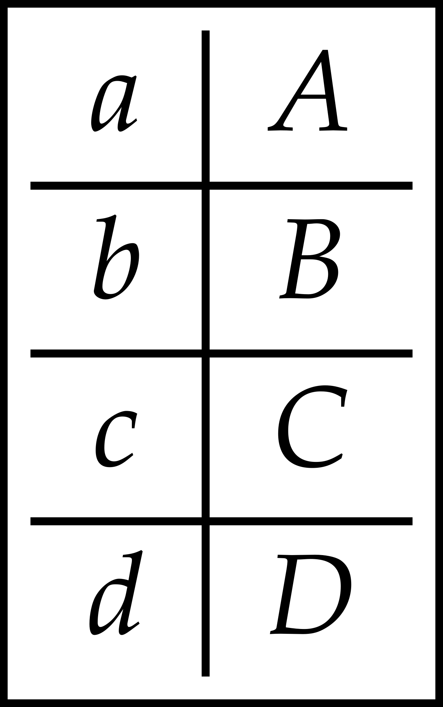

etc. It is a part of the symbolism. It is therefore nonsense to say that the relation of name & object is a psychological one.

### [121\[2\]](https://cdn.wittgensteinnachlass.com/2000px/webp/Ms-111/121.webp)

Thinking is a continuous calculation.

### [121\[3\]](https://cdn.wittgensteinnachlass.com/2000px/webp/Ms-111/121.webp)

That the fire will burn me if I put my hand in it: that is certainty.

### [121\[4\]](https://cdn.wittgensteinnachlass.com/2000px/webp/Ms-111/121.webp)

That is, there I see what certainty means. (Not only what the word “certainty” means, but also what certainty itself amounts to.)

### [121\[5\]](https://cdn.wittgensteinnachlass.com/2000px/webp/Ms-111/121.webp)

20.08.1931

What does it mean to say: the number series is infinite?

### [121\[6\]](https://cdn.wittgensteinnachlass.com/2000px/webp/Ms-111/121.webp)

That must surely be a _stipulation_, not the statement of a fact.

### [121\[7\]](https://cdn.wittgensteinnachlass.com/2000px/webp/Ms-111/121.webp),[122\[1\]](https://cdn.wittgensteinnachlass.com/2000px/webp/Ms-111/122.webp)

I was right, of course, that infinite possibility (e.g. infinite divisibility) belongs to quite a different grammatical category from finite possibility (the possibility of dividing into 3 parts). But this does not yet _determine_ the grammar of the word “infinite”.

### [122\[2\]](https://cdn.wittgensteinnachlass.com/2000px/webp/Ms-111/122.webp)

If, for example, I say “I call everything that results from 1 by the continued addition of 1 ‘cardinal numbers’”, the word “continued” does not stand for a hazy continuation of 1, 1 + 1, 1 + 1 + 1; rather, the sign “1, 1 + 1, 1 + 1 + 1, …” too is to be taken quite exactly; as distinct from “1, 1 + 1, 1 + 1 + 1”, it is subject to other definite rules & is not a substitute for a series “that cannot be written down”.

### [122\[3\]](https://cdn.wittgensteinnachlass.com/2000px/webp/Ms-111/122.webp)

That is: one also _calculates_ with the sign “1, 1 + 1, 1 + 1 + 1 …” as with (the) numerals, only differently.

### [122\[4\]](https://cdn.wittgensteinnachlass.com/2000px/webp/Ms-111/122.webp)

But what is it, then, that one imagines? What mistake is one making? What does one take the sign “1, 1 + 1, …” for? That is: where does what one thinks one sees in this sign _actually_ occur? Perhaps when I say “he counted 1, 2, 3, 4, 5, 6 and so on up to a thousand”? Where it would also be possible actually to write down all the numbers.

### [122\[5\]](https://cdn.wittgensteinnachlass.com/2000px/webp/Ms-111/122.webp),[123\[1\]](https://cdn.wittgensteinnachlass.com/2000px/webp/Ms-111/123.webp)

What does one _see_ “1, 1 + 1, 1 + 1 + 1 …” as, then? As an inexact form of expression. The little dots are like further numerals, only blurred. As if one stopped writing down numerals because one cannot write them all down anyway, but as if they were indeed there, so to speak, in a box. Or again, as when I sing only the first notes of a tune distinctly & merely hint at the rest & let it trail off into nothing (or when, in writing a word, one writes only a few letters distinctly & ends with an unarticulated stroke) _where a distinct would then correspond to the indistinct_.

### [123\[2\]](https://cdn.wittgensteinnachlass.com/2000px/webp/Ms-111/123.webp)

There is also the question where exactly the concept of number (or the concept of cardinal number) is indispensable. Number in contrast to what? [1, ξ, ξ + 1] presumably in contrast to [5, ξ, √ ξ] etc. – For if I actually introduce such a sign (as “[1, ξ, ξ + 1]”) – & do not just drag it around as a luxury – then I must also do something with it, i.e. use it in a calculus, & then it loses its supremacy & enters a system of signs on a par with it.

### [123\[3\]](https://cdn.wittgensteinnachlass.com/2000px/webp/Ms-111/123.webp),[124\[1\]](https://cdn.wittgensteinnachlass.com/2000px/webp/Ms-111/124.webp)

One might say: but surely ‘cardinal number’ contrasts with ‘rational number’, ‘real number’, etc. But this difference is a difference in the rules (in the rules of the games that hold for them) – not one of position on the chessboard – not a difference for which one needs different words on a par in the same calculus.

### [124\[2\]](https://cdn.wittgensteinnachlass.com/2000px/webp/Ms-111/124.webp)

We do not say that if f(1) holds & f(c + 1) follows from f(c), the proposition f(x) is _therefore_ true for all cardinal numbers; rather, “the proposition f(x) holds for all cardinal numbers” _means_ “it holds for x = 1 & f(c + 1) follows from f(c)”.

### [124\[3\]](https://cdn.wittgensteinnachlass.com/2000px/webp/Ms-111/124.webp)

But how do I know that 28 + (45 + 17) = (28 + 45) + 17 without having proved it? How can a general proof give me a particular proof. For I could give the particular proof, after all, & how do the two proofs meet & what if they don’t agree.

### [124\[4\]](https://cdn.wittgensteinnachlass.com/2000px/webp/Ms-111/124.webp)

And here the connection with generality in finite domains is quite clear, for in a finite domain that very thing would indeed be the proof that f(x) holds for all values of x, & _that very thing_ is why we say in the arithmetical case too that f(x) holds for all numbers.

### [124\[5\]](https://cdn.wittgensteinnachlass.com/2000px/webp/Ms-111/124.webp),[125\[1\]](https://cdn.wittgensteinnachlass.com/2000px/webp/Ms-111/125.webp)

And if one now asks: well, _can_ the particular proof yield anything other than 28 + (45 + 17) = (28 + 45) + 17, then I would have to answer: of course it can yield something else (if its yielding that result is an independent fact), but if it yields something else, I shall say I have made a mistake in the calculation.

### [125\[2\]](https://cdn.wittgensteinnachlass.com/2000px/webp/Ms-111/125.webp)

21.08.1931

But surely I would say: The general proof already shows that nothing else can come out.

### [125\[3\]](https://cdn.wittgensteinnachlass.com/2000px/webp/Ms-111/125.webp)

Here we come back to the case

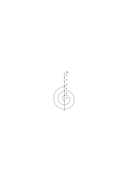

of the spiral, of which we say that, if it continues in the same way, it always cuts off the same segment a on the straight line & so reaches A in three further turns. I could construct this point by extending the spiral as far as A, but also by simply marking off a three times on the straight line. –

### [125\[4\]](https://cdn.wittgensteinnachlass.com/2000px/webp/Ms-111/125.webp)

But surely things are just the same with a general geometrical proof; for example, that the angle in a semicircle is a right angle.

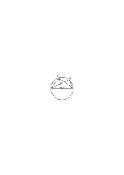

I then take the proposition as proved for another case B as well; but I could also prove it explicitly for this case.

### [126\[1\]](https://cdn.wittgensteinnachlass.com/2000px/webp/Ms-111/126.webp)

First it is necessary to see clearly that we are not proving any fact. For just because things are so in the one case, how can I know that they are so in the _other_? And there is no such thing as ‘having to be so’. If it is not so, there is nothing one can do about it. Only what depends on us can we _determine_ in advance.

### [126\[2\]](https://cdn.wittgensteinnachlass.com/2000px/webp/Ms-111/126.webp)

So the proof cannot prophesy anything.

### [126\[3\]](https://cdn.wittgensteinnachlass.com/2000px/webp/Ms-111/126.webp)

Is the proof, carried out for A, also the proof for B, so that it makes no difference at all in which triangle it is drawn. And so that, if it were drawn in both triangles, only _the same_ proof would be repeated? So that the sign of the proof – the proof as a sign – could consist just as well of the construction in A & the triangle B as of this triangle & a construction in it.

### [126\[4\]](https://cdn.wittgensteinnachlass.com/2000px/webp/Ms-111/126.webp)

[1, 23, 42, 55, 67, 8See facsimile; connecting lines to formula.(x + y)² = ∙ ∙ ∙ ∙ = x² + 2xy + y²]

### [126\[5\]](https://cdn.wittgensteinnachlass.com/2000px/webp/Ms-111/126.webp),[127\[1\]](https://cdn.wittgensteinnachlass.com/2000px/webp/Ms-111/127.webp)

The proof that (3 + 4)² = 3² + 2 ∙ 3 ∙ 4 + 4² would then, in one language, consist in: [3|(x + ][4|y)² = ∙ ∙ ∙ ∙ = x² + 2xy + y²] & could also consist in [3|(5 + ][4|6)² = ∙ ∙ ∙ ∙ = 5² + 2 ∙ 5 ∙ 6 + 6²].

### [127\[2\]](https://cdn.wittgensteinnachlass.com/2000px/webp/Ms-111/127.webp)

One would probably like to say: The same construction is a proof of the geometrical proposition for the particular triangle; but we can also mean it generally; or: from it we can also see that what holds for this triangle must hold for every other one as well. – But what do this “meaning” & this “seeing” consist in? The psychological processes are a matter of complete indifference to us. “The triangle here simply stands for _any_ triangle”. But what does this “standing for something” consist in? Once again, all we are concerned with is the _expression_ of that ‘way of taking it’, i.e. the expression of _what_ we apprehend or see & the expression of the fact that the triangle stands only for itself or for all triangles. The calculus must be laid down (again).

### [127\[3\]](https://cdn.wittgensteinnachlass.com/2000px/webp/Ms-111/127.webp)

What interests us is not mental processes, but symbolic ones.

### [127\[4\]](https://cdn.wittgensteinnachlass.com/2000px/webp/Ms-111/127.webp),[128\[1\]](https://cdn.wittgensteinnachlass.com/2000px/webp/Ms-111/128.webp)

That is, the proof carried out with 28, 45 & 17 must not give me any greater certainty than the ‘general’ one. Or else the two must be entirely independent. But not then _independent_ proofs _of the same thing_, for that is nonsense. (They are, after all, connected by having the same end.)

### [128\[2\]](https://cdn.wittgensteinnachlass.com/2000px/webp/Ms-111/128.webp)

_How_ does the general proof by induction make me certain that the particular one will yield that result?

### [128\[3\]](https://cdn.wittgensteinnachlass.com/2000px/webp/Ms-111/128.webp)

(Just do not despise the simple calculi that every child & every merchant’s wife uses.)

### [128\[4\]](https://cdn.wittgensteinnachlass.com/2000px/webp/Ms-111/128.webp)

This too must be a perfectly rigorous proof of the associative law.

### [128\[5\]](https://cdn.wittgensteinnachlass.com/2000px/webp/Ms-111/128.webp)

And here one can clearly distinguish the two cases we spoke of in the geometrical proof. For the figure can count as a general proof, & also as a proof only of 4 + (3 + 6) = (4 + 3) + 6 & I can write down the proof of 3 + (7 + 2) = (3 + 7) + 2 like this: I have carried out the proof only below (drawn the construction).

### [128\[6\]](https://cdn.wittgensteinnachlass.com/2000px/webp/Ms-111/128.webp)

One calculus is not more rigorous than another! One only has to know the limits of each. One can call a calculus lacking in rigour only insofar as its rules are not clearly formulated.

### [129\[1\]](https://cdn.wittgensteinnachlass.com/2000px/webp/Ms-111/129.webp)

One says “this proposition has been proved for all cardinal numbers”. But just look at how the concept of cardinal number enters the proof. Only in so far as the proof speaks of 1 & the operation ξ + 1 – but not in contrast to something that would correspond to the rational numbers. So if one describes the proof in prose with the aid of the concept-word ‘cardinal number’, we can presumably see that no concept corresponds to this word.

### [129\[2\]](https://cdn.wittgensteinnachlass.com/2000px/webp/Ms-111/129.webp)

I _could_ make the same construction above as below. But does that suffice as a proof?! Yes, for the proof now consists in the description of what I could draw. And the description of a proof is (also) the proof, after all. – And now I must go through the sign “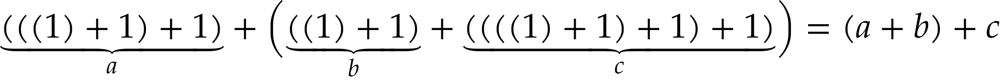” step by step to make sure that it is built according to this plan. The plan for which the general proof holds.

### [129\[3\]](https://cdn.wittgensteinnachlass.com/2000px/webp/Ms-111/129.webp)

Must I not also speak here of a _system_ of proofs?

### [130\[1\]](https://cdn.wittgensteinnachlass.com/2000px/webp/Ms-111/130.webp)

How does the proof ‘carried out’ relate to the general one, apparently merely indicated? Or: Do they belong to different systems of symbols? Otherwise, surely, whatever the first contains over and above the second must be superfluous.

### [130\[2\]](https://cdn.wittgensteinnachlass.com/2000px/webp/Ms-111/130.webp)

What is seen in the sign

“”

is precisely what is proved by the general proof.

### [130\[3\]](https://cdn.wittgensteinnachlass.com/2000px/webp/Ms-111/130.webp)

22.08.1931

Incidentally, one can adopt the convention of indicating an expression of the form 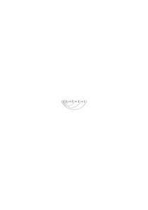 (the cardinal-number form) merely by the number of opening brackets ((((, since everything else is given by them. And now one can write it ∣∣∣∣. (A detour.)

### [130\[4\]](https://cdn.wittgensteinnachlass.com/2000px/webp/Ms-111/130.webp)

(One must think one’s way into the mistakes. “Let him make the right impression on you …” (Rückert)).

### [130\[5\]](https://cdn.wittgensteinnachlass.com/2000px/webp/Ms-111/130.webp)

(Duration of a tone & duration of an acoustic vibration.)

### [130\[6\]](https://cdn.wittgensteinnachlass.com/2000px/webp/Ms-111/130.webp),[131\[1\]](https://cdn.wittgensteinnachlass.com/2000px/webp/Ms-111/131.webp)

Critique of my previously expounded conception of proof by induction. A proof is a proof of a (particular) proposition if it is so according to a rule by which this proposition is assigned to this proof. I.e. the proposition must belong to a system of propositions & the proof to a system of proofs. And every proposition of mathematics must belong to a calculus of mathematics (and cannot sit enthroned in solitude & as it were fail to mingle with other propositions.) So the proposition “every equation of the nth degree has n solutions” is a proposition of mathematics only insofar as it corresponds to a system of propositions & its proof to a corresponding system of proofs. For what good reason have I to assign _this_ prose sentence to this chain of equations etc. (the so-called proof). It must after all follow from the proof – according to a rule – which proposition it proves.

### [131\[2\]](https://cdn.wittgensteinnachlass.com/2000px/webp/Ms-111/131.webp)

But now it is of the nature of _what we call a proposition_ that it must be possible to negate it. And the negation of the proved proposition must also be connected with the proof, in such a way that it can be shown under what other, opposite conditions it would have resulted.

### [131\[3\]](https://cdn.wittgensteinnachlass.com/2000px/webp/Ms-111/131.webp),[132\[1\]](https://cdn.wittgensteinnachlass.com/2000px/webp/Ms-111/132.webp)

One would like to regard the proof by induction as, as it were, an indirect proof of general validity. (But in logic there is no more there than we see.)

### [132\[2\]](https://cdn.wittgensteinnachlass.com/2000px/webp/Ms-111/132.webp)

(“sweeping statements” get one nowhere in philosophy; rather, everything must be represented as it is.)

### [VB](/w-vb/#ms-111-132.3) [132\[3\]](https://cdn.wittgensteinnachlass.com/2000px/webp/Ms-111/132.webp)

23.08.1931

(From Simplicissimus: Riddles of Engineering. (Picture: Two professors in front of a bridge under construction) Voice from above: “Lower it – – whoa – – lower it, I say – – then we’ll turn it round the other way!” – – – – “It really is incomprehensible, my dear colleague, that such complicated & precise work can be accomplished in this language”.)

### [132\[4\]](https://cdn.wittgensteinnachlass.com/2000px/webp/Ms-111/132.webp)

Does visual space have a centre? – It makes sense to put a little cross in a picture

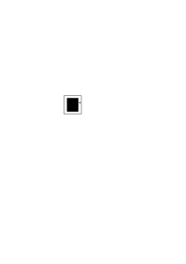

& to say: look at the cross; you will then see the rest as well, but the cross will then be at the centre of the visual field.

### [132\[5\]](https://cdn.wittgensteinnachlass.com/2000px/webp/Ms-111/132.webp),[133\[1\]](https://cdn.wittgensteinnachlass.com/2000px/webp/Ms-111/133.webp)

All considerations can be pursued in a much more homely way than I pursued them in earlier times. And that is why no new words need be used in philosophy either; the old, ordinary words of the language suffice.

### [133\[2\]](https://cdn.wittgensteinnachlass.com/2000px/webp/Ms-111/133.webp)

“Is that a proof of this proposition?” Is it _used_ as a proof? If so, why should I not call it a proof?

### [133\[3\]](https://cdn.wittgensteinnachlass.com/2000px/webp/Ms-111/133.webp)

Every multiplication is a proof. It settles that 16 × 25 is 400 & nothing else, & is actually used as a proof of that.

### [133\[4\]](https://cdn.wittgensteinnachlass.com/2000px/webp/Ms-111/133.webp)

In Euclidean proof it is not the figure alone that matters, but also the order of the operations of construction, & one could imagine the proof being carried out by means of a series of figures (the course of the proof). |

### [VB](/w-vb/#ms-111-133.5+134.1) [133\[5\]](https://cdn.wittgensteinnachlass.com/2000px/webp/Ms-111/133.webp),[134\[1\]](https://cdn.wittgensteinnachlass.com/2000px/webp/Ms-111/134.webp)

24.08.1931

One hears the remark again and again that philosophy makes no real progress, that the same philosophical problems that already occupied the Greeks still occupy us. But those who say this don’t understand why it is so. The reason is that our language has stayed the same & keeps seducing us into asking the same questions. As long as there is a verb ‘to be’ that seems to function like ‘to eat’ & ‘to drink’, as long as there are adjectives ‘identical’, ‘true’, ‘false’, ‘possible’, as long as there is talk of a flow of time & an extension of space, etc., etc., people will keep coming up against the same enigmatic difficulties & staring at something that no explanation seems able to remove. And this, incidentally, satisfies a longing for the otherworldly, for in believing that they see the “limit of human understanding”, they naturally believe they can see beyond it.

### [VB](/w-vb/#ms-111-134.2) [134\[2\]](https://cdn.wittgensteinnachlass.com/2000px/webp/Ms-111/134.webp)

I read “… philosophers are no nearer to the meaning of ‘Reality’ than Plato got; …”. What an odd situation. How odd, then, that Plato could get as far as he did at all! Or that we could then get no further! Was it because Plato was _so_ clever?

### [134\[3\]](https://cdn.wittgensteinnachlass.com/2000px/webp/Ms-111/134.webp)

Is not the chief danger that the prose expression of the result of a mathematical operation makes us think there is a calculus where there is none? By seeming, in its outward form, to belong to a system that simply does not exist here.

### [135\[1\]](https://cdn.wittgensteinnachlass.com/2000px/webp/Ms-111/135.webp)

If the proof by induction is a proof of a + (b + c) = (a + b) + c, then one must be able to say: the _calculation yields_ the result that a + (b + c) = (a + b) + c (& no other result). For then the method of calculation must first be known (in general) &, just as we can work out on that basis 25 × 16, so too can we work out a + (b + c). So first a general rule for working out all such problems is taught & then the particular calculation is carried out. – But what is the general method of calculation here? It must rest on general rules for signs (– such as the associative law, for example –).

### [135\[2\]](https://cdn.wittgensteinnachlass.com/2000px/webp/Ms-111/135.webp)

Now is this proof of the associative law, perhaps, the proof that a + (b + c) = (a + b) + c & not (a + 2b) + c?

### [135\[3\]](https://cdn.wittgensteinnachlass.com/2000px/webp/Ms-111/135.webp)

When one introduces irrational numbers, one always acts as if one had now discovered something new (say, new points between the old ones). Whereas it is not a matter of a new discovery, but of a new construction (which one can then call a “number”, or not).

### [135\[4\]](https://cdn.wittgensteinnachlass.com/2000px/webp/Ms-111/135.webp),[136\[1\]](https://cdn.wittgensteinnachlass.com/2000px/webp/Ms-111/136.webp)

Suppose we were to call the proposition that 7 is not divisible by any smaller number except 1 “the law of the sacred number” & were to express it in the words “7 is the sacred number”. Then we would have a case similar to that of the “fundamental theorem of algebra” & other ‘propositions’ that really name an individual calculation, which we call the proof of the proposition.

### [136\[2\]](https://cdn.wittgensteinnachlass.com/2000px/webp/Ms-111/136.webp)

Only for such a ‘proposition of mathematics’ are there different independent proofs. For the mutually independent calculations arbitrarily contain the same name.

### [136\[3\]](https://cdn.wittgensteinnachlass.com/2000px/webp/Ms-111/136.webp)

I do not need to _assert_ that one must be able to construct the n roots of an equation of the nth degree; I say only that the proposition “this equation has n roots” means something _different_ when I have proved it by counting the constructed roots & when I have proved it in some other way. But if I find a formula for the roots of an equation, I have constructed a new calculus & not filled a gap in an old one.

### [136\[4\]](https://cdn.wittgensteinnachlass.com/2000px/webp/Ms-111/136.webp),[137\[1\]](https://cdn.wittgensteinnachlass.com/2000px/webp/Ms-111/137.webp)

It is therefore nonsense to say that the proposition is not proved until one exhibits such a construction. For then we have constructed something new, & what we now understand by the fundamental theorem of algebra is just what the present ‘proof’ shows us.

### [137\[2\]](https://cdn.wittgensteinnachlass.com/2000px/webp/Ms-111/137.webp)

It is nonsense to fear that algebra might thus be deprived of this support.

### [137\[3\]](https://cdn.wittgensteinnachlass.com/2000px/webp/Ms-111/137.webp)

25.08.1931

“I foresaw that.” – How is that possible, when after all it did not happen then (& may never have happened)?!

### [137\[4\]](https://cdn.wittgensteinnachlass.com/2000px/webp/Ms-111/137.webp)

What does a person think for? What is the use of it? What does he _calculate_ steam boilers for, instead of leaving it to chance how thick the boiler wall will be? It is, after all, only an empirical fact that boilers calculated in this way do not explode as often. But just as he would do anything rather than put his hand in the fire that burnt him before, so he will do anything rather than not calculate the boiler. Since, however, we are not interested in causes, we can only say: people do indeed think: they proceed, for example, in this way when they make a steam boiler. Can’t a boiler made this way explode? Oh yes. –

### [137\[5\]](https://cdn.wittgensteinnachlass.com/2000px/webp/Ms-111/137.webp)

Augustine: _When_ do I measure a period of time. Similar to my question: _When can_ I play chess.

### [138\[1\]](https://cdn.wittgensteinnachlass.com/2000px/webp/Ms-111/138.webp)

Thinking something over. I am thinking over whether to go to the cinema now. I picture how the evening’s time would be divided up. I could quite well represent it graphically too. But _what_ do I do this _for_?? After all, I’m not carrying out a ‘thought experiment’!

### [138\[2\]](https://cdn.wittgensteinnachlass.com/2000px/webp/Ms-111/138.webp)

False ideas about how language works: Dr. Broad, who said that the statement ‘something _will_ happen’ is not a proposition. What is one thereby denying of this statement? Anything other than that it describes something present or past? – Magic with words. A sentence like Broad’s strikes me as like an attempt to bring about a chemical change by magic; by letting the substances know, as it were, what they are supposed to do (as if one wanted to turn iron into gold by taking hold of a piece of iron with the right hand & at the same time a piece of gold with the left.)

### [138\[3\]](https://cdn.wittgensteinnachlass.com/2000px/webp/Ms-111/138.webp)

Here we also come to the question: to what extent does thinking help one find the truth? (Johnson)

### [138\[4\]](https://cdn.wittgensteinnachlass.com/2000px/webp/Ms-111/138.webp)

“I picture it to myself.”

### [138\[5\]](https://cdn.wittgensteinnachlass.com/2000px/webp/Ms-111/138.webp),[139\[1\]](https://cdn.wittgensteinnachlass.com/2000px/webp/Ms-111/139.webp)

In a certain sense thinking merely brings things together.

### [139\[2\]](https://cdn.wittgensteinnachlass.com/2000px/webp/Ms-111/139.webp)

“The sentence is a picture”. A picture of what? Can one say: “Of the fact that makes it true if it is true, & of the fact that makes it false if false. In the first case it is a correct picture, in the second case an incorrect one.”

### [139\[3\]](https://cdn.wittgensteinnachlass.com/2000px/webp/Ms-111/139.webp)

For it is not a picture of how things would be if‥‥. That means nothing. Then it would at most be a picture of the sentence or of another picture of how things would be if‥‥.

### [139\[4\]](https://cdn.wittgensteinnachlass.com/2000px/webp/Ms-111/139.webp)

If by picture one means a correct or incorrect representation of reality, then one must know of which reality, or of which part of reality; i.e., one must have a means of comparing the sentence with reality in a particular way. I can represent this room correctly or incorrectly, but to find out whether it is correct or not, I must know that this room is meant.

### [139\[5\]](https://cdn.wittgensteinnachlass.com/2000px/webp/Ms-111/139.webp),[140\[1\]](https://cdn.wittgensteinnachlass.com/2000px/webp/Ms-111/140.webp)

Let us think of a cipher: suppose we are given a sentence in the cipher & also the key; then of course, in a certain respect, we are given everything for understanding the cipher. And yet, if asked “do you understand this sentence in the cipher?”, I might answer: No, I must first decipher it; & only once I had translated it into German, for example, would I say “now I understand it”. Is this because at first glance I could not even have said whether the expression in cipher was a sentence at all & not just words strung together nonsensically?

### [140\[2\]](https://cdn.wittgensteinnachlass.com/2000px/webp/Ms-111/140.webp)

If one were to ask here: “At what moment in the translation (from the cipher into German) do I understand the sentence?”, one would gain an insight into the essence of understanding.

### [140\[3\]](https://cdn.wittgensteinnachlass.com/2000px/webp/Ms-111/140.webp)

We all understand what it means to look up in a calendar which day of the week we are free. The picture we see is, say, 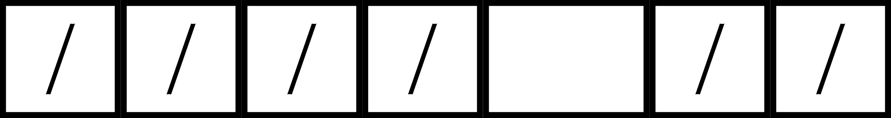 & we now say that we are free only on Thursday, & act accordingly. But it is hard to say what actually happens here & what warrant we have for acting in accordance with the picture.

### [140\[4\]](https://cdn.wittgensteinnachlass.com/2000px/webp/Ms-111/140.webp)

What happens when I think over a move in chess? In this case I can make the moves in advance & so draw up the most direct picture of what will happen.

### [141\[1\]](https://cdn.wittgensteinnachlass.com/2000px/webp/Ms-111/141.webp)

I

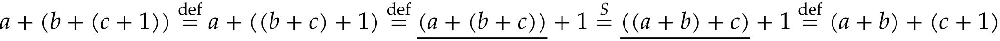

II

a + (b + c) = (a + b) + c

If we call I the proof of II, what is the general principle of this proof? For it is no use saying that I proves II, since this gives me no more than I & II; unless I now also learn a general rule of which the inference from I to II is only an example.

### [141\[2\]](https://cdn.wittgensteinnachlass.com/2000px/webp/Ms-111/141.webp)

A curious expression: “I _managed_ to prove that”. (That is what no one would say in the case of 25 × 16 = 400.)

### [141\[3\]](https://cdn.wittgensteinnachlass.com/2000px/webp/Ms-111/141.webp)

The system of the proof above is this: 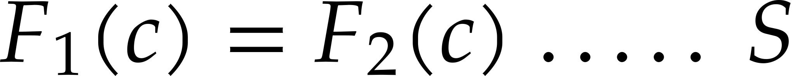 is to be proved. 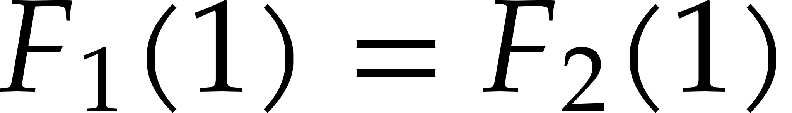 is an accepted rule. If it follows from this & the other rules already accepted that on the one hand

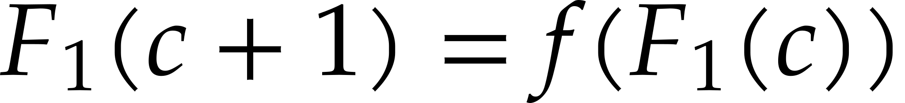

and on the other , then S counts as proved.

### [141\[4\]](https://cdn.wittgensteinnachlass.com/2000px/webp/Ms-111/141.webp),[142\[1\]](https://cdn.wittgensteinnachlass.com/2000px/webp/Ms-111/142.webp)

Now is I a proof of 5 + (2 + 7) = (5 + 2) + 7? It is a proof of ∣∣∣∣∣ + (∣∣ + ∣∣∣∣∣∣∣) = (∣∣∣∣∣ + ∣∣) + ∣∣∣∣∣∣∣. For if we began to transform the expression on the left according to the definition a + (b + 1) = (a + b) + 1, as in the proof, we would soon see that each transformation brought us closer to the right-hand side, & we could stop after the first step & see (just what we see in the proof by induction) that the right-hand side must result after ∣∣∣∣∣∣∣ operations. And we see this no more clearly if we go through all these operations. For if we then did not reach the foreseen goal, we would say that we had made a mistake in the calculation. Thus the general proof is a proof of 5 + (2 + 7) = (5 + 2) + 7 _if_ we represent (conceive of) this equation as a case of the proof, & in conceiving of it this way we supply the necessary multiplicity of the proof for the particular case.

(Is it not like the way I can represent five men by

but also by  (∣∣∣∣∣)?)

### [142\[2\]](https://cdn.wittgensteinnachlass.com/2000px/webp/Ms-111/142.webp)

So insofar as the proof can be applied to numbers with which we calculate, we can call it general (like, say, a hat that every member of the family can use).

### [142\[3\]](https://cdn.wittgensteinnachlass.com/2000px/webp/Ms-111/142.webp)

(In the sense in which we speak of possible & actually drawn straight lines, we could also speak of possible & actually represented numbers.)

### [142\[4\]](https://cdn.wittgensteinnachlass.com/2000px/webp/Ms-111/142.webp),[143\[1\]](https://cdn.wittgensteinnachlass.com/2000px/webp/Ms-111/143.webp)

But what about the other proof of 25 + (8 + 17) = (25 + 8) + 17, which works out the right-hand & left-hand sides according to the rules of 1 + 1 & finds them equal? For [25 8 33] can be proved, & if I could not prove it, the only justification I could give would be to appeal to what I had learnt: to write a 3 under the line & carry 1 when there is a 5 above & an 8 below. But it would be compatible with this rule for one to be allowed to write, say, [5 5 8], if the whole system by which we add is not known. I.e., the proposition 25 + (8 + 17) = (25 + 8) + 17 is proved only once we have reduced everything to the addition of ones, & then its proof is equivalent to that of ∣∣∣∣∣ +

(∣∣ + ∣∣∣∣∣∣∣)

=

(∣∣∣∣∣ + ∣∣) +

∣∣∣∣∣∣∣.

### [143\[2\]](https://cdn.wittgensteinnachlass.com/2000px/webp/Ms-111/143.webp)

If one looks at Skolem’s recursive proofs as it were from above, they appear to us as chains of equations whose transitions are permitted according to certain rules & which have a particular structural feature: certain high points by which they can be assigned to particular equations.

### [143\[3\]](https://cdn.wittgensteinnachlass.com/2000px/webp/Ms-111/143.webp),[144\[1\]](https://cdn.wittgensteinnachlass.com/2000px/webp/Ms-111/144.webp)

One could also put it this way: Skolem _succeeds_ in proving all these propositions; but he does not give us _one_ system in which we can derive all the propositions to be proved by means of _one_ rule. Rather, we must learn afresh each time how to derive a further proposition – unlike someone who has learnt to multiply and can solve any multiplication problem without further ado.

### [144\[2\]](https://cdn.wittgensteinnachlass.com/2000px/webp/Ms-111/144.webp)

(It does not matter at all that what is proved does not stand at the end of the chain of equations. The proof might be compared to a proof that 25 × 16 = 400: We assume this & then divide 4000 by 16, then by 25, & if the result is 10, the assumption was correct.)

### [144\[3\]](https://cdn.wittgensteinnachlass.com/2000px/webp/Ms-111/144.webp)

The question is, how does the calculus go on once the fundamental laws have been proved by induction?

### [144\[4\]](https://cdn.wittgensteinnachlass.com/2000px/webp/Ms-111/144.webp)

In the end I always do no more than draw attention to something. (And gather such remarks together.)

### [144\[5\]](https://cdn.wittgensteinnachlass.com/2000px/webp/Ms-111/144.webp)

Arithmetic, Algebra.

### [144\[6\]](https://cdn.wittgensteinnachlass.com/2000px/webp/Ms-111/144.webp)

26.08.1931

“Rigorous” means: clear.

### [144\[7\]](https://cdn.wittgensteinnachlass.com/2000px/webp/Ms-111/144.webp)

Two proofs of “the same proposition” can be independent of one another only if they never reach the proposition. (For otherwise they communicate with one another.) That is, if they are not, strictly speaking, proofs of this proposition.

### [144\[8\]](https://cdn.wittgensteinnachlass.com/2000px/webp/Ms-111/144.webp),[145\[1\]](https://cdn.wittgensteinnachlass.com/2000px/webp/Ms-111/145.webp)

In mathematics there are, after all, very different things that are all called proofs, & these differences are _logical_. So the things called proof have no more to do with one another than the things called _number_.

### [145\[2\]](https://cdn.wittgensteinnachlass.com/2000px/webp/Ms-111/145.webp)

One calls it a problem when one is asked “how much is 25 × 16”, but one also calls this a problem: What is ∫ sin²xdx? One takes the first to be much easier than the second, to be sure, but does not see that they are problems in different senses. The difference is _of course_ not psychological, and the question is not whether the pupil can solve the problem, but whether the calculus can solve it, or which calculus can solve it.

### [145\[3\]](https://cdn.wittgensteinnachlass.com/2000px/webp/Ms-111/145.webp)

The differences I can draw attention to are just the sort that every schoolboy no doubt knows. But later one looks down on these differences, as one does on the Russian abacus (& other aids used in early instruction), & regards them as inessential, like the difference between finite & infinite, rather than as essential & fundamental.

### [145\[4\]](https://cdn.wittgensteinnachlass.com/2000px/webp/Ms-111/145.webp),[146\[1\]](https://cdn.wittgensteinnachlass.com/2000px/webp/Ms-111/146.webp)

It does not matter whether one _knows a rule_ by which one can certainly solve ∫ sin²xdx; what is of interest is whether the _calculus_ we have before us (which he happens to be using) contains such a rule. What interests us is not whether the pupil can do it, but whether the calculus can, & how it does it.

### [146\[2\]](https://cdn.wittgensteinnachlass.com/2000px/webp/Ms-111/146.webp)

Now in the case of 25 × 16 = 370, the calculus we use prescribes every step for checking this equation.

### [146\[3\]](https://cdn.wittgensteinnachlass.com/2000px/webp/Ms-111/146.webp)

When Frege speaks against the formal conception of arithmetic, he always says as it were: these petty explanations concerning the symbols are unnecessary if we understand them, & understanding consists, as it were, in seeing a picture from which all the rules then follow (thereby becoming intelligible). But Frege does not see that this picture is itself only a sign in turn, or a calculus that explains the one with written signs to us. But understanding in general is always [very much] like the understanding we acquire of a calculus when we learn how it arose, or learn about its practical application. And of course there too we again merely become familiar with a different symbolism that is more surveyable to us in place of one that is unfamiliar to us. (Understanding here means having a clear view of the whole.)

### [147\[1\]](https://cdn.wittgensteinnachlass.com/2000px/webp/Ms-111/147.webp)

### [147\[2\]](https://cdn.wittgensteinnachlass.com/2000px/webp/Ms-111/147.webp),[148\[1\]](https://cdn.wittgensteinnachlass.com/2000px/webp/Ms-111/148.webp)

(A step-by-step examination of these proofs would be very instructive.) The first transition in I a + (b + (c + 1) = a + ((b + c) + 1), if it is to proceed according to R, shows that the variables in R are meant differently from those in the equations of I, for otherwise R would allow only a + (b + 1) to be replaced by (a + b) + 1, but not b + (c + 1) by (b + c) + 1. The other transitions in this proof of course show the same thing. Now if I said that the two lines of the proof entitle me to infer the rule a + (b + c) = (a + b) + c, that would mean nothing at all unless I had drawn the inference according to a previously established rule. But this rule could presumably only be as follows:

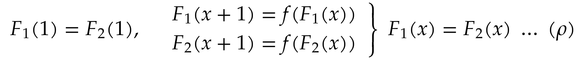

But this rule is vague with respect to 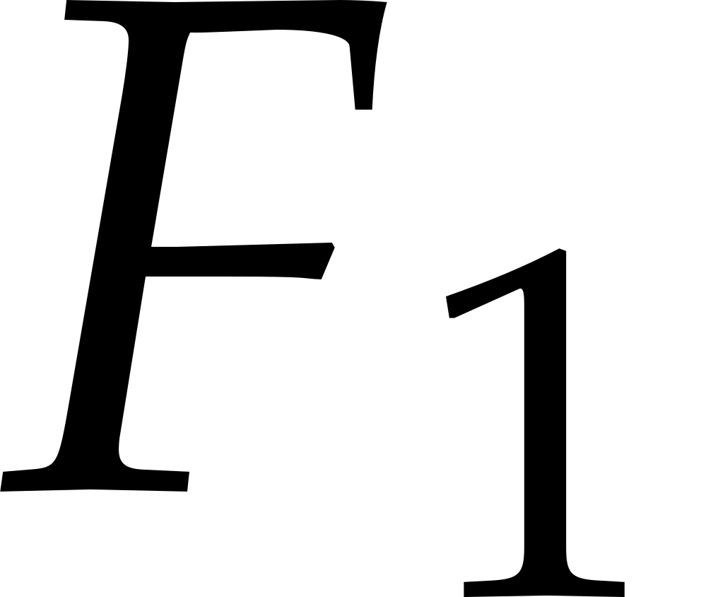,  & f.

### [148\[2\]](https://cdn.wittgensteinnachlass.com/2000px/webp/Ms-111/148.webp)

But one thing about this rule seems remarkable: it is possible to understand it as an instruction even without seeing that the series 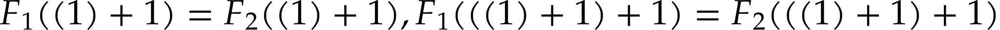, etc. follows from it.

### [148\[3\]](https://cdn.wittgensteinnachlass.com/2000px/webp/Ms-111/148.webp)

Of course I can apply the general rule for proof by induction only if I discover the substitution that makes it applicable. So it would be possible for someone to see the equations (a + 1) + 1 = (a + 1) + 1 1 + (a + 1) = (1 + a) + 1 without the substitution 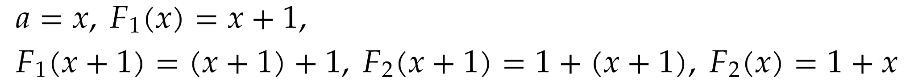 occurring to him.

### [148\[4\]](https://cdn.wittgensteinnachlass.com/2000px/webp/Ms-111/148.webp),[149\[1\]](https://cdn.wittgensteinnachlass.com/2000px/webp/Ms-111/149.webp)

Incidentally, if I say that I _understand_ the equations as a special case of that rule, the understanding must surely be what shows itself in the explanation of the relation between the rule & the equations, i.e. what we express by the substitution. If I do not regard this as an expression of what I understand, then there is none; but then there is no sense in speaking of understanding either, in saying that I understand something definite. For it makes sense to speak of understanding only where we understand _one thing_ as opposed to another. And it is precisely this that signs express. Indeed, seeing the internal relation can itself only be seeing something that can be described, of which one can say “I see that this is how things stand”, and thus really something of the nature of signs of correlation (such as connecting lines, brackets, substitutions, etc.). And everything else can lie only in the application of the sign of the general rule in a particular case.

### [149\[2\]](https://cdn.wittgensteinnachlass.com/2000px/webp/Ms-111/149.webp)

Can one now say that we have calculated I, II & III from R? No. – But from R and ρ?

### [149\[3\]](https://cdn.wittgensteinnachlass.com/2000px/webp/Ms-111/149.webp),[150\[1\]](https://cdn.wittgensteinnachlass.com/2000px/webp/Ms-111/150.webp)

27.08.1931

We could now also write down the above proofs differently, namely as equations between particular numbers which serve as examples. Such a proof is then similar in kind to the proof of a geometrical proposition about the triangle by means of a construction in _one triangle_. (But still only similar, hence logically related, but not quite the same). The following proof then corresponds to proposition I:

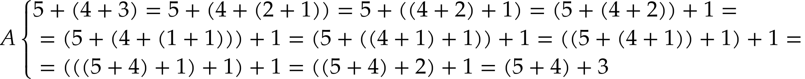

### [150\[2\]](https://cdn.wittgensteinnachlass.com/2000px/webp/Ms-111/150.webp)

On the one hand this is the proof of 5 + (4 + 3) = (5 + 4) + 3; on the other hand one can let it count as a proof of 5 + (4 + 4) = (5 + 4) + 4 etc. etc., i.e. use it as one. If I were now to say, as I could: A is the proof of the proposition a + (b + c) = (a + b) + c, then what is peculiar about the transition from proof to proposition would stand out much more clearly. And what would be the rule by which this transition is permitted?

### [150\[3\]](https://cdn.wittgensteinnachlass.com/2000px/webp/Ms-111/150.webp),[151\[1\]](https://cdn.wittgensteinnachlass.com/2000px/webp/Ms-111/151.webp)

| A sentence (like) “there is no last cardinal number” rightly shocks the naive – & correct – sense. If I ask “who was the last man in the procession” & the answer is “there is no last one”, my thinking becomes confused; what does “there is no last one” mean? Well, if the question had been “who was the standard-bearer”, I would have understood the answer “there is no standard-bearer”. And it is on such an answer, after all, that the senseless one is modelled. For we rightly feel that where one can speak of a last one, there cannot be no last one. But this of course means that the sentence “there is no last one” ought properly to read: it makes no sense to speak of a “last cardinal number”, this expression is illicitly formed.

### [151\[2\]](https://cdn.wittgensteinnachlass.com/2000px/webp/Ms-111/151.webp)

Is not our principle to use no _concept_ where none is needed? – I.e. to show the cases in which the concept-word in fact stands for a list.

### [151\[3\]](https://cdn.wittgensteinnachlass.com/2000px/webp/Ms-111/151.webp)

What I say about understanding a sentence comes down to this: if, from among the effects of language, we consider, say, the phenomenon of a command & its being obeyed (in & of itself), & consider it together with all the mental phenomena that accompany it & that we might wish to call understanding the command, the essence of language would not find expression in this whole phenomenon. |

### [152\[1\]](https://cdn.wittgensteinnachlass.com/2000px/webp/Ms-111/152.webp)

Must I say that the transitions in proof A are made according to the rule a + (b + 1) = (a + b) + 1? – And to what extent do they proceed according to such a rule in letters?

### [152\[2\]](https://cdn.wittgensteinnachlass.com/2000px/webp/Ms-111/152.webp),[153\[1\]](https://cdn.wittgensteinnachlass.com/2000px/webp/Ms-111/153.webp)

The first transition is made according to the rule 3 = 2 + 1, the second according to the rule 4 + (2 + 1) = (4 + 2) + 1, the third according to the rule 5 + ((4 + 2) + 1) = (5 + (4 + 2)) + 1, etc. These rules do, admittedly, have a feature in common, & it is summed up in a + (b + 1) = (a + b) + 1. But since we now want to work not with letters but with numerical *examples*, we might (perhaps) want to say that the rule we proceed by is 5 + (3 + 1) = (5 + 3) + 1. But here (5 + 3) is unintelligible to us, since we want to reduce everything to the addition of ones. And so the example of the rule must read: 5 + 3 = 5 + (2 + 1) = (5 + 2) + 1 = (5 + ((1) + 1)) + 1 = (((5 + 1) + 1) + 1) or: 5 + (((1) + 1) + 1) = (5 + ((1) + 1)) + 1 = ((5 + 1) + 1) + 1 .... P. This rule explains adding on a number as successively adding on as many ones as the number contains. All the transitions in A proceed according to this rule P, & one could bring them all into the form of P by, for instance, writing, instead of 4 + (2 + 1) = (4 + 2) + 1: 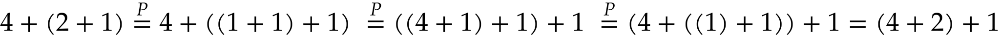. Incidentally, one can see from this that in P I should not have written “5 + (((1) + 1) + 1) = (5 + ((1) + 1)) + 1) = etc.” but gone straight to: 5 + (((1) + 1) + 1) = ((5 + 1) + 1) + 1, for the second term would again be inserted only in accordance with a rule that is justified only by the final result of the chain of equations.

### [153\[2\]](https://cdn.wittgensteinnachlass.com/2000px/webp/Ms-111/153.webp)

Incidentally, if 3, for instance, is defined as ((1) + 1) + 1, how does this sign differ from 2 + 1? For if there is no difference, then in this symbolism there is none between ((5 + 1) + 1) + 1 and 8 either. But what I want to show is that 8 then consists of 5 & 3, – –

### [153\[3\]](https://cdn.wittgensteinnachlass.com/2000px/webp/Ms-111/153.webp)

Definitions merely introduce convenient abbreviations, but we could manage without them too. But what about recursive definitions?

### [153\[4\]](https://cdn.wittgensteinnachlass.com/2000px/webp/Ms-111/153.webp)

One can call two different things an application of the rule a + (b + 1) = (a + b) + 1: 4 + (2 + 1) = (4 + 2) + 1 is an application in one sense, in the other: 4 + (2 + 1) = ((4 + 1) + 1) + 1 = (4 + 2) + 1

### [153\[5\]](https://cdn.wittgensteinnachlass.com/2000px/webp/Ms-111/153.webp)

The result of calculation A is 5 + (4 + 3) = (5 + 4) + 3, but it also has a result in another sense. Can one then express this by the equation a + (b + c) = (a + b) + c, as one can express the first by 5 + (4 + 3) = (5 + 4) + 3?

### [154\[1\]](https://cdn.wittgensteinnachlass.com/2000px/webp/Ms-111/154.webp)

Could I stipulate that “((1) + 1) + 1” should mean 2 + 1, whereas “(((1) + 1) + 1)” should mean 3? And, say, ([((1) + 1) + 1] + 1) + 1 = ((((1) + 1) + 1) + 1) + 1 etc. etc.?

### [154\[2\]](https://cdn.wittgensteinnachlass.com/2000px/webp/Ms-111/154.webp)

It is more correct to stipulate that “[(1) + 1] + 1” means 2 + 1 & “[((1) + 1) + 1]” means 3. And one then needs the rule that

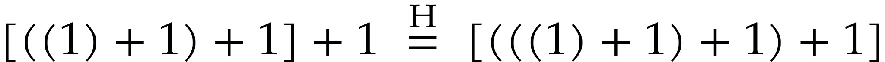.

Then one has, for example,

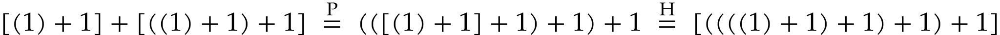

### [154\[3\]](https://cdn.wittgensteinnachlass.com/2000px/webp/Ms-111/154.webp)

28.08.1931

(It is almost unbelievable that the analysis of so simple a thing should be so difficult.)

### [154\[4\]](https://cdn.wittgensteinnachlass.com/2000px/webp/Ms-111/154.webp)

What is characteristic of a proof such as that of (a + b) ∙ (a + b) = a ∙ a + b ∙ b + 2 ∙ a ∙ b is that the letters are not broken up as the digits are in a calculation (in which the sign 5 disappears & a 4 & a 1 turn up in its place.)

### [154\[5\]](https://cdn.wittgensteinnachlass.com/2000px/webp/Ms-111/154.webp)

(The infinite difficulty is the “consideration from all sides” of the calculus.)

### [154\[6\]](https://cdn.wittgensteinnachlass.com/2000px/webp/Ms-111/154.webp)

When I say that a + (b + c) = (a + b) + c comes out of proof A, do I already have in advance a concept of what I would regard as the proof of this formula.

### [155\[1\]](https://cdn.wittgensteinnachlass.com/2000px/webp/Ms-111/155.webp)

“Every existence proof must contain a construction of what it proves to exist.” One can only say “I call only a proof that contains such a construction an existence proof”. The mistake is to think one has a clear _concept_ of an existence proof. One thinks one can prove a certain something, existence, so that one is then convinced of it _independently of the proof_. (The idea of proofs independent of one another – and therefore presumably also of what is proved!) In reality, existence is what one proves by _what_ one calls an “existence proof”. When the intuitionists & others talk about it, they say: “This state of affairs, existence, can only be proved this way & not that way.” And they do not see that they have thereby simply defined what _they_ call existence. For it is not at all like saying: “one can prove that there is a man in the room only by looking in, not by listening at the door”.

### [155\[2\]](https://cdn.wittgensteinnachlass.com/2000px/webp/Ms-111/155.webp)

We have no concept of existence independent of our concept of an existence proof.

### [156\[1\]](https://cdn.wittgensteinnachlass.com/2000px/webp/Ms-111/156.webp)

I can work out 17 + 28 by rules; I need not give 17 + 28 = 45(α) as a rule. So if the transition from f(17 + 28) to f(45) occurs in a proof, I need not say that it is made according to rule α, but according to other rules of the 1 + 1 tables.

### [156\[2\]](https://cdn.wittgensteinnachlass.com/2000px/webp/Ms-111/156.webp)

But how does this stand in the (((1) + 1) + 1) notation? Can I say that in it I can work out 2 + 3, for example? And by what rule? It would go like this:

When the numbers were written in the decimal system, there were rules, namely those for adding any two numbers from 0 to 9, & these, suitably applied, were enough for me to add any numbers. Now what rule corresponds to these elementary rules? Obviously, in a calculation like σ we need to remember fewer rules than in 17 + 28. Indeed, probably only _one_ general rule & none at all of the kind 3 + 2 = 5. On the contrary, we now seem to be able to _derive_ how much 3 + 2 is.

### [156\[3\]](https://cdn.wittgensteinnachlass.com/2000px/webp/Ms-111/156.webp),[157\[1\]](https://cdn.wittgensteinnachlass.com/2000px/webp/Ms-111/157.webp)

Incidentally, there is a certain difficulty here with the number signs (1), ((1) + 1), (((1) + 1) + 1), etc.: namely that beyond a certain length we can no longer distinguish them without counting the strokes, that is, without translating the signs into _other_ signs. One cannot distinguish “∣∣∣∣∣∣∣∣∣∣∣” and “∣∣∣∣∣∣∣∣∣∣∣” in the same sense – so they are not different signs in the same sense – as “10” & “11”. Incidentally, of course the same thing would also happen in the decimal system (think of the numbers 111111111 & 111111111), but that is not without significance. –

### [157\[2\]](https://cdn.wittgensteinnachlass.com/2000px/webp/Ms-111/157.webp)

Did we work out 45 in α in the same sense as we worked out the result in σ?

### [157\[3\]](https://cdn.wittgensteinnachlass.com/2000px/webp/Ms-111/157.webp)

It might be easier to see in a different symbolism. I write [without further explanation]:

_1, 2, 3, 4, 5, 6, 7, 8, etc._

[(1) + 2] + [((1) + 2) + 3] = ((([(1) + 2] + 1) + 1) + 1) = [((((1) + 2) + 3) + 4) + 5].

One could also have carried out the calculation like this in that case:

The problem is 2 + 3 = ? & one writes 1, 2, 3, 4, _5_, 6, 7 1, 2; 1, 2, 3

This is how children actually calculate when they “count out”. (And this calculus must be as good as any other.)

### [157\[4\]](https://cdn.wittgensteinnachlass.com/2000px/webp/Ms-111/157.webp),[158\[1\]](https://cdn.wittgensteinnachlass.com/2000px/webp/Ms-111/158.webp)

Let us imagine that someone gave us a calculation to do in stroke notation, say ∣∣∣∣∣∣∣∣∣∣∣∣∣∣

+

∣∣∣∣∣∣∣∣∣∣∣∣∣∣∣, & while we were calculating he amused himself by rubbing out & adding strokes without our noticing. He would then keep telling us “the calculation is wrong, you see” & we would go through it again and again, being made fools of all the while. Indeed, strictly speaking, without a concept of what it is for the calculation to be right. –

### [158\[2\]](https://cdn.wittgensteinnachlass.com/2000px/webp/Ms-111/158.webp)

Here one might raise questions such as: Is it then only _very probable_ that 3641 + 7986 = 11627? And is 2 + 3 = 5 therefore not also only very probable? And what is the objective truth that this probability approaches? I.e., how do we get a concept of 2 + 3 really _being_ a certain number, apart from what it _seems_ to us to be? –

### [158\[3\]](https://cdn.wittgensteinnachlass.com/2000px/webp/Ms-111/158.webp)

For if one were to ask: what is the criterion, in stroke notation, for our having the same number sign twice? – The answer might be: “If it looks the same both times”, or “if it contains the same number of strokes both times”. Or should it be: If a 1→1 correspondence etc. is possible?

### [158\[4\]](https://cdn.wittgensteinnachlass.com/2000px/webp/Ms-111/158.webp),[159\[1\]](https://cdn.wittgensteinnachlass.com/2000px/webp/Ms-111/159.webp)

One could also ask: is “” a proof of 2 + 3 = 5, or does it only show, so to speak, that 2 + 3 is 2 + 3? But surely I can say ∣∣∣∣∣ =

5, ∣∣ = 2, ∣∣∣ =

3; now I make the (geometrical) construction & thus show that 2 + 3 = 5.

### [159\[2\]](https://cdn.wittgensteinnachlass.com/2000px/webp/Ms-111/159.webp)

Or should we make the addition theorem read as follows: a + (b + 1) = (a + 1) + b … (β, and thus add like this:

((1) + 1) + (((1) + 1) + 1) = (((1) + 1) + 1) + ((1) + 1) = ((((1) + 1) + 1) + 1) + (1) = (((((1) + 1) + 1) + 1) + 1)?

### [159\[3\]](https://cdn.wittgensteinnachlass.com/2000px/webp/Ms-111/159.webp)

It is quite clear, incidentally, that the problem whether 5 + (4 + 3) = (5 + 4) + 3 can be solved _like this_:

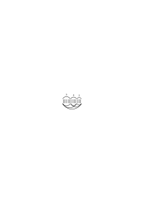

(and the drawing alone corresponds to a + (b + c) = (a + b) + c) for this construction has exactly the multiplicity of any other proof of this proposition.

### [159\[4\]](https://cdn.wittgensteinnachlass.com/2000px/webp/Ms-111/159.webp)

If I name the number after its last letter, this proves that (E + D) + C = E + (D + C) = M.

### [160\[1\]](https://cdn.wittgensteinnachlass.com/2000px/webp/Ms-111/160.webp)

This form of proof is good because it clearly shows that the result has actually been calculated & because one can nevertheless also read the general proof off it.

### [160\[2\]](https://cdn.wittgensteinnachlass.com/2000px/webp/Ms-111/160.webp)

A good admonition here – strange as it sounds – is: do not do philosophy here, but mathematics.

### [160\[3\]](https://cdn.wittgensteinnachlass.com/2000px/webp/Ms-111/160.webp)

07.09.1931

What a geometrical sentence means, what generality it has, must all become apparent when we see how it is applied. For even if someone _meant_ something incomprehensible by it, that would not help him, since he can apply it only quite openly & in a way anyone can understand.

### [160\[4\]](https://cdn.wittgensteinnachlass.com/2000px/webp/Ms-111/160.webp)

If, say, someone also imagines something mystical in connection with the king in chess, that does not concern us, for he can move it only on the 8 × 8 squares of the chessboard.

### [160\[5\]](https://cdn.wittgensteinnachlass.com/2000px/webp/Ms-111/160.webp)

Surely a + (b + 1) = (a + b) + 1 can only be an _abbreviation_ of the proof by induction.

### [160\[6\]](https://cdn.wittgensteinnachlass.com/2000px/webp/Ms-111/160.webp),[161\[1\]](https://cdn.wittgensteinnachlass.com/2000px/webp/Ms-111/161.webp)

For if need be, we would have to be able to calculate with the proofs by induction alone as units.

### [161\[2\]](https://cdn.wittgensteinnachlass.com/2000px/webp/Ms-111/161.webp)

Whatever the rule a + (b + c) = (a + b) + c justifies, the proof by induction can justify too.

### [161\[3\]](https://cdn.wittgensteinnachlass.com/2000px/webp/Ms-111/161.webp)

One cannot specify a calculation as the proof of a proposition.

### [161\[4\]](https://cdn.wittgensteinnachlass.com/2000px/webp/Ms-111/161.webp)

(I want to say): _Must_ one call this calculation the proof of the proposition a + (b + c) = (a + b) + c? I.e., will no other relation do?

### [161\[5\]](https://cdn.wittgensteinnachlass.com/2000px/webp/Ms-111/161.webp)

Even on the customary view, the proof by induction does not purport to prove a + (b + c) = (a + b) + c, but only to prove that this proposition holds for all numbers.

### [161\[6\]](https://cdn.wittgensteinnachlass.com/2000px/webp/Ms-111/161.webp)

The proof by induction seems to be _one_ unit & not to consist of the individual transitions as its units.

### [161\[7\]](https://cdn.wittgensteinnachlass.com/2000px/webp/Ms-111/161.webp),[162\[1\]](https://cdn.wittgensteinnachlass.com/2000px/webp/Ms-111/162.webp)

Thus, for instance, the result of the division 1 : 3 calculated to 2 places is 0˙33, but in this division one also sees the periodicity, & that is not a result in the same sense as the quotient 0˙33.

### [162\[2\]](https://cdn.wittgensteinnachlass.com/2000px/webp/Ms-111/162.webp)

We could quite well call the proof by induction a periodic calculation.

### [162\[3\]](https://cdn.wittgensteinnachlass.com/2000px/webp/Ms-111/162.webp)

And its result a + (b + c) = (a + b) + c would then be analogous to , whereas the end of the chain of inferences would be analogous to 0˙33.

### [162\[4\]](https://cdn.wittgensteinnachlass.com/2000px/webp/Ms-111/162.webp)

I should like to say: Surely I could not set out to find the periodicity in the calculation. – Unless I already have one & a method for generating others with its aid.

### [162\[5\]](https://cdn.wittgensteinnachlass.com/2000px/webp/Ms-111/162.webp)

One can regard the calculation as an ornament. A figure in the plane can fit with another, or it may not; it can be fitted together with others in various ways. If the figure is also coloured, then there is also a fitting in relation to the colour. (Colour is just another dimension.)

### [163\[1\]](https://cdn.wittgensteinnachlass.com/2000px/webp/Ms-111/163.webp)

To regard calculation as ornament is also formalism, but of a good kind.

### [163\[2\]](https://cdn.wittgensteinnachlass.com/2000px/webp/Ms-111/163.webp)

When I compared the sentence to a yardstick, strictly speaking I merely took a sentence that describes the length of an object with the aid of a yardstick as an example for all sentences.

### [163\[3\]](https://cdn.wittgensteinnachlass.com/2000px/webp/Ms-111/163.webp)

08.09.1931

The proposition proved is produced according to plan; the periodicity was not produced _according to plan_.

### [163\[4\]](https://cdn.wittgensteinnachlass.com/2000px/webp/Ms-111/163.webp)

In the division 1 : 3,  does not come out as opposed, say, to, say, 0˙3, but as opposed to another _period_.

### [163\[5\]](https://cdn.wittgensteinnachlass.com/2000px/webp/Ms-111/163.webp),[164\[1\]](https://cdn.wittgensteinnachlass.com/2000px/webp/Ms-111/164.webp)

Under what circumstances, then, would it be true that a + (b + c) = (a + 2b) + c rather than (a + b) + c? The following would have to hold:

1\) a + (b + 1) = (a + 2b) + 1

2\) a + (b + (c + 1)) = [a + (b + c)] + 1

3\) (a + 2b) + (c + 1) = [a + (2b + c)] + 1

But why should 1) not hold? May I not stipulate it arbitrarily? (I should like to say: One can only say that a + (b + c) = (a + b) + c stands to its induction as a + b = b + a stands to its own.)

### [164\[2\]](https://cdn.wittgensteinnachlass.com/2000px/webp/Ms-111/164.webp)

Is the main point that a + (b + (c + 1)) = [a + (b + c)] + 1 & (a + b) + (c + 1) = [(a + b) + c] + 1 do not make up the proof on their own, but only together with a + (b + 1) = (a + b) + 1?

### [164\[3\]](https://cdn.wittgensteinnachlass.com/2000px/webp/Ms-111/164.webp)

So that for this reason alone one cannot say that a + (b + c) = (a + b) + c now follows (merely) from a + (b + 1) = (a + b) + 1.

### [164\[4\]](https://cdn.wittgensteinnachlass.com/2000px/webp/Ms-111/164.webp)

12.09.1931

Is it not the case that all thinking about reality is based on induction?

### [164\[5\]](https://cdn.wittgensteinnachlass.com/2000px/webp/Ms-111/164.webp)

Learning philosophy _really_ is a recollection. We recall that we really have used the words in this way.

### [164\[6\]](https://cdn.wittgensteinnachlass.com/2000px/webp/Ms-111/164.webp),[165\[1\]](https://cdn.wittgensteinnachlass.com/2000px/webp/Ms-111/165.webp)

From expectation to fulfilment is a step in a calculation. Indeed, the calculation:

stands to its result 625 in exactly the same relation as expectation to fulfilment.

### [165\[2\]](https://cdn.wittgensteinnachlass.com/2000px/webp/Ms-111/165.webp)

And to the extent – & only to the extent – that this calculation is a picture of the result, the expectation too is a picture of the fulfilment.

### [165\[3\]](https://cdn.wittgensteinnachlass.com/2000px/webp/Ms-111/165.webp)

And to the extent that the result is determined by the calculation, the fulfilment is determined by the expectation.

### [165\[4\]](https://cdn.wittgensteinnachlass.com/2000px/webp/Ms-111/165.webp)

We expect something & act on the expectation. Must the expectation come true? No. But why do we act on the expectation? Because we are driven to do so, just as we are driven to get out of the way of a car, to sit down when we are tired & to jump up when we have sat on a thorn.

### [165\[5\]](https://cdn.wittgensteinnachlass.com/2000px/webp/Ms-111/165.webp),[166\[1\]](https://cdn.wittgensteinnachlass.com/2000px/webp/Ms-111/166.webp)

I put my hand on a plate, feel unbearable heat & quickly pull my hand away: Was it not possible that the heat of the plate would have ceased the next moment? Could I have known? And was it not possible that my very movement exposed me to pain? So in a sense it is not a good justification to say: “I pulled my hand away because the plate was too hot”!

### [166\[2\]](https://cdn.wittgensteinnachlass.com/2000px/webp/Ms-111/166.webp)

13.09.1931

And if one now asked: Are you sure you did it _for that reason_? Would one not swear that one did it for that reason alone? And yet is it not experience?

### [166\[3\]](https://cdn.wittgensteinnachlass.com/2000px/webp/Ms-111/166.webp)

“I couldn’t bear it any more (any longer)”. “I can’t bear it any more; I must pull my hand away”. But what does this pulling away consist in, if not in wishing that the hand would pull away while it actually does pull away? If it does not pull away, there is nothing we can do either. At any rate, ‘wanting to pull it away’ is an experience we can wish for but cannot bring about. Think of the experience of drawing the figure  by looking in the mirror.

### [166\[4\]](https://cdn.wittgensteinnachlass.com/2000px/webp/Ms-111/166.webp),[167\[1\]](https://cdn.wittgensteinnachlass.com/2000px/webp/Ms-111/167.webp)

When I say that I can wish for the experience of wanting, but cannot bring it about, I am back to a kind of nonsense very characteristic of epistemology. For in the sense in which I can bring anything about at all (say, stomach pains by overeating), I can also bring about wanting. (In this sense I bring about wanting to swim by jumping into deep water.) Presumably what I meant to say was: I could not want to want; i.e. it makes no sense to speak of wanting to want. And my mistaken expression arose because one wants to think of wanting as a direct non-causal bringing about. And this in turn rests on a false analogy, say, that the causal nexus is formed by a series of cogwheels (the series can fail if the mechanism is disrupted), whereas the nexus of the will corresponds, say, to that between what is inner and what is outer, or to that between the movement of the physical body and the movement of its appearance.

### [167\[2\]](https://cdn.wittgensteinnachlass.com/2000px/webp/Ms-111/167.webp),[168\[1\]](https://cdn.wittgensteinnachlass.com/2000px/webp/Ms-111/168.webp)

What is a sentence? What defines this concept? – How is this word (“sentence”) used in non-philosophical language? Sentence, in contrast to what?

### [168\[2\]](https://cdn.wittgensteinnachlass.com/2000px/webp/Ms-111/168.webp)

I know a sentence when I see one.

### [168\[3\]](https://cdn.wittgensteinnachlass.com/2000px/webp/Ms-111/168.webp)

This question is fundamental: Suppose we have a new experience, say we become acquainted with a new taste or a new stimulus to the skin; how do I know that what describes this experience is a sentence? Or, why should I call it a sentence? Well, with the same warrant as I had for speaking of a new experience. For experience & sentence are equivalent. But why did I use the word experience, in contrast to what?

### [168\[4\]](https://cdn.wittgensteinnachlass.com/2000px/webp/Ms-111/168.webp),[169\[1\]](https://cdn.wittgensteinnachlass.com/2000px/webp/Ms-111/169.webp)

Have I already characterized what happened to some extent by saying it was an experience? Apparently _not at all_. And yet it seems as if I had already done so, as if I had already said something about it: “that it was an experience”. The problem (here) lies in this false appearance. For what holds of the predicate “experience” holds of the predicate “sentence”.

### [169\[2\]](https://cdn.wittgensteinnachlass.com/2000px/webp/Ms-111/169.webp)

The word “sentence” & the word “experience” already have a determinate grammar.

### [169\[3\]](https://cdn.wittgensteinnachlass.com/2000px/webp/Ms-111/169.webp)

That is to say, their grammar must be determined in advance & does not depend on any future event.

### [169\[4\]](https://cdn.wittgensteinnachlass.com/2000px/webp/Ms-111/169.webp)

Here, too, the nonsense in the “experimental theory of meaning” is made explicit. For meaning is laid down in grammar.

### [169\[5\]](https://cdn.wittgensteinnachlass.com/2000px/webp/Ms-111/169.webp)

How does the grammar of the word “sentence” relate to the grammar of sentences?

### [169\[6\]](https://cdn.wittgensteinnachlass.com/2000px/webp/Ms-111/169.webp)

“Sentence” is evidently the heading of the grammar of sentences. In one sense, though, it is also the heading of grammar as a whole, and thus equivalent to the words “grammar” & “language”.

### [170\[1\]](https://cdn.wittgensteinnachlass.com/2000px/webp/Ms-111/170.webp)

The thinker is very like the draughtsman. Who wants to draw all the connections as they are.

### [170\[2\]](https://cdn.wittgensteinnachlass.com/2000px/webp/Ms-111/170.webp)

This is also what is meant by saying that there are surprises in the world but not in grammar.

### [170\[3\]](https://cdn.wittgensteinnachlass.com/2000px/webp/Ms-111/170.webp)

Boundary that grammar draws _visibly in_ language, & representation of a journey on the globe on the one hand, & on its projection in two circles ⚬⚬ in the plane on the other.

### [170\[4\]](https://cdn.wittgensteinnachlass.com/2000px/webp/Ms-111/170.webp)

What seems to make our question even harder is that the words “world” & “reality” are also equivalents of the word “sentence”.

### [170\[5\]](https://cdn.wittgensteinnachlass.com/2000px/webp/Ms-111/170.webp)

But it is ridiculous to want to delimit the world, or reality. What is one to set it against? And so it is with the meaning of the word “fact”. But then one does not use these words as concept-words either.

### [170\[6\]](https://cdn.wittgensteinnachlass.com/2000px/webp/Ms-111/170.webp),[171\[1\]](https://cdn.wittgensteinnachlass.com/2000px/webp/Ms-111/171.webp)

We are only concerned with what can be said. We have to do only with what can be said. That is to say: Fortunately we need not admit to any disappointments; there is nothing we try to do but cannot carry out.

### [171\[2\]](https://cdn.wittgensteinnachlass.com/2000px/webp/Ms-111/171.webp)

Something is a sentence only in a language.

### [171\[3\]](https://cdn.wittgensteinnachlass.com/2000px/webp/Ms-111/171.webp)

Now if I say: but language can expand, after all, the answer is: Certainly, but if this word “expand” has a sense here, then I must already know _now_ what I mean by it, must be able to say how I imagine such an expansion. And what I cannot think now, I cannot express now & cannot even hint at.

### [171\[4\]](https://cdn.wittgensteinnachlass.com/2000px/webp/Ms-111/171.webp)

And the word “now” here means: “in _this_ calculus”, or “when the words are used with _these_ grammatical rules”.

### [171\[6\]](https://cdn.wittgensteinnachlass.com/2000px/webp/Ms-111/171.webp),[172\[1\]](https://cdn.wittgensteinnachlass.com/2000px/webp/Ms-111/172.webp)

Here belongs the old question: “but how, then, did I arrive at this concept at all” (say, that of objects outside me). (It is a good thing to be able to look at such a question from a distance as an old movement of thought, without being entangled in it.) It is quite right to imagine this question followed by: “surely I couldn’t transcend my own thinking”, “surely I couldn’t meaningfully transcend what has sense for me”. It is the feeling that I cannot come by some back way (on the sly) to think something that I am really barred from thinking. That there are no back ways here by which I could get further than by the direct route.

### [172\[2\]](https://cdn.wittgensteinnachlass.com/2000px/webp/Ms-111/172.webp)

Here we have this nagging problem: how it is possible even to think of the existence of things when we always see only mental images – their likenesses.

### [172\[3\]](https://cdn.wittgensteinnachlass.com/2000px/webp/Ms-111/172.webp)

Of course we are dealing once again with a false analogy: It makes perfectly good sense to say “I know that he is in this room because I can hear him, even though I cannot go in & see him”.

### [172\[4\]](https://cdn.wittgensteinnachlass.com/2000px/webp/Ms-111/172.webp),[173\[1\]](https://cdn.wittgensteinnachlass.com/2000px/webp/Ms-111/173.webp)

If I accept “things are thus & so” as the general sentential form, then I must count 2 × 2 = 4 among the sentences, for it is grammatically correct to say: “things are such that 2 × 2 is 4.” Further rules are needed to exclude the sentences of arithmetic.

### [173\[2\]](https://cdn.wittgensteinnachlass.com/2000px/webp/Ms-111/173.webp)

Is it a kind of contamination of the sense that we express it in a particular language with its contingencies & not, as it were, disembodied & pure? No, for it is essential that I understand the idea of translation from one language into another.

### [VB](/w-vb/#ms-111-173.3) [173\[3\]](https://cdn.wittgensteinnachlass.com/2000px/webp/Ms-111/173.webp)

(Kleist once wrote that the poet would like nothing better than to be able to convey thoughts in themselves without words. (What a strange admission.))

### [173\[4\]](https://cdn.wittgensteinnachlass.com/2000px/webp/Ms-111/173.webp)

Is it that, after all, I am not really playing the game of chess itself, since the pieces could be different?!

### [173\[5\]](https://cdn.wittgensteinnachlass.com/2000px/webp/Ms-111/173.webp),[174\[1\]](https://cdn.wittgensteinnachlass.com/2000px/webp/Ms-111/174.webp)

Since the sense of a sentence is fixed entirely in language, & it is the sense that matters, every language is equally good. But the sense is what sentences that are mutually translatable have in common. Yet sentences can be translated into one another only within their languages. For if, for example, I translate one word into another, I make a rule for all the combinations in which the word occurs.

### [174\[2\]](https://cdn.wittgensteinnachlass.com/2000px/webp/Ms-111/174.webp)

Now what does it mean to understand the idea of translation or translatability?

### [174\[3\]](https://cdn.wittgensteinnachlass.com/2000px/webp/Ms-111/174.webp)

Here, incidentally, lies the difference between the philological & the philosophical way of looking at things.

### [174\[4\]](https://cdn.wittgensteinnachlass.com/2000px/webp/Ms-111/174.webp)

Surely it cannot mean: to know every possible translation, and thus all possible equivalent languages!

### [174\[5\]](https://cdn.wittgensteinnachlass.com/2000px/webp/Ms-111/174.webp),[175\[1\]](https://cdn.wittgensteinnachlass.com/2000px/webp/Ms-111/175.webp)

Rather, translations stand to a language as the various views or projections stand to the solid of which they are projections. If the solid is given – say, by an equation with respect to a coordinate system, then its equations with respect to every other coordinate system are given as well, since the other coordinate system, being in the same space as the first, can only be described in terms of the first. So the transformation rule is already given by the description of the second coordinate system in the language of the first.

### [175\[2\]](https://cdn.wittgensteinnachlass.com/2000px/webp/Ms-111/175.webp)

‘2 × 2 = 4’, ‘the rose is red’ etc. Why should I not write: ‘2 × 2 = 4’ & ‘the rose = red’. If it works with ‘is’, then it works with ‘ = ’ too. Certainly, but what characterizes the logical form is precisely the _stipulation_ that the sign ‘ = ’ _may_ not be used in the second combination.

### [175\[3\]](https://cdn.wittgensteinnachlass.com/2000px/webp/Ms-111/175.webp)

To grasp the meaning of the sign ‘is’ correctly even without this transfer is to perform no incorrect operations in the particular case; for example, not to substitute the words ‘the rose’ for ‘red’.

### [175\[4\]](https://cdn.wittgensteinnachlass.com/2000px/webp/Ms-111/175.webp),[176\[1\]](https://cdn.wittgensteinnachlass.com/2000px/webp/Ms-111/176.webp)

The question of extending grammar is not a serious objection to what I am saying, for I must have known what I mean by this extension within the unextended grammar. But one might indeed ask whether grammar is complete at all; or whether we can say that we know all the rules governing the application of a word. Is that supposed to mean that in every particular case I know, or can know, whether the word has been applied in accordance with the rule or not.

### [176\[2\]](https://cdn.wittgensteinnachlass.com/2000px/webp/Ms-111/176.webp)

This is one of the many places where one is (always) tempted to say more than is clear & necessary. That is, one is tempted to make an assumption.

### [176\[3\]](https://cdn.wittgensteinnachlass.com/2000px/webp/Ms-111/176.webp)

Logic as “normative”.

### [176\[4\]](https://cdn.wittgensteinnachlass.com/2000px/webp/Ms-111/176.webp)

“The sentence has sense if I mean something by it”.

### [176\[5\]](https://cdn.wittgensteinnachlass.com/2000px/webp/Ms-111/176.webp),[177\[1\]](https://cdn.wittgensteinnachlass.com/2000px/webp/Ms-111/177.webp)

Can one say: ‘I mean something by these words’, that is, they are part of a calculation.

### [177\[2\]](https://cdn.wittgensteinnachlass.com/2000px/webp/Ms-111/177.webp)

If I beckon someone over to me with my finger, is that an operation in a calculation, a thought?

### [177\[3\]](https://cdn.wittgensteinnachlass.com/2000px/webp/Ms-111/177.webp)

Now is this beckoning not on the same footing as pressing the button of a bell so that my servant will come?

### [177\[4\]](https://cdn.wittgensteinnachlass.com/2000px/webp/Ms-111/177.webp)

Searching & finding are not related in the same way as hunger & the satisfaction of hunger.

### [177\[5\]](https://cdn.wittgensteinnachlass.com/2000px/webp/Ms-111/177.webp)

Should I say: Language interests me only in so far as it is a calculus.

### [177\[6\]](https://cdn.wittgensteinnachlass.com/2000px/webp/Ms-111/177.webp)

Leave grammar as it is.

### [177\[7\]](https://cdn.wittgensteinnachlass.com/2000px/webp/Ms-111/177.webp)

But what about this: I go this way to get there, I turn on the tap to get water, I beckon so that someone will come to me & finally I communicate my wish to him so that he will fulfil it!

### [177\[8\]](https://cdn.wittgensteinnachlass.com/2000px/webp/Ms-111/177.webp),[178\[1\]](https://cdn.wittgensteinnachlass.com/2000px/webp/Ms-111/178.webp)

But what goes on when I turn on the tap _so that_ water will flow out? What happens is that I turn on the tap & then water comes out, or does not. So what happens is that I turn on the tap. – What follows the words “so that”, the intention, is not contained in that. If it is present, it must be expressed & it can already be expressed by turning on the tap only if that act is part of a language.

### [178\[2\]](https://cdn.wittgensteinnachlass.com/2000px/webp/Ms-111/178.webp)

I look for my pencil; then the intention of searching is not expressed in the movements of the search.

### [178\[3\]](https://cdn.wittgensteinnachlass.com/2000px/webp/Ms-111/178.webp)

There is in any case a particular experience: wanting to communicate something to someone. If one restricts the meaning of the word “language” to this communication, the word is perhaps clearly delimited, but otherwise one sees here the indeterminacy in the concept of ‘language’?

### [178\[4\]](https://cdn.wittgensteinnachlass.com/2000px/webp/Ms-111/178.webp),[179\[1\]](https://cdn.wittgensteinnachlass.com/2000px/webp/Ms-111/179.webp)

If I look for something, it is essential that I must be able to describe the finding just as fully (whether it occurs (ever in that way) or not) before the object is found. Now apply that to the search for the solution to a mathematical problem.

### [179\[2\]](https://cdn.wittgensteinnachlass.com/2000px/webp/Ms-111/179.webp)

One of the most dangerous ideas is, curiously, that we think with our head, or in our head.

### [179\[3\]](https://cdn.wittgensteinnachlass.com/2000px/webp/Ms-111/179.webp)

But paper & pencil are not what matters either, for I can imagine everything written down (just as I can everything spoken).

### [179\[4\]](https://cdn.wittgensteinnachlass.com/2000px/webp/Ms-111/179.webp)

The idea of a process in the head, in that completely enclosed space, lends thinking an occult quality.

### [179\[5\]](https://cdn.wittgensteinnachlass.com/2000px/webp/Ms-111/179.webp)

The grammatical rules do not hold “only in a vacuum”.

### [179\[6\]](https://cdn.wittgensteinnachlass.com/2000px/webp/Ms-111/179.webp)

Philosophy purely descriptive, & what it describes is language. I.e.: it gives no grounds.

### [179\[7\]](https://cdn.wittgensteinnachlass.com/2000px/webp/Ms-111/179.webp)

The most difficult problem seems to be the contrast, the relation, between operating with language in time & grasping the sentence in an instant.

### [179\[8\]](https://cdn.wittgensteinnachlass.com/2000px/webp/Ms-111/179.webp),[180\[1\]](https://cdn.wittgensteinnachlass.com/2000px/webp/Ms-111/180.webp)

But _when_ do we grasp or understand the sentence?! _After_ we have uttered it? – And if while we are uttering it: is the understanding an articulated process, like the forming of the sentence, or an inarticulate one? And if it is articulated: must it not be connected projectively with the other process? For otherwise its articulation would be independent of the first.

### [180\[2\]](https://cdn.wittgensteinnachlass.com/2000px/webp/Ms-111/180.webp)

One might ask: How long does it take to understand a sentence. And if one understands it for an hour, does one keep starting afresh?

### [180\[3\]](https://cdn.wittgensteinnachlass.com/2000px/webp/Ms-111/180.webp)

The ringing of the bell; the sign that something has been found.

### [180\[4\]](https://cdn.wittgensteinnachlass.com/2000px/webp/Ms-111/180.webp)

The bridge _can_ only be crossed when we get there, not before. (What is meant is the bridge between sign & reality.)

### [VB](/w-vb/#ms-111-180.5) [180\[5\]](https://cdn.wittgensteinnachlass.com/2000px/webp/Ms-111/180.webp)

[It is often said that the new religion brands the gods of the old one as devils. But in reality they have by then probably already become devils.]

### [180\[6\]](https://cdn.wittgensteinnachlass.com/2000px/webp/Ms-111/180.webp),[181\[1\]](https://cdn.wittgensteinnachlass.com/2000px/webp/Ms-111/181.webp)

If understanding is not the grasping of the sentence, it can also take place afterwards (& why not beforehand too).

### [181\[2\]](https://cdn.wittgensteinnachlass.com/2000px/webp/Ms-111/181.webp)

Understanding, as it is usually conceived, is a vague process – we are interested only in what is exact. But not because we are interested only in the “ideal” of a language, “which reality merely approaches”, but because only in this way can we grasp what is expressed in every language.

### [181\[3\]](https://cdn.wittgensteinnachlass.com/2000px/webp/Ms-111/181.webp)

But what do I say in saying “that I am interested only in what is exact”? What, then, is the inexact? What is the vague that I exclude?

### [181\[4\]](https://cdn.wittgensteinnachlass.com/2000px/webp/Ms-111/181.webp)

Is it not that I must exclude what I do not know exactly. I.e. do I not want to say that – – –

### [181\[5\]](https://cdn.wittgensteinnachlass.com/2000px/webp/Ms-111/181.webp)

Why do I say: the feelings, the moods, etc., that accompany a sentence, or follow it, or precede it, do not interest me! Because it is only the symbolic structure that interests me.

### [182\[1\]](https://cdn.wittgensteinnachlass.com/2000px/webp/Ms-111/182.webp)

Does the vague not consist in its not belonging to the symbol, in its being able to vary even when the symbol is the same?

### [182\[2\]](https://cdn.wittgensteinnachlass.com/2000px/webp/Ms-111/182.webp)

No, it is something else again: As if my only task were to say something clearly & not to hint at anything.

### [182\[3\]](https://cdn.wittgensteinnachlass.com/2000px/webp/Ms-111/182.webp)

It is almost as if I wanted to say that I am weaving a tapestry & cannot use indistinct transitions between colours there. But that is not really a good simile.

### [182\[4\]](https://cdn.wittgensteinnachlass.com/2000px/webp/Ms-111/182.webp)

Should I say: the exactness consists in our not being concerned with what is doubtful?

### [182\[5\]](https://cdn.wittgensteinnachlass.com/2000px/webp/Ms-111/182.webp)

What does our exactness consist in?

### [182\[6\]](https://cdn.wittgensteinnachlass.com/2000px/webp/Ms-111/182.webp)

Frege on psychological logic. His remarks all concern the inexactness of the psychological way of looking at things as opposed to the logical one.

### [182\[7\]](https://cdn.wittgensteinnachlass.com/2000px/webp/Ms-111/182.webp)

Can I say that I am interested only in the _content_ of the sentence? And the content of the sentence is in it.

### [183\[1\]](https://cdn.wittgensteinnachlass.com/2000px/webp/Ms-111/183.webp)

The sentence has its content as a member of the calculus.

### [183\[2\]](https://cdn.wittgensteinnachlass.com/2000px/webp/Ms-111/183.webp)

Is “understanding a sentence”, then, of the same kind as “having mastery of a calculus”? Like, then: being able to multiply? I believe it is.

### [183\[3\]](https://cdn.wittgensteinnachlass.com/2000px/webp/Ms-111/183.webp)

For is not the test of understanding always a matter of going on from the sentence?!

### [183\[4\]](https://cdn.wittgensteinnachlass.com/2000px/webp/Ms-111/183.webp)

And the response to the question “what does ‘understanding a sentence’ mean?” must be: What is the test of understanding?

### [183\[5\]](https://cdn.wittgensteinnachlass.com/2000px/webp/Ms-111/183.webp)

In asking about the general sentential form, we bear in mind that although ordinary language has a certain sentence rhythm, not everything with this rhythm is a sentence. I.e. something can _sound like a sentence_ & not be one. – Hence the idea of a ‘_sentence_’ with sense & of a nonsensical one.

### [183\[6\]](https://cdn.wittgensteinnachlass.com/2000px/webp/Ms-111/183.webp),[184\[1\]](https://cdn.wittgensteinnachlass.com/2000px/webp/Ms-111/184.webp)

On the other hand, this rhythm is of course not essential. The expression “sugar table” does not _sound_ like a sentence, but it can quite well replace the sentence “there is sugar on the table”. And not as if we had to supply something missing in our minds; rather, what matters, again, is simply the system to which the expression “sugar table” belongs.

### [184\[2\]](https://cdn.wittgensteinnachlass.com/2000px/webp/Ms-111/184.webp)

The question, then, is whether, apart from this misleading sentence sound, we have a general concept of the sentence. (I am speaking now of what is held together by ∙ , ⌵, ~.)

### [184\[3\]](https://cdn.wittgensteinnachlass.com/2000px/webp/Ms-111/184.webp)

What, then, do I distinguish a sentence from? Or what do I want to distinguish it from? From parts of a sentence within its grammatical system (as an equation is distinguished from the equals sign), or from _everything_ we do not call a sentence, such as this armchair, my watch etc., etc.? For the fact that there are written or spoken forms that are especially like sentences need not really concern us.

### [184\[4\]](https://cdn.wittgensteinnachlass.com/2000px/webp/Ms-111/184.webp),[185\[1\]](https://cdn.wittgensteinnachlass.com/2000px/webp/Ms-111/185.webp)

Or we must say: One can speak of the concept of a sentence only within a grammatical system.

### [185\[2\]](https://cdn.wittgensteinnachlass.com/2000px/webp/Ms-111/185.webp)

It is with the word “sentence” as with the word “object” & others: they are admissible only when applied within a limited sphere, & there they are natural. If the sphere is to be extended so as to make the concept a philosophical one, the meaning of the words evaporates & they are empty shadows. We must give them up there & go back to using them within their narrow bounds.

### [185\[3\]](https://cdn.wittgensteinnachlass.com/2000px/webp/Ms-111/185.webp),[186\[1\]](https://cdn.wittgensteinnachlass.com/2000px/webp/Ms-111/186.webp)

But now one would like to say: “A sentence is anything by which I mean something”. And if asked “what does it mean to mean ‘something’”, I would have to give examples. Now these examples do have a domain over which they can be extended, but they take me no _further_. Just as in logic I cannot generalize at random. But the point here is not about types; it is that the generalization itself is something determinate, namely a sign with grammatical rules determined in advance. That is, the indeterminacy of generality is not a logical indeterminacy. As if we now had not only freedom in logical space but also freedom to extend or alter that space.

### [186\[2\]](https://cdn.wittgensteinnachlass.com/2000px/webp/Ms-111/186.webp)

So not just freedom of movement, but an indeterminacy of the geometry.

### [186\[3\]](https://cdn.wittgensteinnachlass.com/2000px/webp/Ms-111/186.webp)

No sign leads us beyond itself; & no argument does either.

### [186\[4\]](https://cdn.wittgensteinnachlass.com/2000px/webp/Ms-111/186.webp),[187\[1\]](https://cdn.wittgensteinnachlass.com/2000px/webp/Ms-111/187.webp)

If we say that a sentence is any sign by which we mean something, one might ask: what do we mean & _when_ do we mean it? While we are giving the sign, etc., etc.? And here it becomes clear again that this act of meaning, if it is to be relevant, must belong to the process involving the symbol. Unless by ‘meaning’ one understood a process that had particular significance for us by virtue of its psychological or physiological character. It might be, for example, that we would say that an order had sense for us only if it produced certain muscular contractions in us, or again, if we had translated it into a language of muscular contractions. It would be as if one were to say: The sentence has sense if it acquires significance for life.

### [187\[2\]](https://cdn.wittgensteinnachlass.com/2000px/webp/Ms-111/187.webp)

If I ask “what is the general form of the sentence”, the question in reply may be: “_have_ we a general concept of the sentence, then, that we now? want to formulate precisely?” – As in: have we a general concept of reality? “Reality” – as opposed to what?

### [187\[3\]](https://cdn.wittgensteinnachlass.com/2000px/webp/Ms-111/187.webp)

Or can one say: We have a concept of the _whole_ of reality as opposed to a part of reality?

### [187\[4\]](https://cdn.wittgensteinnachlass.com/2000px/webp/Ms-111/187.webp)

The question may also be put this way: What happens when a new sentence is taken into the language: What is the criterion for its being a sentence? Or, if being taken into the language stamps it as a sentence, what does this admission consist in? Or: what is language?

### [187\[5\]](https://cdn.wittgensteinnachlass.com/2000px/webp/Ms-111/187.webp),[188\[1\]](https://cdn.wittgensteinnachlass.com/2000px/webp/Ms-111/188.webp)

Now it seems obvious here that one distinguishes giving signs _from other activities_. A person sleeps, eats, drinks, and gives signs etc.

### [188\[2\]](https://cdn.wittgensteinnachlass.com/2000px/webp/Ms-111/188.webp)

Giving signs = using a language.

### [188\[3\]](https://cdn.wittgensteinnachlass.com/2000px/webp/Ms-111/188.webp)

How does “using a language” compare with “playing a game”. For that too is one of the activities, & one that has a similarity to giving signs.

### [188\[4\]](https://cdn.wittgensteinnachlass.com/2000px/webp/Ms-111/188.webp)

So it would be as difficult to say what ‘language’ means as to say what “sport”, “game”, “cleaning” mean.

### [188\[5\]](https://cdn.wittgensteinnachlass.com/2000px/webp/Ms-111/188.webp)

So the word “language” will not occur in grammar.

### [188\[6\]](https://cdn.wittgensteinnachlass.com/2000px/webp/Ms-111/188.webp)

‘Language’ as opposed to sport, yes, – but grammar has nothing to do with that.

### [188\[7\]](https://cdn.wittgensteinnachlass.com/2000px/webp/Ms-111/188.webp)

But why do I rack my brains over the concept of ‘language’ instead of using language? This brain-racking is justified only if we _have_ a general concept.

### [188\[8\]](https://cdn.wittgensteinnachlass.com/2000px/webp/Ms-111/188.webp),[189\[1\]](https://cdn.wittgensteinnachlass.com/2000px/webp/Ms-111/189.webp)

If one said: language is anything by means of which one can communicate, then one must ask: But what does ‘communicating’ consist in? In answer I could describe a real or fictitious case of communication between people or other living beings. In this description fictitious causal connections would then play a part. But if the concept of language is determined by such connections, it does not interest us. But apart from those empirical regularities of events we then have only an arbitrary calculus left. – But what is essential to a calculus?

### [189\[2\]](https://cdn.wittgensteinnachlass.com/2000px/webp/Ms-111/189.webp)

‘Language’ & ‘living being’. The concept of a living being is as indeterminate as that of language.

### [189\[3\]](https://cdn.wittgensteinnachlass.com/2000px/webp/Ms-111/189.webp)

“Is this sentence not _perhaps_ a logical product of several sentences?” How, then, would that emerge?

### [189\[4\]](https://cdn.wittgensteinnachlass.com/2000px/webp/Ms-111/189.webp)

We adhere to the words.

### [189\[5\]](https://cdn.wittgensteinnachlass.com/2000px/webp/Ms-111/189.webp)

When we read an explanation, for instance, of logical consequence, we adhere to what he writes. We adhere to the words; to the signs.

### [190\[1\]](https://cdn.wittgensteinnachlass.com/2000px/webp/Ms-111/190.webp)

Infinity is not a magnitude, but looks like a magnitude. (That is our difficulty.)

### [190\[2\]](https://cdn.wittgensteinnachlass.com/2000px/webp/Ms-111/190.webp),[191\[1\]](https://cdn.wittgensteinnachlass.com/2000px/webp/Ms-111/191.webp)

“This landscape makes me melancholy”. How do you know it is the landscape? Is that a hypothesis – just as you only _believe_ that that food caused the stomach pains – or does it belong to immediate experience? Would it then be refuted if, transported to a different landscape, you remained melancholy; or is it not open to refutation by a future experience, because it describes the present one? Indeed, how did you come by the thought that it is the landscape that brings on this mood? Or is it not a matter at all of a state it brings about in me, but, perhaps, of the picture of the landscape _being_ melancholy? (This is directly connected with the problem: motive & cause.) “That is a dreadful sight”. – “How do you know that _it_ is dreadful?” “I tremble because I see it”. You cannot know _that_. Perhaps you would have trembled anyway. How does the fear relate to the sight? Or to the dreadful image? Or should I perhaps say: “to be afraid of this image” _means_ to have it & to be afraid? But if one has several images while one is afraid (sees or hears several things), is there any doubt as to what is dreadful? Or is it from experience that one knows what (out of all these things) one is afraid of? On the other hand, can one not separate the sight & the fear, and so say that the “sight in itself” is not dreadful? – I would also like to say “being afraid is an engagement with the sight”. Can I say that it is a very complicated process into which the image enters at quite definite points?

### [191\[2\]](https://cdn.wittgensteinnachlass.com/2000px/webp/Ms-111/191.webp)

Think of a dreadful face. What role does the sight play in the process of fear.

### [191\[3\]](https://cdn.wittgensteinnachlass.com/2000px/webp/Ms-111/191.webp),[192\[1\]](https://cdn.wittgensteinnachlass.com/2000px/webp/Ms-111/192.webp)

I want to say: fear does not _accompany_ the sight. (Rather) what is dreadful & the fear have the structure of the face. Imagine that in our agitation we follow the features of a face with our eyes. Tracing them, as it were, trembling. So that the trembling of fear would be superimposed on the lines of the face.

### [192\[2\]](https://cdn.wittgensteinnachlass.com/2000px/webp/Ms-111/192.webp),[193\[1\]](https://cdn.wittgensteinnachlass.com/2000px/webp/Ms-111/193.webp)

Imagine you were out walking with someone & engaged in conversation. Then as the conversation went on you would walk now more slowly, now faster & keep stopping here & there. Someone listening to the conversation will find these pauses in walking quite natural, since they arise directly from the life of the conversation itself. Now suppose someone were to reproduce the conversation only as to its sense (say, by translating it into another language) & one had to walk the same way again as well & the places where one stopped before were marked, then these forced pauses in walking would now be _extremely_ disruptive, though they had helped the conversation before. That is how it is with the translation of the Platonic dialogues in dialogue form. Only in the original, unique course of the conversation were the affirmative & negative replies natural & helpful resting points. In the translation they are agonizing, disruptive delays. Imagine a theme whose rhythm was reinforced by strokes on the kettledrum on the first beat of the bar & now imagine that these strokes were shifted a little! Who would not rather do without this support now.

### [193\[2\]](https://cdn.wittgensteinnachlass.com/2000px/webp/Ms-111/193.webp)

Letters at equal intervals: “I believe this letter is midway between these two”.

### [193\[3\]](https://cdn.wittgensteinnachlass.com/2000px/webp/Ms-111/193.webp)

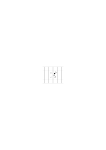

It can happen that I know a spot is in quadrilateral A because I know that it is either in quadrilateral a or in quadrilateral b or c or d. But I cannot know that it is in A _on the grounds_ that I know it is in one of all the possible positions.

### [193\[4\]](https://cdn.wittgensteinnachlass.com/2000px/webp/Ms-111/193.webp),[194\[1\]](https://cdn.wittgensteinnachlass.com/2000px/webp/Ms-111/194.webp)

“If the book is on the table, it must surely be _somewhere_ on the table” is of course senseless.

### [194\[2\]](https://cdn.wittgensteinnachlass.com/2000px/webp/Ms-111/194.webp)

“You hit the top right-hand corner”. Of what? (“Take me to № 47, I’ll tell you the street later”.) “Did I hit the black?” – “Yes, _more precisely_, in the upper half”.

### [194\[3\]](https://cdn.wittgensteinnachlass.com/2000px/webp/Ms-111/194.webp)

“Is the shot in the black?” – “Yes” – “Where is it?” – “I don’t know, I only saw that it was in the black, but not where”. – That does not correspond to the experience we mean.

### [194\[4\]](https://cdn.wittgensteinnachlass.com/2000px/webp/Ms-111/194.webp)

The circle is in the square = it is in position , or not in that position = it is in position 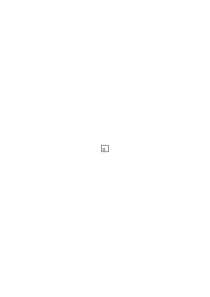, or , or in neither of these two; etc. But it cannot say “or in one of the other possible positions”.

### [VB](/w-vb/#ms-111-194.5) [194\[5\]](https://cdn.wittgensteinnachlass.com/2000px/webp/Ms-111/194.webp)

[The works of the great masters are stars that rise & set around us. So the time will come again for every great work that has now set.]

### [195\[1\]](https://cdn.wittgensteinnachlass.com/2000px/webp/Ms-111/195.webp)

It is in the square; not: “in some position or other in the square”. (In a _position_, of course.) For that makes it seem as if the _positions_ were somehow given to us. As if, for instance, they were drawn in beforehand

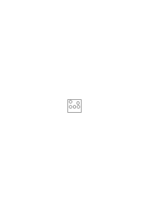.

### [195\[2\]](https://cdn.wittgensteinnachlass.com/2000px/webp/Ms-111/195.webp)

“There is no other circle in the square besides this one”.

### [VB](/w-vb/#ms-111-195.3) [195\[3\]](https://cdn.wittgensteinnachlass.com/2000px/webp/Ms-111/195.webp)

(Mendelssohn’s music, where it is perfect, consists of musical arabesques. That is why we find every lack of rigour in him painful.)

### [VB](/w-vb/#ms-111-195.4+196.1) [195\[4\]](https://cdn.wittgensteinnachlass.com/2000px/webp/Ms-111/195.webp),[196\[1\]](https://cdn.wittgensteinnachlass.com/2000px/webp/Ms-111/196.webp)

In Western civilization the Jew is always measured by standards that do not fit him. It is clear to many that the Greek thinkers were neither philosophers in the Western sense nor scientists in the Western sense, that the participants in the Olympic Games were not sportsmen & fit into no Western category. But so it is with the Jew too.

And because the words of our language appear to us to be the standards as such, we always do him an injustice. And he is now overestimated, now underestimated. Spengler is therefore right not to rank Weininger among the Western philosophers.

### [VB](/w-vb/#ms-111-196.2) [196\[2\]](https://cdn.wittgensteinnachlass.com/2000px/webp/Ms-111/196.webp)

Nothing one does can be defended conclusively. Only in relation to something else that has been fixed. I.e. no reason can be given why one should act _thus_ (or should have acted thus) other than one that says that this brings about a particular state of affairs, which in turn one must _accept_ as the goal.

### [196\[3\]](https://cdn.wittgensteinnachlass.com/2000px/webp/Ms-111/196.webp),[197\[1\]](https://cdn.wittgensteinnachlass.com/2000px/webp/Ms-111/197.webp),[198\[1\]](https://cdn.wittgensteinnachlass.com/2000px/webp/Ms-111/198.webp)

(On Engelmann’s Orpheus: I believe: Once Orpheus has returned from the underworld, having now lost Euridice, he must say nothing more in the play; for whatever he says is chatter. Only genii can still say something, namely that this is the lot of mortals & that only in another world can he be reunited with Euridice. At first I imagined the genii hovering around him as he lies asleep or unconscious. But now I think he ought not to be seen again at all, for what purpose does his figure serve once he has nothing more to say to us? I could imagine, rather, the genii (Horae) speaking as they look into the entrance to the passage. Accompanying the process of turning round with their speeches too & speaking a closing chorus while Orpheus, unseen by us, staggers towards the exit; & fleeing, frightened away by him as he now reaches the exit – but in such a way that the curtain falls before one catches sight of Orpheus. Hence it was assumed that Orpheus turns round not right at the exit but at some point in the passage. But this seems more fitting in so far as it is hard to imagine him turning round a step away from the exit. Rather, he will turn round where his anxiety is greatest, say at a slight bend in the passage. I imagine: Had he got as far as the exit, the daylight would already have dispelled his anxiety. And the sense is: he could not get as far as the exit.) (The genii know this, incidentally, & say it before he comes into their sight.)

### [198\[2\]](https://cdn.wittgensteinnachlass.com/2000px/webp/Ms-111/198.webp),[199\[1\]](https://cdn.wittgensteinnachlass.com/2000px/webp/Ms-111/199.webp),[200\[1\]](https://cdn.wittgensteinnachlass.com/2000px/webp/Ms-111/200.webp)

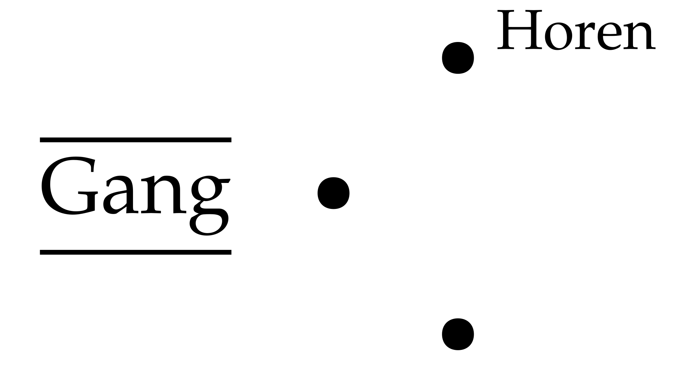

They speak the chorus facing the spectator & casting only sidelong glances, as it were, back into the passage. When I say, incidentally, “accompanying the process of turning round with their speeches”, I do not imagine it on the model of, say, a battle in a play being described by an observer keyed up with suspense. For the Horae are not keyed up but perfectly composed. And they _accompany_ the process with their speeches and do not dance around it. In that case, admittedly, the drama does not really have 5 acts. But – it seems to me – the fifth act is superfluous, for the catastrophe is already completely determined in the four. (It is as if a question had been put in such a form that it can now receive only “yes” or “no” in reply.) In the 5th act the storm would break over the hero. But here nothing breaks in; something merely reaches its conclusion. Could one say: In the 4th act the water is dammed up, in the 5th the sluice gates are now raised & the flood bursts in. So there is still room for action. One might say: but here too surely something is building up that is then released: – Of course an ever greater tension is produced in the process of temptation too, so that something is dammed up, as it were, but the hero does not perish by being destroyed by what bursts forth when he now succumbs to temptation; rather, in yielding to the pressure he is already destroyed, and so, as it were, in an instant. If Eve, say, were the heroine, the catastrophe would be the instant in which she begins to reach for the apple & not the act of plucking the fruit. If one loads a beam to breaking point, it is all over when it begins to give, for everything that follows is then already given. And if the _beam_ is the hero (& is not above the hero’s head), then the hero is destroyed when the beam _begins_ to break. “Orpheus”, of course, is not a tragedy either & Orpheus is not a hero. For the hero _triumphs_ (after all) in perishing. I.e. he is overcome not inwardly but only outwardly. (If he were overcome inwardly, he would lose our interest after the _instant_ of his downfall.

The 5th act can then only be an afterpiece.)

### [200\[2\]](https://cdn.wittgensteinnachlass.com/2000px/webp/Ms-111/200.webp)

Yes, the 5th act in Orpheus can only be an epilogue.

### [200\[3\]](https://cdn.wittgensteinnachlass.com/2000px/webp/Ms-111/200.webp)

(Is that why we feel that the turning round in Orpheus would be an undramatic action?)
