# Ms-112

21 published remarks, VB, PG II

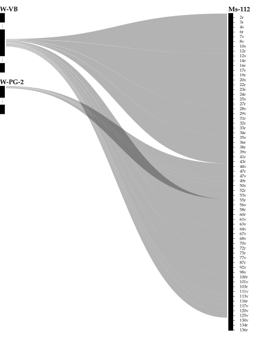

### [1r\[1\]](https://cdn.wittgensteinnachlass.com/2000px/webp/Ms-112/1r.webp)

## VIII. Remarks on Philosophical Grammar.

### [VB](/w-vb/#ms-112-1v.1) [1v\[1\]](https://cdn.wittgensteinnachlass.com/2000px/webp/Ms-112/1v.webp)

05.10.1931

(The inexpressible (what seems mysterious to me & what I am unable to express) perhaps provides the background against which what I could express acquires meaning.)

### [1v\[2\]](https://cdn.wittgensteinnachlass.com/2000px/webp/Ms-112/1v.webp)

Arithmetic _is_ not a game. After all, one cannot win or lose in arithmetic!

### [1v\[3\]](https://cdn.wittgensteinnachlass.com/2000px/webp/Ms-112/1v.webp)

An arithmetical game, however, is conceivable. E.g. two people take turns operating, according to certain rules (which restrict the choice of operations), on numbers that have arisen successively through these operations from an assumed starting number (initial position). Whoever obtains 0 in this way has won. (Such a game would be like Halma.)

### [1v\[4\]](https://cdn.wittgensteinnachlass.com/2000px/webp/Ms-112/1v.webp)

What is one denying mathematics when one says it is only a game (or: it is a game)?

### [1v\[5\]](https://cdn.wittgensteinnachlass.com/2000px/webp/Ms-112/1v.webp),[2r\[1\]](https://cdn.wittgensteinnachlass.com/2000px/webp/Ms-112/2r.webp)

A game as opposed to what? – What is one attributing to mathematics when one says that its sentences have sense.

### [2r\[2\]](https://cdn.wittgensteinnachlass.com/2000px/webp/Ms-112/2r.webp)

The sense outside the sentence.

### [2r\[3\]](https://cdn.wittgensteinnachlass.com/2000px/webp/Ms-112/2r.webp)

And what does that have to do with us? Where does it show itself & what can we do with it? (A sentence answers the question “what is the sense of this sentence?”)

### [2r\[4\]](https://cdn.wittgensteinnachlass.com/2000px/webp/Ms-112/2r.webp)

“But the math. sentence (surely) expresses a thought.” – What thought? –

### [2r\[5\]](https://cdn.wittgensteinnachlass.com/2000px/webp/Ms-112/2r.webp)

Can it be expressed by another sentence? or only by _this_ sentence? – Or not at all? In this case it is no concern of ours.

### [2r\[6\]](https://cdn.wittgensteinnachlass.com/2000px/webp/Ms-112/2r.webp)

Does one merely want to distinguish math. sentences from other formations, hypotheses etc.? One is right to do so & there is, of course, no doubt that this distinction exists.

### [2r\[7\]](https://cdn.wittgensteinnachlass.com/2000px/webp/Ms-112/2r.webp),[2v\[1\]](https://cdn.wittgensteinnachlass.com/2000px/webp/Ms-112/2v.webp)

If one means that mathematics is played like chess or a game of patience & that there is such a thing as winning or as the game coming out, then that is plainly incorrect.

### [2v\[2\]](https://cdn.wittgensteinnachlass.com/2000px/webp/Ms-112/2v.webp)

If one says that the mental processes that accompany the use of mathematical symbols are different from those that accompany a game of chess, I do not know what to say about that.

### [2v\[3\]](https://cdn.wittgensteinnachlass.com/2000px/webp/Ms-112/2v.webp)

In chess, too, there are some configurations that are impossible even though each piece occupies a position permitted to it. (For example, when the pawns are still in their starting positions & a bishop is already out.) But one could imagine a game in which the number of moves from the start of the game was recorded, & then there would be a case in which this configuration could not occur after n moves & yet one cannot tell straight off by looking at the configuration whether it is possible after the nth move or not.

### [2v\[4\]](https://cdn.wittgensteinnachlass.com/2000px/webp/Ms-112/2v.webp)

The actions in the game must correspond to the actions in calculating. (I mean: this is what the correspondence must consist in, or, this is how the two must be matched with one another.)

### [3r\[1\]](https://cdn.wittgensteinnachlass.com/2000px/webp/Ms-112/3r.webp)

Which equation, say, of the form abc… × cde… = ghi… is right, and which is wrong?

### [3r\[2\]](https://cdn.wittgensteinnachlass.com/2000px/webp/Ms-112/3r.webp)

Indeed, can one say of the written sign (at all) that it is right (or wrong)? For that is connected with the sense of the answer: “the equation one can generate according to the rules is right”, as opposed to _this one_: “the equation one has generated according to the rules is right”.

### [3r\[3\]](https://cdn.wittgensteinnachlass.com/2000px/webp/Ms-112/3r.webp)

It is clear that the position (equation) is right or wrong only in the system in which it can be generated.

### [3r\[4\]](https://cdn.wittgensteinnachlass.com/2000px/webp/Ms-112/3r.webp)

“One must not use a system of axioms before its consistency has been demonstrated.” “There must be no contradictions in the rules of a game”. Why not? “Because then one would not know how to play”?

### [3r\[5\]](https://cdn.wittgensteinnachlass.com/2000px/webp/Ms-112/3r.webp)

But how does it come about that one reacts to the contradiction with doubt?

### [3v\[1\]](https://cdn.wittgensteinnachlass.com/2000px/webp/Ms-112/3v.webp)

One does not react to the contradiction at all. One could only say: If that is really what is meant (if the contradiction is _meant_ to be here), then I don’t understand it. Or: I haven’t learnt it. I don’t understand the signs. I haven’t learnt what I am to do in response, whether it is an order at all; etc..

### [3v\[2\]](https://cdn.wittgensteinnachlass.com/2000px/webp/Ms-112/3v.webp)

What if, for example, one wanted to add the equation 2 × 2 = 5 to the usual axioms of arithmetic? That would of course mean that the equals sign had now changed its meaning, i.e., that different rules would now hold for the equals sign.

### [3v\[3\]](https://cdn.wittgensteinnachlass.com/2000px/webp/Ms-112/3v.webp)

Hilbert puts forward the rules of a particular calculus as rules of a metamathematics.

### [3v\[4\]](https://cdn.wittgensteinnachlass.com/2000px/webp/Ms-112/3v.webp),[4r\[1\]](https://cdn.wittgensteinnachlass.com/2000px/webp/Ms-112/4r.webp)

Now if I said: “so I cannot use it as a substitution sign; that would mean that its grammar no longer accords with that of the word “substitute” (“substitution sign”, etc.). For the word “can” in this sentence does not indicate a physical (physiological, psychological) possibility.

### [4r\[2\]](https://cdn.wittgensteinnachlass.com/2000px/webp/Ms-112/4r.webp)

“The rules must not contradict one another”, that is like: “negation must not yield a negation when doubled”. For it is part of the grammar of the word “rule” that “p ∙ ~p” (if “p” is a rule) is not a rule.

### [4r\[3\]](https://cdn.wittgensteinnachlass.com/2000px/webp/Ms-112/4r.webp)

That is, one could also say: the rules can contradict one another if different rules hold for the word “rule” – if the word “rule” has a different meaning.

### [4r\[4\]](https://cdn.wittgensteinnachlass.com/2000px/webp/Ms-112/4r.webp),[4v\[1\]](https://cdn.wittgensteinnachlass.com/2000px/webp/Ms-112/4v.webp)

Here too we cannot give a justification (except (say) biologically or historically) &

### [4v\[2\]](https://cdn.wittgensteinnachlass.com/2000px/webp/Ms-112/4v.webp)

To assign equation A to complex B is to say

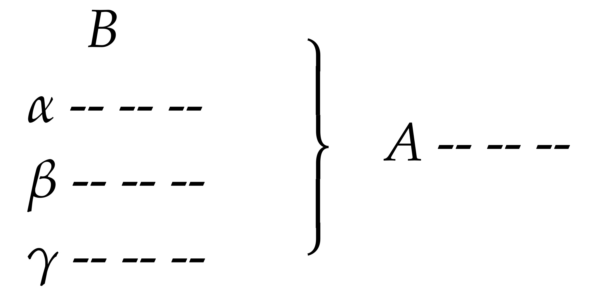

that an equation of the kind A has the multiplicity that one sees in complex B, i.e., that one can distinguish as much in this equation (or make as many distinctions (in it)) as in the complex.

### [4v\[3\]](https://cdn.wittgensteinnachlass.com/2000px/webp/Ms-112/4v.webp)

I.e., that the pattern of the complex has as many fitting surfaces as that of the equation & the rest of the complex’s multiplicity drops out as does that of the pentagon,

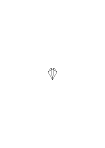

so that, as far as its fitting together with other figures is concerned, one could replace it by its outline alone & the

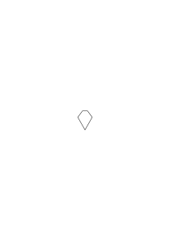

equation in this sense traces the outline of the complex.

### [4v\[4\]](https://cdn.wittgensteinnachlass.com/2000px/webp/Ms-112/4v.webp)

One could put the equals sign between B & A.

### [4v\[5\]](https://cdn.wittgensteinnachlass.com/2000px/webp/Ms-112/4v.webp),[5r\[1\]](https://cdn.wittgensteinnachlass.com/2000px/webp/Ms-112/5r.webp)

Is it like this: the proposition A contains nothing other than B; indeed, it is an abbreviation of B. But surely I cannot say that B was proved by means of a + (b + 1) = (a + b) + 1 … α. Of course that means nothing at all. – Only β and γ were proved using α. –

### [5r\[2\]](https://cdn.wittgensteinnachlass.com/2000px/webp/Ms-112/5r.webp)

And α, β & γ were simply put together. They were picked out & something new was constructed from them.

### [5r\[3\]](https://cdn.wittgensteinnachlass.com/2000px/webp/Ms-112/5r.webp)

It cannot be shown, proved, that one _can_ use certain rules as rules of this action. Except by showing that the grammar of the designation of the action accords with that of those rules.

### [5r\[4\]](https://cdn.wittgensteinnachlass.com/2000px/webp/Ms-112/5r.webp),[5v\[1\]](https://cdn.wittgensteinnachlass.com/2000px/webp/Ms-112/5v.webp)

On the problem of the ‘heap of sand’: here, as in all similar cases, one could imagine an official concept, say: a heap is anything larger than ½ m³. But this would still not be the concept we ordinarily use. There is no boundary for that concept (& if we lay one down, we change the concept); there are only cases that we count as falling under the concept & cases that we no longer count as falling under the concept.

### [5v\[2\]](https://cdn.wittgensteinnachlass.com/2000px/webp/Ms-112/5v.webp)

(a + b) ∙ (a + b) = a ∙ (a + b) + b ∙ (a + b) This transition was made by means of the proposition ‥‥ &, if proof by induction is a justification of this proposition, then it is also a justification of this transition.

### [5v\[3\]](https://cdn.wittgensteinnachlass.com/2000px/webp/Ms-112/5v.webp)

(Full stop at the end of the sentence. Feeling of incompleteness when it is missing.)

### [5v\[4\]](https://cdn.wittgensteinnachlass.com/2000px/webp/Ms-112/5v.webp)

How does one prove: 1 + (1 + (1 + 1)) = (1 + (1 + 1 + )) + 1? Can one prove it from 1 + (1 + 1) = (1 + 1) + 1 alone?

### [5v\[5\]](https://cdn.wittgensteinnachlass.com/2000px/webp/Ms-112/5v.webp)

06.10.1931

The proof B shows us, as it were, a property of the two sides of equation A.

### [5v\[6\]](https://cdn.wittgensteinnachlass.com/2000px/webp/Ms-112/5v.webp),[6r\[1\]](https://cdn.wittgensteinnachlass.com/2000px/webp/Ms-112/6r.webp)

When I consider the equations

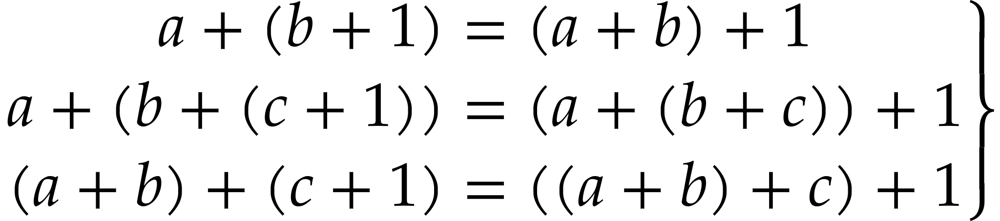

I want to say: everything lies in them; no further step gives us more than is already there. On the other hand, one does look at them _in a certain way_ when one takes them as a proof by induction, but that only says that we see in them what we indicate, e.g., by underlining certain expressions or by drawing lines of correspondence between the equations. And these lines are merely new fitting surfaces that slot the complex of equations into a new system.

### [6r\[2\]](https://cdn.wittgensteinnachlass.com/2000px/webp/Ms-112/6r.webp),[6v\[1\]](https://cdn.wittgensteinnachlass.com/2000px/webp/Ms-112/6v.webp)

One usually says that recursive proofs prove that algebraic equations hold for all cardinal numbers; but what matters here for the moment is not whether this expression is well or ill chosen, but only whether it has the same meaning in all cases.

### [6v\[2\]](https://cdn.wittgensteinnachlass.com/2000px/webp/Ms-112/6v.webp)

Extending a concept, the concept of number, the concept ‘all’, etc., strikes us as (quite) harmless; but it is not if we forget that we have actually changed our concept.

### [6v\[3\]](https://cdn.wittgensteinnachlass.com/2000px/webp/Ms-112/6v.webp)

And isn’t it clear, then, that recursive proofs do in fact show _the same thing_ for all the equations ‘proved’?

### [6v\[4\]](https://cdn.wittgensteinnachlass.com/2000px/webp/Ms-112/6v.webp)

And that surely means that the same (internal) relation always obtains between the recursive proof & the proposition it proves?

### [6v\[5\]](https://cdn.wittgensteinnachlass.com/2000px/webp/Ms-112/6v.webp)

Why, then, the reluctance to call this relation that of a proof to what is proved?

### [6v\[6\]](https://cdn.wittgensteinnachlass.com/2000px/webp/Ms-112/6v.webp),[7r\[1\]](https://cdn.wittgensteinnachlass.com/2000px/webp/Ms-112/7r.webp)

Yes, it is quite clear, incidentally, that there must be such a recursive or rather iterative ‘proof’. (One that enables us to see that ‘it must go like this with all numbers’.) [I.e. it seems clear to _me_, & that I could make the correctness of these propositions for the cardinal numbers intelligible to someone else by a process of iteration.]

### [7r\[2\]](https://cdn.wittgensteinnachlass.com/2000px/webp/Ms-112/7r.webp)

I.e.: I want to show someone that the distributive law really lies in the nature of number; won’t I then try to show by a process of iteration that the law holds & must go on holding?

### [7r\[3\]](https://cdn.wittgensteinnachlass.com/2000px/webp/Ms-112/7r.webp)

And in what sense can one not call this procedure the proof of the distributive law?

### [7r\[4\]](https://cdn.wittgensteinnachlass.com/2000px/webp/Ms-112/7r.webp)

Do I only want to state that one cannot arrive at a result “a + (b + c) = (a + b) + c” by the procedure of iteration, because the constituents of this proposition do not occur in that calculation?

### [7r\[5\]](https://cdn.wittgensteinnachlass.com/2000px/webp/Ms-112/7r.webp),[7v\[1\]](https://cdn.wittgensteinnachlass.com/2000px/webp/Ms-112/7v.webp)

07.10.1931

Could I not, then, make a + (b + c) = (a + b) + c intelligible to him by a demonstration with ones, in the same way as I can make 16 × 25 = 400 intelligible, say, by writing out 16 ones in 25 rows? Are the proofs not now on the same footing?

### [7v\[2\]](https://cdn.wittgensteinnachlass.com/2000px/webp/Ms-112/7v.webp),[7v\[3\]](https://cdn.wittgensteinnachlass.com/2000px/webp/Ms-112/7v.webp)

And this concept of ‘making intelligible’ can really help us here. For one could say: the criterion of whether something is a proof of a proposition is whether one can make it intelligible by that means. (Of course, this is again only a matter of extending our grammatical considerations about the word ‘proof’; not of taking a psychological interest in the process of making intelligible.)

### [7v\[4\]](https://cdn.wittgensteinnachlass.com/2000px/webp/Ms-112/7v.webp)

One could make a kind of construction:

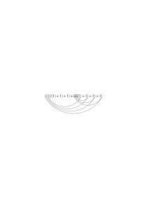

by repeatedly crossing out brackets before the second summand & putting them before the first.

### [7v\[5\]](https://cdn.wittgensteinnachlass.com/2000px/webp/Ms-112/7v.webp),[8r\[1\]](https://cdn.wittgensteinnachlass.com/2000px/webp/Ms-112/8r.webp)

“This proposition is proved for all numbers by the recursive procedure”. That is the expression that is so ‘thoroughly’ misleading. It sounds as though a proposition stating that such & such holds for all cardinal numbers were here established as true by some route & as though this route were one in a space of conceivable routes. Whereas in reality the recursion shows only itself, as does the periodicity.

### [8r\[2\]](https://cdn.wittgensteinnachlass.com/2000px/webp/Ms-112/8r.webp)

I want to show someone that this (a + (b + c) = (a + b) + c) is right. What I can use as a method of showing this is a proof. (E.g. the method of grouping a series of strokes.)

### [8r\[3\]](https://cdn.wittgensteinnachlass.com/2000px/webp/Ms-112/8r.webp)

Is the question not, then: Can one verify 4 + (2 + 3) = (4 + 2) + 3 by calculation? If so, then one could give a proof of this particular numerical proposition & it is clear that a ‘possibility of continuing’ a series of such proofs will then present itself.

### [8r\[4\]](https://cdn.wittgensteinnachlass.com/2000px/webp/Ms-112/8r.webp)

Calculating according to the schema of the recursive proof would evidently consist in going first from 4 + (2 + 1) = (4 + 2) + 1 to 4 + (2 + 2) = (4 + 2) + 2 & then to 4 + (2 + 3) = (4 + 2) + 3.

### [8r\[5\]](https://cdn.wittgensteinnachlass.com/2000px/webp/Ms-112/8r.webp),[8v\[1\]](https://cdn.wittgensteinnachlass.com/2000px/webp/Ms-112/8v.webp)

It must make the position of the recursive proof carried out algebraically much clearer if one puts in its place the series of arithmetical proofs with the ‘etc.’. For the former can evidently be replaced by this series.

### [8v\[2\]](https://cdn.wittgensteinnachlass.com/2000px/webp/Ms-112/8v.webp)

(And the greater clarity comes from the disappearance of any semblance that the recursive proof is an algebraic proof of the kind (a + b)² = ..... = a² + 2ab + b².)

### [8v\[3\]](https://cdn.wittgensteinnachlass.com/2000px/webp/Ms-112/8v.webp)

(The transition to 4 + (2 + 2) = (4 + 2) + 2 would go as follows (according to Skolem’s schema): 4 + (2 + 2) = 4 + ((2 + 1) + 1) = (4 + (2 + 1)) + 1 = ((4 + 2) + 1) + 1 = (4 + 2) + 2.)

### [8v\[4\]](https://cdn.wittgensteinnachlass.com/2000px/webp/Ms-112/8v.webp)

Can I not say that proof by induction is the schema of a calculation. –

### [8v\[5\]](https://cdn.wittgensteinnachlass.com/2000px/webp/Ms-112/8v.webp)

The problem of distinguishing 1 + 1 + 1 + 1 + 1 + 1 + 1 and 1 + 1 + 1 + 1 + 1 + 1 + 1 + 1 is much more important than it seems at first. What is at issue is the difference between physical & visual number.

### [8v\[6\]](https://cdn.wittgensteinnachlass.com/2000px/webp/Ms-112/8v.webp),[9r\[1\]](https://cdn.wittgensteinnachlass.com/2000px/webp/Ms-112/9r.webp)

There is also something odd about the calculation that takes us from 3 + (4 + 6) to (3 + 4) + 6. For we can carry out the calculation according to a rule in _one_ step, & – which comes to the same thing – we know in advance what the result of this calculation will be. And not in the sense in which we might also know the result of 25 × 37 in advance because we once worked it out & remembered it, but rather we do not need the more complicated reasoning because a simpler one gets us there. But isn’t this like the way we also know that 4365 is divisible by 5 without setting out the division, & yet it would have to be proved that the 5 in the units place is a criterion of divisibility by 5.

### [9r\[2\]](https://cdn.wittgensteinnachlass.com/2000px/webp/Ms-112/9r.webp)

What we are dealing with (here) again, of course, is that proof by recursion is taken as _a kind of proof_ & one does not see that the word “proof” has now changed its meaning (because its grammar has changed).

### [9r\[3\]](https://cdn.wittgensteinnachlass.com/2000px/webp/Ms-112/9r.webp),[9v\[1\]](https://cdn.wittgensteinnachlass.com/2000px/webp/Ms-112/9v.webp)

Am I merely taking such sharp issue with the view that the recursive proofs start us on the way, prove the fundamental laws, & the route now continues with these; whereas every proposition of algebra can surely be proved recursively if the fundamental laws can (be).

### [9v\[2\]](https://cdn.wittgensteinnachlass.com/2000px/webp/Ms-112/9v.webp)

And could I not say that the irreducibility of the fundamental laws (commutative, distributive, etc.) must show itself in the corresponding inductions too?!

### [9v\[3\]](https://cdn.wittgensteinnachlass.com/2000px/webp/Ms-112/9v.webp)

The relation that obtains between the algebraic propositions must also obtain between their proofs by induction.

### [9v\[4\]](https://cdn.wittgensteinnachlass.com/2000px/webp/Ms-112/9v.webp)

So what we have here is not a case in which a group of fundamental laws is proved from one with fewer members, while everything further on in the proofs remains the same. (Just as in a system of fundamental concepts nothing in the subsequent development is changed by reducing the number of fundamental concepts by means of definitions.)

### [9v\[5\]](https://cdn.wittgensteinnachlass.com/2000px/webp/Ms-112/9v.webp),[10r\[1\]](https://cdn.wittgensteinnachlass.com/2000px/webp/Ms-112/10r.webp)

08.10.1931

(Incidentally, what a suspicious analogy between ‘fundamental laws’ & ‘fundamental concepts’!)

### [10r\[2\]](https://cdn.wittgensteinnachlass.com/2000px/webp/Ms-112/10r.webp)

It is as if things stood like this: ordinarily the proof of an old fundamental law (simply) extends the system of proofs backwards. But proofs by recursion do not extend the system of algebraic proofs (with the old fundamental laws) backwards; they are a new system which only seems to run parallel to the first.

### [10r\[3\]](https://cdn.wittgensteinnachlass.com/2000px/webp/Ms-112/10r.webp),[10v\[1\]](https://cdn.wittgensteinnachlass.com/2000px/webp/Ms-112/10v.webp)

I spoke earlier of connecting lines, underlinings, etc. to show the corresponding, homologous parts of the equations in a recursive proof. In the proof:

a + (b + 1) = (a + b) + 1

a + (b + (c + 1)) = a + ((b + c) + 1) = (a + (b + c)) + 1

(a + b) + (c + 1) = ((a + b) + c) + 1

for example, the 1 marked α corresponds not to β but to the c of the next equation. β, however, corresponds not to δ but to ε, & γ not to δ but to c + δ. etc.

Or in:

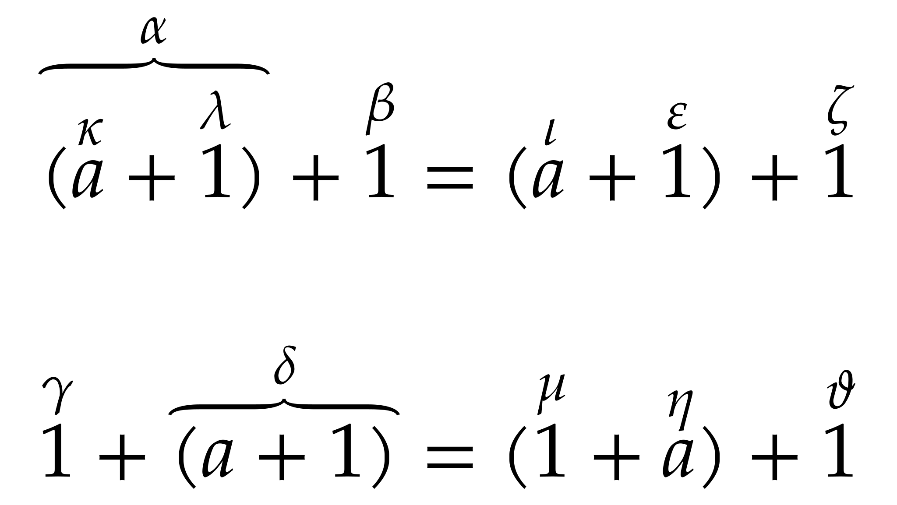

ι does not correspond to κ & ε to λ, but ι to α & ε to β & not β to ζ but ζ to ϑ & α to δ & β to γ & γ to μ but not to ϑ etc.

### [10v\[2\]](https://cdn.wittgensteinnachlass.com/2000px/webp/Ms-112/10v.webp)

It is a curious remark that the inductive proofs of the fundamental rules must still display their irreducibility. What if one said that in the case of ordinary proofs (or definitions), that is, in the case where the fundamental rules are reduced further, where a new affinity between them is found (or constructed)?

### [10v\[3\]](https://cdn.wittgensteinnachlass.com/2000px/webp/Ms-112/10v.webp)

(All philosophy can do is destroy idols. And that means not creating a new one (say, in the absence of the idols).)

### [10v\[4\]](https://cdn.wittgensteinnachlass.com/2000px/webp/Ms-112/10v.webp)

If I am right that proofs by recursion leave irreducibility intact, then that is (presumably) all I wanted to say against the concept of a recursive “proof”.

### [11r\[1\]](https://cdn.wittgensteinnachlass.com/2000px/webp/Ms-112/11r.webp)

I want to say: we proved β & γ by means of α, but not B. But can’t we say that B is simply the logical product of α, β & γ?? So B = α ∙ β ∙ γ?

### [11r\[2\]](https://cdn.wittgensteinnachlass.com/2000px/webp/Ms-112/11r.webp)

Then the distributive law would read – only written somewhat awkwardly –: “a + (b + 1) = (a + b) + 1 ․ & ․ a + (b + (c + 1)) = (a + (b + c + ))1 ․ & ․ (a + b) + (c + 1) = ((a + b) + c) + 1”? But why then not just “a + (b + 1) = (a + b) + 1”, since the other two factors follow from this equation?

### [11r\[3\]](https://cdn.wittgensteinnachlass.com/2000px/webp/Ms-112/11r.webp)

(Mathematicians, when they gather the foundations of their science, resemble a bricklayer who said: for a house I need bricks, mortar, conscientiousness, strength & firmness.)

### [11r\[4\]](https://cdn.wittgensteinnachlass.com/2000px/webp/Ms-112/11r.webp)

(The style of my sentences is extraordinarily strongly influenced by Frege. And if I wanted to, I could probably point out this influence where no one would see it at first glance.)

### [11r\[5\]](https://cdn.wittgensteinnachlass.com/2000px/webp/Ms-112/11r.webp),[11v\[1\]](https://cdn.wittgensteinnachlass.com/2000px/webp/Ms-112/11v.webp)

The reason why all philosophies of mathematics go wrong is that in logic one cannot justify general dicta by examples, as one can in natural history. Instead, each particular case has the greatest possible significance, & on the other hand it exhausts everything & one cannot draw a more general conclusion from it (hence _no_ conclusion).

### [11v\[2\]](https://cdn.wittgensteinnachlass.com/2000px/webp/Ms-112/11v.webp)

What, then, do we need the commutative law for? Surely not in order to be able to write down the equation 4 + 6 = 6 + 4, for this equation is justified by its own particular proof. And of course the proof of the commutative law can also be used as its proof, but in that case it is (here) a particular (arithmetical) proof. So I need the law in order to operate with letters in accordance with it.

### [11v\[3\]](https://cdn.wittgensteinnachlass.com/2000px/webp/Ms-112/11v.webp),[12r\[1\]](https://cdn.wittgensteinnachlass.com/2000px/webp/Ms-112/12r.webp)

But haven’t I made a mistake after all? I thought that for the proposition (a + b)² = a² + 2ab + b² there must be the algebraic proof & a recursive one. But the course of the algebraic proof of (a + b)² = a² + 2ab + b² corresponds exactly to the proof of (b + 1) + a = (b + a) + 1 in proof by induction III.

### [12r\[2\]](https://cdn.wittgensteinnachlass.com/2000px/webp/Ms-112/12r.webp)

This transition is made using the finished (proved) proposition a + (b + c) = (a + b) + c.

### [12r\[3\]](https://cdn.wittgensteinnachlass.com/2000px/webp/Ms-112/12r.webp)

The recursive proof of (a + b)² = a² + 2ab + b² consists precisely in the ordinary derivation of the equation plus the recursive proofs of the fundamental laws. I.e., what corresponds to the proof of this equation by means of the series of arithmetical examples is precisely the algebraic derivation of the equation together with the proofs by induction of the fundamental rules of algebra.

### [12r\[4\]](https://cdn.wittgensteinnachlass.com/2000px/webp/Ms-112/12r.webp)

‘… we go by their _deeds_’ (refers to the mathematicians).

### [12r\[5\]](https://cdn.wittgensteinnachlass.com/2000px/webp/Ms-112/12r.webp)

I must also not forget that there is a certain _route_ through Skolem’s proofs: the third depends on the first & second, makes use of the first. (So it comes essentially _after_ the first.) etc.

### [12r\[6\]](https://cdn.wittgensteinnachlass.com/2000px/webp/Ms-112/12r.webp),[12v\[1\]](https://cdn.wittgensteinnachlass.com/2000px/webp/Ms-112/12v.webp)

And proof by induction cannot give me that entitlement [I wanted to say].

### [12v\[2\]](https://cdn.wittgensteinnachlass.com/2000px/webp/Ms-112/12v.webp)

What is it supposed to mean that the complex of equations in I _justifies_ the transition in III. How can it do that?

### [12v\[3\]](https://cdn.wittgensteinnachlass.com/2000px/webp/Ms-112/12v.webp)

09.10.1931

How proof I is applied in III must show itself when we carry out the proofs as periodic arithmetical proofs.

### [12v\[4\]](https://cdn.wittgensteinnachlass.com/2000px/webp/Ms-112/12v.webp)

But one thing is clear: if proof by recursion gives us the right to calculate algebraically, so does the arithmetical proof.

### [12v\[5\]](https://cdn.wittgensteinnachlass.com/2000px/webp/Ms-112/12v.webp)

But the question is, do I calculate algebraically (horizontally) differently in III with I & II than in I with the definition a + (b + 1) = (a + b) + 1? Don’t I use complex I in III in the same way as I use the recursive definition in I?

### [12v\[6\]](https://cdn.wittgensteinnachlass.com/2000px/webp/Ms-112/12v.webp)

[It is incredible that one should be able to occupy oneself for so long with so simple a proof.]

### [12v\[7\]](https://cdn.wittgensteinnachlass.com/2000px/webp/Ms-112/12v.webp)

(The whole thing is a confrontation between the recursive & the algebraic element in these proofs.)

### [13r\[1\]](https://cdn.wittgensteinnachlass.com/2000px/webp/Ms-112/13r.webp)

For the recursive definition seems to play a double role. Namely as a recursive definition & as a rule of algebraic calculation (of the kind exemplified by the associative law.)

### [13r\[2\]](https://cdn.wittgensteinnachlass.com/2000px/webp/Ms-112/13r.webp)

Can one try to beat the wrong time to a tune? Or: how does trying in this case compare with trying to lift a weight that is too heavy for us?

### [13r\[3\]](https://cdn.wittgensteinnachlass.com/2000px/webp/Ms-112/13r.webp)

I have never read an observation about the fact that if one closes one eye & “sees only with one eye”, one does not see the darkness at the same time with the closed eye! That is very remarkable!

### [13r\[4\]](https://cdn.wittgensteinnachlass.com/2000px/webp/Ms-112/13r.webp)

How is a chess exercise related to a game of chess? For it is clear that a chess exercise corresponds to an exercise in calculation, is an exercise in calculation.

### [13r\[5\]](https://cdn.wittgensteinnachlass.com/2000px/webp/Ms-112/13r.webp),[13v\[1\]](https://cdn.wittgensteinnachlass.com/2000px/webp/Ms-112/13v.webp)

An arithmetical game would be, for example, the following: We write down a 4-digit number at random, say 7368; one is to approach this number by multiplying the numbers 7, 3, 6 & 8 together in any order. The players calculate with pencil on paper & whoever gets that close to 7368 in the fewest operations wins. (Incidentally, a great many of the mathematical puzzles popular today can be turned into games of this sort.)

### [13v\[2\]](https://cdn.wittgensteinnachlass.com/2000px/webp/Ms-112/13v.webp)

Suppose someone had been taught arithmetic only for use in an arithmetical game. Would he have learnt differently from someone who learns arithmetic for normal use? And if he now multiplies 21 by 8 in the game & gets 168, is he doing something different from someone who wanted to find out what 21 × 8 is?

### [13v\[3\]](https://cdn.wittgensteinnachlass.com/2000px/webp/Ms-112/13v.webp)

One will say: One of them wanted to find a truth, after all, whereas the other wanted nothing of the kind.

### [13v\[4\]](https://cdn.wittgensteinnachlass.com/2000px/webp/Ms-112/13v.webp),[14r\[1\]](https://cdn.wittgensteinnachlass.com/2000px/webp/Ms-112/14r.webp)

Now one might want to compare this case, say, with that of a game of tennis, in which the player makes a particular movement, the ball then travels in a particular way, & one can take this stroke merely as an experiment by which one has learnt a particular truth, or else as a move in the game with the sole aim of winning it.

### [14r\[2\]](https://cdn.wittgensteinnachlass.com/2000px/webp/Ms-112/14r.webp)

But this comparison would not be right, for we do not see the chess move as an experiment (though we could do that _too_), but as an action in a calculation.

### [14r\[3\]](https://cdn.wittgensteinnachlass.com/2000px/webp/Ms-112/14r.webp)

Someone might perhaps say: In the arithm. game we shall indeed multiply 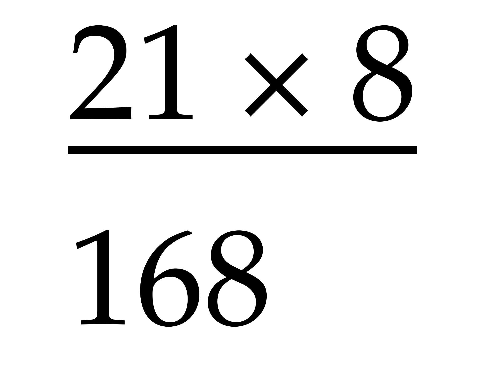, but the equation 21 × 8 = 168 will not occur in the game. But is that not a superficial difference? And why should we not also multiply (& certainly divide) in such a way that the equation is written down as such.

### [14r\[4\]](https://cdn.wittgensteinnachlass.com/2000px/webp/Ms-112/14r.webp),[14v\[1\]](https://cdn.wittgensteinnachlass.com/2000px/webp/Ms-112/14v.webp)

So one can only object that in the game the equation is not a proposition. But what does that mean? What, then, makes it a proposition? What still has to be added for it to become a proposition? – Is it not a question of the application of the equation (or of the multiplication)? – And presumably it is mathematics when it is used to pass from one proposition to another. And so the distinguishing feature between mathematics & a game would be tied to the concept of a proposition (not a math. proposition) & hence loses its immediate relevance for us.

### [14v\[2\]](https://cdn.wittgensteinnachlass.com/2000px/webp/Ms-112/14v.webp)

But one might say that the real difference is that there is no place for affirmation & negation in the game. One multiplies in it, for example, & 21 × 8 = 148 would be an incorrect move, but 21 × 8 ≠ 148, which is a correct arithmetical proposition, would have no place in our game.

### [14v\[3\]](https://cdn.wittgensteinnachlass.com/2000px/webp/Ms-112/14v.webp)

Here one might recall that at primary school one never works with inequalities; the child is required only to carry out the multiplication correctly & never or very rarely to state an inequality.

### [14v\[4\]](https://cdn.wittgensteinnachlass.com/2000px/webp/Ms-112/14v.webp),[15r\[1\]](https://cdn.wittgensteinnachlass.com/2000px/webp/Ms-112/15r.webp)

When I work out 21 × 8 in our game, & when I do so in order to solve a practical problem, at any rate the act of calculation is the same in both cases (& room could be made for inequalities in a game too). On the other hand, the rest of my behaviour with respect to the calculation is certainly different in the two cases. Now the question is: can one say of the person who has arrived at the position “21 × 8 = 168” in the game that he has found out that 21 × 8 = 168? And what is he lacking for that? I think nothing is lacking, unless it is an application of the calculation.

### [15r\[2\]](https://cdn.wittgensteinnachlass.com/2000px/webp/Ms-112/15r.webp)

To call arithmetic a game is just as wrong as to call moving chess pieces about (in accordance with the rules of chess) a game, for that can also be a calculation.

### [15r\[3\]](https://cdn.wittgensteinnachlass.com/2000px/webp/Ms-112/15r.webp),[15v\[1\]](https://cdn.wittgensteinnachlass.com/2000px/webp/Ms-112/15v.webp)

So one would have to say: No, the word “arithmetic” is not the name of a game. (Of course, another triviality.) – But the meaning of the word “arithmetic” can be explained by the relation of arithmetic to an arithmetical game or also by the relation of a chess problem to the game of chess. Here, however, it is _essential_ to recognize that this relation is not that of a tennis problem to the game of tennis. By “tennis problem” I mean, for example, the task of returning a ball in a particular direction under given circumstances. (A clearer case, perhaps, would be a billiards problem.) The billiards problem is not a mathematical problem (though mathematics can be necessary to solve it). The billiards problem is a problem in physics & hence a ‘problem’ in the sense of physics; the chess problem is a mathematical problem & hence a ‘problem’ in a different (the mathematical) sense.

### [15v\[2\]](https://cdn.wittgensteinnachlass.com/2000px/webp/Ms-112/15v.webp)

In the struggle between ‘formalism’ & ‘contentual mathematics’, what does each side actually assert? This dispute is so like the one between realism & idealism! For example, in that it will soon have become obsolete & that both sides, contrary to their daily practice, make unjust assertions.

### [15v\[3\]](https://cdn.wittgensteinnachlass.com/2000px/webp/Ms-112/15v.webp),[16r\[1\]](https://cdn.wittgensteinnachlass.com/2000px/webp/Ms-112/16r.webp)

10.10.1931

Arithmetic _is_ not a game; it would never have occurred to anyone to list arithmetic among the games people play.

### [16r\[2\]](https://cdn.wittgensteinnachlass.com/2000px/webp/Ms-112/16r.webp)

What, then, does winning & losing a game consist in (or a game of patience coming out)? Obviously not in the configuration that produces a win, for example. Who wins has to be laid down by a separate rule. (Draughts & losing draughts differ only in this rule.)

### [16r\[3\]](https://cdn.wittgensteinnachlass.com/2000px/webp/Ms-112/16r.webp)

Does the rule that says “whoever gets his pieces into the other player’s territory first has won” state anything? How could that be verified? How do I know whether someone has won? By the fact that he is pleased, perhaps?

### [16r\[4\]](https://cdn.wittgensteinnachlass.com/2000px/webp/Ms-112/16r.webp)

Presumably this rule says: You must try to get your pieces as quickly as possible etc..

### [16r\[5\]](https://cdn.wittgensteinnachlass.com/2000px/webp/Ms-112/16r.webp),[16v\[1\]](https://cdn.wittgensteinnachlass.com/2000px/webp/Ms-112/16v.webp)

In this form the rule already connects the game with life. And one could imagine that in a primary school where playing chess was a compulsory subject, the teacher’s reaction to a pupil’s playing badly would be the same as to an exercise in calculation done incorrectly.

### [16v\[2\]](https://cdn.wittgensteinnachlass.com/2000px/webp/Ms-112/16v.webp)

I am almost inclined to say: In a game there is (admittedly) no ‘true’ & ‘false’, but then in arithmetic there is no ‘winning’ & ‘losing’.

### [16v\[3\]](https://cdn.wittgensteinnachlass.com/2000px/webp/Ms-112/16v.webp)

I once said that it was conceivable for wars between peoples to be fought out on a sort of large chessboard according to the rules of chess. But: If it really did go solely by the rules of chess, then one would not need a battlefield for this war; it could be played on an ordinary board. And then it would (of course) not be a war in the ordinary sense. But one could also imagine a battle governed by the rules of chess. In such a way, for example, that the ‘bishop’ would be allowed to fight the ‘queen’, to attack her, only if his position relative to her would allow him to ‘take’ her in chess.

### [16v\[4\]](https://cdn.wittgensteinnachlass.com/2000px/webp/Ms-112/16v.webp)

Examples in logic must always be worked out in full.

### [17r\[1\]](https://cdn.wittgensteinnachlass.com/2000px/webp/Ms-112/17r.webp)

(It might then be laid down, for example, that in this case the fight between bishop & queen may only be conducted in such a way that the bishop attacks & the queen merely parries. If he kills her, that corresponds to “taking” in chess; if he does not succeed, he must make another move. etc..)

### [17r\[2\]](https://cdn.wittgensteinnachlass.com/2000px/webp/Ms-112/17r.webp)

What I really wanted to say was: What makes a game a game is its place in life. But is that true?

### [17r\[3\]](https://cdn.wittgensteinnachlass.com/2000px/webp/Ms-112/17r.webp)

I.e.: could one imagine a game of chess being played, i.e. imagine all the moves in the game being carried out, but _in a different setting_, so that this proceeding would not now be called an instance of playing a game?

### [17r\[4\]](https://cdn.wittgensteinnachlass.com/2000px/webp/Ms-112/17r.webp)

Certainly, it could, after all, be a _problem_ that the two of them are solving together. (And it is easy, in light of the foregoing, to construct a case in which such a problem would be useful.)

### [17r\[5\]](https://cdn.wittgensteinnachlass.com/2000px/webp/Ms-112/17r.webp)

The rule about winning & losing really only distinguishes two poles. What (then) becomes of the person who wins (or loses) is really no concern of the rule’s. Whether, for example, the loser then has to pay something.)

### [17v\[1\]](https://cdn.wittgensteinnachlass.com/2000px/webp/Ms-112/17v.webp)

(And the situation, it seems to us after all, is (after all) similar with ‘correct’ & ‘incorrect’ in calculation.)

### [17v\[2\]](https://cdn.wittgensteinnachlass.com/2000px/webp/Ms-112/17v.webp)

Could someone not try to work out a few integrals in the evening instead of playing patience. One could imagine him somehow letting chance set him the problem & then trying to solve it by certain methods. If he succeeds, the game of patience has come out.

### [17v\[3\]](https://cdn.wittgensteinnachlass.com/2000px/webp/Ms-112/17v.webp),[18r\[1\]](https://cdn.wittgensteinnachlass.com/2000px/webp/Ms-112/18r.webp)

The confusion concerning the “actual infinite” comes from the unclear concept of an irrational number. That is, it comes from calling the most logically diverse constructions “irrational numbers” without clearly delimiting the concept. The illusion that one has a fixed concept arises from believing that in signs of the kind “0˙a b c d … ad inf.” one has a standard to which they (the irrational numbers) must in any case correspond.

### [18r\[2\]](https://cdn.wittgensteinnachlass.com/2000px/webp/Ms-112/18r.webp)

From III:

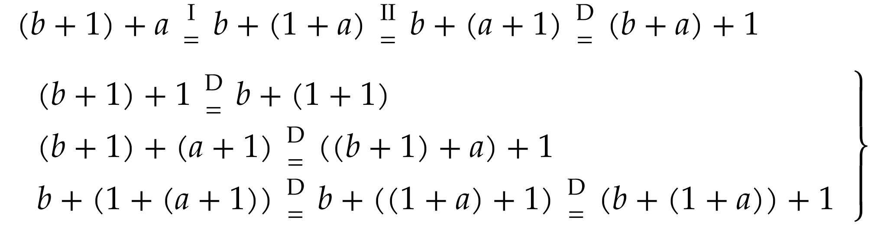

i.e. there is an arithmetical periodic proof here.

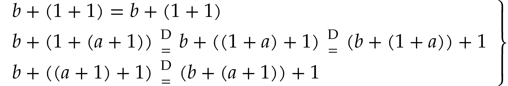

### [18r\[3\]](https://cdn.wittgensteinnachlass.com/2000px/webp/Ms-112/18r.webp)

For when we “_construe_ the complex recursively”, we do nothing other than think through a portion of the arithmetical series of equations.

### [18r\[4\]](https://cdn.wittgensteinnachlass.com/2000px/webp/Ms-112/18r.webp),[18v\[1\]](https://cdn.wittgensteinnachlass.com/2000px/webp/Ms-112/18v.webp)

11.10.1931

What happened in the dispute over the nature of definition happens time and again in logic. If one says that definition has to do only with signs & merely replaces a complicated sign with a simpler one, people object & say that definition does not _only_ do that, or that there are, after all, different kinds of definition & the interesting & important one is not the pure “verbal definition”. For they believe that one deprives definition of its meaning, its importance, if one presents it as a mere rule of substitution that deals with signs. Whereas the _meaning_ of definition lies in its application, in its importance in life, as it were. And that is just what is going on today in the dispute between formalism, intuitionism etc. People find it impossible to distinguish the importance of a thing, its consequences, its application, from the thing itself; the description of a thing from the description of its importance.

### [18v\[2\]](https://cdn.wittgensteinnachlass.com/2000px/webp/Ms-112/18v.webp)

Time and again we hear in this way that the mathematician works by instinct (or, say, that he does not (proceed) mechanically in the manner of a chess player, but we do not learn what this is supposed to have to do with the nature of mathematics. And if such a mental phenomenon plays a role in mathematics, how far we can speak exactly about mathematics at all, & how far we can do so only with the kind of indeterminacy with which we have to speak about instincts etc.

### [18v\[3\]](https://cdn.wittgensteinnachlass.com/2000px/webp/Ms-112/18v.webp),[19r\[1\]](https://cdn.wittgensteinnachlass.com/2000px/webp/Ms-112/19r.webp)

Time and again I want to say: _I_ check the mathematicians’ _ledgers_; the mental processes of the proprietors, important though they are, do not concern me.

### [19r\[2\]](https://cdn.wittgensteinnachlass.com/2000px/webp/Ms-112/19r.webp)

People are caught in the net of language & do not know it.

### [19r\[3\]](https://cdn.wittgensteinnachlass.com/2000px/webp/Ms-112/19r.webp)

Or again: proof by recursion is – evidently – essentially concerned with numbers. But what have they to do with me if I want to operate purely algebraically? Or: proof by recursion is of use only if I want to use it to justify a transition in a numerical calculation.

### [19r\[4\]](https://cdn.wittgensteinnachlass.com/2000px/webp/Ms-112/19r.webp)

But one could now ask: So do we need _both: not only_ proof by induction _but also_ the associative law, since the latter cannot justify transitions in numerical calculation, & the former cannot justify transformations in algebra?

### [19r\[5\]](https://cdn.wittgensteinnachlass.com/2000px/webp/Ms-112/19r.webp),[19v\[1\]](https://cdn.wittgensteinnachlass.com/2000px/webp/Ms-112/19v.webp)

Well, did one (then) accept the associative law – say – before Skolem’s proofs without being able to justify the corresponding transition in a numerical calculation by calculation. I.e.: was one previously unable to work out 5 + (4 + 3) = (5 + 4) + 3, and did one instead regard it as an axiom?

### [19v\[2\]](https://cdn.wittgensteinnachlass.com/2000px/webp/Ms-112/19v.webp)

Mathematicians go astray only when they want to speak about calculi in general, & that is because they then forget the particular stipulations that serve as the foundations of each particular calculus.

### [19v\[3\]](https://cdn.wittgensteinnachlass.com/2000px/webp/Ms-112/19v.webp)

I should say: The ‘proof’ B stands for a series of proofs. Is the expression (or part of the expression) of a law by which proofs can be formed. – When I say “part of the expression”, the rest is the instruction for understanding the recursive proof (which consists in forming some members of the series of proofs).

### [19v\[4\]](https://cdn.wittgensteinnachlass.com/2000px/webp/Ms-112/19v.webp)

Can one say that this series of proofs is ‘a proof’? Can one call it that?

### [20r\[1\]](https://cdn.wittgensteinnachlass.com/2000px/webp/Ms-112/20r.webp)

Could one say that a + (b + c) = (a + b) + c also stands for a series of equations?

### [20r\[2\]](https://cdn.wittgensteinnachlass.com/2000px/webp/Ms-112/20r.webp)

One could of course imagine a portion of such a series of equations written down (with dots) & regard it as the correlate of a (corresponding) portion of the series of proofs. And then say in a figurative sense that the one series is _the proof_ of the other.

### [20r\[3\]](https://cdn.wittgensteinnachlass.com/2000px/webp/Ms-112/20r.webp)

[] Is not proof B a proof of A in (precisely) the same sense as

a series

(a + b)² = – – –

(a + b)³ = – – –

(a + b)⁴ = – – –

can be regarded as a proof

of a formula 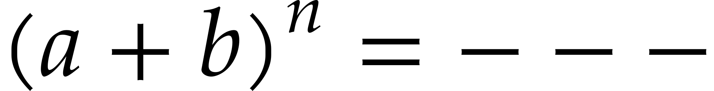. I work out the individual powers, see a law in these calculations & express it generally in the formula with n. I would never hesitate to call that a proof of the algebraic formula. And do we not have the same case here as with A & B?

### [20r\[4\]](https://cdn.wittgensteinnachlass.com/2000px/webp/Ms-112/20r.webp),[20v\[1\]](https://cdn.wittgensteinnachlass.com/2000px/webp/Ms-112/20v.webp)

Or is the decisive difference for me that we have no recursion here?

### [20v\[2\]](https://cdn.wittgensteinnachlass.com/2000px/webp/Ms-112/20v.webp)

I only bring the calculation suggested above into shape when I write it down more clearly like this: (a + b)² = f(2); but by the rules of multiplication f(n) ∙ (a + b) = f(n + 1), thus:

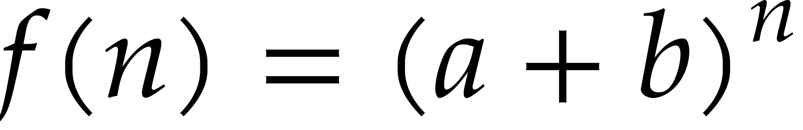. And here we have the recursive proof.

### [20v\[3\]](https://cdn.wittgensteinnachlass.com/2000px/webp/Ms-112/20v.webp)

Suppose _this_ were the case: we could say: “by the rules of addition a + (b + (c + 1)) = (a + b) + (c + 1), but besides that a + (b + 1) = (a + b) + 1, thus ‥‥‥”.

### [20v\[4\]](https://cdn.wittgensteinnachlass.com/2000px/webp/Ms-112/20v.webp)

But is that not essentially the same as: By the rules of addition (namely: a + (b + 1) = (a + b) + 1), a + (b + (c + 1)) = (a + (b + c)) + 1 and (a + b) + (c + 1) = ((a + b) + c) + 1, thus ‥‥․.

### [20v\[5\]](https://cdn.wittgensteinnachlass.com/2000px/webp/Ms-112/20v.webp),[21r\[1\]](https://cdn.wittgensteinnachlass.com/2000px/webp/Ms-112/21r.webp)

So I seem to have been beaten all along the line. If I must now retreat, the question is: what is the right line of retreat? (For it is part of the method of philosophy that I must never take flight. I.e. there must be no disorderly retreat.)

### [21r\[2\]](https://cdn.wittgensteinnachlass.com/2000px/webp/Ms-112/21r.webp),[21v\[1\]](https://cdn.wittgensteinnachlass.com/2000px/webp/Ms-112/21v.webp)

On the indirect proof that a straight line has only _one_ continuation beyond a point: We assumed that a straight line could have two continuations. – If we assume this, the assumption must have a sense –. But what does it mean to assume this? It does not mean making an assumption that is false as a matter of natural history, such as that a lion has two tails. – It does not mean assuming something that runs counter to the statement of a fact. Rather, it means adopting a rule & there is nothing further to be said against it, except perhaps that it contradicts another & that I therefore drop it. Now if a straight line that forks is drawn in the proof, that must not be absurd in & of itself, & all I can say is: I don’t call that a straight line.

### [21v\[2\]](https://cdn.wittgensteinnachlass.com/2000px/webp/Ms-112/21v.webp)

If a contradiction is found later, then the rules were not yet clear & unambiguous before. So the contradiction does no harm, for it can then be removed by stating a rule.

### [21v\[3\]](https://cdn.wittgensteinnachlass.com/2000px/webp/Ms-112/21v.webp)

In a completely clarified system [with a clear grammar] there is no hidden contradiction, for there the rule by which a contradiction is to be found must be given. The contradiction can be hidden only in the sense that it is concealed, as it were, in the disorder of the rules, in the part of the grammar not yet put in order; but there it does no harm, since it can be removed by putting the grammar in order.

### [21v\[4\]](https://cdn.wittgensteinnachlass.com/2000px/webp/Ms-112/21v.webp)

Why must rules not contradict one another? Because otherwise they would not be rules.

### [21v\[5\]](https://cdn.wittgensteinnachlass.com/2000px/webp/Ms-112/21v.webp)

At the very least I must say that whatever objection applies to proof B also applies, for example, to the proof of the formula 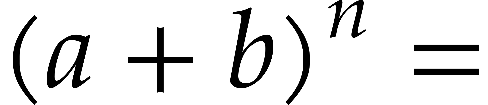 etc.

### [22r\[1\]](https://cdn.wittgensteinnachlass.com/2000px/webp/Ms-112/22r.webp)

Here too, I would then have to say, I am only adopting an algebraic rule in agreement with the inductions of arithmetic.

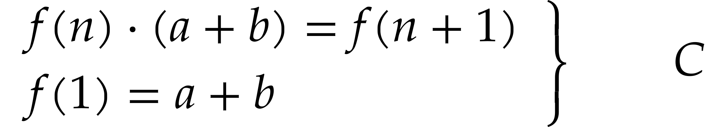

thus: f(1) ∙ (a + b) = (a + b)² = f(2)

thus: f(2) ∙ (a + b) = (a + b)³ = f(3) etc.

So far it is clear. But now:

_thus_ 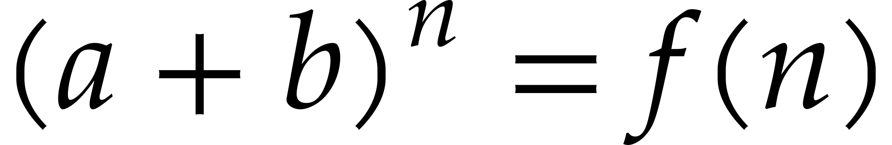!?

_**ε**_

Has a further inference been drawn here? Is there still something to state here?

### [22r\[2\]](https://cdn.wittgensteinnachlass.com/2000px/webp/Ms-112/22r.webp)

12.10.1931

But if someone showed me [→ the formula .)] , I would ask: how did one arrive at it? And the answer would surely be C. So isn’t C a proof of _ε_?

### [22r\[3\]](https://cdn.wittgensteinnachlass.com/2000px/webp/Ms-112/22r.webp)

Or does C rather answer the question “what does _ε mean_”?

### [22r\[4\]](https://cdn.wittgensteinnachlass.com/2000px/webp/Ms-112/22r.webp),[22v\[1\]](https://cdn.wittgensteinnachlass.com/2000px/webp/Ms-112/22v.webp)

Am I not resisting an analogy with a case in which one infers a general proposition (but not a mathematical one) in apparently the same way? But what analogy is it? I mean an (analogous) case in which what corresponds to induction in our case really does lead further, to the statement of a fact. Namely, that now all the objects (in question) certainly have this property.

### [22v\[2\]](https://cdn.wittgensteinnachlass.com/2000px/webp/Ms-112/22v.webp)

This is, I believe, simply the case where a particular group of objects is in question & the process of induction takes us from one to the next & as far as the last, & we can say _at the end_: thus this holds of all these objects. When I say that the process of induction here leads further, to the statement of a fact, that means that the mere possibility of induction is not yet all there is to it here, but that with its help I infer something that is not given in it alone.

### [22v\[3\]](https://cdn.wittgensteinnachlass.com/2000px/webp/Ms-112/22v.webp)

What I want to say is: here everything has already been dealt with by the induction.

### [22v\[4\]](https://cdn.wittgensteinnachlass.com/2000px/webp/Ms-112/22v.webp),[23r\[1\]](https://cdn.wittgensteinnachlass.com/2000px/webp/Ms-112/23r.webp)

I said that I laid down an algebraic rule for signs “in agreement” with the laws of arithmetic. But must I not (already) have a general concept of this agreement? And so I do after all obtain the algebraic proposition from the arithmetical propositions according to certain rules. And does that not mean proving it?

### [23r\[2\]](https://cdn.wittgensteinnachlass.com/2000px/webp/Ms-112/23r.webp)

14.10.1931

As I practise philosophy, its whole task is to shape the expression so that certain uneasinesses disappear.

### [23r\[3\]](https://cdn.wittgensteinnachlass.com/2000px/webp/Ms-112/23r.webp)

In the proof of the proposition the proposition must occur (at the end).

### [23r\[4\]](https://cdn.wittgensteinnachlass.com/2000px/webp/Ms-112/23r.webp)

But where does proposition A occur in the proof by induction. Unless we include it in the proof: But in accordance with what proposition was this last transition then made?

### [23r\[5\]](https://cdn.wittgensteinnachlass.com/2000px/webp/Ms-112/23r.webp)

If I say that periodic numerical calculation proves the proposition that entitles me to make those transitions, how would that proposition have gone if one had assumed it as an axiom & not proved it?

### [23r\[6\]](https://cdn.wittgensteinnachlass.com/2000px/webp/Ms-112/23r.webp),[23v\[1\]](https://cdn.wittgensteinnachlass.com/2000px/webp/Ms-112/23v.webp)

How would the proposition have gone in accordance with which I would have set down 5 + (7 + 9) = (5 + 7) + 9 without being able to prove it? Surely it is evident that there never was such a proposition.

### [23v\[2\]](https://cdn.wittgensteinnachlass.com/2000px/webp/Ms-112/23v.webp)

But if the complex is not a proof, what role does it play at all then? How is it used?

### [23v\[3\]](https://cdn.wittgensteinnachlass.com/2000px/webp/Ms-112/23v.webp)

Yes, it is a proof, a general proof – or the (general) schema of a proof for *numerical* sentences of the form a + (b + c) = (a + b) + c.

### [23v\[4\]](https://cdn.wittgensteinnachlass.com/2000px/webp/Ms-112/23v.webp)

Yes, construed as a proof by recursion, the complex is the general schema of proofs.

### [23v\[5\]](https://cdn.wittgensteinnachlass.com/2000px/webp/Ms-112/23v.webp)

I can only take this

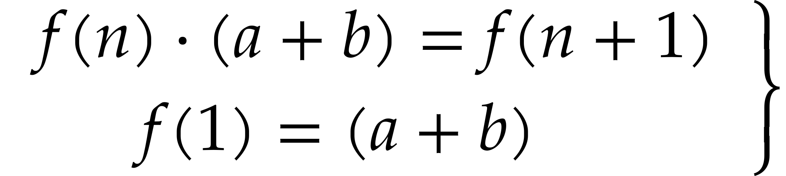

& construe it as .

### [23v\[6\]](https://cdn.wittgensteinnachlass.com/2000px/webp/Ms-112/23v.webp)

But how, then, is the equation  used? Obviously as a rule of transformation. (As when I come across f(x!) & can then, by virtue of the equation _ε_, write 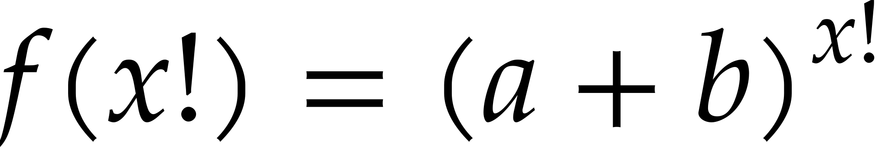.)

### [23v\[7\]](https://cdn.wittgensteinnachlass.com/2000px/webp/Ms-112/23v.webp)

But could the induction alone do the same for me here? Would I then have to use a different symbolism altogether?

### [VB](/w-vb/#ms-112-24r.1) [24r\[1\]](https://cdn.wittgensteinnachlass.com/2000px/webp/Ms-112/24r.webp)

Work in philosophy is – as work in architecture often is – really more a matter of working on oneself. On one’s own conception. On how one sees things. (And on what one demands of them.)

### [24r\[2\]](https://cdn.wittgensteinnachlass.com/2000px/webp/Ms-112/24r.webp)

Absurd as it sounds, I should like to call C a justification of _ε_, not a proof.

### [24r\[3\]](https://cdn.wittgensteinnachlass.com/2000px/webp/Ms-112/24r.webp)

A philosophical problem is always of the form: “I simply don’t know my way around.”

### [24r\[4\]](https://cdn.wittgensteinnachlass.com/2000px/webp/Ms-112/24r.webp)

Certainly, if _ε_ can function as a rule of substitution & _ε_ follows from C alone, then C must also be able to function as a rule of substitution, i.e. as a justification of the substitution.

### [24r\[5\]](https://cdn.wittgensteinnachlass.com/2000px/webp/Ms-112/24r.webp)

_Seeing_ C as _ε_.

That must – in my opinion – be possible.

### [24r\[6\]](https://cdn.wittgensteinnachlass.com/2000px/webp/Ms-112/24r.webp),[24v\[1\]](https://cdn.wittgensteinnachlass.com/2000px/webp/Ms-112/24v.webp)

Don’t I mean the following: One could replace the whole of algebra with a calculus using arithmetical induction series. But then calculation would fall into two parts: calculating with numerals by transforming equations, for example, and seeing inductions & calculating with them. And these two parts would remain separate, & calculating with the rule α, for example, could not blur the boundaries. (As calculating with x/y, for example, blurs the boundaries between ⌵ and ~.)

### [24v\[2\]](https://cdn.wittgensteinnachlass.com/2000px/webp/Ms-112/24v.webp)

Incidentally, if I say “seeing inductions”, why not say “designating inductions” instead? Is induction essentially something hidden? And isn’t highlighting the induction (what I see in the complex of equations) simply the formation of a sign like any other?

### [24v\[3\]](https://cdn.wittgensteinnachlass.com/2000px/webp/Ms-112/24v.webp)

I say, for example, that I must see the periodicity in 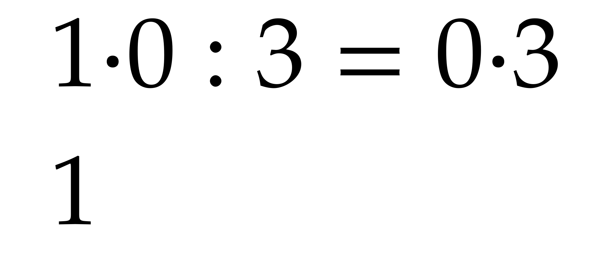. But doesn’t that mean that I am now simply using the sign “” according to new rules? And if I now _highlight_ the periodicity by writing: “”, then this is now – I want to say – really a new sign.

### [24v\[4\]](https://cdn.wittgensteinnachlass.com/2000px/webp/Ms-112/24v.webp),[25r\[1\]](https://cdn.wittgensteinnachlass.com/2000px/webp/Ms-112/25r.webp)

For if someone says (for instance) “surely one has always seen what these lines highlight”, I say: one could see it in the expression  or not; and one saw a different sign accordingly.

---

### [25r\[2\]](https://cdn.wittgensteinnachlass.com/2000px/webp/Ms-112/25r.webp)

But what about a calculation like (5 + 3)² = (5 + 3) ∙ (5 + 3) = 5 ∙ (5 + 3) + 3 ∙ (5 + 3) = 5 ∙ 5 + 5 ∙ 3 + 3 ∙ 5 + 3 ∙ 3 = 5² + 2 ∙ 5 ∙ 3 + 3² – – – R) in which we can also see a general rule for squaring (a binomial)?

### [25r\[3\]](https://cdn.wittgensteinnachlass.com/2000px/webp/Ms-112/25r.webp)

We can construe this calculation arithmetically & algebraically, so to speak.

### [25r\[4\]](https://cdn.wittgensteinnachlass.com/2000px/webp/Ms-112/25r.webp),[25v\[1\]](https://cdn.wittgensteinnachlass.com/2000px/webp/Ms-112/25v.webp)

And this difference in construal would come to light if, for example, the example had been

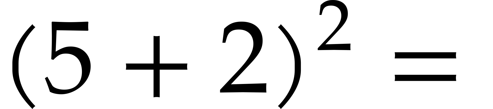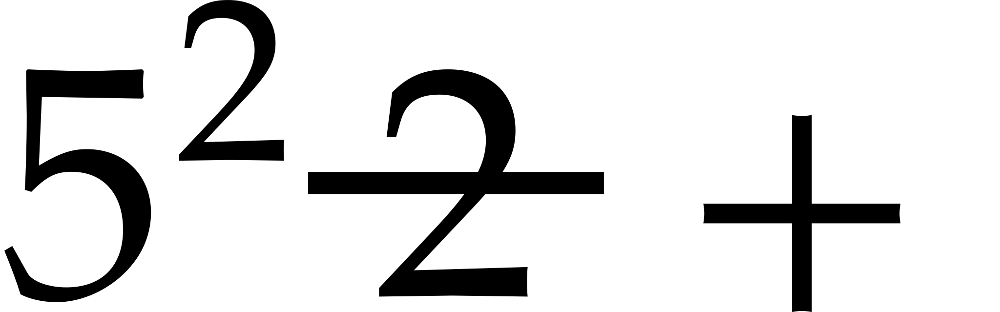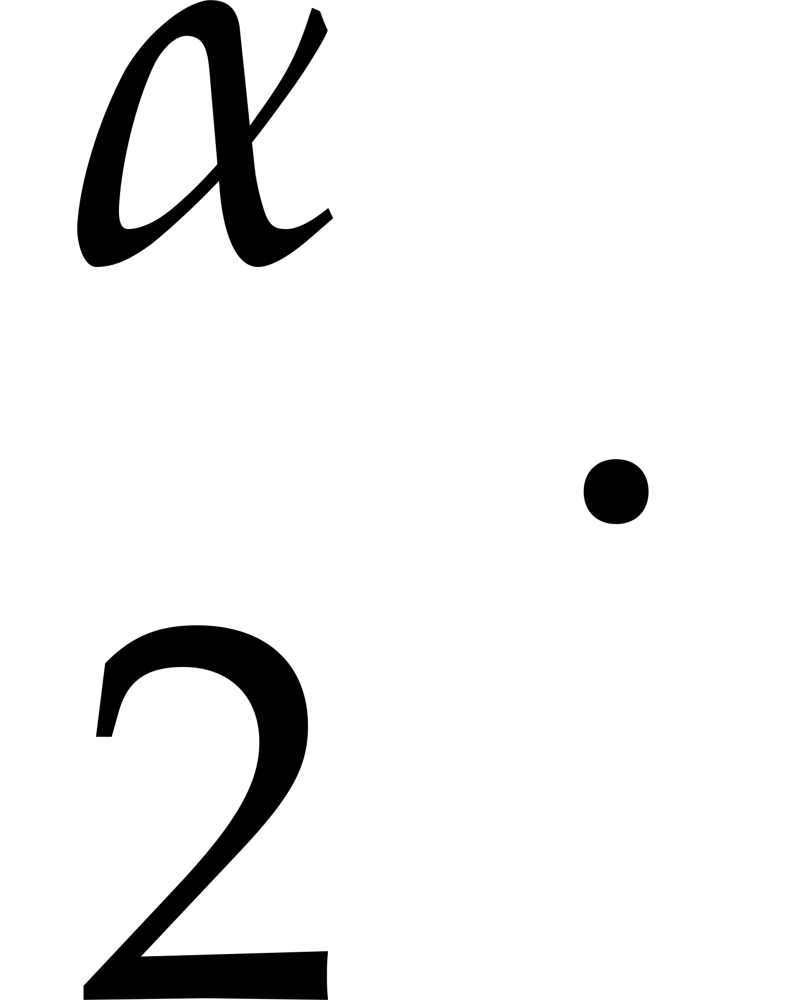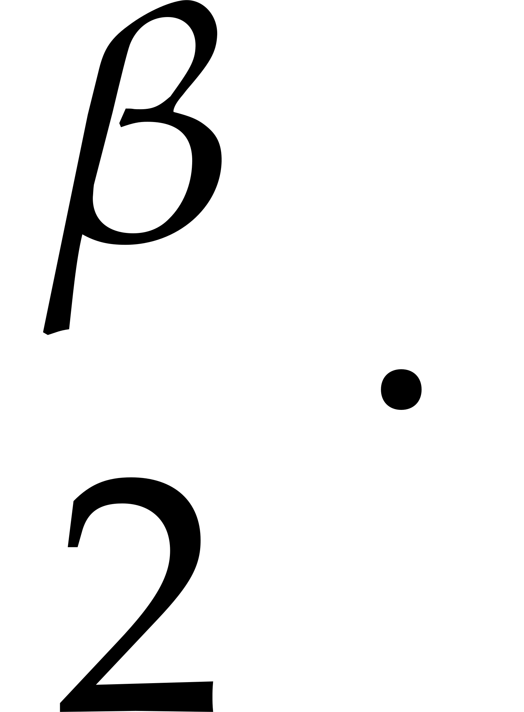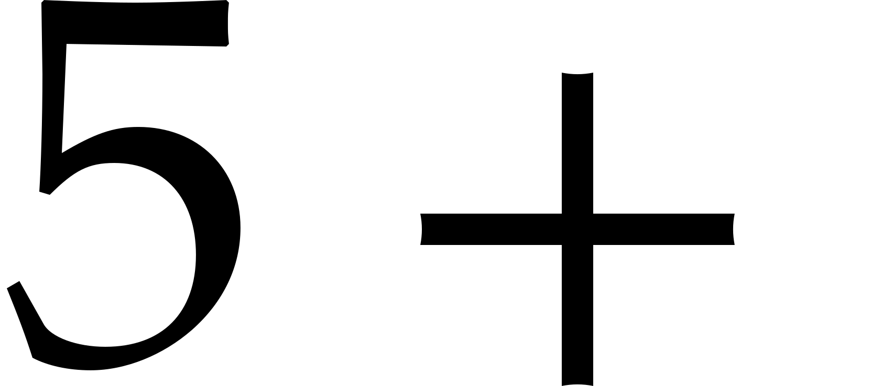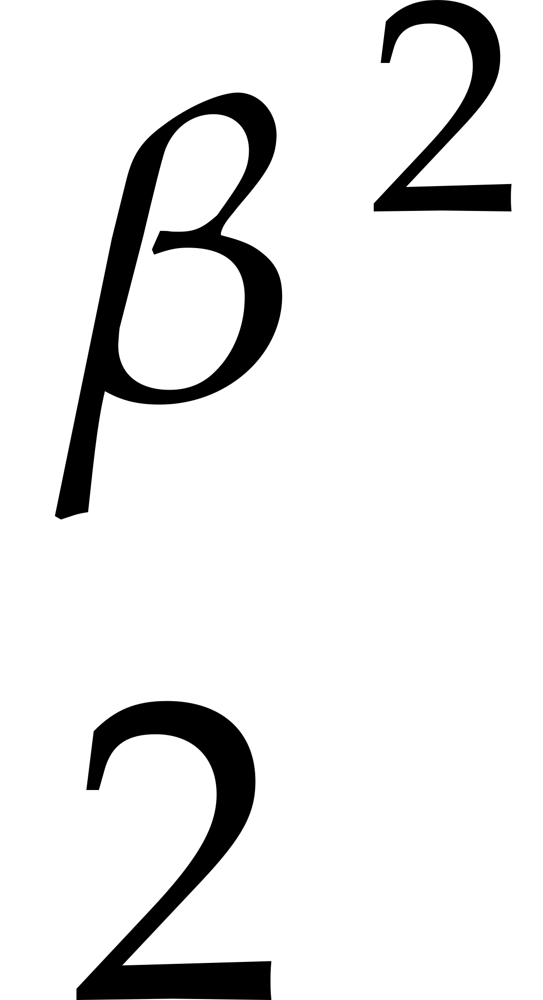

& on the algebraic construal we then had to distinguish the 2 in the β positions on the one hand & in position α on the other, whereas on the arithmetical construal they would not be distinguished. We are simply – I think – working with a different calculus in each case.

### [25v\[2\]](https://cdn.wittgensteinnachlass.com/2000px/webp/Ms-112/25v.webp)

On the one construal, for instance, the calculation above would be a proof of (7 + 8)² = 7² + 2 ∙ 7 ∙ 8 + 8²; on the other it would not.

### [25v\[3\]](https://cdn.wittgensteinnachlass.com/2000px/webp/Ms-112/25v.webp)

Incidentally, the calculation R is a general proof only in so far as it rests on general rules, that is, on the inductive proofs.

### [25v\[4\]](https://cdn.wittgensteinnachlass.com/2000px/webp/Ms-112/25v.webp)

Can I say: The inductive proof consists not merely in proving α & β & γ but in putting those very equations together & seeing them together in the right way.

### [25v\[5\]](https://cdn.wittgensteinnachlass.com/2000px/webp/Ms-112/25v.webp),[26r\[1\]](https://cdn.wittgensteinnachlass.com/2000px/webp/Ms-112/26r.webp)

For if one says that B is a proof of A, then I ask: by which propositions is A proved? And if one tells me “by α”, I reply: β & γ (or α, β & γ) are proved by α, but α ∙ β ∙ γ does not prove A & is not A (any more than  as mere division proves ); rather, α ∙ β ∙ γ (which admittedly follows entirely from α) proves A (or is equivalent to A) only when the induction in α ∙ β ∙ γ is seen.

In order to ‘prove A’ I must first – as one would say – direct my attention to something quite specific. (As in the division

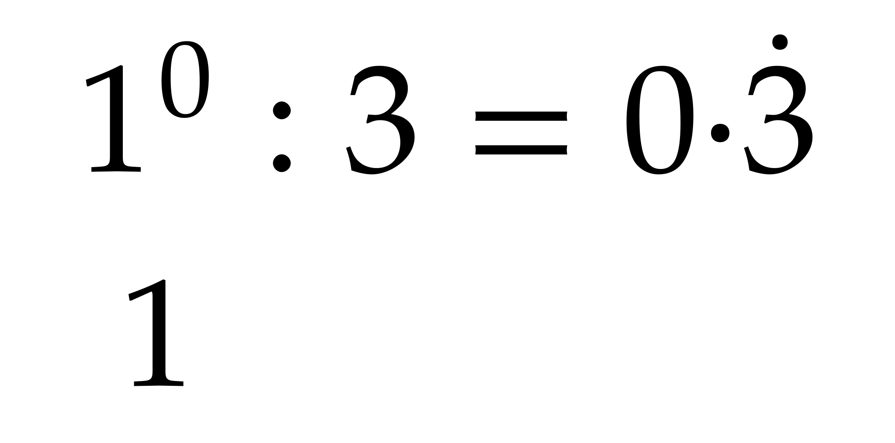

.)

### [26r\[2\]](https://cdn.wittgensteinnachlass.com/2000px/webp/Ms-112/26r.webp)

(And α, so to speak, had as yet no inkling at all of what I then see.)

### [26r\[3\]](https://cdn.wittgensteinnachlass.com/2000px/webp/Ms-112/26r.webp)

That, admittedly, is still misleading & badly put. The truth is that I fit the complex B into a particular system; I underline and connect certain things in it, and I express just this by replacing it with the equation A, which is (as it were) a summary of what is essential in B from our point of view. – One sees this if one construes B as the path of the induction, calculates a few steps a + (b + 2) = (a + b) + 2, a + (b + 3) = (a + b) + 3, & then – guided by these steps – writes: a + (b + n) = (a + b) + n. – That is as much as to say: _this_ is how I want to use B.

### [26r\[4\]](https://cdn.wittgensteinnachlass.com/2000px/webp/Ms-112/26r.webp),[26v\[1\]](https://cdn.wittgensteinnachlass.com/2000px/webp/Ms-112/26v.webp)

(Incidentally, perhaps I should stick to proof II, since it is even simpler.)

### [26v\[2\]](https://cdn.wittgensteinnachlass.com/2000px/webp/Ms-112/26v.webp)

One could express my point of view like this: If I ask, is B a proof of this proposition, I could also ask: is B a proof that things are as A says, & “are they certainly as A says?” But how, then? What does A actually assert? One would say: “that this equation holds for all numbers”, & the induction is supposed to be the proof of that; this presupposes that we have a concept of the totality of the values apart from the induction. As if – as I have often said – the induction were just _one_ vehicle for taking us through the totality of the numbers.

### [26v\[3\]](https://cdn.wittgensteinnachlass.com/2000px/webp/Ms-112/26v.webp)

The relation here between generality & proof of generality is like that between existence & proof of existence.

### [26v\[4\]](https://cdn.wittgensteinnachlass.com/2000px/webp/Ms-112/26v.webp)

But can’t we set the false analogy aside & say: A is on the same level as 4 × 5 = 20 & its proof is on the same level as the proof of 4 × 5 = 20?

### [26v\[5\]](https://cdn.wittgensteinnachlass.com/2000px/webp/Ms-112/26v.webp),[27r\[1\]](https://cdn.wittgensteinnachlass.com/2000px/webp/Ms-112/27r.webp),[27r\[2\]](https://cdn.wittgensteinnachlass.com/2000px/webp/Ms-112/27r.webp)

That is to say, roughly: If I ask “is 4 × 5 really 20”, this question has sense because it relates to a method of deciding. The answer would be: “let’s work it out! –” Now couldn’t the answer in the case of A be the same, & B be presented as the calculation? – Certainly, if I am resolved to let the result of calculation B decide A. Or: To the question “is 5 × 4 = 20?” one could reply: “let us see whether it agrees with the basic rules of arithmetic”; and correspondingly I could say: let us see whether A agrees with the basic rules. But with which ones? Well, presumably with α.

### [27r\[3\]](https://cdn.wittgensteinnachlass.com/2000px/webp/Ms-112/27r.webp)

But between α & A lies precisely the need to stipulate what we are to call agreement here.

### [27r\[4\]](https://cdn.wittgensteinnachlass.com/2000px/webp/Ms-112/27r.webp),[27v\[1\]](https://cdn.wittgensteinnachlass.com/2000px/webp/Ms-112/27v.webp)

“Does the procession have an end” could also mean: does it form a closed loop? And now one might say “there, you see that you can perfectly well imagine such a case, where something has no end; why then couldn’t there be other such cases”. But the answer is: The ‘cases’ in this sense of the word are grammatical cases, & it is they that determine the sense of the question in the first place. The question “why couldn’t there be other cases as well” is formed on the analogy of _this_ one. “Why couldn’t there be other cases of minerals that glow in the dark”, but here it is a matter of cases of facts, there of cases that determine the sense of a sentence.

### [27v\[2\]](https://cdn.wittgensteinnachlass.com/2000px/webp/Ms-112/27v.webp)

I.e. between α & A lies the gulf between arithmetic & algebra, & if B is to count as a proof of A, this (gulf) must be bridged by a stipulation.

### [27v\[3\]](https://cdn.wittgensteinnachlass.com/2000px/webp/Ms-112/27v.webp)

Now it is quite clear that we make use of such an idea of agreement if, for example, we simply work out a numerical example quickly to check the correctness of an algebraic proposition. And in this sense I could, for example, calculate

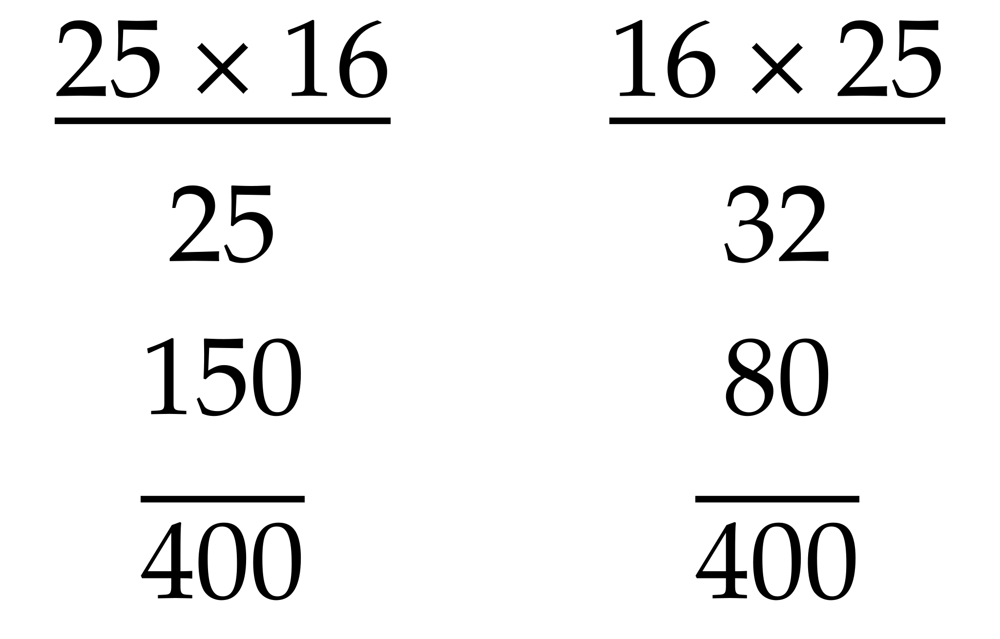

& say: “yes, yes, it’s right, a ∙ b equals b ∙ a” – if I imagine that I had forgotten it.

### [28r\[1\]](https://cdn.wittgensteinnachlass.com/2000px/webp/Ms-112/28r.webp)

One would then have to say: one can certainly speak of an agreement between α & A, or rather, between α, β, γ & A, but not in so far as A asserts the generality & B proves it, but only in so far as α, β, γ build up _this_ generality & not, for instance, the generality a + (b + c) = (a + 2b) + c.

### [28r\[2\]](https://cdn.wittgensteinnachlass.com/2000px/webp/Ms-112/28r.webp)

It is β & γ that are derived from the proposition α, but not the generality, i.e. the induction, that we see in B.

### [28r\[3\]](https://cdn.wittgensteinnachlass.com/2000px/webp/Ms-112/28r.webp)

We could work through an example to make sure that (a + b)² is equal to a² + b² + 2ab & not to a² + b² + 3ab – if, say, we had forgotten; but we could not check in this sense whether the formula holds _generally_. Of course one can make _that_ check too, & I could look in the calculation (5 + 3)² = – – – = 5² + 2 ∙ 5 ∙ 3 + 3² to see whether the 2 in the second term is a general feature of the equation or one that depends on the particular numbers in the example.

### [28r\[4\]](https://cdn.wittgensteinnachlass.com/2000px/webp/Ms-112/28r.webp),[28v\[1\]](https://cdn.wittgensteinnachlass.com/2000px/webp/Ms-112/28v.webp)

It is strange that I wrote ‘visual space does not have the form 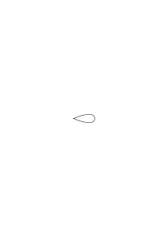’ and not that it does not have the form

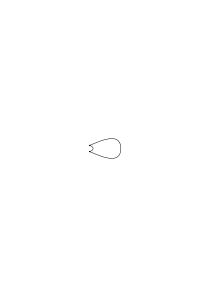.

And it is very telling that I wrote the first.

### [28v\[2\]](https://cdn.wittgensteinnachlass.com/2000px/webp/Ms-112/28v.webp)

Since the instructions for using α consist of a series of arithmetical propositions, one can also put this series as a symbol in place of α & thus put series in place of α, β & γ.

### [28v\[3\]](https://cdn.wittgensteinnachlass.com/2000px/webp/Ms-112/28v.webp)

Instead of the proposition A one could also say: ‘the form of the equations yielded by the induction B’.

### [28v\[4\]](https://cdn.wittgensteinnachlass.com/2000px/webp/Ms-112/28v.webp)

Isn’t it enough to say that algebra can be carried on entirely with arithmetical induction series & equations? But that the algebraic will nevertheless be preserved in the arithmetical notation, that the arithmetical signs are now used in a different way – – –

### [28v\[5\]](https://cdn.wittgensteinnachlass.com/2000px/webp/Ms-112/28v.webp),[29r\[1\]](https://cdn.wittgensteinnachlass.com/2000px/webp/Ms-112/29r.webp)

The “and so on” has to be written below the induction series & the ‘so’ could be seen only from α, β & γ when one considers all three together, & not from α alone, even though β & γ follow from α; & that is what I mean by saying that α, β & γ constitute a new unity as a proof by induction.

### [29r\[2\]](https://cdn.wittgensteinnachlass.com/2000px/webp/Ms-112/29r.webp)

In the calculus written arithmetically, an algebraic result will not be an arithmetical one, but a particular arrangement of arithmetical equations.

### [29r\[3\]](https://cdn.wittgensteinnachlass.com/2000px/webp/Ms-112/29r.webp)

(Philosophy _settles down_ more (& more) in my work.)

### [29r\[4\]](https://cdn.wittgensteinnachlass.com/2000px/webp/Ms-112/29r.webp)

And I should like to say that one will not be able to say that an algebraic result is proved by the arithmetical steps, but rather that it is _constructed_ with their help. What is proved is the arithmetical results & perhaps their logical product as well, but not the construction I build with the arithmetical equations as building blocks.

### [29r\[5\]](https://cdn.wittgensteinnachlass.com/2000px/webp/Ms-112/29r.webp)

But what do I do with these constructions? Are they in turn building blocks for other constructions?

### [29r\[6\]](https://cdn.wittgensteinnachlass.com/2000px/webp/Ms-112/29r.webp),[29\[1\]](https://cdn.wittgensteinnachlass.com/2000px/webp/Ms-112/29v.webp)

One sees that these constructions (the proofs by induction) are not merely the arithmetical results when one draws connecting lines & brackets to mark them as proofs by induction, so as to ensure the right construal. That is, when one writes down the whole new symbol correctly.

### [29v\[2\]](https://cdn.wittgensteinnachlass.com/2000px/webp/Ms-112/29v.webp)

The process we have to go through to get from the picture B to A is simply missing from the signs.

### [29v\[3\]](https://cdn.wittgensteinnachlass.com/2000px/webp/Ms-112/29v.webp)

I keep wanting to say that B is a new unity & that as a proof by induction it is not built up from α.

### [29v\[4\]](https://cdn.wittgensteinnachlass.com/2000px/webp/Ms-112/29v.webp)

Much as the segment of a spiral

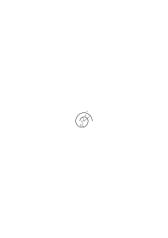

is built up from the 3 semicircles a, b, c, but what is essential to the spiral emerges only from the particular way they are joined together & so a new principle has to be added to the semicircle for the spiral to come into being. This comparison is a rather unsuccessful attempt to find the right representation.

### [29v\[5\]](https://cdn.wittgensteinnachlass.com/2000px/webp/Ms-112/29v.webp)

If someone asks “is that a proof of the general proposition A”, one could reply: if it is a proof, it is at any rate a proof of this proposition & no other.

### [30r\[1\]](https://cdn.wittgensteinnachlass.com/2000px/webp/Ms-112/30r.webp)

But of course that only means: The induction has something to do with this general proposition. The only question is whether one can call the induction the _proof_.

---

### [30r\[2\]](https://cdn.wittgensteinnachlass.com/2000px/webp/Ms-112/30r.webp)

That is, I make (5 + 2)² = 5² + 2 ∙ 2 ∙ 5 + 2² into a different sign by writing: 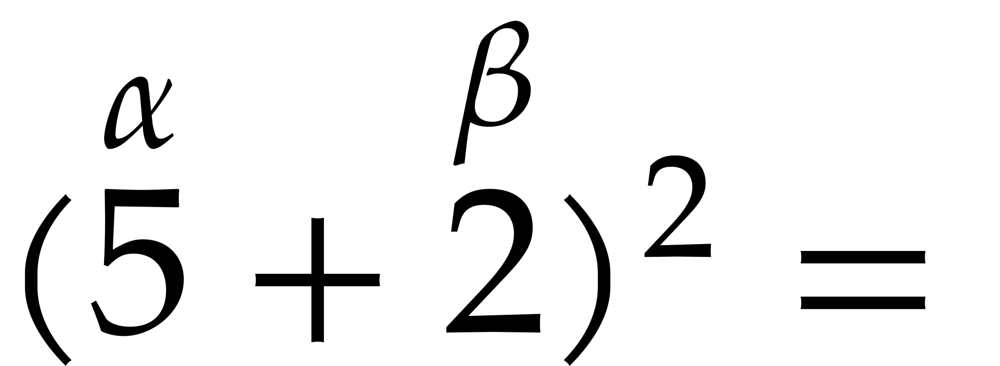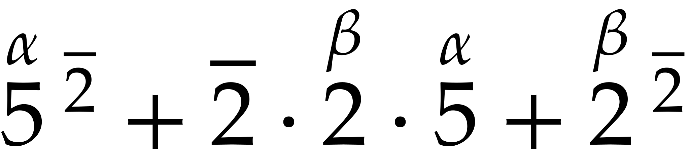 & thereby “indicating which features of the right-hand side derive from the particular numbers on the left”, etc..

### [30r\[3\]](https://cdn.wittgensteinnachlass.com/2000px/webp/Ms-112/30r.webp)

(I (now) recognize the importance of this process of establishing correspondences. It is the expression of a new way of looking at the calculation & hence the way of looking at a new calculation.)

### [30r\[4\]](https://cdn.wittgensteinnachlass.com/2000px/webp/Ms-112/30r.webp),[30v\[1\]](https://cdn.wittgensteinnachlass.com/2000px/webp/Ms-112/30v.webp)

“You say ‘where there is a question, there is also a way of answering it’, but surely there are questions in mathematics that we see no way of answering”. – Quite right, & all that follows is that in this case we use the word ‘question’ in a different sense from the case above. And perhaps I should have said “there are two different forms here & I would like to use the word ‘question’ only for the first”. But this last point is incidental. What matters is that we are dealing with two different forms here. (And that you have lost your bearings in the grammar of the word ‘kind’ if you now want to say that they are simply two different _kinds_ of questions.)

### [30v\[2\]](https://cdn.wittgensteinnachlass.com/2000px/webp/Ms-112/30v.webp)

Everything that has the character of an assertion is disappearing more & more from this work & so the work is becoming more and more correct & at the same time harder and harder to understand for those who are attuned to metaphysical theories.

### [30v\[3\]](https://cdn.wittgensteinnachlass.com/2000px/webp/Ms-112/30v.webp)

I.e., on the one hand what I say is becoming easier and easier to understand, on the other its meaning is becoming harder and harder to understand.

### [30v\[4\]](https://cdn.wittgensteinnachlass.com/2000px/webp/Ms-112/30v.webp)

Could one also put it like this: in arithmetic the associative law is not used at all; there we work (only) with particular numerical calculations. And algebra, even if it makes use of arithmetical notation, is a quite different calculus & cannot be derived from the arithmetical one.

### [31r\[1\]](https://cdn.wittgensteinnachlass.com/2000px/webp/Ms-112/31r.webp)

Isn’t that what I keep wanting to say about Skolem’s proofs?

### [31r\[2\]](https://cdn.wittgensteinnachlass.com/2000px/webp/Ms-112/31r.webp)

If an algebraic proposition cannot be proved by the arithmetical steps (in the calculus written arithmetically), then it cannot be proved by Skolem’s steps either, for these are in fact arithmetical steps.

### [31r\[3\]](https://cdn.wittgensteinnachlass.com/2000px/webp/Ms-112/31r.webp)

15.10.1931

The philosopher really only notes down what the mathematician says in passing now and then about his activity.

### [VB](/w-vb/#ms-112-31r.4) [31r\[4\]](https://cdn.wittgensteinnachlass.com/2000px/webp/Ms-112/31r.webp)

The philosopher easily finds himself in the position of an inept manager who, instead of doing _his own_ work & simply seeing to it that his employees do theirs properly, takes their work off their hands & so one day finds himself overburdened with other people’s work, while the employees look on and criticize him.

### [31r\[5\]](https://cdn.wittgensteinnachlass.com/2000px/webp/Ms-112/31r.webp)

He is especially inclined to saddle himself with the mathematician’s work.

### [31r\[6\]](https://cdn.wittgensteinnachlass.com/2000px/webp/Ms-112/31r.webp),[31v\[1\]](https://cdn.wittgensteinnachlass.com/2000px/webp/Ms-112/31v.webp)

There is no such thing as a logical fiction & that is why one cannot work with logical fictions; & must work out every example in full.

### [31v\[2\]](https://cdn.wittgensteinnachlass.com/2000px/webp/Ms-112/31v.webp)

In mathematics there can be only mathematical difficulties [troubles], not philosophical ones.

### [31v\[3\]](https://cdn.wittgensteinnachlass.com/2000px/webp/Ms-112/31v.webp)

20.10.1931

Once α, β, γ have been proved, the general calculus has yet to be invented.

### [31v\[4\]](https://cdn.wittgensteinnachlass.com/2000px/webp/Ms-112/31v.webp)

The “etc.” has no sense at all as yet in pure arithmetic.

### [31v\[5\]](https://cdn.wittgensteinnachlass.com/2000px/webp/Ms-112/31v.webp)

AI, AII, AIII etc. found a new system; a system for which one need not, of course, take those particular A’s as the foundation (but then one must take other equations).

### [31v\[6\]](https://cdn.wittgensteinnachlass.com/2000px/webp/Ms-112/31v.webp)

It seems perfectly natural to us to write a + (b + c) = (a + b) + c on the strength of the inductive series; because we do not see that in doing so we are beginning a wholly new calculus. (A child just learning to calculate would see more clearly than we do in this respect.)

### [31v\[7\]](https://cdn.wittgensteinnachlass.com/2000px/webp/Ms-112/31v.webp)

But I should like to object: isn’t the general principle of this algebraic calculus the foundation (of the calculus), & doesn’t A merely follow from it together with α, β, γ?

### [32r\[1\]](https://cdn.wittgensteinnachlass.com/2000px/webp/Ms-112/32r.webp)

Then this principle must be stated in a proposition of the calculus. And it isn’t.

### [32r\[2\]](https://cdn.wittgensteinnachlass.com/2000px/webp/Ms-112/32r.webp)

Must I say: Skolem’s mistake was not to see that A would be proved by α, β, γ only if a further principle were added to α, β, γ. And furthermore, no such principle is stated in Skolem’s calculus & so it is not the calculus that would result from this principle, but a different one. In it one operates with the “proofs” I, II, III etc. as with propositions, _without any general consideration_. Isn’t it _true_ that I derive A from B in a particular way? Yes, I derive it in a particular way. It is as if I had fitted pipes together in a particular way in B & now let a particular current (the current of numbers) pass through them, & the process that then results, the course of the current through this system, is A.

### [32r\[3\]](https://cdn.wittgensteinnachlass.com/2000px/webp/Ms-112/32r.webp),[32v\[1\]](https://cdn.wittgensteinnachlass.com/2000px/webp/Ms-112/32v.webp)

23.10.1931

I only want to say: this way in which I look at and treat the complexes BI, BII, etc. in ‘deriving’ the algebraic propositions from them does not occur in my calculus.

### [32v\[2\]](https://cdn.wittgensteinnachlass.com/2000px/webp/Ms-112/32v.webp)

Here I have set up BI, BII, BIII; now let the current of numbers run through _this one_, & now _like this_ etc..

### [32v\[3\]](https://cdn.wittgensteinnachlass.com/2000px/webp/Ms-112/32v.webp)

But then surely I see something quite _specific_, namely the _generality_!

### [32v\[4\]](https://cdn.wittgensteinnachlass.com/2000px/webp/Ms-112/32v.webp)

[As long as my mind is as tense as it is now, I cannot make the throw properly at all. That doesn’t matter, incidentally; I have to practise for the throw all the same.]

### [32v\[5\]](https://cdn.wittgensteinnachlass.com/2000px/webp/Ms-112/32v.webp)

I want to say: what Skolem does is fully described by saying that he proves something about the forms of the equations A by, for example, for the equation a + (b + c) = (a + b) + c deriving (a + (b + c) + 1 & ((a + b) + c) + 1 from a + (b + (c + 1)) & (a + b) + (c + 1) by means of a + (b + 1) = (a + b) + 1, etc. etc.. We do not need to speak of a general principle of induction in this description.*

### [32v\[6\]](https://cdn.wittgensteinnachlass.com/2000px/webp/Ms-112/32v.webp),[33r\[1\]](https://cdn.wittgensteinnachlass.com/2000px/webp/Ms-112/33r.webp)

We do see the periodicity in the definition α & the complexes B, but this periodicity is nowhere expressed generally (so to speak, nowhere expressed officially – namely in the symbols).

### [33r\[2\]](https://cdn.wittgensteinnachlass.com/2000px/webp/Ms-112/33r.webp)

It is left to us, as it were, to notice the analogy. (For strictly speaking the _words_ Skolem says by way of explanation are no concern of mine.)

### [33r\[3\]](https://cdn.wittgensteinnachlass.com/2000px/webp/Ms-112/33r.webp)

(I parody a conception in order to show a mistake in it. This method can be applied generally. Frege against Cantor)

### [33r\[4\]](https://cdn.wittgensteinnachlass.com/2000px/webp/Ms-112/33r.webp)

I.e. nowhere is the connection between the form of B & A clearly made.

### [33r\[5\]](https://cdn.wittgensteinnachlass.com/2000px/webp/Ms-112/33r.webp)

Nowhere is the condition formulated under which we take A to be proved by α, β, γ.

### [33r\[6\]](https://cdn.wittgensteinnachlass.com/2000px/webp/Ms-112/33r.webp)

It is my private affair whether I see the analogy between the complexes. (Yet it must be in that analogy that their being proofs of the algebraic propositions consists.)

### [33r\[7\]](https://cdn.wittgensteinnachlass.com/2000px/webp/Ms-112/33r.webp),[33v\[1\]](https://cdn.wittgensteinnachlass.com/2000px/webp/Ms-112/33v.webp)

“The rational points lie close together on the number line”: a misleading picture.

### [33v\[2\]](https://cdn.wittgensteinnachlass.com/2000px/webp/Ms-112/33v.webp)

The strict criterion of generality is nowhere stated (which would define what is to be understood _here_ by ‘generality’).

### [33v\[3\]](https://cdn.wittgensteinnachlass.com/2000px/webp/Ms-112/33v.webp)

Now suppose it were stated: that would not so much prove the A’s as replace them.

### [33v\[4\]](https://cdn.wittgensteinnachlass.com/2000px/webp/Ms-112/33v.webp)

The criterion of generality would determine the essence of algebraic calculation.

### [33v\[5\]](https://cdn.wittgensteinnachlass.com/2000px/webp/Ms-112/33v.webp)

Then a + (b + n) = (a + b) + n becomes a calculation like any other (only a calculation of just _one_ step) & the paradigm takes the form B. [R.]

### [33v\[6\]](https://cdn.wittgensteinnachlass.com/2000px/webp/Ms-112/33v.webp)

Now even if the paradigms of my new calculus all have the definite form R, it would still be confusing to say that the correctness of the equation AI, for instance, has been proved by α. At most it has been proved by BI, but only in the way that, say, i + (k + l) = (i + k) + l was previously proved by a + (b + c) = (a + b) + c.

### [33v\[7\]](https://cdn.wittgensteinnachlass.com/2000px/webp/Ms-112/33v.webp),[34r\[1\]](https://cdn.wittgensteinnachlass.com/2000px/webp/Ms-112/34r.webp)

Its legitimacy is proved by α only if I stipulate beforehand that a transition is legitimate only if one can construct the form of the paradigm in the specified way by means of α.

### [34r\[2\]](https://cdn.wittgensteinnachlass.com/2000px/webp/Ms-112/34r.webp)

Then I can say “its legitimacy has been proved by α”. But here the word “legitimacy” has a different meaning from when I say: the legitimacy of the transition from (a + b)² to a² + 2ab + b² has been proved & by that mean that this transition can be broken down into steps all of previously specified forms.

### [34r\[3\]](https://cdn.wittgensteinnachlass.com/2000px/webp/Ms-112/34r.webp)

For in this sense there is no transition from B to A; rather, B permits the transition made in A, as in any other calculation.

### [34r\[4\]](https://cdn.wittgensteinnachlass.com/2000px/webp/Ms-112/34r.webp)

One could represent the similarity between the two kinds of proof, or justification, like this: “I have _constructed_ the equation (a + b)² = a² + 2ab + b² in a particular way with the help of the basic equations & I have constructed the equation A with the help of rules too”.

### [34r\[5\]](https://cdn.wittgensteinnachlass.com/2000px/webp/Ms-112/34r.webp),[34v\[1\]](https://cdn.wittgensteinnachlass.com/2000px/webp/Ms-112/34v.webp)

One has not proved the proposition “that for all cardinal numbers x + (y + z) = (x + y) + z by induction, but has, say, given it an exact expression; at the same time, admittedly, one has shown that it is not a proposition in the sense in which an equation is. (Put more accurately: that it is not a proposition of the kind from which it is derived.)

### [34v\[2\]](https://cdn.wittgensteinnachlass.com/2000px/webp/Ms-112/34v.webp)

Indeed, can I not say of both kinds of proof: “A transition is justified if its paradigm can be constructed in this way”?

### [34v\[3\]](https://cdn.wittgensteinnachlass.com/2000px/webp/Ms-112/34v.webp)

The proposition that A holds for all cardinal numbers is really the complex B. And its proof, the proof of β & γ. But this also shows that this proposition is a proposition in a different sense from an equation, & its proof is the proof of a proposition in a different sense.

Do not forget here that we do not first have the concept of a proposition, then know that equations are mathematical propositions, & then discover that there are other kinds of mathematical proposition!

### [35r\[1\]](https://cdn.wittgensteinnachlass.com/2000px/webp/Ms-112/35r.webp)

(Hold all these things together, and then you will understand the matter.)

### [35r\[2\]](https://cdn.wittgensteinnachlass.com/2000px/webp/Ms-112/35r.webp)

When one says that A has been proved with ρ & the principle R, what kind of generality does this general principle have?

### [35r\[3\]](https://cdn.wittgensteinnachlass.com/2000px/webp/Ms-112/35r.webp)

For the transition to be justified means in the one case that it can be carried out according to certain given forms. In the other case the justification would be that the transition proceeds according to paradigms that themselves satisfy a certain condition.

### [35r\[4\]](https://cdn.wittgensteinnachlass.com/2000px/webp/Ms-112/35r.webp),[35v\[1\]](https://cdn.wittgensteinnachlass.com/2000px/webp/Ms-112/35v.webp)

One is to imagine that a board game were given rules that consisted entirely of words without ‘r’, & that I were to call a rule justified if it contains no ‘r’. Now suppose someone said that he had laid down just _one_ rule for such & such a game, namely that the moves must correspond to rules that contain no ‘r’. – Is that a rule of the game (in the first sense)? Is not the game still played according to those rules, which merely all have to correspond to that first rule?

### [35v\[2\]](https://cdn.wittgensteinnachlass.com/2000px/webp/Ms-112/35v.webp)

A rule for constructing rules of a game is not a rule of the game.

### [35v\[3\]](https://cdn.wittgensteinnachlass.com/2000px/webp/Ms-112/35v.webp)

Someone carries out the construction of B before me & then says that A has been proved. I ask “How so? – All I see is that you have made a construction around A with the help of 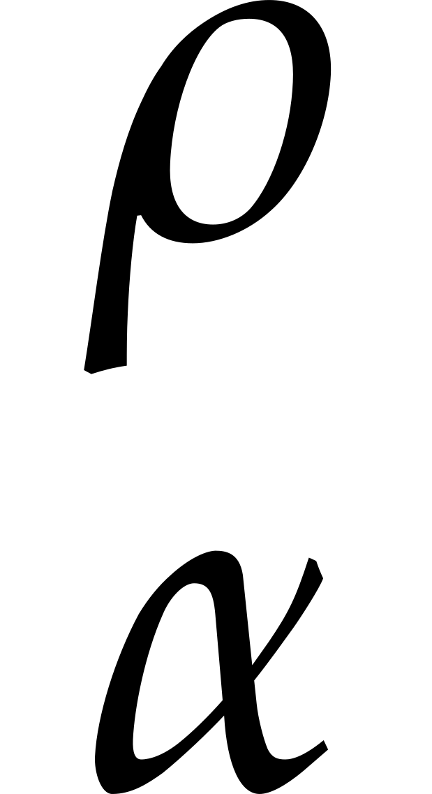”. Now he says “yes, but if that is possible, then I simply say that A has been proved”. I reply: “all you have shown me by that is what new sense you attach to the word ‘prove’”.

### [35v\[4\]](https://cdn.wittgensteinnachlass.com/2000px/webp/Ms-112/35v.webp)

In one sense it means that you have constructed the paradigm by means of ρ in such & such a way, in the other, as before, that an equation corresponds to the paradigm.

### [35v\[5\]](https://cdn.wittgensteinnachlass.com/2000px/webp/Ms-112/35v.webp)

[I am searching for the right reply.]

### [35v\[6\]](https://cdn.wittgensteinnachlass.com/2000px/webp/Ms-112/35v.webp)

[“It never occurred to me to say _that_ in reply to him”.]

### [35v\[7\]](https://cdn.wittgensteinnachlass.com/2000px/webp/Ms-112/35v.webp)

In _dem_ Sinne V in welchem (a + b)² = a² + b² + 2ab durch AI, AII etc. beweisbar ist, ist AI unbeweisbar.

### [36r\[1\]](https://cdn.wittgensteinnachlass.com/2000px/webp/Ms-112/36r.webp)

That is why one does indeed say that the _universal validity_ of the equation A has been proved, precisely in order to express the difference.

### [36r\[2\]](https://cdn.wittgensteinnachlass.com/2000px/webp/Ms-112/36r.webp)

One expects one thing by way of a proof & gets something else. And then one consoles oneself with the thought that one has merely received a different _kind_ of proof.

### [36r\[3\]](https://cdn.wittgensteinnachlass.com/2000px/webp/Ms-112/36r.webp)

‘Equation’ & ‘proof of an equation’ have a definite grammar. To say that 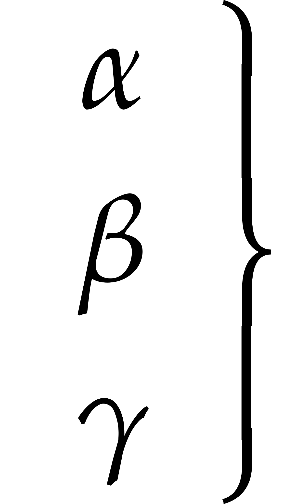 is the proof of an equation is nonsense unless something _quite_ different is understood here by ‘proof’.

### [36r\[4\]](https://cdn.wittgensteinnachlass.com/2000px/webp/Ms-112/36r.webp)

He says he has proved A & shows me the complex B. I ask “in what respect is that a proof of A?” He has to answer: “That is the form of the paradigm of the permitted transitions. (If this construction around the ends of the transition is possible by means of ρ, then the transition is permitted.

### [36r\[5\]](https://cdn.wittgensteinnachlass.com/2000px/webp/Ms-112/36r.webp)

When we ask “is this a proof or not?”, we are moving within the forms of word-language.

### [36v\[1\]](https://cdn.wittgensteinnachlass.com/2000px/webp/Ms-112/36v.webp)

Now of course there is nothing to object to if someone says: If the terms of the transition stand in a construction of such & such a kind, then I say that the legitimacy of the transition has been proved.

### [36v\[2\]](https://cdn.wittgensteinnachlass.com/2000px/webp/Ms-112/36v.webp),[36v\[3\]](https://cdn.wittgensteinnachlass.com/2000px/webp/Ms-112/36v.webp),[37r\[1\]](https://cdn.wittgensteinnachlass.com/2000px/webp/Ms-112/37r.webp),[37r\[2\]](https://cdn.wittgensteinnachlass.com/2000px/webp/Ms-112/37r.webp)

What is it in me that resists conceiving of B as a proof of A? First I discover that nowhere in my calculation do I need the proposition about “all cardinal numbers”. I constructed the complex B with the help of ρ and then went over to equation A; there was no talk of “all cardinal numbers” in the process! (This sentence accompanies the calculation in word-language, and this can only confuse me.) But not only does this general proposition drop out altogether; no other takes its place. (Except perhaps the logical product α ∙ β ∙ γ. But that is not right either, for I would first have to ‘highlight’ certain features in this product. For if one asks what the proposition α ∙ β ∙ γ says, all I can really do is repeat the proposition, & of course there is no talk of “all numbers” there. Rather, what corresponds to that expression is the highlighting (which of course has meaning only in a system of signs). But these signs are now not equations but equations with highlighted features. Just as 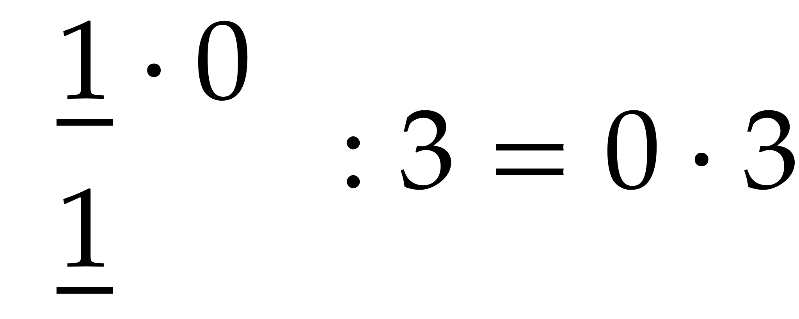 is no longer a division.) So the proposition that asserts the generality drops out, “nothing has been _proved_”, “nothing _follows_”. “Yes, but the equation A follows; it now takes the place of the general proposition”. – Well, in what respect does it follow? Evidently I am using ‘follows’ here in a sense quite different from the normal one, since what A follows from is not a proposition. That is also why we feel that the word “follow” has not been correctly applied.

### [37r\[3\]](https://cdn.wittgensteinnachlass.com/2000px/webp/Ms-112/37r.webp)

When one says “it follows from the complex B that a + (b + c) = (a + b) + c”, one feels dizzy. One feels that one has somehow talked nonsense, even though on the face of it what one says sounds right.

### [37r\[4\]](https://cdn.wittgensteinnachlass.com/2000px/webp/Ms-112/37r.webp)

To say that an equation follows already means something (has its own definite grammar.)

### [37v\[1\]](https://cdn.wittgensteinnachlass.com/2000px/webp/Ms-112/37v.webp)

But when it is said that “A follows from B”, one wants to ask: “_what_ follows?” That a + (b + c) equals (a + b) + c is, after all, a stipulation if it does not follow from an equation in the normal way.

### [37v\[2\]](https://cdn.wittgensteinnachlass.com/2000px/webp/Ms-112/37v.webp)

We cannot get our concept of following to fit A & B.

### [37v\[3\]](https://cdn.wittgensteinnachlass.com/2000px/webp/Ms-112/37v.webp),[38r\[1\]](https://cdn.wittgensteinnachlass.com/2000px/webp/Ms-112/38r.webp)

One can of course say that one justifies an algebraic calculation by the possibility of constructing the paradigms by means of ρ. And one actually does so. But that is not to say that one proves (a + b)² = a² + 2ab + b² by means of α. On the contrary, one proves β & γ with α, but cannot prove A with it. One shows someone, for example, the transition from (x + y)² to x² + 2xy + y² & he says: Yes, – but why do you make this transition from (x + y) ∙ (x + y) to x ∙ (x + y) + y ∙ (x + y)? And now I show him the corresponding complex B to convince him. But does that mean that I have proved the correctness of the transition? It means that I have proved what is ordinarily expressed by saying that this equation holds for all cardinal numbers. So that, if that was what I wanted, I have achieved my purpose.

### [38r\[2\]](https://cdn.wittgensteinnachlass.com/2000px/webp/Ms-112/38r.webp)

“I shall prove to you that a + (b + n) = (a + b) + n”. No one now expects to see the complex B. One expects to hear another rule about a, b & n, which mediates the transition from one side to the other. If I am given B & the schema R instead, I cannot call that a proof, precisely because I understand something different by proof.

### [38r\[3\]](https://cdn.wittgensteinnachlass.com/2000px/webp/Ms-112/38r.webp)

Indeed, I might then say: “Oh, so that is what you call ‘proof’; I had imagined …”.

### [38r\[4\]](https://cdn.wittgensteinnachlass.com/2000px/webp/Ms-112/38r.webp)

The proof of 17 + (18 + 5) = (17 + 18) + 5 is indeed carried out according to the schema B & this numerical proposition is of the form A. Or again: B is the proof of the numerical proposition; but for that very reason not of A.

### [38r\[5\]](https://cdn.wittgensteinnachlass.com/2000px/webp/Ms-112/38r.webp),[38v\[1\]](https://cdn.wittgensteinnachlass.com/2000px/webp/Ms-112/38v.webp)

“I shall derive AI, AII AIII for you from the _one_ proposition”. – Naturally one thinks here of a derivation of the kind carried out _with the help_ of these propositions. – One thinks that some sort of smaller chain links will be provided; with which we can replace all these large ones. And there we do have a definite picture; and we are offered something quite different. The equation is put together by the inductive proof as it were crosswise rather than lengthwise.

### [38v\[2\]](https://cdn.wittgensteinnachlass.com/2000px/webp/Ms-112/38v.webp)

24.10.1931

Now when we carry out the derivation, we finally reach the point where the construction of B is complete. But here it now says “so this equation holds”. Yet here these words mean something different from what they mean when we ordinarily infer an equation from equations. The words “the equation follows from it” already have a meaning. And here an equation is indeed constructed, but according to a different principle.

### [38v\[3\]](https://cdn.wittgensteinnachlass.com/2000px/webp/Ms-112/38v.webp),[39r\[1\]](https://cdn.wittgensteinnachlass.com/2000px/webp/Ms-112/39r.webp)

[The sentence comes into the world with all its limbs dislocated & I first have to set them all as best I can. No wonder it then has no beautiful, impressive shape.]

### [39r\[2\]](https://cdn.wittgensteinnachlass.com/2000px/webp/Ms-112/39r.webp)

When I say “the equation follows from the complex”, an equation here ‘follows’ from something that is not an equation at all.

### [39r\[3\]](https://cdn.wittgensteinnachlass.com/2000px/webp/Ms-112/39r.webp)

In the sense that on paper I obtain one from the other, write one down after the other, the equation A can indeed follow from B. In this sense I could derive it from B.

### [39r\[4\]](https://cdn.wittgensteinnachlass.com/2000px/webp/Ms-112/39r.webp)

But in deriving it _like this_, I leave it what it always was, the basic equation of a symbolism. I.e. through _this_ derivation its logical status did of course become different from what it was before the derivation was constructed, but it does not change in the way it would if the equation had been proved. Something has happened (to it), but not _that_. Again, I am simply drawing attention to a difference.

### [VB](/w-vb/#ms-112-39r.5+39v.1) [39r\[5\]](https://cdn.wittgensteinnachlass.com/2000px/webp/Ms-112/39r.webp),[39v\[1\]](https://cdn.wittgensteinnachlass.com/2000px/webp/Ms-112/39v.webp)

[The thought is already muddled up, & can no longer be used. (I once heard a similar remark from Labor about musical thoughts.) Just as silver foil, once crumpled, can never be smoothed out completely again. Nearly all my thoughts are a little crumpled.]

### [39v\[2\]](https://cdn.wittgensteinnachlass.com/2000px/webp/Ms-112/39v.webp)

One cannot say: if the equation follows from B, then it still follows from a proposition, namely from α ∙ β ∙ γ; for what matters is _how_ I obtain A from this proposition; whether by a rule of following. What the internal relation of the equation to the proposition α ∙ β ∙ γ is. (The rule that leads to A in this case makes, as it were, a cross-section through α ∙ β ∙ γ; it takes the proposition differently from a rule of following.)

### [39v\[3\]](https://cdn.wittgensteinnachlass.com/2000px/webp/Ms-112/39v.webp)

If we were promised a derivation of A from α & now see the transition from B to A, we want to say: “oh, that is not what was meant”. As if someone had promised to give me something as a present & now says: there, now I give you my time. (A disappointment.)

### [39v\[4\]](https://cdn.wittgensteinnachlass.com/2000px/webp/Ms-112/39v.webp),[40r\[1\]](https://cdn.wittgensteinnachlass.com/2000px/webp/Ms-112/40r.webp)

(Of course I need not have formed the logical product of α, β & γ, since A could follow from the three propositions (as, for example, α ∙ β ∙ γ follows from its three factors). But the essential point is that A does _not_ follow from α, β & γ.)

### [40r\[2\]](https://cdn.wittgensteinnachlass.com/2000px/webp/Ms-112/40r.webp)

The fact that the transition from B to A is not a case of following also contains what I meant when I said that it is not the logical product α ∙ β ∙ γ that expresses generality.

### [40r\[3\]](https://cdn.wittgensteinnachlass.com/2000px/webp/Ms-112/40r.webp)

What does it mean not to regard α ∙ β ∙ γ as a proposition? This ought to shed light on what it means to regard something as a proposition. And here I am again thinking of going through it lengthwise rather than crosswise.

### [40r\[4\]](https://cdn.wittgensteinnachlass.com/2000px/webp/Ms-112/40r.webp)

As if one used a rail that runs in a series of bends not as a  rail (lengthwise) but as a ladder (crosswise).

### [40r\[5\]](https://cdn.wittgensteinnachlass.com/2000px/webp/Ms-112/40r.webp)

Suppose we were to read the sentences of a book backwards, the words in reverse order; could we not still understand the sentence? And wouldn’t it now sound quite unlike a sentence?

### [40r\[6\]](https://cdn.wittgensteinnachlass.com/2000px/webp/Ms-112/40r.webp),[40v\[1\]](https://cdn.wittgensteinnachlass.com/2000px/webp/Ms-112/40v.webp)

The picture of going through lengthways & crossways is of course again a _logical_ picture & therefore a quite exact expression of a grammatical relation. So one cannot say of it: “this is a mere simile; who knows how things stand in reality”.

### [40v\[2\]](https://cdn.wittgensteinnachlass.com/2000px/webp/Ms-112/40v.webp)

When I say that the sentence is not taken here as a sentence, am I not thinking of a case like that of a bottle used, say, not as a container but as a candlestick? In that case only certain features of the object’s structure are made use of, whereas the object was made with a different use in mind. But is the bottle that serves as a candlestick (thereby) a different one (has it become a different one) from the one that serves to hold a liquid?

### [40v\[3\]](https://cdn.wittgensteinnachlass.com/2000px/webp/Ms-112/40v.webp)

The derivation of two propositions from _one_ produces a formal connection between the propositions derived.– – –

### [40v\[4\]](https://cdn.wittgensteinnachlass.com/2000px/webp/Ms-112/40v.webp),[41r\[1\]](https://cdn.wittgensteinnachlass.com/2000px/webp/Ms-112/41r.webp)

Can one say: α, β, γ are equations of algebra, but neither does the recursive definition α function as an algebraic proposition, nor do β & γ function as algebraic propositions in the complex B in the derivation of A.

### [41r\[2\]](https://cdn.wittgensteinnachlass.com/2000px/webp/Ms-112/41r.webp)

The highlighting is done by means of the schema R & could look like this:

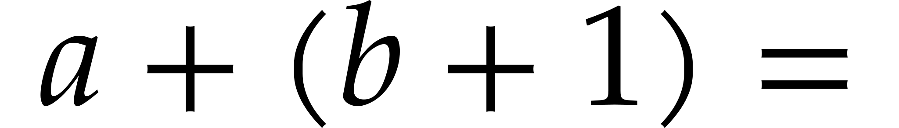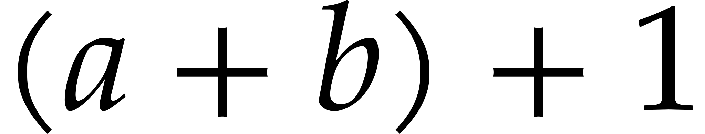

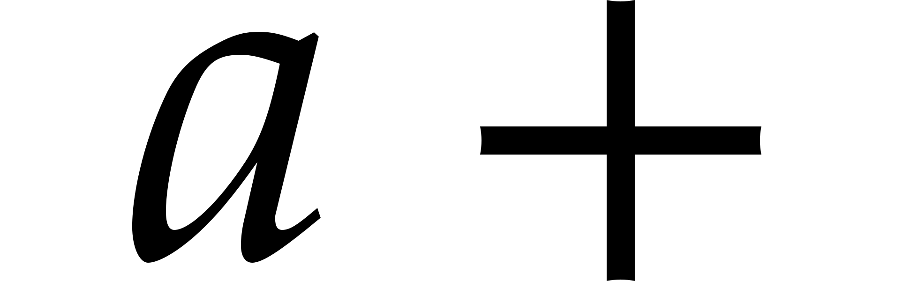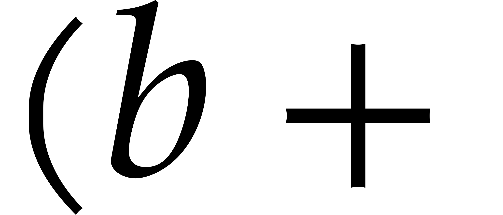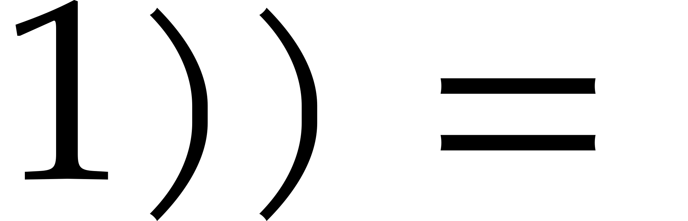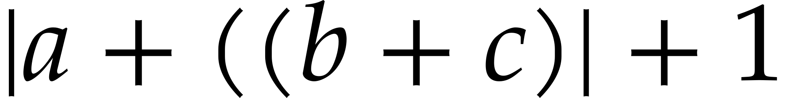

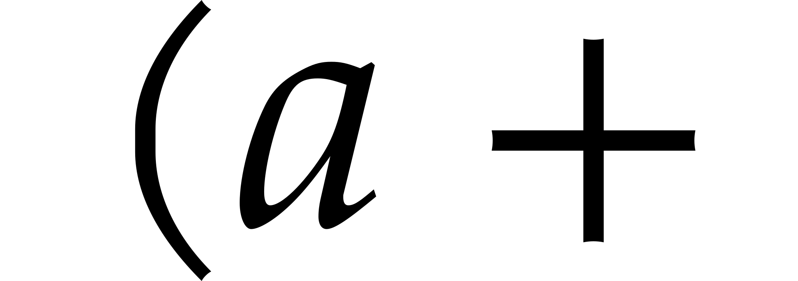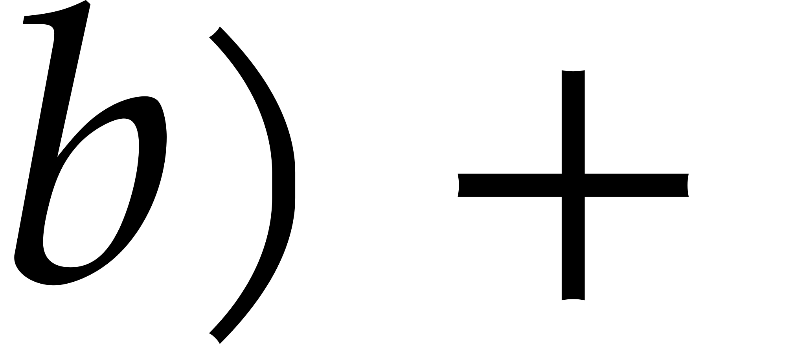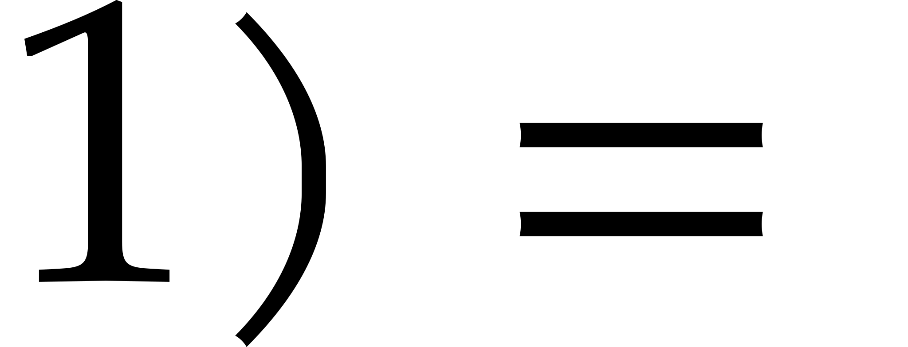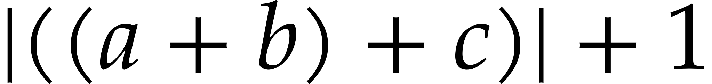

### [41r\[3\]](https://cdn.wittgensteinnachlass.com/2000px/webp/Ms-112/41r.webp)

But of course one could highlight features like this in any proposition from which one infers something according to a rule. If I write, according to the rule a + b = b + a: r ∙ s + s ∙ r = s ∙ r + r ∙ s, then I could indicate the use of the rule by

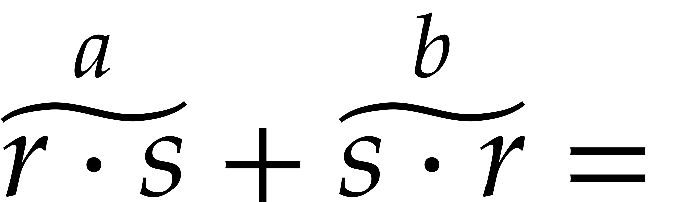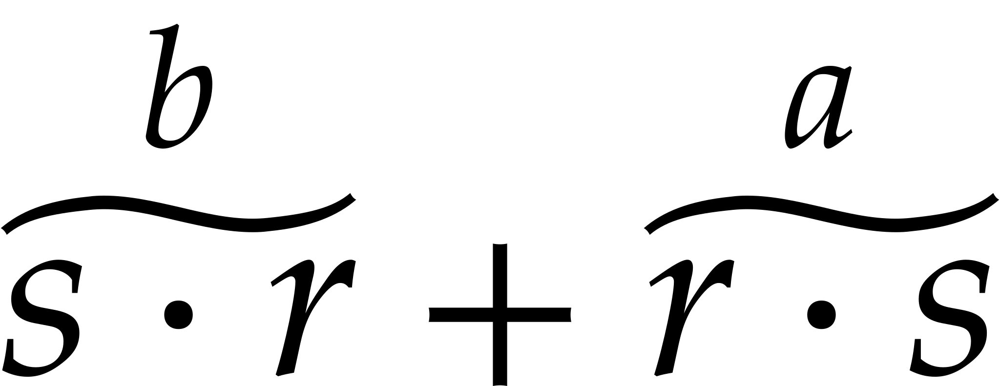

and so on..

### [41r\[4\]](https://cdn.wittgensteinnachlass.com/2000px/webp/Ms-112/41r.webp),[41r\[5\]](https://cdn.wittgensteinnachlass.com/2000px/webp/Ms-112/41r.webp)

But of course it would also have sufficed (i.e. it would have been a symbol of the same multiplicity) to write B & alongside it: 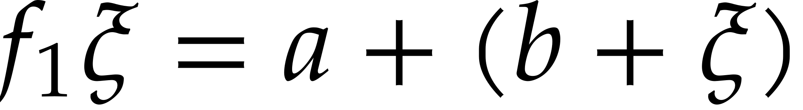, 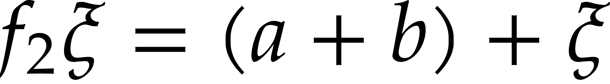. (And here again one must bear in mind that _every_ symbol – however explicit – _can_ be misinterpreted. –) And of course, to understand “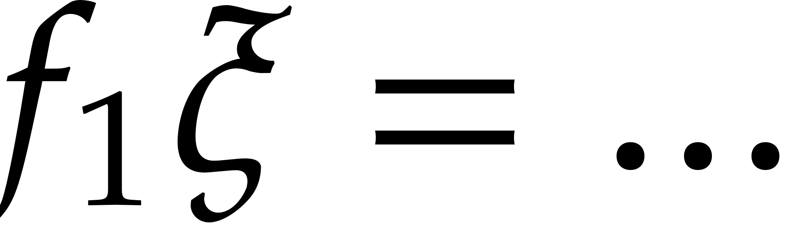” & “” alongside B, I have to see B in a certain way.

### [41v\[1\]](https://cdn.wittgensteinnachlass.com/2000px/webp/Ms-112/41v.webp)

The first person, say, to draw attention to the fact that B can be seen this way introduces a new sign; whether he combines the highlighting with B or instead writes the schema R beside it. For then it is R that is the new sign. Or, if one likes, B together with R.

### [41v\[2\]](https://cdn.wittgensteinnachlass.com/2000px/webp/Ms-112/41v.webp)

Whoever discovers that a proposition p follows from one of the form q⊃p ∙ q constructs a new sign, the sign of this rule. (I am assuming here that a calculus with p, q, ⊃, ∙ , had already been used before, & that this rule is now added & thereby creates a new calculus.)

### [41v\[3\]](https://cdn.wittgensteinnachlass.com/2000px/webp/Ms-112/41v.webp)

One might say, for instance: here the lower equation was used as a + b = b + a; and analogously: here B was used as A, but B was read, as it were, crosswise. Or: B was used as A, but the new equation is put together from α ∙ β ∙ γ in such a way that, in (now) reading A out of B, one does not read α ∙ β ∙ γ in that abbreviated form in which one has the premiss before one in the conclusion.

### [42r\[1\]](https://cdn.wittgensteinnachlass.com/2000px/webp/Ms-112/42r.webp)

When I say: α ∙ β ∙ γ does not yet correspond to the general proposition of word-language, I mean, say, that one can read “α ∙ β ∙ γ” without being struck by what counts for us as the expression of the general proposition. Only word-language would like to say: This proposition α ∙ β ∙ γ corresponds to the schema R, so … holds; whereas we say: this proposition corresponds to the schema R; & add no “so”. But how is this proposition expressed in the symbolism?

### [42r\[2\]](https://cdn.wittgensteinnachlass.com/2000px/webp/Ms-112/42r.webp)

Is this not the case of “‘fa’ & ‘Fa’ have the same component”? And yet I said that this had to _show itself_. And would it be _said_ by my writing “f(a) & F(a)”? Then I would need a further sentence saying that there is a stroke beneath each of the two ‘a’s.

### [42r\[3\]](https://cdn.wittgensteinnachlass.com/2000px/webp/Ms-112/42r.webp),[42v\[1\]](https://cdn.wittgensteinnachlass.com/2000px/webp/Ms-112/42v.webp)

Now what does it mean to say: “I draw your attention to the fact that the same argument occurs here in both function signs (perhaps you did not notice it)”? Does this mean that he had not understood the sentence? And yet there was something he did not notice that belonged essentially to the sentence; not as if it could be this sentence & yet lack a certain property (an external property) that he had not noticed. (Here one sees again what kind of thing it is that one calls “understanding a sentence”.)

### [42v\[2\]](https://cdn.wittgensteinnachlass.com/2000px/webp/Ms-112/42v.webp)

When I say that one does not regard α ∙ β ∙ γ as a proposition, I mean that I do not use its signs in the order in which I touch on them in reading through the proposition. And this shows itself when I explain the inductive conception of the proposition & in doing so demonstrate how the schema B is applied in writing out one step after another in the induction. Then I am using the complex crosswise. And this use is precisely what shows me how I conceive of the complex. The equations α, β, γ came about lengthwise & I am now using them crosswise.

### [42v\[3\]](https://cdn.wittgensteinnachlass.com/2000px/webp/Ms-112/42v.webp),[43r\[1\]](https://cdn.wittgensteinnachlass.com/2000px/webp/Ms-112/43r.webp)

Is not the complex B, conceived as a logical product & on the other hand as the schema of the periodic calculation, as different as, say, the cardinal number 1 is from the real number 1?

### [43r\[2\]](https://cdn.wittgensteinnachlass.com/2000px/webp/Ms-112/43r.webp)

I say that B, understood as a sign of induction, now belongs to a new system. (This is even clearer in periodic division. Infinity comes into consideration, though previously it had nothing at all to do with the calculation.)

### [43r\[3\]](https://cdn.wittgensteinnachlass.com/2000px/webp/Ms-112/43r.webp)

If I said that the new sign with the emphases must after all be derived from the old one without the emphases, that says nothing, since I can consider the sign with the emphases apart from how it came about. It then presents itself to me [Frege] as three equations, i.e. as the figure of three equations with certain underlinings etc. That this figure is quite analogous to that of the three equations without the underlinings is indeed significant, just as it is significant that the cardinal number 1 & the rational number 1 follow the same rules, but it does not prevent us from having a new sign here.

### [43v\[1\]](https://cdn.wittgensteinnachlass.com/2000px/webp/Ms-112/43v.webp)

But even in the inductive use of B, is it not essential to the equations β & γ that they were derived “at full length”? – After all, I can put the whole chain of derivation in place of β & γ.

### [43v\[2\]](https://cdn.wittgensteinnachlass.com/2000px/webp/Ms-112/43v.webp)

I am now doing something quite new with these signs.

### [43v\[3\]](https://cdn.wittgensteinnachlass.com/2000px/webp/Ms-112/43v.webp)

Is it not here as in the case I once supposed, in which Frege & Russell’s calculus of truth-functions had been carried on with the combination ~p ∙ ~q of the signs “~” & “ ∙ ” without anyone noticing, & Scheffer, instead of giving a new definition, had now merely drawn attention to a peculiarity of the signs already in use?

### [43v\[4\]](https://cdn.wittgensteinnachlass.com/2000px/webp/Ms-112/43v.webp)

Besides, all mathematical discoveries are of this kind, & this is only an extreme case in which we have been brought (in a certain sense) very close to the discovery in the symbolism.

### [43v\[5\]](https://cdn.wittgensteinnachlass.com/2000px/webp/Ms-112/43v.webp)

One could have gone on dividing without ever noticing the periodicity. Once one has seen it, one has seen something new.

### [44r\[1\]](https://cdn.wittgensteinnachlass.com/2000px/webp/Ms-112/44r.webp)

But could one not then extend this & say: “I could have multiplied numbers by one another without ever noticing the special case of my multiplying a number by itself, & so x² is not simply ‘x ∙ x’.” One could call the creation of the sign “x²” the expression of having noticed this special case. Or, one could (always) have multiplied a by b and divided by c without noticing that one can also write “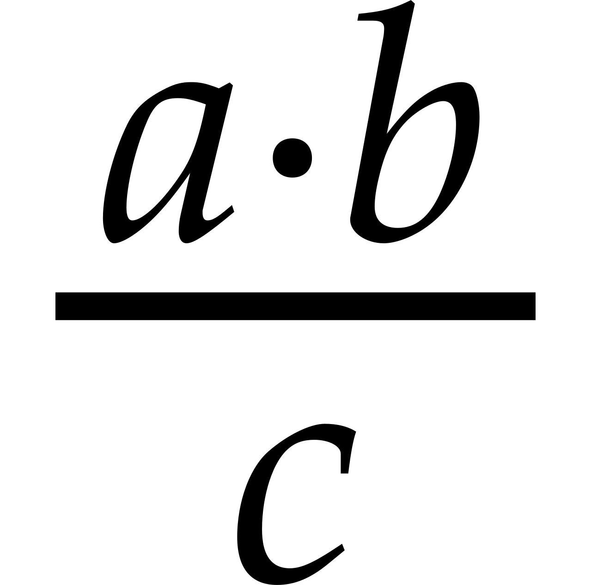” as “” & that this is analogous to a ∙ b. And further: this is surely the case of the savage who does not yet see the analogy between ∣∣∣∣∣ & ∣∣∣∣∣∣, or the one between ∣∣ & ∣∣∣∣∣.

### [44r\[2\]](https://cdn.wittgensteinnachlass.com/2000px/webp/Ms-112/44r.webp)

The question “can many be distributed among many?” has no sense. (On the system 1, 2, 3, 4, 5, many)

### [44r\[3\]](https://cdn.wittgensteinnachlass.com/2000px/webp/Ms-112/44r.webp)

A sentence based on an incorrect calculation (such as “he divided the 3 m long board into 4 parts of 1 m each”) has no sense, & this sheds light on the sense of the expressions “to have sense” & “to mean something by the sentence”.

### [44v\[1\]](https://cdn.wittgensteinnachlass.com/2000px/webp/Ms-112/44v.webp)

It makes sense to say: I distributed many among many. But the sentence “I could not distribute the many nuts among the many people” cannot mean that it was logically impossible. Nor can one say: “in some cases it is possible to distribute many among many, in some it is not”; for then I ask: in _which_ cases is this possible & in which impossible? And that could no longer be answered in the many-system.

### [44v\[2\]](https://cdn.wittgensteinnachlass.com/2000px/webp/Ms-112/44v.webp),[45r\[1\]](https://cdn.wittgensteinnachlass.com/2000px/webp/Ms-112/45r.webp)

In the notation “x²” the possibility of replacing one of the x’s with another number really does disappear. Indeed, two stages in the discovery (or construction) of x² would be conceivable. One might, for instance, first put “x⁼” instead of “x²”, before being struck by the existence of the system x ∙ x, x ∙ x ∙ x, etc., & only then hit upon it. Something similar has happened countless times in mathematics. (Liebig did not yet designate an oxide in such a way that the oxygen in it appeared as an element on an equal footing with the oxidized element. And, strange as it sounds, even with all the data known to us today & at any other time, one could give oxygen such an exceptional position by means of a tremendously artificial interpretation – i.e. a grammatical construction – of course only in the _form of representation_.)

### [45r\[2\]](https://cdn.wittgensteinnachlass.com/2000px/webp/Ms-112/45r.webp)

25.10.1931

So what I want to say is: one had to discover x² just as one had to discover the inductive feature in B (and the irrational numbers). And in so doing one constructed a new system in each case. But is it not still the case that x² = x ∙ x? – And suppose we now stipulate by definition:

in general:

### [45r\[3\]](https://cdn.wittgensteinnachlass.com/2000px/webp/Ms-112/45r.webp)

The 2 in “x²” really could still be replaced by any other sign, so long as one has not yet brought it into connection with the other powers.

### [45r\[4\]](https://cdn.wittgensteinnachlass.com/2000px/webp/Ms-112/45r.webp),[45v\[1\]](https://cdn.wittgensteinnachlass.com/2000px/webp/Ms-112/45v.webp)

Here one must now say that one cannot understand the definition of ξ𝒥η at all unless one already sees the left-hand side of the definition according to the new system. This also holds, incidentally, for x ∙ x = x², for someone might misunderstand this definition & believe that according to it (x ∙ x) ∙ (x ∙ x) = x³. And that is why the general definition of ξ․𝒥․η has a quite new generality; i.e. the signs “”, “” are as yet entirely unknown in the old calculus with a, b, c.

### [45v\[2\]](https://cdn.wittgensteinnachlass.com/2000px/webp/Ms-112/45v.webp),[46r\[1\]](https://cdn.wittgensteinnachlass.com/2000px/webp/Ms-112/46r.webp)

But someone who had misunderstood the exponent in this way, for example, would still calculate correctly with the sign “x²” as long as he used it only as an abbreviation for “x ∙ x”. What shows that we go beyond the old system here, however, is the _general_ explanation of the exponent, say , because it contains signs (“”) that do not occur in the algebra that knows no powers, even if it knows the expressions “x ∙ x”, “x ∙ x ∙ x”. In the wording of the last sentence, “even if it knows the expressions ‘x ∙ x’, ‘x ∙ x ∙ x’”, I of course deliberately left out the ‘etc.’, for that is precisely what the new construction adds. (The ‘etc.’ would not be an abbreviation here, as has so often been remarked. If I say “at the concert were my siblings Paul, Gretl, etc.”, the ‘etc.’ _is_ an abbreviation here. An abbreviation must stand for something that is not written down. So the expression that it is “not written down” (and likewise its opposite) must not be nonsense.)

### [46r\[2\]](https://cdn.wittgensteinnachlass.com/2000px/webp/Ms-112/46r.webp)

With the definitions x ∙ x = x², x ∙ x ∙ x = x³, x ∙ x ∙ x ∙ x = x⁴ only the signs x², x³, x⁴ come into the world (and thus far it was not yet necessary to write numerals as exponents). The recursive definition of  does not express something that was already there in the calculus with x², x³, x⁴ & only had to be found, but signifies a new construction. (One that fills no earlier gap.)

### [46r\[3\]](https://cdn.wittgensteinnachlass.com/2000px/webp/Ms-112/46r.webp)

One question would be what an algebra that worked entirely without induction would look like. How do things stand in this respect in the “algebra of logic” as Frege & Russell use it? In it no recursive definitions are given & no recursive proofs are carried out.

### [46r\[4\]](https://cdn.wittgensteinnachlass.com/2000px/webp/Ms-112/46r.webp),[46v\[1\]](https://cdn.wittgensteinnachlass.com/2000px/webp/Ms-112/46v.webp)

When I said earlier that one cannot understand the definition of ξ․𝒥․η “unless one already sees the left-hand side of the definition in the new system”, this really means no more than that the two sides together form _one_ sign. That they have meaning only in relation to one another. And the same holds when one writes “Fa, and a ≝ f(b)” or “Fa, where a ≝ f(b)”. Here too Fa & the definition really form _one_ sign, – or, more correctly & without mythology: they belong together & I could just as well have written: F(a) ≝ F(f(b)).

### [46v\[2\]](https://cdn.wittgensteinnachlass.com/2000px/webp/Ms-112/46v.webp)

But this too misrepresents the matter. One could quite well have understood the definition U as an – as it were, arbitrary – abbreviation of the expression α ∙ β ∙ γ, and thus without seeing the system to which it belongs on our understanding. The definition so considered is different from the one we mean, which one could distinguish from the first by means of emphases. But in doing so we would in fact be giving the general definition V. And that means: to understand the first definition as I meant it is to understand it as an equation that accords with the definition V (the general definition).

### [47r\[1\]](https://cdn.wittgensteinnachlass.com/2000px/webp/Ms-112/47r.webp)

I could put it this way: one could see the definition U without knowing _why_ I define it this way. One could see the definition without understanding its point. – But this point is precisely something new, something not yet contained in it as a special replacement rule.

### [47r\[2\]](https://cdn.wittgensteinnachlass.com/2000px/webp/Ms-112/47r.webp)

Nor, of course, is “I” an equality sign in the sense in which such signs occur in α, β & γ.

### [47r\[3\]](https://cdn.wittgensteinnachlass.com/2000px/webp/Ms-112/47r.webp)

But one can easily show that “I” has certain formal properties in common with =.

### [47r\[4\]](https://cdn.wittgensteinnachlass.com/2000px/webp/Ms-112/47r.webp)

But I did say: when one derives A from α ∙ β ∙ γ, one does not consider α ∙ β ∙ γ a sentence at all! Does that not mean: in the definition U the right-hand side is not a sentence in the same sense as the left-hand side, since the function I cannot occur in the system of sentences on the left-hand side?

### [47r\[5\]](https://cdn.wittgensteinnachlass.com/2000px/webp/Ms-112/47r.webp)

The first system is, as it were, innocent of I. It plays its games with a, b, c, +, =, and cannot itself notice that I comes into being.

### [47v\[1\]](https://cdn.wittgensteinnachlass.com/2000px/webp/Ms-112/47v.webp)

Which of course again means nothing other than that it is not U but V that is a definition of I.

### [47v\[2\]](https://cdn.wittgensteinnachlass.com/2000px/webp/Ms-112/47v.webp)

The process of generalization creates a new system of signs.

### [47v\[3\]](https://cdn.wittgensteinnachlass.com/2000px/webp/Ms-112/47v.webp)

The fact that one says “_the correctness_ of the equation has been proved” already shows that not every derivation is a proof.

### [47v\[4\]](https://cdn.wittgensteinnachlass.com/2000px/webp/Ms-112/47v.webp)

The real discovery is the one that makes me capable of stopping philosophizing whenever I want. The one that brings philosophy to rest, so that it is no longer tormented by questions that call _philosophy itself_ into question. Instead, a method is now demonstrated through examples, & one can stop the series of these examples.

### [47v\[5\]](https://cdn.wittgensteinnachlass.com/2000px/webp/Ms-112/47v.webp)

But it would be more correct to say: problems are solved, not _one_ problem.

### [PG II](/w-pg-2/#ms-112-47v.6+48r.1) [47v\[6\]](https://cdn.wittgensteinnachlass.com/2000px/webp/Ms-112/47v.webp),[48r\[1\]](https://cdn.wittgensteinnachlass.com/2000px/webp/Ms-112/48r.webp)

It is a very important observation that the c in A is not the same variable as the c in β & γ. So I have not written down the proof quite correctly, and in a respect that is very important for us. In A we could put n in place of c, whereas the c’s in β & γ are identical. But there is also this to ask: can I now derive from A that i + (k + c) = (i + k) + c? and, if so, why not straight from B? So are a & b in A not identical with a & b in α, β & γ either?

### [48r\[2\]](https://cdn.wittgensteinnachlass.com/2000px/webp/Ms-112/48r.webp)

B now simply takes the place of A.

### [48r\[3\]](https://cdn.wittgensteinnachlass.com/2000px/webp/Ms-112/48r.webp)

This remark is as important as any about a difference in the _bone structure_ of two animals.

### [48r\[4\]](https://cdn.wittgensteinnachlass.com/2000px/webp/Ms-112/48r.webp)

At first sight there seem to be two stages in the generality of the proof: we could first put two particular numbers, 4 & 5, in place of a & b in B, & the result would then be 4 + (5 + n) = (4 + 5) + n. And now we could take a further step in generality & put “general numbers” in place of 4 & 5.

### [PG II](/w-pg-2/#ms-112-48r.5+48v.1) [48r\[5\]](https://cdn.wittgensteinnachlass.com/2000px/webp/Ms-112/48r.webp),[48v\[1\]](https://cdn.wittgensteinnachlass.com/2000px/webp/Ms-112/48v.webp)

That the variable c in B is not identical with c in A is clear when one substitutes a number for it. B then reads, for example:

but it is not the equation AW: 4 + (5 + 6) = (4 + 5) + 6 that corresponds to this!

### [48v\[2\]](https://cdn.wittgensteinnachlass.com/2000px/webp/Ms-112/48v.webp)

Considered as a proof by induction, W does not justify that particular transition in AW. Any more than it justifies the transition 4 + (5 + 2) = (4 + 5) + 2.

### [48v\[3\]](https://cdn.wittgensteinnachlass.com/2000px/webp/Ms-112/48v.webp)

Should there now be a ‘c’ or an ‘n’ on the right-hand side of the definition U? A c, since the right-hand side is nothing more than an abbreviation of the right-hand side. (Applied to the preceding case, what would be written instead of W is thus 4 + (5 + 6) ․J․ (4 + 5) + 6. But that would not be the equation AW.)

### [48v\[4\]](https://cdn.wittgensteinnachlass.com/2000px/webp/Ms-112/48v.webp)

As for the irrational numbers, my investigation says only that it is wrong (or misleading) to speak of irrational numbers in such a way as to contrast them, as a kind of number, with the cardinal & rational numbers, because what one actually calls “irrational numbers” are different kinds of number, – as different from one another as the rational numbers are from each of them.

### [48v\[5\]](https://cdn.wittgensteinnachlass.com/2000px/webp/Ms-112/48v.webp),[49r\[1\]](https://cdn.wittgensteinnachlass.com/2000px/webp/Ms-112/49r.webp)

Nor would it be its particular justification. So if one wants to write down the form of the numerical equation justified by W (thus what is “proved”), it must read: 4 + (5 + n) = (4 + 5) + n.

### [49r\[2\]](https://cdn.wittgensteinnachlass.com/2000px/webp/Ms-112/49r.webp)

But if I substitute particular numbers for a & b in B in this way, the proof changes its character in that β & γ now no longer arise from α but only from the earlier, general α. And this in turn gives us an insight into the proof. For even in its general form, β & γ are not actually constructed with the aid of α but with the aid of an algebraic paradigm of the form α (which, incidentally, can contain quite different variables).

### [49r\[3\]](https://cdn.wittgensteinnachlass.com/2000px/webp/Ms-112/49r.webp)

Let us not forget that U & W (like all definitions) merely introduce abbreviations that could just as well be omitted. So no decisive logical step has been taken by means of these definitions. But one has been taken by means of the new understanding of their left-hand sides. Or, more correctly, by their construction, which was thus wrongly written in the same way as the _old_ sign α ∙ β ∙ γ. The only correct expression of the logical step is the introduction of a new sign.

### [49r\[4\]](https://cdn.wittgensteinnachlass.com/2000px/webp/Ms-112/49r.webp),[49v\[1\]](https://cdn.wittgensteinnachlass.com/2000px/webp/Ms-112/49v.webp)

[I am extraordinarily clumsy, but that is precisely why I see the difficulties that someone more skilful would pass by.]

### [49v\[2\]](https://cdn.wittgensteinnachlass.com/2000px/webp/Ms-112/49v.webp)

I asked above: is my assertion that in the inductive procedure α ∙ β ∙ γ is not understood as a sentence not expressed by saying that in U the right-hand side is not a sentence in the same sense as the left-hand side? But the expression of this assertion is that α ∙ β ∙ γ with the emphases is a sentence in a different sense from α ∙ β ∙ γ without the emphases.

### [49v\[3\]](https://cdn.wittgensteinnachlass.com/2000px/webp/Ms-112/49v.webp)

One could say: what I say about B & i + (k + l) = (i + k) + l also applies to the case of the proof of (a + b)² = a² + 2ab + b². Here too one could stop before the last transformation & carry it out only in an application to (i + k)².

### [49v\[4\]](https://cdn.wittgensteinnachlass.com/2000px/webp/Ms-112/49v.webp)

[My method is to let myself be puzzled by the same things again and again.]

### [49v\[5\]](https://cdn.wittgensteinnachlass.com/2000px/webp/Ms-112/49v.webp)

The question about verification is only another form of the question “what do you mean by that?”.

### [PG II](/w-pg-2/#ms-112-49v.6+50r.1) [49v\[6\]](https://cdn.wittgensteinnachlass.com/2000px/webp/Ms-112/49v.webp),[50r\[1\]](https://cdn.wittgensteinnachlass.com/2000px/webp/Ms-112/50r.webp)

In the fact that the c in B is not identical with the c in A, or: in the fact that one can fill the two places with different letters, what distinguishes the proof by induction from a proof of A is, I think, expressed.

### [50r\[2\]](https://cdn.wittgensteinnachlass.com/2000px/webp/Ms-112/50r.webp)

It is not only highly significant that one can see ∣∣∣∣∣ in a variety of ways (in a variety of groupings), but still much more remarkable that one can do so at will. That is, that there is a quite definite process of getting a particular “conception” on command; & that – correspondingly – there is also a quite definite process of trying in vain. Thus on command one can see the figure

in such a way that one vertical stroke or another becomes the nose, this or that stroke the mouth, and in certain circumstances one can try one or the other in vain.

### [50r\[3\]](https://cdn.wittgensteinnachlass.com/2000px/webp/Ms-112/50r.webp),[50v\[1\]](https://cdn.wittgensteinnachlass.com/2000px/webp/Ms-112/50v.webp)

The essential point here is that this attempt has the character of an attempt to lift a weight by hand; not the character of an attempt in which one does various things, tries out various means, in order, for example, to lift a weight. In the two cases the word “attempt” has quite different meanings. (A grammatical fact with extraordinarily far-reaching consequences.)

### [50v\[2\]](https://cdn.wittgensteinnachlass.com/2000px/webp/Ms-112/50v.webp)

[In writing I often get ahead of my thinking!]

### [50v\[3\]](https://cdn.wittgensteinnachlass.com/2000px/webp/Ms-112/50v.webp)

The flow of numbers through B shows the associative law.

### [PG II](/w-pg-2/#ms-112-50v.4) [50v\[4\]](https://cdn.wittgensteinnachlass.com/2000px/webp/Ms-112/50v.webp)

Does what I have written above mean anything other than that the appearance of an algebraic proof of A arises because we think we find the same variables a, b, c in the equations A as in α, β, γ, & therefore take A to be the result of a transformation of those equations? (Whereas in reality I give the written sign α β γ a quite new interpretation, which involves c in β & γ not being used as a variable in the same way as a & b. So the fact that c does not occur in A is an expression of this different interpretation of B.)

### [PG II](/w-pg-2/#ms-112-50v.5+51r.1) [50v\[5\]](https://cdn.wittgensteinnachlass.com/2000px/webp/Ms-112/50v.webp),[51r\[1\]](https://cdn.wittgensteinnachlass.com/2000px/webp/Ms-112/51r.webp)

What I said about the change in how we understand α β γ I could now put this way: β & γ arise with the aid of α just as, for example, (a + b)² = a² + 2ab + b² arises with the aid of the basic algebraic equations. But once they have been derived in this way, we consider the complex α β γ in a new way, by giving the variable c a different function from a and b. (c becomes the hole through which the stream of numbers has to flow.)

### [51r\[2\]](https://cdn.wittgensteinnachlass.com/2000px/webp/Ms-112/51r.webp)

One could also put it (simply) like this: the recursive _application_ of the equation in letters differs from its non-inductive application. The definition a + (b + 1) = (a + b) + 1 applied non-inductively to 4 & 5 gives, for a = 4 & b = 5, 4 + (5 + 1) = (4 + 5) + 1 & this equation is the result of the application of α. The recursive application of α to 4 & 5 (a = 4, b = 5) consists in producing a series of equations 4 + (5 + 1) = (4 + 5) + 1 = (4 + (4 + 1)) + 1 = ((4 + 4) + 1 ( + 1) = ((4 + (3 + 1)) + 1) + 1) = etc. (_here_ “etc.” is an abbreviation). Likewise, the non-inductive application of B to 4, 5, 7 consists in substituting these numbers for the variables. The inductive application, by contrast, consists in producing a series of equations that begins with 4 + (5 + 1) = (4 + 5) + 1 & ends with 4 + (5 + 7) = (4 + 5) + 7).

### [51v\[1\]](https://cdn.wittgensteinnachlass.com/2000px/webp/Ms-112/51v.webp)

One can say here: the application of the variables is their sense.

### [51v\[2\]](https://cdn.wittgensteinnachlass.com/2000px/webp/Ms-112/51v.webp)

Or: The description of the application of the sign supplements the sign & yields something different in the two cases.

### [51v\[3\]](https://cdn.wittgensteinnachlass.com/2000px/webp/Ms-112/51v.webp)

After all, the description of the application of the sign is itself a sign & can be used in place of the first. One could quite well understand the emphases as a description of the inductive application of B.

### [51v\[4\]](https://cdn.wittgensteinnachlass.com/2000px/webp/Ms-112/51v.webp),[52r\[1\]](https://cdn.wittgensteinnachlass.com/2000px/webp/Ms-112/52r.webp)

If prizes are offered for solving – say – Fermat’s problem, then one might say to me: how can you maintain that there is no such problem, if prizes are offered for the solution then presumably the problem must exist. I would have to say: Certainly; it is just that those who talk about it misunderstand the grammar of the expression “mathematical problem” & of the word “solution”. The prize is really offered for the solution to a task in natural science, (as it were) for the _outward aspect_ of the solution (that is why one speaks, for example, of a Riemann _hypothesis_). The conditions of the task are external, and when the task is solved, what has happened corresponds to the task as set in the way that the solution to a task in physics corresponds to that task.

### [52r\[2\]](https://cdn.wittgensteinnachlass.com/2000px/webp/Ms-112/52r.webp)

If the task were to find a construction of the regular pentagon, the construction as specified in this task is characterized by the physical feature that it is actually to yield _a measurement-defined_ regular 5-gon. For we do not yet have the concept of _constructive division into five_ (or of the _constructive 5-gon_) at all [we only acquire it through the construction.]

### [52r\[3\]](https://cdn.wittgensteinnachlass.com/2000px/webp/Ms-112/52r.webp)

Likewise in Fermat’s theorem we have an empirical formation that we interpret as a _hypothesis_, and hence – of course – not as the end of a construction. So the task in a certain sense asks for something other than what the solution gives.

### [52r\[4\]](https://cdn.wittgensteinnachlass.com/2000px/webp/Ms-112/52r.webp),[52v\[1\]](https://cdn.wittgensteinnachlass.com/2000px/webp/Ms-112/52v.webp)

The sign B in the proof is thus understood inductively, but the proved A is not (rather, it is again a sign like α in the derivation of β & γ). And the deception, as though A were ‘proved’ in the old sense of the word – that is, like β & γ – lies in the fact that one does not notice this logical difference.

### [52v\[2\]](https://cdn.wittgensteinnachlass.com/2000px/webp/Ms-112/52v.webp)

Of course the proof of the contrary of Fermat’s theorem, for example, also stands in the same relation to the task as the proof of the theorem. (Proof of the impossibility of a construction.)

### [52v\[3\]](https://cdn.wittgensteinnachlass.com/2000px/webp/Ms-112/52v.webp)

How far should the philosopher meddle in mathematics?

### [52v\[4\]](https://cdn.wittgensteinnachlass.com/2000px/webp/Ms-112/52v.webp)

26.10.1931

The philosophical joke.

### [52v\[5\]](https://cdn.wittgensteinnachlass.com/2000px/webp/Ms-112/52v.webp)

I could carry out algebraic _calculations_ & always refer only to the ‘proofs I, II, III, etc.’, never to the ‘proved propositions’. But if one had calculated (a + b)² = etc. in this way & then again made an application to (s ∙ t + i ∙ k)², one would arrive at the fact that, just as one used (a + b)² = etc. here, an equation a + (b + c) = (a + b) + c had earlier been used implicitly. That is, instead of referring to B, one could have referred to such an equation. But one could not now say that this equation had been derived from B, any more than the equation i + (k + l) = (i + k) + l had been derived earlier. And no more than the equation (i + k)² = etc. had been derived from (a + b)² = etc.

### [52v\[6\]](https://cdn.wittgensteinnachlass.com/2000px/webp/Ms-112/52v.webp),[53r\[1\]](https://cdn.wittgensteinnachlass.com/2000px/webp/Ms-112/53r.webp)

What does it mean, then, that all the transitions in my calculations (e.g. in (i + k)² = etc.) take place according to these (particular) rules? Surely only that they are all of the kind of transitions in I, II, III, etc. The associative law establishes one kind of transition, gives an example of it, & so do the other laws. If, for example, I write down the chain of equations of the proof (a + b)² = …, each of these equations is formed on the model of one of the fundamental laws; and we then say that the transition takes place _according to_ this fundamental law.

### [53r\[2\]](https://cdn.wittgensteinnachlass.com/2000px/webp/Ms-112/53r.webp)

(The associative law is the model of the associative transition.)

### [53r\[3\]](https://cdn.wittgensteinnachlass.com/2000px/webp/Ms-112/53r.webp)

The proof B shows something about A.

### [53r\[4\]](https://cdn.wittgensteinnachlass.com/2000px/webp/Ms-112/53r.webp),[53v\[1\]](https://cdn.wittgensteinnachlass.com/2000px/webp/Ms-112/53v.webp)

A is the general form of the equations of numbers that B proves. And _this_ proposition itself brings us no closer to applying A than A itself does & is only a translation of A itself. And algebraic notation is used to tell me how I am to calculate, for example, in the case of (17 + 18)², by telling me “(a + b)² = etc.” That is, I am to calculate according to this equation. And in this respect one could call our induction a proof of the algebraic equation. For I could say: Calculate according to this equation, _it_ has been proved.

### [53v\[2\]](https://cdn.wittgensteinnachlass.com/2000px/webp/Ms-112/53v.webp)

(“Let him stew in his own juice”, is often the last word in a philosophical back-and-forth; the understanding is thrown back from the apparent question until, although it has not been solved, its attitude has been put right by the rebounds.)

### [53v\[3\]](https://cdn.wittgensteinnachlass.com/2000px/webp/Ms-112/53v.webp),[54r\[1\]](https://cdn.wittgensteinnachlass.com/2000px/webp/Ms-112/54r.webp)

The critical point in the preceding proposition lies in the expression “how I am to calculate, for example, in the case of (17 + 18)² …”. If, in the case of (17 + 18)², I give someone the calculation rule (a + b)² = etc., this cannot do more than directly give the rule (17 + 18)² = 17² + 2 ∙ 17 ∙ 18 + 18². For convenience, if “(a + b)² = etc.” has already been written down somewhere, I could of course point to it, but what operates in this rule is only what is also contained in the particular rule concerning the numbers. And the same naturally applies if I accumulate the examples. I never get beyond the particular rules concerning numbers. The crux lies in the word “e.g.” in the passage quoted. This word makes the calculation (17 + 18)² an _example_, and hence already an expression of the algebraic rule. The understanding repeatedly butts its head against this here, in attempting to resolve generality into a list of examples. That is, it wants to repeat the general proposition, but not repeat it generally. It wants to mediate between the general and particular cases.

### [54r\[2\]](https://cdn.wittgensteinnachlass.com/2000px/webp/Ms-112/54r.webp)

(The philosopher exaggerates, cries out, as it were, in his helplessness, as long as he has not yet discovered the core of the confusion.)

### [54r\[3\]](https://cdn.wittgensteinnachlass.com/2000px/webp/Ms-112/54r.webp)

…Calculate according to this equation, _it_ has been proved. And on the other hand, it has only been proved insofar as it is the form of the equations of numbers that have their justification in the induction. (Misleading again! Because it sounds as though we had a totality of equations of numbers that would be equivalent to their form. For the equation of numbers is nothing but the equation of numbers, & the conception of the form is already algebra.)

### [54r\[4\]](https://cdn.wittgensteinnachlass.com/2000px/webp/Ms-112/54r.webp)

What is the relation between: the number-game 17 + (18 + 20) = …, proposition A & proof B?

### [54v\[1\]](https://cdn.wittgensteinnachlass.com/2000px/webp/Ms-112/54v.webp)

(One has to _struggle one’s way through_ to a way of putting it.)

### [54v\[2\]](https://cdn.wittgensteinnachlass.com/2000px/webp/Ms-112/54v.webp)

Does B express less clearly than A how one is to calculate in the particular case?

### [54v\[3\]](https://cdn.wittgensteinnachlass.com/2000px/webp/Ms-112/54v.webp)

BI, BII are proofs of 17 + (28 + 14) = …, 17 + 1 = 1 + 17 etc. If that is true, then they are also, in this respect, proofs of AI, AII etc., but only in this respect (insofar as) A is the form of the numerical example, and hence not generally. Besides their proving power for the particular numerical example, they then possess a formal property, which consists precisely in the fact that B is constructed in such-and-such a way (as one can describe it). And there is no more to it.

### [54v\[4\]](https://cdn.wittgensteinnachlass.com/2000px/webp/Ms-112/54v.webp)

R is the general description of B whose necessity one always feels.

### [54v\[5\]](https://cdn.wittgensteinnachlass.com/2000px/webp/Ms-112/54v.webp)

I say that (a + b)² = etc. is proved with the help of AI AII etc. because the transitions from (a + b)² to a² + 2ab + b² are all of the form AI, or AII, etc. In this sense, in III the transition from (b + 1) + a to (b + a) + 1 is also made according to AI, but not the transition from a + n to n + a!

### [55r\[1\]](https://cdn.wittgensteinnachlass.com/2000px/webp/Ms-112/55r.webp)

We can say, on the one hand, that BI proves 17 + (25 + 18) = …, and on the other hand describe BI, or BI, BII and others. We can also emphasize what _these_ all have in common. But that must suffice in any case.

### [55r\[2\]](https://cdn.wittgensteinnachlass.com/2000px/webp/Ms-112/55r.webp),[55v\[1\]](https://cdn.wittgensteinnachlass.com/2000px/webp/Ms-112/55v.webp)

If we look at I, II & III, we see that the equations A are always found at a particular place in B; that is, they can be read off from a particular place in B, & furthermore that there is also a certain analogy between the Bs; one could easily describe it completely. And it is completely described by the emphases. It is simply a matter of _these_ (particular) cases. A generality in this respect that goes beyond the cases dealt with does not enter into our calculus. This is a contradiction: for when I describe what all _these_ cases have in common, I thereby go beyond these cases. In the case of primary colours, for example, I cannot _describe_ what they have in common & their class is (at the same time) their concept. But if I can describe what certain signs have in common, I have thereby given a general description, for if what I describe belonged _essentially_ only to these three signs, it could be given only through the description of these three signs and not through the description which stands _above_ the descriptions of the individual signs insofar as _these descriptions are not contained in it_ (but perhaps only part of them). Emphasizing what is common is a new construction which thus goes beyond the old signs.

### [55v\[2\]](https://cdn.wittgensteinnachlass.com/2000px/webp/Ms-112/55v.webp)

One cannot describe generally & particularly at the same time.

### [55v\[3\]](https://cdn.wittgensteinnachlass.com/2000px/webp/Ms-112/55v.webp)

There is presumably a difference between the cases in which, on the one hand, BI, BII, BIII are constructed for AI, AII, AIII without seeing (or emphasizing) that there is an analogy between the Bs, and, on the other hand, emphasizing the analogy of the Bs. But it is true that emphasizing these analogies does not make the Bs into proofs.

### [55v\[4\]](https://cdn.wittgensteinnachlass.com/2000px/webp/Ms-112/55v.webp),[56r\[1\]](https://cdn.wittgensteinnachlass.com/2000px/webp/Ms-112/56r.webp)

Is it right to say: No further step can make B into a proof if it is not one after the first?

### [56r\[2\]](https://cdn.wittgensteinnachlass.com/2000px/webp/Ms-112/56r.webp)

Someone shows me the complexes B & I say “those are not proofs of the equations A”. Now he says: “But you do not yet see the system according to which these complexes are formed”, and shows it to me. How could that make the Bs into proofs? –

### [56r\[3\]](https://cdn.wittgensteinnachlass.com/2000px/webp/Ms-112/56r.webp)

Through this insight I ascend to a different, so to speak higher, level, whereas the _proof_ would have had to be carried out on the lower one.

### [56r\[4\]](https://cdn.wittgensteinnachlass.com/2000px/webp/Ms-112/56r.webp)

I look at B & say: this is not a proof of A. Now it is said: I shall show you that it is nevertheless a proof. But how can one show that, if it is simply not a proof of A? Now he demonstrates the recursive use of B to me. But what has that got to do with it?

### [56r\[5\]](https://cdn.wittgensteinnachlass.com/2000px/webp/Ms-112/56r.webp)

What I correctly felt was the independence of the conception of B from the question whether B can prove A.

### [56r\[6\]](https://cdn.wittgensteinnachlass.com/2000px/webp/Ms-112/56r.webp),[56v\[1\]](https://cdn.wittgensteinnachlass.com/2000px/webp/Ms-112/56v.webp)

Only a particular transition from equations to an equation is a proof of the latter. This transition has not been made here & everything else can have no influence on the matter (any more).

### [56v\[2\]](https://cdn.wittgensteinnachlass.com/2000px/webp/Ms-112/56v.webp)

– – – – – A generality in this respect that goes beyond the cases dealt with does not enter into our calculus. That is why we do not prove A by B, but it is quite correct that we prove something about A. Namely, that the left-hand side of A can be obtained in β & the right-hand side in γ with the help of α, while α itself is the value of A for n = 1.

### [56v\[3\]](https://cdn.wittgensteinnachlass.com/2000px/webp/Ms-112/56v.webp)

But can I not say that, if I have proved this about A, I have thereby proved A? And where then did the illusion that I had thereby proved it come from in the first place? for this illusion must have a deeper ground.

### [56v\[4\]](https://cdn.wittgensteinnachlass.com/2000px/webp/Ms-112/56v.webp),[57r\[1\]](https://cdn.wittgensteinnachlass.com/2000px/webp/Ms-112/57r.webp)

Well, if it is an illusion, then at any rate it came from our way of putting it in word-language: “this proposition holds for _all_ numbers”; for on this conception the algebraic proposition was after all just another way of writing this sentence. And this way of putting it led one to confuse the case of _all_ numbers with the case of all the people in this room. (Whereas, to distinguish the cases, we ask: how does one verify the one & how the other.)

### [57r\[2\]](https://cdn.wittgensteinnachlass.com/2000px/webp/Ms-112/57r.webp)

27.10.1931

If “to prove the algebraic proposition by means of the propositions p, q, r” means making the transitions in the chain of equations _correspond_ to the propositions p, q, r, then B is not a proof of A by means of α, nor a proof of a proposition that is proved by means of A. For I did not mediate the transition in A by means of α.

### [57r\[3\]](https://cdn.wittgensteinnachlass.com/2000px/webp/Ms-112/57r.webp)

If I imagine the functions φ, ψ, F to be exactly defined and now write down the schema of the proof by induction

– even then I cannot say that the transition from φr to ψr was made on the basis of ρ (if the transition in α, β, γ was made according to ρ (in special cases ρ = α)). It remains made in accordance with equation A, & I could say that it corresponds to the complex B only if I took this as another sign in place of equation A.

### [57r\[4\]](https://cdn.wittgensteinnachlass.com/2000px/webp/Ms-112/57r.webp),[57v\[1\]](https://cdn.wittgensteinnachlass.com/2000px/webp/Ms-112/57v.webp)

For the schema of the transition had to contain α, β & γ.

### [57v\[2\]](https://cdn.wittgensteinnachlass.com/2000px/webp/Ms-112/57v.webp)

In fact R is not the schema of the proof by induction BIII; that schema is much more complicated, since it must contain the schema BI.

### [57v\[3\]](https://cdn.wittgensteinnachlass.com/2000px/webp/Ms-112/57v.webp)

It is inadvisable to call something ‘proof’ only when the usual grammar of the word „proof” does not accord with the grammar of the object under consideration.

### [57v\[4\]](https://cdn.wittgensteinnachlass.com/2000px/webp/Ms-112/57v.webp)

What does it mean, then, to say that the transition is justified by R? The transition is made, or not made, & a complex of the form R can be constructed, or not constructed. But that is all. This too is only an expression of the fact that in B I do not find what I call a justification of the transition in A, namely, no mediation of this transition.

### [57v\[5\]](https://cdn.wittgensteinnachlass.com/2000px/webp/Ms-112/57v.webp)

In the end, the deep disquiet stems from a small but plainly visible feature of the inherited expression.

### [57v\[6\]](https://cdn.wittgensteinnachlass.com/2000px/webp/Ms-112/57v.webp),[58r\[1\]](https://cdn.wittgensteinnachlass.com/2000px/webp/Ms-112/58r.webp)

I put a bracket } between α, β, γ & A, as though it were self-evident what this bracket meant.

### [58r\[2\]](https://cdn.wittgensteinnachlass.com/2000px/webp/Ms-112/58r.webp)

One might suppose that the bracket meant as much as an equality sign.

### [58r\[3\]](https://cdn.wittgensteinnachlass.com/2000px/webp/Ms-112/58r.webp)

Incidentally, this bracket could also be put between “” and “” (between the ‘general proposition’ & its ‘verification’). And would “}” not be an equality sign here?

### [58r\[4\]](https://cdn.wittgensteinnachlass.com/2000px/webp/Ms-112/58r.webp)

I want to show: You believed you were using a calculus in which the word “all” occurs (or could occur) in its ordinary meaning, but that is not so: the figure which you called “all” you are in fact not moving in this game according to the rules that apply to this word in word-language. (But according to much simpler ones.)

### [VB](/w-vb/#ms-112-58r.5) [58r\[5\]](https://cdn.wittgensteinnachlass.com/2000px/webp/Ms-112/58r.webp)

[I really do think with the pen, for my head often knows nothing of what my hand writes.]

### [VB](/w-vb/#ms-112-58r.6+58v.1) [58r\[6\]](https://cdn.wittgensteinnachlass.com/2000px/webp/Ms-112/58r.webp),[58v\[1\]](https://cdn.wittgensteinnachlass.com/2000px/webp/Ms-112/58v.webp)

(Philosophers are often like little children who first scribble some arbitrary lines on a piece of paper with their pencil and then ask the grown-up “what is that?” – What happened was this: the grown-up had often drawn something for the child and said: “that is a man”, “that is a house”, etc. And now the child draws lines too and asks: what, then, is _that_?)

### [58v\[2\]](https://cdn.wittgensteinnachlass.com/2000px/webp/Ms-112/58v.webp)

It would be wrong – according to the rules assumed – to use the equality sign _like this_:

∆ … [(a + b)² = a ∙ (a + b) + b ∙ (a + b) = … = a² + 2ab + b²] = [(a + b)² = a² + 2ab + b²]

if this is meant to say that the left-hand side is the proof of the right-hand side. But could one not imagine this equation being taken as a definition? If, e.g., it had always been the practice to write down the whole chain instead of the right-hand side, and one now introduced the abbreviation. Of course ∆ _can_ be taken as a definition! For the left-hand sign is in fact used, & why should one not replace it with the right-hand one according to this convention? One then simply uses this or that differently from how it is customary now.

### [59r\[1\]](https://cdn.wittgensteinnachlass.com/2000px/webp/Ms-112/59r.webp)

Here it seems to me that an unclarity arises (although I do not now see it clearly before me) through the confusion of particular & general definition (this designation itself is of course misleading). And it has never been sufficiently emphasized that _quite different_ kinds of rules for signs are written in the form of an equation.

### [59r\[2\]](https://cdn.wittgensteinnachlass.com/2000px/webp/Ms-112/59r.webp)

The ‘definition’ x ∙ x = x² can be taken as merely permitting one to put the sign “x²” in place of the sign “x ∙ x”, and thus as analogous to the definition 1 + 1 = 2; but it can also be taken (and this is how it actually is taken) as permitting one to put a² in place of a ∙ a, & (a + b)² in place of (a + b) ∙ (a + b); and also in such a way that x can take ‘any arbitrary numerical value’.

### [59r\[3\]](https://cdn.wittgensteinnachlass.com/2000px/webp/Ms-112/59r.webp),[59v\[1\]](https://cdn.wittgensteinnachlass.com/2000px/webp/Ms-112/59v.webp),[60r\[1\]](https://cdn.wittgensteinnachlass.com/2000px/webp/Ms-112/60r.webp)

What does it mean, then, to say that R justifies the transition A? Presumably it means that I have decided to admit into my calculus only those transitions to which a schema B corresponds, whose propositions α, β, γ are in turn to be derivable from ρ. (And of course that would mean nothing other than that I admitted only the transitions AI, AII, etc. & that schemata B corresponded to these.) It would be more correct to write “& schemata of the form R correspond to them”. What I meant by the final clause in parentheses was that the appearance of generality – I mean, the generality of the concept of the method of induction – is _unnecessary_, for in the end it comes down simply to the fact that the particular _constructions_ BI, BII, etc. were constructed around the sides of the equations AI, AII, etc. Or: it is a luxury to go on to recognize what these constructions have in common; all that matters is _these_ constructions _themselves_. For all that is there are these proofs. And the concept under which the proofs fall is superfluous, for we have never done anything with it. Just as the concept of a chair is superfluous if I only want to say – pointing at the objects – “put this & this & this in my room” (although the three objects are chairs). (And if these objects are not suitable for sitting on, pointing out a similarity between them will not change that.) But that means nothing other than that the individual proof needs our recognition as such (if ‘proof’ is to mean what it means); if it lacks this recognition, no discovery of an analogy with other such formations can give it that recognition. And the appearance of proof arises from the fact that α, β, γ & A are equations, & that a general rule can be given according to which one can form A from B (and in this sense derive it). One can become aware of this general rule afterwards. (But does this make one aware of the fact that the Bs are in fact proofs of the As after all?) One becomes aware of a rule with which one could have begun and by means of which, together with α, one could have constructed ,  etc. But no one would have called them a proof in this game.

### [60r\[2\]](https://cdn.wittgensteinnachlass.com/2000px/webp/Ms-112/60r.webp)

Where does this conflict come from: “That’s no proof!” – “But that is a proof!”?

### [60r\[3\]](https://cdn.wittgensteinnachlass.com/2000px/webp/Ms-112/60r.webp)

One could say: It is no doubt true that in the proof of B I trace the outlines of the equation A by means of α, but not in the way that I call ‘proving A by means of α’.

### [60r\[4\]](https://cdn.wittgensteinnachlass.com/2000px/webp/Ms-112/60r.webp)

The difficulty to be overcome in this consideration is that of regarding the proof by induction _naively_, so to speak, as something new.

### [60v\[1\]](https://cdn.wittgensteinnachlass.com/2000px/webp/Ms-112/60v.webp)

I seem to use arguments: 1.) The general concept of induction is superfluous because it is not used; 2.) even if it is used, it is not a proof. (But) two arguments are too many. In reality it is this: I can indeed use R to construct the As, but once they are constructed, the false appearance arises that they were constructed in another – proving – manner; & this is what is to be denied.

### [60v\[2\]](https://cdn.wittgensteinnachlass.com/2000px/webp/Ms-112/60v.webp)

28.10.1931

The numerical example by which we show the way the induction schema operates interests us only insofar as it represents an internal property of schema B. Just as, for example, we might conduct a coloured liquid through a system of glass tubes in order to learn to understand the system.

### [60v\[3\]](https://cdn.wittgensteinnachlass.com/2000px/webp/Ms-112/60v.webp),[61r\[1\]](https://cdn.wittgensteinnachlass.com/2000px/webp/Ms-112/61r.webp)

For the general form R really is not used to construct B. α serves this purpose. A proposition of the form R is constructed by means of α. Once that has succeeded, I can indeed use a construction rule which says: “take these members of B & put an equality sign between them”, & so construct A.

### [61r\[2\]](https://cdn.wittgensteinnachlass.com/2000px/webp/Ms-112/61r.webp)

We must also bear in mind that there is no mathematical task of ‘constructing, by means of ρ, a complex of the form R’, since we have no method of solving it.

### [61r\[3\]](https://cdn.wittgensteinnachlass.com/2000px/webp/Ms-112/61r.webp)

So if we said above that we can begin with R, then beginning with R in this way is in a certain sense humbug. It is not like beginning a calculation by working out 526 × 718. For here this formulation of the problem is the starting point of a path. Whereas there I leave R behind at once and have to begin somewhere else. And once I have constructed a complex of the form R, it again makes no difference whether I set myself that aim externally beforehand, because this intention was no help to me mathematically (speaking), i.e. in the calculus. So what remains is the fact that I now have a complex of the form R before me.

### [61r\[4\]](https://cdn.wittgensteinnachlass.com/2000px/webp/Ms-112/61r.webp),[61v\[1\]](https://cdn.wittgensteinnachlass.com/2000px/webp/Ms-112/61v.webp)

Yes, can I not now say that definition V is a sham, since it is an _empty_ promise so long as I have not constructed complexes of this form, and then superfluous again? No, for I can construct such complexes from every equation of algebra, starting from the other end.

### [61v\[2\]](https://cdn.wittgensteinnachlass.com/2000px/webp/Ms-112/61v.webp)

And so we could really begin and, once and for all, quite apart from the possibility of a proof, write every algebraic model in the form R – constructed from A.

### [61v\[3\]](https://cdn.wittgensteinnachlass.com/2000px/webp/Ms-112/61v.webp)

If that had now been done, the inductive proof would present itself simply as an algebraic proof of α, β & γ.

### [61v\[4\]](https://cdn.wittgensteinnachlass.com/2000px/webp/Ms-112/61v.webp),[62r\[1\]](https://cdn.wittgensteinnachlass.com/2000px/webp/Ms-112/62r.webp)

We could imagine knowing only the proof BI & would then say: All we have is this … There is no talk at all of an analogy between this and other constructions, or of a general principle for carrying out these constructions. – Now when I see B & A like this, I have to ask: but why do you call that a proof of AI? (I am not yet asking: why do you call it a _proof_ of A.) What has this complex to do with AI? In reply he has to draw my attention to the relation between A & B that is expressed in V.

### [62r\[2\]](https://cdn.wittgensteinnachlass.com/2000px/webp/Ms-112/62r.webp)

“There's no need for the general form R in the proof of A”; the answer to that is: it is none of my concern if I am looking for the proof of A in the construction of B. Or: I ought not to need it. If I recognize the form R in B (or the relation V in A & B), it is no use to me. If it is shown to me (with the intention of drawing my attention to B's capacity to prove A), I should like to say: “well, & what next?”

### [62r\[3\]](https://cdn.wittgensteinnachlass.com/2000px/webp/Ms-112/62r.webp)

If I say that the general principle is irrelevant, since only this _one_ case matters (& hic Rhodus, hic salta), that is correct if by the generality of the principle is meant its applicability to cases other than this one. On the other hand, what matters is seeing the complex B with _these_ emphases. So I shall not concern myself with analogous cases, but draw attention to particular things in B}A.

### [62r\[4\]](https://cdn.wittgensteinnachlass.com/2000px/webp/Ms-112/62r.webp),[62v\[1\]](https://cdn.wittgensteinnachlass.com/2000px/webp/Ms-112/62v.webp)

If I say “R is never used in the construction”, the answer is: it could have been used for the construction, even in this _one_ case. On the other hand, it is of no help in the proof.

### [62v\[2\]](https://cdn.wittgensteinnachlass.com/2000px/webp/Ms-112/62v.webp)

We have only this one case, and pointing out a general principle to which it belongs does not make it a proof.

### [62v\[3\]](https://cdn.wittgensteinnachlass.com/2000px/webp/Ms-112/62v.webp)

“I have only this _one_ case, I do not know whether I shall ever know another, so what use is a general principle?” Here it really would be the case of the primary colours.

### [62v\[4\]](https://cdn.wittgensteinnachlass.com/2000px/webp/Ms-112/62v.webp)

But the case here is that of the proof of B by means of α (or ρ). This does not hold for the other case, namely the construction of B from A! Rather, here I see a _general_ principle the moment I discover it in B & A at all.

### [62v\[5\]](https://cdn.wittgensteinnachlass.com/2000px/webp/Ms-112/62v.webp),[63r\[1\]](https://cdn.wittgensteinnachlass.com/2000px/webp/Ms-112/63r.webp)

Someone shows us BI and explains to us the connection with AI, i.e., that the right-hand side of A was obtained in such-and-such a way, etc. etc.. We understand him; & he asks us (now): is that, then, a proof of A? We would answer: certainly _not_! Had we then understood everything there was to understand about this proof? Yes! Had we also seen the general form of the connection between B & A? Yes! And we could also conclude from this that in this way one can construct a B from any A _& hence also, conversely, A from B._

### [63r\[2\]](https://cdn.wittgensteinnachlass.com/2000px/webp/Ms-112/63r.webp)

This proof is built according to a definite plan (according to which other proofs are also built). But this plan cannot make the proof a proof. For here and now we have only the one embodiment of this plan, and can disregard the plan as a general concept (altogether). The proof must speak for itself & the plan is only embodied in it, not itself a constituent of the proof. (That is what I wanted to say all along.) So it is no use to me if someone draws my attention to the similarities between proofs in order to convince me that they are proofs.

### [63r\[3\]](https://cdn.wittgensteinnachlass.com/2000px/webp/Ms-112/63r.webp),[63v\[1\]](https://cdn.wittgensteinnachlass.com/2000px/webp/Ms-112/63v.webp)

29.10.1931

Certainly it is of no help for this conviction to see that these proofs are built according to the same plan and, as I said, I could have only a single proof before me. But it is different if this plan is the essence of proving itself. For I could say: all algebraic proofs are built according to _one_ plan, and thereby mean the essence of proving equations. And we only contradict the claim that the relatedness of A to B to which R[V] draws our attention is that of what is proved to the proof.

### [63v\[2\]](https://cdn.wittgensteinnachlass.com/2000px/webp/Ms-112/63v.webp)

I must say: If A follows from B, then it follows whether or not the rule of inference has been formulated generally (i.e. written down). Everything concerning the internal relation of B to A can be seen from these two alone.

### [63v\[3\]](https://cdn.wittgensteinnachlass.com/2000px/webp/Ms-112/63v.webp)

A rule of inference corresponds exactly to a _plan_ of the proof. It can register the particular way in which the inference takes place, but it cannot justify the inference; only the terms of the inference can do that.

### [63v\[4\]](https://cdn.wittgensteinnachlass.com/2000px/webp/Ms-112/63v.webp)

So I must be able to point to B & A alone and ask: is _this_ a proof of _that_?

### [63v\[5\]](https://cdn.wittgensteinnachlass.com/2000px/webp/Ms-112/63v.webp),[64r\[1\]](https://cdn.wittgensteinnachlass.com/2000px/webp/Ms-112/64r.webp)

But this argument could also be applied to the proof (a + b)² = etc. and one could say: whether or not the transition (a + b) ∙ (a + b) = a ∙ (a + b) + b ∙ (a + b) is correct can be seen only in it itself (in its terms); one needs no rule for that. That is also true, and the rules merely tabulate the permitted transitions. But then I can look in the list of rules to convince myself whether or not a transition is permitted. And why should I not do the same in the case of the transition from B to A and look to V?

### [64r\[2\]](https://cdn.wittgensteinnachlass.com/2000px/webp/Ms-112/64r.webp)

The laws of inference are paradigms.

### [64r\[3\]](https://cdn.wittgensteinnachlass.com/2000px/webp/Ms-112/64r.webp),[64v\[1\]](https://cdn.wittgensteinnachlass.com/2000px/webp/Ms-112/64v.webp)

If I said: ‘whether p follows from q must be evident from p & q alone’; what I would have to say is: that p follows from q is a stipulation that determines the sense of p & q; not something that is true when asserted of the sense of these two. Hence one can (very well) state the rules of inference, but in doing so one states rules for the use of the written signs which determine their sense in the first place; which means nothing other than that these rules are to be laid down arbitrarily; i.e. not read off from reality, as a description is. – For when I say the rules are arbitrary, I mean that they are not determined by reality in the way a description of that reality is. And that means: it is nonsense to say of them that they accord with reality, that the rules for the words ‘blue’, ‘red’, say, accord with the facts concerning these colours. etc..

### [64v\[2\]](https://cdn.wittgensteinnachlass.com/2000px/webp/Ms-112/64v.webp)

So if someone points to B & A and asks “is this a proof of that”, I could answer: “I have (just) forgotten the rules; I must look them up first”.

### [64v\[3\]](https://cdn.wittgensteinnachlass.com/2000px/webp/Ms-112/64v.webp)

So I cannot know whether the construction of B is a proof of A, even if I recognize the relation V in them, so long as I have not convinced myself that R is in the list of rules? (That seems to be the fundamental question.)

### [64v\[4\]](https://cdn.wittgensteinnachlass.com/2000px/webp/Ms-112/64v.webp)

If the list of rules were not at hand and I said: “_I don't know whether B is a proof of A_”! –

### [64v\[5\]](https://cdn.wittgensteinnachlass.com/2000px/webp/Ms-112/64v.webp)

For that is how I would then have to speak. “One cannot simply say whether it is a proof of A.”

### [64v\[6\]](https://cdn.wittgensteinnachlass.com/2000px/webp/Ms-112/64v.webp),[65r\[1\]](https://cdn.wittgensteinnachlass.com/2000px/webp/Ms-112/65r.webp)

Now when I said earlier “that’s no proof”, I meant ‘proof’ in a sense already fixed, in which it can be seen from A & B alone. For in this sense I can say: I understand perfectly well what B does & how it is related to A. Any further instruction is superfluous & _that_ is not a proof. In this sense I am dealing with B & A alone; I see nothing apart from them and nothing else concerns me. In doing so I see the relation according to rule V perfectly well, but for me it is quite out of the question as a _construction aid_. If someone told me, while I was considering B & A, that one could also have constructed B from A (or conversely) according to a rule, I could only tell him “don’t bother me with inessentials”. For that is self-evident, and I see at once that it does not make B a proof of A. For the existence of such a general rule could only show that B is the proof _of A and of no other sentence_, if it were a proof at all. I.e., the fact that the connection between B & A accords with a rule cannot show that B is a _proof_ of A. And any such connection could be used to construct B from A (and conversely).

### [65r\[2\]](https://cdn.wittgensteinnachlass.com/2000px/webp/Ms-112/65r.webp),[65v\[1\]](https://cdn.wittgensteinnachlass.com/2000px/webp/Ms-112/65v.webp)

Now I could of course say: whether this connection is the connection of proving depends on whether or not its general description (its model) appears on my list of rules of inference. But then here we are calling something ‘proof’ in a different way from above; for we come into conflict with our ordinary way of speaking. For the relation between B & A is _already described in ordinary usage_, and in the system of this way of expressing ourselves we also speak of proofs, but do _not_ describe the relation between A & B as that of proof.

### [65v\[2\]](https://cdn.wittgensteinnachlass.com/2000px/webp/Ms-112/65v.webp)

So if I said “V isn’t used in the construction at all, so we have nothing to do with it”, what I should have said was: I am dealing with A & B alone. It is enough for me to set A & B against each other and then ask “is B a proof of A”; and so I do not need to construct A from B according to a rule fixed beforehand, but need only set the individual As – however many there are – alongside the individual Bs (& ask “is this a proof of that”). I do not need a rule of construction; & that is true. I do not need a rule of construction set up beforehand (from which I would only then have obtained the As).

### [65v\[3\]](https://cdn.wittgensteinnachlass.com/2000px/webp/Ms-112/65v.webp),[66r\[1\]](https://cdn.wittgensteinnachlass.com/2000px/webp/Ms-112/66r.webp)

On the other hand, when A & B are set against each other (even if only _one_ B with _one_ A), I must look at the two and understand their internal relation to each other. “V is not used as a rule of construction” means that I have in fact not constructed with it and do not need to, and that is true. But it is also true that I _could_ construct with this rule, and also that this of course does not make B a proof of A.

### [66r\[2\]](https://cdn.wittgensteinnachlass.com/2000px/webp/Ms-112/66r.webp),[66v\[1\]](https://cdn.wittgensteinnachlass.com/2000px/webp/Ms-112/66v.webp)

What I mean to say is this: Skolem takes only the old fundamental laws of classical algebra and assigns certain equation-complexes to them, in such a way that these assignments exhibit a certain analogy corresponding to the loose use of the designation of generality in word-language. But he does not use this general concept of generality itself constructively, i.e. he does not use it as a general concept. His proofs relate to his concept of the recursion*proof* as the individual primary colours relate to the concept of the primary colour. I.e.: there is no concept here, but a list. What is true here is that there is in fact no concept (i.e. no system) of the recursion*proof*, since this proof merely _succeeds_. There is, however, a concept of the recursion*schema*, which we can construct from every equation. (The confusion between these two kept me occupied for so long.)

### [66v\[2\]](https://cdn.wittgensteinnachlass.com/2000px/webp/Ms-112/66v.webp)

And the fact that this list comprises nothing but things which have a certain similarity to one another is of no help to us; or: the fact that the things on the list fall under a certain concept is of no help to us if we cannot use this concept constructively.

### [66v\[3\]](https://cdn.wittgensteinnachlass.com/2000px/webp/Ms-112/66v.webp)

I mean: In Skolem’s calculus we do not _need_ this concept, the list _is enough_. We lose nothing if, instead of saying “we have proved the fundamental laws A”, we merely show that constructions – analogous in a certain respect – can be assigned to them.

### [66v\[4\]](https://cdn.wittgensteinnachlass.com/2000px/webp/Ms-112/66v.webp),[67r\[1\]](https://cdn.wittgensteinnachlass.com/2000px/webp/Ms-112/67r.webp)

If I say “this transition was made according to BI, this one according to BII”, the only thing that is completely unambiguous about this is that the transitions were made according to the move in BI & BII that corresponds to the equations AI & AII. And that is precisely the correspondence expressed by V. The remaining analogy, on the other hand, is not sharply enough defined for me to be able to derive this induction from the transition merely from the sentence that the transition was made by means of an induction. The schema B can be derived from AI, AII, etc.; the proof of the schema (i.e. of the sentences of the schema) _cannot_.

### [67r\[2\]](https://cdn.wittgensteinnachlass.com/2000px/webp/Ms-112/67r.webp)

The concept of generality (& of recursion) used in these proofs is no more general than it can be seen to be directly from the proofs themselves.

### [67r\[3\]](https://cdn.wittgensteinnachlass.com/2000px/webp/Ms-112/67r.webp),[67v\[1\]](https://cdn.wittgensteinnachlass.com/2000px/webp/Ms-112/67v.webp)

The brace } in R can mean nothing more than that we regard the transition in A (or one of the form A) as warranted when the terms (sides) of the transition stand in a relation to one another characterized by the schema B. B then takes the place of A. And just as we said before: the transition is permitted in my calculus if it corresponds to one of the A, so we can now say: it is permitted if it corresponds to one of the B. But we would not yet have gained any simplification, any reduction, by this.

### [67v\[2\]](https://cdn.wittgensteinnachlass.com/2000px/webp/Ms-112/67v.webp)

The inductive proof does not break down the transition in A. Isn’t that what makes me resist calling it a proof? Why I am tempted to say, it can in no case – that is, even if one constructs A by means of R & α – do more than _show_ something _about_ the transition.

### [67v\[3\]](https://cdn.wittgensteinnachlass.com/2000px/webp/Ms-112/67v.webp)

The question is whether one succeeds in _forming_ the shape of the transition from the equation ρ in a certain way. – But once one has formed it in this way, one must now apply the _whole_ form. And I wanted to say that for this reason forming B by means of ρ is of no use to me: it does not mediate the transition in A. (For this, the further comparisons.)

### [67v\[4\]](https://cdn.wittgensteinnachlass.com/2000px/webp/Ms-112/67v.webp)

If one imagines a mechanism composed of cogwheels, and the cogwheels themselves composed entirely of identical wedge-shaped pieces and a ring apiece to hold them together as a wheel, then in a certain sense the cogwheels would still be the units of the mechanism.

### [68r\[1\]](https://cdn.wittgensteinnachlass.com/2000px/webp/Ms-112/68r.webp)

The steps of the proof of A are not steps in the proof with the help of A.

### [68r\[2\]](https://cdn.wittgensteinnachlass.com/2000px/webp/Ms-112/68r.webp)

It is like this: If a barrel consists of staves & heads, it is still only all these together in this (particular) combination (as a complex) that hold the liquid and form new units as containers.

### [68r\[3\]](https://cdn.wittgensteinnachlass.com/2000px/webp/Ms-112/68r.webp)

I would then say: the rules of transition in my calculus have all been formed in a particular way (say, all by means of ρ). As if I wanted to say: these chairs are all constructed from timbers of _this_ shape. But the items of furniture as a whole are the units of the furnishing. That would require an additional sentence.

### [68r\[4\]](https://cdn.wittgensteinnachlass.com/2000px/webp/Ms-112/68r.webp)

What if the Bs could be derived from ρ (or excluded) according to a method determined by their form? So that one could readily carry out the corresponding calculation for every given A (as one can check any multiplication problem).

### [68r\[5\]](https://cdn.wittgensteinnachlass.com/2000px/webp/Ms-112/68r.webp),[68v\[1\]](https://cdn.wittgensteinnachlass.com/2000px/webp/Ms-112/68v.webp)

I want to distinguish two kinds of procedure here; & that is all. And I distinguish them by destroying every form that pretends there is a similarity between the two.

### [68v\[2\]](https://cdn.wittgensteinnachlass.com/2000px/webp/Ms-112/68v.webp)

In this way I strip the one of the false appearance that surrounds it. (Because word-language weaves this appearance around the object.)

### [68v\[3\]](https://cdn.wittgensteinnachlass.com/2000px/webp/Ms-112/68v.webp)

The calculus of equations is given. In this calculus ‘proof’ has a fixed meaning. If I now call the inductive calculation a proof too, this proof still does not spare me the task of checking whether the transitions in the chain of equations have been made according to _these_ particular rules (or paradigms). If they have, I say that the last equation in the chain has been proved; or again, that the chain of equations is correct.

### [68v\[4\]](https://cdn.wittgensteinnachlass.com/2000px/webp/Ms-112/68v.webp),[69r\[1\]](https://cdn.wittgensteinnachlass.com/2000px/webp/Ms-112/69r.webp)

Let us imagine a chain: it consists of links, and it is possible to replace each such link with two smaller ones. The connection the chain makes can then be made entirely by the smaller links instead of the large ones. But one could also imagine that each link in the chain consisted of – say – two half-ring-shaped parts that would together form the link but could not be used individually as links. There would then be quite a difference in sense between saying, on the one hand: the connection made by the large links can be made entirely by small links; & on the other: this connection can be made entirely by halves of large links. What is the difference?

### [69r\[2\]](https://cdn.wittgensteinnachlass.com/2000px/webp/Ms-112/69r.webp)

One proof replaces a chain with large links by a chain with small links; the other shows how the (old) large links can be put together out of several components.

### [69r\[3\]](https://cdn.wittgensteinnachlass.com/2000px/webp/Ms-112/69r.webp)

The similarity as well as the difference between the two cases is plain to see.

### [69r\[4\]](https://cdn.wittgensteinnachlass.com/2000px/webp/Ms-112/69r.webp)

The comparison of the proof with the chain is of course a _logical_ comparison and thus a perfectly exact expression of what it shows.

### [69r\[5\]](https://cdn.wittgensteinnachlass.com/2000px/webp/Ms-112/69r.webp),[69v\[1\]](https://cdn.wittgensteinnachlass.com/2000px/webp/Ms-112/69v.webp)

I say, for example, “the sentence (a + b)³ = … has been proved”, and then give the chain of equations, and he says “yes, it is correct”. But now I say (further): “& the equations AI, AII, etc. have also been proved” – and show him the complexes BI, BII, etc.. In the first case “the sentence has been proved” meant: the calculation was carried out correctly; & he checked the calculation with me. – In the second case I also check calculations, but they do not lead to the equations A; rather, they stop at a point. And when I move from this to A, I do so in such a way that I destroy every assumed concept of transition & proof.

### [69v\[2\]](https://cdn.wittgensteinnachlass.com/2000px/webp/Ms-112/69v.webp)

Let us imagine that we check the calculation (a + b)³ = … in the first way, and at the first transition he says: “Yes, this transition is made (presumably) according to a ∙ (b + c) = a ∙ b + a ∙ c, but is that actually correct?” And suppose we then showed him the derivation of this equation in the inductive sense. –

### [69v\[3\]](https://cdn.wittgensteinnachlass.com/2000px/webp/Ms-112/69v.webp)

The question “is that correct too” has, with reference to this equation, no sense at all in the first calculus. And in the other it has a sense entirely foreign to the first calculus.

### [69v\[4\]](https://cdn.wittgensteinnachlass.com/2000px/webp/Ms-112/69v.webp),[70r\[1\]](https://cdn.wittgensteinnachlass.com/2000px/webp/Ms-112/70r.webp)

Better said: In one sense, the question “is the equation” means: can it be derived according to the paradigms? In the other case it means: can the equations α, β, γ be derived according to the paradigm (or paradigms)? – And here we have put the two meanings of the question (or of the word ‘proof’) on _one_ level (expressed them in _one_ system) & can now compare them & see that they are not one and the same. A is calculated in an entirely different calculus from an algebraic equation by means of A, & “calculated” in an entirely different sense.

### [70r\[2\]](https://cdn.wittgensteinnachlass.com/2000px/webp/Ms-112/70r.webp)

More precisely, this new proof does not do what one might suppose it does, namely, put the calculus on a _smaller_ basis – as happens, for example, when we replace p ⌵ q & ~p with p ❘ q, or otherwise reduce the number of axioms. For if one now says that one has derived all the fundamental equations A from ρ alone, the word “derived” here means something (quite) different. (What this promise leads one to expect is the replacement of the large chain-links by smaller ones, not by two half-links.) And in one sense these derivations have left everything as it was. For a link of the old calculus essentially remains a link in the new one. The old structure is _not_ dismantled. So that one must say that the old course of the proof remains intact. And irreducibility in the _old_ sense remains too.

### [70r\[3\]](https://cdn.wittgensteinnachlass.com/2000px/webp/Ms-112/70r.webp),[70v\[1\]](https://cdn.wittgensteinnachlass.com/2000px/webp/Ms-112/70v.webp)

Nor can one therefore say that Skolem put the algebraic system on a smaller basis, for he ‘gave it a foundation’ in a sense other than _the algebraic one_.

### [70v\[2\]](https://cdn.wittgensteinnachlass.com/2000px/webp/Ms-112/70v.webp)

 „I know that there is a solution to this problem, although I do not yet have the solution”. – In what symbolism do I _know_ it?

### [70v\[3\]](https://cdn.wittgensteinnachlass.com/2000px/webp/Ms-112/70v.webp)

„I know that there must be a law here”. Is this knowledge a shapeless feeling accompanying the utterance of the sentence? Then it does not interest us. And if it is a symbolic process – well, then the task is to _express_ it in a _clear_ symbolism.

### [70v\[4\]](https://cdn.wittgensteinnachlass.com/2000px/webp/Ms-112/70v.webp)

Lichtenberg: „All our philosophy is a correction of linguistic usage, hence the correction of a philosophy, and the most general one at that.”

### [VB](/w-vb/#ms-112-70v.5+71r.1) [70v\[5\]](https://cdn.wittgensteinnachlass.com/2000px/webp/Ms-112/70v.webp),[71r\[1\]](https://cdn.wittgensteinnachlass.com/2000px/webp/Ms-112/71r.webp)

01.11.1931

(Ramsey was a bourgeois thinker. I.e. his thoughts were aimed at putting things in order in a given community. He did not reflect on the essence of the state – or at any rate did not like to – but on how one could organise _this_ state rationally. The thought that this state was not the only possible one partly disturbed him, partly bored him. He wanted to get as quickly as possible to thinking about the foundations – of _this_ state. Here lay his ability & his real interest; whereas properly philosophical reflection disturbed him until he put its result (if it had one) aside as trivial.)

### [71r\[2\]](https://cdn.wittgensteinnachlass.com/2000px/webp/Ms-112/71r.webp)

The use of the word “this↗”.

### [71r\[3\]](https://cdn.wittgensteinnachlass.com/2000px/webp/Ms-112/71r.webp)

Onus probandi (on the part of the mathematician etc.)

### [71r\[4\]](https://cdn.wittgensteinnachlass.com/2000px/webp/Ms-112/71r.webp)

Do the inductive proofs show a connection among the A by means of α, & is this not the sign that we are after all dealing with proofs here? – What is shown is not _the_ connection that breaking down the transitions A into transitions ρ would establish. And _a_ connection among the A is visible even before any proof.

### [71r\[5\]](https://cdn.wittgensteinnachlass.com/2000px/webp/Ms-112/71r.webp),[71v\[1\]](https://cdn.wittgensteinnachlass.com/2000px/webp/Ms-112/71v.webp)

What if the words “red”, “blue” had the effect of making coloured circles appear before the mind’s eye (rather like pressure on one’s eyeball). So that we would have hit on the idea of saying to the child “fetch the blue one” without pointing to anything blue, the word “blue” acting like an onomatopoeic word.

### [71v\[2\]](https://cdn.wittgensteinnachlass.com/2000px/webp/Ms-112/71v.webp)

But that is in part how it really does act, even if only because at first we always combined the word with pointing to a blue object (but it makes no difference to us how the later effect of the word ‘blue’ came about).

### [71v\[3\]](https://cdn.wittgensteinnachlass.com/2000px/webp/Ms-112/71v.webp),[72r\[1\]](https://cdn.wittgensteinnachlass.com/2000px/webp/Ms-112/72r.webp)

The unrest in philosophy arises from the fact that philosophers look at philosophy the wrong way, that they see it the wrong way, namely as if it were divided into (infinite) longitudinal strips, instead of (finite) transverse strips.

This change in perspective is the _greatest_ difficulty. They want, then, as it were, to grasp the infinite strip & complain that it is not possible piece by piece. Of course not, if one understands a piece as an endless longitudinal strip. But it would be possible if one saw a transverse strip as a piece. – But then we will never be finished with our work! Certainly not, because it has no end, after all.

### [72r\[2\]](https://cdn.wittgensteinnachlass.com/2000px/webp/Ms-112/72r.webp)

(The philosopher is not a citizen of a community of thought. That is what makes him a philosopher.)

### [72r\[3\]](https://cdn.wittgensteinnachlass.com/2000px/webp/Ms-112/72r.webp)

02.11.1931

Is the ‘this’ I point to the colour, or what has the colour? And could my explanation of the word not run “in this case I say that ‘the object is red’”? Or must it be “I call this colour ‘red’”?

### [72r\[4\]](https://cdn.wittgensteinnachlass.com/2000px/webp/Ms-112/72r.webp)

But how is it decided what is being pointed to? whether to the colour or to the spot? Presumably to the spot where the colour is. But there is nothing further to distinguish there.

### [72r\[5\]](https://cdn.wittgensteinnachlass.com/2000px/webp/Ms-112/72r.webp)

The explanation of the word could also run: I call the colour this spot has ‘red’.

### [72r\[6\]](https://cdn.wittgensteinnachlass.com/2000px/webp/Ms-112/72r.webp),[72v\[1\]](https://cdn.wittgensteinnachlass.com/2000px/webp/Ms-112/72v.webp)

But that would only make sense if colour stood in contrast to something else, say to shape. I could therefore explain: the colour of this patch is called ‘red’, the shape ‘circle’. And here the words ‘colour’ & ‘shape’ stand for kinds of application (grammatical rules) & are in reality (designations of) kinds of words, like “adjective”, “noun”. One could perfectly well introduce the words “colour word”, “shape word”, “sound word” alongside these words in ordinary grammar. (But let no one object: “why not then also ‘tree word’, ‘book word’”!)

### [72v\[2\]](https://cdn.wittgensteinnachlass.com/2000px/webp/Ms-112/72v.webp)

If I say: “I call the colour of this thing ‘blue’”, then the words “the colour of this thing” must already be a designation of the colour & be able to serve as such. These words present the child for baptism.

### [72v\[3\]](https://cdn.wittgensteinnachlass.com/2000px/webp/Ms-112/72v.webp)

Even supposing we wanted to call a blue circle – in a figurative sense – the “bearer of the name ‘blue’” & introduced it in place of the word “blue”, this sign would then have its meaning determined by the rules of its use, just as the word does.

### [72v\[4\]](https://cdn.wittgensteinnachlass.com/2000px/webp/Ms-112/72v.webp)

03.11.1931

Which is the ‘_real position_’ of the body I see under water, what is the ‘_real colour_’ of the table? Here it is precisely the question about verification that makes the sense of the words clear.

### [72v\[5\]](https://cdn.wittgensteinnachlass.com/2000px/webp/Ms-112/72v.webp),[73r\[1\]](https://cdn.wittgensteinnachlass.com/2000px/webp/Ms-112/73r.webp)

What strikes a false note in the question whether it is not the case that there must be primary signs (pointing gestures), whereas our language could get by without the others (words), is that one expects to obtain an _explanation_ of the existing language rather than a mere description.

### [73r\[2\]](https://cdn.wittgensteinnachlass.com/2000px/webp/Ms-112/73r.webp)

(Instead of turbulent conjectures & explanations, we want to give calm accounts of linguistic facts.)

### [73r\[3\]](https://cdn.wittgensteinnachlass.com/2000px/webp/Ms-112/73r.webp)

It is not the colour red that takes the place of the word ‘red’, but the gesture that points to a red object, or the little red plaque.

### [73r\[4\]](https://cdn.wittgensteinnachlass.com/2000px/webp/Ms-112/73r.webp),[73v\[1\]](https://cdn.wittgensteinnachlass.com/2000px/webp/Ms-112/73v.webp),[74r\[1\]](https://cdn.wittgensteinnachlass.com/2000px/webp/Ms-112/74r.webp),[74v\[1\]](https://cdn.wittgensteinnachlass.com/2000px/webp/Ms-112/74v.webp)

09.11.1931

But now I say: “It rightly counts as a criterion of understanding the word ‘rot’ that someone can pick out [English: pick] a red object on command from objects of other colours; whereas translating the word ‘rot’ correctly into English or French is no proof of his understanding. So the little red plaque is a primary sign for ‘rot’, whereas any word is a secondary sign.” But this only shows what I mean by “understanding the word ‘rot’”. And what does “it _rightly_ counts …” mean? Does it mean: If someone a red object on command etc. etc., then experience shows that he has also understood the word ‘rot’. As one might say that certain pains would rightly count as a symptom of such-&-such a disease? Of course that isn’t what is meant. So presumably it means that the ability to pick out red objects is the specific test of what we call understanding the word ‘rot’. Then this specification determines what we mean by this understanding. But then there is still the question: if we regarded translating into English etc. as a criterion, wouldn’t it also be the criterion of what we call understanding the word? Now there is the case in which we say: I don’t know what the word ‘rot’ means, I only know that it means the same as the English ‘red’. It is like this when I have seen the two words on the same line in a dictionary, & this is the verification of the sentence & its sense. If I then say “I don’t know what the word ‘rot’ means”, this sentence refers to a possible way of explaining that meaning, & if asked “how do you imagine you could find out what the word means”, I could give examples of such explanations (which would shed light on the meaning of the word “meaning”). These examples would then either be of the sort where a word one understands, the German one, say, is put in place of the word one doesn’t understand, or the explanation would be of the sort “_this_↗ colour is called violet”. In the first case, a criterion for me that he understands the word ‘rouge’ would be that he says it corresponds to the German ‘rot’. Yes, one will say, but only because you already know what the German ‘rot’ means. – But that applies just as much to the ostensive definition. Pointing to the little red plaque is also a sign of understanding only because it is assumed that he understands the meaning of _this_ sign, which amounts to saying that he uses the sign in a particular way. – So there is presumably a case in which someone says “I know this word means the same as that one, but I don’t know what it means (they mean)”. If you want to understand the first part of this sentence, ask yourself: “how could he know it?”, if you want to understand the second part, ask: “how can he find out what the word means?” – Furthermore, replacing one word with another, or with a pointing gesture, is an explanation of meaning only insofar as we can say that we know the meaning of the defining expression. Finally, the meaning of a word might also be determined by its being the sign for such-&-such words (whose meaning we need not know). It would then be, say, a designation for the sounds of the words ‘rouge’ & ‘red’, or a concept-word under whose concept all the words would fall that corresponded to the word ‘rouge’ _according to the dictionaries of certain languages_.

### [74v\[2\]](https://cdn.wittgensteinnachlass.com/2000px/webp/Ms-112/74v.webp),[75r\[1\]](https://cdn.wittgensteinnachlass.com/2000px/webp/Ms-112/75r.webp),[75v\[1\]](https://cdn.wittgensteinnachlass.com/2000px/webp/Ms-112/75v.webp),[76r\[1\]](https://cdn.wittgensteinnachlass.com/2000px/webp/Ms-112/76r.webp)

10.11.1931

What, then, is the criterion of our understanding: pointing out the little red plaque when asked “which of these little plaques is red”, or repeating the ostensive definition “that↗ is ‘red’”? Isn’t the second a (kind of) rehearsal for the first. What if the first task had run: point to the little red plaque with the words “I call this colour ‘red’”? – Compare the two tasks: “which colour do we call ‘red’?” & “which is the little red plaque”. The first of these tasks does not run “which of these colours _do you call_ ‘red’?” for then he could point to any colour at all, & what was required of him would not be to perform a task in the first sense, but to make an arbitrary stipulation. As the task is set, I require the other person to act in accordance with a stipulation. But there is a difference between the rehearsal (dress rehearsal) of the desired action & the action itself. We can imagine someone pointing to a little green plaque in answer to the question “which colour do we call ‘red’?” & our being quite satisfied with that (& perhaps saying “I know he means the right thing”). If, on the other hand, we require him to carry out the order “point to the little red plaque” & he points to the green one, then we do not say “it’s all right because he means the right thing”, but reject his performance as incorrect. And it is always much the same when on the one hand we ask for tests of understanding an order (dress rehearsals of its execution) & on the other hand for its execution itself. But what I have just said is also somewhat misleading. For what is the criterion that someone who wants to show his understanding in an unusual way (as above) “means the right thing”? Surely only an action of which one does not then say again – as if to excuse it – “he means the right thing”. So, for instance, carrying out the order correctly. (The proof of the pudding is in the eating.) In logic we can always talk behaviouristically, since the distinction between what is outer & what is inner does not concern us. But what I said above is also misleading because, if pointing to a little green plaque (in answer to the question “which colour do we call ‘red’?”) satisfies me, I must have a reason for being satisfied, i.e.: because not just any answer could have satisfied me, & so I am satisfied in the same sense as when an order is carried out correctly. For I must have had my reasons for saying “he does mean the right thing”. Back to the two tasks: We regard the successful performance of both as a sign of understanding. If we hear someone use the word ‘red’ & doubt whether he understands it, we can test him by asking “which colour do we call ‘red’”. On the other hand: if we had given someone the ostensive explanation “this↗ colour is called ‘red’” & now wanted to see whether he had understood this explanation correctly, we would not require him to repeat it, but would, for example, give him the task of picking out the red things from among a number of things. In each case what we call ‘understanding’ is determined precisely by what we regard as a test of understanding (determined by the tasks we set to test understanding).

### [76r\[2\]](https://cdn.wittgensteinnachlass.com/2000px/webp/Ms-112/76r.webp),[76v\[1\]](https://cdn.wittgensteinnachlass.com/2000px/webp/Ms-112/76v.webp)

Understanding a sentence of word-language is much more akin to understanding a musical theme (or piece of music) than one believes. That is, understanding the linguistic sentence is closer than one believes to what one usually calls understanding musical expression. – Why do I whistle it just _so_? Why do I make the rhythm of dynamics & tempo conform to just this particular ideal? I would like to say: “because I know what it all means” – but what does it mean? I wouldn’t know how to say, except by translating it into a process with the same rhythm. I could only say: this is how this piece of music dwells in me, this is the place this schema occupies in my mind. As if someone gave me a garment & I put it on _my_ body, & it thereby took on a quite particular shape, stretching here and drawing in there, & only thereby & _in this way_ acquired meaning for me. This is the shape this theme takes on as a garment for _my_ mind. – Yes, one sometimes says: “one could also play it at _this_ tempo – but then it means something quite different”. And asked: “what does it mean, then?” one would be back in the old predicament. But one could say: now it serves as a headscarf, now as a neckerchief (now I put it on this way, now that way). But of course the part of the mind that I dress in the melody is only a fiction, an addition that makes it easier to describe the garment & presumably also to describe its application. But the cloth of such-&-such a cut, in this position & with this extension in space & with these effects, is & remains all there is.

### [76v\[2\]](https://cdn.wittgensteinnachlass.com/2000px/webp/Ms-112/76v.webp),[77r\[1\]](https://cdn.wittgensteinnachlass.com/2000px/webp/Ms-112/77r.webp)

Even if we understand that the expression “that is red” can have two quite different functions: as an ostensive definition on the one hand (“I call the colour of this patch ‘red’”), & as a statement that this patch is red, the formal kinship of the two signs remains remarkable (it is precisely this kinship that gives rise to their frequent confusion). The kinship consists in the definition being the paradigm of the transition made in the empirical proposition ).))

### [77r\[2\]](https://cdn.wittgensteinnachlass.com/2000px/webp/Ms-112/77r.webp)

I cannot point to the meaning of a word. (At most to the bearer of a name.)

### [77r\[3\]](https://cdn.wittgensteinnachlass.com/2000px/webp/Ms-112/77r.webp)

What stands on the left-hand side of the equals sign in the ostensive definition (when the word is on the right) is not the meaning of the word (that would mean nothing).

### [77r\[4\]](https://cdn.wittgensteinnachlass.com/2000px/webp/Ms-112/77r.webp),[77v\[1\]](https://cdn.wittgensteinnachlass.com/2000px/webp/Ms-112/77v.webp)

“This book has the colour that is called ‘red’”. “The colour this book has is called ‘red’”. This is how the two sentences sound most alike; but obviously we could also give one of these sentences the sense of the other. But in one case we stipulate the use of a word, thus announcing a grammatical rule; in the other we make an assertion that can be confirmed or refuted by experience.

### [77v\[2\]](https://cdn.wittgensteinnachlass.com/2000px/webp/Ms-112/77v.webp)

In one case, we make a move in an existing game, in the other, we set a rule of the game. One could also consider the making of a move with a game piece in these two ways: as a paradigm for future moves & as a move of the game.

### [77v\[3\]](https://cdn.wittgensteinnachlass.com/2000px/webp/Ms-112/77v.webp)

But of course it means something that we can mean the move (the same action) in both ways. no more than what ❘ = 0 – = x etc. shows. What _else_ & _more_ could it mean than what shows itself in the particular cases. For here we must stick to the particular cases & not try to reach a hazy generality. Doesn’t the lack of clarity here arise from the words “_can_ mean”?

### [VB](/w-vb/#ms-112-77v.4+78r.1) [77v\[4\]](https://cdn.wittgensteinnachlass.com/2000px/webp/Ms-112/77v.webp),[78r\[1\]](https://cdn.wittgensteinnachlass.com/2000px/webp/Ms-112/78r.webp)

11.11.1931

(A curious analogy might arise from the fact that the eyepiece of even the most enormous telescope must be no bigger than our eye.)

### [78r\[2\]](https://cdn.wittgensteinnachlass.com/2000px/webp/Ms-112/78r.webp)

In the one sense of the sentence I could perfectly well point to a little green plaque & say “that is called ‘red’”, by which I mean that the little green plaque (or the gesture that points to it) may be used (put in place) as a sign for the word ‘red’.

### [78r\[3\]](https://cdn.wittgensteinnachlass.com/2000px/webp/Ms-112/78r.webp)

Now one will object: “But an explanation like that couldn’t be used as an explanation of the meaning of the word ‘red’”. To this I can only reply: I don’t know; one would have to try it & see whether the other person responds with understanding after this explanation of the sign.

### [78r\[4\]](https://cdn.wittgensteinnachlass.com/2000px/webp/Ms-112/78r.webp),[78v\[1\]](https://cdn.wittgensteinnachlass.com/2000px/webp/Ms-112/78v.webp),[79r\[1\]](https://cdn.wittgensteinnachlass.com/2000px/webp/Ms-112/79r.webp),[79v\[1\]](https://cdn.wittgensteinnachlass.com/2000px/webp/Ms-112/79v.webp),[80r\[1\]](https://cdn.wittgensteinnachlass.com/2000px/webp/Ms-112/80r.webp),[80r\[2\]](https://cdn.wittgensteinnachlass.com/2000px/webp/Ms-112/80r.webp),[80v\[1\]](https://cdn.wittgensteinnachlass.com/2000px/webp/Ms-112/80v.webp)

What is it, though, if I lay down a notation for my own use; if, for example, I want to give certain shades of colour names for my own use? I might do it by means of a table (it always comes down to that). And surely I won’t write the name next to the wrong colour (the colour I don’t want to give it to). But why not? Why shouldn’t ‚red’ stand opposite the little green plaque & ‚green’ opposite the red one, etc.? – Yes, but then surely we must at least know that ‚red’ doesn’t mean the plaque opposite. – But what does it mean to „know that”, apart from, say, imagining another table alongside the written one, in which the arrangement has been put right. – Yes, but _this_ plaque is red & not _this_ one! – Certainly; & that doesn’t change however I arrange the plaques & words; & of course it would be wrong to point to the green plaque & say „this one is red”. But that isn’t a definition either, it’s a statement. – Very well, but then surely the usual arrangement (in which the little red plaque stands opposite the word ‚red’) occupies a quite special place among all the possible arrangements. – There are in any case two different cases here: The table with green opposite ‚red’ etc. can be used as we usually use the table in its usual arrangement. We might, then, see the person using it look from the word ‚red’, not to the plaque opposite, but to the red one diagonally below it (though we wouldn’t have to see him look either), and find that he then inserts the little red plaque in place of the word ‚red’ in an expression. We would then say that the table is merely arranged differently (according to a different spatial schema), but that it connects the signs in the same way as the familiar one. – But it might also be that the person using the table looks horizontally from one side to the other (or moves his finger – as we often do. But again it isn’t necessary that I catch this look) and now replaces the word ‚red’ in certain sentences with a little green plaque; but not, in response to the order „give me the red book”, bringing a green one; rather, quite correctly, the red one (i.e. the one we too call red). Now he has used the table differently from the first person, but still in such a way that ‚red’ had the same meaning for him as for us. (Incidentally, the _activity_ of _looking things up_ in the table is an essential part of a table.) Now it is evidently the second case that interests us, and the question is: can a little green plaque serve as a _sample_ of red? And it is clear here that this is not possible (in _one_ sense). I can imagine an agreement whereby someone to whom I show a green plaque & say, paint me this colour, paints me a red; if I say the same thing & show him blue, he is to paint yellow and so on; & so I can also imagine someone interpreting my order this way without a prior agreement. I can further imagine that the agreement had been „on the order ‚paint me this colour’, always paint a more yellowish one than the one I show you” & again I can imagine the interpretation without an agreement. But can one say that someone copies a little red plaque exactly by painting a certain shade of green (or a different red from that of the plaque), and does so in the way he can copy a drawn figure differently and exactly according to different methods of projection? Is the comparison between colours & shapes right here, then, and can a little green plaque stand on the one hand as the name of a certain shade of red and on the other as a sample of this shade, just as a circle can be used as the name of a certain ellipse, but also as its sample. Can one speak in both cases of different methods of projection, or is there only _one_ such method for copying a colour: painting the same colour? We mean this question in such a way that it isn’t answered in the negative by showing us how, by means of a particular colour wheel & the stipulation of an angle, one can pass from one shade to any other. This, I think, shows only in what respect the case of the little red plaque opposite the word ‚red’ differs from that of the green one. Incidentally, what we have said here about colours applies to the shapes of figures too, when the copying is done by eye & not by means of measuring instruments. – But now let us after all imagine someone who claimed „he could copy shades of red in green” & who, on seeing the little red plaque, really did mix a shade of green with all the (outer) signs of exact copying (holding them side by side, looking closely, etc.), & so on for all the shades of red shown to him. He would be for us on the same level as someone who mixed colours in the same way (by listening closely) on the basis of violin notes. In _that_ case we would say: „I don’t know _how_ he does it”, but not in the sense that we don’t understand the hidden processes in his brain or his muscles; rather, we don’t understand what it means to say „this shade is a copy of this violin note”. Unless all that is meant is that a particular person is known from experience to associate a particular shade with a particular sound (claims to see it, paints it, etc.). The difference between this association & copying, even if I myself know both procedures, is that with the associated shape it makes no sense to speak of methods of projection, & that I can say of the associated shade „this colour (or this sound) now puts me in mind of this colour; five minutes ago it was a different one”, etc. Nor could we tell anyone „You haven’t associated correctly”, though we could say „You haven’t copied correctly”. And the copy of a colour – as I use the word – is only one; & it makes no sense here to speak of different methods of projection.

### [80v\[2\]](https://cdn.wittgensteinnachlass.com/2000px/webp/Ms-112/80v.webp)

What I am doing here is nothing more than _strictly_ separating the statement „this is red” from the definition. This separation presents us with the same difficulty that has always resulted in people wanting to assign the definition a function other than that of setting one sign in place of another.

### [80v\[3\]](https://cdn.wittgensteinnachlass.com/2000px/webp/Ms-112/80v.webp),[81r\[1\]](https://cdn.wittgensteinnachlass.com/2000px/webp/Ms-112/81r.webp),[81v\[1\]](https://cdn.wittgensteinnachlass.com/2000px/webp/Ms-112/81v.webp),[82r\[1\]](https://cdn.wittgensteinnachlass.com/2000px/webp/Ms-112/82r.webp),[82v\[1\]](https://cdn.wittgensteinnachlass.com/2000px/webp/Ms-112/82v.webp)

One could imagine that pointing to a little green plaque when I want the other person to fetch a red thing had originally been established as a kind of thieves’ cant, but had then _become customary_ with me. Perhaps at first after this agreement I would have imagined a little red plaque on seeing the green sign (a red image would have appeared before my mind’s eye – which means the same thing), but later this would no more happen than, say, on hearing the word ‚red’ & I would now carry out the order directly in response to the green sign. But if this happens, does it make any difference to the use of the green sign that I once imagined something red with its help before bringing the red object? All that is merely history. Is this meant to say that an explanation, a table, can first be used in such a way that one ‚looks it up’; that one then looks it up, as it were, in one’s head, i.e. calls it before one’s mind’s eye (or something of the sort); & that finally one works without this table, as though this table had never been there. In this last case, then, one is playing a different game. For it is not now the case that this who, say, falls back on the sense of touch. An explanation is the drawing up of a table, & it becomes history when I no longer use the table. I must distinguish between the cases: when on one occasion I follow a table, & on another I act in accordance with the table (the rule that the table expresses) without using the table. – The rule that we learnt and that thereby led us to act in such and such a way now is, as the cause of our way of acting, history & (for us) of no interest. But insofar as it is a general description of our way of acting, it is a hypothesis. It is the hypothesis that these two people sitting over the chessboard will act in such and such a way (an infringement of the rules of the game also falls under the hypothesis, for it then says something about how the two will behave when they notice the infringement). But then the players can also use the rules by looking up what to do in each particular case; here the rule enters into the move itself and does not stand in the same relation to it as a hypothesis to its confirmation (in a particular case). „But here there is a difficulty. For the player who plays without using a list of the rules, indeed, even if he had never seen one, could nevertheless draw up a list of the rules if asked, & not – behaviouristically – by establishing through repeated observation what he did in this case and that, but by saying, as he is about to make a move: „in this case one moves like this”.” – But if that is so, it only shows that he will state a rule under certain circumstances, not that he made explicit use of it in making the move. That he would draw up a list of the rules if asked is a hypothesis, & if one supposes that there is a disposition, a capacity, to draw up a list of the rules, then it is a psychological disposition on a par with a physiological one. If this disposition is said to characterize the process of playing the game, it characterizes it as a psychological or physiological process, which it actually is. (In the study of symbolism there is no foreground & background, no visible sign & an invisible capacity or understanding accompanying it.)

### [82v\[2\]](https://cdn.wittgensteinnachlass.com/2000px/webp/Ms-112/82v.webp),[83r\[1\]](https://cdn.wittgensteinnachlass.com/2000px/webp/Ms-112/83r.webp),[83v\[1\]](https://cdn.wittgensteinnachlass.com/2000px/webp/Ms-112/83v.webp),[84r\[1\]](https://cdn.wittgensteinnachlass.com/2000px/webp/Ms-112/84r.webp),[84v\[1\]](https://cdn.wittgensteinnachlass.com/2000px/webp/Ms-112/84v.webp),[84v\[2\]](https://cdn.wittgensteinnachlass.com/2000px/webp/Ms-112/84v.webp),[85r\[1\]](https://cdn.wittgensteinnachlass.com/2000px/webp/Ms-112/85r.webp),[85v\[1\]](https://cdn.wittgensteinnachlass.com/2000px/webp/Ms-112/85v.webp),[86r\[1\]](https://cdn.wittgensteinnachlass.com/2000px/webp/Ms-112/86r.webp),[86v\[1\]](https://cdn.wittgensteinnachlass.com/2000px/webp/Ms-112/86v.webp)

But can’t the green sign stand in place of the word ‘red’ in several ways? Once as a word, and another time as a sign coloured complementary to it? In the latter case there is of course a similarity to copying the colour according to another method of projection (the coloured sign is now a kind of sample). The question is: if this rule, in its essence, relates only to the colours (or words) blue, red, green, yellow, is it not identical with the rule that stipulates the green sign as a word for ‘red’, and conversely, etc.? For a rule which in its logical essence is equivalent to a logical product is nothing other than this logical product. (For one cannot say: here is the green sign; now fetch me a thing of the complementary colour, _whatever that may be_: that is, “the complementary colour of red” is not a description of green.) The stipulation to take the complementary colour as the meaning of the tile is then like a horizontal line in a table

;

a horizontal line drawn in the grammar of colours. It would be otherwise if rule (ρ) said: the tile always means a shade somewhat darker than its own. One must once again attend to the different senses of colour- and shape-projection (& in the latter case again to the difference between depiction according to visual criteria and transfer by measuring instruments). Copying according to rule ρ is ‘copying’ in a different sense from that in which producing the same shade is so called. So these are not two methods of projection comparable, for example, to parallel and central projection, by which I can project a geometrical figure into another with compass and ruler. (The metric of shades.) If I take this into account, I can, in the changed sense of the word “sample” (corresponding to the changed sense of the word “copy”), take the lighter tile as a sample of the darker object.

The original question was: Couldn’t we point to a little green plaque just as well as to a red one in giving an ostensive explanation of ‘red’? For if this definition merely puts one sign in place of another, surely it should come to the same thing. – If the explanation merely puts one word in place of another, it makes no difference. But if the explanation connects the word with a sample, then it does matter which plaque the sign is connected with (remember again that one colour cannot serve as a sample of another in the same sense as it can serve as a sample of itself). “But then there are arbitrary signs and signs that are not arbitrary!” – But just think of communication by means of maps and drawings on the one hand, and sentences on the other: the sentences are no more arbitrary than the drawings. But the words are arbitrary (compare ❘ = 0, – = x, ∣–∣∣–). But is a word really used as a word if I use it only in conjunction with a table that makes the transition to samples? So isn’t it wrong to say that a sentence is a picture if I only put together a picture by following it and the table? But in that case the sentence and the table together are a picture after all. So not a d b c b alone, then, but this sign together with

.

But it is obvious that a d b c b too can be called a picture of ↑←↓→↓. Yes, but isn’t the sign a d b c b after all a more arbitrary picture of ↑←↓→↓ than this sign is of the execution of the movement? There is something arbitrary about this transfer too (the method of projection), and how am I to determine which is more arbitrary? So I compare the stipulation of word-meaning by an ostensive definition to the stipulation of a method of projection for depicting spatial figures. That is of course no more than a comparison. A perfectly good comparison, but it doesn’t relieve us of the need to investigate how words work, separately from the case of spatial projection. We can certainly say – that is, it accords entirely with linguistic usage – that we communicate by means of signs, whether we use words or samples; but a sample is not a word, and the game of going by words is different from that of going by samples. (Words are not essential to language.) But might one perhaps say that samples are essential to it? (Samples are essential to the use of samples, words to the use of words.) What words _can_ do, samples cannot do, or can do only apparently, namely when used as words. I could of course – incidentally, contrary to ordinary usage – stipulate that language is only what begins and ends with the use of samples, but even then one would still have to operate with words (or with samples used as words) in this language.

The question originally was: Must a _red_ tile stand for ‘red’, or does this merely make the transition easy (more natural) for us, just as it is easier to find one’s way about in a table arranged according to the usual schema than in one arranged according to a more complicated schema? And it is clear that a green tile can stand for the word ‘red’ just as well as a blue one. It is also clear that a green one cannot serve as a sample of a shade of red in the same sense as a tile of that shade. (Incidentally, is the tile a sample of the shade, or of the object that is to be coloured? Well, the tile certainly replaces the colour-word, and no other. And a sample for a grey pair of trousers, used in this way, is a sample of the colour alone.) – The question now is: If it is only a matter of designating the colours red, green, blue, yellow, does the red tile stand in a different relation to ‘red’ from the one it stands in to ‘green’, etc.? That is, does the tile in this case come into consideration as a sample at all, or only as a word? So that it then makes no difference which tile designates red? – Yes, but surely we must have a way of fixing the meaning that ‘red’ actually has, as opposed to some other meaning. – One thing is clear: if the tiles do not function as samples, there is no reason why I should assign the word ‘red’ to a coloured tile rather than to a particular drawing or a sound; and that is to say: if the tiles do not function as samples of any kind, they function simply as words. Can I say, then: if a green tile can designate red, it can do so only in the same way as the a on the violin? But one has a feeling that this is not so; as if there were a method of projection here (only not as convenient for us as the one that projects red into red) that projects red into green. If that is so, we must know what this method of projection yields when applied to a different argument (for a method of projection is essentially a variable). Well, here of course we think of the rule for replacing a colour by its complement. – But does copying come into consideration at all when words are defined? That is, must not everything by which a word is defined be, eo ipso, a word, function as a word, even if it is a coloured tile (and could therefore function differently as well)? Is it not the case, then, that the colour samples, as soon as they define words, are words? – But it is clear that in the sample catalogue we can quite well go from the numbers to the sample and then use it as a sample too. Even though it is true that we need not use it as a sample, but can also use it as a word (two different games). – But if the number of samples is fixed from the outset – is there then room for copying? Well, even then I can copy the colour of the sign. (But what matters to me, for example, is not the exact shade at all, but only whether it is a shade in the neighbourhood of red, blue, etc. But I can also copy in such a way that only the neighbourhood of the given colour is preserved.) So if my system of signs consists only of the words “red”, “blue”, “green”; “yellow” and four corresponding coloured tiles – is an explanation (table) that assigns the red tile to the word ‘blue’ on the same footing as one that connects it with ‘red’? If I stipulate that the blue tile is to mean red, and so on round the circle of primary colours, it follows that the red tile means yellow, the yellow one green, the green one blue, and this case is similar to that of designation by the complementary colour. It is clear that with the help of such a rule I can construct a table (without yet stepping outside grammar, hence before any application of the language), by first connecting ‘red’ with the blue tile and then connecting that tile with the red one, etc. And that is to say that the one designation is just as good as the other, and in this grammatical system is the same designation. By stipulating that the red tile is to designate blue, and so on round the circle, I have in fact specified a method of projection based on the internal relations of the colours (like representation by complementary colours). Specifying this method of projection makes the designation of red by means of the blue tile equivalent to its designation by means of the red one. So the green tile can become a sample for red in the system of complementary colours (compare also the photographic negative and positive). What is characteristic of these methods of projection is that they lead to a table (in contrast to spatial methods of projection). Hence all the rules of this table are equivalent. In this system, then, the designation of red by the red tile is merely a convenience. But not when it is a matter of producing the ‘exact’ shade. In so far as the colours stand in internal relations to one another, one can also pass naturally from one to another; I mean, make a transition within the grammar of colours itself, as opposed, for example, to a geometrical transition onto a particular painted colour circle. (The possibilities are clearly shown in the colour octahedron.)

### [86v\[2\]](https://cdn.wittgensteinnachlass.com/2000px/webp/Ms-112/86v.webp)

The word in quotation marks is a sample.

### [87r\[1\]](https://cdn.wittgensteinnachlass.com/2000px/webp/Ms-112/87r.webp)

The difficulty we have in speaking about visual space without a subject and about _my_ and _his_ toothache is one of setting the language straight so that it fits the facts properly.

### [87r\[2\]](https://cdn.wittgensteinnachlass.com/2000px/webp/Ms-112/87r.webp)

Do not forget: the agreement is _past_.

### [87r\[3\]](https://cdn.wittgensteinnachlass.com/2000px/webp/Ms-112/87r.webp)

There is simply the fact that we apply the word ‘red’ as we apply it and do not always imagine a red object while doing so; and even if that did happen, it would not explain the possibility of carrying out the command “imagine something red”.

### [87r\[4\]](https://cdn.wittgensteinnachlass.com/2000px/webp/Ms-112/87r.webp),[87v\[1\]](https://cdn.wittgensteinnachlass.com/2000px/webp/Ms-112/87v.webp)

»But when I point to a red object and say „this colour is called ‚red’”, surely I am not merely giving one sign in place of another! And what would be the use of this substitution?!«– I give him a sign whose use he knows in place of one whose use he did not know and thereby teach him the use of the latter. The explanation that I teach the use of a sign by defining it by means of one whose use I know – or by means of a particular combination of such signs – also describes the case of explaining a Spanish word hitherto unintelligible to me by means of the word ‚red’. Here I give one word in place of another; in the earlier case I give a sample in place of a word.

### [87v\[2\]](https://cdn.wittgensteinnachlass.com/2000px/webp/Ms-112/87v.webp)

When I say „this colour is called ‚sepia’”, I have not yet used the word ‚sepia’ in this sentence. (Not even – as someone might think – to say that the colour of the spot pointed to is sepia.) If I now use the word in future, I could always use the gesture by which I explained it then in place of the word.

### [87v\[3\]](https://cdn.wittgensteinnachlass.com/2000px/webp/Ms-112/87v.webp),[88r\[1\]](https://cdn.wittgensteinnachlass.com/2000px/webp/Ms-112/88r.webp)

Would this gesture, then, in every case be more immediate (or easier) to understand than the word? So that one could not be mistaken about the meaning of the sign used (no doubt about the meaning would be possible), whereas the word would first need an explanation? So that “bring me a yellow flower” would have to fall back on an explanation of the word “yellow”, but the command “bring me a flower like this” (as one points to a yellow tile) would admit of no further explanation? Let us think here of the commands “bring me 2 apples” and “bring me II apples”, for the word “red” stands in a similar relation to the red tile. What was not clear to me was the difference between sample and word and between their uses. The same sample and the same word can be put to different uses; this sample can be used in different ways as a sample, this word in different ways as a word. To that extent sample and word are similar to one another, but they are nonetheless different.

### [88r\[2\]](https://cdn.wittgensteinnachlass.com/2000px/webp/Ms-112/88r.webp),[88v\[1\]](https://cdn.wittgensteinnachlass.com/2000px/webp/Ms-112/88v.webp),[89r\[1\]](https://cdn.wittgensteinnachlass.com/2000px/webp/Ms-112/89r.webp),[89v\[1\]](https://cdn.wittgensteinnachlass.com/2000px/webp/Ms-112/89v.webp),[90r\[1\]](https://cdn.wittgensteinnachlass.com/2000px/webp/Ms-112/90r.webp),[90r\[2\]](https://cdn.wittgensteinnachlass.com/2000px/webp/Ms-112/90r.webp),[90v\[1\]](https://cdn.wittgensteinnachlass.com/2000px/webp/Ms-112/90v.webp),[91r\[1\]](https://cdn.wittgensteinnachlass.com/2000px/webp/Ms-112/91r.webp)

“But surely it means something that, in explaining a name, I point precisely to its bearer.” Pointing is presumably something that is geometrically determined.  The arrow P points to A & not to B. But I could quite well point to A & say “this point is called ‘B’”, & the other person could still understand me correctly, & if I say, for example, “wipe out B”, wipe out B & not A. – Of course, but then he simply had to _understand_ my explanation differently from the way it is normally understood. – But what sort of symbolic process is understanding? So did he necessarily have to imagine the hand pointing towards B when hearing my words? Or at least glance towards B? But even if he did that during the explanation, how does it help him when he is now to use the sign B? – But one thing is clear: if I want to introduce Mr N. to you (so that you understand the name “N” in future), I can presumably point to Mr M. (if, say, there was an earlier agreement about pointing), but Mr N. must in any case be present. – But the agreement is now only part of the history of my understanding and so is irrelevant, & secondly, Mr N. need not be present & the introduction could still be understood as if he were here. – But there you use precisely the words “be understood as”! So you admit that in introducing the absent Mr N. by pointing to M. something different (a different complementary process in me) must take place from what takes place in (during) the introduction of the person present. That is, a complementary process (say, a supplementary imaginary arrow) is supposed to be necessary when we do not point to N. himself. – No, I do not admit that: this understanding need not express itself in such a process, but in the application of the word ‘N’. So if I ask the other person “did you understand me”, that can express itself in his further explanations & actions. Just as I can understand the word ‘red’ in a sentence without hallucinating anything red in the process. Here again, sample & word. The gesture of pointing to M. could certainly take the place of the name N.; then this gesture is another word. But that is not how it is actually used, for otherwise a whistle, say, would do just as well. We make quite a different use of the introduction of Mr N.; it is essentially pointing in space, & the use we make of the pointing hand is to follow it in space. (Hence it is of course also correct that we need not necessarily follow an arrow in the direction from tail to tip & need not necessarily follow it in this direction or the opposite one.) The pointing hand or the arrow is used not as a word but as a sample & is of course _also_ ambiguous as such). When I said “what use is glancing towards B to me in the explanation of the name ‘B’”, I might just as well have said: what use is this explanation to me? For in any case _the explanation_ becomes a different one if, when it is given in the way described earlier, I look towards B. And this explanation is after all only a table, & if I use it in future I must repeat the process (of looking towards B). That is how one uses an explanation. It is of course possible that, in accordance with the code of a thieves’ language, when saying “this is Mr N.” I point not to him but, say, to the man beside him, or to the man at the other end of the room (or etc. etc.), but here too the way this explanation is used is clear. And of course I can also point to M. and say by way of explanation “this is Mr N.”, when he is not present at all. But then anyone will ask: Why do you do that at all? And the answer will then be an explanation of something like the following kind: We agreed that I would point to a man who wears just the sort of suits Mr N. wears; or I would point to a man who stands in the same direction from us as the place where Mr N. is, or something of the kind. In short, the introduction of the man will then function differently from the way it does in the normal case & will therefore be an introduction in a different sense. And this holds both when I work with this introduction in my memory as with a table that I consult, and when the explanation serves thereafter only as a description of the use of the word ‘N’ & is not looked up. Let us imagine the following: pointing to M. (in the sense described above), I say “this is N., now go & kill him.” Whereupon the other person, correctly, does not kill M., but goes to the house in the direction indicated & kills N. In doing so he could have recalled (looked up) the wording of the agreement. But this need not have happened: instead, he carried out the command as if this were the ordinary way of giving it; in that case, of course, the explanation dropped out as an aid, as part of the calculus. Nevertheless it now gives the grammar of his language by connecting it with ours. – When I learnt to read, I was shown the letters & they were pronounced at the same time. I do not call this explanation to mind when I read today; but it (its wording) is now a description of what actually happens when I read. Of course, only in the relation of a hypothesis to reality. And further, one will find that I answer the question “why do you pronounce this word like that” with an explanation of that form, though it still remains the case that, when I read the word, this reason was not present, say, as a symbolic act. Incidentally, this applies to everything I said at the time about the motive for an action.

If I had given the other person the command & nodded to him as I said “you know what I mean”, these words would obviously make sense only as a reminder of the translation of the command into ordinary language given in the agreement. If I give someone who understands German the command “Go to bed” in quite ordinary circumstances, I will not nod to him and say “you know what I mean”; & if I did, he would merely repeat the wording of my command – perhaps in an astonished tone – in order to reduce my remark “you know etc.” ad absurdum. For the correct answer to this remark is always the translation of the given command into _another_ language. Now, when an earlier reply ran “then he simply had to understand my explanation differently”, that was correct even if the process in the explanation – on the _receiving side_ too – was exactly the same whether the explanation was meant one way or the other. For however I construe the word ‘understanding’, that is, whatever I regard as the criterion of understanding, the translation from his language into mine will have to show that the explanation “this point is called ‘B’” with the gesture of pointing to A means the same in his language of gestures as the same words with the gesture of pointing to B mean in my language. The explanation is after all the translation from one language into the other & why should he need this translation (even if he once needed it), why should the language (originally) explained not be his language? But the explanation as a rule for translating from the one language into the other remains in force.

### [91r\[2\]](https://cdn.wittgensteinnachlass.com/2000px/webp/Ms-112/91r.webp)

It is in human nature to understand pointing with the finger _in this way_.

### [91r\[3\]](https://cdn.wittgensteinnachlass.com/2000px/webp/Ms-112/91r.webp),[91v\[1\]](https://cdn.wittgensteinnachlass.com/2000px/webp/Ms-112/91v.webp),[92r\[1\]](https://cdn.wittgensteinnachlass.com/2000px/webp/Ms-112/92r.webp),[92v\[1\]](https://cdn.wittgensteinnachlass.com/2000px/webp/Ms-112/92v.webp)

15.11.1931

Now of course I grant that, without having agreed on a code beforehand, I would cause a misunderstanding if I pointed to point A and said that this point is called ‚B’. Just as, if I want to show someone the way, I point my finger in the direction in which he is to go, & not in the opposite direction. But this way of pointing, too, could be understood correctly, & indeed without this understanding supplementing the given sign with a further one. It is in human nature to understand pointing with the finger _in this way_. And so the human language of gestures is primary in a psychological sense. The difficulty is to see the grammar of the word „mean” clearly. But the way to this is only through the answer to the question „what is the criterion for our meaning something _this way_” & what kind of expression is the ‚this way’ that stands for it. The answer to the question „how is that meant” establishes the connection between two linguistic expressions. So the question also asks about this connection. The use of the nouns „sense”, „meaning”, „construal” and other words misleads us into believing that this sense etc. stands in the same relation to the sign as the word, the name, does to the thing that is its bearer. So that one could say: „the arrow has a quite definite meaning, is meant in a quite definite way, which I have to express again by a sign, faute de mieux”. What is meant, the intention, would be, as it were, its soul, which I would much prefer to show directly, but to which, unfortunately, I can only point indirectly through its body. – If I say: „I mean this arrow in such a way that one follows it by moving in the direction from tail to tip” [what am I not saying by this & what am I saying by this?] I give a definition(, I put one sign in place of another), whereas it seems as though I had, so to speak, filled out what the arrow states. I have replaced the arrow with a new sign that we can use instead of the arrow. – _Can use_–. Whereas it _seems_ as though the arrow itself were essentially incomplete, in need of supplementation & as though I had now given it the necessary supplementation. As when one recognizes a description of an object as imperfect & completes it. As though the arrow had begun the description & we had completed it with the sentence. – Or again: If as above I say „I mean this arrow in such a way that …” it gives the impression that only now have I described what really matters, the opinion; as though the arrow were, so to speak, only the musical instrument, and the opinion were the music, or better: the arrow were the sign – that is, in this case – the cause of the inner, mental process, & the words of the explanation only the description of this process. What haunts us here is the conception of the sentence as the sign of the thought; & of the thought as a process in the mind or in the head.

### [92v\[2\]](https://cdn.wittgensteinnachlass.com/2000px/webp/Ms-112/92v.webp)

Words are discontinuous; word-language is a depiction by means of discontinuous signs. This is one of the most important points of view from which one must consider it. But digits are words too, after all, & we have the decimal system.

### [92v\[3\]](https://cdn.wittgensteinnachlass.com/2000px/webp/Ms-112/92v.webp)

When we carry out a geometrical proof with compasses & straightedge, we use a symbolism with continuous symbols.

### [92v\[4\]](https://cdn.wittgensteinnachlass.com/2000px/webp/Ms-112/92v.webp)

Letters as names of points in a geometrical drawing.

### [92v\[5\]](https://cdn.wittgensteinnachlass.com/2000px/webp/Ms-112/92v.webp),[93r\[1\]](https://cdn.wittgensteinnachlass.com/2000px/webp/Ms-112/93r.webp)

Don’t forget here either that word-language is only _one_ among many possible languages & that there are transitions from it to the others. Examine the map to see what in it corresponds to the expression of word-language.

### [93r\[2\]](https://cdn.wittgensteinnachlass.com/2000px/webp/Ms-112/93r.webp)

That the bearer of a name is dead is a fact which we describe by means of this name (which therefore has meaning here). But what if we say that the bearer never lived?

### [93r\[3\]](https://cdn.wittgensteinnachlass.com/2000px/webp/Ms-112/93r.webp)

The meaning of the name lies in what we can assert of him with sense (truly or falsely).

### [93r\[4\]](https://cdn.wittgensteinnachlass.com/2000px/webp/Ms-112/93r.webp)

Is the hypothetical existence of the bearer involved when, in defining the name, we point to the bearer & say “this is N”?

### [93r\[5\]](https://cdn.wittgensteinnachlass.com/2000px/webp/Ms-112/93r.webp)

Everything consists in my being able to say “Moses does not exist” (“did not exist”), but not “this man (whom I am pointing to) does not exist”.

### [93r\[6\]](https://cdn.wittgensteinnachlass.com/2000px/webp/Ms-112/93r.webp),[93v\[1\]](https://cdn.wittgensteinnachlass.com/2000px/webp/Ms-112/93v.webp),[93v\[2\]](https://cdn.wittgensteinnachlass.com/2000px/webp/Ms-112/93v.webp),[94r\[1\]](https://cdn.wittgensteinnachlass.com/2000px/webp/Ms-112/94r.webp),[94v\[1\]](https://cdn.wittgensteinnachlass.com/2000px/webp/Ms-112/94v.webp),[95r\[1\]](https://cdn.wittgensteinnachlass.com/2000px/webp/Ms-112/95r.webp),[95v\[1\]](https://cdn.wittgensteinnachlass.com/2000px/webp/Ms-112/95v.webp),[95v\[2\]](https://cdn.wittgensteinnachlass.com/2000px/webp/Ms-112/95v.webp),[96r\[1\]](https://cdn.wittgensteinnachlass.com/2000px/webp/Ms-112/96r.webp)

And this leads back again to our being able to say “I see no red patch here” even if none can be found anywhere at all (whatever that may mean). And why should one ever have had to be found? That is: for the time being I am playing my game with the name alone, without the bearer. And I do not miss the bearer in doing so.

If one says “N does not exist”, this can mean various things. It can mean that a man who bore this name in his lifetime did not exist, or did not exist at a certain time in a certain country; but also that later historians invented the character we call by that name (Moses), that such and such events never took place and that their hero therefore never lived. I.e.: no one was called Moses and performed these deeds; or: the thing that was introduced to you as Mr ‘N’ was a dummy; etc. Suppose someone told us he had seen Moses in the street. We would then ask him: “what do you mean, you saw him? How did you know that it was Moses?” and the other person might say: “he told me”, or “he looked the way I picture Moses”, or “he had such and such features”, etc. I presumably want to say what Russell expresses by saying that the name Moses can be defined by different descriptions (“the man who was called ‘Moses’ & lived at this time in this place”, or “the man – whatever he was called at the time – who led the Israelites through the wilderness”, or “the man who as a small child was fished out of the Nile by the king’s daughter”, etc. etc.); & that, depending on whether we adopt one definition or another, the sentence “Moses existed” takes on a different sense, and so does every other sentence about Moses. Whenever someone told us “N does not exist”, one would also ask: “what do you mean? do you mean to say that …, or that … etc.?” – Now if I say: “N has died”, things usually stand with N _roughly_ as follows: I believe that a man N lived: whom I 1.) saw in such and such a place, who 2.) looks such and such a way, 3.) did such and such things & 4.) goes by the name ‘N’ in civil life. Asked what I mean by ‘N’, I would list all these things, or some of them, and different ones on different occasions. My definition of ‘N’ would thus be: the man of whom all this is true. But if some of it now turned out to be false – would the sentence “N has died” then have to be regarded as false? even if something perhaps quite incidental that I believed about the man were not true; & where does what is of _primary importance_ begin? This comes to saying that in a certain sense we use the name N without a fixed meaning, or: that we are prepared to change the rules of the game as needed (make the rules as we go along). This recalls what I once wrote about the use of concept-words, e.g. the word “leaf” or “plant”. – And here I recall that Ramsey once stressed that logic was a ‘normative science’. If one means by this that it sets up an ideal which reality only approximates, then it must be said that this ‘ideal’ interests us only as an instrument for describing reality approximately. It is possible, to be sure, to describe a calculus exactly for the purpose of roughly characterizing a group of other calculi. If, for instance, someone wanted to know what a board game is, I could explain by describing draughts to him exactly and then saying: you see, this is roughly how every board game works. – Now wasn’t it a mistake on my part (for so it seems to me now) to assume that anyone who uses language always plays _a particular game_? For wasn’t that the sense of my remark that everything about a sentence – however roughly (expressed) it may be – ‘is in order’? But didn’t I want to say that everything must be in order if someone says something & applies it (or, which is the same thing, reads it off from a fact)? But there is nothing either in order or out of order about that, – it would be in order if one could say: this man too is playing a game according to a particular fixed – specifiable – list of rules. And doesn’t that in turn presuppose that this whole list of rules is somehow already present in each individual move of the game? Isn’t it rather the case that, although for each action one could draw up a list of rules to which it corresponds, we would then in certain cases have to describe the use of language as a continual changing of the game (of the list of rules) (as if someone began a game of draughts and halfway through started playing losing draughts). And that we must therefore say that we consider language _under the form_ of a game, of acting according to a list of rules. For I have given two ways of determining the rule according to which he acts. The first, the hypothetical one, consisted in observing his actions, and the rule was then of the nature of a proposition in natural science. The other was to ask the other person according to which rule he proceeded. But what if the first way produces no clear result & the question brings no rule to light, as happens in the case “N has died”? For if we ask the person who said that “what is N?”, he will explain ‘N’ by means of a description, but will be prepared to withdraw & alter this description if we take away one or another proposition from him. How am I to determine the rule according to which he is playing? He does not know it himself. I could determine a rule only by what he happens to answer in this case to the question “who is N?” Doesn’t the analogy between language and a game shed some light here? We can very well imagine people amusing themselves in a meadow by playing with a ball, in such a way that they started various existing games one after another, did not finish them, and even in between threw, caught and dropped the ball aimlessly, etc. Now someone said: all the time these people are playing a ball game and therefore follow certain rules with each throw. – But, one will object, the person who said the sentence “N has died” did not string words together aimlessly (and that is precisely what it means that he ‘meant something by his words’). – But one can say: he says the sentence aimlessly, which is shown precisely in the uncertainty described. Of course the sentence has been taken from somewhere, and if one likes he is now also playing a game with very primitive rules; for it remains true that I received _an answer_ to the question “who is N?”, or a series of answers, which were not entirely without rules. – We can say: let us examine language for its rules. If it has no rules here and there, then _that_ is the result of our investigation.

### [96r\[2\]](https://cdn.wittgensteinnachlass.com/2000px/webp/Ms-112/96r.webp),[96v\[1\]](https://cdn.wittgensteinnachlass.com/2000px/webp/Ms-112/96v.webp),[97r\[1\]](https://cdn.wittgensteinnachlass.com/2000px/webp/Ms-112/97r.webp),[97v\[1\]](https://cdn.wittgensteinnachlass.com/2000px/webp/Ms-112/97v.webp)

16.11.1931

But if the bearer can be lost by the name, or never existed, then one had to allow for that from the outset in using the name. That had to lie in its meaning. Unless we have changed this meaning, or unless the word had no _definite_ meaning; for what is the meaning if he cannot specify it? Well, we will be able to describe the fact as ‘wavering between several meanings’. It is presumably essential that I can ask him: what did you actually mean? And in reply he will tell me a great deal, & might, for instance, turn to me to set up for him the list of rules that suits his purpose. In our conversation we will then often find the turn of phrase “So what you really wanted to say was ….” (& this in turn can be completely misunderstood – it is not a description of the speaker’s state of mind at the time; as if “what he wanted to say” had been expressed somewhere in his mind). But there is a danger here: it then (easily) seems as though we end up with something we can no longer express at all in our ordinary language. But that is the surest sign that we have gone astray; stepped out of our game. – What does one mean by “all the rules of tennis”? All the rules that are in a particular book, or all those the player has in his head, or all those ever stated, or even: all those that can be given!? So we had better not speak so vaguely of ‘all the rules’, but only of particular rules, or all the rules on a list, etc. And the same holds for the rules for the use of a word. If someone asks me something, for instance, then in answering him I want to know whether this answer counts in his game as an answer to his question; whether in his game this sentence follows from that one. It is enough for us that there is a question: “what do you mean by that?” & that in answer to this question the old sign is replaced by a new one. – The objection to this is that an explanation is no help to me if it is not the last, & that it never is: I can, to be sure, explain: by ‘Moses’ I mean the man, if there was such a man, who led the Israelites out of Egypt, whatever he may have been called at the time & whatever else he may or may not have done– but now similar questions arise about the words of _this_ sentence: what do you call ‘Egypt’? whom, the Israelites? etc. Indeed, these questions would not come to an end even if we had arrived at words like ‘red’, ‘dark’, ‘sweet’. The mistake was just to say that for that reason one of these explanations is no help to me. On the contrary, it is just what I need, indeed all I can need, & all I can give. And if, on being given such an explanation, I say “now I know what you mean”, one cannot object that I can never understand it anyway; rather, his explanation has given me precisely what I call understanding; it has removed _the_ difficulty _I had_. What plagued us is, I think, fully expressed in the pseudo-problem: Surely chess is constituted by the totality of the rules of chess, – what then makes the shifting of a piece in the game a chess move, given that by no means all the rules of chess are involved in it.

### [97v\[2\]](https://cdn.wittgensteinnachlass.com/2000px/webp/Ms-112/97v.webp)

If one asks “what relation do names & things stand in”, the answer is: in the relation of the house number to the house.

### [97v\[3\]](https://cdn.wittgensteinnachlass.com/2000px/webp/Ms-112/97v.webp)

One might call the sign “this↗” “a name’. If one then speaks of a bearer of this name (the object to which the arrow points), then here the word has no meaning without a bearer.

### [97v\[4\]](https://cdn.wittgensteinnachlass.com/2000px/webp/Ms-112/97v.webp),[98r\[1\]](https://cdn.wittgensteinnachlass.com/2000px/webp/Ms-112/98r.webp),[98v\[1\]](https://cdn.wittgensteinnachlass.com/2000px/webp/Ms-112/98v.webp)

I tell someone about a Mr N; he studied with me; then went into such and such a business, etc. And now I show him a group of people and say: see whether one of these is Mr N. – Surely that is as senseless as the task of determining the captain’s age given the dimensions of the ship. No more and no less senseless. – Had I described N’s appearance, the request would not be absurd. It is, after all, like this: in the one case the request could have been: look at these people and say whether one of them studied with me and then went to America; in the other: look at these people and say whether one of them is short and fat and has a red nose. So it comes to this, that the name N would have had a different meaning in each of the two cases (if the request had been “see whether one of them is Mr N”). – But then the first request isn’t absurd either, for why shouldn’t there be something about someone from which one can see that he studied with me (from his age, say), etc. But do I say ‘see’ in a different sense? – But what does that mean? It can only be what is expressed by the answer to the question “how can one see it from looking at him”; thus, for example, by the remark in the brackets, which I did make, after all, in order to explain how the expression can be interpreted.

### [98v\[2\]](https://cdn.wittgensteinnachlass.com/2000px/webp/Ms-112/98v.webp)

If I say to someone “bring a red flower” & he brings one, and then I ask “why did you bring me one of this colour”– & he says “but this is red”: then this last is a sentence of grammar. It justifies an application of the word.

### [98v\[3\]](https://cdn.wittgensteinnachlass.com/2000px/webp/Ms-112/98v.webp)

If this sentence is missing, the grammar of the word (its meaning) is different.

### [98v\[4\]](https://cdn.wittgensteinnachlass.com/2000px/webp/Ms-112/98v.webp),[99r\[1\]](https://cdn.wittgensteinnachlass.com/2000px/webp/Ms-112/99r.webp)

He could have said two things: 1) “I’m bringing it because it’s red (& you did ask for a red one)”, 2) “I’m bringing it, for I call this colour ‘red’”. – Are these two defences _equivalent_? I could simply have asked: do “this thing is red” & “the colour of this thing is called red” mean the same thing. Here I could first ask: in what language is it called that? But it is surely an unambiguous description if I say: bring me a flower of the colour that is called ‘rot’ in German. The defence could also have been: “I’m bringing it because it’s red, for you do call this colour ‘red’”. “The colour of this flower is called ‘rot’ in German” is the same sentence as “the German sentence ‘diese Blume ist rot’ is true”.

### [99r\[2\]](https://cdn.wittgensteinnachlass.com/2000px/webp/Ms-112/99r.webp)

The savages have games (or that at least is what we call them) for which they have no written rules, no list of rules. Let us imagine an investigator at work, travelling through these peoples’ countries and drawing up lists of rules for their games. That is the exact analogue of what the philosopher does.

### [99r\[3\]](https://cdn.wittgensteinnachlass.com/2000px/webp/Ms-112/99r.webp),[99v\[1\]](https://cdn.wittgensteinnachlass.com/2000px/webp/Ms-112/99v.webp)

The primary definitions (or definitions by means of primary signs) are presumably the rules for the application of signs to things outside the world of written or spoken signs. For, practically speaking, there is evidently the world of books or speech, and on the other hand the world outside it.

The primary rule is supposed, as it were, to establish the “connection of signs with life”. This evidently applies only to the world of word-language, not to that of the drawings in books. The idea is this: when I copy the drawing  I can do so directly, but if I want to copy ∣–∣∣–∣ in the way described earlier, this can be done only through the intervention of a table. But is it more a matter of course that I copy the drawing in just _this_ way (the one I have assumed) than ∣–∣∣–∣ according to the rule ❘ = 0, – = x? Indeed, is it certain that I don’t change the rule for copying while copying the drawing; more certain than that I don’t change the rule while copying ∣–∣∣–∣? The two are, in that respect, on exactly the same level. Isn’t the real difference here that between continuity and discontinuity?

### [99v\[2\]](https://cdn.wittgensteinnachlass.com/2000px/webp/Ms-112/99v.webp)

17.11.1931

In a certain sense one can never be cautious enough in dealing with philosophical errors; they contain so much truth.

### [99v\[3\]](https://cdn.wittgensteinnachlass.com/2000px/webp/Ms-112/99v.webp)

It is never simply enough to say: No, that is false; that means it must be abandoned.

### [99v\[4\]](https://cdn.wittgensteinnachlass.com/2000px/webp/Ms-112/99v.webp)

When I say “the colour of _this_ object is called violet”, I must already have named the colour with the first words “the colour of this object”, I must already have _held_ it for christening, so that the act of naming can be what it is. For I could also say “the name of this colour (the colour of this thing) is for you to determine”, & the one who gives the name would then already have to know to whom he is giving it (in what place in the language he is putting it).

### [100r\[1\]](https://cdn.wittgensteinnachlass.com/2000px/webp/Ms-112/100r.webp)

“Now even if I say that the bearer of the name is not its meaning, the bearer still determines the meaning; and if I point to it and say ‘this is N’, then the meaning of ‘N’ is determined.” But here a correct understanding of the word ‘bearer’ in the particular case (colour, shape, tone, etc.) already determines the meaning except for one final determination.

### [100r\[2\]](https://cdn.wittgensteinnachlass.com/2000px/webp/Ms-112/100r.webp)

“But I meant _him_”. A strange process, this meaning! Can one mean someone even if he is in America and one is in Europe? And even if he is already dead?

### [100r\[3\]](https://cdn.wittgensteinnachlass.com/2000px/webp/Ms-112/100r.webp)

The meaning of the name is a position (I mean, its function) in the game.

### [100r\[4\]](https://cdn.wittgensteinnachlass.com/2000px/webp/Ms-112/100r.webp),[100v\[1\]](https://cdn.wittgensteinnachlass.com/2000px/webp/Ms-112/100v.webp)

“I don’t mean to insist that in the explanatory table the little red plaque should be horizontally opposite the word ‘red’, but surely there must be some law for reading the table. Otherwise the table loses its sense.” But is it without a law if the table is understood as the arrows indicate?

“But doesn’t the schema itself then have to be given beforehand?” Only in so far as the schema

is also given beforehand.

### [100v\[2\]](https://cdn.wittgensteinnachlass.com/2000px/webp/Ms-112/100v.webp)

“But isn’t at least a certain regularity in use required, then! Would it do if we had to use a table according to this schema on one occasion and that schema on another? _How is one supposed to know_ how to use this table?!” – Well, how does one know _today_? Explanations of signs do come to an end at some point.

### [100v\[3\]](https://cdn.wittgensteinnachlass.com/2000px/webp/Ms-112/100v.webp)

There is a way of looking at electrical machines & devices (dynamos, radio stations, etc., etc.) that, as it were, considers these objects as a distribution of copper, iron, rubber, silk, etc., in space, without any preconceived understanding. And this way of looking at things could lead to some interesting results. It is quite analogous to considering a mathematical sentence as an ornament. – It is, of course, a perfectly rigorous & correct view; and what is characteristic and difficult about it is that it considers the object without any preconceived idea (as it were, from a Martian point of view), or perhaps more accurately: it destroys (upsets) the normal preconceived idea.

### [100v\[4\]](https://cdn.wittgensteinnachlass.com/2000px/webp/Ms-112/100v.webp),[101r\[1\]](https://cdn.wittgensteinnachlass.com/2000px/webp/Ms-112/101r.webp)

Is it true, then, that besides the sentence “this thing is red” I must in any case have a rule of the form “this colour is called ‘red’”? – But doesn’t the question always make sense: “which colour is called ‘red’” (& hence that answer too)? – But this question has its difficulty: it is evidently of the same kind as the question “which man is called ‘N’”. And the question can evidently be addressed only to a quite definite list of rules in which a corresponding rule is given.

### [101r\[2\]](https://cdn.wittgensteinnachlass.com/2000px/webp/Ms-112/101r.webp)

What strikes me is that the rule for the word ‘red’ absolutely ought to be given together with a _red_ plaque.

### [101r\[3\]](https://cdn.wittgensteinnachlass.com/2000px/webp/Ms-112/101r.webp)

Is it a contradiction: this thing is green & its colour is called ‘red’? – Not necessarily; one can also say “this thing is green & its colour is called ‘sea-colour’” or “this thing is green & its colour is called ‘vert’”.

### [101r\[4\]](https://cdn.wittgensteinnachlass.com/2000px/webp/Ms-112/101r.webp)

But the sentence “its colour is called ‘red’” refers to a table. In this table, then, the plaque of this colour stands opposite the word ‘red’.

### [101r\[5\]](https://cdn.wittgensteinnachlass.com/2000px/webp/Ms-112/101r.webp)

But why should a sign for red be red? – Or is the plaque in the table opposite the word ‘red’ not a sign? _Sample_ & _word_

### [101v\[1\]](https://cdn.wittgensteinnachlass.com/2000px/webp/Ms-112/101v.webp)

“It is not a sign, it is the object itself, – that receives the name. One appoints ‘red’ as the name of the colour, as one appoints a person to stand in for another.” But isn’t this naming in turn subject to interpretation – to application? Is naming anything other than attaching a name tag? And the purpose, after all, is to make a transition from operations with the name to operations with the bearer of the name (tag). But the bearers of names, even if not (themselves) written or spoken signs, are, from our point of view, not essentially different from them. For the purpose & utility of the operations are no concern of ours, nor is it our concern whether we operate with bodies or letters.

### [101v\[2\]](https://cdn.wittgensteinnachlass.com/2000px/webp/Ms-112/101v.webp)

For now I could say: in every definition a thing is given a name, and what happens is that a name is hung on a sign. And if I write 1 + 1 ≝ 2 or set ‘2’ opposite ‘1 + 1’ in the table, as I did above with ‘red’ and the little coloured plaque, I could ask all the questions about the former juxtaposition that I raised about the latter.

### [101v\[3\]](https://cdn.wittgensteinnachlass.com/2000px/webp/Ms-112/101v.webp),[102r\[1\]](https://cdn.wittgensteinnachlass.com/2000px/webp/Ms-112/102r.webp)

Through Russell, but especially through Whitehead, a pseudo-exactness has entered philosophy, and that pseudo-exactness is the worst enemy of real exactness. At the root of this lies the mistake of thinking that a calculus can be the metamathematical foundation of mathematics.

### [102r\[2\]](https://cdn.wittgensteinnachlass.com/2000px/webp/Ms-112/102r.webp)

Is pointing with the finger essential to our language? It is certainly a curious feature of our language that we explain words ostensively: this is a tree, this is a horse, this is green, etc. All over the earth there are board games played with little blocks on squares. All over the earth there is a system of writing that consists of written signs on a surface.

### [102r\[3\]](https://cdn.wittgensteinnachlass.com/2000px/webp/Ms-112/102r.webp)

Isn’t it again as with paper money & goods? I can buy and sell money, & buy and sell goods, etc. And as long as it is only a question of buying & selling, money and goods do not differ. Only in their utility do they differ. And so I could call spoken & written signs ‘money’, & the bearers of names ‘goods’. (This simile too is, again, more than a simile.)

### [102r\[4\]](https://cdn.wittgensteinnachlass.com/2000px/webp/Ms-112/102r.webp),[102v\[1\]](https://cdn.wittgensteinnachlass.com/2000px/webp/Ms-112/102v.webp)

I should like to say: that pointing to the red plaque is also a sign can be seen from the fact that it too must be understood. And it can be misunderstood, i.e. interpreted in different ways.

### [102v\[2\]](https://cdn.wittgensteinnachlass.com/2000px/webp/Ms-112/102v.webp)

“The piece of cake was meant for you”; how does that manifest itself, what is the verification of this sentence? That is how we shall find out what its sense is.

### [102v\[3\]](https://cdn.wittgensteinnachlass.com/2000px/webp/Ms-112/102v.webp)

Let us think of the table of colour samples in a colour merchant’s shop. Here we have our table of plaques & colour names (or numbers). Or think of the catalogue of samples of fabrics or wallpapers. Here the sample catalogue is a necessary requisite of communication.

### [102v\[4\]](https://cdn.wittgensteinnachlass.com/2000px/webp/Ms-112/102v.webp)

A language is what it is, & another language is not _this_ language. So I use the numbers in the sample catalogue differently from the words “red” “blue” etc.

### [102v\[5\]](https://cdn.wittgensteinnachlass.com/2000px/webp/Ms-112/102v.webp),[103r\[1\]](https://cdn.wittgensteinnachlass.com/2000px/webp/Ms-112/103r.webp)

“But doesn’t that come merely from the fact that I have the explanations of the one in my head, but not those of the other? For an employee of the weaving mill might also have the whole sample catalogue in his head & would then use its numbers as we use the names of the simple colours.” That depends on what one means by “having the table in one’s head”. If it involves looking something up again in some way, then nothing essential has changed – otherwise, if every act of looking things up falls away.

### [103r\[2\]](https://cdn.wittgensteinnachlass.com/2000px/webp/Ms-112/103r.webp)

So we must have been able to see fully from the sample catalogue & its use what is at issue with primary & secondary signs, for the samples are evidently what one calls primary signs and the numbers the secondary ones.

### [103r\[3\]](https://cdn.wittgensteinnachlass.com/2000px/webp/Ms-112/103r.webp)

Let us think of reading aloud from what is written (or writing down what one hears). We could of course imagine a kind of table (perhaps gramophone records with the letters as inscriptions) that we could follow in doing this. But we follow no such table. No act of memory, nothing, mediates between the written sign & the sound.

### [103r\[4\]](https://cdn.wittgensteinnachlass.com/2000px/webp/Ms-112/103r.webp),[103v\[1\]](https://cdn.wittgensteinnachlass.com/2000px/webp/Ms-112/103v.webp)

18.11.1931

The point is, after all, that no preparation can take the place of the step in the calculus: it must always be made afresh. Or: the table is the table, but not the application of the table. That is, I must _make_ the step from the letter to the sound. It is not made in the table. I make it (when I use the table) in the table. (I could say: I am not spared the leap, even if everything has been made ready for it.)

### [103v\[2\]](https://cdn.wittgensteinnachlass.com/2000px/webp/Ms-112/103v.webp)

Following the rows of the table (or the strokes of the equals sign), I make the leap I could have made without these aids. The table is therefore indeed senseless if it does not help me; if, that is, it is arranged in such a way that I cannot understand it (cannot find my way about in it). But whether I can find my way about in it, i.e. understand it, is something that can be decided only by experience. That is: _which_ schema _actually_ makes the leap easier for _us_ is a matter of experience.

### [103v\[3\]](https://cdn.wittgensteinnachlass.com/2000px/webp/Ms-112/103v.webp),[104r\[1\]](https://cdn.wittgensteinnachlass.com/2000px/webp/Ms-112/104r.webp),[104v\[1\]](https://cdn.wittgensteinnachlass.com/2000px/webp/Ms-112/104v.webp),[105r\[1\]](https://cdn.wittgensteinnachlass.com/2000px/webp/Ms-112/105r.webp)

The definiendum is the name of the definiens. That is not true. For the definiendum _stands for_ the definiens, i.e. it is put in its place. But can one say that names stand in place of their bearers & that the bearers are then put back in their place? Well, a name can be used in this way; when, for instance, the seating arrangement at a dinner is indicated by place cards. And on the other hand I can use the defined sign as the name of the defining sign, when, for example, I say that I want to write “B” instead of “α ∙ β ∙ γ”, which I could of course also have expressed by a definition α ∙ β ∙ γ = B. So I say “write ‘B’ there”, “‘B’ is a long expression”, etc. & thus use it as the name of the sign “α ∙ β ∙ γ”. But this use is already ambiguous, for in response to the first order the other person might quite well have written the letter ‘B’. (One usually says “the expression B” in that case.) We know the case where, in the strictest sense, one thing is used to stand for another in a representation; when, for instance, in describing an incident, we say “where I put this chair, he stood & where I put the book the revolver lay …” or again “this chair is now _him_, …”. Now is the number in the sample catalogue the name of the sample? – It can be used as the name of the sample. For example, in the sentences: “№ 5 was torn up”, “I had № 5 in my hand”. But otherwise the number designates not the sample but what it is a sample of. – On the other hand, one must say that the sentence “lead N out of the room & strike him dead” can be understood like this: Act with regard to N in accordance with what happens to his name in the sentence (& it does not matter here that of course the name ‘N’ in the sentence is not struck dead in place of N, but something happens to ‘N’ in the sentence, & something different from what happens in the sentence “shake hands with N”, – and I act accordingly.

In one sense, then, names serve as substitutes, & definitions do put substitutes in place of signs. – If one is now told: give the weaver sample 5 to copy (& this is, after all, the typical use of the number & the transition from the number to the sample), then the number can certainly be understood here as the name of the sample & in any case functions in just the same way (or can function in the same way) as the house number when I order someone to go to № 5. – Is not the source of the confusion here the ambiguity of the word “stand for”? If there is mention of “100 crates of apples” in a fruit merchant’s account books, then in _one_ sense one cannot say that this expression stands for the crates, for otherwise they would have to be able to take the place of what stands for them & what would the 100 crates be doing there? (They are, after all, the things that are to be sent off). ‘2’ is the _literal_ substitute for ‘1 + 1’, & stands for it in the various operations in the same way as the finger stands for the chess piece when I make the move with my finger (as it were provisionally) in order to picture to myself the consequences of a chess move.

### [105r\[2\]](https://cdn.wittgensteinnachlass.com/2000px/webp/Ms-112/105r.webp),[105v\[1\]](https://cdn.wittgensteinnachlass.com/2000px/webp/Ms-112/105v.webp),[106r\[1\]](https://cdn.wittgensteinnachlass.com/2000px/webp/Ms-112/106r.webp),[106v\[1\]](https://cdn.wittgensteinnachlass.com/2000px/webp/Ms-112/106v.webp)

When one assigns a number in the margin of the page to mathematical expressions or equations so as to be able to refer to them briefly, one certainly gives the expression a name in this way; but is that really a definition? If so, would one not have to write the definition so that the defining expression is in quotation marks? Are the letters in the sentence “a a c c c b d d”, which is the description of the path of the line , names of the arrows in the table

?

I could also have replaced the letters in the sentence with the arrows and written “↓↓→→→↑←←”. What I want to say, of course, is that the transition from the defined sign to the defining sign is made simply by putting the defining sign at the place in the sentence where the defined sign stood; but that this is not the transition from the sentence in which the name occurs to what we do with the bearer of the name in response to this sentence. – But can one say that definition is after all a very special kind of naming? One would first have to know what is given this name. Surely not the physical object that is the sign. For two tables with the same wording count as _one_ table for purposes of application & on the other hand two objects would thereby have received the same name. So it would presumably be the _form_ – of the sign – that receives the name. The most important consideration is probably that we need substitution even outside writing, in which one sign stands for another. Would it not also be a case of such substitution if we were to begin a game of chess, say, on the board, then continue it in written signs & finally make its last moves on the board again? – And is what stands for a piece here what we could call the name of the piece in the sign-language? What I am aiming at is to see clearly what the similarity & difference are between the transition from the sign that stands for another to the sign it stands for & the transition from deliberation to execution. The path traced in accordance with a a b b b c can quite well itself be merely a sign & the execution of the order can consist in another movement, which in turn is derived from that path. And then it is of course clear that the transition from sign to act was of the same kind as the transition from sign to sign. Definition & naming assign a sign to something (in the first case, a sign to a sign). – But a _name_ is given to the thing so that I can speak of it. – That sounds as if the name were like a telescope & the previous sentence analogous to the sentence: a telescope is given to me so that I can see him. But “speaking of him” consists only in this: first it was said “he↗ is called ‘N’” & then the name ‘N’ is used in the language, & in the transition from language to actions, etc.. – All the same, speaking of N is different from carrying out an operation with N. Indeed, it is also different from operating with an object that stands for N, but in whose place N could also be used. – But now if, for example, I want to see where in the room a table would best stand & to this end I move about a box of roughly the same size: can I not say that I am _speaking_ here of the table, that I _mean_ the table, & that the box means the table? Is that not the form of all deliberation?

### [106v\[2\]](https://cdn.wittgensteinnachlass.com/2000px/webp/Ms-112/106v.webp),[107r\[1\]](https://cdn.wittgensteinnachlass.com/2000px/webp/Ms-112/107r.webp),[107v\[1\]](https://cdn.wittgensteinnachlass.com/2000px/webp/Ms-112/107v.webp),[108r\[1\]](https://cdn.wittgensteinnachlass.com/2000px/webp/Ms-112/108r.webp),[108r\[2\]](https://cdn.wittgensteinnachlass.com/2000px/webp/Ms-112/108r.webp),[108v\[1\]](https://cdn.wittgensteinnachlass.com/2000px/webp/Ms-112/108v.webp),[109r\[1\]](https://cdn.wittgensteinnachlass.com/2000px/webp/Ms-112/109r.webp),[109v\[1\]](https://cdn.wittgensteinnachlass.com/2000px/webp/Ms-112/109v.webp)

I can certainly also say that in making the substitution according to the definition I am guided by the sign; & likewise when I follow an order (when I follow an order in accordance with explanations of words). – If I write, as an abbreviation: Moore ≝ M – then ‘M’ is merely the name of the same object as ‘Moore’, but not the name of the name ‘Moore’. The two have _one_ bearer, but the sign on the left is not the bearer of the one on the right. – Well, – but what if I now give the sign on the left a name, – how can that name be used, & can it not be used like ‘M’? Let us give it the name ‘A’. If I then say “point to A”, this means as much as “point to the word ‘Moore’”, or again “point to ‘Moore’”. So A = “Moore”. So A is not the same as M. I can also, however absurd it may sound, define N = N, and thus take N to stand for itself, – but does it thereby become its own name? That is, really: I can put a thing in place of what stands for it and make the latter superfluous; but can I also put the thing in place of its name and make the name superfluous? Can one, then, use the sign N instead of the sign ‘N’ after all? Yes, that is possible, but then one uses the first sign in a different sense from the one in which it is used as a name for the person; i.e. the sentences in which the sign occurs would now have (quite) different consequences. (_I cannot find my way about_. And that is the formulation of every philosophical problem.) And indeed, chiefly not in the role that a substitute plays in a calculus. That is not really a case of standing for anything. What stands for a chess piece is itself a chess piece, and so, as such, does not stand for a particular little piece of wood. It would only stand for what is arbitrary. One might rather say that a game piece now takes up the office formerly held by another. And definition is like the transfer of an office from one sign to another. But the name & its bearer as such do not have the same office. To transfer the office of a name is not to give the name a name. Both connect signs with one another, but in different ways. The left-hand side of the definition (simply) does not stand to the right-hand side as the bearer of a name stands to the name. That is, the transition from the name to the meaning must be of a different nature from that from the defining to the defined expression. But are not both transitions translations from one language into another? How is it that the former seems, as it were, not to be a transition within _one_ calculus? It is as if following an order did not draw a (further) consequence from the order. – But what I want to say is: it is, after all, a transformation of this order. (Indeed, it could count as a further order, & in this transformation the object A does correspond to the sign ‘A’.) Or does the difference lie in this, that a person can take the place of the word ‘person’, but the person N cannot take the place of ‘N’? In the difference, then, between names of concepts & proper names? Is it not simply like this, then: the equals sign between two expressions means that the two have the same meaning, i.e. that the same grammatical rules apply to them. But one cannot say this of a name & what is named. Not even if both are signs. The relation of sameness of meaning is also symmetric & transitive, while that between a name & what is named is not. The person is not the name of his name (i.e. at any rate not _by virtue of_ this word being his name; although of course he _could_ be used as the name of his name). –

When I give a thing a name, I am not thereby using the thing as a sign. – There are presumably cases where executing the order consists in the bearers taking the place of the names (in cases like that of the seating arrangement); but in one case A is substituted for B because the two signs have the same meaning, in the other because one is the name of the other and in this particular case that is the transition from sentence to action. – The essential difference shows itself in the intransitivity of naming. Let us imagine a language in which a rhombus ◊ means what “square” means in ours; and suppose that in that language a square  is the sign used in place of our word “rectangle”. This is not a projection that leads from the rhombus through the square to the rectangle. Rather, the process of naming ends with what is named. And the name of N’s name is no more (a) name of N than the woman who does my laundress’s washing thereby does my washing. I do, to be sure, determine the meaning of a word by explaining it as the name of an object, and also by explaining it as having the same meaning as another word. But didn’t I say that one can explain a sign only by means of another sign? And that is certainly so, inasmuch as the ostensive explanation “this↗ is N” is a sign. But here the bearer of ‘N’, who is pointed to, also forms part of the sign. For: (this↗ did it) = (N did it). But then ‘N’ is the name of this person, not of the sign “this↗”, of which this person is also a part. And the bearer plays a quite special role in the sign, different from that of another part of a sign. (A role not altogether unlike that of the sample.) This role is entirely different from that of a name having the same meaning as the bearer’s name. The object of the name is as different from another name with the same meaning as following an order is from an order with the same meaning as the first (and there is surely a difference there). What I want to say is: the ostensive explanation of a name differs from a definition like “1 + 1 = 2” not merely outwardly, in that one sign consists, say, in a gesture of my hand instead of in a sound or a written sign, but it differs from it logically; as the definition that assigns the word to the sample differs from the definition of one word by another. It is made use of in a different way. The sign “1 + 1” has a determinate meaning, i.e. certain rules apply to the sign, it may occur in certain combinations; by means of the definition I lay down the same rules for “2”; but I would lay down entirely different rules for “2” by declaring it to be the name of “1 + 1”. Thus in both cases I lay down grammatical rules – that is what they have in common – but the rules are quite different. For specifying an object as the bearer of the name determines the meaning of the name in a fundamentally different way from specifying, say, this very object as a sign with the same meaning (for I still have to specify rules for this sign too; in contrast to the case of the bearer). This does not change even when following the order consists in putting the objects in the places of the names. For then that is precisely what following the order consists in, and putting in other objects that I might declare to have the same meaning as the name would _not_ be following it; nor would substituting the names of the original names for those names. If, then, I define one name ostensively & a second through it, the latter stands in a different relation to the former from that in which it stands to the sign given in the ostensive definition. I.e. the latter is essentially different from the name in its use & hence the verbal definition & the ostensive definition are ‘definitions’ in different senses of the word.

### [109v\[2\]](https://cdn.wittgensteinnachlass.com/2000px/webp/Ms-112/109v.webp),[110r\[1\]](https://cdn.wittgensteinnachlass.com/2000px/webp/Ms-112/110r.webp),[110v\[1\]](https://cdn.wittgensteinnachlass.com/2000px/webp/Ms-112/110v.webp)

22.11.1931

Now how does ostensive explanation work? It teaches the use of a sign; & the remarkable thing is only that it seems to teach its use even in cases where going back to the ostensive sign is not possible. But does this not happen by our, so to speak, transforming in a particular way the rules learnt in the ostensive definition? (If, for example, the man who was introduced to me is absent & I use his name all the same, its use having been explained to me by the introduction (ostensive explanation).) If I now use it, _in what respect am I making use of the explanation of the image_? Evidently not in the way in which I could make use of it in the man’s presence. There is one game in which I can always give the ostensive sign in place of the name, & another in which that is no longer possible. And we need only hold fast to the fact that we are not interested in the explanation as a continuing _cause_ of our use of signs, but only insofar as we can make use of it in our calculus. One difficulty in explaining the use of ostensive definition is that we apply different criteria of identity (that is, use the word ‘identity’ in different ways), depending on whether a thing moves before our eyes or disappears from view & perhaps reappears. This is important, for in the second case the ostensive definition really only gives us a _sample_ and does no more than pointing to a picture does. This comes out in the fact that the ostensive explanation given is of no use if we have forgotten what the person who was pointed to looked like.

### [110v\[2\]](https://cdn.wittgensteinnachlass.com/2000px/webp/Ms-112/110v.webp)

Deal with the clear cases in philosophy, not the unclear ones. The latter will resolve themselves once the former have been resolved. The tendency to begin the investigation of a sentence where its application is quite hazy & uncertain (sentence of identity, for example), instead of setting these cases aside for the time being & tackling the sentence where we can talk about it with common sense, this tendency is characteristic of the unpromising method of most people who philosophize.

### [110v\[3\]](https://cdn.wittgensteinnachlass.com/2000px/webp/Ms-112/110v.webp)

It sounds like a laughably obvious truism when I say that someone who believes gestures to be the primary signs underlying all the others would be unable to replace the most ordinary sentence with gestures.

### [110v\[4\]](https://cdn.wittgensteinnachlass.com/2000px/webp/Ms-112/110v.webp),[111r\[1\]](https://cdn.wittgensteinnachlass.com/2000px/webp/Ms-112/111r.webp),[111v\[1\]](https://cdn.wittgensteinnachlass.com/2000px/webp/Ms-112/111v.webp)

You say that pointing to a red object is the primary sign for ‘red’. But pointing to a red object is no more than the particular movement of the hand towards a red object, & as yet it is no sign at all. If you say you mean: pointing to the red object _understood as a sign_ – then I say: the understanding that concerns us is not a process that accompanies the pointing (a process in the brain, say), & if you do mean such a process, then this in turn is not in itself a sign. The idea that keeps recurring here is that the opinion, the intention, is a process that accompanies the pointing &, so to speak, gives it its soul (without which it would, however, be dead). It seems especially so where a sign seems to sum up the whole grammar, so that we can derive it from the sign, & it seems that it would be contained in the sign like a string of pearls in a box & all we would have to do is pull it out. (But it is precisely this picture that misleads us.) As though, then, understanding were an instantaneous grasp of something from which, later on, one merely draws the consequences; and in such a way that these consequences already exist in an ideal sense before they are drawn. As though, then, the cube – for example – already contained the whole geometry of the cube and all I had to do now was unfold it. But which cube? The visual cube, or an iron cube? Or is there an ideal cube? – What we evidently have in mind is the process of deriving propositions of geometry from a drawing, a mental image (or a model). But what role does the model play in this? Presumably that of the sign! Of the sign which has a particular mode of use & designates only by virtue of this. It is certainly interesting & curious how this sign is used, how, for example, we bring in the drawing of the cube again and again with different additions each time. Sometimes the diagonals are drawn, sometimes cubes are set in a row, etc. And it is this sign (_with the identity of a sign)_, that we take for that cube in which the geometrical laws already lie. (They lie in it just as little as the dispositions to be used in a certain way lie in the chess king.) The geometrical laws _constitute_ the concept of the cube (they give a constitution, a charter). What I once wrote about the “word-body” is the clear expression of the error under discussion.

### [VB](/w-vb/#ms-112-111v.2+112r.1) [111v\[2\]](https://cdn.wittgensteinnachlass.com/2000px/webp/Ms-112/111v.webp),[112r\[1\]](https://cdn.wittgensteinnachlass.com/2000px/webp/Ms-112/112r.webp)

(Tolstoy: the meaning (significance) of an object lies in its being generally intelligible. That is true & false. What makes the object hard to understand – if it is significant, important – is not that some special instruction concerning abstruse matters would be required for understanding it, but the opposition between understanding the object & what most people _want_ to see. This can make precisely what lies closest to hand the hardest of all to understand. What has to be overcome is not a difficulty of the intellect, but of the will.)

### [112r\[2\]](https://cdn.wittgensteinnachlass.com/2000px/webp/Ms-112/112r.webp)

Primary ought really to mean: unmisunderstandable.

### [112r\[3\]](https://cdn.wittgensteinnachlass.com/2000px/webp/Ms-112/112r.webp)

(There is no logic for a vacuum. In so far as there is no hypothesis in logic.)

### [112r\[4\]](https://cdn.wittgensteinnachlass.com/2000px/webp/Ms-112/112r.webp)

The purpose of a good expression & a good simile is that it permits an immediate overview.

### [112r\[5\]](https://cdn.wittgensteinnachlass.com/2000px/webp/Ms-112/112r.webp),[112v\[1\]](https://cdn.wittgensteinnachlass.com/2000px/webp/Ms-112/112v.webp)

What is essential is not that the sign for ‚black’ is black, or only there where it is not used as a sign _like this word_. But if it is used as a model (for copying in paint), then it is nonsense to say that it stands for ‚black’ only if it is black. For in the system of colour models (samples) the black tile is not singled out at all, but only becomes so through my assigning the name “black” to one tile (I do not say “to the black one”). It clarifies the situation if, in response to the assertion “the sample that corresponds to the word ‚black’ must be black”, one asks: “why?” – & considers what the answer to this can be.

### [VB](/w-vb/#ms-112-112v.2) [112v\[2\]](https://cdn.wittgensteinnachlass.com/2000px/webp/Ms-112/112v.webp)

(Anyone who teaches philosophy today gives the other person food, not because it tastes good to him, but in order to change his taste.)

### [112v\[3\]](https://cdn.wittgensteinnachlass.com/2000px/webp/Ms-112/112v.webp)

[On the simplicity of differential calculus.]

### [112v\[4\]](https://cdn.wittgensteinnachlass.com/2000px/webp/Ms-112/112v.webp),[113r\[1\]](https://cdn.wittgensteinnachlass.com/2000px/webp/Ms-112/113r.webp),[113v\[1\]](https://cdn.wittgensteinnachlass.com/2000px/webp/Ms-112/113v.webp)

If there was a red flower there; why did he need to use the red tile to look for it with it? For if he recognized the colour of the little picture as red, why not recognize the colour of the flower straight away? – Now one will say: he does not recognize the colour of the picture as red at all, since _this_ process is possible only with the coloured model. For recognizing the colour of this flower as red means nothing other than recognizing it as the same colour as the tile on which the word ‚red’ is written. – Certainly, in this sense one cannot then recognize the red model itself as red (it is so by definition). Consider above all: How does one know that the tile stays red? Does one need a picture for that in turn? & what about that picture? etc. By what does he recognize the model as a model? And this means: it is one game to go around with a tile, holding it against the objects & testing in this way whether the colours are the same; and another to act, without such a sample, on words in a word-language. Now one thinks: Yes, I understand the first game; it is quite simple: The first step is from a written word to the same written word on the sample; the second is the transition from the word on the sample tile to the colour on the _same_ tile; & the third, the comparison of colours. So we take each step in this calculus on a bridge. (We are guided, the step is mapped out in advance.) But here we are guided only in so far as we let ourselves be guided. In this way I _can_ call anything guidance, & _need_ not call anything guidance. – And in the end I do what I do & that is all. But a difference does remain: If I am asked “why do you call this particular colour ‚red’”, I would actually answer: because it is on the same tile as the word ‚red’. But if I were asked in the second game “why do you call this colour ‚red’”, there would be no answer & the question would have no sense. – But in the first game this question has no sense: “why do you call _the_ colour red that is on the same tile as the word ‚red’”. That is just how I act (& one can no doubt give a cause for it, but not a reason).

### [113v\[2\]](https://cdn.wittgensteinnachlass.com/2000px/webp/Ms-112/113v.webp)

(A reason can be given only within a game.)

### [113v\[3\]](https://cdn.wittgensteinnachlass.com/2000px/webp/Ms-112/113v.webp)

The chain of reasons comes to an end & namely the end in this game.

### [VB](/w-vb/#ms-112-113v.4) [113v\[4\]](https://cdn.wittgensteinnachlass.com/2000px/webp/Ms-112/113v.webp)

(I am only to be the mirror in which my reader sees his own thinking with all its deformities & can put it right with this help.)

### [113v\[5\]](https://cdn.wittgensteinnachlass.com/2000px/webp/Ms-112/113v.webp)

The only dignified task of philosophy is: to destroy the old idols of philosophy. That is, its only connection with gods.)

### [113v\[6\]](https://cdn.wittgensteinnachlass.com/2000px/webp/Ms-112/113v.webp)

Philosophy derives all its emphasis from the sentences it destroys.

### [114r\[1\]](https://cdn.wittgensteinnachlass.com/2000px/webp/Ms-112/114r.webp),[114r\[2\]](https://cdn.wittgensteinnachlass.com/2000px/webp/Ms-112/114r.webp),[114v\[1\]](https://cdn.wittgensteinnachlass.com/2000px/webp/Ms-112/114v.webp),[115r\[1\]](https://cdn.wittgensteinnachlass.com/2000px/webp/Ms-112/115r.webp)

One can say: the rules of the game are the ones taught when the game is taught. – Now, for example, someone learning to read is actually taught: this is an a, this an e, etc.; so, one might say, these rules, this table, belong to the game. – But first: is the use of this table taught as well? and, on the other hand, _could_ it not be taught? And secondly, the game can _actually_ be played in two different ways. One can now ask: but is it still a game if someone sees the letters a b b c and does _just anything_? And where does the game stop, and where does it begin? I can give a rule only by giving its expression; for examples too, if they are to be examples, are an expression of the rule like any other. So if I say: I call it a game only if it takes place in accordance with a rule, and the rule is a table, then I cannot guarantee the way this table is used, for I can specify it only by means of a further table, or by means of examples. These examples take us no further than they themselves go, and the second table is in the same position as the first. I could also say: What is the game of chess (or what is there of the game of chess) other than lists of rules (spoken, written, etc.) & the description of a number of games of chess? Of course I am free (accordingly) to call only a thing with a definitely fixed outward appearance a ‚rule of a game’. And I can speak of primary & secondary signs – in _one_ particular game, one particular language. – In a sample catalogue I _can_ call the samples the primary signs and the numbers the secondary ones. But what is one to say in a case such as that of spoken & written letters? Which are the primary signs here, and which are the secondary signs? The idea, after all, is this: a sign is secondary if, in order to orient myself by it, I need a table connecting it with another (primary) sign through which alone I can orient myself by the secondary sign.

### [115r\[2\]](https://cdn.wittgensteinnachlass.com/2000px/webp/Ms-112/115r.webp)

And what if I wrote the table ? Then it would look exactly like the application. But I am nevertheless orienting myself by the secondary sign, even if through the table. So all that is needed is a little trick to make the secondary signs meaningful. I can represent the transition with the help of the table _in this way_:

Table | Application

### [115r\[3\]](https://cdn.wittgensteinnachlass.com/2000px/webp/Ms-112/115r.webp),[115v\[1\]](https://cdn.wittgensteinnachlass.com/2000px/webp/Ms-112/115v.webp)

But there it becomes clear that I make the transition from 1 to 0 in the table just as I would have made it without the table; & the table does not guarantee me the sameness of all the transitions, for it does not force me to use it in the same way every time. It is there like a field through which paths lead, but I can also go cross-country. I make the transition in the table afresh with each application. It is not, as it were, made once and for all in the table. (At most, the table _tempts_ me to make it that way.) And so I do follow the secondary sign directly when, in the table, I go from that secondary sign to just _that point_.

### [115v\[2\]](https://cdn.wittgensteinnachlass.com/2000px/webp/Ms-112/115v.webp)

Now one could of course replace the table by the first applications of the secondary signs & in future one would orient oneself by this first application. And this happens to a certain extent, for we perhaps remember having always read the letter _a_ _like this_.

### [115v\[3\]](https://cdn.wittgensteinnachlass.com/2000px/webp/Ms-112/115v.webp)

79a What, then, is the nature of my statement about the table: that it does not force me to use it in such-and-such a way? And: that the application is not anticipated by the rule (or the table)?

### [115v\[4\]](https://cdn.wittgensteinnachlass.com/2000px/webp/Ms-112/115v.webp)

Where does the examination derive its importance from, since it seems only to destroy everything interesting, i.e. everything great & important? (All buildings, as it were, leaving only chunks of stone & rubble.)

### [116r\[1\]](https://cdn.wittgensteinnachlass.com/2000px/webp/Ms-112/116r.webp)

Where does the examination derive its importance from, the examination that draws our attention to the fact that one can use a table in more than _one_ way, that one can _devise_ a table as a guide to the use of a table, that one can also take an arrow as pointing in the direction from its tip to its tail, that I can use a model as a model in all sorts of ways?

### [116r\[2\]](https://cdn.wittgensteinnachlass.com/2000px/webp/Ms-112/116r.webp)

The error about the primary signs belongs to those that treat philosophy like a kind of physics; by seeking (to seek) simple laws. Laws in the sense of Newton’s laws of motion.

### [116r\[3\]](https://cdn.wittgensteinnachlass.com/2000px/webp/Ms-112/116r.webp),[116v\[1\]](https://cdn.wittgensteinnachlass.com/2000px/webp/Ms-112/116v.webp)

“Verifying by inspection” is a completely misleading expression. It says, namely, that first a process, the inspection, takes place, & that would be comparable to looking through a microscope, or to the process of turning one’s head _to see something_. And that then seeing necessarily takes place. One could speak of “seeing by turning” or “seeing by looking”. But then the turning (or looking) is a process external to seeing, which only interests us (therefore) in a practical way. What one wants to say is: “seeing by seeing”.

### [VB](/w-vb/#ms-112-116v.2) [116v\[2\]](https://cdn.wittgensteinnachlass.com/2000px/webp/Ms-112/116v.webp)

Language has the same traps ready for everyone; the vast network of well-maintained false paths. And so we see one person after another take the same paths, and already know where he will turn off now, where he will go straight on without noticing the turning, etc., etc. So I ought to put up signs wherever false paths branch off, to help people past the dangerous points.

### [VB](/w-vb/#ms-112-116v.3) [116v\[3\]](https://cdn.wittgensteinnachlass.com/2000px/webp/Ms-112/116v.webp)

What Eddington says about ‚the direction of time’ & the law of entropy amounts to saying that time would reverse its direction if people one day began to walk backwards. One can of course call it that if one likes: one just has to be clear that this says nothing more than that people have changed the direction in which they walk.

### [116v\[4\]](https://cdn.wittgensteinnachlass.com/2000px/webp/Ms-112/116v.webp)

Let us examine language _for its rules_.

### [117r\[1\]](https://cdn.wittgensteinnachlass.com/2000px/webp/Ms-112/117r.webp)

If we find no rules somewhere, well, then _that_ is the result.

### [VB](/w-vb/#ms-112-117r.2) [117r\[2\]](https://cdn.wittgensteinnachlass.com/2000px/webp/Ms-112/117r.webp)

Someone divides people into buyers & sellers, & forgets that buyers are also sellers. When I remind him of this, his grammar is changed??

### [117r\[3\]](https://cdn.wittgensteinnachlass.com/2000px/webp/Ms-112/117r.webp)

If I said “I saw an armchair”, the sentence “there wasn’t one there” does not contradict it (in _one_ sense). For I would also use the first sentence in describing a dream, & no one would then contradict me with the words of the second. But describing the dream in those words sheds light on the sense of the words “_I saw_”. In the sentence “but there wasn’t one there”, incidentally, the “there” can have different meanings.

### [117r\[4\]](https://cdn.wittgensteinnachlass.com/2000px/webp/Ms-112/117r.webp),[117v\[1\]](https://cdn.wittgensteinnachlass.com/2000px/webp/Ms-112/117v.webp)

(Most people, when they are to undertake a philosophical investigation, go about it like someone looking extremely nervously for an object in a drawer. He throws papers out of the drawer – what he is looking for may be among them – and leafs hastily and carelessly through the rest. Throws some back into the drawer, mixes them up with the others, etc. All one can say to him then is: Stop, if you search _like that_, I can’t help you look. First you must start going through things methodically, one after the other, with the utmost calm; then I am ready to look with you and to follow your lead in the method too.

### [117v\[2\]](https://cdn.wittgensteinnachlass.com/2000px/webp/Ms-112/117v.webp)

The philosophically most important aspects of things are hidden by their simplicity & everyday character. (One cannot notice it because it is always (plainly) before one’s eyes.)

### [VB](/w-vb/#ms-112-117v.3) [117v\[3\]](https://cdn.wittgensteinnachlass.com/2000px/webp/Ms-112/117v.webp)

(The real achievement of a Copernicus or a Darwin was not the discovery of a true theory, but of a fruitful new aspect.)

### [117v\[4\]](https://cdn.wittgensteinnachlass.com/2000px/webp/Ms-112/117v.webp)

23.11.1931

The philosophical problem is a consciousness of the disorder in our concepts, & is to be removed by putting them in order.

### [117v\[5\]](https://cdn.wittgensteinnachlass.com/2000px/webp/Ms-112/117v.webp),[118r\[1\]](https://cdn.wittgensteinnachlass.com/2000px/webp/Ms-112/118r.webp)

So it was a philosophical question that A.E. put to her brother: “What exactly is a ‚third’? – an apple has _four_ parts!” – At that moment she could not explain where the designation “a third” came from, since no combination of quarters is called that (& she saw nothing but the division into quarters before her).

### [118r\[2\]](https://cdn.wittgensteinnachlass.com/2000px/webp/Ms-112/118r.webp),[118v\[1\]](https://cdn.wittgensteinnachlass.com/2000px/webp/Ms-112/118v.webp)

Someone has heard that a ship’s anchor is raised by a steam engine. He now thinks only of the one that drives the ship (& after which it is called a steamship) & cannot make sense of what he has heard. (Perhaps the difficulty only occurs to him later.) Now we tell him: No, it is not _this_ steam engine; besides it there are several others on board, & one of them raises the anchor. – Was his problem philosophical? Was it philosophical if he had heard of the existence of other steam engines on the ship & only needed to be reminded of them? – I think his lack of clarity has two parts: what the person explaining communicates to him as a fact, the questioner might quite well have thought up for himself as a possibility, & he might have put his question in a definite form instead of merely admitting that he was unclear. He could have dispelled this part of the doubt himself, whereas reflection could not have acquainted him with the facts. Or: the uneasiness that arose from his not knowing the truth could not be removed by any arranging of his concepts. The other uneasiness & lack of clarity are marked by the words “something here doesn’t seem right to me”, & the solution by (the words) “Oh, I see, you don’t mean _that_ steam engine” or – in another case – “… by steam engine you don’t just mean reciprocating engines”.

### [118v\[2\]](https://cdn.wittgensteinnachlass.com/2000px/webp/Ms-112/118v.webp)

The work of the philosopher is a gathering of memories for a specific purpose.

### [118v\[3\]](https://cdn.wittgensteinnachlass.com/2000px/webp/Ms-112/118v.webp),[119r\[1\]](https://cdn.wittgensteinnachlass.com/2000px/webp/Ms-112/119r.webp)

A philosophical question is like a question about the constitution of a particular society. – It would be rather as if a society were to meet without clearly written rules, but with a need for them: indeed, with an instinct by which they observe certain rules at their meetings: only this is made harder by the fact that nothing about this is clearly stated & no arrangements are made to make the rules plain. Thus they actually regard one of their number as president, but he does not sit at the table, there is nothing to distinguish him, & this makes the proceedings more difficult. So we come along and establish a clear order: we seat the president in an easily recognizable place & his secretary beside him at a separate little table & the remaining members, who have equal rights, in two rows on either side of the table, etc., etc.

### [119r\[2\]](https://cdn.wittgensteinnachlass.com/2000px/webp/Ms-112/119r.webp)

“But I did mean something when I said that!” Granted, – but how can we find out what it is? Only, presumably, by having him tell us. If we are not to take the rest of his behaviour as the criterion, then what he explains to us.

### [119r\[3\]](https://cdn.wittgensteinnachlass.com/2000px/webp/Ms-112/119r.webp),[119v\[1\]](https://cdn.wittgensteinnachlass.com/2000px/webp/Ms-112/119v.webp)

24.11.1931

When one asks philosophy: “_what is_ – for example – substance?” one is asking for a rule. A general rule that _holds_ for the word “substance”, i.e. one by which I am resolved to play. – What I mean is: the question “what is …” does not relate to a particular – practical – case; rather, we ask it from our desks. Just recall the case of the law of identity to see that settling a philosophical difficulty is not a matter of stating new truths about the object of the investigation (identity). The difficulty is only to understand how laying down a rule helps us. Why it puts us at ease after we have been so troubled. What puts us at ease is evidently that we see a system that systematically excludes those constructions that have always troubled us, that we didn’t know what to do with & yet thought we had to respect. In this respect, isn’t laying down such a grammatical rule like discovering an explanation in physics? e.g. the Copernican system? There is a similarity. – The strange thing about philosophical uneasiness & its resolution, it might seem, is that it is like the torment of the ascetic who stood there groaning as he held up a heavy ball, & whom a man released by saying to him: “let it drop”. One asks oneself: if these sentences trouble you and you didn’t know what to do with them, why didn’t you let them drop earlier, what stopped you? Well, I think it was the false system he thought he had to conform to; etc.

### [120r\[1\]](https://cdn.wittgensteinnachlass.com/2000px/webp/Ms-112/120r.webp)

»I once said that there was no extensional infinity. Ramsey replied: “Can one not imagine a person living for ever, i.e. simply never dying, & is that not extensional infinity?” – Surely I can imagine a wheel turning & _never_ stopping.« What a strange argument: “I can imagine it”! Let us consider (for ourselves) what experience we would regard as confirmation or proof that the wheel will never stop turning. Let us compare this experience with the one that teaches us that the wheel turns for a day, a year, 10 years, & we will simply recognize the difference in grammar between the statements “ … never stops” & “stops in 100 years”. Think of the kind of evidence one might adduce for the assertion that two heavenly bodies revolve around one another without stopping. Think of the law of inertia & of how it is confirmed.

### [120r\[2\]](https://cdn.wittgensteinnachlass.com/2000px/webp/Ms-112/120r.webp),[120v\[1\]](https://cdn.wittgensteinnachlass.com/2000px/webp/Ms-112/120v.webp)

»Suppose we walked out into Euclidean space along a straight line & encountered an iron sphere every 10 m ad inf.« Again: What sort of experience would I regard as confirmation of this, & what sort, on the other hand, as confirmation that there are 10000 spheres in a row? A confirmation of the first kind might be as follows: I observe the oscillating movement of a body. Experiments have taught me that this body is attracted by iron spheres according to a particular law; the assumption of 100 such spheres in a row in a particular position relative to the test body, given the assumption of that law of attraction, accounts approximately for the observed (or assumed) behaviour; but the more spheres we assume there are in the row, the more closely the calculated result corresponds to the observed one, ad inf.. It then makes sense to say that the experience confirms the assumption of an infinite row of spheres. But the sense of specifying a number differs from that of specifying an “infinite number” just as much as this experience differs from seeing a number of spheres.

### [120v\[2\]](https://cdn.wittgensteinnachlass.com/2000px/webp/Ms-112/120v.webp),[121r\[1\]](https://cdn.wittgensteinnachlass.com/2000px/webp/Ms-112/121r.webp)

»The merely negative description of _not coming to an end_ cannot yield a positive infinity.« In using the expression “positive infinity”, I was of course thinking of a countable (= finite) collection of things (chairs in this room) & wanted to say that the presence of that colossal number of such things could not be inferred from what the not coming to an end indicates to us. So here I make the strange mistake, in the form of my statement, of denying a fact instead of denying that a particular sentence has sense, or, more correctly, of showing that two statements that sound alike have different grammars.

### [121r\[2\]](https://cdn.wittgensteinnachlass.com/2000px/webp/Ms-112/121r.webp),[121v\[1\]](https://cdn.wittgensteinnachlass.com/2000px/webp/Ms-112/121v.webp)

»Suppose my visual image consisted of two red circles of equal size on a blue background: what is present here twice & what once? (And what does this question mean at all?) – One might say: here we have _one_ colour but two locations. But it was also said that red & circular were properties of two objects that one might call patches & that stand in certain spatial relations to each other.« The explanation “there are two objects here – patches – which …” sounds like an explanation in physics. As when someone asks “what are those red circles I see over there” & I answer “those are two red lanterns, etc.”. But no explanation is called for here (wanting to relieve our dissatisfaction by means of an explanation is the mistake of metaphysics). What troubles us is the lack of clarity about the grammar of the sentence “I see two red circles on a blue background”; in particular, the relations to the grammar of a sentence such as “there are two red balls on the table” & again “in this picture I see two colours”. Of course, instead of the first sentence I can say: “I see two patches with the properties red & circular & in the spatial relation Side by Side” – & equally well: “I see the colour red at two circular locations side by side” – if I stipulate that these expressions are to mean the same as the sentence above. The grammar of the words “patch”, “location”, “colour”, etc. will then simply have to follow that (the grammar of) the words of the first sentence. The confusion arises here because we believe we have to decide whether an object (thing) – the patch – is present or not; as when one decides whether what is seen (in the physical sense) is a shadow or a soot-mark.

### [121v\[2\]](https://cdn.wittgensteinnachlass.com/2000px/webp/Ms-112/121v.webp),[122r\[1\]](https://cdn.wittgensteinnachlass.com/2000px/webp/Ms-112/122r.webp)

25.11.1931

We can speak in an absolute sense of a place in the visual field. Suppose that a red patch in the visual field disappears & reappears in entirely new surroundings: then it makes sense to say that it reappears in the same place or in a different place. (Would such a space be comparable to a surface whose curvature varied from point to point, so that we could specify each place on the surface as an absolute feature?)

### [122r\[2\]](https://cdn.wittgensteinnachlass.com/2000px/webp/Ms-112/122r.webp),[122v\[1\]](https://cdn.wittgensteinnachlass.com/2000px/webp/Ms-112/122v.webp)

Visual space is an oriented space in which there is an up & a down, a right & a left. And these determinations have nothing to do with gravity or with the right & left hands. They would retain their sense even if we spent our whole lives looking at the stars through a telescope. – Then our visual field would be dark, with a brighter circle & points of light in it. Suppose we had never seen our body, but had always seen only this image, so that we could not compare the position of a star with that of our head or our feet: what then shows me that my space has an up & a down etc., or simply that it is oriented? It makes sense to say that the whole constellation _rotates_ in a circle, although this does not change its position relative to anything in visual space. Or, to put it more accurately: I speak of a rotation in visual space even when no change of relative position takes place in it. This state of affairs is not explained away by saying: after all, the retina has an up, a down, etc., & so it is easy to understand that there should be something analogous in the visual field. Rather, that is merely a _representation_ of the state of affairs by way of the arrangements in the retina.

### [122v\[2\]](https://cdn.wittgensteinnachlass.com/2000px/webp/Ms-112/122v.webp)

One might think: in the visual field it is always as if, along with everything else, we saw an oriented coordinate cross by which we could fix all directions. – But that is not a correct representation either; for if we really saw such a cross (with arrows, say), we would be able to fix not only the directions of the objects relative to it, but also the position of the cross itself in space, as if with respect to an unseen coordinate system contained in the very nature of this space.

### [122v\[3\]](https://cdn.wittgensteinnachlass.com/2000px/webp/Ms-112/122v.webp),[123r\[1\]](https://cdn.wittgensteinnachlass.com/2000px/webp/Ms-112/123r.webp)

I can see the figure V as a letter, as a sign for “less than”, or for “greater than”, even without seeing it together with my body. Perhaps one will say that I feel the position of my body without seeing it. Certainly, & my point is precisely that ‘the felt position’ is not ‘the seen position’; they therefore cannot be compared with one another, though they can be correlated. The words “up”, “down”, “right”, “left” have one meaning in visual space and another in felt space. But the term “felt space” is itself ambiguous. (Definitions of the words “up”, “down”, etc. by means of the tip of the letter “V” and of the signs for “less than” & “greater than” on the one hand, and by means of pains in the head & feet on the other; or by means of feelings of balance.)

### [123r\[2\]](https://cdn.wittgensteinnachlass.com/2000px/webp/Ms-112/123r.webp),[123v\[1\]](https://cdn.wittgensteinnachlass.com/2000px/webp/Ms-112/123v.webp),[124r\[1\]](https://cdn.wittgensteinnachlass.com/2000px/webp/Ms-112/124r.webp)

“Is a square of a chessboard simpler than the whole chessboard?” That depends on how you use the word “simpler”. If you mean by it “consisting of a smaller number of parts”, then I say: “If these parts are, say, the atoms of the chessboard, then the square is indeed simpler than the chessboard, – but if you are speaking of the visual chessboard, the squares do not consist of parts unless they in turn consist of smaller patches; and if you then call the patch that contains fewer patches the simpler one, the square is again simpler than the chessboard. “But is the uniformly coloured area simple?” – If “simple” means: not composed of patches of several colours, – yes! But can’t we say: what it is not _possible_ to divide is simple? – _How_ is it to be divided? With a knife? And with what knife? First describe to me the method of division that you apply unsuccessfully, and then I’ll know what you call “indivisible”. But perhaps you want to say: I call ‘indivisible’ not what one tries unsuccessfully to divide, but what it is senseless (impermissible) to say consists of parts. – Then ‘indivisible’ is a grammatical stipulation. A stipulation, that is, that you can make yourself and by which you fix the meaning, the use of other words. If, for instance, I say: a patch of a single colour is indivisible (simple), for if I divide it – e.g. – by a line, it is no longer of a single colour, – then I am stipulating the meaning in which I want to use the word “divide”. If it is now asked: “does the visual image consist of minima visibilia”, we ask in return: How are you using the expression “consist of …”? If in the sense in which a chessboard consists of black & white squares, – no! – For surely you did not mean to deny that we see patches of a single colour (I mean patches whose _appearance_ is of a single colour). But if you mean to say, perhaps, that a _physical_ patch (a _measurable_ patch in physical space) can be made smaller until we can no longer see it from a certain distance, that it can then be measured as it vanishes and, at that size, be called the smallest visible patch, then we agree.

### [124r\[2\]](https://cdn.wittgensteinnachlass.com/2000px/webp/Ms-112/124r.webp)

When we say in geometry that the regular hexagon consists of 6 equilateral triangles, this means that it makes sense to speak of a regular hexagon that consists of 6 equilateral triangles. If upon this it were asked “then is the hexagon simple or composite”, I should have to answer: Decide for yourself how you want to use the words “simple” & “composite”.

### [124r\[3\]](https://cdn.wittgensteinnachlass.com/2000px/webp/Ms-112/124r.webp),[124v\[1\]](https://cdn.wittgensteinnachlass.com/2000px/webp/Ms-112/124v.webp),[125r\[1\]](https://cdn.wittgensteinnachlass.com/2000px/webp/Ms-112/125r.webp)

“Is distance already contained in the structure of visual space, or does it merely seem so to us because we associate certain appearances in the visual image with certain experiences of the sense of touch, and it is only these latter that concern distances?” Where do we get this supposition from? We seem to have come across something of the sort somewhere. Aren’t we thinking of the following case: I wouldn’t dislike this tune if I hadn’t first heard it in these unpleasant circumstances. But here there are two possibilities: either I dislike the tune as I dislike many others for which I wouldn’t give that reason, & it is merely a supposition that the cause of my dislike lies in that earlier experience. Or else, whenever I hear the tune, that experience comes to mind & makes hearing the tune unpleasant for me; then my statement is not a hypothesis about the cause of my dislike, but a description of the dislike itself. – So if the question is asked: “does it merely seem to us that one line segment in visual space itself is longer than another, & doesn’t ‘longer’ refer merely to an experience of the sense of touch that we associate with what we see”, – the answer is: do you know anything of this association? Do you _describe_ your experience by referring to it, or do you merely suppose it to be the cause of your experience? If the latter, then we can speak of distances in visual space without regard to the possible cause of our experience. In doing so one must _remember_ that statements about distances (that this segment is as long as that one, or longer than that one, etc.) have one sense when they refer to visual space, & another when they refer to Euclidean space.

### [125r\[2\]](https://cdn.wittgensteinnachlass.com/2000px/webp/Ms-112/125r.webp),[125v\[1\]](https://cdn.wittgensteinnachlass.com/2000px/webp/Ms-112/125v.webp)

To say that the point B is not between A & C (that the segment a is not shorter than b)

but that it only appears so to us because of certain associations, sounds & is absurd, because in our statement we are not concerned at all with possible causes of the appearance, but merely describe it as opposed to other appearances. If you say that the point B only _appears_ to you to lie between A & C, I reply: _that’s just what I’m saying_, only I use the expression “it lies between A & C” _for that_. And if you ask “doesn’t it merely seem so”, I reply: What method would you use to find the answer to your question? For then I shall understand what exactly your suspicion concerns. If you say: might there not after all be something on this table that I don’t see, I reply: How might we find it? Just try to describe to me an experience that would _make you say_: “there was something else there after all”. Describe to me the experience that would convince you that B does not lie between A & C after all, & I shall understand what kind of state of affairs the real one is, as opposed to the apparent one. But one thing is clear: the experience that teaches you this cannot change the one I described with the words “B lies between A & C”. The objection, however, rests on a mistaken conception of logical analysis. What we are missing is not a closer look (at A, B & C, for instance) & the discovery of a process _behind_ the one ordinarily observed (that would be the investigation of a physical or psychological phenomenon), but clarity about the grammar of the description of the old phenomenon. For if we looked more closely, we would simply see something _different_ & have gained nothing as far as our problem is concerned. It was _this_ experience, not another, that was to be described.

### [125v\[2\]](https://cdn.wittgensteinnachlass.com/2000px/webp/Ms-112/125v.webp),[126r\[1\]](https://cdn.wittgensteinnachlass.com/2000px/webp/Ms-112/126r.webp),[126v\[1\]](https://cdn.wittgensteinnachlass.com/2000px/webp/Ms-112/126v.webp)

26.11.1931

To say that this colour is now at a place is to describe that place _completely_. – Two colours, two vapour pressures, two velocities, two electrical voltages cannot occupy one place at the same time. – A curious company that has come together here. And the ‘point’ I am speaking of has different meanings. If then “f(x)” says that x is now at a certain place, then ‘f(a) ∙ f(b)’ is a contradiction. But why do I call ‘f(a) ∙ f(b)’ a contradiction, given that p ∙ ~p is the form of a contradiction? Does it simply mean that the sign “fa ∙ fb” is not a sentence, just as, say, “ffaa” is not? Our difficulty is just that we do have the feeling that there is a sense here, even if a degenerate one (Ramsey). That if I put “and” between two statements, a living creature must come into being & not something dead, as if I had written, say, “a ∙ f”. This is a very curious & very deep-seated feeling. One would have to get clear about what the words “that there is a sense here” are meant to say. Whether “fa ∙ fb” is nonsense, like “a ∙ f”, could be decided _like this_: Is p ∙ ~(fa ∙ fb) = p, or is the left-hand side of this equation (& hence the equation) nonsense? – Can I not decide as I please? Can I write the rule that underlies all this _like this_: fa = (fa ∙ ~fb)? i.e.: ~fb follows from fa. When I wrote the “Treatise” (& still later) I believed that fa = fa ∙ ~fb would be possible only if fa were the logical product of some other sentence & ~fb – thus fa = p ∙ ~fb – and I was of the opinion that fa (e.g. a specification of colour) could be resolved into such a product. I had no clear idea of how I thought such a resolution could be arrived at. Or rather: I was probably thinking of constructing a sign whose very make-up would express its correct grammatical use in every context (i.e. would make its rules quite simple and in a certain sense already embody them, as every surveyable notation does); but I overlooked the fact that if this transformation of the sentence f(a) was to consist in replacing it with a logical product, then the factors of the product had to have an independent & already known sense.

### [126v\[2\]](https://cdn.wittgensteinnachlass.com/2000px/webp/Ms-112/126v.webp),[127r\[1\]](https://cdn.wittgensteinnachlass.com/2000px/webp/Ms-112/127r.webp),[127v\[1\]](https://cdn.wittgensteinnachlass.com/2000px/webp/Ms-112/127v.webp),[128r\[1\]](https://cdn.wittgensteinnachlass.com/2000px/webp/Ms-112/128r.webp)

When I then tried to carry out such an analysis of a colour specification, it became apparent what I had envisaged by analysis. I believed I could take the colour specification to be a logical product r ∙ s ∙ t ∙ … whose individual factors specified the ingredients (if there were several) of which the colour (Color, not Pigmentum) consists. It must then of course also be said that these are _all_ the ingredients, and this concluding remark “S” makes r ∙ s ∙ t ∙ S contradict r ∙ s ∙ t ∙ u ∙ S. The colour specification would then read: “at this place there are now these colours (or: there is now this colour) _& no others_”. I.e.: the colour specification that in our ordinary way of speaking reads “this is red (or: it is red here)” would now have to read “there is red here & no other colour”; while the specification “there is red & blue here” was to mean that the colour at this place was a mixture of red & blue. Colour specifications would then take the following form: “this colour contains red”, “this colour contains _only_ red”, “this colour contains only red & blue”, etc. – But this does not give the right grammar: the presence of a red tinge without any other tinge would have to mean that the colour at this place was pure red; this seems nonsensical to us, and the error can be brought to light _like this_: it must lie in the nature (in the grammar) of this red tinge that there can be more or less of it; a reddish blue can be nearer & less near to pure red, and thus, in this sense, contain more or less red. So the sentence specifying that red is present here as an ingredient of a colour would somehow have to _specify_ a quantity of red; but then this sentence must also have sense outside the logical product, and so it would have to make sense to say that this place is coloured pure red & _contains_ such and such a quantity of red; and that makes no sense. And what about the individual sentences that ascribe different quantities, or degrees, of red to a place? Let us call two such sentences  and ; are these to contradict each other? Suppose ; then we might indeed stipulate that  is not to be a contradiction (as with the sentences “there are 4 apples in this basket” & “there are 3 apples in this basket”, when the “only” is missing), but then  and  must contradict each other; and hence, on my old view,  would have to be a product of  & another sentence. This other sentence would have to specify the quantity needed to get from  to , and so the same difficulty would arise for it. – The schema of ingredients does not fit the case of colour mixture if by colours one does not mean colouring matter. And even in this schema different specifications of the amount of an ingredient used are contradictory specifications; or, if I stipulate that p ( = I used 3 kg of salt) & q ( = I used 5 kg of salt) are not to contradict each other, then q and ~p still do. And it all comes down to this: “I used 2 kg of salt” does not mean “I used 1 kg of salt & I used 1 kg of salt”, so f(1 + 1) is not equal to f(1) ∙ f(1).

### [128r\[2\]](https://cdn.wittgensteinnachlass.com/2000px/webp/Ms-112/128r.webp)

The sentence “there is room for only _one_ colour at a place at a time” is of course a grammatical sentence in disguise. Its negation is not a contradiction, but it _contradicts_ a rule of the grammar we have adopted.

### [128r\[3\]](https://cdn.wittgensteinnachlass.com/2000px/webp/Ms-112/128r.webp),[128v\[1\]](https://cdn.wittgensteinnachlass.com/2000px/webp/Ms-112/128v.webp)

Most of the riddles that the nature of time seems to pose for us can be understood by considering an analogy that in one form or another underlies the various mistaken conceptions: what goes on in the projector through which the film runs, on the one hand, and on the screen, on the other. If one says that the future is already preformed, this evidently means that the frames of the film strip corresponding to future events on the screen already exist. But there are no such frames for what I will do in an hour, & if there are, we must still not confuse the frames on the future part of the film strip with the future events on the screen. Only of the former can we say that they are preformed, i.e. already exist now. And let us bear in mind that the connection between events on the screen and what the film frames show is empirical; on the basis of the frames we cannot prophesy any event on the screen, but can only predict it hypothetically. Nor – & here lies another source of misunderstanding – can we say “it is now the case that this event will occur in an hour” or “at 5 o’clock it is the case that I will go for a walk at 7 o’clock”.

### [VB](/w-vb/#ms-112-128v.2) [128v\[2\]](https://cdn.wittgensteinnachlass.com/2000px/webp/Ms-112/128v.webp)

I believe that what Goethe really wanted to find was not a physiological but a psychological theory of colours.

### [128v\[3\]](https://cdn.wittgensteinnachlass.com/2000px/webp/Ms-112/128v.webp),[129r\[1\]](https://cdn.wittgensteinnachlass.com/2000px/webp/Ms-112/129r.webp)

It makes sense to say of a colouring that it is not pure red but contains a yellowish or bluish, whitish or blackish tinge; but it also makes sense to say that it contains none of these tinges but is pure red. In this sense one can speak of a pure blue, yellow, green, white, black, but not of a pure orange, grey, or reddish-blue. (Of a ‘pure grey’, though, presumably one can, in so far as one means by it a non-greenish, non-yellowish, etc., white-black. And something similar holds for ‘pure orange’, etc.) I.e. the colour circle has four distinguished points. For it makes sense to say “this orange lies (not in the plane of the colour circle, but in _colour space_) nearer red than that one”; but to express the same thing we cannot say “this orange lies nearer blue-red than that one” or “this orange lies nearer blue than that one”. Orange has a relation to red & yellow that it does not have to a reddish blue & greenish yellow.

### [129r\[2\]](https://cdn.wittgensteinnachlass.com/2000px/webp/Ms-112/129r.webp),[129v\[1\]](https://cdn.wittgensteinnachlass.com/2000px/webp/Ms-112/129v.webp)

The colour mixture we are talking about here is produced by the colour top, but even it does not produce it if I see it only at rest & then spinning rapidly. For it is conceivable that the top is half red & half yellow at rest & that it then appears green when spinning rapidly (for whatever reasons). Rather, the colour top brings about the mixture only in so far as we can perceive it visually as such. Namely, when it gradually spins faster & faster & we _see_ red & yellow turn into orange. But in this we are not at the mercy of the colour top; rather, if, through some unknown influence, while the top spun faster & faster, the colour of its disc were slowly to turn whitish, we would not then say that the intermediate colour between red & yellow was a whitish orange. Any more than we would say 3 + 4 was 6 if, in putting 3 and 4 apples together, one disappeared in some unknown way & 6 apples lay before us. I am using the colour top here not for an experiment but for a calculation.

### [129v\[2\]](https://cdn.wittgensteinnachlass.com/2000px/webp/Ms-112/129v.webp),[130r\[1\]](https://cdn.wittgensteinnachlass.com/2000px/webp/Ms-112/130r.webp)

Is there a smallest visible colour difference? – What colours are meant here? Let us call the result of mixing pigments a colour: then I can perform the experiment, for example, of adding a small quantity of a yellow pigment to a quantity of a red one & trying whether I _see_ a difference in colour; if so, I repeat the experiment with a smaller addition of the yellow pigment & keep going in this way until the addition no longer produces a visible difference; the smallest quantity that still produced a visible difference is what I call, with a certain factor of inaccuracy, the smallest visible difference. The essential thing (here) is that the difference was still there, and so was still established, when no difference was _seen_ any longer. What I established in this way was the smallest visible difference in the pigments. And I could similarly speak of a smallest visible difference between coloured lights, provided I have some means of distinguishing them other than sight. – It is different when one asks: “is there a smallest visible difference between the colours seen”. It would have to be the smallest in the sense in which zero is the smallest cardinal number. It would thus not be a difference that one could not subdivide any further because any attempt to subdivide it experimentally would always fail; rather, the impossibility of subdivision would be logical, which is to say that it would make no sense to speak of subdivision. The smallest visible difference in this sense would therefore be a colour difference of a different kind.

### [130r\[2\]](https://cdn.wittgensteinnachlass.com/2000px/webp/Ms-112/130r.webp),[130v\[1\]](https://cdn.wittgensteinnachlass.com/2000px/webp/Ms-112/130v.webp)

If one makes a black strip on a white ground thinner & thinner, one finally arrives at what I should like to call a visual stroke (as opposed to a visual line, the boundary between two colours). The stroke is not a strip, it has no width, i.e. when it is crossed by another stroke, we do not see the 4 corners at which the boundary lines of two strips intersect.

It is nonsensical to speak of the optical subdivision of a stroke. What corresponds to it is the appearance of a fixed star, which stands in the same relation to the visual point, the intersection of two colour boundaries, as the stroke does to the colour boundary. So one might call the optical fixed star a minimum visibile. But one cannot perhaps say that the visual field consists of such parts! It would consist of them only if we saw them. The image of a nebula of fixed stars in a telescope consists of them in so far as we can distinguish them. For these two expressions mean just the same thing.

### [130v\[2\]](https://cdn.wittgensteinnachlass.com/2000px/webp/Ms-112/130v.webp)

If it is asked “is our visual field continuous or discontinuous”, one would first have to know what kind of continuity one is talking about. We call a colour transition continuous if we see no discontinuity in it.

### [130v\[3\]](https://cdn.wittgensteinnachlass.com/2000px/webp/Ms-112/130v.webp),[131r\[1\]](https://cdn.wittgensteinnachlass.com/2000px/webp/Ms-112/131r.webp)

27.11.1931

«If remembering is not seeing into the past, how then do we know at all that it is to be interpreted with reference to the past? We might then remember an incident & be in doubt as to whether what we have in our memory-image is a picture of the past or of the future. Of course I can say: I don’t see the past, only a picture of the past. But how do I _know_ that it is a picture of the _past_ if this is not in the nature of the memory-image. Have we perhaps learnt from experience to interpret these pictures as pictures of the past? But what would “past” even mean here?» The data of our memory are ordered; we call this order memory time, as opposed to physical time, the order of events in the physical world. Our feeling rightly rebels against the expression “seeing into the past”; for it gives us a picture of someone seeing an event in the physical world that is not happening now at all but is already over. And the events we call “events in the physical world” & those we call “events in our memory” really are merely correlated with one another. For we speak of misremembering, and memory is only _one_ of the criteria for something’s having happened in the physical world.

### [131r\[2\]](https://cdn.wittgensteinnachlass.com/2000px/webp/Ms-112/131r.webp),[131v\[1\]](https://cdn.wittgensteinnachlass.com/2000px/webp/Ms-112/131v.webp)

The time of recollection differs from physical time in being, among other things, a ray whose endpoint is the present. The difference between the time of recollection & physical time is of course a logical one. I.e.: the two orders could perfectly well be designated by quite different names, & they are both called “time” only because there is a certain grammatical affinity, just as between cardinal & rational numbers; visual space, tactile space & physical space; shades of colour & tone colours, etc., etc.

### [131v\[2\]](https://cdn.wittgensteinnachlass.com/2000px/webp/Ms-112/131v.webp),[132r\[1\]](https://cdn.wittgensteinnachlass.com/2000px/webp/Ms-112/132r.webp)

(∃x) φx ∙ ~(∃x,y) φx ∙ φy

(∃x,y) φx ∙ φy ∙ ~(∃x,y,z) φx ∙ φy ∙ φz

(∃x,y,z) φx ∙ φy ∙ φz ∙ ~(∃x,y,z,u) φx ∙ φy ∙ φz ∙ φu

»How would one have to go about writing the general form of such sentences? The question clearly makes good sense. For if I write down only a few such sentences as examples, one understands what is supposed to be _essential_ about them.«

Well then, the series of examples is already a notation; for understanding this series consists in using this symbol & in distinguishing it from others in the same system, e.g. from:

(∃x) φx

(∃x,y,z) φx ∙ φy ∙ φz

(∃x,y,z,u,v) φx ∙ φy ∙ φz ∙ φu ∙ φv

But why should we not write the general term of the first series _like this_: ?

Is this notation inexact? The notation itself is not meant to picture anything; what matters is only the rules of its use, the system in which it is used. The scruples attaching to it stem from a line of thought concerned with the number of primitive signs in the calculus of ‚Principia Mathematica’.

### [132r\[2\]](https://cdn.wittgensteinnachlass.com/2000px/webp/Ms-112/132r.webp),[132v\[1\]](https://cdn.wittgensteinnachlass.com/2000px/webp/Ms-112/132v.webp),[133r\[1\]](https://cdn.wittgensteinnachlass.com/2000px/webp/Ms-112/133r.webp)

Does number have anything essentially to do with a concept? I think this comes down to asking whether it makes sense to speak of a number of objects that have not been brought under a concept. Does it make sense, for example, to say “a, b, & c are 3 objects”? – There is, to be sure, a feeling that tells us: Why talk of concepts? The number depends only on the _extension_ of the concept, after all, & once that has been determined the concept can leave the stage, so to speak. The concept is only a method for determining an extension, but the extension stands on its own & is in its nature independent of the concept; for it does not matter which concept we used to determine the extension. That is the argument for the extensional view. Against this one can first say: If the concept is really only an aid to arriving at the extension, then the concept has no place in arithmetic; one must then simply separate the class entirely from the concept contingently associated with it. In the opposite case, however, the extension independent of the concept is a mere chimera & then it is better not to speak of it at all, but only of the concept. The sign for the extension of a concept is a list. One could say – in passing – that number is the external property of a concept & the internal property of its extension (the list of objects that fall under it). Number is the schema of the extension of a concept. I.e.: the statement of number is, as Frege said, a statement about a concept (a predicate). It does not refer to the extension of a concept, i.e. to a list that may be the extension of a concept. But the statement of number about a concept is similar to the sentence stating that a particular list is the extension of this concept. Use is made of such a list when I say: “a, b, c, d fall under the concept F(x)”. “a, b, c, d” is the list. Of course the sentence says nothing other than Fa ∙ Fb ∙ Fc ∙ Fd; but written with the help of the list it shows its affinity with “(∃x,y,z,u) Fx ∙ Fy ∙ Fz ∙ Fu”, which we can write for short as “(∃∣∣∣∣x) ∙ F(x)”. Arithmetic is concerned with the schema ∣∣∣∣. – But does arithmetic speak of strokes I make with a pencil on paper? – Arithmetic speaks of nothing at all; it _operates_ with the strokes.

### [133r\[2\]](https://cdn.wittgensteinnachlass.com/2000px/webp/Ms-112/133r.webp),[133v\[1\]](https://cdn.wittgensteinnachlass.com/2000px/webp/Ms-112/133v.webp)

Ramsey once proposed expressing the proposition that infinitely many objects satisfy a function fξ by negating all the propositions

~(∃x)fx

(∃x)fx ∙ ~(∃x,y)fx ∙ fy

(∃x,y)fx ∙ fy ∙ ~(∃x,y,z)fx ∙ fy ∙ fz

and so on.

– But this negation would yield the series

(∃x)fx, (∃x,y)fx ∙ fy, (∃x,y,z) … etc..

But this series in turn is quite superfluous: first, because the last proposition written down contains all those that precede it, and second, because that one is no use to us either, since it does not deal with an infinite number of objects. So the series really comes down to one sentence:

“(∃x,y,z … ad inf.)fx ∙ fy ∙ fz ∙ … ad inf.” And we can do nothing at all with this sign if we do not know its grammar. But one thing is clear: what we have here is not a sign of the form “(∃x,y,z)fx ∙ fy ∙ fz”; rather, it is a sign whose resemblance to this one seems designed to mislead us.

### [133v\[2\]](https://cdn.wittgensteinnachlass.com/2000px/webp/Ms-112/133v.webp)

»Time appears to us essentially as an _infinite_ possibility. And indeed, evidently, infinite according to what we know about its structure. » I.e. infinite according to its grammar.

### [133v\[3\]](https://cdn.wittgensteinnachlass.com/2000px/webp/Ms-112/133v.webp)

28.11.1931

How can I know that ∣∣∣∣∣∣∣∣ and ∣∣∣∣∣∣∣∣ are the same sign? Surely it is not enough that they look similar. For it is not the approximate sameness of shape that may constitute the identity of the signs, but precisely the equality in number.

### [133v\[4\]](https://cdn.wittgensteinnachlass.com/2000px/webp/Ms-112/133v.webp)

Whether it makes sense to say “this part of a red area (which is not marked off by any visible boundary) is red” depends on whether there is such a thing as an absolute place. For if one can speak of an absolute place in visual space, then I can also ascribe a colour to this absolute place if its surroundings are uniformly coloured.

### [133v\[5\]](https://cdn.wittgensteinnachlass.com/2000px/webp/Ms-112/133v.webp)

The idea of constructing elementary propositions (as Carnap, for example, has tried to do) rests on a mistaken conception of logical analysis. It takes the problem of this analysis to be that of finding a _theory_ of elementary propositions. It takes its cue from what happens in mechanics when a number of fundamental laws are found from which the whole system of propositions follows.

### [133v\[6\]](https://cdn.wittgensteinnachlass.com/2000px/webp/Ms-112/133v.webp),[134r\[1\]](https://cdn.wittgensteinnachlass.com/2000px/webp/Ms-112/134r.webp)

My own conception was mistaken: partly because I was not clear about the sense of the words “a logical product is _hidden_ in a sentence” (& similar words), secondly because I too thought that logical analysis had to bring hidden things to light (as chemical & physical analysis do).

### [134r\[2\]](https://cdn.wittgensteinnachlass.com/2000px/webp/Ms-112/134r.webp)

If, for example, I say that a patch is both light red and dark red at the same time, I am thinking that one shade covers the other. But does it then still make sense to say that the patch has the invisible, covered shade? Does it even make sense to say that a completely black surface is white, only one does not see the white because it is covered by the black? And why does the black cover the white and not the white the black? If a patch has a visible and an invisible colour, it has these colours, in any case, in quite different senses.

### [134r\[3\]](https://cdn.wittgensteinnachlass.com/2000px/webp/Ms-112/134r.webp)

One can call the sentence “this place is now red” (or “this circle is now red”, etc.) an elementary proposition if what one means by this is that it neither is a truth-function of other propositions nor is defined as one. (Here I set aside combinations of the form p ∙ (q ⌵ ~q) and analogous ones.) But “a is not now green” follows from “a is now red”, & so elementary propositions in this sense are not independent of one another, as are the elementary propositions in the calculus I described at the time, to which I assumed the whole use of sentences must be reducible; – misled by a mistaken conception of this ‘reducing’.

### [134r\[4\]](https://cdn.wittgensteinnachlass.com/2000px/webp/Ms-112/134r.webp),[134v\[1\]](https://cdn.wittgensteinnachlass.com/2000px/webp/Ms-112/134v.webp)

“Red & green cannot both fit in the same place at the same time” does not mean that they are in fact never together, but that it is nonsense to say they are in the same place at the same time, and hence also nonsense to say that they are never in the same place at the same time.

### [134v\[2\]](https://cdn.wittgensteinnachlass.com/2000px/webp/Ms-112/134v.webp)

A mixed colour, or better, an intermediate colour, between blue & red is such by virtue of an internal relation to the structures of blue & red. More accurately: what we call ‘an intermediate colour between blue & red’ (or ‘blue-red’) is so called because of an affinity that shows itself in the grammar of the words ‘blue’, ‘red’ & ‘blue-red’. (The sentence that speaks of an internal relation between the structures already springs from a mistaken conception; from _the one_ that sees in the concepts red, blue, etc., complex structures (mechanisms) whose internal construction analysis must reveal.) But the affinity between the pure colours & their intermediate colour is of an _elementary_ kind, i.e. it does not consist in the sentence that ascribes the colour blue-red to an object being made up of the sentences that ascribe the colours red & blue to it. And so too the affinity between different degrees of a reddish blue, for example, is an elementary affinity.

### [134v\[3\]](https://cdn.wittgensteinnachlass.com/2000px/webp/Ms-112/134v.webp),[135r\[1\]](https://cdn.wittgensteinnachlass.com/2000px/webp/Ms-112/135r.webp)

What is the difference between a statement of number about a concept and a statement of number that relates to a variable? The first is a sentence about the concept, the second a grammatical rule concerning the variable. But can I not determine a variable by saying that its values are to be all the objects that satisfy a certain function? – I do not thereby _determine_ the variable unless I _know_ which objects satisfy the function, i.e., unless these objects are also given to me in some other way (say, by a list); in which case specifying the function becomes superfluous. If we do not know whether an object satisfies the function, we do not know whether it is to be a value of the variable, & in this respect the grammar of the variable is simply not determined.

### [135r\[2\]](https://cdn.wittgensteinnachlass.com/2000px/webp/Ms-112/135r.webp)

Statements of number _in_ mathematics (e.g. “the equation x² = 1 has 2 roots”) are therefore of quite a different kind from statements of number outside mathematics (“there are 2 apples on the table”.)

### [135r\[3\]](https://cdn.wittgensteinnachlass.com/2000px/webp/Ms-112/135r.webp),[135v\[1\]](https://cdn.wittgensteinnachlass.com/2000px/webp/Ms-112/135v.webp)

Suppose our task were to project figures of various shapes lying in a plane I onto a plane II. We could then specify a method of projection (say, orthogonal projection) & map the figures accordingly. We could then also readily infer the figures in I from the pictures on plane II. But we can also proceed in this way: we stipulate, say (perhaps because we find this representation the most convenient), that the pictures in the second plane are all to be circles – whatever the figures depicted in the first plane may be. That is, different figures in the first plane are mapped onto the second by different methods of projection. To understand the circles in II as pictures of the figures in I, I shall then have to give the method of projection for each circle; but the (mere) fact that a figure in II appears as a circle in I now tells us nothing by itself about the shape of the figure depicted. That the picture in II is a circle is, after all, the stipulated norm of the mapping. – The same thing happens when we map reality into our language according to the subject–predicate norm. The subject–predicate schema serves as a projection of countless different logical forms.

### [135v\[2\]](https://cdn.wittgensteinnachlass.com/2000px/webp/Ms-112/135v.webp)

Frege’s “Concept & Object” is nothing other than subject & predicate.

### [135v\[3\]](https://cdn.wittgensteinnachlass.com/2000px/webp/Ms-112/135v.webp),[136r\[1\]](https://cdn.wittgensteinnachlass.com/2000px/webp/Ms-112/136r.webp)

I said: “One difficulty with Frege’s theory is the generality of the words ‘concept’ & ‘object’. For since one can count tables, tones, vibrations & thoughts, it is difficult to bring them all under one heading.” – But what does it mean to say: “one _can_ count them”? Surely, that it _makes sense_ to count them. But if we know that, if we know _this_ grammatical rule, why do we need to rack our brains over the other grammatical rules if all we are concerned with is a justification of the application of cardinal arithmetic? It is not difficult “to bring them all under one heading”; rather, they have already been brought under one heading in so far as that is necessary for this purpose.

### [136r\[2\]](https://cdn.wittgensteinnachlass.com/2000px/webp/Ms-112/136r.webp)

But arithmetic, as we all know very well, pays no attention at all to this application. Its applicability takes care of itself.

### [136r\[3\]](https://cdn.wittgensteinnachlass.com/2000px/webp/Ms-112/136r.webp)

So all the anxious searching for differences between subject–predicate forms, but also the construction of functions ‘in extension’ (Ramsey), is a waste of time as a justification of arithmetic.

### [136r\[4\]](https://cdn.wittgensteinnachlass.com/2000px/webp/Ms-112/136r.webp)

If Dirichlet’s conception …
