# Ms-113

4 published remarks, PG II, VB

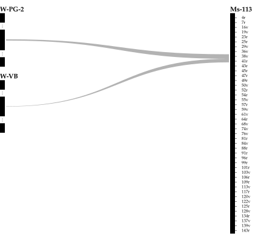

### [1r\[1\]](https://cdn.wittgensteinnachlass.com/2000px/webp/Ms-113/1r.webp)

## IX. Philosophical Grammar.

### [1v\[1\]](https://cdn.wittgensteinnachlass.com/2000px/webp/Ms-113/1v.webp)

… if the function has a rigorous sense, it must be expressed in a _definition_ that declares the function sign and the table to have the same meaning.

### [1v\[2\]](https://cdn.wittgensteinnachlass.com/2000px/webp/Ms-113/1v.webp)

29.11.1931

When people say that the sentence „it is probable that p will occur” says something about the event p, they forget that it remains probable even if the event p does _not_ occur.

### [1v\[3\]](https://cdn.wittgensteinnachlass.com/2000px/webp/Ms-113/1v.webp)

With the sentence „p will probably occur” we do indeed say something about the future, but not something „_about_ the event p”, as the grammatical form of the statement leads us to believe.

### [1v\[4\]](https://cdn.wittgensteinnachlass.com/2000px/webp/Ms-113/1v.webp)

When I ask for the grounds for an assertion, the answer to this question is not valid just for the person I ask & for _this_ particular action (the assertion), but is valid _generally_.

### [1v\[5\]](https://cdn.wittgensteinnachlass.com/2000px/webp/Ms-113/1v.webp),[2r\[1\]](https://cdn.wittgensteinnachlass.com/2000px/webp/Ms-113/2r.webp)

If I say: „the weather points to rain”, am I saying something about the future weather? No, but about the present weather, with the help of a law that connects the weather at one time with the weather at a _later_ time. This law must already be in place, & with its help we sum up certain statements about our experience. – But then one could make the same claim for historical statements too. Yet it was hasty, after all, to say that the sentence „the weather points to rain” says nothing about the future weather. That depends on what one understands by „saying something about something”. The sentence says precisely what its words say! The sentence „p will probably occur” says something about the future only in a sense in which its truth & falsity are entirely independent of what will happen in the future.

### [2r\[2\]](https://cdn.wittgensteinnachlass.com/2000px/webp/Ms-113/2r.webp)

When we say „the rifle is now aimed at the point P”, we say nothing about where the shot will hit.

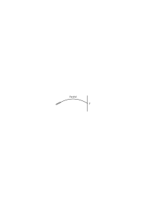

The point at which it is aimed is a _geometrical_ aid for specifying its direction. Of course, our use of this particular means is connected with certain experiences (parabolic trajectory, etc.), but these do not now enter into the description of the direction.

### [2r\[3\]](https://cdn.wittgensteinnachlass.com/2000px/webp/Ms-113/2r.webp),[2v\[1\]](https://cdn.wittgensteinnachlass.com/2000px/webp/Ms-113/2v.webp),[3r\[1\]](https://cdn.wittgensteinnachlass.com/2000px/webp/Ms-113/3r.webp),[3v\[1\]](https://cdn.wittgensteinnachlass.com/2000px/webp/Ms-113/3v.webp),[3v\[2\]](https://cdn.wittgensteinnachlass.com/2000px/webp/Ms-113/3v.webp)

Ramsey defines x = y as

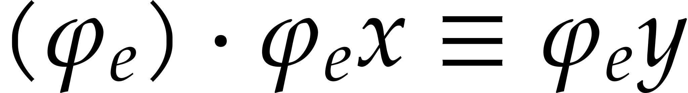

But according to the explanations he gives of his function signs „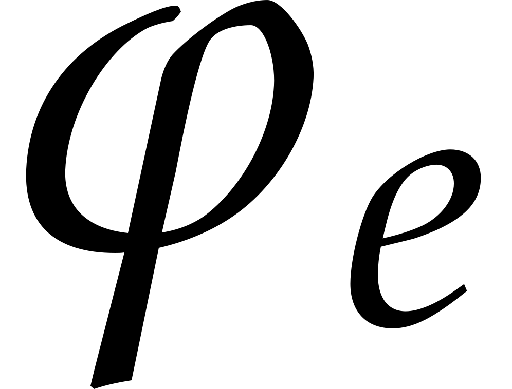”, 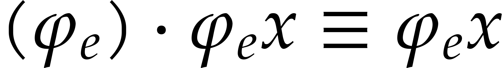 is the statement: „every sentence is equivalent to itself”

 the statement: „every sentence is equivalent to every sentence”.

So his explanation has achieved nothing beyond what is laid down by the two definitions

x = x ≝ Tautology

x = y ≝ Contradiction

(The word „Tautology” can here be replaced by any tautology whatever, and the same applies to „Contradiction”.) So far nothing has happened except to give explanations of the two different sign forms x = x & x = y. These explanations can of course be replaced by two classes of explanations, e.g.

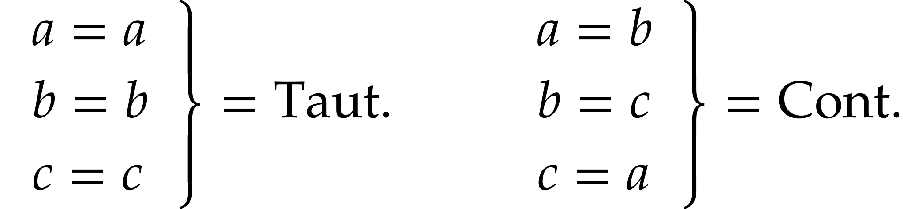

But now Ramsey writes „(∃x,y) ∙ x ≠ y”, i.e. „(∃x,y) ∙ ~(x = y)”, – but he has no right at all to do so: for what does „x = y” mean in this sign? It is neither the sign „x = y” which I used in the definition above, nor, of course, the „x = x” in the preceding definition. So it is a sign still unexplained. Incidentally, to see how idle those definitions are, let one read them (as an unprejudiced reader would) as follows: I permit the sign „a = a” or „b = b”, etc. to be put in place of the sign „Taut.”, whose use we know; & the signs „a = b”, „a = c”, etc. in place of the sign „Cont.” („~Taut.”). From which it follows, incidentally, that

(a = b) = (c = d) = (a ≠ a) = etc.!

It presumably goes without saying that an equality sign defined in this way has nothing to do with the one we need to express a substitution rule. Now of course I can in turn explain „(∃x,y) ∙ x ≠ y”; say, as a ≠ a ․⌵․ a ≠ b ․⌵․ b ≠ b ․⌵․ b ≠ c ․⌵․ a ≠ c; but this explanation is really humbug & I ought to write straight away (∃x,y) ∙ x ≠ y ≝ Taut. (I.e. the sign on the left-hand side would be given to me as a new – unnecessary – sign for „Taut.”.) For we must not forget that on _that_ explanation „a = a”, „a = b”, etc. are independent signs and are connected only to the extent that the signs „Taut.” & „Cont.” are. The question here is that of the usefulness of „extensional” functions, for Ramsey’s explanation of the equality sign is just such a specification by extension. What sort of thing is the extensional specification of a function? It is evidently a group of definitions. E.g. the following:

fa = p Def

fb = q Def

fc = r Def

These definitions give us permission to put the signs „fa”, „fb”, „fc” in place of the familiar sentences „p”, „q”, „r”. To say that these three definitions specify the function f(ξ) says nothing at all, or says the same thing as the three definitions. For the signs „fa”, „fb”, „fc” are function and argument only in so far as the words „Ko(rb)”, „Ko(pf)” & „Ko(hl)” are too. (It makes no difference here whether or not the „arguments” „rb”, „pf”, „hl” are also used as words elsewhere.) (So it is hard to see what purpose the definitions can serve other than to mislead us.) The sign „(∃x) ∙ fx” means nothing at all to begin with; for the rules for functions in the old sense of the word do not apply here. For those functions a definition fa = … would be nonsense. Unless an explicit explanation of the sign „(∃x) ∙ fx” is given, it can only be understood as a rebus, in which the signs likewise have a kind of non-literal meaning. Each of the signs „a = a”, „a = c”, etc. in the definitions (a = a) ≝ Taut., etc. is a _word_. The ultimate purpose of introducing extensional functions, incidentally, was to analyse propositions about infinite extensions, and this purpose is defeated, since an extensional function is introduced by a list of definitions.

### [3v\[3\]](https://cdn.wittgensteinnachlass.com/2000px/webp/Ms-113/3v.webp),[4r\[1\]](https://cdn.wittgensteinnachlass.com/2000px/webp/Ms-113/4r.webp)

If one wants to know what „2 + 2 = 4” means, one must ask how we (obtain) it, how we work it out. It then stands for us on the same level as 125 × 372, for which the calculation is evidently essential. We then regard the process of calculation as what is essential, and this is the way of looking at it in ordinary life, at least as far as the numbers we need to work out are concerned. We must not be ashamed to take numbers & calculations in the way every shopkeeper’s everyday arithmetic takes them. Then we do not work out 2 + 2 = 4, or indeed the rules of the elementary multiplication tables in general; instead we accept them – as axioms, so to speak – and calculate only _with their help_. But of course we could also work out 2 + 2 = 4, and children do in fact do so by counting off. Given the sequence of digits 1 2 3 4 5 6, the calculation is:

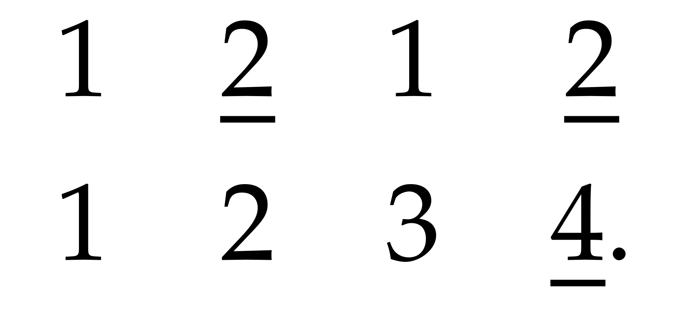

### [4r\[2\]](https://cdn.wittgensteinnachlass.com/2000px/webp/Ms-113/4r.webp),[4v\[1\]](https://cdn.wittgensteinnachlass.com/2000px/webp/Ms-113/4v.webp)

01.12.1931

The explanation of (∃x) ∙ φx as a logical sum & of (x) ∙ φx as a logical product cannot, of course, be maintained. It went together with a mistaken conception of logical analysis: I thought, for instance, that the logical product for a particular (x) ∙ φx would turn up sooner or later. – It is of course right that (∃x) ∙ φx somehow functions as a logical sum & (x) ∙ φx as a product; indeed, in _one_ use of the words „all” & „some” my old explanation is right, namely – e.g. – in the case „all the primary colours are found in this picture” or „all the notes of the C major scale occur in this theme”. But in cases like „all human beings die before they reach the age of 200” my explanation does not hold. Now, that (∃x) ∙ φx functions as a logical sum is expressed by its following from φa & from φa ⌵ φb, hence in the rules:

(∃x) ∙ φx : φa = φa &

(∃x) ∙ φx : φa⌵φb = φa⌵φb

### [4v\[2\]](https://cdn.wittgensteinnachlass.com/2000px/webp/Ms-113/4v.webp)

From these rules Russell’s fundamental laws

φx ․⊃․ (∃Z)․φZ &

φx⌵φy ․⊃․ (∃Z)․φZ

then follow as tautologies.

### [4v\[3\]](https://cdn.wittgensteinnachlass.com/2000px/webp/Ms-113/4v.webp),[5r\[1\]](https://cdn.wittgensteinnachlass.com/2000px/webp/Ms-113/5r.webp)

The essence of a „logical law” is, after all, that its product with any sentence yields that sentence. And one could also begin Russell’s calculus with explanations of the sort:

p⊃p:q = q

p:p⌵q = p etc.

For (∃x) ∙ φx, etc. we also need the rules

(∃x)φx⌵ψx = (∃x) φx ⌵ (∃x)ψx

(∃x,y) φx ∙ ψy ․⌵․ (∃x) φx ∙ ψx = (∃x) φx ∙ (∃x) ψx

Every such rule is an expression of the analogy between (∃x) φx & a logical sum.

### [5r\[2\]](https://cdn.wittgensteinnachlass.com/2000px/webp/Ms-113/5r.webp)

02.12.1931

_Definitions for abbreviation:_

(∃x) φx: ~(∃x,y) φx ∙ φy ≝ (εx) φx

(∃x,y) φx ∙ φy: ~(∃x,y,z) φx ∙ φy ∙ φz ≝ (εx,y) φx ∙ φy

_and so on._

(Ɛx) φx ≝ (Ɛx) φx

(Ɛx,y) φx ∙ φy = (Ɛ∣∣x) φx = (Ɛ2x) φx

_and so on._

### [5r\[3\]](https://cdn.wittgensteinnachlass.com/2000px/webp/Ms-113/5r.webp),[5v\[1\]](https://cdn.wittgensteinnachlass.com/2000px/webp/Ms-113/5v.webp),[6r\[1\]](https://cdn.wittgensteinnachlass.com/2000px/webp/Ms-113/6r.webp)

_One can show that_

(Ɛ∣∣x) φx . (Ɛ∣∣∣x) ψx . ~ (∃x) φx . ψx

․⊃․ (Ɛ

∣∣∣∣∣x) φx ⌵ ψx

is a tautology. Has one thereby demonstrated the arithmetical proposition 2 + 3 = 5? Of course not. Nor has one shown that

(Ɛ∣∣x) φx ∙ (Ɛ∣∣∣x)

ψx ∙ Ind ∙ ․⊃․

(Ɛ∣∣∣∣∣x)

(Ɛ∣∣ + ∣∣∣x) φx ∙ ψx

is tautological, for our definitions have not _yet_ said anything at all about a sum „∣∣ + ∣∣∣”. (For brevity I shall write the tautology in the form „Ɛ∣∣ ∙ Ɛ∣∣∣ ⊃ Ɛ∣∣∣∣∣”.) Now if the question is how many strokes to the right of „⊃” will make the whole a tautology, given the left-hand side, one can find this number; one can also find that in the preceding case it is ∣∣ + ∣∣∣, but just as well that it is ∣ + ∣∣∣∣ or ∣ + ∣∣∣ + ∣, for it is all of these. But one can also find an induction which shows that – expressed algebraically – Ɛn ∙ Ɛm ․⊃․ Ɛn + m comes out tautological. Then I am entitled, for example, to regard Ɛ17 ∙ Ɛ28 ․⊃․ Ɛ17 + 28 as a tautology. But does that now give me the equation 17 + 28 = 45? Not at all! Rather, I still have to work this out for myself. It now also makes sense to write down Ɛ2 ∙ Ɛ3 ⊃ Ɛ5 as a tautology in accordance with this general rule; when I do not, (so to speak), yet know what 2 + 3 will come to; for 2 + 3 has sense only in so far as it still has to be worked out. Hence the equation ∣∣ + ∣∣∣ = ∣∣∣∣∣ has a point only if the sign „∣∣∣∣∣” is recognized in the same way as the sign „5”; that is, independently of the equation.

### [6r\[2\]](https://cdn.wittgensteinnachlass.com/2000px/webp/Ms-113/6r.webp)

To say „4 objects and 4 objects are 8 objects” says nothing; & neither does „4 apples & 4 apples = 8 apples”, unless it is intended as the empirical proposition that there are 8 apples on the table when one has first put down 4 & then another 4. The equation of arithmetic, by contrast, is 4 + 4 = 8. Its digits are essentially unnamed. They are so even when one calculates with one’s fingers, with strokes, or with the balls of an abacus, for then these things are not what is being talked _about_ but the signs. So it is nonsense to ask whether four objects are also 2 + 2 objects when not each 2 fall under one concept.

### [6r\[3\]](https://cdn.wittgensteinnachlass.com/2000px/webp/Ms-113/6r.webp),[6v\[1\]](https://cdn.wittgensteinnachlass.com/2000px/webp/Ms-113/6v.webp)

My standpoint differs from that of those who write today on the foundations of arithmetic in that I have no need to despise any particular calculus, for example that of the decimal system. For me one is as good as another. To think little of a particular calculus is like wanting to play chess without actual pieces on the grounds that playing with pieces would be too little abstract, too particular. In so far as the pieces do _not_ matter, one set is simply as good as another. And in so far as one game does differ from another, one game is simply as good, i.e. as interesting, as another. But none is more sublime than any other.

### [6v\[2\]](https://cdn.wittgensteinnachlass.com/2000px/webp/Ms-113/6v.webp)

What is the proof of Ɛ∣∣ ∙ Ɛ∣∣∣

․⊃․ Ɛ∣∣∣∣∣ that is the expression of our knowledge that this is a correct logical sentence? It evidently makes use of the fact that one can treat (∃x)… as a logical sum. We might translate from the symbolism 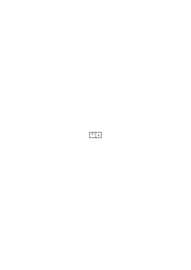 („If there is a star in each square, there are two in the whole rectangle”) into Russell’s. And it is not as if, with the tautology in this notation, we were expressing an opinion that seems plausible to us & (that) the proof then confirms; rather, what seems plausible to us is that this expression is a tautology (a law of logic).

### [7r\[1\]](https://cdn.wittgensteinnachlass.com/2000px/webp/Ms-113/7r.webp)

When in logic one appears to consider several different universes (as Ramsey does), one is in fact considering different games. The explanation of a „universe” would, for example, in Ramsey’s case simply be the definition (∃x) φx ≝ φa⌵φb⌵φc⌵φd.

### [7r\[2\]](https://cdn.wittgensteinnachlass.com/2000px/webp/Ms-113/7r.webp)

Incidentally, one really could introduce a notation for (∃x) ∙ φx in which one replaces it with a sign „φα⌵φβ⌵φγ⌵ …” and could then calculate with it as with a logical sum; but provision would have to be made for rules by which I can always convert this notation back into that of „(∃x) ∙ φx”, and which thus distinguish the sign „φa⌵φb⌵φc⌵…” from that of a logical sum. The sole purpose of this notation would be to make it easier in certain cases to calculate with (∃x) φx.

### [7r\[3\]](https://cdn.wittgensteinnachlass.com/2000px/webp/Ms-113/7r.webp)

The sentence „the relation R connects two objects with one another”, if this is meant to say as much as „R is a two-place relation”, is a sentence of grammar.

### [7r\[4\]](https://cdn.wittgensteinnachlass.com/2000px/webp/Ms-113/7r.webp),[7v\[1\]](https://cdn.wittgensteinnachlass.com/2000px/webp/Ms-113/7v.webp)

I formerly said that it was nonsense to say: „4 apples & 4 apples = 8 apples”, but that was wrong; for this equation is a substitution rule that I use when I replace not the sign „4 + 4” by „8” but the sign „4 apples & 4 apples” by „8 apples”. But one must guard against thinking that „4 apples & 4 apples = 8 apples” is the concrete equation, whereas 4 + 4 = 8 is the abstract proposition, of which the first equation is only a special application. So that the arithmetic of apples would indeed be much less general than general arithmetic proper, but would hold in its own limited domain (for apples). – But there is no „arithmetic of apples”, because „4 apples & 4 apples = 8 apples” is not a proposition about apples. One can say that in this equation the word „apples” has no meaning. (As one can generally say of a sign in a rule for signs that helps determine its meaning.)

### [7v\[2\]](https://cdn.wittgensteinnachlass.com/2000px/webp/Ms-113/7v.webp)

03.12.1931

The numbers are not fundamental to mathematics, though I once believed they were.

### [7v\[3\]](https://cdn.wittgensteinnachlass.com/2000px/webp/Ms-113/7v.webp),[8r\[1\]](https://cdn.wittgensteinnachlass.com/2000px/webp/Ms-113/8r.webp)

Zero is not one of the cardinal numbers, for „there is 1 person in the room” is compatible with „there are 2 people in the room” & that with „there are 3 people in the room” and so on; by contrast, the sentence „there are no (0) people in the room” is not compatible with the first sentence in the preceding series.

### [8r\[2\]](https://cdn.wittgensteinnachlass.com/2000px/webp/Ms-113/8r.webp),[8v\[1\]](https://cdn.wittgensteinnachlass.com/2000px/webp/Ms-113/8v.webp),[9r\[1\]](https://cdn.wittgensteinnachlass.com/2000px/webp/Ms-113/9r.webp)

_The series of sentences_

(∃x): aRx ∙ xRb

(∃x,y): aRx ∙ xRy ∙ yRb

(∃x,y,z): aRx ∙ xRy ∙ yRz ∙ zRb and so forth

can quite well be expressed as follows:

_„there is one link between a & b”_

_„there are 2 links between a & b”_

_etc._

and one can write this, for example, as

(∃1x) aRxRb, (∃2x) aRxRb, etc.

But it is clear that the explanation above is needed in order to understand these expressions, since otherwise one might think, by analogy with (∃2x) ∙ φx = (∃x,y) φx ∙ φy, that (∃2x) aRxRb has the same meaning as an expression (∃x,y) aRxRb ∙ aRyRb. I could of course also write „(∃x,y)F(x,y)” instead of „(∃2x,y)F(x,y)”. But the question would now be: what am I then to understand by „(∃3x,y)F(x,y)”? But here a rule can be given; and what we need is one that takes us as far as we like in the number series. E.g. the following: (∃3x,y)F(x,y) = (∃x,y,z):F(x,y) ∙ F(x,z) ∙ F(y,z) (∃4x,y)F(x,y) = (∃x,y,z,u):F(x,y) ∙ F(x,z) … the combinations of two elements follow. And so forth. But one could also define it thus: (∃3x,y) ∙ F(x,y) = (∃x,y,z)F(x,y) ∙ F(y,x) ∙ F(x,z) ∙ F(z,x) ∙ F(y,z) ∙ F(z,y)

_and so forth._

„(∃3x) ∙ F(xy)” would correspond, say, to the sentence in word-language „F(x,y) is satisfied by 3 things”, and this sentence too would need an explanation to make it unambiguous.

Am I now to say that the sign „3” has a different meaning in the different cases? Does the sign „3” not rather express what the different interpretations have in common? Why else would I have chosen it? After all, the same rules apply to the sign „3” in this use as in that. It is still to be replaced by 2 + 1; etc. Admittedly, however, a sentence modelled on

Ɛ∣∣ ∙ Ɛ∣∣∣

⊃ Ɛ∣∣∣∣∣

is now not a tautology. Two people who live at peace with one another & three more people who live in peace with one another do not make five people who live at peace with one another. But that does not mean that 2 + 3 is now not 5. It is just that addition cannot be applied in this way.

In other words, the signs of the form (∃1x,y)F(x,y), (∃2x,y)F(x,y), (∃3x,y)F(x,y), etc. have the multiplicity of the cardinal numbers, as do the signs (∃1x) φx, (∃2x) φx, etc. & also the signs (ε1x) φx, (ε2x) φx, etc.

### [9r\[2\]](https://cdn.wittgensteinnachlass.com/2000px/webp/Ms-113/9r.webp),[9v\[1\]](https://cdn.wittgensteinnachlass.com/2000px/webp/Ms-113/9v.webp),[10r\[1\]](https://cdn.wittgensteinnachlass.com/2000px/webp/Ms-113/10r.webp),[10v\[1\]](https://cdn.wittgensteinnachlass.com/2000px/webp/Ms-113/10v.webp),[11r\[1\]](https://cdn.wittgensteinnachlass.com/2000px/webp/Ms-113/11r.webp),[11v\[1\]](https://cdn.wittgensteinnachlass.com/2000px/webp/Ms-113/11v.webp)

To say of a part of my visual field that it has no colour is nonsense; and likewise – naturally also – to say that it has colour (or a colour). But it does make sense to say that it has only _one_ colour (is monochrome or _uniformly coloured_), that it has at least two colours, only two colours, etc. Thus, in the sentence “this quadrilateral in my visual field has at least two colours”, I cannot substitute “one” for “two”. Or again: “the quadrilateral has only one colour” does not mean – analogously to (∃x) φx ∙ ~(∃x,y) φx ∙ φy – “the quadrilateral has one colour but not two colours”. I am speaking here of the case in which it is senseless to say “the part of space has no colour”. Incidentally, if I count the uniformly coloured (monochrome) patches in the quadrilateral, it makes sense to say that there are none if the colour of the quadrilateral varies continuously. It then of course also makes sense to say that there is “one uniformly coloured patch or more” in the quadrilateral, and also that the quadrilateral has one colour but not two colours. – But I am now leaving aside this use of the sentence “the quadrilateral has no colour” and speaking of a system in which it is taken for granted that a quadrilateral has a colour, that is, properly put, in which this sentence is nonsense. When one calls the sentence something that goes without saying, what one really means is what is expressed by a grammatical rule describing, for example, the form of sentences about visual space. If one now begins giving the number of colours in the quadrilateral with the sentence “there is one colour in the quadrilateral”, then this of course must not be the sentence of grammar about the “colouredness” of space. What does one mean when one says “space is coloured”? (And a very interesting question: what kind of question is this?) Well, one might look round for confirmation and look at the various colours around one and be inclined to say: wherever I look, there is a colour. Or: Everything is coloured, after all, everything has been painted, so to speak. Here one thinks of colours in contrast to a kind of colourlessness, which on closer inspection turns out to be colour again. Incidentally, when one looks round for confirmation, one looks above all at still, monochrome parts of space, and would rather not look at moving, indistinctly coloured ones (flowing water, shadows, etc.). If one then has to admit to oneself that one simply calls everything one sees colour, one now wants to say that being coloured is a property of space in and of itself (no longer of its parts). But this amounts to saying of the game of chess that it is the game of chess, and it can now only come down to a description of the game. And now we come to a description of sentences about space; but without a justification, and as though one had to bring them into agreement with another reality. To confirm the sentence “visual space is coloured” one looks round (say) and says: this here is black & black is a colour; that is white & white is a colour; etc. But one takes “black is a colour” in the same way as “iron is a metal” (or perhaps better “gypsum is a sulphur compound”). If I make it senseless to say that a part of visual space has no colour, then the question of the analysis of the statement of the number of colours in a part of visual space becomes very similar to that of the statement of the number of parts of, say, a quadrilateral which I divide by strokes into bounded areas.

Here too I can regard it as senseless to say that the quadrilateral “consists of 0 parts”. One therefore cannot say that it consists “of one or more parts”, or that it “has at least one part”. Let us imagine the special case of a quadrilateral divided by parallel strokes. That this case is very special does not bother (us), for we do not think a game any less remarkable because it has only a very limited application.

Here I can either count the parts in the usual way, in which case it means nothing to say that there are 0 parts. But I could also imagine a way of counting that takes the first part for granted, so to speak, and does not count it, or counts it as 0, and counts only the additional parts produced by division. On the other hand, one could imagine a custom according to which soldiers drawn up in ranks are always counted by the number present over and above one soldier (say, if the number of possible combinations of the flank man & another soldier in the rank is to be given). But there could also be a custom according to which the number of soldiers is always given as 1 more than the actual number. This might originally have been done to deceive a particular monarch about the actual number, but then have become established as a way of counting soldiers. (The academic quarter-hour.) The number of different colours in a surface might also be given by the number of possible combinations in pairs. And then the only numbers that would come into consideration for this count would be the numbers 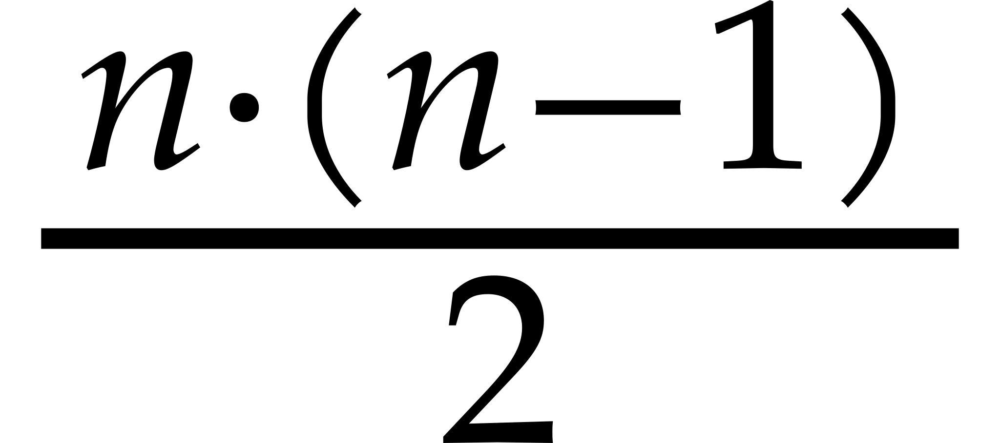, and it would then be as senseless to speak of 2 or 4 colours in a surface as it is now to speak of √2 or i colours. What I mean is that it is not the case that the cardinal numbers are essentially primary and the – let us call them – combination numbers 1, 3, 6, 10, etc. secondary. One could also construct an arithmetic of combination numbers, and it would be as self-contained as the arithmetic of cardinal numbers. But of course there can just as well be an arithmetic of the even numbers or of the numbers 1 3 4 5 6 7 – – –. Of course the decimal system is unsuited to writing these kinds of numbers.

### [11v\[2\]](https://cdn.wittgensteinnachlass.com/2000px/webp/Ms-113/11v.webp),[12r\[1\]](https://cdn.wittgensteinnachlass.com/2000px/webp/Ms-113/12r.webp),[12v\[1\]](https://cdn.wittgensteinnachlass.com/2000px/webp/Ms-113/12v.webp),[13r\[1\]](https://cdn.wittgensteinnachlass.com/2000px/webp/Ms-113/13r.webp)

How then is one to understand the sentence “these hats are the same size”, or “these rods are the same length”, or “these spots are the same colour”? Should one write them in the form “(∃L)La ∙ Lb”? But if that is meant in the usual way, hence used with the usual rules, then it would surely make sense to write “(∃L)La”, that is, “spot a has a colour”, “the rod has a length”. I can of course write “(∃L)La ∙ Lb” for “a & b are the same length”, so long as I know & bear in mind that “(∃L)La” is senseless; but then the notation becomes misleading & confusing (“to have a length”, “to have a father”). – Here we have the case that we often express in ordinary language like this: “If a has length L, then b also has L”; but here the sentence “a has length L” would have no sense at all, or at any rate not as a statement about a; and the sentence is more correctly put “if we call the length of a ‘L’, then the length of b is also L”, and ‘L’ here is essentially a variable. The sentence, incidentally, has the form of an example, of a sentence that can serve as an example of the general sentence, and one might go on: “if, e.g., a is 5 m long, then b is also 5 m long, and so on”. – For saying “the rods a & b have the same length” says nothing at all about the length of either rod; for it does not say either “that each of them has a length”. The case therefore bears no resemblance at all to “A & B have the same father” & “the name of the father of A & B is ‘N’”, where I simply substitute the proper name for the general designation. But ‘5 m’ is not the name of the length in question, about which all that was said at first was that a & b both had it. When it is a matter of lengths in the visual field, we can indeed say that the two lengths are equal, but we cannot in general “name” them with a number. – The sentence “if L is the length of a, then b too has length L” merely sets down its form as one derived from the form of an example. And one could actually express the general sentence by _giving_ examples followed by an “and so on”. And it is a repetition of the same sentence when I say: “a & b are the same length; if the length of a is L, then the length of b is also L; if a is 5 m long, then b is also 5 m long; if a is 7 m, then b is 7 m, and so on”. The third version already shows that the “and” in the sentence does not stand between two forms, as in “(∃x) φx ∙ ψx”, where one would also be entitled to write “(∃x) φx” & “(∃x) ψx”. Let us also take as an example the sentence “there are as many apples in the two boxes”. If one writes this sentence in the form “there is a number that is the number of apples in both boxes”, here too one cannot construct the form: “there is a number that is the number of apples in this box”, or “the apples in this box have a number”. If I write 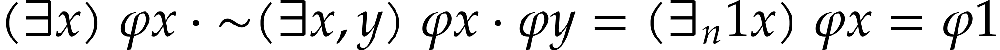 etc., then one could write the sentence “the number of apples in the two boxes is the same” as: “(∃n) φn ∙ ψn”. But “(∃n) φn” would not be a sentence.

### [13r\[2\]](https://cdn.wittgensteinnachlass.com/2000px/webp/Ms-113/13r.webp),[13v\[1\]](https://cdn.wittgensteinnachlass.com/2000px/webp/Ms-113/13v.webp)

Let us imagine a calculating machine that calculates with colours in a strip instead of beads. And whereas we now count the colours in a strip with beads on our abacus, or with our fingers, we would then count the beads on a rod, or the fingers on our hand, with colours in a strip. But how would this colour-calculating machine have to be constructed in order to work? We would need a sign for there being no beads on the rod. One must think of the abacus as a tool for practical use & as a means of language. And, just as one can represent 5, say, by the five fingers of one hand (one should think of a sign language), one would represent it by the strip with 5 colours. But for 0 I need a sign, otherwise I do not have the requisite multiplicity. Well, I can either stipulate that the black surface is to designate zero (this is of course arbitrary & a monochrome red surface would do just as well); or the monochrome surface is to designate 0, the two-coloured one 1, etc. It makes no difference which mode of designation I choose. And here one sees how the manifold of beads is projected onto the manifold of colours in a surface.

### [13v\[2\]](https://cdn.wittgensteinnachlass.com/2000px/webp/Ms-113/13v.webp),[14r\[1\]](https://cdn.wittgensteinnachlass.com/2000px/webp/Ms-113/14r.webp)

Let us imagine someone describing all the shapes in this room by comparing them with flat-faced geometrical shapes. Are there only such shapes in this room? No. – Does someone who describes the shapes under the aspect of flat-faced solids have to maintain that there are only shapes of that kind in the room? No again. Can one say that this is one-sided because he takes all the shapes without exception according to this schema? And should it make him doubt this way of seeing things if he notices that there are round solids too? No. It would also be misleading to call the flat-faced solid an “ideal” which reality only more or less approaches. But with reference to this way of representing things, one might call the geometry of flat-faced solids a normative science. (One that represents the means of representation; one that, as it were, calibrates the measuring glasses.)

### [14r\[2\]](https://cdn.wittgensteinnachlass.com/2000px/webp/Ms-113/14r.webp),[14v\[1\]](https://cdn.wittgensteinnachlass.com/2000px/webp/Ms-113/14v.webp),[15r\[1\]](https://cdn.wittgensteinnachlass.com/2000px/webp/Ms-113/15r.webp),[15v\[1\]](https://cdn.wittgensteinnachlass.com/2000px/webp/Ms-113/15v.webp),[16r\[1\]](https://cdn.wittgensteinnachlass.com/2000px/webp/Ms-113/16r.webp),[16r\[2\]](https://cdn.wittgensteinnachlass.com/2000px/webp/Ms-113/16r.webp),[16v\[1\]](https://cdn.wittgensteinnachlass.com/2000px/webp/Ms-113/16v.webp)

Incidentally, one could get rid of the difficulty that “(∃n) ∙ φn” is senseless by letting it mean that φ has a number greater than 0. Which only shows that there was no _real_ difficulty here, or at least none that has now been removed. The real difficulty, that is, lies in the concept of ‘(∃n)’ & generally of ‘(∃x)’. Originally this notation comes from the expression in our word-language “there is a … with such and such a property”. And what takes the place of the dots here is something like “book in my library”, or “thing (body) in this room”, “word in this letter”, etc. One is thinking here of objects one can go through one by one. By a process of sublimation so often employed, this form then became: “there is an object for which …”, and here too the objects of the world were originally conceived in strict analogy with the ‘objects’ in the room (namely the tables, chairs, books, etc.). Although it is quite clear that the grammar of this “(∃x) etc.” is in many cases quite different from what it is in the primitive case that serves as paradigm. The discrepancy between the original picture and what the notation is now supposed to be applied to becomes particularly glaring when a sentence “there are only two circles in this quadrilateral” is rendered in the form “there is no object that has the property of being a circle in this quadrilateral but being neither circle a nor circle b”, or “there are not three objects that have the property of being a circle in this quadrilateral”. The sentence “there are only two things that are circles in this quadrilateral” (formed by analogy with the sentence “there are only two people who have climbed this mountain”) sounds crazy; and rightly so. That is, nothing is gained by forcing the sentence “there are two circles in this quadrilateral” into that form; rather, it merely helps us overlook the fact that we have not clarified the grammar of this sentence. At the same time, however, Russell’s notation lends an appearance of exactness here which makes some people believe that the problems have been solved by putting the sentence into Russell’s form. (This is as dangerous as using the word “probable” without further investigation of how the word is used in this particular case. The word “probable” too is, for readily understandable reasons, associated with an idea of exactness.) In all the cases “one of the four legs of this table won’t hold”, “there are English people with black hair”, “there is a spot on this wall”, “the two pots weigh the same”, “there are equally many words on both sides” – Russell’s notation uses “(∃…)…”; and each time with a different grammar. So what I mean is that not much is gained by translating such a sentence from word-language into Russell’s notation. If one wants to write the sentence “φ and ψ apply to equally many objects” in surveyable notation, one is above all tempted to write it in the form “φn ∙ ψn”. And furthermore one does not take this as the logical product of φn & ψn, so that it would therefore also make sense to write φn ∙ ψ5 – rather, it is essential that the same letter follows ‘φ’ & ‘ψ’, and φn ∙ ψn is an abstraction from logical products φ4 ∙ ψ4, φ5 ∙ ψ5, etc., not itself a logical product.

(It would therefore also not follow from φn ∙ ψn that φn. ‘φn ∙ ψn’ is rather related to a logical product as the differential quotient is to a quotient.) It is as little a logical product as the photograph of a family group is a group of photographs. Thus the form “φn ∙ ψn” can mislead us & perhaps a notation of the kind 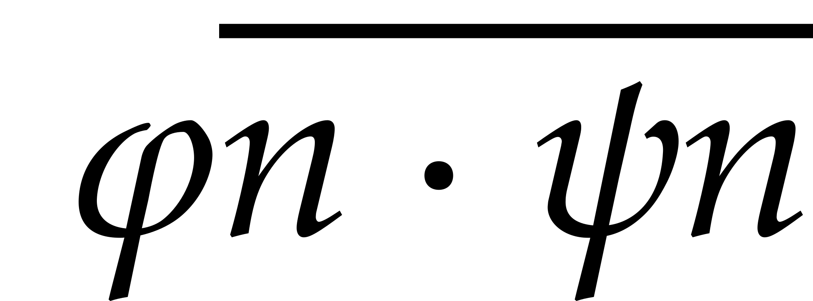 would be preferable, but also “(∃n) φn ∙ ψn” once the grammar of this sign has been fixed. One can then stipulate (∃n) φn = taut. which means the same as (∃n) φn ∙ p = p.

Thus (∃n) φn⌵ψn = taut., (∃n) φn⊃ψn = taut. (∃n) φn ❘ ψn = cont. etc. φ1 ∙ ψ1 ∙ (∃n) φn ∙ ψn = φ1 ∙ (∃n) φn ∙ ψn

φ2 ∙ ψ2 ∙ (∃n) φn ∙ ψn = φ2 ∙ (∃n) φn ∙ ψn

etc. ad inf.

And in general the rules of calculation for (∃n) φn ∙ ψn are to be derived from the fact that one can write (∃n) φn ∙ ψn = φ0 ∙ ψ0 ⌵ φ1 ∙ ψ1 ⌵ φ2 ∙ ψ2 ⌵ φ3 ∙ ψ3 ⌵ etc. ad inf..

It is clear that this is not a logical sum, since “etc. ad inf.” is not a sentence. But the notation (∃n) φn ∙ ψn is not unambiguous either; for one might wonder why here, instead of φn ∙ ψn, one should not be able to put Φn, in which case “(∃n) Φn” would become meaningless. This of course becomes clear if one goes back to the notation ~(∃x) φx for φ0, (∃x) ∙ φx ∙ ~(∃x,y) φx ∙ φy for φ1, etc., or rather to 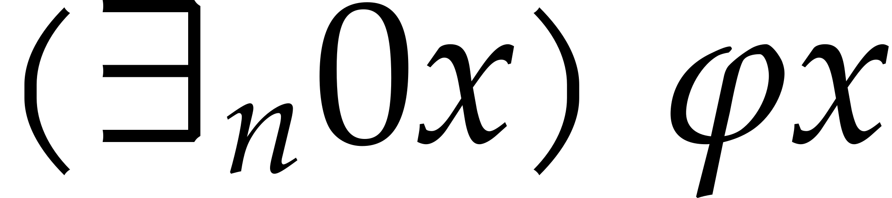 for φ0, 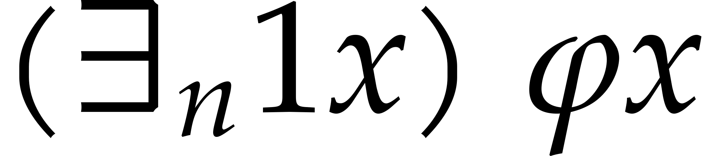 for φ1, etc. For then one has to distinguish between 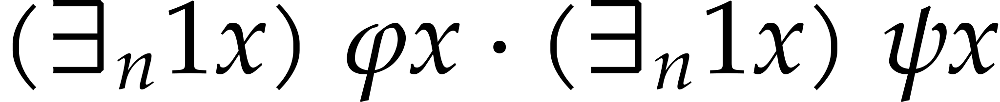 & 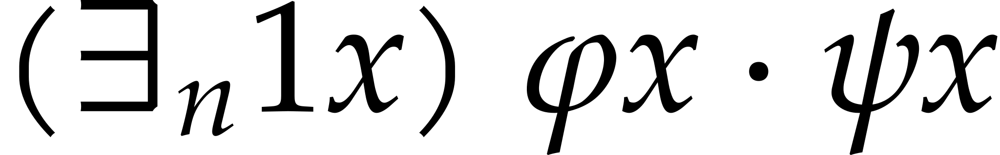.

And if one passes to (∃n) φn ∙ ψn, this means 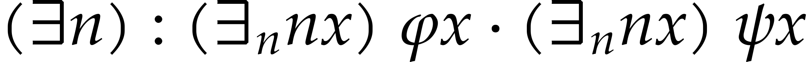 (which is not meaningless) & not 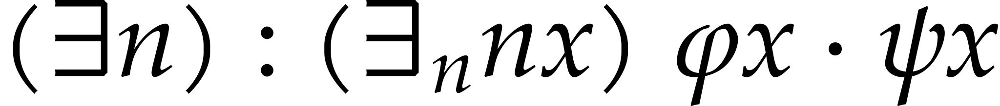 which is meaningless.

### [16v\[3\]](https://cdn.wittgensteinnachlass.com/2000px/webp/Ms-113/16v.webp),[17r\[1\]](https://cdn.wittgensteinnachlass.com/2000px/webp/Ms-113/17r.webp)

The words “equal in number”, “equal in length”, “the same colour”, etc. have similar but different grammars. – In all these cases it is natural to understand the sentence as an endless logical sum whose terms have the form φn ∙ ψn. Moreover, each of these expressions has several different meanings, i.e., could itself in turn be replaced by several words with different grammars. For “equal in number” means something different when applied to strokes that are in visual space at the same time than when it refers to the apples in two boxes; and “equal in length” as applied to visual space is different from “equal in length” in Euclidean space; and the meaning of “the same colour” depends on the criterion we adopt for sameness of colour.

### [17r\[2\]](https://cdn.wittgensteinnachlass.com/2000px/webp/Ms-113/17r.webp),[17v\[1\]](https://cdn.wittgensteinnachlass.com/2000px/webp/Ms-113/17v.webp)

When it is a matter of spots in visual space that we see at the same time, the expression “equal in length” has different meanings depending on whether the segments are immediately adjacent or some distance apart. In word-language one often gets round this by using the expression “it seems”.

### [17v\[2\]](https://cdn.wittgensteinnachlass.com/2000px/webp/Ms-113/17v.webp)

Equinumerosity, when it is a matter of a number of strokes “that one can take in at a glance”, is different from equinumerosity that can be established only by counting the strokes.

### [17v\[3\]](https://cdn.wittgensteinnachlass.com/2000px/webp/Ms-113/17v.webp)

Different criteria of equinumerosity. I & II the number one recognizes immediately; III the criterion of correlation; IV here one has to count both classes; V one recognizes the same pattern. (These are of course not the only cases.)

### [17v\[4\]](https://cdn.wittgensteinnachlass.com/2000px/webp/Ms-113/17v.webp)

In the case of equality of length in Euclidean space one might say that it consists in both segments measuring the same number of cm, both 5 cm, both 10 cm, etc. But when it is a matter of equality of length between two segments in visual space, there is no one length 𝓁 that they both have.

### [18r\[1\]](https://cdn.wittgensteinnachlass.com/2000px/webp/Ms-113/18r.webp)

One would like to say: two rods must always be either of equal length or of different lengths. But what does that mean? It is of course a rule for the way we express ourselves. “In the two boxes there must be either the same number of apples or different numbers.” Laying a measuring rod along each of two segments is supposed to be the method by which I find out whether the two segments are of equal length: but are they of equal length when the two measuring rods are not in place? In this case we would say that we do not know whether the two are of equal or different lengths during that time. But one could also say that during that time they have no lengths, or perhaps no numerical lengths.

### [18r\[2\]](https://cdn.wittgensteinnachlass.com/2000px/webp/Ms-113/18r.webp)

Something similar, though not the same, applies to equality of number.

### [18r\[3\]](https://cdn.wittgensteinnachlass.com/2000px/webp/Ms-113/18r.webp),[18v\[1\]](https://cdn.wittgensteinnachlass.com/2000px/webp/Ms-113/18v.webp)

Here we have the experience of seeing a number of points whose number we cannot see immediately, but which we can keep in view while counting them, so that it makes sense to say that they did not change during the count. On the other hand, there is also the case of a group of objects or patches which we cannot keep in view while counting them, so that here the earlier criterion that the group did not change during the count is absent.

### [18v\[2\]](https://cdn.wittgensteinnachlass.com/2000px/webp/Ms-113/18v.webp)

16.02.1932

If one sees a flickering with one’s eyes closed, countless points of light that appear & disappear – as one might describe it – it makes no sense here to speak of a ‚number’ of points seen at the same time. And one cannot say „there is always a definite number of points of light there, we just do not know what it is”; this would correspond to a rule applied where one can speak of checking that number.

### [18v\[3\]](https://cdn.wittgensteinnachlass.com/2000px/webp/Ms-113/18v.webp),[19r\[1\]](https://cdn.wittgensteinnachlass.com/2000px/webp/Ms-113/19r.webp),[19v\[1\]](https://cdn.wittgensteinnachlass.com/2000px/webp/Ms-113/19v.webp)

Russell’s explanation of equinumerosity is inadequate for various reasons. But the truth is that in mathematics one does not need any such explanation of equinumerosity. Here everything is back to front. What tempts us to accept Russell’s, or Frege’s, explanation is the thought that two classes of objects (apples in two boxes) are equinumerous if one _could_ correlate them with one another 1–1. One thinks of the correlation as a check on equinumerosity. And here in one’s thinking one presumably makes a further distinction between correlation & connection by a relation; correlation then stands to connection as the “geometrical” straight line to a real one, a kind of ideal connection; a connection traced in advance, as it were, by logic, which reality can then trace over. It is possibility conceived as a shadowy reality. This in turn is connected with the conception of “(∃x) ∙ φx” as an expression of the possibility of φx. After all, “φ & ψ are equinumerous” (I shall write this “S(φ ∙ ψ)”, or simply “S”) is supposed to follow from “φ5 ∙ ψ5”; but it does not follow from φ5 ∙ ψ5 that φ & ψ are connected by a 1–1 relation R (I shall write this “π(φ,ψ)” or “π”). One gets round this by saying that a relation of the kind “x = a ∙ y = b ․⌵․ x = c ∙ y = d ․⌵․ etc.” then holds.

### [19v\[2\]](https://cdn.wittgensteinnachlass.com/2000px/webp/Ms-113/19v.webp),[20r\[1\]](https://cdn.wittgensteinnachlass.com/2000px/webp/Ms-113/20r.webp),[20v\[1\]](https://cdn.wittgensteinnachlass.com/2000px/webp/Ms-113/20v.webp)

But, first, why not define S straight away as the holding of _such_ a relation? And if the answer is that this definition would not cover equinumerosity in the case of infinite numbers, then what must be said is that this comes down to a question of “elegance”, since in the end I would still have to resort to “extensional” relations for finite numbers. But these get us nowhere either; for to say that a relation – e.g. – of the form x = a ∙ y = b ⌵ x = c ∙ y = d holds between φ & ψ says nothing other than (∃x,y) φx ∙ φy ∙ ~(∃x,y,z) φx ∙ φy ∙ φz: (∃x,y) ψx ∙ ψy ∙ ~(∃x,y,z) ψx ∙ ψy ∙ ψz.

(Which I write in the form .

And to say that _one_ of the relations x = a ∙ y = b; x = a ∙ y = b ․⌵․ x = c ∙ y = d; etc. etc., holds between φ & ψ means nothing other than that one of the facts φ1 ∙ ψ1; φ2 ∙ ψ2; etc. etc. obtains. Now one resorts to greater generality by saying that some 1–1 relation or other holds between φ & ψ, and forgets that, to express this generality, one still has to lay down the rule by which “some relation or other” also includes relations of the form x = a ∙ y = b etc. By saying more one does not get out of saying the _narrower_ thing that is supposed to be contained in what is more. (Logic cannot be cheated.) So in the sense of S in which S follows from φ5 ∙ ψ5, it is not explained by Russell’s explanation. What one needs here, rather, is a series of explanations

φ0 ∙ S = φ0 ∙ ψ0 = ψ0 ∙ S

φ1 ∙ S = φ1 ∙ ψ1 = ψ1 ∙ S

} – – – α

etc. ad inf.

π, on the other hand, is used as a criterion of equinumerosity and can of course, _in a different sense of S_, also be equated with S. (And then one can only say: If in your notation S = π, then S means nothing other than π.) It is not that π follows from φ5 ∙ ψ5, but φ5 ∙ ψ5 does follow from π ∙ φ5.

π ∙ φ5 = π ∙ φ5 ∙ ψ5 = π ∙ ψ5

etc.

So one can write

π ∙ φ0 = π ∙ φ0 ∙ ψ0 = π ∙ φ0 ∙ S

π ∙ φ1 = π ∙ φ1 ∙ ψ1 = π ∙ φ1 ∙ S

} – – – β

π ∙ φ2 = π ∙ φ2 ∙ ψ2 = π ∙ φ2 ∙ S

etc. ad inf.

And this can be expressed by saying that equinumerosity follows from π. And one can also give the rule

π ∙ S = π

which accords with the rules, or _the_ rule, β & rule α.

### [20v\[2\]](https://cdn.wittgensteinnachlass.com/2000px/webp/Ms-113/20v.webp)

When someone says “visual space is coloured”, we look around and look at the colours around us, as if he had said “look at this book”, or “look at the shape of this vase”.

### [20v\[3\]](https://cdn.wittgensteinnachlass.com/2000px/webp/Ms-113/20v.webp),[21r\[1\]](https://cdn.wittgensteinnachlass.com/2000px/webp/Ms-113/21r.webp)

If someone wanted to state “visual space is coloured”, we would be tempted to reply: “But we cannot imagine (think of) it any other way”. Or: “If it were not coloured, it would differ from visual space in the sense in which a sound differs from a colour”. But it would be more correct to say: it would then simply not be what we call “visual space”. Grammar also describes the application of language; what one might call the connection between language & reality. If this connection were not described, then on the one hand grammar would be incomplete, and on the other it could not be completed from what had been described. In the sense in which we cannot think of it any other way, “being coloured” is contained in the definition of the concept of visual space, i.e. in the grammar of the word “visual space”.

### [21r\[2\]](https://cdn.wittgensteinnachlass.com/2000px/webp/Ms-113/21r.webp)

No rational reason can be given why we must think.

### [21r\[3\]](https://cdn.wittgensteinnachlass.com/2000px/webp/Ms-113/21r.webp),[21v\[1\]](https://cdn.wittgensteinnachlass.com/2000px/webp/Ms-113/21v.webp)

One could just as well omit the rule “S follows from π”, that is, π ∙ S = π; rule β does the same job. If one writes S in the form φ0 ∙ ψ0 ․⌵․ φ1 ∙ ψ1 ․⌵․ φ2 ∙ ψ2 ․⌵․ … ad inf., one can easily derive π ∙ S = π by means of grammatical rules that correspond to ordinary language. For

(φ0 ∙ ψ0 ․⌵․ φ1 ∙ ψ1 etc. ad inf.) ∙ π = φ0 ∙ ψ0 ∙ π ⌵ φ1 ∙ ψ1 ∙ π ⌵ etc. ad inf. = φ0 ∙ π ⌵ φ1 ∙ π ⌵ φ2 ∙ π ⌵ etc. ad inf. = π ∙ (φ0⌵φ1⌵φ2⌵ etc. ad inf. = π. The sentence “φ0⌵φ1⌵φ2⌵ etc. ad inf.” must be treated as a tautology.

### [21v\[2\]](https://cdn.wittgensteinnachlass.com/2000px/webp/Ms-113/21v.webp),[22r\[1\]](https://cdn.wittgensteinnachlass.com/2000px/webp/Ms-113/22r.webp)

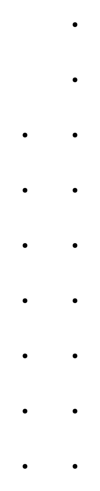

One can understand the concept of equinumerosity in such a way that it makes no sense to say of two groups of points that they are equinumerous or that they are not, unless they are two series, one of which is correlated 1–1 with at least part of the other. Between such series it is therefore possible to speak only of one-sided or mutual inclusion. And this really has as little to do with particular numbers as equality or inequality of length in visual space has to do with measures of number. The connection with numbers _can_ be made, but need not be made. If the connection with the number series is made, the relation of mutual inclusion or equality of length between the series becomes the relation of equality of number. But now not only does ψ5 follow from π ∙ φ5, but π also follows from φ5 ∙ ψ5. That is, here S = π.

### [22r\[2\]](https://cdn.wittgensteinnachlass.com/2000px/webp/Ms-113/22r.webp)

The philosopher senses changes in the style of a derivation that the mathematician of today, with his blank expression, calmly passes by. – It is really a greater sensitivity that will distinguish the mathematician of the future from the mathematician of today; & _that_ will, as it were, prune mathematics, because one will then be more concerned with absolute clarity than with inventing new games.

### [22r\[3\]](https://cdn.wittgensteinnachlass.com/2000px/webp/Ms-113/22r.webp),[22v\[1\]](https://cdn.wittgensteinnachlass.com/2000px/webp/Ms-113/22v.webp)

Rule & empirical proposition. Is a rule an empirical proposition – about the use of language, say? Is a rule of chess a proposition about how people have played it since the event of the invention of chess; i.e. about having made moves with pieces shaped like this. For if one speaks of people having played chess in this way, then chess must be defined in such a way that it makes sense to say that it has been played differently. Otherwise the rules belong to the definition of chess. That someone plays in accordance with the rule … is an empirical fact; or: “A plays in accordance with the rule …”, “most people play in accordance with the rule …”, “no one plays in accordance with the rule …” are empirical propositions. The rule is not an empirical proposition, but only part of such a proposition.

_17.02.1932_

_&_

The rule is the stipulation of the unit of measurement, & the empirical proposition says how long an object is. (And here one sees how logical similes work, for the stipulation of the unit of measurement really is a grammatical rule & the specification of a length in this unit a sentence that makes use of the rule.)

### [22v\[2\]](https://cdn.wittgensteinnachlass.com/2000px/webp/Ms-113/22v.webp),[23r\[1\]](https://cdn.wittgensteinnachlass.com/2000px/webp/Ms-113/23r.webp)

Adding the rule to the sentence does not change the sense of the sentence. If the definition of the metre is the length of the Paris standard metre, then the sentence “this room is 4 m long” says the same as “this room is 4 m long & 1 m = the length of the Paris standard metre”. The legend of a map is such an instruction for using – or understanding – a description.

### [23r\[2\]](https://cdn.wittgensteinnachlass.com/2000px/webp/Ms-113/23r.webp)

Teaching philosophy presents the same enormous difficulty that teaching geography would present if the pupil came with a host of false and far too simple ideas about the course & interconnections of rivers & mountains.

### [23r\[3\]](https://cdn.wittgensteinnachlass.com/2000px/webp/Ms-113/23r.webp)

In any case this legend says nothing about the geography of the country. Any more than the sentence “1 m is the length of the standard metre in Paris” says anything about the length of an object.

### [23r\[4\]](https://cdn.wittgensteinnachlass.com/2000px/webp/Ms-113/23r.webp),[23v\[1\]](https://cdn.wittgensteinnachlass.com/2000px/webp/Ms-113/23v.webp)

Moreover, the rule must relate to its application in the description (of reality). For what sense is there in saying of a rod “that is the standard metre” if this statement does not relate to measurements with a metre rule?

In that respect we could imagine the rule appended to every sentence. The rule is a kind of route marked out in advance; a path marked out in advance. One could imagine paths marked out in a wood so that people could communicate with one another about walks in the wood. But would not any system of coordinates serve this purpose just as well?

### [23v\[2\]](https://cdn.wittgensteinnachlass.com/2000px/webp/Ms-113/23v.webp),[24r\[1\]](https://cdn.wittgensteinnachlass.com/2000px/webp/Ms-113/24r.webp)

18.02.1932

People are deeply embedded in philosophical, i.e. grammatical, confusions. And freeing them from these presupposes tearing them out of the immensely varied connections in which they are caught. One has, so to speak, to regroup their entire language. – But this language arose as it did precisely because people had – & have – a tendency to think _this way_. So they can be torn out only if they live in instinctive revolt against language. Not if their every instinct is to live in _the_ herd that created this language as its proper expression.

### [24r\[2\]](https://cdn.wittgensteinnachlass.com/2000px/webp/Ms-113/24r.webp)

I should like to call the rule an instrument.

### [24r\[3\]](https://cdn.wittgensteinnachlass.com/2000px/webp/Ms-113/24r.webp)

“To clarify the grammar” means to put it in the form of a game with rules.

### [24r\[4\]](https://cdn.wittgensteinnachlass.com/2000px/webp/Ms-113/24r.webp)

A game might go as follows: one makes fist-sized balls out of clay & rolls them in such and such a way etc. The statement that they are to be fist-sized balls corresponds exactly to the statement that there is a ‘heap’ of sand here and there; & one sees that the particular indeterminacy of this statement can quite well enter into rules.

### [24r\[5\]](https://cdn.wittgensteinnachlass.com/2000px/webp/Ms-113/24r.webp),[24v\[1\]](https://cdn.wittgensteinnachlass.com/2000px/webp/Ms-113/24v.webp)

I want to describe the shape of a polygonal line to someone & first give the rule (of representation)

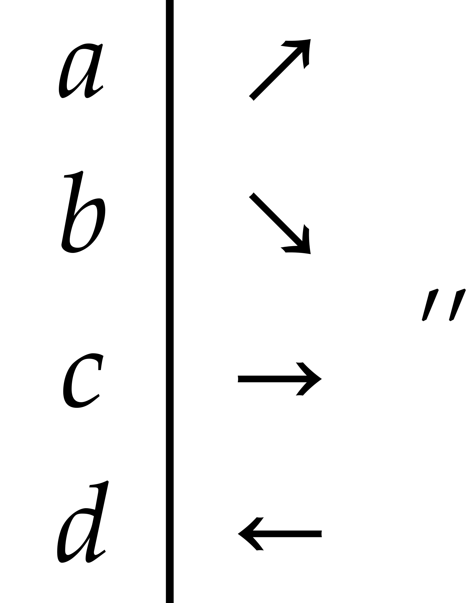.

The rule is one part of his apparatus; the particular sentence – say a a c b d d – is another part. It is as though the latter were an insert & the rule a basic component prepared for many cases. For can we not actually write instead of ‚a a c b d d’

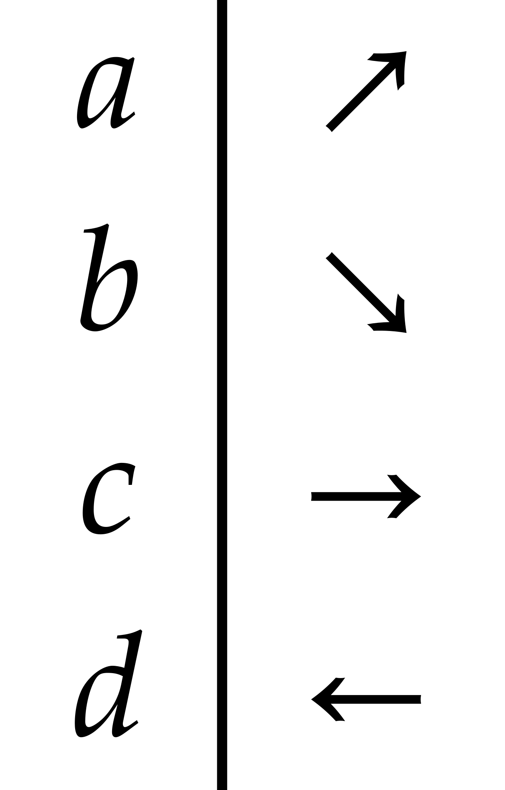

and thus repeat the rule-part for every sentence of the system? And would there then still be the rule

?

### [24v\[2\]](https://cdn.wittgensteinnachlass.com/2000px/webp/Ms-113/24v.webp)

This incidentally shows the flexibility of the concept of language; for here we would have a language without grammar, since the grammar is appended to the sentences.

### [24v\[3\]](https://cdn.wittgensteinnachlass.com/2000px/webp/Ms-113/24v.webp)

If a rule is a sentence, then presumably it is one about the words of the language. But what does such a sentence say about the words? That they are used in such and such a context? But by whom & when? Or that someone wishes them to be used in this way? And who? – Rather, the rule is part of all these statements.

### [24v\[4\]](https://cdn.wittgensteinnachlass.com/2000px/webp/Ms-113/24v.webp),[25r\[1\]](https://cdn.wittgensteinnachlass.com/2000px/webp/Ms-113/25r.webp)

Is a grammatical rule like a law of the state? Is it not true of such a law that it makes no statement about what happens, nor does it say that someone wishes people to act in such and such a way. But _could_ a law not after all be written like this: “the king commands that …”; & might one also give a rule of grammar in this way? No. For then the rule, appended to the sentence to whose words it applies, could not yield that sentence.

### [25r\[2\]](https://cdn.wittgensteinnachlass.com/2000px/webp/Ms-113/25r.webp),[25v\[1\]](https://cdn.wittgensteinnachlass.com/2000px/webp/Ms-113/25v.webp),[26r\[1\]](https://cdn.wittgensteinnachlass.com/2000px/webp/Ms-113/26r.webp)

20.02.1932

The rule “keep left!” or simply an arrow. What if I painted an arrow on the wall of my room – would it too be the expression of a law, as the arrow in a railway station might well be? Making it a law _does_ require the rest of the apparatus, of which the arrow is only one part. (Sraffa) An engineer builds a bridge; to do so he consults several handbooks, technical & legal. From the former he learns that the bridge would collapse if he made this part weaker than etc. etc.; from the latter that he would be locked up if he wanted to build it in such and such a way. – Are not the two books on the same footing, then? – That depends on the role they play in his life. The legal handbook may simply be for him a book about the natural history of the people around him. Perhaps he also has to consult a book about the life of beavers to find out how to paint the bridge so that the beavers do not gnaw at it. – But is there not another way of regarding laws? Do we not even feel quite clearly that this is not how we regard them? – Is this not the same question as: – Is a contract merely a statement that it is advantageous for the parties to act in such and such a way. Do we not in some cases (though not in all) feel “bound by the contract” in a different way? – Can one then say: “Someone who feels bound by a contract or a law mistakenly imagines the law as a person (or God) who compels him by physical force”? – No; for if he acts as though someone were compelling him, his action is in any case real, & whatever mental images he may have in the process are not mistakes either; & he need not be mistaken about anything and can still act as he does & imagine whatever he happens to imagine. The words “the contract binds me” are indeed a figurative representation & hence, with the ordinary meaning of the word “bind”, a false sentence; but properly understood they are true (or can be) & distinguish one case from that in which the contract merely tells me what it is advantageous for me to do. And if one objects to the words “the contract (or the law) binds me”, one can say nothing against the words: “I _feel_ bound by the contract”.

### [26r\[2\]](https://cdn.wittgensteinnachlass.com/2000px/webp/Ms-113/26r.webp)

The sense of language is not determined by its purpose. Or: what one calls the sense, the meaning, in language is not its purpose.

### [26r\[3\]](https://cdn.wittgensteinnachlass.com/2000px/webp/Ms-113/26r.webp),[26v\[1\]](https://cdn.wittgensteinnachlass.com/2000px/webp/Ms-113/26v.webp),[27r\[1\]](https://cdn.wittgensteinnachlass.com/2000px/webp/Ms-113/27r.webp),[27v\[1\]](https://cdn.wittgensteinnachlass.com/2000px/webp/Ms-113/27v.webp)

The rule – as I understand it – is like a path in a garden. Or like the squares marked out on a chessboard or the lines of a table. One would not say of these lines etc. that they communicate something to us (though they can be part of a communication – indeed, communications in their own right). I lay down a rule in an agreement with someone. In this agreement I might communicate the rule (of a future representation) to him. I might say to him: “the plan I am drawing you of my house is on a scale of 1 : 10”. That is really part of the description of the house. And when I write ~p ∙ (~~p = p) this really is like adding the scale to the plan. I could also put it like this: I want to communicate only what the sentence of the language communicates; & the rule is nothing but an aid to _this_ communication (as I understand it, the rule). For this reason alone the rule must not itself be a communication; for otherwise the sense of the sentence would somehow also contain the sense of the communication about linguistic usage. We must remind ourselves how we actually talk about rules in philosophy, i.e. in clarifying grammatical questions; – so that we stay on solid ground & do not devise nebulous constructions. I give e.g. rules like:

(∃x) φx⌵φa⌵φb = (∃x).φx

or

~~p = p

or I say that it is senseless to speak of a “reddish green”, or of a “blackish black”, or I say that “a = a” is senseless, or describe a notation that avoids this construction & “(∃x) x = x”, or say that it makes no sense to say that something “seems to seem red”, or that it makes sense to say that in visual space a curved line is made up of straight segments, or that it makes the same sense to say “the stone falls because it is attracted by the earth” & “the stone _must_ fall because it is … by the earth etc.”. I offer the person who is confused a rule & he accepts it. I could also say: I offer him a notation. 21.02.1932 How does such a notation look? Well, in most cases I shall translate sentences of the old notation (say, word-language) into the corresponding sentences of the new notation; for instance by writing

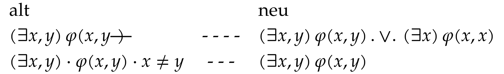

_etc._

But in a certain sense the rule corresponds to what has been called an “assumption”. It is, as it were, a sentence-radical (chemically speaking). And it is characteristic of the kind of investigation we are engaged in that we are not interested in the sentences that are (or _can_ be) formed with this radical. The focus is on the rule; not on my offering it to someone, not on someone using it, etc. It could, I think, be compared to the plan of a house “I mean a drawing that can be used as the plan of a house, but to which no existing house corresponds & of which it is not said that one is ever to correspond to it, etc.

### [27v\[2\]](https://cdn.wittgensteinnachlass.com/2000px/webp/Ms-113/27v.webp),[28r\[1\]](https://cdn.wittgensteinnachlass.com/2000px/webp/Ms-113/28r.webp)

What is puzzling about the continuum, like what was puzzling about time for Augustine, is due to the fact that language misleads us into applying to it a picture that does not fit. Set theory retains the ill-fitting picture of the discontinuous, but says things that contradict this picture of it, with the idea of breaking with prejudices. Whereas in reality one ought to point out that this picture simply does not fit, and that though one cannot stretch it without breaking it, one can use a new one that is in a certain sense similar to the old one.

### [28r\[2\]](https://cdn.wittgensteinnachlass.com/2000px/webp/Ms-113/28r.webp),[28v\[1\]](https://cdn.wittgensteinnachlass.com/2000px/webp/Ms-113/28v.webp),[29r\[1\]](https://cdn.wittgensteinnachlass.com/2000px/webp/Ms-113/29r.webp)

The description of a new, perhaps more surveyable, notation (for surveyability is what matters to us) is then of the same kind as the description of one of those languages that children invent or learn from one another, in which e.g. each vowel of ordinary language is doubled and a b inserted between the two parts of the doubling. Here we have come very close to games. One can take such a description or list of rules as the definiens of the name of the language or game. Let us also think of the description of how to draw or construct some figure, say a star (an activity that also plays a role in games). It goes something like this: „One draws a straight line from a point A to a point B, etc. etc.”. I could evidently also replace this description with a model, i.e. a drawing. What seems misleading here is a double sense of the word „description” when one speaks on one occasion of the description of an actual house or tree etc., on another of the description of a shape, construction, etc., a notation, a game. What is meant by this, however, is precisely not a sentence saying that such a game is actually played somewhere or that such a notation is actually used; rather, the description takes the place of the words „such a game” & „such a notation” used here. Characteristically, the description of a notation often begins with the words: „We _can_ also write it like this: …”. One might ask: „what kind of communication is ‚we can …’” etc.. One also writes, for instance: „our representation becomes more surveyable if instead of … we write … & the rules give …”; & here the rules occur in a sentence.

22.02.1932 What kind of sentences are those that occur in a cookery book: „Take 1 kg of flour etc.”? (Here one can indeed also speak of false instructions; if, for instance, the instruction for roasting the meat were such that following it resulted in the meat being burnt.)

### [29r\[2\]](https://cdn.wittgensteinnachlass.com/2000px/webp/Ms-113/29r.webp)

Let us imagine, say, a picture depicting a boxer in a certain fighting stance. This picture can now be used to communicate to someone how he should stand, how he should hold himself; or how he should not hold himself; or how a certain man stood there and there; etc. etc. One could call this picture a sentence-radical.

### [29r\[3\]](https://cdn.wittgensteinnachlass.com/2000px/webp/Ms-113/29r.webp)

The grammar of the word „there and there”.

### [29r\[4\]](https://cdn.wittgensteinnachlass.com/2000px/webp/Ms-113/29r.webp)

I still do not move freely enough within the actual use of language. I am still too much influenced by preconceived schemas, – still too stiff.

### [29r\[5\]](https://cdn.wittgensteinnachlass.com/2000px/webp/Ms-113/29r.webp)

‚Rule’ is a concept with blurred edges in the same sense as ‚leaf’ or ‚stalk’ or ‚table’, etc.

### [29v\[1\]](https://cdn.wittgensteinnachlass.com/2000px/webp/Ms-113/29v.webp)

In describing a notation, one says, for instance: „in this book I want to write ‘p⌵q’ instead of ‘p or q’”, and that is of course a complete sentence. But what I want to call a ‚rule’, and what is written, say, „p or q ․ = . p⌵q”, is not. – What I call a ‚rule’ is to contain nothing about a definite (or even indefinite) time or place of application, and is to refer to no definite (or even indefinite) persons; it is only to be an instrument of representation. Now we say: „we use the words ‚red’ & ‚green’ in such a way that it counts as senseless (is contradictory) to say that there is red & green in the same place at the same time”. And this is of course a sentence, an empirical proposition about our actual language.

### [29v\[2\]](https://cdn.wittgensteinnachlass.com/2000px/webp/Ms-113/29v.webp),[30r\[1\]](https://cdn.wittgensteinnachlass.com/2000px/webp/Ms-113/30r.webp)

25.02.1932

Now what kind of rules are those that say that such and such combinations of words have no sense? Are they of the same kind as the prescriptions that say, for instance, that it is not a position in chess if two pieces stand on the same square, or if a piece stands on the boundary between two squares, etc.? These sentences in turn are like certain actions, as when, for example, one cuts a chessboard out of a larger piece of squared paper. They draw a boundary. – What does it mean, then, to say: „this combination of words means nothing”. Of a name one can say „I have given this name to no one”, & giving a name is a definite action (hanging a little sign round someone’s neck).

Think of the representation of a journey on the earth by a line in the projection 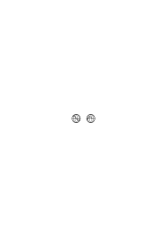 of the two hemispheres, & suppose we say: a segment of the line that goes beyond the boundary width of the projections on the plane of the drawing is senseless in this representation. One could also say: nothing has been settled about it.

### [30r\[2\]](https://cdn.wittgensteinnachlass.com/2000px/webp/Ms-113/30r.webp),[30v\[1\]](https://cdn.wittgensteinnachlass.com/2000px/webp/Ms-113/30v.webp)

Anyone who objects to saying that the rules of grammar are rules of a game is right in the sense that what makes a game a game – competition between players, the aim of amusement & recreation, etc. – is absent from grammar. But no one will deny that studying the nature of the rules of a game must be useful for studying grammatical rules, since there is undoubtedly _some_ similarity. In general it is better to look at the rules of a game without having formed a judgement or prejudice about the analogy between grammar & games, guided only by the sure instinct that there is an affinity here. And here again one should simply report what one sees & not fear that one is thereby undermining an important view, or for that matter wasting one’s time on something superfluous. What one sees above all is that the concept of a game, and with it that of a rule of a game, is one with blurred edges. Furthermore, one sees something like the following if one looks at the rules of chess, for example: Here there are sentences that describe the moves of the individual pieces; more generally, rules about game-actions. But then there are also the sentences that describe the starting position & those that describe the chessboard.

### [31r\[1\]](https://cdn.wittgensteinnachlass.com/2000px/webp/Ms-113/31r.webp)

A very interesting consideration about the place of the concept of number in logic is this: What becomes of the concept of number if a people have no number words but _always_ use an abacus instead, say, a Russian calculating machine?

(Nothing would be more interesting than to investigate these people’s arithmetic & one would really understand that there is no difference here between 20 & 21.)

### [31r\[2\]](https://cdn.wittgensteinnachlass.com/2000px/webp/Ms-113/31r.webp),[31v\[1\]](https://cdn.wittgensteinnachlass.com/2000px/webp/Ms-113/31v.webp),[32r\[1\]](https://cdn.wittgensteinnachlass.com/2000px/webp/Ms-113/32r.webp),[32v\[1\]](https://cdn.wittgensteinnachlass.com/2000px/webp/Ms-113/32v.webp)

I assume that this house will not collapse in half an hour. When do I assume that? All the time? And what kind of activity is this assuming? Does assuming that not (once again) mean two things? In one case it denotes a hypothetical psychological disposition; in the other, the act of thinking, of expressing, that sentence. In the first sense, the criterion for my making that assumption is what else I say, feel & do; in the other sense, it is that I utter a sentence which is in turn an element of a calculation. Now one says: „But you must have a reason for assuming that, otherwise the assumption is unsupported & worthless (remember that though we stand on the earth, the earth in turn does not stand on anything; & children think it must fall if it is not supported).” Well, I do have reasons for my assumption. They go something like this: that the house has already stood for years, but not so long that it could already be dilapidated, etc., etc. _What_ is a reason _for what_ (what counts as a reason for what) can be stated in advance & describes a calculus in which the one thing is a reason for the other. But if a reason is now to be given for this whole calculus, we see that there is none. But if one asks whether the calculus is therefore an arbitrary assumption, the answer is that it is no more so than fear of fire or of an angry person approaching us. If one now says: surely the rules of grammar by which we proceed & operate are not arbitrary; then one would have to ask in reply: Very well, then, why does a person think the way he does? Why does he go through these acts of thinking? (the question here is, of course, about the _reasons_, not causes). Well, reasons can be given within the calculus; and right at the end one is then tempted to say: „it is simply very likely that the thing will now behave as it has always behaved”, – or something of the sort. A turn of phrase which conceals the beginning of the reasoning and plays a role here similar to that of the Creator at the beginning of the world, who in reality explains nothing, to be sure, but is a beginning people can accept. What is so hard to see is that, _as long as_ we are playing a true-or-false game, a change of grammar can only take us from one such game to another, but not from something true to something false. And if, on the other hand, we step outside the domain of these games, we simply no longer call it grammar, and again we do not come into contradiction with reality.

### [32v\[2\]](https://cdn.wittgensteinnachlass.com/2000px/webp/Ms-113/32v.webp),[33r\[1\]](https://cdn.wittgensteinnachlass.com/2000px/webp/Ms-113/33r.webp)

Let us imagine the activity in a house, in a workshop. There is planing, sawing, painting, etc., etc.; & besides these there is an activity called calculating, which apparently differs from all the others, especially as far as the reason is concerned. We make a picture, say. The activity of calculating (drawing, etc.) connects parts of the other activity. He stops, calculates something, then measures & goes on working with the plane. He also stops sometimes to sharpen the blade of the plane; but is this activity analogous to the other, that of calculating? – „But surely you also believe that more boilers would explode if the boilers were not calculated”. „Yes, I believe it; – but what does that mean?” Does it follow that there will _be_ fewer? And what is the basis of this belief? If one now asks for the reason for an individual act of thinking (an act within a calculus), the answer one gets is an exposition of a system to which the act belongs.

### [33r\[2\]](https://cdn.wittgensteinnachlass.com/2000px/webp/Ms-113/33r.webp)

People who feel no need for transparency in their argumentation are lost to philosophy.

### [33r\[3\]](https://cdn.wittgensteinnachlass.com/2000px/webp/Ms-113/33r.webp),[33v\[1\]](https://cdn.wittgensteinnachlass.com/2000px/webp/Ms-113/33v.webp),[34r\[1\]](https://cdn.wittgensteinnachlass.com/2000px/webp/Ms-113/34r.webp)

If one asks „why do you put eggs in this batter”, the answer might be „because it makes the cake taste better”. So one is told of an effect, and it is given as a reason. If I want to give a block of wood a particular shape, then the right blow is the one that produces that shape. – But I do not call an argument right because it has the desired consequences. On the contrary, I call the calculation wrong although the actions arising from the result have led to the desired end. (I hit the jackpot & he wants to teach me a lesson.) This shows that the justifications in the two cases are different, and so „justification” means different things in the two cases. In one case one can say: „Just wait, you’ll see that it comes out right (i.e. here: as desired)”; in the other this is no justification.

_26.02.1932_

Now when one speaks of the arbitrariness of grammatical rules, this can only mean that a justification that counts as such _within_ grammar does not count _for_ grammar. And if one compares calculation, not cooking, to a game, it is for just this reason. But this is also the reason why one would not call cooking a calculus. But what about tidying a room, or arranging a bookcase, – or knitting a particular pattern? These things are in some way closer to a game. I think the reason why one is not tempted to call cooking a game is this: there are of course rules for cooking too, but „cooking” does not essentially denote an activity carried out according to these rules, but an activity that has a particular result. It is a rule, for instance, that one boils eggs for 3 minutes to get soft-boiled eggs; but if for some reason the same result is achieved by boiling them for 2 minutes, one does not then say „that doesn’t count as ‚soft-boiling eggs’”. By contrast, „playing chess” does not mean the activity that has a particular result, but this expression means an activity carried out according to certain rules. The rules of cookery are related to the grammar of the word „cook” in a different way from that in which the rules of chess are related to the grammar of the expression „play chess” & the rules of multiplication to the grammar of the word „multiply”.

### [34r\[2\]](https://cdn.wittgensteinnachlass.com/2000px/webp/Ms-113/34r.webp),[34v\[1\]](https://cdn.wittgensteinnachlass.com/2000px/webp/Ms-113/34v.webp),[35r\[1\]](https://cdn.wittgensteinnachlass.com/2000px/webp/Ms-113/35r.webp),[35v\[1\]](https://cdn.wittgensteinnachlass.com/2000px/webp/Ms-113/35v.webp)

27.02.1932

The rules of grammar are arbitrary in the way (i.e. in the same sense) that the choice of a unit of measurement is arbitrary. But surely this can only mean that the choice is independent of the length of what is to be measured. And that the choice of one unit is not ‘true’ and that of another ‘false’ in the way that a statement of the length is true or false. Which of course is only a remark about the grammar of the word „unit of length”. One is tempted to justify the rules of grammar by sentences of the kind: „But there really are 4 primary colours”; and the statement that the rules of grammar are arbitrary is directed against the possibility of this justification, which is built on the model of justifying a sentence by reference to its verification. But can one not after all say in some sense that the grammar of colour words characterizes the world as it actually is? One would like to say: can I not really search in vain for a fifth primary colour? – (And if one can search, then finding is conceivable.) Does one not group the primary colours together because they have a similarity, or at least group the colours together, as opposed to e.g. shapes or tones, because they have a similarity? Or, when I present this division of the world as the correct one, do I already have a preconceived idea in my head as a paradigm? Of which I can then perhaps say only: „yes, that is the _way_ we look at things”, or „we simply want to make such a picture (of reality)”. For if I say: „the primary colours do have a certain similarity to one another” – where do I get the concept of this similarity? That is: do I have here a function „x similar to y” into which I can put the colours as arguments? Just as the concept „primary colour” is nothing other than „blue or red or green or yellow”, is not the concept of that similarity likewise given only by the four colours? Indeed, are they not the same! – Well, could one also group red, green & circular together? Why not?! The importance _in a game_ lies in our playing this game. In our performing _these_ actions. It does not lose its importance through not being in turn an action in another (higher-level) game. Why do I not call the rules of cooking arbitrary; and why am I tempted to call the rules of grammar arbitrary? Because cooking is defined by its purpose, whereas the use of language is not. That is why the use of language is autonomous in a certain sense in which cooking and washing are not. For someone who follows rules other than the right ones when cooking cooks badly; but someone who follows rules other than those of chess plays _a different game_, and someone who follows other grammatical rules does not thereby say anything false, but speaks of something else.

### [35v\[2\]](https://cdn.wittgensteinnachlass.com/2000px/webp/Ms-113/35v.webp),[36r\[1\]](https://cdn.wittgensteinnachlass.com/2000px/webp/Ms-113/36r.webp)

The relation of the rules of a game to sentences. A rule stands to an empirical proposition much as a drawing with the inner characteristics of a house plan stands to a description that makes use of such a drawing & says that a house like that exists in such-and-such a place. The respect one has for the rules of chess – for instance – comes from the fact that the games these rules characterize suit us in many respects. But suppose I invented a game which I called, say, „Abrakadabra” & gave this rule for it: „Put a fieldstone in a four-sided box, nail the box shut & throw another stone at it” – surely this construction, too, has a right to be called a rule. One will only ask „what’s all this about? what are we supposed to do that for?” But the rules of chess give no answer to such questions either. In the case of the rule just given, though, the wording „put … & throw” strikes one, specifically its imperative form; one wants to ask: why should I put … etc., or in what circumstances? What must my purpose be for me to be supposed to do that? That is, the imperative seems nonsensical to us here. But it is no more so than in an ordinary rule of a game. It is just that here one sees clearly that one is not dealing with a complete sentence. At most, with the definition of „Abrakadabra”; namely: „playing Abrakadabra” means putting a fieldstone in a box, etc.

### [36r\[2\]](https://cdn.wittgensteinnachlass.com/2000px/webp/Ms-113/36r.webp),[36v\[1\]](https://cdn.wittgensteinnachlass.com/2000px/webp/Ms-113/36v.webp)

Instead of just the drawing, which can serve to describe a particular house, one could also imagine an unapplied description of a household, say the schedule for a whole day, of which the plan drawing would form a part.

That would correspond roughly to the description of the chessboard & the pieces & the permitted moves, and there is something similar in grammar too.

### [36v\[2\]](https://cdn.wittgensteinnachlass.com/2000px/webp/Ms-113/36v.webp)

The schema: thing–property. One says: an action has a property! Such as that of speed; or that of goodness!

### [36v\[3\]](https://cdn.wittgensteinnachlass.com/2000px/webp/Ms-113/36v.webp)

The equation p ∙ q = p really shows the connection between following & the truth-functions.

### [36v\[4\]](https://cdn.wittgensteinnachlass.com/2000px/webp/Ms-113/36v.webp)

„There _must_ be no contradiction in the rules” sounds like a prescription: „in a petrol engine the gear on the crankshaft must not sit loose”. One then expects a justification: because otherwise … In the first case, however, the only justification would be: because otherwise it is not a list of rules. Once again, it is a case of grammatical structure, which cannot be justified logically.

### [36v\[5\]](https://cdn.wittgensteinnachlass.com/2000px/webp/Ms-113/36v.webp)

28.02.1932

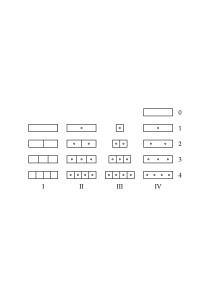

### [37r\[1\]](https://cdn.wittgensteinnachlass.com/2000px/webp/Ms-113/37r.webp)

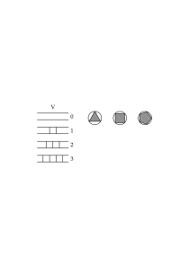

It makes no sense to speak of a black digon in the white circle; and this case is analogous to the following: it is senseless to say that the quadrilateral consists of 0 parts (no part). Here we have something like a lower limit to counting, before we even reach one. Is there also a case in which there is an upper limit? I think so; for example, that of the areas of regular solids. But must I go that far; can I not arbitrarily stipulate such a system?

### [37r\[2\]](https://cdn.wittgensteinnachlass.com/2000px/webp/Ms-113/37r.webp),[37v\[1\]](https://cdn.wittgensteinnachlass.com/2000px/webp/Ms-113/37v.webp)

Is counting parts in I the same as counting points in IV? And what does the difference consist in? One can take counting parts in I to be counting quadrilaterals. But then one can also say „there is _no_ quadrilateral in this row”; & then one is not counting _parts_. What troubles us is the analogy between counting points & counting parts, and the omission of that analogy (on the other hand). There is something strange about counting the undivided surface as „one”; yet we find no difficulty in seeing the surface divided once as a picture of 2. One would much rather count „0, 2, 3, etc.” here. And this corresponds to the series of sentences: „the quadrilateral is undivided”, „the quadrilateral is divided into 2 parts”, etc.

### [PG II](/w-pg-2/#ms-113-37v.2) [37v\[2\]](https://cdn.wittgensteinnachlass.com/2000px/webp/Ms-113/37v.webp)

When different colours are involved, one can imagine the standpoint from which one does not say, we have two colours here, but rather, there is a difference of colour here; the way of looking that does not see 3 at all in red, green, yellow. And which nevertheless recognizes a series, say: red; blue, green; yellow, black, white; etc., as such, but does not connect it with the series ∣; ∣∣; ∣∣∣; etc., or not in such a way that it assigns ∣ to the item red.

### [PG II](/w-pg-2/#ms-113-37v.3+38r.1) [37v\[3\]](https://cdn.wittgensteinnachlass.com/2000px/webp/Ms-113/37v.webp),[38r\[1\]](https://cdn.wittgensteinnachlass.com/2000px/webp/Ms-113/38r.webp)

From the standpoint from which it is ‘odd’ to count the undivided surface as 1, it is also unnatural to count the once-divided one as 2. For one does that when one takes it as two quadrilaterals, that is, from the standpoint from which one could quite properly count the undivided one as a quadrilateral. But if one takes the first quadrilateral in I as the undivided surface, the second appears as a whole with a division (a difference); and division here does not necessarily mean a dividing line. Rather, what I direct my attention to are the differences, and here there is a series from fewer to more differences, or transitions. I shall then number the quadrilaterals in I ‘0, 1, 2, etc.’.

### [PG II](/w-pg-2/#ms-113-38r.2+38v.1) [38r\[2\]](https://cdn.wittgensteinnachlass.com/2000px/webp/Ms-113/38r.webp),[38v\[1\]](https://cdn.wittgensteinnachlass.com/2000px/webp/Ms-113/38v.webp)

This works when the colours in a strip border one another, as, for example, in the schema

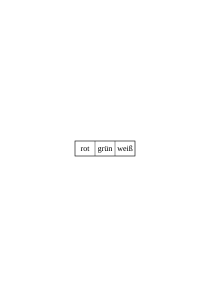.

But it is different when the arrangement  is; or

.

Of course I could also assign each of these two schemata to a schema

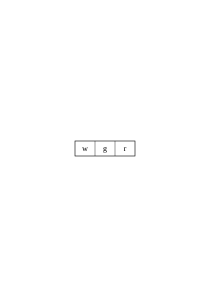

schemata such as 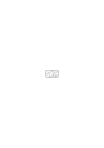 to a schema

.

etc.; and that is a correct way of looking at it, but nevertheless an artificial one. The most natural thing is to take the series of schemata ⋎ as

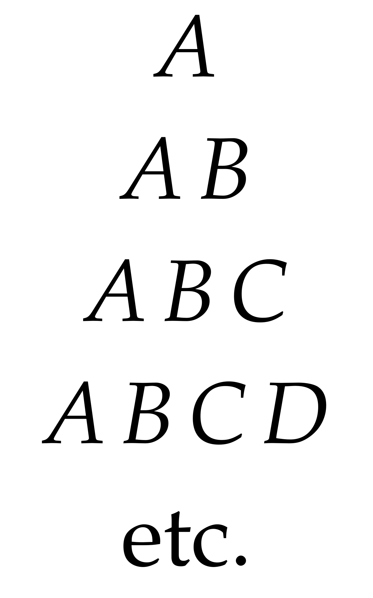.

And here one can designate the first schema by ‘0’, the second by ‘1’, but the third by 3, say, if one is thinking of all the possible differences, and the fourth then by 6. Or one calls the third schema 2 (if one is concerned with only one arrangement) and the fourth 3.

### [38v\[2\]](https://cdn.wittgensteinnachlass.com/2000px/webp/Ms-113/38v.webp)

One can describe the division into parts of the quadrilateral 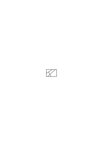 by saying: it is divided into 5 parts, or: 4 parts have been cut off from it, or: it has the division schema ABCDE, or: one gets through all the parts by crossing 4 boundaries, or: the quadrilateral is divided (i.e. into 2 parts), one part is divided again & both parts of this division are divided, etc. I want to show that there is not just _one_ method of describing its division into parts.

### [38v\[3\]](https://cdn.wittgensteinnachlass.com/2000px/webp/Ms-113/38v.webp),[39r\[1\]](https://cdn.wittgensteinnachlass.com/2000px/webp/Ms-113/39r.webp)

If one wants to count the differences (of the colours), one will, as I said, count, say, the combinations of pairs of colours; but one is then also tempted to speak of a multi-colour difference, which relates to the simple difference as a solid angle relates to a plane angle. Thus green-red is a difference, but so is green-red-blue. And here it is difficult not to call this a threefold difference.

### [39r\[2\]](https://cdn.wittgensteinnachlass.com/2000px/webp/Ms-113/39r.webp)

One can always take the quadrilateral from before as divided _in this way_  & then say that it is divided 4 times. And in this respect one can call the difference green-blue-red a double difference & mean that the whole field is divided once & one part once again.

### [39r\[3\]](https://cdn.wittgensteinnachlass.com/2000px/webp/Ms-113/39r.webp)

But perhaps one will refrain from designating the difference by a number at all, and stick entirely to the schemata A, AB, ABC, etc. Or write it this way:

1, 12, 123, etc. or, what comes to the same thing: 0, 01, 012, etc. These too can quite properly be called number signs.

### [39r\[4\]](https://cdn.wittgensteinnachlass.com/2000px/webp/Ms-113/39r.webp),[39v\[1\]](https://cdn.wittgensteinnachlass.com/2000px/webp/Ms-113/39v.webp)

The schemata:

A, AB, ABC, etc.; 1, 12, 123, etc.; ∣, ∣∣, ∣∣∣ etc.; 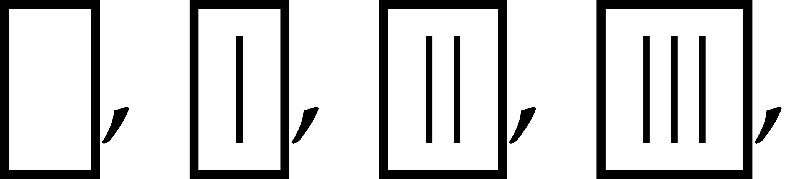 etc.; 0, 1, 2, 3, etc.; 1, 2, 3 etc.; 1, 12, 121323, etc., etc. are all equally fundamental.

### [39v\[2\]](https://cdn.wittgensteinnachlass.com/2000px/webp/Ms-113/39v.webp)

The whole difficulty arises from the representation of the schemata

and one assigns them _in this way_:

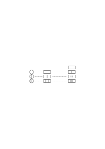

### [39v\[3\]](https://cdn.wittgensteinnachlass.com/2000px/webp/Ms-113/39v.webp)

The schemata 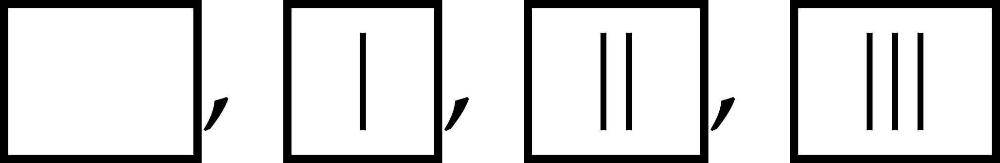 etc. are the number series 0, 1, 2, 3, etc. If instead of the schemata  etc. one had used the schemata ∣, ∣∣, ∣∣∣, etc., which are the cardinal numbers without zero, the difficulty would not have arisen here. One is now surprised that the number schema with which one counts soldiers in a barracks should not also apply to the parts of a quadrilateral. But the schema for the soldiers in the barracks is  etc., that for the parts of the quadrilateral  etc. Neither is primary in comparison with the other.

### [39v\[4\]](https://cdn.wittgensteinnachlass.com/2000px/webp/Ms-113/39v.webp),[40r\[1\]](https://cdn.wittgensteinnachlass.com/2000px/webp/Ms-113/40r.webp)

Simply compare the two series:

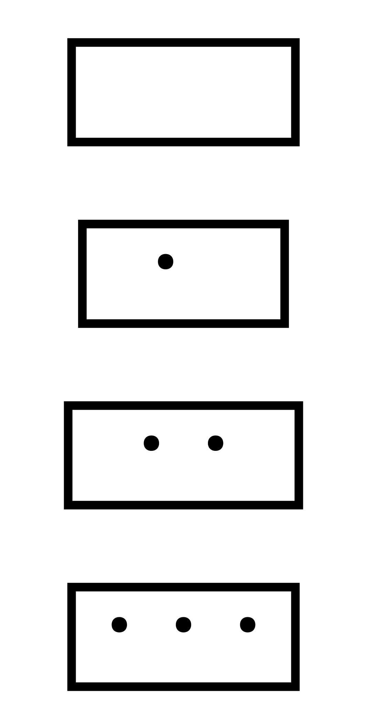

& decide how they are to be assigned to one another, – how they correspond to one another –! The temptation is evidently great to assign the letters to the dots so that 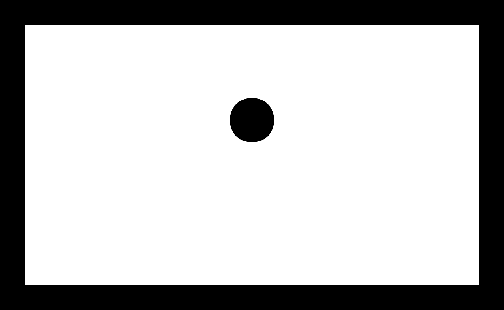 corresponds to A, but then 0 remains unoccupied; – yet it is also possible to make the assignment differently.

### [40r\[2\]](https://cdn.wittgensteinnachlass.com/2000px/webp/Ms-113/40r.webp)

The series

A

A | B

A | B | C

etc. | can evidently be assigned the series | 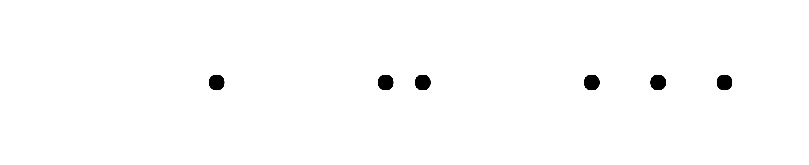

etc.

but also the series

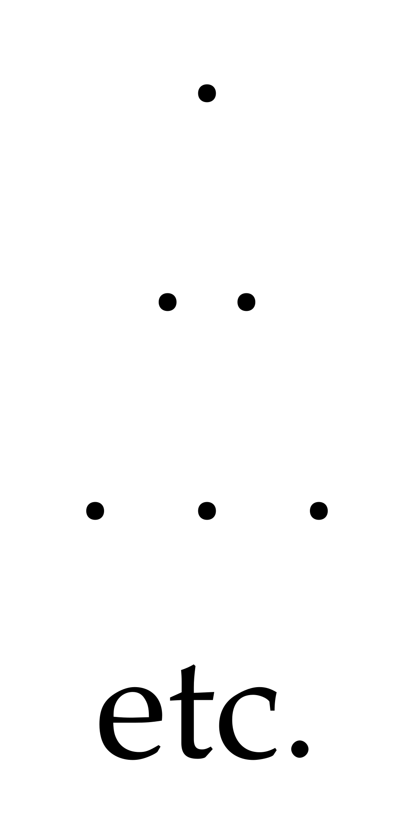

### [40r\[3\]](https://cdn.wittgensteinnachlass.com/2000px/webp/Ms-113/40r.webp),[40v\[1\]](https://cdn.wittgensteinnachlass.com/2000px/webp/Ms-113/40v.webp)

Incidentally & misleadingly expressed: I can count the parts, but also the parts of which there is more than one. It is more correct to say: “I can count the parts, but also the dividing lines”; only then one has to know what one calls a dividing line in a case . I can compare the series of division schemata both with the series 1, 2, 3 etc. and with the series 0, 1, 2, 3 etc. If I count the parts, there is no 0 in my number series, for the series

_A_

_A | B_

_A | B | C_

_etc._

begins with a letter, whereas 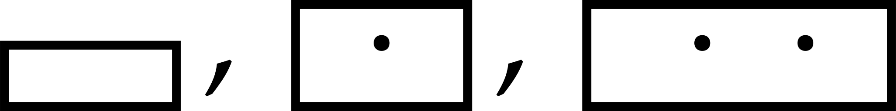 etc. does not begin with a dot. On the other hand, I can represent all the facts of the division with this series too, only “I am not counting the parts then”.

### [40v\[2\]](https://cdn.wittgensteinnachlass.com/2000px/webp/Ms-113/40v.webp),[41r\[1\]](https://cdn.wittgensteinnachlass.com/2000px/webp/Ms-113/41r.webp)

Could one also set against the cardinal numbers a kind of number whose series corresponded to that of the cardinal numbers without the 5? Oh yes; only this kind of number would be of _no_ use for anything the cardinal numbers are useful for. And the 5 is not missing from these numbers like an apple that one has taken out of a box full of apples & can put back in; rather, the 5 is missing from the essence of these numbers; they _know_ no 5 (just as the cardinal numbers do not know the number ½). Thus these numbers (if one wants to call them that) were applied in a case in which the cardinal numbers (with the 5) could not be applied with sense. (Doesn’t this show how nonsensical the talk of “basic intuition” is?)

### [41r\[2\]](https://cdn.wittgensteinnachlass.com/2000px/webp/Ms-113/41r.webp)

Let us think what would result if I wanted to assign the schema

_A_

_A | B_

_A | B | C_

_etc._

the schema

### [41r\[3\]](https://cdn.wittgensteinnachlass.com/2000px/webp/Ms-113/41r.webp)

29.02.1932

Rules of grammar that establish a “connection between language & reality”, & ones that do not. Of the first kind, say: “I call this colour ‚red’”, – of the second: „~~p = p”. But there is a misconception about this distinction: the distinction seems to be one of principle; & language seems to be essentially something that is given a structure, & then fitted to reality.

### [VB](/w-vb/#ms-113-41r.4) [41r\[4\]](https://cdn.wittgensteinnachlass.com/2000px/webp/Ms-113/41r.webp)

The philosophers who say: “after death a timeless state will set in”, or “with death a timeless state sets in”, & do not notice that they have said “after” & “with” & “sets in” in a temporal sense, & that the temporality lies in their grammar.

### [41r\[5\]](https://cdn.wittgensteinnachlass.com/2000px/webp/Ms-113/41r.webp),[41v\[1\]](https://cdn.wittgensteinnachlass.com/2000px/webp/Ms-113/41v.webp),[42r\[1\]](https://cdn.wittgensteinnachlass.com/2000px/webp/Ms-113/42r.webp)

„The quadrilateral has a colour & only _one_”. The first part of the sentence must not then be the grammatical statement of being coloured. (“I can _distinguish_ 3 colours in this surface.”) I myself do not know _what_ is still unclear to me about this matter, what my problem consists in, & yet there is still something. Something is not yet clear! Put incorrectly, but as one would put it at first, the problem runs: „why can one say ‚there are 2 colours on this surface’ & not: ‚there is _one_ colour on this surface’?” Or: How must I express the grammatical rule so that I am no longer tempted to say something nonsensical & so that it is self-evident to me? Where is the false thought, the false analogy, through which I am led to use language incorrectly? How must I represent the grammar so that this temptation disappears? I believe that the representation by means of the series

_A_

_A | B_

_A | B | C_

_etc._

and

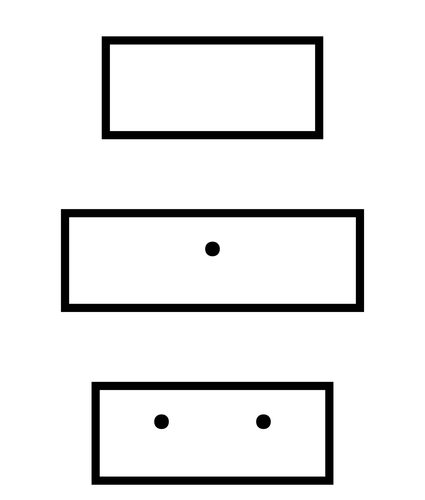

etc.

clears up the confusion. Everything depends on whether I count with a number series that starts with 0 or with one that starts with 1. It is the same when I count the lengths of rods or the sizes of hats. If I count with tally strokes, I could then write them like this: , , ,  etc., to show that what matters is the *difference* in direction & that the single stroke corresponds to 0 (i.e. is the beginning).

### [42r\[2\]](https://cdn.wittgensteinnachlass.com/2000px/webp/Ms-113/42r.webp)

(The unsettling character of grammatical unclarity.)

### [42r\[3\]](https://cdn.wittgensteinnachlass.com/2000px/webp/Ms-113/42r.webp)

The sense of a sentence is not pneumatic, but is what comes in reply to the question about an explanation of the sense. And – or – one sense differs from another as the explanation of the one differs from the explanation of the other.

### [42r\[4\]](https://cdn.wittgensteinnachlass.com/2000px/webp/Ms-113/42r.webp)

The role the sentence plays in the calculus is its sense.

### [42r\[5\]](https://cdn.wittgensteinnachlass.com/2000px/webp/Ms-113/42r.webp)

The sense, then, does not lie _behind_ it (like the mental process of forming images, etc.).

### [42r\[6\]](https://cdn.wittgensteinnachlass.com/2000px/webp/Ms-113/42r.webp),[42v\[1\]](https://cdn.wittgensteinnachlass.com/2000px/webp/Ms-113/42v.webp)

Which sentences follow from it & from which sentences it follows, that is what constitutes its sense. Hence the question of its verification is also a question of its sense.

### [42v\[2\]](https://cdn.wittgensteinnachlass.com/2000px/webp/Ms-113/42v.webp),[43r\[1\]](https://cdn.wittgensteinnachlass.com/2000px/webp/Ms-113/43r.webp)

Apply that to a sentence such as „there will never be people with two heads”. This sentence seems somehow to reach into the infinite, the unverifiable, & its sense to be independent of any verification. But if we want to investigate its sense, the question quite rightly arises: Can we ever know the truth of such a sentence & _how_ can we know it & what grounds can we have for accepting & rejecting what the sentence says? Now one may perhaps say: it was its sense that was asked about; not whether & how one can know it. But the answer to the question „how can one know this sentence?” is not a psychological one: it says which other sentence it follows from, and thus belongs to the grammar of the former. And the possible grounds for accepting the sentence are not personal matters but parts of the calculus to which the sentence belongs. If I ask: how _can_ I verify the sentence „someone is in the next room”, or how can I find out that someone is in the next room, then one answer would be „by going into the next room & seeing him”. If one now asks „how _can_ I get into the next room if the door is locked”, this „can” is different from the first: the first question about possibility (logical possibility) was answered by an explanation about the calculus of sentences, namely that this sentence follows from that one; the second was a question about physical possibility & was answered by an empirical proposition: for example, that one could not break through the wall because it was too solid, whereas one could open the door with a lockpick. Both questions, then, are questions about verification in a certain sense, but not in the same sense. And by confusing the first kind with the second, one comes to believe that the question about verification has no bearing on sense. The grounds for accepting a sentence are not to be confused with the causes of its acceptance. The former belong to the calculus of the sentence.

### [43r\[2\]](https://cdn.wittgensteinnachlass.com/2000px/webp/Ms-113/43r.webp),[43v\[1\]](https://cdn.wittgensteinnachlass.com/2000px/webp/Ms-113/43v.webp)

The causes of our believing a sentence would certainly be irrelevant to the question of what it is that we believe, but not so the grounds, which are internally related to the sentence & tell us who it is.

### [43v\[2\]](https://cdn.wittgensteinnachlass.com/2000px/webp/Ms-113/43v.webp)

And the sense of the sentence is not something we investigate & which may in part be beyond investigation. So that later on we might yet discover that beings other than ourselves can know this sentence in a different way. So that it would remain _this_ sentence with _this_ sense, but this sense would have properties we do not now suspect. The sentence, or its sense, is not a pneumatic being that has a life of its own & now has adventures we need know nothing about. We would, as it were, have breathed spirit of our own spirit into it – its sense – but now it has a life of its own – like our child – & we can (only) investigate it & understand it more or less.

### [43v\[3\]](https://cdn.wittgensteinnachlass.com/2000px/webp/Ms-113/43v.webp)

The instinct that leads one to ask: How can one know such a thing; what grounds can we have for assuming it; from what experiences would we derive such a sentence; etc., leads one aright.

### [43v\[4\]](https://cdn.wittgensteinnachlass.com/2000px/webp/Ms-113/43v.webp),[44r\[1\]](https://cdn.wittgensteinnachlass.com/2000px/webp/Ms-113/44r.webp)

The sense is not a soul of the sentence. In so far as we are interested in it, it must be capable of being measured out completely, must reveal itself entirely in signs.

### [44r\[2\]](https://cdn.wittgensteinnachlass.com/2000px/webp/Ms-113/44r.webp)

If one now asks: does it make sense to say „there will _never_ be such-and-such”? – Well, what evidence is there for it; & what follows from it? – For if there is no evidence for it – not that we have not yet been able to get any – but that none was _provided for_ in the calculus, then that determines the character of this sentence. Just as the essence of a kind of number is determined by the fact that no comparison is possible between it & certain rational numbers.

### [44r\[3\]](https://cdn.wittgensteinnachlass.com/2000px/webp/Ms-113/44r.webp)

Incidentally: A number defined today in a conscious way by means of Fermat’s theorem is not changed by the discovery of a proof of this theorem or of its contrary. For the calculus of this number knows nothing of this solution to the problem (& will even then know nothing of it).

### [44r\[4\]](https://cdn.wittgensteinnachlass.com/2000px/webp/Ms-113/44r.webp),[44v\[1\]](https://cdn.wittgensteinnachlass.com/2000px/webp/Ms-113/44v.webp)

„I will never see a person with 2 heads” – one thinks that with this sentence one somehow reaches into infinity. As if one had at least laid a railway there, even if we have not yet travelled the whole route. The underlying idea is that, for example, the word „never” already brings infinity with it, since that is precisely its meaning. What matters is: What can I do with such a sentence; for the question „what does it mean?” is answered in turn by a sentence, & that takes me no further as long as I learn nothing from the explanation about the moves I may make with the pieces. (As long as, so to speak, I only ever see the same configuration before me & no others that I can form from it.) So I hear, for example, that no experience can _prove_ this sentence & that sets my mind at rest about its infinite meaning.

### [44v\[2\]](https://cdn.wittgensteinnachlass.com/2000px/webp/Ms-113/44v.webp)

Some philosophers (or whatever one may call them) suffer from what one might call „loss of problems”, „Problemverlust”. It then seems to them that everything is quite simple & that there are no longer any profound problems; the world becomes wide & flat & loses all depth; & what they write becomes infinitely shallow and trivial. Russell & H. G. Wells suffer from this affliction.

### [44v\[3\]](https://cdn.wittgensteinnachlass.com/2000px/webp/Ms-113/44v.webp),[45r\[1\]](https://cdn.wittgensteinnachlass.com/2000px/webp/Ms-113/45r.webp)

It follows from no evidence that this sentence is true. – Yes, but surely I can _believe_ that it is true! But what does this mean: „believe that this is the case”? Does this belief perhaps reach into infinity; does it fly ahead of verification? – What does it mean to believe that? To say this sentence with certain feelings? Is it a particular kind of behaviour? For surely it cannot be anything else. – And then it interests us only in so far as it is a matter of calculating with the sentence.

### [45r\[2\]](https://cdn.wittgensteinnachlass.com/2000px/webp/Ms-113/45r.webp)

There are as many different generalities as there are different kinds of number.

### [45r\[3\]](https://cdn.wittgensteinnachlass.com/2000px/webp/Ms-113/45r.webp)

That is why it is no use employing the word „all” for clarification when one does not yet know its grammar in _this_ case.

### [45r\[4\]](https://cdn.wittgensteinnachlass.com/2000px/webp/Ms-113/45r.webp),[45v\[1\]](https://cdn.wittgensteinnachlass.com/2000px/webp/Ms-113/45v.webp)

01.03.1932

This, for example, is a simple language-game: one speaks to a child (though it could also be an adult), while switching on the electric light in a room: „Light”, then, while switching it off: „Dark”; & one does this, say, several times, with emphasis & varying lengths of time. Then one goes, say, into the next room, switches the light in the first room on & off from there & gets the child to communicate whether it is light or dark. Now am I to call „light” & „dark” ‘sentences’ here?! Well, as I wish. – – And what about ‘agreement with reality’?

### [45v\[2\]](https://cdn.wittgensteinnachlass.com/2000px/webp/Ms-113/45v.webp)

When I describe certain simple games, it is not in order to use them to build up, step by step, the actual processes of language – or of thought –, which only leads to injustices, – rather, I set out the games as such, & let them cast their clarifying light on the particular problems.

### [45v\[3\]](https://cdn.wittgensteinnachlass.com/2000px/webp/Ms-113/45v.webp)

I have a picture with blurred colours & complicated transitions. I put alongside it a simple one, with clearly distinct colours but related to the first. I do not say that the first is really the second; but I invite the other person to look at the simple one & expect certain things that trouble him to disappear as a result.

### [45v\[4\]](https://cdn.wittgensteinnachlass.com/2000px/webp/Ms-113/45v.webp),[46r\[1\]](https://cdn.wittgensteinnachlass.com/2000px/webp/Ms-113/46r.webp)

(Is my way of thinking connected with the break-up of the large states into small independent ones, with respecting minorities?)

### [46r\[2\]](https://cdn.wittgensteinnachlass.com/2000px/webp/Ms-113/46r.webp)

One might say above: “the words ‘light’, ‘dark’ are meant here as sentences & are not simply words”. That is, they are not used here as we use them in ordinary language (although in fact we often speak _like this_ too). But if I suddenly utter the word “light” in isolation, for no apparent reason, one will certainly say: “what does that mean? That isn’t a sentence” or: “You say ‘light’; well, what’s that supposed to mean?”

In this case the utterance of the word “light” is, so to speak, not yet a (complete) move in the game which we expect the other to play.

### [46r\[3\]](https://cdn.wittgensteinnachlass.com/2000px/webp/Ms-113/46r.webp)

Now how does “light”, when it expresses a wish for light, differ from “light” when it states that the room is light? That we _mean_ it differently in each case? And what does that consist in? In particular processes that accompany the utterance, or in particular behaviour that precedes it, perhaps accompanies it, & follows it?

### [46r\[4\]](https://cdn.wittgensteinnachlass.com/2000px/webp/Ms-113/46r.webp),[46v\[1\]](https://cdn.wittgensteinnachlass.com/2000px/webp/Ms-113/46v.webp)

When a man cries “Help” as he is drowning, – is he stating the fact that he needs help? That without help he will drown? – By contrast there is the case in which one says, as if observing oneself, “I would now have (or: have) the wish for …”.

### [46v\[2\]](https://cdn.wittgensteinnachlass.com/2000px/webp/Ms-113/46v.webp)

I say the word “Light!”, – the other person asks me: “what do you mean?” – And I say: “I meant that you should turn on the light”. – How was it when I _meant_ it? Did I utter the “complete sentence” inaudibly in my imagination, or the corresponding sentence in another language? (Yes, that _can_ happen or not.) The cases one _groups together_ under the expression “I meant” are _very diverse_.

### [46v\[3\]](https://cdn.wittgensteinnachlass.com/2000px/webp/Ms-113/46v.webp)

Now one can quite well suppose that ‘I meant you should turn on the light’ means that an imaginary picture of you doing this floated before me at the time, & just as well that the sentence means that the words of the complete sentence were present to my imagination at the time, or that one of these two things was the case; – I need only realize that in doing so I have laid down a stipulation about the words “I meant”, & a narrower one than corresponds to the actual general use of the expression.

### [47r\[1\]](https://cdn.wittgensteinnachlass.com/2000px/webp/Ms-113/47r.webp)

If meaning is to have any significance, any importance, for us, then a system of things meant must be correlated with the system of sentences, _whatever_ sort of processes the things meant are supposed to be.

### [47r\[2\]](https://cdn.wittgensteinnachlass.com/2000px/webp/Ms-113/47r.webp),[47v\[1\]](https://cdn.wittgensteinnachlass.com/2000px/webp/Ms-113/47v.webp),[48r\[1\]](https://cdn.wittgensteinnachlass.com/2000px/webp/Ms-113/48r.webp)

Now in what respect does the word “Light” in the _above_ symbolism or game with signs agree with a reality, – or fail to agree with it? How do we use the word “agree” in general? – We say “the two clocks agree” when they show the same time, “the two measuring rods agree” when certain graduation marks coincide, “the two colours agree” when, say, we find their combination pleasing. We say “the two lengths agree” when they are equal, but also when they stand in a ratio we want. And to say that they “agree” then means nothing other than that they stand in this ratio – say 1 : 2. So in each case what is meant by “agreement” must first be laid down. – And so it is with the agreement of a specification of length with a length. If I say: “this rod is 2 m long”, I can, for example, explain how one uses this sentence to check the length of the rod with a measuring rod, or how, say, one uses this sentence to make a measuring strip for the rod. And I now say that the sentence agrees with reality if the measuring strip constructed in this way agrees with the rod. This construction of a measuring strip illustrates, incidentally, what I meant in my book when I said that the sentence reaches right up to reality. – One might also make it clear as follows: if I want to check whether reality agrees with a sentence, I can do this by describing it & seeing whether I get the same sentence. Or: I can translate reality, according to grammatical rules, into the language of the sentence & then make the comparison in the land of language. When I explained to the other person: “Light” (by turning on the light), “Dark” (by turning it off), I could also have said, with exactly the same meaning: “this is ‘Light’” (while turning on the light) & “this is ‘Dark’” etc., and just as well: “this agrees with ‘Light’”, “this agrees with ‘Dark’”.

### [48r\[2\]](https://cdn.wittgensteinnachlass.com/2000px/webp/Ms-113/48r.webp)

02.03.1932

Once again, what matters is the grammar of the word “agreement”, its use. And here it is easy to confuse it with ‘similarity’, in the sense in which two people are similar if I can easily mistake them for one another. I really can also construct a hollow mould from the statement about the shape of a body, into which the body then fits, or does not fit, depending on whether the description was true or false, & the mould thus constructed still belongs, on this view, to language (which reaches right up to reality).

### [48r\[3\]](https://cdn.wittgensteinnachlass.com/2000px/webp/Ms-113/48r.webp)

But the mould does not pull a gloomy face either if the body does not fit into it.

### [48r\[4\]](https://cdn.wittgensteinnachlass.com/2000px/webp/Ms-113/48r.webp),[48v\[1\]](https://cdn.wittgensteinnachlass.com/2000px/webp/Ms-113/48v.webp)

Assertion, assumption, question. One can make a move on a chessboard in a game of chess, – but also by way of illustration while discussing a chess problem, or when teaching someone the game, – etc. One then also says, for instance: “Suppose I moved _like this_ …”. A move like that is similar to what is called an ‘assumption’ in language. I say, for example, “There’s a thief in the next room”, – the other person asks me “How do you know that?” & I reply: “Oh, I didn’t mean to say that there really is a thief in the next room, I was only considering it”. – Wouldn’t one want to ask: _What_ were you considering? How you would behave if there were a thief there, or what noise it would make, or what he would probably steal from you? Frege’s view could be put like this: the assumption (as he uses the word) is what the assertion that p is the case has in common with the question whether p is the case.

### [48v\[2\]](https://cdn.wittgensteinnachlass.com/2000px/webp/Ms-113/48v.webp)

Can one replace the question “is p the case” with the sentence “I should like to know whether p is the case”? (And what about _this_ question? – –)

### [48v\[3\]](https://cdn.wittgensteinnachlass.com/2000px/webp/Ms-113/48v.webp),[49r\[1\]](https://cdn.wittgensteinnachlass.com/2000px/webp/Ms-113/49r.webp)

What about the sentences in a novel? If one always expressed oneself with the help of Frege’s symbolism, should one write the assertion sign before the sentences of “The Brothers Karamazov”, or not?

### [49r\[2\]](https://cdn.wittgensteinnachlass.com/2000px/webp/Ms-113/49r.webp)

There are genuine assumptions, which we express precisely by sentences of the form “suppose p were (or: is) the case”. But we don’t call such sentences complete, and they _seem very similar_ to sentences of the form “if p is the case, …”.

### [49r\[3\]](https://cdn.wittgensteinnachlass.com/2000px/webp/Ms-113/49r.webp)

Let us remember that it makes no sense to say “(it is snowing) or (is it raining?)”. If I write the assertion that p is the case as “⊢p”, the question whether p is the case as “?p” & the wish that p should be the case as “!p”, then one cannot write “(⊢p) ⌵ (?p)”.

### [49r\[4\]](https://cdn.wittgensteinnachlass.com/2000px/webp/Ms-113/49r.webp)

And what kind of sentence is the previous one, “Let us remember …”? Or, if someone makes a note of a possible situation, say because of its oddity? Or: the telling of a joke?

### [49r\[5\]](https://cdn.wittgensteinnachlass.com/2000px/webp/Ms-113/49r.webp)

But is such an assumption _a part_ of an assertion? Isn’t that like saying that the question whether p is the case is part of the assertion that p is the case?

### [49v\[1\]](https://cdn.wittgensteinnachlass.com/2000px/webp/Ms-113/49v.webp)

But isn’t it striking that in our usual philosophical-grammatical problems we never have to deal with whether they concern assertions or questions? (For instance, in the problem of idealism & realism.)

### [49v\[2\]](https://cdn.wittgensteinnachlass.com/2000px/webp/Ms-113/49v.webp)

By the way, the difference between what one calls sentences of mathematics and empirical propositions becomes apparent when one considers whether it makes sense to say: “I wish that 2 × 2 were 5!”

### [49v\[3\]](https://cdn.wittgensteinnachlass.com/2000px/webp/Ms-113/49v.webp)

And the fact that the problem _of_ assertion, question & assumption does not arise in other contexts presumably also has to do with the fact that to every question there corresponds an assertion & an assumption. And somehow the solution is that we are interested only in calculi, & that mental accompaniments which do not belong to the calculus do not concern us.

### [49v\[4\]](https://cdn.wittgensteinnachlass.com/2000px/webp/Ms-113/49v.webp),[50r\[1\]](https://cdn.wittgensteinnachlass.com/2000px/webp/Ms-113/50r.webp)

08.03.1932

When the expression “agreement with reality” is used, it is used not as a metalogical expression but as part of a calculus, as part of ordinary language. One might say: in the language-game “Light!”, “Dark!” the expression “agreement with reality” does not occur.

### [50r\[2\]](https://cdn.wittgensteinnachlass.com/2000px/webp/Ms-113/50r.webp)

10.03.1932

If there were such a thing as an assumption in Frege’s sense, wouldn’t the assumption that p is the case have to be the same as the assumption that ~p is the case?

### [50r\[3\]](https://cdn.wittgensteinnachlass.com/2000px/webp/Ms-113/50r.webp)

In the sense in which the question “Is p the case?” is the same as “Is p not the case?”.

### [50r\[4\]](https://cdn.wittgensteinnachlass.com/2000px/webp/Ms-113/50r.webp)

It is senseless to say of a question that it is true or false; to put a ~ in front of it (that is, in front of the question as such); to say that it agrees (or does not agree) with reality.

### [50r\[5\]](https://cdn.wittgensteinnachlass.com/2000px/webp/Ms-113/50r.webp)

In the language-game “LightDark” no question occurs. – But we could play it with questions too.

### [50r\[6\]](https://cdn.wittgensteinnachlass.com/2000px/webp/Ms-113/50r.webp),[50v\[1\]](https://cdn.wittgensteinnachlass.com/2000px/webp/Ms-113/50v.webp)

One of course has the right to use an assertion sign if one uses it in contrast to, say, a question mark. It is misleading only if one thinks that the assertion then consists of two acts, considering & asserting (assigning the truth value, or something of the sort), & that we perform these acts by following the written sentence, rather as we play the piano from a score. Now reading from a written or printed sentence, whether aloud or silently, can indeed be compared to playing the piano from a score & is quite analogous to it, but nothing we call thinking can. So if, for instance, there is an assertion sign in the written sentence, there will again be an assertion *sign* in the sentence as read (say, the stress or the intonation). But it is not as though the sign were present in the written sentence and the meaning in the sentence as thought. –

### [50v\[2\]](https://cdn.wittgensteinnachlass.com/2000px/webp/Ms-113/50v.webp)

A language (I mean _a way of speaking_) is conceivable in which there are no assertoric sentences, but only questions and affirmation and negation.

### [50v\[3\]](https://cdn.wittgensteinnachlass.com/2000px/webp/Ms-113/50v.webp),[51r\[1\]](https://cdn.wittgensteinnachlass.com/2000px/webp/Ms-113/51r.webp)

What role do false sentences play in a language-game? I believe there are various cases. I. Someone is to observe the traffic lights at a junction & tell another person what colours they are showing. He makes a slip of the tongue & says the wrong colour. II. Meteorological observations are made, & a prediction about the weather for the next day is made from them according to certain rules. The prediction comes true, or it does not. In the first case, one can say that he is playing the game incorrectly; in the second, not –.

### [51r\[2\]](https://cdn.wittgensteinnachlass.com/2000px/webp/Ms-113/51r.webp)

One is here (namely) plagued by a question that is roughly as follows: does verification still (also) belong to the language-game?

### [51r\[3\]](https://cdn.wittgensteinnachlass.com/2000px/webp/Ms-113/51r.webp)

What does verification look like, – how does it proceed? I. Someone says to me: “You now see a red ball flying towards you.” II. “If you turn round you will see someone standing behind you.” III. “When the hand of the clock is at 4, you will see a light at this spot in the room.” IV. “When you measure this rod, you will find that it is 1 m long.”

### [51v\[1\]](https://cdn.wittgensteinnachlass.com/2000px/webp/Ms-113/51v.webp)

I do not know whether I ever wrote that I learned the method of placing a number of examples before a grammatical discussion at secondary school from a professor called Heinrich Groag (a Jew).

### [51v\[2\]](https://cdn.wittgensteinnachlass.com/2000px/webp/Ms-113/51v.webp)

If I see things with eyes as clouded as those with which the ordinary person sees them every day, I too can say nothing that can tear people away from their customary way of looking at things.

### [51v\[3\]](https://cdn.wittgensteinnachlass.com/2000px/webp/Ms-113/51v.webp)

18.04.1932

_Believing_

Akin to this: expecting, hoping, fearing, wishing. But also: doubting, looking for, etc. One says: “From 5–6 o’clock I was expecting him”, “I hoped all day that he would come”, “in my youth I wished …”, etc. Hence the mistaken comparison with states that are amorphous in time (toothache, hearing a tone, etc.) – (though these in turn differ from one another).

### [52r\[1\]](https://cdn.wittgensteinnachlass.com/2000px/webp/Ms-113/52r.webp)

Now what does “I believe he will come at 5 o’clock” mean? Or: “he believes N will come at 5 o’clock”? Well, how do I tell that he believes it? From his saying so? Or from the rest of his behaviour? Or from both? Depending on that, one can give the sentence “he believes …” different senses.

### [52r\[2\]](https://cdn.wittgensteinnachlass.com/2000px/webp/Ms-113/52r.webp)

Does it make sense to ask: “How do you know that you believe that”? And is the answer perhaps: “I recognize it through introspection”? In _some_ cases one will be able to say something of the sort, but not in others.

### [52r\[3\]](https://cdn.wittgensteinnachlass.com/2000px/webp/Ms-113/52r.webp)

It makes sense to ask: “Do I really love her? Am I not just imagining it?” And the process of introspection here is the _calling up_ of memories, the imagining of possible situations & of the feelings one would have, etc.

### [52r\[4\]](https://cdn.wittgensteinnachlass.com/2000px/webp/Ms-113/52r.webp)

What one calls introspection is a process of _looking_ as opposed to _seeing_.

### [52r\[5\]](https://cdn.wittgensteinnachlass.com/2000px/webp/Ms-113/52r.webp),[52v\[1\]](https://cdn.wittgensteinnachlass.com/2000px/webp/Ms-113/52v.webp)

“How do I know that I believe it?”, “how do I know that I have toothache?”: in some respects these _cases_ are similar.

### [52v\[2\]](https://cdn.wittgensteinnachlass.com/2000px/webp/Ms-113/52v.webp)

Here one constructs on the pattern: “How do you know that someone is in the other room?” – “I heard him singing in there”. “I know that I have toothache because I feel it” is constructed on this pattern & means nothing. Rather: I have toothache = I feel toothache = I feel that I have toothache (a clumsy & misleading expression). “I know that I have toothache” says the same thing, only more clumsily still, unless “I have toothache” is understood as a hypothesis. As in the case: “I know that the pain comes from the bad tooth & not from neuralgia”.

### [52v\[3\]](https://cdn.wittgensteinnachlass.com/2000px/webp/Ms-113/52v.webp)

Let us also think of the question “How can you tell that you have toothache?” or even “how can you tell that you have terrible toothache?” (By contrast: “how can you tell that you’re going to get toothache”.)

### [52v\[4\]](https://cdn.wittgensteinnachlass.com/2000px/webp/Ms-113/52v.webp),[53r\[1\]](https://cdn.wittgensteinnachlass.com/2000px/webp/Ms-113/53r.webp)

(The question belongs here: what sense does it make to speak of the verification of the sentence ‘I have toothache’? And here one sees clearly that the question “how is this sentence verified” changes its sense from one region of grammar to another.)

### [53r\[2\]](https://cdn.wittgensteinnachlass.com/2000px/webp/Ms-113/53r.webp)

One might now take the matter this way (wrongly): The reason the question “how do you know that you have toothache” is not asked is that one learns this from the toothache (_itself_) first-hand, whereas one learns that someone is in the other room at second hand, say, through a noise. I know the one by direct observation; I learn the other indirectly. Thus: “How do you know that you have toothache” – “I know it because I have it” – “You gather it from the fact that you have it; but don’t you then have to know already that you have it?”. – – The transition from the toothache to the statement “I have toothache” is simply quite different from the transition from the noise to the statement “there is someone in this room”. That is, the transitions belong to quite different language-games.

### [53v\[1\]](https://cdn.wittgensteinnachlass.com/2000px/webp/Ms-113/53v.webp)

Is the fact that I have toothache _a reason_ for assuming that I have toothache?

### [53v\[2\]](https://cdn.wittgensteinnachlass.com/2000px/webp/Ms-113/53v.webp)

(One can _confound_ philosophers by talking nonsense not only where they do too, but also by talking the sort of nonsense they shy away (or _would_ shy away) from uttering.)

### [53v\[3\]](https://cdn.wittgensteinnachlass.com/2000px/webp/Ms-113/53v.webp)

Does one infer a sentence from reality? For instance, “from the actual toothache, that one has toothache”? But that is just an incorrect way of putting it; it would have to be: one infers that one has toothache from the fact that one has toothache (obvious nonsense).

### [53v\[4\]](https://cdn.wittgensteinnachlass.com/2000px/webp/Ms-113/53v.webp),[54r\[1\]](https://cdn.wittgensteinnachlass.com/2000px/webp/Ms-113/54r.webp)

21.04.1932

“Why do you believe that you will burn yourself on the hotplate?” Do you have reasons for this belief, & do you need reasons? Do you always, as it were, have these reasons with you when you believe it? And do you always believe it – explicitly – when, say, you resist touching the hotplate? Does one mean the same thing by ‘reasons for belief’ as by ‘causes of belief’ (causes of the process of believing)?

### [54r\[2\]](https://cdn.wittgensteinnachlass.com/2000px/webp/Ms-113/54r.webp)

22.04.1932

What reason do I have to assume that my finger will feel resistance when it touches the table? What reason to believe that this pencil cannot be pushed painlessly through my hand? If I ask this, a hundred reasons come forth, none of them willing to let the others get a word in. “After all, I have experienced it countless times myself; & I have heard of similar experiences just as often; if it were not so, then …; etc.”.

### [54r\[3\]](https://cdn.wittgensteinnachlass.com/2000px/webp/Ms-113/54r.webp)

When I walk towards my door, do I explicitly believe that it will be possible to open it, – that there will be a room behind it & not an abyss, etc.?

### [54r\[4\]](https://cdn.wittgensteinnachlass.com/2000px/webp/Ms-113/54r.webp)

Let us substitute the expression of belief for belief. –

### [54r\[5\]](https://cdn.wittgensteinnachlass.com/2000px/webp/Ms-113/54r.webp)

What does it mean to believe something for a particular reason? If we substitute the expression of belief for belief, does it correspond to someone stating the reason before stating what it is a reason for?

### [54v\[1\]](https://cdn.wittgensteinnachlass.com/2000px/webp/Ms-113/54v.webp)

“Did you believe it for these reasons?” is then a question like: “when you told me that 25 × 25 was 625, did you actually carry out the multiplication?”

### [54v\[2\]](https://cdn.wittgensteinnachlass.com/2000px/webp/Ms-113/54v.webp)

23.04.1932

The question “why do you believe that” could mean: “what reasons do you derive it from now (or have you just derived it from)”; but also: “what reasons can you give me afterwards for this assumption”.

### [54v\[3\]](https://cdn.wittgensteinnachlass.com/2000px/webp/Ms-113/54v.webp)

I could, therefore, actually understand ‘grounds’ for an opinion as simply what the other person said to himself before coming to that opinion. The calculation that he actually carried out.

### [54v\[4\]](https://cdn.wittgensteinnachlass.com/2000px/webp/Ms-113/54v.webp),[55r\[1\]](https://cdn.wittgensteinnachlass.com/2000px/webp/Ms-113/55r.webp)

If I ask someone: “Why do you believe that this arm movement will bring pain with it?”, & he answers: “Because it produced pain once & failed to produce it once”, then I shall say: “But that is no reason for your assumption”. Now what if he replies: “Oh yes it is! I have always made this assumption whenever I have had this experience”? – Surely we would say: “You seem to me to be giving the cause (the psychological cause) of your assumption, but not the reason”.

### [55r\[2\]](https://cdn.wittgensteinnachlass.com/2000px/webp/Ms-113/55r.webp)

“Why do you believe that will happen?” – “Because I have observed it twice”. Or: “Why do you believe that will happen?” – “Because I have observed it several times; & it evidently happens so: …” (there follows an account of a _comprehensive_ hypothesis). But this hypothesis, this overall picture, must be convincing to you. Here the chain of reasons does _not_ go any further. – (One might rather say that it closes.)

### [55r\[3\]](https://cdn.wittgensteinnachlass.com/2000px/webp/Ms-113/55r.webp),[55v\[1\]](https://cdn.wittgensteinnachlass.com/2000px/webp/Ms-113/55v.webp)

One would like to say: We infer from past experience to future experience only if we understand the processes (are in possession of the correct hypothesis). If we assume the correct, actual mechanism between the two wheels we observe. But just consider: What is the criterion for our assumption’s being correct? – The picture & the data convince us and do not lead us any further – to other reasons.

### [55v\[2\]](https://cdn.wittgensteinnachlass.com/2000px/webp/Ms-113/55v.webp)

We say: “These reasons are convincing”; and what we are dealing with here is not premises from which what we were convinced of _follows_.

### [55v\[3\]](https://cdn.wittgensteinnachlass.com/2000px/webp/Ms-113/55v.webp)

If one says: “The given data are reasons for believing that p will happen in so far as this follows from the data together with the assumed law of nature”, – then this amounts precisely to saying that what is believed does _not_ follow from the data, but amounts instead to a new assumption.

### [55v\[4\]](https://cdn.wittgensteinnachlass.com/2000px/webp/Ms-113/55v.webp),[56r\[1\]](https://cdn.wittgensteinnachlass.com/2000px/webp/Ms-113/56r.webp)

If one now asks: But how _can_ past experience be a reason for the assumption that such and such will happen later, – then the answer is: what general concept do we have of the ground for such an assumption? We simply call this kind of statement about the past a reason for the assumption that it will happen in the future. – And if one is surprised that we play such a language-game, then I refer to the _effect_ of a past experience (that a burned child fears the fire).

### [56r\[2\]](https://cdn.wittgensteinnachlass.com/2000px/webp/Ms-113/56r.webp)

Whoever says that he cannot be convinced by statements about the past that something will happen in the future must mean something different by the word “convince” from what we mean. – One could ask him: What do you want to hear, then? What sort of statements do you call reasons for believing that? What do you call “convincing”? What kind of “convincing” do you expect. – If _those_ are not reasons, what are reasons, then? – If you say that those are not reasons, surely you must be able to say what would have to be the case for us to be able to rightly say that there are reasons for our belief. ‘No reasons’ –: as opposed to what?

### [56r\[3\]](https://cdn.wittgensteinnachlass.com/2000px/webp/Ms-113/56r.webp)

For, mark well: reasons here are not sentences from which what is believed _follows_.

### [56r\[4\]](https://cdn.wittgensteinnachlass.com/2000px/webp/Ms-113/56r.webp),[56v\[1\]](https://cdn.wittgensteinnachlass.com/2000px/webp/Ms-113/56v.webp)

But not as if one could say: Less is enough for believing than for knowing. – For what is at issue here is not an approximation to logical consequence.

### [56v\[2\]](https://cdn.wittgensteinnachlass.com/2000px/webp/Ms-113/56v.webp)

We are misled by the expression: “This is a good reason for our assumption, because it makes the occurrence of the event probable”. Here it is as if we had now said something further about the reason, something that justifies taking it as a basis; whereas, with the sentence that this reason makes the occurrence probable, nothing is said except that this reason corresponds to the particular standard for a good reason – but the standard is not justified.

### [56v\[3\]](https://cdn.wittgensteinnachlass.com/2000px/webp/Ms-113/56v.webp)

A good reason is one that looks like _that_.

### [56v\[4\]](https://cdn.wittgensteinnachlass.com/2000px/webp/Ms-113/56v.webp)

“This is a good reason, because it makes the occurrence probable” strikes us as being like: “this is a good blow, because it puts the opponent out of action”.

### [56v\[5\]](https://cdn.wittgensteinnachlass.com/2000px/webp/Ms-113/56v.webp)

One would like to say: “it is a good reason only because it _actually_ makes the occurrence likely”. Because it, as it were, actually has an influence on the event, thus, quasi, an empirical one.

### [57r\[1\]](https://cdn.wittgensteinnachlass.com/2000px/webp/Ms-113/57r.webp)

“Why do you assume that he will be in a better mood just because I tell you that he has eaten? Is that a reason?” – “That is a good reason, because experience shows that eating has an influence on his mood”. And one could also put it this way: “Eating really makes it more probable that he will be in a good mood”. But if one were to ask: “And is all that you adduce from past experience a good reason to assume that things will go that way this time too”, then I cannot now say: yes, because that makes it probable that the assumption will come true. Above, I justified my reason by appeal to the standard for a good reason; but now I cannot justify the standard.

### [57r\[2\]](https://cdn.wittgensteinnachlass.com/2000px/webp/Ms-113/57r.webp)

When one says “the fear is justified”, it is not in turn justified that we regard this as a good reason for fear. Or rather: here there can be no question of a further justification.

### [57r\[3\]](https://cdn.wittgensteinnachlass.com/2000px/webp/Ms-113/57r.webp),[57v\[1\]](https://cdn.wittgensteinnachlass.com/2000px/webp/Ms-113/57v.webp)

24.04.1932

“How do you know that that is really the reason why you believe it” – (that) is as if I asked: “How do you know that _that_ is what you believe”. For he is not giving the cause of a belief, which he could only surmise, but describing a _process of operations_ that lead to what is believed (and may have led to it). A process that by its nature belongs with that of believing. – The difference between the question about the cause and the (_question_) about the reason for the belief is rather like the difference between the question “What is the physical cause of your being here” and the question “Which way did you come”. – And here one can see very clearly how specifying a cause can also be understood as specifying a route, but in an entirely different sense.

### [57v\[2\]](https://cdn.wittgensteinnachlass.com/2000px/webp/Ms-113/57v.webp),[58r\[1\]](https://cdn.wittgensteinnachlass.com/2000px/webp/Ms-113/58r.webp)

“One can only surmise the cause of a phenomenon” (not _know_ it). – That must be a sentence of grammar. The point is not that, ‘with the best will in the world’, we cannot know the cause. In this respect the sentence is like: “We cannot reach an end in the series of numbers, however far we count”. That is to say: there can be no question of an “end of the series of numbers”; and this is – misleadingly – dressed up in the simile of someone who cannot reach the end because the way is so long. – Thus there is a sense in which I can say: “I can only surmise the cause of this phenomenon”, i.e. I have not yet managed to ‘establish’ it (in the ordinary sense). In contrast, then, to the case in which I have managed to do so and therefore know the cause. – But if I now say, as a metaphysical sentence, “I can only ever surmise _the_ cause”, this means: in the case of a cause I always want to speak only of ‘surmising’ and not of ‘knowing’, so as to distinguish cases with different grammars from one another. (So it is as if I said: in an equation I want to use the sign “ = ” and not the word “is”.) Thus what _is wrong_ with our first example is the word “only”, though of course it belongs entirely to the simile already implicit in the use of the word “can”.

### [58r\[2\]](https://cdn.wittgensteinnachlass.com/2000px/webp/Ms-113/58r.webp),[58v\[1\]](https://cdn.wittgensteinnachlass.com/2000px/webp/Ms-113/58v.webp)

“How do you know that this was your motive for doing it?” – “I remember doing it for that reason”. – “_What_ do you remember? Did you say it to yourself at the time; or do you remember the mood you were in; or that you had trouble suppressing an expression of your feeling?” And if, say, one only managed with difficulty to suppress an expression of one’s feeling, – what was that like? Had one quietly said it to oneself at the time? etc. etc.

### [58v\[2\]](https://cdn.wittgensteinnachlass.com/2000px/webp/Ms-113/58v.webp)

A motive is not a cause ‘seen from within’! The simile of ‘inside and outside’ is here – as so often – utterly misleading. – It is taken from the _idea_ of a soul (a living being) in the head (imagined as a hollow space). But in the simile this idea is mixed with other, incompatible ones, like the metaphors in the sentence: “the tooth of time, which heals all wounds, etc.”.

### [58v\[3\]](https://cdn.wittgensteinnachlass.com/2000px/webp/Ms-113/58v.webp)

The process of coming to know something in a scientific investigation (in experimental physics, say) is admittedly not the same as that of coming to know something in life outside the laboratory; but it is a _similar_ process and, set alongside the other, can shed light on it.

### [59r\[1\]](https://cdn.wittgensteinnachlass.com/2000px/webp/Ms-113/59r.webp)

When asked about the reasons for an assumption, one _recollects_ these reasons. Is the same thing happening here as when one thinks about the causes of an event?

### [59r\[2\]](https://cdn.wittgensteinnachlass.com/2000px/webp/Ms-113/59r.webp)

27.04.1932

How can one make preparations to receive something that may exist, – in the sense in which Russell and Ramsey (_always_) wanted to do so? One prepares logic, for instance, for the existence of many-place relations, or for the existence of an infinite number of objects. –

### [59r\[3\]](https://cdn.wittgensteinnachlass.com/2000px/webp/Ms-113/59r.webp),[59v\[1\]](https://cdn.wittgensteinnachlass.com/2000px/webp/Ms-113/59v.webp)

Now one can indeed make provision for the existence of a thing: I make a little box, for example, to put jewellery in that may be made one day. – But here I can say what must be the case, – what case it is that I am making provision for. I can describe this case just as well now as after it has already arisen; and even if it never arises. (Solution of mathematical problems.) Russell and Ramsey, on the other hand, are making provision for a possible grammar.

### [59v\[2\]](https://cdn.wittgensteinnachlass.com/2000px/webp/Ms-113/59v.webp),[60r\[1\]](https://cdn.wittgensteinnachlass.com/2000px/webp/Ms-113/60r.webp)

On the one hand one thinks that mathematics has to do with the nature of functions and their _objects_, whose numbers it deals with. But one does not want to be bound by the functions now known to us, and one does not know whether a function with 100 argument places will ever be found; so one must make provision and construct a function that gets everything ready for the 100-place relation, should one turn up. – But what does it mean at all to say: “a 100-place relation turns up (or: there is a 100-place relation)”? What concept do we have of such a relation? Or even of a 2-place one? – As an example of a 2-place relation, one might give the relation between father and son. But what significance does this example have for the further logical treatment of 2-place relations? Are we now to imagine “a is the father of b” in place of every “aRb”? But if not, is the example, or indeed any example, essential? Does this example not play the same part as an example in arithmetic when I explain 3 × 6 = 18 to someone by means of 3 rows of 6 apples each? What is at issue here is our concept of _application_. – One might picture a motor that first idles and then drives a machine.

### [60r\[2\]](https://cdn.wittgensteinnachlass.com/2000px/webp/Ms-113/60r.webp)

But what does the application give to the calculation? Does it add a new calculus to it? Then it is now a _different_ calculation. Or does it give it substance in some sense essential to mathematics (logic)? How, then, can one disregard the application at all, even for a time?

### [60r\[3\]](https://cdn.wittgensteinnachlass.com/2000px/webp/Ms-113/60r.webp)

No, calculation with apples is essentially the same as calculation with strokes or digits. The machine is a continuation of the motor, but the application (in this sense) is not a continuation of the calculation.

### [60r\[4\]](https://cdn.wittgensteinnachlass.com/2000px/webp/Ms-113/60r.webp),[60v\[1\]](https://cdn.wittgensteinnachlass.com/2000px/webp/Ms-113/60v.webp)

Now if I say: “love is an example of a 2-place relation”, – am I saying anything about love here?

Of course not. I am giving a rule for the use of the word “love”, and what I mean to say is something like this: we use _this_ word in this way, for example.

### [60v\[2\]](https://cdn.wittgensteinnachlass.com/2000px/webp/Ms-113/60v.webp)

And yet one does have the feeling that in pointing to the 2-place relation ‘love’ one has put sense into the casing of the calculus of relations. – Let us imagine a geometrical demonstration carried out on a lamp chimney instead of on a drawing or by means of analytical symbols. In what respect has an application of geometry been made here? Does the use of the glass cylinder as a lamp chimney enter into the geometrical consideration? And does the use of the word “love” in a declaration of love enter into my considerations about 2-place relations?

### [60v\[3\]](https://cdn.wittgensteinnachlass.com/2000px/webp/Ms-113/60v.webp)

We are dealing with different uses, meanings, of the word “application”. “Multiplication is applied in division”; “the glass cylinder is used in the lamp”; “the calculation has been applied to these apples”.

### [60v\[4\]](https://cdn.wittgensteinnachlass.com/2000px/webp/Ms-113/60v.webp),[61r\[1\]](https://cdn.wittgensteinnachlass.com/2000px/webp/Ms-113/61r.webp)

Here one can now say: Arithmetic is its own application. The calculus is its own application. We cannot make provision in arithmetic for a grammatical application. For if arithmetic is only a game, then for arithmetic its application too is only a game, and either the same game (in which case it takes us no further), or a different one – and in that case we could already have played it in _pure_ arithmetic.

### [61r\[2\]](https://cdn.wittgensteinnachlass.com/2000px/webp/Ms-113/61r.webp)

So when the logician says that he has made provision in arithmetic for any 6-place relations there might be, we can ask: What, then, will be added to what you have prepared when it finds its application? A new calculus? – but that is precisely what you have not prepared. Or something that does not affect the calculus? – in that case it does not interest us, and the calculus you have shown us is application enough for us.

### [61r\[3\]](https://cdn.wittgensteinnachlass.com/2000px/webp/Ms-113/61r.webp),[61v\[1\]](https://cdn.wittgensteinnachlass.com/2000px/webp/Ms-113/61v.webp)

The mistaken idea is that the application of a calculus in the grammar of actual language assigns it a reality, gives it a reality it did not have before.

### [61v\[2\]](https://cdn.wittgensteinnachlass.com/2000px/webp/Ms-113/61v.webp)

But, as usual in our field, the mistake here lies not in believing something false, but in fixing one’s attention on a misleading analogy.

### [61v\[3\]](https://cdn.wittgensteinnachlass.com/2000px/webp/Ms-113/61v.webp)

What happens, then, when the 6-place relation is found? Is it as though a metal were found that now has the desired (previously described) properties (the right specific gravity, strength, etc.)? No; a _word_ is found that we actually use in our language as we used, say, the letter R. “Yes, but this word has a meaning, and ‘R’ had none! So now we see that something can correspond to ‘R’.” But the meaning of a word does not consist in something corresponding to it. Except perhaps where it is a matter of a name and the object named, but there the bearer of the name merely continues the calculus, and hence the language. And it is _not_ like saying: “this story actually happened; it was not mere fiction”.

### [62r\[1\]](https://cdn.wittgensteinnachlass.com/2000px/webp/Ms-113/62r.webp)

All this is also connected with the mistaken conception of logical analysis that Russell, Ramsey and I had. So that one waits for a finite logical analysis of the facts as one waits for a chemical analysis of compounds. An analysis through which one then actually finds, say, a 7-place relation, like an element that really does have a specific gravity of 7.

### [62r\[2\]](https://cdn.wittgensteinnachlass.com/2000px/webp/Ms-113/62r.webp)

Grammar is for us a pure calculus. (Not the application of one to reality.)

### [62r\[3\]](https://cdn.wittgensteinnachlass.com/2000px/webp/Ms-113/62r.webp),[62v\[1\]](https://cdn.wittgensteinnachlass.com/2000px/webp/Ms-113/62v.webp)

28.04.1932

“There are only 4 red things, but they do not consist of 2 and 2, because there is no function that brings them under one heading in pairs”. That would mean understanding the proposition 2 + 2 = 4 in some such way as this: If 4 circles are visible on a surface, then two by two they  always have some particular feature in common; say, a sign inside each circle. (Then of course they are also to have a sign in common three by three, etc.) For if I am to assume anything at all about reality, why not _that_? The “axiom of reducibility” is essentially no different in kind. In this sense one might say that although 2 and 2 always make 4, 4 does not always consist of 2 and 2. (It is only the utter vagueness and generality of the axiom of reducibility that mislead us into thinking that what we have here – if it is a sentence with sense at all – is more than an arbitrary assumption for which there are no grounds. That is why in this and all similar cases it is extremely clarifying to drop this generality altogether, since it does not make the matter any more mathematical, and to make quite specific assumptions instead.)

### [62v\[2\]](https://cdn.wittgensteinnachlass.com/2000px/webp/Ms-113/62v.webp),[63r\[1\]](https://cdn.wittgensteinnachlass.com/2000px/webp/Ms-113/63r.webp)

One would like to say: 4 need not always consist of 2 and 2, but if it really does consist of groups, it can consist of 2 and 2 or of 3 and 1, etc.; but not of 2 and 1, or 3 and 2, etc.; and so we get everything ready for the case where 4 can be split into groups. But then arithmetic has nothing to do with the actual splitting, only with that possibility of splitting. The assertion might equally be that the points of a group of 4 points on paper are always joined in pairs by a stroke. Or that in the world a circle is always drawn around every two such groups of 2 points.

### [63r\[2\]](https://cdn.wittgensteinnachlass.com/2000px/webp/Ms-113/63r.webp)

What is more, the statement, for example, that 2 black circles are visible in a white quadrilateral does not have the form “(∃x,y)․ etc.”. For if I give the circles names, then those names refer precisely to the locations of the circles, and I cannot say of them that they are in either one quadrilateral or the other. I can say, to be sure: “in the two quadrilaterals together there are 4 circles”, but that does not mean that I can say of each individually that it is in one quadrilateral or the other. For the sentence “this circle is in this quadrilateral” is senseless in the case supposed.

### [63r\[3\]](https://cdn.wittgensteinnachlass.com/2000px/webp/Ms-113/63r.webp),[63v\[1\]](https://cdn.wittgensteinnachlass.com/2000px/webp/Ms-113/63v.webp)

Now what does the sentence “in the 2 quadrilaterals _together_ there are 4 circles” mean? How do I ascertain this? By adding the numbers in the two quadrilaterals? So the number of circles in the two quadrilaterals together then _means_ the result of adding the two numbers. – Or is it perhaps the result of a _separate_ count that goes through both quadrilaterals; or the number of strokes I get when I assign a stroke to a circle, whether it is in one quadrilateral _or_ the other? For one can say: “each stroke is assigned either to a circle  in one quadrilateral or to a circle in the other”; but not: “this circle is either in this quadrilateral or in the other”, if “this circle” is characterized precisely by its position. _This_ can be _here_ only if “this” and “here” do not mean the same thing. By contrast, _this_ stroke can be assigned to a circle in this quadrilateral, for it remains this stroke even if it is assigned to a circle in the other quadrilateral.

### [63v\[2\]](https://cdn.wittgensteinnachlass.com/2000px/webp/Ms-113/63v.webp),[64r\[1\]](https://cdn.wittgensteinnachlass.com/2000px/webp/Ms-113/64r.webp)

Are there 9 points or 7 in these two circles together? As one ordinarily understands it, 7. But must I understand it that way? Why should I not count the points that belong to both circles twice:

It is different if one asks: “how many points are inside the boundary drawn in a heavy line?”

For here I can say: there are 7, in the sense in which there are 5 and 4 in the circles.

### [64r\[2\]](https://cdn.wittgensteinnachlass.com/2000px/webp/Ms-113/64r.webp)

One could now say: I call the sum of 4 and 5 the number that the objects falling under the concept φx⌵ψx have when (Е4x) φx ∙ (Е5x) ψx .Ind. is the case. This does not now mean that the sum of 4 and 5 may be used only in connection with sentences of the kind (∃4x) ∙ φx etc., but it means: If you want to form the sum of n and m, put the numbers to the left of “․⊃․” in the form (∃nx) φx ∙ (∃mx) ψx etc., and the number that must stand on the right to make the whole expression a tautology is the sum of m and n. So this is a method of addition, and an extremely cumbersome one at that.

### [64r\[3\]](https://cdn.wittgensteinnachlass.com/2000px/webp/Ms-113/64r.webp)

Compare: “Hydrogen and oxygen together make water” – “2 points and 3 points together make 5 points”.

### [64r\[4\]](https://cdn.wittgensteinnachlass.com/2000px/webp/Ms-113/64r.webp),[64v\[1\]](https://cdn.wittgensteinnachlass.com/2000px/webp/Ms-113/64v.webp)

Do, for example, 4 points in my visual field that I see “as 4” and do not “see as 2 and 2”, consist of 2 and 2? Well, what does that mean? Is the question whether they were in some sense divided into groups of 2 points each? Certainly not. (For then presumably they would have had to be divided in every other conceivable way as well.) Does it mean that it is _possible_ to divide them into groups of 2 and 2? that is, that it _makes sense_ to speak of such groups in the four? – In any case, what corresponds to the proposition “2 + 2 = 4” is surely that I cannot say that the group of 4 points I saw consisted of separate groups of 2 and 3 points. Everyone will say: that is impossible, _for_ 3 + 2 = 5. (And “impossible” here means “nonsensical”.)

### [64v\[2\]](https://cdn.wittgensteinnachlass.com/2000px/webp/Ms-113/64v.webp)

“Do 4 points consist of 2 and 2” can be a question about a physical or _optical_ fact; then it is not the question of arithmetic. But the arithmetical question could indeed be put in the form: “_Can_ a group of 4 points consist of separate groups of 2 points each”.

### [64v\[3\]](https://cdn.wittgensteinnachlass.com/2000px/webp/Ms-113/64v.webp),[65r\[1\]](https://cdn.wittgensteinnachlass.com/2000px/webp/Ms-113/65r.webp),[65v\[1\]](https://cdn.wittgensteinnachlass.com/2000px/webp/Ms-113/65v.webp),[66r\[1\]](https://cdn.wittgensteinnachlass.com/2000px/webp/Ms-113/66r.webp),[66v\[1\]](https://cdn.wittgensteinnachlass.com/2000px/webp/Ms-113/66v.webp)

“How can one make preparation for something that might exist?” means: How can one want to build arithmetic on a logic in which one still expects, in particular, results from an analysis of sentences, and at the same time provide for every possible result by means of an a priori construction? – One wants to say: “We do not know whether it may not turn out that there are no functions with 4 argument places, or that there are only 100 arguments that can be meaningfully inserted into functions of one variable. Is there, for example (the assumption does seem possible), only one such function F and 4 arguments a, b, c, d, and does it make sense in this case to say ‘2 + 2 = 4’, since there are no functions to effect the division into 2 & 2?” And now, one says to oneself, we shall make provision for every eventuality. But of course that means nothing: for on the one hand the calculus does not make provision for something that might exist; rather, it constructs for itself whatever existence it needs at all. On the other hand the apparently hypothetical assumptions about the logical elements (the logical structure) of the world are nothing but specifications of the elements of a calculus; & of course these can be specified in such a way that there is no 2 + 2 in it. Suppose we make preparations for the existence of 100 objects by introducing 100 names & a calculus with them. And suppose now that 100 objects really are found. But what happens if the names are now assigned objects that were not assigned to them before? Does the calculus now change? – what does this assignment have to do with it at all? Does it gain more reality through it? Or did it previously belong only to mathematics, but now to logic? – What sort of question is “are there 3-place relations”, “are there 1000 objects”? How is that to be decided? – But it is surely a fact that we can specify a 2-place relation, say love, & a 3-place one, say jealousy, but perhaps not a 27-place one! – But what does it mean to “specify a 2-place relation”? It sounds (after all) as if we were to point to a thing & say “you see, that is a thing of that sort” (namely, as we described it before). But nothing of the sort takes place (the comparison with pointing is altogether wrong). “The relation of jealousy cannot be resolved into 2-place relations”: this sounds rather like “Alcohol cannot be broken down into water & a solid substance”. Does this lie in the nature of jealousy, then? (Let us not forget: the sentence “A is jealous of C on account of B” can no more be broken down than the sentence “A is not jealous of C on account of B”.) What one points to is, say, the group of people A, B & C. – “But what if living beings suddenly came to know 3-dimensional space after having known only the plane up to then, though they had developed a 3-dimensional geometry in it?!” Would this geometry now be changed, would it be richer in content? – “Yes, but isn’t it as though, for example, I had once laid down arbitrary rules for myself forbidding me to take certain paths in my room that, as far as physical obstacles are concerned, I could take quite easily, – & as though physical conditions were then to arise, say, furniture were put in the room, which would now force me to move according to the rules I had at first given myself arbitrarily? So when the 3-dimensional calculus was still a game, there weren’t really any 3 dimensions yet; for x, y, z obeyed the rules only because I wanted them to; now that we have coupled them with the actual 3 dimensions, they _cannot_ move any other way.” But that is mere fiction. For what is at issue here is not a connection with reality that now keeps grammar on its course! The “connection of language with reality”, for example through ostensive definitions, does not make grammar a matter of necessity (does not justify grammar). For grammar always remains merely a calculus floating freely in space, which can be extended but not supported. The “connection with reality” merely extends language, but does not compel it to do anything. We speak of finding a 27-place relation: but on the one hand no discovery can compel me to use (the sign &) the calculus of the 27-place relation; on the other hand I can describe this calculus itself by means of this notation.

### [66v\[2\]](https://cdn.wittgensteinnachlass.com/2000px/webp/Ms-113/66v.webp)

It is clear that the axiom of infinity is not what Russell took it to be, that it is neither a proposition of logic nor – as it stands – a proposition of physics. Whether the calculus with this axiom, transposed into a quite different setting (with a quite different “interpretation”), might find a practical application somewhere, I do not know. One might say of logical concepts, e.g. of the (or: a) concept of infinity, that their essence proves their existence.

### [66v\[3\]](https://cdn.wittgensteinnachlass.com/2000px/webp/Ms-113/66v.webp)

“Suppose I believed that all there was was one function & the 4 objects that satisfy it. Later I find that it is also satisfied by a fifth thing; has the sign ‘4’ now become senseless?” – Yes, if 4 does not exist _in the calculus_, then ‘4’ is senseless.

### [66v\[4\]](https://cdn.wittgensteinnachlass.com/2000px/webp/Ms-113/66v.webp),[67r\[1\]](https://cdn.wittgensteinnachlass.com/2000px/webp/Ms-113/67r.webp),[67v\[1\]](https://cdn.wittgensteinnachlass.com/2000px/webp/Ms-113/67v.webp)

29.04.1932

If one says that it would be possible to add with the help of the tautology (Е2x) φx ∙ (Е3x) ψx ∙ Ind ․⊃․ (Е5x) φx⌵ψx …

_A)_

, this is how one would have to understand it: First it is possible, by certain rules, to find that (Еx) φx ∙ (Еx) ψx ∙ Ind ․⊃․ (Еx,y) φx⌵ψx ∙ φy⌵ψy is tautological. (Еx) φx is an abbreviation for (Еx) φx ∙ ~(Еx,y) φx ∙ φy. I shall also write tautologies of kind A in this abbreviated form: (Е) ∙ (Е) ⊃ (Е). So it follows from the rules that (Еx)(Еx) ⊃ (Еx,y), (Еx,y)(Еx) ⊃ (Еxyz) and other tautologies. I write “and others” & not “etc. ad inf.” because one need not yet operate with this concept. Our calculus need not yet know anything at all about forming a series ‘(Еx)’, ‘(Еxy)’, ‘(Еxyz)’, _etc._, but can simply introduce a few, say three, of these signs without the “etc.” Now we can introduce a calculus with a finite series of signs by stipulating an order for certain signs, say that of the letters of the alphabet, & writing (Еa)(Еa) ⊃ (Еab) (Еab)(Еa) ⊃ (Еabc) (Еab)(Еab) ⊃ (Еabcd) and so on up to z.

The right-hand side (to the right of “⊃”) can then be found from the left by means of a calculus of the form:

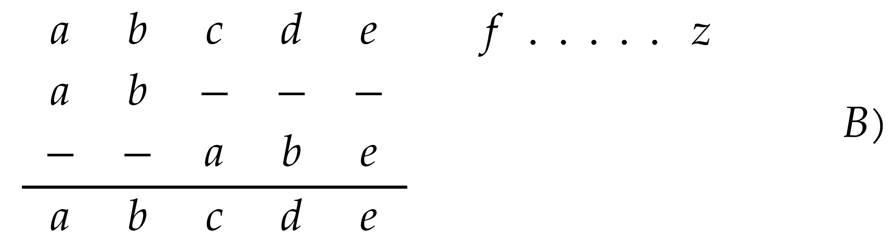

This calculus would result from the rules for forming tautologies, as a simplification. – Given this law for forming one segment of a series from two others, I can now introduce the designation “sum of the two others” for the first and thus define: a + a ≝ ab; a + ab ≝ abc; and so on up to z.

If one had explained the rule of calculus B by a few examples, one could also regard these definitions as special cases of a general rule and now set problems of the kind: “abc + ab = ?”

It is easy now to confuse the tautology

α) (Еab)(Еab) ⊃ (Еabcd)

with the equation

β) ab + ab = abcd. – But the latter is a rule of substitution; the former is not a rule, but simply a tautology. The sign “⊃” in α in no way corresponds to the “ = ” in β. One forgets that the sign “⊃” in α does not say that the two signs to its right & left yield a tautology. On the other hand, one could construct a calculus in which the equation ξ + η = ζ is obtained as a transformation of the equation:

γ) (Еξ(Еη) ⊃ (Еζ) = Taut.

### [67v\[2\]](https://cdn.wittgensteinnachlass.com/2000px/webp/Ms-113/67v.webp),[68r\[1\]](https://cdn.wittgensteinnachlass.com/2000px/webp/Ms-113/68r.webp)

So that I obtain, so to speak, ζ = ξ + η when I solve equation γ for ζ.

### [68r\[2\]](https://cdn.wittgensteinnachlass.com/2000px/webp/Ms-113/68r.webp)

30.04.1932

How does the concept of a sum enter into these considerations? – In the original calculus, which establishes, say, that the form (Еξ)(Еη) ⊃ (Еζ)

(δ

(for example) comes out tautological for ξ = xy, η = x & ζ = xyz, there is no talk of summation. – Then we bring a number system into the calculus (say, the system abcd … z). And finally we define the sum of two numbers as the number ζ which solves equation γ.

### [68r\[3\]](https://cdn.wittgensteinnachlass.com/2000px/webp/Ms-113/68r.webp)

(If instead of “(Еx)(Еx) ⊃ (Еx,y)” we wrote: “(Еx)(Еx) ⊃ (Еx + x)”, that would have no sense; unless the notation from the outset reads not

λ) “(Еx) etc.”, “(Еxy) etc.”, “(Еxyz) etc.”, but

κ) “(Еx) etc.”, “(Еx + x) etc.”, “(Еx + x + x) etc.”.

For why should we suddenly write “(Еxy) (Еx) ⊃ (Еxy + x)” instead of “(Еxy) (Еx) ⊃ (Еxyz)”? That would only confuse the notation. – Now one says: Surely it makes writing down the tautology much simpler if one can put the expressions from the two left-hand brackets straight into the right-hand bracket. But this notation has not yet been explained at all; I do not know what (Еxy + x) means, namely that (Еxy + x) = (Еxyz).

### [68v\[1\]](https://cdn.wittgensteinnachlass.com/2000px/webp/Ms-113/68v.webp)

But if from the outset we used the notation “(Еx)”, “(Еx + x)”, “(Еx + x + x)”, then to begin with only the expression “(Еx + x + x + x)” would have sense, but not “(Е(x + x) + (x + x))”. Notation κ is _on a level with_ ι. One can establish by a quick calculation, say by drawing connecting lines, that a tautology results in form δ, thus:

(Еxy) (Еxy) ⊃ (Еxyzu) & analogously

(Еx + x) (Еx + x) ⊃ (Еx + x + x + x).

The arcs correspond _only_ to the rule that must be given in each case for checking the tautology. There is no talk of addition here yet. That comes in only when I decide, for example, to write “xy + xy” instead of “xyzu”, and to do so in conjunction with a calculus whose rules allow one to derive a rule of substitution “xy + xy = xyzu”. Nor is there addition when I write “(Еx)(Еx) ⊃ (Еx + x)” in notation κ, but only when I distinguish between “x + x” & “(x) + (x)” and write

)

(x) + (x) = (x + x).

### [68v\[2\]](https://cdn.wittgensteinnachlass.com/2000px/webp/Ms-113/68v.webp),[69r\[1\]](https://cdn.wittgensteinnachlass.com/2000px/webp/Ms-113/69r.webp)

I can define “the sum of ξ and η” (“ξ + η”) as the number ζ (or: “the expression” – if we are reluctant to use the word number) – I can define “ξ + η” as the number ζ that makes the expression δ tautological; – but one can also define “ξ + η”, e.g., by means of calculus B (independently of the calculus of tautologies) & then _prove_ the equation (Еξ)(Еη ⊃ (Еξ + η) = Taut.

### [69r\[2\]](https://cdn.wittgensteinnachlass.com/2000px/webp/Ms-113/69r.webp),[69v\[1\]](https://cdn.wittgensteinnachlass.com/2000px/webp/Ms-113/69v.webp)

A question that readily arises is this: must we introduce the cardinal numbers in connection with the notation (∃x,y,…) φx ∙ φy…? Is the calculus of cardinal numbers in any way tied to the calculus with the signs “(∃x,y,…) φx ∙ φy…”? Is the latter perhaps the only, and perhaps essentially the only, application of the cardinal numbers? As for the “application of cardinal arithmetic to grammar”, one can refer to what we said about the concept of the application of a calculus. – One could now put our question like this: Do the cardinal numbers always occur after the sign ∃ in the sentences of our language: that is, if we imagine the language translated into Russell’s notation? This question is directly connected with the following one: Is the numeral always used in language to characterize a concept – a function? The answer is that our language always uses numerals in connection with concept-words – but that these concept-words belong to quite different grammatical systems (as one can see from the fact that one has meaning in combinations in which another is senseless), so that the norm that makes them concept-words ceases to be of interest to us. But the notation “(∃x,y…) etc.” is just such a norm; it is the direct translation of a norm of our word-languages, namely the expression “there is …”, a linguistic schema into which countless logical forms are pressed.

### [69v\[2\]](https://cdn.wittgensteinnachlass.com/2000px/webp/Ms-113/69v.webp)

Incidentally, the numeral, now in a different sense, is not connected with ∃: namely, inasmuch as “(∃3x)…” is not contained in “(∃2 + 3x)…”.

### [69v\[3\]](https://cdn.wittgensteinnachlass.com/2000px/webp/Ms-113/69v.webp),[70r\[1\]](https://cdn.wittgensteinnachlass.com/2000px/webp/Ms-113/70r.webp)

There is a temptation to take the form of an equation for the form of tautologies & contradictions, namely because it seems as though one could say that x = x is obviously true (&) x = y obviously false. One can even more readily say that x = x plays the role of a tautology than that x = y plays that of a contradiction, since all the correct (and “meaningful”) equations of mathematics are of the form x = y. One might call x = x a degenerate equation (Ramsey quite rightly called tautologies & contradictions degenerate propositions), and specifically a correct degenerate equation (the limiting case of an equation). For we use expressions of the form x = x like genuine equations, while being fully conscious that they are degenerate equations. Sentences in geometrical proofs are in the same position, such as: “∢α is equal to ∢β, ∢γ is equal to itself, …”.

One might now object that correct equations of the form x = y would have to be tautologies too, and incorrect ones, by contrast, contradictions, since it must be possible to prove the correct equation, and to do so by transforming the two sides of the equation until an identity x = x emerged. But although by this process the original equation is proved correct, and to that extent the identity x = x was the ultimate goal of the transformations, it is not the ultimate goal in the sense that one wanted to give the equation its proper form through the transformations, as one straightens a crooked object, and that in the identity it has now (_finally_) attained this perfect form. So one cannot say: the correct equation is _really_ an identity. It is _not_ an identity.

### [70r\[2\]](https://cdn.wittgensteinnachlass.com/2000px/webp/Ms-113/70r.webp),[70v\[1\]](https://cdn.wittgensteinnachlass.com/2000px/webp/Ms-113/70v.webp),[71r\[1\]](https://cdn.wittgensteinnachlass.com/2000px/webp/Ms-113/71r.webp),[71v\[1\]](https://cdn.wittgensteinnachlass.com/2000px/webp/Ms-113/71v.webp)

01.05.1932

If we set aside the functions constructed by means of “ = ” (x = a ⌵ x = b etc.), then on Russell’s theory 5 = 1 if there is no function satisfied by only one argument, or by only 5 arguments. At first sight this sentence naturally seems nonsensical; for how can one then say with sense that there are no such functions? Russell would have to say that one can make the two statements that there are five-place & one-place functions only separately if we have a five-place & a one-place class in our symbolism. He might say, for instance, that his view is correct because, without the paradigm of the class of 5 in the symbolism, I cannot say at all that a function is satisfied by 5 arguments. – I.e., the very existence of the sentence “(∃Φ): (Е1x) ∙ Φx” entails its truth. – Thus one seems able to say: look at this sentence and you will see that it is true. And in a sense irrelevant to us this is indeed possible: imagine, for instance, the following written in red paint on the wall of a room: “there is something red in this room”. – This problem is connected with the fact that in an ostensive definition I do not state anything about the paradigm (sample), but only make statements with its help; that it belongs to the symbolism & is not one of the objects to which I apply it. If, e.g., “1 foot” is defined as the length of a certain rod in my room & I were to say, instead of “this door is 6 feet high”: “this door is six times this↗ length (pointing to the unit rod)”, – then one could not say (for instance): “the sentence ‘there is an object 1 foot long’ proves itself, for I could not utter this sentence at all if there were no object of this length”, for I cannot state of the unit rod that it is 1 foot long. (If I introduce the sign “this↗ length” in place of “1 foot”, then the statement that the unit rod is 1 foot long would read: “this rod is this length” (pointing both times to the same rod).) Likewise, one cannot say of the group of strokes that serves, say, as a paradigm for 3 that it consists of 3 strokes. “If that sentence is not true, then this sentence does not exist at all” – that means: “if this sentence does not exist, then it does not exist”. And one sentence can never describe the paradigm in another, for then it is not a paradigm. If the length of the unit rod can be described by the specification of length “1 foot”, then the rod is not the paradigm of the unit of length, for otherwise every specification of length would have to be made with its help.

### [71v\[2\]](https://cdn.wittgensteinnachlass.com/2000px/webp/Ms-113/71v.webp)

A sentence “~(∃φ): (Еx) ∙ φx”, if we give it any sense at all, must be of the same kind as this one: “there is no circle on this surface that contains only one black spot”. (I mean: it must have a similarly _definite_ sense; & not remain vague, as it would in Russell’s logic & in mine in the treatise.) If it now follows from the sentences “~(∃φ): (Еx) φx” … (ρ & ~(∃φ): (Еx,y) φx ∙ φy … (σ

that 1 = 2, then what is meant here by “1” & “2” is not what we usually mean by them, for in word-language the sentences ρ and σ would read: “there is no function that is satisfied by only one thing” & “there is no function that is satisfied by only 2 things”. And by the rules of our language these are sentences with different senses.

### [71v\[3\]](https://cdn.wittgensteinnachlass.com/2000px/webp/Ms-113/71v.webp)

One is tempted to say: “To be able to express ‘(∃x,y) ∙ φx ∙ φy’, we need 2 signs ‘x’ & ‘y’.” But that says nothing. What we _need_ for it is perhaps paper & pen; & the sentence says as little as: “to express ‘p’, we need ‘p’.”

### [72r\[1\]](https://cdn.wittgensteinnachlass.com/2000px/webp/Ms-113/72r.webp),[72v\[1\]](https://cdn.wittgensteinnachlass.com/2000px/webp/Ms-113/72v.webp)

05.05.1932

“What sense does a sentence of the kind ‘(∃n) 3 + n = 7’ have?” Here one is in a curious difficulty: on the one hand one feels it to be a problem that the sentence has a choice between infinitely many values of n; on the other hand the sense of the sentence seems to us secure in itself, & it is only for us that it still (perhaps) needs to be investigated, since we do after all “know what ‘(∃x) ∙ φx’ means”. If someone said he did not know what “(∃n) 3 + n = 7” meant, one would reply: “but you do know what this sentence says: 3 + 0 = 7 ⌵ 3 + 1 = 7 ⌵ 3 + 2 = 7 and so on!” But to that one can reply: “Quite right – so the sentence is not a logical sum, for a logical sum does not end with ‘and so on’, & what I am not clear about is precisely this sentential form ‘φ(0) ⌵ φ(1) ⌵ φ(2) ⌵ u.s.w.’ – and all you have done is give me a second unintelligible sentential form in place of the first, making it look as if you were giving me something long familiar, namely a disjunction.” For when we think that we surely understand “(∃n) etc.”, we think, by way of justification, of other cases of the use of the notation “(∃…)…”, or of the form of expression “there is …” in our word-language. But to that one can only say: so you are _comparing_ the sentence “(∃n)…” with the sentence “there is a house in this town which …”, or “there are two foreign words on this page”. But the occurrence of the words “there is” in these sentences does not yet determine the grammar of this generality. And this occurrence points to nothing other than a certain analogy in the rules. So we can go ahead and examine these rules from the beginning without letting ourselves be distracted by the meaning of “(∃…)…” in other cases.

### [72v\[2\]](https://cdn.wittgensteinnachlass.com/2000px/webp/Ms-113/72v.webp),[73r\[1\]](https://cdn.wittgensteinnachlass.com/2000px/webp/Ms-113/73r.webp),[73v\[1\]](https://cdn.wittgensteinnachlass.com/2000px/webp/Ms-113/73v.webp)

We shall first have to ask ourselves: Has the mathematical sentence been proved? & how? For the proof belongs to the grammar of the sentence! – The reason this so often goes unrecognized is that here again our thinking follows the track of a misleading analogy. As usual in such cases, the analogy comes from the way we think in the natural sciences. We say, for example, “this man died 2 hours ago” & if we are asked “how can this be established?”, we can give a series of signs (symptoms) of it. But we also leave open the possibility that, say, medicine may discover hitherto unknown methods of establishing the time of death & this means: we can describe such possible methods even now, for it is not their description that is discovered but only whether the description corresponds to the facts that is established experimentally. So I can say, for example: one method consists in determining the quantity of haemoglobin in the blood, since this quantity is supposed to decrease with time after death according to such and such a law. Of course this is not true, but if it were, that would change nothing in the description I made up. Now if one calls the medical discovery “the discovery of a proof that the man died 2 hours ago”, one must say that this discovery changes nothing in the grammar of the sentence “the man died 2 hours ago”. The discovery is the discovery that a certain hypothesis is true (or: agrees with the facts). We are now so accustomed to this way of thinking that we take the discovery of a proof in mathematics, without further thought, to be the same or similar. Wrongly: for, to put it briefly, one could not describe the mathematical proof before it was found. The ‘medical proof’ did not incorporate the hypothesis it proved into a new calculus & thus did not give it a new sense; the mathematical proof incorporates the mathematical sentence into a new calculus; it changes its position in mathematics. The sentence with its proof belongs to a different category from the sentence without the proof. (The unproved mathematical sentence – signpost of mathematical research, stimulus to mathematical constructions.)

### [73v\[2\]](https://cdn.wittgensteinnachlass.com/2000px/webp/Ms-113/73v.webp),[74r\[1\]](https://cdn.wittgensteinnachlass.com/2000px/webp/Ms-113/74r.webp),[74v\[1\]](https://cdn.wittgensteinnachlass.com/2000px/webp/Ms-113/74v.webp)

06.05.1932

“Perhaps all numbers have the property ε”. Again the question is: what is the grammar of this general sentence? For it does not help us to know the use of the expression “all …” in other grammatical systems. If one says: “But you know what it means! It means: _ε_(0) ∙ _ε_(1) ∙ _ε_(2) u.s.w.”, then again nothing has been explained, except that the sentence is _not_ a logical product. And to learn to understand the grammar of the sentence one will ask: how does one use this sentence? What does one regard as the criterion of its truth? What is its verification? If no method is provided for deciding whether the sentence is true or false, it is surely pointless, & i.e. senseless. But here we now come to the illusion that such a method of verification is indeed provided and that it is only owing to a human weakness that it cannot be carried out. This verification consists in checking all the (infinitely many) terms of the product ε(0) ∙ ε(1) ∙ ε(2)… for correctness. Here logical impossibility is confused with physical impossibility. For one thinks one has given a sense to the expression “checking all the terms of the infinite product for correctness” because one takes the words “infinitely many” to designate an immensely large number. And when we speak of the “impossibility of checking the infinite number of sentences”, what we have in mind is the impossibility of checking a very large number of sentences if, say, we do not have the time we need. Remember that, in the sense in which it is impossible to check an infinite number of sentences, it is also impossible to try to do so. – If, by saying “but you know what ‘all …’ means”, we appeal to the cases in which this way of speaking is used, then surely it cannot be a matter of indifference to us if we see a difference between those cases & the case for which the use of the words was to be justified. – (Certainly), we know what it means to “check a number of sentences for correctness”, & it is precisely this understanding that we appeal to when we demand that one now also understand the expression “infinitely many sentences …”. But is the sense of the first expression independent of the experience connected with it? And it is precisely these experiences that are absent from the use (the calculus) of the second expression, unless experiences are assigned to it that differ fundamentally from the first ones.

### [74v\[2\]](https://cdn.wittgensteinnachlass.com/2000px/webp/Ms-113/74v.webp)

“All points on this surface are white”. How do you verify that? – then I shall know what it means.

### [74v\[3\]](https://cdn.wittgensteinnachlass.com/2000px/webp/Ms-113/74v.webp),[75r\[1\]](https://cdn.wittgensteinnachlass.com/2000px/webp/Ms-113/75r.webp)

“One can imagine the mathematical sentence as a living being that itself knows whether it is true or false. (In contrast to empirical sentences.) The mathematical sentence itself knows that it is true, or that it is false. If it deals with all numbers, then it must already survey all numbers. Its truth or falsity, like its sense, must lie within it.”

### [75r\[2\]](https://cdn.wittgensteinnachlass.com/2000px/webp/Ms-113/75r.webp)

“It is as if the generality of a sentence ‘(n) ∙ ε(n)’ were only a pointer to the proper, actual, mathematical generality of a sentence. As it were, only a description of the generality, not the generality itself. As if the sentence formed a sign in a purely external way, and that sign still had to be given sense from within.”

### [75r\[3\]](https://cdn.wittgensteinnachlass.com/2000px/webp/Ms-113/75r.webp)

“We feel: The generality that the mathematical assertion has is different from the generality of the sentence that has been proved.”

### [75r\[4\]](https://cdn.wittgensteinnachlass.com/2000px/webp/Ms-113/75r.webp)

“One could say: a mathematical sentence is an indication of a proof.”

### [75r\[5\]](https://cdn.wittgensteinnachlass.com/2000px/webp/Ms-113/75r.webp)

What if a sentence itself did not quite grasp its own sense? If it were, so to speak, over its own head? – And that is really what the logicians assume.

### [75r\[6\]](https://cdn.wittgensteinnachlass.com/2000px/webp/Ms-113/75r.webp),[75v\[1\]](https://cdn.wittgensteinnachlass.com/2000px/webp/Ms-113/75v.webp)

One cannot think of the sentence that deals with all numbers as verified by going on taking steps without end, for if the stepping is endless, it precisely does not lead to a goal. Let us imagine an infinitely long row of trees, & a path alongside it so that we can inspect it. Very well, then the path must be endless. But if it is endless, that means one cannot go all the way to the end of it. I.e. it does _not_ bring me to the point where I can survey the row. For the endless path does not have an “infinitely distant” end, but no end at all.

### [75v\[2\]](https://cdn.wittgensteinnachlass.com/2000px/webp/Ms-113/75v.webp)

Nor can one say: “The sentence cannot grasp all the numbers in succession, so it must grasp them by means of the concept”, – as if this were so faute de mieux: “Because it cannot do it _this_ way, it must do it another way”. But grasping them in succession is indeed possible; it just does not lead to the totality. The totality lies: _not_ on the path we take step by step, & not: at the infinitely distant end of that path. (All this means only that “ε(0) ∙ ε(1) ∙ ε(2) ∙ u.s.w.” is not the sign of a logical product.)

### [75v\[3\]](https://cdn.wittgensteinnachlass.com/2000px/webp/Ms-113/75v.webp),[76r\[1\]](https://cdn.wittgensteinnachlass.com/2000px/webp/Ms-113/76r.webp),[76v\[1\]](https://cdn.wittgensteinnachlass.com/2000px/webp/Ms-113/76v.webp)

“It cannot be _by chance_ that all numbers have a property ε; they can have it only by virtue of their nature (as numbers).” – The sentence “the people who have red noses are good-natured” does not have the same sense as the sentence “the people who drink wine are good-natured”, even if the people who have red noses are precisely those who drink wine. By contrast: if the numbers m, n, o are the extension of a mathematical concept f, so that fm ∙ fn ∙ fo is the case, then the sentence saying that the numbers that satisfy f have the property ε has the same sense as “ε(m) ∙ ε(n) ∙ ε(o)”. For the two sentences “f(m) ∙ f(n) ∙ f(o)” & “ε(m) ∙ ε(n) ∙ ε(o)” can be transformed into one another without our leaving the domain of grammar. Let us now look at the sentence: “all n numbers which satisfy the condition F(ξ) happen to have the property ε.” It depends on whether the condition F(ξ) is mathematical. If it is, well then I can derive ε(x) from F(x), even if by way of the disjunction of the n values of F(ξ). (For here there is indeed a disjunction.) So here I will not speak of chance. – If the condition is non-mathematical, on the other hand, one can speak of chance. E.g. if I say: all the numbers I read on buses today happened to be prime numbers. (By contrast, one cannot of course say: “the numbers 17, 3, 5, 31 happen to be prime numbers”, any more than: “the number 3 happens to be prime”.) “By chance” is presumably the opposite of “generally derivable”; but one can say: the sentence “17, 3, 5, 31 are prime numbers” is generally derivable, strange as that sounds, as is the sentence 2 + 3 = 5. If we now look back at our first sentence, we ask again: how, then, is the sentence “all numbers have the property ε” to be meant? How is one supposed to be able to know it? For settling this is part of settling its sense! The word “by chance” points to verification by successive trials & the fact that we are not talking about a finite number series is at odds with that.

### [76v\[2\]](https://cdn.wittgensteinnachlass.com/2000px/webp/Ms-113/76v.webp)

In mathematics description & object are equivalent. “The fifth number in the number series has these properties” says _the same thing_ as “5 has these properties”. The properties of a house do not _follow_ from its position in a row of houses; by contrast, the properties of a number are the properties of a position.

### [76v\[3\]](https://cdn.wittgensteinnachlass.com/2000px/webp/Ms-113/76v.webp),[77r\[1\]](https://cdn.wittgensteinnachlass.com/2000px/webp/Ms-113/77r.webp)

What a strange question: “can one imagine an endless row of trees?”! When one speaks of an ‘endless row of trees’, what one means will surely be connected with the experiences one calls “seeing the row of trees”, “counting a row of trees”, “measuring a row of trees”, etc. “Can we imagine an infinite row of trees”! Certainly, once we have settled what is to be understood by it; i.e.: once we have brought this concept into connection with all that, with the experiences that determine for us the concept of a row of trees. What is the criterion in experience for a row of trees being infinite? for from that I will see how this statement is to be understood. Or do you give me no such criterion, – what am I then to do with the concept “infinite row of trees”? What has this concept to do with what I ordinarily call a row of trees? Or did you mean after all only: an immensely long row of trees?!

### [77r\[2\]](https://cdn.wittgensteinnachlass.com/2000px/webp/Ms-113/77r.webp),[77v\[1\]](https://cdn.wittgensteinnachlass.com/2000px/webp/Ms-113/77v.webp),[78r\[1\]](https://cdn.wittgensteinnachlass.com/2000px/webp/Ms-113/78r.webp)

“But surely, when we walk along a row of trees, we know an experience that we can call the row coming to an end. Now, an endless row of trees is one along which we never _have_ this experience.” – But what does “never” mean here? I know an experience that I describe in the words: “he never coughed during this hour”, or “he never laughed in his life”. One cannot speak of a _corresponding_ experience if the “never” does not refer to an interval of time. So here again the analogy lets us down, & I must investigate afresh how the word “never” can be used with sense in this case. – Now, such uses can indeed be found, but their rules have to be investigated separately. For example, the sentence that a row of trees is infinitely long (or the one that we will _never_ reach an end) can be a law of nature of the same kind as the law of inertia, which says that under certain circumstances a body moves at constant speed in a straight line; & here too one could say that under these circumstances the movement will _never_ end. If one asks about the verification of such a sentence, the first thing one can say is that it is falsified if the movement (the row of trees) comes to an end – there can be no question of verification here, & that means that we are dealing with a fundamentally different kind of sentence (or with a sentence in a different sense of that word). Of course I do not want to say that this is the only use with sense of the expression “infinite row of trees”, or of the word “never” (for all eternity). But each of these uses must be described separately & has its own laws. It does us no good to find a form of speech ready-made in our ordinary language, because this language uses each of its words in a great variety of meanings & the fact that we understand the use of a word in one case does not spare us the investigation of its grammar in another. So we might think: “surely it is possible to imagine an infinitely long life, for someone who simply never dies lives for an infinitely long time”. But the use of the word “never” is not so simple _at all_.

### [78r\[2\]](https://cdn.wittgensteinnachlass.com/2000px/webp/Ms-113/78r.webp),[78v\[1\]](https://cdn.wittgensteinnachlass.com/2000px/webp/Ms-113/78v.webp),[79r\[1\]](https://cdn.wittgensteinnachlass.com/2000px/webp/Ms-113/79r.webp)

Let us now speak of an endless life in the sense of a hypothesis (cf. the law of inertia), & let the person living it choose any one fraction from each interval in turn – between 1 & 2, between 2 & 3, between 3 & 4 etc.. ad inf. – & write it down. Do we thereby obtain a “selection from all those intervals”? No, for his choosing has no end. It makes no sense ever to say of him that he has completed the selection. But can I not say that all the intervals must surely be reached, since I cannot name one that would not be reached? But from the fact that he will at some point reach each interval, it does not follow that at some point he will have reached them all. For if we use the word “reach” as in “he reaches something at a particular time” (i.e. in this grammatical context), then saying that he “reaches each interval at some point” means roughly: that he reaches the first after the first second, the second after the second, the third after the third, _and so on_ ad inf. Thus a law is given here by means of the expression “and so on ad inf.” But then to say that he reaches all the intervals would mean that he reaches them at a particular time, that the process thus comes to an end, – which contradicts the first assumption. So if one infers from his reaching each interval that he reaches them all, one uses the word “reaches” in quite a different way the second time! “But now imagine a man who becomes more and more practised at choosing from the intervals, so that he needs an hour for the first choice, half an hour for the second, a quarter for the third, and so on ad inf. Then surely he would finish the whole job in two hours!” Let us picture the process. Choosing might consist in writing down the fraction, that is, in a movement of the hand. This movement would now become faster and faster; but however fast it becomes, there is always a last interval that it deals with in a given time. The reasoning behind our objection rested on forming the sum 1 + ½ + ¼ + …, but this is a _limit_ of sums & not a sum in the sense of the word in which, for example, 1 + ½ + ¼ is a sum. If I said “he needs an hour for the first choice, half an hour for the second, a quarter for the third, and so on ad inf.”, this statement has sense only so long as I do _not_ ask how fast he is choosing at time t = 2, for our calculation yields _no_ value for that time (for the value c = ∞ does not exist for us here, since we have not correlated any experience with it). For every point _before_ t = 2 my law gives me a speed, and so to that extent it is usable & in order. So the fallacy arises only in the sentence “then he would finish the job in 2 hours”. (Insofar as one may call this a fallacy, since the sentence is senseless in this case.)

### [79r\[2\]](https://cdn.wittgensteinnachlass.com/2000px/webp/Ms-113/79r.webp),[79v\[1\]](https://cdn.wittgensteinnachlass.com/2000px/webp/Ms-113/79v.webp)

Let us now imagine the hypothesis that under certain circumstances someone will roll the digits of the number π (in base six, say) with a die. This hypothesis, then, is a law by means of which I can calculate the number of spots rolled on each throw. But what if we modified the hypothesis to say that under certain circumstances someone will _not_ roll the digits of π! Should that not have sense too? But how can one ever know that this hypothesis is correct, since at any given time he may have been rolling in accordance with π & the hypothesis is still not refuted by this? But that is precisely to say that we are dealing here with a different _kind_ of hypothesis; with a kind of sentence whose grammar makes no _provision_ for falsification. And I am free to call this a “sentence”, or a “hypothesis”, or something else altogether, if I want. (π is not a fraction, but a _law_ according to which fractions are formed.)

### [79v\[2\]](https://cdn.wittgensteinnachlass.com/2000px/webp/Ms-113/79v.webp)

07.05.1932

The infinity of time is not an extension.

### [79v\[3\]](https://cdn.wittgensteinnachlass.com/2000px/webp/Ms-113/79v.webp),[80r\[1\]](https://cdn.wittgensteinnachlass.com/2000px/webp/Ms-113/80r.webp)

If we ask: “what does the infinity of time consist in”, one will tell us: “in the fact that no day is the last, that each day is followed by another day”. But here again we are led by an analogy to see the matter wrongly. For we compare, say, the succession of days with the succession of events (in time), e.g. the strokes of a clock. We then sometimes have the experience that 4 strokes are followed by a 5th. Does it also make sense to speak of the experience of four days being followed by a fifth? And can one say: “you see, I predicted it to you: another one will follow the fourth”? (One might as well say that it is an experience that the fourth is followed by precisely the fifth and no other.) But we are not speaking here of the prediction that the sun will move after the fourth day as it has up to now; _that_ is a genuine prediction. No, in our case there is no question of a prediction, no event is prophesied; rather, we are saying something like this: that it makes sense to speak, with reference to any sunrise or sunset, of a next one. For the meaning of the designation of a measure of time is tied to an event: the revolution of a hand, the movement of the earth, etc. etc.; but if we say “each hour is followed by another”, & have defined the hour, say, by the revolution of a particular hand (as a paradigm), we still do not mean by that statement to prophesy that this hand will go on turning in this way for all eternity; – but we do want to say that it “_can_ always go on turning in this way”; and that is precisely a statement about the grammar of our specifications of time.

### [80r\[2\]](https://cdn.wittgensteinnachlass.com/2000px/webp/Ms-113/80r.webp),[80v\[1\]](https://cdn.wittgensteinnachlass.com/2000px/webp/Ms-113/80v.webp)

“Infinite decimal number without rules”. The conception is always that we only have to put words from our ordinary language together & the combination thereby has a sense which we now just have to investigate – if it is not immediately quite clear to us. It is as if the words were the ingredients of a chemical compound: we pour them together, let them combine with one another, & now we simply have to investigate the properties of the (relevant) compound. If someone said he did not understand the expression “infinite decimal number without rules”, the reply would be: “That’s not true, you understand it very well! Don’t you know what the words ‘without rules’, ‘infinite’ & ‘decimal number’ mean?! – Well then, you understand their combination too”. And what is meant here by “understanding” is that he knows how to apply these words in certain cases & perhaps _associates an image with them_! In reality, someone who puts these words together & asks “What does this mean?” is doing much the same as little children who scribble lines without any rule on a piece of paper, show it to a grown-up & ask: “What is this?”

### [80v\[2\]](https://cdn.wittgensteinnachlass.com/2000px/webp/Ms-113/80v.webp)

“One can imagine an infinite decimal number without rules being generated, for example, by throwing a die endlessly & taking the number that comes up each time as a decimal digit”. But if the die is thrown endlessly, no final result comes out.

### [80v\[3\]](https://cdn.wittgensteinnachlass.com/2000px/webp/Ms-113/80v.webp)

Let us imagine that a man who has lived for an infinitely long time, because he was never born, says: “Now I am writing down the last digit of π, namely the 3 in the units place”. He had written down a digit every day of his life & had never begun doing so; now he has finished.

### [80v\[4\]](https://cdn.wittgensteinnachlass.com/2000px/webp/Ms-113/80v.webp),[81r\[1\]](https://cdn.wittgensteinnachlass.com/2000px/webp/Ms-113/81r.webp)

“It is only the human intellect that cannot grasp this; a higher one could!” All right, then describe to me the grammar of the expression “higher intellect”; what can such an intellect grasp & what can it not, & under what circumstances do I say that an intellect grasps something? You will then see that the description of the grasping is the grasping itself. (Compare: the solution of a mathematical problem.)

### [81r\[2\]](https://cdn.wittgensteinnachlass.com/2000px/webp/Ms-113/81r.webp),[81v\[1\]](https://cdn.wittgensteinnachlass.com/2000px/webp/Ms-113/81v.webp)

Suppose we toss a coin for “heads & tails” and now divide a segment AB according to the following rule: “Heads” says: 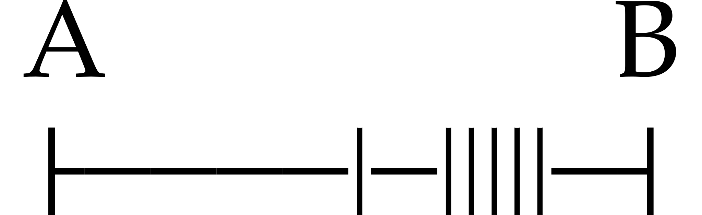 take the left half and divide it as the next toss directs. “Tails” says: take the right half, etc. By repeatedly tossing I then generate points of division that move within a smaller and smaller interval. Now does it describe the position of a point if I say that it is to be the one that the points of division approach without limit as the tossing continues? Here one might think one has determined a point corresponding to an infinite decimal number without rules. But what the description determines is _explicitly_: _no_ point; unless one says that the words “point on this segment” also “determine a point”. Here we confuse the instruction to toss the coin with the mathematical instruction to generate, say, the decimal digits of √2. These mathematical instructions _are_ the points. That is, one can find relations between these instructions that are analogous in their grammar to the relations “greater” & “less” between two segments and are therefore designated by these words. The instruction to calculate digits of √2 is the numeral for the irrational number itself; and I speak here of a “number” because I can calculate with these signs (_certain_ instructions for forming rational numbers) much as I can with the rational numbers themselves. So if I want to say, by analogy, that the instruction to go on halving endlessly according to heads & tails determines a point, a number, this would have to mean that this instruction can be used as a numeral, i.e. in a way analogous to other numerals. But of course this is not the case. If this instruction corresponds to a numeral at all, it corresponds at most (very remotely) to the indefinite number word “some”, for it does nothing but leave a number open. In a word, nothing other than the original interval AB corresponds to it.

### [81v\[2\]](https://cdn.wittgensteinnachlass.com/2000px/webp/Ms-113/81v.webp),[82\[1\]](https://cdn.wittgensteinnachlass.com/2000px/webp/Ms-113/82r.webp)

Can one fix the concept of the “sentence”? Or the general form of a law? – Why not! Just as one could fix the concept of number, say by means of the sign “[0, ξ, ξ + 1]”. I am free to call only that a number; and so I am also free to give an analogous prescription for forming sentences or laws and to use the word “sentence” or “law” as an equivalent of this prescription. If one objects and says that clearly this has merely marked off certain laws from others, I reply: Yes, of course you cannot draw a boundary if you are resolved from the outset not to recognize one! – If the “sentences” are to fill infinite logical space, there can be no question of a general sentential form. The question then is, of course: How do you use the word “sentence” now? In contrast to what? – In contrast, say, to “word”, “part of a sentence”, “book title”, “story”, etc.

### [82r\[2\]](https://cdn.wittgensteinnachlass.com/2000px/webp/Ms-113/82r.webp),[82v\[1\]](https://cdn.wittgensteinnachlass.com/2000px/webp/Ms-113/82v.webp),[83r\[1\]](https://cdn.wittgensteinnachlass.com/2000px/webp/Ms-113/83r.webp)

“Infinitely complicated law”, “infinitely complicated construction”. (“Man believes, on merely hearing words, that it must be possible to think something in connection with them”.) “The positions of all the primes must somehow be determined in advance. We only calculate them one after another, but they are all already determined. God knows them all, so to speak. And yet it seems possible that they are not determined by a law. –” – The same picture again and again: the meaning of a word as a full crate whose contents are brought to us along with it, packed inside, and all we have to do is examine them. – But what do we know about prime numbers? How is this concept given to us in the first place? Do we not make the stipulations about it ourselves? And how strange that we then suppose that stipulations must have been made about it that we did not make. But the mistake is understandable. For we use the term “prime numbers”, which sounds like “cardinal numbers”, “square numbers”, “even numbers”, etc. So we think it can be used in a similar way, but forget that we have given quite different – _different kinds of_ – rules for the term “prime number”, and now come into a strange conflict with ourselves. – But how is this possible? The prime numbers are, after all, the cardinal numbers we know so well, – so how can one say that the concept of a prime number is a concept of number in a different sense from that of a cardinal number? But here again the image of an “infinite extension” as an analogue of the familiar “finite” extensions plays a trick on us. The concept ‘prime number’ is indeed explained with the aid of the concept ‘cardinal number’, but “the prime numbers” are not explained with the aid of the “cardinal numbers”; and _we have_ derived the concept ‘prime number’ from the concept ‘cardinal number’ in an essentially different way from, say, the concept ‘square number’. (So we cannot be surprised if it behaves differently.) One could quite well imagine an arithmetic that does not – so to speak – stop at the concept ‘cardinal number’, but goes straight on to that of a square number (this arithmetic would of course not be applicable in the same way as ours). But the concept “square number” would then not have the character it has in our arithmetic, namely, of being essentially a subconcept, with the square numbers essentially a part of the cardinal numbers; rather, they would constitute a complete series with a complete arithmetic. And now let us imagine the same thing done for the prime numbers! Then it would be clear that these were now “numbers” in a different sense from, for example, the square numbers; and from the cardinal numbers.

### [83r\[2\]](https://cdn.wittgensteinnachlass.com/2000px/webp/Ms-113/83r.webp),[83v\[1\]](https://cdn.wittgensteinnachlass.com/2000px/webp/Ms-113/83v.webp)

Does it make sense to say: “I have as many shoes as there are units in a root of the equation x³ + 2x ‒ 3 = 0”? Here it might seem as though we had a notation of which we might not be able to tell, just by looking at it, whether it makes sense or not. If the expression “the root of the equation F(x) = 0” were a description in Russell’s sense, then the sentence “I have n apples & n + 2 = 6” would have a different sense from “I have 4 apples”. In the first sentence we have an extraordinarily instructive example of how a notation can seem unobjectionable at first sight, as though we understood it; and of how in reality we have formed a nonsensical sentence by analogy with one that has sense and only _believe_ that we have a clear view of the rules of the former. Thus “I have n shoes & n² = 4” is a sentence with sense; but not: “I have n shoes & n² = 2”.

### [83v\[2\]](https://cdn.wittgensteinnachlass.com/2000px/webp/Ms-113/83v.webp)

Equations are a kind of number. (I.e. they can be treated in much the same way as numbers.)

### [83v\[3\]](https://cdn.wittgensteinnachlass.com/2000px/webp/Ms-113/83v.webp),[84r\[1\]](https://cdn.wittgensteinnachlass.com/2000px/webp/Ms-113/84r.webp)

The expressions “the cardinal numbers”, “the real numbers” are extraordinarily misleading, except where they are used as part of a specification, as in “the cardinal numbers from 1 to 100”, etc. There are no “the cardinal numbers”, but only “cardinal numbers” and the concept, the form, “cardinal number”. Now one says: “the number of cardinal numbers is smaller than that of the real numbers” and imagines that one could, say, write the two series side by side (if we were not weak human beings) and that one would then end in the endless, while the other would run on beyond it into the truly-infinite. But that is all nonsense. If there can be talk of a relation for which one can by analogy use the terms “greater” and “smaller”, it can only be between the forms ‘cardinal number’ and ‘real number’. I find out what a series is by having it explained to me, and only to the extent that it is explained. A finite series was explained to me by examples of the kind 1, 2, 3, 4, an endless one by signs of the kind “1, 2, 3, 4, u.s.w.” or “1, 2, 3, 4 …”.

### [84r\[2\]](https://cdn.wittgensteinnachlass.com/2000px/webp/Ms-113/84r.webp)

The conflict in which we repeatedly find ourselves in logical investigations is like the conflict between two people who have concluded a contract with each other, whose final formulations are set down in words easily misinterpreted, whereas the elucidations of those formulations explain everything unambiguously. Now one of the two has a short memory, keeps forgetting the elucidations, misinterprets the terms of the contract and is continually getting into difficulties. The other must keep reminding the first person of the elucidations in the contract and clearing up the difficulty.

### [84r\[3\]](https://cdn.wittgensteinnachlass.com/2000px/webp/Ms-113/84r.webp),[84v\[1\]](https://cdn.wittgensteinnachlass.com/2000px/webp/Ms-113/84v.webp)

One can say that the properties of a particular number cannot be foreseen. One sees them only on reaching it. What is general is the repetition of an operation. Each stage of this repetition has its individuality. Now it is not as though the operation took me from one individuality to the next. As though the operation were the means of getting from one to the next. As it were, the vehicle that stops at each number so that one can look at it. Rather, performing the operation +1 three times generates and _is_ the number three.

(In the calculus, process and result are equivalent to one another.)

### [84v\[2\]](https://cdn.wittgensteinnachlass.com/2000px/webp/Ms-113/84v.webp)

How does an infinitely complicated law differ from the absence of a law?

### [84v\[3\]](https://cdn.wittgensteinnachlass.com/2000px/webp/Ms-113/84v.webp)

But before I set out to speak of “all these individualities”, or “the totality of these individualities”, I would have to consider _carefully_ what stipulations I will accept in this case for the use of the words “all” and “totality”!

### [84v\[4\]](https://cdn.wittgensteinnachlass.com/2000px/webp/Ms-113/84v.webp)

(Let us not forget: mathematicians’ reflections on the infinite are all finite reflections. By which I mean only that they come to an end.)

### [85r\[1\]](https://cdn.wittgensteinnachlass.com/2000px/webp/Ms-113/85r.webp)

“Suppose I cut a line segment where there is no rational point (no rational number).” But can one do that? What kind of line segments are you talking about? – “But if my measuring instruments were fine enough, surely I could get indefinitely closer to a certain point by successive bisections.” – No, for I could never find out whether my point was such a point. My experience will only ever be that I have not reached it so far. “But if I had constructed √2 with absolutely exact equipment and now approach the resulting point by bisection, then surely I _know_ that this process will never reach the constructed point.” – But it would be strange if one construction could in this way dictate something to the other, so to speak! And that is not how it is. It is quite possible that in the ‘exact’ construction of √2 I arrive at a point that the bisection reaches, say after 100 steps; – but then we shall say: our space is not Euclidean! –

### [85r\[2\]](https://cdn.wittgensteinnachlass.com/2000px/webp/Ms-113/85r.webp)

The “cut at an irrational point” is a picture, and a misleading picture.

### [85r\[3\]](https://cdn.wittgensteinnachlass.com/2000px/webp/Ms-113/85r.webp)

Does cutting a line segment predetermine the results of all the bisections that are to approach the point of the cut? No.

### [85v\[1\]](https://cdn.wittgensteinnachlass.com/2000px/webp/Ms-113/85v.webp)

In the previous example, in which I let the results of throwing dice guide me in successively narrowing an interval by bisecting a line segment, I could just as well have used dice to guide the writing down of a decimal fraction. Likewise the description “endless process of choosing between 1 & 0” in writing down a binary fraction does not determine a law. One might say, for instance: the prescription for choosing endlessly between 0 & 1 in this case could be represented by a symbol “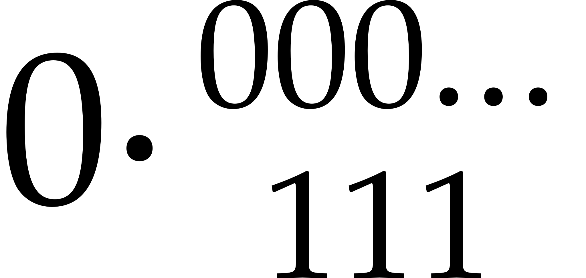 ad inf.”. But if I indicate a law like this: “0˙001001001 … ad inf.”, what I want to show is not the finite stretch of the series as a specimen of the infinite series, but the regularity one can discern in it. From “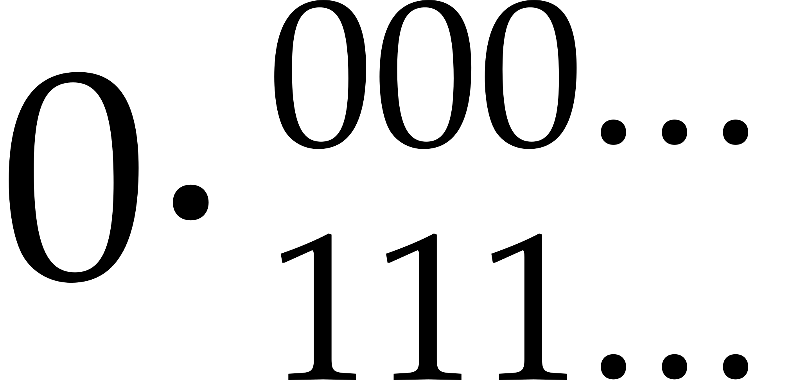 ad inf.” I discern _no_ law, but precisely the lack of a law.

### [85v\[2\]](https://cdn.wittgensteinnachlass.com/2000px/webp/Ms-113/85v.webp)

There are infinitely many cardinal numbers because _we_ construct this infinite system and call it the system of cardinal numbers. There is also a number system “1, 2, 3, 4, 5, many” and another: “1, 2, 3, 4, 5.” And why shouldn’t I call that a system of cardinal numbers too? (and hence a finite one).

### [85v\[3\]](https://cdn.wittgensteinnachlass.com/2000px/webp/Ms-113/85v.webp),[86r\[1\]](https://cdn.wittgensteinnachlass.com/2000px/webp/Ms-113/86r.webp)

If one wants to know what the expression “the maximum of a curve” means, one should ask oneself: how does one find it? – What is found differently is something different. One defines it as the point on the curve that lies higher than all the others, and again has the idea that it is only our human weakness that prevents us from going through all the points on the curve one by one and picking out the highest among them. And this leads to the opinion that the highest point among a finite number of points is essentially the same thing as the highest point on a curve, and that here one finds the same thing by two different methods, just as one can establish in different ways that someone is in the next room: in one way, say, if the door is closed and we are too weak to open it, and in another if we can go in. But, as I said, there is no question of human weakness where the apparent description of the action “that we cannot carry out” is senseless. It would, of course, do no harm, and would indeed be very interesting, to see the analogy between the maximum of a curve and the maximum (in a different sense) of a class of points, so long as the analogy does not prejudice us into thinking that at bottom we are dealing with the same thing in both cases.

### [86r\[2\]](https://cdn.wittgensteinnachlass.com/2000px/webp/Ms-113/86r.webp),[86v\[1\]](https://cdn.wittgensteinnachlass.com/2000px/webp/Ms-113/86v.webp)

It is the same defect in our syntax that makes the geometrical sentence “the line segment can be divided into two parts by a point” appear to have the same form as the sentence “the line segment is indefinitely divisible”; so that one can apparently say in both cases: “Let us suppose the possible division has been carried out”. “Divisible into two parts” and “indefinitely divisible” have entirely different grammars. One wrongly operates with the word “infinite” as with a numeral, because in everyday speech both are given in answer to the question “how many …”.

### [86v\[2\]](https://cdn.wittgensteinnachlass.com/2000px/webp/Ms-113/86v.webp),[87r\[1\]](https://cdn.wittgensteinnachlass.com/2000px/webp/Ms-113/87r.webp)

“But surely the maximum is higher than any other point on the curve.” But the curve does not consist of points; it is a law that points obey. Or again: a law according to which points can be constructed. If one now asks: “which points?”, – I can only say: “well, e.g., the points P, Q, R, etc.”. On the one hand no number of points can be given of which one could say that they are all the points lying on the curve, and on the other hand one cannot speak of a totality of points that we human beings alone are unable to enumerate, but that can be described and could be called the totality of all the points on the curve, – a totality that would be too large for us human beings. There is a law on the one hand and there are points on the curve on the other – but not “_all_ the points on the curve”. The maximum lies higher than any points on the curve one may construct, but not higher than a totality of points; unless the criterion for this, and hence the sense of this statement, is again just construction from the law of the curve.

### [87r\[2\]](https://cdn.wittgensteinnachlass.com/2000px/webp/Ms-113/87r.webp),[87v\[1\]](https://cdn.wittgensteinnachlass.com/2000px/webp/Ms-113/87v.webp),[88r\[1\]](https://cdn.wittgensteinnachlass.com/2000px/webp/Ms-113/88r.webp)

The web of errors in this area is of course a very complicated one. There is, for example, the further confusion of two different meanings of the word “kind”. One grants, namely, that infinite numbers are a different _kind_ of number from finite ones, but then misunderstands what the difference in kind consists in here. For what is at issue here is not a distinction between objects according to their properties, as when one distinguishes red apples from yellow ones, but a distinction between different logical forms. – Thus Dedekind tries to _describe_ an infinite class by saying that it is one that is similar to a proper subclass of itself. In this way he seems to have specified a property that the class must have in order to fall under the concept ‘infinite class’ [Frege!!!]. Now let us imagine applying this definition. I am to investigate in a particular case whether a class is finite or not, say, whether a particular row of trees is finite or endless. So, following the definition, I take a subclass of this row of trees and investigate whether it is similar to the whole class (i.e. can be put into 1–1 correspondence with it)! (Here everything, as it were, already begins to laugh.) But that means nothing at all: for if I take a “finite class” as a subclass, then the attempt to put it into 1 to 1 correspondence with the whole class must eo ipso fail; and if I make the attempt with an infinite subclass, – but that makes even less sense, for if it is infinite I cannot even attempt to establish this correspondence. – What one calls ‘putting all its members into correspondence with others’ in the case of a finite class is something quite different from what one calls, for example, putting all cardinal numbers into correspondence with all rational numbers. The two correspondences, or what one designates by this word in the two cases, belong to different logical _categories_. And the “infinite class” is not a class that contains more members, in the ordinary sense of the word “more”, than finite classes. And if one says that an infinite number is greater than a finite one, that does not make the two comparable, because in this statement the word “greater” _has a different meaning_ from the one it has, say, in the sentence “5 > 4”! The definition pretends that the success or failure of the attempt to put a proper subclass into correspondence with the whole class shows that it is infinite or finite, respectively. Whereas there is no such decisive attempt at all. – ‘Infinite class’ & ‘finite class’ are different logical categories; what can meaningfully be said of one category cannot be said of the other.

### [88r\[2\]](https://cdn.wittgensteinnachlass.com/2000px/webp/Ms-113/88r.webp),[88v\[1\]](https://cdn.wittgensteinnachlass.com/2000px/webp/Ms-113/88v.webp)

(What criterion is there for the irrational numbers being complete? Let us look at an irrational number: it runs along a series of rational approximations. When does it leave this series? Never. But of course it never comes to an end either. Suppose we had the totality of all irrational numbers except one. How would we miss that one? And how, if it were added, would it then fill the gap? – Suppose it were π. If the irrational number is given by the totality of its approximations, then up to _any_ point one chooses there would be a series that agrees with that of π. Of course, for every such series there comes a point of divergence. But that point can lie as far “out” as one likes, so that for every series that accompanies π I can find one that accompanies it further. So if I have the totality of the irrational numbers except π, and now insert π, I cannot specify any point at which π is really needed: at _every_ point it has a companion that accompanies it from the beginning. To the question “how would we miss π”, one would have to answer: π, if it were an extension, would never be missed. That is, we could never notice a gap that it fills. If one asked us: “but do you also have an infinite decimal fraction with the digit m in the rth place and n in the sth, etc.?” – we could always supply it.)

### [88v\[2\]](https://cdn.wittgensteinnachlass.com/2000px/webp/Ms-113/88v.webp)

“The infinite decimal fractions that proceed according to a law still need to be supplemented by an infinite set of unordered infinite decimal fractions that would ‘fall by the wayside’ if we _restricted ourselves to those generated according to a law_.” Where is such an infinite decimal fraction not generated according to a law? And how can we measure it? Where is the gap it would have to fill?

### [88v\[3\]](https://cdn.wittgensteinnachlass.com/2000px/webp/Ms-113/88v.webp),[89r\[1\]](https://cdn.wittgensteinnachlass.com/2000px/webp/Ms-113/89r.webp)

08.05.1932

What if one checks the various laws for forming binary fractions, so to speak, against the set of finite combinations of the digits 0 & 1? – The results of a law run through the finite combinations, and the laws are therefore complete, as far as their extensions are concerned, if _all_ the finite combinations are run through.

### [89r\[2\]](https://cdn.wittgensteinnachlass.com/2000px/webp/Ms-113/89r.webp)

When one says: two laws are identical if they yield the same result at every step, this strikes us as a wholly general rule. In reality, though, this sentence has a different sense depending on what the criterion is for their yielding the same result at every step. (For there is no such thing as the supposed generally applicable method of testing without end!) So we cover the most diverse meanings with a way of speaking drawn from an analogy, & now believe that we have united the most diverse cases in one system.

### [89r\[3\]](https://cdn.wittgensteinnachlass.com/2000px/webp/Ms-113/89r.webp),[89v\[1\]](https://cdn.wittgensteinnachlass.com/2000px/webp/Ms-113/89v.webp)

(The instructions corresponding to the irrational numbers all belong to the same type in so far as they must all ultimately be instructions for generating decimal fractions successively. The common decimal notation requires, in a certain sense, a common type.) One could also put it this way: in approximating by repeated bisection one can approach _any_ point of the segment by means of _rational_ numbers. There is no point that one could approach only by irrational steps of a particular type. Of course this is only the explanation, put in other words, that by an irrational number we mean an infinite decimal fraction. And this explanation in turn is nothing more than a passing explanation of decimal notation, perhaps with a hint that we distinguish laws that yield recurring decimal fractions from other laws.

### [89v\[2\]](https://cdn.wittgensteinnachlass.com/2000px/webp/Ms-113/89v.webp),[90r\[1\]](https://cdn.wittgensteinnachlass.com/2000px/webp/Ms-113/90r.webp)

Set theory seeks to grasp the infinite in a more general way than an investigation of the laws of real numbers can. It says that the actual infinite cannot be grasped at all by mathematical symbolism, & hence that it can only be described, not represented. A description would grasp it rather as one carries a number of things that one cannot hold all at once in one’s hand by packing them in a box. They are then invisible & yet we know that we are carrying them (indirectly, as it were). One might say of this theory that it buys a cat in a poke. Let the infinite make itself at home in its box however it likes. The idea that one can _describe_ logical forms rests on this too. In such a description the structures and, say, the relations of correspondence are presented in their packaging, and it thus looks as though one could speak of a structure without reproducing it in language itself. We may of course use concepts packaged in this way, but our signs then get their meaning by way of definitions that have thus concealed the concepts; and if we trace those definitions, the structures are uncovered again.

### [90r\[2\]](https://cdn.wittgensteinnachlass.com/2000px/webp/Ms-113/90r.webp)

It is, so to speak, no concern of logic how many apples there are when one talks of “all apples”; but things are different with numbers: logic is responsible for them individually.

### [90r\[3\]](https://cdn.wittgensteinnachlass.com/2000px/webp/Ms-113/90r.webp)

“There is a point at which the two curves intersect.” How do you know? If you tell me that, I will know what sense the sentence “there is …” has.

### [90r\[4\]](https://cdn.wittgensteinnachlass.com/2000px/webp/Ms-113/90r.webp),[90v\[1\]](https://cdn.wittgensteinnachlass.com/2000px/webp/Ms-113/90v.webp)

When it is said in discussions about the provability of mathematical propositions that there are, in the very nature of things, propositions of mathematics whose truth or falsity must remain undecided, those who say this do not consider that such propositions, _if_ we can use them & want to call them “propositions”, are quite different constructions from what is otherwise called a “proposition”: for the proof changes the grammar of the proposition. One can no doubt use one and the same board as a weather vane on one occasion and as a signpost on another; but not the fixed board as a weather vane or the movable one as a signpost. If someone were to say “there are movable signposts too”, I would reply: “What you presumably mean is ‘there are movable _boards_ too’; & I am not saying that the movable board cannot possibly be used in some way, – only not as a signpost”. The word “proposition”, if it is to have any meaning here at all, is equivalent to a calculus, & in any case to the one in which p ⌵ ~p = Taut. holds (the “law of excluded middle” holds). If it is not to hold, then we have changed the concept of a proposition. But in doing so we have not made a discovery (found something that is a proposition & does not obey such and such a law); rather, we have made a new stipulation, specified a new game.

### [91r\[1\]](https://cdn.wittgensteinnachlass.com/2000px/webp/Ms-113/91r.webp)

“If I go through the number series, then either I will at some point come to a number with the property ε, or I never will.” The expression “go through the number series” is nonsense; unless it is _given_ a sense, but one that does away with the supposed analogy with “going through the numbers from 1 to 100”.

### [91r\[2\]](https://cdn.wittgensteinnachlass.com/2000px/webp/Ms-113/91r.webp)

Are the variables of the same kind in the equations:

x² + y² + 2xy = (x + y)²

x² + 3x + 2 = 0

x² + ax + b = 0

x² + xy + z = 0?

That depends on the use of these equations. – But the difference between № 1 & № 2 (as they are ordinarily used) is not a difference in the extension of the values that satisfy them. How do you prove the sentence “№ 1 holds for all values of x & y”, and how do you prove the sentence “There are values of x that satisfy № 2”? There is as much analogy in the sense of the two sentences as there is in these proofs.

### [91r\[3\]](https://cdn.wittgensteinnachlass.com/2000px/webp/Ms-113/91r.webp),[91v\[1\]](https://cdn.wittgensteinnachlass.com/2000px/webp/Ms-113/91v.webp)

“A is my ancestor”, that is: “A is my father, or my father’s father, or my father’s father’s father, or etc.”. No doubt, but in doing this we have only substituted _one_ sentence-sign for another; we have not yet determined the sense, for we have not – as it might easily seem – reduced it to the familiar sense of a logical sum. – So I will go on to ask: “How does one know that A is an ancestor of B?” for that means: “in what cases do I want to say that A is an ancestor of B”, or again: “what do I understand by an ‘ancestor of B’”. Do I call anyone that who has a particular property that in our experience is hereditary in B’s family? If that is the definition, then I can establish of a person, for example, that he is _not_ an ancestor of B. Or is the sentence to be understood in such a way that there is no establishing that someone is _not_ an ancestor of B (so that no provision was made in our grammar for establishing this), but only that someone is an ancestor of B: in that case, however, we are dealing with quite a different kind of sentence from the first case. (Remember, incidentally, that the properties hereditary in B’s family must of course not include that of ‘being an ancestor of B, or being B’, and compare Russell’s definition of “R*”.)

### [91v\[2\]](https://cdn.wittgensteinnachlass.com/2000px/webp/Ms-113/91v.webp),[92r\[1\]](https://cdn.wittgensteinnachlass.com/2000px/webp/Ms-113/92r.webp)

But can I not say of an equation: “I know it does not hold for some substitutions – I do not remember for _which_ ones –; but whether it fails to hold for every substitution, I do not know”? – But what do you mean when you say you know that? How do you know it? After all, there is no particular state of mind behind the words “I know …” that would be the sense of these words. What can you do with this knowledge? For that will show what the knowledge consists in. Do you know a method of establishing that the equation fails to hold for every substitution? Do you remember that the equation does not hold for some values of x between 0 & 1000? Has someone merely shown you the equation & said that he found values for x that do not satisfy it, and perhaps you yourself do not know how one ascertains this for a given value? etc. etc.

### [92r\[2\]](https://cdn.wittgensteinnachlass.com/2000px/webp/Ms-113/92r.webp),[92v\[1\]](https://cdn.wittgensteinnachlass.com/2000px/webp/Ms-113/92v.webp)

_The way of putting it_ – that m = 2n puts a class into correspondence with one of its proper subclasses – clothes a _simple_ sense in a paradoxical form by bringing in a misleading analogy. (And instead of being ashamed of this paradoxical form as something ridiculous, one boasts of a victory over old prejudices of the understanding.) It is just as if one overturned the rules of chess & said that it had turned out that chess could also be played quite differently. Thus one first confuses the word “number” with a concept-word like “apple”, then speaks of a “number of numbers” and fails to see that one ought not to use the same word “number” both times in this expression; & finally one takes it to be a discovery that the number of even numbers is the same as that of even and odd numbers together.

### [92v\[2\]](https://cdn.wittgensteinnachlass.com/2000px/webp/Ms-113/92v.webp)

It is less misleading to say “m = 2n makes it possible to put each number into correspondence with another” than “m = 2n puts all numbers into correspondence with others”. But here too it is grammar that must first teach the meaning of the expression “possibility of correspondence”.

### [92v\[3\]](https://cdn.wittgensteinnachlass.com/2000px/webp/Ms-113/92v.webp),[93r\[1\]](https://cdn.wittgensteinnachlass.com/2000px/webp/Ms-113/93r.webp)

If 2 arrows point in the same direction, is it not absurd to call these directions “equally _long_” because whatever lies in the direction of one arrow also lies in that of the other? – The generality of m = 2n is an arrow pointing along the series of operations. And one can indeed say that the arrow points into infinity; but does that mean that there is a something, infinity, which it points to – as it points to a thing? – The arrow as it were designates the possibility of things lying in its direction. The word “possibility”, however, is misleading, for what is possible, one will say, is then to become actual. One also invariably thinks here of processes in time and infers *from that* that mathematics has nothing to do with time and that in mathematics possibility is already reality. The “infinite series of cardinal numbers” or “the concept of cardinal number” is only a possibility of this sort, – as is clear from the symbol “[0, ξ, ξ + 1]”. This symbol itself is an arrow whose feather is “0” and whose point is “ξ + 1”. It is possible to speak of things that lie in the direction of the arrow, but misleading or absurd to speak of all the possible positions of things in the direction of the arrow as an equivalent of that direction itself. When a searchlight casts light into infinite space, it does indeed illuminate everything that lies in the direction of its rays, but one ought not to say that it illuminates infinity.

### [93r\[2\]](https://cdn.wittgensteinnachlass.com/2000px/webp/Ms-113/93r.webp),[93v\[1\]](https://cdn.wittgensteinnachlass.com/2000px/webp/Ms-113/93v.webp)

When set theory appeals to the human impossibility of a direct symbolism of the infinite, it thereby introduces the grossest conceivable misinterpretation of its own calculus. To be sure, it is this very misinterpretation that is responsible for the invention of this calculus. But of course that does not show the calculus itself to be false (at most uninteresting), and it is odd to believe that this part of mathematics is threatened by any philosophical (or mathematical) investigations. (Chess might just as well be threatened by the discovery that wars between two armies do not unfold like the battle on the chessboard.) What set theory must lose, rather, is the atmosphere of _fogs of thought_ that surrounds the bare calculus. That is, the allusions to a fictitious symbolism underlying set theory, which is not used in its calculus and whose apparent description is in reality nonsense. (In mathematics we can make up anything, except a part of our calculus.)

### [93v\[2\]](https://cdn.wittgensteinnachlass.com/2000px/webp/Ms-113/93v.webp),[94r\[1\]](https://cdn.wittgensteinnachlass.com/2000px/webp/Ms-113/94r.webp),[94v\[1\]](https://cdn.wittgensteinnachlass.com/2000px/webp/Ms-113/94v.webp),[95r\[1\]](https://cdn.wittgensteinnachlass.com/2000px/webp/Ms-113/95r.webp)

Different uses of the word “can” in the sentences: “3 things can lie in this direction” and “infinitely many things can lie in this direction”. Now what sense, i.e. what grammar, could such a way of speaking have? One could say, for example: “in the natural number series 1, 2, 3, 4, … infinitely many numerals can follow the ‘1’”; that means the same as: “the operation + 1 may be used again and again (or: without end)”. So if, for example, someone writes the numeral 100 + 1 after the numeral 100, then under that rule he is entitled to do so. On the other hand, it makes no sense here to say: “if it is permissible to write down infinitely many numerals, then let us write down infinitely many numerals (or try to)!” – I would point out to anyone who says this that “infinitely many” is not used as a number word; that it may not be substituted for n in the form “I write down n numerals”. So what I permit is not the writing down of _one_ definite number of numerals (namely a number that might be called “infinitely many”, for I have not given any of the numerals that name), but rather that one may go as far as one wants in writing down numerals according to the given rule, however far that may be. Of course, I may not then say either: “I can go as far as I want in writing down the numerals, but not as far as the number Infinity”, since _there is no question at all of_ such a numeral as “Infinity” (for I have not introduced one). “Infinitely many numerals can follow …” might therefore be better put: “Numerals can follow … infinitely”. “Infinitely” is thus used adverbially here. Similarly, if I say that a division produces an infinite decimal fraction, there is not _one_ result of the division called “an infinite decimal fraction”, in the sense in which the number 0˙142 is a result of 1 : 7. The division does not yield one decimal number, or a number of decimal numbers, as its final result – rather, one cannot speak of “its final result”; and it yields decimal fractions endlessly, not “an endless decimal fraction”. “Endlessly” is used adverbially. Now let us imagine the following case: suppose I had constructed a special kind of die and were now to predict: “with this die I shall throw the digits of π”. This statement is of a different form from the apparently analogous one: “with this die I shall throw the first 10 digits of π”. For in the second case there is a sentence “in an hour I shall have thrown the first 10 digits of π”, whereas this sentence becomes nonsensical (not false) if I put “the digits” in it instead of “the first 10 digits”. Now if I were to say: “it is possible to throw a die infinitely many times”, this could mean “any number of throws whatsoever is possible, conceivable”, and not that there is a conceivable definite number of throws called “infinite”. “Infinitely many times” would mean “as many times as you like”, and to say: “if you can throw the die infinitely many times, then do so”, would mean: “if you can throw it as many times as you like, then do so”. (Servant: “And when does the Baron usually dine?” – Nouveau riche: “I dine when gentlemen of distinction dine”. – Servant: “Gentlemen of distinction dine at different times.” – Nouveau riche: “Then I shall dine at different times too”.) In the sentence “any number of throws whatsoever is possible”, “possible” can mean as much as “logically possible” or “conceivable”, and then it is a rule, not an empirical proposition, and is analogous to the rule: “numerals can follow 1 endlessly”. But we could also take it as a kind of empirical proposition, a kind of hypothesis: then, however, it would be the kind of hypothesis for which no verification is provided, but a falsification is, and so it would be a sentence of a different kind (‘sentence’ in a different sense) from the empirical proposition: “3 throws are possible with this die”. The latter – in contrast to the _rule_ “3 throws are conceivable” – would say something like: “the die will still be usable after 3 throws”; the hypothesis “infinitely many throws are possible with this die” would say: “however often one throws it, this die will not wear out”. One sees very clearly that these are sentences of different kinds if one thinks of the nonsensical command “throw the die infinitely many times” or “throw the die ad infinitum”, in contrast to the command that makes sense: “throw the die 3 times”. For what is essential to a command is checking its execution.

### [95r\[2\]](https://cdn.wittgensteinnachlass.com/2000px/webp/Ms-113/95r.webp)

09.05.1932

To say that any sentence (∃nx) φx follows from the infinite hypothesis “(n) ∙ (∃nx) φx” (as I shall now write it, for brevity’s sake), and that the hypothesis itself follows from no logical product of these sentences, is of course to say nothing at all as yet about the further use of this game.

### [95r\[3\]](https://cdn.wittgensteinnachlass.com/2000px/webp/Ms-113/95r.webp),[95v\[1\]](https://cdn.wittgensteinnachlass.com/2000px/webp/Ms-113/95v.webp),[96r\[1\]](https://cdn.wittgensteinnachlass.com/2000px/webp/Ms-113/96r.webp)

Let us compare the sentences: “I adjust my way of acting on the assumption that this state will last another 2 years” and “I adjust my way of acting on the assumption that this state will last for ever”. – Does the sentence have sense: “I believe (or expect, or hope) that it will stay like this throughout infinite time”? –

One can say: “I am making preparations for the next 3 days”, or 10 years, etc., and also “I am making preparations for an indefinite time”; – but also: “for an infinite time”? If I “make preparations for an indefinite time”, then surely one can specify a period of time for which, in any case, I am no longer making any preparations. I.e., not every sentence of the form “I am making preparations for n years” follows from the sentence “I am making preparations for an indefinite time”. Just think of the sentence: “I _surmise_ that this state will _last_ without end”! Or of the odd sound of the refutation: “You said this clockwork would always keep going like this, – well, it has already stopped _now_”. We feel that any finite prediction that gave too long a _running time_ would of course also be refuted by the fact, and that the refutation is therefore in some sense incommensurable with the assertion. – For it is nonsense to say: “the clockwork did not go on running infinitely, but stopped after ten years” (or, still more oddly: “…, but stopped after only ten years”). How strange it would be if one said: “It takes great daring to make a prediction for the next 100 years; – but what daring it must take to predict something for infinite time, as Newton did in the law of inertia!” “I believe it will always go on like this”. – “Is it not enough (for all practical purposes) if you say you believe it will go on like this for another 100000 years?” – For we must ask: can there be grounds for this belief? What are they? What are the grounds for assuming that the clock will keep going for another 1000 years; what are the grounds for assuming that it will go for another 10000 years; – and now what are the grounds for the infinite assumption?! – That is just what makes the sentence “I surmise that it will go on like this without end” sound so odd; we want to ask: why do you surmise that? For what we want to say is that it is senseless to say that one surmises this, – because it is senseless to speak of grounds for such a surmise. Think of the sentence: “this comet will move in a parabola with the equation …”. How is this sentence used? It cannot be verified; i.e.: _we_ have made no provision for its verification in its grammar (of course that does not mean that one cannot say it is true; for “p is true” says the same as “p”). Now, the sentence may lead us to make certain observations. But a finite prediction would always have done for those as well. It will also determine certain actions. For instance, it might keep us from looking for the comet at such and such a place. But a finite statement would have sufficed for that too. The infinity of the hypothesis consists not in its _size_, but in its open-endedness.

### [96r\[2\]](https://cdn.wittgensteinnachlass.com/2000px/webp/Ms-113/96r.webp),[96v\[1\]](https://cdn.wittgensteinnachlass.com/2000px/webp/Ms-113/96v.webp)

When one speaks of the concept ‘infinity’, one must remember that this word has many different meanings, & remember which of them we are speaking of just now. Whether, for example, it is the infinity of a series of numbers, and of the cardinal numbers in particular. If, for example, I say that ‘infinite’ is a characteristic of a rule, I am referring to _one_ particular meaning of the word. But we could quite well say that a continuous transition in colour is a transition “through infinitely many stages”, provided we do not forget that here we are defining the meaning of the expression “infinitely many stages” _anew_ through the experience of the transition in colour. (Albeit by analogy with other uses of the word “infinite”.)

### [96v\[2\]](https://cdn.wittgensteinnachlass.com/2000px/webp/Ms-113/96v.webp)

(The peculiar relief that comes when we can set other cases alongside a case we thought unique comes again and again in our investigations when we show that a word does not have just _one_ meaning (or just two), but is used in five or six different meanings.)

### [96v\[3\]](https://cdn.wittgensteinnachlass.com/2000px/webp/Ms-113/96v.webp),[97r\[1\]](https://cdn.wittgensteinnachlass.com/2000px/webp/Ms-113/97r.webp),[97v\[1\]](https://cdn.wittgensteinnachlass.com/2000px/webp/Ms-113/97v.webp),[98r\[1\]](https://cdn.wittgensteinnachlass.com/2000px/webp/Ms-113/98r.webp)

If we want to say that infinity is a property of possibility, not of reality, – or that the word “infinite” always goes with the word “possible”, and the like, – then this amounts to saying that the word “infinite” is always part of a _rule_. We resist the conception of the infinite as an enormous magnitude. (Which, strangely enough, we grasp without difficulty, whereas a large finite number may be too large for us to write down. As if, though we could not work our way through the series of finite numbers, we could nevertheless reach the infinite by going round the outside.) Let us imagine telling someone: “yesterday I bought myself a ruler with an infinite radius of curvature”. But here surely the word “infinite” occurs in a description of reality. – But surely I can never have the experience that would entitle me to say that the ruler really does have an infinite radius, since a radius of 100¹⁰⁰ km would surely do just as well. – Granted, but then I cannot have the experience that entitles me to say the ruler is _straight_ either. And the words “straight” (or, on another occasion, “parallel”) & “infinite” are in the _same_ position. I mean: if the word “straight”, or “parallel”, or “equal in length”, etc. etc. may occur in an empirical proposition, then so may the word “infinite”. “Infinite is only possibility” means: “‘infinite’ is an addition to ‘etc.’”. And in so far as it is that, it belongs in a rule, a law. It is out of place in the description of experience only in so far as by “experience that corresponds to a law” one means an endless series of experiences. – The saying “infinite is only possibility, not reality” is misleading. One can say: “_here_ infinite is only possibility”. – And one rightly asks: what is infinite about this hypothesis (about the course of the comet, for example)? Is there anything enormously large about this assumption, this thought?! Let us imagine that the fairy in the tale said: “You will get as many gold pieces as you wish for, but you may wish only once”. – Is her promise not fulfilled if I get what I wish for? And was my choice not unrestricted? Would it not have been a different case if she had set a limit to the amount, however far out she might have set it? Can I not then say: the freedom the fairy left me was infinite? And does that not describe a reality? – Now if someone says: “No, the freedom of choice is only a possibility”, he confuses the statement that the fairy left me infinite freedom – which is not a rule of grammar – with the rule which allows me, in accordance with the fairy’s promise, to name any number of gold pieces I like. One could also put it this way: when the concept of infinity is applied in the description of reality, such descriptions do not speak of ‘infinite rulers’, but, for example, of rulers with an infinite radius of curvature; & not of ‘infinitely many gold pieces’, but, for example, of the infinite freedom someone leaves me to wish for gold pieces. When we say: “the possibility of forming decimal places in the division 1 : 3 is infinite”, we are not stating a natural fact, but giving a rule of the calculus. But if I say: “I leave you the infinite freedom to form as many places as you want; I shall not stop you”, I am not laying down the rule of a calculus, but making a prediction. “Yes, but surely only as the description of a possibility”. – No, of a reality! But _of course_ not that of “infinitely many places”; that would be precisely the grammatical error we must avoid. And of course in these empirical propositions “infinite” remains a property of a rule, if one wants to put it like that, & this means nothing other than that here too it can be rendered by “etc. ad inf.”; and at the same time this is all that is meant by saying that infinity is a predicate of possibility.

### [98r\[2\]](https://cdn.wittgensteinnachlass.com/2000px/webp/Ms-113/98r.webp),[98v\[1\]](https://cdn.wittgensteinnachlass.com/2000px/webp/Ms-113/98v.webp)

(If one says that this area of our subject is extraordinarily difficult, that is true not in the sense that we are dealing with things that are extraordinarily difficult to imagine or extraordinarily complicated, but only in the sense that it is extraordinarily difficult to get past the countless traps laid for us here in language.)

### [98v\[2\]](https://cdn.wittgensteinnachlass.com/2000px/webp/Ms-113/98v.webp)

There is a feeling: “In mathematics there cannot be reality & possibility. Everything is on _one_ level. And in a certain sense _actual_.” – And that is right. For mathematics is a calculus: & the calculus does not say of any sign that it is merely _possible_, but deals only with the signs with which it _actually_ operates. (Compare the justification of set theory by the assumption of a possible calculus with infinite signs.)

### [98v\[3\]](https://cdn.wittgensteinnachlass.com/2000px/webp/Ms-113/98v.webp)

The point of intersection of two curves is not the common member of two classes of points, but the intersection of two laws. Unless one defines the first way of speaking, quite misleadingly, by means of the second.

### [98v\[4\]](https://cdn.wittgensteinnachlass.com/2000px/webp/Ms-113/98v.webp)

“One day the world will come to an end”: an infinite hypothesis.

### [98v\[5\]](https://cdn.wittgensteinnachlass.com/2000px/webp/Ms-113/98v.webp)

What we think in physical space is not the primary, which we can only recognize to a greater or lesser extent; rather, what we can recognize about physical space shows us how far the primary extends & how we are to interpret physical space.

### [99r\[1\]](https://cdn.wittgensteinnachlass.com/2000px/webp/Ms-113/99r.webp)

Suppose a rule of a game read: “One is to write down a fraction that lies between 0 & 1”; isn’t this rule entirely intelligible? Does a restriction need to be given here? (Or the rule: “one is to write down a number greater than 100”.)

### [99r\[2\]](https://cdn.wittgensteinnachlass.com/2000px/webp/Ms-113/99r.webp)

The sentence that at some point – in the infinite future – an event (e.g. the end of the world) will occur has a certain formal similarity to what we call a tautology.

### [99r\[3\]](https://cdn.wittgensteinnachlass.com/2000px/webp/Ms-113/99r.webp)

The infinite does not compete with the finite. It is that which essentially excludes nothing finite. One thinks that surely a large number is closer to the infinite than a small one. Space has no extension; only spatial objects are extended. Infinity is a property of space. (And that shows that it is not an infinite extension.)

### [99r\[4\]](https://cdn.wittgensteinnachlass.com/2000px/webp/Ms-113/99r.webp)

Infinite divisibility consists in any finite number of parts whatsoever being conceivable (but not an infinite number).

### [99r\[5\]](https://cdn.wittgensteinnachlass.com/2000px/webp/Ms-113/99r.webp),[99v\[1\]](https://cdn.wittgensteinnachlass.com/2000px/webp/Ms-113/99v.webp)

When one says: “space is infinitely divisible”, what this really means is that space does not consist of individual things (parts).

Infinite divisibility means, in a certain sense, that space is not divisible, that a division does not affect _it_. That it has nothing to do with the matter: _It_ does not consist of parts. It says, as it were, to reality: You can do in me whatever you want. (You can be divided in me as often as you want.) Space gives reality infinite scope for division. (And that is why there is only _one_ letter in the first parenthesis of “(n) ∙ (∃nx) φx”. Evidently only one opportunity, nothing else. We think too little about the fact that the sign really cannot mean more than we let it mean.)

### [99v\[2\]](https://cdn.wittgensteinnachlass.com/2000px/webp/Ms-113/99v.webp)

If we see a continuous transition in colour, a continuous movement, then we see _no_ parts, _no_ jumps (not “infinitely many”; unless I now _give_ this expression that meaning).

### [99v\[3\]](https://cdn.wittgensteinnachlass.com/2000px/webp/Ms-113/99v.webp)

The assumption of undecidability presupposes that there is, so to speak, an underground connection between the two sides of an equation; that the bridge cannot be built in symbols. But that it exists all the same: for otherwise the equation would be senseless. – But the connection exists only if _we_ have made it by means of _symbols_. The passage is not established by some obscure speculation, of a different kind from what it connects. (Like a dark passage between two brightly lit places.)

### [99v\[4\]](https://cdn.wittgensteinnachlass.com/2000px/webp/Ms-113/99v.webp),[100\[1\]](https://cdn.wittgensteinnachlass.com/2000px/webp/Ms-113/100r.webp)

When Brouwer opposes the application of the law of excluded middle in mathematics, he is right in so far as he is opposing a _procedure_ analogous to the proofs of empirical propositions. One can never prove anything in mathematics in _this_ way: I saw 2 apples lying on the table; now there is only _one_ there; so A has eaten an apple. For one cannot, by ruling out certain possibilities, prove a new one that is not already contained, by virtue of the rules we have given, in the ruling out of those possibilities. In so far as that is concerned there are no genuine alternatives in mathematics. If mathematics were the investigation of empirically given aggregates, one could, by excluding a part, describe what was not excluded, & here the part not excluded would not be equivalent to the exclusion of the other part.

### [100r\[2\]](https://cdn.wittgensteinnachlass.com/2000px/webp/Ms-113/100r.webp)

The view that a logical law, because it holds for one domain of mathematics, need not necessarily hold for another has no place at all in mathematics; it is quite contrary to its nature. Although some authors regard just this as particularly subtle, & as going against prejudice.

### [100r\[3\]](https://cdn.wittgensteinnachlass.com/2000px/webp/Ms-113/100r.webp),[100v\[1\]](https://cdn.wittgensteinnachlass.com/2000px/webp/Ms-113/100v.webp)

One is surprised that there is still room for the irrational points “between the everywhere densely situated rational points”. (How stupefying!) What does a construction like that of the point √2 show? Does it show this point fitting between the rational points after all? It shows that the point _generated_ by the construction, that is, as a point of _this_ construction, is _not rational_. – And what corresponds to this construction in arithmetic? A number that _does_ manage to squeeze in between the rational numbers after all? A law that is not of the nature of a rational number.

### [100v\[2\]](https://cdn.wittgensteinnachlass.com/2000px/webp/Ms-113/100v.webp)

The explanation of the Dedekind cut puts on a show of being intuitive when it is said: there are 3 cases: either the class R has a first member & L has no last member, etc. In fact two of these 3 cases cannot be imagined at all. Unless the words “class”, “first member”, “last member” completely change the everyday meanings they apparently seem to have retained. The simile of the cut should surely explain the arithmetical relations & not be capable of being explained solely and exclusively by them, thereby becoming misleading & superfluous. For if one says, dumbfounded that someone should speak of a class of points that lies to the right of a given point & has no beginning, give us an example of such a class, then out comes his example from the rational numbers! But here there is no class of points in the everyday sense at all!

### [100v\[3\]](https://cdn.wittgensteinnachlass.com/2000px/webp/Ms-113/100v.webp),[101r\[1\]](https://cdn.wittgensteinnachlass.com/2000px/webp/Ms-113/101r.webp)

I can of course define “m > n” as (∃x) m ‒ n = x, but in doing so I have in no way analysed it. One thinks, that is, that by using the symbolism “(∃…)…” one has established a connection between “m > n” & other sentences of the form “there is …”, but forgets that this does indeed stress a certain analogy, and nothing more, since the sign “(∃…)…” is used in countless different ‘games’ (just as there is a ‘queen’ in chess & in draughts). So we must first know the rules for how it is used _here_. And then it is immediately clear that the rules here are connected with the rules for subtraction. For if we ask – as we usually do – “How do I know, i.e. what shows, that there is a number x that satisfies the condition m ‒ n = x?”, the rules for subtraction are what we get in answer. And now we see that we have not gained much by our definition. Indeed, to explain m > n, we could have given straight away the rules by which one verifies such a sentence – e.g. in the case of 32 > 17.

### [101r\[2\]](https://cdn.wittgensteinnachlass.com/2000px/webp/Ms-113/101r.webp)

If I say: “For every n there is a δ that makes the function less than n”, I must be referring to a general arithmetical criterion that indicates when F(δ) < n.

### [101r\[3\]](https://cdn.wittgensteinnachlass.com/2000px/webp/Ms-113/101r.webp),[101v\[1\]](https://cdn.wittgensteinnachlass.com/2000px/webp/Ms-113/101v.webp)

If I cannot, in principle, write down a number without a number system, this must be reflected in the general treatment of number as well. The number system is not something inferior – like a Russian abacus – that is of interest only to primary school pupils and can be disregarded by a higher, general treatment.

### [101v\[2\]](https://cdn.wittgensteinnachlass.com/2000px/webp/Ms-113/101v.webp)

Nor does our treatment lose any of its generality if I give the rules that determine the correctness & falsity of m > n (and thus its sense) in, say, the decimal system. I need _a_ system in any case, & generality is preserved by giving the rules for translating from one system into another.

### [101v\[3\]](https://cdn.wittgensteinnachlass.com/2000px/webp/Ms-113/101v.webp)

If you want to know what the expression “continuity of a function” means, look at the proof of continuity; it will show what it proves. But do not look at the result as it is written down in prose, & not at how it reads in Russell’s notation, which is merely a translation of the prose expression; look instead at where calculation is still going on in the proof. For the verbal expression of the proposition supposedly proved is usually misleading, because it obscures the real aim of the proof, which can be seen quite clearly in the proof itself.

### [101v\[4\]](https://cdn.wittgensteinnachlass.com/2000px/webp/Ms-113/101v.webp),[102r\[1\]](https://cdn.wittgensteinnachlass.com/2000px/webp/Ms-113/102r.webp)

The proof of the provability of a proposition would be the proof of the proposition itself. There is, on the other hand, something we might call the proof of relevance. That would be, for example, the proof that convinces me that I _can_ check the equation 17 × 38 = 456 before I have done so. Now what tells me that I can check 17 × 38 = 456, whereas when I see an integral expression I may not know whether I can check it? Apparently I recognize that it is constructed according to a certain rule, & also how the rule for solving the problem _attaches_ to this way of constructing the sentence. The proof of relevance might then be a representation of the general form of the method of solution, say for multiplication problems, which makes it possible to recognize the general form of the sentences that the method enables us to check. I can then say that I recognize that this method checks this equation too, though I have not yet carried out the check.

### [102r\[2\]](https://cdn.wittgensteinnachlass.com/2000px/webp/Ms-113/102r.webp)

In teaching someone to take a step, one thereby gives him the possibility of walking any distance.

### [102r\[3\]](https://cdn.wittgensteinnachlass.com/2000px/webp/Ms-113/102r.webp),[102v\[1\]](https://cdn.wittgensteinnachlass.com/2000px/webp/Ms-113/102v.webp)

It is hard to free oneself entirely from the extensional conception: One thinks as follows: “Yes, but there must be an internal relation between x³ + y³ and z³, since (_at least_) the extensions of these expressions, if only I knew them, would have to represent the result of such a relation”. Something like: “Surely either _essentially all_ numbers must have the property ε, or not; since _all_ numbers do have the property, or not; even if I cannot know which is the case.”

### [102v\[2\]](https://cdn.wittgensteinnachlass.com/2000px/webp/Ms-113/102v.webp)

Where one can ask, one can also search, & where one cannot search, one cannot ask either. Nor can one answer. (This is a proposed stipulation for the use of the words “ask”, “answer”, “search”.)

### [102v\[3\]](https://cdn.wittgensteinnachlass.com/2000px/webp/Ms-113/102v.webp),[103r\[1\]](https://cdn.wittgensteinnachlass.com/2000px/webp/Ms-113/103r.webp)

10.05.1932

When proofs of relevance (& similar things in mathematics) are spoken of, it is always as though, apart from the individual series of operations we call proofs of relevance, we also had a perfectly sharp, comprehensive concept of such a proof, or indeed of a mathematical proof at all. Whereas in reality this word, in turn, is used in many more or less related meanings (like the words “people”, “king”, “religion” etc., see Spengler.) Just think of the part an example plays in the explanation of such a word. For if I want to explain what I understand by “proof”, I shall have to point to examples of proofs, just as in explaining the word “apple” I shall point to apples. Now the explanation of the word proof is like that of the word “number”: I can explain the word “cardinal number” by pointing to examples of cardinal numbers; indeed, I can actually use the sign “1, 2, 3, u.s.w. ad inf.” for this word. On the other hand, I can explain the word “number” by pointing to different kinds of number; but in doing so I shall not define the concept “number” as sharply as I did that of cardinal number, unless I mean to say that only those constructions we now designate as numbers constitute the concept “number”. But then one cannot say of any new construction that it is the construction of a kind of number. Yet we want to use the word proof in such a way that it is not simply defined by a disjunction of proofs customary just now, but to use it in cases of which today we “cannot yet form any idea at all”. In so far as the concept of proof is _sharply_ defined, it is defined by individual proofs or by series of proofs (analogous to series of numbers), & we must bear that in mind when we set out to speak with complete exactness about proofs of relevance, of consistency, etc. etc.

### [103r\[2\]](https://cdn.wittgensteinnachlass.com/2000px/webp/Ms-113/103r.webp),[103v\[1\]](https://cdn.wittgensteinnachlass.com/2000px/webp/Ms-113/103v.webp)

One can say: A proof of relevance will _alter_ the calculus of the proposition to which it refers. It cannot _justify_ a calculus with this proposition; in the sense in which carrying out the multiplication 17 × 23 justifies writing down the equation 17 × 23 = 391. We would simply have to give the word “justify” that meaning explicitly. But then one must not believe that, without this justification, mathematics is inadmissible or tainted with fraud in some more general and generally established sense. (It would be as though someone were to say: “the use of the word ‘heap of stones’ is really inadmissible until we have officially laid down how many stones make a heap”. Such a stipulation would modify the use of the word “heap”, but would not ‘justify’ it in any generally recognized sense. And if such an official definition were given, it would not thereby mark the use one had previously made of the word as _incorrect_.)

### [103v\[2\]](https://cdn.wittgensteinnachlass.com/2000px/webp/Ms-113/103v.webp),[104r\[1\]](https://cdn.wittgensteinnachlass.com/2000px/webp/Ms-113/104r.webp)

The proof that 17 × 23 = 391 can be checked is a ‘proof’ in a different sense of the word from the proof of the equation itself. (The miller mills, the painter paints: both …). We _see_ from the proof of the equation that it can be checked, in much the same way as we see from the figure that the sentence “the points A & B

are not separated by a turn of the spiral” can be checked. And one can already see that the sentence which says that something can be checked is a ‘sentence’ in a different sense from the sentence whose checkability is asserted. And here again all one can say is: Look at the proof, and then you will see _what_ is proved here, what is called “the sentence proved”.

### [104r\[2\]](https://cdn.wittgensteinnachlass.com/2000px/webp/Ms-113/104r.webp)

Can one say that we need a fresh intuition for every step of a proof? (Individuality of numbers.) It would be something like this: If I am given a general (variable) rule, I must recognize afresh each time that this rule can be applied _here_ too (that it holds in _this_ case too). No act of foresight can spare me this act of _insight_. For in fact at each new step the form to which the rule is applied is a new one. – But what is at issue here is not an act of _insight_, but an act of _decision_.

### [104r\[3\]](https://cdn.wittgensteinnachlass.com/2000px/webp/Ms-113/104r.webp)

The so-called proof of relevance does not climb the ladder to _its_ proposition, for to do that one _must_ take every step; it shows only that the ladder leads in the direction of that proposition. I.e.: there is no substitute for going through every step. (In logic there is no substitute.) Nor is the arrow that points in the direction a substitute for going through all the steps to the specified goal.

### [104v\[1\]](https://cdn.wittgensteinnachlass.com/2000px/webp/Ms-113/104v.webp)

I said: Where one cannot search, one cannot ask either, and that means: where there is no logical method of finding, the question cannot have a sense either. – Only where there is a method of solution is there a problem (which of course does not mean: “only where the solution has been found is there a problem”). – I.e.: where the solution of the problem can be expected only from a kind of revelation, there is no problem either. No question corresponds to a revelation. – These sentences are merely disguised explanations of a use of the words “problem”, “question”, etc.. (A question about the experience of a “sixth” sense that we do not have (Searching for a new sense experience).)

### [104v\[2\]](https://cdn.wittgensteinnachlass.com/2000px/webp/Ms-113/104v.webp)

(It is almost unbelievable how a problem is completely blocked off, for miles around, by the misleading ways of putting things that generation after generation sets up around it, so that it becomes almost impossible to get to it.)

### [104v\[3\]](https://cdn.wittgensteinnachlass.com/2000px/webp/Ms-113/104v.webp),[105r\[1\]](https://cdn.wittgensteinnachlass.com/2000px/webp/Ms-113/105r.webp),[105v\[1\]](https://cdn.wittgensteinnachlass.com/2000px/webp/Ms-113/105v.webp)

“Is the equation satisfied by any numbers?”; “it is satisfied by numbers”; “it is satisfied by all numbers (by no number)”. Does your calculus have proofs? And which ones? Only then will one be able to derive the sense of these sentences & questions. I cannot apply the expression “the equation G yields the solution L” unambiguously as long as I have no method of solution; because “yields” signifies a structure that I cannot designate without knowing it. For that is to use the word “yields” without knowing its grammar. But I could also say: The word “yields” has one meaning when I use it so that it refers to a method of solution, and another when this is not the case. The situation with “yields” here is much as it is with the word “win” (or “lose”), depending on whether the criterion of “winning” is that the game takes a certain course (here I must know the rules of the game in order to say whether someone has won), or whether by “winning” I mean something that might be expressed by “having to pay”. If we apply “yields” in the first sense, then “the equation yields L” means: if I transform the equation according to certain rules, I obtain L. Just as the equation 25 × 25 = 620 says that I obtain 620 if I apply the rules of multiplication to 25 × 25. But now I must already have been given these rules before the word “yields” has a meaning, & before the question whether the equation yields L has a sense.

### [105v\[2\]](https://cdn.wittgensteinnachlass.com/2000px/webp/Ms-113/105v.webp)

Fermat’s proposition has no strict sense as long as I cannot _search_ for a solution of the equation in cardinal numbers. And “searching” means: searching systematically. It is not searching if I wander about in infinite space looking for an object. – Our difficulty is of course due to a mistaken conception of the variable: the conception that the variable _stands for_ numbers (and specifically for a class, a list, of numbers), whereas it stands for nothing, but is what it is. If it stood for numbers, then indeed only 5³ + 7³ = 9³ would need to have sense, and the sense of the general propositions about the form x³ + y³ = z³ would follow from that. But since the variable is autonomous, the proposition in which it occurs has sense only if it can be checked according to its own principles, just as the numerical equation can be checked according to its own.

### [105v\[3\]](https://cdn.wittgensteinnachlass.com/2000px/webp/Ms-113/105v.webp),[106r\[1\]](https://cdn.wittgensteinnachlass.com/2000px/webp/Ms-113/106r.webp)

So it is not enough to say “p is provable”; rather, it must be: provable according to a particular system. And the sentence does not assert that p is provable according to the system S, but according to _its_ system, the system of p. That p belongs to the system S cannot be asserted (it must show itself). – One cannot say that p belongs to the system S; one cannot ask which system p belongs to; one cannot look for the system of p. “To understand p” means to know its system. If p seems to pass from one system to another, then in reality p has changed its sense.

### [106r\[2\]](https://cdn.wittgensteinnachlass.com/2000px/webp/Ms-113/106r.webp)

But would not the paradox follow from all this: that there are no difficult problems in mathematics, because what is difficult is not a problem? What follows is that the “difficult mathematical problem”, i.e. the problem of mathematical research, does not stand to the exercise “25 × 25 = ?” as, say, an acrobatic feat stands to a simple somersault (that is, simply in the relation: very easy to very difficult), but that they are ‘problems’ in different meanings of the word.

### [106r\[3\]](https://cdn.wittgensteinnachlass.com/2000px/webp/Ms-113/106r.webp)

One might explain: “What one can get hold of is a problem. – Only where there can be a problem can anything be asserted.”

### [106r\[4\]](https://cdn.wittgensteinnachlass.com/2000px/webp/Ms-113/106r.webp),[106v\[1\]](https://cdn.wittgensteinnachlass.com/2000px/webp/Ms-113/106v.webp)

14.05.1932

What kind of _sentence_ is “trisecting the angle with compasses and straightedge is impossible”? Presumably of the same kind as: “no F(3) occurs in the series of angle divisions F(n), just as no 4 occurs in the series of numbers of combinations ”. But what kind of sentence is _this_? The same kind as the sentence: “½ does not occur in the series of cardinal numbers”. This is evidently a (superfluous) rule of a game, rather like this one: in draughts there is no piece called a “king”. And then the question whether trisection is possible is the question whether there is a trisection in the game, whether there is a piece in draughts called a “king” that plays, say, a role similar to that of the king in chess. This question could of course be answered simply by a stipulation, but it would not pose a problem, a calculation to be carried out. So it would have a different sense from a question to which the answer would be: I shall work out for myself whether there is such a thing. (For instance: “I shall work out whether there is a number among 5, 7, 18, 25, that is divisible by 3”.) Now is the question of the possibility of trisecting the angle of this kind? Yes, – if one has in the calculus a general system for working out, say, whether division into n parts is possible.

### [106v\[2\]](https://cdn.wittgensteinnachlass.com/2000px/webp/Ms-113/106v.webp)

Why does one call _this_ proof the proof of _this_ sentence? After all, the sentence is not a name, but belongs as a sentence to a system of language: if I can say “there is no trisection”, then it makes sense to say “there is no quadrisection”, etc. etc. And if _this_ is a proof of the first sentence (a part of its syntax), then there must be corresponding proofs (or disproofs) for the other sentences in the system of sentences, for otherwise they do not belong to the same system.

### [106v\[3\]](https://cdn.wittgensteinnachlass.com/2000px/webp/Ms-113/106v.webp),[107r\[1\]](https://cdn.wittgensteinnachlass.com/2000px/webp/Ms-113/107r.webp)

The grammar of a proved mathematical proposition is weighted in favour of truth. To understand the sense of 25 × 25 = 625, I can ask: how is this proposition proved? But I cannot ask: how is its opposite proved – or how would it be proved? For it makes no sense to talk of a proof of the opposite of 25 × 25 = 625. So if I want to ask a question that is independent of the truth of the proposition, I must speak of _checking_ its truth, not of proving or _disproving_ it. The method of checking corresponds to what one may call the sense of the mathematical proposition. The description of this method is general and relates to a system of propositions, say those of the form a × b = c.

### [107r\[2\]](https://cdn.wittgensteinnachlass.com/2000px/webp/Ms-113/107r.webp),[107v\[1\]](https://cdn.wittgensteinnachlass.com/2000px/webp/Ms-113/107v.webp)

If I negate a + (b + c) = (a + b) + c, this has sense only if, for example, I mean to say: it is not a + (b + c) = (a + b) + c, but rather = (a + 2b) + c. For the question is: what is the space in which I negate the proposition? If I delimit it, exclude it, – from what? The check on 25 × 25 = 625 is working out 25 × 25, calculating the right-hand side; – can I now calculate a + (b + c) = (a + b) + c, work out the result (a + b) + c? Depending on whether one regards it as calculable or incalculable, it is provable or not. For if the proposition is a rule that every calculation must follow, a paradigm, then it makes no sense to speak of working out the equation; so little as to speak of working out a definition. What makes the calculation possible is the system to which the proposition belongs, & which also determines the errors of calculation that can be made in calculating it. For example, (a + b)² = a² + 2ab + b² & not = a² + ab + b²; but (a + b)² = ‒ 4 is not a possible error of calculation in this system.

### [107v\[2\]](https://cdn.wittgensteinnachlass.com/2000px/webp/Ms-113/107v.webp)

Insofar as one can represent the impossibility of trisection as a physical impossibility by saying, for example, “Don’t try to divide the angle into 3 equal parts, it’s hopeless!”, to that extent the “proof of impossibility” does _not_ prove it. That it is _hopeless_ to try to make the division has to do with physical facts.

### [107v\[3\]](https://cdn.wittgensteinnachlass.com/2000px/webp/Ms-113/107v.webp)

One cannot say “I shall work out _that_ it is so”, but only “_whether_ it is so”. That is, whether it is _this_ way or another.

### [107v\[4\]](https://cdn.wittgensteinnachlass.com/2000px/webp/Ms-113/107v.webp),[108r\[1\]](https://cdn.wittgensteinnachlass.com/2000px/webp/Ms-113/108r.webp)

After all, I could also say quite in passing: “25 × 64 = 160, 64 × 25 = 160; this proves that a × b = b × a” (and this way of speaking is not perhaps ridiculous & wrong; one need only interpret it correctly). And one can correctly infer from it: thus “a ∙ b = b ∙ a” can be calculated in _one_ sense. And what I want to say is: _Only_ in the sense in which working out such an example can be called a proof of the algebraic proposition is the proof by induction a proof of this proposition. Only to that extent does it check the algebraic proposition. (It checks its structure, not its generality.)

### [108r\[2\]](https://cdn.wittgensteinnachlass.com/2000px/webp/Ms-113/108r.webp)

(Philosophy does not examine the calculi of mathematics, but only what mathematicians say about these calculi.)

### [108r\[3\]](https://cdn.wittgensteinnachlass.com/2000px/webp/Ms-113/108r.webp)

“I have worked out that there is no number which …”. – In what system of calculation does this calculation occur? – This will show us what system of propositions the proposition obtained by calculation belongs to. (One also asks: “how does one work out _something like that_?”)

### [108r\[4\]](https://cdn.wittgensteinnachlass.com/2000px/webp/Ms-113/108r.webp),[108v\[1\]](https://cdn.wittgensteinnachlass.com/2000px/webp/Ms-113/108v.webp),[109r\[1\]](https://cdn.wittgensteinnachlass.com/2000px/webp/Ms-113/109r.webp)

“I have found that there is such a number”.

“I have worked out that there is no such number”. In the first sentence I may not substitute “no” for “a”. – And what if in the second I put “a” in place of “no”? Let us suppose the calculation yields not the proposition “~(∃n) etc.” but “(∃n) etc.”. Does it then make sense to say: “take heart! now you must come across such a number _eventually_, if only you try long enough”? _That_ makes sense only if the proof has not yielded “(∃n) etc.” but has set limits to the trial process, and so has accomplished something quite different. I.e., what we call the existential proposition that teaches us to look for a number has as its opposite not the proposition “(n) ∙ etc.”, but a proposition saying that in such and such an interval there is no number that …. One can say: the opposite of the proved proposition is what would have been proved instead of it if a particular error of calculation had been made in the proof. What is the opposite of what has been proved? – To answer that one must look at the proof. – Things here are not as they are in the case of a proof that none or one of the numbers a b c d has the property _ε_; and it is this case that one always has in mind as a model. Here I might make the mistake of believing that c had the property &, and once I had recognized the mistake, I would know that _none_ of the numbers had the property. This is just where the analogy breaks down. Now if, for example, the proof that ~(∃n) etc. is the case is an induction showing that however far I go, no such number can occur, then the opposite of this proof (let me use this expression for once) is not the existence proof in our sense. (This is connected with the fact that I may not eo ipso use negations of equations in every calculus in which I may use equations. For 3 × 3 ≠ 7 does not mean that the equation “3 × 3 = 7” is not to occur, like, say, the equation “3 × 3 = sin”, but rather the negation is an exclusion within a system determined from the outset. I cannot negate a definition as I can an equation derived according to rules.) If one says that the interval in the existence proof is not essential, because another interval would have done just as well, that of course does not mean that it would have done just as well to specify no interval at all. – The proof of non-existence does not stand to the proof of existence as a proof of p stands to the proof of its opposite. One would think that a negation ought to be able to slip into the proof of the opposite of “(∃n) etc.”, so that “~(∃n) etc.” is proved by mistake. Let us, for once, go the other way and start from the proofs, and suppose we had originally been shown them and then asked: what do these calculations prove? Look at the proofs and _then_ decide what they prove.

### [109r\[2\]](https://cdn.wittgensteinnachlass.com/2000px/webp/Ms-113/109r.webp),[109v\[1\]](https://cdn.wittgensteinnachlass.com/2000px/webp/Ms-113/109v.webp)

The method of checking for truth corresponds to the sense of the mathematical proposition. If there can be no question of such a check, the analogy between “mathematical propositions” and what we otherwise call a proposition breaks down. Thus there is a check for propositions of the forms ‘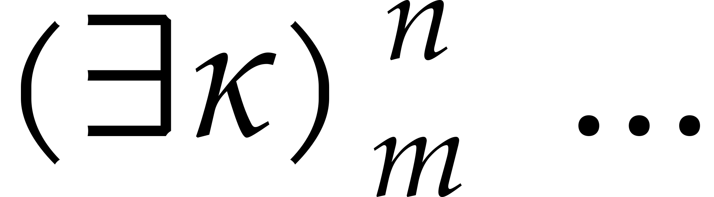’ & ‘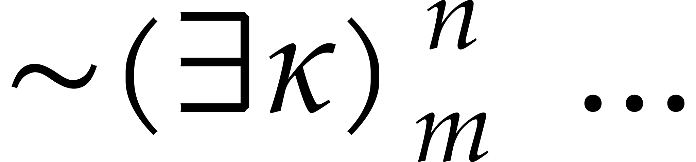’ that refer to intervals. Now consider the question: “Does the equation x² + ax + b = 0 have a real solution?” Here again there is a check, & the check distinguishes between the cases (∃…) etc. & ~(∃…) etc. But can I also ask & check in the same sense “whether the equation has a solution”? Unless I again bring this case together with others into a system.

### [109v\[2\]](https://cdn.wittgensteinnachlass.com/2000px/webp/Ms-113/109v.webp)

(In reality the ‘proof of the fundamental theorem of algebra’ constructs a new kind of number.)

### [109v\[3\]](https://cdn.wittgensteinnachlass.com/2000px/webp/Ms-113/109v.webp),[110r\[1\]](https://cdn.wittgensteinnachlass.com/2000px/webp/Ms-113/110r.webp)

A ‘proposition of mathematics’ proved by induction – but in such a way that one cannot search for this induction within a system of checks – is not a ‘proposition’ in the sense in which an answer to a mathematical question is one. “Every equation G has a root”. And what if it has none? Can we describe this case as we can the case in which it has no rational solution? What is the criterion for an equation’s having no solution? For this criterion must be given if the mathematical _question_ is to have a sense and if what has the form of an existential proposition is to be a ‘proposition’ in the sense of an answer to a question. (What does the description of the opposite consist in? What does it rest on? On what examples, and how are these examples related to a particular case of the proved opposite? These questions are not incidental; they are absolutely essential.) (The philosophy of mathematics consists in a _close_ examination of mathematical proofs – not in surrounding mathematics with a haze.)

### [110r\[2\]](https://cdn.wittgensteinnachlass.com/2000px/webp/Ms-113/110r.webp)

“How is it that I do not have to prove this proposition (of geometry or arithmetic) separately, but that it is already proved by the general proof?” But you do have to prove it, – namely, by writing down the particular proposition, for the rest is only what all proofs of such propositions have in common. (You have to prove this Euclidean proposition afresh for each triangle; though what is particular to this proof consists only in drawing this triangle, since the rest is already provided for by the general form (the Euclidean proof).)

### [110r\[3\]](https://cdn.wittgensteinnachlass.com/2000px/webp/Ms-113/110r.webp),[110v\[1\]](https://cdn.wittgensteinnachlass.com/2000px/webp/Ms-113/110v.webp),[111r\[1\]](https://cdn.wittgensteinnachlass.com/2000px/webp/Ms-113/111r.webp)

3 × 2 = 5 + 1

3 × (a + 1) = 3 + (3 × a) = (5 + b) + 3 = 5 + (b + 3)

Why, then, do you call this induction the proof that (n): n > 2 ․⊃․ 3 × n ≠ 5?! – Well, don’t you see that if the proposition holds for n = 2, it holds for n = 3 too, and then for n = 4 as well, and that it always goes on like this? (What am I explaining, then, when I explain how the inductive proof works?) So you call it a proof of “f(2) ∙ f(3) ∙ f(4) ∙ etc.”, but isn’t it rather the form of the proofs of “f(2)” & “f(3)” & “f(4)” etc.? Or does that amount to _one_ and the same thing? Now, if I call the induction the proof of _one_ proposition, I may do so only if that is to mean nothing more than that it proves every proposition of a certain form. (And my expression makes use of the analogy with the relation between the propositions “all acids turn litmus paper red”, “sulphuric acid turns litmus paper red”.) Now suppose someone said “let’s check whether f(n) holds for all n” & now he starts writing out the series:

3 × 2 = 5 + 1

3 × (2 + 1) = (3 × 2) + 3 = (5 + 1) + 3 = 5 + (1 + 3)

3 × (2 + 2) = (3 × (2 + 1)) + 3 = (5 + (1 + 3)) + 3 = 5 + (1 + 3 + 3)

and then breaks off & says: “I can already see that it holds for all n”. – So he has seen an _induction_! But had he _looked_ for an induction? After all, he had no method at all for looking for it. And if he had not discovered one, would he thereby have found a number that does not satisfy the condition? – _The rule_ for checking cannot, after all, be: let’s see whether we can find an induction, or a case for which the law does not hold. – If the law of excluded middle does not hold, that only means that our expression cannot be compared to a proposition.

### [111r\[2\]](https://cdn.wittgensteinnachlass.com/2000px/webp/Ms-113/111r.webp)

When we say that the induction proves the general proposition, we think: it proves that this proposition is true and not its contrary. But what would be the contrary of what is proved? Well, that (∃n)~fn is the case. Here we combine two concepts: one that I derive from my present concept of the proof of (n)f(n), and another taken from the analogy with (∃x) φx. (After all, we must bear in mind that “(n) ∙ fn” is not a proposition as long as I have no criterion of its truth; and that then it has only the sense this criterion gives it. To be sure, even before I had the criterion, I could have been on the lookout for, say, an analogy with (x) ∙ fx.) Now what is the contrary of what the induction proves? The proof of (a + b)² = a² + 2ab + b² works out this equation, as opposed to, say, (a + b)² = a² + 3ab + b². What does the inductive proof work out?

### [111r\[3\]](https://cdn.wittgensteinnachlass.com/2000px/webp/Ms-113/111r.webp),[111v\[1\]](https://cdn.wittgensteinnachlass.com/2000px/webp/Ms-113/111v.webp),[112r\[1\]](https://cdn.wittgensteinnachlass.com/2000px/webp/Ms-113/112r.webp)

The equations: 3 + 2 = 5 + 1, 3 × (a + 1) = (3 × a) + 3, (5 + b) + 3 = 5 + (b + 3), as opposed, then, to, say, 3 + 2 = 5 + 6, 3 × (a + 1) = (4 × a) + 2, etc. But this contrary does not, after all, correspond to the proposition (∃x) φx. – Further, every proposition of the form ~f(n) stands opposed to that induction, namely the proposition “~f(2)”, “~f(3)”, etc.; i.e. the induction is _what is common_ to the calculations of f(2), f(3), etc.; but it is not the calculation of “all propositions of the form f(n)”, since there is no class of propositions in the proof that I call “all propositions of the form f(n)”. Now each of these calculations checks a proposition of the form f(n). I could ask whether this proposition was correct and apply a method of checking it which the induction had merely reduced to a simple form. But if I call the induction “the proof of a general proposition”, then I cannot ask whether this proposition is correct (any more than I can ask whether the form of cardinal numbers is correct). For what I call an inductive proof gives me no method of _testing_ whether the general proposition is correct or incorrect; this method would have to teach me, rather, to work out (to check) whether or not an induction can be formed for a particular case of a system of propositions. (What is tested in this way is whether all n have such and such a property, if I may put it that way; but not whether all have it or whether there are some that do not. For example, we work out that the equation x² + 3x + 1 = 0 has no rational solutions (that there is no rational number that …) & not the equation x² + 2x + ½, whereas the equation x² + 2x + 1 = 0, etc.)

### [112r\[2\]](https://cdn.wittgensteinnachlass.com/2000px/webp/Ms-113/112r.webp)

Hence we find it strange when we are told that induction proves the general proposition; for we rightly feel that in the language of induction we could not have asked the general question at all. Since we were not presented with an alternative to begin with (but only seemed to be so long as we had in mind a calculus with finite classes). The question of generality would not yet have had any sense before the proof, so it is not a question either, for the question would have had sense only if a general method of deciding it was known _before_ the particular proof was known. For the inductive proof decides nothing..

### [112r\[3\]](https://cdn.wittgensteinnachlass.com/2000px/webp/Ms-113/112r.webp),[112v\[1\]](https://cdn.wittgensteinnachlass.com/2000px/webp/Ms-113/112v.webp)

If one says that “the proposition ‘(n) ∙ fn’ follows from the induction” means only that every proposition of the form f(n) follows from the induction; & that “the proposition (∃n)~fn contradicts the induction” means only that every proposition of the form ~f(n) is refuted by the induction, one can be content with that, but now one will ask: how do we use the expression “the proposition (n) f(n)” correctly? What is its grammar? (For it does not follow from my using it in certain contexts that I use it everywhere by analogy with the expression “the proposition (x) φx”.)

### [112v\[2\]](https://cdn.wittgensteinnachlass.com/2000px/webp/Ms-113/112v.webp),[113r\[1\]](https://cdn.wittgensteinnachlass.com/2000px/webp/Ms-113/113r.webp),[113v\[1\]](https://cdn.wittgensteinnachlass.com/2000px/webp/Ms-113/113v.webp)

Suppose some people were arguing about whether the division 1 : 3 must yield nothing but threes in the quotient; but they had no method of deciding this. Now one of them notices the inductive property of 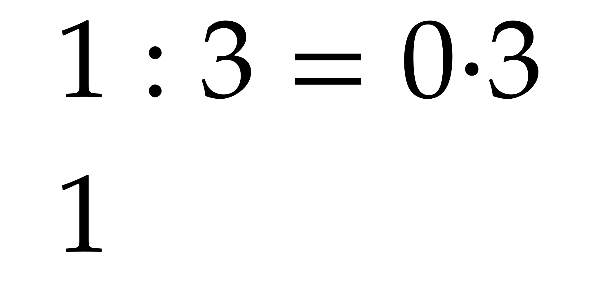 & says: now I know, there must be nothing but threes in the quotient. The others had not thought of _this_ kind of decision. I assume they had some vague idea of deciding it by checking step by step & that of course they could not arrive at a decision that way. Now if they hold to their extensional conception, then the induction does indeed bring about a decision, for it shows, for each extension of the quotient, that it consists of nothing but threes. But if they drop the extensional conception, then the induction decides nothing. Or only what the calculation of  decides: naturally, that it leaves a remainder equal to the dividend. But no more than that. And now there can indeed be a genuine question, namely: is the remainder left by this division equal to the dividend & this question has now taken the place of the old extensional one & of course I can retain the old wording, but it is now extraordinarily misleading, for it keeps making it look as if recognizing the induction were merely a vehicle that could carry us to infinity. (This is also connected with the fact that the sign „u.s.w.” refers to an internal property of the segment of the series that precedes it & not to its extension.) The question „is there a rational number that is the root of x² + 3x + 1 = 0” is indeed decided by an induction: – but here I have actually constructed a method for forming inductions; & the question is worded as it is only because what is at issue is the construction of inductions. That is, the question is decided by an induction if I could ask about this induction. If, that is, its sign was determined for me from the outset with respect to yes & no, so that I could decide between them by calculation, as, e.g., whether the remainder in 5 : 7 will be equal or unequal to the dividend. (The use of the expressions „all …” & „there is …” in these cases has a certain similarity to the use of the word „infinite” in the sentence „today I bought a ruler with an infinite radius of curvature”.)

### [113v\[2\]](https://cdn.wittgensteinnachlass.com/2000px/webp/Ms-113/113v.webp)

What one can get hold of is a problem.

### [113v\[3\]](https://cdn.wittgensteinnachlass.com/2000px/webp/Ms-113/113v.webp)

If I know the rules of elementary trigonometry, I can check the proposition sin 2x = 2 sin x cos x, but not the proposition 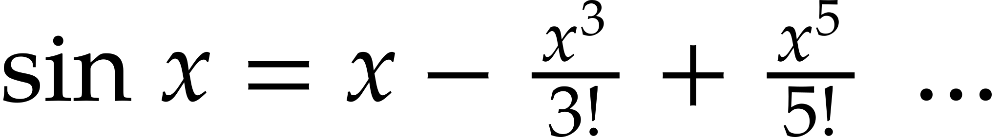. But that means that the sine of elementary trigonometry and the sine of higher trigonometry are different concepts. The two propositions are, as it were, on two different levels. On the first I can go as far as I like; I will never reach the proposition on the higher level. A pupil who had the tools of elementary trigonometry at his disposal and was asked to verify the equation 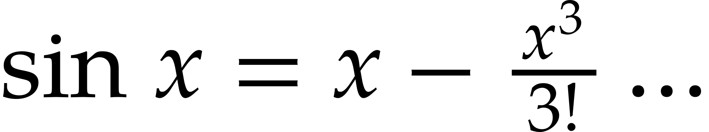 would simply not find there what he needs to tackle this problem. Not only can he not answer the question, he cannot even understand it. (It would be like the task the prince in the fairy tale sets the blacksmith: to bring him a „Klamank”. Busch Volksmärchen)

### [113v\[4\]](https://cdn.wittgensteinnachlass.com/2000px/webp/Ms-113/113v.webp)

16.05.1932

One might say: In the geometry of Euclid’s Elements one cannot look for the trisection of the angle, because there is no such thing – & not for its bisection, because there is.

### [113v\[5\]](https://cdn.wittgensteinnachlass.com/2000px/webp/Ms-113/113v.webp),[114r\[1\]](https://cdn.wittgensteinnachlass.com/2000px/webp/Ms-113/114r.webp)

In the world of Euclid’s Elements I can no more ask about the trisection of the angle than I can look for it. It is simply not spoken of.

### [114r\[2\]](https://cdn.wittgensteinnachlass.com/2000px/webp/Ms-113/114r.webp)

Here, incidentally, we must distinguish between certain kinds of questions, a distinction which again shows that what we call a „question” in mathematics differs from what we call a question in everyday life. We must distinguish between a question like „how does one divide the angle into two equal parts” and the question „is _this_ construction the bisection of the angle”. The question has sense only in a calculus that gives us a method for solving it; now a calculus may very well give us a method for answering one question but not for answering the other. Euclid, for example, does not teach us to look for the solutions to his problems, but gives them to us & proves that they are the solutions. But this is not a psychological or pedagogical matter, but a mathematical one. That is, the _calculus_ (that he gives us) does not enable us to look for the constructions. And a calculus that does enable us to do so is simply a _different_ one. (Compare also methods of integration with those of differentiation; etc.)

### [114r\[3\]](https://cdn.wittgensteinnachlass.com/2000px/webp/Ms-113/114r.webp),[114v\[1\]](https://cdn.wittgensteinnachlass.com/2000px/webp/Ms-113/114v.webp)

17.05.1932

I cannot ask whether 4 occurs among the combination-numbers, if this is my number system. Nor whether ½ occurs among the cardinal numbers, or show that it is not one of them, unless I call part of a system that also contains ½ „the cardinal numbers”. (But neither can I say or prove that 3 is one of the cardinal numbers.) Rather, the question _reads_ something like this: „Does the division 1 : 2 give a whole number”, & this can only be asked in a system in which a division can give a whole number or fail to do so. (The _calculation_ must have sense.)

If by „cardinal numbers” we do not designate a part of the rational numbers, then what we can work out is not whether 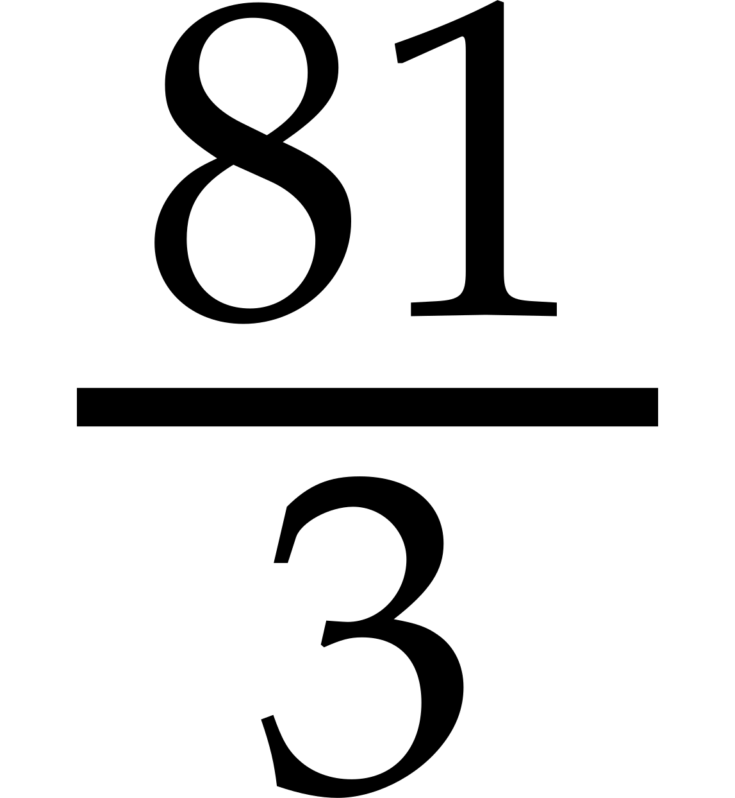 is a cardinal number, but whether the division 81 : 3 gives a whole number or not.

### [114v\[2\]](https://cdn.wittgensteinnachlass.com/2000px/webp/Ms-113/114v.webp),[115r\[1\]](https://cdn.wittgensteinnachlass.com/2000px/webp/Ms-113/115r.webp),[115v\[1\]](https://cdn.wittgensteinnachlass.com/2000px/webp/Ms-113/115v.webp),[116r\[1\]](https://cdn.wittgensteinnachlass.com/2000px/webp/Ms-113/116r.webp)

Instead of the problem of trisecting the angle with ruler & compass, we can now investigate something quite analogous but much more surveyable. We are free to restrict the possibilities of construction with ruler & compass still further. Thus, for example, we can stipulate that the opening of the compass may not be altered. And we can stipulate that the only construction we know – or rather: that our calculus knows – is the one used for bisecting a line segment AB, namely:

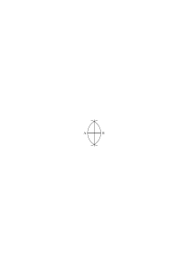

(This could, for example, actually be the primitive geometry of a people. And what I said about the series of numbers „1, 2, 3, 4, 5, many” having equal standing with the series of cardinal numbers would hold for it. In general it is a good _trick_ in our investigations to _picture to oneself_ the arithmetic or geometry of a primitive people.) I shall call this geometry system α & ask: „is trisection of the line segment possible in system α?” What trisection is meant in this question? – for the sense of the question evidently depends on this. Is physical trisection meant, for example? That is, trisection by trial & checking by measurement. In this case the question might be answered in the affirmative. Or optical trisection? That is, division resulting in three parts that look equal in length? If we look through a distorting medium, for example, it is quite easy to imagine that the parts

a, b & c appear to us to be of equal length. Now one could represent the results of the divisions in system α by the numbers 2, 2², 2³, and so on, according to the number of parts produced; & the question whether trisection is possible could mean: is one of the numbers in this series = 3. This question can of course only be asked if 2, 2², 2³, etc. are embedded in another system (say, that of the cardinal numbers); not if they themselves are our number system; for then we – or our system – simply do not know the number 3. – But if our question is: is one of the numbers 2, 2², 2³, etc. equal to ³, then what is at issue here is not really the _division_ of the line segment into three. Still, the question of the possibility of trisection can be understood in this way. – Now we arrive at a different conception if we add to system α a system β in which there is division of a line segment

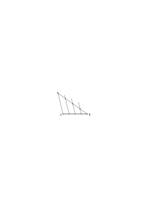

after the manner of this figure.

One can now ask: is the division β into 108 parts a division of type α? And this question might in turn amount to: is 108 a power of 2? but it might also point to a different way of deciding (have a different sense) if we combine the systems α & β into a system of geometrical construction

in such a way that it can now be proved in this system that the two constructions „must yield” the same division points B, C, D.

Now imagine someone had divided a line segment AB into 8 parts in system α, then grouped them into the segments a, b, c and asked: is this a trisection. (We could, incidentally, imagine the case more easily with a larger number of initial parts, making it possible to form 3 groups of parts, with the groups looking equal in length.) The answer to this question would be the proof that 2³ is not divisible by 3; or pointing out that the parts a, b, c are in the ratio 1:3:4. And now one might ask: so do I not after all have a concept of trisection in system α, namely that of a division that produces the parts a, b, c in the ratio 1:1:1? Certainly, I have now introduced a new concept, ‘trisection of a line segment’; after all, we could very well say that by dividing the line segment AB into 8 parts we have divided the line segment CB  into 3 equal parts, if that is just to _mean_: we have produced a line segment consisting of 3 equal parts.

### [116r\[2\]](https://cdn.wittgensteinnachlass.com/2000px/webp/Ms-113/116r.webp),[116v\[1\]](https://cdn.wittgensteinnachlass.com/2000px/webp/Ms-113/116v.webp)

The _perplexity_ we found ourselves in over the problem of trisection was something like this: if the trisection of the angle is impossible – logically impossible – how can one ask about it at all? How can one describe what is logically impossible & ask with sense whether it is possible? That is, how can one put together concepts that do not _logically_ fit together (against the grammar, and hence nonsensically) & ask with sense whether they can be put together in this way? – But this paradox would recur if one asks: „is 25 × 25 = 620?” since it is, after all, _logically_ impossible for this equation to be correct; I cannot describe what it would be like if – – –. Yes, the doubt whether 25 × 25 = 620 (or whether it is = 625) has just the sense the method of checking gives it. And the question of the possibility of trisection has the sense the method of checking gives it. It is quite true: here we do not imagine or describe what it is like if 25 × 25 = 620, & this simply means that we are dealing here with a different (logical) kind of question from, say: „is this road 620 or 625 m long?”

### [116v\[2\]](https://cdn.wittgensteinnachlass.com/2000px/webp/Ms-113/116v.webp)

(We speak of a „_division of the circle_ into 7 parts” & of a division of a cake into 7 parts.)

### [116v\[3\]](https://cdn.wittgensteinnachlass.com/2000px/webp/Ms-113/116v.webp),[117r\[1\]](https://cdn.wittgensteinnachlass.com/2000px/webp/Ms-113/117r.webp)

One is inclined to believe that the notation that represents a series by writing down a few terms with the sign u.s.w. is essentially inexact, in contrast to specifying the general term. In saying this one forgets that the specification of the general term refers to a basic series that cannot in turn be described by a general term. Thus 2n + 1 is the general term of the odd numbers _if_ n runs through the cardinal numbers, but it would be nonsense to say that n was the general term of the series of cardinal numbers. If one wants to explain this series, one cannot do so by specifying the „general term n”, but of course only by an explanation of the kind 1, 1 + 1, 1 + 1 + 1, and so on. And of course there is no essential difference between this series & the series: 1, 1 + 1 + 1, 1 + 1 + 1 + 1 + 1, and so on, which I could just as well have taken as the basic series (so that the general term of the series of cardinal numbers would then have _read_ ).

### [117r\[2\]](https://cdn.wittgensteinnachlass.com/2000px/webp/Ms-113/117r.webp)

(Frege would have gone on to say: „there may be peoples whose knowledge of the series of cardinal numbers has not gone beyond 5 (& who see the rest of the series only in some indeterminate form), but this series exists independently of us”. Does the game of chess exist independently of us, or not? –)

### [117r\[3\]](https://cdn.wittgensteinnachlass.com/2000px/webp/Ms-113/117r.webp),[117v\[1\]](https://cdn.wittgensteinnachlass.com/2000px/webp/Ms-113/117v.webp)

The mathematician must shudder at my mathematical discussions, for his training has always steered him away from giving himself over to thoughts & doubts such as the ones I bring to light. He has learnt to regard them as something contemptible and, to use an analogy from psychoanalysis (this paragraph recalls Freud), has acquired a disgust for these things, as for something infantile. That is, I bring to light all those problems that, say, a boy feels as difficulties when learning arithmetic, etc., & that instruction suppresses without solving them. So I say to these suppressed doubts: you are quite right, go ahead and ask, & demand clarification!

### [117v\[2\]](https://cdn.wittgensteinnachlass.com/2000px/webp/Ms-113/117v.webp)

The effect of a false analogy taken into language: it _means_ constant struggle & disquiet (a constant irritation, as it were). It is as if from a distance a thing seems to be a person because we do not then perceive certain things & up close we see that it is a tree stump. As soon as we go a little way off & lose sight of the explanations, _one_ shape appears to us; if we then look more closely, we see another; now we go off again, etc., etc.

### [117v\[3\]](https://cdn.wittgensteinnachlass.com/2000px/webp/Ms-113/117v.webp)

(I can determine the place of the problem of trisecting the angle in a larger system, but I cannot ask in the system of Euclid’s Elements whether it is soluble. In what _language_ would I ask about it? in the Euclidean one? – And just as little can I ask in the Euclidean language about the possibility of bisecting the angle in the Euclidean system. For in this language that would amount to asking about possibility as such, which is always nonsense.)

### [117v\[4\]](https://cdn.wittgensteinnachlass.com/2000px/webp/Ms-113/117v.webp)

(*The classifications of philosophers & psychologists: they classify clouds according to their shape.)

### [118r\[1\]](https://cdn.wittgensteinnachlass.com/2000px/webp/Ms-113/118r.webp)

It is impossible to discover rules of a new kind that hold for a form we know (say, the sine of an angle). If the rules are new, it is not the old form.

### [118r\[2\]](https://cdn.wittgensteinnachlass.com/2000px/webp/Ms-113/118r.webp),[118v\[1\]](https://cdn.wittgensteinnachlass.com/2000px/webp/Ms-113/118v.webp)

One takes the periodicity of a fraction, e.g. ⅓, as though it _consisted_ in the fact that something called the extension of the infinite decimal fraction consists solely of threes, & as though the equality of the remainder of this division with the dividend were only an _indication_ of this property of the infinite extension. Or else one corrects this opinion by saying that it is not an infinite extension that has this property, but an infinite series of finite extensions; & that the property of the division is again an indication of this. One can now say: the extension with one term is 0˙3, the one with 2 terms is 0˙33, the one with three is 0˙333, and so on. This is a _rule_, & the „u.s.w.” refers to the regularity, & the rule could also be written „[0˙3, 0˙ξ, 0˙ξ3]”. But what is proved by the division

is _this_ regularity as opposed to another, not regularity as opposed to irregularity. The periodic division, then,

(as opposed to ) proves _a_ periodicity of the quotients, i.e. it _determines_ the rule (the period), fixes it, but is not an indication that a regularity „is present”. _Where_ is it present, then? Perhaps in the particular expansions I have produced on this sheet of paper. But these are not „the expansions”. (Here we are misled by the idea of unwritten, ideal extensions, which are an absurdity akin to ideal, undrawn geometrical straight lines, which, as it were, we merely trace over in reality when we draw them.) When I said „the ‚u.s.w.’ refers to the regularity”, I was distinguishing it from the ‚u.s.w.’ in „he read all the letters: a, b, c, u.s.w.”. When I say: „the extensions of 1 : 3 are 0˙3, 0˙33, 0˙333 u.s.w.”, I give _three_ extensions & – a rule. Only the rule is infinite, and in no other way than the division

.

### [118v\[2\]](https://cdn.wittgensteinnachlass.com/2000px/webp/Ms-113/118v.webp),[119r\[1\]](https://cdn.wittgensteinnachlass.com/2000px/webp/Ms-113/119r.webp)

And the sign [0˙3, 0˙ξ, 0˙ξ3] is not a substitute for an extension, but the full-fledged sign itself & “” is just as good. It should give us pause that a sign of the kind “” _is enough_ for us to do what we need with it. It is not a substitute & in the calculus there are no substitutes. If one thinks that the particular property of the division

is an indication of the periodicity of the infinite decimal fraction, or of _the_ decimal fractions in the expansion, then this means that something _is_ regular; but what? The extensions I have produced? But there aren’t any others. This way of speaking would be most absurd if one said: the property of the division is an indication that the result has the form [0˙a, 0˙ξ, 0˙ξa]; that would be like saying: a division is an indication that a number comes out. The sign “” does not express its meaning from any greater distance than “0˙333…”, for this latter sign gives an extension of three terms & a rule; the extension 0˙333 is incidental to our purposes & so all that remains is the rule, which “[0˙3, 0˙ξ, 0˙ξ3]” gives just as well. The sentence “the division becomes periodic after the first place” _means the same as_ “the first remainder equals the dividend”. Or again: the sentence “from the first place onwards the division will produce the same digit ad infinitum” _means_ “the first remainder equals the dividend”; just as the sentence “this ruler has an infinite radius” means that it is straight.

### [119r\[2\]](https://cdn.wittgensteinnachlass.com/2000px/webp/Ms-113/119r.webp),[119v\[1\]](https://cdn.wittgensteinnachlass.com/2000px/webp/Ms-113/119v.webp)

One could now say: the digits of the quotient of 1 : 3 are _necessarily all_ 3, & this would again mean only that the first remainder equals the dividend and that the first digit of the quotient is 3. The negation of the first sentence is therefore the same as the negation of the second. There is therefore nothing opposed to “necessarily all” that one could call “contingently all”; “necessarily all” is, so to speak, one word. I need only ask: What is the criterion for necessary generality, & what would be the criterion for contingent generality (the criterion, that is, for all numbers happening to have the property ε)?

### [119v\[2\]](https://cdn.wittgensteinnachlass.com/2000px/webp/Ms-113/119v.webp),[120r\[1\]](https://cdn.wittgensteinnachlass.com/2000px/webp/Ms-113/120r.webp),[120v\[1\]](https://cdn.wittgensteinnachlass.com/2000px/webp/Ms-113/120v.webp)

Has the recursive proof of a + (b + c) = (a + b) + c – – –

_A_

answered a question? & which? Has it shown an assertion to be true & thus its opposite to be false? What one calls the recursive proof of A can be written like this:

a + (b + 1) = (a + b) + 1

a + (b + (c + 1) = a + ((b + c) + 1) = (a + (b + c)) + 1 }

B

(a + b) + (c + 1) = ((a + b) + c) + 1

The sentence proved evidently does not occur in this proof at all. – One would only have to make a general stipulation permitting the transition to it. This stipulation could be expressed like this:

αφ(1) = ψ(1)

∆

βφ(c + 1) = F(φ(c)) } φ(c) = ψ(c)

γψ(c + 1) = F(ψ(c))

If three equations of the form α, β, γ have been proved, then we say that “the equation ∆ has been proved for all cardinal numbers”. This is an explanation of this form of expression by means of the first. It shows that we use the word “prove” differently in the second case from the way we use it in the first. At any rate it is misleading to say that we have proved the equation ∆ or A, and perhaps better to say that we have proved its general validity, although that is misleading in another respect. Has proof B now answered a question, shown an assertion to be true? Well, which is proof B: is it the group of three equations of the form α, β, γ, or the class of proofs of these equations? These equations do _assert_ something (& prove nothing in the sense in which _they_ are proved). But the proofs of α, β, γ answer the question whether these three equations are correct, & show the assertion that they are correct to be true. I can now explain that the question whether A holds for all cardinal numbers is to mean: “do equations α, β & γ hold for the functions φ(ξ) = a + (b + ξ), ψ(ξ) = (a + b) + ξ

?” And then this question is answered by the recursive proof of A, if _by this_ we mean the proofs of α, β, γ (or, more precisely, the stipulation of α and the proofs of β & γ by means of α). Thus I can say that the recursive proof calculates that equation A satisfies a certain condition; but it is not a condition of the kind that, say, the equation (a + b)² = a² + 2ab + b² must satisfy in order to be called correct. If I call A “correct” because equations of the form α, β, γ can be proved for it, then I am using the word “correct” differently now from the way I use it in the case of the equations α, β, γ, or (a + b)² = a² + 2ab + b².

### [120v\[2\]](https://cdn.wittgensteinnachlass.com/2000px/webp/Ms-113/120v.webp),[121r\[1\]](https://cdn.wittgensteinnachlass.com/2000px/webp/Ms-113/121r.webp)

What does “” mean? Does it mean the same as

“”?

 – Or is this division the proof of the first sentence? I.e.: does it stand to it in the relation of the calculation to what is proved? “” is, after all, not of the same kind as “1 : 2 = 0˙5”; rather, “” corresponds to “” (but not to the following:

“

”.)

I want to adopt, instead of the notation “1 : 4 = 0˙25”, the following:

“” thus, for example, “”

then I can say that what corresponds to this sentence is not  but, e.g., “”.  is not the result (quotient) of the division in the same sense as 0˙375. For the number 0˙375 was known to us before the division 3 : 8; but what does “” mean apart from the periodic division? – The assertion that the division a : b yields  as its quotient is the same as this: the first digit of the quotient is c & the first remainder equals the dividend. Now B stands to the assertion that A holds for all cardinal numbers in the same relation as

to .

### [121r\[2\]](https://cdn.wittgensteinnachlass.com/2000px/webp/Ms-113/121r.webp)

The contrary of the assertion “A holds for all cardinal numbers” is now this: one of the equations α, β, γ is false. And the corresponding question does not seek a decision between an (x)fx & an (∃x)~fx.

### [121r\[3\]](https://cdn.wittgensteinnachlass.com/2000px/webp/Ms-113/121r.webp)

The construction of the induction is not a proof but a particular arrangement (a pattern) of proofs. After all, one cannot say: I prove one equation when I prove three. Just as the sentences of a suite do not add up to one sentence.

### [121r\[4\]](https://cdn.wittgensteinnachlass.com/2000px/webp/Ms-113/121r.webp)

The “recursive proof” is the general term of a series of proofs. It is thus a law according to which one can construct proofs. If it is asked how it is possible for this general form to spare me the proof of a particular sentence, e.g. 7 + (8 + 9) = (7 + 8) + 9, the answer is that it has only prepared everything for proving this sentence but does not prove it (after all, it does not occur in it). Rather, the proof consists of the general form together with the sentence.

### [121r\[5\]](https://cdn.wittgensteinnachlass.com/2000px/webp/Ms-113/121r.webp),[121v\[1\]](https://cdn.wittgensteinnachlass.com/2000px/webp/Ms-113/121v.webp)

Our ordinary way of speaking carries the seed of confusion into its very foundations, in that it uses the word “series” sometimes in the sense of ‘extension’ and sometimes in the sense of ‘law’. One can clarify the relation between the two by considering the machine that makes coil springs. Here a wire is pushed through  a helically coiled channel, and the wire then produces as many turns of the helix as one wants to produce. What one calls the infinite helix is not something of the same kind as the finite pieces of wire, or something they approach as they get longer, but the law of the helix as embodied in the short section of channel. The expression “infinite helix” or “infinite series” is entirely misleading in this connection.

### [121v\[2\]](https://cdn.wittgensteinnachlass.com/2000px/webp/Ms-113/121v.webp)

So we can always write out the recursive proof as a segment of a series with the “etc.”, & it loses none of its rigour thereby. At the same time this notation shows its relation to equation A more clearly. For the recursive proof now loses every semblance of being a justification of A in the sense of an algebraic proof – say, of (a + b)² = a² + 2ab + b². This proof by means of the rules of algebraic calculation is, rather, quite analogous to a calculation with numerals.

### [121v\[3\]](https://cdn.wittgensteinnachlass.com/2000px/webp/Ms-113/121v.webp)

(„Every symbol is what it is & not another symbol”.)

### [122r\[2\]](https://cdn.wittgensteinnachlass.com/2000px/webp/Ms-113/122r.webp)

One can also put it this way: insofar as one takes the rule for forming decimal fractions consisting solely of the digit 3 in some game or other, insofar as one takes _this rule_ to be a kind of number, a division cannot have it as its result, but only _what_ one may call periodic division and what has the form .

### [122r\[3\]](https://cdn.wittgensteinnachlass.com/2000px/webp/Ms-113/122r.webp)

Can there be no proof that merely shows that, for example, every multiplication in the decimal system performed according to the rules must yield a number of the decimal system? – It would have to be analogous to a proof that adding expressions of the kind (1), ((1) + 1), (((1) + 1) + 1), etc. always produces numerals of this form again. Can one prove that? The proof evidently lies in the rule for adding such expressions, i.e. in the definition & in nothing else. (After all, in answer to the question this proof is supposed to answer one could also say: “Yes, what else is the addition supposed to yield?”)

### [122r\[4\]](https://cdn.wittgensteinnachlass.com/2000px/webp/Ms-113/122r.webp),[122v\[1\]](https://cdn.wittgensteinnachlass.com/2000px/webp/Ms-113/122v.webp)

The recursive definition is a rule for forming rules of substitution. Or again, the general term of a series of series of definitions. It is a signpost that directs all expressions of a certain form home along one path.

### [122v\[2\]](https://cdn.wittgensteinnachlass.com/2000px/webp/Ms-113/122v.webp)

A, as a rule for algebraic calculation, cannot be proved recursively; one would see this especially clearly if one wrote out the “recursive proof” as a series of arithmetical expressions. If one imagines them written out (i.e. a segment of the series with the etc.), but without the intention of “proving” anything, and someone were now to ask: “does this prove a + (b + c) = (a + b) + c?”, we would ask in return, in astonishment: “how can it prove such a thing? After all, only numerals occur in the series, & no letters!” – But one could now say: if I introduce rule A for calculation with letters, then in a certain sense this brings that calculus into accord with the calculus of cardinal numbers as I have laid it down by means of the law of the rules of addition (recursive definition a + (b + 1) = (a + b) + 1).

### [122v\[3\]](https://cdn.wittgensteinnachlass.com/2000px/webp/Ms-113/122v.webp),[123r\[1\]](https://cdn.wittgensteinnachlass.com/2000px/webp/Ms-113/123r.webp)

(If the rules of algebraic calculation are to agree with those of calculation with real numbers, then I must say, for example, of the equation x² + 2x + 2 = 0 that it has _no_ solution. I then throw all quadratic equations that have no solution into one pot, so to speak. But if I go on to ask: how close does this equation, which has no solution, come to one that has a solution? – then I am already operating with complex numbers by treating the equations themselves as a kind of number; i.e. by constructing a calculus with equations which in a certain respect is analogous to the calculus with real numbers (for example).)

### [123r\[2\]](https://cdn.wittgensteinnachlass.com/2000px/webp/Ms-113/123r.webp),[123v\[1\]](https://cdn.wittgensteinnachlass.com/2000px/webp/Ms-113/123v.webp)

19.05.1932

Phenomenological language: The description of immediate sense perception, with no hypothetical addition. If anything is such a description of immediate experience, then presumably depiction by means of a painted picture or the like must be. If, then, for instance, we look through a telescope and draw or paint the constellation we see. Let us even imagine reproducing our sense perception by making, as a description of it, a model that produces these perceptions when seen from a particular point; the model could be set moving in the right way by a crank, & we could read off the description by turning the crank. (A representation on film would be an approximation to this.) If _that_ is not a representation of the immediate – what would be? Anything that sought to be still more immediate would have to cease to be a description. What comes out then, instead of a description, is rather that inarticulate sound with which some authors would like to begin philosophy. (“I consciously have something, knowing my knowledge” (Driesch).)

### [123v\[2\]](https://cdn.wittgensteinnachlass.com/2000px/webp/Ms-113/123v.webp)

What we can call time in the phenomenon (specious present) does not lie in the time (past, present & future) of history, is not a stretch of this time. Whereas what we understand by “language” runs its course in homogeneous historical time. (Think of the mechanism for describing immediate perception.)

### [123v\[3\]](https://cdn.wittgensteinnachlass.com/2000px/webp/Ms-113/123v.webp),[124r\[1\]](https://cdn.wittgensteinnachlass.com/2000px/webp/Ms-113/124r.webp)

Of what importance, then, is the description of the _present_ phenomenon, which can become something of an obsession for us. That it distresses us that the description cannot describe what goes on in the reading of the description. It seems as though occupying ourselves with this question were downright childish & we had strayed into a dead end. And yet it is a significant dead end, for everyone is tempted to go into it, as if that were where the ultimate solution to the problems of philosophy was to be sought. – It is as though, with this representation of the present phenomenon, one came into an enchanted swamp where everything one can grasp disappears.) On the other hand, we need a mode of expression that represents phenomena in visual space separately from experiences of other kinds.

### [124r\[2\]](https://cdn.wittgensteinnachlass.com/2000px/webp/Ms-113/124r.webp)

When we speak of visual space, we are easily led to imagine it as a sort of peep-show box that everyone carries around. I.e. we then use the word “space” much as we do when we call a room a space. In _reality_, however, the term “visual space” refers only to a geometry, I mean, to a part of the grammar of our language. In this sense there are no “visual spaces” that might each have an owner. (And perhaps vacant ones too, that happen not to belong to anyone?)

### [124r\[3\]](https://cdn.wittgensteinnachlass.com/2000px/webp/Ms-113/124r.webp),[124v\[1\]](https://cdn.wittgensteinnachlass.com/2000px/webp/Ms-113/124v.webp)

“But can’t I see a landscape in my visual space and you see a room in yours?” – No, – ‘I see in my visual space’ is nonsense. It must be ‘I see a landscape & you etc.’ – and that is not disputed. What misleads us here is precisely the simile of the peep-show box, or perhaps of a round white disc that we carry around with us as a kind of projection screen and that is the space in which each visual image appears. But the flaw in this simile is that it pictures the very occasion – the possibility – for a visual image to appear in visual terms; for the white screen is itself an image.

### [124v\[2\]](https://cdn.wittgensteinnachlass.com/2000px/webp/Ms-113/124v.webp)

Now it is important that the sentence “I cannot directly see the eye with which I see” is either a disguised sentence of grammar or nonsense. For the expression “nearer to (or, farther from) the seeing eye” has a different grammar from “nearer to the blue object that I see”. The visual appearance that corresponds to the description “A puts on the glasses” is fundamentally different from the one I describe with the words: “I put on the glasses”. Now I could say: “my visual space resembles a cone”, but it must then be understood that I am thinking here of the cone as a space, as the representative of a geometry, not as part of a space (room). (So the idea of someone looking into the cone through a hole at its apex is incompatible with this idea.)

### [124v\[3\]](https://cdn.wittgensteinnachlass.com/2000px/webp/Ms-113/124v.webp),[125r\[1\]](https://cdn.wittgensteinnachlass.com/2000px/webp/Ms-113/125r.webp)

Does anything compel me to adopt the interpretation that the tree I see through my window is bigger than the window? That depends on how I use the words “bigger” & “smaller”. – Let us suppose, the _normal_ visual experience for us were to see rods in various positions, divided by segments into (visually) equal parts. Might not a twofold use of the words “longer” & “shorter” then become established? For sometimes we would call the rod divided into more parts the longer one; etc.

### [125r\[2\]](https://cdn.wittgensteinnachlass.com/2000px/webp/Ms-113/125r.webp)

In visual space there is absolute position. When I look through one eye, I see the tip of my nose. If it were cut off & removed but then handed to me, I could put it back in its old position without the aid of a mirror & by sight alone; even if in the meantime everything in my visual image had changed. The sentence “I see the seeing eye in the mirror” only appears to have the form of “I see the other person’s eye in the mirror”, for it makes no sense to say: “I see the seeing eye”. If I call the image that another person’s eye, for instance, presents to me a “visual eye”, then I can say that the expression “the seeing eye” does not correspond to a visual eye.

### [125r\[3\]](https://cdn.wittgensteinnachlass.com/2000px/webp/Ms-113/125r.webp),[125v\[1\]](https://cdn.wittgensteinnachlass.com/2000px/webp/Ms-113/125v.webp)

My visual field exhibits no incompleteness that might prompt me to turn round & see what lies behind me. In visual space there is no “behind me”; & when I turn round, my visual image merely _changes_; it is not completed. (The “space around me” is a combination of visual space & the space of muscular feeling.) It makes no sense to speak, in visual space, of the motion of an object that now takes the seeing eye round behind.

### [125v\[2\]](https://cdn.wittgensteinnachlass.com/2000px/webp/Ms-113/125v.webp)

Relation between physical space & visual space. Think of seeing with one’s eyes closed (night images etc.) & of dream images.

### [125v\[3\]](https://cdn.wittgensteinnachlass.com/2000px/webp/Ms-113/125v.webp)

(With our language (as a physical phenomenon) we are, so to speak, not in the domain of the projected picture on the screen, but in that of the film passing through the lantern. And if I want to make music to go with what is happening on the screen, what produces it must again take place in the domain of the film. The spoken word in a talking film, which accompanies the events on the screen, is as fleeting as those events, & not the same as the sound strip. The sound strip does not accompany the action on the screen.)

### [125v\[4\]](https://cdn.wittgensteinnachlass.com/2000px/webp/Ms-113/125v.webp),[126r\[1\]](https://cdn.wittgensteinnachlass.com/2000px/webp/Ms-113/126r.webp)

Memory time. It is not (any more than visual space is) a part of time at large, but the specific order of events or situations in memory: In this time there is, for example, no future. Visual space & physical space, memory time & physical time, are related to each other not as a segment of the series of cardinal numbers is to the law of that series (“the whole series of numbers”), but as the system of cardinal numbers is to that of rational numbers. And this relation also explains the sense of the opinion that one space includes, contains the other.

### [126r\[2\]](https://cdn.wittgensteinnachlass.com/2000px/webp/Ms-113/126r.webp),[126v\[1\]](https://cdn.wittgensteinnachlass.com/2000px/webp/Ms-113/126v.webp),[127r\[1\]](https://cdn.wittgensteinnachlass.com/2000px/webp/Ms-113/127r.webp)

20.05.1932

Concept & object: in Russell & Frege these are really property & thing; & here I am thinking of a spatial body & its colour. One can also say: concept & object: that is, predicate & subject. And the subject–predicate form is a form of expression of human languages. It is the form x is y (xεy): “my brother is tall”, “the thunderstorm is near”, “this circle is red”, “August is strong”, “2 is a number”, “this thing is a piece of coal”. Now just as physics has abstracted the concept of the material point from bodies of experience, so too the subject–predicate form of logic has been abstracted from the subject–predicate form of our languages. The pure subject–predicate form is now supposed to be a ε f(x), where “a” is the name of an object. Let us now look for an application of this schema. At “name of an object” one thinks first of names of people & other spatial objects (the diamond Koh i Noor). Such a name is given to the thing by an ostensive explanation (“this↗ is ‘N’”). This explanation could be understood as a rule for replacing the gesture pointing to the object with the word “N”, in such a way that one can always put that gesture back in place of the name “N”. I might, for example, have explained “this man is called ‘N’” & now say: “‘N’ is a mathematician”, “N is lazy”, etc. & I could have put ‘this man’ (with the pointing gesture) in place of ‘N’ in each of these sentences. (Then, incidentally, it would have been better to word the ostensive explanation: “let this man be called ‘N’” or “I shall call this man ‘N’”, for the earlier wording is also the sentence saying that this man is called by that name.) But this is not the normal way of applying a name; for that it is essential that I cannot go back from the name to a sign in the language of gestures. For if N leaves the room & later a man enters it, then – given the way we use the name “N” – it makes sense to ask whether this man is N, whether this man is the same one who left the room earlier. And the sentence “N has come back in” makes sense only if I can decide the question. And it will have a different sense depending on what the criterion is for this being the same object that I previously called ‘N’. Thus different rules will apply to the sign ‘N’ depending on the kind of criterion; it will be a ‘name’ in a different sense of the word. And so it comes about that the word ‘name’ & the corresponding ‘object’ correspond to a legion of different lists of rules. When we give spatial objects names, our use of these names rests on a criterion of identity that presupposes the continuity of the bodies’ motion & their impenetrability. So if I could do with two bodies A & B what I can do with their shadow-images on the wall, make them into One & make two again out of the One, it would be senseless to ask which of the two is A & which B after the separation. Unless I now introduce an altogether new criterion of identity, such as the shape of their paths (for the name of a river formed by the confluence of two rivers there is such a rule:  the resulting river takes the name of whichever source river it flows in the direction of). Let us think of the possible criteria of identity, for example, for patches of colour in my visual field (or the figures on a cinema screen), & of the different ways of using a name that I give to such a patch or figure.

### [127r\[2\]](https://cdn.wittgensteinnachlass.com/2000px/webp/Ms-113/127r.webp),[127v\[1\]](https://cdn.wittgensteinnachlass.com/2000px/webp/Ms-113/127v.webp),[128r\[1\]](https://cdn.wittgensteinnachlass.com/2000px/webp/Ms-113/128r.webp)

If we now turn to the notation “(∃x) ∙ fx”, it is clear that this is a sublimation of the form of expression in our language: “there are people on this island”, “there are stars that we do not see”. And a sentence “(∃x) ∙ f(x)” is now always supposed to have a corresponding sentence “f(a)”, & “a” is supposed to be a name. So one is supposed to be able to say: “(∃x) ∙ f(x), namely a and b”, or “(∃ ∙ fx, e.g. a”, etc. And this is possible in a case such as: “there are people on this island, namely Messrs A, B, C, D.” But is it essential to the sense of the sentence “there are people on this island” that we can name them, and thus lay down a definite criterion for identification? It is essential only if the sentence “(∃x) ∙ fx” is defined as a disjunction of sentences of the form “f(ξ)”, so if, for example, it is stipulated that “there are people on this island” is to mean “on this island there is either Mr A or B or C or D or E”; that is, if one defines the concept ‘human being’ as an extension (which would of course run quite counter to the normal use of this word). (By contrast, one really does define the concept “primary colour”, for example, as an extension.) Thus the question “_which_ x satisfy f” does not make sense in every case in response to the sentence “(∃x) ∙ fx”. “Which red circle with a diameter of 1 cm is in the middle of this quadrilateral?” One must not confuse the question “_which_ object satisfies f?” with the question “_what kind of_ object etc.?” The first question would have to be answered with a name, so the answer would have to be able to take the form “f(a)”; but the answer to the question “_what kind of_ …” is “(∃x) ∙ fx ∙ φx”. Thus it can be senseless to ask “which red patch do you see?” but make sense to ask: “what kind of red patch do you see” (a round one, a quadrangular one, etc.).

### [128r\[2\]](https://cdn.wittgensteinnachlass.com/2000px/webp/Ms-113/128r.webp)

If one asks: “what then does ‘5 + 7 = 12’ mean – what sense or purpose, then, is still left for this expression once one has excluded tautologies etc. from the arithmetical calculus”, – the answer is: This equation is a substitution rule based on certain general substitution rules, the rules of addition. The content of 5 + 7 = 12 is (if one did not know it) exactly what gives children trouble when they learn this sentence in arithmetic lessons.

### [128r\[3\]](https://cdn.wittgensteinnachlass.com/2000px/webp/Ms-113/128r.webp),[128v\[1\]](https://cdn.wittgensteinnachlass.com/2000px/webp/Ms-113/128v.webp)

No investigation of concepts, only insight into the calculus of numbers, can convey that 3 + 2 = 5. That is what in us resists the thought that

“(∃3x) φx ∙ (∃2x) ψx ∙ Ind. ⊃ (∃5x) φx ⌵ ψx”

could be the sentence 3 + 2 = 5. For what enables us to recognize this expression as a tautology cannot itself emerge from a consideration of concepts either, but must be evident from the calculus. For grammar is a calculus. That is, whatever else is there in the calculus of tautologies besides the calculus of numbers does not justify the latter and is, if that is what interests us, merely incidental.

### [128v\[2\]](https://cdn.wittgensteinnachlass.com/2000px/webp/Ms-113/128v.webp)

What are numbers? – The meanings of numeral signs; & the investigation of this meaning is the investigation of the grammar of numeral signs.

### [128v\[3\]](https://cdn.wittgensteinnachlass.com/2000px/webp/Ms-113/128v.webp)

We are not looking for a definition of the concept of number, but for a clarification of the grammar of the word “number” & of number words.

### [128v\[4\]](https://cdn.wittgensteinnachlass.com/2000px/webp/Ms-113/128v.webp),[129r\[1\]](https://cdn.wittgensteinnachlass.com/2000px/webp/Ms-113/129r.webp)

Measuring a length in the visual field by laying a visual measuring rod alongside it. I.e., a rod divided into equal parts by graduation marks. There is a measurement here that consists in laying the measuring rod alongside two lengths. In fact, 2 measuring rods can be used, one alongside each length, and the criterion for the equality of the units of measurement is that the units look equally long. But a measuring rod can also be moved from one length to the other, and the criterion for the constancy of the unit of measurement is that we notice no change. Whereas the criterion for the measured lengths not changing might be that we perceived no movement of the endpoints. I can make countless different stipulations as to what is to be the criterion of equality of length in the visual image, and these in turn will yield different meanings for the measurements given.

### [129r\[2\]](https://cdn.wittgensteinnachlass.com/2000px/webp/Ms-113/129r.webp),[129v\[1\]](https://cdn.wittgensteinnachlass.com/2000px/webp/Ms-113/129v.webp),[130r\[1\]](https://cdn.wittgensteinnachlass.com/2000px/webp/Ms-113/130r.webp),[130v\[1\]](https://cdn.wittgensteinnachlass.com/2000px/webp/Ms-113/130v.webp)

21.05.1932

_Divisibility. Infinite divisibility._

The infinite divisibility of the Euclidean segment consists in the _rule_ (stipulation) that it makes sense to speak of an n-th part of every part. But if one speaks of the divisibility of a length in visual space & asks whether such a length can still be divided, or can be divided without end, then we are looking here for a rule that corresponds to a certain reality (but _how_ does it correspond to it?). I see a black strip on the wall in front of me, – is its width divisible? What is the criterion for that? Now there are countless criteria here that we would all call criteria of divisibility in the visual field, and that pass into one another by degrees. To begin with, the meaning of “divisibility” could be fixed in such a way that a trial establishes it; then it is not the “logical possibility” of division but its physical possibility, and the logical possibility at issue here is given in the description of the attempt at division – however that attempt may turn out. Now what would we call an “attempt at division”? – Perhaps painting a strip alongside the first that looks equally wide and consists of a green strip & a red strip running lengthwise, with memory providing the criterion for the black strip’s having the same width it had when we asked the question. (I.e. what we _call_ the same width of the black strip now & before is what is remembered as equally wide.) On the other hand, I could stipulate as the criterion for the divisibility of the black strip that a divided strip looking equally wide is seen at the same time as it. And I would then designate as the carrying out of the possible division the replacement of the undivided strip by a divided one, in which the undivided strip first seen remains in place.

Thus I would say “let a be divisible” – because I see b alongside it & “let a be divided” if I then see two strips of the kind b. In the statement “a is divided”, “a” thus designates a _place_; namely, what _stays the same_ whether a is divided or undivided. Here again there are various things that we call “a place in the visual field” & “_fixing_ a place in the visual field”. – But we could call a strip divisible only if it continues at the same (seen) width into a divided strip, or else if we  manage to lay a divided strip alongside it temporarily (in the visual field), etc. etc. – But then there is the criterion of the imaginability of the division. We say: “oh yes, I can still quite easily think of this strip as divided” (or “imagine it divided”). “If a division of this strip a into unequal parts is possible, then _all the more so_ into equal parts”. And here  we have again the stipulation of a new criterion of divisibility into equal parts. And here one says: surely in this case I can think of the strip as halved. But what does this possibility of thinking consist in? Can I do it if I try? And what if I don’t succeed? What is meant here by “I can think of …” can be learnt by asking “how is it that you can now think of it as halved”. The answer is: “I only need to think of the black part of the strip as a little wider”; & it is evidently assumed that thinking this presents no further difficulty. In reality, however, what is at issue here is not any difficulty in calling a particular image before the mind’s eye, nor anything I can try and fail to do, but the recognition of a rule of the mode of expression. This rule can, admittedly, be based on the ability to imagine something; i.e. in this case the mental image functions as a sample, hence as a sign, & can of course also be replaced by a painted sample. For when I ask: “what does one understand by an increase in the width of a strip”, something of the sort is shown to me by way of explanation; a sample is given here that I may incorporate into my language, or whose memory I may incorporate into it. And so the person I ask “how is the wide strip a divisible because b is divided”

can answer by widening the strip b & showing me how b becomes a divided strip the width of a. But with this answer the matter would rest. And what has the person done by way of explanation? They have given me a sign, a sample, as part of my system of signs; that is all.

### [130v\[2\]](https://cdn.wittgensteinnachlass.com/2000px/webp/Ms-113/130v.webp),[131r\[1\]](https://cdn.wittgensteinnachlass.com/2000px/webp/Ms-113/131r.webp),[131v\[1\]](https://cdn.wittgensteinnachlass.com/2000px/webp/Ms-113/131v.webp)

Now is there a limit to the divisibility of the strip in visual space? Well – I can stipulate that as I like. – That is to say: I can introduce a system of signs with limited divisibility, or one with unlimited divisibility – only, of course, I cannot dictate the facts and must then describe them accordingly with the system of signs I have stipulated. Thus if my mental image, or the visual image of a divided strip, forms part of my system of signs, then this part of my symbolism ends where I am for some reason unable to bring about any further reduction in the size of the parts. But then I can decide either to say that there is no further division, i.e. that it is senseless to speak of one – in which case I have committed myself to describing differently any phenomenon that may occur which I would be tempted to call a further division; – or else to let divisibility continue in the symbolism, though that changes nothing, since my series of samples, which also belongs to the language, has an end. Insofar as this series of samples is a series of signs, each new sample brings a _new_ sign into the language. This consideration is usually of no importance; sometimes, however, it becomes important. We have a case analogous to the problem of divisibility when it is asked: is it possible to take in at a glance any number 3n of strokes ∣∣∣∣∣∣∣∣∣∣∣∣ as a group of triples, or to see a series of such strokes, of any length, as a picture characteristic of their number, as we can for ∣, ∣∣, ∣∣∣, ∣∣∣∣? Here too we can use a finite or an infinite number system to describe our experience – for the series of samples of groups that can be taken in at a glance has an end, & it determines the sense of our sentences just as much as the number system used. So when I said “we are looking for a rule that corresponds to a certain reality”, the _correspondence_ lies in the simplicity & ready intelligibility of the representation. The rule is justified by the facts only in the same sense in which the choice of a coordinate system is justified by applying it to a curve that can be represented particularly simply in that system.

### [131v\[2\]](https://cdn.wittgensteinnachlass.com/2000px/webp/Ms-113/131v.webp),[132r\[1\]](https://cdn.wittgensteinnachlass.com/2000px/webp/Ms-113/132r.webp)

It is possible to see two equally long (i.e. seen as equally long) segments in the visual field, each divided by colour boundaries into several equal parts, & to find on counting these parts that their numbers are unequal. Now what about a question like: “Suppose I could take in 30 and 31 parts at a glance as numbers, would it still be possible to see two segments of 30 & 31 visually equal parts as equally long?” – Well, how is this question to be decided? First of all: what is it like when one takes in 30 parts at a glance as a number? What can one give by way of explanation? Of course we cannot show anyone a centaur, because there are none, but it is essential to the meaning of the word “centaur” that we can paint or model one. – But in the same way it is essential to the sense of the sentence “I can take in 30 parts at a glance as a number” _what_ I might show as an example of such taking in at a glance, & that I cannot show any case of taking in 30 strokes at a glance as a sample. Here one can say: I cannot imagine taking in 30 strokes at a glance as a numerical image, I do not know what it would be like, & the question “what would it be like if …” is nonsensical for me, for I have been given no criterion for deciding it.

### [132r\[2\]](https://cdn.wittgensteinnachlass.com/2000px/webp/Ms-113/132r.webp)

Different meanings of the words “blurred”, “unclear”.

### [132r\[3\]](https://cdn.wittgensteinnachlass.com/2000px/webp/Ms-113/132r.webp),[132v\[1\]](https://cdn.wittgensteinnachlass.com/2000px/webp/Ms-113/132v.webp)

If the criterion for p following from q consists in one’s “thinking p along with q when thinking q”, then presumably, when thinking the sentence “there are 10⁵ grains of sand in this box”, one thinks the 10⁵ sentences “there is one grain of sand in this box”, “… 2 grains of sand”, etc. etc.? What is the criterion here for thinking one thing along with another! And what about a sentence: “a

patch (F) lies between the boundaries AA”? Does it not follow from it that F also lies between BB & between CC, and so on? Do infinitely many sentences follow here from one sentence? & does it therefore say infinitely much? – From the sentence “a patch lies between the boundaries AA” there follows every sentence of the kind “a patch lies between the boundaries BB” that I write down – and as many as I write down. Just as there follow from p as many sentences of the form p ⌵ ξ as I write down (or utter, etc.). (The proof by induction proves as many sentences of the form … as I write down.)

### [132v\[2\]](https://cdn.wittgensteinnachlass.com/2000px/webp/Ms-113/132v.webp)

If we confuse the meanings of the expression “equally long” & of other expressions in visual space with the meanings of the same words in Euclidean space, we run into contradictions & then ask: “How is such an experience possible?! How is it possible for 24 equally long segments to add up to the same length as 25 of that length? Have I really had such an experience?”

### [132v\[3\]](https://cdn.wittgensteinnachlass.com/2000px/webp/Ms-113/132v.webp),[133r\[1\]](https://cdn.wittgensteinnachlass.com/2000px/webp/Ms-113/133r.webp)

π' is a rule for generating decimal fractions: the expansion of π' is the same as that of π, except when a group 777 occurs in the expansion of π; in that case the group 000 takes its place. Our calculus has no method for finding where in the expansion of π we will come across such a group.

P is a rule for generating binary fractions. The digit in the n-th place of the expansion is 1 or 0, according as n is prime or not.

F is a rule for generating binary fractions. In the n-th place there is a 0, except when a triple of numbers x, y, z from among the first 100 cardinal numbers satisfies the equation .

### [133r\[2\]](https://cdn.wittgensteinnachlass.com/2000px/webp/Ms-113/133r.webp)

One would like to say that the individual digits of the expansion (of π, for example) are always only the results, the bark of the fully grown tree. What matters, or what something new can still grow from, is inside the trunk, where the forces that drive the growth are. A change to the outside does not change the tree at all. To change it one must go into the still living trunk.

### [133r\[3\]](https://cdn.wittgensteinnachlass.com/2000px/webp/Ms-113/133r.webp),[133v\[1\]](https://cdn.wittgensteinnachlass.com/2000px/webp/Ms-113/133v.webp),[134r\[1\]](https://cdn.wittgensteinnachlass.com/2000px/webp/Ms-113/134r.webp)

I call the expansion of π to the nth place “”. Then I can say: which number  is, I understand, but not π', since π has no places at all, so I cannot replace any with others. It would be different if, for example, I explained the division  as a rule for generating decimal fractions by dividing & replacing every 5 in the quotient with a 3. Here I know, for example, the number . – And if our calculus contains a method for calculating a law governing the positions of 777 in the expansion of π, then 777 is now mentioned in the law for π & the law can be changed by substituting 000 for 777. But then π' is something different from what I defined above; 22.05.1932 it has a different grammar from the one I supposed. In our calculus there is no question whether π ⋝ π' is or is not & no such equation or inequality. π' is incomparable with π. And one cannot say “cannot _yet_ be compared”, for if I were one day to construct something like π' that could be compared with π, for that very reason it would no longer be π'. For π' and π are each a designation for a game & I cannot say that draughts is _still_ played with fewer pieces than chess on the grounds that it might one day develop into a game with 16 pieces. It will then no longer be what we call “draughts”. (Unless by this word I designate not a game at all but, say, a characteristic of several games; & this qualification too can be applied to π' & π.) Now since a chief characteristic of a number is that it can be compared with other numbers, the question is whether one should call π' a number & whether a real number; but whatever one _calls_ it, the essential thing is that π' is a number in a different sense from π. – After all, I can call an interval a point too; indeed it may sometimes be practical to do so; but does it become more like a point if I forget that I have used the word “point” here with a double meaning?

### [134r\[2\]](https://cdn.wittgensteinnachlass.com/2000px/webp/Ms-113/134r.webp),[134v\[1\]](https://cdn.wittgensteinnachlass.com/2000px/webp/Ms-113/134v.webp)

It is clear here that the possibility of decimal expansion does not make π' a number in the sense in which π is one. The rule for this expansion is of course unambiguous, as unambiguous as the one for π or √2, but that is no argument for π' being a real number, if one takes comparability with other real numbers to be an essential feature of a real number. One can of course also abstract from the difference between rational & irrational numbers, but the difference does not thereby disappear. That π' is an unambiguous rule for expanding decimal fractions of course means that there is a similarity between π' & π or √2; but an interval too has similarities with a point, etc. The errors made in this chapter of the philosophy of mathematics all rest on the same confusion between internal properties of a form (the rule as part of the list of rules) & what in ordinary life one calls a “property” (red as a property of this book). One could also say: the contradictions & obscurities arise because the mathematicians sometimes mean by a word, e.g. “number”, a fixed list of rules and sometimes a variable list of rules; as if by “chess” I meant sometimes the particular game as we play it today, and sometimes the substratum of a particular historical development.

### [134v\[2\]](https://cdn.wittgensteinnachlass.com/2000px/webp/Ms-113/134v.webp)

“How far must I expand π to know it at least to some extent?” – Of course that means nothing. So we already know it without expanding it at all. And in this sense, one could say, I do not know π' at all. What emerges quite clearly here is simply that π' belongs to a different system from π, & one recognizes this if, instead of comparing the “expansions” of the two, one looks only at the kind of laws involved.

### [134v\[3\]](https://cdn.wittgensteinnachlass.com/2000px/webp/Ms-113/134v.webp),[135r\[1\]](https://cdn.wittgensteinnachlass.com/2000px/webp/Ms-113/135r.webp),[135v\[1\]](https://cdn.wittgensteinnachlass.com/2000px/webp/Ms-113/135v.webp)

Two mathematical constructs, one of which I can compare with every rational number in my calculus and the other not, – are not numbers in the same sense of the word. The comparison of a number with a point on the number line holds good only if one can say for any two numbers a and b whether a lies to the right of b or b to the right of a. It is not enough for one – supposedly – to determine the point more and more precisely by narrowing down the region where it lies; one has to construct _it_. Repeated throws of the die narrow down without limit the region where the point could lie, but they do not determine a point. After _every_ throw (or every choice) the point is still infinitely indeterminate – or rather: after every throw it is infinitely indeterminate. I think we are misled here by the _absolute_ size of objects in our visual space; and, on the other hand, by the ambiguity of the expression “approaching a point”. One can say of a segment in the visual field that as it shrinks it approaches a point more and more closely; i.e. that it becomes more and more like a point. A Euclidean segment, by contrast, does _not_ become more like a point as it shrinks, but remains _just as_ unlike it, because its length, so to speak, is no concern of the point’s. If one says that a Euclidean segment approaches a point as it shrinks, this makes sense only in so far as a point has already been designated for its ends to approach, and cannot mean that it _generates_ a point by shrinking. Approaching a point has two meanings: in one it means coming spatially closer to it, and in this case it must already be there, for in this sense I cannot approach a person who is not there. In the other it means “becoming more like a point”, as when one says that in their development the apes approached the human stage, that development produced man.

### [135v\[2\]](https://cdn.wittgensteinnachlass.com/2000px/webp/Ms-113/135v.webp)

To say “two real numbers are identical if they agree in _all_ the places of their expansions” makes sense only if I have _given_ the expression “agree in all places” a sense by providing a method of establishing this agreement. And of course the same holds for the sentence “they do not agree if there is _any_ place in which they do not agree”.

### [135v\[3\]](https://cdn.wittgensteinnachlass.com/2000px/webp/Ms-113/135v.webp)

But could one not, conversely, regard π' as the original, and thus as the point assumed first, and then doubt the warrant for π? – As far as their extensions go, of course, they have equal standing; but what prompts us to call π a point on the number line is its comparability with the rational numbers.

### [135v\[4\]](https://cdn.wittgensteinnachlass.com/2000px/webp/Ms-113/135v.webp),[136r\[1\]](https://cdn.wittgensteinnachlass.com/2000px/webp/Ms-113/136r.webp)

If I regard π, or say √2, as a rule for generating decimal fractions, I can of course generate a modification of this rule by saying that every 7 in the expansion of √2 is to be replaced by a 5; but this modification is of quite a different _kind_ from one generated, say, by changing the radicand or the root exponent. For example, I introduce into the modified law a relation to the number system of the expansion that was not present in the original law √2. The change in the law is of a much more fundamental kind than might at first appear. Indeed, if we have the mistaken picture of infinite extension before us, it can certainly seem as though by adding the substitution rule 7→5 to √2 I had changed it much less than, say, by changing √2 to √2˙1, since the expansions of  read very much like those of √2, whereas the expansion of √2˙1 diverges completely from that of √2 after just the 2nd place.

### [136r\[2\]](https://cdn.wittgensteinnachlass.com/2000px/webp/Ms-113/136r.webp),[136v\[1\]](https://cdn.wittgensteinnachlass.com/2000px/webp/Ms-113/136v.webp)

A mistaken conception of the word “infinite” & of the role of “infinite expansion” in the arithmetic of the real numbers misleads one into forming the opinion that there is a uniform notation for irrational numbers (namely that of infinite extension, e.g. of infinite decimal fractions). But proving that for every pair of cardinal numbers x and y,  does not put √2 into _one_ kind of number – called “the irrational numbers”. I would first have to construct this kind of number; or: I know no more about the new kind of number than _I_ make known.

### [136v\[2\]](https://cdn.wittgensteinnachlass.com/2000px/webp/Ms-113/136v.webp)

If I give a rule ρ for forming extensions, but in such a way that my calculus has no means of predicting the maximum number of times an apparent period of the extension can recur, then ρ differs from a real number in that in certain cases I cannot compare ρ ‒ a with a rational number, so that the expression ρ ‒ a = b becomes nonsensical. If, for example, the expansion of ρ as far as I knew it were for the time being 3˙1411111…, one could not say of the difference  that it was greater or less than 0; so in this sense it cannot be compared with 0, hence not with a point on the number line, and neither it nor ρ can be called a number in the same sense as one of these points.

### [136v\[3\]](https://cdn.wittgensteinnachlass.com/2000px/webp/Ms-113/136v.webp)

It would have been a good question for the Scholastics: “can God know all the digits of π?”

### [136v\[4\]](https://cdn.wittgensteinnachlass.com/2000px/webp/Ms-113/136v.webp),[137r\[1\]](https://cdn.wittgensteinnachlass.com/2000px/webp/Ms-113/137r.webp)

In these reflections we keep coming up against something one would like to call an “arithmetical experiment”. What comes out is determined by what is given, but I cannot see _how_ it is determined by it. This is how it is with the occurrence of the digit 7 in the expansion of π; and it is in this way too that the prime numbers emerge as results of an experiment. I can satisfy myself that 31 is a prime number, but I do not see the connection between it (its position in the series of cardinal numbers) and the condition it satisfies. – But this _perplexity_ is only the consequence of a mistaken expression. The connection I think I do not see does not exist at all. There is no such thing as the – so to speak irregular – occurrence of 7 in the expansion of π, since there is no series called “_the_ expansion of π”. There are expansions of π, namely those that one has worked out (perhaps 1000), and in these 7 does not occur “without rules”, for its occurrence in them can be described. – (The same goes for the “distribution of the primes”. Whoever gives us a law of this distribution gives us a _new_ series of numbers, _new_ numbers.) (A law of the calculus that I do not know is not a law.) (Only what I _see_ is a law; not what I _describe_. That alone prevents me from expressing more in my signs than I can understand.)

### [137v\[1\]](https://cdn.wittgensteinnachlass.com/2000px/webp/Ms-113/137v.webp)

Children no doubt learn 2 × 2 = 4 at school but not 2 = 2.

### [137v\[2\]](https://cdn.wittgensteinnachlass.com/2000px/webp/Ms-113/137v.webp)

Generality in arithmetic is represented by induction. Induction is the expression of arithmetical generality.

### [137v\[3\]](https://cdn.wittgensteinnachlass.com/2000px/webp/Ms-113/137v.webp)

What I resist is the view that an infinite series of numbers is something given to us, about which there are then particular numerical propositions and also general propositions about all the numbers in the series. So that the arithmetical calculus would not be complete if it did not also contain the general propositions about the cardinal numbers, namely general equations of the kind a + (b + c) = (a + b) + c. Whereas already  belongs to a different calculus from 1 : 3 = 0˙3. And so a general rule for signs (e.g. a recursive definition) that holds for 1, (1) + 1, ((1) + 1) + 1, (((1) + 1) + 1) + 1, etc. is something different from a particular definition. And the general rule adds something new to the numerical calculus, without which it would have been just as complete as the arithmetic of the number series 1, 2, 3, 4, 5.

### [137v\[4\]](https://cdn.wittgensteinnachlass.com/2000px/webp/Ms-113/137v.webp),[138r\[1\]](https://cdn.wittgensteinnachlass.com/2000px/webp/Ms-113/138r.webp)

Does it make no sense to say F = 0˙11 – even when Fermat’s theorem has been proved? (If, say, I read about it in the newspaper.) Well, I will then say: “So now we can write ‘F = 0˙11’”. That is, it is natural to carry the sign “F” over from the earlier calculus, in which it did not designate a rational number, into the new one and now use it to designate 0˙11.

### [138r\[2\]](https://cdn.wittgensteinnachlass.com/2000px/webp/Ms-113/138r.webp)

23.05.1932

F would be a number of which we did not know whether it was rational or irrational. Let us imagine a number of which we did not know whether it was a cardinal number or a rational number. – A description in the calculus counts only as this particular wording and has nothing to do with an object of the description that might one day be found.

### [138r\[3\]](https://cdn.wittgensteinnachlass.com/2000px/webp/Ms-113/138r.webp),[138v\[1\]](https://cdn.wittgensteinnachlass.com/2000px/webp/Ms-113/138v.webp),[139r\[1\]](https://cdn.wittgensteinnachlass.com/2000px/webp/Ms-113/139r.webp)

One could – as I said – write out the inductive proof without using letters at all (with full rigour). The recursive definition a + (b + 1) = (a + b)1 would then have to be written as a series of definitions. For this series lies hidden in the explanation of _its_ use. One can of course also retain the letters in the definition for convenience, but then in the explanation one must refer to a sign of the form “1, (1) + 1, ((1) + 1) + 1, etc.”; or, what comes to the same thing, “[1, ξ, ξ + 1]”. But here one must not suppose that what this sign should really say is “(ξ) ∙ [1, ξ, ξ + 1]”! – For the point of our representation is that the concept “all numbers” is given only by a structure of the form “[1, ξ, ξ + 1]”. The generality is _represented_ in the symbolism by this structure and cannot be _described_ by an (x) ∙ fx. Of course the so-called “recursive definition” is not a definition in the traditional sense of the word, since it is not an equation. For the equation “a + (b + 1) = (a + b) + 1” is only a component of it. Nor is it the logical product of equations. Rather, it is a law according to which equations are formed; just as [1, ξ, ξ + 1] is not a number but a law, etc. (What is surprising about the proof of a + (b + c) = (a + b) + c is that it is supposed to follow from a definition alone. But α is not a definition; it is a general rule of addition.) On the other hand the generality of this rule is no different from that of the recurring division

.

I.e. there is nothing left open in the rule, nothing in need of supplementation or the like. And let us not forget: the sign “[1, ξ, ξ + 1] … N interests us not as a suggestive expression of the general term of the series of cardinal numbers, but only insofar as it contrasts with signs constructed in a similar way: N _in contrast to_, say, [2, ξ, ξ + 3]; in short, as a sign, as an instrument, in a calculus. And the same naturally applies to

.

(All that the rule leaves open is its application.)

### [139r\[2\]](https://cdn.wittgensteinnachlass.com/2000px/webp/Ms-113/139r.webp)

1 + (1 + 1) = (1 + 1) + 1, 2 + (1 + 1) = (2 + 1) + 1, 3 + (1 + 1) = (3 + 1) + 1, 4 … etc. 1 + (2 + 1) = (1 + 2) + 1, 2 + (2 + 1) = (2 + 2) + 1, 3 + (2 + 1) = (3 + 2) + 1, … etc. 1 + (3 + 1) = (1 + 3) + 1, 2 + (3 + 1) = (2 + 3) + 1, 3 + (3 + 1) = (3 + 3) + 1, … etc. – – – etc. – – — – — – — – — – — – — – — – — – — – — – — – — – — – — – —

So one could write the rule

“a + (b + 1) = (a + b) + 1” like this.

### [139r\[3\]](https://cdn.wittgensteinnachlass.com/2000px/webp/Ms-113/139r.webp)

Perhaps the matter becomes clearer if, instead of the recursive rule “a + (b + 1) = (a + b) + 1”, one gives the following rule for addition:

a + (1 + 1) = (a + 1) + 1  
a + ((1 + 1) + 1) = ((a + 1) + 1) + 1  
a + (((1 + 1) + 1) + 1) = (((a + 1) + 1) + 1) + 1 – – – etc. – – — – — – — – — – — – — – —

We write this rule in the form [1, ξ, ξ + 1] as follows:

### [139r\[4\]](https://cdn.wittgensteinnachlass.com/2000px/webp/Ms-113/139r.webp)

The form corresponding to the rule “a + (b + 1) = (a + b) + 1” is

a + (1 + 1) = (a + 1) + 1

a + (ξ + 1) (a + ξ) + 1

– – – S

a + ((ξ + 1) + 1) ((a + ξ) + 1) + 1

of rule R.

### [139r\[5\]](https://cdn.wittgensteinnachlass.com/2000px/webp/Ms-113/139r.webp),[139v\[1\]](https://cdn.wittgensteinnachlass.com/2000px/webp/Ms-113/139v.webp)

In the application of the rule R, whose description belongs to the rule itself as part of its sign, a runs through the series [1, ξ, ξ + 1] & this could of course be indicated by an added sign, say “a→N”. (One could call the second & third lines of the rule R together the operation, just like the second & third terms of the sign N.) Thus the explanation of how to use the recursive definition “a + (b + 1) = (a + b) + 1” is also part of that rule itself; or again, a repetition of the very same rule in a different form: just as “1, 1 + 1, 1 + 1 + 1, etc.” means the _same_ as (i.e. can be translated into) “[1, ξ, ξ + 1)”. The translation into word-language _explains_ the calculus with the new signs, since we already have command of the calculus with the signs of word-language. The sign for a rule is a sign in a calculus like any other; its function is not to work by suggestion (pointing towards an application), but to be used in the calculus according to laws. Hence the outward form, such as that of an arrow , is incidental; what is essential is the system in which the rule-sign is used. The system of contrasts – so to speak – from which the sign is distinguished, etc. What I am calling the description of the application itself contains an “etc.” of its own, after all, and thus can only be a supplement to or a substitute for the rule-sign itself.

### [139v\[2\]](https://cdn.wittgensteinnachlass.com/2000px/webp/Ms-113/139v.webp),[140r\[1\]](https://cdn.wittgensteinnachlass.com/2000px/webp/Ms-113/140r.webp),[140v\[1\]](https://cdn.wittgensteinnachlass.com/2000px/webp/Ms-113/140v.webp),[141r\[1\]](https://cdn.wittgensteinnachlass.com/2000px/webp/Ms-113/141r.webp)

Now what is the opposite of a general sentence such as a + (b + (1 + 1)) = a + ((b + 1) + 1)? What is the system of sentences within which this rule is negated? Or again: how, in what form, can this sentence come into contradiction with others? Or: what question can it answer, between what alternatives can it decide? Not between an “(n) ∙ fn” & an “(∃n) ∙ ~fn”, for the sentence gets its generality from the rule R. That generality can no more be called into question than the system of cardinal numbers can. [Or: What question does it answer? Not whether (n) ∙ fn or (∃n)~fn is the case, etc.] The generality of a rule cannot eo ipso be called into question. Now imagine the general sentence written as a series    – – — – — – –

& negated. If we construe it as (x)f(x), it is a logical product & its opposite is the logical sum of the negations of , etc. This disjunction (now) is compatible with any product . (To be sure, if one compares the sentence with a logical product, it comes to say infinitely much & its opposite to say nothing.) (But bear in mind: the “etc.” comes after a comma in the sentence, not after an “and” (“ ∙ ”). The “etc.” is not a sign of its _incompleteness_.) Does the rule R then say infinitely much? Like an immensely long logical product? Running the series of numbers through the rule is a given form; nothing is asserted about it & nothing can be negated about it. Passing the stream of numbers through is not something I can say I can prove. I can only prove something about the form, the model through which I pass the stream of numbers. Now can one not say that the general numerical rule a + (b + c) = (a + b) + c (A) has just the same generality as a + (1 + 1) = (a + 1) + 1 (in that the latter holds for every cardinal number and the former for every triple of cardinal numbers); & that the recursive proof of A _justifies_ the rule A? So that we may give the rule A because the proof shows that it is always correct? Does

justify the rule

„ A is a perfectly intelligible rule; just like the substitution rule P. But I cannot give such a rule because I can already calculate the individual cases of A by another rule, just as I cannot give P as a rule if I have given a rule by which I can _calculate_ , etc. What if, in addition to the multiplication rules, one wanted to stipulate “25 × 25 = 625” as a rule? (I am not saying “25 × 25 = 624”!) – 25 × 25 = 625 only has sense if the kind of calculation belonging to this equation is known, & only has sense in relation to this calculation. A only has sense in relation to the way of calculating A. For the first question here would precisely be: is this a stipulation, or a calculated sentence? For if 25 × 25 = 625 is a stipulation (basic rule), then the multiplication sign means something different from what it actually means, for example. (That is, we are dealing with a different kind of calculation.) And if A is a stipulation then it defines addition differently from when it is a calculated sentence. For the stipulation is then an explanation of the addition sign & the calculation rules which permit A to be calculated are another explanation of the same sign. I must not forget here that α, β, γ are not the proof of A but only the form of the proof, or of what is proved; α, β, γ therefore define A.

### [141r\[2\]](https://cdn.wittgensteinnachlass.com/2000px/webp/Ms-113/141r.webp),[141v\[1\]](https://cdn.wittgensteinnachlass.com/2000px/webp/Ms-113/141v.webp),[142r\[1\]](https://cdn.wittgensteinnachlass.com/2000px/webp/Ms-113/142r.webp)

For this reason I can only say “25 × 25 = 625 is proved” when the method of proof is fixed, independently of the particular proof. For this method first determines the meaning of “ξ × η”, and hence _what_ is proved. In this respect, then, the form

belongs to the method of proof that explains the sense of . Whether I have calculated correctly is then a different question. – And in the same way α, β, γ belongs to the method of proof that explains the sense of the sentence A. Arithmetic is complete without a rule A; it lacks nothing. The sentence A is (now) introduced into arithmetic with the discovery of a periodicity, with the construction of a _new_ calculus. Before this discovery (or construction), the question of the correctness of this sentence would have had as little sense as the question of the correctness of: “, … ad inf.”. Now the stipulation P differs from the sentence “” & in this sense “” differs from a rule (stipulation) A. The two belong to different calculi. The proof of A is only a proof in so far as, I mean, one can only call it the proof of a rule – it has a proving relation to A as a general substitution rule only in so far as it is the general form of proofs of arithmetical sentences of the form A.

### [142r\[2\]](https://cdn.wittgensteinnachlass.com/2000px/webp/Ms-113/142r.webp)

The periodicity is not an indication (symptom) that it goes on like this, but the expression “it keeps going on like this” is merely a translation of the periodicity of the sign into another way of speaking. (If, apart from the periodic sign, there were something else of which the periodicity was merely a symptom, that something would have to have its own specific expression, which would be nothing other than the complete expression of that something.)

### [142r\[3\]](https://cdn.wittgensteinnachlass.com/2000px/webp/Ms-113/142r.webp)

Russell, in fact, had already shown by his “Theory of descriptions” that one cannot surreptitiously acquire knowledge of things by the back door, & that it can only _seem_ as though we knew more about things than they have disclosed to us directly. But through the idea of “indirect knowledge” he obscured everything again.

### [142r\[4\]](https://cdn.wittgensteinnachlass.com/2000px/webp/Ms-113/142r.webp),[143v\[1\]](https://cdn.wittgensteinnachlass.com/2000px/webp/Ms-113/143v.webp),[143v\[2\]](https://cdn.wittgensteinnachlass.com/2000px/webp/Ms-113/143v.webp)

A sentence says how it is verified. Compare generality in arithmetic with the generality of non-arithmetical sentences. It is verified differently & is therefore a different generality.

Verification is not _merely_ an indication of truth, but determines the sense of the sentence. (Einstein: how a quantity is measured is what it is.)

As for the way in which that generality in mathematics which speaks not of “all cardinal numbers” but, for example, of “all real numbers” is constituted, one can recognize it only by examining these sentences & their proofs.

### [142v\[2\]](https://cdn.wittgensteinnachlass.com/2000px/webp/Ms-113/142v.webp)

Why do I say that we do not find a sentence like the fundamental theorem of algebra, but construct it? – Because in proving it we give it a new sense that it did not have at all before. Before the so-called proof there was only an incidental model for this sense in word-language.

### [142v\[3\]](https://cdn.wittgensteinnachlass.com/2000px/webp/Ms-113/142v.webp)

If discoveries change a mathematical calculus, can we not keep (preserve) the old calculus? (I.e., must we throw it away?) This is a very interesting aspect. After the discovery of the North Pole we do not have two Earths: one with, & one without the North Pole. But after the discovery of the law governing the distribution of prime numbers, two kinds of prime number.

### [142v\[4\]](https://cdn.wittgensteinnachlass.com/2000px/webp/Ms-113/142v.webp)

Suppose someone were to say, chess only had to be _discovered_; it was always there! Or: _pure_ chess was always there; we made only the material game, contaminated by matter.

### [142v\[5\]](https://cdn.wittgensteinnachlass.com/2000px/webp/Ms-113/142v.webp),[143r\[1\]](https://cdn.wittgensteinnachlass.com/2000px/webp/Ms-113/143r.webp)

Measurement of space & of the spatial object. What is strange about empty space & empty time. Time (& space) an ethereal stuff. Misled by nouns, we believe in a substance. Yes, if we give the reins to language & not to life, then philosophical problems arise. “What is time?” – the mistake is already in the question: as though the question were: what is time made of, what stuff is it made of. As one might ask, what is this fine dress made of.

### [143r\[2\]](https://cdn.wittgensteinnachlass.com/2000px/webp/Ms-113/143r.webp)

“Does the operation yield, for example, a rational number” – how can this be asked if one has no method for deciding the question? For the operation _yields_ only within the stipulated calculus. I mean: “yields” is essentially in the present tense. It does not mean: “yields in due course!” – but yields according to the present rule.

### [143r\[3\]](https://cdn.wittgensteinnachlass.com/2000px/webp/Ms-113/143r.webp)

The levelling power of language, which shows itself most starkly in the dictionary, & which makes it possible for _time_ to be personified; which is no less curious than it would be if we had deities of the logical constants.

### [143r\[4\]](https://cdn.wittgensteinnachlass.com/2000px/webp/Ms-113/143r.webp),[143v\[1\]](https://cdn.wittgensteinnachlass.com/2000px/webp/Ms-113/143v.webp),[143v\[2\]](https://cdn.wittgensteinnachlass.com/2000px/webp/Ms-113/143v.webp),[143v\[3\]](https://cdn.wittgensteinnachlass.com/2000px/webp/Ms-113/143v.webp)

Philosophical clarity will have the same effect on the growth of mathematics as sunlight has on the growth of potato shoots. (In a dark cellar they grow metres long.)

### [143v\[4\]](https://cdn.wittgensteinnachlass.com/2000px/webp/Ms-113/143v.webp),[144r\[1\]](https://cdn.wittgensteinnachlass.com/2000px/webp/Ms-113/144r.webp)

Let us imagine someone setting himself this problem: A game is to be invented: the game is to be played on a chessboard; each player is to have 8 pieces; of the white pieces, two (the “consuls”), which stand at the ends of the starting formation, are to be singled out in some way by the rules; they are to have greater freedom of movement than the others; of the black pieces, one (the “commander”) is to be singled out; a white piece takes a black one (and vice versa) by taking its place; the whole game is to have a certain analogy with the Punic Wars. These are the conditions the game has to satisfy. – That is certainly a task, & a task of quite a different kind from finding out how White could win in chess under certain conditions. – But now let us imagine the question: “How can White win in 20 moves in our war game, whose rules we do not yet know exactly?” This problem would be quite analogous to the problems of mathematics (not to its calculation exercises).

### [144r\[2\]](https://cdn.wittgensteinnachlass.com/2000px/webp/Ms-113/144r.webp)

“He says that, & _means_ it”: Compare this on the one hand with: “he says that, & writes _it_ down”; on the other with: “he says that & signs _it_”.

### [144r\[3\]](https://cdn.wittgensteinnachlass.com/2000px/webp/Ms-113/144r.webp)

The belief that fire will burn me is of the same nature as the fear that it will burn me.

### [144r\[4\]](https://cdn.wittgensteinnachlass.com/2000px/webp/Ms-113/144r.webp)

If one were to drag me into the fire, I would resist & not go willingly; & likewise I would shout: “the fire will burn me!” & I would not shout: “perhaps it will be quite pleasant!”

### [144r\[5\]](https://cdn.wittgensteinnachlass.com/2000px/webp/Ms-113/144r.webp)

I calculate _this way_ because I cannot calculate otherwise. (I believe _this_ because I cannot believe anything else.)
