# Ms-114

360 published remarks, PG I

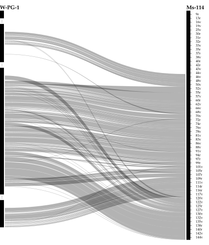

### [IV\[1\]](https://cdn.wittgensteinnachlass.com/2000px/webp/Ms-114/IV.webp)

In the event of my death before the completion or publication of this book, my notes are to be published in fragmentary form under the title:

_“Philosophical Remarks”_

_and with the dedication:_

_“Dedicated to **Francis Skinner**”_

If this remark is read after my death, he is to be informed of my intention, at the address: Trinity College Cambridge.

### [1r\[1\]](https://cdn.wittgensteinnachlass.com/2000px/webp/Ms-114/1r.webp)

## X. Philosophical Grammar.

### [1v\[1\]](https://cdn.wittgensteinnachlass.com/2000px/webp/Ms-114/1v.webp),[2r\[1\]](https://cdn.wittgensteinnachlass.com/2000px/webp/Ms-114/2r.webp),[2v\[1\]](https://cdn.wittgensteinnachlass.com/2000px/webp/Ms-114/2v.webp),[3r\[1\]](https://cdn.wittgensteinnachlass.com/2000px/webp/Ms-114/3r.webp),[3v\[1\]](https://cdn.wittgensteinnachlass.com/2000px/webp/Ms-114/3v.webp),[4r\[1\]](https://cdn.wittgensteinnachlass.com/2000px/webp/Ms-114/4r.webp)

27.05.1932

I can also write the rule R

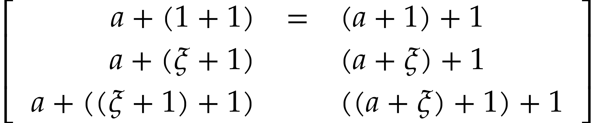

_this way_:

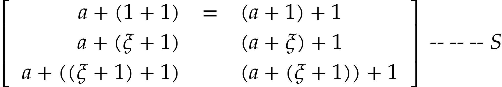

or this way too:

a + (b + 1) = (a + b) + 1, if I take R or S as an explanation of or a substitute for this form. If I now say that in

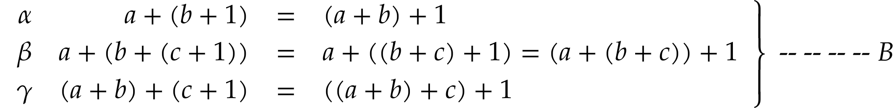

the transitions are justified by the rule R, – one can reply to me: „If you call that a justification, then you have justified the transitions. But you would have told us just as much if you had merely drawn our attention to the rule R & its formal relation to α (or to α, β & γ).” So I could equally have said: I take the rule R in such and such a way as a paradigm for my transitions. Now if, for example, Skolem, after his proof of the associative law, goes on to:

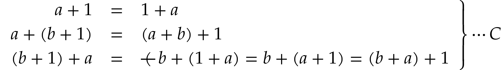

& says that the first & third transitions in the third line are justified in accordance with the associative law that has been proved, – then he tells us no more than if he said that the transitions were made according to the paradigm a + (b + c) = (a + b) + c (i.e. they correspond to the paradigm) and that a schema α, β, γ had been derived with transitions according to the paradigm α. – „But does B justify these transitions or not?” – What do you mean by the word „justify”? – „Well, the transition is justified if a sentence that holds for all numbers really has been proved.” – But in what case would that have happened? What do you call a proof that a sentence holds for all numbers? How do you know whether the sentence (really) holds for all cardinal numbers, since you cannot try it out. After all, your _only_ criterion is the proof. So presumably you _specify_ a form & call it the form of a proof that a sentence holds for all cardinal numbers. Then we really gain nothing at all by first being shown the general form of these proofs; for that does not show that the particular proof really does what we require of it; I mean: it does not establish the particular proof as one that proves a sentence for all cardinal numbers. Rather, the recursive proof must be its own justification. If we really want to justify our proof procedure as the proof of such generality, we do something else instead: we go through examples from a series & these examples & the law we recognize in them now satisfy us & we say: yes, our proof really does what we wanted. But we must now bear in mind that in giving this series of examples we have only translated the notation B & C into another (notation). (For the series of examples is not an incomplete application of the general form, but another expression of this form.) And since word-language, when it explains the proof, explains what it proves, merely translates the proof into another form of expression, we can also leave out this explanation altogether. And if we do, the mathematical relations become much clearer, no longer blurred by the ambiguous expressions of word-language. If, for example, I put B directly beside A, without the word „all” intervening, no false appearance of a proof of A by B can arise. We then see quite plainly how far the relations of B to A & to a + b = b + a extend & where they end. Only then does one come to know the actual structure of this relation and what is involved in it, undistracted by the form of word-language that makes everything look alike. Above all, one sees here that we are interested _in_ the tree of structures B, C, etc., & that the form

φ 1 = ψ 1

φ (n + 1) = F (φ n)

ψ (n + 1) = F (φ n)

is indeed to be seen throughout it, like a particular kind of fork in the branches, – but that these formations occur in different arrangements & combinations with one another, and that they do not _constitute_ elements of construction in the same sense as the paradigms in the proof of a + (b + (c + 1)) = (a + (b + c)) + 1 or (a + b)² = a² + 2ab + b². The purpose of the „recursive proofs” is, after all, to bring the algebraic calculus into connection with the calculus of numbers. And the tree of recursive proofs „justifies” the algebraic calculus only if that is to mean that it brings it into connection with the arithmetical calculus. But not in the sense in which the list of paradigms justifies the algebraic calculus, i.e. the transitions in it. So if one tabulates the paradigms for the transitions, this makes sense where the point is to show that such and such transformations were all carried out with the help only of those – otherwise arbitrarily chosen – forms of transition. But not where the calculation is supposed to justify itself in another sense, where looking at the calculation – quite _apart_ from comparing it with a table of previously fixed standards – must teach us whether to allow it or not. So Skolem need not have promised us a proof of the associative & commutative laws, but could simply have said that he would show us a connection between the paradigms of algebra and the rules of calculation in arithmetic. But isn’t that quibbling over words? Didn’t he reduce the number of paradigms and give us, for instance, one law instead of those two, namely a + (b + 1) = (a + b) + 1? No. If, for example, we prove (a + b)⁴ = etc. (k), we could make use of the previously proved proposition (a + b)² = etc. (𝓁). But in this case the transitions in k that were justified by 𝓁 can also be justified by the rules with which 𝓁 was proved. And 𝓁 then stands to those original rules as a sign introduced by definition stands to the primary signs with whose help it was defined. One can always eliminate the definition & go back to the primary signs. But if we make a transition in C that is justified by B, we cannot then make this transition with a + (b + 1) = (a + b) + 1 alone as well. With what is called proof here, we have not broken a step down into stages, but have done something quite different.

### [4r\[2\]](https://cdn.wittgensteinnachlass.com/2000px/webp/Ms-114/4r.webp),[4v\[1\]](https://cdn.wittgensteinnachlass.com/2000px/webp/Ms-114/4v.webp)

If one were to ask: is negation in mathematics, say in ~(2 + 2 = 5), the same as the negation of non-mathematical sentences? then one would first have to determine what is to count as the characteristic mark of negation as such. After all, the meaning of a sign lies in the rules according to which it is used. Which of these rules make the sign „~” a negation? For it is clear that certain rules concerning „~” are the same in both cases; for example, ~~p = p. One could equally ask: is the negation of a sentence „I see a red patch” the same as that of „the earth moves in an ellipse around the sun”? and the answer would again have to be: How have you defined „negation”, by what class of rules? – that will tell us whether we have „the same negation” in both cases. When logic speaks of negation in general, or operates with it in a calculus, the meaning of the negation sign is determined no further than by the rules of its calculus. We must not forget here that a word does not carry its meaning around with it as something bestowed on it once and for all, so that when we reach for this bottle we are sure of getting the particular liquid, perhaps sulphuric acid, as well.

### [4v\[2\]](https://cdn.wittgensteinnachlass.com/2000px/webp/Ms-114/4v.webp),[5r\[1\]](https://cdn.wittgensteinnachlass.com/2000px/webp/Ms-114/5r.webp),[5v\[1\]](https://cdn.wittgensteinnachlass.com/2000px/webp/Ms-114/5v.webp),[6r\[1\]](https://cdn.wittgensteinnachlass.com/2000px/webp/Ms-114/6r.webp)

Mistaken application of our physical way of speaking to sense-data. „Objects”, i.e. things, bodies in the space of the room & „objects” in the visual field, the shadow of a body on the wall as an object! If one is asked: „does the box still exist when I am not looking at it”, the correct answer is: „I don’t believe anyone will carry it away or destroy it just then”. The linguistic form „I perceive x” originally refers to a phenomenon (as argument) in physical space (I mean here: in „space” in the everyday way of speaking). I cannot therefore apply this form without misgivings to what is called a sense-datum, for instance to a visual after-image. (Compare also what we said about the identifying of bodies & on the other hand patches of colour in the visual field.) I can easily understand what it means to say that I, the subject, stand opposite the table as object; but in what sense do I stand opposite my visual after-image of the table? „I can’t see this pane of glass, but I can feel it”. Can one say: „I can’t _see_ the after-image, but …”?

Compare: „I see the table clearly”;

„I see the after-image clearly”;

„I hear the music clearly”;

„I hear the buzzing in my ears clearly”.

I don’t see the table clearly means something like: I don’t see all the details of the table; – but what does it mean to say: „I don’t see all the details of the after-image”, or: „I don’t hear all the details of the ringing in my ears”?

Could one not very well say „have an after-image” instead of „see an after-image”? For: „_see_” an after-image? as opposed to what? –

„When you hit me on the head, I see circles”. – „Are they exact circles, have you measured them?” (Or: „are they certainly circles, or is your judgement by eye deceiving you?”) – What does it mean when one says: „we can never see an exact circle”? Is that supposed to be an empirical fact or a statement of a logical impossibility? – If the latter, then it means that it makes no sense to speak of seeing an exact circle. Well, that depends on how one wants to use the word. One can certainly say „exact circle” as opposed to a visual image that we would call a very circle-like ellipse. A visual image is an exact circle if it does, as we would say, actually look circular, rather than perhaps only very much like a circle. If, on the other hand, we are speaking of an object of measurement, then once again there are different meanings of the expression „exact circle”, depending on the empirical criterion I specify for the object’s being exactly circular. Now when I say: „no measurement is absolutely exact”, what we are doing here is calling attention to a feature of the grammar of reporting the results of measurements. For otherwise someone might very well answer us: „How do you know that, have you examined all measurements?” – „One can never see an exact circle” may be the _hypothesis_ that more exact measurement of a circular-looking object will always yield the result that the object deviates from the circular form. – The sentence „One cannot distinguish a 100-sided polygon from a circle” makes sense only if one can distinguish the two in _some_ way and wants to say that one cannot distinguish them, say, visually. If no method of distinguishing them were provided for, then it would make no sense to say that these two figures (_to be sure_) look the same but are different „in reality”. And that sentence would then be something like the definition

_100-sided polygon = circle._

If in some sense an exact circle in the visual field is unthinkable, then the sentence „I never see an exact circle in the visual field” must be of the same kind as the sentence: „I never see a high C in the visual field”.

### [6r\[2\]](https://cdn.wittgensteinnachlass.com/2000px/webp/Ms-114/6r.webp),[6v\[1\]](https://cdn.wittgensteinnachlass.com/2000px/webp/Ms-114/6v.webp)

Blurred, unclear, unsharp.

„The lines in this drawing are unsharp”, „my memory of the drawing is unclear, blurred”, „I see the objects at the edge of my visual field as blurred”. – When one speaks of the blurriness of the images at the edge of the visual field, one often has in mind a picture of this visual field such as the one Mach drew. But the blurriness that the edges of a picture on paper can have is of an altogether different nature from that which is ascribed to the edges of the visual field. As different as the paleness of one’s memory of a drawing is from the paleness of a drawing itself. When a memory or a dream was to be represented in a film, the images were given a bluish tint. But dream images and memory-images naturally have no bluish tint – any more than our visual image has washed-out edges; so the bluish projections on the screen are not pictures that present the dreams directly to view, but images in yet another sense. – In ordinary life, when we are looking all the time, do we notice the blurriness at the edges of the visual field? Indeed, what experience does it actually correspond to, since it does not occur in normal seeing! Well, if we keep our head still and observe something that we can only just see by turning our eyes, we see a person, say, but cannot recognize their face; instead, we see it as blurred in a certain way. The experience does not have the slightest similarity to seeing a disc with pictures painted on it, sharply outlined in the centre of the disc and growing more and more blurred towards the edge, fading imperceptibly into a uniform grey, say. We think of a disc like that when we ask, for example: couldn’t one imagine a visual field with a uniform clarity of outlines etc.? There is no experience in the visual field that corresponds to letting one’s gaze glide along a picture that passes from sharply defined figures to increasingly blurred ones.

### [7r\[1\]](https://cdn.wittgensteinnachlass.com/2000px/webp/Ms-114/7r.webp)

The visual straight line touches the visual circle not at one point but along a visual segment. – When I look at the drawing of a circle & a tangent, what is remarkable is not that I may never see a perfect circle & a perfect straight line touching each other; it is interesting only when I do see them, & the tangent then runs together with the circle for a stretch.

### [7r\[2\]](https://cdn.wittgensteinnachlass.com/2000px/webp/Ms-114/7r.webp),[7v\[1\]](https://cdn.wittgensteinnachlass.com/2000px/webp/Ms-114/7v.webp),[8r\[1\]](https://cdn.wittgensteinnachlass.com/2000px/webp/Ms-114/8r.webp),[8v\[1\]](https://cdn.wittgensteinnachlass.com/2000px/webp/Ms-114/8v.webp),[9r\[1\]](https://cdn.wittgensteinnachlass.com/2000px/webp/Ms-114/9r.webp)

30.05.1932

Let us imagine the following psychological experiment: we show the subject two lines g1, g2, with the straight line a drawn across them.

I shall call the part of this straight line lying between g1 & g2 the segment a. We now draw b at an arbitrary distance from a & parallel to it, and ask whether he sees the segment b as longer than a or can no longer distinguish the two lengths. He replies that b appears longer than a. We then move closer to a by bisecting the distance from a to b with our measuring instruments and drawing c. „Do you see c as longer than a?” – „Yes”. We bisect the distance c–a & draw d. „Do you see d as longer than a?” – „Yes”. We bisect a–d. „Do you see e as longer than a?” – „No”. So we bisect e–d. „Do you see f as longer than e?” – „Yes”. So we bisect e–f & draw h. We could also approach the segment a in this way from the left, & then say that in Euclidean space there corresponds to a seen length a not one length but an interval of lengths, and likewise that what corresponds to a seen position of a line (say, the pointer of an instrument) is an interval of positions in Euclidean space; but this interval does not have sharp boundaries. That is: it is bounded not by points but by converging intervals that do not converge to a point. (Like the series of binary fractions that we generate by tossing a coin for heads & tails.) What is characteristic of two intervals bounded in this way, not by points but _fuzzily_, is that in certain cases the answer to the question whether they overlap or lie apart is „undecided”. And that the question whether they touch, whether they have an endpoint in common, is always senseless, since they have no endpoints. But one could say: they have _provisional_ endpoints. In the sense in which the expansion of π has a provisional end. There is of course nothing mysterious about this property of the ‚fuzzy’ interval; what is _somewhat_ paradoxical is cleared up by the two uses of the word „interval”. This is the same case as that of the two uses of the word „chess”, when it means, on the one hand, the totality of the rules of chess now in force, and on the other: the game that N.N. invented in Persia and that developed in such-and-such a way. In one case it is nonsensical to speak of a change in the rules of chess, in the other it is not. We can call either what comes out of a particular measurement I carry out at 5 o’clock today the „length of a measured segment” – in which case there is no „ ± etc.” for this specification of length –, or something that measurements approach, etc.; in the two cases the word „length” is used with a quite different grammar. And likewise the word „interval” when I call something complete an interval in one case, and something developing an interval in the other.

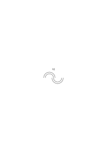

I The intervals lie apart

II they lie apart & touch provisionally

III undecided

IV undecided

V undecided

VI they overlap

VII they overlap

But we cannot be surprised that an interval should now have such strange properties; for we are now using the word „interval” in an unusual sense. And we cannot say that we have discovered new properties of certain intervals. Any more than we would discover new properties of the chess king if we changed the rules of the game but kept the designations „chess” & „king”. (Contrast Brouwer, on the law of excluded middle.) So that experiment essentially yields what we called a „fuzzy” interval; but of course other experiments would be possible that yield a sharp interval instead. Imagine, for instance, moving a ruler from the initial position b, keeping it parallel to that position, towards a until some definite reaction occurred in our subject: then we could call the point at which the reaction begins the boundary of our strip. – In this way we could of course also call the result of a weighing „the weight of a body”, and in this sense there would then be an absolutely exact weighing, i.e. one whose result does not have the form „G ± g”. We have thereby changed our way of expressing ourselves and must now say that the weight of the body fluctuates, and does so according to a law unknown to us. (The distinction between „absolutely exact” weighing and „essentially inexact” weighing is grammatical and relates to two different meanings of the expression „result of the weighing”.)

### [9r\[2\]](https://cdn.wittgensteinnachlass.com/2000px/webp/Ms-114/9r.webp)

The indeterminacy of the word „heap”. I could define it as follows: a body of a certain shape and consistency, etc., is a heap if its volume is K m ³ or more; anything below that I shall call a little heap. Then there is no largest little heap; that is: it is then senseless to speak of the „largest little heap”. Conversely, I could stipulate that anything larger than K m ³ is to count as a heap, and then the expression „the smallest heap” would have no meaning. But isn’t this distinction idle? Certainly, – if by volume we understand the result of a measurement in the ordinary sense; for this result has the form „V ± v”. Otherwise, though, the distinction might be as useful as the one between five dozen apples and 61 apples.

### [9r\[3\]](https://cdn.wittgensteinnachlass.com/2000px/webp/Ms-114/9r.webp),[9v\[1\]](https://cdn.wittgensteinnachlass.com/2000px/webp/Ms-114/9v.webp)

The blurriness, the indeterminacy of our sense impressions is not something that can be remedied, a blurriness to which complete sharpness also corresponds (or is opposed). Rather, this general indeterminacy, elusiveness, this floating of sense impressions, is what has been designated by the words „everything flows”. We say „one never sees an exact circle” and want to say that even if we see no deviation from circular form, we are not thereby given an exact circle. (It is as if we wanted to say: we can never guide this tool exactly, for we are holding only the handle & the tool sits loose in it.) But what then do we understand by the _concept_ ‚exact circle’? How did we arrive at this concept in the first place? Well, we think, e.g., of a precisely measured circular disc made of a very hard steel. Aha – so that is what we are aiming at with the concept ‚exact circle’. Of course, we find nothing of that in the visual image. We have simply chosen the form of representation that calls the steel disc more exact than the wooden disc and the wooden disc more exact than the paper disc. We have determined the concept „exact” by means of a series, & speak of sense impressions as pictures, inexact pictures, of physical objects.

### [9v\[2\]](https://cdn.wittgensteinnachlass.com/2000px/webp/Ms-114/9v.webp),[10r\[1\]](https://cdn.wittgensteinnachlass.com/2000px/webp/Ms-114/10r.webp)

Galton’s photograph, the image of a probability. The law of probability, the law of nature, what one sees when one squints.

### [10r\[2\]](https://cdn.wittgensteinnachlass.com/2000px/webp/Ms-114/10r.webp)

In the theories & disputes of philosophy we find words whose meanings are well known to us from everyday life applied in an ultraphysical sense.

### [10r\[3\]](https://cdn.wittgensteinnachlass.com/2000px/webp/Ms-114/10r.webp)

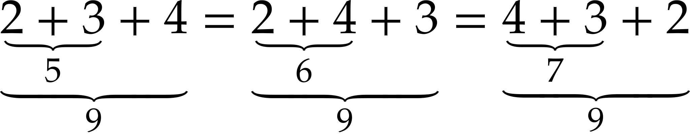

“You see, it really does always come out the same”, one would like to say. Taken in this way, the calculation was an experiment. We applied the rules of the addition table, and one cannot tell just by looking at them that they yield the same result in the three cases. One is, as it were, surprised that the digits work so correctly once detached from their definitions. Or rather: that the rules for the digits work so correctly when they are not controlled by the definitions. – Let us think of the step one has to take from the rule one has learnt for the addition table to the application of the rule in the particular case. –

### [10r\[4\]](https://cdn.wittgensteinnachlass.com/2000px/webp/Ms-114/10r.webp)

Could an engineer’s calculations show that the strength of a machine part would have to progress through the series of prime numbers as the load increases uniformly?

### [10r\[5\]](https://cdn.wittgensteinnachlass.com/2000px/webp/Ms-114/10r.webp),[10v\[1\]](https://cdn.wittgensteinnachlass.com/2000px/webp/Ms-114/10v.webp),[11r\[1\]](https://cdn.wittgensteinnachlass.com/2000px/webp/Ms-114/11r.webp)

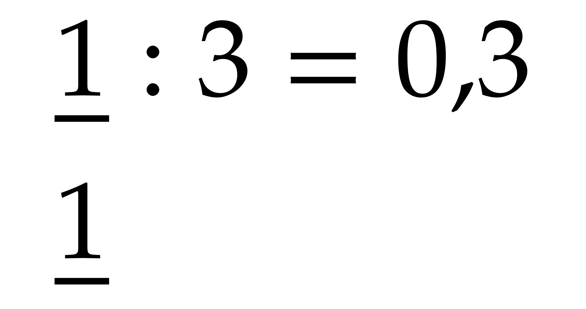

by its periodicity decides nothing that had previously been left open. If, before the discovery of the periodicity, someone had looked in vain for a 4 in the expansion of 1 : 3, he still could not have asked the question „is there a 4 in the expansion of 1 : 3” with any sense; i.e., _apart from the fact_ that he had not actually come upon a 4, we can convince him that he has no method for deciding his question. Or we might also say: apart from the result of his activity, we could enlighten him about the grammar of his question & the nature of his search (as we might enlighten a present-day mathematician about analogous problems.) „But surely he does stop looking for a 4 as a result of discovering the periodicity! So it convinces him that he will never find one.” – No. The discovery of the periodicity makes him give up the search _if_ he now changes his outlook. One could ask him: „Well, do you still want to look for a 4?” (Or has the periodicity, so to speak, given you other ideas.) And the discovery of the periodicity is in reality the construction of a new sign & calculus. For it is misleading to say that it consists in our being _struck_ by the fact that the first remainder is equal to the dividend. For if someone unfamiliar with periodic division had been asked, is the first remainder in this division equal to the dividend, he would of course have said „yes”; so he would have been struck by it. But he need not thereby have been struck by the periodicity; i.e.: he would not thereby have found the calculus with signs of the form 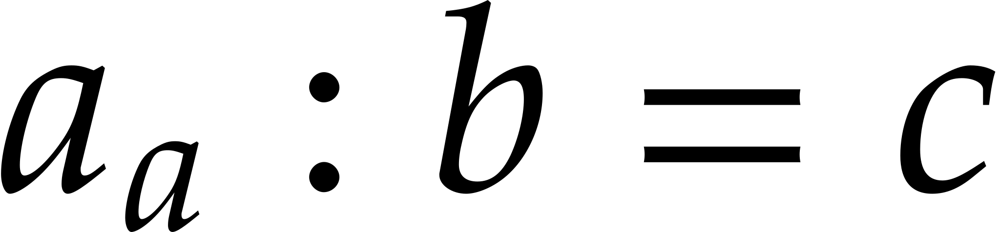.

Isn’t what I am saying here always the same as what Kant meant when he said that 5 + 7 = 12 was not analytic but synthetic a priori?

### [11r\[2\]](https://cdn.wittgensteinnachlass.com/2000px/webp/Ms-114/11r.webp)

The proposition that a class is not similar to one of its subclasses is not true of finite classes, but is a tautology. The grammatical rules governing the generality of the general implication in the sentence „k is a subclass of K” contain what the sentence saying that K is an infinite class says.

### [11r\[3\]](https://cdn.wittgensteinnachlass.com/2000px/webp/Ms-114/11r.webp),[11v\[1\]](https://cdn.wittgensteinnachlass.com/2000px/webp/Ms-114/11v.webp),[12r\[1\]](https://cdn.wittgensteinnachlass.com/2000px/webp/Ms-114/12r.webp)

Inadequacy of Fregean and Russellian notation for generality. It makes sense to say „write down any cardinal number”, but it is nonsense to say: „write down all cardinal numbers”. „There is a circle in the quadrilateral” ((∃x) ∙ φx) makes sense, but not ~ (∃x) ~φx: „there are all circles in the quadrilateral”.

„There is a red circle on a background of a different colour” makes sense, but not „there is no background colour other than red on which there is no red circle”. „There is a black circle in this quadrilateral”: If this sentence has the form „(∃x) ∙ x is a black circle in the quadrilateral”, what is such a thing x that has the property of being a black circle (and so can also have the property of _not_ being a black circle)? Is it perhaps a place in the square? But then there is no sentence „(x) ∙ x is a black …”. On the other hand, that sentence might mean „there is a spot in the square that is a black circle”. How does one verify this sentence? Well, one goes through the different spots in the square and examines them to see whether they are quite black and circular. But what kind of sentence is „There is no spot in the square”? For if the ‘x’ in ‘(∃x)’ meant ‘spot in the square’ in the previous case, then there can indeed be a sentence „(∃x) ∙ φx”, but no „(∃x)” or „~(∃x)”. Or I could ask again: What sort of thing is it that has (or does not have) the property of being a spot in the square? And if one can say „a spot is in the square”, does it thereby also make sense to say „all spots are in the square”? Which _all_?

### [12r\[2\]](https://cdn.wittgensteinnachlass.com/2000px/webp/Ms-114/12r.webp),[12v\[1\]](https://cdn.wittgensteinnachlass.com/2000px/webp/Ms-114/12v.webp)

01.06.1932

What does it mean to say: „the points yielded by the experiment lie on average on a straight line”? or: „when I throw a good die, I throw a 1 on average once every 6 throws”? Is this sentence compatible with _every_ experience I might have? If it is, it says nothing. Have I specified (_beforehand_) what experience it is no longer compatible with, where the limit lies beyond which exceptions to the rule overturn the rule? No. But could I not have set such a limit? Certainly. – Suppose the limit were drawn like this: If 4 of 6 consecutive throws come up the same, the die is bad. But now one asks: „But if that happens seldom enough, isn’t it good after all?” – The answer is: If I allow 4 throws of the same number among 6 consecutive throws for a specified number of throws, then I am drawing a _different_ limit from the first one. But if I say „any number of consecutive throws of the same number is permissible, provided it occurs seldom enough”, then I have, strictly speaking, characterized the goodness of the die _as_ independent of the results of the throws. Unless by the goodness of the die I mean not a property of the die, but a property of a particular game played with it. For then I can indeed say: I call the die good in a game if among the N throws of the game there are no more than log N consecutive throws of the same number. But what this would give us is not a test for checking dice, but a criterion for judging one game.

### [12v\[2\]](https://cdn.wittgensteinnachlass.com/2000px/webp/Ms-114/12v.webp),[13r\[1\]](https://cdn.wittgensteinnachlass.com/2000px/webp/Ms-114/13r.webp)

One says that if the die is perfectly regular and left to itself, then the distribution of the digits 1, 2, 3, 4, 5, 6 among the results of the throws must be uniform, because _there is no reason_ why one digit should occur more often than another. But what about the values of the function (x ‒ 3)²?

But now let us represent the results of the throws not by the digits 1 to 6 but by the values of the function (x ‒ 3)² for the arguments 1 to 6, that is, by the digits 0, 1, 4, 9. Is there any reason why one of _these_ digits should figure more often among the new results than another? This teaches us that the a priori law of probability is a form of laws, like that of the minimum laws of mechanics, etc. If one had found by experiment that the distribution of the throws 1 – 6 with a regular die turned out in such a way that the distribution of the values (x ‒ 3)² was uniform, one would then have declared _this_ uniformity to be the a priori uniformity. We do the same in the kinetic theory of gases: we represent the distribution of molecular motions in the form of some uniform distribution or other; but we choose _what_ is uniformly distributed – just as elsewhere we choose _what_ is to become a minimum – so that our theory agrees with experience.

### [13r\[2\]](https://cdn.wittgensteinnachlass.com/2000px/webp/Ms-114/13r.webp),[13v\[1\]](https://cdn.wittgensteinnachlass.com/2000px/webp/Ms-114/13v.webp)

„The molecules move solely according to the laws of probability” is supposed to mean: physics leaves the stage, & the molecules now move, as it were, solely according to laws of logic. This opinion is akin to the opinion that the law of inertia is an a priori proposition; and here too one speaks of what a body does when it is left to itself. What is the criterion for its being left to itself? Is it, in the end, that it moves uniformly in a straight line? Or is it something else? If the latter, then whether the law of inertia holds is a matter of experience; in the former case, though, it was no law at all, but a definition. And something analogous holds for a sentence: „if the particles are left to themselves, then the distribution of their motions is such and such”. What is the criterion for their being left to themselves? etc.

### [13v\[2\]](https://cdn.wittgensteinnachlass.com/2000px/webp/Ms-114/13v.webp),[14r\[1\]](https://cdn.wittgensteinnachlass.com/2000px/webp/Ms-114/14r.webp)

[If measurement shows that the die is exact & homogeneous, – I assume that the digits on its faces do not affect the results of the throws – and the hand that throws it moves without rules – does it follow that the throws 1 to 6 are on average uniformly distributed? What would one infer this from? No assumption has been made about the motion in throwing, and the premise of the die’s exactness is surely of quite a different multiplicity from an on average uniform distribution of results. The premise is, as it were, of one colour, the conclusion speckled. Why did one say that the donkey would starve between the two equal bundles of hay, and not that it would, on average, eat from one as often as from the other?]

### [14r\[2\]](https://cdn.wittgensteinnachlass.com/2000px/webp/Ms-114/14r.webp)

Behaviourism. „It seems to me that I am sad, I am letting my head hang like this”.

Why does one feel no pity when a door has not been oiled and squeaks as it opens and shuts? Do we feel pity for the other person who behaves as we do when we have pains – on the strength of philosophical considerations that have led to the conclusion that he is suffering as we do? Physicists might just as well frighten us by assuring us that the floor is not solid at all, despite appearances, but consists of loose particles whizzing about without rules. „But we wouldn’t feel pity for the other person if we knew he was only a puppet or was merely pretending to be in pain.” Of course– but we also have quite definite criteria for something’s being a puppet or for someone’s pretending to be in pain, and these criteria stand in contrast to what we call criteria for something’s not being a puppet (but, say, a person) and for someone’s not pretending to be in pain (but really being in pain).

### [14r\[3\]](https://cdn.wittgensteinnachlass.com/2000px/webp/Ms-114/14r.webp),[14v\[1\]](https://cdn.wittgensteinnachlass.com/2000px/webp/Ms-114/14v.webp)

Investigating the rules for the use of our language, recognizing these rules and giving a surveyable representation of them amounts to – i.e., achieves the same thing as – what one often wants to achieve by constructing a phenomenological language. Each time we recognize that such-and-such a way of representing can also be replaced by another, we take a step towards this goal.

### [14v\[2\]](https://cdn.wittgensteinnachlass.com/2000px/webp/Ms-114/14v.webp)

How does it come about that philosophy is such a complicated structure. Surely it should be completely simple, if it is that ultimate thing, independent of all experience, which you make it out to be. – Philosophy untangles knots that we have made in our thinking; therefore, its result must be simple, but its activity as complicated as the knots that it untangles.

### [14v\[3\]](https://cdn.wittgensteinnachlass.com/2000px/webp/Ms-114/14v.webp),[15r\[1\]](https://cdn.wittgensteinnachlass.com/2000px/webp/Ms-114/15r.webp)

Does it make sense to say that two people have the same body? What experiences would we be describing with this sentence? It is of course conceivable that I should discover that what I call my hand and what I move is attached to someone else’s body, for as I write now I cannot see the connection between my hand and the rest of my body, and I might well discover that the former connection has come apart, and hence that my hand is now attached to someone else’s arm. Suppose my friend and I are sitting side by side without looking at each other, and I am writing without seeing my right arm. Suddenly I look round and notice that my hand is attached to his arm. I draw his attention to it, and he says: „I was just writing with this very hand, though I wasn’t looking at it, and I didn’t know that it now looks like yours and that you have a feeling in it”.

### [15r\[2\]](https://cdn.wittgensteinnachlass.com/2000px/webp/Ms-114/15r.webp),[15v\[1\]](https://cdn.wittgensteinnachlass.com/2000px/webp/Ms-114/15v.webp)

Geometry is not the science (natural science) of geometrical planes, geometrical straight lines & geometrical points, as opposed, say, to another science that deals with coarse, physical straight lines, strokes, surfaces, etc., and specifies _their_ properties. The connection between geometry and sentences of practical life that deal with strokes, colour boundaries, edges, corners, etc. is not that it speaks about things similar to those these sentences speak about, albeit about _ideal_ edges, corners, etc., but rather the connection between these sentences & their grammar. Applied geometry is the grammar of statements about spatial objects. The so-called geometrical straight line stands to a colour boundary not as something fine to something coarse, but as possibility to reality. (Think of the conception of possibility as the shadow of reality.)

### [15v\[2\]](https://cdn.wittgensteinnachlass.com/2000px/webp/Ms-114/15v.webp)

The name I give to a body, a surface, a place, a colour, has a different grammar in each case. The name „a” in „a is yellow” has a different grammar depending on whether a is the name of a body or of a surface of a body; whether a sentence „this body is yellow” says that the surface of the body is yellow or that the body is yellow through & through. „I point to a” has a different grammar depending on whether a is a body, a surface, a colour, etc. And so the demonstrative pronoun „this” also has a different meaning (i.e. grammar) when it refers to nouns with different grammars.

### [15v\[3\]](https://cdn.wittgensteinnachlass.com/2000px/webp/Ms-114/15v.webp),[16r\[1\]](https://cdn.wittgensteinnachlass.com/2000px/webp/Ms-114/16r.webp)

To say that the points that this experiment provides are, on average, located on this line, e.g., a straight line, says something similar to: „seen from this distance, they appear to be on a straight line”.

Expression of a face under _these_ circumstances. I can say of a line that the general impression is that of a straight line; but not of the line a 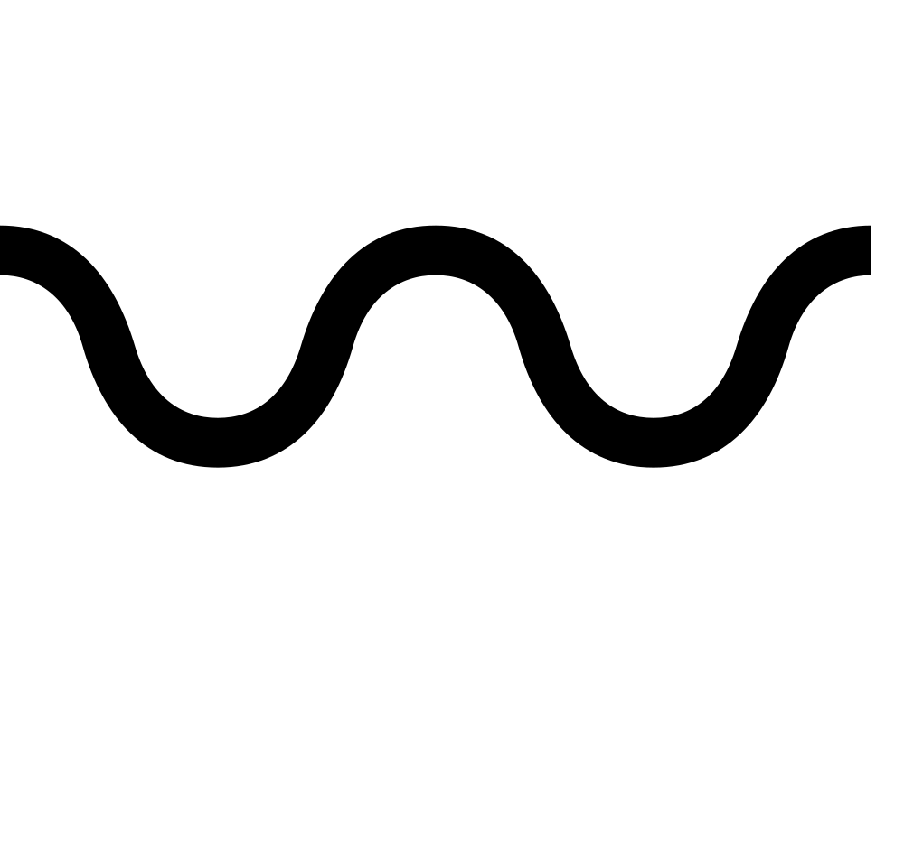; although it would be possible to see it as a part of a longer line in which the deviations of part a from the straight line would be lost. I cannot say of a: „the line looks straight, because it can be the part of a line that gives me the impression of being straight as a whole.” (Mountains on the earth & on the moon. Earth a sphere.)

### [16r\[2\]](https://cdn.wittgensteinnachlass.com/2000px/webp/Ms-114/16r.webp),[16v\[1\]](https://cdn.wittgensteinnachlass.com/2000px/webp/Ms-114/16v.webp)

Of sense-data in that sense of the word in which it is inconceivable that the other person has them, one cannot, for that very reason, say that the other person does not have them either. And that is precisely why it is also senseless to say that _I_, as opposed to the other person, _have_ them. – When one says „I cannot feel his toothache”, does one mean that one has never yet felt the other person’s toothache? How does _his_ toothache differ from _mine_? If the word „toothache” has the same meaning in the sentences „I have toothache” & „he has toothache”, what does it mean, then, to say that he cannot have the same toothache as I have? How can different toothaches differ from one another? In intensity, in the character of the pain (stabbing, boring, etc.) & in their location in the jaw. But what if these characteristics are the same in both cases? – But if one objects that the difference is precisely that in one case I have them, in the other he does! – then the person who owns them is a characteristic of the toothaches themselves. But what, then, is stated by the sentence „I have toothache” or „he has toothache”? – If the word „toothache” has the same meaning in both cases, then one must be able to compare the toothaches of the two people; & if they agree in intensity etc. etc., then they are the same; just as two suits have the _same_ colour if they agree with one another in brightness, saturation, etc. When one asks „is it conceivable that one person feels another’s toothache?” the other person’s toothache floats before one, as it were, as a body, a volume, in the other person’s mouth, & the question seems to ask whether we can share in this volume of pain. Perhaps by our cheeks interpenetrating. But then even that seems not to be enough & we would have to coincide with him entirely.

### [16v\[2\]](https://cdn.wittgensteinnachlass.com/2000px/webp/Ms-114/16v.webp),[17r\[1\]](https://cdn.wittgensteinnachlass.com/2000px/webp/Ms-114/17r.webp)

The experiment of throwing dice lasts a certain time, & our expectations about the future results of throwing can be based only on tendencies we perceive in the results of the experiment. That is, the experiment can only give grounds for expecting that it will go on in the _way_ the experiment has shown (it to go). But we cannot expect that the experiment, if continued, will now yield results that agree more closely with a preconceived opinion about its course than the results of the experiment actually carried out. So if, e.g., I toss heads & tails and find in the results of the experiment no tendency for the numbers of heads & tails to come still closer to each other, the experiment gives me no grounds for assuming that continuing it will show such a convergence. Indeed, the expectation of this convergence must itself refer to a particular time, for one cannot say that one expects an event to occur _sometime_ – in the infinite future.

### [17r\[2\]](https://cdn.wittgensteinnachlass.com/2000px/webp/Ms-114/17r.webp),[17v\[1\]](https://cdn.wittgensteinnachlass.com/2000px/webp/Ms-114/17v.webp)

03.06.1932

A thought about the possibility of representing immediate reality in language:

„The stream of life, or the stream of the world, flows on, & our sentences are, so to speak, verified only at instants.” Our sentences are verified only by the present. – So they must be made in such a way that they can be verified by it. They must have what it takes to be verified by it. So they are in some way commensurable with the present, & this commensurability cannot be theirs _despite_ their spatio-temporal nature; rather, that nature must stand to their commensurability as the corporeality of a yardstick stands to the extension with which it measures. In the case of the yardstick, too, one cannot say: ‚Yes, the yardstick measures length despite its corporeality; of course, a yardstick that had nothing but length would be the ideal, would be the _pure_ yardstick’. No, if a body has length, then there can be no length without a body – & even if I understand that in a certain sense only the length of the yardstick measures, what I put in my pocket is still the yardstick – the body & not the length.

### [17v\[2\]](https://cdn.wittgensteinnachlass.com/2000px/webp/Ms-114/17v.webp),[18r\[1\]](https://cdn.wittgensteinnachlass.com/2000px/webp/Ms-114/18r.webp)

I agree with the views of more recent physicists when they say that the signs in their equations no longer have „meanings”, & that physics cannot arrive at any such meanings but must stop at the signs: what they fail to see, that is, is that these signs have meaning insofar – and only insofar – as the observed phenomenon corresponds to them, however indirectly, or does not correspond to them.

### [18r\[2\]](https://cdn.wittgensteinnachlass.com/2000px/webp/Ms-114/18r.webp)

Representation of a line as a straight line with deviations. The equation of the line contains a parameter whose variation expresses the deviations from the straight line. It is not essential that these deviations be „slight”. They can be so great that the line does not look like a straight line. The „straight line with deviations” is only a form of description. It makes it easier for me to leave out, to disregard, a certain part of the description if I want to. (The form „rule with exceptions”.)

### [18r\[3\]](https://cdn.wittgensteinnachlass.com/2000px/webp/Ms-114/18r.webp),[18r\[4\]](https://cdn.wittgensteinnachlass.com/2000px/webp/Ms-114/18r.webp)

All „grounded expectation” is expectation that a rule observed up to now will continue to hold.

(The rule must have been observed and cannot itself in turn be merely expected.)

### [18r\[5\]](https://cdn.wittgensteinnachlass.com/2000px/webp/Ms-114/18r.webp)

The logic of probability has to do with the state of expectation only to the extent that logic in general has to do with thinking.

### [18v\[1\]](https://cdn.wittgensteinnachlass.com/2000px/webp/Ms-114/18v.webp),[19r\[1\]](https://cdn.wittgensteinnachlass.com/2000px/webp/Ms-114/19r.webp)

A ray of light is emitted from the light source Q; it strikes the disc AB, produces a spot of light there, & then strikes the disc AC. Now we have no grounds for assuming that the spot of light on AB will lie to the right of the centre M, nor for assuming the opposite; but we have no grounds either for assuming that the spot of light on AC will lie on this side rather than that side of the centre m. So this gives contradictory probabilities.

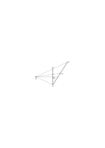

Now if I make an assumption about the degree of probability that the one spot of light lies in the segment AM, how is this assumption verified? We do think, by an experiment to determine frequencies. Now suppose this confirms the view that the probabilities for the segments AM & BM are equal (and thus different for Am & Cm), then that view is thereby recognized as correct and thus proves to be a physical hypothesis. The geometrical construction shows only that the equality of the segments AM & BM was _no_ ground for assuming equal probability.

### [19r\[2\]](https://cdn.wittgensteinnachlass.com/2000px/webp/Ms-114/19r.webp)

What does it mean to _believe_ Goldbach’s sentence? What does this belief consist of? In a feeling of certainty when we state the sentence, or hear it? That does not interest us. I also do not know how much this feeling may be caused by the sentence itself. How does belief intervene in this sentence? Let us look at what consequences it has, what it leads us to. „It leads me to search for a proof of this sentence”. – Good, now let us also look at what your searching actually consists of; then we will know where things stand with your belief in the sentence.

### [19r\[3\]](https://cdn.wittgensteinnachlass.com/2000px/webp/Ms-114/19r.webp),[19v\[1\]](https://cdn.wittgensteinnachlass.com/2000px/webp/Ms-114/19v.webp)

„The Cretan Liar”. Instead of saying „I am lying”, he could also write down „this sentence is false”. The answer to that would be: „Yes, but which sentence do you mean?” – „Well, _this_ sentence.” – „I understand, but of which sentence is _it_ speaking?” – „Of _this_.” – „Good, & to which sentence does _this_ allude?” etc. He could not explain to us in this way what he means until he passes over to a complete sentence. – One can also say: the fundamental mistake lies in the fact that one _thinks_ that a word, e.g. „this sentence”, can, as it were, allude to its object (point to it from a distance) without having to stand for it.

### [19v\[2\]](https://cdn.wittgensteinnachlass.com/2000px/webp/Ms-114/19v.webp)

(A proposition that deals with all propositions or all functions. What does one imagine this to be? It would presumably be a proposition of logic. Now think of how the proposition 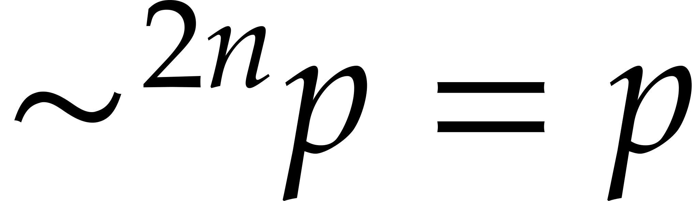 is proved.)

### [19v\[3\]](https://cdn.wittgensteinnachlass.com/2000px/webp/Ms-114/19v.webp),[20r\[1\]](https://cdn.wittgensteinnachlass.com/2000px/webp/Ms-114/20r.webp),[20v\[1\]](https://cdn.wittgensteinnachlass.com/2000px/webp/Ms-114/20v.webp)

If I assume that measurement shows the die to be true & homogeneous, that the numerals on its faces do not affect the results of the throws, & that the hand throwing it moves without any definite rule, does it follow that throws of 1 to 6 are distributed uniformly on average among the results? – What is that supposed to follow from? The fact that the die is true & homogeneous surely cannot account for a distribution of results that is _uniform on average_. (The assumption is homogeneous, so to speak; the conclusion would be speckled. And we have made no assumption about the movement in throwing. With the equality of the two bundles of hay one has _indeed_ used grounds for concluding that the donkey between them would starve, but not for concluding that it would eat from each about equally often.) – Our assumptions are also perfectly compatible with throwing 100 ones in succession with the die, if friction, movement of the hand and air resistance happen to combine in that way. The experience that this never happens is experience concerning these factors. And the conjecture that the results of the throws are evenly distributed is a conjecture about how these factors operate. If one says that a lever with equal arms on which symmetrical forces act must remain at rest because there is no cause for it to tilt to one side rather than the other, this means only that if we have established that the lever arms are equal & the forces symmetrical, and the lever then tilts to one side, we cannot explain this from the premises we know – or have assumed. (The form we call „explanation” must also be asymmetrical, like the operation that turns „a & b” into „2a & 3 b”.) But we can explain from our premises why the lever remains at rest. – But can we also explain an oscillation directed from the centre to the right and to the left equally often on average? Not the oscillation, for there again we have asymmetry. Only the symmetry in this asymmetry. Had the lever turned uniformly to the right, one could say analogously: I can explain the uniformity of the movement by the symmetry of the conditions, but not its direction. A non-uniform distribution of the results of the throws can _not_ be explained by the symmetry of the die. And only to that extent does this symmetry explain the uniformity of the distribution. – For one can of course say: if the numerals on the faces of the die have no effect, then their differences cannot explain a non-uniform distribution; and identical circumstances cannot of course explain differences; so to that extent one might infer uniformity. But where, then, do the different results come from at all? Certainly, whatever explains these must also explain their uniformity on average. The regularity of the die simply does not interfere with this uniformity.

### [20v\[2\]](https://cdn.wittgensteinnachlass.com/2000px/webp/Ms-114/20v.webp),[21r\[1\]](https://cdn.wittgensteinnachlass.com/2000px/webp/Ms-114/21r.webp)

Suppose someone who plays dice every day were to throw nothing but ones for a week or so, using dice that prove sound under every other kind of examination and that also give the usual results when someone else throws them. Does he now have grounds for assuming a law of nature here according to which he always throws ones; does he have grounds for believing it will go on like this now, or rather grounds for assuming that this regularity cannot go on much longer? Has he grounds, then, for giving up the game, since it has turned out that he can only throw ones; or for going on playing, since it is now all the more likely that he will throw a higher number next time? – In reality he will refuse to recognize the regularity as a law of nature; at the very least it will have to go on for a long time before he considers this view. But why? – I think because so much of his previous experience in life tells against such a law, and all of it has, so to speak – to be overcome before we adopt an entirely new way of looking at things.

### [21r\[2\]](https://cdn.wittgensteinnachlass.com/2000px/webp/Ms-114/21r.webp)

If we draw conclusions from the relative frequency of an event about its relative frequency in the future, we can of course do so only on the basis of the frequency actually observed so far. And not on the basis of one we have obtained from the observed frequency by some procedure of the calculus of probability. For the calculated probability agrees with _any_ frequency actually observed, since it leaves the time open.

### [21r\[3\]](https://cdn.wittgensteinnachlass.com/2000px/webp/Ms-114/21r.webp)

When the gambler or the insurance company goes by probability, they do not go by the calculus of probability, for one cannot go by that alone, since _whatever_ happens can be brought into agreement with it; rather, the insurance company goes by an actually observed frequency. And this is of course an absolute frequency.

### [21r\[4\]](https://cdn.wittgensteinnachlass.com/2000px/webp/Ms-114/21r.webp)

Language cannot express what belongs to the essence of the world. So it cannot _say_ that everything flows. Language can say only what we could also imagine otherwise.

### [21r\[5\]](https://cdn.wittgensteinnachlass.com/2000px/webp/Ms-114/21r.webp),[21v\[1\]](https://cdn.wittgensteinnachlass.com/2000px/webp/Ms-114/21v.webp)

That everything flows must lie in the nature of the application of language to reality. Or better: that everything flows must lie in the nature of language. And let us remember: in ordinary life this does not strike us – any more than the blurred edges of our visual field do („because we are so used to it”, some will say). How, on what occasion, do we think we become aware of it, then? Isn’t it when we want to form sentences that go against the grammar of time?

### [21v\[2\]](https://cdn.wittgensteinnachlass.com/2000px/webp/Ms-114/21v.webp),[22r\[1\]](https://cdn.wittgensteinnachlass.com/2000px/webp/Ms-114/22r.webp),[22v\[1\]](https://cdn.wittgensteinnachlass.com/2000px/webp/Ms-114/22v.webp)

04.06.1932

„Only the experience of the present instant has reality”. – Is that supposed to mean that I did not get up this morning? Or that an event I do not remember at this instant did not take place? – Is ‘present experience’ here supposed to stand in contrast to future & past experience? Or is it an epithet, like the word „rational” in „rational number”, so that one could also replace the two words with _one_ and so that the epithet points to a grammatical peculiarity. And what in that case is said of the subject when reality is ascribed to it? Are we not once again emphasizing a grammatical peculiarity here, in the same way as when one says „only the cardinal numbers are real numbers”. (Kronecker is said to have said that only the cardinal numbers were created by God, all the others being the work of man.) – If ‘present experience’ is used in contrast to future & past experience, then by these experiences one means, say, physical events; and if I use the picture of the magic lantern and translate the temporal relations into spatial ones, then present experience in the physical sense is the picture on the film strip that is in front of the lantern’s lens (I cannot say: „that is _now_ in front of the lantern’s lens”.) On one side of this picture are the past pictures, on the other the future ones (the two sides are characterized by peculiarities of the apparatus). The picture on the screen does not belong to the time of the film strip; it cannot be said to be present in the sense just described. (In contrast to what? – The word ‘present’, when one uses it here, does not designate one part of a space as opposed to others, but characterizes a space.) The sentence that only present experience has reality would now, in this simile, be the sentence that only the picture in front of the lens corresponds to the picture on the screen. And that might indeed be an empirical proposition, and the simile fails us here unless we stipulate the correspondence between film and screen (the mode of projection) in such a way that the picture on the film corresponding to the picture on the screen turns out to be the picture in front of the lantern’s lens.

### [22v\[2\]](https://cdn.wittgensteinnachlass.com/2000px/webp/Ms-114/22v.webp),[23r\[1\]](https://cdn.wittgensteinnachlass.com/2000px/webp/Ms-114/23r.webp)

Someone who wants to dispute the proposition that only present experience is real (which is just as wrong as asserting it) might ask whether a sentence like „Julius Caesar crossed the Alps” describes only the present state of mind of the person concerned with the matter. And the answer is of course: No! It describes an event that, we believe, took place about 2,000 years ago. That is, if the word „describes” is understood as it is in the sentence „the sentence ‚I am writing’ describes what I am doing at present”. The name Julius Caesar designates a person. – But what does all that tell us? I seem to be trying to dodge the real philosophical answer! – But sentences that are about people, i.e. that contain people’s names, can be verified in very different ways. – Let us just ask ourselves why we believe that sentence. – That it is conceivable, for example, that Caesar’s body might yet be found is directly connected with the sense of the sentence about Julius Caesar. But so is the fact that it is possible that a document might be found showing that no such man ever lived and that his existence was made up for certain purposes. These possibilities do not exist for a sentence such as „I see a red patch moving across a green one”; and that is what we mean when we say that this sentence has sense in a more immediate way than the one about Julius Caesar.

### [23r\[2\]](https://cdn.wittgensteinnachlass.com/2000px/webp/Ms-114/23r.webp),[23v\[1\]](https://cdn.wittgensteinnachlass.com/2000px/webp/Ms-114/23v.webp)

05.06.1932

1\) “I have pains” “N has pains”

whereas 2) “I have grey hair” “N has grey hair”

The various philosophical difficulties & confusions connected with the first example can _for the most part_ be _traced_ to confusing the grammar of cases 1 & 2. It makes sense to say: “I see his hair, but not my own” or “I see my hands every day, but not his” & this sentence is analogous to: “I see my children every day, but not his.” – By contrast, it is nonsense to say: “I feel my pains but not his”. Our language’s way of speaking in cases 1 & 2 is of course not ‘wrong’ but it is misleading. “An ownerless flat”, “toothache belonging to no one”. There are people who investigate “whether there are unseen visual images” & believe that this is a kind of scientific investigation (into these phenomena). “How a sentence is verified, that is what it says”: & now look at the sentences “I have pains”, “N has pains” with this in mind. But what if I am N? – Even then the two sentences have different senses. “It’s quite simple really: of course I don’t feel his toothache, but _he_ feels it (and so all the relations are symmetrical after all).” But that sentence is simply nonsense. – Now, in order to bring out clearly the asymmetry of experience with respect to myself & the other, I could propose an asymmetrical way of speaking:

Old way of speaking: L.W. is in pain L.W. has pain in his left hand. N. is in pain N. feigns pain in his hand I feel sorry for N. because he is in pain | New way of speaking: There is pain There is pain in L.W.’s left hand N. behaves as L.W. does when there is pain N. feigns L.W.’s behaviour when there is pain in his hand. I feel sorry for N. because he behaves as etc.

### [23v\[2\]](https://cdn.wittgensteinnachlass.com/2000px/webp/Ms-114/23v.webp),[24r\[1\]](https://cdn.wittgensteinnachlass.com/2000px/webp/Ms-114/24r.webp),[24v\[1\]](https://cdn.wittgensteinnachlass.com/2000px/webp/Ms-114/24v.webp),[25r\[1\]](https://cdn.wittgensteinnachlass.com/2000px/webp/Ms-114/25r.webp),[25v\[1\]](https://cdn.wittgensteinnachlass.com/2000px/webp/Ms-114/25v.webp)

Since we substitute an expression in the new way of speaking for every meaningful expression in the old & _different_ new ones for _different_ old ones, the new way of speaking must be equivalent to the old as far as unambiguity & intelligibility are concerned. – But couldn’t one just as well construct such an asymmetrical way of speaking for sentences like “I have grey hair”, “N has grey hair”? No. One has to understand that it must be possible to replace the name “L.W.” in the sentences on the right with other names and still make sense. And if that is not the case, then neither “L.W.” nor any other name need occur in these sentences. For if one replaces L.W. with the name of another person, what is said might be, for instance, that I feel pain in the hand of a body other than mine. It would be conceivable, for example, that I should exchange bodies with someone else; that I should wake up, say, see my old body sitting opposite me in a chair & on looking in the mirror find that I had taken on my friend’s face & body. I now regard the personal name as the name of the body. And it now makes sense to say: “I have toothache in N’s body (or in body N)” (in the asymmetrical way of speaking: “there is pain in one of N’s teeth”); but it makes no sense to say “I have grey hair on N.’s head”, unless this is supposed to mean: “N has grey hair”. But is the proposed asymmetrical way of speaking correct? Why do I say “N behaves as L.W. does when he …”? What is it that characterizes L.W.? Surely the shapes etc. of his body & its continuous existence in space. But are these things essential to the experience of pain? Couldn’t I imagine the following experience: I wake up with pain in my left hand & find that it has changed shape & now looks like my friend’s hand, while he has got mine. And what does the continuity of my existence in space consist in? If someone reliable told me that he had been sitting beside me while I slept, that my body had suddenly vanished & then suddenly reappeared – is it impossible to believe that? – And what, say, does the continuity of my memory consist in? In what time is it continuous? Or does the continuity consist in there being no gap in memory, just as there is none in the visual field? (For just consider how we notice the blind spot!) And what would this continuity have to do with the one that is essential to the use of the personal name L.W.? The experience of toothache can be imagined in surroundings quite different from those we are used to. (Just think that one can actually have pain in one’s hand even though in the physical sense it no longer exists at all, because it has been amputated.) In this sense one could have toothache without a tooth, a headache without a head, etc. We are simply making a distinction here like that between visual space & physical space, or between memory time & physical time. – It is therefore wrong to introduce the way of speaking “N behaves as L.W. does when …”. One might perhaps say “N behaves like the person in whose hand there is pain”. But why bring in the experience of pain at all in describing the behaviour in question? – All we want to do is separate two different domains of experience, as when we distinguish the tactile experience of a body from the visual experience of it. And nothing could be more different than the experience of pain & the experience of seeing a human body writhe, hearing it make sounds, etc. And there is no difference here between my body & someone else’s, for there is also the experience of seeing the movements of one’s own body & hearing the sounds it makes.

### [25v\[2\]](https://cdn.wittgensteinnachlass.com/2000px/webp/Ms-114/25v.webp),[26r\[1\]](https://cdn.wittgensteinnachlass.com/2000px/webp/Ms-114/26r.webp),[26v\[1\]](https://cdn.wittgensteinnachlass.com/2000px/webp/Ms-114/26v.webp),[27r\[1\]](https://cdn.wittgensteinnachlass.com/2000px/webp/Ms-114/27r.webp)

Let us imagine that our body is removed from our visual field, say by being made quite transparent; but that it retains the ability to appear in a suitable mirror in the way we are accustomed to, so that, for instance, we perceive the visible manifestations of our toothache much as we do those of another body. This would also yield a quite different coordination between the seeing eye & visual space from the everyday one that seems to us to go without saying. (Think of drawing a quadrilateral with its diagonals in a mirror.) But if we can in this way imagine the possibility of knowing our visible body only as an image in a mirror, it is also conceivable that this mirror should be dispensed with & that we should see it no differently from any other human body. – But what then would characterize it as _my_ body? Well, only the fact that, for instance, I would feel the touch of this body, but not that of another, etc. Thus it is no longer essential either that the mouth below the seeing eye should speak _my_ words. (And this is of great importance.) Even if I see _my_ body as I see it now, i.e. from its eyes, it is conceivable that I could exchange bodies with others. The experience would simply consist in what one would describe as an abrupt change in my body & its surroundings.

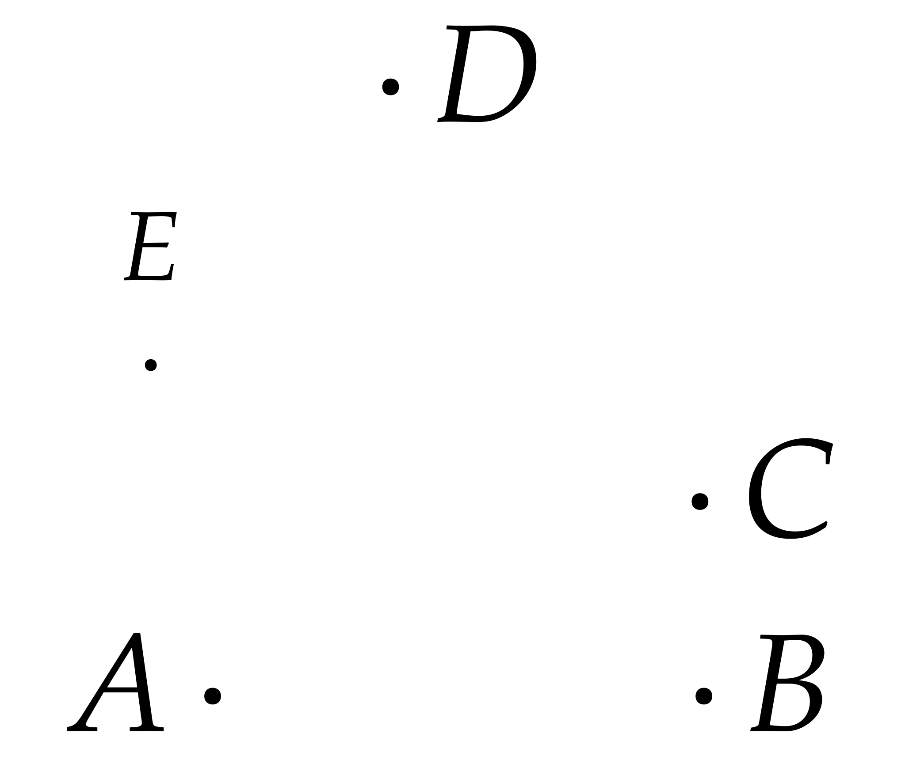

At one moment I would see the bodies A B C D from E & E from the eyes of that body, & suddenly, say, C D E A from B & B from its eyes, etc. But it becomes simpler still if I see all bodies, my own as well as others’, not from eyes at all, so that, as far as their visual appearance is concerned, they are all on the same footing. Then it is clear what it means to say that I can have pain in someone else’s tooth; – if I want to retain at all the designation that calls one body “_mine_” & hence another “someone else’s”. For now it may be more practical simply to designate the bodies by proper names. – So now there is one experience: that of pain in a tooth of one of the human bodies that exist; this is not the experience I would describe in the ordinary way of speaking with the words “A has toothache”, but with the words “I have pain in one of A’s teeth”. And there is the other experience: that of seeing a body, whether mine or someone else’s, writhe. For let us not forget: toothache does have a place in space, in so far as one can say, for example, that it moves about, or that it is in two places at once, etc.: but its space is not visual or physical space. – And now we do have a new way of speaking, but it is no longer asymmetrical. It does not favour _one_ body or one person to the _detriment_ of another, and so it is _not_ solipsistic. – In this way everything is apportioned without regard to the person. _But we divide things up differently_. The things are grouped differently in our way of looking at them. As when one counts time as part of space in one case and not in another, or looks at a forest as a block of wood with holes in it. Or regards the path of the moon around the sun in one case as a circular orbit around the earth, which shifts, in another as a wavy line that runs around the sun. (If the earth were not visible, say, it might be a curious new way of looking at things to regard the wave-like motion around the sun as a circular orbit around a body that is itself orbiting.) In this way one could destroy certain prejudices built on the particular way of looking at things that we are familiar with. – The character of the other way of looking at things becomes very clear if one thinks of the analogous shift in boundaries brought about by introducing the concept of memory time. It is very like the change in how one views the motion of the moon. A boundary that used to run together with others in the drawing is suddenly drawn in bold & made to stand out. – – – – – –

### [27r\[2\]](https://cdn.wittgensteinnachlass.com/2000px/webp/Ms-114/27r.webp),[27v\[1\]](https://cdn.wittgensteinnachlass.com/2000px/webp/Ms-114/27v.webp),[28r\[1\]](https://cdn.wittgensteinnachlass.com/2000px/webp/Ms-114/28r.webp)

The mathematical question must be as exact as the mathematical proposition. One sees how misleadingly the forms of expression of word-language represent the sense of mathematical propositions if one keeps in view the multiplicity of a mathematical proof & considers that the proof belongs to the _sense_ of the proved proposition, i.e. determines its sense. So it is not something that makes us believe a particular proposition, but something that shows us _what_ we believe, if there can be any question of belief here. Concept-words in mathematics: prime number, cardinal number, etc. That is why the question “How many prime numbers are there?” seems to make sense straight away. (“Man believes, if only he hears words …”.) In reality this combination of words is for the time being nonsense; until a special syntax has been given for it. Look at the proof “that there are infinitely many prime numbers” & then at the question it seems to answer. The result of an intricate proof can have a simple verbal expression only insofar as the system of expressions to which this expression belongs corresponds in its multiplicity to a system of such proofs. – The confusions in these matters are entirely due to treating mathematics as a kind of natural science. And that in turn is connected with the fact that mathematics has split off from natural science. For as long as it is practised in direct connection with physics, it is clear that _it_ is not a natural science. (Rather as one cannot take a broom for a piece of furniture in a room as long as one uses it to clean the furnishings.)

### [28r\[2\]](https://cdn.wittgensteinnachlass.com/2000px/webp/Ms-114/28r.webp)

In mathematics there is no “not yet” & no “for the time being” (except in the sense in which one can say that one has not yet multiplied 1000-digit numbers by one another).

### [28r\[3\]](https://cdn.wittgensteinnachlass.com/2000px/webp/Ms-114/28r.webp),[28v\[1\]](https://cdn.wittgensteinnachlass.com/2000px/webp/Ms-114/28v.webp)

The point √2 is essentially the endpoint of the construction.

And the expression “the endpoint of the construction” is here not a description in Russell’s sense. It is not a question of a particular length which can _also be_ obtained in this way. And just as the mathematical proposition is the end-surface of a proof-body, so here the result of the construction is the endpoint of the construction & nothing else. Just as the pentagon is the end of the pentagon-construction.

### [28v\[2\]](https://cdn.wittgensteinnachlass.com/2000px/webp/Ms-114/28v.webp)

I can therefore speak of a class of points analogous to the point √2 only if I speak of a class of analogous constructions.

### [28v\[3\]](https://cdn.wittgensteinnachlass.com/2000px/webp/Ms-114/28v.webp),[29r\[1\]](https://cdn.wittgensteinnachlass.com/2000px/webp/Ms-114/29r.webp),[29v\[1\]](https://cdn.wittgensteinnachlass.com/2000px/webp/Ms-114/29v.webp)

If I am given a finite series of digits, I can obviously ask each of the following questions: 1) Does a period occur in them? 2) Which one? 3) Is it the period (e.g.) 1414 … Since each of these questions can be asked, one believes that wherever one of them is asked in a new sense the others must also be capable of being asked eo ipso. Thus one says that the recurring division  has answered the question whether the development of the quotient 1 : 3 will consist entirely of 3s. And the division now seems to have answered all the questions: “Is there a period here?”, “Which one?”, “Is it, for example, the period 1414 …?”, “Does the decimal fraction continue to infinity without a period?” Does it follow from this that someone has understood recurring division by seeing that  must now always continue in this way, – does it follow that he can look for a period when none is yet visible? Can he, after conceiving  as recurring, thereby also find the period of 1 : 7? i.e. can he _search_ for it? Obviously not. I.e. the question

“Does the development of 1 : 7 ever come to an end?” is senseless for him, just as senseless as the question “Does 1 : 7 yield an endless non-recurring decimal fraction or a recurring one?” By contrast, the question “Will 1 : 7 become recurring after the first 4 places?” makes sense, and naturally also the question “Is the period 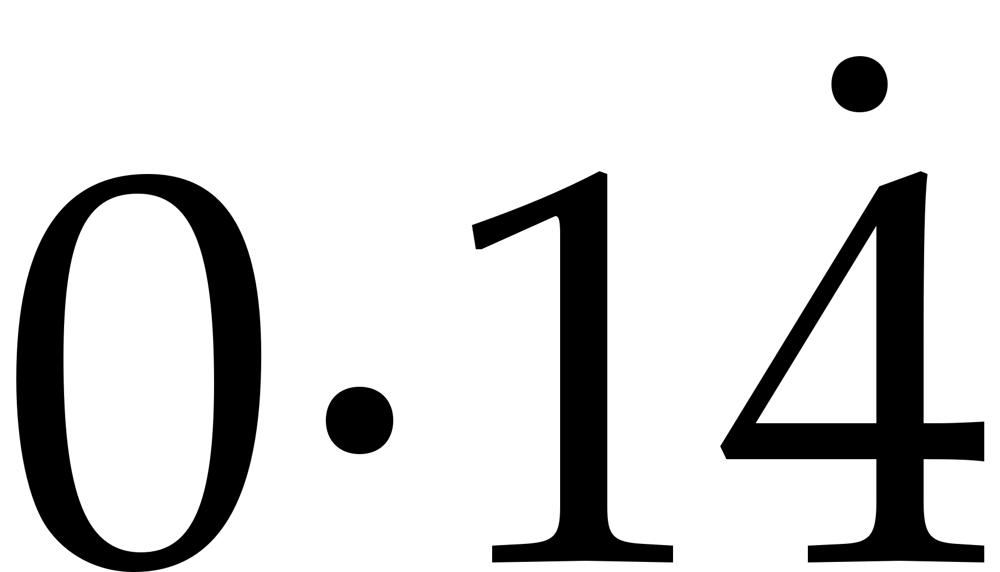?” But if he had now found the period of 1 : 7, would he not thereby have answered all those questions after all? No, only those whose answer he was able to seek. Or again: the _other_ questions had only the sense which the answer found gives them. Let us explain this in another way: suppose we had taught someone to multiply, but not to divide. He had found that 14 × 15 = 210 & I told him that we can also express this result as: “210 : 15 = 14”. Would the question to which division is the answer thereby have acquired a sense? No, it is quite a different one, whose grammar is first given to us by the method of division. Nor would I have taught someone to multiply if I had given him the definition 1 × 1 = 1.

### [29v\[2\]](https://cdn.wittgensteinnachlass.com/2000px/webp/Ms-114/29v.webp)

Mathematical propositions as a means of cataloguing proofs. (Ursell)

### [29v\[3\]](https://cdn.wittgensteinnachlass.com/2000px/webp/Ms-114/29v.webp)

A hypothesis assumed as an unshakeable rule of representation becomes a coordinate system.

### [29v\[4\]](https://cdn.wittgensteinnachlass.com/2000px/webp/Ms-114/29v.webp),[30r\[1\]](https://cdn.wittgensteinnachlass.com/2000px/webp/Ms-114/30r.webp)

“cut” is, according to the usual explanation, really what can be compared with the rational numbers. For if one explains the cut, for example using √2, one only shows that in this case one can give a definition of ‘greater’ & ‘smaller’ similar to that for the rational numbers. Namely √2 ≷ n ≝ 2 ≷ n² .

### [30r\[2\]](https://cdn.wittgensteinnachlass.com/2000px/webp/Ms-114/30r.webp)

Unconscious toothache.

What does the sentence mean: “I am conscious of my toothache”.

I am conscious of my poverty ≠ I am poor. By contrast:

I am conscious of my toothache = I have toothache. Unless I introduce a new alternative into my way of speaking; but then I must first show its application, otherwise I have not yet given it a sense.

### [30r\[3\]](https://cdn.wittgensteinnachlass.com/2000px/webp/Ms-114/30r.webp)

Must it not be possible to describe a world in which the solipsistic error is less tempting to us? Where the facts are such that we are less easily seduced into a one-sided grammar?

### [30r\[4\]](https://cdn.wittgensteinnachlass.com/2000px/webp/Ms-114/30r.webp),[30v\[1\]](https://cdn.wittgensteinnachlass.com/2000px/webp/Ms-114/30v.webp)

In my considerations of mathematics tiny changes in the symbolic mode of expression play a role. What is clear & transparent when said _thus_ can, put a little differently, be opaque or misleading.

### [30v\[2\]](https://cdn.wittgensteinnachlass.com/2000px/webp/Ms-114/30v.webp)

‘Being grateful to someone for something’, analogously ‘expecting someone’, etc.

### [30v\[3\]](https://cdn.wittgensteinnachlass.com/2000px/webp/Ms-114/30v.webp)

Drawing of a four-dimensional cube (as an explanation of my conception of the perspective drawing as a three-dimensional one).

### [30v\[4\]](https://cdn.wittgensteinnachlass.com/2000px/webp/Ms-114/30v.webp)

The visual image when one sees fine rain coming down: one sees a movement, but not anything definite moving.

### [30v\[5\]](https://cdn.wittgensteinnachlass.com/2000px/webp/Ms-114/30v.webp)

The harmfulness of the form of expression “sense”, “meaning”, which again and again gives the idea of shadows (spirits) behind words & sentences.

### [30v\[6\]](https://cdn.wittgensteinnachlass.com/2000px/webp/Ms-114/30v.webp)

“I think far more than I say” – how can one compare that?

### [30v\[7\]](https://cdn.wittgensteinnachlass.com/2000px/webp/Ms-114/30v.webp)

What does “counting objects” mean?

### [30v\[8\]](https://cdn.wittgensteinnachlass.com/2000px/webp/Ms-114/30v.webp)

We do not interfere with what the mathematician does, only when he claims to be doing metamathematics do we check on him.

### [31r\[1\]](https://cdn.wittgensteinnachlass.com/2000px/webp/Ms-114/31r.webp)

If we turn round rapidly in a circle a few times & then stand still, the room seems to turn around us & yet we do not see objects around us disappearing from our gaze in the process & others entering our visual field, as would have to be the case if the room were turning. But it is quite similar when a piece of music is played in such a way that it seems to us that it is being played faster & faster, while we have to tell ourselves that the tempo as a whole has not noticeably changed.

### [31r\[2\]](https://cdn.wittgensteinnachlass.com/2000px/webp/Ms-114/31r.webp)

One can say of the first case: there is not only _visual_ movement.

### [31r\[3\]](https://cdn.wittgensteinnachlass.com/2000px/webp/Ms-114/31r.webp)

Fluctuation of the concept ‘part of speech’. Is “3” the same part of speech as ‘4’?

### [31v\[1\]](https://cdn.wittgensteinnachlass.com/2000px/webp/Ms-114/31v.webp)

_Reworking._

[→ Second reworking in large format]

### [31v\[2\]](https://cdn.wittgensteinnachlass.com/2000px/webp/Ms-114/31v.webp)

How can one speak of ‘understanding’ & ‘not understanding’ a sentence – is it not only a sentence when one understands it?

### [31v\[3\]](https://cdn.wittgensteinnachlass.com/2000px/webp/Ms-114/31v.webp)

I.e.: Could not, for example, a combination of chairs be a sentence if one understands it as such, whereas otherwise it has not the slightest connection with a sentence & one cannot speak of ‘understanding it’?

### [31v\[4\]](https://cdn.wittgensteinnachlass.com/2000px/webp/Ms-114/31v.webp)

One can say: a Chinese inscription tells me as little as a wallpaper pattern or, say, the arrangement of chairs in a room. – And on the other hand the wallpaper pattern & the arrangement of the chairs could also communicate something to me after suitable agreement.

### [31v\[5\]](https://cdn.wittgensteinnachlass.com/2000px/webp/Ms-114/31v.webp)

This shows that I have not sufficiently specialized the meanings of the word ‘understand’ & of the word ‘sentence’ here.

### [31v\[6\]](https://cdn.wittgensteinnachlass.com/2000px/webp/Ms-114/31v.webp),[32r\[1\]](https://cdn.wittgensteinnachlass.com/2000px/webp/Ms-114/32r.webp)

As we use the word ‘understand’, it makes no sense to ask “do you understand this group of trees” unless someone is in the process of learning a language whose expressions were, say, groupings of trees.

### [32r\[2\]](https://cdn.wittgensteinnachlass.com/2000px/webp/Ms-114/32r.webp)

“Understanding only begins with the sentence.” This fixes the meaning of the word “understanding” within a particular domain.

### [32r\[3\]](https://cdn.wittgensteinnachlass.com/2000px/webp/Ms-114/32r.webp)

There is no metalogic. The word “understanding” and the expression “understanding a sentence” are not metalogical either.

### [32r\[4\]](https://cdn.wittgensteinnachlass.com/2000px/webp/Ms-114/32r.webp)

It would indeed be strange if science & mathematics used sentences but did not speak of understanding these sentences.

### [32r\[5\]](https://cdn.wittgensteinnachlass.com/2000px/webp/Ms-114/32r.webp)

One sees the essential thing in understanding, the incidental thing in the sign. – Besides, what is the sign for at all, then? – Merely to make oneself understood by others? But how is that possible? – There the sign is regarded as a medicine that is supposed to produce in the other person the same states as those I have.

### [32r\[6\]](https://cdn.wittgensteinnachlass.com/2000px/webp/Ms-114/32r.webp)

In answer to the question “what do you mean?” (say, by this movement of the hand) the answer is: “I mean p” (I mean, you are to go out) & not “I mean what I mean by the sentence ‘p’”.

### [32v\[1\]](https://cdn.wittgensteinnachlass.com/2000px/webp/Ms-114/32v.webp)

When Frege speaks against the formal conception of arithmetic, he says, as it were: these petty explanations concerning the signs are idle if we understand the signs. And understanding would be, as it were, seeing a picture from which all the rules follow, thereby becoming intelligible. But Frege does not seem to see that this picture itself is a sign, or a calculus that explains the written calculus to us. And what we call ‘understanding a language’ is, in general, of the kind of understanding we acquire of a calculus when we learn about its origin, its genesis, its practical application. And there too we learn a more surveyable symbolism in place of the unfamiliar one. As when someone first learnt chess as a writing game & only later was shown the ‘interpretation’ of this game as a board game. Understanding here means something similar to having a clear view of the whole.

### [32v\[2\]](https://cdn.wittgensteinnachlass.com/2000px/webp/Ms-114/32v.webp),[33r\[1\]](https://cdn.wittgensteinnachlass.com/2000px/webp/Ms-114/33r.webp)

When I give someone a command, it is _quite enough_ for me to give them signs. And I would never, on hearing a command, say: these are just words, & I must penetrate behind the words. And if I had asked someone something & he gives me an answer (that is, a sign), I am satisfied – that was exactly what I expected – & do not object: “that is merely an answer”. (It is clear that nothing else could have been expected, & that the answer presupposed the use of a language, of a particular language-game; as does everything we can say.

### [33r\[2\]](https://cdn.wittgensteinnachlass.com/2000px/webp/Ms-114/33r.webp)

But if one says: “how am I supposed to know what he means, I only see his signs?”, – I say: “how is _he_ supposed to know what he means; he only has his signs too”.

### [33r\[3\]](https://cdn.wittgensteinnachlass.com/2000px/webp/Ms-114/33r.webp)

_The language must speak for itself._

### [33r\[4\]](https://cdn.wittgensteinnachlass.com/2000px/webp/Ms-114/33r.webp)

One can explain what is spoken only through language, and therefore one cannot explain language itself in this sense. One cannot interpret language as a whole. An interpretation is always only _one_ in contrast to _another_. And each attaches itself to the explained sign & enlarges the language.

### [33r\[5\]](https://cdn.wittgensteinnachlass.com/2000px/webp/Ms-114/33r.webp)

One can also say: the way one means something falls out of language; for if one asks what a sentence means, this is again said by means of a sentence.

### [33v\[1\]](https://cdn.wittgensteinnachlass.com/2000px/webp/Ms-114/33v.webp)

“What did you mean by these words?”

“Did you mean these words?” (or merely say them).

### [33v\[2\]](https://cdn.wittgensteinnachlass.com/2000px/webp/Ms-114/33v.webp)

The second question does not stand to the first in the relation in which the question “are you in love?” stands to “whom do you love?”. The answer to the first question is a sentence (a further sign); what one calls an explanation of the sense.

### [33v\[3\]](https://cdn.wittgensteinnachlass.com/2000px/webp/Ms-114/33v.webp)

The first of these questions is not a more precise determination of the second. (So it is not the case “are you in love, & whom do you love”.) The answer to the first question is a sentence (a further sign) which replaces the first; an explanation of the sense of the original sign. The second question does not ask for an explanation.

### [33v\[4\]](https://cdn.wittgensteinnachlass.com/2000px/webp/Ms-114/33v.webp)

Similar to the second question is: “did you mean that seriously or as a joke?”

### [33v\[5\]](https://cdn.wittgensteinnachlass.com/2000px/webp/Ms-114/33v.webp)

The word “understand” is used analogously to the word “mean”.

### [34r\[1\]](https://cdn.wittgensteinnachlass.com/2000px/webp/Ms-114/34r.webp)

The word “understand”, like the word “mean”, is used with different meanings. In one kind of application it means a mental reaction when hearing, reading, uttering, etc. the sentence. Understanding is then the phenomenon that occurs when I hear the sentence in a language familiar to me & does not occur when, for example, I hear a Chinese sentence.

### [34r\[2\]](https://cdn.wittgensteinnachlass.com/2000px/webp/Ms-114/34r.webp)

Learning the language stands to understanding in _this_ sense in the relation of cause to effect.

### [34r\[3\]](https://cdn.wittgensteinnachlass.com/2000px/webp/Ms-114/34r.webp),[34v\[1\]](https://cdn.wittgensteinnachlass.com/2000px/webp/Ms-114/34v.webp)

And if one calls the understanding of the written sentence the mental reaction which the sentence, as it passes before us, produces, then this understanding is (again) the effect of the sentence-sign on us. Understanding occurs only in the way in which hearing the sentence does & accompanies it. In this sense I can speak of an ‘experience’ of the sentence. When I understand it, the sentence acquires depth for me. “I don’t just say that, I also mean something by it”. – If one considers what happens within us when we _mean_ words (& do not merely say them), it seems as if something is then coupled with these words, whereas otherwise they run empty. – As if they, as it were, _intervened_ in us.

### [34v\[3\]](https://cdn.wittgensteinnachlass.com/2000px/webp/Ms-114/34v.webp)

I understand a command as a command, i.e. I do not merely see in it this structure of sounds or strokes, but it has – so to speak – an influence on me. I react to a command (even without obeying it) differently from the way I react to a communication or question. (I also read it with a different tone, with a different gesture.)

### [34v\[4\]](https://cdn.wittgensteinnachlass.com/2000px/webp/Ms-114/34v.webp),[35r\[1\]](https://cdn.wittgensteinnachlass.com/2000px/webp/Ms-114/35r.webp)

The understanding, in this sense, of a sentence is comparable with the understanding of a picture. Let us imagine a drawing intended to represent a group of spatial objects; but we are unable to see a particular part of the picture as a spatial representation and see only patches & strokes on the picture surface. We can then say that we do not understand this part of the picture. – But I also say that I do not understand the picture if, although I see everything spatially, I do not recognize the spatial forms as familiar objects (trees, animals, houses etc.). Suppose, for example, that the picture represented a group of people & that the people in it were about an inch tall. If there were actual people of this height, we could recognize _them_ in the picture, experience the picture as a life-size representation; & it would then make a quite different impression on us, although the illusion of three-dimensional objects would be exactly the same as in the case where the picture represented people of ordinary size. And the impression of the picture, the way I take it, now exists independently of whether I have seen people of ordinary size or dwarfs an inch tall, even if this may be the cause of the impression. (Likewise, although I may see a drawing of a cube spatially only because I have so often seen actual cubes; the description of the spatial visual image contains nothing of what distinguishes a ‘real’ cube from a drawn one.)

### [35r\[2\]](https://cdn.wittgensteinnachlass.com/2000px/webp/Ms-114/35r.webp)

The different experiences when I see a picture now one way, now another, are comparable with reading a sentence with understanding & without understanding. (Remember what it is like when one reads a sentence with incorrect emphasis, and therefore does not understand it, & then suddenly realizes how it is to be read.) (Reading a hasty script.)

### [35r\[3\]](https://cdn.wittgensteinnachlass.com/2000px/webp/Ms-114/35r.webp),[35v\[1\]](https://cdn.wittgensteinnachlass.com/2000px/webp/Ms-114/35v.webp)

When one reads a clock, one sees a complex of strokes, patches, etc.; but one sees it in a particular way when one takes it as a dial & hands. (How one can see Orion as a man, but also otherwise.)

### [35v\[2\]](https://cdn.wittgensteinnachlass.com/2000px/webp/Ms-114/35v.webp)

Think also of the difference in understanding when, in a sentence, one experiences a word once as belonging to one word, once as belonging to another.

### [35v\[3\]](https://cdn.wittgensteinnachlass.com/2000px/webp/Ms-114/35v.webp)

We can now call the written sign, but also the particular experience – the sign seen _so_, taken _this way_ – the ‘sentence read’. Here is a source of confusion.

### [35v\[4\]](https://cdn.wittgensteinnachlass.com/2000px/webp/Ms-114/35v.webp)

Let us now remember an ambiguity in the word understand. If I read: “after he had said that, he left her, as on the previous day” – if one asks me whether I understand this sentence, it is not easy to answer. It is a German sentence & in that respect I understand it: I would know how one _could_ use this sentence, say. I could invent a context for it myself. And yet I do not understand it in the sense in which I would understand it if I had read a story in which it occurs. (Compare: different language-games.)

### [36r\[1\]](https://cdn.wittgensteinnachlass.com/2000px/webp/Ms-114/36r.webp)

Do we _understand_ Lewis Carroll’s poem “Jabberwocky”, or poems by Christian Morgenstern?

### [36r\[2\]](https://cdn.wittgensteinnachlass.com/2000px/webp/Ms-114/36r.webp)

Let a sentence be given to me in a cipher unfamiliar to me & at the same time the key to deciphering it. Then, of course, everything necessary for understanding the sentence is given to us in a certain respect. And yet, if asked whether I understand the sentence, I would answer something like: “I must first decipher it”; & when I had deciphered it as a German sentence before me, I would say “now I understand it”. If one now asks: “at what moment in the translation (from the cipher into German) does understanding of the sentence begin?”, one gains an insight into the nature of what we call “understanding”.

### [36r\[3\]](https://cdn.wittgensteinnachlass.com/2000px/webp/Ms-114/36r.webp),[36v\[1\]](https://cdn.wittgensteinnachlass.com/2000px/webp/Ms-114/36v.webp)

I say a sentence “I see a black circle over there”; by agreement I can replace the words of this sentence with other signs & a sentence in the new signs will then have the same sense. So let us write the first 6 letters of the alphabet instead of the 6 words of the sentence. The sentence then reads: “a b c d e f”. But now it becomes apparent that I cannot – as one might say – think the sense of the sentence above directly in the expression “a b c d e f”. I could also put it this way: I am not used to saying ‘a’ instead of ‘I’ & ‘b’ instead of ‘see’, ‘c’ instead of ‘over there’, etc. But I do not mean by this that, if I were used to it, I would immediately associate the sign ‘a’ with the word ‘I’; rather, I am not used to using ‘a’ in place of ‘I’.

### [36v\[2\]](https://cdn.wittgensteinnachlass.com/2000px/webp/Ms-114/36v.webp)

“Understanding a sentence” can mean “knowing what the sentence says”, being able to answer the question “what does it say?”. Understanding the sense of a sentence means: being able to answer the question ‘what is its sense’.

### [36v\[3\]](https://cdn.wittgensteinnachlass.com/2000px/webp/Ms-114/36v.webp)

Understanding (in this meaning) is the correlate of an explanation of the sense.

### [36v\[4\]](https://cdn.wittgensteinnachlass.com/2000px/webp/Ms-114/36v.webp),[37r\[1\]](https://cdn.wittgensteinnachlass.com/2000px/webp/Ms-114/37r.webp)

A frequently occurring view is that one can show one’s understanding only imperfectly. That one can, as it were, only point to it from a distance, also approach it, but never touch it with one’s hand. And that the final thing must always remain unsaid. One asks: Is understanding not something different from the expression of understanding? – Is it not the case that the expression of understanding is precisely an imperfect expression? – That presumably means an expression that leaves something out – but something essentially inexpressible. For otherwise I could find a better one.

### [37r\[2\]](https://cdn.wittgensteinnachlass.com/2000px/webp/Ms-114/37r.webp)

The fact that certain mental processes accompany a sentence, as experience shows, does not interest us; but understanding, the interpretation embodied in an explanation of the sense, does.

### [37r\[3\]](https://cdn.wittgensteinnachlass.com/2000px/webp/Ms-114/37r.webp),[37v\[1\]](https://cdn.wittgensteinnachlass.com/2000px/webp/Ms-114/37v.webp)

It is difficult to see the grammar of the word “mean” clearly. But the way to do so leads through the question “what is the criterion for our meaning something _this way_?”, & what kind of expression stands for this “_this way_”. The answer to the question “how is that meant?” establishes the connection between two linguistic expressions. So the question also asks about this connection. As if one had two pictures representing the same person, but I could not show that person. The use of the nouns “sense”, “meaning”, “interpretation” & other words tempts us to believe that this sense, etc., stands in relation to the sign as the word – the name – stands to the thing of which it is the bearer. So that one could say: “The sign has a quite definite meaning, is meant in a quite definite way, which I must express by a sign again only for want of a direct route”. What is meant, the intention, would be, as it were, its soul, which I would most like to show myself, but to which unfortunately I can point only indirectly through its body. –

[→ 487 If, in order to explain the sense of an arrow, I say: “I mean this arrow in such a way that one follows it by moving in the direction from tail to tip”, I give a definition (I put one sign in place of another), whereas it seems as though I had, so to speak, supplemented what the arrow says. I have replaced the arrow with a new sign that we can use instead of the arrow. Whereas it _seems_ as though the arrow itself were essentially incomplete, in need of supplementation, and as though I had now given it the necessary supplementation. As when one recognizes a description of an object as imperfect and completes it. As though the arrow had begun the description and we had completed it with the sentence. – Or again: If, as above, I say “I mean this arrow in such a way that …”, it gives the impression that only now have I described what really matters, _what is meant_; as though the arrow were, so to speak, only the musical instrument, and what is meant were the music, or better: the arrow, the sign – that is, in this case, the cause of the inner, mental process, and only the words of the explanation were the description of this process. What haunts us here is the conception of the sentence as the sign of a thought; and of the thought as a process in the mind, or in the head. ]

### [37v\[2\]](https://cdn.wittgensteinnachlass.com/2000px/webp/Ms-114/37v.webp),[38r\[1\]](https://cdn.wittgensteinnachlass.com/2000px/webp/Ms-114/38r.webp)

What we call ‘understanding’ is sometimes a process of translating the sign into another picture. Understanding a description can be compared with drawing a picture from the description.

### [38r\[3\]](https://cdn.wittgensteinnachlass.com/2000px/webp/Ms-114/38r.webp)

This is connected with our saying: “I understand this picture perfectly, I could model it”. “I understand this description perfectly, I could draw a picture from it.”

### [38r\[4\]](https://cdn.wittgensteinnachlass.com/2000px/webp/Ms-114/38r.webp)

We speak of understanding a sentence as the condition for our being able to apply it. We say: “I cannot obey a command if I do not understand it”, or “before I understand it”.

### [38r\[5\]](https://cdn.wittgensteinnachlass.com/2000px/webp/Ms-114/38r.webp)

In certain cases one could (officially) lay it down as the criterion of understanding a command that the person who receives it must be able to represent its sense in a drawing.

### [38r\[6\]](https://cdn.wittgensteinnachlass.com/2000px/webp/Ms-114/38r.webp)

“Must I really understand a sentence in order to act on it?” – “Certainly, otherwise you wouldn’t know what you have to do.” – “But what use is this knowledge to me? There is a leap from knowing to doing.”

### [38v\[1\]](https://cdn.wittgensteinnachlass.com/2000px/webp/Ms-114/38v.webp)

If “understanding a sentence” means acting on it in a particular way, then understanding cannot be the condition for our acting on it.

### [38v\[2\]](https://cdn.wittgensteinnachlass.com/2000px/webp/Ms-114/38v.webp)

But the sentence “I must understand the command before I can act on it” naturally has a good sense; only not a metalogical one. For understanding too is not a metalogical concept.

### [38v\[3\]](https://cdn.wittgensteinnachlass.com/2000px/webp/Ms-114/38v.webp)

The conception one has of understanding is roughly that it brings one nearer from the sign to the depicted reality, from the words of the command nearer to obeying it. And in a psychological sense that may be correct.

### [38v\[4\]](https://cdn.wittgensteinnachlass.com/2000px/webp/Ms-114/38v.webp)

“I really must understand a command in order to act on it” – here the ‘must’ is suspicious. If this is a logical must, then the sentence is a grammatical remark. One could also ask: “How long before obeying must you understand the command?”

### [38v\[5\]](https://cdn.wittgensteinnachlass.com/2000px/webp/Ms-114/38v.webp),[39r\[1\]](https://cdn.wittgensteinnachlass.com/2000px/webp/Ms-114/39r.webp)

If understanding is taken to mean a mental process & what is meant to be said is that this process, as experience shows, always occurs before a person obeys a command, then this statement does not interest us. (A definition saying that one should call it “obeying the command” only when that mental process has occurred would be idle.)

### [39r\[2\]](https://cdn.wittgensteinnachlass.com/2000px/webp/Ms-114/39r.webp)

But if “understand” is to mean being able to explain, why should that be necessary in order to obey the command? (Of course, this is not a matter of logical necessity.)

### [39r\[3\]](https://cdn.wittgensteinnachlass.com/2000px/webp/Ms-114/39r.webp)

If understanding was a preparation for obeying, then it added something to the sign of the command; but something that in any case was not the execution (of the command).

### [39r\[4\]](https://cdn.wittgensteinnachlass.com/2000px/webp/Ms-114/39r.webp),[39v\[1\]](https://cdn.wittgensteinnachlass.com/2000px/webp/Ms-114/39v.webp)

“I cannot execute the command because I do not understand what you mean. Yes, now I understand you.” – What was happening when I suddenly understood the other person? There were many possibilities. The command could, for example, have been given in a language familiar to me, but with incorrect emphasis, & suddenly the correct emphasis of the words occurred to me. I would then say to a third person: “now I understand him, he means …” & would now repeat the command with the correct emphasis. And with grasping the familiar sentence I would now have understood the command; I mean: I would not then have to grasp an additional abstract sense. – Or the command might have been given to me in understandable German, but seemed nonsensical to me because I had misunderstood something in it; then an _explanation_ occurred to me: “ah, he means …” & now I can execute the command. (The absent-minded person who, at the command “right turn”, would have turned left and now, putting his hand to his forehead, said “oh, I see, ‘right turn’!” & turned right.)

### [39v\[2\]](https://cdn.wittgensteinnachlass.com/2000px/webp/Ms-114/39v.webp)

Before this understanding, several possible interpretations, that is, several explanations, might also have floated before me, one of which I then decide on.

### [39v\[3\]](https://cdn.wittgensteinnachlass.com/2000px/webp/Ms-114/39v.webp)

(Think also of the case: someone makes signs to me & I say: “he means that I should do something; but _what_ he wants, I do not know”.)

### [39v\[4\]](https://cdn.wittgensteinnachlass.com/2000px/webp/Ms-114/39v.webp),[40r\[1\]](https://cdn.wittgensteinnachlass.com/2000px/webp/Ms-114/40r.webp)

It seems to us as if we added something to the command (say, the command: “”)

through understanding, something that fills the gap between command & execution. So that we can answer someone who said “but you do understand it, so it is not incomplete”: “Yes, I understand it, but only because I add something else; namely the interpretation”. But what prompts you to give precisely _this_ interpretation? If it is the command, then it was already unambiguous, since it _commanded_ this interpretation. Or did you add the interpretation arbitrarily – then you did not _understand_ the command either, but only what you made of it.

### [40r\[2\]](https://cdn.wittgensteinnachlass.com/2000px/webp/Ms-114/40r.webp)

An interpretation is something that is given in signs. It is _this_ interpretation as opposed to another (which is worded differently). So if one said: “every sentence still requires an interpretation”, that would mean: no sentence can be understood without an addition.

### [40r\[3\]](https://cdn.wittgensteinnachlass.com/2000px/webp/Ms-114/40r.webp)

It happens that I interpret a sign, add an interpretation to it, but certainly not whenever I understand signs. If someone asks me “what time is it”, then no work of interpretation goes on in me. Rather, I simply react to what I see & hear. (As when someone draws a knife on me, I do not say: “I interpret that as a threat.”)

### [40r\[4\]](https://cdn.wittgensteinnachlass.com/2000px/webp/Ms-114/40r.webp)

In philosophy we see problems where there are none. And philosophy is supposed to show that there is no problem there.

### [40v\[1\]](https://cdn.wittgensteinnachlass.com/2000px/webp/Ms-114/40v.webp)

‘Understanding a word’ in the sense of: knowing how it is used.

### [40v\[2\]](https://cdn.wittgensteinnachlass.com/2000px/webp/Ms-114/40v.webp)

‘_Knowing_ how a word is used’ means the same as ‘being _able_ to apply it.’

### [40v\[3\]](https://cdn.wittgensteinnachlass.com/2000px/webp/Ms-114/40v.webp),[41r\[1\]](https://cdn.wittgensteinnachlass.com/2000px/webp/Ms-114/41r.webp)

One uses the word “can” in such a way that carrying it out is the criterion of ability; but also in such a way that carrying it out is not the criterion. “Can you lift this sphere?” – I say “yes”. Then I try to lift it & fail. – In one case I shall say: “I was mistaken; I couldn’t”; but there is also the case: “I can’t lift it now because I’m tired; when I said ‘I can lift it’, I could (also)”. Likewise: “I thought I could play chess, but I have already forgotten how”, but also “when I said I could, I could, but now I have forgotten everything because of the fright”. Etc. Asked, ‘how do you know that you could do it then’, one would answer: “I could always lift such a light weight”, “I had just lifted it”, “I played chess a few years ago & my memory is good”, “I had just recapitulated the rules”, and so on. What counts for us as an indication of being able shows us how we use the word “can”. In none of these cases is the ability a conscious state, such as muscular pain.

### [41r\[2\]](https://cdn.wittgensteinnachlass.com/2000px/webp/Ms-114/41r.webp)

Compare sentences with one another, each of which describes a state _in a different sense_:

“I have had toothache all day”

“I have longed for him all day”

“I have expected him all day”

“I have known all day that he would come”

“I have been able to play chess since yesterday”.

In which of these sentences could one meaningfully insert the word “uninterruptedly”?

Can one say: “I have known uninterruptedly since yesterday that he would come”?

### [41r\[3\]](https://cdn.wittgensteinnachlass.com/2000px/webp/Ms-114/41r.webp),[41v\[1\]](https://cdn.wittgensteinnachlass.com/2000px/webp/Ms-114/41v.webp)

If knowledge is called a ‘state’, then in the sense in which one speaks of the state of a body or physical model (that is, in the physiological sense, or also in the sense of a psychology that speaks of unconscious states of a model of the mind). And everyone would of course concede that; but one must now see that in doing so one has moved from the grammatical sphere of conscious states (toothache, etc.) into another grammatical domain. I can quite well speak of unconscious toothache if the sentence “I have unconscious toothache”, for example, is supposed to mean what we ordinarily express by the sentence “I have a bad tooth that causes me no pain”. The ‘conscious state’ (in the earlier sense) does not now stand in the same grammatical relation to the ‘unconscious state’ as ‘an armchair that I see’ does to ‘an armchair that I do not see because it is in the next room’.

### [41v\[2\]](https://cdn.wittgensteinnachlass.com/2000px/webp/Ms-114/41v.webp)

Knowing something is comparable to carrying a slip of paper in my pocket with it written down on it.

### [41v\[4\]](https://cdn.wittgensteinnachlass.com/2000px/webp/Ms-114/41v.webp)

To the question “do you understand the word ‘red’, do you know which colour ‘red’ denotes?” one would answer: “Yes; if there were something red here, I would recognize it”.

### [41v\[5\]](https://cdn.wittgensteinnachlass.com/2000px/webp/Ms-114/41v.webp)

Let

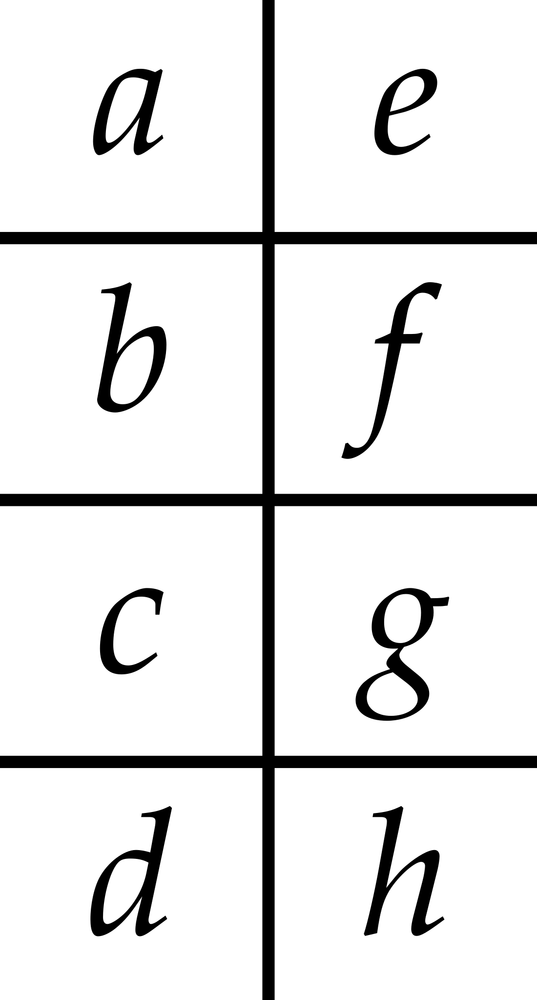

be my dictionary. I translate the sentence “b d c a” with it into the sentence “f h g e”; now I have shown that I understand the use of the dictionary & can say that I _can_ translate the sentence “c d a b” in the same way, if I want to.

### [41v\[7\]](https://cdn.wittgensteinnachlass.com/2000px/webp/Ms-114/41v.webp),[42r\[1\]](https://cdn.wittgensteinnachlass.com/2000px/webp/Ms-114/42r.webp)

Understanding a sentence of language is more akin to understanding a piece of music than one might think. – Why must these bars be played just _so_? Why do I make the variation in dynamics & tempo conform to just this particular ideal? One wants to say: “because I know what it all means”, – but what does it mean? – – I wouldn’t know how to say, except again by translating it into an expression with the same rhythm.

### [42r\[2\]](https://cdn.wittgensteinnachlass.com/2000px/webp/Ms-114/42r.webp)

“I can apply the word ‘sphere’”, – is that on a different level from: “I can use the king in chess”? “I know how a pawn is allowed to move”.

“I know how the word ‘sphere’ may be used”.

### [42r\[4\]](https://cdn.wittgensteinnachlass.com/2000px/webp/Ms-114/42r.webp),[42v\[1\]](https://cdn.wittgensteinnachlass.com/2000px/webp/Ms-114/42v.webp)

A difficult problem seems to be the contrast, the relation, between operating with language in the course of its application & the instantaneous grasping of the sentence. But _when_ do we grasp, or understand, the sentence?! When we have uttered it? Or while we are uttering it? – And is understanding an articulated process, like speaking or writing the sentence, or an unarticulated one? And if an articulated one, – is it connected projectively with the other? or is its articulation independent of that of the sentence? –

### [42v\[3\]](https://cdn.wittgensteinnachlass.com/2000px/webp/Ms-114/42v.webp)

“He says that, & _means_ it”. Compare this with the sentence: “he says that & writes _it_ down”, – & on the other hand with: “he writes that & signs _it_”.

### [42v\[4\]](https://cdn.wittgensteinnachlass.com/2000px/webp/Ms-114/42v.webp)

How long does it take: to understand a sentence? And if one understands it for an hour, does one keep starting afresh?

### [42v\[5\]](https://cdn.wittgensteinnachlass.com/2000px/webp/Ms-114/42v.webp)

Isn’t understanding a sentence comparable to understanding a chess move as a move in the game? Someone who knows nothing of the game & sees someone make a move will not understand the action, i.e. not as a move in a game. (Or, not as a move in _this_ game.) And seeing the move with an understanding of the game is different from seeing it without this understanding.

### [42v\[6\]](https://cdn.wittgensteinnachlass.com/2000px/webp/Ms-114/42v.webp)

What if one asked: when can you play chess? Always? or now while you are saying so? or during a chess move? – And how strange that knowing how to play chess takes so little time & a game of chess so much longer!

(Augustine: “_When_ do I measure a period of time.”)

### [43r\[1\]](https://cdn.wittgensteinnachlass.com/2000px/webp/Ms-114/43r.webp)

If “understanding the word ‘yellow’” means being able to apply it, then the same question arises: when _can_ you apply it? Are you talking about a disposition? Is it a conjecture?

### [43r\[4\]](https://cdn.wittgensteinnachlass.com/2000px/webp/Ms-114/43r.webp)

One might say: I am interested only in the _content_ of the sentence; & the content of the sentence is in it.

The sentence has its content as an element of a calculus. So is “understanding a sentence” not of the same kind as “understanding a calculus”? that is, like: “being _able_ to multiply”?

### [43r\[5\]](https://cdn.wittgensteinnachlass.com/2000px/webp/Ms-114/43r.webp)

But what is it, then, that always gives us the feeling that understanding the sentence is grasping something that lies outside it; but not the world outside the signs as it is, but the world as the sign – as it were – wishes it to be.

The translation into the imagination & the sentence’s intervention in us constitute that outside.

### [43r\[6\]](https://cdn.wittgensteinnachlass.com/2000px/webp/Ms-114/43r.webp),[43v\[1\]](https://cdn.wittgensteinnachlass.com/2000px/webp/Ms-114/43v.webp)

One might want to say: “I’m not just saying ‘Draw a circle’, but I do wish _the other person to do something_.” (Of course!)

### [43v\[2\]](https://cdn.wittgensteinnachlass.com/2000px/webp/Ms-114/43v.webp)

The understanding of language – of the game, as it were – seems to be like a background against which the individual sentence first acquires meaning.

### [43v\[3\]](https://cdn.wittgensteinnachlass.com/2000px/webp/Ms-114/43v.webp)

If “understanding the meaning of a word” means knowing the possibilities of its grammatical application, then the question may arise: “How can I know straightaway what I mean by ‘sphere’, surely I cannot have the whole way of applying the word in my head all at once?” In a sense one can say that I know the rules of chess (‘have them in my head’) while I am playing. But isn’t this “having them in my head” only a hypothesis? Certainly, this knowledge is merely the hypothetical reservoir from which the water we actually see flows.

### [43v\[5\]](https://cdn.wittgensteinnachlass.com/2000px/webp/Ms-114/43v.webp),[44r\[1\]](https://cdn.wittgensteinnachlass.com/2000px/webp/Ms-114/44r.webp)

When you spoke of red, did you mean that of which one can say that it is bright, but not that it is green, even if you neither thought of this rule nor made use of it? – Did you use the ~ for which ~~p = p holds? even if you did not use this rule? Is it perhaps a hypothesis that it was _that_ ~? Can it be doubtful whether it was the same one & can its being the same one be confirmed by experience?

### [44r\[2\]](https://cdn.wittgensteinnachlass.com/2000px/webp/Ms-114/44r.webp)

Chess is surely characterized by its rules (its catalogue of rules). If I now define chess by its rules (distinguish it from draughts), then these rules belong to the grammar of the word “chess”. Must a definition of the word hover before the mind of someone who uses the word “chess” meaningfully (for example when he says: “I would like to play chess now”)? Certainly not. – Asked what he understands by “chess”, he will first give one. If I now asked: “When you uttered the word, what did you mean by it?” – If he answers: “I meant the game we have played so often etc. etc.”, I know that he did not in any way have this explanation in mind when using the word, & that his answer does not answer my question in _the_ sense of telling me what “went on in him” when he uttered the word.

### [44r\[3\]](https://cdn.wittgensteinnachlass.com/2000px/webp/Ms-114/44r.webp)

For the question is precisely whether by the “meaning in which one uses a word” we are to understand a process that we experience when speaking or hearing the word.

### [44r\[4\]](https://cdn.wittgensteinnachlass.com/2000px/webp/Ms-114/44r.webp),[44v\[1\]](https://cdn.wittgensteinnachlass.com/2000px/webp/Ms-114/44v.webp)

Instead of “I _did_ mean the game which …” he could also have said: “I now replace the word ‘chess’ – which I used earlier – with the expression …”.

### [44v\[3\]](https://cdn.wittgensteinnachlass.com/2000px/webp/Ms-114/44v.webp),[44v\[4\]](https://cdn.wittgensteinnachlass.com/2000px/webp/Ms-114/44v.webp)

The source of the confusion is perhaps the notion of the _thought that accompanies the sentence_ (Or precedes its expression.) The thought can of course precede the verbal expression in another form, but for us the difference in kind between these two expressions, or thoughts, is not at issue.

(“He said these words, but wasn’t thinking anything at all as he said them.” – “Yes, I was thinking something as I said them.” – “And what, precisely?” “– Well, what I said.”)

### [44v\[5\]](https://cdn.wittgensteinnachlass.com/2000px/webp/Ms-114/44v.webp)

In response to the statement “this sentence has sense” one cannot, in any essential way, ask “which?” Just as one cannot ask, in response to the sentence “these words are a sentence”, “which one?”

### [44v\[6\]](https://cdn.wittgensteinnachlass.com/2000px/webp/Ms-114/44v.webp)

“But surely I do mean something by these words”.

Certainly: in contrast to the case where I mean nothing, where I might string the syllables together for the sake of their funny sound. (The sentence “I mean something …”, not metalogical.)

### [44v\[7\]](https://cdn.wittgensteinnachlass.com/2000px/webp/Ms-114/44v.webp)

Understanding, meaning something, is not a matter of an act of grasping the grammar instantaneously, so to speak non-discursively. As if one could, as it were, swallow it all at once.

### [44v\[8\]](https://cdn.wittgensteinnachlass.com/2000px/webp/Ms-114/44v.webp),[45r\[1\]](https://cdn.wittgensteinnachlass.com/2000px/webp/Ms-114/45r.webp)

What the person does who interprets, grasps, a sign in one sense is a step in a calculus (a calculation, as it were). He _does_ roughly what he _says_ when he gives expression to his interpretation. – And when I say “what he does is a step in a calculus”, I mean that I already know this calculus; in the sense in which I know German, or the multiplication tables. Which I do not have in me as if the equations of the multiplication tables had been compressed into something which I now possess as a whole.

### [45r\[2\]](https://cdn.wittgensteinnachlass.com/2000px/webp/Ms-114/45r.webp)

It may seem to us as if the grammatical rules were, in some sense, an unfolding of what we experience all at once when using the word.

### [45r\[3\]](https://cdn.wittgensteinnachlass.com/2000px/webp/Ms-114/45r.webp)

_[→ Continuation of p. 14 Large format]_

### [PG I](/w-pg-1/#ms-114-45r.4) [45r\[4\]](https://cdn.wittgensteinnachlass.com/2000px/webp/Ms-114/45r.webp)

Can I describe what the grammatical rules say about a word in another way, namely by describing the process that takes place in understanding? So if grammar is – for instance – the geometry of negation, can I replace it with a description of what, so to speak, stands behind the word “not” when it is applied? We say: “Whoever understands negation knows that double negation yields an affirmation”.

### [PG I](/w-pg-1/#ms-114-45r.5+45v.1) [45r\[5\]](https://cdn.wittgensteinnachlass.com/2000px/webp/Ms-114/45r.webp),[45v\[1\]](https://cdn.wittgensteinnachlass.com/2000px/webp/Ms-114/45v.webp)

This sounds like: “carbon & oxygen gives carbonic acid”. But in reality double negation _gives_ nothing, but _is_ something. Here something misleads us into thinking there is a physical fact. As though we saw a result of the logical process. Whereas the result is only that of the physical process.

### [PG I](/w-pg-1/#ms-114-45v.2) [45v\[2\]](https://cdn.wittgensteinnachlass.com/2000px/webp/Ms-114/45v.webp)

One wants to say: “negation has the property of yielding an affirmation when doubled.” Whereas the rule does not describe negation more closely but constitutes it. Negation has the property of negating a sentence according to the truth. Thus a circle – say, one painted on a surface – has the property of standing here or there, of having this colour, of being intersected by a straight line (colour boundary), etc.; but not properties which geometry seems to ascribe to it. (Namely, the property of _being able_ to have those properties.) And the number one does not have the property of yielding two when added to itself.

### [PG I](/w-pg-1/#ms-114-45v.3+46r.1) [45v\[3\]](https://cdn.wittgensteinnachlass.com/2000px/webp/Ms-114/45v.webp),[46r\[1\]](https://cdn.wittgensteinnachlass.com/2000px/webp/Ms-114/46r.webp)

Geometry speaks no more of cubes than logic speaks of negation. But it defines the cubical form; it does not describe it. If a description of a cube says that it is red & hard, then ‘description of the cubical form’ is a sentence like: “this box is cubical”. But if I describe how to make a cubical box, does this not also contain a description of the cubical form? A description only insofar as this thing is said to be cubical, and otherwise an analysis of the concept of a cube. It is not the cubical form that has the property of having all its faces equal; but a wooden block has this property. Nor does “the number one have the property of yielding two when added to itself”.

### [PG I](/w-pg-1/#ms-114-46r.2) [46r\[2\]](https://cdn.wittgensteinnachlass.com/2000px/webp/Ms-114/46r.webp)

“This paper is _not_ black, & two such negations yield an affirmation”. The addition recalls: “and two such horses can pull the carriage”. But it says nothing about negation; rather, it is a rule for replacing one sign by another.

### [PG I](/w-pg-1/#ms-114-46r.3+46v.1) [46r\[3\]](https://cdn.wittgensteinnachlass.com/2000px/webp/Ms-114/46r.webp),[46v\[1\]](https://cdn.wittgensteinnachlass.com/2000px/webp/Ms-114/46v.webp)

“Surely the fact that two negations yield an affirmation must already lie in the negation that I am now using.” Am I here in the process of inventing a mythology of symbolism? It seems as if one could _infer_ from the meaning of negation that “~~p” means p. As though the rules for the negation sign _followed_ from the nature of negation. So that, in a certain sense, negation would be there first, & then the rules of grammar. It is as if the nature of negation had a twofold expression in language: the one whose meaning I grasp when I understand the expression of negation in a sentence, & the consequences of this meaning in grammar.

### [46v\[2\]](https://cdn.wittgensteinnachlass.com/2000px/webp/Ms-114/46v.webp)

One is tempted to make something like the following objection: If someone says “look, there’s a sphere”, or “there’s a hemisphere”, the view I obtain can fit either; & when I now say “yes, I see it”, I nevertheless distinguish between the two hypotheses. – Just as in a game of chess I distinguish between a pawn & the king, even if the current move is one that both could make, & even if a king piece were to function as a pawn. The word “sphere” is _familiar_ to me & stands for something in me; it brings me into a certain position relative to it (as a magnet brings a needle into its direction). In philosophy one is always in danger of giving a mythology of symbolism, or of psychology; instead of simply saying what one knows.

### [PG I](/w-pg-1/#ms-114-46v.3) [46v\[3\]](https://cdn.wittgensteinnachlass.com/2000px/webp/Ms-114/46v.webp)

B It seems as if in a sentence that, for example, contains the word “sphere”, the shadow of other uses of this word were already contained. Namely, precisely the _possibility_ of forming those other sentences. To whom does it seem so? and under what circumstances?

### [PG I](/w-pg-1/#ms-114-46v.4+47r.1) [46v\[4\]](https://cdn.wittgensteinnachlass.com/2000px/webp/Ms-114/46v.webp),[47r\[1\]](https://cdn.wittgensteinnachlass.com/2000px/webp/Ms-114/47r.webp)

What does it mean that in the sentence “the rose is red” “is” has a different meaning than in “2 times 2 is 4”? If one answers that it means that different rules apply to these two words, then one must say that here we have only _one_ word. – And if I pay attention only to the grammatical rules, these simply allow the use of the word “is” in both contexts. – But the rule which shows that the word “is” has different meanings in the two sentences is the one which allows the word “is” in the second sentence to be replaced by “is equal”, & which prohibits this replacement in the first sentence.

### [PG I](/w-pg-1/#ms-114-47r.2) [47r\[2\]](https://cdn.wittgensteinnachlass.com/2000px/webp/Ms-114/47r.webp)

“Now is this rule merely the consequence of the _first_ thing: that the word ‘is’ has different meanings in the two sentences? Or is it rather that the rule is precisely the expression of the fact that the word means something different in the two contexts?”

### [PG I](/w-pg-1/#ms-114-47r.4+47v.1) [47r\[4\]](https://cdn.wittgensteinnachlass.com/2000px/webp/Ms-114/47r.webp),[47v\[1\]](https://cdn.wittgensteinnachlass.com/2000px/webp/Ms-114/47v.webp)

The comparison suggests itself that the word “is” has different _bodies of meaning_ behind it in different cases; that, for example, each time it is a square-shaped surface, but in one case the end face of a prism and in the other the end face of a pyramid. Let us now imagine this case: we had glass cubes that were completely transparent, but one of whose faces was coloured red. If we arrange these cubes in space, only certain arrangements of red squares can arise, determined by the form of the glass bodies. I could express the rule according to which the red squares can be arranged without mentioning the cubes, but the nature of the cubical form would nevertheless be contained in it. Not, of course, that glass cubes stand behind the red squares, but certainly the geometry of the cube. But if we now _see_ such a cube, are the laws of possible arrangement already given with it; that is, the geometry of the cube? Can I read the geometry of the cube off a cube?

### [PG I](/w-pg-1/#ms-114-47v.2) [47v\[2\]](https://cdn.wittgensteinnachlass.com/2000px/webp/Ms-114/47v.webp)

The cube is then a notation of the rule. And if we had found such a rule, we really could not notate it better than by means of a drawing of a cube. (And the fact that a drawing can take the place of the cube here is significant.) But how can the cube (or the drawing) serve as a notation of a geometrical rule? Only insofar as it belongs, as a sentence or part of a sentence, to a system of sentences.

### [PG I](/w-pg-1/#ms-114-47v.4) [47v\[4\]](https://cdn.wittgensteinnachlass.com/2000px/webp/Ms-114/47v.webp)

The sign of negation “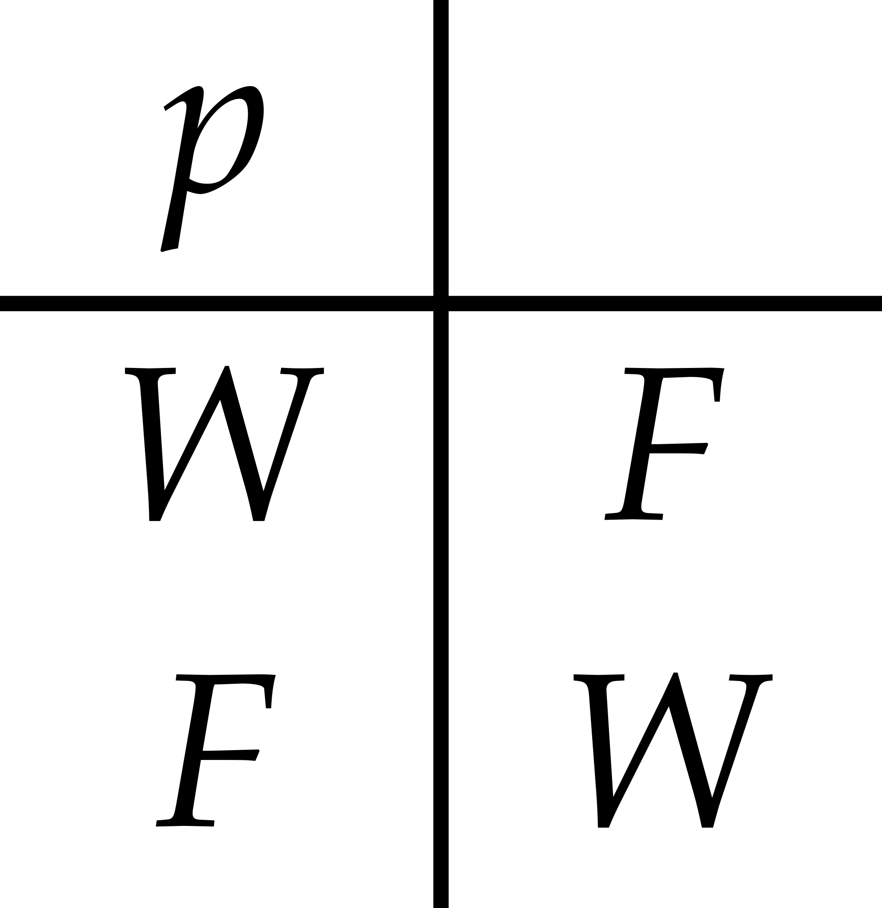”, for example,

is equivalent to every other sign of negation; it is just as much a complex of strokes as the expression “not p”, & it becomes a sign for negation only through the way it ‘_works_’, – I mean: through the way it is used in the game.

(Analogously, for the W-F schemas of tautology & contradiction.)

### [PG I](/w-pg-1/#ms-114-47v.5) [47v\[5\]](https://cdn.wittgensteinnachlass.com/2000px/webp/Ms-114/47v.webp)

I would like to say: the sign works only dynamically, not statically.

### [PG I](/w-pg-1/#ms-114-47v.6+48r.1) [47v\[6\]](https://cdn.wittgensteinnachlass.com/2000px/webp/Ms-114/47v.webp),[48r\[1\]](https://cdn.wittgensteinnachlass.com/2000px/webp/Ms-114/48r.webp)

It seems easy here to think that the sign summed up the whole grammar; that it would be contained in it like a string of pearls in a box & all we would have to do is pull it out. (But it is precisely such a picture that misleads us.) As though understanding were an instantaneous grasp of something from which later only the consequences were drawn, & in such a way that these consequences already existed in an ideal sense before they were drawn. As though the cube already contained the geometry of the cube & all I had to do was unfold it. But which cube? The cube we see, or an iron cube? Or is there an ideal geometrical cube? What we evidently have in mind is the process in which we derive propositions of geometry from a drawing, a mental image (or a model). But what role does the model play in this? Presumably that of the sign; the sign that is used in a particular game. – And it is interesting & curious how this sign is used, how, for example, we use the drawing of the cube again & again, in ever different combinations. – And it is this sign (_with the identity of a sign_) that we take for that cube in which the geometrical laws already lie. (They lie in it just as little as the dispositions to be used in a certain way lie in the chess king.)

### [PG I](/w-pg-1/#ms-114-48r.2+48v.1) [48r\[2\]](https://cdn.wittgensteinnachlass.com/2000px/webp/Ms-114/48r.webp),[48v\[1\]](https://cdn.wittgensteinnachlass.com/2000px/webp/Ms-114/48v.webp)

One is always in danger in philosophy of giving a mythology of symbolism, or of psychology; instead of simply saying what one knows.

### [48v\[2\]](https://cdn.wittgensteinnachlass.com/2000px/webp/Ms-114/48v.webp)

It is (something like) as if I were getting tools ready for future use in the toolbox of language. This toolbox is grammar with its rules. Think of the use of the image of a sphere (the mental image or a picture on paper). Such an image will not always be used when a sphere is being spoken of (when the word ‘sphere’ is used meaningfully), but it will be used in certain cases & then, so to speak, be taken out of the toolbox.

### [PG I](/w-pg-1/#ms-114-48v.3) [48v\[3\]](https://cdn.wittgensteinnachlass.com/2000px/webp/Ms-114/48v.webp)

The concept of meaning, as I adopted it into my philosophical discussions, derives from a primitive philosophy of language.

### [PG I](/w-pg-1/#ms-114-48v.4) [48v\[4\]](https://cdn.wittgensteinnachlass.com/2000px/webp/Ms-114/48v.webp)

“Meaning” comes from “deuten”.

### [PG I](/w-pg-1/#ms-114-48v.5+49r.1) [48v\[5\]](https://cdn.wittgensteinnachlass.com/2000px/webp/Ms-114/48v.webp),[49r\[1\]](https://cdn.wittgensteinnachlass.com/2000px/webp/Ms-114/49r.webp)

When Augustine speaks of learning language, he speaks only of how we give things names, or understand the names of things. _Naming_ seems here to be the foundation and the be-all and end-all of language.

Augustine does not speak of a difference between parts of speech & by “names” evidently means words such as “tree”, “table”, “bread” & certainly the proper names of people; but then presumably also “eat”, “give”, “here”, “there”; in short, all words.

But he is certainly thinking in the first instance of _nouns_, & of the others as something that will sort itself out. (And Plato says that the sentence consists of nouns & verbs.) They simply describe the game as simpler than it is. But the game Augustine describes is indeed part of language. Let us suppose I wanted to put up a building out of building stones that someone else was to hand me; we could first reach an agreement by my pointing to one building stone and saying: “this is a pillar”, and, pointing to another: “this is called ‘cube’”, – “this is called ‘slab’”, and so on. And now I would call out the words “pillar”, “slab”, etc. in the order in which I needed the stones.

### [PG I](/w-pg-1/#ms-114-49r.2+49v.1) [49r\[2\]](https://cdn.wittgensteinnachlass.com/2000px/webp/Ms-114/49r.webp),[49v\[1\]](https://cdn.wittgensteinnachlass.com/2000px/webp/Ms-114/49v.webp)

Augustine describes a calculus of our language, only not everything we call language is this calculus. (And this is what one must say in many cases where the question before us is: “is this representation useful, or useless”. The answer is: “yes, useful, – but only _for that_; not for the whole area you purported to represent”.)

### [49v\[2\]](https://cdn.wittgensteinnachlass.com/2000px/webp/Ms-114/49v.webp)

So it is as if someone explained: “Playing a game consists in moving things on a surface in accordance with certain rules …”; and we said to him: You are certainly thinking of board games & your description applies to them; but those are not all games. So you can correct your explanation by expressly restricting it to those games.

### [PG I](/w-pg-1/#ms-114-49v.3) [49v\[3\]](https://cdn.wittgensteinnachlass.com/2000px/webp/Ms-114/49v.webp)

I wanted to say: The way Augustine describes the learning of language can show us where this conception actually comes from. One could compare the case of our language with that of a script in which letters were used to designate sounds, but also to indicate stress & perhaps as punctuation marks. If one then regards this script as a language for describing the sound-image, one can imagine someone misunderstanding it as if each letter simply corresponded to a sound, & as if the letters did not also have quite different functions.

### [PG I](/w-pg-1/#ms-114-50r.1) [50r\[1\]](https://cdn.wittgensteinnachlass.com/2000px/webp/Ms-114/50r.webp)

This also belongs here: One can, readily enough, speak of _combinations of colours with shapes_ (say, of the colours red & blue with the shapes square & circle), just as one can speak of combinations of different figures or bodies. And here is the root of the bad expression that a fact is a complex of objects. Here a person’s being ill is compared with the putting together of two things, one of which would be the person, the other the illness.

### [PG I](/w-pg-1/#ms-114-50r.2) [50r\[2\]](https://cdn.wittgensteinnachlass.com/2000px/webp/Ms-114/50r.webp)

Just as the handles in a locomotive driver's cab have very different kinds of operation, so do the words of language, which in a certain sense correspond to handles. One is the handle of a crank, which can be adjusted continuously, since it operates a valve; another operates a switch with two positions; a third is the handle of a pump & works only when it is moved up & down; etc. But they all resemble one another, since they are grasped by hand.

### [PG I](/w-pg-1/#ms-114-50r.3+50v.1) [50r\[3\]](https://cdn.wittgensteinnachlass.com/2000px/webp/Ms-114/50r.webp),[50v\[1\]](https://cdn.wittgensteinnachlass.com/2000px/webp/Ms-114/50v.webp)

Whoever reads a sentence in a language familiar to him experiences the words of the different parts of speech in quite different ways. (The simile of the body of meaning.) We completely forget that the sound- or written-images “nicht” & “Tisch” & “grün” are things of the same kind & see the uniformity of words clearly only in a language foreign to us. (Compare William James on the feelings corresponding to words such as “nicht”, “aber”, etc.)

### [PG I](/w-pg-1/#ms-114-50v.2) [50v\[2\]](https://cdn.wittgensteinnachlass.com/2000px/webp/Ms-114/50v.webp)

Comparison of lines with different functions on a map (boundaries, roads, meridians, contour lines) with the different parts of speech in a sentence. The uninitiated sees a mass of lines & does not know the difference in their meanings. Let us imagine that on the map there is also a line crossing out a sign, to show that it is invalid.

### [PG I](/w-pg-1/#ms-114-50v.3) [50v\[3\]](https://cdn.wittgensteinnachlass.com/2000px/webp/Ms-114/50v.webp)

The difference between parts of speech is to be compared with the difference between chess pieces, but also with the still greater difference between a game piece & the chessboard.

### [PG I](/w-pg-1/#ms-114-50v.4+51r.1) [50v\[4\]](https://cdn.wittgensteinnachlass.com/2000px/webp/Ms-114/50v.webp),[51r\[1\]](https://cdn.wittgensteinnachlass.com/2000px/webp/Ms-114/51r.webp)

One says: The essential thing about a word is its _meaning_. One can replace the word with another that has the same meaning. In this way a place for the word is fixed, & one can put one word in place of another if one puts it in the same place.

### [PG I](/w-pg-1/#ms-114-51r.2) [51r\[2\]](https://cdn.wittgensteinnachlass.com/2000px/webp/Ms-114/51r.webp)

If I decided (also in my thoughts) to say a new word instead of “red”, how would it show that this one occupies the place of the word “red”? If it were agreed to say “non” instead of “nicht” in German & instead of “rot” “nicht”; then the word “nicht” would remain in the language, & yet one could say that “non” is now used _in the same way_ as “nicht” used to be, & that “nicht” is now used _differently_ from before.

### [PG I](/w-pg-1/#ms-114-51r.3) [51r\[3\]](https://cdn.wittgensteinnachlass.com/2000px/webp/Ms-114/51r.webp)

Would it not be similar if I decided to change the shapes of the chess pieces, or to use the figure of a little horse as the king? How would it now show that the little horse is the chess king? Can I not very well speak here of a change of meaning?

---

### [51r\[4\]](https://cdn.wittgensteinnachlass.com/2000px/webp/Ms-114/51r.webp),[51v\[1\]](https://cdn.wittgensteinnachlass.com/2000px/webp/Ms-114/51v.webp)

On the other hand, is it an inessential change if, in a sentence of lyric poetry, I replace one word with another? – What kind of difference does it make if, say, in a physics textbook I systematically replace the word speed with some arbitrary other word, or the letter v with a Hebrew one? & what difference, on the other hand, if I replace, say, a word in a lyric piece with the sign “A” & explain that A is to have the meaning of that word. That would be as if I were to frown & explain that it was to mean the same as a friendly smile.

### [51v\[2\]](https://cdn.wittgensteinnachlass.com/2000px/webp/Ms-114/51v.webp)

The meaning of a name is not its bearer. – The expression “the bearer of the name ‘N’” has the same meaning as the name ‘N’. The expression can be substituted for the name. “The bearer of the name ‘N’ is ill” means: N is ill. One does not say that the meaning of the word N is ill. The bearer of the name ‘N’ ceases to exist when he is destroyed, dies; but the name loses its meaning when we abolish it & replace it with another. But does it not come to the same thing to say “two names have _one_ bearer” & “two names have the same meaning”? Certainly, for instead of the equation: the bearer of the name A = the bearer of the name B, one can write: A = B.

### [51v\[3\]](https://cdn.wittgensteinnachlass.com/2000px/webp/Ms-114/51v.webp),[52r\[1\]](https://cdn.wittgensteinnachlass.com/2000px/webp/Ms-114/52r.webp)

To explain the meaning of a name we point to its bearer. By doing this one can teach the use of the word, if this use is already known, so to speak, except for one final determination. Remember that by the same pointing gesture towards the same body the meaning of words of different kinds can be explained. For example: “that (what I am pointing at) is called ‘wood’”, “that is called ‘brown’”, “that is called ‘rod’”, “that is called ‘penholder’”. The explanatory pointing then decides only a question of the kind: “Which of these people is Mr N?”, “which note is high C”, “Which colour is called ‘violet’”.

### [PG I](/w-pg-1/#ms-114-52r.2+52v.1) [52r\[2\]](https://cdn.wittgensteinnachlass.com/2000px/webp/Ms-114/52r.webp),[52v\[1\]](https://cdn.wittgensteinnachlass.com/2000px/webp/Ms-114/52v.webp)

When I say “the colour of this object is called ‘violet’”, I must already have designated the colour with the words “the colour of this object”, I must already have held it up for christening, in order for a naming to take place. For I could also say: “the name of this colour is to be determined by you”; & the one who gives the name would then already have to know to whom he is to give it (in what place in the language he is putting it). I could explain it like this: the colour of this patch is called “red”, the shape “ellipse”. And the words “colour” & “shape” stand for the kinds of application of names & in reality designate parts of speech such as “noun” & “adjective”. One could quite well introduce the designations “colour-word”, “shape-word”, “substance-word” into ordinary grammar. (But with the same justification also “tree-word”, “book-word”?)

### [52v\[2\]](https://cdn.wittgensteinnachlass.com/2000px/webp/Ms-114/52v.webp)

But let us think of the pointing to & naming of objects when one teaches children the beginnings of language. Here one cannot say that this explanation (if one wants to call it an explanation) gives a final determination of the use of the word (the word “Papa”, for example); & the child cannot yet ask “what is this called”. (This ‘explanation’ is not the answer to the question “what is this object called”.)

### [52v\[3\]](https://cdn.wittgensteinnachlass.com/2000px/webp/Ms-114/52v.webp)

The name I give to a body, or to a shape, a place, a colour, has a different grammar each time. “A” in “A is yellow” has a different grammar when it is once the name of a body and another time the name of the surface of a body. (It makes sense, for example, to say that the body is yellow through and through, but not that the surface is.) And one points in a different sense to a body, to its length, & to its colour. It is, for example, possible to define: to point to a colour means to point to the body that has it. (Just as someone who marries money does not marry it in the same sense in which he marries the woman who owns it.)

### [52v\[4\]](https://cdn.wittgensteinnachlass.com/2000px/webp/Ms-114/52v.webp),[53r\[1\]](https://cdn.wittgensteinnachlass.com/2000px/webp/Ms-114/53r.webp)

One could say: The meaning of a word is what the explanation of meaning explains. And insofar as the meaning is laid down in the explanation, the concept of meaning enters into the calculus that we operate with the signs.

But if by “meaning” we understand a characteristic feeling awakened on hearing a word, then the meaning is not laid down in the explanation of the word, but is perhaps caused by it, as an illness is caused by food.

### [53r\[2\]](https://cdn.wittgensteinnachlass.com/2000px/webp/Ms-114/53r.webp)

(Added to this: “What 1cm³ of water weighs has been called ‘1 gram’.” – “Yes, but what does it weigh?”)

### [53r\[3\]](https://cdn.wittgensteinnachlass.com/2000px/webp/Ms-114/53r.webp),[53v\[1\]](https://cdn.wittgensteinnachlass.com/2000px/webp/Ms-114/53v.webp)

In the first sense one might want to call the explanation of meaning the exclusion of misunderstandings. It says, for example, the word has this meaning, not that one. But this applies only to certain things that we call the explanation of the meaning of a word, when, for example, we explain: “this colour is called ‘orange’” (not that one), “this man is called ‘N.N.’” (not the other one). But we call many things ‘explanation of meaning’.

To explain the word “leaf” we point to various leaves; to explain the word “violet”, to a violet object; to explain the sign “⊃” we write “ p⊃q = ~p⌵q ” and so on. One says to the child: “no, no more lumps of sugar!” & takes it away from him. That is how it learns the meaning of the word “kein”. If one had given it a lump of sugar with the same words, it would have learnt to understand the word differently. (In this way it has learnt to use the word, but also to associate a particular feeling with it, to experience it in a particular way.)

### [53v\[2\]](https://cdn.wittgensteinnachlass.com/2000px/webp/Ms-114/53v.webp)

The explanation of meaning is part of the calculus with words. And one can say that it is what concerns us in philosophy when the meaning of a word is under discussion. For this explanation is another piece of language. One could also put it like this. Let us not ask what meaning is, but look at what one calls the “explanation of meaning”.

### [54r\[1\]](https://cdn.wittgensteinnachlass.com/2000px/webp/Ms-114/54r.webp)

One says: “the name ‘Mont Blanc’ on the map means this mountain”, “the word ‘violet’, this colour”, “the word ‘leaf’ _such an_ object”, but there is nothing analogous for the word “nicht”. But of the word “hallo” or “ach” too one says that it has a meaning, as opposed to a formation not used in our language (say “ech”). Of many a word we shall say that it is synonymous with a gesture; & if we wanted to speak of the meaning of the word “hehe!”, then in the same sense as of the meaning of laughter.

### [54r\[2\]](https://cdn.wittgensteinnachlass.com/2000px/webp/Ms-114/54r.webp)

What is called the explanation of the meaning of a word, e.g. a definition, teaches us the use of the word. And most words were not explained to us by definition, but we learnt their use in another way.

### [54r\[3\]](https://cdn.wittgensteinnachlass.com/2000px/webp/Ms-114/54r.webp),[54v\[1\]](https://cdn.wittgensteinnachlass.com/2000px/webp/Ms-114/54v.webp)

One would now like to say: Certainly, the meaning of a word is its effect. For the sentences we say have a certain purpose, they are meant to bring about certain effects. So they are obviously part of a mechanism (perhaps a psychological one) for bringing about this effect & the words too are such parts (levers, cog-wheels and the like). And the simplest example would be the effect of a group of holes in the music roll of a pianola. But what if the pianola does not function properly because its mechanism has got out of order? If this group of holes produces knocking & hissing instead of a musical phrase. Perhaps one says that the sense of the signs is the effect of those holes on a pianola in good condition (the sense of an order is its effect on a willing person). But what is to serve here as the criterion of willingness?

### [54v\[2\]](https://cdn.wittgensteinnachlass.com/2000px/webp/Ms-114/54v.webp),[55r\[1\]](https://cdn.wittgensteinnachlass.com/2000px/webp/Ms-114/55r.webp)

It is not to the effect that the sense corresponds, but to the purpose (the purpose is laid down, the effect is a matter of experience). The meaning of a word is laid down. Experience will teach the effect. Am I then to say that the purpose of a word is its meaning? – What, then, is the purpose of the word “grass”? (Do not say that it is simply to produce an image of grass in the hearer.) – Asked about the purpose of the holes on the pianola roll, I shall probably describe the way they work _in the pianola_. But I could not represent the purpose of these holes as part of the purpose of the pianola, say, the purpose of cheering someone up. One could say that it is the function of chess to give us pleasure; but can one describe the function of the knight by showing the part of the total pleasure that falls to the knight

### [55r\[2\]](https://cdn.wittgensteinnachlass.com/2000px/webp/Ms-114/55r.webp)

How does a child learn the use of, say, the word “perhaps”? – It repeats a sentence that it has heard from an adult: “she will perhaps come”; in the same tone of voice as the adult. (This is, as it were, a game.) Then one sometimes asks oneself: does it already understand the word “perhaps”, or is it merely repeating it? – What is the indication that it really understands the word? – That it uses it correctly in different cases – (that surely means, in accordance with the rules) – & also acts accordingly.

### [55r\[3\]](https://cdn.wittgensteinnachlass.com/2000px/webp/Ms-114/55r.webp)

Money, & what one buys with it. In certain cases an object (an apple), but also permission to sit in a seat in the theatre, or a title, or rapid movement, or life, etc.

### [55r\[4\]](https://cdn.wittgensteinnachlass.com/2000px/webp/Ms-114/55r.webp),[55v\[1\]](https://cdn.wittgensteinnachlass.com/2000px/webp/Ms-114/55v.webp)

One would like to explain the _mechanism_ of meaning by means of memory & association. But we feel that it cannot be the explanation of a mechanism that matters to us. For this explanation is again a description of phenomena by means of language. It says, for example: when the word “red” is heard, the image of red springs up (a panel at the press of a button). Well, when that happens, – what next? – What we want to hear is precisely the explanation of a calculus. And the explanation of the mechanism takes its stand outside the calculus. It is itself a description in language, & one that does not enter into the calculus that is to be explained to us. Whereas we need an explanation that is part of this calculus.

### [55v\[2\]](https://cdn.wittgensteinnachlass.com/2000px/webp/Ms-114/55v.webp)

(The psychological – trivial – discussions about association, recognition, etc. always leave out what is actually remarkable & one can tell that they are beating around the bush without touching the crucial point.)

### [55v\[3\]](https://cdn.wittgensteinnachlass.com/2000px/webp/Ms-114/55v.webp),[56r\[1\]](https://cdn.wittgensteinnachlass.com/2000px/webp/Ms-114/56r.webp)

“How is he to know which colour he has to choose when he hears the word ‘red’?” – “Very simply: he is to take the colour whose image comes to mind on hearing the word”. – But how is he to know what that means & which one it is “that comes to him at the word ‘red’”? (There is of course also a game: choose the colour that comes to you at this word. And: “‘red’ means: the colour that comes to my mind on hearing the word ‘red’” would be a definition.) If I say “_symbol_ is what produces this particular effect”, – then the question is how I can speak of “this effect”. And how I know that it is _the one I meant_ when it occurs. It is therefore no explanation that gets to the root of our difficulty to say: very simple, we compare it with our memory-image; – for how is the method of comparison given to us according to which we are to compare? That is, how do we know what the word “compare” means? What is the criterion that I have correctly recognized the colour red? And it is not at all necessary to explain the way a word works through association & memory, since one can always carry a slip of paper with a table instead of these faculties.

### [56r\[2\]](https://cdn.wittgensteinnachlass.com/2000px/webp/Ms-114/56r.webp)

I could also ask it this way: Why do you ask for causal explanations? When these are given, you will once again be standing before an end. They cannot take you any further than you are now.

### [56r\[3\]](https://cdn.wittgensteinnachlass.com/2000px/webp/Ms-114/56r.webp)

I wish to be given an apple; can I say that only the fulfilment of the wish shows me what I wished for? That _it_ first teaches me the meaning of the word “apple”? – This meaning is given by an explanation of the word, which is not the fulfilment of the wish.

### [56r\[4\]](https://cdn.wittgensteinnachlass.com/2000px/webp/Ms-114/56r.webp),[56v\[1\]](https://cdn.wittgensteinnachlass.com/2000px/webp/Ms-114/56v.webp)

It is _one_ function of the word “red” to call a particular colour to mind & it might be found that the word “red” is better suited to this than another, that its meaning, say, is not so easily forgotten or confused. But, as already said, instead of the mechanism of association we could have used a table (or the like); & then our calculus would have to proceed with the associated, or seen, colour-pattern. The psychological effectiveness of a sign does not concern us. (By contrast, for example, Cratylus: “It is by far & without question better, Socrates, to represent what one wants to represent by means of something similar than by means of the first thing that comes to hand.”)

### [56v\[2\]](https://cdn.wittgensteinnachlass.com/2000px/webp/Ms-114/56v.webp)

The use of a map consists in our directing ourselves in some way according to it; in transferring its image into our actions. It is clear that causal connections take place there; but would one say that they are what makes the plan a plan?

### [56v\[3\]](https://cdn.wittgensteinnachlass.com/2000px/webp/Ms-114/56v.webp),[57r\[1\]](https://cdn.wittgensteinnachlass.com/2000px/webp/Ms-114/57r.webp),[57r\[2\]](https://cdn.wittgensteinnachlass.com/2000px/webp/Ms-114/57r.webp)

The investigation of whether the meaning of a sign is its effect, its purpose, etc. is a grammatical investigation.

On the other hand one says: “I understand this gesture”, just as one says “I understand this theme”, “it says something to me”, & here that means: I experience it, it affects me. I follow it with a particular experience. If, on some occasion, I say: “I understand this gesture”, do I mean that I can translate it into words or other signs? Certainly not always. I am also characterizing an experience. (The gesture makes an impression on me.)

### [57r\[4\]](https://cdn.wittgensteinnachlass.com/2000px/webp/Ms-114/57r.webp),[57r\[5\]](https://cdn.wittgensteinnachlass.com/2000px/webp/Ms-114/57r.webp)

It is strange: we shall explain understanding a gesture through its translation into words & understanding words through a translation into gestures.

(If asked what I mean by the word “and” in the sentence “give me the bread and the butter”, I would answer with a summarizing gesture; & this gesture would illustrate what I mean. Similarly, a little green sample illustrates the meaning of “green” & the W-F notation illustrates the meaning of “not”, “and”, etc.)

### [57r\[6\]](https://cdn.wittgensteinnachlass.com/2000px/webp/Ms-114/57r.webp),[57v\[1\]](https://cdn.wittgensteinnachlass.com/2000px/webp/Ms-114/57v.webp)

The “not” makes a gesture of warding off. It _is_ a gesture of warding off. And one could probably say: understanding negation is understanding a gesture of warding off (of negation). (How does one learn to understand the head-shaking of negation?)

### [57v\[2\]](https://cdn.wittgensteinnachlass.com/2000px/webp/Ms-114/57v.webp),[58r\[1\]](https://cdn.wittgensteinnachlass.com/2000px/webp/Ms-114/58r.webp),[58v\[1\]](https://cdn.wittgensteinnachlass.com/2000px/webp/Ms-114/58v.webp)

It is possible for someone to forget the meaning of a word, say the word “blau”. What has he forgotten? – How does this show itself? For example, he points to tiles of different colours & says: “I no longer know which of these one calls ‘blau’”. Or he no longer knows at all what the word means, & only that it is a word of the German language. Now if we ask him “do you know what the word ‘blau’ means”, & he says “yes”, – he could apply various criteria “to satisfy himself” that he knew the meaning. (Think of the corresponding criteria for his being able to recite the alphabet.) Perhaps he calls a blue mental image to mind, perhaps he looks for a blue object in the room, perhaps the English “blue” occurs to him, or he thinks of a blow which had produced a bruise, etc.. If one were to ask: how can he call a blue mental image to mind as a test of his understanding? For how can the word “blau” show him which colour from the colour-box of his imagination he is to choose, – the answer is that this precisely shows that the picture of choosing, say, a blue object by means of a blue sample tile fails here. And the process is more like what happens when, on pressing a button bearing the inscription “blau”, a blue tile automatically springs out; or, if the mechanism fails, does not spring out. One might now say: Someone who has forgotten the meaning of the word “blau” & has been asked to select a blue object from among others feels, on looking at these objects, that the connection between the word “blau” & those colours no longer exists (that it has been interrupted). And the connection is restored when we repeat the explanation of the word to him. But we could restore the connection in many different ways: We could point to a blue object & say “that is blue”, or tell him “remember your blue bruise”, or we might say the word “blue” to him, etc.. And if I said that we could establish the connection in these different ways, it is natural to think that I had brought about _one_ particular phenomenon, which I call the connection between word & colour, or the understanding of the word, in all these different ways, just as I might connect the ends of two wires conductively by means of various objects. But there need be no question of any such phenomenon of connection, such as the appearance of a blue mental image, & understanding will then show itself, will consist in the fact that he actually selects the blue ball from among the others; or says that he can do it now but does not want to; or etc., etc. We can then always establish a game which represents _one_ possibility of such a process, & must not forget that in reality countless different processes & their intersections are described by the words “forgetting the meaning”, “remembering the meaning”, “knowing the meaning”.

### [58v\[2\]](https://cdn.wittgensteinnachlass.com/2000px/webp/Ms-114/58v.webp)

What effect did the ostensive explanation have? Is it repeatedly brought in when the word is used, or does it work like an inoculation which has changed us for the time being?

### [58v\[3\]](https://cdn.wittgensteinnachlass.com/2000px/webp/Ms-114/58v.webp)

The way in which we learnt the language is not _contained_ in its use. (Just as the cause is not contained in its effect.)

### [58v\[4\]](https://cdn.wittgensteinnachlass.com/2000px/webp/Ms-114/58v.webp),[59r\[1\]](https://cdn.wittgensteinnachlass.com/2000px/webp/Ms-114/59r.webp)

The explanation as part of the calculus cannot act at a distance. It works only insofar as it is applied.

---

### [PG I](/w-pg-1/#ms-114-59r.2) [59r\[2\]](https://cdn.wittgensteinnachlass.com/2000px/webp/Ms-114/59r.webp)

[→ ]

Is it not the case that an explanation, a table, is first used in such a way that one “looks it up”, that one then, as it were, looks it up in one’s head, calls it before the mind’s eye (or the like), & that finally one works without this table, – that is, as if it had never existed. – In this latter case one is now playing a different game. For it is not the case that that table nevertheless stands in the background (& that one can always fall back on it); it has dropped out of our game, & if I “fall back” on it, I do what someone who has gone blind does when he falls back on his sense of touch. An explanation draws up a table, & it becomes history when I no longer use the table.

### [PG I](/w-pg-1/#ms-114-59r.3+59v.1+60r.1) [59r\[3\]](https://cdn.wittgensteinnachlass.com/2000px/webp/Ms-114/59r.webp),[59v\[1\]](https://cdn.wittgensteinnachlass.com/2000px/webp/Ms-114/59v.webp),[60r\[1\]](https://cdn.wittgensteinnachlass.com/2000px/webp/Ms-114/60r.webp)

I must distinguish between the cases: when on one occasion I follow the table, & on another act in accordance with the table, without using it. – The rule whose learning led us now to act in such and such a way is, as the cause of our way of acting, its prehistory, without interest for us. – But insofar as it is a general description of our way of acting, it is a hypothesis. It is the hypothesis that these two people sitting at the chessboard will act (move) in such and such a way. (An infringement of the rules of the game also falls under the hypothesis, for it then says something about the behaviour of the players when they notice the infringement.) The players could, however, use the rules in such a way that in each particular case they looked up what was to be done; here the rule would enter into the game-action itself & would not stand in relation to it as a hypothesis to its confirmation. – But here there is a difficulty: For the player who plays without using a list of the rules, indeed, who has never seen one, could nevertheless, if asked, state the rules of his game; & not by establishing through repeated observation how he acts in this and that game situation, but by saying, as he stood before a move: “in this case _one moves like this_”. – But if that is so, it shows only that he will state a rule under certain circumstances, not that he makes explicit use of it in playing. That he will draw up a list of the rules if asked is a hypothesis; & if one assumes in him a disposition, a capacity to do so, it is a psychological disposition analogous to a physiological one. If this disposition is said to characterize the process of playing, it characterizes it as a psychological or physiological process, which it actually is. (In our study of symbolism there is no foreground & background, not essentially a tangible sign & an intangible capacity or understanding accompanying it.)

### [PG I](/w-pg-1/#ms-114-60r.2) [60r\[2\]](https://cdn.wittgensteinnachlass.com/2000px/webp/Ms-114/60r.webp)

What interests _us_ about the sign, the meaning that is decisive for _us_, is what is laid down in the grammar of the sign.

### [PG I](/w-pg-1/#ms-114-60r.3) [60r\[3\]](https://cdn.wittgensteinnachlass.com/2000px/webp/Ms-114/60r.webp)

We ask: How do you use the word, what do you do with it? – that will teach us how you understand it.

### [PG I](/w-pg-1/#ms-114-60r.4) [60r\[4\]](https://cdn.wittgensteinnachlass.com/2000px/webp/Ms-114/60r.webp)

Grammar is the set of ledgers of language, from which everything must be discernible that concerns not accompanying sensations but the actual transactions with language.

### [PG I](/w-pg-1/#ms-114-60r.5) [60r\[5\]](https://cdn.wittgensteinnachlass.com/2000px/webp/Ms-114/60r.webp)

One might say, in a certain sense, that nuances do not matter to us. (I could imagine a philosopher who believed that he had to have a sentence about the nature of knowing, say, printed in red, since otherwise it would not really express what it was supposed to express.)

### [PG I](/w-pg-1/#ms-114-60r.6+60v.1) [60r\[6\]](https://cdn.wittgensteinnachlass.com/2000px/webp/Ms-114/60r.webp),[60v\[1\]](https://cdn.wittgensteinnachlass.com/2000px/webp/Ms-114/60v.webp)

The interpretation of written & spoken signs by means of ostensive explanations is not an _application_ of language, but part of grammar. The interpretation still takes place in general, as preparation for every application.

### [PG I](/w-pg-1/#ms-114-60v.2) [60v\[2\]](https://cdn.wittgensteinnachlass.com/2000px/webp/Ms-114/60v.webp)

One can conceive of the ostensive explanation as a rule for translating from a gesture-language into a word-language.

### [PG I](/w-pg-1/#ms-114-60v.3) [60v\[3\]](https://cdn.wittgensteinnachlass.com/2000px/webp/Ms-114/60v.webp)

It does not belong to grammar that this experiential proposition is true and that one false. All the conditions (the method) for comparing the sentence with reality belong to it. That is, all the conditions of understanding (of sense).

### [PG I](/w-pg-1/#ms-114-60v.4) [60v\[4\]](https://cdn.wittgensteinnachlass.com/2000px/webp/Ms-114/60v.webp)

Insofar as the meaning of words shows itself in the fulfilled expectation, in the fulfilment of the wish, in following the command, etc., it already shows itself in a linguistic representation of the expectation, etc. It is therefore determined entirely in grammar. In what could have been foreseen; what one could already speak of before the fact occurred.

### [60v\[5\]](https://cdn.wittgensteinnachlass.com/2000px/webp/Ms-114/60v.webp)

Is the reason why we believe that with the ostensive explanation we leave the domain of language, of signs, that we confuse this stepping outside the _written signs_ with an application of language, say with the description of an object seen?

### [PG I](/w-pg-1/#ms-114-61r.1) [61r\[1\]](https://cdn.wittgensteinnachlass.com/2000px/webp/Ms-114/61r.webp)

Does our language now consist of primary signs (ostensive gestures) & secondary signs (words)?

One might ask whether there must not be primary signs in our language, while it could also manage without the secondary ones. The false note in this question lies in its expecting an explanation of the language that actually exists, instead of a mere description.

It sounds like a laughably obvious truism when I say that someone who believes gestures to be the primary signs underlying all the others would be unable to replace the most ordinary sentence by gestures.

### [PG I](/w-pg-1/#ms-114-61r.2) [61r\[2\]](https://cdn.wittgensteinnachlass.com/2000px/webp/Ms-114/61r.webp)

One might distinguish between rules of grammar which establish “a connection between language & reality”, & those which do not. A rule of the first kind is: “this colour is called ‘red’”, – a rule of the second kind: “~~p = p”. There is a misconception about this distinction; language is not something that is given a structure and then fitted to reality.

### [PG I](/w-pg-1/#ms-114-61r.3+61v.1) [61r\[3\]](https://cdn.wittgensteinnachlass.com/2000px/webp/Ms-114/61r.webp),[61v\[1\]](https://cdn.wittgensteinnachlass.com/2000px/webp/Ms-114/61v.webp)

One might want to ask: But is it an accident that in order to explain signs, and thus to complete the system of signs, I have to step outside the written & spoken signs? In doing so, do I not enter precisely the domain in which what is to be described then takes place? – But is it not strange that I can then do anything at all with the written signs? – One might say that the written signs merely stand in for those things to which the ostensive explanation points. –

(It of course makes good sense to say that the defined sign stands for the defining one; & also that the ostensive explanation makes a word stand for the pointing to an object. But, incidentally, it is not the colour red that is represented by the word “red”, but, say, a red tile.)

### [PG I](/w-pg-1/#ms-114-61v.2+62r.1) [61v\[2\]](https://cdn.wittgensteinnachlass.com/2000px/webp/Ms-114/61v.webp),[62r\[1\]](https://cdn.wittgensteinnachlass.com/2000px/webp/Ms-114/62r.webp)

One might say: a red tile, or the like, is the primary sign for the colour red, the word or a secondary sign: for it explains the meaning of the word “red” when I point to a red tile, etc., but not when I say that “red” means the same as “rouge”.

### [62r\[2\]](https://cdn.wittgensteinnachlass.com/2000px/webp/Ms-114/62r.webp),[62v\[1\]](https://cdn.wittgensteinnachlass.com/2000px/webp/Ms-114/62v.webp)

What is the criterion of our (the other person’s, or one’s own?) understanding in the other person: selecting a red object from among others when required to do so, or giving the ostensive explanation of the word “red”? We regard both as signs of understanding. If we hear someone use the word “red” & doubt whether he understands it, we can test him by asking: “which colour do you call ‘red’”. On the other hand, if we had given someone the ostensive explanation of the word & now wanted to see whether he had understood it correctly, we would not require him to repeat it, but might give him the task of picking out the red things from among a number of objects. How we use the word “understanding” is determined by what we regard as a test of understanding. But what if he understands the word according to one test and not according to the other?

### [62v\[2\]](https://cdn.wittgensteinnachlass.com/2000px/webp/Ms-114/62v.webp)

If someone says: “It is rightly regarded as a sign of understanding the word ‘red’ to be able, on command, to pick out a red object from differently coloured ones; whereas correctly translating the word into French is no proof of understanding”, – I would answer: That shows only what you mean by “understand”. “It is rightly regarded” surely should not mean: if a person picks out a red object on command, etc., etc., then, as experience shows, he has understood the word. (If that was what was meant, one can go on to ask: what other experience counts as the specific test of understanding.)

### [PG I](/w-pg-1/#ms-114-62v.3) [62v\[3\]](https://cdn.wittgensteinnachlass.com/2000px/webp/Ms-114/62v.webp)

Are the signs which one would like to call ‘primary’ unambiguous? Can one say, for example, that they ought not to be _understood_ any more? – If that is to mean that they ought not to be further _interpreted_, the same holds of the word; but if it means that they _could_ not be further interpreted, then it is false. (Think of the explanation of gestures by words, etc., etc..)

### [PG I](/w-pg-1/#ms-114-63r.2+63v.1) [63r\[2\]](https://cdn.wittgensteinnachlass.com/2000px/webp/Ms-114/63r.webp),[63v\[1\]](https://cdn.wittgensteinnachlass.com/2000px/webp/Ms-114/63v.webp)

What if I establish a notation; if, for example, I want to give shades of colour names for my own use: I might do it by means of a table; and surely I would not write the name next to the wrong colour (the colour to which I do not want to give it). But why not? Why should not “red” stand opposite the green tile & “green” opposite the red one, etc.? If the ostensive definition merely puts one sign in place of another, that should make no difference. – There are in any case two different cases here: The table, with green opposite “red”, etc., can be used in such a way that the person who “looks it up” passes diagonally from the word “red” to the red tile & from the word “green” to the green one, and so on. We would then say that the table was merely arranged differently (according to a different spatial schema), but connected the signs in the same way as the familiar one. – But it might also be that the person using the table looks horizontally from one side to the other & then replaces the word “red” in certain sentences with a green tile; but does not, in response to the command “give me the red book”, bring a green one, but quite correctly a red one (i.e. the one we too call “red”). He has now used the table differently from the first person, but in such a way that for him the word “red” means the same colour as for us. It is the second case that interests us, and the question is: Can a green tile serve as a _sample_ for red? – I can imagine an agreement according to which someone to whom I show a green tile and say paint me this colour is to paint me a red; if I show him blue with these words, he is to paint yellow (say, always the complementary colour). And so it is also possible that someone interprets my command in this way without such an agreement. The agreement might also have been: “when I say, paint this colour, always paint a somewhat darker one”; and again we can imagine that the command would be interpreted in this way without this agreement. – But can one say that someone _copies_ the red of the tile by painting a certain shade of green? And indeed, say, in the way in which he can copy a geometrical figure differently and exactly according to different methods of projection? – Can I compare colours with shapes, and can a green tile be used on the one hand as the name of a particular shade of red, and on the other as its sample? just as a circle can serve as the name of a particular elliptical shape, but also as its sample.

### [PG I](/w-pg-1/#ms-114-64r.1) [64r\[1\]](https://cdn.wittgensteinnachlass.com/2000px/webp/Ms-114/64r.webp)

It is clear: the sample is not used like the word (the name). And the ostensive explanation, the table, insofar as it leads us from words to samples, differs from the table which replaces one name by another.

### [PG I](/w-pg-1/#ms-114-64r.2) [64r\[2\]](https://cdn.wittgensteinnachlass.com/2000px/webp/Ms-114/64r.webp)

But the word “copy” has different meanings in different cases, and accordingly what I call a “sample” changes. What does it mean to “copy a figure exactly”: to copy it exactly by eye? or with measuring instruments? and with which ones? What are we to call the same colour as that of the sample? Think of different methods of comparison. To what extent can the rule “copy darker” be compared with copying a figure on an enlarged or reduced scale?

### [PG I](/w-pg-1/#ms-114-64r.3+64v.1) [64r\[3\]](https://cdn.wittgensteinnachlass.com/2000px/webp/Ms-114/64r.webp),[64v\[1\]](https://cdn.wittgensteinnachlass.com/2000px/webp/Ms-114/64v.webp)

Let us imagine someone who claimed that he could copy shades of red in green, & who, looking at the red sample, mixed a shade of green with all the outward signs of exact copying. For us he would be on a par with someone who mixed colours according to violin notes (listening very closely). In that case we would say: “I don’t know _how_ he does it”; but not in the sense that we did not understand the hidden processes in his brain or muscles, but rather that we did not understand what it means to say “this shade is the copy of this violin note”. Unless what is meant is that a person is known from experience to associate a particular shade with a particular sound (sees it before him, paints it, etc.). The difference between the meanings of “associating” & “copying” shows itself in the fact that it makes no sense to speak, for the associated shape (or colour), of a method of projection (a rule for transferring) of the association. We say: “You have not copied correctly”, – but not “You have not associated correctly”.

### [PG I](/w-pg-1/#ms-114-64v.2+65r.1) [64v\[2\]](https://cdn.wittgensteinnachlass.com/2000px/webp/Ms-114/64v.webp),[65r\[1\]](https://cdn.wittgensteinnachlass.com/2000px/webp/Ms-114/65r.webp)

If the table connects the word with a sample, it is not immaterial which tile the word is connected with when it is looked up. – “But then there are arbitrary signs & ones that are not arbitrary!” – Let us think only of communication by means of maps, drawings, & on the other hand sentences. Sentences are no more arbitrary than drawings; only words are arbitrary. And on the other hand the projection method of the map is arbitrary – how should one determine what is arbitrary?

### [PG I](/w-pg-1/#ms-114-65r.2) [65r\[2\]](https://cdn.wittgensteinnachlass.com/2000px/webp/Ms-114/65r.webp)

I can indeed compare the fixing of word-meanings with the fixing of a method of projection, such as the one for depicting spatial formations (“the sentence is a picture”); this is a good comparison, but it does not relieve us of investigating the functioning of words, which has its own rules. We can of course say – i.e. it corresponds to linguistic usage – that we communicate by means of signs, whether we use words or samples; but the game of following words is different from that of following samples. (Words are not essential to what we call “language”, & neither are samples.) Word-language is only one among many possible kinds of language, & there are transitions from one to another. (Think of two ways of writing the sentence “I see a red circle”: this could be done by writing a circle & giving it the corresponding colour (red); but also by writing a circle & next to it a red patch. Consider the map with regard to what in it corresponds to the form of expression of word-language.)

### [PG I](/w-pg-1/#ms-114-65r.3+65v.1+66r.1) [65r\[3\]](https://cdn.wittgensteinnachlass.com/2000px/webp/Ms-114/65r.webp),[65v\[1\]](https://cdn.wittgensteinnachlass.com/2000px/webp/Ms-114/65v.webp),[66r\[1\]](https://cdn.wittgensteinnachlass.com/2000px/webp/Ms-114/66r.webp)

“I don’t mean to insist that in the explanatory table the red sample should stand horizontally opposite the word “red”, but surely there must be some law for reading the table, for otherwise it loses its sense”. But is it without rules if the table is understood as the arrows in the schema

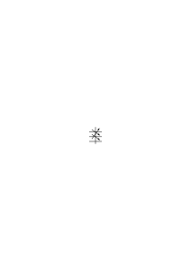

indicate? – “But _must_ the schema of the arrows itself then be given beforehand?” – Must the schema

be given before the ordinary way of using it? “But isn’t at least a temporal regularity in the use of the table then required? Would it be acceptable for us to use a table once according to this schema and once according to that one? _How is one to know_ how the table is to be used?” – But do we know it _today_? Explanations of signs must come to an end somewhere. I would of course cause a misunderstanding if, without a special agreement, I showed someone the way by pointing my finger not in the direction in which he is to go, but in the opposite direction. It is in human nature to understand pointing with the finger _in this way_. (Just as it is in human nature to play board games & invent languages of signs consisting of written signs on a surface.)

### [PG I](/w-pg-1/#ms-114-66r.2) [66r\[2\]](https://cdn.wittgensteinnachlass.com/2000px/webp/Ms-114/66r.webp)

The table does not guarantee the sameness of the transitions made in it. It does not compel me to use it in the same way every time. It is there like a field through which paths lead; but I can also go cross-country. – I make the transition in the table anew with each application. It is not, as it were, made in the table once and for all (it merely tempts me to make it). (What kind are these sentences? – Probably of the same kind as the remark that explanations of signs do come to an end at some point. And that is somewhat like saying: “What good does assuming a creator do you? It only defers the problem of the beginning of the world.” This remark brings out an aspect of my explanation that I may not have noticed. One might also say: “Look at your explanation _this_ way! – are you still satisfied with it now?”

### [PG I](/w-pg-1/#ms-114-66v.1) [66v\[1\]](https://cdn.wittgensteinnachlass.com/2000px/webp/Ms-114/66v.webp)

Can one look for something red by going by the word “red”? does one need a memory-image for that?

### [PG I](/w-pg-1/#ms-114-66v.2) [66v\[2\]](https://cdn.wittgensteinnachlass.com/2000px/webp/Ms-114/66v.webp)

Can one say that the word “red”, in order to be a usable sign, needs a supplement in memory? If I describe an experience with the words “there is a red book in front of me”, is the justification (of the use) of these words, besides the experience described, that I remember having always used the word “red” for this colour? _Must_ that be the justification?

### [PG I](/w-pg-1/#ms-114-66v.3) [66v\[3\]](https://cdn.wittgensteinnachlass.com/2000px/webp/Ms-114/66v.webp)

⋎

If what matters in the use of the word “red” is the image that my memory automatically reproduces at the sound of this word, then I am just as much at the mercy of this reproduction as if I had resolved to determine the meaning by looking it up in a table, in which case I would be putting myself, as it were, entirely at the mercy of what I found in it.

### [PG I](/w-pg-1/#ms-114-66v.4+67r.1) [66v\[4\]](https://cdn.wittgensteinnachlass.com/2000px/webp/Ms-114/66v.webp),[67r\[1\]](https://cdn.wittgensteinnachlass.com/2000px/webp/Ms-114/67r.webp)

If the colour sample by which I want to be guided seems darker to me than it was yesterday according to my memory, I need not give memory the benefit of the doubt & nor do I always do so. And I could quite well speak of my memory darkening.

### [PG I](/w-pg-1/#ms-114-67r.2) [67r\[2\]](https://cdn.wittgensteinnachlass.com/2000px/webp/Ms-114/67r.webp)

If I tell someone “paint the colour of your room door from memory”, that determines what he is to do no more unambiguously than the order: “paint the green that you see on this board”. One could also imagine the first of these sentences being understood in the way one would normally understand, say, the sentence “paint a shade somewhat lighter than the one you remember having seen there”; and, on the other hand, the person given the order to paint the shade according to a sample will ordinarily have no doubt about the method of projection.

### [PG I](/w-pg-1/#ms-114-67r.3+67v.1) [67r\[3\]](https://cdn.wittgensteinnachlass.com/2000px/webp/Ms-114/67r.webp),[67v\[1\]](https://cdn.wittgensteinnachlass.com/2000px/webp/Ms-114/67v.webp)

If I had been ordered: “find me a red flower in this meadow & bring it to me”, & I now found one, – would I compare it with my memory-image of the colour red? – And must I consult a further image to see whether the first one is still right? – And why should I then necessarily need the first one? – I see the colour of the flower & recognize _it_. (It would of course be _imaginable_ that someone hallucinated a sample of a colour & compared it with the object being sought as with a real one.)

Even if I say “no, this colour is not yet the right one, it is lighter than the one I saw there”, it does not follow that I see the latter in front of me & that the process is one of comparing two shades seen simultaneously. Nor is it as if somewhere in my mind a bell rang when the right shade had been found & as if I carried an image of this ringing around with me in order to be able to judge when it rang.

### [PG I](/w-pg-1/#ms-114-67v.2) [67v\[2\]](https://cdn.wittgensteinnachlass.com/2000px/webp/Ms-114/67v.webp)

It is a different game to search with a sample, apply it to the objects & so check the sameness of the colours, and, on the other hand, to act according to words of a word-language without such a sample. Let us think of reading aloud from what is written (or writing down what one hears). We could of course imagine a kind of table that could guide us in doing this. But no table guides us; no act of memory, nothing, mediates between the written sign & the sound.

### [PG I](/w-pg-1/#ms-114-67v.3+68r.1) [67v\[3\]](https://cdn.wittgensteinnachlass.com/2000px/webp/Ms-114/67v.webp),[68r\[1\]](https://cdn.wittgensteinnachlass.com/2000px/webp/Ms-114/68r.webp)

If I were now asked: “why do you choose _this_ colour in response to this order; how do you justify this choice?”, – then in the one case I can answer: “Because _this_ colour stands opposite the word ‘red’ in my table.” In the other case there would be no answer to this question & the question would make no sense. But in the first game the question has no sense: “Why do you call the colour ‘red’ that which stands opposite the word ‘red’ in the table?” A _reason_ can be given only _within_ a game. The chain of reasons comes to an end, namely at the boundary of the game. (Reason & cause.)

### [68r\[2\]](https://cdn.wittgensteinnachlass.com/2000px/webp/Ms-114/68r.webp)

Let us consider the order: “Do now what, as you remember it, you did at this time yesterday.” How does he know what the words of this order require of him, – if we assume that it is always a memory-image that gives the words their meaning? These words can tell him _only where_ to look for an image; but in order to understand these words he needs another image again, and so on. – If he remembers, he can follow his memory; but if he does not remember, the order has no sense for him. The order is thus similar to: “do what is written on this slip of paper.” If the slip is blank, this is not an order. (Let us imagine that the slip contains a senseless combination of words.)

### [PG I](/w-pg-1/#ms-114-68r.3) [68r\[3\]](https://cdn.wittgensteinnachlass.com/2000px/webp/Ms-114/68r.webp)

And if one recalls “that the table does not compel us” to use it in a particular way – nor to use it always in the same way – it becomes (quite) clear that our use of the word “rule” & “game” is wavering (blurring towards the edges).

### [68v\[1\]](https://cdn.wittgensteinnachlass.com/2000px/webp/Ms-114/68v.webp)

It is incorrect to say that the agreement (and disagreement) between sentence & world is arbitrarily created by a correlation of the two. For how is the correlation to be expressed? It is supposed to consist in the sentence “p” saying that _just this_ is the case. But how is this ‘just this’ (in the particular case) given to us (expressed)? If by another sentence, we gain nothing by it; but if by a fact of the external world, then this belongs to language as an explanation of language. I.e.: there is no ostensive definition of a _sentence_ – or, more correctly: ostensive explanations are given _before_ the application of the sentence and are different from the application.

### [PG I](/w-pg-1/#ms-114-68v.2) [68v\[2\]](https://cdn.wittgensteinnachlass.com/2000px/webp/Ms-114/68v.webp)

The connection between “language & reality” is made by explanations of words, – which belong to grammar; so that language remains closed in on itself, autonomous.

### [68v\[3\]](https://cdn.wittgensteinnachlass.com/2000px/webp/Ms-114/68v.webp),[69r\[1\]](https://cdn.wittgensteinnachlass.com/2000px/webp/Ms-114/69r.webp)

If I knew the sound-image of a Chinese sentence & knew that this sentence stood, say in a picture book, as the title beneath a particular picture, I could not thereby yet form a Chinese sentence. I could say: it does not enable me to portray a state of affairs in Chinese.

### [69r\[2\]](https://cdn.wittgensteinnachlass.com/2000px/webp/Ms-114/69r.webp)

If one asked someone “how do you know that this description reproduces what you see”, he might perhaps be inclined to answer “I _mean_ this by these words”. And by this he might believe he had escaped into psychology. But “I mean this” is the expression of a sign-giving. And so “I _mean_ this” is no answer at all. The answer is an explanation of the meanings of the words.

### [69r\[3\]](https://cdn.wittgensteinnachlass.com/2000px/webp/Ms-114/69r.webp)

If I form a description according to stipulated rules, transferring reality into the description according to them, then I translate it as from one language into another. And if I justify the description by appealing to grammar, I do nothing but establish a relation between reality & description (a projective relation); but there is no question here of the intention of my description as a mental process. (I.e. I can only check the likeness of the portrait, nothing further.)

### [PG I](/w-pg-1/#ms-114-69v.1) [69v\[1\]](https://cdn.wittgensteinnachlass.com/2000px/webp/Ms-114/69v.webp)

One might say: I am interested only in the content of the sentence, & the content of the sentence is in it. – The sentence has its content as a member of a calculus. Language must speak for itself.

### [PG I](/w-pg-1/#ms-114-69v.2) [69v\[2\]](https://cdn.wittgensteinnachlass.com/2000px/webp/Ms-114/69v.webp)

Let us think of a sign language with which we make ourselves understood to people who have no word-language in common with us. Do we here too feel the need to step outside language in order to connect its signs with reality?

### [PG I](/w-pg-1/#ms-114-69v.3+70r.1) [69v\[3\]](https://cdn.wittgensteinnachlass.com/2000px/webp/Ms-114/69v.webp),[70r\[1\]](https://cdn.wittgensteinnachlass.com/2000px/webp/Ms-114/70r.webp)

“The connection between word & thing is established by teaching the language.” What kind of connection is that? A mechanical, electrical, mental connection can function or fail to function. _Mechanism_ & _calculus_. The correlation of object & name is no different from that produced by a table, an ostensive gesture & simultaneous utterance of the name, and the like. It is part of the symbolism. Giving an object a name is essentially of the same kind as hanging a name-tag around it.

It is an expression of an incorrect conception to say that the connection between name & object is psychological.

### [PG I](/w-pg-1/#ms-114-70r.2+70v.1) [70r\[2\]](https://cdn.wittgensteinnachlass.com/2000px/webp/Ms-114/70r.webp),[70v\[1\]](https://cdn.wittgensteinnachlass.com/2000px/webp/Ms-114/70v.webp)

Let us imagine that someone copies a figure to a scale of 1 : 10; is the understanding of the general rule of this mapping contained in the process of copying? – I held my pencil, as it were, quite without presuppositions & was guided (influenced) only by the length of the original. – I would say: if the original had been longer, I would have moved the pencil farther & if shorter, less far. But is, as it were, the mind that expresses itself in this already contained in tracing the line? I can resolve: “I will walk until I find N” – say, I want to meet someone in a street –; & now I walk along the street & meet him at a particular point, & stop. Was acting according to the general rule I had set myself contained in the process of walking, or in some other simultaneous process? Or was the process merely _in accordance_ with this rule, but therefore also in accordance with other rules? I give someone the order to draw a line parallel to a. A  He tries (intends) to do it, but with the result that the line becomes parallel to b. Was the process of copying the same as if he had intended to draw a line parallel to b, & carried out his intention?

### [PG I](/w-pg-1/#ms-114-70v.2) [70v\[2\]](https://cdn.wittgensteinnachlass.com/2000px/webp/Ms-114/70v.webp)

And if I have _succeeded_ in copying an original according to the prescribed rule, is it then possible to describe the process of copying as it took place also by another general rule? Or can I reject this description with the words: “no, I let myself be guided by _this_ rule – & not by the other one, which in this case would indeed have produced the same result”?

### [PG I](/w-pg-1/#ms-114-70v.3) [70v\[3\]](https://cdn.wittgensteinnachlass.com/2000px/webp/Ms-114/70v.webp)

One would like to say: If I intentionally copy a shape, then the process of copying has this shape in common with the original. It is a facet of the process of copying; a facet that lies against the object copied & coincides with it there. Even if my pencil does not touch the original, the intention always does.

### [PG I](/w-pg-1/#ms-114-70v.4+71r.1) [70v\[4\]](https://cdn.wittgensteinnachlass.com/2000px/webp/Ms-114/70v.webp),[71r\[1\]](https://cdn.wittgensteinnachlass.com/2000px/webp/Ms-114/71r.webp)

If I want to play from music on the piano, experience will show what sequence of notes I actually play; & the description of what was played need have nothing in common with the description of the notation. If, on the other hand, I want to describe my _intention_, I must say that I wanted to render _this_ notation in sounds. – And only this can express that the intention reaches as far as the original & contains a general rule.

### [PG I](/w-pg-1/#ms-114-71r.2) [71r\[2\]](https://cdn.wittgensteinnachlass.com/2000px/webp/Ms-114/71r.webp)

The expression of the intention describes the original of the depiction; the description of the copy does not.

### [PG I](/w-pg-1/#ms-114-71r.3) [71r\[3\]](https://cdn.wittgensteinnachlass.com/2000px/webp/Ms-114/71r.webp)

It can never be essential to our considerations that a symbolic phenomenon takes place in the mind & not on paper, visible to others. Again and again one is tempted to try to explain a symbolic process by a special mental process; as though the psyche “could do much more in this matter” than the signs. Here we are misled by the idea of a mechanism that works by special means and can therefore explain particular movements. As when we say: this movement cannot be explained by an arrangement of levers.

### [PG I](/w-pg-1/#ms-114-71r.4+71v.1) [71r\[4\]](https://cdn.wittgensteinnachlass.com/2000px/webp/Ms-114/71r.webp),[71v\[1\]](https://cdn.wittgensteinnachlass.com/2000px/webp/Ms-114/71v.webp)

The _description_ of the mental must itself again be usable as a symbol. This belongs here: that it is an important insight into the nature of an explanation of signs that the sign can be replaced by its explanation. This brings the concept of this explanation into opposition to that of a causal explanation.

### [PG I](/w-pg-1/#ms-114-71v.2) [71v\[2\]](https://cdn.wittgensteinnachlass.com/2000px/webp/Ms-114/71v.webp)

One can say that it cannot be decided by external observation whether I am _reading_ or merely producing sounds while a text passes before my eyes. But reading cannot essentially be an _inner_ matter. Deriving the translation from the original can also be a visible process. One must, for example, be able to take as the process for this the one that takes place on paper when the members of the series 100, 121, 144, 169 appear to be derived from the members of the series 10, 11, 12, 13 by the calculations

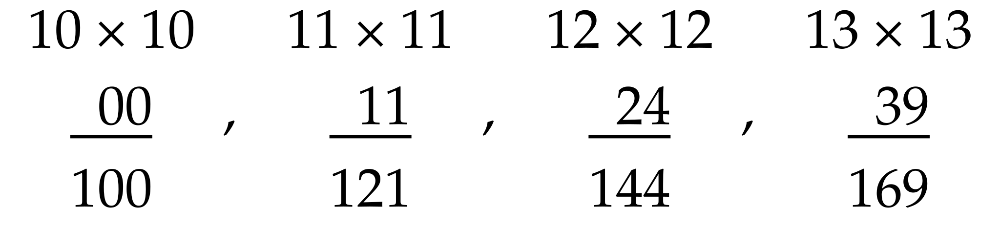

### [PG I](/w-pg-1/#ms-114-71v.3) [71v\[3\]](https://cdn.wittgensteinnachlass.com/2000px/webp/Ms-114/71v.webp)

The feeling one has with any such – as it were behaviouristic – representation, that it is crude (clumsy), is misleading; we are tempted to look for a “better” representation; but there is no such thing. One is as good as another & each time it is the _system_ that is represented in which a sign is used (“Representation dynamic, not static”.)

### [PG I](/w-pg-1/#ms-114-72r.1) [72r\[1\]](https://cdn.wittgensteinnachlass.com/2000px/webp/Ms-114/72r.webp)

(The difference between ‘inside’ & ‘outside’ does not interest us.)

### [PG I](/w-pg-1/#ms-114-72r.2) [72r\[2\]](https://cdn.wittgensteinnachlass.com/2000px/webp/Ms-114/72r.webp)

(Even the mental process cannot leave anything ‘open’ in an essentially different sense from that in which an empty bracket leaves an argument-place open in the symbolism.)

### [PG I](/w-pg-1/#ms-114-72r.3) [72r\[3\]](https://cdn.wittgensteinnachlass.com/2000px/webp/Ms-114/72r.webp)

One cannot ask: What kind of processes are mental processes, that they can be true & false when non-mental ones cannot? If, if the ‘mental’ ones can, the others must be able to as well; & conversely. – For if processes in the mind can do it, their description must be able to do it too. For it must show itself in their description how it is possible.

### [PG I](/w-pg-1/#ms-114-72r.4) [72r\[4\]](https://cdn.wittgensteinnachlass.com/2000px/webp/Ms-114/72r.webp)

When one says that thought is a mental activity, or an activity of the mind, one thinks of the mind as a murky, gaseous entity in which things can happen that cannot happen outside this sphere. And of which one can expect things that are otherwise impossible. (The process of thinking in the human mind, & the process of digestion.)

### [PG I](/w-pg-1/#ms-114-72v.1) [72v\[1\]](https://cdn.wittgensteinnachlass.com/2000px/webp/Ms-114/72v.webp)

Every mapping (acting _according to_ – not merely in accordance with – certain rules), _deriving_ an action from an order, justifying an action by an order, is of the same kind as deriving a result in writing from a specification, by referring to a table.

### [PG I](/w-pg-1/#ms-114-72v.2+73r.1) [72v\[2\]](https://cdn.wittgensteinnachlass.com/2000px/webp/Ms-114/72v.webp),[73r\[1\]](https://cdn.wittgensteinnachlass.com/2000px/webp/Ms-114/73r.webp)

If the task is to form the squares, cubes, etc., of the natural numbers, one can say: “I write the number 16 here,

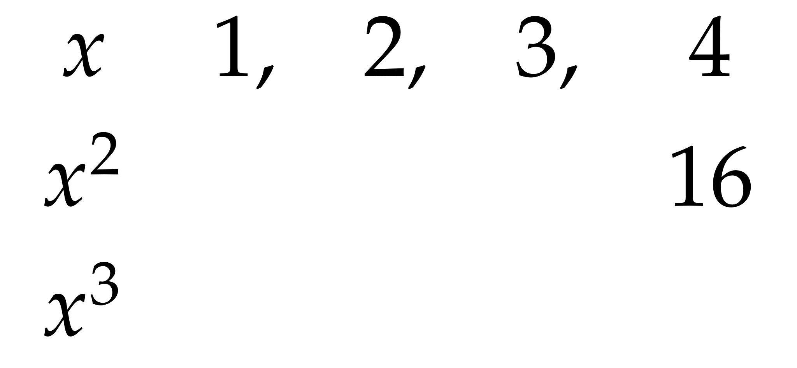

But what if I said: “I write a “ + ” here because x² stands there”? One would ask: “Do you write a “ + ” everywhere x² stands?” – – i.e., one would ask for a general rule; otherwise the “because” in my sentence would have no sense. Or one might ask: “How do you know that you wrote it _because of that_?” Here the “because” has been understood as introducing a statement of the cause, rather than of the reason.

### [PG I](/w-pg-1/#ms-114-73r.2) [73r\[2\]](https://cdn.wittgensteinnachlass.com/2000px/webp/Ms-114/73r.webp)

“I write the number ‘16’ here, 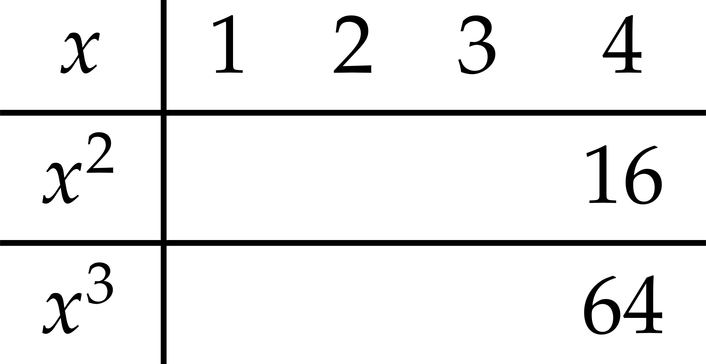 _because_ ‘x²’ stands there & ‘64’ here because ‘x³’ stands there.” This is what every justification looks like. In a certain sense that takes us no further. But it cannot, after all, take us _further_, that is, to the metalogical. (The difficulty here is not to try to justify what has no justification.)

### [PG I](/w-pg-1/#ms-114-73r.3) [73r\[3\]](https://cdn.wittgensteinnachlass.com/2000px/webp/Ms-114/73r.webp)

If, following the rule, I write ‘16’ beneath ‘4’, it might seem as if a causal connection were at play here that was not hypothetical but immediately perceived (experienced). (Confusion of ‘reason’ & ‘cause’)

### [PG I](/w-pg-1/#ms-114-73r.4+73v.1) [73r\[4\]](https://cdn.wittgensteinnachlass.com/2000px/webp/Ms-114/73r.webp),[73v\[1\]](https://cdn.wittgensteinnachlass.com/2000px/webp/Ms-114/73v.webp)

What kind of nexus is meant in the sentence: “I am going out _because_ he orders it”? And how does this sentence compare with: “I am going out _although_ he has ordered me to”? (Or: “I am going out, but not because he ordered it”, “I am going out because he ordered me not to”.)

### [PG I](/w-pg-1/#ms-114-73v.2) [73v\[2\]](https://cdn.wittgensteinnachlass.com/2000px/webp/Ms-114/73v.webp)

“That is supposed to be _him_” (this picture represents _him_), there lies the whole problem of representation. What is the criterion for this, how is it to be verified that this picture is the portrait of that object – i.e., is supposed to represent _him_? Likeness does not make the picture a portrait (it could be deceptively like one person & at the same time be the portrait of another, whom it resembles less). How can I know that he means the picture as a portrait of N? – Well, for example, by his saying so, or writing it underneath. What connection does N’s portrait have with him? Perhaps the fact that the name by which he is addressed stands beneath it.

### [PG I](/w-pg-1/#ms-114-73v.3) [73v\[3\]](https://cdn.wittgensteinnachlass.com/2000px/webp/Ms-114/73v.webp)

If I remember my friend, “see him before me”, what is the connection here between the memory-image and its object? The likeness? Well, the image _as a picture_ can only be like him.

### [PG I](/w-pg-1/#ms-114-73v.4+74r.1) [73v\[4\]](https://cdn.wittgensteinnachlass.com/2000px/webp/Ms-114/73v.webp),[74r\[1\]](https://cdn.wittgensteinnachlass.com/2000px/webp/Ms-114/74r.webp)

The mental image of him is an unpainted portrait.

I also had to write his name beneath the picture in the mental image, in order for it to become the mental image of him.

### [PG I](/w-pg-1/#ms-114-74r.2) [74r\[2\]](https://cdn.wittgensteinnachlass.com/2000px/webp/Ms-114/74r.webp)

I have resolved to carry out a particular action; I have a plan. The plan in my mind is supposed to consist in my seeing myself do such-and-such. But how do I know that _I_ am the one I see? Well, it is not me, but a picture, say. But why do I call it _my_ picture? “How do I know that _I_ am the one?”: the question makes sense when, for example, it is put this way: “How do I know that it is me I see there in the mirror?” And then the answer gives features by which I can be recognized. But that my mental image represents me is my own determination. And I could just as well ask: “How do I know that the word ‘I’ represents me?”, for my figure in the picture was merely another word “I”.

### [PG I](/w-pg-1/#ms-114-74r.3+74v.1) [74r\[3\]](https://cdn.wittgensteinnachlass.com/2000px/webp/Ms-114/74r.webp),[74v\[1\]](https://cdn.wittgensteinnachlass.com/2000px/webp/Ms-114/74v.webp)

“I can imagine that you will go out through the door.” We are subject to a strange illusion that in the sentence, in the thought, the objects do what the sentence says of them. It is as if a shadow of the execution already lay in the order. But a shadow of just _this_ execution. _You_ go to such-and-such a place in the order. – But otherwise it would simply be a _different_ order. Of course this identity is the one that corresponds to the diversity of two different orders.

### [PG I](/w-pg-1/#ms-114-74v.2+75r.1) [74v\[2\]](https://cdn.wittgensteinnachlass.com/2000px/webp/Ms-114/74v.webp),[75r\[1\]](https://cdn.wittgensteinnachlass.com/2000px/webp/Ms-114/75r.webp)

“I thought Napoleon had been crowned in 1805.” – What has your thought got to do with Napoleon? What connection is there between your thought & Napoleon? – It may, for example, consist in the occurrence of the word “Napoleon” in the expression of my thought, plus the connection this word had with its bearer; for instance, that he signed himself that way, was addressed that way, etc., etc. “But with the word ‘Napoleon’ you are surely designating this very person when you utter it”. – “How, in your opinion, does this act of designation take place, then? Instantaneously? Or does it take time?” – “Yes, but if one asks you: ‘did you just now mean the man who won the battle of Austerlitz?’, you will surely say: ‘yes’. So you meant this man _when you uttered the sentence_?” – Granted, but only in much the same sense in which I also knew at the time that 6 × 6 = 36. The answer “I meant the victor of Austerlitz” is a new step in our calculus. What is misleading about this answer is the past tense, which seems to give a description of what was going on “inside me” while the sentence was being uttered. (“But I meant _him_.” A strange process, this meaning! Can one mean someone (in Europe) even if he is in America? And even if he no longer exists at all?)

### [PG I](/w-pg-1/#ms-114-75r.2) [75r\[2\]](https://cdn.wittgensteinnachlass.com/2000px/webp/Ms-114/75r.webp)

One is tempted (misled by our grammar) to ask: “_how does one think_ a sentence, _how_ does one expect that such-and-such will happen? (how does one do that?)” “How does thought work, how does it employ its expression?” – This question seems analogous to: “how does the Jacquard loom work, how does it employ the cards”.

But one could answer: “Don’t you really know? You can see it, after all, when you think.” Nothing is hidden, after all.

### [PG I](/w-pg-1/#ms-114-75r.3) [75r\[3\]](https://cdn.wittgensteinnachlass.com/2000px/webp/Ms-114/75r.webp)

But to the answer “You know how the sentence does it, after all, there’s nothing hidden”, one would like to say: “Yes, but it all flows past so quickly, & I’d like to see it, as it were, spread out more widely”.

### [PG I](/w-pg-1/#ms-114-75r.4+75v.1) [75r\[4\]](https://cdn.wittgensteinnachlass.com/2000px/webp/Ms-114/75r.webp),[75v\[1\]](https://cdn.wittgensteinnachlass.com/2000px/webp/Ms-114/75v.webp)

Our feeling then is that in the sentence “I believe that p is the case” something essential, the actual process of believing, is not represented, but merely indicated, and that this indication must be replaceable by a description of the mechanism of belief. A description in which the word-sequence “p” would occur, like the cards in the description of the Jacquard loom. And that this description would then be the full expression of belief. Let us compare believing with uttering the sentence; here too very complicated processes take place in our larynx, speech muscles, nerves, etc. These _accompany_ the sentence uttered. And it remains the only thing that interests us, not as a component of a mechanism, but of a calculus.

### [PG I](/w-pg-1/#ms-114-75v.2) [75v\[2\]](https://cdn.wittgensteinnachlass.com/2000px/webp/Ms-114/75v.webp)

“How does thought manage to represent?” – The answer could be: “Don’t you really know? You can see it, after all, when you think.” Nothing is hidden, after all. How does the sentence do that? – Don’t you know? Nothing is concealed, after all.

### [PG I](/w-pg-1/#ms-114-75v.3+76r.1) [75v\[3\]](https://cdn.wittgensteinnachlass.com/2000px/webp/Ms-114/75v.webp),[76r\[1\]](https://cdn.wittgensteinnachlass.com/2000px/webp/Ms-114/76r.webp)

It seems to us that we are in the same position with a thought as with a landscape we have seen & are to describe, but cannot remember accurately enough to describe it in all its connections. So we think that we cannot describe thinking afterwards because by then we have lost the many finer processes. We would like to see these delicate interlacings under a magnifying glass, so to speak. (Think of the sentence: “Everything flows”.)

### [PG I](/w-pg-1/#ms-114-76r.2) [76r\[2\]](https://cdn.wittgensteinnachlass.com/2000px/webp/Ms-114/76r.webp)

“But could a machine think?” – Could it be in pain? What matters here is what one understands by the expression “_being_ in pain”. I can regard the other person as a machine that is in pain, i.e. the other _body_. And likewise, of course, my body. In contrast, the phenomenon of pain, which I describe when I say, for example, “I have toothache”, does not presuppose a physical body. (I can have toothache without teeth.) And here there is no place for the machine at all. – It is clear that the machine can take the place only of a physical body. And in the sense in which one can say of such a body that it is in pain, one can say it of a machine too. Or again: the _bodies_ we say are in pain can be compared with machines, & we can also call them machines.

### [PG I](/w-pg-1/#ms-114-76r.3+76v.1) [76r\[3\]](https://cdn.wittgensteinnachlass.com/2000px/webp/Ms-114/76r.webp),[76v\[1\]](https://cdn.wittgensteinnachlass.com/2000px/webp/Ms-114/76v.webp)

We ask: “What is a thought; what kind of thing must something be to be able to perform the function of thought?” And this question is analogous to: what is, or how does, a sewing machine work? – But the answer analogous to ours would be: look at the stitch it is to sew; everything essential to the machine can be seen in it; everything else can be one way or another. What is the function, purpose, of thought? – If it is its _effect_, then it does not interest us. We are not in the domain of causal explanations & every such explanation sounds trivial to us.

### [76v\[2\]](https://cdn.wittgensteinnachlass.com/2000px/webp/Ms-114/76v.webp)

If one thinks of thought as something specifically human and organic, one wants to ask: “Could there be a prosthesis for thought?” – Well, the calculating machine can replace the ten fingers in calculating; but one cannot, of course, speak of an inorganic substitute for the _calculation_.

### [PG I](/w-pg-1/#ms-114-76v.3+77r.1) [76v\[3\]](https://cdn.wittgensteinnachlass.com/2000px/webp/Ms-114/76v.webp),[77r\[1\]](https://cdn.wittgensteinnachlass.com/2000px/webp/Ms-114/77r.webp)

It is one of the most dangerous ideas for our investigations that we think _with the head_, or in the head. The idea of a process in the head, in that completely enclosed space, gives thinking something occult about it. “Thinking goes on in the head” really means nothing more than: the head has something to do with thinking. – To be sure, one also says “I think with my pen” & this specification of place is at least as good. To say that thinking is an activity of the mind, as writing is an activity of the hand, is a travesty of the truth. (Love in the heart. Head & heart as localities of the mind.)

### [77r\[2\]](https://cdn.wittgensteinnachlass.com/2000px/webp/Ms-114/77r.webp)

We call operating with symbols thinking. One might say, for example, that thinking calculates on the basis of data & ends in an action. But ‘thinking’ is a changing concept. (The calculation of the wall thickness of a boiler & its construction in accordance with the calculation is certainly an example of thinking & its application.)

### [PG I](/w-pg-1/#ms-114-77r.3) [77r\[3\]](https://cdn.wittgensteinnachlass.com/2000px/webp/Ms-114/77r.webp)

When we speak of thought & its expression, thought is not a kind of mood brought on by the sentence as by a drug. And communication through language is not a process in which I use a poison to bring on in someone else the same pains as I have. (What process could one call “thought-transmission” & “thought-reading”?)

### [PG I](/w-pg-1/#ms-114-77r.4+77v.1) [77r\[4\]](https://cdn.wittgensteinnachlass.com/2000px/webp/Ms-114/77r.webp),[77v\[1\]](https://cdn.wittgensteinnachlass.com/2000px/webp/Ms-114/77v.webp)

A French politician has said that the French language is distinguished by the fact that in it the words stand in the order in which one thinks. The idea that one language can have a word order corresponding to the order of thinking, in contrast to other languages, comes from the view that thinking goes on separately from the expression of thoughts; & is an essentially different process. “The grammatical possibilities of the negation sign do, of course, reveal themselves only little by little in the use of the sign, but I _think_ the negation all at once. The sign ‘not’ merely points to the thought ‘not’; it just gives me a nudge so that I think the right thing (it is only a signal).”

### [PG I](/w-pg-1/#ms-114-77v.1) [77v\[1\]](https://cdn.wittgensteinnachlass.com/2000px/webp/Ms-114/77v.webp)

(No one would ask whether written multiplication of two numbers in the decimal system corresponds to the thought of multiplication.)

### [77v\[2\]](https://cdn.wittgensteinnachlass.com/2000px/webp/Ms-114/77v.webp)

Thinking is discursive. – ‘Intuitive thinking’ would be like ‘a game of chess brought into the form of a continuous, unchanging state’. (It bothers us that the thought of a sentence is not fully present at any moment. Here we see that we are comparing the thought to a thing we produce & never possess as a whole; rather, scarcely does one part come into being before another disappears. That has, in a way, something unsatisfying about it, because, misled by an obvious simile, we expect something different.)

### [PG I](/w-pg-1/#ms-114-78r.1) [78r\[1\]](https://cdn.wittgensteinnachlass.com/2000px/webp/Ms-114/78r.webp)

“I meant something specific by it when I said …”. – “Did you have something different in mind with each word, or the same thing throughout the entire sentence?” Incidentally, it is strange: if one means something by each German word, that a combination of such words can be nonsense! – “Were you thinking, when you said the sentence, that …” – “I only thought what I said.”

### [PG I](/w-pg-1/#ms-114-78r.2) [78r\[2\]](https://cdn.wittgensteinnachlass.com/2000px/webp/Ms-114/78r.webp)

Does the child only learn to speak, or also to think? Does it learn the meaning of multiplication _before_–, or _after_ multiplying?

### [PG I](/w-pg-1/#ms-114-78r.3+78v.1) [78r\[3\]](https://cdn.wittgensteinnachlass.com/2000px/webp/Ms-114/78r.webp),[78v\[1\]](https://cdn.wittgensteinnachlass.com/2000px/webp/Ms-114/78v.webp)

Is it, as it were, a contamination of the sense that we express it in a particular language, with its contingencies, & not, as it were, bodiless & pure? Is it that, after all, I am not really playing the game of chess itself, since the pieces could be different?! (Is a mathematical proof in the general theory of irrational numbers less general or rigorous for being conducted with reference to the decimal notation of these numbers? Does it also impair the rigour & purity of the sentence 25 × 25 = 625 that it is written down in a particular number system?)

### [PG I](/w-pg-1/#ms-114-78v.2) [78v\[2\]](https://cdn.wittgensteinnachlass.com/2000px/webp/Ms-114/78v.webp)

Thought can only be something altogether commonplace, ordinary. (One is in the habit of thinking of it as something ethereal, unexplored; as if it were something of which we know only the outside, but whose essence is still unexplored – rather like our brain.) One would like to say: “Thought, this strange being”

Again we can only make explicit the grammar of the word “think”. (And likewise of the words “expect”, “believe”, etc.)

### [PG I](/w-pg-1/#ms-114-78v.3) [78v\[3\]](https://cdn.wittgensteinnachlass.com/2000px/webp/Ms-114/78v.webp)

Why does a person think? What is the use of it? Why _does_ he _calculate_ the wall thickness of a steam boiler & not let chance, or whim, determine it? It is, after all, merely an empirical fact that boilers calculated in this way do not explode as often. But just as he would do anything rather than put his hand in the fire that burned him before, so he will do anything rather than not calculate the boiler. Since we are now not interested in causes, we can say: people do indeed think; they proceed, for example, in this way when they build a steam boiler. – Can a boiler produced in this way not explode? It certainly can!

### [PG I](/w-pg-1/#ms-114-78v.4+79r.1) [78v\[4\]](https://cdn.wittgensteinnachlass.com/2000px/webp/Ms-114/78v.webp),[79r\[1\]](https://cdn.wittgensteinnachlass.com/2000px/webp/Ms-114/79r.webp)

We think through actions before carrying them out. We make images of them; but why? There is no such thing as a “thought experiment”! We expect something, & act in accordance with the expectation; must the expectation come true? No. But why do we act according to the expectation? Because we are driven to do so, just as we are driven to get out of the way of a car, to sit down when we are tired, and to jump up when we have sat on a thorn.

### [PG I](/w-pg-1/#ms-114-79r.2) [79r\[2\]](https://cdn.wittgensteinnachlass.com/2000px/webp/Ms-114/79r.webp)

What belief in the uniformity of what happens amounts to is perhaps clearest when we feel fear of the expected event. Nothing could induce me to put my hand in the flame, although I have been burnt _only in the past_. The belief that the fire will burn me is of the nature of the fear that it will burn me. Here I also see what “it is certain” means.

### [PG I](/w-pg-1/#ms-114-79r.3) [79r\[3\]](https://cdn.wittgensteinnachlass.com/2000px/webp/Ms-114/79r.webp)

If one were to drag me into the fire, I would resist & would not go willingly; & likewise I would shout, “It will burn me!” & not: “Perhaps it will be quite pleasant!”

### [PG I](/w-pg-1/#ms-114-79r.4+79v.1) [79r\[4\]](https://cdn.wittgensteinnachlass.com/2000px/webp/Ms-114/79r.webp),[79v\[1\]](https://cdn.wittgensteinnachlass.com/2000px/webp/Ms-114/79v.webp)

“But surely you also believe that there would be more steam-boiler explosions if the boilers were not calculated!” – Yes, I believe it; – but what does that mean? Does it follow that there will actually be fewer? – And what is the basis of this belief?

### [PG I](/w-pg-1/#ms-114-79v.2+80r.1) [79v\[2\]](https://cdn.wittgensteinnachlass.com/2000px/webp/Ms-114/79v.webp),[80r\[1\]](https://cdn.wittgensteinnachlass.com/2000px/webp/Ms-114/80r.webp)

I assume that this house, in which I am writing, will not collapse in the course of the next half-hour. – When do I assume that; all the time? And what kind of activity is this assuming? It may mean a psychological disposition; but it may also mean the thinking, expressing, of a particular thought. In the second case I utter, for example, a sentence which is in turn an element of a consideration (calculation). Now one says: But you must have a reason for assuming that, otherwise the assumption is unsupported & worthless. – (Remember that although we stand on the earth, the earth in turn does not stand on anything; & children think it must fall if it is not supported.) Well, I do have reasons for my assumption. They go something like this: that the house has already stood for years, but not so long that it could already be dilapidated; etc., etc.. – _What_ counts as a reason for an assumption can be stated in advance, & determines a calculus; a system of transitions. But if a reason for this calculus is now asked for, we see that there is none. Is the calculus therefore arbitrarily assumed by us? No more so than fear of fire, or of an angry person approaching us. “Surely the rules of grammar by which we proceed & operate are not arbitrary!” – Very well, then, why does a person think as he does, why does he go through these acts of thinking? (The question here is, of course, about reasons, not causes.) Well, reasons can be given within the calculus, & at the end one is then tempted to say: “it is simply very likely that things will now behave as they have always behaved”, – or something of the sort. A phrase which conceals the beginning of the justification. (The Creator as an explanation at the beginning of the world.) What is so hard to see is roughly this: that, _as long as_ we remain within the domain of true-or-false games, a change of grammar can only take us from _one_ such game to another, but not from something true to something false. And if, on the other hand, we step outside the domain of these games, we no longer call it ‘language’ & ‘grammar’, & again we do not come into contradiction with reality.

### [PG I](/w-pg-1/#ms-114-80r.2+80v.1) [80r\[2\]](https://cdn.wittgensteinnachlass.com/2000px/webp/Ms-114/80r.webp),[80v\[1\]](https://cdn.wittgensteinnachlass.com/2000px/webp/Ms-114/80v.webp)

What is a sentence? – What, then, do I distinguish a sentence from? Or what do I want to distinguish it from? From parts of a sentence within its grammatical system (as an equation is distinguished from its parts), or from everything we do not call a ‘sentence’, such as this armchair, my watch, etc., etc.?

### [PG I](/w-pg-1/#ms-114-80v.2) [80v\[2\]](https://cdn.wittgensteinnachlass.com/2000px/webp/Ms-114/80v.webp)

If I ask: “how is the general concept of a sentence bounded?”, – then the counter-question must be asked: “But do we have _a_ general concept of a sentence?” “But I do have a particular concept of what I call a ‘sentence’.” – Well, how would I explain it to someone else, or to myself? For in this explanation it will become clear what my concept is (a feeling accompanying the word ‘sentence’ is of no concern to me). I would explain the concept by examples. – So my concept extends as far as the examples do. – But they are only examples, and the concept that encompasses only them is supposed to be capable of extension. – Good, then you must tell me what “capable of extension” means here. The grammar of this word must have definite limits.

### [PG I](/w-pg-1/#ms-114-80v.3+81r.1) [80v\[3\]](https://cdn.wittgensteinnachlass.com/2000px/webp/Ms-114/80v.webp),[81r\[1\]](https://cdn.wittgensteinnachlass.com/2000px/webp/Ms-114/81r.webp)

“But I recognize a sentence when I see it, so I must also be able to draw the boundaries of the concept sharply.” But is doubt really impossible? – Let us imagine a language in which all sentences are commands to go in a particular direction. (It would perhaps be used exclusively in war by a kind of primitive people. Let us remember how limited the use of written language once was.) Well, we would still call commands “go here!”, “go there!” sentences; but what if the language consisted only in pointing with the finger in some direction? Would this sign still be a sentence? – And what about a language whose signs expressed only the desire for particular objects (like the first language of children) & which consisted merely of signs for these objects (as it were, of nouns)? Or let us think of a system consisting of two signs, one expressing acceptance, the other rejection, of objects presented. Is this a language; does it consist of sentences? And, on the other hand: does everything that has the sound of a sentence in German fall under our concept of a sentence? “I am tired”, “2 × 2 is 4”, “time passes”, “there is only one 0”?

### [PG I](/w-pg-1/#ms-114-81r.2+81v.1) [81r\[2\]](https://cdn.wittgensteinnachlass.com/2000px/webp/Ms-114/81r.webp),[81v\[1\]](https://cdn.wittgensteinnachlass.com/2000px/webp/Ms-114/81v.webp)

The word “sentence” does not yet designate a sharply bounded concept. If we want to place a concept with sharp boundaries alongside our use of this word, we are free to define it, just as we are free to restrict the meaning of the primitive measure of length “one step” to the measure of 75 cm.

### [PG I](/w-pg-1/#ms-114-81v.2) [81v\[2\]](https://cdn.wittgensteinnachlass.com/2000px/webp/Ms-114/81v.webp)

“What happens when a _new_ sentence is admitted into the language: what is the criterion for its being a _sentence_?” Let us imagine such a case. We learn of a new experience, say the braking sensation of an electric shock, & say that it is unpleasant. By what right do I call this newly formed statement a “sentence”? Well, by what right did I speak of a new “experience”, or of a new “muscular sensation”? Surely by analogy with my earlier use of these words. But, on the other hand, _did I have to_ use the word “experience” & the word “sentence” in the new case? Is anything already said about the braking sensation by my using the word experience for it? And what would it matter if I excluded the expression “the braking sensation is unpleasant” from the concept of sentence because I had already definitively drawn its boundaries?

### [PG I](/w-pg-1/#ms-114-81v.3+82r.1) [81v\[3\]](https://cdn.wittgensteinnachlass.com/2000px/webp/Ms-114/81v.webp),[82r\[1\]](https://cdn.wittgensteinnachlass.com/2000px/webp/Ms-114/82r.webp)

Compare the concept of ‘number’ with the concept of sentence, & on the other hand the concept of cardinal number. We count cardinal numbers, rational numbers, irrational numbers, complex numbers as numbers; whether we call further constructions numbers, on account of their similarity to these, or want to draw the boundary definitively here or elsewhere, is up to us. The concept of number is analogous in this respect to the concept of sentence. On the other hand, one can call the concept of cardinal number [1, ξ, ξ + 1] a strictly circumscribed one, i.e. it is ‘concept’ in another sense of this word.

### [PG I](/w-pg-1/#ms-114-82r.2) [82r\[2\]](https://cdn.wittgensteinnachlass.com/2000px/webp/Ms-114/82r.webp)

How did I come to the concept of ‘sentence’, or to the concept of ‘language’? Only through the languages that I have learned. – But they seem to have led me in a certain sense beyond themselves, because I am now able to construct a new language, e.g. to invent words. – So this construction still belongs to the concept of language. But only if I define it in this way. Again and again, the sense of my “etc.” is grammatically bounded.

### [82r\[3\]](https://cdn.wittgensteinnachlass.com/2000px/webp/Ms-114/82r.webp),[82v\[1\]](https://cdn.wittgensteinnachlass.com/2000px/webp/Ms-114/82v.webp)

In logic (within an exact grammar) I cannot generalize at random. But I do not mean here a restriction through “logical types”. Rather: generalization is a sign with a particular grammar. That is, the indeterminacy of generality is not logical indeterminacy. It is freedom of movement, not indeterminacy of geometry.

### [PG I](/w-pg-1/#ms-114-82v.2) [82v\[2\]](https://cdn.wittgensteinnachlass.com/2000px/webp/Ms-114/82v.webp)

No sign leads us beyond itself, & no argument does either.

### [PG I](/w-pg-1/#ms-114-82v.3) [82v\[3\]](https://cdn.wittgensteinnachlass.com/2000px/webp/Ms-114/82v.webp)

What does someone who constructs (invents) a new language do, and by what principle does he proceed? For this principle is the concept of ‘language’. – Does every newly constructed language extend (alter) the concept of language? – Consider what relation it has to the earlier concept. That depends on how this concept was defined. – Let us think of the relation of complex numbers to the older concept of number; & on the other hand, of the case when two particular (say very large) cardinal numbers are written down and multiplied together for the first time, & of the relation of this _new_ multiplication to the general concept of multiplication of cardinal numbers.

### [PG I](/w-pg-1/#ms-114-82v.4) [82v\[4\]](https://cdn.wittgensteinnachlass.com/2000px/webp/Ms-114/82v.webp)

This is also what I meant by saying “that there are surprises in reality, but not in grammar”.

### [PG I](/w-pg-1/#ms-114-82v.5+83r.1) [82v\[5\]](https://cdn.wittgensteinnachlass.com/2000px/webp/Ms-114/82v.webp),[83r\[1\]](https://cdn.wittgensteinnachlass.com/2000px/webp/Ms-114/83r.webp)

But if the general concept of language thus dissolves, so to speak, doesn’t philosophy dissolve too? No, for the task of philosophy is not to create a new, ideal, language, but to clarify the linguistic usage of our language – the existing one. Its purpose is to eliminate particular misunderstandings; not, for example, to create genuine understanding in the first place.

### [PG I](/w-pg-1/#ms-114-83r.2) [83r\[2\]](https://cdn.wittgensteinnachlass.com/2000px/webp/Ms-114/83r.webp)

Someone who points out that a word has been used in several different meanings, or that when an expression is used we have this misleading picture in mind, & who in general establishes (tabulates) rules according to which certain words are used, has not at all undertaken to give an explanation (definition) of the word “rule”, or “sentence”, or “word”, etc. I am permitted to use the word “rule” without first tabulating the rules for the use of this word. And these rules are not meta-rules.

### [PG I](/w-pg-1/#ms-114-83r.3) [83r\[3\]](https://cdn.wittgensteinnachlass.com/2000px/webp/Ms-114/83r.webp)

And philosophy deals with calculi in the same sense in which it deals with thoughts, sentences & languages. But if it dealt essentially with the concept of a calculus, that is, with the concept of a calculus prior to all calculi, there would be a metaphilosophy. (But there is no such thing. One could present everything we have to say in such a way that this appeared as a guiding thought.)

### [PG I](/w-pg-1/#ms-114-83v.1+84r.1) [83v\[1\]](https://cdn.wittgensteinnachlass.com/2000px/webp/Ms-114/83v.webp),[84r\[1\]](https://cdn.wittgensteinnachlass.com/2000px/webp/Ms-114/84r.webp)

How, then, do we use the word “rule” when, for instance, we talk about games? In contrast to what? – We say, for example, “that follows from this rule”, but then we could quote the relevant rule & so replace the word “rule”. Or we speak of “all the rules of the game” & have then either listed them (& then the first case arises again), or we speak of the rules as a group of expressions which are generated in a particular way from given basic rules, & then the word “rule” stands for the expression of _these_ basic rules & operations. Or we say: “_this_ is a rule, _that_ isn’t”, – when the second, say, is only a single word or an incomplete sentence in the sense of German grammar, or the illustration of a position of the game pieces. (Or: “no, under the new agreement that is also a rule”.) – If, for instance, we had to write out the list of rules of the game, something like this might be said & then it would mean: _this_ goes in, _that_ doesn’t. But not by virtue of a particular property (namely, that of being a rule); as when one wants to pack nothing but apples into a crate, & says: “no, that doesn’t go in, that’s a pear”. Yes, but surely we call some things “games”, & others not, & some things “rules”, & others not! – But drawing a boundary between everything we call a game and everything else is _never_ what matters. For us, games are _the_ games we have heard of, the ones we can list, & perhaps a few more newly devised by analogy; & if someone were to write a book about games, he would not really need to use the word “game” in the title of the book either; instead, the title could be a list of the names of the individual games. And if asked: But what is the _common_ feature of all these things, on account of which you group them together? – he could say: I don’t know how to specify it in one sentence, – but you can see plenty of analogies. Besides, the question seems idle to me, since I can also proceed by analogy, through imperceptible steps, to constructions that no one in ordinary life would still call a “game”. I therefore call “game” what is on this list, as well as whatever is similar to these games to a certain degree (which I have not specified more precisely). And I reserve the right to decide in each new case whether or not to count something among the games.

### [PG I](/w-pg-1/#ms-114-84r.2+84v.1) [84r\[2\]](https://cdn.wittgensteinnachlass.com/2000px/webp/Ms-114/84r.webp),[84v\[1\]](https://cdn.wittgensteinnachlass.com/2000px/webp/Ms-114/84v.webp)

And the same applies to the concept of ‘rule’, ‘sentence’, ‘language’, etc. Only in particular cases (i.e. not every time we use the word “rule”) are we concerned with distinguishing rules from something that is not a rule, & in all these cases it is easy to give the distinguishing feature. We use the word “rule” in contrast to “word”, “depiction” & a few other things, & these boundaries can be clearly drawn. On the other hand, we generally draw no boundaries where we do not need them. (It is as when, for certain games, one draws only a line through the middle of the playing field to separate the parties, but does not otherwise delimit the field, because that is not necessary.) We can use the word “plant” in an unambiguous way, but innumerable borderline cases can be constructed for which it would still have to be decided whether something fell under the concept ‘plant’. But is the meaning of the word “plant” therefore attended by uncertainty in all other cases, so that one could say that we do not really understand the word? Indeed, would a definition that delimited this concept on several sides make the meaning of the word clearer to us in all sentences, so that we would therefore understand all the sentences in which it occurs better?

### [PG I](/w-pg-1/#ms-114-84v.2+85r.1) [84v\[2\]](https://cdn.wittgensteinnachlass.com/2000px/webp/Ms-114/84v.webp),[85r\[1\]](https://cdn.wittgensteinnachlass.com/2000px/webp/Ms-114/85r.webp)

The use of the words “sentence”, “language”, etc. has the vagueness of the normal use of all the concept-words of our language. To believe that they are therefore unusable, or at least not quite suited to their purpose, would be like saying: “the scent of this rose is useless because one does not know where it begins & where it ends”. If, for the sake of clarification & to avoid misunderstandings, I want to draw sharp boundaries in the domain of such linguistic usage, these will stand to the flowing boundaries in natural linguistic usage ([unreadable]) as sharp contours in a pen drawing stand to the gradual transitions of patches of colour in the reality depicted.

### [PG I](/w-pg-1/#ms-114-85r.2) [85r\[2\]](https://cdn.wittgensteinnachlass.com/2000px/webp/Ms-114/85r.webp)

Socrates corrects the pupil who, when asked about the nature of knowledge, lists instances of knowledge. And he does not accept this even as a preliminary step towards answering the question. Whereas our answer is precisely such a list & the indication of some analogies. (In philosophy, in a certain sense, we always make things easier & easier for ourselves.)

### [PG I](/w-pg-1/#ms-114-85r.3+85v.1) [85r\[3\]](https://cdn.wittgensteinnachlass.com/2000px/webp/Ms-114/85r.webp),[85v\[1\]](https://cdn.wittgensteinnachlass.com/2000px/webp/Ms-114/85v.webp)

The philosophy of logic speaks of sentences & words in no other sense than we do in everyday life, when we say “here a Chinese sentence is written down”, or “no, that only looks like a character, but is an ornament”, etc. etc. We speak of the spatial & temporal phenomenon of language, not of an aspatial & atemporal non-entity. But we speak of it as we do of the figures of a game of chess, by giving rules for their use, not by describing their physical properties. The question “what is a word” is analogous to: “what is a chess piece (say, the chess king)”.

### [PG I](/w-pg-1/#ms-114-85v.2) [85v\[2\]](https://cdn.wittgensteinnachlass.com/2000px/webp/Ms-114/85v.webp)

When thinking about language & meaning, we can easily come to think that in philosophy we are not actually talking about words & sentences in the most ordinary sense, but in a sublimated, abstract sense. – As if a particular sentence were not actually what some human being utters, but an ideal entity (the “class of all sentences with the same meaning”, or something similar). But is the chess king, about which the rules of chess speak, also such an ideal thing, an abstract entity? [→ [“Here it is difficult to get one’s head …”]]

_[new line, not paragraph]_

### [PG I](/w-pg-1/#ms-114-85v.3) [85v\[3\]](https://cdn.wittgensteinnachlass.com/2000px/webp/Ms-114/85v.webp)

Nor can we attain any greater _generality_ in philosophy than in what we say in life & in science. Here too (as in mathematics) we leave everything as it is.

### [PG I](/w-pg-1/#ms-114-85v.4+86r.1) [85v\[4\]](https://cdn.wittgensteinnachlass.com/2000px/webp/Ms-114/85v.webp),[86r\[1\]](https://cdn.wittgensteinnachlass.com/2000px/webp/Ms-114/86r.webp)

When I speak about language (word, sentence, etc.), I must speak the language of everyday life. Is this language perhaps too crude, too material, for what we want to say? And how is another one formed? – And how remarkable that we can then use our own language for anything at all! The fact that, in philosophical explanations of language, I already have to use the full language (not some preparatory, provisional one) shows already that I can only bring forward something external about language. “Yes, but how can these explanations then satisfy us?” – Well, your questions were already formulated in this language! – And your scruples are misunderstandings. – Your questions refer to words, so I must talk about words. One says: it is not the word that matters, but its meaning; & one thinks of the meaning as something of the same kind as the word, even if different from the word. Here the word, here the meaning. The money & the cow that one can buy with it. (On the other hand: the money, & its use.)

### [PG I](/w-pg-1/#ms-114-86r.2) [86r\[2\]](https://cdn.wittgensteinnachlass.com/2000px/webp/Ms-114/86r.webp)

(About our language no more concerns are justified than a chess player has about the game of chess, namely none.)

### [PG I](/w-pg-1/#ms-114-86r.3+86v.1) [86r\[3\]](https://cdn.wittgensteinnachlass.com/2000px/webp/Ms-114/86r.webp),[86v\[1\]](https://cdn.wittgensteinnachlass.com/2000px/webp/Ms-114/86v.webp)

When we ask about the general form of the sentence –, let us bear in mind that ordinary language does indeed have a particular sentence-rhythm, sentence-sound, but that we do not call everything that has this sentence-sound a sentence. – Hence one also speaks of a “sentence” that has sense or nonsense. On the other hand, this sentence-sound is not essential to what we call a sentence in logic. The expression “good sugar” does not sound like a German sentence, but it can quite well replace the sentence “sugar tastes good”. And not in such a way that we would have to imagine something missing. (Rather, everything depends only on the system of expression to which the expression “good sugar” belongs.) The question is therefore whether, apart from this misleading sentence-sound, we have a general concept of a sentence.

### [PG I](/w-pg-1/#ms-114-86v.2) [86v\[2\]](https://cdn.wittgensteinnachlass.com/2000px/webp/Ms-114/86v.webp)

Let us imagine the German language changed so that the order of the words in the sentence was the reverse of what is currently correct. The result would therefore be sequences of words that we obtain when we read the sentences of a German book from right to left. It is clear that the variety of possibilities of expression of this language must be exactly the same as that of German; but we would understand a longer sentence, if read in this way, only with extreme difficulty & perhaps would never learn to “think in this language”. (The example of such a language may clarify something about the nature of what we call “thoughts”.)

### [PG I](/w-pg-1/#ms-114-86v.3+87r.1) [86v\[3\]](https://cdn.wittgensteinnachlass.com/2000px/webp/Ms-114/86v.webp),[87r\[1\]](https://cdn.wittgensteinnachlass.com/2000px/webp/Ms-114/87r.webp)

The explanation: “a sentence is anything that can be true or false” fixes the concept of a sentence in a particular language system as that which can be an argument of a truth-function in that system. And when we speak of what is essential to sentential form as such, we are inclined to mean the truth-functions. “A sentence is anything that can be true or false” means the same as: “a sentence is anything that can be negated”.

### [PG I](/w-pg-1/#ms-114-87r.2) [87r\[2\]](https://cdn.wittgensteinnachlass.com/2000px/webp/Ms-114/87r.webp)

“p” is true = p  
“p” is false = ~p

One might say: the words “true” & “false” are merely members of a particular notation of the truth-functions.

What he says is true = Things are as he says.

### [PG I](/w-pg-1/#ms-114-87r.3+87v.1) [87r\[3\]](https://cdn.wittgensteinnachlass.com/2000px/webp/Ms-114/87r.webp),[87v\[1\]](https://cdn.wittgensteinnachlass.com/2000px/webp/Ms-114/87v.webp)

Is it right to write ““p” is true”, “‘p’ is false”; must it not be “p is true” (or false)? Surely the stroke of ink is not _true_; it is black & crooked. Does “‘p’ is true” say anything about the sign ‘p’? – “Yes, it says that ‘p’ agrees with reality.” – Let us consider, instead of a sentence of word-language, a drawn picture which is to be compared with reality according to exact projection rules. Here it must surely show most clearly what “‘p’ is true” says about the picture ‘p’. One can therefore compare the sentence “‘p’ is true” with: “this object has the length of this metre rule”; & “p” with the sentence: “this object is 1 m long”. But the comparison is wrong, for “this metre rule” is a description, while “metre rule” is a concept-definition. By contrast, in “‘p’ is true” the standard enters directly into the sentence. Here ‘p’ represents simply the length & not the metre rule. For the representing drawing is not ‘true’ at all, except according to a particular method of projection which makes the standard a purely geometrical appendage to the measured line segment.

### [PG I](/w-pg-1/#ms-114-87v.2) [87v\[2\]](https://cdn.wittgensteinnachlass.com/2000px/webp/Ms-114/87v.webp)

One can also put it this way: one can understand the sentence “‘p’ is true” only if one understands the grammar of the sign “‘p’” as a sentence-sign; not if “‘p’” is simply the name of the shape of a particular stroke of ink. And finally one can say that the quotation marks in the sentence “‘p’ is true” are simply superfluous.

### [PG I](/w-pg-1/#ms-114-87v.3+88r.1) [87v\[3\]](https://cdn.wittgensteinnachlass.com/2000px/webp/Ms-114/87v.webp),[88r\[1\]](https://cdn.wittgensteinnachlass.com/2000px/webp/Ms-114/88r.webp)

If one explains: “(x) ∙ fx” is true when “f( )” produces true sentences for all substitutions, – let us bear in mind that the sentence “(x) ∙ fx” follows from the sentence “‘f( )’ produces true sentences for all substitutions”, & conversely the latter follows from the former. The two sentences therefore say the same thing. That explanation therefore does not first assemble the mechanism of generalization from its parts. –

### [PG I](/w-pg-1/#ms-114-88r.2) [88r\[2\]](https://cdn.wittgensteinnachlass.com/2000px/webp/Ms-114/88r.webp)

Of course one cannot say that a sentence is what one can predicate “true” & “false” of, in the sense that one could try out which symbols the words “true” & “false” fitted and decide on that basis whether something is a sentence. For this attempt could determine something only if “true” & “false” already had particular meanings, & they can have them only if the context in which they may occur has already been fixed. (Think also of determining parts of speech by questions. “Who or what …?”)

### [PG I](/w-pg-1/#ms-114-88r.3+88v.1) [88r\[3\]](https://cdn.wittgensteinnachlass.com/2000px/webp/Ms-114/88r.webp),[88v\[1\]](https://cdn.wittgensteinnachlass.com/2000px/webp/Ms-114/88v.webp)

Can one give the _general form of the sentence_? – Why not? Just as one could fix the concept of number, by means of the sign “[0, ξ, ξ + 1]”, for example. I am free to call only _that_ “number”, & so I can also give an analogous prescription for forming sentences or laws & use the word “sentence” or “law” as an equivalent of this prescription. – If one objects & says that clearly this has merely marked off certain laws from others, I reply: You cannot, of course, draw a boundary if you are resolved from the outset not to recognize one! The question then naturally remains: How do you use the word sentence? In contrast to what? –

### [PG I](/w-pg-1/#ms-114-88v.2) [88v\[2\]](https://cdn.wittgensteinnachlass.com/2000px/webp/Ms-114/88v.webp)

(“Can a sentence deal with all sentences, or all sentence-functions?” – What does one mean by that? Is one thinking of a sentence of logic? – What does the proof of such a sentence look like?)

### [PG I](/w-pg-1/#ms-114-88v.3) [88v\[3\]](https://cdn.wittgensteinnachlass.com/2000px/webp/Ms-114/88v.webp)

If I accept “things are thus & so” as the general sentential form, then I must count “2 + 2 = 4” among the sentences. Further rules are needed to exclude the sentences of arithmetic.

### [PG I](/w-pg-1/#ms-114-88v.4) [88v\[4\]](https://cdn.wittgensteinnachlass.com/2000px/webp/Ms-114/88v.webp)

In the schema “things are thus & so”, “things are” is actually the handle for the truth-functions. “Things are” is therefore an expression in a notation for the truth-functions. An expression that shows us which part of grammar comes into operation here.

### [PG I](/w-pg-1/#ms-114-88v.5) [88v\[5\]](https://cdn.wittgensteinnachlass.com/2000px/webp/Ms-114/88v.webp)

A general sentential form determines the sentence as a member of a calculus.

### [PG I](/w-pg-1/#ms-114-88v.6+89r.1) [88v\[6\]](https://cdn.wittgensteinnachlass.com/2000px/webp/Ms-114/88v.webp),[89r\[1\]](https://cdn.wittgensteinnachlass.com/2000px/webp/Ms-114/89r.webp)

Are the rules which state that such and such combinations of words have no sense to be compared with the stipulations for chess, according to which, for example, it is not a position in chess if two pieces stand on the same square, or a piece stands on the boundary between two squares, etc.? These sentences in turn resemble certain actions; as when, for example, one cuts a chessboard out of a larger piece of squared paper. They draw a boundary.

What does it mean, then, to say: “this combination of words is senseless”? Of a word one can say: “I have given this name to no one”; & giving a name is a definite action (hanging a little sign round someone’s neck). Think of representing a researcher's journey by a line which we draw in the projections of the two hemispheres of the earth. We can now say: a segment of the line that leaves the boundary circles of these projections on the plane of the drawing is senseless in this representation. One could also put it like this: no agreement has been reached about it.

### [PG I](/w-pg-1/#ms-114-89r.2+89v.1) [89r\[2\]](https://cdn.wittgensteinnachlass.com/2000px/webp/Ms-114/89r.webp),[89v\[1\]](https://cdn.wittgensteinnachlass.com/2000px/webp/Ms-114/89v.webp)

“How do I manage to use a word meaningfully every time; do I always look it up in the grammar? No, the fact that I mean something – what I mean stops me from talking nonsense.” – But what do I mean? – I should like to say: I talk about dividing an apple, but not about dividing the colour red, because with the words “dividing an apple” I can think of something, imagine something, want something, – but not with the expression “dividing the colour red”. It would be more accurate to say that with the words “dividing an apple” I think of something, imagine something, want something, but not with the expression “dividing the colour red”. The expression “I divide red” can nevertheless have a sense (e.g. that of the sentence “I divide something red”). – What if I asked: which word, which mistake, makes the expression nonsense? Here one sees that with this expression, despite its senselessness, we think of a quite particular grammatical system. That is why we also say “one cannot divide red”, and thus give an answer; whereas one would not answer anything to a combination of words like “is has good”. – But if one now thinks of a particular system, a language-game with its application, then saying that “I divide red” is nonsensical says above all that this expression does not belong to the particular game to which, by its appearance, it seems to belong.

### [PG I](/w-pg-1/#ms-114-89v.2+90r.1) [89v\[2\]](https://cdn.wittgensteinnachlass.com/2000px/webp/Ms-114/89v.webp),[90r\[1\]](https://cdn.wittgensteinnachlass.com/2000px/webp/Ms-114/90r.webp)

What do we do now when we give the group of words “I divide red” a sense? – Why, we could make quite different things out of it: an empirical proposition, a sentence of arithmetic (such as 2 + 2 = 4), an unproved proposition of mathematics (such as Goldbach’s conjecture), an exclamation, and other things. So I have an arbitrary choice; & how is it limited? That is hard to say –: by all sorts of kinds of usefulness, & also by the formal similarity of the constructions to certain primitive sentential forms, & all these boundaries are vague.

### [PG I](/w-pg-1/#ms-114-90r.2) [90r\[2\]](https://cdn.wittgensteinnachlass.com/2000px/webp/Ms-114/90r.webp)

“How do I know that one cannot divide red?” – That is itself not a question. I should like to say: “One must _begin_ with the distinction between sense & nonsense. Nothing is possible before it. I cannot justify it.”

### [PG I](/w-pg-1/#ms-114-90r.3+90v.1) [90r\[3\]](https://cdn.wittgensteinnachlass.com/2000px/webp/Ms-114/90r.webp),[90v\[1\]](https://cdn.wittgensteinnachlass.com/2000px/webp/Ms-114/90v.webp)

Can one ask: “what must the grammatical rules for words be like in order for them to give a sentence a sense”? I say, for example: “There is no book lying here, but there could be one lying there; on the other hand, it is nonsensical to say that the colours green & red could be in the same place at the same time. But if the sentence acquires sense by being in accordance with the grammatical rules, then let us simply make the rule that permits the sentence ‘red & green are simultaneously at this spot’. Good; but that does not yet settle the grammar of this expression. Further stipulations first have to be made about how such a sentence is to be used; how it is to be verified, for example.

### [PG I](/w-pg-1/#ms-114-90v.2) [90v\[2\]](https://cdn.wittgensteinnachlass.com/2000px/webp/Ms-114/90v.webp)

Even if one regards the sentence as a picture of the state of affairs described & says that the sentence shows just what it is like when it is true, and thus shows the possibility of the state of affairs asserted; the sentence can at best do what a painted or modelled picture does, & so in any case it cannot present what simply is not the case. So it depends entirely on our grammar what is called possible and what is not, namely precisely what it allows. But surely that is arbitrary! – Certainly; but grammatical constructions which we call empirical propositions, for example those which describe a visible distribution of bodies in space & could be replaced by a pictorial representation, have a particular application, a particular use. But not every construction which resembles such an empirical proposition in its external form & plays a somehow similar role in a calculus has an analogous use, & we shall then not be inclined to call this construction a sentence.

### [PG I](/w-pg-1/#ms-114-90v.3+91r.1) [90v\[3\]](https://cdn.wittgensteinnachlass.com/2000px/webp/Ms-114/90v.webp),[91r\[1\]](https://cdn.wittgensteinnachlass.com/2000px/webp/Ms-114/91r.webp)

“Possible” means here something like “thinkable”; but “thinkable” can mean “drawable”, “modellable”, “imaginable”, that is: representable in a particular system. Now, it depends on the system. – One asks, for example: “is it thinkable that a row of trees continues in a straight direction without ever coming to an end?” – Why should that not be ‘thinkable’; it is at any rate expressible in a grammatical system. But what is the application of the sentence, how is it verified, what relation does its verification have to that of a sentence such as: “this row of trees ends with the 100th tree”? That will show us how much this thinkability is, so to speak, worth.

chemically possible: 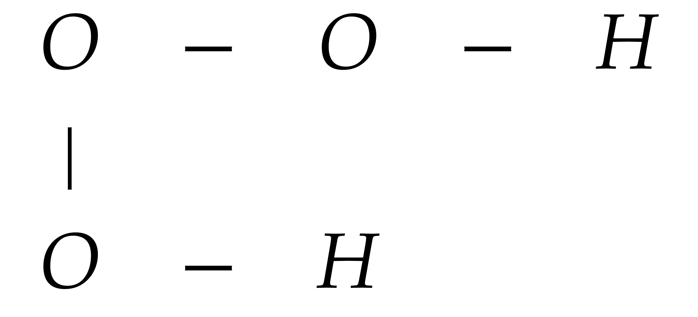

### [PG I](/w-pg-1/#ms-114-91r.2+91v.1) [91r\[2\]](https://cdn.wittgensteinnachlass.com/2000px/webp/Ms-114/91r.webp),[91v\[1\]](https://cdn.wittgensteinnachlass.com/2000px/webp/Ms-114/91v.webp)

“I have in fact never seen a black line gradually becoming lighter and lighter until it is white, & then becoming increasingly reddish until it is red; but I know that it is possible, because I can imagine it.” – The form of expression “I know that it is possible because …” is taken from cases such as: “I know that it is possible to unlock this door with this key, because I have done it before”. Is it in _that_ sense, then, that I suppose that colour transition will be possible because I can imagine it? – Is it not rather the case that: “the colour transition is possible” means here the same as “I can imagine it”? – What about this: “The alphabet _can_ be recited aloud _because_ I can recite it to myself in my mind”? And “I can imagine the colour transition” is here not a statement about my particular powers of imagination, as “I can lift this stone” is a statement about my muscular strength. The sentence “I can imagine the transition”, just like “this state of affairs can be drawn”, connects the linguistic representation with another mode of representation; it is to be understood as a sentence of grammar.

### [PG I](/w-pg-1/#ms-114-91v.2+92r.1) [91v\[2\]](https://cdn.wittgensteinnachlass.com/2000px/webp/Ms-114/91v.webp),[92r\[1\]](https://cdn.wittgensteinnachlass.com/2000px/webp/Ms-114/92r.webp)

When one wants to demonstrate the senselessness of metaphysical ways of speaking, one often says: “I could not imagine the opposite of it”, or: “what would it be like if it were otherwise”. (If, for example, someone had said that my images were private, that only I alone can know when I feel pain, etc..) Now, if I cannot imagine what it would be like if it were otherwise, then I cannot imagine that it were _so_ either. For “I cannot imagine” does not here indicate a lack of powers of imagination. I cannot even _try_ to imagine it: it makes no sense to say, “I imagine it”. And that means that no connection has been made between this sentence & the mode of representation of imagination (or drawing). But why does one say precisely: “I cannot imagine what it would be like if it were _otherwise_” & not “I cannot imagine this”? One regards the nonsensical sentence (e.g. “this rod has a length” as a (kind of) tautology, in contrast to a contradiction. One says, as it were: “Yes, it has a length; but how could it be otherwise; so why say it!” We shall not reply to the sentence “this rod has a length” with “Nonsense!”, but with “Of course!”. We could also put it this way: When we hear the two sentences “this rod has a length” & its negation “this rod has no length”, we are biased & incline towards the first sentence; instead of declaring both nonsense. But the reason for this one-sidedness is a confusion: We see the first sentence as verified (& the second as falsified) by “the rod being 4 m long”. “And 4 m is surely a length”, – but one forgets that this is a sentence of grammar.

### [PG I](/w-pg-1/#ms-114-92r.2) [92r\[2\]](https://cdn.wittgensteinnachlass.com/2000px/webp/Ms-114/92r.webp)

It seems as if one could say: word-language allows nonsensical combinations of words, but the language of images does not allow nonsensical images. So the language of drawing does not allow nonsensical drawings either; – but that is not how it is: for a drawing can be nonsensical in the same way as a sentence. Let us think of a working drawing according to which the turner is to work; here it is very easy to imagine the exact analogue of a nonsensical pseudo-sentence. Let us also think of the example of plotting a route on the projections of the globe.

### [PG I](/w-pg-1/#ms-114-92v.1) [92v\[1\]](https://cdn.wittgensteinnachlass.com/2000px/webp/Ms-114/92v.webp)

“But language can expand, after all.” – Certainly; but if this word “expand” has a sense here, then I must already know _now_ what is meant by it, must be able to say how I imagine such an expansion. And what I cannot think now, I cannot express now, & cannot even hint at. And the word “now” means here: “in this calculus”, or: “when the words are used according to _these_ grammatical rules”. Here we also have this pressing problem: how it is possible even to think of the existence of things, when we always see only images – their copies. – copied out – We ask: “But how did I come by this concept at all?” The supplementary sentence should quite properly be thought along with this question: “I could not have transcended my own thinking”, “I could not have meaningfully transcended what has sense for me”. It is the feeling that I cannot arrive by roundabout ways (surreptitiously) at thinking something which I am forbidden to think by the direct route.

### [PG I](/w-pg-1/#ms-114-93r.1) [93r\[1\]](https://cdn.wittgensteinnachlass.com/2000px/webp/Ms-114/93r.webp)

One can also show that a sentence is meant metaphysically by asking: “Is what you assert supposed to be an empirical fact? Can you conceive (imagine) that it might be otherwise?” – Do you want to say that substance has never been destroyed, or that it is _unthinkable_ that it should be destroyed? Do you want to say that experience teaches that human beings always prefer what is more pleasant to what is less pleasant?

### [PG I](/w-pg-1/#ms-114-93r.2) [93r\[2\]](https://cdn.wittgensteinnachlass.com/2000px/webp/Ms-114/93r.webp)

Strange that one should be able to say that such & such a state of affairs is unthinkable! Even if we see thinking as essentially an accompaniment to expression, it follows that the words which indicate the unthinkable state of affairs in this statement must be unaccompanied. So what sense is it supposed to have? Unless it says that these words are senseless. But then it is not, as it were, that their sense is senseless; rather, they are excluded from our language, like any arbitrary noise, & the reason for their _express_ exclusion can only lie in _our being tempted_ to mistake them for a sentence of our language.

### [PG I](/w-pg-1/#ms-114-93r.3+93v.1) [93r\[3\]](https://cdn.wittgensteinnachlass.com/2000px/webp/Ms-114/93r.webp),[93v\[1\]](https://cdn.wittgensteinnachlass.com/2000px/webp/Ms-114/93v.webp)

The role the sentence plays in the calculus is its sense. The _method_ of measurement (of measuring a length, for example) stands in exactly the same relation to a particular measurement as the sense of a sentence does to its truth or falsity.

### [PG I](/w-pg-1/#ms-114-93v.2) [93v\[2\]](https://cdn.wittgensteinnachlass.com/2000px/webp/Ms-114/93v.webp)

What does it mean to “discover that a statement has no sense”? – And what does this mean: “if I mean something by it, it must have sense to say it”? – ‘If I mean something by it’ – if I mean _what_ by it?! –

One wants to say: the meaningful sentence is the one that one can not only say, but also think. That would be as if one said: the meaningful picture is the one that I can not only draw but also model. And saying this would make sense. But thinking the sentence is not an activity that one performs after the words (as, for example, singing after the notes). The following example shows this.

Does it make sense to say: “I have as many friends as one solution of x³ + 2x ‒ 3 = 0 gives”? Here, one might think, we have a notation whose grammar alone does not determine whether a sentence has sense or not. So that it would not be determined at all in advance. If the expression “the root of the equation …” were a description in Russell’s sense, then the sentence “I have n apples & 2 + n = 6” would have a different sense from the sentence “I have 4 apples”.

### [PG I](/w-pg-1/#ms-114-93v.3) [93v\[3\]](https://cdn.wittgensteinnachlass.com/2000px/webp/Ms-114/93v.webp)

This gives a splendid example of what it means: to understand a sentence.

### [PG I](/w-pg-1/#ms-114-93v.4+94r.1) [93v\[4\]](https://cdn.wittgensteinnachlass.com/2000px/webp/Ms-114/93v.webp),[94r\[1\]](https://cdn.wittgensteinnachlass.com/2000px/webp/Ms-114/94r.webp)

The sense of a sentence is not pneumatic (just as the thought is not), but is what comes in reply to the question about an explanation of the sense. Or: one sense differs from another as the explanation of the one differs from the explanation of the other. Thus also: the sense of one sentence differs from the sense of another as the one sentence differs from the other. The sense of the sentence is not a soul.

### [PG I](/w-pg-1/#ms-114-94r.2) [94r\[2\]](https://cdn.wittgensteinnachlass.com/2000px/webp/Ms-114/94r.webp)

Something is a sentence only in a language. To understand a sentence means to understand a language. A sentence is a sign in a system of signs. It is _one_ combination of signs among several possible ones & in contrast to other possible ones. As it were, _one_ position of a pointer in contrast to other possible ones.

### [PG I](/w-pg-1/#ms-114-94r.3) [94r\[3\]](https://cdn.wittgensteinnachlass.com/2000px/webp/Ms-114/94r.webp)

“Go in the direction in which the arrow points.” “Go 100 times as far as the arrow is long.” “Take as many steps as I draw arrows.” “Copy this arrow.” “Come at the time indicated by this arrow if it is the hour hand of a clock.” The same arrow can stand for each of these commands. ↑ in contrast to ↗ is a different sign from ↑ in contrast to ↑.

### [PG I](/w-pg-1/#ms-114-94v.1) [94v\[1\]](https://cdn.wittgensteinnachlass.com/2000px/webp/Ms-114/94v.webp)

The symbol seems to be unsatisfied as such. The wish, the supposition, the belief, the command seem to be something unsatisfied, in need of completion. Thus I would like to describe my feeling of understanding in relation to the command as that of an innervation. But innervation in itself is not unsatisfied either, leaves nothing open, is not in need of completion. And I want to say: “the wish is unsatisfied because it is the wish _for Something_; the opinion unsatisfied because it is the opinion that something is the case, something real; something outside the process of opining.”

### [PG I](/w-pg-1/#ms-114-94v.2) [94v\[2\]](https://cdn.wittgensteinnachlass.com/2000px/webp/Ms-114/94v.webp)

I would like to say: “My expectation is made in such a way that whatever comes must agree with it, or not.” The sentence seems to us to be set up as a judge & we feel responsible before it. – It seems to demand that reality compare itself with it.

### [PG I](/w-pg-1/#ms-114-94v.3+95r.1) [94v\[3\]](https://cdn.wittgensteinnachlass.com/2000px/webp/Ms-114/94v.webp),[95r\[1\]](https://cdn.wittgensteinnachlass.com/2000px/webp/Ms-114/95r.webp)

I said that the sentence was like a yardstick applied to reality: this, like all the logical similes of the sentence, is itself a particular case of a sentence-sign. One now wants to say: “Apply the yardstick to a body; it does not say that the body is this long. Rather, it is as it were dead & does none of what the thought does.” It is as if we had imagined that the essential thing about a living being was the outward shape, & had now made a wooden block in this shape & were looking with disappointment at the dead block, which bears no likeness to life either.

### [PG I](/w-pg-1/#ms-114-95r.2) [95r\[2\]](https://cdn.wittgensteinnachlass.com/2000px/webp/Ms-114/95r.webp)

I want to say: “If one could see the expectation, one would have to see what was expected.” – But that is how it is: whoever sees the expression of expectation sees what is expected. And how could one see it in another way, in another sense?

### [PG I](/w-pg-1/#ms-114-95r.3+95v.1) [95r\[3\]](https://cdn.wittgensteinnachlass.com/2000px/webp/Ms-114/95r.webp),[95v\[1\]](https://cdn.wittgensteinnachlass.com/2000px/webp/Ms-114/95v.webp)

The command to square the numbers 1 to 4, if I express it, for example, by the table

→

seems to us incomplete in a certain sense; it is as if something were merely hinted at which is not expressed. (Namely, the following of the command.) It seems to us that, when we understand the command, we add something which fills the gap. So that we can reply to someone who said “but you understand it, so it is complete”: “Yes, but only because I add something: the interpretation, namely.” – But what prompts you to give precisely _this_ interpretation? If it is the command, then it was already unambiguous, since it commanded this interpretation. Or did you add the interpretation arbitrarily? – then you did not understand the command either, but only what you made of it, on your own initiative. We want to say that it is only hinted at, that the sign merely suggests indistinctly what we are to do. It is indistinct, for example, in the sense in which the arrow

→

_is less distinct than the arrow_

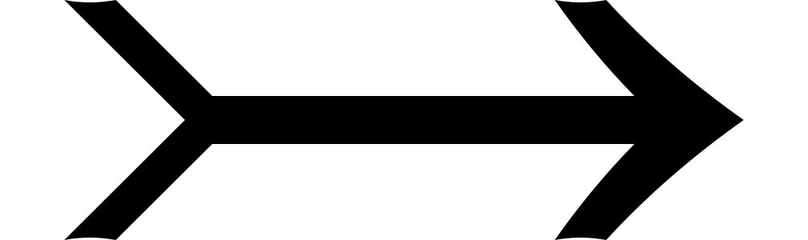

The appearance of clumsiness with which the sign, like a mute person, tries to make itself understood through all kinds of suggestive gestures, – disappears when we consider that the sign fulfils its function only in a grammatical system. For us the command is clear when it is unambiguous; & there is no clearer one (What is not needed in logic does not _help_ either.)

### [PG I](/w-pg-1/#ms-114-96r.1) [96r\[1\]](https://cdn.wittgensteinnachlass.com/2000px/webp/Ms-114/96r.webp)

In what sense can one call the wish as such, the belief, – ‘unsatisfied’? What is the model of unsatisfaction, that from which we take our concept? Is it an empty space? and would one say of such a space that it is unsatisfied; would that not also be a metaphor? Is it not a feeling that we call unsatisfaction; hunger, for example? We can describe an object in a particular system of expression by means of the words “satisfied” & “unsatisfied”. If we were to stipulate, for example, that the hollow cylinder be called the “unsatisfied cylinder” & the full cylinder that complements it, its “satisfaction”.

### [PG I](/w-pg-1/#ms-114-96r.2) [96r\[2\]](https://cdn.wittgensteinnachlass.com/2000px/webp/Ms-114/96r.webp)

It seems: the expectation & the fact that satisfies the expectation somehow fit together. One is supposed to describe an expectation & a fact that fit together, so that one can see what this agreement consists in. One immediately thinks of the fitting of a solid form into a corresponding hollow form. But if one wants to describe these two, one sees that, insofar as they fit, _one_ description applies to both. (Compare, by contrast, what it means to say: “these trousers do not fit this skirt”.)

### [PG I](/w-pg-1/#ms-114-96r.3+96v.1+97r.1) [96r\[3\]](https://cdn.wittgensteinnachlass.com/2000px/webp/Ms-114/96r.webp),[96v\[1\]](https://cdn.wittgensteinnachlass.com/2000px/webp/Ms-114/96v.webp),[97r\[1\]](https://cdn.wittgensteinnachlass.com/2000px/webp/Ms-114/97r.webp)

The paradox is expressed in this: when the event I expected occurs, it does not differ from the event I expected. So if one asks: “How does this person differ from the one you expected; for the real person was not present in your expectation, otherwise you could not have expected him”, the answer is nevertheless: this person _is_ the one I expected. I say: “That is exactly how I imagined it”; & someone replies, for example: “That is impossible, for one was an image and the other is not; & did you perhaps take your image for reality?”

I see someone aim the rifle & say: “I expect a shot.” The shot is fired. – How, that is what you expected; so was this noise somehow already in your expectation? Or does your expectation only correspond in another respect to what has occurred; was this noise not contained in your expectation & only came as an accident when the expectation was fulfilled? But no, if the noise had not occurred, my expectation would not have been fulfilled; the noise fulfilled it; it did not come as an addition to the fulfilment, like a second guest to the one I had expected. – Was what was not also in the expectation an accident, an addition to fate? – But what then was _not_ an addition, – did anything from before the shot already occur in my expectation? – And what was the addition, – for did I not expect the whole shot?

“The bang was quieter than I had expected.” – “So did it bang louder in your expectation?”

### [PG I](/w-pg-1/#ms-114-97r.2) [97r\[2\]](https://cdn.wittgensteinnachlass.com/2000px/webp/Ms-114/97r.webp)

“The red that you imagine is surely not the same – the same thing – as what you see in front of you; – how then can you say ‘this is the same as what I imagined’?” – But is the relationship not analogous in the sentences “there is a red patch here” & “there is no red patch here”? In both, the word “red” occurs, so this word cannot indicate the presence of something red. The word “red” has its function only in the context of the sentence. And is the misunderstanding not that one takes the meaning of the word “red” for the sense of a sentence which says that something is red?

### [PG I](/w-pg-1/#ms-114-97r.3) [97r\[3\]](https://cdn.wittgensteinnachlass.com/2000px/webp/Ms-114/97r.webp)

_dann_

How strange it would be to say: “an event looks different when it occurs than when it does not occur”. Or: “A red patch looks different when it is there than when it is not there; but language abstracts from this _difference_, for it speaks of a red patch whether it is there or not.”

### [PG I](/w-pg-1/#ms-114-97r.4+97v.1) [97r\[4\]](https://cdn.wittgensteinnachlass.com/2000px/webp/Ms-114/97r.webp),[97v\[1\]](https://cdn.wittgensteinnachlass.com/2000px/webp/Ms-114/97v.webp)

Reality is not a property that is still lacking in what is expected & that is now added when the expectation arrives. – Reality is also not like daylight, which first gives things colour when they are already, as it were colourless, present in the darkness.

### [PG I](/w-pg-1/#ms-114-97v.2) [97v\[2\]](https://cdn.wittgensteinnachlass.com/2000px/webp/Ms-114/97v.webp)

“How do you know that you are expecting a _red_ patch; that is, how do you know that a red patch is the fulfilment of what you are expecting?” But I could just as well ask: “how do you know that that _is_ a red patch?” How do you know that what you did really was to recite the alphabet in your mind? – But how do you know that what you recite aloud really _is_ the alphabet? This is of course the same question as: “How do you know that what you call ‘red’ really is the same as what the other person calls it”. And one question, used as a metaphysical question, has just as little sense as the other.

### [PG I](/w-pg-1/#ms-114-97v.3) [97v\[3\]](https://cdn.wittgensteinnachlass.com/2000px/webp/Ms-114/97v.webp)

An expectation does not stand to its fulfilment as hunger does to its fulfilment. I can describe the hunger, & what satisfies it, & say that it satisfies it.

### [PG I](/w-pg-1/#ms-114-97v.4+98r.1) [97v\[4\]](https://cdn.wittgensteinnachlass.com/2000px/webp/Ms-114/97v.webp),[98r\[1\]](https://cdn.wittgensteinnachlass.com/2000px/webp/Ms-114/98r.webp)

So, I would like to say, you can see from these examples how the words are actually used.

### [PG I](/w-pg-1/#ms-114-98r.2) [98r\[2\]](https://cdn.wittgensteinnachlass.com/2000px/webp/Ms-114/98r.webp)

But it is not like this either: I feel like having an apple; so whatever satisfies this desire I will call an “apple”.

### [PG I](/w-pg-1/#ms-114-98r.3) [98r\[3\]](https://cdn.wittgensteinnachlass.com/2000px/webp/Ms-114/98r.webp)

One might think: What an extraordinary process wanting must be, for me to be able to want _that_ now which I will only do in five minutes! How can I expect the event; it is not there at all yet?

### [PG I](/w-pg-1/#ms-114-98r.4+98v.1) [98r\[4\]](https://cdn.wittgensteinnachlass.com/2000px/webp/Ms-114/98r.webp),[98v\[1\]](https://cdn.wittgensteinnachlass.com/2000px/webp/Ms-114/98v.webp)

“Socrates: So, whoever imagines what is not; does he imagine nothing? – Theaetetus: So it seems. – Socrates: But whoever imagines nothing, will surely not imagine at all? – Th.: Apparently, as we can see.” Let us substitute in this argument for the word “imagine” the word “kill”, for example; then there is a rule for the use of this word; it makes no sense to say “I kill something that does not exist”. I can imagine a deer on this meadow which is not there, but I cannot kill one which is not there. And “to imagine a deer on this meadow” means: to imagine that a deer is there. To kill a deer, however, does not mean: to kill that etc.. But if someone says: “in order for me to imagine a deer, it must exist in some sense”, – then the answer is: no, it need not _exist_ in any sense for that. And if the reply were: “but the brown colour, for example, must surely exist in order for me to imagine it”, – then one must say: “the brown colour exists” means nothing at all; except perhaps that it appears here or there as the colour of an object, & that is not necessary for me to imagine a brown deer.

### [PG I](/w-pg-1/#ms-114-98v.2) [98v\[2\]](https://cdn.wittgensteinnachlass.com/2000px/webp/Ms-114/98v.webp)

Being able to do something appears like a shadow of the actual doing, just as the sense of the sentence is a shadow of a fact, or the understanding of the command a shadow of its execution. In the command the fact as it were “casts its shadow in advance”. But this shadow, whatever it might be, is not the event. The shadowy anticipation of the fact consists in our being able now to think that _that_ will occur which will only occur _later_. Or, as it is misleadingly put: that we can now think of _that_ (or, of that) which will only occur _later_.

### [PG I](/w-pg-1/#ms-114-98v.3+99r.1) [98v\[3\]](https://cdn.wittgensteinnachlass.com/2000px/webp/Ms-114/98v.webp),[99r\[1\]](https://cdn.wittgensteinnachlass.com/2000px/webp/Ms-114/99r.webp)

We say that the expression of expectation ‘describes’ the expected fact & think of it as an object or complex which appears as the fulfilment of the expectation. – But the expected one is not the fulfilment, but that he comes. The mistake is deeply embedded in our language: we say “I expect him” & “I expect his coming” & “I expect that he will come”. It is difficult for us to get free of the comparison: the person enters – the event occurs. As if the event had already been prefigured at the door of reality & were now entering into it (as into a room).

### [PG I](/w-pg-1/#ms-114-99r.2) [99r\[2\]](https://cdn.wittgensteinnachlass.com/2000px/webp/Ms-114/99r.webp)

I can look for it when it is not there, but not point to it when it is not there. One might want to say: “it must also be there when I look for it”. – Then it must also be there when I do not find it, & also when it does not exist.

### [PG I](/w-pg-1/#ms-114-99r.3+99v.1) [99r\[3\]](https://cdn.wittgensteinnachlass.com/2000px/webp/Ms-114/99r.webp),[99v\[1\]](https://cdn.wittgensteinnachlass.com/2000px/webp/Ms-114/99v.webp)

Looking for _it_ (say, my stick) is a kind of looking and differs from looking for something else through what one does (says, thinks) while looking, not through what one finds. And if I carry a picture or a mental image with me while looking, – well and good. And if I say that the picture is a picture of what I am looking for, that only says what place the picture occupies in the process of looking. And if I find it and say “there it is! _that’s_ what I was looking for”, these words are not an explanation of the words designating the object I was looking for (say, the words “my stick”), which could only now be given, once it has been found.

### [PG I](/w-pg-1/#ms-114-99v.2) [99v\[2\]](https://cdn.wittgensteinnachlass.com/2000px/webp/Ms-114/99v.webp)

“_Him_ did you look for? You couldn’t even know if he was there!” Compare, on the other hand, the search for the trisection of the angle.)

### [PG I](/w-pg-1/#ms-114-99v.3) [99v\[3\]](https://cdn.wittgensteinnachlass.com/2000px/webp/Ms-114/99v.webp)

One can say of the bearer of the name that he does not exist; & this is, of course, not an activity, although one could mistake it for one & say: he must also be there when he does not exist. (And this has certainly been written by a philosopher once before.)

### [PG I](/w-pg-1/#ms-114-99v.4+100r.1) [99v\[4\]](https://cdn.wittgensteinnachlass.com/2000px/webp/Ms-114/99v.webp),[100r\[1\]](https://cdn.wittgensteinnachlass.com/2000px/webp/Ms-114/100r.webp)

The thought that it is only finding that shows us what we were looking for, only the fulfilment of the wish what we wished for, means judging the process in the same way as the symptoms of expectation or of searching in another person. I see him restlessly pacing up and down in his room; someone comes in at the door & he becomes calm & shows signs of satisfaction; & now I say: “he apparently expected this person”. The symptoms of expectation are not the expression of expectation.

### [PG I](/w-pg-1/#ms-114-100r.2+100v.1) [100r\[2\]](https://cdn.wittgensteinnachlass.com/2000px/webp/Ms-114/100r.webp),[100v\[1\]](https://cdn.wittgensteinnachlass.com/2000px/webp/Ms-114/100v.webp)

When we say to someone “imagine the colour red”, he is supposed to imagine, say, a red patch, but not a green one, because this one is _not red_.

(Could one point to something that is _not_ red in order to explain the word “red”? This would be similar to explaining the word “modest” to someone who does not speak German, and one points to an arrogant person as an explanation & says: “this person is _not_ modest”. It is not an argument against such a method of explanation that it is ambiguous. Every explanation can be misunderstood.

One could, for example, always point to the complementary colour in order to explain a colour-word; but without first agreeing that one will point to the complementary colour: just as one does not now agree that one will point to an object of the colour itself. Compare the signpost whose hand points in the opposite direction to the way.)

### [PG I](/w-pg-1/#ms-114-100v.2) [100v\[2\]](https://cdn.wittgensteinnachlass.com/2000px/webp/Ms-114/100v.webp)

The possibility of this misunderstanding also lies in the double sense of the expression “the colour red as the constituent common to two states of affairs”. In the one case this means that something _is_ red both here and there, something has the colour red. In the other case it is not a matter of having a colour in common (which would of course be expressed by specifying a colour). What they have in common in the latter case is the harmony between reality & thought, which in truth corresponds to a form of our language.

### [PG I](/w-pg-1/#ms-114-100v.3) [100v\[3\]](https://cdn.wittgensteinnachlass.com/2000px/webp/Ms-114/100v.webp)

In language, expectation & fulfilment touch upon each other.

### [PG I](/w-pg-1/#ms-114-100v.4+101r.1+101v.1) [100v\[4\]](https://cdn.wittgensteinnachlass.com/2000px/webp/Ms-114/100v.webp),[101r\[1\]](https://cdn.wittgensteinnachlass.com/2000px/webp/Ms-114/101r.webp),[101v\[1\]](https://cdn.wittgensteinnachlass.com/2000px/webp/Ms-114/101v.webp)

One might have the feeling that in the sentence “I expect that he is coming” one uses the words “he is coming” in a different sense than in the assertion “he is coming”. But if that were so, how could I talk about my expectation being fulfilled?

But now I might say while walking up and down: “I expect him to come in”. – Now there is a similarity! But what kind is it?! Now, one could ask: what does it look like when he comes? – The door opens, a man enters, etc. What does it look like when I expect that he will come? – I walk up and down the room, occasionally look at the clock, etc. – but there is absolutely no similarity between these two processes! How can one then use the same words to describe them? Where is the hollow form and the filled form here? But I could also walk up and down my room without expecting him to come, and also look at the clock, etc. I would not describe these processes with the words “I expect that he is coming”. What would it consist in, for example, that I expect _him_? I said that the process of expectation was supposed to be such that I would have to be able to see from it what is expected. If one calls those expecting actions expectation, then it is a hunger and the fulfilment of the expectation is what satisfies the hunger. What interests us is expectation as thought, that is, as expression of expectation.

And the words “he is coming” mean the same in the expression of expectation and in the description of fulfilment, for if I wanted to explain the two words, say by ostensive explanations, the same explanations would apply to both sentences.

### [101v\[2\]](https://cdn.wittgensteinnachlass.com/2000px/webp/Ms-114/101v.webp)

“I expected him all day.” Here “expect” means a sequence of actions, feelings & thoughts; not a continuing state which contained the person expected & his coming as constituents. No thought in amorphous form.

### [101v\[3\]](https://cdn.wittgensteinnachlass.com/2000px/webp/Ms-114/101v.webp),[102r\[1\]](https://cdn.wittgensteinnachlass.com/2000px/webp/Ms-114/102r.webp)

If we want to understand the sentence “I expect that he is coming”, – we ask ourselves: What is the criterion for what we are doing to be expecting him? How do I know that I expect him? Why do we call what we do in this situation “expecting him”? What stipulations do we make about the use of the word “expect”? Do we want to call our thoughts the expectation, or is it supposed to be a hypothesis that we expect precisely that; does what we expect emerge from certain actions (for example, from my preparing two place settings for a meal instead of one for myself & the food that N.N. particularly likes), or does expecting N. mean that, under quite particular circumstances, say after arranging to meet him at 5 o’clock, I sit alone in my room at that time, etc. etc.?

### [PG I](/w-pg-1/#ms-114-102r.2+102v.1) [102r\[2\]](https://cdn.wittgensteinnachlass.com/2000px/webp/Ms-114/102r.webp),[102v\[1\]](https://cdn.wittgensteinnachlass.com/2000px/webp/Ms-114/102v.webp)

, The same is to be said of intention. If a device is _supposed_ to act as a brake, but in fact, for whatever reasons, does not slow the machine down, then the intention which the device is supposed to serve is not immediately recognizable from it & its mode of operation. If one says “that is a brake, but it does not work”, one is speaking of the intention. – But if it were now the case that whenever the device did not work as a brake a particular person became annoyed, would the intention of the device not be expressed in this mode of operation? No, for one could then say that the lever actuates the brake on one occasion and the annoyance on another? For how is it expressed that that person is annoyed _about_ the lever’s not actuating the brake? “Being annoyed that the device does not work in that way” means, once again, something similar to “wishing that it worked in that way”. – And here we have the old problem which we would like to express as follows: “that the thought that p is the case does not presuppose that it is the case; but that, on the other hand, something in the fact must nevertheless be a presupposition for the thought itself (I cannot think that something is red if the colour red does not exist)”. It is the problem of the harmony between world & thought. – One can reply that thoughts are in the same as what is doubtful & adhere to it as the measure adheres to what is measured.

For what I really want to say is: that the wish ‘he should come’ is the wish that it should really be _he_ who should really _come_. And if one wanted a further explanation of this assurance, we would say: “& by ‘he’ I mean this person here, & by ‘come’ I mean this action …”. But these are precisely explanations of grammar, explanations which constitute the language.

The sentence “I could not think that something is red if red did not exist” really refers to the mental image of something red, or to the existence of a red sample, _as part of our language_. But of course one cannot say that our language _must_ contain such a sample either. If it does not contain one, it is simply a different language. But one can say & emphasize that it does contain one.

### [PG I](/w-pg-1/#ms-114-102v.2) [102v\[2\]](https://cdn.wittgensteinnachlass.com/2000px/webp/Ms-114/102v.webp)

_In language_ everything is settled.

### [102v\[3\]](https://cdn.wittgensteinnachlass.com/2000px/webp/Ms-114/102v.webp),[103r\[1\]](https://cdn.wittgensteinnachlass.com/2000px/webp/Ms-114/103r.webp)

It now seems somehow as if, viewed from outside, one could never recognize intention as _intention_; as if one would have to intend it oneself in order to understand it as an opinion. (And in one respect this is like saying that one could recognize toothache as such only when viewed from inside.) It means not considering intention as a phenomenon, not as a fact. And here intention recalls the will (also in Schopenhauer’s sense). Every phenomenon seems dead to us in comparison with the living thought. But one must understand the thought, the intention, “viewed from outside”, as such; without being instructed about a _meaning_. I.e.: If one looks at the _thought_, there can no longer be any question of _understanding_; for if one sees it, one must recognize it as the thought with this content; there is nothing to interpret. – But that is how it really is: when we think, there is no interpreting. –

### [PG I](/w-pg-1/#ms-114-103r.2+103v.1) [103r\[2\]](https://cdn.wittgensteinnachlass.com/2000px/webp/Ms-114/103r.webp),[103v\[1\]](https://cdn.wittgensteinnachlass.com/2000px/webp/Ms-114/103v.webp)

The fulfilment of an expectation does not consist in a third thing happening, which one could describe in some other way besides just as “the fulfilment of that expectation,” for example, as a feeling of satisfaction or joy, or whatever. The expectation that p will be the case is the same as the expectation of the fulfilment of that expectation. Could the justification of an action as the fulfilment of an order be phrased as follows: “You said ‘bring me a yellow flower’, & this one then gave me a feeling of satisfaction, so I brought it”? Wouldn’t one have to answer: “I didn’t manage to get you to bring me the flower that, in response to my words, would give me such a feeling!”

### [PG I](/w-pg-1/#ms-114-103v.2) [103v\[2\]](https://cdn.wittgensteinnachlass.com/2000px/webp/Ms-114/103v.webp)

(I go looking for the yellow flower. Even if I have a picture in mind while looking, – do I need it when I see the yellow flower – or another one? – And if I say: “as soon as I see a yellow flower, something in my memory clicks into place, as it were”, – as, for example, in the striking mechanism of a clock a lever engages with the teeth of a wheel – can I foresee, expect, this clicking into place any more readily than the yellow flower? – Even if in a particular case it really is the case that I expect not what I am looking for but some other (indirect) criterion, this is in any case no explanation of expecting.)

### [PG I](/w-pg-1/#ms-114-103v.3+104r.1) [103v\[3\]](https://cdn.wittgensteinnachlass.com/2000px/webp/Ms-114/103v.webp),[104r\[1\]](https://cdn.wittgensteinnachlass.com/2000px/webp/Ms-114/104r.webp)

But doesn’t a phenomenon of assent (or satisfaction) always accompany the occurrence of what is expected? – Is this phenomenon something other than the occurrence of what is expected? If so, then I don’t know whether such a phenomenon always accompanies fulfilment. If I say: the person whose expectation is fulfilled doesn’t have to exclaim “yes, that’s it”, or something of the sort, one may reply: “certainly, but surely he must _know_ that the expectation is fulfilled”. – Yes, insofar as this knowledge belongs to its _being_ fulfilled. – “True, but when someone’s expectation is fulfilled, surely there is always a release of tension!” – How do you know that?

### [PG I](/w-pg-1/#ms-114-104r.2+104v.1) [104r\[2\]](https://cdn.wittgensteinnachlass.com/2000px/webp/Ms-114/104r.webp),[104v\[1\]](https://cdn.wittgensteinnachlass.com/2000px/webp/Ms-114/104v.webp)

The description of language must accomplish the same as language. “For then I can really see from the sentence, the description of reality, how things stand in reality.” – But that is precisely what one calls “description”, & that is precisely what one calls “seeing how things stand”! And it is nothing else that is ever said by this: that we see from the description how things stand in reality. “You get your knowledge of what you have to do from the command. And yet the command gives you only itself, & its effect is immaterial.” But here we are misled by the way our language expresses itself when it says “knowledge _of_”, or “knowledge of the action”. For it is as if this something, the action, were a thing that was to come into existence in the obeying of the command, & as if the command acquainted us with this very thing, showed it to us; so that it already called it into existence in some sense. (How can the command – the expectation – show us a man before he has entered our room?!)

### [PG I](/w-pg-1/#ms-114-104v.2) [104v\[2\]](https://cdn.wittgensteinnachlass.com/2000px/webp/Ms-114/104v.webp)

If one says that the action which obeys the command is to be extracted from the command, the fact which makes the sentence true from the sentence, – what is to be extracted from the sentence except _itself_? Or how can one derive the action from the command before it happens? Unless one means another form of describing that action, as when I make a drawing of the action after the command, say. – But this further description too is only there once I have derived it & does not already lie shadow-like in the command itself.

### [PG I](/w-pg-1/#ms-114-104v.3+105r.1) [104v\[3\]](https://cdn.wittgensteinnachlass.com/2000px/webp/Ms-114/104v.webp),[105r\[1\]](https://cdn.wittgensteinnachlass.com/2000px/webp/Ms-114/105r.webp)

Thinking with its application proceeds step by step as a calculus. – However many intermediate stages I put between the thought & the application, one intermediate stage always follows the next – & the application follows the last – without an intervening link. Here we have the same case as when we try to bridge the gap between decision & deed by inserting intermediate links.

### [PG I](/w-pg-1/#ms-114-105r.2) [105r\[2\]](https://cdn.wittgensteinnachlass.com/2000px/webp/Ms-114/105r.webp)

The ambiguity of our way of speaking: If an order were given to us in a code & the key to translating it into German, then we could describe the process of formulating the German order with the words: “derive from the code what we have to do” or “derive what the fulfilment of the order is”. If, on the other hand, we act according to the order, obey it, then here too one can speak of deriving the fulfilment.

### [PG I](/w-pg-1/#ms-114-105r.3) [105r\[3\]](https://cdn.wittgensteinnachlass.com/2000px/webp/Ms-114/105r.webp)

We cannot cross the bridge to fulfilment until we have arrived at it.

### [105r\[4\]](https://cdn.wittgensteinnachlass.com/2000px/webp/Ms-114/105r.webp),[105v\[1\]](https://cdn.wittgensteinnachlass.com/2000px/webp/Ms-114/105v.webp)

Engagement with the picture of thought appears as a mere game if it is not concerned with the reality that interests us. If our expectation, our thinking, is a game, why should this particular fantasy-image interest us, when otherwise we do not concern ourselves with states of mind, stomach aches, etc.? (What do we think for, what use is it?) What we want to know is: What does thought have to do with what happens outside thought? What does what I think have to do with what is the case?

### [PG I](/w-pg-1/#ms-114-105v.2) [105v\[2\]](https://cdn.wittgensteinnachlass.com/2000px/webp/Ms-114/105v.webp)

The _calculus_ of thought connects with reality outside thought.

From the command to its execution is one step of a calculation. Indeed, the calculation

stands to its result 625 in exactly the relation of the command to its execution. And to the extent – & only to the extent – that this calculation is a picture of the result, the command too is a picture of the execution (the expectation a picture of the fulfilment). And to the extent that the result is determined by the calculation, fulfilment is determined by the command.

### [105v\[3\]](https://cdn.wittgensteinnachlass.com/2000px/webp/Ms-114/105v.webp)

One can say of expectation that it is a preparatory, expectant, action. Like a ball-player, it stretches out its hands and gets them ready to receive the ball.

### [PG I](/w-pg-1/#ms-114-106r.1) [106r\[1\]](https://cdn.wittgensteinnachlass.com/2000px/webp/Ms-114/106r.webp)

When I expect someone, – what happens? – I find his name in my calendar under today’s date & the note “5 h ”. I say to someone else “I can’t come to you today because I am expecting N.” I make preparations as for receiving a guest. I consider: “does N. smoke?” I remember having seen him smoke & put out cigars. Near 5 h  I say to myself: “he will be here any minute”, & at the same time imagine a man who looks like N.; then I imagine him entering the room & my greeting him and calling him by name. Such a process & many more or less _similar_ ones is called “expecting N. to come”.

### [106r\[2\]](https://cdn.wittgensteinnachlass.com/2000px/webp/Ms-114/106r.webp)

Is hunger the wish for food? But why not merely the wish for hunger to cease, whatever may bring that about? – But what phenomenon is the wish – which phenomenon does one call “the wish for food”? When I am hungry; & I search in a drawer where there is usually something edible to be found; & the drawer is empty & I become annoyed; & now I perhaps _say_ to myself: “where could I find something else?”; finally someone comes & I say: “I’d like something to eat”.

### [PG I](/w-pg-1/#ms-114-106v.1) [106v\[1\]](https://cdn.wittgensteinnachlass.com/2000px/webp/Ms-114/106v.webp)

If I think in language, then meanings do not float before me alongside the linguistic expression; rather, language itself is the vehicle of thoughts.

### [PG I](/w-pg-1/#ms-114-106v.2) [106v\[2\]](https://cdn.wittgensteinnachlass.com/2000px/webp/Ms-114/106v.webp)

In what sense does the command anticipate the execution? – In that it commands _that_ now, which will be executed later? But it would have to say: “… what will be executed later, or not executed at all”. And that says nothing. “But even if my wish does not determine what will be the case, it does, as it were, determine the theme of a fact, whether or not that fact fulfils the wish.” We are – as it were – not surprised that someone knows the future, but that he can prophesy at all (correctly or incorrectly). As if the mere prophecy, whether correct or incorrect, already anticipated a shadow of the future. – While it knows nothing about the future; & can know less than nothing.

### [PG I](/w-pg-1/#ms-114-106v.3+107r.1) [106v\[3\]](https://cdn.wittgensteinnachlass.com/2000px/webp/Ms-114/106v.webp),[107r\[1\]](https://cdn.wittgensteinnachlass.com/2000px/webp/Ms-114/107r.webp)

If one now asks: is the fact then determined by the expectation, yes or no, – i.e., is it determined in what sense the expectation will be answered by an event – whatever event may occur, – then one must answer: _Yes_! if the expression of the expectation is not indeterminate insofar as it is, for example, a disjunction of different possibilities.

### [PG I](/w-pg-1/#ms-114-107r.3) [107r\[3\]](https://cdn.wittgensteinnachlass.com/2000px/webp/Ms-114/107r.webp)

“The proposition determines in advance what will make it true.” Certainly, the proposition ‘p’ determines that p must be the case in order to make it true; & that means: (the proposition p) = (the proposition that the fact p makes true)

And the statement that the wish that p should be the case is satisfied by the event p says nothing, except as a rule of signs:

(the wish that p should be the case) = (the wish which is satisfied by the fact p)

### [PG I](/w-pg-1/#ms-114-107r.4) [107r\[4\]](https://cdn.wittgensteinnachlass.com/2000px/webp/Ms-114/107r.webp)

As with all metaphysics, the harmony between thought & reality is to be found in the grammar of language.

### [PG I](/w-pg-1/#ms-114-107r.5+107v.1) [107r\[5\]](https://cdn.wittgensteinnachlass.com/2000px/webp/Ms-114/107r.webp),[107v\[1\]](https://cdn.wittgensteinnachlass.com/2000px/webp/Ms-114/107v.webp)

Instead of harmony, agreement between thought & reality, one could say here: pictoriality of thought. But is pictoriality an agreement? In the ‘Treatise’ I had said something like: it is an agreement of form. But that is misleading. Anything can be a picture of anything: if we extend the concept of a picture accordingly. Otherwise we must say what we call a picture of something, & hence also what we are still willing to call the agreement of pictoriality, the agreement of forms. For what I said really amounts to this: every projection, by whatever method, must have something in common with what is projected. But that says only that I am extending the concept of ‘having in common’ here & making it equivalent to the general concept of projecting. So I am only drawing attention to a possibility of generalization (which can of course be very important). The agreement between thought & reality consists in this: that if I falsely say that something is red, it is nevertheless not _red_. And if I want to explain the word “red” to someone in the sentence “That is not red”, I point to something red.

### [PG I](/w-pg-1/#ms-114-107v.2+108r.1) [107v\[2\]](https://cdn.wittgensteinnachlass.com/2000px/webp/Ms-114/107v.webp),[108r\[1\]](https://cdn.wittgensteinnachlass.com/2000px/webp/Ms-114/108r.webp)

In what sense can I say that the sentence is a picture? When I think about it, I would like to say: it must be a picture in order to show me what I am to do; so that I can take it as my guide. But then what you want to say is merely that you take the sentence as your guide in the sense in which you take a picture as your guide. To say that the sentence is a picture brings out certain features in the grammar of the word “sentence”.

Thinking is wholly comparable to drawing pictures.

But one can also say that what appears as a comparison-object of the sentence is a special case of our more general concept. When I have compared the sentence with a measure, I have, strictly speaking, used a statement of length with the help of a measure as an example for all sentences.

### [PG I](/w-pg-1/#ms-114-108r.2+108v.1) [108r\[2\]](https://cdn.wittgensteinnachlass.com/2000px/webp/Ms-114/108r.webp),[108v\[1\]](https://cdn.wittgensteinnachlass.com/2000px/webp/Ms-114/108v.webp)

The sense of a sentence, the sense of a picture. When we compare the sentence with a picture, we must consider whether it is a portrait (a historical depiction), or a genre painting. And both comparisons make sense.

(Sentences in poems correspond to genre paintings.) “If I look at a genre painting, it ‘tells me something’, even if I do not for a moment believe (imagine) that the people I see in it are real, or that there were real people in this situation. ‘It tells me something’ can here only mean that I have a certain attitude towards it, see it in a certain way. For how, if I asked: ‘_what_ did it tell me then?’

Consider the entirely different grammar of the expressions: “this picture depicts people in a village tavern”,

“this picture depicts the coronation of Napoleon”.

### [PG I](/w-pg-1/#ms-114-108v.2) [108v\[2\]](https://cdn.wittgensteinnachlass.com/2000px/webp/Ms-114/108v.webp)

(Socrates: “And he who imagines, should he not imagine _something_?” – Theaetetus: “Necessarily.” – Socrates: “And he who imagines something, nothing real?” – Th.: “So it seems.”)

### [PG I](/w-pg-1/#ms-114-108v.3) [108v\[3\]](https://cdn.wittgensteinnachlass.com/2000px/webp/Ms-114/108v.webp)

_and_

If one takes it for granted that human beings delight in their imagination, one should consider that this imagination is not like a painted picture or a sculpted model; but a complicated structure made up of heterogeneous components: words, pictures, etc. One will then no longer contrast operating with written – & spoken signs with operating with “mental images” of events.

### [PG I](/w-pg-1/#ms-114-108v.4+109r.1) [108v\[4\]](https://cdn.wittgensteinnachlass.com/2000px/webp/Ms-114/108v.webp),[109r\[1\]](https://cdn.wittgensteinnachlass.com/2000px/webp/Ms-114/109r.webp)

The illustration in a book joins the word, as one related aid joins another. (The ugliness of a person can be repulsive in a picture, in a painting, as in reality, but also in a description, in words.)

### [PG I](/w-pg-1/#ms-114-109r.2) [109r\[2\]](https://cdn.wittgensteinnachlass.com/2000px/webp/Ms-114/109r.webp)

Our attitude towards the picture (the thought) – how we experience the picture makes it real for us. That is, it connects it with reality; establishes a continuity with reality. (Fear connects the picture with the terror of reality.)

### [PG I](/w-pg-1/#ms-114-109r.3) [109r\[3\]](https://cdn.wittgensteinnachlass.com/2000px/webp/Ms-114/109r.webp)

Can an ostensive explanation clash with the other rules for the application of a word? – For rules cannot clash unless they contradict one another. For otherwise they determine a meaning, & are not answerable to anything in such a way that they could contradict it.

### [PG I](/w-pg-1/#ms-114-109r.4) [109r\[4\]](https://cdn.wittgensteinnachlass.com/2000px/webp/Ms-114/109r.webp)

Grammar is not answerable to any reality. It is the grammatical rules that determine meaning in the first place (constitute it), & so they are not answerable to any meaning & are to that extent arbitrary.

### [PG I](/w-pg-1/#ms-114-109v.1) [109v\[1\]](https://cdn.wittgensteinnachlass.com/2000px/webp/Ms-114/109v.webp)

There can be no discussion about whether these rules or other rules are the correct ones for the word “not” (i.e. whether they are in accordance with its meaning).

For without these rules the word does not yet have a meaning, & if we change the rules, it now has a different meaning (or no meaning), & we could just as well change the word.

### [PG I](/w-pg-1/#ms-114-109v.2) [109v\[2\]](https://cdn.wittgensteinnachlass.com/2000px/webp/Ms-114/109v.webp)

“The only correlate in language to a natural necessity is an arbitrary rule. It is the only thing that one can extract from this necessity into a sentence.”

### [PG I](/w-pg-1/#ms-114-109v.3+110r.1) [109v\[3\]](https://cdn.wittgensteinnachlass.com/2000px/webp/Ms-114/109v.webp),[110r\[1\]](https://cdn.wittgensteinnachlass.com/2000px/webp/Ms-114/110r.webp)

Why do I not call the rules of cooking arbitrary; & why am I tempted to call the rules of grammar arbitrary? Because cooking is defined by its purpose, whereas language is not. Whoever follows rules other than the correct ones when cooking cooks badly; but whoever follows rules other than those of chess plays a different game; & whoever follows grammatical rules other than, say, the usual ones does not thereby speak something false, but speaks of something else.

### [PG I](/w-pg-1/#ms-114-110r.2) [110r\[2\]](https://cdn.wittgensteinnachlass.com/2000px/webp/Ms-114/110r.webp)

If I want to give a block of wood a particular shape, then the right blow is the one that produces that shape. But I do not call the argument that has the desired consequences the right one. (Pragmatism.) On the contrary, I call the calculation wrong, although the actions arising from the result have led to the desired end. (Compare the joke: “I win the jackpot & he wants to teach me a lesson!”) This shows that the justifications in the two cases are different, and so “justification” means different things in the two cases. In one case one can say: “Just wait, you’ll see that it comes out right (i.e. as desired)”; in the other this is no justification.

### [110r\[3\]](https://cdn.wittgensteinnachlass.com/2000px/webp/Ms-114/110r.webp)

When one speaks of the arbitrariness of grammatical rules, this means that the justification that lies _within_ grammar as such does not exist _for_ grammar.

### [PG I](/w-pg-1/#ms-114-110r.4+110v.1) [110r\[4\]](https://cdn.wittgensteinnachlass.com/2000px/webp/Ms-114/110r.webp),[110v\[1\]](https://cdn.wittgensteinnachlass.com/2000px/webp/Ms-114/110v.webp)

The rules of cookery are related to the grammar of the word “cooking” in a different way from that in which the rules of chess are related to the grammar of the word “playing chess” & the rules of multiplication to the grammar of the word “multiply”.

### [PG I](/w-pg-1/#ms-114-110v.2) [110v\[2\]](https://cdn.wittgensteinnachlass.com/2000px/webp/Ms-114/110v.webp)

The rules of grammar are arbitrary in the same sense as the choice of a unit of measurement. But surely this can only mean that they are independent of the length of the object being measured; and that the choice of one unit is not ‘true’ and that of another ‘false’ in the way that a statement of the length is true or false. This is of course only a remark about the grammar of the word “unit of length”.

### [PG I](/w-pg-1/#ms-114-110v.3+111r.1) [110v\[3\]](https://cdn.wittgensteinnachlass.com/2000px/webp/Ms-114/110v.webp),[111r\[1\]](https://cdn.wittgensteinnachlass.com/2000px/webp/Ms-114/111r.webp)

One is tempted to justify the rules of grammar by saying, for example: “But there really are 4 primary colours.” And it is against the possibility of this justification that we direct ourselves when we say that the rules of grammar are arbitrary. But can one not nevertheless say that the grammar of colour words characterizes the world as it actually is? One would like to say: can I not really search in vain for a fifth primary colour? (And if one can search, then finding one is conceivable.) Do we not group the primary colours together because they have a kind of similarity? Or at least the colours, as opposed to shapes & tones? Or, when I present this division of the world as the correct one, do I already have a preconceived idea in my head as a paradigm? Of which I can then say: “that is the way we look at things”; or “we simply want to make such a picture of things”. For if I say: “the primary colours do have a certain similarity to one another”, – where do I get the concept of this similarity? From the 4 primary colours alone? Just as the concept ‘primary colour’ is nothing other than ‘blue or red or green or yellow’, is not the concept of that similarity likewise given only by the four colours? Indeed, are they not the same! (For here one can say: “What would it be like if these colours did not have this similarity?!”) (Think of grouping the four primary colours together with white & black, and visible colours with ultraviolet & infrared.)

### [PG I](/w-pg-1/#ms-114-111r.2+111v.1) [111r\[2\]](https://cdn.wittgensteinnachlass.com/2000px/webp/Ms-114/111r.webp),[111v\[1\]](https://cdn.wittgensteinnachlass.com/2000px/webp/Ms-114/111v.webp)

I do not call rules of representation conventions when they can be justified by saying that the representation, if it accords with those rules, agrees with reality. The rules of grammar cannot be justified by a characterization of what is to be represented. For whatever the grammar of this characterization permits, why should the grammar that I am trying to justify not permit as well?

---

And whatever this justification can say, whatever its grammar permits, – why should the grammar that I am trying to justify not permit as well?

Why should both forms of expression not have the same freedom? And how can what one says restrict what the other may say?

### [PG I](/w-pg-1/#ms-114-111v.2+112r.1) [111v\[2\]](https://cdn.wittgensteinnachlass.com/2000px/webp/Ms-114/111v.webp),[112r\[1\]](https://cdn.wittgensteinnachlass.com/2000px/webp/Ms-114/112r.webp)

No one will deny that studying the nature of the rules of a game must be useful for studying grammatical rules, since there is undoubtedly some similarity. – In general it is better to look at the rules of a game without a preconceived judgement or prejudice about the analogy between grammar & game, & guided only by the sure instinct that there is an affinity here. And here again one should simply report what one sees & not fear that one is thereby undermining a meaningful & correct view; or for that matter wasting one’s time on something superfluous.

### [PG I](/w-pg-1/#ms-114-112r.2) [112r\[2\]](https://cdn.wittgensteinnachlass.com/2000px/webp/Ms-114/112r.webp)

One can of course regard language as part of a psychological mechanism. The simplest way is to restrict the concept of language to commands. One can then think of how a foreman directs the work of a group of people by calling out instructions.

### [PG I](/w-pg-1/#ms-114-112r.3) [112r\[3\]](https://cdn.wittgensteinnachlass.com/2000px/webp/Ms-114/112r.webp)

One can imagine that a person invents language; that he makes the invention of getting other human beings to work for him, by training them through punishment & reward to perform certain actions in response to commands. This invention would be analogous to the invention of a machine.

### [112r\[4\]](https://cdn.wittgensteinnachlass.com/2000px/webp/Ms-114/112r.webp),[112v\[1\]](https://cdn.wittgensteinnachlass.com/2000px/webp/Ms-114/112v.webp)

The system of calls and signals that he uses would be analogous to the system of perforating the paper strip of a pianola. (Incidentally, I imagine one in which the strength & weakness of the tone itself is also regulated automatically according to the ‘signs’ on the paper strip.) The person who plays from musical notation can then also be regarded as a game machine & we could also imagine a game machine that ‘read’ the piece of music from the ordinary printed notes. (Every such device as the perforated strip of a pianola is comparable to the beard of a key, & one could speak of the language of the key’s beard.)

### [PG I](/w-pg-1/#ms-114-112v.2) [112v\[2\]](https://cdn.wittgensteinnachlass.com/2000px/webp/Ms-114/112v.webp)

Can one say that grammar describes language; language, that part of the psychological mechanism by means of which we make a human machine work for us by uttering words, as if by pressing the buttons of a keyboard? Grammar then describes that part of the whole machine. The language, then, would be the right one that brought about the desired activity, that thus functioned; a language that did not do this would be like a steam engine constructed according to false principles (so, strictly speaking, not a steam engine).

### [PG I](/w-pg-1/#ms-114-112v.3+113r.1) [112v\[3\]](https://cdn.wittgensteinnachlass.com/2000px/webp/Ms-114/112v.webp),[113r\[1\]](https://cdn.wittgensteinnachlass.com/2000px/webp/Ms-114/113r.webp)

It is clear that I can determine through experience that a person (or animal) reacts to a sign in the way I want, and to another does not. That, for example, a person goes to the right when he sees the sign „→”, and to the left when he sees the sign „←”; but that he does not react to the sign „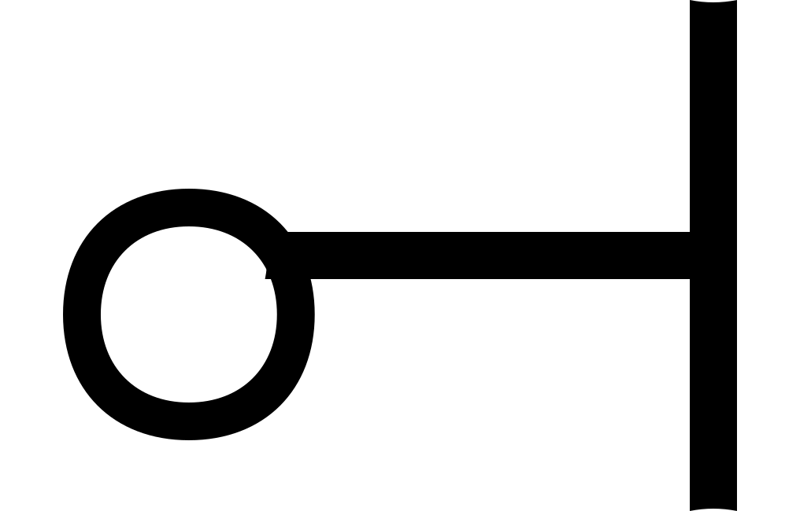” in the same way as to „→”, etc. Indeed, I do not even need to invent a case, but only consider the actual case: that I can guide a person who has only learned German only with the German language. (For I regard learning the German language merely as an adjustment of the mechanism to a certain kind of influence & it makes no fundamental difference here whether the other person has learned the language or was perhaps born by nature in such a way that he reacts to the sentences of the German language in the way a human being does when he has learned it.)

### [PG I](/w-pg-1/#ms-114-113r.2+113v.1) [113r\[2\]](https://cdn.wittgensteinnachlass.com/2000px/webp/Ms-114/113r.webp),[113v\[1\]](https://cdn.wittgensteinnachlass.com/2000px/webp/Ms-114/113v.webp)

I would then have discovered that someone, in response to a signal combined with the call “Zu”, brings me sugar, and in response to the signal & call “Mi” brings me milk, & that he does not do this in response to other words. Can I then say that it appears that “Zu” is the correct (唯一 correct) sign for sugar, “Mi” the correct one for milk? Now, when I say this, I use the expression “sign for sugar” differently from the way it is ordinarily used & differently from the way I want to use it.

### [PG I](/w-pg-1/#ms-114-113v.2) [113v\[2\]](https://cdn.wittgensteinnachlass.com/2000px/webp/Ms-114/113v.webp)

“This is the sign for sugar” does not state an effect of this sign but expresses an intention. That is, it connects the word “sugar” with another expression of the language. I do not use “This is the sign for sugar” analogously to the sentence: “if I press this button I get a piece of sugar”.

### [PG I](/w-pg-1/#ms-114-113v.3+114r.1) [113v\[3\]](https://cdn.wittgensteinnachlass.com/2000px/webp/Ms-114/113v.webp),[114r\[1\]](https://cdn.wittgensteinnachlass.com/2000px/webp/Ms-114/114r.webp)

But let us nevertheless compare language with a system of such buttons, with a keyboard by means of which I can direct a person or a machine by pressing different combinations of keys. What corresponds in this case to the grammar of language? It is easy to assemble such a keyboard by means of which different ‘commands’ are to be given to the machine. Let us consider a very simple one: it consists of two keys; one says “go”, the other “come”. Now one might think that a rule of grammar would obviously have to be that the two keys must not be pressed at the same time (that would produce a contradiction). But what happens if we press both at once? Do I assume that this has an effect? Or none? – In either case I can designate the effect or the absence of an effect as the purpose & sense of pressing both buttons simultaneously.

### [PG I](/w-pg-1/#ms-114-114r.2) [114r\[2\]](https://cdn.wittgensteinnachlass.com/2000px/webp/Ms-114/114r.webp)

Or: If I say that the command “bring me sugar” & “bring me milk” has sense but not the combination “sugar me milk”, this does not mean that uttering this combination of words has no effect. And if it now has the effect that the other person stares at me & opens his mouth, I do not for that reason call it the command to stare at me, etc., even if I had wanted precisely to bring about this effect.

### [PG I](/w-pg-1/#ms-114-114r.3) [114r\[3\]](https://cdn.wittgensteinnachlass.com/2000px/webp/Ms-114/114r.webp)

“This combination of words has no sense” does not mean that it has no effect. Nor does it mean, “it does not have the desired effect”.

### [PG I](/w-pg-1/#ms-114-114r.4+114v.1) [114r\[4\]](https://cdn.wittgensteinnachlass.com/2000px/webp/Ms-114/114r.webp),[114v\[1\]](https://cdn.wittgensteinnachlass.com/2000px/webp/Ms-114/114v.webp)

To say “this combination of words has no sense” excludes it from the realm of language & thereby delimits the area of language. But if one draws a boundary, this can have various reasons. If I enclose a place with a fence, a line, or something similar, this can have the purpose of preventing someone from going out or coming in; but it can also be part of a game & the boundary is perhaps meant to be jumped over by the players; or it can indicate where A’s property ends & B’s begins; etc. etc.. So, if I draw a boundary, this does not yet say why I draw it.

### [PG I](/w-pg-1/#ms-114-114v.2) [114v\[2\]](https://cdn.wittgensteinnachlass.com/2000px/webp/Ms-114/114v.webp)

Language is not defined for us as an institution that fulfils a specific purpose. Rather, “language” is a collective term for me & I understand it to include the German language, the English language, etc. & also various systems of signs that have a greater or lesser kinship with these languages.

### [PG I](/w-pg-1/#ms-114-114v.3) [114v\[3\]](https://cdn.wittgensteinnachlass.com/2000px/webp/Ms-114/114v.webp)

Language interests me as a phenomenon & not as the means to a specific purpose.

### [PG I](/w-pg-1/#ms-114-114v.4+115r.1) [114v\[4\]](https://cdn.wittgensteinnachlass.com/2000px/webp/Ms-114/114v.webp),[115r\[1\]](https://cdn.wittgensteinnachlass.com/2000px/webp/Ms-114/115r.webp)

Grammar consists of agreements. Such an agreement is, for example, when it says: “the word ‘red’ means this colour”. Such an agreement can thus be contained, for instance, in a table. – Now how could the agreement find a place in a mechanism (one analogous to a pianola)? Well, it would certainly be possible for the mechanism to contain a part of the nature of a table, inserted between the analogue of a language & the rest of the mechanism.

### [115r\[2\]](https://cdn.wittgensteinnachlass.com/2000px/webp/Ms-114/115r.webp)

“To have sense” means belonging to a particular system. If, in the case of the pianola roll, one speaks of the _purpose_ of its perforation (not of its effect), it is easy to move on to “sense” & “nonsense”. For the purpose is described in advance & is independent of experience.

### [PG I](/w-pg-1/#ms-114-115r.3+115v.1) [115r\[3\]](https://cdn.wittgensteinnachlass.com/2000px/webp/Ms-114/115r.webp),[115v\[1\]](https://cdn.wittgensteinnachlass.com/2000px/webp/Ms-114/115v.webp)

To be sure, an ostensive explanation of a word establishes a connection between a word & ‘a thing’ & the purpose of this connection is, say, for the mechanism of which our language is a part to function in a certain way. The explanation can thus bring about proper functioning, like the connection between key & hammer in a piano; but the connection does not consist in the fact that hearing the word now has _the_ effect, even if it perhaps does have this effect because the connection was made (in this way). And it is the connection, not the effect, that determines the meaning.

### [PG I](/w-pg-1/#ms-114-115v.2) [115v\[2\]](https://cdn.wittgensteinnachlass.com/2000px/webp/Ms-114/115v.webp)

If I said that for us language was not what fulfilled a specific purpose, but that the concept determined certain systems that we call “languages” and those formed by analogy with them, – I could also express this by saying: I allow myself to _invent_ causal connections for the way language functions.

### [PG I](/w-pg-1/#ms-114-115v.3) [115v\[3\]](https://cdn.wittgensteinnachlass.com/2000px/webp/Ms-114/115v.webp)

When someone is taught a language, does he learn what has sense & what is nonsense? To what extent does he use grammar & in particular the distinction between sense & nonsense when he uses the language?

### [PG I](/w-pg-1/#ms-114-115v.4+116r.1) [115v\[4\]](https://cdn.wittgensteinnachlass.com/2000px/webp/Ms-114/115v.webp),[116r\[1\]](https://cdn.wittgensteinnachlass.com/2000px/webp/Ms-114/116r.webp)

When he learns musical notation, he is taught a kind of grammar. It says: this note corresponds to this key on the piano, the sign # raises a tone, the sign ♮ cancels the effect of #, etc. etc.. If the student asked whether there was a difference between 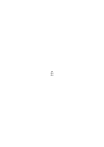 & 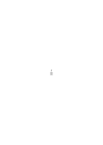 or what the sign 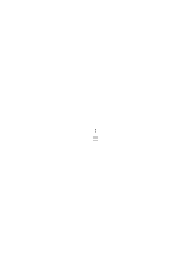 meant, we would tell him that the distance of the note head from the lines does not express anything, etc. These instructions can be understood as serving to turn the student into a game machine (pianola). And so what in the pianola corresponds to the grammar of the language of the tone-strip is embodied in the construction of the pianola. Insofar as one can read the purpose from the construction, grammar is expressed in the construction. The effect cannot be read from it.

### [PG I](/w-pg-1/#ms-114-116r.2) [116r\[2\]](https://cdn.wittgensteinnachlass.com/2000px/webp/Ms-114/116r.webp)

Can one also speak of grammar insofar as a language is taught to people through pure training? It is clear that I can only use the word “grammar” in a “degenerate” sense if I want to use it: for how can I speak here of “explanation” or of “agreement”? A trained child or animal also does not yet know philosophy.

### [116r\[3\]](https://cdn.wittgensteinnachlass.com/2000px/webp/Ms-114/116r.webp),[116v\[1\]](https://cdn.wittgensteinnachlass.com/2000px/webp/Ms-114/116v.webp)

What, then, does the overwhelming significance of grammar consist in? What does the significance of grammar for _us_ consist in? We always remind ourselves which agreements about a word have been made in grammar.

### [PG I](/w-pg-1/#ms-114-116v.2) [116v\[2\]](https://cdn.wittgensteinnachlass.com/2000px/webp/Ms-114/116v.webp)

Let us imagine that someone explained: “Language is everything by means of which one can communicate.” But what does it consist in, communicating? – For the explanation we would have to describe a process of communication; and in this process certain causal connections, regularities based on experience, would appear. But those are precisely what would not interest me; I would not hesitate to invent such connections. So I would not call “key’s beard” what opens the door, but what has a certain form, structure.

### [PG I](/w-pg-1/#ms-114-116v.3) [116v\[3\]](https://cdn.wittgensteinnachlass.com/2000px/webp/Ms-114/116v.webp)

“A sign is always there for a living being, after all, so that must be something essential to the sign.” Yes, but how is a “living” being defined? It seems that here I am prepared to define the living being by the ability to use a sign-language. And the concept of a living being really has an indeterminacy very similar to that of language.

### [PG I](/w-pg-1/#ms-114-117r.1) [117r\[1\]](https://cdn.wittgensteinnachlass.com/2000px/webp/Ms-114/117r.webp)

To invent a language could mean to invent, on the basis of natural laws (or in accordance with them), a device for a specific purpose; but it also has the other sense, analogous to when we speak of the invention of a game. I am here saying something about the grammar of the word “language” by connecting it with the grammar of the word “invent”.

### [PG I](/w-pg-1/#ms-114-117r.2) [117r\[2\]](https://cdn.wittgensteinnachlass.com/2000px/webp/Ms-114/117r.webp)

Are the rules of chess arbitrary? Let us imagine that it turned out that only chess amused & satisfied people. In that case these rules would not, after all, be arbitrary if the purpose of the game is to be fulfilled. In an analogous sense, the unit of measurement in which we express a length is arbitrary, while in another sense the choice of unit is restricted, or determined.

### [PG I](/w-pg-1/#ms-114-117r.3+117v.1) [117r\[3\]](https://cdn.wittgensteinnachlass.com/2000px/webp/Ms-114/117r.webp),[117v\[1\]](https://cdn.wittgensteinnachlass.com/2000px/webp/Ms-114/117v.webp)

Language is for us a calculus; it is characterised by the _language-actions_.

### [117v\[2\]](https://cdn.wittgensteinnachlass.com/2000px/webp/Ms-114/117v.webp)

The purpose of grammar is only the purpose of language. The purpose of grammar is the purpose of language.

### [PG I](/w-pg-1/#ms-114-117v.3) [117v\[3\]](https://cdn.wittgensteinnachlass.com/2000px/webp/Ms-114/117v.webp)

Whence the meaning of language? Can one say: “Without language we could not communicate with one another”? No. The case is not analogous to: without the telephone we could not speak from Europe to America. But it is true that without language we could not move people to do our will; without language we could not build houses.

### [PG I](/w-pg-1/#ms-114-117v.4) [117v\[4\]](https://cdn.wittgensteinnachlass.com/2000px/webp/Ms-114/117v.webp)

But one can say: “without the mouth people could not communicate with one another”. The concept of language, on the other hand, _lies_ in the concept of communication.

### [117v\[5\]](https://cdn.wittgensteinnachlass.com/2000px/webp/Ms-114/117v.webp),[118r\[1\]](https://cdn.wittgensteinnachlass.com/2000px/webp/Ms-114/118r.webp)

Why am I now so interested in language? Is it not as if I were interested in pictures in which we represented the world around us? And could philosophical problems, disquietudes, also arise in the drawn pictures of our surroundings? One could certainly imagine such a case.

### [118r\[2\]](https://cdn.wittgensteinnachlass.com/2000px/webp/Ms-114/118r.webp),[118v\[1\]](https://cdn.wittgensteinnachlass.com/2000px/webp/Ms-114/118v.webp)

The following invention of a motor road roller was once made; the essential thing about the invention was this: The roller is a hollow cylinder through the middle of which runs a shaft, fixed at both ends to the rim of the roller by spokes. The shaft is cranked & formed as a crankshaft, and a connecting rod together with a piston engages with the crank, & the associated cylinder is fixed inside the hollow roller.

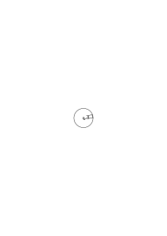

– The whole thing is therefore a rigid system & the piston cannot move in and out in its cylinder. The inventor’s error has an affinity with a philosophical error. The construction looks just like a machine & yet is not one. We ourselves have deprived it of every possibility of movement & do not know it.

### [PG I](/w-pg-1/#ms-114-118v.2) [118v\[2\]](https://cdn.wittgensteinnachlass.com/2000px/webp/Ms-114/118v.webp)

I could imagine an organ whose stops were operated by keys which were exactly the same shape as the playing keys of the manual & were scattered among them. And a philosophical problem could then arise: “how are silent notes possible”. And the person who thought of replacing the stop keys by draw-stops which had no similarity to the playing keys would solve the problem.

### [PG I](/w-pg-1/#ms-114-118v.3+119r.1) [118v\[3\]](https://cdn.wittgensteinnachlass.com/2000px/webp/Ms-114/118v.webp),[119r\[1\]](https://cdn.wittgensteinnachlass.com/2000px/webp/Ms-114/119r.webp)

“Could a language consist entirely of independent signals?” Instead, one could ask: Do we still want to call a series of independent signals “language”? – If it were asked: Can such a language accomplish the same as one which consists of sentences, that is, combinations of signs, one would have to answer: _experience_ will teach us whether, for example, the effect of those signals on people is similar to that of sentences. But the effect does not interest us; we consider the phenomenon, the calculus of language. Let us imagine, for example, a diary kept with signals. One page is divided into sections for the hours of the day in the manner of a timetable. The sign “A” means: I am asleep; “B” means “I am working”; “C”, I am eating; etc., etc.. But now the question is: are these explanations given, so that they connect the signals with another language; are ostensive explanations of the signals given which complete the signal-language? Or is the language really to consist only of the signs A, B, C, etc.? What if someone asked: “how do you know that you are doing the same thing now as you did an hour ago”, & I replied: “I’ve written it down; there’s a ‘C’ here”. – Can one ask whether the sign “A” always has the same meaning; & under what circumstances can this question be answered yes or no? (One can imagine a language in which the words, the colour-names for instance, change their meaning with the days of the week; this colour is called “red” on Monday, “blue” on Tuesday. “A = A” can say that in the language in question there is no change in the meaning of the sign “A”.)

### [PG I](/w-pg-1/#ms-114-119r.2+119v.1) [119r\[2\]](https://cdn.wittgensteinnachlass.com/2000px/webp/Ms-114/119r.webp),[119v\[1\]](https://cdn.wittgensteinnachlass.com/2000px/webp/Ms-114/119v.webp)

Let us again imagine a language consisting of commands. One is to be able to direct a person’s movements with it; the commands consist of an indication of length combined with the words “forwards”, “backwards”, “right”, “left” & the words “quickly” & “slowly”. One could of course replace all those commands that one will actually use by independent signs. Someone could first learn these signals as abbreviations of the sentences of that first language, also translate them back into it before obeying them, but later act directly on the signals. – One could then speak of two languages & call the first more pictorial than the second. For one would not say that from a series of such signals alone I can _derive_ a picture of the movement of the person who followed them, unless what one would call a general rule for translating into the drawing is added to the signals. We would not say: the figure

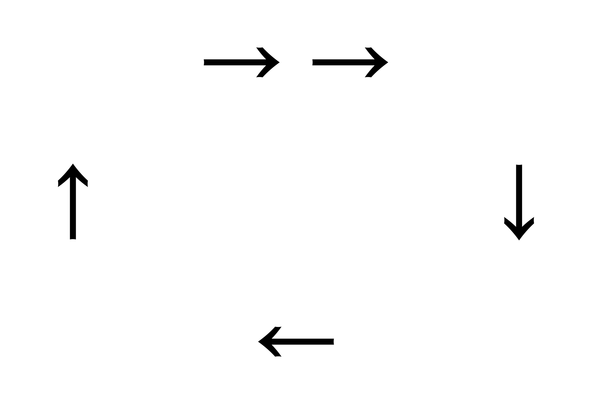

can be _derived_ from the sign abbcd; but rather from abbcd and the table

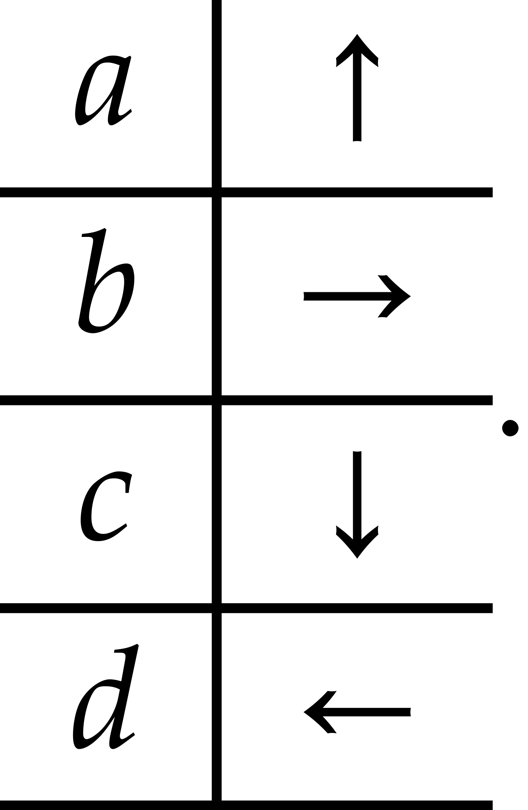

### [PG I](/w-pg-1/#ms-114-119v.2+120r.1) [119v\[2\]](https://cdn.wittgensteinnachlass.com/2000px/webp/Ms-114/119v.webp),[120r\[1\]](https://cdn.wittgensteinnachlass.com/2000px/webp/Ms-114/120r.webp)

One can now say: grammar _explains_ the meaning of the signs & thereby makes the language pictorial. I can justify the choice of a word by grammar. But that does not mean that I justify, or have to justify, by explanations the words that I use, say, in a description.

### [PG I](/w-pg-1/#ms-114-120r.2+120v.1) [120r\[2\]](https://cdn.wittgensteinnachlass.com/2000px/webp/Ms-114/120r.webp),[120v\[1\]](https://cdn.wittgensteinnachlass.com/2000px/webp/Ms-114/120v.webp)

We speak rather of the possibility of this justification. And that bears a resemblance to the actual case when it occurs, like a train of thought in which I perform the calculation 12 × 12 = 144 to a reproduction of the train of thought in which this multiplication has actually been carried out on paper. We _compare_ the actual process in the use of the sign with one in which a justification is given. We supplement what is actually carried out to form a particular calculus, in order to view it from this particular point of view. This is comparable to the way in which ordinary grammar supplements an elliptical sentence, that is, regards this configuration as an abbreviated _sentence_.

### [PG I](/w-pg-1/#ms-114-120v.2) [120v\[2\]](https://cdn.wittgensteinnachlass.com/2000px/webp/Ms-114/120v.webp)

So one could say that Augustine represents the matter too simply; but also: he represents something simpler.

### [PG I](/w-pg-1/#ms-114-120v.3) [120v\[3\]](https://cdn.wittgensteinnachlass.com/2000px/webp/Ms-114/120v.webp)

The way Augustine describes the learning of language can show us from what conception of language the concept of the meaning of words derives.

### [120v\[4\]](https://cdn.wittgensteinnachlass.com/2000px/webp/Ms-114/120v.webp)

I will explain: The place of a word in grammar is its meaning.

### [120v\[6\]](https://cdn.wittgensteinnachlass.com/2000px/webp/Ms-114/120v.webp)

But I can also say:

The meaning of a word is what the explanation of its meaning explains.

### [120v\[7\]](https://cdn.wittgensteinnachlass.com/2000px/webp/Ms-114/120v.webp)

The explanation of the meaning explains the use of the word. The use of the word in language is its meaning.

### [PG I](/w-pg-1/#ms-114-121r.1) [121r\[1\]](https://cdn.wittgensteinnachlass.com/2000px/webp/Ms-114/121r.webp)

But how is this substitution possible? I cannot have just any thing represent another. – It is then precisely significant that this substitution is possible; for the representing thing must, at least in certain cases, serve just as well as the thing represented.

### [PG I](/w-pg-1/#ms-114-121r.3) [121r\[3\]](https://cdn.wittgensteinnachlass.com/2000px/webp/Ms-114/121r.webp)

We speak of an understanding (a process of understanding, or also a state of understanding) & also of certain processes which are criteria of this understanding. One would like to call understanding a mental process or a state of mind & thereby characterise it as a _hypothetical_ process etc., or more correctly as a process (or state) in the hypothetical sense. That is, one assigns the word “understanding” to a particular area of grammar.

### [PG I](/w-pg-1/#ms-114-121r.4+121v.1) [121r\[4\]](https://cdn.wittgensteinnachlass.com/2000px/webp/Ms-114/121r.webp),[121v\[1\]](https://cdn.wittgensteinnachlass.com/2000px/webp/Ms-114/121v.webp)

And indeed the grammar of the mental state or process is in some respects _similar_ to that of, say, a brain process. The main difference is perhaps that in the case of a brain process direct checking is admitted as possible; for instance, by seeing the process in question by opening the skull. Whereas there is no talk of such ‘immediate perception’ in the grammar of the mental process. (This move does not exist in this game.)

### [PG I](/w-pg-1/#ms-114-121v.2) [121v\[2\]](https://cdn.wittgensteinnachlass.com/2000px/webp/Ms-114/121v.webp)

What is the criterion that we understand the word “red”? That we select a red object from others when asked to, or that we can give the ostensive definition of the word “red”? We regard both as signs of understanding. If we hear someone use the word “red” & doubt whether he understands it, we can test him by asking: “which colour do you call ‘red’”. On the other hand, if we had given someone the ostensive explanation of the word & now wanted to see whether he had understood it correctly, we would not ask him to repeat it, but might give him the task, for example, of picking out the red things from a series of things.

### [PG I](/w-pg-1/#ms-114-121v.3+122r.1) [121v\[3\]](https://cdn.wittgensteinnachlass.com/2000px/webp/Ms-114/121v.webp),[122r\[1\]](https://cdn.wittgensteinnachlass.com/2000px/webp/Ms-114/122r.webp)

Here one can ask: “is it my understanding or the other person’s understanding that is being discussed?”

“Only I can know whether I understand; the other person can only guess.” “That I understand is not a hypothesis; that the other person understands is one.”

When we say this, we take “understanding” as an experience analogous, for example, to that of pain. One says: “You cannot know whether I understand (whether I am pleased, etc.); you cannot look inside me”. “You cannot know what I am thinking.” Granted, but that holds only if you are not thinking aloud; & the difference between thinking aloud (or in writing) & thinking in the imagination does not interest us here.

### [PG I](/w-pg-1/#ms-114-122r.2) [122r\[2\]](https://cdn.wittgensteinnachlass.com/2000px/webp/Ms-114/122r.webp)

One can object that thinking, even if it were only the _visual_ experience of writing, is nevertheless private & that the other person can indeed see what my physical hand writes but cannot have my visual experience. These questions must occupy us elsewhere.

### [PG I](/w-pg-1/#ms-114-122r.3+122v.1) [122r\[3\]](https://cdn.wittgensteinnachlass.com/2000px/webp/Ms-114/122r.webp),[122v\[1\]](https://cdn.wittgensteinnachlass.com/2000px/webp/Ms-114/122v.webp)

But for our present purpose could we not say “he writes” & “I write” instead of “he understands” & “I understand”? We then leave the question of experience _entirely_ out of play. And so, perhaps, the question of private understanding too. It then appears unimportant to us here.

### [PG I](/w-pg-1/#ms-114-122v.2) [122v\[2\]](https://cdn.wittgensteinnachlass.com/2000px/webp/Ms-114/122v.webp)

We call “understanding” not the action – whatever it may be – that shows us the understanding, but a state for which this action is an indication. And that is a statement about the grammar of the designation of such a state.

### [PG I](/w-pg-1/#ms-114-122v.3) [122v\[3\]](https://cdn.wittgensteinnachlass.com/2000px/webp/Ms-114/122v.webp)

We can call reciting the rule alone the ‘criterion of understanding’, or also tests of use alone. In the one case “he understands” will then mean: “if you ask him for the rule he will state it”; in the other case: “if you ask him for an application of the rule he will carry out your command.” Or else we regard stating the rule as a symptom that he can do something else than state the rule. Thus, as when we hold the watch to our ear, hear it ticking & say: it is going. We then expect not merely that it will continue ticking, but also that it will show the time.

### [PG I](/w-pg-1/#ms-114-123r.1) [123r\[1\]](https://cdn.wittgensteinnachlass.com/2000px/webp/Ms-114/123r.webp)

One could say: “reciting the rule is a criterion of understanding if he states the rule with understanding & not purely mechanically.” But here again the meaningful emphasis in the utterance could count as understanding; & why then not simply the utterance itself?

### [PG I](/w-pg-1/#ms-114-123r.2) [123r\[2\]](https://cdn.wittgensteinnachlass.com/2000px/webp/Ms-114/123r.webp)

Understanding = grasping = receiving a particular impression of the object, letting it make an impression on one. Letting a sentence make an impression on one; considering the consequences of the sentence, imagining them; etc..

### [PG I](/w-pg-1/#ms-114-123r.3) [123r\[3\]](https://cdn.wittgensteinnachlass.com/2000px/webp/Ms-114/123r.webp)

We call “understanding” a psychological phenomenon which is specifically connected with the phenomenon of learning & use of our, the human, word-language.

---

### [PG I](/w-pg-1/#ms-114-123r.4+123v.1) [123r\[4\]](https://cdn.wittgensteinnachlass.com/2000px/webp/Ms-114/123r.webp),[123v\[1\]](https://cdn.wittgensteinnachlass.com/2000px/webp/Ms-114/123v.webp)

But do I not explain the meaning of the word “red” to a Frenchman in just this way? “Yes, but only because he has learnt the meaning of ‘rouge’ by means of an _ostensive_ definition.” But must this definition be present to him (& otherwise it is mere history), or a red mental image, when he understands my explanation “red = rouge”? Must such an image be present when he, as we would say, uses the word “rouge” with understanding? (Think of the command: “Imagine a circular red patch!”)

### [PG I](/w-pg-1/#ms-114-123v.2) [123v\[2\]](https://cdn.wittgensteinnachlass.com/2000px/webp/Ms-114/123v.webp)

Is it right, & in what sense, to say of the ostensive definition that, like the verbal definition, it sets one sign for another; the word for the pointing?

### [PG I](/w-pg-1/#ms-114-123v.3) [123v\[3\]](https://cdn.wittgensteinnachlass.com/2000px/webp/Ms-114/123v.webp)

On the other hand, it is conceivable that people should agree so precisely in the colours they associate with violin tones that one could say to the other: “No, you have not represented this violin tone correctly, it was yellower than you painted it”; & the other might reply, for example: “You are right, it seemed so to me too”. –

### [123v\[4\]](https://cdn.wittgensteinnachlass.com/2000px/webp/Ms-114/123v.webp),[124r\[1\]](https://cdn.wittgensteinnachlass.com/2000px/webp/Ms-114/124r.webp)

How can ringing the bell command someone to come to me? Is it possible only because I translate the bell signal into words from memory (or by consulting a table)? And can these words in turn say anything only because I translate them (from memory or by consulting a table) into a picture? (How do I know how to apply this picture?)

### [PG I](/w-pg-1/#ms-114-124r.2+124v.1) [124r\[2\]](https://cdn.wittgensteinnachlass.com/2000px/webp/Ms-114/124r.webp),[124v\[1\]](https://cdn.wittgensteinnachlass.com/2000px/webp/Ms-114/124v.webp)

Do we perhaps need a memory-image of what we did the last time we obeyed a spoken command in order to be able to obey one? Does it therefore really command us: “Do now what, according to your memory, you did then”? This command too could be given. But do I therefore need a memory-image of searching in memory in order to be able to obey it? The command “Do now what, according to your memory, you did then” tells me to look in a particular place for an image which will tell me what I have to do. The command is thus entirely analogous to: “Do what is written on the slip of paper in this drawer”. If nothing is written on the slip, the command is senseless.

### [124v\[2\]](https://cdn.wittgensteinnachlass.com/2000px/webp/Ms-114/124v.webp)

It would not be right to say: the agreement & disagreement between sentence & world is arbitrarily produced by an assignment of linguistic expression & reality: the assignment consists in the sentence ‘p’ saying that _just that_ is the case. But what is this ‘just that’ in a particular case? If it is given by pointing to ‘reality’, then this act of pointing is the explanation of a linguistic expression, & is itself such an expression. Pointing by way of explanation prepares one for the application of language; it really translates from one language into another. It is an act of giving signs & is different from the judgement that a sentence accords with reality (or the opposite).

### [PG I](/w-pg-1/#ms-114-125r.1) [125r\[1\]](https://cdn.wittgensteinnachlass.com/2000px/webp/Ms-114/125r.webp)

If one thinks of thought as something specifically human and organic, one wants to ask: “Could there be a prosthesis for thought, an inorganic substitute for thought?” But if thinking consists in writing or speaking, why shouldn’t a machine do it? – “Yes, but the machine knows nothing!” – Of course, it makes no sense to speak of a prosthesis for seeing & hearing. One speaks of an artificial foot, to be sure, but not of artificial pains in the foot.

### [PG I](/w-pg-1/#ms-114-125r.2+125v.1) [125r\[2\]](https://cdn.wittgensteinnachlass.com/2000px/webp/Ms-114/125r.webp),[125v\[1\]](https://cdn.wittgensteinnachlass.com/2000px/webp/Ms-114/125v.webp)

We can say: thinking is operating with symbols. But ‘thinking’ is a fluid concept, & what kind of ‘operating with symbols’ it is must be considered separately in each particular case. I could also say: thinking is operating with language; but ‘language’ is a fluid concept.

### [PG I](/w-pg-1/#ms-114-125v.2) [125v\[2\]](https://cdn.wittgensteinnachlass.com/2000px/webp/Ms-114/125v.webp)

If it is said: “Thinking is a mental process”, that is probably correct only insofar as one also calls seeing a written sentence or hearing a spoken one a mental process. That is, in the sense in which one calls pains a mental state. One then wants to distinguish with the word “mental process” the ‘experience’ from the ‘physical process’. – On the other hand, the expression “mental process” does of course suggest that these are misunderstood processes in a sphere inaccessible to us. Furthermore, psychology also speaks of ‘unconscious thoughts’ and here means by “thoughts” a process in a model of the mind. (‘Model’ in the sense in which one speaks of a mechanical model of electrical processes.) When, on the other hand, Frege speaks of the thought expressed by a sentence, the word “thought” here means roughly the same as the words “sense of the sentence”.

### [PG I](/w-pg-1/#ms-114-126r.1) [126r\[1\]](https://cdn.wittgensteinnachlass.com/2000px/webp/Ms-114/126r.webp)

One could say: in all cases, when one speaks of a “thought”, one means the _living_ aspect of the sentence. That without which it is dead, a mere sequence of sounds or sequence of written figures. But if I were to speak in the same way of something which gives meaning to a configuration of chess pieces, i.e., distinguishes it from an arbitrary arrangement of wooden blocks, what could I not mean by it! The rules that make the chess configuration a situation in a game, the particular experiences that we associate with such game positions, the use of the game. Or if we were to speak of something which distinguishes paper money from mere printed slips of paper & gives it its meaning, its life!

### [PG I](/w-pg-1/#ms-114-126r.2+126v.1) [126r\[2\]](https://cdn.wittgensteinnachlass.com/2000px/webp/Ms-114/126r.webp),[126v\[1\]](https://cdn.wittgensteinnachlass.com/2000px/webp/Ms-114/126v.webp)

But when I say that thought is something quite homely, I mean that this concept is like, say, that of the number One for us. It seems mysterious because we misunderstand its grammar & miss a tangible thing corresponding to the thing-word. (That is almost similar to hearing a human voice from the space in front of us, but seeing no human being in front of us.)

### [126v\[2\]](https://cdn.wittgensteinnachlass.com/2000px/webp/Ms-114/126v.webp)

I could say: “‘Language’ is a collective name for languages; & languages are related to one another in _many_ ways.”

### [126v\[3\]](https://cdn.wittgensteinnachlass.com/2000px/webp/Ms-114/126v.webp)

The explanations I have to give concerning thinking & thought are only representations of the grammar of the words “think” & “thought”.

### [PG I](/w-pg-1/#ms-114-126v.4) [126v\[4\]](https://cdn.wittgensteinnachlass.com/2000px/webp/Ms-114/126v.webp)

In logic one cannot be general at random. If I fix the grammar of my generality, there are no more logical surprises. And if I do not fix it, I am no longer in the realm of an exact grammar. That is: the indeterminacy of generality is not an indeterminacy of its grammar. Generality is freedom of movement, not indeterminacy of geometry.

### [PG I](/w-pg-1/#ms-114-127r.1+127v.1) [127r\[1\]](https://cdn.wittgensteinnachlass.com/2000px/webp/Ms-114/127r.webp),[127v\[1\]](https://cdn.wittgensteinnachlass.com/2000px/webp/Ms-114/127v.webp)

How did we learn to understand the word “Pflanze”? If I leave aside the fact that we may perhaps have learnt a definition of the concept, in botany say, which then plays a role only in botany, it is clear that we learnt the meaning of the word through examples. And if we now leave hypothetical dispositions aside, these examples stand only for themselves. Hypotheses about learning & using language & causal connections do not interest us. We therefore do not assume that the examples evoke something in the learner, call forth before his mind an essence, the meaning of the concept-word, the concept ‘plant’. If the examples should have an effect by producing, say, a particular visual image in the learner, the causal connection between the examples & this image is no concern of ours, & for us they stand _side by side_. And we can then leave the examples entirely aside & regard only the image as a symbol of the concept; or the image & examples together. When one says “we understand the word ‘chair’ because we know what all chairs have in common” –, what does it mean that we _know_ this? That we are ready to say it, perhaps (as in the case “we know that 6 × 6 is 36”)? And what, then, is the common element? Or do we say here that we know what they have in common only because we can apply the word “chair”? Aren’t we perhaps misled here by an analogy such as this: Suppose I explained the word “red” by pointing to a red wall, a red book, a red cloth & someone then made a sample of the colour red by making a little red tile. In this case one could say he had shown that he had grasped what all the examples I had given him had in common.

### [PG I](/w-pg-1/#ms-114-127v.2) [127v\[2\]](https://cdn.wittgensteinnachlass.com/2000px/webp/Ms-114/127v.webp)

The grammatical place of the word “game”, “rule”, etc. is given by examples, rather as the place of a meeting is given by saying that it will take place _by_ this tree and that.

### [PG I](/w-pg-1/#ms-114-127v.3+128r.1) [127v\[3\]](https://cdn.wittgensteinnachlass.com/2000px/webp/Ms-114/127v.webp),[128r\[1\]](https://cdn.wittgensteinnachlass.com/2000px/webp/Ms-114/128r.webp)

One thinks of meaning as something that _floats before one_ when one hears the word. What floats before one when one hears the word certainly characterizes the meaning. But what floats before me is an example, a case of application of the word. And what floats before one does not really consist in a particular image being present whenever I say or hear the word, but in applications of the word _occurring to me_ when I am asked about the meaning of the word.

### [PG I](/w-pg-1/#ms-114-128r.2) [128r\[2\]](https://cdn.wittgensteinnachlass.com/2000px/webp/Ms-114/128r.webp)

Someone says to me: “Show the children a game!” I now teach them to play dice for money & the other person says to me: “I did not mean that kind of game”. When he gave me the command, did the exclusion of dice games have to be what he had in mind?

### [PG I](/w-pg-1/#ms-114-128r.3) [128r\[3\]](https://cdn.wittgensteinnachlass.com/2000px/webp/Ms-114/128r.webp)

Suppose someone said: “No, I did not mean that kind of game; I used ‘game’ in the narrower meaning”. How does it show that he used the word in a narrower meaning?

### [PG I](/w-pg-1/#ms-114-128r.4+128v.1) [128r\[4\]](https://cdn.wittgensteinnachlass.com/2000px/webp/Ms-114/128r.webp),[128v\[1\]](https://cdn.wittgensteinnachlass.com/2000px/webp/Ms-114/128v.webp)

But can one not also use the word “game” in its broadest meaning? But which is that? There are no boundaries unless we expressly lay them down. A sentence such as: “The Assyrians knew various games”, if we found it in a history book without any further qualification, would strike us as very strange; because we would not be sure that we could give an example that even approximately corresponded to the meaning of the word “game” in this case.

### [PG I](/w-pg-1/#ms-114-128v.2) [128v\[2\]](https://cdn.wittgensteinnachlass.com/2000px/webp/Ms-114/128v.webp)

Someone may want to write in the rules of a game that the game was invented in such-and-such a year. I say: “(No,) that does not belong in the rules, that is not a rule”. So here I exclude sentences about the history of the game from the rules. And I would likewise exclude a sentence such as: “this game can only be learnt through long practice” from the rules as an empirical proposition. But it would easily mislead us to say that one had thereby drawn boundaries around the domain of rules.

### [PG I](/w-pg-1/#ms-114-128v.3+129r.1) [128v\[3\]](https://cdn.wittgensteinnachlass.com/2000px/webp/Ms-114/128v.webp),[129r\[1\]](https://cdn.wittgensteinnachlass.com/2000px/webp/Ms-114/129r.webp)

When I try to make the use of a word, say the word “to wish”, clear to someone through characteristic examples, it is natural that the other person should, in the form of an objection to what I have put forward, give an example pointing to yet another way of using it. My answer is then that the new example may be useful for our consideration, but that it is not an objection to my examples. For I did not mean to say that these examples were a representation of the essence of what is called “wishing”. At most, representations of different essences which, because of certain affinities, are all designated by this word. The error is to assume that we wanted to illustrate the essence of wishing, say, through examples, & that the counter-examples now showed that this essence had not yet been properly grasped. That is as if our aim were to give a theory of wishing which would then have to explain all cases of wishing. But that is also why the examples adduced are useful only if they are clearly worked out, & not merely vaguely indicated.

### [PG I](/w-pg-1/#ms-114-129r.2+129v.1) [129r\[2\]](https://cdn.wittgensteinnachlass.com/2000px/webp/Ms-114/129r.webp),[129v\[1\]](https://cdn.wittgensteinnachlass.com/2000px/webp/Ms-114/129v.webp)

When we give a command, it might seem as though the last thing the command desires (after all) must remain unexpressed, since there always remains a gap between the command & its execution. I want someone to make a certain movement, say raise an arm. To make it quite clear, I demonstrate the movement to him. This picture seems unambiguous, except for the question: how does he know that _he should make this movement_? – How does he know at all how to use whatever signs I give him? I will now try to supplement the command with further signs, by thinking from myself to the other, making gestures of encouragement, etc. Here it seems as if the command begins to stammer. Suppose I wanted to prescribe to someone that he square the number 4 & did so with the schema:

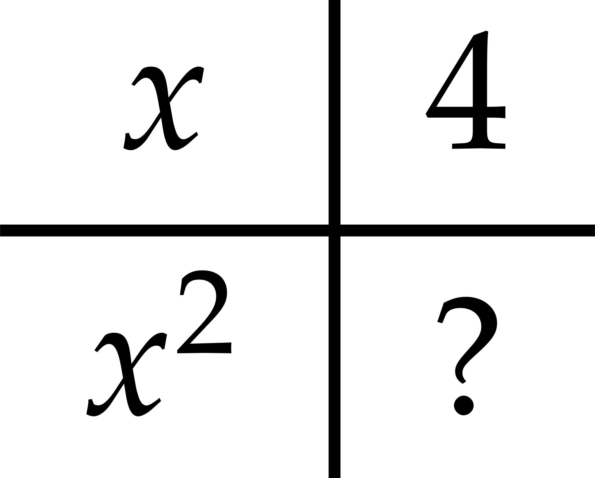

I am now tempted to say that the question mark indicates something but does not express it. As if the sign were trying to make itself intelligible to us. , in what signs do we do that?

### [PG I](/w-pg-1/#ms-114-129v.2+130r.1) [129v\[2\]](https://cdn.wittgensteinnachlass.com/2000px/webp/Ms-114/129v.webp),[130r\[1\]](https://cdn.wittgensteinnachlass.com/2000px/webp/Ms-114/130r.webp)

One could, however, ask: should we still call that an “explanation”? – Because it plays a different role in the calculus from what we usually call an ostensive explanation of the word “red”, even if it had the same practical consequence, the same _effect_ on the learner.

### [PG I](/w-pg-1/#ms-114-130r.2+130v.1) [130r\[2\]](https://cdn.wittgensteinnachlass.com/2000px/webp/Ms-114/130r.webp),[130v\[1\]](https://cdn.wittgensteinnachlass.com/2000px/webp/Ms-114/130v.webp)

I can quite well say: pacing restlessly up & down in my room, looking towards the door, pricking up one's ears at a noise, means: expecting N. – That is simply a definition of the expression “expecting N”. Of course it is not a definition of the word “expecting”, for it does not, for example, explain what “expecting M” means. Well, we can provide for that; we say, for instance: expecting X means performing the specified actions & saying the name “X” while doing so. On this definition, the person I expect is the one who bears the name uttered. Or I define: expecting the person X means doing what I specified in the second example & making a drawing of a person. The person expected is then the one who bears the name X & corresponds to the drawing. – Of course that would not explain what it means to “expect N to _go_” & for that I would have to give either an independent definition, or a more general explanation covering going & coming. And that would, for instance, not explain what it means to “expect a storm”; etc. etc.

### [PG I](/w-pg-1/#ms-114-130v.2) [130v\[2\]](https://cdn.wittgensteinnachlass.com/2000px/webp/Ms-114/130v.webp)

What characterizes all these cases is that what is expected can be read off from the expecting action by means of the definition. It is not later experience that decides _what_ we expect. And I can say: In language, expectation & fulfilment touch upon each other.

### [PG I](/w-pg-1/#ms-114-130v.3) [130v\[3\]](https://cdn.wittgensteinnachlass.com/2000px/webp/Ms-114/130v.webp)

The action of the person expecting is thus one that I can translate, according to given rules, into the sentence “he expects that p will happen”. And so the simplest typical example of these cases is that the expectation of p’s arrival consists in the person expecting _saying_: “I expect that p will happen”. Hence in so many cases it clarifies the grammatical situation to say: Let us put the expression of the expectation in place of the expectation. The expression of the thought in place of the thought.

### [PG I](/w-pg-1/#ms-114-130v.4+131r.1) [130v\[4\]](https://cdn.wittgensteinnachlass.com/2000px/webp/Ms-114/130v.webp),[131r\[1\]](https://cdn.wittgensteinnachlass.com/2000px/webp/Ms-114/131r.webp)

Expectation can be understood as an expectant, preparatory action. It stretches out its hands like a ball player and prepares them to receive the ball. And the ball player’s expectation may consist in his stretching out his hands in a particular position & looking at the ball.

### [PG I](/w-pg-1/#ms-114-131r.2) [131r\[2\]](https://cdn.wittgensteinnachlass.com/2000px/webp/Ms-114/131r.webp)

Someone might perhaps want to say: “Expectation is a thought.” This clearly corresponds to a use of the word “to expect”. And we only want to remember that the process of thought can be _very diverse_. And if the expectation is the thought “I expect that p will happen”, then it is nonsensical to say that I may only later recognize _what_ I expected.

### [PG I](/w-pg-1/#ms-114-131r.3) [131r\[3\]](https://cdn.wittgensteinnachlass.com/2000px/webp/Ms-114/131r.webp)

One could say something analogous about wishing, fear, hope. (Plato calls hope “a speech”.)

### [PG I](/w-pg-1/#ms-114-131r.4+131v.1) [131r\[4\]](https://cdn.wittgensteinnachlass.com/2000px/webp/Ms-114/131r.webp),[131v\[1\]](https://cdn.wittgensteinnachlass.com/2000px/webp/Ms-114/131v.webp)

But it is different when one calls _hunger_ a “wish”, namely the wish for the food that will satisfy it. Then it is a hypothesis that precisely that will satisfy the wish & there is a supposition about it & a doubt. And it is the same when I call “expectation” a feeling, say one of restlessness, dissatisfaction. But of course these feelings are not thoughts in amorphous form.

### [PG I](/w-pg-1/#ms-114-131v.2) [131v\[2\]](https://cdn.wittgensteinnachlass.com/2000px/webp/Ms-114/131v.webp)

The idea that thought is a strange process in the human mind makes it possible to imagine it transformed into an amorphous state of duration.

### [PG I](/w-pg-1/#ms-114-131v.3) [131v\[3\]](https://cdn.wittgensteinnachlass.com/2000px/webp/Ms-114/131v.webp)

When I say “I expected him all day”, “expecting” does not mean a state of duration that contained the person expected & his coming as components, as dough contains flour, sugar, eggs evenly mixed together. Expectation consisted rather in a sequence of actions, thoughts (&) feelings.

### [PG I](/w-pg-1/#ms-114-131v.4) [131v\[4\]](https://cdn.wittgensteinnachlass.com/2000px/webp/Ms-114/131v.webp)

But I might perhaps also say “I expected N” when the only connection between my expecting activities and him is that I make preparations, say, for a meal for myself & another person on a particular day & that N has announced that he will come to me for this meal.

### [PG I](/w-pg-1/#ms-114-131v.5+132r.1) [131v\[5\]](https://cdn.wittgensteinnachlass.com/2000px/webp/Ms-114/131v.webp),[132r\[1\]](https://cdn.wittgensteinnachlass.com/2000px/webp/Ms-114/132r.webp)

What does the process or state of wishing to eat an apple consist in? Perhaps I feel hungry or thirsty or both, & at the same time imagine an apple or remember that I enjoyed one yesterday; perhaps I say: “I would like to eat an apple”, perhaps I go & look in a cupboard where apples usually lie. Perhaps all these states & activities & others are combined.

### [PG I](/w-pg-1/#ms-114-132r.2+132v.1) [132r\[2\]](https://cdn.wittgensteinnachlass.com/2000px/webp/Ms-114/132r.webp),[132v\[1\]](https://cdn.wittgensteinnachlass.com/2000px/webp/Ms-114/132v.webp)

It somehow seems as if one would never recognize the intention as an _intention_ by viewing it from outside; as if one had to intend it oneself in order to understand it as an act of meaning. But that would mean not regarding it as a phenomenon, not as a fact in itself; but as something intended, – something to which a direction has been given. And what this direction is, we do not know. (It is something lacking from the appearance as such.) – This is of course the previous problem again. For the point is that one must be able to tell from the thought that it is the thought that such and such is the case. If one cannot tell this from it (any more than one can tell from stomach pains where they come from), then it is of no logical interest. My view seems nonsensical if one expresses it _like this_: One is supposed to be able to see what someone is thinking about by opening up his head; how is that possible? The objects he is thinking about are not in his head at all (any more than they are in his thoughts) (!)

One must understand thoughts, intentions, etc. “viewed from outside” as such, _without_ being told a _meaning_ of anything. For meaning then simply belongs to the phenomenon of the thought.

### [PG I](/w-pg-1/#ms-114-132v.2) [132v\[2\]](https://cdn.wittgensteinnachlass.com/2000px/webp/Ms-114/132v.webp)

So when one looks at the thought, there can no longer be any question of understanding; for if one sees it, one must recognize it as the thought with this content; there is nothing to interpret. – But that is how it really is when we think; there is no interpreting. –

### [PG I](/w-pg-1/#ms-114-132v.3) [132v\[3\]](https://cdn.wittgensteinnachlass.com/2000px/webp/Ms-114/132v.webp)

When I said: “that would mean not regarding the intention as a phenomenon”, intention here recalled the will in Schopenhauer’s conception. Every phenomenon seems dead to us in contrast with the living thought.

### [PG I](/w-pg-1/#ms-114-132v.4+133r.1+133v.1) [132v\[4\]](https://cdn.wittgensteinnachlass.com/2000px/webp/Ms-114/132v.webp),[133r\[1\]](https://cdn.wittgensteinnachlass.com/2000px/webp/Ms-114/133r.webp),[133v\[1\]](https://cdn.wittgensteinnachlass.com/2000px/webp/Ms-114/133v.webp)

“The intention seen from outside”, that has to do with the question whether a machine could think.

“Whatever phenomenon one saw, it could never be the intention. For the intention must contain what is intended. And every phenomenon would be something complete in itself, unconcerned with anything outside it, lying there dead when one considered it on its own.” And it is analogous when we say: “The will cannot be a phenomenon, for every phenomenon merely _happens_, is taken as given by us, but is not something we _do_. The will is not something I see happening; rather, it consists, as it were, in our being in the action; in our being the action.” Look at your arm & move it & you will feel this very strongly: “You do not observe how it moves, you are not having an experience – or not merely an experience – but you are _doing_ something.” You can then tell yourself that you could quite well imagine a case where precisely the same thing happened with your hand, but was observed by you, not willed by you. – But close your eyes & move your arm; you are having an experience then too, after all, & now ask yourself whether you could again imagine having the same experience but without willing it.

### [PG I](/w-pg-1/#ms-114-133v.2+134r.1) [133v\[2\]](https://cdn.wittgensteinnachlass.com/2000px/webp/Ms-114/133v.webp),[134r\[1\]](https://cdn.wittgensteinnachlass.com/2000px/webp/Ms-114/134r.webp)

If one wants to distinguish voluntary from involuntary movements & it is said, for example, that voluntary movements of the arm differ from involuntary ones through a feeling of innervation, one is driven to say: “But surely I am not _undergoing_ this experience, I am _doing_ it!” – But in the experience of innervation, can there still be any question of a distinction between undergoing & doing? I would like to say: “When I will, surely nothing happens to me, neither the movement nor a feeling, but I am the agent.” Good, but it is surely the case that you _also_ have experiences when you move your arm voluntarily; for you do _see_ (& feel) it moving, whether or not you adopt an _observing_ attitude towards it. So try distinguishing between _all the experiences_ of acting plus the doing (which is not an experience) & _all_ these experiences without the element of doing. Consider whether you still need this element, or whether it now seems obsolete to you. – And of course you can rightly say that when you do something nothing happens to you; for the phenomena of doing are simply different from those of observing, say, a reflex movement. This becomes clear only when one considers the very different cases of what we call willed actions and what we call unwilled or involuntary processes of our life. (More on this elsewhere.)

### [PG I](/w-pg-1/#ms-114-134r.2+134v.1) [134r\[2\]](https://cdn.wittgensteinnachlass.com/2000px/webp/Ms-114/134r.webp),[134v\[1\]](https://cdn.wittgensteinnachlass.com/2000px/webp/Ms-114/134v.webp)

By “intention” I mean here what the sign is used for in thought. Intention seems to interpret, to give the final interpretation, but not another sign or picture, but something else, that which one cannot interpret again. But a psychological end is reached, not a logical one. Let us think of a sign language, an ‘abstract’ one, I mean one that is foreign to us, in which we do not feel at home, in which, as we would say, we do not _think_. (We mentioned such an example once before), & let us imagine this language interpreted through a translation into a, as we would like to say, unambiguous language of pictures, a language consisting of pictures painted in perspective of what is to be represented. It is quite clear that it is much easier to imagine different _interpretations_ of the written signs than of a picture painted in the usual way, representing, say, a room with ordinary furniture. Here we will also be inclined to say that there are no possibilities of interpretation left.

### [PG I](/w-pg-1/#ms-114-134v.2) [134v\[2\]](https://cdn.wittgensteinnachlass.com/2000px/webp/Ms-114/134v.webp)

We could also say that we do not live in the sign language, but rather in the painted picture.

### [PG I](/w-pg-1/#ms-114-134v.3) [134v\[3\]](https://cdn.wittgensteinnachlass.com/2000px/webp/Ms-114/134v.webp)

(This is also connected with the fact that what we call a ‘similar portrait’ is not a picture according to some arbitrarily fixed manner of projection. “Similarity” here means something similar to “confusability”.)

### [PG I](/w-pg-1/#ms-114-134v.4+135r.1+135v.1) [134v\[4\]](https://cdn.wittgensteinnachlass.com/2000px/webp/Ms-114/134v.webp),[135r\[1\]](https://cdn.wittgensteinnachlass.com/2000px/webp/Ms-114/135r.webp),[135v\[1\]](https://cdn.wittgensteinnachlass.com/2000px/webp/Ms-114/135v.webp)

“Only the intended picture suffices as a standard in relation to reality. When viewed from the outside, it stands there, dead & isolated.” It is as if we first looked at a picture in such a way that we live in it & the objects in it surround us as real, & then stepped back & were now outside, seeing the frame & the picture as a painted surface. So, when we intend, the pictures of the intention surround us & we live among them. But when we step out of the intention, they are merely spots on a canvas, without life & without interest for us. (We could also say:) When we intend, we live in the space of the intention, among the shadows of the intention, together with the real things. Let us think that we are sitting in the darkened cinema & living in the film. Now let the hall be illuminated, but let the play of light on the screen continue. But now we suddenly see it “from outside” as movements of light & dark spots on a screen.

(In a dream, it sometimes happens that we first read a story, & suddenly act in it ourselves. And after waking up from a dream it is sometimes as if we have stepped back out of the dream & now see it as a foreign picture before us.) And it also means something to “live in the pages of a book”. This is connected with the fact that our body is entirely irrelevant to the existence of our experience. (Compare with this the remark: When we understand a sentence, it acquires depth for us.)

### [PG I](/w-pg-1/#ms-114-135v.2) [135v\[2\]](https://cdn.wittgensteinnachlass.com/2000px/webp/Ms-114/135v.webp)

It is not the case that this symbol can no longer be interpreted, but rather: I do not interpret. I do not interpret because I feel natural in the present picture. When I interpret, I proceed on my path of thought from step to step.

### [PG I](/w-pg-1/#ms-114-135v.3) [135v\[3\]](https://cdn.wittgensteinnachlass.com/2000px/webp/Ms-114/135v.webp)

If I look at the imagined symbol “from outside”, it becomes conscious to me that it _could_ be interpreted in this way or that; if it is a stage in my train of thought, then it is a place that is natural to me & its further interpretability does not occupy (and disturb) me. – As when I have the chart, the railway timetable, with me without it occupying me that a chart can be interpreted in different ways.

### [PG I](/w-pg-1/#ms-114-135v.4+136r.1+136v.1) [135v\[4\]](https://cdn.wittgensteinnachlass.com/2000px/webp/Ms-114/135v.webp),[136r\[1\]](https://cdn.wittgensteinnachlass.com/2000px/webp/Ms-114/136r.webp),[136v\[1\]](https://cdn.wittgensteinnachlass.com/2000px/webp/Ms-114/136v.webp)

When I spoke of how my mental image must also bear the name of the person depicted if it is to be a portrait, I did not mean that I must imagine him together with his name. For if I say, for instance: “surely I do not merely see a picture before me that looks like N (but perhaps also like other people), but I know, after all, that it is him, that it depicts him”, then I could ask: _when_ do I know this, & what does it mean to know it? But nothing need take place during the imagining that I could call this “knowledge”. Such a thing might take place after the imagining, when I pass from the picture to the name; perhaps I say that I had imagined N, whereas at the time of the imagining nothing characterized it as the imagining of N except perhaps a likeness. Something could precede the imagining which constituted the reference to N. And so interpretation does not accompany the imagining, but lies in the path that leads over the imagining. All this appears clearer if, instead of imagining, one assumes the _drawing_ of a picture.

### [PG I](/w-pg-1/#ms-114-136v.2+137r.1) [136v\[2\]](https://cdn.wittgensteinnachlass.com/2000px/webp/Ms-114/136v.webp),[137r\[1\]](https://cdn.wittgensteinnachlass.com/2000px/webp/Ms-114/137r.webp)

If I want to describe the process of intention, I feel above all that it can best achieve what it should when it contains an extremely faithful picture of what it intends. But further, that even this is not enough, because the picture, whatever it is, can be interpreted in different ways; so that this picture again stands isolated. As soon as one takes the picture in isolation, it is suddenly dead & it is as if something had been taken away from it that had enlivened it before. It is no thought, no intention & however we think of it as accompanied by articulated or unarticulated processes & by whatever sensations, it remains isolated, does not point from itself to a reality outside itself. Now one says: “Of course, the picture does not intend, but we must intend (something) with it.” But if this intending, meaning (again), is something that happens with the picture, I do not see why it should be bound to a human being. One can also study the process of digestion as a chemical process independently of whether it takes place in a living being. We want to say: “Intending is essentially a mental process, a process of conscious life, not of dead matter.” But what is such a process supposed to consist in other than the specific kind of what is happening–so long as we are talking about a process? And now it seems to us as if no process, whatever kind, can be the intending. – We are simply not satisfied here with the grammar of the _process_, & not with the specific kind of _a_ process. – One could say: we would call every process ‘dead’ in this sense!

### [PG I](/w-pg-1/#ms-114-137r.2) [137r\[2\]](https://cdn.wittgensteinnachlass.com/2000px/webp/Ms-114/137r.webp)

Let us say that the wish that this table were a little higher is the act of my holding my hand above the table, as high as I wished it to be. Now the objection is: “The hand above the table cannot be the wish: it does not express that the table should be higher; it is where it is & the table is where it is. And it would be no use making _any other_ gesture either.” –

### [PG I](/w-pg-1/#ms-114-137r.3+137v.1) [137r\[3\]](https://cdn.wittgensteinnachlass.com/2000px/webp/Ms-114/137r.webp),[137v\[1\]](https://cdn.wittgensteinnachlass.com/2000px/webp/Ms-114/137v.webp)

“The opinion has a _direction_ (a sense) that no mere process has.”

(One could almost say: “the opinion _moves_, while every process stands still”.)

### [PG I](/w-pg-1/#ms-114-137v.2) [137v\[2\]](https://cdn.wittgensteinnachlass.com/2000px/webp/Ms-114/137v.webp)

But now: if I think of uttering the wish as the act of the wish, the problem appears solved to me; because in the system of language I seem to have the medium in which the sentence is not dead.

### [PG I](/w-pg-1/#ms-114-137v.3) [137v\[3\]](https://cdn.wittgensteinnachlass.com/2000px/webp/Ms-114/137v.webp)

If we think of the expression of the wish as the wish, it is almost as if, for certain purposes, we imagined living beings that moved, perhaps, only along the lines of a certain network on the earth, or something of the sort.

### [PG I](/w-pg-1/#ms-114-137v.4) [137v\[4\]](https://cdn.wittgensteinnachlass.com/2000px/webp/Ms-114/137v.webp)

But now one would say: Even if _uttering_ the wish is the wish, the whole language is nevertheless not present at this uttering, & is it then the wish! How does language help, then? Well, nothing needs to be _present_ apart from the expression.

### [PG I](/w-pg-1/#ms-114-137v.5+138r.1) [137v\[5\]](https://cdn.wittgensteinnachlass.com/2000px/webp/Ms-114/137v.webp),[138r\[1\]](https://cdn.wittgensteinnachlass.com/2000px/webp/Ms-114/138r.webp)

One could, so to speak, find all the connections in the grammar of the language (look them up). The whole network to which the sentence belongs can be seen there.

### [PG I](/w-pg-1/#ms-114-138r.2) [138r\[2\]](https://cdn.wittgensteinnachlass.com/2000px/webp/Ms-114/138r.webp)

If one asks: “why do we not take issue with the mere processes when we think, mean something, etc.?”, we must say to ourselves: we are not then thinking about whether the picture is the thought, the opinion, but rather we _use_, pass through, pictures, sentences, etc.

### [PG I](/w-pg-1/#ms-114-138r.3) [138r\[3\]](https://cdn.wittgensteinnachlass.com/2000px/webp/Ms-114/138r.webp)

But of course, if you call the picture the wish (e.g. that the table were higher), what you are doing then is comparing the picture with an expression of _language_ & of course it does not correspond to that, unless it is part of a system that can be translated into our language.

### [PG I](/w-pg-1/#ms-114-138r.4+138v.1) [138r\[4\]](https://cdn.wittgensteinnachlass.com/2000px/webp/Ms-114/138r.webp),[138v\[1\]](https://cdn.wittgensteinnachlass.com/2000px/webp/Ms-114/138v.webp)

One says: how can this posture of the hand, this picture, be the wish that this and that were the case; it is nothing more than a hand over a table & stands alone & without _sense_! Like a single stage set from a theatrical performance that has been left standing alone. It had life only in the play. A hand over a table is not the wish that the table should be higher either, unless it can be systematically translated into this expression.

### [PG I](/w-pg-1/#ms-114-138v.2) [138v\[2\]](https://cdn.wittgensteinnachlass.com/2000px/webp/Ms-114/138v.webp)

We do not see in the gesture the actual shadow of fulfilment; the unambiguous one, or the one no longer open to interpretation.

### [PG I](/w-pg-1/#ms-114-138v.3) [138v\[3\]](https://cdn.wittgensteinnachlass.com/2000px/webp/Ms-114/138v.webp)

We ask: “does a hand above a table wish?” And does anything we might add, whether mental or material, wish? Is what is wished for really there in any such situation or process? – And what is our model for this existence? Is it not our language? Where, then, is that which makes the wish into this wish given, although it is only a wish? Precisely in the expressed wish.

### [PG I](/w-pg-1/#ms-114-138v.4) [138v\[4\]](https://cdn.wittgensteinnachlass.com/2000px/webp/Ms-114/138v.webp)

“The wishing must surely show _what_ is wished for; it must surely picture in the sphere of wishing what is wished for.” But what actual process do you have in mind as a model for this? (What is the mirror in which you imagine seeing what is wished for?)

### [PG I](/w-pg-1/#ms-114-138v.5+139r.1) [138v\[5\]](https://cdn.wittgensteinnachlass.com/2000px/webp/Ms-114/138v.webp),[139r\[1\]](https://cdn.wittgensteinnachlass.com/2000px/webp/Ms-114/139r.webp)

“The gesture _tries_ to picture it in advance,” one might say, “but it cannot”.

### [PG I](/w-pg-1/#ms-114-139r.2) [139r\[2\]](https://cdn.wittgensteinnachlass.com/2000px/webp/Ms-114/139r.webp)

Can one say that _when I wish_, my wish seems to picture the fulfilment in advance? It _seems_ to do nothing at all then; I notice nothing strange about it. It is only when we consider the linguistic expression of the wish that this appearance arises.

### [PG I](/w-pg-1/#ms-114-139r.3) [139r\[3\]](https://cdn.wittgensteinnachlass.com/2000px/webp/Ms-114/139r.webp)

We consider a process which we would call the process of the wish that this table were higher. But in this process the fulfilment is _not even apparently_ contained. Now one says: “But this process is supposed to be a shadow of precisely the desired fact & these actions surely are not that.” But why do you say that the wish is supposed to be that?! “Well, because it is the wish that precisely that should be the case.” Yes, & that is the only answer you could give to that. And so that process is nevertheless the shadow, insofar as it corresponds systematically to the expression of the wish in the word-language. This shadow is in the wish-process of word-language. (In language wish & fulfilment meet.)

### [PG I](/w-pg-1/#ms-114-139v.1) [139v\[1\]](https://cdn.wittgensteinnachlass.com/2000px/webp/Ms-114/139v.webp)

Bear in mind that the expression of the wish can be the wish & that this expression does not have its sense through the presence of a particular spirit!

### [PG I](/w-pg-1/#ms-114-139v.2) [139v\[2\]](https://cdn.wittgensteinnachlass.com/2000px/webp/Ms-114/139v.webp)

Think also of the case quite analogous to ours: “this table is not 80 cm high”; must the fact that it is 90 cm high, and hence _not_ 80 cm high, contain the shadow of the fact that it is 80 cm high? Why does it give this impression? When I see the table that is 90 cm high, does it perhaps also give the shadowy impression that it has the height it does not have? That would be as if we misunderstood the assertion “⊢~p” to mean that it contained the assertion “⊢p”; rather as “⊢ p ∙ q” contains “⊢p” in one sense.

### [PG I](/w-pg-1/#ms-114-139v.3+140r.1) [139v\[3\]](https://cdn.wittgensteinnachlass.com/2000px/webp/Ms-114/139v.webp),[140r\[1\]](https://cdn.wittgensteinnachlass.com/2000px/webp/Ms-114/140r.webp)

Someone describes to me what he did when, as he says, he wished the table were 10 cm higher. He says he held his hand 10 cm above the table. I reply: “But how do you know that you did not merely have the wish that the table should be higher, for in that case too you would have held your hand at _some_ height above the table.” Now he says: “Surely I know what I wished for.” I: “Good, but I want to know _what_ you remember when you remember your wish; _what_ the process of your wish was; & what makes you say that you wished for precisely that.” He: “I know that I _deliberately_ held my hand exactly 10 cm high.” I: “But what did _that_ particular intention consist in?” – I could also ask: “Did you surely wish on a scale of 1 : 1? & how do you know _that_?” If he had described the wish-process in this way: “I said, ‘I would like the table to be 10 cm higher’”, the question of how he could know what he wished for would not have arisen. (Unless one had gone on to ask: “Did you also _mean_ these words in the way they are ordinarily meant?”) And in the end it always comes down to his simply _calling_ this process, without any further _opinion_, the wish that this should happen. [Utterance, not description!]

### [PG I](/w-pg-1/#ms-114-140r.2) [140r\[2\]](https://cdn.wittgensteinnachlass.com/2000px/webp/Ms-114/140r.webp)

“How do I know that I remember _him_ if the memory is a picture?” But in what sense do I _know_ it? (“How can I remember one particular person out of two people who look exactly alike?”)

### [PG I](/w-pg-1/#ms-114-140r.3+140v.1) [140r\[3\]](https://cdn.wittgensteinnachlass.com/2000px/webp/Ms-114/140r.webp),[140v\[1\]](https://cdn.wittgensteinnachlass.com/2000px/webp/Ms-114/140v.webp)

We say “the sentence is not a mere series of sounds, it is more”; we remember that a Chinese sentence is for us a mere series of sounds, that this simply means that we do not understand it & we say that this is because we have no thought in the case of the Chinese sentence (e.g. the Chinese word for ‘red’ does not produce a red mental image in us). “So what distinguishes the sentence that has sense from mere sounds is the mental process it evokes.” The sentence is like the bit of a key whose individual teeth are so arranged as to move the levers of the mind in a certain way. The sentence, as it were, plays a theme (a thought) on the instrument of the mind. But why should I now assume, besides the systematic play of words, a parallel play of mental elements? It merely adds something of the same kind to language.

### [PG I](/w-pg-1/#ms-114-140v.2+141r.1) [140v\[2\]](https://cdn.wittgensteinnachlass.com/2000px/webp/Ms-114/140v.webp),[141r\[1\]](https://cdn.wittgensteinnachlass.com/2000px/webp/Ms-114/141r.webp)

Let the sentence be: “N went to Senate House this afternoon”. The sentence is not a mere sound to me; it evokes in me an image, say of a man near Senate House. But the sentence & this image are not merely a sound & a faint image; rather, the sentence has it in it, so to speak, to evoke this image, but also other consequences, & _that_ is its sense. The image seems to be only a faint likeness of this sense, or, let us say, only _one_ view of this sense. – But what do I mean by this; am I not seeing the sentence as a member of a system of consequences?

### [PG I](/w-pg-1/#ms-114-141r.2) [141r\[2\]](https://cdn.wittgensteinnachlass.com/2000px/webp/Ms-114/141r.webp)

Let us suppose that the above sentence evoked in me a very clear picture of N on the way to Senate House; in this picture the setting sun (‘evening’) could also be seen & a calendar page with today’s date.

If, instead of having this picture evoked by the sentence, I painted it & showed it to the other person as a communication instead of the sentence, he could again say that it expressed a thought, that one had to understand it; & as the act of understanding he would probably think of a translation into word-language.

### [PG I](/w-pg-1/#ms-114-141r.3+141v.1) [141r\[3\]](https://cdn.wittgensteinnachlass.com/2000px/webp/Ms-114/141r.webp),[141v\[1\]](https://cdn.wittgensteinnachlass.com/2000px/webp/Ms-114/141v.webp)

“I arrive in Vienna on 24th December”, these are surely not mere words! Certainly not; when I read them, various things happen in me besides perceiving the words: I may feel joy, imagine something & so on. – But I do not merely mean that various more or less incidental phenomena take place along with the sentence; I mean that the sentence has a definite sense & I grasp it. But what is this definite sense? Well, that this particular person whom I know comes to such and such a place, etc.. Yes, & when you specify the sense, you move around within the grammatical surroundings of the sentence. You then see the various transformations & consequences of the sentence as preformed; & so they are, insofar as they are laid down in a grammar. (You are simply considering the sentence as a move in a given game.)

### [PG I](/w-pg-1/#ms-114-141v.2) [141v\[2\]](https://cdn.wittgensteinnachlass.com/2000px/webp/Ms-114/141v.webp)

I said that it was the _system_ of language that makes the sentence a thought & makes it a thought _for us_. It does not mean: it is the system of language that makes the sentence a thought for us when we utter it, for the system is not present then & nothing needs to make the sentence come alive for us, since the question of liveliness does not arise at all. If, on the other hand, we ask: “why does the sentence not seem isolated & dead to us when we think about it, its sense, the thought, etc.”, one can say that we are then moving further within the system of language.

### [PG I](/w-pg-1/#ms-114-141v.3+142r.1) [141v\[3\]](https://cdn.wittgensteinnachlass.com/2000px/webp/Ms-114/141v.webp),[142r\[1\]](https://cdn.wittgensteinnachlass.com/2000px/webp/Ms-114/142r.webp)

In keeping with the words “I grasp the sense” or “I think the thought of this sentence”, you assume a process which, unlike the mere sentence-sign, contains these consequences.

### [PG I](/w-pg-1/#ms-114-142r.2) [142r\[2\]](https://cdn.wittgensteinnachlass.com/2000px/webp/Ms-114/142r.webp)

“The thought, this strange being”: but it does not seem strange to us when we think it. It seems strange to us when we say to ourselves that it assembles the objects in the mind, because it is precisely the thought that _this_ person _does that_; it is not a sign or picture, for then I would first have to know again how it is meant; the thought is not something dead, for _for me_ what I think then _really_ happens. Where does this strange way of looking at it come from? What makes one think that the thought, the sentence as thought, contains reality, is that one is ready to pass from it to reality & to feel this transition as something already potentially contained in it (when one thinks about it), for we say: “this word _meant him_”. We feel this transition to be legitimate, like the permitted move in a game.

### [PG I](/w-pg-1/#ms-114-142r.3+142v.1) [142r\[3\]](https://cdn.wittgensteinnachlass.com/2000px/webp/Ms-114/142r.webp),[142v\[1\]](https://cdn.wittgensteinnachlass.com/2000px/webp/Ms-114/142v.webp)

The thought does not seem mysterious to us while we are thinking, but only when we say, as it were retrospectively: “how was that possible?” How was it possible that the thought was about this person _himself_? But here I am merely astonished at a linguistic expression which I now misunderstand.

### [PG I](/w-pg-1/#ms-114-142v.2) [142v\[2\]](https://cdn.wittgensteinnachlass.com/2000px/webp/Ms-114/142v.webp)

The thought seems mysterious to us. But not while we are thinking. Nor do we mean psychologically remarkable; we do not see in it merely a particular way of making pictures & signs; rather, it seems to us as if we had captured reality with it.

### [PG I](/w-pg-1/#ms-114-142v.3) [142v\[3\]](https://cdn.wittgensteinnachlass.com/2000px/webp/Ms-114/142v.webp)

It seems a strange process to us not when we _look at it_, but when we allow ourselves to be led by language, when we look at what we say about it. We transfer this mystery into the nature of the process. (We interpret the mysteriousness produced by our failure to understand our form of language as the mysteriousness of a process incomprehensible to us.)

### [PG I](/w-pg-1/#ms-114-143r.1) [143r\[1\]](https://cdn.wittgensteinnachlass.com/2000px/webp/Ms-114/143r.webp)

“Thinking is a remarkable process, for when I think about what will happen tomorrow, I am in the future in my mind.” One must understand the grammar of the sentence “I am in the future in my mind” in order not to believe that here the future is grasped in some strange way in the sense of a sentence, in the meaning of the words. In the same way one thinks that the _infinite series of cardinal numbers_ is somehow before our mind’s eye if we can use that expression with sense.

### [PG I](/w-pg-1/#ms-114-143r.2) [143r\[2\]](https://cdn.wittgensteinnachlass.com/2000px/webp/Ms-114/143r.webp)

What does “this picture is _him_ for me” mean? I have the same attitude towards the portrait as towards the person himself. For I do distinguish between him & his picture.

### [PG I](/w-pg-1/#ms-114-143r.3) [143r\[3\]](https://cdn.wittgensteinnachlass.com/2000px/webp/Ms-114/143r.webp)

A thought experiment comes to the same thing as an experiment that one records, paints or describes instead of carrying out. And the result of the experiment is then the invented result of the invented experiment.

### [PG I](/w-pg-1/#ms-114-143r.4) [143r\[4\]](https://cdn.wittgensteinnachlass.com/2000px/webp/Ms-114/143r.webp)

“The sense of this sentence was present to me”, what happened there?

### [PG I](/w-pg-1/#ms-114-143v.1) [143v\[1\]](https://cdn.wittgensteinnachlass.com/2000px/webp/Ms-114/143v.webp)

“Only someone who is _convinced_ of it can say that.” How does the conviction help him when he says it? – Is it then present alongside the spoken expression? (Or is it covered up by it, like a quiet tone by a loud one, so that it can, as it were, no longer be heard when one expresses it aloud?) What if someone said: “in order to be able to sing a melody from memory, one must hear it in one’s mind & sing it along”?

### [PG I](/w-pg-1/#ms-114-143v.2) [143v\[2\]](https://cdn.wittgensteinnachlass.com/2000px/webp/Ms-114/143v.webp)

Try the following: Say a sentence, say: “the weather is very fine today”; & now think the thought of this sentence, but without the sentence, just the pure thought.

### [PG I](/w-pg-1/#ms-114-143v.3+144r.1) [143v\[3\]](https://cdn.wittgensteinnachlass.com/2000px/webp/Ms-114/143v.webp),[144r\[1\]](https://cdn.wittgensteinnachlass.com/2000px/webp/Ms-114/144r.webp)

“It seems as if, viewed from outside, one would never recognize the intention as intention; as if one would have to mean it oneself in order to understand it as meaning.” Can one understand stomach ache as such, viewed from outside? What is stomach ache viewed from outside? There is no outside & inside here at all! Of course, insofar as meaning something is a specific experience, one will not call any other experience “meaning”. But no particularity of the sensation explains the direction of meaning. And when we said “viewed from outside one cannot recognize the intention as intention etc.”, we did not at all mean that meaning was a particular experience, but that it was not something that happened or happened to us (for that would be dead), but something we do. (The subject here does not fall outside experience, but is so involved in it that the experience could not be described.)

### [PG I](/w-pg-1/#ms-114-144r.2) [144r\[2\]](https://cdn.wittgensteinnachlass.com/2000px/webp/Ms-114/144r.webp)

It is almost as if one said: we cannot see ourselves walk over there because we ourselves are walking (and so cannot stand & watch). But here, as so often, we are struggling with an inadequate way of expressing ourselves which we want to shake off but at the same time use, & we put our protest against our own way of expressing ourselves into a sentence that belongs to it. For when one says, “we see ourselves walk over there”, what one means is that we see what one sees when one is walking oneself & not what one sees when someone else is walking. And one does have a particular visual experience when one is walking oneself.

### [PG I](/w-pg-1/#ms-114-144v.1) [144v\[1\]](https://cdn.wittgensteinnachlass.com/2000px/webp/Ms-114/144v.webp)

I.e., one speaks of a case opposed to experience, in which the subject is bound like an element in a chemical compound. But where does one get this idea? The concept of living action as opposed to a dead phenomenon.

### [PG I](/w-pg-1/#ms-114-144v.2) [144v\[2\]](https://cdn.wittgensteinnachlass.com/2000px/webp/Ms-114/144v.webp)

Let us imagine someone now saying: “walking oneself is not an experience”.

### [PG I](/w-pg-1/#ms-114-144v.3) [144v\[3\]](https://cdn.wittgensteinnachlass.com/2000px/webp/Ms-114/144v.webp)

We want to say: “When we mean something, there is no dead picture (of whatever kind), but it is as if we were approaching someone. We are approaching what is meant.”

### [PG I](/w-pg-1/#ms-114-144v.4) [144v\[4\]](https://cdn.wittgensteinnachlass.com/2000px/webp/Ms-114/144v.webp)

But here we wrongly construct a contrast between experience & something else, as if experience consisted in sitting quietly & letting the pictures pass before one.

### [PG I](/w-pg-1/#ms-114-144v.5) [144v\[5\]](https://cdn.wittgensteinnachlass.com/2000px/webp/Ms-114/144v.webp)

“When one means, one is oneself meaning”; in this way one moves oneself. One storms forward oneself & therefore cannot also observe the storming. Certainly not.

### [PG I](/w-pg-1/#ms-114-144v.6) [144v\[6\]](https://cdn.wittgensteinnachlass.com/2000px/webp/Ms-114/144v.webp)

Yes, meaning something is like approaching someone.

---

### [PG I](/w-pg-1/#ms-114-145r.1) [145r\[1\]](https://cdn.wittgensteinnachlass.com/2000px/webp/Ms-114/145r.webp)

We are interested in thinking as calculus; not as an activity of the human imagination.

### [PG I](/w-pg-1/#ms-114-145r.2+145r.3) [145r\[2\]](https://cdn.wittgensteinnachlass.com/2000px/webp/Ms-114/145r.webp),[145r\[3\]](https://cdn.wittgensteinnachlass.com/2000px/webp/Ms-114/145r.webp)

Does it tell me, for example, “two people are sitting in a tavern & drinking wine”? Only if this sentence occurs in some form _in addition to the picture_ in the process of understanding. If, for example, when looking at the picture I say to myself: “two people are sitting here etc.” If the picture tells me something in this sense, it tells me _words_. But in what sense does it _explain_ itself with these words? For reality, explaining itself through language is surely a detour. So the fact that the picture says something to me does not essentially consist in words coming to mind at the sight of it. For surely the picture was supposed to be the more direct language.

Here it is important to understand that instead of a picture one could also have looked at a section of bodily reality. For the relation we have to a painted table does indeed have its historical origin in our relation to real tables, but the latter does not enter into the former.
