# Ms-115

474 published remarks, PG I, EPB

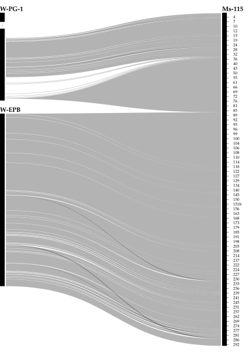

### [V\[1\]](https://cdn.wittgensteinnachlass.com/2000px/webp/Ms-115/V.webp)

## Philosophical Remarks XI.

### [PG I](/w-pg-1/#ms-115-1.1) [1\[1\]](https://cdn.wittgensteinnachlass.com/2000px/webp/Ms-115/1.webp)

14.12.1933

So the picture tells me itself. And that it tells me something will consist, for instance, in my recognizing objects in it in some characteristic grouping. (If I say: “I see a table in this picture”, then, as I said, that characterizes the picture in a way that has nothing to do with the existence of a ‘real’ table. “The picture shows me a cube” can, for example, mean: it contains the form .)

### [1\[2\]](https://cdn.wittgensteinnachlass.com/2000px/webp/Ms-115/1.webp),[2\[1\]](https://cdn.wittgensteinnachlass.com/2000px/webp/Ms-115/2.webp)

<s> We are inclined to think that there is a particular phenomenon of recognition, recognizing the thing as **that**. But as **what**? As the thing that has this name? Or is used in this way? For ‘recognizing the thing as itself’ means nothing. The idea we have in mind here is that of comparing two pictures; it is as if we carried a picture of the object around with us, & recognized an object as the one represented by the picture. It is as if our memory mediated such a comparison; by preserving for us a picture of what was seen earlier, or allowing us to look into the past, so that we could compare what memory shows us with what is seen at present. But when we treat the objects that surround us and that we have seen countless times not as unfamiliar but as thoroughly familiar, indeed even when we answer a question “yes, I know this table well, I see it every day”, no comparison of two impressions (a memory-image & reality) takes place here. </s>

### [PG I](/w-pg-1/#ms-115-2.2) [2\[2\]](https://cdn.wittgensteinnachlass.com/2000px/webp/Ms-115/2.webp)

<s> I do not of course deny that there are phenomena of recognition (when, for example, we say: “that is the same little box that I saw there years ago”), nor that among the phenomena we call “recognition” there is one consisting in comparing a mental image with reality. </s> If one asks me: “Did you recognize your desk when you entered your room this morning?” I would probably say “of course!” and yet it is misleading to call what happened there “recognition”. Certainly, the desk was not unfamiliar to me; I was not surprised to see it, as I would have been if someone else had been standing there or if there had been a strange object.

### [2\[3\]](https://cdn.wittgensteinnachlass.com/2000px/webp/Ms-115/2.webp),[3\[1\]](https://cdn.wittgensteinnachlass.com/2000px/webp/Ms-115/3.webp)

<s> The sight of my room, a street</s> <s>full of people, a landscape with houses & trees is **thoroughly familiar** to me.</s>

### [PG I](/w-pg-1/#ms-115-3.2) [3\[2\]](https://cdn.wittgensteinnachlass.com/2000px/webp/Ms-115/3.webp)

“What does it mean: ‘this object is familiar to me?’” – “Well, I know that it is a table.” But that can mean all sorts of things, among them: “I know how it is used”, “I know it looks like a table when one unfolds it”, “I know that one calls that a ‘table’”.

### [PG I](/w-pg-1/#ms-115-3.3) [3\[3\]](https://cdn.wittgensteinnachlass.com/2000px/webp/Ms-115/3.webp)

What is the nature of ‘familiarity’? What does it consist in, that a sight is familiar to me? (This question is already peculiar; it does not sound like a grammatical question.) I would like to say: “I see what I see.” And the familiarity can only consist in my resting in the sight.

### [PG I](/w-pg-1/#ms-115-3.4) [3\[4\]](https://cdn.wittgensteinnachlass.com/2000px/webp/Ms-115/3.webp)

“I see what I see”, I say this because I do not want to name what I see. I do not want to say, “I see a flower”, for that presupposes a linguistic convention & my way of expressing myself does not want to refer to the history of the impression.

### [3\[5\]](https://cdn.wittgensteinnachlass.com/2000px/webp/Ms-115/3.webp),[4\[1\]](https://cdn.wittgensteinnachlass.com/2000px/webp/Ms-115/4.webp)

<s> Yes, if I say that familiarity consists in my seeing a flower, then I give the matter this turn: uttering the words of recognition “that is a flower” is a reaction to the sight; but one cannot say that the criterion of recognition is that I **name the object correctly**; rather, it must now be said that recognition is characterized by my uttering a sound-combination, perhaps with certain sensations, at the sight of the object. For that this sound-combination is the correct German word, indeed that it is a word of an existing language at all, is not contained in the experience of uttering it. </s>

### [PG I](/w-pg-1/#ms-115-4.2) [4\[2\]](https://cdn.wittgensteinnachlass.com/2000px/webp/Ms-115/4.webp)

Familiarity consists in my recognizing that what I see is a flower. I now say: uttering the words “that is a flower” is the reaction of recognition; but the criterion of recognition is not that I name the object correctly, but that I utter a sound-combination with a particular experience at its sight. For that the sound-combination is the correct German word, or a word of an existing language at all, is not contained in the experience of uttering it.

### [PG I](/w-pg-1/#ms-115-5.1) [5\[1\]](https://cdn.wittgensteinnachlass.com/2000px/webp/Ms-115/5.webp)

“What is familiar is what I know what it is.”

### [PG I](/w-pg-1/#ms-115-5.2) [5\[2\]](https://cdn.wittgensteinnachlass.com/2000px/webp/Ms-115/5.webp)

I want to eliminate everything ‘historical’ from my way of looking at familiarity. Impressions (experiences, reactions) then remain, & even where language enters into our experiences we do not regard it as an existing institution.

### [PG I](/w-pg-1/#ms-115-5.3) [5\[3\]](https://cdn.wittgensteinnachlass.com/2000px/webp/Ms-115/5.webp)

The multiplicity of familiarity, as I understand it, is thus that of resting in a sight. It might consist in my gaze not wandering restlessly (searchingly) over the object, in my not changing the aspect of what is seen but settling into an aspect & remaining there.

### [PG I](/w-pg-1/#ms-115-5.4) [5\[4\]](https://cdn.wittgensteinnachlass.com/2000px/webp/Ms-115/5.webp)

I see a picture of a thick coat & have a feeling of warmth & comfort; I see a picture of a wintry landscape & feel cold. These reactions, one might say, are justified by earlier experience. But we are not concerned now with the history of our experiences & hence not with such a justification either.

### [PG I](/w-pg-1/#ms-115-6.1) [6\[1\]](https://cdn.wittgensteinnachlass.com/2000px/webp/Ms-115/6.webp)

No one will say that every time I come into my room, into the familiar surroundings, a recognition of everything I see, & have seen a hundred times, takes place.

### [PG I](/w-pg-1/#ms-115-6.2) [6\[2\]](https://cdn.wittgensteinnachlass.com/2000px/webp/Ms-115/6.webp)

When we think of our understanding a picture, say, a genre painting, we are perhaps inclined to assume that there is a particular phenomenon of recognition there & that we recognize the painted people as people, the painted trees as trees, etc. But when I look at a genre painting do I compare the painted people with real ones, etc.? Am I then to say that I recognize the painted people as painted people? And therefore the real people too as real?

### [PG I](/w-pg-1/#ms-115-6.3) [6\[3\]](https://cdn.wittgensteinnachlass.com/2000px/webp/Ms-115/6.webp)

Of course there is a phenomenon of recognition when we recognize, perhaps after a process of searching, a drawing as a representation of a person; but what takes place here does not take place when I see the drawing at once as a representation of a person.

### [PG I](/w-pg-1/#ms-115-7.1) [7\[1\]](https://cdn.wittgensteinnachlass.com/2000px/webp/Ms-115/7.webp)

The picture of a human figure, as well as the human figure itself, are thoroughly familiar objects to us. But there is no question here of recognition.

### [PG I](/w-pg-1/#ms-115-7.2) [7\[2\]](https://cdn.wittgensteinnachlass.com/2000px/webp/Ms-115/7.webp)

We easily form a false conception of the processes that one calls “recognition”; as if recognition always consisted in comparing two impressions with each other. It is as if I carried a picture of an object with me & recognized an object as the one represented by the picture. Our memory seems to mediate such a comparison for us, by preserving a picture of what was seen earlier or allowing us (as through a tube) to look into the past.

### [PG I](/w-pg-1/#ms-115-7.3+8.1) [7\[3\]](https://cdn.wittgensteinnachlass.com/2000px/webp/Ms-115/7.webp),[8\[1\]](https://cdn.wittgensteinnachlass.com/2000px/webp/Ms-115/8.webp)

In most cases of recognition no such comparison takes place. Someone comes towards me in the street whose face attracts my gaze; perhaps I ask myself “who is that?”; suddenly the aspect of the face changes in a particular way, “it becomes familiar to me”; I smile, go up to him & greet him by name; now we talk about the past & in doing so I may also have a memory-image of him in mind, seeing him in a particular situation.

### [PG I](/w-pg-1/#ms-115-8.2) [8\[2\]](https://cdn.wittgensteinnachlass.com/2000px/webp/Ms-115/8.webp)

One might say: if I had not preserved his picture in my memory, I could not recognize him. But here one is using a metaphor, or expressing a hypothesis.

### [PG I](/w-pg-1/#ms-115-8.3) [8\[3\]](https://cdn.wittgensteinnachlass.com/2000px/webp/Ms-115/8.webp)

One might say: “the sight was memory-laden.”

### [PG I](/w-pg-1/#ms-115-8.4) [8\[4\]](https://cdn.wittgensteinnachlass.com/2000px/webp/Ms-115/8.webp)

One also says: “we could not use words at all if we did not recognize them & the objects they designate.” If we did not recognize the colour green as such (presumably because of a lack of memory), we could not apply the word “green”. But do we have any check on this recognition, so that we know that it really is recognition? When we speak of recognition, we mean that we recognize something as what it really is, according to other criteria. “Recognizing” means: recognizing what _is_.

### [PG I](/w-pg-1/#ms-115-8.5) [8\[5\]](https://cdn.wittgensteinnachlass.com/2000px/webp/Ms-115/8.webp)

Familiarity confirms the aspect without, however, comparing it with anything else. It stamps it, as it were.

### [PG I](/w-pg-1/#ms-115-9.1) [9\[1\]](https://cdn.wittgensteinnachlass.com/2000px/webp/Ms-115/9.webp)

On the other hand I would like to say: “what I see before me here is surely not _some_ shape that I see in a particular way, but simply my shoes, which I know.” But here it is precisely two ways of expressing oneself that are at odds.

### [PG I](/w-pg-1/#ms-115-9.2) [9\[2\]](https://cdn.wittgensteinnachlass.com/2000px/webp/Ms-115/9.webp)

This shape that I see – I would like to say – is not simply _one_ shape, but one of the shapes familiar to me; it is a shape that has been distinguished in advance. It is one of the shapes whose picture was already in me earlier & only because it corresponds to such a picture is it the familiar shape. (I carry, as it were, a catalogue of such shapes around with me & the objects depicted there are then the familiar ones.)

### [PG I](/w-pg-1/#ms-115-9.3) [9\[3\]](https://cdn.wittgensteinnachlass.com/2000px/webp/Ms-115/9.webp)

But that I carried the picture with me earlier would only be a causal explanation of the present impression. It is as if one said: this movement goes so easily, as if it had been practised. And it is not so much that I compare the object with a picture standing beside it, but rather as if it _matched_ the picture. So I see only one & not two.

### [PG I](/w-pg-1/#ms-115-10.1) [10\[1\]](https://cdn.wittgensteinnachlass.com/2000px/webp/Ms-115/10.webp)

One says: “this face has a quite _distinct_ expression”, & perhaps looks for words to characterize it.

### [PG I](/w-pg-1/#ms-115-10.2) [10\[2\]](https://cdn.wittgensteinnachlass.com/2000px/webp/Ms-115/10.webp)

Here it is easy to get into that dead end of philosophizing where one believes that the difficulty of the task lies in the fact that elusive things, quickly vanishing present experience, or the like, should be described by us. Where ordinary language seems too crude to us; & it seems as if we are not dealing with the phenomena of which everyday life speaks, but “with the ones that quickly vanish, which, with their appearance & disappearance, approximately produce those former ones”.

### [PG I](/w-pg-1/#ms-115-10.3) [10\[3\]](https://cdn.wittgensteinnachlass.com/2000px/webp/Ms-115/10.webp)

And here one must remember that all the phenomena that now seem so strange to us are quite ordinary ones which, when they occur, do not strike us in the least. They only seem strange to us in the strange light that we now cast upon them when we philosophize.

### [PG I](/w-pg-1/#ms-115-10.4+11.1) [10\[4\]](https://cdn.wittgensteinnachlass.com/2000px/webp/Ms-115/10.webp),[11\[1\]](https://cdn.wittgensteinnachlass.com/2000px/webp/Ms-115/11.webp)

“The picture tells me itself”, I would like to say. That is, what it tells me consists in its own structure, in _its_ forms & colours. Such a case would be, for example, if “it tells me something” or “it is a picture” meant: it shows some combination of cubes & cylinders.

### [PG I](/w-pg-1/#ms-115-11.2) [11\[2\]](https://cdn.wittgensteinnachlass.com/2000px/webp/Ms-115/11.webp)

“It tells me something” can mean: it tells me a story, it is a narrative.

### [PG I](/w-pg-1/#ms-115-11.3) [11\[3\]](https://cdn.wittgensteinnachlass.com/2000px/webp/Ms-115/11.webp)

It tells itself to me, as a sentence, a narrative, tells itself to me.

### [PG I](/w-pg-1/#ms-115-11.4) [11\[4\]](https://cdn.wittgensteinnachlass.com/2000px/webp/Ms-115/11.webp)

Isn’t the concept of a picture that tells a story similar to that of a genre painting (or battle picture)? And if I wanted to describe what a battle picture is, I would not need to refer to any reality outside the picture, but only speak of painted people, painted horses, painted cannons, etc.

### [PG I](/w-pg-1/#ms-115-11.5) [11\[5\]](https://cdn.wittgensteinnachlass.com/2000px/webp/Ms-115/11.webp)

“The picture tells me something”: it uses, as it were, _words_; here there are eyes, mouth, nose, hands, etc. etc. I compare the picture with a combination of linguistic forms.

### [PG I](/w-pg-1/#ms-115-11.6+12.1) [11\[6\]](https://cdn.wittgensteinnachlass.com/2000px/webp/Ms-115/11.webp),[12\[1\]](https://cdn.wittgensteinnachlass.com/2000px/webp/Ms-115/12.webp)

But the system of language is not of the category of an experience. The typical experience in the use of a system is not the system. (Compare: the meaning of the word “or” & the or-feeling.)

### [PG I](/w-pg-1/#ms-115-12.2) [12\[2\]](https://cdn.wittgensteinnachlass.com/2000px/webp/Ms-115/12.webp)

“Now this sequence of signs says something to me; earlier, before I learnt the language, it said nothing to me.” Let us suppose that by this we meant that the sentence is now read with a particular experience. Certainly, before I learnt to understand the language, this sequence of signs did not produce this impression. The impression is of course quite independent of the system of language if we leave causal matters aside. – And now something in me resists saying that the sentence’s saying something consists in its making this impression on me. “Something is a sentence only in a language”, I want to say.

### [PG I](/w-pg-1/#ms-115-12.3) [12\[3\]](https://cdn.wittgensteinnachlass.com/2000px/webp/Ms-115/12.webp)

‘Language’, after all, is the languages. Including those that I invent by analogy with existing ones. Languages _are_ systems.

### [PG I](/w-pg-1/#ms-115-12.4) [12\[4\]](https://cdn.wittgensteinnachlass.com/2000px/webp/Ms-115/12.webp)

“A sentence is a sentence of a language.” But that just means: “sentences” is what I call members of languages.

### [PG I](/w-pg-1/#ms-115-12.5+13.1) [12\[5\]](https://cdn.wittgensteinnachlass.com/2000px/webp/Ms-115/12.webp),[13\[1\]](https://cdn.wittgensteinnachlass.com/2000px/webp/Ms-115/13.webp)

But let us pay attention to the _use_ of the word “German language”, otherwise we ask, for example: “What is language? all its sentences that have ever been spoken? the class of its rules & words? etc. etc..”. What is the system? Where is it? What is the game of chess? all the games? The list of rules?

### [PG I](/w-pg-1/#ms-115-13.2) [13\[2\]](https://cdn.wittgensteinnachlass.com/2000px/webp/Ms-115/13.webp)

“_Sentence_ is a member of a language.” “It is evidently the combination of words that could also be combined differently that makes the sentence.” But that means: what makes it one for _me_. That is how I regard language.

### [PG I](/w-pg-1/#ms-115-13.3) [13\[3\]](https://cdn.wittgensteinnachlass.com/2000px/webp/Ms-115/13.webp)

_We_ want to pay attention to the system of language.

### [PG I](/w-pg-1/#ms-115-13.4) [13\[4\]](https://cdn.wittgensteinnachlass.com/2000px/webp/Ms-115/13.webp)

Certainly, I read a story & don’t give a damn about a system of language. I simply read, have impressions, see pictures before me, etc. I let the story pass before me like pictures, like a picture story. (Of course, I do not mean to say that every sentence evokes a visual picture, or several, in me, & that this is perhaps the purpose of a sentence.)

### [PG I](/w-pg-1/#ms-115-13.5) [13\[5\]](https://cdn.wittgensteinnachlass.com/2000px/webp/Ms-115/13.webp)

Let us imagine a picture story in schematic pictures, thus more similar to a narrative in a language than to a sequence of realistic pictures. In such a picture language, one could, for example, record the course of battles. (Language-game.) And a sentence of our word-language comes much closer to a picture of this picture language than one might think.

### [PG I](/w-pg-1/#ms-115-14.1) [14\[1\]](https://cdn.wittgensteinnachlass.com/2000px/webp/Ms-115/14.webp)

Let us also remember how we do not first have to transfer such pictures [

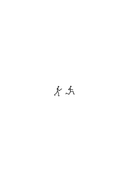

] into realistic ones in order to ‘understand’ them, just as little as we ever transfer photographs or the pictures of a film into coloured pictures, although black-and-white people or plants etc. in reality would seem unspeakably strange & terrible to us. What if we now said here: “a picture is something only in a picture language”?

### [PG I](/w-pg-1/#ms-115-14.2) [14\[2\]](https://cdn.wittgensteinnachlass.com/2000px/webp/Ms-115/14.webp)

A sentence of a narrative gives us the same satisfaction as a picture.

### [PG I](/w-pg-1/#ms-115-14.3+15.1) [14\[3\]](https://cdn.wittgensteinnachlass.com/2000px/webp/Ms-115/14.webp),[15\[1\]](https://cdn.wittgensteinnachlass.com/2000px/webp/Ms-115/15.webp)

We can (on the other hand) imagine a language in whose use the impression that a sign makes on us plays no role; in which there is no understanding in the sense of such an impression. The signs are perhaps transmitted to us in writing & we can now _memorize_ _them_. (That is, the only impression being discussed is the image of the sign.) If it is a command, we translate the sign into action according to rules, tables. There is no impression similar to that of a picture at all & one does not write stories in this language. But there is perhaps a kind of light entertainment consisting in translating certain sequences of signs into bodily movements that form a kind of dance. (Compare the remark about understanding & cipher.)

### [PG I](/w-pg-1/#ms-115-15.2) [15\[2\]](https://cdn.wittgensteinnachlass.com/2000px/webp/Ms-115/15.webp)

It would, of course, also be conceivable that, in order to receive an _impression_ from a sentence of word-language, we had to translate it according to rules into a drawn picture. (That only this picture would have a mind.)

### [PG I](/w-pg-1/#ms-115-15.3) [15\[3\]](https://cdn.wittgensteinnachlass.com/2000px/webp/Ms-115/15.webp)

(I could say to my student: You will think differently when You have gone through these exercises.)

### [PG I](/w-pg-1/#ms-115-15.4) [15\[4\]](https://cdn.wittgensteinnachlass.com/2000px/webp/Ms-115/15.webp)

In this case one could really say: “The sequence of signs is _dead_ without the system”.

### [PG I](/w-pg-1/#ms-115-15.5) [15\[5\]](https://cdn.wittgensteinnachlass.com/2000px/webp/Ms-115/15.webp)

But even in our ordinary language we can often disregard entirely the impression of the sentence & what matters is only how we operate with the sentence. (Frege’s conception of logic.)

### [PG I](/w-pg-1/#ms-115-15.6) [15\[6\]](https://cdn.wittgensteinnachlass.com/2000px/webp/Ms-115/15.webp)

“There is no sentence standing alone.” For what I call a “sentence” is a game position in a language.

### [PG I](/w-pg-1/#ms-115-16.1) [16\[1\]](https://cdn.wittgensteinnachlass.com/2000px/webp/Ms-115/16.webp)

Isn’t the confusing thing that I can look at a position in a game as closely as I like, without finding out in this way that it is a _position in a game_? Something in the grammar of the word “position in a game” confuses us here.

### [PG I](/w-pg-1/#ms-115-16.2) [16\[2\]](https://cdn.wittgensteinnachlass.com/2000px/webp/Ms-115/16.webp)

Thinking is called an activity, like calculating. No one would call calculating a state, or playing chess a state.

### [PG I](/w-pg-1/#ms-115-16.3) [16\[3\]](https://cdn.wittgensteinnachlass.com/2000px/webp/Ms-115/16.webp)

Let us imagine a kind of puzzle picture in which not _one_ particular object is to be found, but which appears to us at first glance as a jumble of meaningless lines & only after some searching as, say, a landscape picture. – What is the difference between the sight of the picture before & after the solution? That we see it differently on the two occasions is clear. In what way, however, can one say after the solution that the picture now tells us something, whereas before it told us nothing?

### [PG I](/w-pg-1/#ms-115-16.4) [16\[4\]](https://cdn.wittgensteinnachlass.com/2000px/webp/Ms-115/16.webp)

We can also put this question as follows: What is the general characteristic of the solution having been found?

### [17\[1\]](https://cdn.wittgensteinnachlass.com/2000px/webp/Ms-115/17.webp),[18\[1\]](https://cdn.wittgensteinnachlass.com/2000px/webp/Ms-115/18.webp)

I want to assume that, as soon as it is solved, I represent the solution by strongly emphasizing certain lines of the duck-rabbit picture & perhaps adding shadows. Why do you now call the picture that you have drawn a solution? a) Because it is the clear representation of a group of spatial objects. b) Because it is the representation of a regular body. c) Because it is a symmetrical figure. d) Because it is a figure that gives me an ornamental impression. e) Because it is the representation of a body that seems familiar to me. f) Because there is a list of solutions & this figure (this body) is on the list. g) Because it represents a kind of object that I probably know: for it gives me the immediate impression of familiarity, I immediately connect all possible associations with it, I know what its name is, I know that I have often seen it, I know what it is used for, etc. etc. h) Because it represents a face that is familiar to me. i) Because it represents a face that I recognize: α) it is the face of my friend so-and-so β) it is a face that I have often seen depicted. etc. k) Because it represents an object that I remember having seen once. l) Because it is an ornament that I know well (although I do not know where I saw it). m) Because it is an ornament that I know well: I know its name, I know where I have seen it before. n) Because it represents an item of furniture in my room. o) Because I instinctively emphasized these lines & now feel at ease. p) Because I remember that this object was described to me. g1) Because I think I know the object well: a word immediately occurs to me as its name (although the word belongs to no existing language), I say to myself: “of course, this is an α as I have often seen it in β. One γs the δ with it until they ε.” Something like this occurs, for example, in a dream. And so on.

### [PG I](/w-pg-1/#ms-115-18.2) [18\[2\]](https://cdn.wittgensteinnachlass.com/2000px/webp/Ms-115/18.webp)

(Anyone who does not understand why we are talking about these things must find what we say empty play.)

### [PG I](/w-pg-1/#ms-115-18.3+19.1) [18\[3\]](https://cdn.wittgensteinnachlass.com/2000px/webp/Ms-115/18.webp),[19\[1\]](https://cdn.wittgensteinnachlass.com/2000px/webp/Ms-115/19.webp)

The impression is one thing, & the definiteness of the impression something else. What I call the impression of familiarity has the multiplicity of a definiteness.

### [PG I](/w-pg-1/#ms-115-19.2) [19\[2\]](https://cdn.wittgensteinnachlass.com/2000px/webp/Ms-115/19.webp)

We can look into a human face that we know exactly without receiving any impression, quite blankly, as it were; & between that and a strong impression there are all degrees.

### [PG I](/w-pg-1/#ms-115-19.3) [19\[3\]](https://cdn.wittgensteinnachlass.com/2000px/webp/Ms-115/19.webp)

Let us imagine that the sight of a face produces a strong impression on us, that it perhaps instils fear in us. Am I then to say: above all, there must be an impression of familiarity; the form of the human face as such must make the impression of familiarity on me; & to this impression is now added that of fear? – Is it not rather the case that what I call the impression of familiarity with the type is a characteristic of every strong impression that a face makes on me? Perhaps the characteristic of definiteness. I did say that the impression of familiarity consisted, for instance, in our resting in a sight, not changing the aspect, and so on.

### [PG I](/w-pg-1/#ms-115-19.4+20.1) [19\[4\]](https://cdn.wittgensteinnachlass.com/2000px/webp/Ms-115/19.webp),[20\[1\]](https://cdn.wittgensteinnachlass.com/2000px/webp/Ms-115/20.webp)

Can I imagine away the impression of individual familiarity where it is, & imagine it in where it is not? And what does that mean? I look, for example, at the face of a friend & ask myself: what does this face look like if I see it as an unfamiliar face (as if I were seeing it for the first time now)? What, so to speak, remains of the sight of the face when I imagine away, subtract, the impression of familiarity? – Here I am inclined to say: “it is _very difficult_ to separate the familiarity from the impression of the face”. But I also feel that this is a misleading way of expressing oneself. For I do not know at all how I should even try to separate these two. The expression “to separate them” has no clear sense for me. I know what _it means_: “imagine this table, but black, although it is brown”, which means something like: “paint a picture of this table, but black instead of brown”; or analogously: “draw this person, but with longer legs than he has”.

### [PG I](/w-pg-1/#ms-115-20.2) [20\[2\]](https://cdn.wittgensteinnachlass.com/2000px/webp/Ms-115/20.webp)

What if one said: “imagine this butterfly, exactly as it is, but ugly instead of beautiful”?!

### [PG I](/w-pg-1/#ms-115-20.3+21.1) [20\[3\]](https://cdn.wittgensteinnachlass.com/2000px/webp/Ms-115/20.webp),[21\[1\]](https://cdn.wittgensteinnachlass.com/2000px/webp/Ms-115/21.webp)

“‘It is very difficult … to imagine away’: here it seems as if it were a psychological difficulty, a difficulty of introspection or the like. (This applies to a large area of philosophical problems: think of the problem of the _exact_ reproduction, description, of what is seen in the visual field; of the description of the ever-flowing phenomenon; also of this: “how many raindrops do you see when you look into the rain”.)

Compare: “It is difficult to _want_ to move this table from a distance”.

### [PG I](/w-pg-1/#ms-115-21.2) [21\[2\]](https://cdn.wittgensteinnachlass.com/2000px/webp/Ms-115/21.webp)

_We_ have not _defined_ what it is supposed to mean to imagine away the familiarity.

It could mean, for example, remembering the impression I had when I saw the face for the first time. And here again one must know what it means to “_try_” to remember the impression. For that has various meanings. Let us ask ourselves: what activities do we call “trying to remember something”; what do we do when we want to remember what we ate yesterday at midday; is there also this method for an adult’s early childhood memories; can one _try_ to remember one’s own birth?

### [PG I](/w-pg-1/#ms-115-21.3+22.1) [21\[3\]](https://cdn.wittgensteinnachlass.com/2000px/webp/Ms-115/21.webp),[22\[1\]](https://cdn.wittgensteinnachlass.com/2000px/webp/Ms-115/22.webp)

I say to myself: I shall try to look at a printed German word and see it as if I had not learnt to read & as if the black figures on the paper were strange drawings whose purpose I cannot imagine, or do not apprehend. What then happens is that I cannot look at the printed word without the sound-image of the word or of the letters I am looking at coming before my mind’s eye.

### [PG I](/w-pg-1/#ms-115-22.2) [22\[2\]](https://cdn.wittgensteinnachlass.com/2000px/webp/Ms-115/22.webp)

A pictorial representation of the inside of a radio receiver will be a jumble of senseless lines for someone who has no knowledge of such things. But if he has become acquainted with the apparatus & its function, that drawing will be a meaningful picture for him. Now, given a particular physical shape that is currently senseless to me (for example, in a picture), can I imagine it meaningfully at will? That would be like asking: can I imagine an arbitrarily shaped object as an object for use? But for what use? Now, at least, one can methodically think of a class of physical forms as dwellings for animals or people. Another class as weapons. One, for example, as models of landscapes, etc. etc. And here I know how I can give meaning to a senseless form.

### [PG I](/w-pg-1/#ms-115-23.1) [23\[1\]](https://cdn.wittgensteinnachlass.com/2000px/webp/Ms-115/23.webp)

When I say that this face has the expression of mildness, goodness, cowardice, I seem not only to mean that we associate these and those feelings with the sight of the face, but I am tempted to say that the face is an aspect of cowardice, goodness, etc., itself. (Compare, for example, Weininger.) – One can say: I see the cowardice into this face (& could also see it into another), but in any case it seems not merely associated with the face, externally connected with it, but fear has the multiplicity of the facial features. And if, for example, the features change a little, we can speak of a corresponding change in the fear. If we were asked: “can you also think of this face as an expression of courage”, we would, as it were, not know how to accommodate courage in these features. I then say something like: “I do not know what it would mean if this face were a courageous face”. But what does the solution to such a question look like? One says, for example: “Yes, now I understand it; the face is, so to speak, indifferent to the external world”. So we have interpreted courage into it. Courage, one might say, now fits the face again. But _what_ fits _onto what_ here?

### [PG I](/w-pg-1/#ms-115-24.1) [24\[1\]](https://cdn.wittgensteinnachlass.com/2000px/webp/Ms-115/24.webp)

It is a related case (although it may perhaps not seem so) when, for example, we are surprised that the French do not simply say “the man is good” but put an attributive adjective where a predicative one should stand; and when we then solve the problem by saying that they meant “the man is _a_ good one”.

### [PG I](/w-pg-1/#ms-115-24.2+25.1) [24\[2\]](https://cdn.wittgensteinnachlass.com/2000px/webp/Ms-115/24.webp),[25\[1\]](https://cdn.wittgensteinnachlass.com/2000px/webp/Ms-115/25.webp)

Could different interpretations of a facial expression not consist in my imagining a different continuation for it each time? That is certainly often so. I see a picture depicting a smiling head. What do I do when I interpret the smile once as friendly and once as malicious? Do I not then imagine it in a spatial & temporal environment that I call friendly or malicious? Thus I could imagine, in connection with the picture, that the smiling person is smiling down at a child at play, or at the suffering of an enemy. Nothing is changed by the fact that I can also interpret the situation, amiable at first sight, differently through a further environment. If no particular circumstances alter my interpretation, I shall interpret a certain smile as friendly, call it friendly, and react accordingly.

### [PG I](/w-pg-1/#ms-115-25.2) [25\[2\]](https://cdn.wittgensteinnachlass.com/2000px/webp/Ms-115/25.webp)

What does it mean: “to _read_ friendliness _into_ the smile”? Perhaps it means that I make a face coordinated in a particular way with the smiling face. I assign, for example, the other face to mine in such a way that it exaggerates one or other feature of the other.

### [PG I](/w-pg-1/#ms-115-25.3+26.1) [25\[3\]](https://cdn.wittgensteinnachlass.com/2000px/webp/Ms-115/25.webp),[26\[1\]](https://cdn.wittgensteinnachlass.com/2000px/webp/Ms-115/26.webp)

A friendly mouth, a friendly eye. How does one imagine a friendly hand? – Probably open & not as a fist. – And could one imagine the person’s hair colour as an expression of friendliness, or of the opposite? But, put in this way, this seems to ask whether we shall _succeed_ in doing so. The question should be: do we want to call something a friendly, or unfriendly, hair colour? If we want to give such words sense, we might imagine a person whose hair becomes dark when he becomes evil. But reading the evil expression into the dark hair would be done by means of an already formed idea. One can say: the friendly eye, the friendly mouth, the wagging of the dog are, among other things, primary & independent symbols of friendliness; I mean by this: they are parts of the phenomena that one calls friendliness. If one wants to think of other phenomena as expressions of friendliness, one sees those symbols in them. We say “he makes a gloomy face”; perhaps because the eyes are more heavily shaded by the eyebrows; & now we transfer the idea of gloom to the colour of the hair. He makes gloomy hair. If one asked me whether I could imagine an armchair with a friendly expression, I would certainly want to imagine it above all with a friendly _facial expression_, reading a friendly _face_ into it.

### [PG I](/w-pg-1/#ms-115-26.2+27.1) [26\[2\]](https://cdn.wittgensteinnachlass.com/2000px/webp/Ms-115/26.webp),[27\[1\]](https://cdn.wittgensteinnachlass.com/2000px/webp/Ms-115/27.webp)

I say: “I can also think of this face (which at first gives the impression of timidity) as a courageous one”. By this _we do not mean_ that I can imagine someone with this face, for example, saving another person’s life (one can of course imagine this in connection with any face). Rather, I am speaking of an aspect of the face itself. What I mean is also not that I can imagine this person changing his face into a courageous one, in the ordinary sense; but rather that it can pass into such a one in a quite particular way. The reinterpretation of a facial expression, however, is to be compared with the reinterpretation of a chord in music, when we ‘_hear_’ it once as a transition into this key and once into that. (Compare also the difference between mixed colour and intermediate colour.)

### [PG I](/w-pg-1/#ms-115-27.2) [27\[2\]](https://cdn.wittgensteinnachlass.com/2000px/webp/Ms-115/27.webp)

This is connected with the contrast between _saying_ & _meaning_. “Every expression can (after all) lie”: But just think what you mean by “lying”. How do you imagine the lie? Do you not set one expression against another? Surely you set against the expression a process which could also be an expression.

### [PG I](/w-pg-1/#ms-115-27.3) [27\[3\]](https://cdn.wittgensteinnachlass.com/2000px/webp/Ms-115/27.webp)

When we ask ourselves “which person’s name would suit this person’s character” – reproduce it sonically – the method of projection by which we reproduce it is, as it were, fixed. (A poet might, for example, ask himself what name he wants to give a person.) But sometimes we project the character into the given name. Thus it seems to us that the great masters have the names that alone fit the character of their works.

### [PG I](/w-pg-1/#ms-115-27.4+28.1) [27\[4\]](https://cdn.wittgensteinnachlass.com/2000px/webp/Ms-115/27.webp),[28\[1\]](https://cdn.wittgensteinnachlass.com/2000px/webp/Ms-115/28.webp)

Experience of true size. We would see a picture showing the shape of an armchair; we are told that it represents a construction the size of a house. Now we see it differently.

### [PG I](/w-pg-1/#ms-115-28.2) [28\[2\]](https://cdn.wittgensteinnachlass.com/2000px/webp/Ms-115/28.webp)

What happens when we learn to feel the end of a church mode as an end?

### [PG I](/w-pg-1/#ms-115-28.3) [28\[3\]](https://cdn.wittgensteinnachlass.com/2000px/webp/Ms-115/28.webp)

Think of the diversity of what we call “language”. Word-language, picture-language, sign-language, tone-language.

### [28\[4\]](https://cdn.wittgensteinnachlass.com/2000px/webp/Ms-115/28.webp)

<s> The philosophical difficulties, concerning recognition for example, are not ones which we overlook in practice but which appear as soon as one looks more closely at the phenomena. Rather, they appear only when we view them through a preconceived schema.</s>

### [PG I](/w-pg-1/#ms-115-28.5+29.1) [28\[5\]](https://cdn.wittgensteinnachlass.com/2000px/webp/Ms-115/28.webp),[29\[1\]](https://cdn.wittgensteinnachlass.com/2000px/webp/Ms-115/29.webp)

“‘I know this object well’, that is as if I said: ‘this object is depicted in my catalogue’”. So its being familiar would consist in such a picture’s being bound together with others in a particular wrapper; lying in _this_ drawer. – But if I really imagine this, & think I simply compared the object seen with pictures in my catalogue & found that it agreed with one of them, that would not be similar to the phenomenon of familiarity. For one assumes that the picture in our catalogue is familiar to us. If it were strange to us, the fact that it was in this wrapper, in this drawer, would mean nothing to us at all.

### [PG I](/w-pg-1/#ms-115-29.2) [29\[2\]](https://cdn.wittgensteinnachlass.com/2000px/webp/Ms-115/29.webp)

When I now speak of the prototype in the catalogue of my mind, or of the case into which the object fits when it is familiar to me, I want the case to be in my mind, so to speak, as a “form of representation”, so that I cannot say that a prototype is in my mind which is (really) not there. – The prototype withdraws, so to speak, into my mind, and is therefore no longer an object for it. But that only means: there was no sense in speaking of a prototype at all. (The spatial spectacles which we cannot take off.)

### [PG I](/w-pg-1/#ms-115-29.3+30.1) [29\[3\]](https://cdn.wittgensteinnachlass.com/2000px/webp/Ms-115/29.webp),[30\[1\]](https://cdn.wittgensteinnachlass.com/2000px/webp/Ms-115/30.webp)

When we speak of familiarity as the object’s fitting into a case, it is not quite as if we _compared_ what we saw with a likeness. What we really mean is the feeling when the object glides without resistance into the form of the case. But we could also have this feeling if there were no exactly fitting case at all. We can also imagine every object in an invisible case & that makes no difference at all to our experiences & is now an empty form of representation.

### [30\[2\]](https://cdn.wittgensteinnachlass.com/2000px/webp/Ms-115/30.webp)

(The representation of philosophy can only be composed as poetry.)

### [30\[3\]](https://cdn.wittgensteinnachlass.com/2000px/webp/Ms-115/30.webp)

(Philosophy ought really only to be _composed as poetry_. From this, it seems to me, it must follow how far my thinking belongs to the present, the future or the past: for in saying this I have also acknowledged myself as someone who cannot quite do what he wishes he could do.)

### [30\[4\]](https://cdn.wittgensteinnachlass.com/2000px/webp/Ms-115/30.webp)

Calm in philosophy sets in when the word that brings release has been found.

### [PG I](/w-pg-1/#ms-115-30.5+31.1) [30\[5\]](https://cdn.wittgensteinnachlass.com/2000px/webp/Ms-115/30.webp),[31\[1\]](https://cdn.wittgensteinnachlass.com/2000px/webp/Ms-115/31.webp)

It should not really say: “yes, I recognise it, it is a face” but rather: “I recognise it, I see it as a face”. (The word face could here mean for me the mere ornament 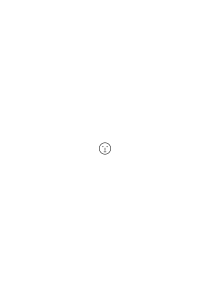 (without any relation to a human face), and would therefore be on the same level as any other figure familiar to us, for example a swastika.) For the question is: _What_ do I recognise _as what_? For “recognising a thing as itself” means nothing.

### [PG I](/w-pg-1/#ms-115-31.2) [31\[2\]](https://cdn.wittgensteinnachlass.com/2000px/webp/Ms-115/31.webp)

Comparing memory with a notebook: on the one hand this comparison serves as a picture of what goes on consciously; on the other hand it provides a psychological model. (And the word “conscious” here refers to a section of grammar & is not one part of the psychological opposition “conscious” – “unconscious”.)

### [PG I](/w-pg-1/#ms-115-31.3+32.1) [31\[3\]](https://cdn.wittgensteinnachlass.com/2000px/webp/Ms-115/31.webp),[32\[1\]](https://cdn.wittgensteinnachlass.com/2000px/webp/Ms-115/32.webp)

The processes of remembering are very varied. “Have you been in your room?” – “Yes.” – “Are you sure?” – “I would know if I had not been here yesterday!” In doing so I need not see myself in my room in memory for a moment. But suppose I saw myself, while saying this, standing at the window in my room; how does the picture show me that it was yesterday? Of course, the picture could show this too if, for example, I saw a wall calendar with yesterday’s date in it. But if that was not the case, how did I read from the memory-image or the memory that I stood at the window like that _yesterday_, how did I translate the experience of memory into words? – But did I translate an experience into words? Did I not simply utter the words; and in a particular tone of voice & with experiences of certainty of that kind? But was that not the experience of memory? (The experience of conviction is of the kind of the experience of tone of voice.) But what made you so certain when you uttered these words? Nothing; I _was_ certain. Of course, I can now check what I uttered in another way – as one would say. That is: I can now try to remember particular events of yesterday & summon images before my mind’s eye, etc. But that need not in any case have happened before I answered.

### [PG I](/w-pg-1/#ms-115-32.2) [32\[2\]](https://cdn.wittgensteinnachlass.com/2000px/webp/Ms-115/32.webp)

When we recount an occurrence from memory, we probably sometimes see memory-images before us; but most of the time they are merely scattered through the memory like illustrations in a book of fairy tales.

### [PG I](/w-pg-1/#ms-115-32.3+33.1) [32\[3\]](https://cdn.wittgensteinnachlass.com/2000px/webp/Ms-115/32.webp),[33\[1\]](https://cdn.wittgensteinnachlass.com/2000px/webp/Ms-115/33.webp)

Someone says to me: “imagine on this white wall a spot of the colour called ‘red’”. I do so; – am I now to say that I remembered what colour ‘red’ is called. When I talk about this table, do I remember that this object is called ‘table’.

### [PG I](/w-pg-1/#ms-115-33.2) [33\[2\]](https://cdn.wittgensteinnachlass.com/2000px/webp/Ms-115/33.webp)

Could one not object: “So, can someone who has not learnt a language not have certain memories?” Of course, – he cannot have linguistic memories, linguistic wishes, etc. And linguistic memories, etc., are not merely flimsy schemata; is a linguistic experience not an experience? (Words are deeds.)

### [PG I](/w-pg-1/#ms-115-33.3) [33\[3\]](https://cdn.wittgensteinnachlass.com/2000px/webp/Ms-115/33.webp)

Some people remember a musical theme in such a way that the musical notation appears before them & they read it down. It would be conceivable that what we call “remembering” in a person consisted in his seeing himself looking up a book in his mind & that what he reads in this book was precisely what was remembered. (How do I _react_ to a memory?)

### [PG I](/w-pg-1/#ms-115-33.4+34.1) [33\[4\]](https://cdn.wittgensteinnachlass.com/2000px/webp/Ms-115/33.webp),[34\[1\]](https://cdn.wittgensteinnachlass.com/2000px/webp/Ms-115/34.webp)

Incidentally, when I treat the objects around me as familiar, do I think of this comparison? Of course not. I only do so when I subsequently consider the act of recognising (recognising again); & not so much by trying to see what actually happened in the process as by viewing it through a preconceived schema. (Flow of time.) (The problem of the nature of time & the flow of time is very similar to this.)

### [PG I](/w-pg-1/#ms-115-34.2) [34\[2\]](https://cdn.wittgensteinnachlass.com/2000px/webp/Ms-115/34.webp)

I do not call rules of representation conventions when they can be justified by the fact that the representation, when it conforms to them, agrees with reality. Thus the rule “paint the sky lighter than anything that receives its light from it” is not a convention. The rules of grammar cannot be justified by showing that their application leads to an agreement between the representation and reality. For this justification would have to describe what is represented itself.

### [PG I](/w-pg-1/#ms-115-34.3+35.1) [34\[3\]](https://cdn.wittgensteinnachlass.com/2000px/webp/Ms-115/34.webp),[35\[1\]](https://cdn.wittgensteinnachlass.com/2000px/webp/Ms-115/35.webp)

But can the justification not simply _point_ to reality? In what respect, though, is this pointing a justification? Does it have the multiplicity of a justification? It may, of course, be the cause of our saying this sentence instead of that one. But is there a reason for it? Do we call _that_ “justification”?

### [PG I](/w-pg-1/#ms-115-35.2) [35\[2\]](https://cdn.wittgensteinnachlass.com/2000px/webp/Ms-115/35.webp)

“Language” is a word like “keyboard”. There are machines which contain a keyboard. Now I might, for some reason or other, be interested in forms of keyboards (those in use & others merely invented by me). And inventing a keyboard could mean inventing something that has the desired effect; but it could also mean devising new forms analogous to the old ones in various ways.

### [PG I](/w-pg-1/#ms-115-35.3) [35\[3\]](https://cdn.wittgensteinnachlass.com/2000px/webp/Ms-115/35.webp)

“The rules of a game are arbitrary” means: the concept “game” is not defined by the effects which the game is supposed to have on us.

### [PG I](/w-pg-1/#ms-115-35.4+36.1) [35\[4\]](https://cdn.wittgensteinnachlass.com/2000px/webp/Ms-115/35.webp),[36\[1\]](https://cdn.wittgensteinnachlass.com/2000px/webp/Ms-115/36.webp)

Is philosophy a creature of word-language? Is word-language a condition for the existence of philosophy? It would be more accurate to ask: is there anything analogous to philosophy outside the domain of our word-languages as well? For philosophy – (that) is the philosophical problems, i.e. the particular individual disquietudes that we call “philosophical problems”. What is _common_ to them extends as far as what is common between different domains of our language. Now consider a particular philosophical problem, say this one: “How is it possible to measure a period of time when (after all) past & future are not present and the present is only a point” –; what is characteristic of it is that a confusion is expressed here in the form of a question which does not acknowledge this confusion. That the questioner is _delivered_ from his problem by a particular change in his way of expressing himself.

### [PG I](/w-pg-1/#ms-115-36.2) [36\[2\]](https://cdn.wittgensteinnachlass.com/2000px/webp/Ms-115/36.webp)

A problem _analogous_ to a philosophical one, or a disquietude, might arise, say, if someone _played_ on all the keys of the manual, the result did not sound like music, & yet he was tempted to believe that it had to be music. etc..

### [36\[3\]](https://cdn.wittgensteinnachlass.com/2000px/webp/Ms-115/36.webp),[37\[1\]](https://cdn.wittgensteinnachlass.com/2000px/webp/Ms-115/37.webp)

[Something that looks like a sentence at first glance & isn’t one.] The following proposal for the construction of a road roller was communicated to me & seems to me to be of philosophical interest. The inventor’s error has an affinity with a philosophical error. The invention consists in the motor being located inside the hollow roller. The crankshaft runs through the middle of the roller & is connected at both ends by spokes to the rim of the roller. The cylinder of the petrol engine is attached to the inside of the roller. At first glance this construction looks like a machine. But it is a rigid system & the piston cannot move in and out of the cylinder. We have deprived the system itself of every possibility of movement & do not know it.

---

### [37\[2\]](https://cdn.wittgensteinnachlass.com/2000px/webp/Ms-115/37.webp)

We say: “the rooster calls the hens by crowing”; but isn’t this already based on a comparison with our language (word-language)? – Wouldn’t the aspect be completely changed if we imagined that, through some physical effect, the crowing attracted the hens? But if it were shown in what way the words “come to me!” affect the person addressed, so that, under certain conditions, certain muscles are innervated at the end & he comes to me, – would that sentence thereby lose the character of a sentence?

### [37\[3\]](https://cdn.wittgensteinnachlass.com/2000px/webp/Ms-115/37.webp)

Our language, our word-language, is _above all_ what we call “language”, & then other things according to their analogy or comparability with it.

### [37\[4\]](https://cdn.wittgensteinnachlass.com/2000px/webp/Ms-115/37.webp),[38\[1\]](https://cdn.wittgensteinnachlass.com/2000px/webp/Ms-115/38.webp)

A shrug, when we _mean_ it as an answer (for instance in a conversation), is admittedly _experienced_ differently from a shrug caused, say, by pain in the shoulder. And we also ask: “was that meant as a shrug, or was it merely an accidental movement?” – But would we call the shrug a sign if we did not use it in connection with word-language?

### [38\[2\]](https://cdn.wittgensteinnachlass.com/2000px/webp/Ms-115/38.webp)

The case: “wanting to give someone a sign”. – I indicate to someone by a movement of my hand that he is to sit down; another person is standing immediately beside him; the direction of my gaze & my gesture does not reveal which of the two I am giving the sign to. Now someone asks me: “which one did you mean”, & I answer: “A”. What did this meaning consist in? Or: what was the difference between the processes of meaning A & B by means of this sign? Could it have consisted in a process accompanying the movement of the hand, the gaze, etc.? Could it not have consisted in my being annoyed when A remained standing in response to my sign; or in my answering the question “whom did you mean” with: “A”? Or in a combination of these & others?

### [39\[1\]](https://cdn.wittgensteinnachlass.com/2000px/webp/Ms-115/39.webp)

Try this: _Say_ “it is cold here” & _mean_ “it is warm here”. Can you do it? – And what are you doing in the process? And is there only one way of doing it?

### [39\[2\]](https://cdn.wittgensteinnachlass.com/2000px/webp/Ms-115/39.webp)

“The dog means something by it when it wags its tail.” How can we justify this?

### [39\[3\]](https://cdn.wittgensteinnachlass.com/2000px/webp/Ms-115/39.webp)

We would hardly ask whether the crocodile means anything by it when it comes towards a person with its mouth open. And we would explain: the crocodile cannot think and therefore, in fact, there is no question of meaning here.

### [39\[4\]](https://cdn.wittgensteinnachlass.com/2000px/webp/Ms-115/39.webp)

When we shrug our shoulders, the accompanying psychic experiences, the experiences of opinion, are not essentially different from those involved in uttering a word or sentence: “perhaps –”, “I don’t know”, “God knows”, etc. – These words can certainly be uttered as involuntarily (though I do not mean parrot-like) as a gesture can be made.

### [40\[1\]](https://cdn.wittgensteinnachlass.com/2000px/webp/Ms-115/40.webp)

My words & gestures are of course “invented” ad hoc; but not everything that is not invented has been agreed beforehand.

“Contrat social”. Here too no contract has actually been concluded; but the situation is more or less similar, analogous, to the one we would be in if …. And it may be useful to consider it from the point of view of such a contract.

### [40\[2\]](https://cdn.wittgensteinnachlass.com/2000px/webp/Ms-115/40.webp)

What does it mean to know what a plant is? What does it mean to know it & not be able to say it?

(Socrates: “You know it & can speak Greek, so surely you must be able to say it.”)

### [40\[3\]](https://cdn.wittgensteinnachlass.com/2000px/webp/Ms-115/40.webp),[41\[1\]](https://cdn.wittgensteinnachlass.com/2000px/webp/Ms-115/41.webp)

Does this knowledge have the multiplicity of a sentence that has not been uttered? So that, if the sentence were uttered, I would recognize it as the expression of my knowledge? – Isn’t it rather the case that any exact definition would have to be rejected as an expression of our understanding? I.e.: wouldn’t we have to say of such a definition that it determines a concept akin to ours, but not our concept itself? And that the affinity is something like that between two pictures, one consisting of patches of colour with blurred boundaries, the other of patches similarly shaped & distributed, but with sharp boundaries? The affinity would then be as undeniable as the difference.

### [41\[2\]](https://cdn.wittgensteinnachlass.com/2000px/webp/Ms-115/41.webp)

Compare:

1 “Knowing what a plant is”

2 “Knowing how the word ‘plant’ is used”

3 “Knowing how much 25 × 25 is”

4 “Knowing what a clarinet sounds like”

When we wonder that someone knows something & cannot say it, are we not led by an apparent analogy with a case like № 3?

### [41\[3\]](https://cdn.wittgensteinnachlass.com/2000px/webp/Ms-115/41.webp)

“I know what a plant is: I can show you plants, draw them, describe them.”

### [41\[4\]](https://cdn.wittgensteinnachlass.com/2000px/webp/Ms-115/41.webp),[42\[1\]](https://cdn.wittgensteinnachlass.com/2000px/webp/Ms-115/42.webp)

What do we call an “answer to the question: ‘what is a plant’”? Well, say: “You see, this, that, & the other are plants.” We would also call a verbal definition from botany, say, an answer; but it would be a different answer and not equivalent to the first. No more than the explanation of the pace which a father gave his son several hundred years ago would be equivalent to: “one pace = 75 cm”. These answers are related but not equivalent & the second is not perhaps the actually correct one, which naturally replaces the first, the inexact one, once we know the correct one.

### [42\[2\]](https://cdn.wittgensteinnachlass.com/2000px/webp/Ms-115/42.webp)

I say: “the ground was completely covered with flowers”. If someone wanted an explanation of what I mean, the most appropriate thing would perhaps be to show him a painted picture of such a piece of ground. And I would say to him: “you see, this is what it looked like”. Do I now want him to understand that each flower & each blade of grass was exactly where it can be seen in the picture? – And if not, is it a defect of the picture & do I mean that another one would be possible which showed the exact positions?

### [42\[3\]](https://cdn.wittgensteinnachlass.com/2000px/webp/Ms-115/42.webp)

“Is a blurred concept even a concept?” Is an out-of-focus photograph a picture of a person? Can one always replace an out-of-focus picture with a sharp one to one’s advantage? Isn’t the out-of-focus one often precisely what we need?

### [42\[4\]](https://cdn.wittgensteinnachlass.com/2000px/webp/Ms-115/42.webp)

“What is an ‘exact’ definition as opposed to an inexact one?” Well, say, a definition in which the words “approximately”, “roughly”, & the like do not occur.

### [43\[1\]](https://cdn.wittgensteinnachlass.com/2000px/webp/Ms-115/43.webp)

Let us think of another example: the use of the word “egg-shaped” or “Easter egg”. We would not accept an object of this shape 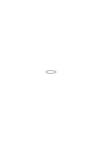 as an Easter egg & yet we could not say at what ratio of length S to width something begins to be an Easter egg. Indeed, if someone were to specify such a ratio, we could never recognize it as the correct delimitation of our concept. Instead we would either say: “No, I don’t call that an Easter egg, it is too slender (or too fat, etc.)” – or: “yes, that _is_ an Easter egg, but it is not exactly the borderline case”. There simply is no such case in our calculus & anyone who introduced a borderline case would introduce a new calculus.

### [43\[2\]](https://cdn.wittgensteinnachlass.com/2000px/webp/Ms-115/43.webp)

In a shooting competition there are statutes which determine how the prizes are to be distributed according to the position of the shots on the target. Must there now be rules for all conceivable borderline cases? Would one say that the distribution of prizes did not apply because the rules had not provided for this case; even if this case had not occurred at all in the shooting competition?

### [43\[3\]](https://cdn.wittgensteinnachlass.com/2000px/webp/Ms-115/43.webp),[44\[1\]](https://cdn.wittgensteinnachlass.com/2000px/webp/Ms-115/44.webp),[45\[1\]](https://cdn.wittgensteinnachlass.com/2000px/webp/Ms-115/45.webp)

If one says “Moses did not exist”, this can mean different things. It can mean: the Israelites did not have _a_ leader when they departed from Egypt – or: their leader was not called “Moses” – or: there was no person who accomplished everything that the Bible relates about Moses. Etc., etc. – Russell would say that the name “Moses” can be defined by various descriptions. For example: “the man who lived at that time & in that place & was then called ‘Moses’”, “the man who led the Israelites through the desert”, “the man who, as a child, was fished out of the Nile by Pharaoh’s daughter”, etc. And depending on whether we adopt one definition or the other, the sentence “Moses existed” takes on a different sense & so does every other sentence that deals with Moses. If someone tells us “N does not exist”, we will also ask: “What do you mean? Do you want to say that …, or that …, etc.?” If I now say, for example, “N is dead”, the use of the name ‘N’ may have the following significance: I believe that a person lived whom I saw there & there, who looked like this & that, did this & that, & bore the name ‘N’ in the social world. If asked what I understand by ‘N’, I would list all of this, or some of it, and on different occasions, different things. My definition of ‘N’ would therefore be something like: “the man about whom all of this is true”. But if some of this proved to be false, would I now declare the sentence “N is dead” to be false, even if only something quite insignificant to me, which I had included in the explanation of the name ‘N’, turned out to be false? I would then usually be quite ready to modify the definition somewhat. This can be expressed by saying that I use the name ‘N’ without a fixed meaning. (This detracts from its use no more than the fact that a bridge is not an absolutely rigid body.) Does this mean that I do not use a word whose meaning I know, and that what I say is therefore nonsense?

### [45\[2\]](https://cdn.wittgensteinnachlass.com/2000px/webp/Ms-115/45.webp),[46\[1\]](https://cdn.wittgensteinnachlass.com/2000px/webp/Ms-115/46.webp)

And here I remember that Ramsey once emphasized that logic is a “normative science”. I cannot say what precise idea he had in mind. But it was undoubtedly closely related to the one that only later became clear to me: namely, that in philosophy we _compare_ the use of words with games played according to established rules, but cannot say that whoever uses language must be operating a calculus according to fixed rules. – But if one says that our linguistic usage only approaches such calculi, we immediately stand on the verge of a series of confusions. For it may now seem as if we were speaking in logic of an _ideal_ language. As if our logic were, as it were, a logic for the vacuum. Whereas logic does not speak _of_ a language (as physics does of a natural phenomenon), & so at most one can say that we _construct_ ideal languages. But here again the word “ideal” is misleading, for it now seems as if these languages were better, more perfect, than everyday language, & as if the logician were needed to show people at last how they ought to speak a proper sentence.

### [46\[2\]](https://cdn.wittgensteinnachlass.com/2000px/webp/Ms-115/46.webp)

Our investigation does not aim to _find_ the actual, exact meaning of the words; but in the course of our investigation we often _give_ the words exact meanings.

### [46\[3\]](https://cdn.wittgensteinnachlass.com/2000px/webp/Ms-115/46.webp),[47\[1\]](https://cdn.wittgensteinnachlass.com/2000px/webp/Ms-115/47.webp)

For what am I to call the ‘rule according to which he proceeds’? The hypothesis which satisfactorily describes his game-actions, so far as I know them, – or the rule he consults when playing, – or the rule he gives me in answer when I ask him about his rule. But what if observation of the game shows no clear rule & the question brings none to light? For he did give me an explanation in answer to my question about what he meant by ‘N’, but was ready to retract & modify this explanation. How, then, am I to determine the rule according to which he plays? He does not know it himself. Or rather: what is the expression “the rule according to which he plays” supposed to mean here?

### [47\[2\]](https://cdn.wittgensteinnachlass.com/2000px/webp/Ms-115/47.webp)

We can very well imagine people on a meadow amusing themselves by playing with a ball, in such a way that they begin various regulated games, do not finish some of them, in between throw the ball aimlessly into the air & catch it, then try again to see how high they can throw the ball, or jokingly throw it at one another, etc. And now someone says: all the time the people are playing a ball game & therefore following certain rules with every throw. But would it, on the other hand, be right to say: “so they are _not playing_ with the ball”?

### [47\[3\]](https://cdn.wittgensteinnachlass.com/2000px/webp/Ms-115/47.webp),[48\[1\]](https://cdn.wittgensteinnachlass.com/2000px/webp/Ms-115/48.webp)

What is the meaning of a word if the speaker cannot specify it? Well, we may perhaps describe his (actual) behaviour as wavering between several related meanings. I ask him: “what did you really mean?” – and in reply he will specify various things & perhaps turn to me to set up a list of rules for him that suits his purpose. – In our conversation we will then often find the phrase: “So what you really wanted to say was …”. And this can easily be completely misunderstood: it need not be a description of a process consisting in saying one thing while wanting to say another; as if what one “really wanted to say” had already somehow been expressed at the time, though not in words spoken aloud.

### [48\[2\]](https://cdn.wittgensteinnachlass.com/2000px/webp/Ms-115/48.webp)

(One of the most misleading ways of speaking is the question “what do I mean by that?” – In most cases, one could answer: “Nothing at all – I _say_ …”)

### [48\[3\]](https://cdn.wittgensteinnachlass.com/2000px/webp/Ms-115/48.webp),[49\[1\]](https://cdn.wittgensteinnachlass.com/2000px/webp/Ms-115/49.webp)

What happens when we try, for example while writing a letter, to find the right expression for our thoughts? This way of speaking compares the process with that of a translation or description: the thoughts are there, perhaps already beforehand, & we are only looking for their expression. And this picture is more or less accurate in various cases. – But what can’t happen here! For example: I indulge in a mood, & the expression _comes_; or: a picture floats before me & I try to describe it; or: an English expression occurs to me & I want to recall the corresponding German one; or: a gesture occurs to me & I ask myself, “which sentence corresponds to this gesture?” Finally one occurs to me & seems appropriate to the gesture; etc. etc. If one then asked: “did you have the thought before you had the expression”, what would one have to answer? And what about the question: “what did the thought consist in, as it existed before the expression?”

### [49\[2\]](https://cdn.wittgensteinnachlass.com/2000px/webp/Ms-115/49.webp),[50\[1\]](https://cdn.wittgensteinnachlass.com/2000px/webp/Ms-115/50.webp)

Our everyday concepts “sentence”, “word”, etc. are far too wild, too unclear. Should one not speak of the sense-data of sentences, etc.?

Here it is difficult, as it were, to keep one’s head above water, – to see that we must remain with the things of everyday thinking & not stray onto the wrong path, where it seems as if we had to describe ultimate subtleties which we could not, in any case, describe with our means. It is as if we were to put a destroyed spider’s web in order with our fingers. {This remark refers to the case where we apparently descend from the things of everyday life to things increasingly difficult to grasp & threaten to drown in the seething fog.}

### [50\[2\]](https://cdn.wittgensteinnachlass.com/2000px/webp/Ms-115/50.webp)

What does one mean by “all the rules of tennis”? All the rules that are in a particular book, or all those the player has in his head, or all those ever stated, or even all those that can be given? – So we had better not speak so vaguely of ‘all the rules’, but only of particular rules, or all the rules on a list; and the like. And the same holds for the rules concerning the use of a word.

### [50\[3\]](https://cdn.wittgensteinnachlass.com/2000px/webp/Ms-115/50.webp)

It is not our task to improve our language, to make it more exact, or even (to try) to put an ‘ideally exact’ one in its place. We have no concept of such a language at all. By this I do not mean that for our purposes we do not insist on more precise expression than the customary kind.

### [50\[4\]](https://cdn.wittgensteinnachlass.com/2000px/webp/Ms-115/50.webp),[51\[1\]](https://cdn.wittgensteinnachlass.com/2000px/webp/Ms-115/51.webp)

The traffic regulations in the streets permit & prohibit certain actions (of drivers & pedestrians); but they do not attempt to regulate all their movements by prescriptions. And it would be nonsensical to speak of an ideal traffic code that did so; we would not know how to conceive of this ideal. If someone wishes to make the traffic regulations stricter in certain respects, that does not mean that he wishes to come closer to such an ideal.

### [51\[2\]](https://cdn.wittgensteinnachlass.com/2000px/webp/Ms-115/51.webp)

We understand what it means: a pocket watch is set to the exact hour, – or: it is adjusted so that it keeps accurate time. But what if one asked: is this accuracy an _ideal_ accuracy, or how closely does it approach it? – We can of course speak of time measurements in which there is a different &, in _one_ sense, greater accuracy than in measuring time with a pocket watch. Where the words “set the clock to the exact hour” have a different (though related) meaning, & reading the clock is a different process, etc. If I now say to someone: “You should come to dinner more punctually, You know that it starts at exactly 1 o’clock”, – will one say that the accuracy at issue here falls short of the ideal to which time measurement in the laboratory approaches? Is there _one_ ideal of accuracy?

### [51\[3\]](https://cdn.wittgensteinnachlass.com/2000px/webp/Ms-115/51.webp),[52\[1\]](https://cdn.wittgensteinnachlass.com/2000px/webp/Ms-115/52.webp)

Is there a complete list of rules for the use of a word? How are we to conceive of it? Is there a complete list of rules for the use of a piece in chess? Could we not construct doubtful cases which the normal list of rules does not settle? Let us ask, for example: how is it possible to determine who moved last, if the reliability of the players’ memories is doubted? But does the possibility of such a doubt make chess a not quite ideal game? And what concept do we have of this ideal? It seems as if everything we call ‘Ideal’ were merely an approximate ideal opposed to the ideal ideal.

### [52\[2\]](https://cdn.wittgensteinnachlass.com/2000px/webp/Ms-115/52.webp)

One may ask: if we are not striving for an ideal exactness as opposed to the everyday kind, why do we bother working on the grammar of our language at all? And the answer is: we want to remove confusions & disquiet that arise from the difficulty of surveying the system of our way of expressing ourselves. To this end we will _highlight_ distinctions which find only a weak, barely visible expression in the forms of our language. This may admittedly give the impression that we are setting out to reform language.

### [52\[3\]](https://cdn.wittgensteinnachlass.com/2000px/webp/Ms-115/52.webp),[53\[1\]](https://cdn.wittgensteinnachlass.com/2000px/webp/Ms-115/53.webp)

Such a reform for certain practical purposes, improving our terminology to avoid misunderstandings, is presumably conceivable. (If two members of a family are called ‘Paul’, it is often expedient to call one of them by another name.) But these are not the cases with which we are concerned. The confusions that occupy us arise, as it were, when language is on holiday, not when it is at work. (One might say: “when it is idling”.)

### [53\[2\]](https://cdn.wittgensteinnachlass.com/2000px/webp/Ms-115/53.webp)

We do not want to refine or complete the system of rules in some unheard-of way.

### [53\[3\]](https://cdn.wittgensteinnachlass.com/2000px/webp/Ms-115/53.webp),[54\[1\]](https://cdn.wittgensteinnachlass.com/2000px/webp/Ms-115/54.webp)

“With this phrase, ‘So you really wanted to say’, we lead someone from one form of expression to another. As I said, one is tempted to think that what he actually ‘wanted to say’, what he ‘meant’, was expressed in his mind even before we uttered it. (In certain cases one says that it had floated before him: this expression too describes very various processes.) What moves us to abandon one expression & adopt another in its place can be of many kinds. To understand this, it is useful to consider the relation of the solution of a mathematical problem to the original sense of the question.

The relation between the concepts of ‘trisecting an angle with ruler & compass’, when someone is looking for the trisection, and, on the other hand, when it is proved that it is impossible.”

### [54\[2\]](https://cdn.wittgensteinnachlass.com/2000px/webp/Ms-115/54.webp),[55\[1\]](https://cdn.wittgensteinnachlass.com/2000px/webp/Ms-115/55.webp)

Suppose someone asks me (as above): “What do you understand by ‘Moses’?” I now explain: “By ‘Moses’ I understand the man, if there was one, who led the Israelites out of Egypt, whatever he may have been called at the time and whatever else he may or may not have done.” But doubts quite analogous to those about the name “Moses” are possible about the words of this explanation. (What do you call “Egypt”; whom, “the Israelites”? etc..) Yes, these questions do not come to an end even if we have arrived at words like “red”, “dark”, “sweet”. “But how does an explanation then help me to understand if it is not the last one? So I still do not understand, and never will, what he means.” But I call precisely what an explanation gives me “understanding”. When I asked for an explanation, that was what I needed. The answer removed _the_ difficulty _I had_.

### [55\[2\]](https://cdn.wittgensteinnachlass.com/2000px/webp/Ms-115/55.webp)

Is the concept ‘red’ indefinable? “Indefinable”: one imagines something like unanalysable; & indeed as if an _object_ here were unanalysable (like a chemical element). Then logic would after all be a kind of _very_ general natural science. – But the impossibility of analysis corresponds to a way of representation _assumed_ by us.

⋎

### [55\[3\]](https://cdn.wittgensteinnachlass.com/2000px/webp/Ms-115/55.webp)

We might ask: What do you mean, ‘indefinable’! Could we even _try_ to define it? And how?–

### [55\[4\]](https://cdn.wittgensteinnachlass.com/2000px/webp/Ms-115/55.webp),[56\[1\]](https://cdn.wittgensteinnachlass.com/2000px/webp/Ms-115/56.webp)

It is of the greatest importance that, for any calculus of logic, we always think of an example to which the calculus finds an application, & that we do not give examples & say that they are not really the ideal ones, but that we do not yet have those. That is the sign of a mistaken conception. (Russell & I struggled with it in different ways. Compare what I say in the “Log. phil. Abh.” about elementary propositions & objects.) If I can use the calculus at all, then this is also the ideal use, & _the_ use we are concerned with. On the one hand, one does not want to acknowledge the example as the real one, because one sees in it a multiplicity which the calculus does not take into account. On the other hand, it is nevertheless the prototype of the calculus & the calculus is taken from it, & one cannot wait for a dreamed-of application. So one must admit to oneself what the actual prototype of the calculus is. Not as if one had thereby made a mistake in taking the calculus _from there_; rather, the mistake lies in not now acknowledging the calculus’s actual application, and promising it for a nebulous distance.

### [56\[2\]](https://cdn.wittgensteinnachlass.com/2000px/webp/Ms-115/56.webp),[57\[1\]](https://cdn.wittgensteinnachlass.com/2000px/webp/Ms-115/57.webp)

Let us suppose Spengler said: “I _compare_ different cultural periods to the life of families; within a family there is a family resemblance, while there are also similarities between members of different families; family resemblance differs from the other in such-and-such a way. etc..” The object of comparison, the object from which a way of looking has been derived, is to be indicated to us, so that the consideration does not become unfair. For now everything that holds of the model is also asserted of the object of our consideration; and it is asserted: it _must always_ …. This is the origin of a kind of dogmatism. One forgets the position of the prototype in the consideration: it is the unit of measurement with which we measure what is considered. But dogmatism asserts that every measured object must be exactly a whole number of units of measurement long. It is indeed true that the unit of measurement was well chosen for a purpose if it expresses many of the lengths we want to measure in whole numbers.

### [57\[2\]](https://cdn.wittgensteinnachlass.com/2000px/webp/Ms-115/57.webp),[58\[1\]](https://cdn.wittgensteinnachlass.com/2000px/webp/Ms-115/58.webp)

Rule & empirical proposition. Is a rule an empirical proposition – about the use of language, say? Is a rule of chess a proposition about how people have played it since the event of the invention of chess; i.e. say, about their having made moves with the chess pieces? For if one speaks of people having played chess _in this way_, then “chess” must be defined in such a way that it makes sense to say that _it_ was once played differently. (It is defined, say, by its historical continuity.) Otherwise the rules belong to the definition of chess. That someone plays in accordance with this rule is an empirical fact; or: “A plays in accordance with this rule”, “most people play according to this rule”, “no one plays according to this rule” are empirical propositions. The rule is not an empirical proposition; in our examples it is part of such propositions.

### [58\[2\]](https://cdn.wittgensteinnachlass.com/2000px/webp/Ms-115/58.webp)

If the definition of the metre is the length of the Paris standard metre, then the sentence “this room is 4 m long” says the same as: “this room is 4 m long & 1 m = the length of the Paris standard metre”. The legend of a map is a list of rules appended to the description of the country. They say nothing about the geography of the country; any more than the explanation “1 m is the length of the Paris standard metre” specifies the length of an object. Adding the rule to the descriptive sentence does not change the sense of the sentence.

### [58\[3\]](https://cdn.wittgensteinnachlass.com/2000px/webp/Ms-115/58.webp)

I could also put it like this: I want to communicate only what the sentence of the language communicates; & the rule is nothing but an aid to _this_ communication. When the rule is appended to the sentence, it adds nothing to its communication. It is therefore not a _communication_ about linguistic usage.

### [58\[4\]](https://cdn.wittgensteinnachlass.com/2000px/webp/Ms-115/58.webp),[59\[1\]](https://cdn.wittgensteinnachlass.com/2000px/webp/Ms-115/59.webp)

Let us imagine a picture depicting a boxer in a particular fighting stance. This picture can now be used to communicate to someone how he should stand, how he should hold himself; or how he should not hold himself; or how a certain man stood there & there; or etc. etc.. One could call this picture (chemically speaking) a sentence-radical. In this sense the rule too is a sentence-radical.

### [59\[2\]](https://cdn.wittgensteinnachlass.com/2000px/webp/Ms-115/59.webp)

One could call the rule the description of a game, or the prescription that says how one should play it. But let us note carefully: the rules do not say that & how a game of this game was ever played, nor do they command anyone to play in that way. They do not describe a game, but define one.

### [59\[3\]](https://cdn.wittgensteinnachlass.com/2000px/webp/Ms-115/59.webp)

Characteristically, the description of a notation often begins with the words: “We _can_ also write it like this: …”. One might ask: What kind of communication is this: “we can …”?

### [59\[4\]](https://cdn.wittgensteinnachlass.com/2000px/webp/Ms-115/59.webp),[60\[1\]](https://cdn.wittgensteinnachlass.com/2000px/webp/Ms-115/60.webp),[61\[1\]](https://cdn.wittgensteinnachlass.com/2000px/webp/Ms-115/61.webp)

Couldn’t I say that two words – let’s write them as “non” & “ne” – have the same meaning, that they are both negation signs, but

_non non p = p_

&

_ne ne p = ne p_

– In many languages a double negation means a negation. – But why do I then call both “negations”? What do they have in common? Well, it is clear that a large part of their use is common to both. But that does not yet solve our problem. For we would like to say: the fact that the double negation is an affirmation must also hold for both, if only we understand the doubling accordingly. But _how_? Well, as it can be expressed, for example, through parentheses.

_(ne ne) p = ne p, ne (ne p) = p_

An analogous case in geometry immediately presents itself to us: “Two half-rotations added together cancel each other out”, “Two half-rotations added together are a half-rotation.”

I II

,

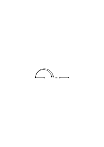

It depends precisely on how we add them. (I could just as well call rotating an object twice “adding them”, as schema I shows; or also rotating it once through 180˚ & then, as it were to reinforce this rotation, returning it to the first position & rotating it once more in the first sense. (II.)

### [61\[2\]](https://cdn.wittgensteinnachlass.com/2000px/webp/Ms-115/61.webp)

Here we encounter a remarkable & characteristic phenomenon in philosophical investigations: The difficulty – could I say – is not finding the solution, but acknowledging as the solution something that looks as if it were only a preliminary stage to it. “We have already said everything. – Not something that follows from it, but _that_ is the solution!” I believe this is connected with our falsely expecting an explanation; whereas a description is the solution to the difficulty if we correctly incorporate it into our consideration. If we linger with it & do not try to get beyond it. The difficulty here is – to stop.

### [61\[3\]](https://cdn.wittgensteinnachlass.com/2000px/webp/Ms-115/61.webp),[62\[1\]](https://cdn.wittgensteinnachlass.com/2000px/webp/Ms-115/62.webp)

“That is already all that can be said about it.” – To _take_ “non non p” as the negation of the negated sentence is, for example, to give an explanation of the kind “non non p = non (non p)”. “If ‘ne’ is a negation, then ‘ne ne p’, if it is only correctly understood, must be equal to p.” “If one takes ‘ne ne p’ as the negation of p, one must understand the doubling differently.” One would like to say: “‘Doubling’ _means_ something else now, _therefore_ it now yields a negation”, that is: its now yielding a negation is the consequence of its different meaning. “I mean it now as an intensification”, one would say. We put the expression of the opinion in place of the opinion.

### [62\[2\]](https://cdn.wittgensteinnachlass.com/2000px/webp/Ms-115/62.webp)

What might be the reason that, when I said the double negation, it was meant as an intensification? In the circumstances in which I use the expression, in the image that perhaps hovers before me or with which I am prepared to compare the double negation, in the tone of my speech (just as I can also reproduce the parentheses in “ne (ne p)” in the tone). To mean the doubling as an intensification is then to utter it as an intensification under certain circumstances. To mean the doubling as a cancellation means, for example, putting in parentheses (also in spoken expression). – “Yes, but these parentheses themselves can play different roles; for who says that in “~(~p)” they must be understood as parentheses in the usual sense & not somehow differently; perhaps the first as a separating stroke between the two ‘~’s, the second as belonging to the ‘p’?” No one says so. And you have after all replaced your view with words. What the parentheses mean will show itself in their use &, in another sense, it perhaps lies in the aspect (the perceived rhythm) of the visual impression of “~(~p)”.

### [62\[3\]](https://cdn.wittgensteinnachlass.com/2000px/webp/Ms-115/62.webp),[63\[1\]](https://cdn.wittgensteinnachlass.com/2000px/webp/Ms-115/63.webp)

Should I now say: the meaning of “non” & “ne” is _somewhat_ different? Are they different varieties of negation? – No one would say that. For, one might object, does “don’t go into this room!” (say) not mean exactly the same if we establish the rule that “not not” is to be used as a negation & not as an affirmation? – But one would like to object: “If the two sentences “ne p” and “non p” say exactly the same thing, how can “ne ne” not mean the same as “non non”?” But here we presuppose a symbolism, i.e. take it as a model, in which it follows from ne p = non p that the two words are used in the same way in all cases. The rotation through 180˚ & negation are actually the same in the particular case, & the application of the sentence ~~p = p is of the kind of the application of a geometry.

### [63\[2\]](https://cdn.wittgensteinnachlass.com/2000px/webp/Ms-115/63.webp),[64\[1\]](https://cdn.wittgensteinnachlass.com/2000px/webp/Ms-115/64.webp)

Let us suppose I asked: Does it become clear to us, when we utter the sentences “this rod is 1 m long” & “there is 1 soldier here”, that we mean different things by ‘1’, that ‘1’ has different meanings? – It does not become clear to us at all.

Especially when we say a sentence like: “there is 1 soldier per 1 m, 2 soldiers per 2 m, etc.” Asked “Do you mean the same thing by the two ones?” one might answer: “of course I mean the same: – _one_!” (while (perhaps) raising a finger).

### [64\[2\]](https://cdn.wittgensteinnachlass.com/2000px/webp/Ms-115/64.webp)

What does one mean by: ‘ne ne p’, even though, according to the agreement, it means ‘ne p’, _could_ also be used as a cancelled negation? – One would like to say: “‘ne’, with the meaning one has given it, could cancel itself if only we applied it correctly.” What does one mean by that? (The two half-rotations in the same direction could cancel each other out if they were correctly combined.) “The _movement_ of the negation ‘ne’ can cancel itself.” But where is this movement? One naturally wants to speak of a mental movement of the negation, to the execution of which the sign ‘ne’ merely gives the signal.

### [64\[3\]](https://cdn.wittgensteinnachlass.com/2000px/webp/Ms-115/64.webp),[65\[1\]](https://cdn.wittgensteinnachlass.com/2000px/webp/Ms-115/65.webp)

[Think of other means of negation, for instance through pitch.]

We can easily imagine people with a ‘more primitive’ logic, in which something corresponding to our negation exists only for certain sentences; for example, those which contain no negation. In the language of these people one could then negate a sentence like “he goes into this house”; but they would always understand a doubling of the negation only as a repetition of the negation, never as its cancellation.

### [65\[2\]](https://cdn.wittgensteinnachlass.com/2000px/webp/Ms-115/65.webp)

The question of whether, for these people, negation has the same meaning as for us would then be analogous to the question of whether the digit ‘2’ means the same thing for people whose number series ends with 5 as it does for us.

### [65\[3\]](https://cdn.wittgensteinnachlass.com/2000px/webp/Ms-115/65.webp)

Whoever calls “~~p = p” (or also “~~p ≡ p”) a “necessary sentence of logic” (and not a stipulation concerning the form of representation we have assumed) also tends to say that this sentence follows from the meaning of negation. If, in a dialectical manner of speaking, double negation is used as negation, as in “he found nothing nowhere”, we are inclined to say: _actually_ that means he found something everywhere. Let us consider what this “actually” means! –

### [65\[4\]](https://cdn.wittgensteinnachlass.com/2000px/webp/Ms-115/65.webp),[66\[1\]](https://cdn.wittgensteinnachlass.com/2000px/webp/Ms-115/66.webp)

Our problem could be put very clearly as follows: Suppose we had two systems of measuring lengths; in both, a length is expressed by a number-sign followed by a word indicating the system of measurement. The one system designates a length as “n feet” & foot is a unit of length in the ordinary sense; in the other system a length is designated by “n W” & 1 foot = 1 W. But 2 W = 4 feet, 3 W = 9 feet, etc.. – So the sentence “this stick is 1 W long” means the same as “this stick is 1 foot long”. Question: Do “W” & “foot” have the same meaning in these two sentences?

### [66\[2\]](https://cdn.wittgensteinnachlass.com/2000px/webp/Ms-115/66.webp)

The question is wrongly formulated. We see this when we express sameness of meaning through an equation. The question can then only be: “is W = foot, or not?” – The sentences in which these signs occur disappear in this consideration. – Nor, naturally, can one ask in this terminology whether “is” means the same as “is”; but one can ask whether “ε” means the same as “ = ”. Well, we did say: 1 foot = 1 W; – but foot ≠ W.

### [66\[3\]](https://cdn.wittgensteinnachlass.com/2000px/webp/Ms-115/66.webp)

Our difficulties can be solved; & they do not need new & subtle discoveries, analyses penetrating more deeply & the like for their solution, but a compilation of the right examples. (The redeeming word.)

### [66\[4\]](https://cdn.wittgensteinnachlass.com/2000px/webp/Ms-115/66.webp)

When one says “ne ne p” could also be used as a cancelled negation, this presumably means that the calculus with the rule ne ne p = p can be translated completely into one with the rule ne ne p = ne p.

### [66\[5\]](https://cdn.wittgensteinnachlass.com/2000px/webp/Ms-115/66.webp),[67\[1\]](https://cdn.wittgensteinnachlass.com/2000px/webp/Ms-115/67.webp)

Does “ne” now have the same meaning as “non”? – Can I substitute “ne” for “non”? – “Well, in some places yes, in others no.” – But that was not what I asked. My question was: can one use ne instead of non without further qualification? – No.

### [67\[2\]](https://cdn.wittgensteinnachlass.com/2000px/webp/Ms-115/67.webp)

“‘ne’ & ‘non’ mean exactly the same thing in _this_ case.” – And what is that? “Well, that one should _not_ do this and that.” But with that you have only said that in this case ne p = non p & we do not (indeed) deny that. If you explain ne ne p = ne p, non non p = p, then you are using the two words in different ways; & if one then holds to the view that what they yield in certain combinations ‘depends’ on their meaning, the meaning they carry with them, then one must say that they must have different meanings if, when combined in the same way, they can yield different results. <s>| That is, one must say: ne ne p cannot yield something different from non non p if the meanings of “ne” & “non” are really the same.</s> And we merely express this differently.

### [67\[3\]](https://cdn.wittgensteinnachlass.com/2000px/webp/Ms-115/67.webp),[68\[1\]](https://cdn.wittgensteinnachlass.com/2000px/webp/Ms-115/68.webp)

One might want to speak of the function of the word in this sentence. But what does this function consist in? How does it manifest itself? For nothing is hidden; we see the whole sentence! The function must show itself in the calculus. One _now_ wants to say: “‘non’ _does_ the same to ‘p’ as ‘ne’ does – it reverses it.” But these are only other words for “non p = ne p” (which holds only when “p” is not itself a negated sentence). Again and again, the thought that what we see of the sign is only an exterior to an interior in which the actual operations of sense & meaning take place.

### [68\[2\]](https://cdn.wittgensteinnachlass.com/2000px/webp/Ms-115/68.webp)

Is it not remarkable that I say that the word “is” is used in two different meanings (as ‘ε’ & ‘ = ’), & do not want to say that its meaning consists in its being used like ‘ε’ & like ‘ = ’? One wants to say that these two kinds of use do not give _one_ meaning; that the personal union through the same word is an inessential coincidence.

### [68\[3\]](https://cdn.wittgensteinnachlass.com/2000px/webp/Ms-115/68.webp),[69\[1\]](https://cdn.wittgensteinnachlass.com/2000px/webp/Ms-115/69.webp)

But how can I decide which is an essential & which an inessential, accidental feature of the notation? Is there a reality behind the notation according to which its grammar is determined? Let us think of a similar case in a game: In draughts, a queen is marked by placing two game pieces on top of each other. Would one not then say that it is inessential to the game that a queen consists of two pieces?

### [69\[2\]](https://cdn.wittgensteinnachlass.com/2000px/webp/Ms-115/69.webp)

Let us say: the meaning of a piece (a figure) is its role in the game. – Now before the beginning of each chess game let chance decide which player receives White. For this purpose, let one player hold a chess king in each closed hand & let the other choose one of the two hands at random. Would one count it as part of the king’s role in chess that it is used (in this way) when lots are drawn?

### [69\[3\]](https://cdn.wittgensteinnachlass.com/2000px/webp/Ms-115/69.webp)

I am (therefore) inclined to distinguish between essential & inessential rules in the game too. The game, I would like to say, has not only rules, but also a point.

### [69\[4\]](https://cdn.wittgensteinnachlass.com/2000px/webp/Ms-115/69.webp)

Let us imagine (however) the two offices combined in one person as an old custom.

### [69\[5\]](https://cdn.wittgensteinnachlass.com/2000px/webp/Ms-115/69.webp)

Why the same word? We do not make use of this sameness in the calculus! Why the same pieces for both uses? –

But what does it mean here to “make use of the sameness”? Isn’t it a use if we simply use the same word?

### [69\[6\]](https://cdn.wittgensteinnachlass.com/2000px/webp/Ms-115/69.webp),[70\[1\]](https://cdn.wittgensteinnachlass.com/2000px/webp/Ms-115/70.webp)

Here it seems as if the use of the same word, the same piece, had a _purpose_ – if the sameness is not accidental, inessential. And as if the purpose were that one should recognize the piece & know how one is to play. Is this a physical or a logical possibility? If the latter, then the sameness of the pieces belongs to the game.

### [70\[2\]](https://cdn.wittgensteinnachlass.com/2000px/webp/Ms-115/70.webp)

The game is surely to be determined by the rules! So if a rule of a game stipulates that the kings are to be used for drawing lots before the chess game, then this belongs, essentially, to the game. What could one object to? That one does not see the point of this rule. Just as one might not see the point of a rule according to which every piece was to be turned over three times before one moved it. If we found this rule in a board game, we would be surprised & speculate about the purpose of such a rule. (“Was this rule intended to prevent one from moving without thinking?”)

### [70\[3\]](https://cdn.wittgensteinnachlass.com/2000px/webp/Ms-115/70.webp)

“If I understand the character of the game correctly,” I could say, “then that does not essentially belong to it.”

### [71\[1\]](https://cdn.wittgensteinnachlass.com/2000px/webp/Ms-115/71.webp)

One says: the use of the same word is inessential here, because the sameness does not bridge transitions. But with that one merely describes the character of the game one wants to play.

### [71\[2\]](https://cdn.wittgensteinnachlass.com/2000px/webp/Ms-115/71.webp)

One of the temptations we must resist when philosophizing is that of believing that we must make our concepts more exact than they are according to the present state of our insight. This false path leads into a kind of mathematical philosophy which believes that mathematical problems must be solved in order for us to arrive at philosophical clarity. (Ramsey.) We need only a correct description of the present situation.

### [71\[3\]](https://cdn.wittgensteinnachlass.com/2000px/webp/Ms-115/71.webp)

Tell me what you do with a sentence, how you verify it, etc., & I will understand it?

### [71\[4\]](https://cdn.wittgensteinnachlass.com/2000px/webp/Ms-115/71.webp)

The question “how can one know that” asks about a grammatical connection when “can” means logical possibility.

### [71\[5\]](https://cdn.wittgensteinnachlass.com/2000px/webp/Ms-115/71.webp),[72\[1\]](https://cdn.wittgensteinnachlass.com/2000px/webp/Ms-115/72.webp)

“What is a chair?” “What does a chair look like?” Are these perhaps independent questions? How, then, did we learn the meaning of the word “chair”? How was it explained to us?

### [72\[2\]](https://cdn.wittgensteinnachlass.com/2000px/webp/Ms-115/72.webp)

The question of the possibility of verifying the sentence is only a special form of the question “what do you mean by that?”. The answer is a contribution to the grammar of the sentence.

### [72\[3\]](https://cdn.wittgensteinnachlass.com/2000px/webp/Ms-115/72.webp)

How does one know when it is raining? We see and feel the rain. The meaning of the word “rain” was explained to us through these experiences. I say that they are ‘criteria’ for its raining. “What is rain” & “what does rain look like” are logically related questions. Now suppose experience has taught us that a sudden fall in the barometer & a downpour always go together; then I shall regard such a fall in the barometer as a _symptom_ of a downpour. Whether a phenomenon is a symptom of rain is taught by experience; what counts as a criterion of rain is a matter of agreement (definition).

### [72\[4\]](https://cdn.wittgensteinnachlass.com/2000px/webp/Ms-115/72.webp),[73\[1\]](https://cdn.wittgensteinnachlass.com/2000px/webp/Ms-115/73.webp)

It is quite common for the meaning of an expression to fluctuate in such a way that a phenomenon is sometimes regarded as a symptom and sometimes as a criterion. And in most cases, this shift in meaning goes unnoticed. In science, it is common to make phenomena that allow for precise measurements the defining criteria of an expression; & one is then inclined to believe that the true meaning has now been _found_. A great deal of confusion has arisen in this way. There are degrees of expectation, but it is nonsensical to speak of measuring hope if we retain the use of the word “hope”. One may then give a measurable phenomenon that sometimes accompanies hope the name “hope” & say that one has found a method of measuring hope. It is true that _in certain cases_ a measurable phenomenon takes the place of one that was previously immeasurable. The word that designated this place then changes its meaning, & its old meaning becomes more or less obsolete. One then consoles oneself with the thought that one concept is more precise, the other less precise; & one does not notice that in each particular case a different relation between “precise” and “imprecise” exists. It is the old mistake of not examining the particular cases. <s>That then leads us to believe that every phenomenon which admits of degrees must ‘really’ be measurable. For example, the probability that my friend will visit me today.</s>

### [73\[2\]](https://cdn.wittgensteinnachlass.com/2000px/webp/Ms-115/73.webp),[74\[1\]](https://cdn.wittgensteinnachlass.com/2000px/webp/Ms-115/74.webp)

The fluctuation in the grammar between criteria & symptoms then makes it appear as if there are only symptoms. We say, for example: “Experience teaches that it rains when the barometer falls, but it also teaches that it rains when we have a certain feeling of dampness & cold, or a certain visual impression.” As an argument for this, one then states that these sensory impressions can deceive us. But one does not consider that the fact that they are precisely deceiving us about the rain is based on an agreement.

### [74\[2\]](https://cdn.wittgensteinnachlass.com/2000px/webp/Ms-115/74.webp)

It is not a question here of whether our sensory impressions can deceive us, but of our understanding their language. (And this language, like any other, is based on convention.)

### [74\[3\]](https://cdn.wittgensteinnachlass.com/2000px/webp/Ms-115/74.webp)

One is inclined to say: “It is raining, or it is not raining; how I know this, how the information reached me, is another matter.” – But do we then ask the question like this: “What do I call ‘information that it is raining’?” (Or have I only received information about this information?) – And what characterizes this ‘information’ as information about something? Doesn’t the form of our expression mislead us here? Isn’t this just a misleading simile: “My eye tells me that there is a chair there”?

### [75\[1\]](https://cdn.wittgensteinnachlass.com/2000px/webp/Ms-115/75.webp)

“The chair exists independently of whether anyone perceives it.” Is this an empirical proposition; or a disguised stipulation of the grammar? Is it supposed to say that experience has taught us that a chair does not disappear when one turns away from it?

### [75\[2\]](https://cdn.wittgensteinnachlass.com/2000px/webp/Ms-115/75.webp)

“Which is the ‘real position’ of the body I see under water, and which the ‘real colour’ of the table?” Which do you _call_ “the real position”? You yourself can decide. – How does one find the real position; what do you want to count as the method of determining the real position? The question about verification is a question about the _method_. (Methodology.)

### [75\[3\]](https://cdn.wittgensteinnachlass.com/2000px/webp/Ms-115/75.webp),[76\[1\]](https://cdn.wittgensteinnachlass.com/2000px/webp/Ms-115/76.webp)

“There will never be people with two heads.” Such a sentence seems somehow to reach into the infinite, the unverifiable, & its sense to be independent of any verification. But if we want to investigate its sense, the question quite rightly arises: can we ever know the truth of such a sentence, & _how_ can we know it; & what grounds can we have for accepting or rejecting what the sentence says? – Now one may say: what was asked for, after all, was its sense, & not whether, & how, one can know it. But the answer to the question “how can one know this sentence?” is not a psychological one, but explains its logical, quasi-calculational, connection with other sentences. And the possible grounds for accepting the sentence are not personal matters, but parts of the calculus. If I ask: how _can_ one verify the sentence “someone is in the next room”, or: how can one find out that someone is in the next room, – then one answer would be: “by going into the next room & looking”. If one now asks: “how _can_ one get into the next room if the door is locked”, then “can” here means physical possibility, not, as in the first question, logical possibility.

### [76\[2\]](https://cdn.wittgensteinnachlass.com/2000px/webp/Ms-115/76.webp)

The causes why we believe a sentence are certainly irrelevant to the question of what it is that we believe; but not the grounds, which are grammatically related to the sentence & tell us who or what it is.

### [76\[3\]](https://cdn.wittgensteinnachlass.com/2000px/webp/Ms-115/76.webp)

The instinct leads us aright, and leads to the question: how can one know such a thing; what grounds can we have for assuming it; from what experiences would we derive such a sentence; etc.

### [77\[1\]](https://cdn.wittgensteinnachlass.com/2000px/webp/Ms-115/77.webp)

The sense of the sentence is not something we investigate, as we do the structure of matter, and which may in part be beyond investigation. (Unsolved problems of mathematics.) So that later on we might yet discover that beings other than ourselves can know this sentence in a different way. (I am not talking about symptoms.) So that it would remain this sentence with this sense, but this sense would have properties we do not now suspect. The sentence, or its sense, is not a pneumatic being that has a life of its own & now undergoes adventures of which we need know nothing. We would, as it were, have breathed spirit of our own spirit into it, but now it has a life of its own – like our child – and we can only observe & investigate it. (Mathematics.)

### [77\[2\]](https://cdn.wittgensteinnachlass.com/2000px/webp/Ms-115/77.webp)

If one now asks: does it make sense to say “there will _never_ be such-and-such”? – Well, what evidence is there for it; & what follows from it? – For if there is no evidence – not that we have not yet been able to obtain any, but that none was _provided for_ in the calculus –, then that determines the character of this sentence. Just as the essence of a kind of number is determined by our saying that these numbers are incomparable with rational numbers.

### [78\[1\]](https://cdn.wittgensteinnachlass.com/2000px/webp/Ms-115/78.webp)

“Such-and-such will never happen” – one thinks that with this sentence one reaches into the infinite future. As if, at least, one had laid a railway there, even if we have not yet travelled the whole route. The underlying idea is that the word “never” already brings infinity with it, since that is precisely its meaning. What matters is: What can I do with this sentence? For the question “what does it say?” is answered in turn by a sentence, & that takes me no further as long as I learn nothing from the explanation about the moves I may make with the pieces. (As long as, so to speak, I only ever see the same game-position before me & no others that I can form from it.) So I hear, for example, that no experience can prove the sentence, & that sets my mind at rest about its infinite meaning.

### [78\[2\]](https://cdn.wittgensteinnachlass.com/2000px/webp/Ms-115/78.webp),[79\[1\]](https://cdn.wittgensteinnachlass.com/2000px/webp/Ms-115/79.webp)

There is no evidence from which it follows that this sentence is true. Yes, but surely I can _believe_ that what it says is the case! But what does this mean: “believe that things are so”? Does this belief perhaps reach into infinity; does it fly ahead of verification? – What does it mean to believe that: to say this sentence with certain sensations? To act in such-and-such a way? – And these actions interest us only in so far as they show how we use the sentence in the calculus.

### [79\[2\]](https://cdn.wittgensteinnachlass.com/2000px/webp/Ms-115/79.webp)

Someone asks me: “Why are you holding your cheek?” – I reply: “Toothache”. This plainly means the same as “I have toothache”; but I neither picture the missing words in my mind nor feel their absence in any way. “So it is also possible for me to mean the sentence ‘I have toothache’ as if I uttered only the last word; or as if the whole sentence were just _one_ word.” (One says that ‘Hat & stick!’ really means: ‘give me the hat & the stick!’.)

### [79\[3\]](https://cdn.wittgensteinnachlass.com/2000px/webp/Ms-115/79.webp)

This might show what is involved in meaning something and in meaning.

### [79\[4\]](https://cdn.wittgensteinnachlass.com/2000px/webp/Ms-115/79.webp),[80\[1\]](https://cdn.wittgensteinnachlass.com/2000px/webp/Ms-115/80.webp)

Let us think of the following use of language: I send someone shopping. I give him a slip of paper, on which are the signs “three red apples”. He takes the slip to the shopkeeper; the shopkeeper opens the drawer on which the sign “apples” is written; then he looks up the word “red” in a chart & finds a coloured square next to it; now he says the series of the cardinal numbers – I assume he knows them by heart – up to the word “three” & with each number word he takes an apple from the drawer that has the colour of the square. In this way, and similarly, one operates with words. “But how does he know where & how to look up the word “red” & what to do with the word “three”?” Well, I simply assume that he _acts_ as I have described. The explanations must end somewhere. – But what is the meaning of the word “three”? – No such thing has been talked about here; only about how the word “three” is used!

### [80\[2\]](https://cdn.wittgensteinnachlass.com/2000px/webp/Ms-115/80.webp)

The word “meaning”, when used systematically, has a dangerous flavour of the occult. Therefore it is good if we study the phenomena of language in primitive uses of language. In forms & uses of language as the child uses them when it begins to speak. The teaching of language here is not explanation but training.

### [80\[3\]](https://cdn.wittgensteinnachlass.com/2000px/webp/Ms-115/80.webp),[81\[1\]](https://cdn.wittgensteinnachlass.com/2000px/webp/Ms-115/81.webp)

Let us imagine the following language-game: One speaks to a child while switching on the electric light in the room: “Light”, then, while switching it off: “Dark”; one does this several times, varies the lengths of time & speaks in an emphatic tone, perhaps accompanying the words with gestures as well. Then one switches the light on or off in the next room & gets the child to communicate to us: “Light”, or “Dark”. Now am I to call “Light” & “Dark” sentences? Well, as I wish. – And what about ‘agreement with reality’?

### [81\[2\]](https://cdn.wittgensteinnachlass.com/2000px/webp/Ms-115/81.webp)

When I describe certain simple language-games, it is not in order to use them to describe, step by step, the actual processes of developed language, which would only lead to injustices. (Nicod & Russell.) Rather, we leave the language-games standing as what they are. They are merely to cast their clarifying light on our problems.

### [81\[3\]](https://cdn.wittgensteinnachlass.com/2000px/webp/Ms-115/81.webp),[82\[1\]](https://cdn.wittgensteinnachlass.com/2000px/webp/Ms-115/82.webp)

One might object: “The words ‘Light’ & ‘Dark’ are meant here as sentences & not simply as words.” That is, they are not used here as we use them in ordinary language (although in fact we often speak _like this_ too). If someone suddenly utters the word “Light” without any apparent reason and adds nothing, one will certainly ask: “Why do you say ‘Light’, what’s that supposed to mean?” or: “What do you mean by ‘Light’? ‘Light’ isn’t a sentence!” But it would be equally unintelligible to us if he uttered a complete sentence without any reason or context, such as “There he comes” or “The sky is blue”. And on the other hand, we would understand almost any sentence just as well if someone who was looking for something in the dark called to another person: “Light!”

The utterance of the word “Light” was, in the case above, not yet a complete move in the game we were prepared for.

### [82\[2\]](https://cdn.wittgensteinnachlass.com/2000px/webp/Ms-115/82.webp)

But let us not speak of meaning as an indeterminate & not understood process, but of the real, ‘practical’, use of the word, of the actions we perform with it. Let us speak of meaning only when it is a part of the linguistic calculus (say, the part that consists of mental images). And then we do not really need the word “mean”, for it always seems to suggest that we are dealing with processes which do not belong to language but stand over against it; & that these processes are essentially different in nature from linguistic ones.

### [82\[3\]](https://cdn.wittgensteinnachlass.com/2000px/webp/Ms-115/82.webp),[83\[1\]](https://cdn.wittgensteinnachlass.com/2000px/webp/Ms-115/83.webp)

Now how does “Light”, when it expresses a wish for light, differ from “Light”, when it states that the room is light? Perhaps in that we utter it in a different tone – with a different sensation (meaning as accompaniment). Or it occurs merely in a different game-context. Imagine that one asked: “How does a move in draughts differ from the same movement of a piece in a game of draughts with captures?” The difference may be that on one occasion it answers the question “what do you mean?” with: “I mean that you should turn on the light”, and on the other: “I mean that it is light”.

### [83\[2\]](https://cdn.wittgensteinnachlass.com/2000px/webp/Ms-115/83.webp)

When a man cries “Help!” as he is drowning, – is he stating the fact that he needs help? that without help he would drown? – By contrast there is the case in which one says, as if observing oneself, “I have now the wish for …”.

### [83\[3\]](https://cdn.wittgensteinnachlass.com/2000px/webp/Ms-115/83.webp)

If meaning is to have any significance, any importance, for us, then a system of things meant must be correlated with the system of sentences, _whatever_ sort of processes the things meant may be.

### [83\[4\]](https://cdn.wittgensteinnachlass.com/2000px/webp/Ms-115/83.webp),[84\[1\]](https://cdn.wittgensteinnachlass.com/2000px/webp/Ms-115/84.webp)

Now in what respect does the word “Light” in the language-game agree with a reality, or fail to agree with it? How do we use the word “agree”? – We say “the two clocks agree” when they show the same time; “the two measuring rods agree” when certain graduation marks coincide; a plan agrees with a region. We say “the two lengths agree” when they are equal; but also when they stand in another ratio specified by us (the scale of the plan). So in each case what is meant by “agreement” must first be laid down. – And so it is with the agreement of a specification of length with the length of an object. If I say: “this rod is 2˙5 m long”, I can, for example, give an explanation of how one proceeds, using this sentence, to check the length of the rod with a measuring tape; how, say, one produces a 2˙5 m measuring strip according to this sentence. And I now say that the sentence agrees with reality if the measuring strip constructed in this way agrees with the rod. (This making of a measuring strip illustrates, incidentally, what I meant in the Treatise when I said that the sentence reaches right up to reality.) Now when I taught the other person the language-game and said: “Light” (while turning on the light) & “Dark” (while switching off the light), I could also have said, with no difference in meaning: “this means ‘Light’” (while turning on the light) & “this means ‘Dark’” etc., and just as well: “this agrees with ‘Light’”, “this agrees with ‘Dark’”.

### [84\[2\]](https://cdn.wittgensteinnachlass.com/2000px/webp/Ms-115/84.webp)

When we hear the word “agreement”, we easily think only of similarity, in the sense in which two objects are similar when one can easily confuse them with each other (when they look alike).

### [85\[1\]](https://cdn.wittgensteinnachlass.com/2000px/webp/Ms-115/85.webp)

We use (the word) “agreement with reality” not as a metalogical expression, but as part of ordinary – practical – language. One might say: in the language-game “Light – Dark” the expression “agreement with reality” does not occur.

### [85\[2\]](https://cdn.wittgensteinnachlass.com/2000px/webp/Ms-115/85.webp)

Frege’s view that an assertion contains an assumption which is what is asserted is actually based on the possibility of writing every assertive sentence in the form: “It is asserted that this & that is the case”.

### [85\[3\]](https://cdn.wittgensteinnachlass.com/2000px/webp/Ms-115/85.webp)

But we could very well also write every assertion in the form of a question followed by an affirmation (or negation). For example – instead of: “It is raining”, “Is it raining? Yes!” Would that show that every assertion contains a question?

### [85\[4\]](https://cdn.wittgensteinnachlass.com/2000px/webp/Ms-115/85.webp)

We could imagine a human language in which there are no assertive sentences, but only questions & affirmation & negation.

### [86\[1\]](https://cdn.wittgensteinnachlass.com/2000px/webp/Ms-115/86.webp)

One of course has the right to use an assertion sign if one uses it in contrast to, say, a question mark. It is misleading only if one thinks that the assertion then consists of two acts, considering & asserting (assigning the truth value, or something of the sort), & that we perform these acts by following the written sentence, rather as we sing from a score. <s>Now reading the written sentence aloud or silently is indeed analogous to singing from a score; but not an activity of thinking the sentence. So if there is an assertion sign in the written sentence, there will again be an assertion**sign** in the sentence as read (say, the stress or intonation). But thinking the sentence does not consist in our performing thought-operations – including asserting – according to the signals of the sentence. And as though the signs were in the sentence, & the meanings in thought.</s>

### [86\[2\]](https://cdn.wittgensteinnachlass.com/2000px/webp/Ms-115/86.webp),[87\[1\]](https://cdn.wittgensteinnachlass.com/2000px/webp/Ms-115/87.webp)

One could also see the function of Frege’s assertion sign as indicating the beginning of the assertion. It would then correspond to the capital letter, or to the full stop of the preceding sentence. The assertion sign is then one of two brackets which distinguish the independent sentence from one that is part of another. (This certainly also accords in part with Frege’s idea.) And it is important to emphasise this difference strongly. For our philosophical difficulties concerning negation & thinking arise, in a certain sense, from our not seeing that a sentence “⊢ ~p” or “⊢ I think p” has “p” in common with the sentence “⊢ p”, but not “⊢ p”.

### [87\[2\]](https://cdn.wittgensteinnachlass.com/2000px/webp/Ms-115/87.webp)

Reading from the written sentence aloud (or silently) can indeed be compared to singing from a score; but the signs of the sentence are not signals for psychological activities of meaning something. As though the signs were in the sentence, and the meanings in thought.

### [87\[3\]](https://cdn.wittgensteinnachlass.com/2000px/webp/Ms-115/87.webp)

We can also imagine a language consisting only of orders.

### [87\[4\]](https://cdn.wittgensteinnachlass.com/2000px/webp/Ms-115/87.webp),[88\[1\]](https://cdn.wittgensteinnachlass.com/2000px/webp/Ms-115/88.webp)

Let us think of the great variety of language-games: Making a communication, such as: “Light”, “Dark”; giving an order (“turn on the light!”, “switch it off!”); answering questions – “Light?”, “Dark?” – with “yes” or “no”;

carrying out an order; asking questions, & checking the answers for correctness; carrying out negative, disjunctive orders; venturing a guess (“which card shall I turn over now”) & verifying it; transforming one notation into another; drawing inferences; solving an applied arithmetic problem; making a drawing & describing it; giving an account of what happened; making up a story; formulating a hypothesis & testing it; drawing up a table; greeting; training an animal to respond to the call; etc. etc.; telling a joke.

### [88\[2\]](https://cdn.wittgensteinnachlass.com/2000px/webp/Ms-115/88.webp)

It always helps here to reflect on how the child learns to speak in such language-games. It also helps to imagine a primitive tribe that possesses a primitive language. A language, say, consisting only of commands in war; or of commands & reports. Perhaps of illustrated reports in a simple form of pictorial representation. (Think how _writing_ was once used only for very special purposes.) – The adult, too, learns new forms of language when he learns a new way of calculating & its application; or when he learns to make, or read, a graphical representation of measurement results.

### [88\[3\]](https://cdn.wittgensteinnachlass.com/2000px/webp/Ms-115/88.webp),[89\[1\]](https://cdn.wittgensteinnachlass.com/2000px/webp/Ms-115/89.webp)

Think of the fact that throwing dice is called a game, but so are tug-of-war, & also round-dancing. The wrong (i.e. disadvantageous) move in chess corresponds to something in draughts, & also in card-playing, but to nothing in a counting game. The wrong move in this sense belongs essentially to the game; it is not a contamination of the game, like a wrong step in dancing. Now think of the roles of untrue sentences in language-games. The subject in the psychological experiment is to say what he saw; – he describes his experience incorrectly. – The meteorologist makes a forecast of the future weather; it does not come true.

### [89\[2\]](https://cdn.wittgensteinnachlass.com/2000px/webp/Ms-115/89.webp)

If we do not see that there is a _multitude_ of language-games, we are inclined to ask: “What is a question?” Is it the statement that I do not know this & that; or the statement that I wish the other person to tell me …? Or is it the description of my mental state of uncertainty? And is the cry “Help!” such a description?

### [89\[3\]](https://cdn.wittgensteinnachlass.com/2000px/webp/Ms-115/89.webp)

Remember how different things are called “description”. Think of the description of the position of a body by means of a drawing, a plan & on the other hand the description of the course of a sensation of pain.

### [89\[4\]](https://cdn.wittgensteinnachlass.com/2000px/webp/Ms-115/89.webp),[90\[1\]](https://cdn.wittgensteinnachlass.com/2000px/webp/Ms-115/90.webp)

One can, of course, introduce a notation of the statement or description instead of the usual notation of the question: “I want to know whether …” or “I am in doubt whether …” – but this does not bring the different language-games any closer to each other.

### [90\[2\]](https://cdn.wittgensteinnachlass.com/2000px/webp/Ms-115/90.webp)

It seems to us as though we could say that the questioning tone is appropriate to the sense of the question. Is the cry appropriate to the pain?

### [90\[3\]](https://cdn.wittgensteinnachlass.com/2000px/webp/Ms-115/90.webp)

It is sometimes said that apes do not speak because they lack the mental capacities. That means: “they do not think, therefore they do not speak”. But they simply do not speak, i.e. they do not play language-games or, better: they _do not use language_. Giving orders, asking questions, telling stories, chatting are actions as natural as walking, eating, drinking, playing.

### [90\[4\]](https://cdn.wittgensteinnachlass.com/2000px/webp/Ms-115/90.webp)

This is connected with the idea that learning a language consists in naming objects, namely: people, forms, colours, pains, moods, numbers, etc.

### [90\[5\]](https://cdn.wittgensteinnachlass.com/2000px/webp/Ms-115/90.webp)

As I said – naming is something like attaching a little name-plate to a thing. One can call it a preparation for the use of a word. But _what_ is it a preparation for?

### [91\[1\]](https://cdn.wittgensteinnachlass.com/2000px/webp/Ms-115/91.webp)

“We name the things, & can now talk about them. Refer to them in our speech.” As if what we do next were already given with the act of naming. As if there were only one thing that counted as “talking about things”. Whereas we do all sorts of different things with our sentences.

### [91\[2\]](https://cdn.wittgensteinnachlass.com/2000px/webp/Ms-115/91.webp)

Let us think, for example, of exclamations – with their quite different functions: Water! – Away! – Ouch! – Help! – Lovely! – No! –

### [91\[3\]](https://cdn.wittgensteinnachlass.com/2000px/webp/Ms-115/91.webp)

Are you still inclined to call these words “names”?

### [91\[4\]](https://cdn.wittgensteinnachlass.com/2000px/webp/Ms-115/91.webp),[92\[1\]](https://cdn.wittgensteinnachlass.com/2000px/webp/Ms-115/92.webp)

“What if people did not express their pains (did not groan, wince, etc.), – then one could not teach a child the word “toothache”.” – Well, let us assume that the child is a genius & invents a name for the pain itself, although no one taught it one! – But then, of course, it could not make itself understood with this word! – So it understands the name, but cannot explain its meaning to anyone? – But what does it mean to say that it “_named_ its pain”? – How did it do that: name the pain?? And, whatever it did, what purpose did it serve? – When one says “it gave the pain a name”, one forgets that much must already be prepared in language for mere naming to have sense. And when we speak of its giving the pain a name, the grammar of the word “pain” is what is prepared here; it indicates the slot in which the new word is placed.

### [92\[2\]](https://cdn.wittgensteinnachlass.com/2000px/webp/Ms-115/92.webp)

Why is the thought, the expectation, the belief, not a mere game?

What has my thought to do with what is the case? – What makes the expectation an expectation of reality? I have the feeling: only our attitude towards the picture can make it a picture of reality for us; i.e. can connect it with reality, as it were like a joining plate that establishes the transition from the picture to reality, holding the two in the right position relative to each other, by virtue of both meaning the same thing to that attitude. And it is true: the portrait acquires its meaning for us through the fact that our attitude towards it & our attitude towards the person have something in common.

### [92\[3\]](https://cdn.wittgensteinnachlass.com/2000px/webp/Ms-115/92.webp),[93\[1\]](https://cdn.wittgensteinnachlass.com/2000px/webp/Ms-115/93.webp)

What connects belief, conviction, with reality? I might perhaps say: “Belief is in us, reality outside us; the two are isolated from each other. What significance can my belief then have?” – Well, someone who believes really only makes a picture & the connection of the picture with reality is no other than that made by the particular origin of this picture or by explanations of the picture’s signs. But making pictures for ourselves is part of our life.

### [93\[2\]](https://cdn.wittgensteinnachlass.com/2000px/webp/Ms-115/93.webp)

Imagine someone painted a picture of his friend’s homecoming, which he believes in. He looks at it believingly. Acts in accordance with this belief.

### [93\[3\]](https://cdn.wittgensteinnachlass.com/2000px/webp/Ms-115/93.webp)

Does it make sense to ask: “How do you know that you believe that?” – & is the answer perhaps: “I recognize it through introspection”? In _some_ cases one will be able to say something of the sort, in some not.

### [93\[4\]](https://cdn.wittgensteinnachlass.com/2000px/webp/Ms-115/93.webp)

It makes sense to ask: “Do I really love her, am I not merely pretending?” And the process of introspection is the awakening of memories; of images of possible situations & of the feelings one would have, etc.

### [93\[5\]](https://cdn.wittgensteinnachlass.com/2000px/webp/Ms-115/93.webp)

What one calls introspection is a process of _looking_, as opposed to _seeing_.

### [93\[6\]](https://cdn.wittgensteinnachlass.com/2000px/webp/Ms-115/93.webp),[94\[1\]](https://cdn.wittgensteinnachlass.com/2000px/webp/Ms-115/94.webp)

If I understand the word “believe” in such a way that I am inclined to say: “I _cannot_ believe and not know that I believe”, then for that very reason it makes no sense to say: “I know that I believe this & that”. Just as it makes no sense to say “I know that I have toothache” if I “cannot _have_ toothache without knowing it”. (If, that is, “I have toothache” is not supposed to mean “I have pain arising from a bad tooth”.) (Think also of the question: “How do you notice that you are in pain?”; or even: “How do you notice that you are in terrible pain?” – On the other hand: “How do you notice that you are going to get pain?”)

### [94\[2\]](https://cdn.wittgensteinnachlass.com/2000px/webp/Ms-115/94.webp)

(The question belongs here: what sense does it make to speak of the verification of the sentence “I have toothache”? And here one sees clearly that the question “How is this sentence verified?” changes its sense from one region of grammar to another.)

### [94\[3\]](https://cdn.wittgensteinnachlass.com/2000px/webp/Ms-115/94.webp)

Is “I believe …” the _expression_ of belief; or the description of a psychic experience?

### [94\[4\]](https://cdn.wittgensteinnachlass.com/2000px/webp/Ms-115/94.webp),[95\[1\]](https://cdn.wittgensteinnachlass.com/2000px/webp/Ms-115/95.webp)

Is the sentence “it will rain” the description of my mental activity, since it is, after all, the rendering of my thought that it will rain? – We will not be so ready to call the sentence the description of mental activity if we bear in mind that thinking can consist in speaking, that it is not an accompaniment to the expression of thought.

### [95\[2\]](https://cdn.wittgensteinnachlass.com/2000px/webp/Ms-115/95.webp)

One can believe in the form of words.

### [95\[3\]](https://cdn.wittgensteinnachlass.com/2000px/webp/Ms-115/95.webp)

On the other hand, why should we not say that the statement “I believe …” is the description of a state of mind? Nothing is ruled out by that. For “state of mind” & “description of a state of mind” mean so many things.

### [95\[4\]](https://cdn.wittgensteinnachlass.com/2000px/webp/Ms-115/95.webp)

One might now take the matter this way – wrongly –: The question “How do you know that you have toothache” is not asked because one learns this from the toothache (_itself_) at first hand, whereas one learns that someone is in the other room at second hand, say through a noise. I know the one through direct observation, I learn the other indirectly. Thus: “How do you know that you have toothache” – “I know it because I have it” – “You infer it from the fact that you have it? But must you not already know that you have it for that?” – – The transition from toothache to the statement “I have toothache” is quite different from the transition from the noise to the statement “There is someone in this room”. That is, the transitions belong to quite different language-games.

### [95\[5\]](https://cdn.wittgensteinnachlass.com/2000px/webp/Ms-115/95.webp)

Is the fact that I have toothache _a reason_ for assuming that I have toothache?

### [95\[6\]](https://cdn.wittgensteinnachlass.com/2000px/webp/Ms-115/95.webp)

(One can _confound_ philosophers by talking nonsense not only where they do too, but also by talking the sort of nonsense they shy away (_would_ shy away) from saying.)

### [95\[7\]](https://cdn.wittgensteinnachlass.com/2000px/webp/Ms-115/95.webp),[96\[1\]](https://cdn.wittgensteinnachlass.com/2000px/webp/Ms-115/96.webp)

Does one infer a sentence from reality? For instance, “from the actual toothache, that one has toothache”? But that is just an incorrect way of putting it; it would have to be: one infers that one has toothache from the fact that one has toothache (obvious nonsense).

### [96\[2\]](https://cdn.wittgensteinnachlass.com/2000px/webp/Ms-115/96.webp)

“Why do you believe that you will burn yourself on the hotplate?” – Do you have reasons for this belief, and do you need reasons?

### [96\[3\]](https://cdn.wittgensteinnachlass.com/2000px/webp/Ms-115/96.webp)

Do you have these reasons – as it were – always with you when you believe it? And do you always believe it – explicitly – when, say, you resist touching the hotplate? Does one mean the same thing by ‘reasons _for belief_’ as by ‘causes of belief’ (causes of the process of believing)?

### [96\[4\]](https://cdn.wittgensteinnachlass.com/2000px/webp/Ms-115/96.webp)

What reason do I have to assume that my finger will feel resistance when it touches the table? What reason to believe that this pencil cannot be pushed painlessly through my hand? If I ask this, a hundred reasons come forth, none of them willing to let the others get a word in. “After all, I have experienced it countless times myself; and I have heard of similar experiences just as often; if it were not so, then …; etc.”.

### [96\[5\]](https://cdn.wittgensteinnachlass.com/2000px/webp/Ms-115/96.webp)

When I walk towards my door, do I explicitly believe that it can be opened, – that there will be a room behind it and not an abyss, etc.? Let us substitute the expression of belief for belief. –

### [96\[6\]](https://cdn.wittgensteinnachlass.com/2000px/webp/Ms-115/96.webp)

What does it mean to believe something for a particular reason? If we substitute the expression of belief for belief, does it correspond to someone stating the reason before stating what it is a reason for?

### [96\[7\]](https://cdn.wittgensteinnachlass.com/2000px/webp/Ms-115/96.webp),[97\[1\]](https://cdn.wittgensteinnachlass.com/2000px/webp/Ms-115/97.webp)

“Did you believe it for these reasons?” is then a question like: “when you told me that 25 × 25 was 625, did you actually carry out the multiplication?”

### [97\[2\]](https://cdn.wittgensteinnachlass.com/2000px/webp/Ms-115/97.webp)

The question “why do you believe that” could _mean_: “what reasons do you derive it from now (or have you just derived it from)”; but also: “what reasons can you give me afterwards for this assumption”.

### [97\[3\]](https://cdn.wittgensteinnachlass.com/2000px/webp/Ms-115/97.webp)

I could therefore understand ‘reasons’ for an opinion as simply what someone has said to himself before he came to the opinion. The calculation that he actually carried out.

### [97\[4\]](https://cdn.wittgensteinnachlass.com/2000px/webp/Ms-115/97.webp)

If I ask someone: “Why do you believe that this arm movement will bring pain with it?”, and he answers: “Because it produced it once and did not produce it once”, I will say: “But that is no reason for your assumption”. What if he then replies: “Oh yes! I have always made this assumption whenever I had this experience”? – We would say: “You seem to me to be giving the cause (the psychological cause) of your assumption, but not the reason”.

### [97\[5\]](https://cdn.wittgensteinnachlass.com/2000px/webp/Ms-115/97.webp)

“Why do you believe that will happen?” – “Because I have observed it twice”. Or: “Why do you believe that will happen?” – “Because I have observed it several times; and it evidently happens _like this_: …” (there follows an account of a _comprehensive_ hypothesis). But this hypothesis, this overall picture, must be convincing to you. Here the chain of reasons does _not_ go any further. – (One might rather say that it closes.)

### [98\[1\]](https://cdn.wittgensteinnachlass.com/2000px/webp/Ms-115/98.webp)

One would like to say: We infer from past experience to future experience only if we understand the processes (are in possession of the correct hypothesis). If we assume the correct, actual mechanism between the two wheels we observe. But just consider: What is the criterion for our assumption’s being correct? – The picture and the data convince us and do not lead us any further – to other reasons.

### [98\[2\]](https://cdn.wittgensteinnachlass.com/2000px/webp/Ms-115/98.webp)

We say: “These reasons are convincing”; and what we are dealing with here is not premises from which what we were convinced of _follows_.

### [98\[3\]](https://cdn.wittgensteinnachlass.com/2000px/webp/Ms-115/98.webp)

If one says: “The given data are reasons for believing that p will happen in so far as this follows from the data together with the assumed law of nature”, – then this amounts precisely to saying that what is believed does _not_ follow from the data, but amounts instead to a new assumption.

### [98\[4\]](https://cdn.wittgensteinnachlass.com/2000px/webp/Ms-115/98.webp)

If one now asks: But how _can_ past experience be a reason for the assumption that such and such will happen later, – then the answer is: what general concept do we have of the ground for such an assumption? We simply call this kind of statement about the past a reason for the assumption that it will happen in the future. – And if one is surprised that we play such a language-game, then I refer to the _effect_ of a past experience (that a burned child fears the fire).

### [99\[1\]](https://cdn.wittgensteinnachlass.com/2000px/webp/Ms-115/99.webp)

Whoever says that he cannot be convinced by statements about the past that something will happen in the future must mean something different by the word “convince” from what we mean. – One could ask him: What do you want to hear, then? What sort of statements do you call reasons for believing that? What do you call “convincing”? What kind of “convincing” do you expect? – If _those_ are not reasons, what are reasons, then? – If you say that those are not reasons, surely you must be able to say what would have to be the case for us to be able rightly to say that there are reasons for our belief. ‘No reasons’ –: as opposed to what?

### [99\[2\]](https://cdn.wittgensteinnachlass.com/2000px/webp/Ms-115/99.webp)

For, mark well: reasons here are not sentences from which what is believed _follows_.

### [99\[3\]](https://cdn.wittgensteinnachlass.com/2000px/webp/Ms-115/99.webp)

But not as if one could say: Less is enough for believing than for knowing. – For what is at issue here is not an approximation to logical consequence.

### [99\[4\]](https://cdn.wittgensteinnachlass.com/2000px/webp/Ms-115/99.webp)

We are misled by the expression: “That is a good reason for our assumption, because it makes the occurrence of the event probable”. Here it is as if we had now said something further about the reason, something that justifies taking it as a basis; whereas, with the sentence that this reason makes the occurrence probable, nothing is said except that this reason corresponds to the particular standard for a good reason – but the standard is not justified!

### [99\[5\]](https://cdn.wittgensteinnachlass.com/2000px/webp/Ms-115/99.webp)

A good reason is one that looks _like that_.

### [99\[6\]](https://cdn.wittgensteinnachlass.com/2000px/webp/Ms-115/99.webp)

“This is a good reason, because it makes the occurrence probable” strikes us as being like: “This is a good blow, because it puts the opponent out of action”.

### [100\[1\]](https://cdn.wittgensteinnachlass.com/2000px/webp/Ms-115/100.webp)

One would like to say: “it is a good reason only because it _actually_ makes the occurrence likely”. Because it, as it were, actually has an influence on the event, thus, quasi, an empirical one.

### [100\[2\]](https://cdn.wittgensteinnachlass.com/2000px/webp/Ms-115/100.webp)

“Why do you assume that he will be in a better mood because I tell you that he has eaten? Is that a reason?” –

“That is a good reason, because experience shows that eating has an influence on his mood”. And one could also put it this way: “Eating really makes it more probable that he will be in a good mood”. But if one were to ask: “And is all that you adduce from past experience a good reason to assume that things will go that way this time too”, then I cannot now say: yes, because that makes it probable that the assumption will come true. Above, I justified my reason by appeal to the standard for a good reason; but now I cannot justify the standard.

### [100\[3\]](https://cdn.wittgensteinnachlass.com/2000px/webp/Ms-115/100.webp)

When one says “the fear is justified”, it is not in turn justified that we regard this as a good reason for fear. Or rather: here there can be no question of a further justification.

### [100\[4\]](https://cdn.wittgensteinnachlass.com/2000px/webp/Ms-115/100.webp)

The justification through experience has an end. If it did not, it would not be a justification.

### [100\[5\]](https://cdn.wittgensteinnachlass.com/2000px/webp/Ms-115/100.webp)

The reasoning that leads to an endless regress is not to be abandoned ‘because we can never reach the goal’, but because there is no goal here, so that it makes no sense at all to say ‘we cannot reach it’.

### [101\[1\]](https://cdn.wittgensteinnachlass.com/2000px/webp/Ms-115/101.webp)

We easily think that we must go through the regress a few steps & then, as it were, give it up in despair. Whereas its aimlessness (the absence of a goal in the calculus) can be seen from the initial position.

### [101\[2\]](https://cdn.wittgensteinnachlass.com/2000px/webp/Ms-115/101.webp)

I put my hand on the hotplate, feel unbearable heat & quickly withdraw my hand. Was it not possible that the heat of the plate would have stopped in the next moment? Could I have known it? And was it not possible that by withdrawing my hand I exposed myself to further pain? So it need not be a good reason to say: “I withdrew it because the plate was too hot”.

### [101\[3\]](https://cdn.wittgensteinnachlass.com/2000px/webp/Ms-115/101.webp)

If one asked me: “Are you sure that you did it _for that reason_?” – would there be any doubt? Should one say: “I know that I _wanted_ to do it for that reason; not: that the arm withdrew itself for that reason”?

### [101\[4\]](https://cdn.wittgensteinnachlass.com/2000px/webp/Ms-115/101.webp),[102\[1\]](https://cdn.wittgensteinnachlass.com/2000px/webp/Ms-115/102.webp)

That is, presumably: you know the motive, not the cause. – And how do you know that you did it for that motive? – “I remember doing it for that reason.” – But _what_ do you remember? What you said to yourself at the time; the feelings of fear; the cramp in the muscles of your arm? There are very different cases in which we say: “That was the motive for my action”.

### [102\[2\]](https://cdn.wittgensteinnachlass.com/2000px/webp/Ms-115/102.webp)

With the words “want”, “voluntary” (as opposed to “involuntary”) one describes a multitude of different experiences. Think of when, while eating, we raise our hand with the spoon – because we want to raise it; on the other hand, when we exert ourselves to lift a weight, _try_ to lift it. Is such an experience of trying also present in the first case, modified only insofar as we succeed so easily in lifting the spoon? – Or I write: am I writing involuntarily? – But is my writing accompanied by acts of will? Do I want to write a letter before I write it? And how different it is again when I _want_ to think, _want_ to remember, etc. Between all these cases there are different, overlapping family resemblances.

### [102\[3\]](https://cdn.wittgensteinnachlass.com/2000px/webp/Ms-115/102.webp),[103\[1\]](https://cdn.wittgensteinnachlass.com/2000px/webp/Ms-115/103.webp)

What is called ‘wanting’ in the case of raising one’s arm is connected with the experience of muscular sensation. Try to imagine raising one’s arm (raising it voluntarily) without _feeling_ that it is rising (or that one is raising it), but merely perceiving with one’s eyes that it is rising.

### [103\[2\]](https://cdn.wittgensteinnachlass.com/2000px/webp/Ms-115/103.webp),[104\[1\]](https://cdn.wittgensteinnachlass.com/2000px/webp/Ms-115/104.webp)

If we interlock our fingers in the appropriate way, we are unable to raise a particular finger on command if the person giving the command merely points to the finger – merely shows it to our eye. If, on the other hand, they touch it, we can move it. One can describe this experience as follows: we are unable to _want_ to raise the finger. But not only is this quite different from being unable to raise the finger because someone is holding it; the expression “being unable” or the word “try” has a different, though similar, meaning in the first case. One is now easily inclined to describe the first case as follows: one cannot find a _point of attack_ for the will until the finger has been touched, until one feels the finger. Only when one feels it can the will know where to attack. But this way of speaking is misleading; one would like to say: “How can I know where to apply the will if the feeling does not indicate the place?” But I could ask: “And how does one know, when the feeling is there, in what direction to direct the will?”

### [104\[2\]](https://cdn.wittgensteinnachlass.com/2000px/webp/Ms-115/104.webp)

“Willing is also only an experience,” one might say (the ‘will’ also only ‘image’). It comes when it comes, & I cannot bring it about.

### [104\[3\]](https://cdn.wittgensteinnachlass.com/2000px/webp/Ms-115/104.webp)

‘Not bring it about’? – How _what_? – What can I bring about? What do I compare willing with when I say this?

### [104\[4\]](https://cdn.wittgensteinnachlass.com/2000px/webp/Ms-115/104.webp)

As opposed to what do I call willing “an experience” here, & say that it comes when it comes?!

### [104\[5\]](https://cdn.wittgensteinnachlass.com/2000px/webp/Ms-115/104.webp)

Where is the antithesis to which I am pointing here at home?

### [104\[6\]](https://cdn.wittgensteinnachlass.com/2000px/webp/Ms-115/104.webp)

I would not say of the movement of my arm, for example, that it comes when it comes, that I cannot bring it about. And here is the domain in which we can meaningfully say that something does not simply happen to us, but that we do it. “I do not need to wait until my arm perhaps rises – I can raise it”. And here I set the movement of my arm, for example, against the direction of the wind changing.

### [104\[7\]](https://cdn.wittgensteinnachlass.com/2000px/webp/Ms-115/104.webp),[105\[1\]](https://cdn.wittgensteinnachlass.com/2000px/webp/Ms-115/105.webp)

The action happens when I will. – “But do you also will when you will?” – That means nothing. And the fact that it means nothing is due to the fact that here the word “willing” is misunderstood grammatically, as is the word “time” when one thinks that time must move at a particular speed.

### [105\[2\]](https://cdn.wittgensteinnachlass.com/2000px/webp/Ms-115/105.webp)

“I cannot bring it about”? Yes, I can bring it about, in the sense in which I can bring anything about at all. I cannot _will_ it. And that means that it makes no sense to say “I willed it arbitrarily (or involuntarily)”.

### [105\[3\]](https://cdn.wittgensteinnachlass.com/2000px/webp/Ms-115/105.webp)

This is how one brings about willing, by deliberately putting oneself in a coercive situation. When, for example, one jumps into deep water in order to learn to swim.

### [105\[4\]](https://cdn.wittgensteinnachlass.com/2000px/webp/Ms-115/105.webp)

Think of the paradox: ‘that there is actually no such thing as something soft; for even the softest thing, when I am lying on it, has a definite shape & one just as definite as if it were made of steel’.

### [105\[5\]](https://cdn.wittgensteinnachlass.com/2000px/webp/Ms-115/105.webp),[106\[1\]](https://cdn.wittgensteinnachlass.com/2000px/webp/Ms-115/106.webp)

One says: “perhaps it will happen to you one day that you see or hear this”; but one does not say: ‘perhaps it will happen to you one day that you want this’. “For”, one would like to say, “if you want (are inclined to), you can want at any time. For you are doing it yourself; not the body, which is only partly dependent on you, but _you_.”

### [106\[2\]](https://cdn.wittgensteinnachlass.com/2000px/webp/Ms-115/106.webp)

Here the willing subject is imagined as something without mass (without inertia), as a motor that has no resistance of inertia within itself to overcome. And thus is only a driving force & not also something driven. That is to say: one can say “I want, but my body does not follow me”, but not: “my will does not follow me”. (Augustine)

But in the sense in which I cannot fail to want, I cannot try to want either.

### [106\[3\]](https://cdn.wittgensteinnachlass.com/2000px/webp/Ms-115/106.webp)

And yet one says: “I believe you will want this one day.” –

### [106\[4\]](https://cdn.wittgensteinnachlass.com/2000px/webp/Ms-115/106.webp)

And one could say: “I can only _want_ at any time insofar as I can never try to want”.

### [106\[5\]](https://cdn.wittgensteinnachlass.com/2000px/webp/Ms-115/106.webp)

And to say that I cannot try to want is, of course, no statement about the natural history of the will. It is the verb “to want” that leads us to compare the activity of willing with the activity of carrying out what is willed & to take the grammatical difference for a difference in properties.

### [107\[1\]](https://cdn.wittgensteinnachlass.com/2000px/webp/Ms-115/107.webp)

“Willing is also just an experience …” What is this directed against? And if the assumption that is rejected here was mistaken; how could one have made this mistake? What seduced us into it? What is the idea, the analogy, at the bottom of the view that there is a passive principle, the idea, and an active one, the will?

### [107\[2\]](https://cdn.wittgensteinnachlass.com/2000px/webp/Ms-115/107.webp)

_Doing_ does not seem to have any volume of experience in itself. It seems like a dimensionless point, the tip of a needle. This tip seems to be the actual agent. And all that happens in the phenomenon is only a consequence of this doing. “I _do_” seems to have a certain sense, detached from any experience.

### [107\[3\]](https://cdn.wittgensteinnachlass.com/2000px/webp/Ms-115/107.webp)

But if I think of an _application_ of this expression, then there is always a phenomenon at play.

### [107\[4\]](https://cdn.wittgensteinnachlass.com/2000px/webp/Ms-115/107.webp)

What creates the impression that there is a doing detached from experiencing is the existence of the form of expression: “_I do_ that”, “_I raise_ my arm”, in contrast to “My arm raises itself”, or “I feel, see how my arm raises itself”.

### [107\[5\]](https://cdn.wittgensteinnachlass.com/2000px/webp/Ms-115/107.webp)

We are under the impression created by this form of expression when we see the immediately given as doing & perceiving.

### [108\[1\]](https://cdn.wittgensteinnachlass.com/2000px/webp/Ms-115/108.webp)

But let us not forget one thing: If ‘I raise my arm’, ‘my arm raises itself’; & the problem arises: What is it that remains when I subtract from the fact that I raise my arm the fact that my arm raises itself?

### [108\[2\]](https://cdn.wittgensteinnachlass.com/2000px/webp/Ms-115/108.webp)

Let us also consider that the activity of deliberating is independent of the experiences involved in the actual execution of the movement. That is to say, this deliberation, consideration, choosing could take place, a decision could be made, & yet the arbitrary action not take place. And conversely, the arbitrary action could be carried out without _any_ preceding consideration.

### [108\[3\]](https://cdn.wittgensteinnachlass.com/2000px/webp/Ms-115/108.webp)

It is, of course, immediately a difficulty in this conception, namely that what the will performs must manifest itself in the mental image.

### [108\[4\]](https://cdn.wittgensteinnachlass.com/2000px/webp/Ms-115/108.webp),[109\[1\]](https://cdn.wittgensteinnachlass.com/2000px/webp/Ms-115/109.webp)

Can an arbitrary action not be caused? – And is it thereby compelled? If I am arrested & taken away by the police, I go under compulsion. Is the same true when I take a walk in the garden? Is the cause then a compulsion?? Is it correct to say: “I _feel_ not compelled in this case only because the cause for which I move as I do is not known to me”? Would knowledge of a law of nature be a feeling of compulsion?

### [109\[2\]](https://cdn.wittgensteinnachlass.com/2000px/webp/Ms-115/109.webp)

Is the feeling, the experience, of compulsion the direct perception of the cause, which one otherwise only infers from the coincidence?

### [109\[3\]](https://cdn.wittgensteinnachlass.com/2000px/webp/Ms-115/109.webp)

What is it that we want? _What_ is the object of willing?

### [109\[4\]](https://cdn.wittgensteinnachlass.com/2000px/webp/Ms-115/109.webp)

Compare the different meanings of the words “compulsion”, “bring about”, “try”.

### [109\[5\]](https://cdn.wittgensteinnachlass.com/2000px/webp/Ms-115/109.webp)

When we suck through a tube or straw, we tend to think that we are sucking with the mouth, the cheeks, because we feel the air pressure in them, but no exertion in the chest muscles that exert the force.

### [109\[6\]](https://cdn.wittgensteinnachlass.com/2000px/webp/Ms-115/109.webp)

Is the deliberation that leads to action itself an experience or an activity? And in general: is thought an experience or an activity? – What do you want to call it? (One often reads in stories the expression: “suddenly he heard himself say the words …”.)

### [109\[7\]](https://cdn.wittgensteinnachlass.com/2000px/webp/Ms-115/109.webp),[110\[1\]](https://cdn.wittgensteinnachlass.com/2000px/webp/Ms-115/110.webp)

“Does it happen to us that we wish, or do we _do_ it?” Yes, does this question make sense? It certainly makes sense to ask: “Did you raise your arm intentionally, or did it raise itself on its own?” And the question of whether wishing is a doing or an experience can perhaps mean: whether wishing is more similar to the arbitrary raising of the arm, or to the experience that my arm raises itself. (Lichtenberg: “It thinks.”)

### [110\[2\]](https://cdn.wittgensteinnachlass.com/2000px/webp/Ms-115/110.webp)

It also makes no sense to ask: “Is willing, actually, an experience?” The peculiar, tenacious difficulty of this question already shows that it is not really a question.

### [110\[3\]](https://cdn.wittgensteinnachlass.com/2000px/webp/Ms-115/110.webp)

“Willing comes when it comes”, & that means that it would really have to be something that is there before it is there.

### [110\[4\]](https://cdn.wittgensteinnachlass.com/2000px/webp/Ms-115/110.webp)

The philosophical problem seems unsolvable; until one sees that there is a disease of the form of representation.

### [110\[5\]](https://cdn.wittgensteinnachlass.com/2000px/webp/Ms-115/110.webp),[111\[1\]](https://cdn.wittgensteinnachlass.com/2000px/webp/Ms-115/111.webp)

My choice is free means nothing other than: I can choose. And that I sometimes choose is surely not in doubt. What one calls “free” is _only_ the choice itself. To say, “we only believe that we choose”, is nonsense. The process that we call “choosing” takes place whether or not one can predict the result of the choice according to natural laws.

### [111\[2\]](https://cdn.wittgensteinnachlass.com/2000px/webp/Ms-115/111.webp)

My expression arose from the fact that I thought of willing as bringing something about – but not as causing something, rather – I would like to say – as a direct, non-causal movement. And this idea is based on the notion that the causal nexus is formed by a mechanism, a series of gears or the like. The connection can break down if the mechanism is disrupted. (One thinks only of the disturbances to which a mechanism is normally exposed; not that, for example, the gears suddenly become soft, or penetrate one another, etc..) [→ ]

### [111\[3\]](https://cdn.wittgensteinnachlass.com/2000px/webp/Ms-115/111.webp)

A motive is not a cause ‘seen from within’! (The simile of ‘inside & outside’ here is, as so often, utterly misleading. – It is related to the idea of the soul, a living being, in the head. But we mix this idea with other incompatible ones, like the metaphors in the sentence “the tooth of time, which heals all wounds, etc.”.)

### [111\[4\]](https://cdn.wittgensteinnachlass.com/2000px/webp/Ms-115/111.webp),[112\[1\]](https://cdn.wittgensteinnachlass.com/2000px/webp/Ms-115/112.webp)

One assumes that a person knows the motive for his act; – that tells us something about the meaning of the word “motive”.

### [112\[2\]](https://cdn.wittgensteinnachlass.com/2000px/webp/Ms-115/112.webp)

When asked about the reasons for an assumption, one _recollects_ these reasons. Is the same thing happening here as when one thinks about the causes of an event?

### [112\[3\]](https://cdn.wittgensteinnachlass.com/2000px/webp/Ms-115/112.webp)

“How do you know that that is really the reason why you believe it?”, that is similar to my asking: “how do you know that _that_ is what you believe”. For, when he gives the reasons, he describes an operation with thoughts that leads to what is believed (may have led to it); a process that by its nature belongs with that of believing. The difference between the question about the cause & the question about the reason is rather like the difference between the questions: “What is the cause of this body’s movement from A to B” & “Which way did it come from A to B”. (Here one can see how specifying a cause can also be understood as specifying a route.)

### [112\[4\]](https://cdn.wittgensteinnachlass.com/2000px/webp/Ms-115/112.webp),[113\[1\]](https://cdn.wittgensteinnachlass.com/2000px/webp/Ms-115/113.webp)

“One can only surmise the cause of a phenomenon” (not know it); that must have _grammatical_ meaning. It does not mean that, with the best will in the world, we cannot know the cause. (“We cannot reach an end in the series of numbers, however far we count”, i.e.: there can be no question of an “end of the series of numbers”.) Now there is a sense in which I can say: “I can only surmise the cause of this phenomenon”; i.e. I have not yet managed to ‘establish’ it (in the ordinary sense). In contrast, then, to the case in which I have managed to do so, in which I know the cause. – But if I say, as a metaphysical sentence, “I can only ever surmise the cause”, this means: in the case of a cause I always want to use only the word “surmise” & not the word “know”, and in this way distinguish different areas of grammar from one another. (So it is as if I said: in equations I always want to use the sign “ = ” & not the word “is”.) What is misleading in our first sentence is the word “only”; but of course that belongs entirely to the simile implicit in the use of the word “can”.

### [113\[2\]](https://cdn.wittgensteinnachlass.com/2000px/webp/Ms-115/113.webp),[114\[1\]](https://cdn.wittgensteinnachlass.com/2000px/webp/Ms-115/114.webp)

How is fear connected with the frightening sight? Or with the frightening image? – Should I say: “to fear something means to perceive it & to be afraid”? If one sees or hears several things simultaneously, is there any doubt about which is the fear-inspiring one? – Or does one know from earlier experience which of all these one is afraid of?

I want to say: fear is an occupation with the object of fear. – Fear does not _accompany_ the sight. Rather, what is dreadful & fear have the structure of the face. Let us imagine that, in agitation, we follow the features of a face with our eyes; tracing them, as it were, trembling.

### [114\[2\]](https://cdn.wittgensteinnachlass.com/2000px/webp/Ms-115/114.webp)

So the face that inspires us with fear or delight (the object of fear, delight, etc.) is not its cause; rather, one could say, it is its direction.

### [114\[3\]](https://cdn.wittgensteinnachlass.com/2000px/webp/Ms-115/114.webp)

What one is afraid of need not be the cause of the fear. When I say: “I am afraid because he is looking at me”, this “because” does not indicate a causal connection.

### [114\[4\]](https://cdn.wittgensteinnachlass.com/2000px/webp/Ms-115/114.webp)

It is important to distinguish between the object of fear & the cause of fear.

### [114\[5\]](https://cdn.wittgensteinnachlass.com/2000px/webp/Ms-115/114.webp),[115\[1\]](https://cdn.wittgensteinnachlass.com/2000px/webp/Ms-115/115.webp)

“The pain-free state presupposes the ability to feel pain” & this cannot be a physiological ability. If I say “I have no pain in my arm”, does that mean that I have a kind of shadowy feeling which indicates the spot into which the pain, if it came, would enter? To what extent does the present, pain-free, state contain the possibility of pain? If someone says: “For the word ‘pain’ to have meaning, it is necessary that one recognizes pain as such when it occurs”, one can reply: It is no more necessary than recognizing the absence of pain.

### [115\[2\]](https://cdn.wittgensteinnachlass.com/2000px/webp/Ms-115/115.webp)

“Pain” means, so to speak, the whole scale & not one of its marks. That the state stands at a particular mark is expressed by a _sentence_.

### [115\[3\]](https://cdn.wittgensteinnachlass.com/2000px/webp/Ms-115/115.webp),[116\[1\]](https://cdn.wittgensteinnachlass.com/2000px/webp/Ms-115/116.webp)

Can absolute silence be confused with inner deafness, by which I mean unfamiliarity with the concept of sound? If that were the case, one could not distinguish the lack of the sense of hearing from the lack of another sense. But is that not exactly the same question as: Is the man who now sees nothing red around him in the same position as the man who is incapable of seeing red? How does the ability to see red manifest itself & how does familiarity with the concept of sound manifest itself? One will say: He must know what “sound” means. But what does it mean to know that? – I say: “I know what ‘red’ means”. – Someone asks: “Are you sure?” – What would I do then to convince myself of it?

### [116\[2\]](https://cdn.wittgensteinnachlass.com/2000px/webp/Ms-115/116.webp)

One seems to be saying something about the state of being pain-free when one says that it must contain the possibility of pain. But one is only talking about the system of images that we use.

### [116\[3\]](https://cdn.wittgensteinnachlass.com/2000px/webp/Ms-115/116.webp)

One would like to say: “The grey must already be imagined in the space of darker & lighter if I want to speak of its being able to become darker or lighter.” – That is to say: it _can_ be part of understanding the sentence that one actually sees something lighter & darker before one, & one then says, for example: “this grey can become _like this_ or _like that_”, while pointing to the samples.

### [116\[4\]](https://cdn.wittgensteinnachlass.com/2000px/webp/Ms-115/116.webp)

Can I imagine pain in the tip of my nail, or in my hair? – Is not pain there just as imaginable, & just as unimaginable, as pain in any part of my body where I happen (now) not to have any pain & do not remember any? – The image of possibility is in thought, that is, in _language_.

### [116\[5\]](https://cdn.wittgensteinnachlass.com/2000px/webp/Ms-115/116.webp),[117\[1\]](https://cdn.wittgensteinnachlass.com/2000px/webp/Ms-115/117.webp)

The feeling is as if not-p, in order to negate p, must first make it true in a certain sense. (Compare expectation & fulfilment.)

“⊢ ~p” does not contain “⊢p”.

### [EPB](/w-epb/#ms-115-118.1) [118\[1\]](https://cdn.wittgensteinnachlass.com/2000px/webp/Ms-115/118.webp)

25.08.1936

## Philosophical Investigations. Attempt at a Reworking.

### [EPB](/w-epb/#ms-115-118.2) [118\[2\]](https://cdn.wittgensteinnachlass.com/2000px/webp/Ms-115/118.webp)

Augustine describes the learning of human language as follows: (Confessiones I.8)

“… cum … appellabant rem aliquam et cum secundum eam vocem corpus ad aliquid movebant, videbam et tenebam hoc ab eis vocari rem illam, quod sonabant, cum eam vellent ostendere”.

### [EPB](/w-epb/#ms-115-118.3) [118\[3\]](https://cdn.wittgensteinnachlass.com/2000px/webp/Ms-115/118.webp)

Whoever describes the learning of language in this way initially thinks of a certain class of words, such as ‘man’, ‘bread’, ‘table’, & only secondarily of words such as ‘not’, ‘but’, ‘perhaps’, ‘today’.

### [EPB](/w-epb/#ms-115-118.4) [118\[4\]](https://cdn.wittgensteinnachlass.com/2000px/webp/Ms-115/118.webp)

If someone wanted to describe the game of chess, but his description forgot the pawns & their moves, one could say that he had described the game of chess incompletely; but also that he had described a simpler game than our chess. And in this sense one can say that Augustine’s description applies to a simpler language than ours. – Let us imagine the following language:

### [EPB](/w-epb/#ms-115-118.5+119.1+119.2) [118\[5\]](https://cdn.wittgensteinnachlass.com/2000px/webp/Ms-115/118.webp),[119\[1\]](https://cdn.wittgensteinnachlass.com/2000px/webp/Ms-115/119.webp),[119\[2\]](https://cdn.wittgensteinnachlass.com/2000px/webp/Ms-115/119.webp)

1 Its function is communication between a master A and his assistant B. A is erecting a building, B hands him building-stones. There are cubes, slabs, beams, columns. A calls out one of the words ‘cube’, ‘slab’, etc., and B then brings him the stone. – Let us imagine a society that possesses only this system of communication, only this language. The children learn the language by being trained to use it: that is, they are trained to build, to use the calls ‘Slab!’, ‘Cube!’, etc. & to respond correctly to these calls. This learning of the language is essentially training – by showing, encouragement, help, reward, punishment, and so on. Part of the training consists, for example, in the teacher pointing to a building-stone, directing the child’s attention to it, & pronouncing a word at the same time. I shall call this ‘ostensive teaching of the words’. In the practical use of this language, one person calls out the words as commands, the other acts on them. In learning the language, however, this process will occur: the child ‘_names_’ the objects. That is, it says the words when the teacher points to the various forms of building-stone. Indeed, there will be the still simpler exercise: the child repeats words that the teacher says to it.

### [EPB](/w-epb/#ms-115-119.3+120.1) [119\[3\]](https://cdn.wittgensteinnachlass.com/2000px/webp/Ms-115/119.webp),[120\[1\]](https://cdn.wittgensteinnachlass.com/2000px/webp/Ms-115/120.webp)

“But in this language the word ‘slab’, for example, does not have the same meaning as in our language!” – That is true if you want to say that in our language the word ‘slab’ is also used differently from in (1). But do we not also use it in the same way as in (1)? Or are we to say that it is then an elliptical sentence, an abbreviation for “Bring me a slab”? – Is it like this: When we call out ‘Slab!’, we _mean_ ‘Bring me a slab!’? But why, when I want to state what he means, should I translate the expression ‘Slab!’ as ‘Bring me a slab!’, and if they are synonymous, why should I not say: “When we call out ‘Slab!’, we mean ‘Slab!’”? Or: Why should I not be able to mean ‘Slab!’ if I am able to mean ‘Bring me a slab!’? Unless you want to say that a person, when he calls out ‘Slab!’, _actually_ always says to himself, inwardly, the sentence ‘Bring me a slab’. But is there any reason to assume this?

### [EPB](/w-epb/#ms-115-120.2) [120\[2\]](https://cdn.wittgensteinnachlass.com/2000px/webp/Ms-115/120.webp)

Let us imagine the following question: “When someone gives the command ‘Bring me a slab!’, must he mean it as _four words_; can he not also mean it as _one_ (long, compound) word corresponding to the one word ‘Slab!’?” – We shall be inclined to answer that he means the _four words_ when he uses ‘Bring me a slab!’ in contrast to other sentences containing these words in other combinations; such as ‘Bring me 2 slabs!’, ‘Bring him a cube!’, etc. etc. – But what does it mean to use the one command in contrast to these others? Must the others be before the mind of the person giving the one command? And all of them, or only some? Is it not like this: The command is a sentence of four words – or the person giving the command ‘means four words’ – when, in the language he speaks, & of which this command is a sentence, those other combinations occur. It does not depend on such combinations being before the mind of the person giving the command while he gives it, nor, obviously, on how long before or afterwards he may have thought of them.

### [EPB](/w-epb/#ms-115-120.3+121.1) [120\[3\]](https://cdn.wittgensteinnachlass.com/2000px/webp/Ms-115/120.webp),[121\[1\]](https://cdn.wittgensteinnachlass.com/2000px/webp/Ms-115/121.webp)

2 Let us now consider an extension of language (1). The assistant can recite the number-words from ‘one’ to ‘ten’ in order. At the call ‘Five slabs!’ he goes to where the slabs are stacked, says the number-words from ‘one’ to ‘five’, picks up a slab at each word & brings them to the builder. (In using this language both parties speak.) Learning the language now includes memorizing the series of number-words. The use of the number-words is again taught by showing; but here the same number-word, for example ‘three’, is pronounced both when pointing to slabs and when pointing to cubes, etc., and the different number-words when pointing to stones of the same form.

### [EPB](/w-epb/#ms-115-121.2) [121\[2\]](https://cdn.wittgensteinnachlass.com/2000px/webp/Ms-115/121.webp)

There is nothing in the learning of language (1) corresponding to memorizing the series of number-words, & this clearly shows that with the number-words we have introduced an entirely new instrument into the language. The essential difference between the instruments number-word & designation of the form of a building-stone becomes so clear here because we are dealing with only two types of words & can survey their use completely.

### [EPB](/w-epb/#ms-115-121.3) [121\[3\]](https://cdn.wittgensteinnachlass.com/2000px/webp/Ms-115/121.webp)

3 It is clear here that the types of words have only the external form of the sound-series in common. And that is inessential, for we could imagine a variant of (2),

in which A shows B a number of fingers instead of pronouncing number-words.

### [EPB](/w-epb/#ms-115-121.4+122.1) [121\[4\]](https://cdn.wittgensteinnachlass.com/2000px/webp/Ms-115/121.webp),[122\[1\]](https://cdn.wittgensteinnachlass.com/2000px/webp/Ms-115/122.webp)

What does ostensive teaching of the words ‘slab’, ‘cube’, etc. have in common with ostensive teaching of the number-words? In both cases we point to things & pronounce words; but the further use we make of this action is different each time. This is, of course, only obvious when we consider examples worked out in detail. That difference is obscured by the form of expression: “In one case we point to the form, in the other to the number”.

### [EPB](/w-epb/#ms-115-122.2) [122\[2\]](https://cdn.wittgensteinnachlass.com/2000px/webp/Ms-115/122.webp)

4 Let us introduce another tool into our language: certain objects, particular stones to be used in the building, are given names (proper names); one points to the stone & says its name. If A calls out the name, B brings the stone to which it was assigned.

### [EPB](/w-epb/#ms-115-122.3+124.1) [122\[3\]](https://cdn.wittgensteinnachlass.com/2000px/webp/Ms-115/122.webp),[124\[1\]](https://cdn.wittgensteinnachlass.com/2000px/webp/Ms-115/124.webp)

Ostensive teaching of the words is again different here from what it is in (1) & (2). But not _necessarily_ the ostensive gesture, or the pronouncing of the proper name, nor what goes on in the speaker or hearer while pointing & pronouncing; rather, the use made of this pointing & pronouncing in teaching the language & in the practice of communication through it. – Should one say that the difference lies in our pointing, in the different cases, to different kinds of objects? But if I point with my hand to a piece of white paper, how does pointing to the shape differ from pointing to the colour? One would like to say: the difference is that in the two cases we _mean_ different things. And meaning should here be a process that takes place while we point. One is particularly inclined to this idea when one considers that a person asked whether he is pointing to the shape or to the colour can generally answer apodictically in one sense or the other. But if we look for two mental processes that characterize meaning the shape & meaning the colour, we find nothing of which we could say that it _must_ accompany every action of pointing of the same kind. Our concepts: ‘directing attention to the shape’, ‘directing attention to the colour’ are only rough, indeterminate concepts. The difference, one might say, lies not simply in what happens while pointing, but rather in the surroundings of this pointing, in what precedes it & what follows it. But there are presumably characteristic ways of pointing to a shape, or to a colour, height, circumference, etc.

### [EPB](/w-epb/#ms-115-124.2) [124\[2\]](https://cdn.wittgensteinnachlass.com/2000px/webp/Ms-115/124.webp)

5 At the call “This slab!” B brings the slab to which A points. At the call “Slab over there!” he carries a slab to the place to which A points.

### [EPB](/w-epb/#ms-115-124.3) [124\[3\]](https://cdn.wittgensteinnachlass.com/2000px/webp/Ms-115/124.webp)

Is the word ‘over there’ taught by showing? When the use of this word is taught & practised, the teacher will make the pointing hand movement & pronounce the word at the same time. But are we to say that in doing so he gives a place the name ‘over there’? The pointing gesture here belongs to the practice of communication by means of language.

### [EPB](/w-epb/#ms-115-124.4+125.1) [124\[4\]](https://cdn.wittgensteinnachlass.com/2000px/webp/Ms-115/124.webp),[125\[1\]](https://cdn.wittgensteinnachlass.com/2000px/webp/Ms-115/125.webp)

In philosophy the opinion has arisen that words like ‘there’, ‘here’, ‘now’, ‘this’ are the _actual_ proper names, & not the words which in ordinary life we call by that name. The latter are proper names only in an inexact, or approximate, sense. Think of Russell's notion of the ‘individual’, or of my notion of the ‘objects’ & their ‘names’ (Tractatus); these objects were supposed to be the basic constituents of reality; something of which one could not say that it existed; or did not exist. (Theaetetus) What these elements of reality were seemed not easy to say. I thought of finding them as the task of further ‘logical analysis’. In contrast, in (4) we introduced proper names, for the designation of things, objects, in the ordinary sense of the word.

### [EPB](/w-epb/#ms-115-125.2) [125\[2\]](https://cdn.wittgensteinnachlass.com/2000px/webp/Ms-115/125.webp)

6 Question & answer. A asks: “How many slabs?” B counts them & answers with the last number-word.

### [EPB](/w-epb/#ms-115-125.3+126.1) [125\[3\]](https://cdn.wittgensteinnachlass.com/2000px/webp/Ms-115/125.webp),[126\[1\]](https://cdn.wittgensteinnachlass.com/2000px/webp/Ms-115/126.webp)

I shall call systems of communication such as my examples 1–6 ‘language-games’. They are more or less akin to what we call games in ordinary life; children learn their mother tongue by means of such language-games, & here they often have the entertaining character of a game. – But we do not regard the language-games as fragments of a language, but as self-contained systems of communication, as simple, primitive, languages. In order to keep this way of looking at things in mind it is often useful to elaborate the picture further & imagine a primitive tribe whose entire language consists in this language-game. (Think of the primitive arithmetic of such tribes.)

### [EPB](/w-epb/#ms-115-126.2) [126\[2\]](https://cdn.wittgensteinnachlass.com/2000px/webp/Ms-115/126.webp)

When at school we learn special technical sign-languages, such as the use of diagrams & tables, descriptive geometry, chemical equations, etc., we learn further language-games.

### [EPB](/w-epb/#ms-115-126.3) [126\[3\]](https://cdn.wittgensteinnachlass.com/2000px/webp/Ms-115/126.webp)

(The language of the adult appears to us as a nebulous mass, the language of everyday life, surrounded by individual, more or less clearly delineated, language-games, the technical languages.)

### [EPB](/w-epb/#ms-115-126.4) [126\[4\]](https://cdn.wittgensteinnachlass.com/2000px/webp/Ms-115/126.webp)

7 Questions about the name. New forms are brought in in addition to the old forms of building blocks. B then points to one such form & asks: “What is this called?” A answers: “This is called …” While building, A calls out the new word (‘prism’, for example) & B brings the building block.

### [EPB](/w-epb/#ms-115-126.5+127.1) [126\[5\]](https://cdn.wittgensteinnachlass.com/2000px/webp/Ms-115/126.webp),[127\[1\]](https://cdn.wittgensteinnachlass.com/2000px/webp/Ms-115/127.webp)

We call the words “This is called …” together with the ostensive gesture an ‘ostensive explanation’, an ‘ostensive definition’. In (7) a generic name, the name of a form, is explained; but similarly one can ask for the proper name of a thing, the name of a colour, a number, a point of the compass. (When here we speak of the ‘names’ of colours, numbers, directions, etc., this could have two reasons. The one: we might mean that the functions of a proper name, colour-name, material-name, number-word, etc., in the language, i.e. their functions in the language-game, are much more similar to one another than is actually the case. Then we are tempted to think that the function of every word is approximately that of the proper name of a person, or of a word such as ‘table’, ‘chair’, ‘door’. – The other reason: we understand the complete difference between the functions of the word “chair” on the one hand & of a proper name on the other, & the difference between both of these and that of, say, a colour-name; & we can therefore also speak of ‘number-names’, ‘direction-names’, etc.: Not in order to say that colours, bodies, numbers, directions are merely different kinds of objects, but in order to emphasise the analogy which lies in the lack of similarity, between the functions of ‘chair’ & ‘Jacob’ on the one hand, & ‘south’ & ‘Jacob’ on the other.

### [EPB](/w-epb/#ms-115-127.2) [127\[2\]](https://cdn.wittgensteinnachlass.com/2000px/webp/Ms-115/127.webp)

8 B receives a table in which written signs are set opposite pictures of objects; e.g. pictures of a hammer, a pair of pincers, a saw. A writes one of those signs on a board, B looks it up in the table, moves his finger from the written sign to the picture & fetches the object shown by the picture.

### [EPB](/w-epb/#ms-115-127.3+128.1) [127\[3\]](https://cdn.wittgensteinnachlass.com/2000px/webp/Ms-115/127.webp),[128\[1\]](https://cdn.wittgensteinnachlass.com/2000px/webp/Ms-115/128.webp)

Let us consider the different kinds of signs in our examples. We shall distinguish between sentences & words. ‘Sentences’ & ‘words’ in our language-games I shall call what is analogous to what we call ‘sentences’ & ‘words’ in ordinary language. A sentence can also consist of a single word. In (1) the calls ‘Slab!’, ‘Beam!’ are such sentences. In (2) every sentence has two words. – Among sentences we distinguish commands, questions, assertions, suppositions, etc.; innumerable kinds, some of which will gradually be discussed.

### [EPB](/w-epb/#ms-115-128.2) [128\[2\]](https://cdn.wittgensteinnachlass.com/2000px/webp/Ms-115/128.webp)

9 In a language-game similar to (1), A calls out commands of the form “Slab, pillar, prism!”; B then brings these building blocks. We could call the command _one_ sentence here, but also three sentences. –

### [EPB](/w-epb/#ms-115-128.3+128.4) [128\[3\]](https://cdn.wittgensteinnachlass.com/2000px/webp/Ms-115/128.webp),[128\[4\]](https://cdn.wittgensteinnachlass.com/2000px/webp/Ms-115/128.webp)

10 But if the order of the words indicates to B the order in which he is to bring the stones, then we shall call “Slab, pillar, prism!” a sentence of three words.

If the command had the form “Slab, then pillar, then prism!”, we should say that it consisted of four words (not five).

### [EPB](/w-epb/#ms-115-128.5) [128\[5\]](https://cdn.wittgensteinnachlass.com/2000px/webp/Ms-115/128.webp)

Among the words we find groups with similar functions in the language-game. One easily sees the similarity of function in the group of words ‘one’, ‘two’, ‘three’, etc., & on the other hand in the group ‘slab’, ‘pillar’, etc. Thus we distinguish kinds of words. In (9) & (10) a sentence consists of words of only one kind.

### [EPB](/w-epb/#ms-115-128.6+129.1) [128\[6\]](https://cdn.wittgensteinnachlass.com/2000px/webp/Ms-115/128.webp),[129\[1\]](https://cdn.wittgensteinnachlass.com/2000px/webp/Ms-115/129.webp)

11 The order in which B hands over the stones is indicated by ordinal number-words, such as ‘firstly’, ‘secondly’, ‘thirdly’, etc. The command in (10) can therefore be “Thirdly prism, firstly slab, secondly pillar!” We see: what in _one_ language is the function of words can in another be performed, say, by the _order_ of the words. – A pause in the sentence of one language can have the function of a word in the sentence of another language.

### [EPB](/w-epb/#ms-115-129.2) [129\[2\]](https://cdn.wittgensteinnachlass.com/2000px/webp/Ms-115/129.webp)

Such considerations may give us an inkling of the immense variety of the means of our language; & it is remarkable to compare what is shown to us here with what logicians have said about the construction of all sentences. (Compare also what I myself said in the Tractatus.)

### [EPB](/w-epb/#ms-115-129.3) [129\[3\]](https://cdn.wittgensteinnachlass.com/2000px/webp/Ms-115/129.webp)

If we distinguish kinds of words according to the similarity of the functions of the words, it is easy to see that one can make various divisions. We can, for example, easily find a reason for not counting the word ‘one’ as belonging to the same kind as the words ‘two’, ‘three’, ‘four’, etc.

### [EPB](/w-epb/#ms-115-129.4) [129\[4\]](https://cdn.wittgensteinnachlass.com/2000px/webp/Ms-115/129.webp)

12 Let us imagine this variation of language (2): Instead of “One slab!”, “One cube!”, etc. A simply calls out “Slab!”, “Cube!”, etc. The other number-words, however, are called out as in (2). Someone accustomed to this system might find it strange to group ‘one’ together with ‘two’ & ‘three’, etc. (Think of reasons for & against classifying ‘0’ with the other cardinal number signs. – Are black & white colours? In some cases they are counted among the colours, in some they are not.)

### [EPB](/w-epb/#ms-115-129.5) [129\[5\]](https://cdn.wittgensteinnachlass.com/2000px/webp/Ms-115/129.webp)

Words can be compared with chess pieces in _many_ respects. Think of the different ways of classifying chess pieces. (e.g. into officers & pawns.)

### [EPB](/w-epb/#ms-115-129.6+130.1) [129\[6\]](https://cdn.wittgensteinnachlass.com/2000px/webp/Ms-115/129.webp),[130\[1\]](https://cdn.wittgensteinnachlass.com/2000px/webp/Ms-115/130.webp)

It is natural for us to count the ostensive gestures in (5) & the pictures in (8) among the instruments of language. (There are sign-languages.) I shall call the pictures in (8) & other instruments of language which have a similar function ‘samples’, in contrast to ‘words’. When we make use of a sample, we compare something with the sample. In (8) we compare a hammer with the picture of the hammer, but in (1) we do not compare a slab with the word ‘slab’. – But we do not want to say: “There are words & samples in language”, as though this established some essential dualism, but merely to emphasise an important contrast, among many others. We shall call ‘1’, ‘2’, ‘3’, for example, words, but the signs ‘|’, ‘∣∣’, ‘∣∣∣’, ‘∣∣∣∣’, ‘∣∣∣∣∣’, etc. samples (in so far as they are not again simply used as numerals). But should one call ‘|’ a sample at all? There are transitions between word & sample. The same sign can be used once as a word, once as a sample: A circle can be the name of an ellipse, but also the sample with which it is to be compared according to certain rules of projection.

### [EPB](/w-epb/#ms-115-130.2+131.1) [130\[2\]](https://cdn.wittgensteinnachlass.com/2000px/webp/Ms-115/130.webp),[131\[1\]](https://cdn.wittgensteinnachlass.com/2000px/webp/Ms-115/131.webp)

Compare these two systems of signs:

13 A gives B commands consisting of two signs painted on a board. The first sign is an irregularly shaped patch of some particular colour, e.g. green; the second a drawn geometrical figure, e.g. a circle: B then brings A an object which has the colour of the first & the shape of the second sign (e.g. a green, circular object).

14 A command is a painted sign, a geometrical figure painted in a particular colour, e.g. a green circle. B brings, in response to the command, an object of the shape & colour of the sign.

### [EPB](/w-epb/#ms-115-131.2) [131\[2\]](https://cdn.wittgensteinnachlass.com/2000px/webp/Ms-115/131.webp)

In (13) a sentence consists of two samples, each of which corresponds to a word – e.g. “green circle”. In (14), on the other hand, there is _one_ sample instead of these two; one which cannot be divided into two constituents (shape & colour); so here a sample does not stand for a word.

### [EPB](/w-epb/#ms-115-131.3) [131\[3\]](https://cdn.wittgensteinnachlass.com/2000px/webp/Ms-115/131.webp)

Words in quotation marks can be called samples; in the sentence “He calls ‘Stop’”, ‘Stop’ is thus a sample. But compare the two cases: the sentence “He calls ‘Stop’” is a _spoken_ sentence, & on the other hand a _written_ sentence. How is the spoken word compared with the call, how the written one? Someone who copies writing compares what he writes with a sample, but in a certain sense so does someone who writes from dictation. We call a great variety of processes: “comparing something with a sample”.

### [EPB](/w-epb/#ms-115-131.4) [131\[4\]](https://cdn.wittgensteinnachlass.com/2000px/webp/Ms-115/131.webp)

In (8) B compares pictures with objects. But what does this comparing consist in? What does the person who compares do? Consider these cases: a) the objects depicted are (as in (8)) a hammer, a pair of pincers, a saw, a drill; b) twenty different kinds of butterflies. How different the process of comparing will be here. c) The pictures are scale drawings of building blocks & the comparing is to be done with a pair of compasses.

### [EPB](/w-epb/#ms-115-132.1) [132\[1\]](https://cdn.wittgensteinnachlass.com/2000px/webp/Ms-115/132.webp)

Suppose B’s task is to bring a piece of cloth of the colour of a sample which is given to him. How does he compare the colour of the sample & that of the cloth? Imagine various cases:

### [EPB](/w-epb/#ms-115-132.2) [132\[2\]](https://cdn.wittgensteinnachlass.com/2000px/webp/Ms-115/132.webp)

15 A shows B the sample; B then goes & brings a material from memory.

16 B goes with the sample to the shelf on which the materials lie & looks from the sample to the materials before choosing.

17 B places the sample on each of the materials on the shelf & chooses the material whose colour he cannot distinguish from the sample.

18 Imagine, by contrast, the case in which the command was: “Bring me a material somewhat darker than this sample!”. –

### [EPB](/w-epb/#ms-115-132.3) [132\[3\]](https://cdn.wittgensteinnachlass.com/2000px/webp/Ms-115/132.webp)

I said in (15) that B brings a material ‘from memory’; but this expression encompasses innumerable possible processes. Think of some examples:

### [EPB](/w-epb/#ms-115-132.4+133.1) [132\[4\]](https://cdn.wittgensteinnachlass.com/2000px/webp/Ms-115/132.webp),[133\[1\]](https://cdn.wittgensteinnachlass.com/2000px/webp/Ms-115/133.webp)

19 When B comes to the materials, he closes his eyes & recalls an image of the sample. He then alternately looks at the materials & imagines the sample. At one point he says “too light”, at another “too dark”; finally he looks at one & says “good!”, & takes it from the shelf.

20 B does not call an image of the sample before his mind’s eye. He looks at one material after another, furrows his brow & shakes his head at each; at the tenth his face relaxes, he nods his head & takes the material.

Imagine you had to describe what you really did in such a case.

21 B does not call an image of the sample before his mind’s eye; he looks successively at some of the materials, takes the fifth and brings it to A.

### [EPB](/w-epb/#ms-115-133.2) [133\[2\]](https://cdn.wittgensteinnachlass.com/2000px/webp/Ms-115/133.webp)

The descriptions of these three examples, particularly the last, have something unsatisfactory about them. It seems that they give all sorts of incidental details but leave out what is essential. But what would be essential would be a specific experience of comparing & recognising.

If we now attend closely to any processes of comparing, we easily see a number of actions, thoughts, sensations, all more or less characteristic of comparing. And this is the case whether it is a comparison from memory, or the comparison of two objects which we both have before our eyes. We know an innumerable number of such processes of comparing; they form, as we shall express it, a “family”, among whose members there exists an innumerable number of family resemblances which overlap & intersect one another in the most various ways. – We hold objects whose colour we want to compare together for a shorter or longer time, look at them alternately, hold them in different lighting, make various characteristic utterances, have memory-images, feelings of tension & relaxation, satisfaction & dissatisfaction, the various feelings of exertion in the eyes & their surroundings which accompany prolonged attentive looking, and all possible combinations of these & other experiences. The more cases of comparing we examine & the more closely we look at them, the less we believe in _one_ specific experience of comparing.

### [EPB](/w-epb/#ms-115-134.1) [134\[1\]](https://cdn.wittgensteinnachlass.com/2000px/webp/Ms-115/134.webp)

Yes, if you have examined a number of such cases _closely_ & I now grant you that there may perhaps be an experience common to all of them & declare myself willing to use the word ‘comparison’ only where this experience is present, you will now feel that the assumption of such an experience has lost its purpose, for this experience now stands alongside a multitude of other experiences which establish the connection between the cases of comparing. – For that ‘specific experience’ which we were looking for was precisely supposed to do what that mass of experiences now does. The specific experience was not supposed to be one of a number of _more or less_ characteristic experiences. – One might say that one can look at this object in two ways: once from _close up_ –, once from a distance & through a peculiar atmosphere. – And we have found that the actual use of the word “comparison” is different from the use which we think we see from a distance. We find that what connects the cases of comparing is a large number of overlapping similarities; & when we see this, we no longer feel compelled to say that there must be something common to all these cases. They are connected with one another by a rope; and this rope holds not because some one fibre in it runs from one end to the other, but because an innumerable number of fibres overlap one another.

### [EPB](/w-epb/#ms-115-134.2+135.1+136.1) [134\[2\]](https://cdn.wittgensteinnachlass.com/2000px/webp/Ms-115/134.webp),[135\[1\]](https://cdn.wittgensteinnachlass.com/2000px/webp/Ms-115/135.webp),[136\[1\]](https://cdn.wittgensteinnachlass.com/2000px/webp/Ms-115/136.webp)

“But in case (21) B is acting entirely automatically. If only what is described there really happens, he does not know why he chose the material, he has no reason for choosing it. If he chooses the right one, he does so as a machine can.” – But we did not say that in this case B perceives nothing, that he does not see the materials, has no tactile & muscular sensations, etc. – And what does such a reason look like which makes the choice non-automatic; i.e., how do we imagine it? I think we should say that the opposite of automatic choosing, so to speak the ideal of conscious choosing, consists in our having a clear memory-image or the sample itself before our eyes and a specific sensation of not being able to distinguish between the sample & the material chosen. This particular sensation would then be the reason, the justification of the choice. This sensation, one might say, connects the two experiences: seeing the sample with seeing the material. But what then connects the specific sensation with those two experiences? – We do not deny that such a sensation can mediate; but viewed in this way the distinction ‘automatic – non-automatic’ no longer appears so sharp & primary as before. This does not mean that this distinction loses its practical value in particular cases. Thus under certain circumstances, in answer to the question “Did you take this material mechanically from the shelf, or did you have something in mind when you did so?” we shall answer that we did not act mechanically, for we had examined the material closely, remembered the sample, expressed doubt & satisfaction. That can in a particular case be the difference between automatic & non-automatic. In another, by contrast, we may perhaps distinguish between the automatic & non-automatic occurrence of the memory-image, etc.

### [EPB](/w-epb/#ms-115-136.2) [136\[2\]](https://cdn.wittgensteinnachlass.com/2000px/webp/Ms-115/136.webp)

“But _why_ did he bring just _this_ material in (21), how did he recognise it as the right one, by what means?” – When you ask “Why?” are you asking for the cause or for the reason? If for the cause, it is not difficult to think up a physiological or psychological hypothesis which could explain the choice under the given circumstances. It is the task of experimental science to test such hypotheses. If, on the other hand, you ask for the reason, the answer is: there need be no reason for the choice. A reason is a step which precedes the step of choosing. But why should another step precede every step?

### [EPB](/w-epb/#ms-115-136.3+137.1) [136\[3\]](https://cdn.wittgensteinnachlass.com/2000px/webp/Ms-115/136.webp),[137\[1\]](https://cdn.wittgensteinnachlass.com/2000px/webp/Ms-115/137.webp)

“But then B did not really _recognise_ the material as the right one.” – If you like, you need not count (21) among the cases of ‘recognising’. But when it becomes clear to us that the processes of recognising form a large family with overlapping family resemblances, we shall probably not be unwilling to count case (21) as belonging to this family. – “But does B not in this case lack the criterion by which he can recognise the material as the right one? In (19), for example, he had the memory-image & recognised the material through its agreement with this image.” – But did he also have an image before him of this agreement? An image with which he could compare the agreement between sample & material, in order to see whether it was the right agreement? And, on the other hand, could he not have had such an image? Suppose, for example, that A wanted B to remember that what was required here was a material of the _same_ colour as the sample, – in contrast to other cases, for example, in which B had to bring a material of a somewhat darker colour than the sample. A now gives B a sample of the desired _agreement_, namely two pieces of material of the same colour. – Is any such intermediate link between the command & the execution necessarily the last? – And when you say that in (20) B at least has the feeling of relaxation by which he can recognise that the material is the right one, – did he have to have an image of this relaxation before him in order to recognise the sensation according to which he was to recognise the right material?

### [EPB](/w-epb/#ms-115-137.2+138.1) [137\[2\]](https://cdn.wittgensteinnachlass.com/2000px/webp/Ms-115/137.webp),[138\[1\]](https://cdn.wittgensteinnachlass.com/2000px/webp/Ms-115/138.webp)

‘But suppose now that B brings in (21) the material & when one compares it with the sample, it proves to be the wrong one.’ – But could this not also have happened in the other cases? Suppose that in (19) the material B brought had not agreed with the sample: would we not in some cases say that his memory-image had not been right, in others that the sample, or the material, had changed its colour, & in still others that the lighting was not the same? It is not difficult to invent cases, to imagine circumstances, in which one would make these judgements. – ‘But is there not nevertheless an essential difference between cases (19) & (21)?’ – Certainly! Precisely the one which the descriptions show.

### [EPB](/w-epb/#ms-115-138.2) [138\[2\]](https://cdn.wittgensteinnachlass.com/2000px/webp/Ms-115/138.webp)

In example (1) B learns to bring a building-block when he hears the word ‘cube’. We could imagine that in this case the following happens: hearing the word calls up a mental image in B; the education, training, has, as one would say, created this association. B now picks up the stone which agrees with the mental image. – But _had_ this happened? If the training could bring it about that the mental image – automatically – appeared before B’s mind’s eye, why not that B picks up the stone without the mediation of an image? That only means a somewhat different functioning of the apparatus of association. Bear in mind that he does not _derive_ the mental image from the word (but if he did, that would merely push our argument back one step) but that the case here is analogous to that of the recording clerk: when a particular button is pressed a particular label appears. Indeed, this mechanism can be used instead of that of association.

### [EPB](/w-epb/#ms-115-138.3+139.1) [138\[3\]](https://cdn.wittgensteinnachlass.com/2000px/webp/Ms-115/138.webp),[139\[1\]](https://cdn.wittgensteinnachlass.com/2000px/webp/Ms-115/139.webp)

It is often clarifying to think of replacing the imagining of colours, shapes, tones, etc. etc., which plays a role in the use of languages, by looking at real colour samples, hearing real tones, etc., thus, for example, replacing the calling-up of a memory-image of a colour by looking at a real colour sample which we carry with us; many of the processes involved in the use of language lose, when one thinks of the possibility of this replacement, the appearance of the intangible, occult.

### [EPB](/w-epb/#ms-115-139.2) [139\[2\]](https://cdn.wittgensteinnachlass.com/2000px/webp/Ms-115/139.webp)

The training in the use of the table (like the one in (8)) can be directed not merely towards enabling the pupil to use _one_ particular table but towards enabling him to use & also to prepare any tables, any combinations of written signs & pictures. The first table he learned to use was, say, the one in (8).

### [EPB](/w-epb/#ms-115-139.3) [139\[3\]](https://cdn.wittgensteinnachlass.com/2000px/webp/Ms-115/139.webp)

22 We now add to it the picture of another tool which the pupil has before him, say a plane, & opposite the picture the word ‘plane’. We will make this table as similar as possible to the first; on the same piece of paper, say, placing the picture of the plane below the other pictures, the word below the other words. The pupil will now be encouraged to make use of the new picture & word without the earlier training being repeated in connection with them. This encouragement consists in certain prompts, approving & disapproving facial expressions of the teacher, gestures expressing a _continuation_ and the like. Think of the various gestures & movements one makes in order to get a dog to fetch.

### [EPB](/w-epb/#ms-115-139.4+140.1) [139\[4\]](https://cdn.wittgensteinnachlass.com/2000px/webp/Ms-115/139.webp),[140\[1\]](https://cdn.wittgensteinnachlass.com/2000px/webp/Ms-115/140.webp)

But not every animal will react to these gestures as the dog does. A cat will not react to these gestures, or will misunderstand them; that simply means in this case: it will not fetch. And if the child does not react to our encouragements, like a cat which one wants to teach to fetch, it does not arrive at an understanding of an explanation; or rather, understanding begins here with reacting in a particular way. – Understanding encouraging words is only a further development of reacting to an encouraging tone of voice, a gesture, etc.

### [EPB](/w-epb/#ms-115-140.2+140.3) [140\[2\]](https://cdn.wittgensteinnachlass.com/2000px/webp/Ms-115/140.webp),[140\[3\]](https://cdn.wittgensteinnachlass.com/2000px/webp/Ms-115/140.webp)

23 The pupil learns to give things names of his own invention & to bring the things when the names are called. He is given a table on one side of which he finds pictures of objects familiar to him & opposite them, where written signs stood in the earlier games, blank spaces. He writes the new words in these spaces & then uses the table as in (8). In learning to use the table, it can be an important exercise always to move one’s finger in the table from left to right (from the written sign to the corresponding picture), thus, as it were, drawing a series of parallel lines in it. This may then help in the transition in (22) from the first table to the expanded one.

### [EPB](/w-epb/#ms-115-140.4) [140\[4\]](https://cdn.wittgensteinnachlass.com/2000px/webp/Ms-115/140.webp)

Tables & ostensive explanations & the like I shall, in agreement with ordinary linguistic usage, call ‘rules’.

### [EPB](/w-epb/#ms-115-140.5+141.1) [140\[5\]](https://cdn.wittgensteinnachlass.com/2000px/webp/Ms-115/140.webp),[141\[1\]](https://cdn.wittgensteinnachlass.com/2000px/webp/Ms-115/141.webp)

24 Consider this example: various ways of reading tables are introduced. Each of the tables consists of two columns, in one of them written signs, in the other pictures, as above. They are read either horizontally from left to right, as above, thus according to the schema

or according to schemata such as

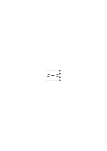

or

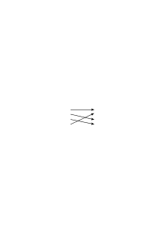

_etc._

Schemata of this kind are supplied with the tables as rules for reading them.

### [EPB](/w-epb/#ms-115-141.2) [141\[2\]](https://cdn.wittgensteinnachlass.com/2000px/webp/Ms-115/141.webp)

But could these rules not be explained by further rules? – Certainly. – On the other hand: is a rule incompletely explained if no further rule for its use is supplied?

### [EPB](/w-epb/#ms-115-141.3+142.1) [141\[3\]](https://cdn.wittgensteinnachlass.com/2000px/webp/Ms-115/141.webp),[142\[1\]](https://cdn.wittgensteinnachlass.com/2000px/webp/Ms-115/142.webp)

We now want to introduce the endless series of cardinal numbers into our language-games. But how do we do this? The analogy between the game with ten number-words & such an unlimited game cannot be the same as that between the game with ten & one with 55 number-words. Suppose the game is like (2), the series of number-signs but unlimited. In the practice of the game, counting actually goes up to 155; then the unlimited game is not to be the one which would result from (2) if I had said there, instead of ‘the number-words from “one” to “ten”’, ‘the number-words from “one” to “one hundred and fifty-five”’. But where does the difference then lie? One would almost like to say something like: it lies in the spirit in which the games are played.

The difference between two board games can, for example, lie in the number of game pieces, in the number of squares on the board, or in their being squares in one case and hexagons in the other, etc. But the difference between the limited & the unlimited game does not seem to be able to lie in the material tools of the game, for, we would like to say, how can the infinite express itself in them? It seems that we can grasp it only in our _thoughts_. And so it seems to be the thoughts that distinguish the limited game from the unlimited one. It is only strange then that we can express these thoughts about the infinite in words & gestures.

### [EPB](/w-epb/#ms-115-142.2+143.1) [142\[2\]](https://cdn.wittgensteinnachlass.com/2000px/webp/Ms-115/142.webp),[143\[1\]](https://cdn.wittgensteinnachlass.com/2000px/webp/Ms-115/143.webp)

25 Imagine two card games: I shall call them the ‘limited’ & the ‘unlimited’ one. The cards of both bear numerals & the higher numeral beats the lower. The rules of the games are analogous in every respect; but one game is played with 32 cards, the other with an _arbitrary_ number. Suppose now that we play the unlimited game, & the number of playing cards is 32; how does the game differ from the limited one? – Not through the cards, not through the way in which they are played and beaten, etc. But perhaps in this way: the limited game is played with a pack of printed cards, while in the unlimited one each player is given a supply of blank white cards & a pencil for writing the numerals; at the beginning of the unlimited game someone asks: ‘How high are we going?’; and the like. Thus a decision is made here about the limits of the game & this can take place in the most diverse ways. So here one can really say that what characterizes the unlimited game is ‘hard to grasp’, even though it is not an intangible ‘spirit’. Finally think of the difference between the process of practising, of learning, the two games. A round of the unlimited game with 32 cards may hardly differ from one of the limited game, or only in things which one might want to call ‘inessential externals’.

### [EPB](/w-epb/#ms-115-143.2) [143\[2\]](https://cdn.wittgensteinnachlass.com/2000px/webp/Ms-115/143.webp)

The different ‘spirit’ of these rounds may lie only in their belonging to different systems, & this in the manifold relations they have to other rounds & to various other processes which lie outside the two rounds themselves. Consider the following two games:

### [EPB](/w-epb/#ms-115-143.3+144.1+145.1) [143\[3\]](https://cdn.wittgensteinnachlass.com/2000px/webp/Ms-115/143.webp),[144\[1\]](https://cdn.wittgensteinnachlass.com/2000px/webp/Ms-115/144.webp),[145\[1\]](https://cdn.wittgensteinnachlass.com/2000px/webp/Ms-115/145.webp)

26 They are two kinds of draughts, I shall call them A & B. In A the one who loses his pieces loses; in B the one who has lost his pieces wins. The two games are thus opposed to each other in this respect; in all others, I assume, alike. What difference will a spectator see who observes rounds of the two games A & B? Well, such differences can easily be described. First, perhaps, as follows: In A everyone tries to prevent his pieces from being jumped over by the other’s; in B everyone pushes his pieces towards the other, in order to let him jump over them. But this will appear to the spectator only as a difference of degree, since in both A and B one player eventually loses all his pieces, & a carelessly played round of game A need hardly, or need not, differ from one of game B. – ‘But surely round A will differ from round B in the spirit in which they are played!’ – Certainly: in general the players will have different feelings on similar external occasions in the two rounds; & the spectator will also see that in B one player pushes a piece towards the other with a triumphant expression & the other jumps over it with little pleasure; or that in A one player is unpleasantly surprised when the other takes a piece from him; that he hesitates when he has to expose a piece to being jumped over; etc. Finally the spectator will see that in A the one who has lost his last piece gives the other money, or says that he has lost, or gets up from the game with an expression of resignation to his fate, while the other does so with a poorly suppressed expression of satisfaction; _etc._ But are the feelings always the same? Does everyone who takes a piece from the other in A triumph, or does everyone who loses a game resist? Is it not the case that many people are pleased at the other’s victory? – What, then, of the difference in the spirit of the two rounds? Is it not like this: The difference, one can say, is roughly as great as the difference in the expression of the emotional movement which the spectator can observe; & _in general_ _will_ observe. We shall not now speak of the relation of ‘emotional movement’ to ‘its expression’. If, then, we regard the round as an _action_, we can say that in general a round A will differ from a round B both in the way the moves are made and in what else happens during the round; but that in a particular case the difference can sink to ‘inessential externals’, for example to one player saying before the beginning of the round ‘Let’s play a round of A’. The spectator will furthermore see a difference in the rule-books of the two games.

### [EPB](/w-epb/#ms-115-145.2) [145\[2\]](https://cdn.wittgensteinnachlass.com/2000px/webp/Ms-115/145.webp)

We now want to compare language-games of which we would say that they use a limited series of number-signs with those of which we would say that they use an unlimited series of number-signs.

### [EPB](/w-epb/#ms-115-145.3) [145\[3\]](https://cdn.wittgensteinnachlass.com/2000px/webp/Ms-115/145.webp)

27 As in (3). A orders B to bring him a number of building-blocks of a particular shape. A gives the number-signs with the fingers of both hands. The number-signs are ten pictures of the two hands with fingers extended & bent. A gives B the order by showing him such a picture & at the same time calling out the word ‘cube’ or ‘slab’, etc.

### [EPB](/w-epb/#ms-115-145.4) [145\[4\]](https://cdn.wittgensteinnachlass.com/2000px/webp/Ms-115/145.webp)

28 As in (2). The series of number-words is learned by heart. In the order the number-words are called out. The child learns them through oral instruction.

### [EPB](/w-epb/#ms-115-145.5+146.1) [145\[5\]](https://cdn.wittgensteinnachlass.com/2000px/webp/Ms-115/145.webp),[146\[1\]](https://cdn.wittgensteinnachlass.com/2000px/webp/Ms-115/146.webp)

29 An adding machine (abacus) is used. A sets up the abacus & gives it to B. B takes it to where the slabs are, etc.

### [EPB](/w-epb/#ms-115-146.2) [146\[2\]](https://cdn.wittgensteinnachlass.com/2000px/webp/Ms-115/146.webp)

30 B has to count the slabs, which lie in piles. This is done with an adding machine; it has twenty beads. There are never more than twenty slabs in a pile. B moves the beads, corresponding to the slabs in a pile, & then shows the adding machine to A.

### [EPB](/w-epb/#ms-115-146.3) [146\[3\]](https://cdn.wittgensteinnachlass.com/2000px/webp/Ms-115/146.webp)

31 As 30; the abacus now has twenty small & one large bead. If the pile contains more than twenty slabs, B moves the large bead. (It thus corresponds in a certain respect to the word ‘many’.)

### [EPB](/w-epb/#ms-115-146.4) [146\[4\]](https://cdn.wittgensteinnachlass.com/2000px/webp/Ms-115/146.webp)

32 As 30. If the pile contains n slabs, where n is greater than 20 & less than 40, B moves n ‒ 20 beads, shows A the adding machine & claps his hands once.

### [EPB](/w-epb/#ms-115-146.5) [146\[5\]](https://cdn.wittgensteinnachlass.com/2000px/webp/Ms-115/146.webp)

33 A & B use the number-signs of the decimal system (as written or spoken signs) up to ‘20’. The child learns the series of these signs by heart; otherwise as in (2).

### [EPB](/w-epb/#ms-115-146.6+147.1) [146\[6\]](https://cdn.wittgensteinnachlass.com/2000px/webp/Ms-115/146.webp),[147\[1\]](https://cdn.wittgensteinnachlass.com/2000px/webp/Ms-115/147.webp)

34 A certain tribe possesses a language of the kind (2). The number-signs are the written signs of our decimal system. None of them is marked as the _highest_, as, for example, in some of the games described earlier. (One may perhaps be tempted to continue: ‘although of course one of them is the most frequently used’.) The children of this tribe learn the number-signs in the following way: They are taught the numerals from ‘1’ to ‘20’, as in (2) the words from ‘one’ to ‘ten’. And with them they count series of objects up to twenty at the command ‘Count these slabs!’, ‘Count these cubes!’, etc. Later a series of 21 things is placed before them & the command ‘Count!’ is given again. When the child has reached ‘20’ in counting, the teacher makes a hand movement indicating ‘continuing’, whereupon the child usually writes the numeral ‘21’. Similarly, the children are made to count up to ‘22’, & onwards. In these exercises no number plays the explicit role of the highest. Finally the child has to count series of well over 20 objects without the teacher’s assistance. If a child does not make the transition ‘20’–‘21’ in response to the teacher’s suggestive gesture, it is considered feeble-minded.

### [EPB](/w-epb/#ms-115-147.2+148.1) [147\[2\]](https://cdn.wittgensteinnachlass.com/2000px/webp/Ms-115/147.webp),[148\[1\]](https://cdn.wittgensteinnachlass.com/2000px/webp/Ms-115/148.webp)

35 Another tribe: its language is like that in (34). It is not observed that the people count higher than 159. – In the life of this tribe the sign ‘159’ plays a peculiar role. – – Suppose I said: ‘They treat this number-sign as their highest’. – But what does that mean? – ‘Well, they simply say that it is the highest.’ –

But how: They say certain words – but how do we know what they mean by them? A criterion for what they mean would be the occasions on which they utter the word which we want to translate by our ‘highest’, the role which that word plays in the life of the tribe. We can easily imagine the number-sign ‘159’ being used on such occasions, in connection with such gestures & forms of behaviour, that we would have to say that this sign plays among them the role of an unsurpassable upper limit. Even if the tribe possessed no word corresponding to our ‘highest’, & the criterion for ‘159’ being the highest number-sign lay in nothing that they _said_ about it.

### [EPB](/w-epb/#ms-115-148.2) [148\[2\]](https://cdn.wittgensteinnachlass.com/2000px/webp/Ms-115/148.webp)

36 A tribe possesses two systems of counting: One learns to count with the letters of the alphabet, & in addition with the number-signs of the decimal system, as in (34). They call the first kind the ‘open’ kind of counting, the second the ‘closed’, & they also use these two words for an open & a closed door.

### [EPB](/w-epb/#ms-115-148.3+149.1) [148\[3\]](https://cdn.wittgensteinnachlass.com/2000px/webp/Ms-115/148.webp),[149\[1\]](https://cdn.wittgensteinnachlass.com/2000px/webp/Ms-115/149.webp)

In (27) the series of number-signs is restricted in an obvious way. – In (27) & (28) there is a ‘limited supply’ of number-signs: think of the analogy between these two limitations, & again of the lack of analogy. – In (30) the limitation lies on the one hand in the _tool_ of counting. But then, in a quite different way, in the fact that never more than twenty objects are counted. – In (31) this limitation is absent, but the large bead on the adding machine emphasizes the limitation of our means. – Is (32) a limited or an unlimited game? The practice of using the abacus which we described has 40 as its limit. – We are inclined to say that this game ‘has it in it’ that it can be continued without limit. But let us not forget that we could also have regarded the preceding games as beginnings of endless systems. – In (33) the system, i.e. the regularity, is still more conspicuous in the number-signs. Here one would be inclined to say that no limit is set to the game by the tool of counting; if the children did not learn the number-words from ‘1’ to ‘20’ by heart. This suggests the view that they do not learn to ‘_understand_’ the system which we see in these number-signs. – Of the people in (34) we shall say that they use an unlimited system of number-signs, that they know the infinite series of cardinal numbers. – (35) can show us what an enormous variety of cases one can imagine in which we would be inclined to say that the people’s arithmetic made use of a finite series of numbers, although the teaching in the use of the number-signs does not set any of them up as an upper limit. – In (36) the language of the tribe itself uses the words ‘open’ & ‘closed’ (instead of which we could, by a slight alteration of the example, have put the words ‘limited’ & ‘unlimited’). Used in this simple & clearly defined form there is of course nothing mysterious at all about the meaning of the word ‘open’. But this word corresponds to our ‘infinite’, & the use of _this_ word is only enormously more complicated than that of ‘open’. That is, the meaning of ‘infinite’ is no more mysterious than that of ‘open’, & the idea that it is transcendent in some sense rests on a misunderstanding.

### [EPB](/w-epb/#ms-115-150.1) [150\[1\]](https://cdn.wittgensteinnachlass.com/2000px/webp/Ms-115/150.webp)

We might put it roughly like this: The unlimited games are characterized by the fact that they are not played with a particular supply of number-signs but instead with a system for the (unlimited) construction of number-signs.

### [EPB](/w-epb/#ms-115-150.2) [150\[2\]](https://cdn.wittgensteinnachlass.com/2000px/webp/Ms-115/150.webp)

When we say that someone is given a system for constructing number-signs, we generally have one of three processes in mind: a) that he receives training of the kind described in (34), – which, as experience teaches us, enables him to solve tasks of the kind described there; b) that a disposition is produced in him (in his brain, his mind) to react in this way; c) that he is given a _general rule_ for constructing number-signs.

### [EPB](/w-epb/#ms-115-150.3+151a.1) [150\[3\]](https://cdn.wittgensteinnachlass.com/2000px/webp/Ms-115/150.webp),[151a\[1\]](https://cdn.wittgensteinnachlass.com/2000px/webp/Ms-115/151a.webp)

What do we call a ‘rule’? Consider this example:

37 B traverses a path in accordance with a command that A gives him. B receives the table:

A now gives him a command composed of the four letters in the table; e.g. “a a c a d d d”. B looks in the table for the arrow corresponding to each letter & now moves in accordance with this arrow, so, in our example: . We will call the table a rule here. (Or also: the ‘expression of a rule’. Why I put this synonym here will become clear later.)

We will not want to call the sentence ‘a a c a d d d’ a rule. – It is, of course, the description of the path B is to take. – But such a description might under certain circumstances be called a rule; e.g. in this case:

38 B is to draw different linear ornaments. Each ornament is the repetition of an element that A specifies. If, for example, A gives the command ‘c a d a’, B draws a line

.

In this case, I believe, we would call ‘c a d a’ the rule according to which the ornament is drawn.

### [EPB](/w-epb/#ms-115-151a.2) [151a\[2\]](https://cdn.wittgensteinnachlass.com/2000px/webp/Ms-115/151a.webp)

Incidentally, repeated application belongs to a rule.

### [EPB](/w-epb/#ms-115-151a.3) [151a\[3\]](https://cdn.wittgensteinnachlass.com/2000px/webp/Ms-115/151a.webp)

Compare with (38) the following case:

39 A board game with game pieces of various shapes, somewhat like chess. The way in which each piece may move is laid down by rules. Thus, for one piece the rule is ‘a c’, for another, say, ‘a c a a’, and so on. The first may therefore move as follows:

; the other as follows: .

Here one could call both the sentences (‘a c’, ‘a c a a’, etc.) and the diagrams corresponding to them rules.

### [EPB](/w-epb/#ms-115-151a.4+151b.1) [151a\[4\]](https://cdn.wittgensteinnachlass.com/2000px/webp/Ms-115/151a.webp),[151b\[1\]](https://cdn.wittgensteinnachlass.com/2000px/webp/Ms-115/151b.webp)

40 Let us return to language-game (37): After it has been played a few times, it is modified so that B no longer looks up the arrows in the table, but imagines them from the letters of the command & acts according to his mental image.

### [EPB](/w-epb/#ms-115-151b.2) [151b\[2\]](https://cdn.wittgensteinnachlass.com/2000px/webp/Ms-115/151b.webp)

41 After some practice in this game it changes further, so that B moves according to the letters of the command, without the mediation of the table or of a mental image.

### [EPB](/w-epb/#ms-115-151b.3) [151b\[3\]](https://cdn.wittgensteinnachlass.com/2000px/webp/Ms-115/151b.webp)

Consider also the following variation:

42 In teaching language (37), B is _shown_ the table; but it is not given to him when he carries out the command. The table does not enter into the practice of the language.

### [EPB](/w-epb/#ms-115-151b.4) [151b\[4\]](https://cdn.wittgensteinnachlass.com/2000px/webp/Ms-115/151b.webp)

In each of cases (37), (40), (41), (42) we can call the table a rule of the game. But in each of them it plays a different role. In (37) it is a tool in the way the game is played; in (40) it has been replaced by the working of association. In (41) even this shadow of the table is no longer to be found. – In (42) it is nothing but an aid to teaching.

### [EPB](/w-epb/#ms-115-151b.5) [151b\[5\]](https://cdn.wittgensteinnachlass.com/2000px/webp/Ms-115/151b.webp)

43 But further: A tribe uses a system of communication like (42); only, no table is used by them in teaching. The teaching might consist in leading the pupil at the beginning along the path he is to take.

### [EPB](/w-epb/#ms-115-151b.6+152.1) [151b\[6\]](https://cdn.wittgensteinnachlass.com/2000px/webp/Ms-115/151b.webp),[152\[1\]](https://cdn.wittgensteinnachlass.com/2000px/webp/Ms-115/152.webp)

44 But we could

also imagine the case where even this teaching is not used. A case in which, as we would say, the sight of the letters, ‘a’, ‘b’, ‘c’, ‘d’, naturally makes people move in such and such a way. This case appears extremely strange at first sight. We seem to be assuming something unheard-of. Or perhaps we ask: “How can he know how he is to move when the letter ‘a’ is shown to him?” But is not B’s reaction in this case precisely the one we described in (42) & (43), and indeed our normal reaction when, for example, we hear and obey a command? For the fact that in (42) & (43) the training preceded it does not alter the process of obeying. Or, more correctly put: we now want merely to look at the process of obeying the command, and not at what preceded this process. – In other words: the strange mental mechanism that we assumed in (44) is the one which we assumed in (41) & (42) to have been produced by training. – “But _could_ such a mechanism be innate in us?” – But did we find a difficulty in assuming that _the_ mechanism which enables him to react to the training as he does was innate in B? And consider that the rule, or explanation, which the table (37) gives for the signs ‘a’, ‘b’, ‘c’, ‘d’ is not necessarily the ultimate one. See (24).

### [EPB](/w-epb/#ms-115-152.2+153.1) [152\[2\]](https://cdn.wittgensteinnachlass.com/2000px/webp/Ms-115/152.webp),[153\[1\]](https://cdn.wittgensteinnachlass.com/2000px/webp/Ms-115/153.webp)

How does one explain to someone how he is to carry out the command “Go _there_!” (with the pointing gesture)? Could this command not mean that he is to go in the direction that we would call the opposite of the pointing hand? Is not every explanation of how he is to follow the hand in the position of a further pointing hand? What would we say of this explanation: “When I point _there_ (pointing with the right hand), you are to go in _this_ direction (pointing with the left hand)”? This can under certain circumstances be a useful explanation.

### [EPB](/w-epb/#ms-115-153.2) [153\[2\]](https://cdn.wittgensteinnachlass.com/2000px/webp/Ms-115/153.webp)

But let us return to (43). A researcher visits this tribe & observes the use of their signs. He then describes their language & says that the sentences consist of the letters ‘a’, ‘b’, ‘c’, ‘d’, which are used according to the rule

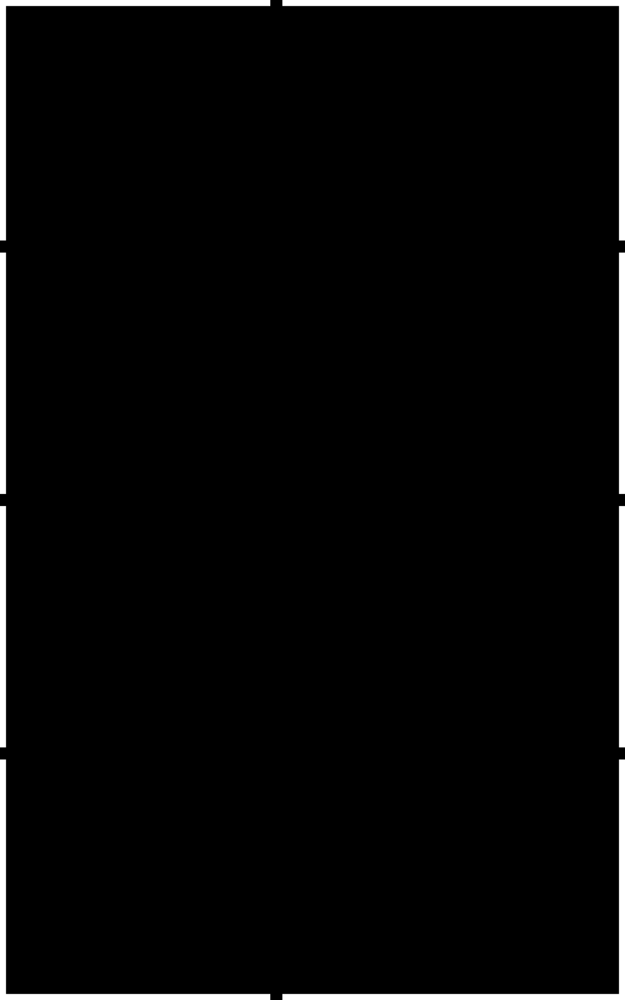

. – We see that the expression ‘proceeding in such and such a way according to the rule’ is used not only in cases like (37), (40), (41), (42), but also where the rule (or should we say ‘its expression’) is neither a tool in the practice nor in the teaching of the game. The table is related to language (43) rather as a law of nature is related to the phenomenon it describes. In this example the table is a sentence of the natural history of that tribe.

### [EPB](/w-epb/#ms-115-153.3) [153\[3\]](https://cdn.wittgensteinnachlass.com/2000px/webp/Ms-115/153.webp)

Note: In game (37) we distinguished between the command to be carried out & the rule; in case (38), on the other hand, we called the sentence ‘c a d a’ a rule & it was the command. –

### [EPB](/w-epb/#ms-115-153.4+154.1) [153\[4\]](https://cdn.wittgensteinnachlass.com/2000px/webp/Ms-115/153.webp),[154\[1\]](https://cdn.wittgensteinnachlass.com/2000px/webp/Ms-115/154.webp)

45 Now imagine this variant of (37): The pupil is not merely trained to use _one_ table, but the training aims to enable the pupil to use any arbitrary table of letters & arrows. By this I merely mean that the training is of a certain kind, roughly speaking, the kind described in (34). I will call training analogous to that in (34) ‘_general_ teaching’. The members of this family can be very different from one another. The teaching I have in mind now consists essentially 1) in training in a narrow, precisely delimited field of actions, 2) in guiding the pupil when he crosses the boundary of this field, 3) in a selection of exercises & tasks.

### [EPB](/w-epb/#ms-115-154.2) [154\[2\]](https://cdn.wittgensteinnachlass.com/2000px/webp/Ms-115/154.webp)

After teaching of this kind B receives a command of the form:

_r r t s s_

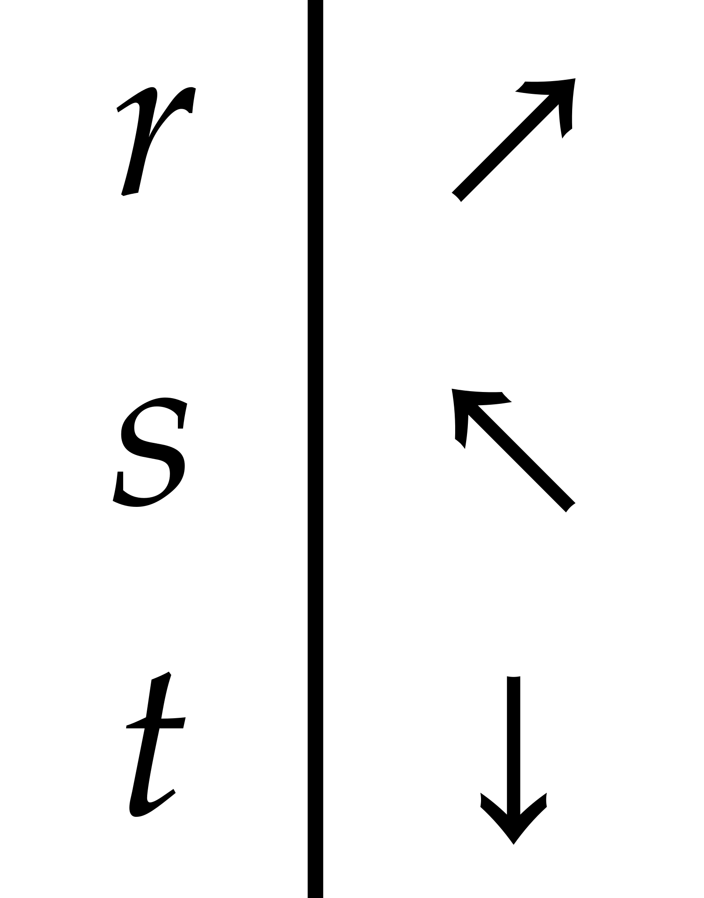

He carries out the command by moving as follows:

Here we would say that the rule forms part of the command.

### [EPB](/w-epb/#ms-115-154.3) [154\[3\]](https://cdn.wittgensteinnachlass.com/2000px/webp/Ms-115/154.webp)

N.B.: We do not say ‘what a rule is’, but merely give various applications of the word ‘rule’. And we do this, evidently, by also giving applications of the expression ‘expression of a rule’.

### [EPB](/w-epb/#ms-115-154.4+155.1) [154\[4\]](https://cdn.wittgensteinnachlass.com/2000px/webp/Ms-115/154.webp),[155\[1\]](https://cdn.wittgensteinnachlass.com/2000px/webp/Ms-115/155.webp)

In (45) we could call the entire sign of the command _a sentence_. But we _could_ also distinguish in it between sentence & table. What suggests the distinction to us here in particular is the linear notation of the sign ‘r r t s s’. Although from a certain point of view we will declare the linear character of our sentences to be purely external & insignificant, it nevertheless plays a major role in what we as logicians are inclined to say about sentences. (This also applies to other similar features of the sentences of our ordinary language.) So if we regard the command in (45) as a unit, it can show us how variously sentences can look.

### [EPB](/w-epb/#ms-115-155.2) [155\[2\]](https://cdn.wittgensteinnachlass.com/2000px/webp/Ms-115/155.webp)

Let us now compare these two games:

46 One is game (38). It is taught to people by means of ‘general teaching’. The commands are combinations of the letters ‘a’, ‘b’, ‘c’, ‘d’ with any number of repetitions. – But what does that mean? Well, that in the practice of the game, as in its teaching, no number of repetitions plays the role of the ‘_greatest possible_’ (see (35)). – Let us compare this with the following:

47 The commands & their execution as in (38); but only three sentences are used: ‘a c’, ‘a c c’, ‘c a a’.

### [EPB](/w-epb/#ms-115-155.3+156.1) [155\[3\]](https://cdn.wittgensteinnachlass.com/2000px/webp/Ms-115/155.webp),[156\[1\]](https://cdn.wittgensteinnachlass.com/2000px/webp/Ms-115/156.webp)

We can say that in (38) B is _guided_ by the composite sign of the command when drawing the broken line. – But if we ask whether the three sentences in (47) _guide_ B in the execution, it seems that we could say both ‘yes’ and ‘no’. – If we now try to decide whether we should say that B is guided or not guided, we are inclined to give answers such as these: a) “B is guided by the signs when he does not simply regard the sentence as a whole (as it were a word) and then act, – but reads it ‘word for word’ (the words here being the letters), & acts in accordance with the words.” We could make this clearer by imagining that reading ‘word for word’ consists, for example, in his pointing with his finger at all the letters of the command individually, in sequence (instead of, say, at the whole sentence at once). And ‘acting in accordance with the words’ is to consist, for simplicity’s sake, in B drawing one line segment after reading each letter. –

b) “B is guided when, by a process of thought, he connects pointing at a letter with drawing the corresponding line segment.” We could imagine such a connection in various ways. For example, as follows: after reading each letter, B looks in the table & then draws a line segment parallel to the arrow he found in the table. –

c) “B is guided when he does not simply _react_ to the sight of a letter by drawing a line segment, but experiences the peculiar tension: ‘reflecting on the meaning of the sign’; & the easing of this tension when the correct action appears in his mind.”

### [EPB](/w-epb/#ms-115-156.2+157.1) [156\[2\]](https://cdn.wittgensteinnachlass.com/2000px/webp/Ms-115/156.webp),[157\[1\]](https://cdn.wittgensteinnachlass.com/2000px/webp/Ms-115/157.webp)

But all these explanations leave us dissatisfied in one way, and it is the limitation of our language-game that makes all such explanations unsatisfactory. – This is expressed in the explanation that occurs to us: B is _then_ guided by the combinations of letters in the three sentences when he could also carry out commands consisting of other combinations of these letters. – And when we say this, it seems to us that this _ability_ to carry out other commands is a particular state of the person carrying out the commands in (47). But if we examine the case closely, we see nothing that we would call such a state.

### [EPB](/w-epb/#ms-115-157.2) [157\[2\]](https://cdn.wittgensteinnachlass.com/2000px/webp/Ms-115/157.webp)

Let us look at the role the word “can”, or the word “ability”, plays in our language. Consider these examples:

### [EPB](/w-epb/#ms-115-157.3) [157\[3\]](https://cdn.wittgensteinnachlass.com/2000px/webp/Ms-115/157.webp)

48 Let us imagine that, for some important purpose, people needed a device of this kind: It is a board with a straight or curved slot, in which a pin is guided. The person using the device lets the pin slide along the slot. There are such boards with straight, circular-arc, oval, S-shaped & other slots. The tribe’s language has expressions for describing the activity of working with this device. They speak of moving the pin in a straight line, in a circular arc, etc. They also have a way of describing the corresponding boards; they say, “This is a board in which the pin _can_ be moved straight”. In this case one might call the word “can” an operation-sign by means of which the description of the action is transformed into a description of the instrument.

### [EPB](/w-epb/#ms-115-157.4+158.1) [157\[4\]](https://cdn.wittgensteinnachlass.com/2000px/webp/Ms-115/157.webp),[158\[1\]](https://cdn.wittgensteinnachlass.com/2000px/webp/Ms-115/158.webp)

49 Let us imagine a language in which there is no such sentence-form as “The book is in the drawer”, or “Water is in the glass”, but instead one says: “The book can be taken out of the drawer”, etc.

### [EPB](/w-epb/#ms-115-158.2) [158\[2\]](https://cdn.wittgensteinnachlass.com/2000px/webp/Ms-115/158.webp)

50 Let us imagine a language in which, instead of sentences of the form ‘x is hard’, ‘x is soft’ (‘brittle’, ‘tough’), sentences are used of the form: ‘x can be bent’, ‘x can be scratched with difficulty’, ‘x can easily be smashed’, and so on. And this also when _now_, as we would say, the thing cannot be bent or scratched, etc. Thus, for example, one says: “The hut is built of rods that _can_ easily be bent”, when, in our sense, the rods _could_ easily be bent individually.

### [EPB](/w-epb/#ms-115-158.3+159.1) [158\[3\]](https://cdn.wittgensteinnachlass.com/2000px/webp/Ms-115/158.webp),[159\[1\]](https://cdn.wittgensteinnachlass.com/2000px/webp/Ms-115/159.webp)

In these examples, we could say, sentences of the form “such and such can happen” describe _states_ of things. But the cases are very different from one another. In (48) we had the state before our eyes: we see that the board has a straight, or some other, slot. – In (49) the state described sometimes corresponds to a ‘visual state’, as one might call it, and sometimes not. – Also in (50), we can say, the sentence “the rod can be bent” describes a state, because its verb, ‘can’, is in the present tense and thus indicates that something _is_ the case _now_, while I am speaking. I could have made the state-like conception in this example still clearer if I had assumed that in this language, instead of “the thing is soft”, one always said: “the thing has it in itself, it can be bent”, or the like. And we do use the words “pliable”, “easily torn”, “fragile” like the words “soft”, “brittle”, etc., & these in turn like the words “warm”, “red”, “dark”. But no state of sense-perception corresponds to the state of pliability, scratchability, etc., in the way that the visual state of seeing the red colour corresponds to the redness of a thing. The criterion of pliability is not so much a stationary sense-perception as the _test_ of bending, the criterion of the state of scratchability the _test_ of scratching, and so on. – The idea of ‘the state of a thing’ is nevertheless always closely connected with that of a state of sense-perception; & when we ask what, for example, the _state-like_ character of softness consists in, something like the ‘structure of matter’ will immediately occur to us, & we will be inclined to say: if only we could look into this structure, we would _see_ the state which makes it possible to bend the body easily, etc.

### [EPB](/w-epb/#ms-115-159.2+160.1) [159\[2\]](https://cdn.wittgensteinnachlass.com/2000px/webp/Ms-115/159.webp),[160\[1\]](https://cdn.wittgensteinnachlass.com/2000px/webp/Ms-115/160.webp)

We say that a car travels 20 km per hour, even if it travels for only half an hour. We can justify our expression by saying that the car can cover 20 km in an hour at its speed. And we call speed a ‘state of motion’ as well. I believe we would not use this expression if we had no other experiences of motion than that a thing is at _one_ time in _one_ place, and at another time in another place; if, that is, we saw all things moving like the hour hand of a clock, or the sun. (Connected with this is the idea of an arrow that does not move because at each point in time it is only in _one_ place.)

### [EPB](/w-epb/#ms-115-160.2) [160\[2\]](https://cdn.wittgensteinnachlass.com/2000px/webp/Ms-115/160.webp)

51 A tribe has in its language commands for carrying out certain activities of the men in war; commands such as: “Throw the spears!”, “Shoot!”, “Run!”, “Crawl!”, etc. They also have a way of describing the figure of a human being, by saying “he can run fast”, “he can throw far”, etc. But what justifies me in saying that these sentences describe the figure of a human being among them is the way in which they use these sentences. For they describe the image of a man with strong arms by saying “he can throw far”; or they describe someone who has well-formed legs, even if for some reason he cannot use them, with the words “he can jump high”, etc.

### [EPB](/w-epb/#ms-115-160.3+161.1) [160\[3\]](https://cdn.wittgensteinnachlass.com/2000px/webp/Ms-115/160.webp),[161\[1\]](https://cdn.wittgensteinnachlass.com/2000px/webp/Ms-115/161.webp)

52 Before going to war, the men of a tribe are tested for their fitness in combat. The person conducting the test makes them perform certain prescribed exercises, namely exercises on a kind of _gymnastic apparatus_. Afterwards he gives each of them a certificate of this kind: “A is good at archery”, “B is skilled at using a sling”, etc. etc. There are no special words in their language for the exercises to which they are subjected in the test; these are simply called tests for such and such an activity in war.

### [EPB](/w-epb/#ms-115-161.2+162.1+163.1) [161\[2\]](https://cdn.wittgensteinnachlass.com/2000px/webp/Ms-115/161.webp),[162\[1\]](https://cdn.wittgensteinnachlass.com/2000px/webp/Ms-115/162.webp),[163\[1\]](https://cdn.wittgensteinnachlass.com/2000px/webp/Ms-115/163.webp)

It is now important to say that one can raise an objection against this example & others that we give: we always make our tribes speak German sentences and thereby tacitly presuppose the whole background of the German language, i.e. the ordinary meanings of the German words. If, for example, we say that in the & the language there is to be no word for lifting dumb-bells and that it is to be called ‘exercise in stone-throwing’ there, one can ask how we have characterised the use of the expressions ‘perform an exercise’ & ‘throw a stone’, so that we are entitled to equate these German expressions with those which that tribe might use. – To this we must answer that we have given only a very sketchy description of the practice of our fictitious languages, & in some cases only hints; but that these descriptions could easily be elaborated further. Thus in (52) we could have said that the examiner uses certain commands when he makes the people perform exercises. These commands all begin with a certain word, which I could translate by the German “Übe”, & this word is then followed by the expression used in war as a command to throw a spear. Further, when a man reports the battle to the chief, he again uses this expression, now in a description. But what characterises a description as such, a command as such, a question, etc., is – as I said – the role which these expressions play in the living use of the language. Thus, whether a word of the tribe has been correctly rendered by a word of the German language depends on the role which that word plays in the whole life of the tribe; i.e. on the occasions on which it is used, the expressions of emotion by which it is generally accompanied, the impressions which it evokes, etc., etc.. Ask yourself, for example: In what sorts of cases would you say that a word of a particular people corresponded to our “Farewell”; in what sorts of cases that it corresponded to one of our swear-words? What observations would induce you to translate a word of a foreign language by our “perhaps”; or by an expression of doubt, certainty, etc.? You will find that the justification for calling an expression an ‘expression of doubt’, ‘of certainty’, etc., lies to a great extent, though not exclusively, in gestures, in the speaker’s facial expression & the tone of his voice. Here also remember that the experiences of an emotion are, at least in part, clearly localised experiences. For, when I frown in anger, I feel the tension of the frown in my forehead, & when I cry, the sensations around my eyes are an important component of what I feel, as is the altered breathing, the beating of the heart, etc.. I believe this is what William James means when he says that one does not cry because one is sad, but that one is sad because one cries. The reason why this thought is often not understood lies in the fact that we conceive the expression of a feeling as an artificial means of communication, to show the other person that we have the feeling. Now there is no sharp boundary between such ‘artificial means of communication’ & what one might call the ‘natural expression of the feeling’. Compare in this respect: a) crying, b) raising one’s voice when one is angry, c) writing a rude letter, d) ringing the bell to call a servant whom one wants to scold.

### [EPB](/w-epb/#ms-115-163.2+164.1) [163\[2\]](https://cdn.wittgensteinnachlass.com/2000px/webp/Ms-115/163.webp),[164\[1\]](https://cdn.wittgensteinnachlass.com/2000px/webp/Ms-115/164.webp)

53 Let us imagine a tribe in whose language there is an expression corresponding to our “he did such-and-such”, & one corresponding to our sentence “he can do such-and-such”. But this second expression is used only where the first would also be warranted. Put casually: they say ‘I can do it’ only when they have already done it. But what can justify me in saying this? – They have a form of expression which we would call ‘narration of past events’; the circumstances in which this form is used justify our designation. Cases now arise in which they ask the question: “Can N. do such-and-such?” A leader, for example, selects people who are suitable for a particular undertaking; a height is to be climbed, for example, or a river swum across. Our criterion that the leader ‘selects such people’ is not anything he says, but his & the others’ behaviour and the remaining circumstances. The leader now asks questions which, judging by their practical consequences, we would have to render by: – “Can A swim across the river?”, “Can B climb this rock?”, etc. But they are answered affirmatively only by those who have in fact already swum across this river, etc. The leader’s questions are not put in the form in which, on the occasion of a narration, one might ask “Has A swum across the river?” & they are not answered in the form in which this question is answered. But if someone has not already swum across this river, but has, say, swum across another, wider one, he does not answer the leader’s question with the affirmative sentence corresponding to the question, but _narrates_ his achievement.

### [EPB](/w-epb/#ms-115-164.2) [164\[2\]](https://cdn.wittgensteinnachlass.com/2000px/webp/Ms-115/164.webp)

Do the sentences “he did such-and-such” & “he can do such-and-such” now have the same sense, or different senses, in this language? If you think about it, you will at one time want to give one answer, at another the other. And this only shows that this question has no clearly determinate sense here. If the decisive fact is that the people say “he can …” only when he has done it, then the sentences have the same sense; if the circumstances in which an expression is used determine what you call its ‘sense’, then they have different senses.

### [EPB](/w-epb/#ms-115-164.3+165.1) [164\[3\]](https://cdn.wittgensteinnachlass.com/2000px/webp/Ms-115/164.webp),[165\[1\]](https://cdn.wittgensteinnachlass.com/2000px/webp/Ms-115/165.webp)

The use made in this example of the word ‘can’ – of the expression of possibility – may throw light on the idea that whatever can happen must already have happened once (Nietzsche). It will also be interesting to consider, in the light of our examples, the sentence: “What has happened _can_ happen”.

### [EPB](/w-epb/#ms-115-165.2) [165\[2\]](https://cdn.wittgensteinnachlass.com/2000px/webp/Ms-115/165.webp)

Before continuing our investigations into the ‘expression of possibility’, let us gain greater clarity about that part of our language in which future & past are spoken of; that is, about the use of expressions such as “yesterday”, “a year ago”, “in 5 minutes”, “before I did this”, etc..

### [EPB](/w-epb/#ms-115-165.3+166.1+167.1) [165\[3\]](https://cdn.wittgensteinnachlass.com/2000px/webp/Ms-115/165.webp),[166\[1\]](https://cdn.wittgensteinnachlass.com/2000px/webp/Ms-115/166.webp),[167\[1\]](https://cdn.wittgensteinnachlass.com/2000px/webp/Ms-115/167.webp)

54 Let us imagine how a child might be trained in the linguistic form of ‘narration of past events’. It has learnt to request various things with words (thus, as it were, to give commands as in (1)). Part of the training consisted in practising naming things. It has thus learnt to name (& request) a dozen of its toys. It has now just been playing with three of them (a ball, a die & a sledge); they are then taken away from it & the adult says something like: “He has had a ball, a die & a sledge”. The child learns to repeat the sentence after him & at the same time to make the movement of counting them off on its fingers. On a similar occasion the adult breaks off the enumeration & gets the child to continue it. In doing so he makes, say, a characteristic movement: he counts the things off on his fingers, as we would say. On a further occasion he begins the sentence only & makes the hand movement with which the enumeration always begins, & lets the child name the things itself. The hand movement of counting off is to form a bridge here in the transition to the child’s independent enumeration. The fingers are to guide the child onwards. And the teacher will try to achieve this through gestures & the facial expression of expectation, raising his voice, etc.. Whether the game is learnt depends on whether the child responds to these prompts. A misunderstanding is very close at hand here: to regard the means (gestures, etc.) which the teacher uses to induce the child to continue the enumeration as indirect means of making himself understood to the child. As though the child already had a language in which it thought, spoke to itself, & the teacher were now to use all sorts of imperfect hints (his gestures, etc.) to get it to _guess_ what he meant. As though, then, the child asked itself in its own language: “Does he now want me to continue, or to repeat what he has said, or something else?” – Thus it is represented as though the child never learnt _the language_, i.e. as though it never learnt _to think_, but only translated from a language which it already knew into another. (Augustinus: et ecce paulatim sentiebam, ubi essem, et voluntates meas volebam ostendere eis, per quos implerentur, et non poteram, quia illae intus erant, … Itaque iactabam et membra et voces, signa similia voluntatibus meis, …) The roots of this conception go deep & reach far. For how can the child learn to think as I describe it? I say myself that it is ‘_trained_’! Can one be _trained_ to think? Thinking is surely the opposite of merely mechanical action, & one is trained precisely for mechanical action!

### [EPB](/w-epb/#ms-115-167.2) [167\[2\]](https://cdn.wittgensteinnachlass.com/2000px/webp/Ms-115/167.webp)

“Don’t you turn the child into a parrot which is trained to speak?” – But _can_ you train a parrot (or, say, a monkey) to use a table, name things, enumerate, etc.? – “But isn’t thinking a _mental_ process?” – About the spirituality of thinking, later. –

### [EPB](/w-epb/#ms-115-167.3+168.1) [167\[3\]](https://cdn.wittgensteinnachlass.com/2000px/webp/Ms-115/167.webp),[168\[1\]](https://cdn.wittgensteinnachlass.com/2000px/webp/Ms-115/168.webp)

55 Another example of a primitive form of narrating past events: We live in a landscape with striking mountain shapes on the horizon. It is easy to remember at what point the sun rises in a particular season, where it stands at midday & where it disappears behind the mountains again. We now have some characteristic pictures of our landscape with the sun in different positions. I shall call these pictures ‘sun-pictures’. We also have characteristic pictures of various activities of the child: its getting up, its games, the child at its midday meal, and so on. I shall call these ‘pictures from life’. I imagine that the child can often see the sun during its various activities; & we often direct its attention to the positions of the sun – that it is by this mountain, this tree, etc.. We then let the child look at a picture of its activities & alongside it pictures of the sun in the corresponding positions. By means of these pictures we can, as it were, narrate what the child did during the day from morning to evening, by laying out a series of the ‘pictures from its life’ & above them, in the correct correspondence, the series of sun-pictures. We will then let the child complete such a picture-story which we have begun. Or we will deliberately lay out gross inaccuracies & let the child correct them, etc.. This language-game is best imagined as accompanied by words.

### [EPB](/w-epb/#ms-115-168.2) [168\[2\]](https://cdn.wittgensteinnachlass.com/2000px/webp/Ms-115/168.webp)

“But surely the signs of encouragement, applause, disapproval, etc., must be understood by the child before it can be trained, _this_ language the child _surely_ cannot learn.” –

### [EPB](/w-epb/#ms-115-168.3) [168\[3\]](https://cdn.wittgensteinnachlass.com/2000px/webp/Ms-115/168.webp)

_In part_ it learns them, in part it ‘understands’ them _before_ any instruction. But consider what we call ‘understanding’ here. What does understanding consist in? – We shall have to occupy ourselves with this question later.

### [EPB](/w-epb/#ms-115-168.4) [168\[4\]](https://cdn.wittgensteinnachlass.com/2000px/webp/Ms-115/168.webp)

56 A variant of (55): In the nursery there is a large clock. For simplicity, let us imagine it with only an hour hand. What happens during the day is ‘narrated’ as above, but here there is no series of sun-pictures; instead we use the numerals on the clock-face. We write a numeral beside a ‘picture from life’.

### [EPB](/w-epb/#ms-115-168.5+169.1) [168\[5\]](https://cdn.wittgensteinnachlass.com/2000px/webp/Ms-115/168.webp),[169\[1\]](https://cdn.wittgensteinnachlass.com/2000px/webp/Ms-115/169.webp)

57 But even in this simple game we work with concepts of time: pictures from life are laid out in a series, corresponding to the temporal order of the activities. We could introduce the words ‘before’ & ‘after’ into this language-game. In this sense one can say that the concepts ‘before’ & ‘after’ enter into this game, but not the concept of measuring time. (Thus by “concept” I do not mean anything mental here.) It would plainly not be difficult to pass from games (55), (56), (57) to narrating events in words.

### [EPB](/w-epb/#ms-115-169.2) [169\[2\]](https://cdn.wittgensteinnachlass.com/2000px/webp/Ms-115/169.webp)

Perhaps, on considering such forms of narration, someone will think that in them the actual concept of time still plays no role at all, but only some crude substitute for it. – Well, if someone claims that there is a concept of ‘five o’clock’ which does not presuppose the clock, the latter being only the instrument with which it is established more or less precisely when it is five o’clock; or if he claims that there is a concept of an ‘hour’ which presupposes no instrument for measuring time, I shall not contradict him, but only ask him how he uses the expressions ‘hour’ & ‘five o’clock’. And if this use involves no clock, I shall go on to ask why he uses the expressions ‘five o’clock’, ‘an hour’, ‘a long time’, ‘a short time’ once in connection with the clock, & once independently of it: This will be because of certain analogies which exist between the two kinds of use. But we now have precisely two such kinds, & there is no reason to call one of them ‘the purer’, or ‘the actual’ one.

### [EPB](/w-epb/#ms-115-169.3+170.1) [169\[3\]](https://cdn.wittgensteinnachlass.com/2000px/webp/Ms-115/169.webp),[170\[1\]](https://cdn.wittgensteinnachlass.com/2000px/webp/Ms-115/170.webp)

58 This could become clearer through the following example: If we ask someone: “Say a number, any number that occurs to you”, he can generally do so at once. I now suppose that it turned out that the numbers given in answer in this way increase from morning to evening on each day; the person begins each morning with some small number & reaches the highest number before falling asleep at night. – Consider what might induce us to call these numbers a ‘means of measuring time’; or even to say that their progression _is_ time; & that clocks, the sun, etc., only indicated the time elapsed indirectly. (Examine what there is to the proposition that our heart is the real clock behind all the other clocks.)

### [EPB](/w-epb/#ms-115-170.2) [170\[2\]](https://cdn.wittgensteinnachlass.com/2000px/webp/Ms-115/170.webp)

Let us consider further language-games into which determinations of time enter:

### [EPB](/w-epb/#ms-115-170.3+171.1) [170\[3\]](https://cdn.wittgensteinnachlass.com/2000px/webp/Ms-115/170.webp),[171\[1\]](https://cdn.wittgensteinnachlass.com/2000px/webp/Ms-115/171.webp)

59 A variation of language-game (1): When a command is given (‘Slab!’, ‘Die’, etc.), B does not carry it out _at once_, but waits until the hand of a clock has reached a point on the clock-face which we indicate with our finger when uttering the command. One might imagine that the child is first trained to carry out the commands _immediately_. When it can do this, one gives such a command again & points to a place on the clock-face, but restrains the child so that it cannot carry out the command at once; one releases it only when the hand has reached that point. – We could introduce a word like our ‘_now_’ into this game: We give two kinds of commands; the first, as in (1), are to be carried out immediately, the others at a specified time. To make the difference between the two kinds clearer, we add a word to commands of the first kind & call, for example, ‘Slab now!’.

### [EPB](/w-epb/#ms-115-171.2) [171\[2\]](https://cdn.wittgensteinnachlass.com/2000px/webp/Ms-115/171.webp)

One could easily describe language-games with expressions such as: “in five minutes”, “half an hour ago”, and so on.

### [EPB](/w-epb/#ms-115-171.3) [171\[3\]](https://cdn.wittgensteinnachlass.com/2000px/webp/Ms-115/171.webp)

60 Let us look at the case of a _description_ of the future, a prediction: I suppose that we let a child observe the changing lights at a crossroads & arouse its expectation as to what the next light will probably be. We have a red, a yellow & a green disc & express the expectation of a particular colour by pointing to one of the discs. (We express joy at the correctly guessed colour, disappointment at the incorrectly guessed one.) Finally the system according to which the lights change is recognised & guessing turns into predicting. Further developments of this game are easy to imagine.

### [EPB](/w-epb/#ms-115-171.4+172.1) [171\[4\]](https://cdn.wittgensteinnachlass.com/2000px/webp/Ms-115/171.webp),[172\[1\]](https://cdn.wittgensteinnachlass.com/2000px/webp/Ms-115/172.webp)

It may now strike us that in these language-games we do not encounter the concepts of present, past & future in their problematic, almost mysterious, aspect. What sort of aspect this is & how one arrives at it can be seen most clearly when one considers this question: “Where does the present go when it becomes the past, & where is the past?” – Under what circumstances can this question move us? For under certain circumstances it cannot, & we would dismiss it as nonsense. It is clear that it will arise most readily in our minds when, in thinking about time, we are held captive by the picture of coming & going, of flowing past; when we think above all of events in which such a passing really occurs. As, for example, when we stand beside a river on which timber is being floated: the logs pass by us; those which have passed are all to my right, those still to come on the left. We now use this process as a simile for _everything_ that happens. Indeed the simile is built into the expressions of our language, for we say that an illness ‘passes’, ‘a war is coming’, etc.. We speak of the course of events – but also of the course of time – of the river on which the logs pass by us. (“the time is here”, “the time has long since passed”, “the time is coming”, etc., etc.) And so the word “time” may become inseparably associated with the picture of an ethereal river, the words ‘past’ & ‘future’ with the picture of regions from one of which events move into the other. And so on. (“the land” of the future, of the past.) And yet, of course, we can find no such stream & no such places. Our language permits questions to which there is no answer. And it tempts us to ask these questions through the _pictorial character_ of the expression. An analogy has taken our thinking captive & drags it irresistibly along with it.

### [EPB](/w-epb/#ms-115-172.2+173.1) [172\[2\]](https://cdn.wittgensteinnachlass.com/2000px/webp/Ms-115/172.webp),[173\[1\]](https://cdn.wittgensteinnachlass.com/2000px/webp/Ms-115/173.webp)

This also happens when the meaning of ‘now’ becomes something mysterious to us. In our example (59) it is clear that the function of the word ‘now’ is in no way comparable to that of the words ‘5 o’clock’, ‘midday’, ‘the time of sunset’, etc. I shall call these expressions ‘time indications’. But our language uses the word ‘now’ in the same sentence contexts as the time indications. We say: “The sun is setting now” & “The sun is setting at 6 o’clock”. And, what makes the confusion even more tempting, “Now it is 6 o’clock”.

### [EPB](/w-epb/#ms-115-173.2) [173\[2\]](https://cdn.wittgensteinnachlass.com/2000px/webp/Ms-115/173.webp)

We are tempted to say that both ‘now’ and ‘6 o’clock’ designate a point in time. And so the question can arise: What is the now? For it is an instant in time, and yet one cannot define it as the instant at which I am speaking (pronouncing the word ‘now’), or the instant at which the clock strikes, etc. Our answer is that the function of the word ‘now’ is different from that of the indications of time. Nor is it _similar_ to theirs; but there is of course a connection. (Just as the function of a hammer is not similar to that of a nail, but there is a connection.) This is easy to see if one looks at the role the word plays in the use of language, I mean, in the whole practice of the language-game; and not merely at what _sentences_ it is used in. Compare with the word ‘now’ the command ‘Go!’, for example at a race. This too ‘_designates_ an instant’. (‘Now’ can be called a ‘time-sign’. The clapping when commanding a gymnastic exercise.) The word ‘today’ is not a date.

### [EPB](/w-epb/#ms-115-173.3+174.1+175.1) [173\[3\]](https://cdn.wittgensteinnachlass.com/2000px/webp/Ms-115/173.webp),[174\[1\]](https://cdn.wittgensteinnachlass.com/2000px/webp/Ms-115/174.webp),[175\[1\]](https://cdn.wittgensteinnachlass.com/2000px/webp/Ms-115/175.webp)

It has been said that ‘now’ is the _name_ of a moment in time; just as ‘here’ is the name of a place, ‘this’ the name of an object and ‘I’ the name of a person. (One can of course also say this of the expressions ‘A year ago’, ‘over there’, ‘Your Majesty’, etc.) (Cf. (5)) The reasons for this thought are far-reaching. – It is almost as if someone, pointing, say, to a part of the brain, were to say: “That is the real _human being_”. The answer to this would be: No, that is not the human being. That is, that is not what one calls ‘the human being’. But I understand very well that under certain circumstances one is tempted to say something like that. We wish, for example, that the word ‘human being’ should mean something simple, primitive, not something composite. Something for which clear laws can be stated, not something with vague boundaries, a more or less. – If one does not want to call the proper name of a human being, or one such as “Nothung”, a name in the ‘strictly logical’ sense of the word, it is because a _name_ is supposed to designate something _simple_. – But the sword Nothung consists of parts in a certain composition. If they are put together differently, Nothung does not exist. Now, the sentence “Nothung has a sharp edge” obviously has _sense_, whether Nothung is still whole or already broken. But if “Nothung” is the name of an object, then this object no longer exists when Nothung is broken; and since the name would then not correspond to any object, it would have no meaning. Then, however, the sentence “Nothung has a sharp edge” would contain a word that has no meaning and would therefore be nonsense. But it does have sense, so something must already correspond to the words of which it is composed. Therefore, the word ‘Nothung’ must disappear in the analysis of the sense, and instead words that name something simple must enter. We will reasonably call these words the proper names. – This reasoning rests on various errors: a) the idea that a word must ‘correspond’ to an object in order to have meaning, the confusion of meaning with the bearer of a name. b) a false conception of the philosophical, or logical, analysis of a sentence, as though it were similar to chemical or physical analysis. c) a false conception of ‘logical exactness’, ignorance of the concept of ‘family’. –

### [EPB](/w-epb/#ms-115-175.2) [175\[2\]](https://cdn.wittgensteinnachlass.com/2000px/webp/Ms-115/175.webp)

Nothing could be less similar than the use of the word “this” and that of a proper name – if one looks at the practice of the language-game and not merely at the position of the words in our sentences: For we do indeed say: “_He_ is tall” – and also: “Hans is tall”; but do not forget that the first sentence is senseless without the pointing gesture and the object at which we point. – What could be compared with a name is not the word ‘_he_’, but this word together with the pointing gesture and the object.

### [EPB](/w-epb/#ms-115-175.3) [175\[3\]](https://cdn.wittgensteinnachlass.com/2000px/webp/Ms-115/175.webp)

One might say that it is characteristic of a name that we can use it in the sentence “This is A”; but it is nonsense to say “This is this”, or “This is now”. –

### [EPB](/w-epb/#ms-115-175.4+176.1+177.1) [175\[4\]](https://cdn.wittgensteinnachlass.com/2000px/webp/Ms-115/175.webp),[176\[1\]](https://cdn.wittgensteinnachlass.com/2000px/webp/Ms-115/176.webp),[177\[1\]](https://cdn.wittgensteinnachlass.com/2000px/webp/Ms-115/177.webp)

The sentence that describes a future event also sometimes seems problematic to us, and more so than the description of a past event. For when one compares future with past events, one is almost inclined to say that the latter, although they no longer exist in the light of day, nevertheless exist in a kind of underworld into which they have descended, whereas future events do not even have this shadow-existence. We could of course imagine a realm of unborn, future events, from which they emerge into reality, and from there into the realm of the past. And when we think of this image, it might surprise us that the future seems less real to us than the past. But let us not forget that the grammar of temporal expressions is not symmetrical with regard to the present. For in the grammar of the ‘future’ the concept of ‘memory’ does not occur, not even ‘with reversed signs’. – Perhaps one will say: “What has this got to do with grammar? We simply do not _remember_ the future!” Well, that depends on how one uses the word remember. In our _ordinary_ language it makes no _sense_ to say: “I clearly remember what will happen tomorrow” – not even if I am a prophet. (Here it is useful to think of the words “that the human being who thinks of the past directs his gaze towards the earth; but the human being who thinks of the future directs it upwards”. For if you think while remembering and predicting, you will see that there is something true in this.) As for the extent to which the _empirical facts_ determine those concepts of time – they are, as it were, the units of measurement by which we measure them – more on this later. We might characterise our concepts of time by the sentence: “The past has at least already been here, whereas the future has not yet been here at all”. And so it has been said that sentences about future events are not really real sentences (for, so to speak, _nothing at all_ would correspond to them). This is of course in order if it is merely intended as a stipulation concerning how the writer wishes to use the word ‘sentence’. Whoever says this is obviously strongly impressed by the asymmetry ‘future’ – ‘past’. Even if this restriction on the use of the word ‘sentence’ is ultimately based on a misunderstanding of how our sentences function in general. It could of course under certain circumstances be natural to restrict the use of the word ‘sentence’ in this way. But the philosopher is in danger of believing that he has thereby expressed a kind of scientific knowledge about the nature of the future.

### [EPB](/w-epb/#ms-115-177.2) [177\[2\]](https://cdn.wittgensteinnachlass.com/2000px/webp/Ms-115/177.webp)

61 Imagine: someone is throwing a die; and before making a throw, he draws one of the faces of the die in front of him. If, after the throw, the die shows him the side he drew, he expresses satisfaction, otherwise dissatisfaction. – Or let there be two players: they throw alternately; when one throws, the other draws a face of the die; if it is the one that comes up, the thrower gives the other a coin, otherwise the latter pays the thrower.

### [EPB](/w-epb/#ms-115-177.3) [177\[3\]](https://cdn.wittgensteinnachlass.com/2000px/webp/Ms-115/177.webp)

In this case the drawing of the face of the die would be called ‘guessing’, or under certain circumstances also ‘supposing’.

### [EPB](/w-epb/#ms-115-177.4+178.1) [177\[4\]](https://cdn.wittgensteinnachlass.com/2000px/webp/Ms-115/177.webp),[178\[1\]](https://cdn.wittgensteinnachlass.com/2000px/webp/Ms-115/178.webp)

62 Among a certain tribe, competitions are held in running, javelin-throwing, etc. Before each competition, pictures of all the participants are set up in a row and each spectator places money beneath one of these pictures. If the participant beneath whose picture the spectator has placed his money wins the competition, the spectator gets his money back and more besides; otherwise the spectator loses his money.

We would undoubtedly call such a practice ‘betting’; even if the language of that tribe contained no expression for ‘degrees of probability’, ‘chances’, etc.

### [EPB](/w-epb/#ms-115-178.2) [178\[2\]](https://cdn.wittgensteinnachlass.com/2000px/webp/Ms-115/178.webp)

I assume that the behaviour of the spectators before and after the outcome of the competition expresses excitement, involvement, satisfaction and dissatisfaction. Further, if I examine the spectators’ bets, I find that I understand ‘why’ they have bet particularly on this or that participant. Thus, the more strongly built of two wrestlers is usually bet on; and if the other is bet on, I find that the former was ill shortly beforehand, or that the latter has defeated him once before; and the like.

### [EPB](/w-epb/#ms-115-178.3) [178\[3\]](https://cdn.wittgensteinnachlass.com/2000px/webp/Ms-115/178.webp)

But their language contains no expression of _justification_. That is, nothing in it corresponds to a sentence such as: “I am betting on this wrestler because he is in good form, while the other was ill recently”, etc. – I could say: My observation has taught me certain causes that influence the bets, but the bettors have, or use, no reasons when betting on a competitor.

### [EPB](/w-epb/#ms-115-178.4+179.1) [178\[4\]](https://cdn.wittgensteinnachlass.com/2000px/webp/Ms-115/178.webp),[179\[1\]](https://cdn.wittgensteinnachlass.com/2000px/webp/Ms-115/179.webp)

Now let us imagine a case in which the language contains the form of justification. The language-game ‘giving reasons for one’s actions’ does not presuppose finding causes of these actions (through repeated observation of the circumstances in which they occur).

### [EPB](/w-epb/#ms-115-179.2) [179\[2\]](https://cdn.wittgensteinnachlass.com/2000px/webp/Ms-115/179.webp)

63 Let us imagine _this_ process:

If a spectator has lost his bet at a competition, the others tease and laugh at him. In response, with an exaggerated gesture, he points to the muscles, chest, height, etc. of the competitor on whom he had bet – as we would say: in order to justify his bet. In a similar way we could imagine a discussion of the chances of two competitors: two spectators take turns pointing to what seems to promise them the victory of their candidate. A points to the height of one competitor’s build; B shrugs his shoulders and points to the other’s biceps; and so on. The discussion could easily be described in such a way that we would have to say that A and B were giving reasons for their choice.

### [EPB](/w-epb/#ms-115-179.3+180.1) [179\[3\]](https://cdn.wittgensteinnachlass.com/2000px/webp/Ms-115/179.webp),[180\[1\]](https://cdn.wittgensteinnachlass.com/2000px/webp/Ms-115/180.webp)

“But does giving such reasons not presuppose that the people have observed connections between the outcome of a contest and the physical constitution of the contestants?” – But whether or not this assumption seems reasonable, I have in any case not made it in describing our case. (Nor have I made the assumption that the bettors give reasons for their reasons.) We would not be surprised, in a case such as the one just described, to find expressions in the people’s language for degrees of conviction, supposition, certainty. For example, _one_ word pronounced in different tones; or a series of words. (But I am not thinking of the use of a scale of probabilities.) – It is also easy to imagine their accompanying the betting with expressions that we would translate in the form: “I believe that N _can_ beat M at javelin-throwing”, etc. – I translate the word they use by ‘can’ and not by ‘will’, because they have an auxiliary tense-word for the future, which is used in sentences analogous to our “He _will_ return today”, “He _will_ beat him when he comes”, etc.

### [EPB](/w-epb/#ms-115-180.2+181.1) [180\[2\]](https://cdn.wittgensteinnachlass.com/2000px/webp/Ms-115/180.webp),[181\[1\]](https://cdn.wittgensteinnachlass.com/2000px/webp/Ms-115/181.webp)

64 A tribe in whose language the memory of an event is described by means of a hand movement pointing backwards; the expectation of an event by means of a hand movement pointing forwards (as we might make them when we say “That lies a long way behind me already”, or “That still lies ahead of me”). They accompany each of the two movements with an auxiliary tense-word (of the past and future). When they describe a past event, they represent it linguistically and mimically and repeat the sign of the past in their representation; etc. On certain occasions, however, when they are considering, as we would say, the suitability of a thing, a person or an animal to do something specific, they express their expectation that it will do this by means of a different auxiliary tense-word. Thus, if they are considering, as the situation teaches us, whether a particular projectile will be able to kill such-and-such an animal, they examine one of the projectiles, say, and say, with the hand movement of foreseeing, “It _can_ kill it” (that is how I shall translate it). But they say, for example: “If a man walks through this ravine now, this boulder will kill him.”

### [EPB](/w-epb/#ms-115-181.2) [181\[2\]](https://cdn.wittgensteinnachlass.com/2000px/webp/Ms-115/181.webp)

65 People use a special auxiliary tense-word when they predict the success of a physical exertion. I shall render this auxiliary tense-word by ‘can’; “I can” then always means: “I shall succeed”, “he can”: “he will succeed”, etc. Their use of that word therefore does not correspond _entirely_ to our use of the word “can”; for when we ask someone, say at table, “How high can you jump?”, the answer need not mean that he believes he will now perform a jump of that height, but he can merely tell us how high he has jumped before.

### [EPB](/w-epb/#ms-115-181.3+182.1) [181\[3\]](https://cdn.wittgensteinnachlass.com/2000px/webp/Ms-115/181.webp),[182\[1\]](https://cdn.wittgensteinnachlass.com/2000px/webp/Ms-115/182.webp)

In the last three cases the word ‘can’ is the characteristic of a prediction. This of course does not mean that I call a sentence in these cases a ‘prediction’ because the word ‘can’ occurs in it; rather, I call it a ‘prediction’ because of the situation in which it is used; and I render a word of that language by ‘can’ because under these circumstances we would use the word ‘can’ and because I want to translate a word of their language into _an_ analogous word of ours.

### [EPB](/w-epb/#ms-115-182.2) [182\[2\]](https://cdn.wittgensteinnachlass.com/2000px/webp/Ms-115/182.webp)

Now the use of ‘can’ in (63), (64), (65) is obviously closely related to its use in cases (50) to (53); but in these cases the expression ‘something can happen’ was not a prediction. Now one may object that we are willing to use the word ‘can’ in those earlier examples only because it is appropriate there to make an assumption about future behaviour (of someone who has once swum across this river one can assume that he will succeed again now). – Now it is of course true that I deliberately chose examples (50), etc. in such a way that an assumption about future behaviour is near at hand; but I also deliberately chose them in such a way that no such assumption is _made_. We can indeed say that people would never use such a form of expression if they had not had the experience that, for example, from such-and-such trials one can infer such behaviour by a person in the future. This hypothesis may be correct, but examples (50), etc. do not presuppose it.

### [EPB](/w-epb/#ms-115-182.3+183.1) [182\[3\]](https://cdn.wittgensteinnachlass.com/2000px/webp/Ms-115/182.webp),[183\[1\]](https://cdn.wittgensteinnachlass.com/2000px/webp/Ms-115/183.webp)

66 Let us now imagine this game: A writes down sequences of numbers, B watches him and tries to find a law in the sequence of numbers. If he has succeeded, he says: “Now I can continue”. – This example is particularly instructive because it seems that the ability to continue is something that occurs at a particular moment; so that we can ask ourselves: what is it that occurs here? Surely one ought now to be able to find this! – Suppose, then, that A has written down the numbers 1, 5, 11, 19, 29; B then says: “Now I can continue”. What happened when he suddenly knew how to go on? – _Many things_ could have happened. Let us suppose: While A slowly writes down one number after another, B is busy comparing various algebraic formulae with the numbers already written down. When A had written down ‘19’, B tried the formula ; ‘29’ confirmed his assumption.

### [EPB](/w-epb/#ms-115-183.2) [183\[2\]](https://cdn.wittgensteinnachlass.com/2000px/webp/Ms-115/183.webp)

67 Or: B was thinking of no formula. He watches with a certain feeling of suspense as the sequence of numbers A is writing down grows; all sorts of unclear thoughts float about in his mind. Then he says to himself: “He always squares it and adds 1”; now he calculates the next number and finds that A writes down the same number.

### [EPB](/w-epb/#ms-115-183.3) [183\[3\]](https://cdn.wittgensteinnachlass.com/2000px/webp/Ms-115/183.webp)

68 Or: The sequence A writes down is 2, 4, 6, 8. B looks at it and says: “Of course I can continue”, and continues the sequence of even numbers. – Or he says nothing and continues writing the sequence. Perhaps, when he saw ‘2, 4, 6, 8’, he had a sensation, or sensations, that can be described by the words “That’s easy!” Such a sensation is, for example, a quick, light intake of breath, similar to what happens with a slight fright.

### [EPB](/w-epb/#ms-115-183.4+184.1+185.1) [183\[4\]](https://cdn.wittgensteinnachlass.com/2000px/webp/Ms-115/183.webp),[184\[1\]](https://cdn.wittgensteinnachlass.com/2000px/webp/Ms-115/184.webp),[185\[1\]](https://cdn.wittgensteinnachlass.com/2000px/webp/Ms-115/185.webp)

Am I now to say that the sentence “B can continue the sequence” means that one of the processes just described is taking place? Is it not clear that this sentence is not the same as “the formula 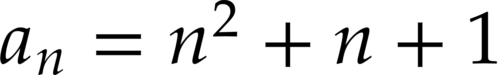 occurs to B”? It can make no difference whether this occurrence consists in the formula appearing before B’s mind’s eye, or whether he has the experience of writing it down in front of himself, pronouncing it, or selecting it with his eyes from a series of written formulae. – “If a parrot had pronounced the formula, we would not say that it could continue; so ‘being able to continue’ means more than pronouncing the formula; and something more than all the other processes we have described. So pronouncing the formula was only a symptom that B had understood, but not the understanding itself.” – This is a misleading way of putting it, for it now seems as though there were a process or state, ‘the ability to continue’, which is somehow hidden from our eyes; whereas we readily perceive a series of concomitant phenomena that are symptoms of the actual ability (like an inflammation of the nasal mucous membranes through sneezing). If one says: there must surely, when B can continue, be something behind the mere writing down of the formula, since we would not call this alone the ‘ability to continue’ – then here the word ‘behind’ is being used figuratively; and we can answer: ‘Behind’ the writing down of the formula lie the _circumstances_ in which it occurs. It is true: “B writes down the formula” does not, in general, say the same as “B can continue”; but it does not follow that in the particular case this sentence speaks of a _different process_ from the other. Our error is similar _to this_: We say to someone “The word ‘chair’ does not mean _this particular chair_”; whereupon he looks for the thing that is actually called ‘chair’ (An even better illustration would be if he tried to find _in_ the chair what is called ‘chair’.)

### [EPB](/w-epb/#ms-115-185.2+186.1) [185\[2\]](https://cdn.wittgensteinnachlass.com/2000px/webp/Ms-115/185.webp),[186\[1\]](https://cdn.wittgensteinnachlass.com/2000px/webp/Ms-115/186.webp)

It is clear: when, with reference to saying or writing down a formula, etc., we say that B has grasped the rule, that he can continue, we say this because of a connection that exists empirically between writing down such a formula and continuing a series. And this connection needs no explanation. – Now we may think that the sentence “B can continue” says: “B does something that empirically leads to continuing the series”. But is that what B means when he says, “I can continue”? Does that sentence float before him in his mind? Or is he ready to give it as an _explanation_ when we ask him what he means? As when one says: “Yes, I can go there – that is, I have time.”) But the fact is this: the sentence “B can continue the series” is correctly used when the formula occurs to B – namely, _under certain circumstances_. For example, when he has learnt algebra, or has already used such formulas, and so on. – But that does not mean that the sentence is an abbreviated form of the description of all those circumstances that form the background of our language-game. Just think of how you learn to use such an expression as “Now I can continue”, “Now I know what comes next”. Think of the language-game that you might play. _Under certain circumstances_ we shall say instead of “Now I can continue”: “Now the formula has occurred to me.” Or: “Now I can continue – I mean, I know the formula.” – The question “Can he speak yet?” means, under certain circumstances, the same as: “Has his catarrh been cured?” – under other circumstances the same as: “Has he learnt to speak yet?” To the question “Can he walk yet?” the doctor simply answers “His foot is healed”. We also say: “He can walk, as far as the condition of his leg is concerned”, when we contrast _this_ condition of his walking with other conditions (his tiredness, for example). Here we must be careful not to believe that there is, corresponding to this, depending on the nature of the case, a _totality_ of all the conditions – for example, for the patient to walk – such that, so to speak, he could not do anything but walk if they were all fulfilled.

### [EPB](/w-epb/#ms-115-186.2+187.1) [186\[2\]](https://cdn.wittgensteinnachlass.com/2000px/webp/Ms-115/186.webp),[187\[1\]](https://cdn.wittgensteinnachlass.com/2000px/webp/Ms-115/187.webp)

One can also say: We use the expression “B can continue the series” to make _various_ distinctions. It distinguishes, on the one hand, between the case of someone who knows the formula and someone who does not know it; or between the case of someone who has mastered arithmetical calculations and the case of someone who has not mastered them; or between the case of a person in a normal state and the case of this person in a state of extraordinary absent-mindedness (the series might be 2, 4, 6, 8, etc.); or between the case of someone who has often done exercises of this kind and that of a beginner; or between the case of someone who actually continues writing the series that has been begun and that of someone who stands helpless before it. These are only a few members of a large family. – “But surely these cases have something in common!” – Certainly – the situation is similar in all of them. – Or do you mean that _that_ is what they have in common: that when B cannot continue, in all cases he _does not continue_ the series? But continuing is again not the _ability_! – “But can one not say that, in all these cases, he does not continue the series, _but makes an effort_ to continue it?” – Perhaps; but now see how variously ‘making an effort’ means in all these cases!

### [EPB](/w-epb/#ms-115-187.2) [187\[2\]](https://cdn.wittgensteinnachlass.com/2000px/webp/Ms-115/187.webp)

The question whether, in a case such as (66), for example, the sentence “he can continue” has the same sense as “he knows the formula” can be answered with ‘yes’ and ‘no’. One can say that they do not have the same sense, since they are not generally used as synonyms, as, for example, the expressions ‘he is old’ and ‘he is aged’. Or one can say: _Under these circumstances_ the second has the same sense as the first. (See (53)) It is also immaterial which of the two we say, since one can see the true state of affairs only when one examines the particular case.

### [EPB](/w-epb/#ms-115-187.3+188.1) [187\[3\]](https://cdn.wittgensteinnachlass.com/2000px/webp/Ms-115/187.webp),[188\[1\]](https://cdn.wittgensteinnachlass.com/2000px/webp/Ms-115/188.webp)

Let us now ask the following question: Suppose B says, in one of the cases, “Now I can continue”, but when we then ask him to continue, he proves unable to do so: are we to say that this shows that he was wrong to say that he could continue, or that he may have been able to continue when he said he could? Should B himself say in such a case: “I now see that I was wrong” – or: “I could do it then, but now I cannot”? There are cases in which he will rightly say the one thing, and cases in which he will rightly say the other. Suppose: a) when he said he could continue, the formula was before his mind; but when he was then supposed to continue, he had forgotten it; or b) when he said he could continue, he had recited the next five members of the series to himself; but now they have slipped his mind – or c) he had continued the series for himself, namely calculated some further members; he still knows these, but has forgotten how he calculated them – or d) he says: “Then I had the feeling that I knew what came next, but now I can’t” – or e) “When I said I could lift the weight, I was healthy” – or f) “I thought I could lift it, but I can’t” – or g) “I thought I still knew the poem by heart, but I don’t any more” – or h) “I thought I knew the right formula, but I was mistaken.” Etc.

### [EPB](/w-epb/#ms-115-188.2+189.1) [188\[2\]](https://cdn.wittgensteinnachlass.com/2000px/webp/Ms-115/188.webp),[189\[1\]](https://cdn.wittgensteinnachlass.com/2000px/webp/Ms-115/189.webp)

Examples such as these would have to be supplemented by ones showing the variety in the use of the words ‘forget’ and ‘try’. For our use of these words is closely connected with that of the word ‘can’. Think of these experiences of forgetting: a) When he said he could continue, B had recited the formula to himself, but now it has completely slipped his mind (‘as if wiped away’). b) He had recited the formula to himself then, but now he is unsure whether it was 2n or 3n. c) Someone has forgotten a name and ‘it is on the tip of his tongue’. d) He does not know whether it merely seems to him that he knew the name, or whether he has forgotten it.

### [EPB](/w-epb/#ms-115-189.2) [189\[2\]](https://cdn.wittgensteinnachlass.com/2000px/webp/Ms-115/189.webp)

And now consider these cases: a) Someone tries to open a door by pulling with all his strength. b) He tries to open a cash desk door by trying several combinations. c) He tries by turning the knobs and listening at the door. d) He tries to remember the combination. (And think of the variety of possibilities that we describe with these words.)

e) Try to draw a square with its diagonals while looking at the drawing paper through a mirror. Compare this case, in which one, so to speak, does not know ‘what to do’ in order for the hand to move as one wishes, with case (a), in which the hand is to be moved against a resistance.

### [EPB](/w-epb/#ms-115-190.1) [190\[1\]](https://cdn.wittgensteinnachlass.com/2000px/webp/Ms-115/190.webp)

Also think of the class of cases in which we say: “I can do it, but I don’t want to”, in which we therefore make no effort. “I could, if I tried” (for example, lift 50 kg); “I could, if I wanted to” (for example, recite the alphabet).

### [EPB](/w-epb/#ms-115-190.2) [190\[2\]](https://cdn.wittgensteinnachlass.com/2000px/webp/Ms-115/190.webp)

One might perhaps say that the only case in which it is unconditionally correct to say that I can do something is the case in which I actually do it while saying this. In all other cases it should be: “I can do it, as far as this and that is concerned.” Only in the first case have I supplied the actual proof of my ability.

### [EPB](/w-epb/#ms-115-190.3) [190\[3\]](https://cdn.wittgensteinnachlass.com/2000px/webp/Ms-115/190.webp)

We can imagine a language-game

69 in which a word (I render it by ‘can’) is used in the sentential form ‘I can do this and that’ only when one carries out the activity in question _as a test_ while saying the sentence.

### [EPB](/w-epb/#ms-115-190.4+191.1) [190\[4\]](https://cdn.wittgensteinnachlass.com/2000px/webp/Ms-115/190.webp),[191\[1\]](https://cdn.wittgensteinnachlass.com/2000px/webp/Ms-115/191.webp)

In this language, then, this particular case is highlighted by a word of its own. – But now one sees that there is no _metaphysical_ difference between this language-game and other, previously described ones. Such a language-game also shows what sense it can have to say “If something happens, then it _can_ happen” – a virtually useless sentence in our language. (It seems to have a very clear and profound sense precisely for that reason. But, like many general philosophical principles, it is senseless except in very special cases, which the philosopher does not think of.) That sentence is similar to: “If this body is here, then there must also be room for it”. We think that possibility is _a condition_ of reality. As if the sentence were analogous to: “If this body is here, then the other one must have been removed”. As if an event, through its reality, tested its possibility. – Imagine that I say to someone: “A has broken his foot; he cannot walk.” – He replies: “But there he is walking!” – I: “Yes, then he can walk after all.” – Here I do indeed draw the conclusion according to the rule: “If something happens, then it can happen” – as one might express it. But suppose A did not walk naturally at that time, but was induced, for example by a supernatural influence, to walk a few steps once; would I now maintain my sentence that he can therefore walk after all? – If I now want to withdraw it and the other says: “That is impossible! A walked, so he must have been _able_ to walk” – would I not reject this as (senseless) twaddle? The reasoning is something like: “If something happens, then it can happen. For if it could not have _happened_, then it could not have _happened_.” And that says nothing. – One could say here: Because something happens, it does not thereby _have to be able_ to happen.

### [EPB](/w-epb/#ms-115-191.2) [191\[2\]](https://cdn.wittgensteinnachlass.com/2000px/webp/Ms-115/191.webp)

70 You can imagine a language (similar to (53)) in which there are _two_ ways of expressing a sentence such as “I lift 50 kg”: one is used when the activity is carried out as a test, to demonstrate the ability (for example, before a competition), the other on all other occasions. – “When someone jumps, he shows that he can jump.” – “No, on one occasion he _jumps_, on another he shows that he can jump!”

[What does this show?]

### [EPB](/w-epb/#ms-115-191.3+192.1) [191\[3\]](https://cdn.wittgensteinnachlass.com/2000px/webp/Ms-115/191.webp),[192\[1\]](https://cdn.wittgensteinnachlass.com/2000px/webp/Ms-115/192.webp)

We see that a widely ramified network of family resemblances connects the cases in which the expression of possibility, of ability, is used; in which we say that something can happen, etc. Certain characteristic features appear in these cases in different combinations. For example, the element of predicting future behaviour, of describing a state that is a condition for certain behaviour, of making a statement about tests of behaviour.

### [EPB](/w-epb/#ms-115-192.2) [192\[2\]](https://cdn.wittgensteinnachlass.com/2000px/webp/Ms-115/192.webp)

Perhaps the most important of these elements is that of making a statement about the _state_. We have a strong tendency to conceive of the behaviour of an object as a consequence of its state.

This is reflected in the expressions of our language “he is in a position to do something”, or “he possesses the ability”; in the use of the present tense: “he _can_ play chess”, “he can multiply large numbers in his head”, etc.

### [EPB](/w-epb/#ms-115-192.3+193.1) [192\[3\]](https://cdn.wittgensteinnachlass.com/2000px/webp/Ms-115/192.webp),[193\[1\]](https://cdn.wittgensteinnachlass.com/2000px/webp/Ms-115/193.webp)

We imagine the ability to solve mathematical problems, etc., as a certain state, as a certain structure, of the human mind. We likewise think of memory as a storehouse for the impressions we receive. – Think of how certain most people are that something in the state, or structure, of the brain _must_ correspond to the ability to multiply, to recite a poem, etc.; although they know virtually nothing about such a psychophysiological parallelism. We have an overwhelming tendency to represent the phenomena that we actually observe in such a case by the symbol of a mechanism whose workings we perceive precisely in these phenomena. The possibility of these phenomena lies in the constitution of the mechanism; this is the ability.

### [EPB](/w-epb/#ms-115-193.2+194.1) [193\[2\]](https://cdn.wittgensteinnachlass.com/2000px/webp/Ms-115/193.webp),[194\[1\]](https://cdn.wittgensteinnachlass.com/2000px/webp/Ms-115/194.webp)

Let us now look back at the discussion of language-game (47). It was not a proper explanation to say that B would then be _guided_ by the combinations of letters if he could also carry out other commands. – Yes, when we asked whether B in (47) was guided by the signs or not, we were always tempted to say that we could decide this only if we looked into the actual connection between seeing the signs and acting according to them. For we have a definite picture of what we would call, in a mechanism, ‘the guidance of one part by other parts’. – And when we think about being guided by the signs, a mechanism of the pianola type immediately occurs to us. Here we have the clear case of guidance: the playing of the piano keys guided by the perforations in the paper strip. We could use the expression: the pianola _read_ the perforations in the roll. And one could call groups of such perforations ‘complex signs’, or ‘sentences’, – if one contrasts _their_ function with the function of similar arrangements in another type of mechanism. For example, the function of the teeth of a key’s bit. The bolt of the lock is moved by this particular arrangement of teeth. But we shall not say that the movement of the bolt is guided by the succession of these different teeth. That is, the bolt does not move ‘according to this succession’.

### [EPB](/w-epb/#ms-115-194.2) [194\[2\]](https://cdn.wittgensteinnachlass.com/2000px/webp/Ms-115/194.webp)

Here one sees the connection between the idea of being guided and that of being able to read new combinations of signs: for we can say that the pianola _can_ read any combination of the perforations; it is not constructed to produce a particular sequence of tones; whereas the bolt of the lock is moved only by _the_ arrangement of teeth predetermined by the construction of the lock. – We could say that the teeth of the key’s bit are not comparable to the words of a sentence, but to the letters of a word; the bit of the key would correspond not to a sentence but to a word.

### [EPB](/w-epb/#ms-115-195.1) [195\[1\]](https://cdn.wittgensteinnachlass.com/2000px/webp/Ms-115/195.webp)

But it is now clear that in cases (46), (47) there is no question of such mechanisms; even if we can use them as similes in order to describe B’s behaviour. The use of the word “being guided” in the case of the pianola is only _one_ of a _family of related kinds of use_. Although we would often like to use it as a simile, as a form of representation, of the others.

### [EPB](/w-epb/#ms-115-195.2+196.1+197.1) [195\[2\]](https://cdn.wittgensteinnachlass.com/2000px/webp/Ms-115/195.webp),[196\[1\]](https://cdn.wittgensteinnachlass.com/2000px/webp/Ms-115/196.webp),[197\[1\]](https://cdn.wittgensteinnachlass.com/2000px/webp/Ms-115/197.webp)

It will now help us, if we want to become clear about the concept of being guided, to consider the concept of _reading_. By ‘reading’ I mean here the activity of converting written or printed text into sounds, also writing from dictation, or copying printed text, and the like, without the _understanding_ of what one reads being at issue. The use of the word ‘read’ is, of course, extraordinarily well known to us under the circumstances of our ordinary life. (It would be _extraordinarily_ difficult to describe these circumstances even in broad strokes.) A person, perhaps a German, has, as a child, at school or at home, gone through one of the forms of instruction customary among us; he has learnt to read his native language; later he reads books, the newspaper, letters, etc. – What now happens when he reads the newspaper? – His eyes glide along the printed words, he speaks them aloud, or says them only to himself; but he says certain words by taking in their printed form as a whole, others after seeing their first letters, while others again he perhaps reads letter by letter. We would also say that he had read a sentence if, while his eyes glide over it, he neither speaks aloud nor to himself, but is then able to reproduce the sentence literally, or at least approximately. He can pay attention to what he is reading, but he can also, as we might say, function as a mere reading machine, that is, read the printed text aloud and correctly, without paying attention to the words he is reading, perhaps while his attention is directed to something completely different. So that he is unable to say what he has read if we ask him immediately afterwards. – Now compare with such a reader a beginner at school. He reads the words by laboriously spelling them out. But he guesses some words simply from their context, or perhaps already knows the passage by heart. The teacher then says that he is not really reading the words, or that he is _pretending_ to read them. If we think of _this_ case and ask ourselves what ‘reading’ consists in, we will be inclined to say that it is a conscious mental activity. In such a case we also say: “Only he knows, of course, whether he is reading; nobody else can know.” And yet we must admit – as far as reading a particular word is concerned – that precisely the same thing could be taking place in the mind, in the consciousness, of the beginner who is ‘pretending’ to read as in the mind of the fluent reader. We use the word ‘read’ differently when we speak of the practised reader from when we speak of the beginner. What we call ‘reading’ in the case of the former we do not call ‘reading’ in the case of the beginner. We would of course like to say that what happens in the practised reader and what happens in the beginner when they pronounce the word _can_ not be the same. <s> The difference lies, if not in their consciousness, in the unconscious of their minds, or in their brains. </s> <s>We are thinking here of two mechanisms, devices; we cannot see how they work, but this working decides reading or non-reading.</s> The difference lies, if not in what is currently conscious to them, in the unconscious, or in their brains. We imagine two mechanisms here; we cannot see into them, but what goes on in them distinguishes reading from non-reading. – But we do not know of any such mechanisms in these cases. – Let us consider the following:

### [EPB](/w-epb/#ms-115-197.2+198.1) [197\[2\]](https://cdn.wittgensteinnachlass.com/2000px/webp/Ms-115/197.webp),[198\[1\]](https://cdn.wittgensteinnachlass.com/2000px/webp/Ms-115/198.webp)

71 Imagine that people or animals are used by us as reading machines. They are subjected to training for this purpose. The teacher who trains them says of some that they can already read, and of others that they cannot. Take the case of a student who has not yet bitten: if a written word is shown to him, he will sometimes pronounce sounds, and now and then it happens ‘by chance’ that they are approximately correct. A third person hears this student precisely in such a case and says, “He is reading.” But the teacher says: “No, he is not reading; it was only a coincidence.” – But suppose that this student, when we show him only further words and sentences, reacts correctly to them continuously. After some time the teacher says: “Now he can read.” But what about that first word? Should the teacher say: “I was mistaken, he had read it after all” – or should he say: “He only began really to read later”? When did he really begin to read? Which was the first word he read, or which was the first letter? – This question is senseless here. – Unless we gave an artificial explanation, for example: “The first word he reads = the first of the first series of 50 words that he reads without error.” But if we use the word ‘read’ for a particular process in consciousness (sensations) of reading the letters, – then the reader could say that _this_ word was the first that he really read.

### [EPB](/w-epb/#ms-115-198.2) [198\[2\]](https://cdn.wittgensteinnachlass.com/2000px/webp/Ms-115/198.webp)

Or in the different case of a machine which, perhaps similarly to a pianola, connected signs with sounds, one could say: “Only after this and that had happened in the machinery – for example, certain parts had been connected by wires – did the machine begin to read; the first letter that it read was …”

### [EPB](/w-epb/#ms-115-198.3+199.1) [198\[3\]](https://cdn.wittgensteinnachlass.com/2000px/webp/Ms-115/198.webp),[199\[1\]](https://cdn.wittgensteinnachlass.com/2000px/webp/Ms-115/199.webp)

In case (71), a being was a ‘reading machine’ if it reacted in a particular way to printed signs presented to it. No connection between seeing the sign and the reaction, no mental mechanism, is at issue in this case. Nor can the teacher say of the trained being: “_Perhaps_ it read this word”, since there is no doubt about what it did. – The change, when the pupil began to read, was a change in behaviour (in general); & the expression “the first word in the new state” has acquired no sense here. (Compare with this case:

∙ ∙ ∙ ∙ ∙ ∙ ∙ ∙ ∙ ∙ ∙ ∙ ∙ ∙

In this figure, a series of widely spaced points follows a series of closely spaced points. Which is (from left to right) the last point of the first series & which the first point of the second? Suppose these points were holes in the disc of a siren; then we would hear a high tone following a low one. At what moment does the low tone stop & the high one begin?)

### [EPB](/w-epb/#ms-115-199.2+200.1) [199\[2\]](https://cdn.wittgensteinnachlass.com/2000px/webp/Ms-115/199.webp),[200\[1\]](https://cdn.wittgensteinnachlass.com/2000px/webp/Ms-115/200.webp)

But we are tempted to say that the only real criterion of reading is the conscious act of reading, a particular process of consciousness; for “a person must surely _know_ for himself whether he is really reading, or merely pretending to read”. – Suppose A wants to make B believe that he can read Cyrillic script. He learns a Russian sentence by heart & then says it while looking at the printed sentence as if he were reading. We would certainly say here that A knows that he is not reading, & that, while pretending to read, he experiences that he is doing this. For there are, of course, a number of experiences characteristic of reading a printed or written sentence; it is not difficult to recall a series of them (think of sensations of stumbling, of looking more closely, of misreading, of the greater & lesser fluency of the words, etc.). And similarly there are a number of characteristic experiences of reciting something learned by heart. – And in our case A will have none of those characteristic of _reading_, & he will have, say, a series of sensations & thoughts characteristic of deceiving. –

### [EPB](/w-epb/#ms-115-200.2) [200\[2\]](https://cdn.wittgensteinnachlass.com/2000px/webp/Ms-115/200.webp)

Consider this case:

72 We give someone who can read fluently something to read which he has never seen before. He reads it aloud to us; but with the sensations of reciting something he knows by heart. (Perhaps through the influence of some poison he has taken.) Would we in such a case say that he was not really reading the passage? Would we thus take his sensation as a criterion for whether or not he is reading?

73 Or this case: If one presents a person under the influence of a certain poison with a series of written signs which do not belong to any existing alphabet, he pronounces, according to the number of signs, words, as if those written signs were the letters of these words & as if he had read them. This happens with all the external characteristics & with the personal sensations of reading. (We have such experiences in dreams, incidentally. Upon waking, we then say something like: “It seemed to me that I was reading these signs – although they are not signs at all.”)

### [EPB](/w-epb/#ms-115-200.3+201.1) [200\[3\]](https://cdn.wittgensteinnachlass.com/2000px/webp/Ms-115/200.webp),[201\[1\]](https://cdn.wittgensteinnachlass.com/2000px/webp/Ms-115/201.webp)

In such a case some would be inclined to say that the man is reading, others that he is not. – Suppose he has interpreted a group of five signs as the word “Nagel”. Now we show him other combinations of the same signs & in all further attempts he interprets each of the signs in the same way, giving it the same sound as the first time. In this case we might be inclined to say that he is using an imaginary alphabet & that he _is reading_ the signs.

### [EPB](/w-epb/#ms-115-201.2) [201\[2\]](https://cdn.wittgensteinnachlass.com/2000px/webp/Ms-115/201.webp)

Also consider that there is a continuous series of intermediate cases between the case in which someone already knows by heart what he is supposed to read, & the case in which he reads every word letter by letter, without any help from guessing from the context, knowing it by heart, etc.

### [EPB](/w-epb/#ms-115-201.3) [201\[3\]](https://cdn.wittgensteinnachlass.com/2000px/webp/Ms-115/201.webp)

74 Try this experiment: Say the sequence of numbers from 1 to 12. – Now look at the dial of your watch & _read_ this sequence. – Ask yourself what you called reading in this case. That is, what did you do to make it _reading_?

### [EPB](/w-epb/#ms-115-201.4) [201\[4\]](https://cdn.wittgensteinnachlass.com/2000px/webp/Ms-115/201.webp)

Let us try this explanation: Someone reads when he _derives_ the reproduction from the template. (I call ‘template’ what he reads; whether he reads it aloud, copies it, whether it is the dictation from which he writes, or the musical score that he plays, etc. etc.) Now, if we had taught someone the Cyrillic alphabet & how each letter is to be pronounced; if we then present him with a reading passage & he spells it out by pronouncing each letter as we taught him, then we shall certainly be able to say that he derives the sound of each word from the visual form of the word. And this is also a clear case of reading. (We could say: we taught him the _rule_ of the alphabet.)

### [EPB](/w-epb/#ms-115-201.5+202.1) [201\[5\]](https://cdn.wittgensteinnachlass.com/2000px/webp/Ms-115/201.webp),[202\[1\]](https://cdn.wittgensteinnachlass.com/2000px/webp/Ms-115/202.webp)

But why did we say here that he had _derived_ the spoken word from the written one with the help of the rule of the alphabet? Do we know more than that we taught him how each letter is to be pronounced, & that he then read the printed words aloud? We would like to answer that he must somehow have shown that he makes the transition from the printed form to the spoken word with the help of the rule we gave him.

### [EPB](/w-epb/#ms-115-202.2) [202\[2\]](https://cdn.wittgensteinnachlass.com/2000px/webp/Ms-115/202.webp)

75 And what we mean by his _showing_ this can be seen more clearly if we modify our example so that, instead of reading a printed text aloud, he copies it, for example from block letters into cursive. For here we could give him the rule of the alphabet in the form of a table associating the block & cursive letters with one another. We can then imagine the _derivation_ of the transcription from the template as follows: before writing down a letter, or at least frequently, he looks it up in the table; he says to himself, for example, “What does a small ‘A’ look like?”, tries to imagine it without looking in the table, etc.

### [EPB](/w-epb/#ms-115-202.3+203.1) [202\[3\]](https://cdn.wittgensteinnachlass.com/2000px/webp/Ms-115/202.webp),[203\[1\]](https://cdn.wittgensteinnachlass.com/2000px/webp/Ms-115/203.webp)

But what if he did all this and in doing so

76 transcribed an ‘A’ into a ‘b’, a ‘B’ into a ‘c’, and so on, and a ‘Z’ into an ‘a’? Would we not call this ‘reading’ or ‘deriving’? We could describe his procedure in this case as follows: he uses the table as we would use it if we did not look across it horizontally from left to right, like this:

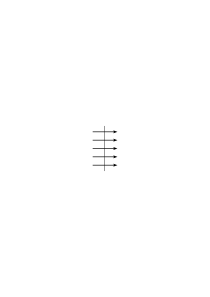,

but like this:

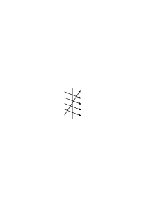

Although when looking something up in the table he had looked from left to right, or pointed with his finger.

### [EPB](/w-epb/#ms-115-203.2) [203\[2\]](https://cdn.wittgensteinnachlass.com/2000px/webp/Ms-115/203.webp)

77 – But suppose we say that, with all the normal procedures of looking things up in the table, he transcribes an ‘A’ into an ‘n’, a ‘B’ into an ‘x’, – in short, that he does not transcribe according to a schema which, as we would say, displays any simple regularity: could we not also call this ‘deriving’?

### [EPB](/w-epb/#ms-115-203.3) [203\[3\]](https://cdn.wittgensteinnachlass.com/2000px/webp/Ms-115/203.webp)

78 But suppose he does _not_ stick to his way of transcribing; rather, he changes it according to a simple rule: if he has once transcribed an ‘A’ into an ‘n’, then he transcribes the next ‘A’ into an ‘o’, the next into a ‘p’, etc. But where is the boundary between this procedure & one that is wholly without rules? –

### [EPB](/w-epb/#ms-115-203.4+204.1) [203\[4\]](https://cdn.wittgensteinnachlass.com/2000px/webp/Ms-115/203.webp),[204\[1\]](https://cdn.wittgensteinnachlass.com/2000px/webp/Ms-115/204.webp)

Now one might object that in case (76) I apparently assumed that he _understood_ the table in a way other than the usual one. But what do we call ‘understanding the table in such-and-such a way’? However you imagine the process of ‘understanding’ it, it is only a link between the processes of deriving that I have described & the transcription itself. Indeed, this ‘understanding’ could again be described by a schema of arrows; & we could then say that he looked up the table, for example, _like this_:

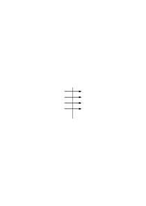,

understood it _like this_:

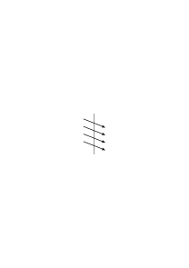

& transcribed _like this_:

### [EPB](/w-epb/#ms-115-204.2) [204\[2\]](https://cdn.wittgensteinnachlass.com/2000px/webp/Ms-115/204.webp)

But does this mean that the word “derive” (or “take”) has no proper meaning; since, if we pursue its sense, it seems to dissolve into nothing?

### [EPB](/w-epb/#ms-115-204.3) [204\[3\]](https://cdn.wittgensteinnachlass.com/2000px/webp/Ms-115/204.webp)

In case (75), the meaning of the word “derive” stood quite clearly before us. But we said to ourselves that this was only a quite special case of deriving. The essential feature of this process appeared to us here in a particular guise & it seemed that we had to remove this particular guise from it in order to see the essential feature. In examples (76), (77), (78) we tried to do this, only to find that what had seemed to be a garment belonged to the essential feature of the case itself. (It was as though we had tried to find the real artichoke by stripping it of its leaves.)

### [EPB](/w-epb/#ms-115-204.4+205.1) [204\[4\]](https://cdn.wittgensteinnachlass.com/2000px/webp/Ms-115/204.webp),[205\[1\]](https://cdn.wittgensteinnachlass.com/2000px/webp/Ms-115/205.webp)

Deriving is indeed represented in (75); that is, this example shows us one case from the family of cases in which this word is used. And the explanation of what this word is used for – or the word ‘reading’, or the expression ‘being guided’ – consists in examples which bring characteristic features of the use before our eyes. Some of these examples will represent such a feature in exaggerated form, some in transitional forms, some will show us its fading away. Imagine that someone wanted to give you an idea of the particular facial features of the members of a certain family. He does this by showing you family portraits & pointing out the characteristic features in them. His task will be to show you these pictures in the correct sequence & in the correct combinations, so that, for example, you can see how certain influences have gradually changed the family’s features; or in what particular way these faces age, which facial features become especially prominent in the process, etc.

### [EPB](/w-epb/#ms-115-205.2) [205\[2\]](https://cdn.wittgensteinnachlass.com/2000px/webp/Ms-115/205.webp)

It was not the task of our examples to let us see the essence of deriving, reading, etc., through a veil of inessential features. Nor were the examples descriptions of an exterior intended to let us guess a core which, for some reason, we could not show in its nakedness. We are tempted to think that these examples are indirect aids for producing in our minds a certain image, a certain idea; that they _indicate_ something they cannot _show_. (This _would_ be something like wanting to ‘give someone a picture’ of what it was like when people danced waltzes in my youth.)

### [EPB](/w-epb/#ms-115-205.3) [205\[3\]](https://cdn.wittgensteinnachlass.com/2000px/webp/Ms-115/205.webp)

Our method is purely _descriptive_; the descriptions we give are not indications of explanations.

### [EPB](/w-epb/#ms-115-205.4+206.1) [205\[4\]](https://cdn.wittgensteinnachlass.com/2000px/webp/Ms-115/205.webp),[206\[1\]](https://cdn.wittgensteinnachlass.com/2000px/webp/Ms-115/206.webp)

“But, reading”—we would like to say—“is after all a quite definite process! Read a printed page, and then you can see it; something special is going on there, something that cannot be compared with anything else.”

Well, what is going on when I read? I see printed words & utter words. But that is, of course, not all, since I could quite easily see printed words & utter words & yet it would not be _reading_. Not even if the words I utter are those which, in accordance with an existing alphabet, one _is supposed_ to read off from those printed words. And if you say that reading is a quite definite experience, it makes no difference at all whether you read according to one of the rules of the alphabet generally recognized by people or not. – What, then, is characteristic of the experience of reading? – I would like to say, “The spoken words _come_ in a special way.” Namely, they do not come as they would if, for example, I were inventing them. They come of themselves. But that is not enough either; for all kinds of words can _come to me_ while I am looking at the printed words, and yet I have not thereby read them. I could also say that the spoken words do not come to me as if, for example, something reminded me of them. Rather, the spoken words, as it were, slip in while reading. Indeed, I cannot look at a printed word – if I know print – without a peculiar process of inner hearing of the word.

### [EPB](/w-epb/#ms-115-206.2+207.1+208.1) [206\[2\]](https://cdn.wittgensteinnachlass.com/2000px/webp/Ms-115/206.webp),[207\[1\]](https://cdn.wittgensteinnachlass.com/2000px/webp/Ms-115/207.webp),[208\[1\]](https://cdn.wittgensteinnachlass.com/2000px/webp/Ms-115/208.webp)

I would not, for example, like to say: “The (printed) sign “nothing” always reminds me of the sound “nothing””. I said that the spoken words come ‘in a special way’ when reading; but in what way? Is this not a fiction? Let us look at individual letters & pay attention to the way in which the sound of the letter comes.

79 Read the letter ‘A’. Now, how did the sound come? We know nothing at all to say about it. – Now read the 79th letter ‘a’ in game (37), by making the corresponding movement with your hand! How did this movement come? Was it different from the sound in the previous attempt? – I looked in the table & made the corresponding movement; I have nothing more to say. – Now look at the sign ‘’ and let a letter occur to you while doing so; say it aloud. The sound ‘U’ occurred to me, but I could not say that there was an essential difference in the way in which this sound _came_. The difference lay in the somewhat different situation: I had previously said to myself that I should let a sound occur to me; there was a certain tension before the sound came. And the sentence “this is a ‘U’” did not occur to me, as it does when I look at the sign ‘U’. Also, that sign was not _familiar_ to me, as the letters are; I looked at it as if in suspense, with a certain interest in its form, and thought of an inverted σ. And if you say that the letter A does not ‘_remind_’ you of the sound, as, for example, the sight of a crocodile reminds you of the word ‘eat’, there are transitions here; you could, for example, see the form 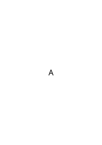 on a trestle or on a roof frame & the sound ‘a’ would not occur to you; or the sight could remind you of an A & you utter the sound. – Imagine that you now had to use the sign  really as a sound-sign; so you get used to pronouncing a particular sound when you see it, say the sound ‘st’. Can we say more than that after some time this sound comes automatically when we see the sign? That is, when we see it we no longer ask ourselves, “What kind of letter is this?” – nor, of course, do I say to myself, “I want to pronounce the sound ‘st’ at this sign”, nor even “This sign somehow reminds me of the sound ‘st’”.

### [EPB](/w-epb/#ms-115-208.2+209.1) [208\[2\]](https://cdn.wittgensteinnachlass.com/2000px/webp/Ms-115/208.webp),[209\[1\]](https://cdn.wittgensteinnachlass.com/2000px/webp/Ms-115/209.webp)

What is there in the assertion that reading is ‘a quite definite process’? Surely this means that when one reads, _a_ particular process always takes place, one that we recognize. – But if at one time I read a sentence in print & at another time move myself in game (37) according to a sentence, using the table, – does the same mental process really take place here? On the other hand, there is certainly a uniformity in the experience of reading a printed page! For the process is uniform. And it is, of course, understandable that this process differs from, for example, letting words occur to one when looking at arbitrary lines. For the mere sight of a printed line is already extraordinarily characteristic, that is, a quite specific image: the letters are all approximately the same size, recurring again and again; the words, most of which constantly repeat themselves & are infinitely familiar to us, just like familiar faces. – Think of the unease we feel when the spelling of a word is changed (& of the still deeper feelings which questions of the spelling of words have aroused in some people). Of course, not every form of sign has been deeply impressed upon us. A sign such as ‘~’ for negation can be replaced by any other without arousing anything in us. – Consider that the seen word-image is familiar to us in a similar way to the heard one. – The eye also glides differently over the printed line than over a series of arbitrary hooks . (I am not speaking here of what can be established by observing eye movements.) It glides, one might say, particularly effortlessly, without catching, & yet it does not slide. And an involuntary speaking takes place in the imagination. And this is how it is when I read German or other languages, printed or written, & in different scripts. – But which of all this is essential to reading as such? Not a feature that occurred in all cases of reading.

### [EPB](/w-epb/#ms-115-209.2) [209\[2\]](https://cdn.wittgensteinnachlass.com/2000px/webp/Ms-115/209.webp)

But do we not, when we read, experience a kind of causation of our speaking by the word-images?

80 Read a sentence, & now look along the series

& speak a sentence while doing so. Is it not clear that in the first case the speaking was _connected_ with the sight of the signs & in the second it runs alongside the looking without connection?

### [EPB](/w-epb/#ms-115-209.3+210.1) [209\[3\]](https://cdn.wittgensteinnachlass.com/2000px/webp/Ms-115/209.webp),[210\[1\]](https://cdn.wittgensteinnachlass.com/2000px/webp/Ms-115/210.webp)

But why do you say that we feel a causation? Causation is, after all, what we establish through experiments by observing the regular occurrence of events. How could I say that I feel precisely what is established in this way through experiments? (This will have to be discussed later.) One could rather say that I feel that the letters are the _ground_ why I read in such and such a way. For if someone asked me, “why do you read _so_?”, I justify it by the letters that are there. – But what should it mean to _feel_ this justification which I have expressed, thought? – I would like to say: when reading I feel a certain _influence_ of the letters on me, but not an influence of those flourishes on what I say. Let us again compare a single letter with such a flourish. Would I also say that I feel the influence of ‘i’ when I read this letter? There is, of course, a difference between saying the sound ‘i’ when looking at ‘i’ and saying it when looking at . The difference is that, when looking at the letter, the inner hearing of the i-sound occurs automatically, indeed _against_ my will; & when I read the letter aloud, its pronunciation is less effortful than when I say ‘i’ while looking at . – That is how it is when I make the _attempt_; but of course not when, happening to look at the stroke 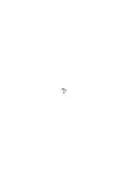, I happen to utter, in some context, a word in which the i-sound occurs.

### [EPB](/w-epb/#ms-115-210.2+211.1) [210\[2\]](https://cdn.wittgensteinnachlass.com/2000px/webp/Ms-115/210.webp),[211\[1\]](https://cdn.wittgensteinnachlass.com/2000px/webp/Ms-115/211.webp)

We would never have thought that we _felt an influence_ of the word-images on us when reading if we had not compared this case with that of arbitrary strokes. And here we certainly notice a _difference_. And we interpret this difference as influence, & the absence of influence. And we are particularly inclined to this interpretation when we deliberately read slowly, – perhaps in order to see what happens when reading. When we, as it were, deliberately let ourselves be _guided_ by the letters. But this ‘letting myself be guided’ consists precisely in the fact that I look closely at the letters, perhaps switching off certain other thoughts. – Consider here what you actually do when you let someone lead you by the hand along a path. –

### [EPB](/w-epb/#ms-115-211.2) [211\[2\]](https://cdn.wittgensteinnachlass.com/2000px/webp/Ms-115/211.webp)

We imagine that we perceive, through a kind of feeling, a connecting mechanism between the word image & the sound we speak. For when I speak of the experience of influence, of causation, of being guided, this is supposed to mean that I, as it were, feel the movement of the levers that connect the sight of the letters with the speaking of the sounds.

### [EPB](/w-epb/#ms-115-211.3+212.1) [211\[3\]](https://cdn.wittgensteinnachlass.com/2000px/webp/Ms-115/211.webp),[212\[1\]](https://cdn.wittgensteinnachlass.com/2000px/webp/Ms-115/212.webp)

I could have aptly represented my experience when reading a word in various ways. Thus I could have said that what happens when reading a word is not merely that I see & at the same time utter something, but that I also feel that the written word _suggests_ to me what I say. But I could also have said that, when reading words, the image of the letter & the sound form, in a peculiar sense, a _unity_; so that one might want to explain the connection of the sound _e_ with the written sign ‘e’ by pointing to the sign and saying: “That _is_ an _e_”. (A connection, a ‘unity’, not unlike this exists, for example, between the faces of famous men & the sound of their names. If, for example, you say names such as Schubert, Haydn, Mozart to yourself & at the same time imagine the faces of these men, it may seem to you as if those names were the correct expression for these facial features; as if the name Schubert correctly described this face.) When I have the experience of this unity, it seems to me as if, for example, when reading the word ‘yes’, I could not properly distinguish between the written word & the spoken one; or, as I could also say, as if uttering the word were part of perceiving the sign itself.

### [EPB](/w-epb/#ms-115-212.2) [212\[2\]](https://cdn.wittgensteinnachlass.com/2000px/webp/Ms-115/212.webp)

But now read a few sentences in print, as you usually do when you are not thinking about the concept of reading; & then ask yourself whether you have had such experiences of unity, of influence, etc., while reading. Do not say that you had them unconsciously! – Nor should we be misled by the image: ‘Upon closer inspection,’ these phenomena become apparent. (If I want to describe what a mountain looks like from a distance, this description will not become more precise by describing what I see when looking at it from close up.)

### [EPB](/w-epb/#ms-115-212.3+213.1+213.2) [212\[3\]](https://cdn.wittgensteinnachlass.com/2000px/webp/Ms-115/212.webp),[213\[1\]](https://cdn.wittgensteinnachlass.com/2000px/webp/Ms-115/213.webp),[213\[2\]](https://cdn.wittgensteinnachlass.com/2000px/webp/Ms-115/213.webp)

I can say that someone who reads is guided by the letters; & that someone who says a sentence while looking along that series of squiggles is not guided. This is an explanation for someone who understands the expression ‘being guided by letters’ before he understands the word ‘reading’. But it would be wrong to say: “Someone who reads has the feeling, the experience, of being guided.” (Unless this is merely meant to give every experience while reading the name ‘experience of being guided’.) Think again of what you experience, feel, when you are led along a _path_.

### [EPB](/w-epb/#ms-115-213.3) [213\[3\]](https://cdn.wittgensteinnachlass.com/2000px/webp/Ms-115/213.webp)

81 Consider this case: You are on a level surface (perhaps with your eyes closed) & someone is leading you by the hand, sometimes to the right, sometimes to the left; you must always be alert to the tug of his hand, & perhaps take care not to stumble at an unexpected tug. (This could occur in a game.) – Or: someone drags you by the hand here and there, to places where you do not want to go. – Or: you are led in a dance by a partner. You make yourself as receptive as possible in order to guess his intention & follow the slightest pressure. – Or: someone leads you along a path. You walk alongside each other in conversation & wherever he goes, you go too. – Or: you walk along a street (& are guided by it). All these situations are similar to each other; but what is common to all these experiences?

### [EPB](/w-epb/#ms-115-213.4+214.1) [213\[4\]](https://cdn.wittgensteinnachlass.com/2000px/webp/Ms-115/213.webp),[214\[1\]](https://cdn.wittgensteinnachlass.com/2000px/webp/Ms-115/214.webp)

“But being guided is surely a specific experience.” – More on this use of the word ‘specific’ later. But it is certainly not always the same experience. And if you say that it is a specific experience, the answer to that is: You are thinking of _a_ specific experience of being guided.

### [EPB](/w-epb/#ms-115-214.2) [214\[2\]](https://cdn.wittgensteinnachlass.com/2000px/webp/Ms-115/214.webp)

82 Consider, for example, these cases: In the game (38), someone who draws a line according to the commands looks _conscientiously_ at the letter in the sentence before each line segment. We can easily form an image of this, & we shall say: _he_ is being guided.

### [EPB](/w-epb/#ms-115-214.3) [214\[3\]](https://cdn.wittgensteinnachlass.com/2000px/webp/Ms-115/214.webp)

Let us suppose that B does the same in the game (47); but if we now expand the number of sentences in the game, wanting to introduce, for example, the sentences ‘a c a a’ & ‘c c a a’, B does not react to them _at all_; he behaves as if we had shown him something completely foreign. Am I now to say that his careful inspection of each letter, etc., was merely automatic action? That he did not take the sentences as sentences, but, as it were, only as words?

### [EPB](/w-epb/#ms-115-214.4+215.1) [214\[4\]](https://cdn.wittgensteinnachlass.com/2000px/webp/Ms-115/214.webp),[215\[1\]](https://cdn.wittgensteinnachlass.com/2000px/webp/Ms-115/215.webp)

83 Imagine the game (38) being played with the help of the table (37). There are now various versions: in one, B always draws the line segments parallel to the arrows in the table, but in another at an angle of 30˚ to them, etc. You can now imagine someone who repeatedly forgets which version he is playing. He looks conscientiously at the table, but then draws irregularly in some direction. One might imagine this as his seeing a different explanatory schema of the table before his mind each time. But if he played the game correctly, we would nevertheless say that he was guided, & had the experience of being guided, even if he did not have an explanatory schema of the table before his mind. Why not here as well? And is he guided when he conscientiously looks up the table & conscientiously draws the strokes irregularly? “But someone who _follows_ the arrows says to himself: ‘I draw the stroke _that way_ because the arrow points *there*.’” – But why should our forgetful friend not say precisely that to himself?

### [EPB](/w-epb/#ms-115-215.2) [215\[2\]](https://cdn.wittgensteinnachlass.com/2000px/webp/Ms-115/215.webp)

Someone may also know by heart the sentences & which figure they mean in (47), but nevertheless let himself be guided by them, as it were, for caution: look at them letter by letter, etc.

### [EPB](/w-epb/#ms-115-215.3) [215\[3\]](https://cdn.wittgensteinnachlass.com/2000px/webp/Ms-115/215.webp)

84 Consider this case too: We show someone who has played the game (37) a sentence from this game; then we say to him: “Go wherever it occurs to you.” We now notice that the path he takes always has _a_ specific relation to the sentence we had shown him. (For example, he always goes opposite to the directions of the arrows in the table.) – –

### [EPB](/w-epb/#ms-115-215.4+216.1) [215\[4\]](https://cdn.wittgensteinnachlass.com/2000px/webp/Ms-115/215.webp),[216\[1\]](https://cdn.wittgensteinnachlass.com/2000px/webp/Ms-115/216.webp)

If I want to call the experience of being guided to mind, I imagine the ‘conscientious’ checking, etc. I even adopt a specific facial expression (perhaps that of a conscientious accountant). In this image, for example, _carefulness_ is very essential; in another image, perhaps, the switching off of all one’s own will. (Imagine that someone does what the ordinary person does with signs of inattention with an expression – & why not with the sensations? – of carefulness: He carefully lets the crockery fall to the floor, spills the water on the table just as carefully, etc. Is he now careful? –) If I vividly imagine such a specific process, it appears to me as _the_ experience of being guided (or reading). But now I ask myself: “What are you doing?” – You look at every sign, you make this face, you slowly draw the line segment (etc.). – _That_ is the experience of being guided? I would like to say: “No, that is not it; it is something more inward, more essential.” – It is as if all these more or less inessential processes were first clothed in a certain atmosphere, which now evaporates when I look closely.

### [EPB](/w-epb/#ms-115-216.2) [216\[2\]](https://cdn.wittgensteinnachlass.com/2000px/webp/Ms-115/216.webp)

Ask yourself how you draw a line _‘deliberately’_ parallel to an arrow, and at another time deliberately at an angle to the arrow. What is the experience of deliberation? You immediately think of a specific facial expression, a gesture – & then you would like to say: “and it is indeed a _specific_ inner experience.” (With which you have, of course, said nothing more.)

### [EPB](/w-epb/#ms-115-216.3) [216\[3\]](https://cdn.wittgensteinnachlass.com/2000px/webp/Ms-115/216.webp)

(You notice a connection with the question of the nature of intention, of will, – of meaning & understanding.)

### [EPB](/w-epb/#ms-115-216.4+217.1) [216\[4\]](https://cdn.wittgensteinnachlass.com/2000px/webp/Ms-115/216.webp),[217\[1\]](https://cdn.wittgensteinnachlass.com/2000px/webp/Ms-115/217.webp)

85 Draw any driver on the paper

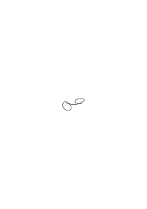

and now trace it next to it

,

let yourself be guided by it. – I would like to say: “Of course! I have now let myself be guided. But what is characteristic about what happened? – When I say what happened, it no longer seems characteristic to me.”

### [EPB](/w-epb/#ms-115-217.2) [217\[2\]](https://cdn.wittgensteinnachlass.com/2000px/webp/Ms-115/217.webp)

But now I notice this: _While_ I am letting myself be guided, everything is quite simple, I notice nothing _special_; but afterwards, when I ask myself what happened then, it seems as if something indescribable had happened. _Afterwards_ no description is enough for me. I cannot, as it were, believe that I merely looked, made the face, drew the line. – But do I _remember_ anything else? No; & yet it seems to me as if something else must have been; and that is when I say the words ‘_guide_’, ‘_influence_’, and others to myself. ‘Because I have indeed been _guided_,’ I say to myself. – Only then does the idea of that _ethereal_, intangible influence arise. (Connection with the problem of ‘voluntary action’. W. James: What happens when, after prolonged deliberation, I get out of bed in the morning.

### [EPB](/w-epb/#ms-115-217.3) [217\[3\]](https://cdn.wittgensteinnachlass.com/2000px/webp/Ms-115/217.webp)

I feel, when I think about the experience afterwards, that its essence is ‘the experience of an _influence_, a _connection_,’ as opposed to any mere simultaneity of phenomena; but at the same time I would not want to call any experienced phenomenon an ‘experience of influence’. (The idea: the will is not a _phenomenon_.) I would like to say that I experienced the ‘_because_’; & yet I do not want to call any phenomenon an ‘experience of because’.

### [EPB](/w-epb/#ms-115-217.4+218.1+219.1) [217\[4\]](https://cdn.wittgensteinnachlass.com/2000px/webp/Ms-115/217.webp),[218\[1\]](https://cdn.wittgensteinnachlass.com/2000px/webp/Ms-115/218.webp),[219\[1\]](https://cdn.wittgensteinnachlass.com/2000px/webp/Ms-115/219.webp)

86 Let us compare with this _case_: someone is supposed to say what he feels when a weight rests on the flat of his hand. – I can now imagine that a conflict arises here: on the one hand, he says that what he feels is a pressure against the palm of his hand & a tension in the muscles of his arm; on the other hand, he wants to say: “but that is not all; I feel a pull, a striving of the weight downwards!” But when does he feel this ‘striving’? When he thinks of the ‘striving’. A certain picture, a gesture, a tone of voice is associated here with the word ‘striving’; and you have the ‘sensation of striving’ when this picture, this gesture, indeed this word, floats before you. – Also think of this: some people say that a ‘fluid’ flows from this or that to them. – That is also why the word ‘_influence_’ occurred to us. – I would like to say, “I experience the because.” – But not because I remember this experience, but because, when philosophizing about what I experience, I view this, as it were, through the medium (the atmosphere) of the concept ‘because’ (or ‘influence’, or ‘cause’, or ‘connection’). For of course I do what I do under the influence of the model; but this does not simply lie in what I feel when drawing the line, but also, for example, in the fact that I draw it _parallel_ to the other (although that too is of course not generally essential to being guided). We also say: “You _see_ that I am being guided by it”; _& what does the one who sees this see_? – But what I say about the process afterwards can also constitute being guided. For example, that I say “I have been guided”. – This sounds strange, for how can something become true retrospectively by my saying that it behaved in this way? – The use of the past tense here is, however, similar to that of the verb ‘_mean_’ in sentences such as: “When I spoke of Henry IV, I meant the King of France.” (This will have to be discussed later.) We shall, _under certain circumstances_, say that someone was guided because he subsequently views his action under the concept of being guided. (This is connected with our saying that someone can know the motive of his action with certainty.)

### [EPB](/w-epb/#ms-115-219.2+220.1) [219\[2\]](https://cdn.wittgensteinnachlass.com/2000px/webp/Ms-115/219.webp),[220\[1\]](https://cdn.wittgensteinnachlass.com/2000px/webp/Ms-115/220.webp)

If I say to myself: “I am indeed being _guided_,” I make a hand movement, for example, that expresses the guiding:

86 Make such a hand movement, as if you were leading someone along (without actually doing so) & ask yourself what the _guiding_ aspect of this movement consists in. For you have admittedly guided no one here & yet you could call the movement a ‘_guiding_’ one. So neither _the essence_ of guiding nor the sensation accompanying it was contained in this movement & yet you could not help using this designation. It is simply _a form of appearance_ of guiding that imposes this expression upon you. – Recall the discussion of (66).

### [EPB](/w-epb/#ms-115-220.2) [220\[2\]](https://cdn.wittgensteinnachlass.com/2000px/webp/Ms-115/220.webp)

87 Imagine a surface painted in different colours. Say one part is green. The green passes in various directions into other colours; in one direction it becomes more and more yellowish & finally pure yellow, in another it becomes more bluish & finally sky-blue, & this passes in one direction into white, etc. In some directions the colour changes rapidly – one might say the colour gradient is steep – while in others it is gentler, and in places quite or nearly level. – Now imagine this surface so large that you cannot take it in at one glance; suppose you take a walk on it. – You are right in the blue & bluish part; now you are to say what colour the surface has. There is a tendency, namely, to believe that it has _one_ colour. You will be tempted to say: “It is really _blue_; admittedly the blue also shades into other colours, but what is common, what is characteristic, is that it is blue.”

### [EPB](/w-epb/#ms-115-220.3) [220\[3\]](https://cdn.wittgensteinnachlass.com/2000px/webp/Ms-115/220.webp)

But if you move further into the reddish part, your feeling will change; & you will want to say: “_Perhaps_ I should really have said it is bluish red; the blue was only a limiting case; really it is bluish red.” You could then be led from colour to colour & deceived by each. We would like to cling desperately to each one until there is no trace of it left & we give in to another impression.

### [EPB](/w-epb/#ms-115-220.4+221.1) [220\[4\]](https://cdn.wittgensteinnachlass.com/2000px/webp/Ms-115/220.webp),[221\[1\]](https://cdn.wittgensteinnachlass.com/2000px/webp/Ms-115/221.webp)

The more familiar the shade of colour is to me, and the stronger the impression it makes on me, the more inclined I am to take it for the colour of the surface.

### [EPB](/w-epb/#ms-115-221.2) [221\[2\]](https://cdn.wittgensteinnachlass.com/2000px/webp/Ms-115/221.webp)

This is how it is when one asks: “What is the essence of punishment?”, – and one person says, _really_, every punishment is an act of revenge, another that the essence of punishment is deterrence, and so on. But aren’t there typical cases of revenge, & again typical cases of measures of deterrence, & others of punishment as a means of reform; & aren’t there countless intermediate stages & mixtures?

### [EPB](/w-epb/#ms-115-221.3) [221\[3\]](https://cdn.wittgensteinnachlass.com/2000px/webp/Ms-115/221.webp)

So if we were asked about the essence of punishment, or about the essence of revolution, or of knowledge, or of cultural decline, or of a sense for music, – we should not try to state something common to all the cases, – what they all really are, – that is, an ideal _contained_ in them all; but instead examples, as it were centres of variation.

### [EPB](/w-epb/#ms-115-221.4+222.1) [221\[4\]](https://cdn.wittgensteinnachlass.com/2000px/webp/Ms-115/221.webp),[222\[1\]](https://cdn.wittgensteinnachlass.com/2000px/webp/Ms-115/222.webp)

So, when one asks us: “What does ‘reading’ consist in?”, we want to say: Reading is a definite mental activity. Then we are inclined to read something in order to see what this activity consists in. In ordinary reading we notice nothing, & now we want to look more closely. Then it seems to us that we see something: the word-forms speak to us in a definite way. They are familiar, expressive physiognomies (this may be especially true of written words, & in handwriting very familiar to us). And it is precisely the familiarity of the impression that misleads us into believing that here we have what is essential. But we need only walk further through the region of reading, & nothing remains of this particular impression; the landscape changes.

### [EPB](/w-epb/#ms-115-222.2) [222\[2\]](https://cdn.wittgensteinnachlass.com/2000px/webp/Ms-115/222.webp)

This is what happens to us with many concepts – e.g. that of the picture, of the depiction –: when we think about them, we first think of the part of their extension where we are, one might say, _at home_. From there we are drawn out into the distance; & we do not notice that everything has now changed _gradually_, completely. And to say: at bottom it is always the same, – perhaps now means only: I come from _there_, I want to compare everything with this state.

### [EPB](/w-epb/#ms-115-222.3) [222\[3\]](https://cdn.wittgensteinnachlass.com/2000px/webp/Ms-115/222.webp)

What does it mean, then, when we say that the letters of our script, or the word-images & sounds, are familiar to us, – or that we recognize them when we perceive them?

### [EPB](/w-epb/#ms-115-222.4) [222\[4\]](https://cdn.wittgensteinnachlass.com/2000px/webp/Ms-115/222.webp)

Is there _a_ feeling of familiarity, and do we therefore have it whenever we perceive familiar, known, objects? Yes, do you usually have a feeling of familiarity when you look at the familiar things in your surroundings? – When do we have such feelings? – It would, however, have been easy to say on which occasions we have the _opposite_ feelings: surprise, astonishment, bewilderment, etc. – Let us imagine this process:

### [EPB](/w-epb/#ms-115-222.5+223.1) [222\[5\]](https://cdn.wittgensteinnachlass.com/2000px/webp/Ms-115/222.webp),[223\[1\]](https://cdn.wittgensteinnachlass.com/2000px/webp/Ms-115/223.webp)

88 A shows B a series of objects; B is to say whether he knows them or not.

### [EPB](/w-epb/#ms-115-223.2) [223\[2\]](https://cdn.wittgensteinnachlass.com/2000px/webp/Ms-115/223.webp)

Compare these cases: A shows B, for example, a series of instruments: a thermometer, a spectroscope, an electrometer, a set of scales, and others; but then a pencil, a pen, a pebble.

In some of these cases: a search & reflection: “What can this be?” – Then again he simply says: Of course, “A set of scales!” (as it were, breathing a sigh of relief). With the pencil & pen he is surprised that such familiar things are being shown to him, & with the pebble he does not know at first what to say, because he is attuned to objects that have a particular purpose. Finally he says with a shrug: “It is an ordinary pebble.” – With certain objects: “I have often seen this, but I don’t know what it is”; with others, “It looks as if it were some kind of tool, but I don’t know which.” In one case he says, “That is a pencil”; in another, “That is _your_ pen.”

### [EPB](/w-epb/#ms-115-223.3) [223\[3\]](https://cdn.wittgensteinnachlass.com/2000px/webp/Ms-115/223.webp)

What happens when B recognizes a pencil as a pencil?

### [EPB](/w-epb/#ms-115-223.4) [223\[4\]](https://cdn.wittgensteinnachlass.com/2000px/webp/Ms-115/223.webp)

89 A has shown him a rod-shaped object, B takes it in his hand & examines it; it turns out to consist of two parts, a cap & a pencil. B says: “Why, that’s a pencil.” We could say here: B already knew what a pencil looks like; he could, for example, have drawn or described one at any time. He did not know that the thing shown to him contained what he could have described at any time.

### [EPB](/w-epb/#ms-115-224.1) [224\[1\]](https://cdn.wittgensteinnachlass.com/2000px/webp/Ms-115/224.webp)

90 Compare with this case: B is shown a written word, but it is held upside down. B does not recognize it; now we slowly turn the sheet of paper; finally B says: Now I see it, it is “pencil”. – We can say: He knew what the word “pencil” looked like; he did not know that the word shown to him would look like that when turned upside down.

### [EPB](/w-epb/#ms-115-224.2) [224\[2\]](https://cdn.wittgensteinnachlass.com/2000px/webp/Ms-115/224.webp)

In (89) & (90) we could say that something had been hidden. But note the different uses of “hidden”.

### [EPB](/w-epb/#ms-115-224.3) [224\[3\]](https://cdn.wittgensteinnachlass.com/2000px/webp/Ms-115/224.webp)

91 Compare this: You are reading a letter & cannot decipher one of the words. – Then you guess from the context that it must be ‘Boden’; & now you can read it: you recognize this stroke as the ‘B’, this one as the ‘o’, etc. This case is different from the one in which the word was obscured by an ink-blot & you merely guessed from the context that this word must have stood here.

### [EPB](/w-epb/#ms-115-224.4) [224\[4\]](https://cdn.wittgensteinnachlass.com/2000px/webp/Ms-115/224.webp)

92 Compare this: You see a word, but cannot read it; someone alters it slightly: he adds another stroke, lengthens one, or the like; & now you can read it. In (90) B could have said “I looked at the word while it was being rotated & I saw that it had not changed”. –

### [EPB](/w-epb/#ms-115-224.5+225.1) [224\[5\]](https://cdn.wittgensteinnachlass.com/2000px/webp/Ms-115/224.webp),[225\[1\]](https://cdn.wittgensteinnachlass.com/2000px/webp/Ms-115/225.webp)

93 Suppose that the game consists in B telling A _whether_ he recognizes an object; but not what the object is. After a hygrometer, which he does not recognize, A shows him an ordinary pencil. B says that he recognizes it. – What happened there when he recognized the pencil? Did he have to say to himself—even though he did not say it to A—that this was a pencil? Why should that have had to happen? – As what, then, did he recognize the thing?

### [EPB](/w-epb/#ms-115-225.2) [225\[2\]](https://cdn.wittgensteinnachlass.com/2000px/webp/Ms-115/225.webp)

Suppose he had said to himself, “This is a pencil”, could you compare this case with (89) & (90)? In these cases one could say: “He recognizes this thing as that one”, – pointing, for example, to the disguised pencil for ‘_this_’ and to an ordinary pencil for ‘_that_’. And analogously in case (90).

### [EPB](/w-epb/#ms-115-225.3) [225\[3\]](https://cdn.wittgensteinnachlass.com/2000px/webp/Ms-115/225.webp)

In (93) the pencil did not change, & the words “This is a pencil” did not relate the object to a _sample_ of a pencil. B could have pointed directly to _this_ in answer to the question “What is a pencil?”

### [EPB](/w-epb/#ms-115-225.4) [225\[4\]](https://cdn.wittgensteinnachlass.com/2000px/webp/Ms-115/225.webp)

But when he said to himself “This is a pencil”, – how did he know that, if he did not recognize the thing as anything? But that amounts to asking: “How did he recognize ‘pencil’ as the word for this thing?” Well, how did he recognize it? – He reacted to the sight of the thing by saying these words.

### [EPB](/w-epb/#ms-115-225.5) [225\[5\]](https://cdn.wittgensteinnachlass.com/2000px/webp/Ms-115/225.webp)

94 – Imagine someone showing you colours & asking you to name them. You now say, pointing to a colour, “This is red”. If you were then asked “How do you know that this is red”, what could you answer?

### [EPB](/w-epb/#ms-115-225.6+226.1) [225\[6\]](https://cdn.wittgensteinnachlass.com/2000px/webp/Ms-115/225.webp),[226\[1\]](https://cdn.wittgensteinnachlass.com/2000px/webp/Ms-115/226.webp)

There is, of course, the case in which B was given a general explanation of the concept, e.g.: “We shall call everything that has this shape & writes on paper ‘pencil’”. A now shows B, among other things, a pen; B tries it & says “This is a pencil”. In this case we could say that a _derivation_ takes place; but not in (93) & (94).

### [EPB](/w-epb/#ms-115-226.2) [226\[2\]](https://cdn.wittgensteinnachlass.com/2000px/webp/Ms-115/226.webp)

Are we now to say that, when A showed B the pencil after the hygrometer, which he had never seen before, B had a feeling of familiarity at the sight of the pencil?

95 Let us imagine what may really have happened. He saw the pencil, smiled, felt relief, & the word came to his mind, or he said it aloud.

### [EPB](/w-epb/#ms-115-226.3) [226\[3\]](https://cdn.wittgensteinnachlass.com/2000px/webp/Ms-115/226.webp)

But how is it: did we now carry out a ‘thought experiment’? – How do we know that this is how things are, simply by imagining them to be so? What sort of strange way is this of establishing how a thing is? – Or is it because these processes take place _in_ me & I need only look inside myself? – We shall speak later of ‘inside’ & ‘outside’, – but in any case one would think that the thing would have to be going on in me just now if I am to see it in myself now. Nor was I remembering the case, for it has never happened to me.

### [EPB](/w-epb/#ms-115-226.4+227.1) [226\[4\]](https://cdn.wittgensteinnachlass.com/2000px/webp/Ms-115/226.webp),[227\[1\]](https://cdn.wittgensteinnachlass.com/2000px/webp/Ms-115/227.webp)

Now one really can carry out an experiment by imagining something. Not an experiment _in_ the imagination, i.e. merely the mental image of an experiment. (One cannot make a laboratory unnecessary simply by imagining apparatus & experiments.)

96 If someone asks me, for example, “How do you greet N., how do you approach him?”, then, in order to answer, I can imagine N. coming in & make, say, the movement of greeting. And this is an experiment. It may mislead me, & what really happens in such a case may be something else; but experience may teach us that what usually happens is what such an experiment shows. So if the question had been, “Does a person smile in such a case?”, then I could indeed have carried out the experiment with the aid of imagination. – But do I now know that _one_ smiles, or only that _I_ smile? And if the former, isn’t imagining then a kind of _remembering_? In any case not necessarily ‘remembering particular cases’.

### [EPB](/w-epb/#ms-115-227.2) [227\[2\]](https://cdn.wittgensteinnachlass.com/2000px/webp/Ms-115/227.webp)

97 – The task would be: “Act out how one approaches someone under such & such circumstances.” Here _remembering_ can take the form of imitation; & there need not be, say, a visual memory-image by which one is guided in imitating. And if I now imitate myself, is that remembering? –

### [EPB](/w-epb/#ms-115-227.3) [227\[3\]](https://cdn.wittgensteinnachlass.com/2000px/webp/Ms-115/227.webp)

98 In such cases one sometimes says, after imagining the situation: “In my own case I know for certain that I smile in such a case, I simply couldn’t do otherwise”. But might it not happen that an eyewitness said to me: “I assure you, you never smiled on those occasions”; & isn’t it possible that I would believe him?

### [EPB](/w-epb/#ms-115-228.1) [228\[1\]](https://cdn.wittgensteinnachlass.com/2000px/webp/Ms-115/228.webp)

But that was not the kind of experiment at issue in (95). For the question was not whether such & such a feeling familiar to us occurs in this case or not, but whether, in considering it, we would see a feeling that we are prepared to call a ‘feeling of familiarity’ (or ‘familiarity’). So if I said: “Let us imagine what actually happens in such a case”, that meant: let us imagine the case without being influenced by the words ‘feeling of familiarity’, thus—as we might say—_without grammatical prejudice_. And we might ask: Do you still feel the need to say that he had the feeling of familiarity at the sight of the pencil?

### [EPB](/w-epb/#ms-115-228.2) [228\[2\]](https://cdn.wittgensteinnachlass.com/2000px/webp/Ms-115/228.webp)

But isn’t that feeling of relief precisely the one that characterizes the transition from the unfamiliar to the familiar? – We say, in very different cases, that someone has feelings of tension & relaxation, of exertion, of relief, of resting: Someone holds a weight with his arm outstretched; his arm, his whole body, are in a state of tension. He puts the weight down, & feels relief. – Someone runs, – then rests. – He thinks intently about a problem in Euclid; he finds the solution & the tension has subsided. – He tries to remember a name, – the name comes to him.

### [EPB](/w-epb/#ms-115-228.3+229.1) [228\[3\]](https://cdn.wittgensteinnachlass.com/2000px/webp/Ms-115/228.webp),[229\[1\]](https://cdn.wittgensteinnachlass.com/2000px/webp/Ms-115/229.webp)

But what do all these cases have in common, such that we say they are all cases of tension & relaxation? –

### [EPB](/w-epb/#ms-115-229.2) [229\[2\]](https://cdn.wittgensteinnachlass.com/2000px/webp/Ms-115/229.webp)

– Why do we use the expression “_search_ in one’s memory” when we want to remember something? – Let us ask ourselves: What is the similarity between the processes of searching one’s memory for a forgotten name, &, for example, searching for a book in the cupboard? – What does the answer to such a question look like?

### [EPB](/w-epb/#ms-115-229.3) [229\[3\]](https://cdn.wittgensteinnachlass.com/2000px/webp/Ms-115/229.webp)

One way of answering would certainly be to describe a series of connecting links. Thus one could say that the case of material searching which comes closest to searching one’s memory is not searching for a book in the cupboard, but looking up in a book a passage that we have forgotten. And now one could interpolate further cases. – Another way of indicating the similarity would be: “In both cases I am initially unable to write something down & later I can.” Or: “In both cases I frown, screw up my face & consider possibilities.”

### [EPB](/w-epb/#ms-115-229.4) [229\[4\]](https://cdn.wittgensteinnachlass.com/2000px/webp/Ms-115/229.webp)

But it is important that we need not be conscious of such similarities in order for the expression “searching one’s memory” to impose itself on us.

### [EPB](/w-epb/#ms-115-229.5+230.1) [229\[5\]](https://cdn.wittgensteinnachlass.com/2000px/webp/Ms-115/229.webp),[230\[1\]](https://cdn.wittgensteinnachlass.com/2000px/webp/Ms-115/230.webp)

Perhaps one would like to say: “Surely a similarity must strike us, or we would not use the same word”. Say instead: “A similarity between these processes must strike us, or we would not use the same picture to represent them”. That means that an act must precede the use of the picture. But why should the ‘striking of the similarity’ not consist partly, or wholly, in our using the same picture? And why should it not consist partly or wholly in our being inclined to use the same expression?

### [EPB](/w-epb/#ms-115-230.2) [230\[2\]](https://cdn.wittgensteinnachlass.com/2000px/webp/Ms-115/230.webp)

We say: “This picture (this expression) imposes itself on me irresistibly”. Isn’t that an experience?!

### [EPB](/w-epb/#ms-115-230.3) [230\[3\]](https://cdn.wittgensteinnachlass.com/2000px/webp/Ms-115/230.webp)

Here we are dealing with one of the many cases that we repeatedly encounter in this investigation: A word is used by us, among other things, to designate a so-called ‘mental’ process or state which prepares an action; in one class of cases such preparation is the practical condition for the action’s taking place; we are accustomed to saying that the mental process _must_ have taken place for the action to have been possible; we are now inclined to _postulate_ such a mental preparation as a precondition of the actions: Thus we say: “One _must_ understand an order before one can carry it out”, “One must know where the pain is in order to point to the place”, “One must know the melody if one wants to sing it”, “The similarity must have struck us before we can express it”.

### [EPB](/w-epb/#ms-115-230.4+231.1) [230\[4\]](https://cdn.wittgensteinnachlass.com/2000px/webp/Ms-115/230.webp),[231\[1\]](https://cdn.wittgensteinnachlass.com/2000px/webp/Ms-115/231.webp)

99 Suppose I had explained the word ‘blue’ to someone by pointing to various blue objects & saying the words “This is called ‘blue’” along with it; what does it mean now when I say: “If he has understood the meaning now, he will bring me something blue when I ask him to”? This seems to say: If he has grasped what all the objects I showed him have in common, he will be in a position to follow my command. But what do they all have in common?

### [EPB](/w-epb/#ms-115-231.2) [231\[2\]](https://cdn.wittgensteinnachlass.com/2000px/webp/Ms-115/231.webp)

100 Can you tell me what a light & a dark blue have in common? Compare this case: I show you two pictures, two different landscapes; in both of them the same bush occurs somewhere. I say: “Show me what these two pictures have in common”. You search the pictures, then point to the bush in reply.

### [EPB](/w-epb/#ms-115-231.3) [231\[3\]](https://cdn.wittgensteinnachlass.com/2000px/webp/Ms-115/231.webp)

101

Or: I show someone two piles of tools, & say: “What the two piles have in common is called ‘chisel’”. The other is to sort the tools until he finds what occurs in both, & thereby, we can say, arrives at the ostensive explanation.

### [EPB](/w-epb/#ms-115-231.4) [231\[4\]](https://cdn.wittgensteinnachlass.com/2000px/webp/Ms-115/231.webp)

102 Or I give this explanation: “In these two pictures you see different patches of colour; the shade that occurs in _both_ is called ‘carmine’.” – Here it makes clear sense to say: “Once he has seen what the two have in common, he can now bring me an object of that colour at my command”.

### [EPB](/w-epb/#ms-115-231.5+232.1) [231\[5\]](https://cdn.wittgensteinnachlass.com/2000px/webp/Ms-115/231.webp),[232\[1\]](https://cdn.wittgensteinnachlass.com/2000px/webp/Ms-115/232.webp)

Compare the process of reading our ordinary script with reading words printed entirely in capital letters, as sometimes happens in the solutions of puzzles. What a different process! – Or read our script from right to left!}

### [EPB](/w-epb/#ms-115-232.2) [232\[2\]](https://cdn.wittgensteinnachlass.com/2000px/webp/Ms-115/232.webp)

103 There is, of course, this game: I say to someone: “I shall explain the meaning of the sign (word) ‘W’ by pointing to various objects. ‘W’ means something that they all have in common”. I now show him two books first, & he asks himself: “Does ‘W’ mean ‘book’?” – Then I point to a brick, & he thinks: “Perhaps it means ‘rectangle’”. Finally I point to a glowing coal & he says to himself: “It means ‘red’; everything he has shown me had something red”; in doing so he may let his gaze roam over everything in the objects that is red. It would also be instructive to consider this variant:

104 The other is to _draw_ or _paint_ at each stage of the game what he thinks I mean. In certain cases it would then be clear what he should draw. If, for example, all the objects had the same factory mark, he would draw this if he believed that was what I meant. But if they are all _reddish_, what should he paint? Which shade of red; & what shape? What if on another occasion he wanted to paint that they were all red & round? One immediately says that an agreement would be necessary here.

### [EPB](/w-epb/#ms-115-232.3) [232\[3\]](https://cdn.wittgensteinnachlass.com/2000px/webp/Ms-115/232.webp)

If someone, pointing to various shades of red, asked: “What do all these have in common, that you call them by the same word?”, – I would like to answer: “Can’t you see it?!”, – & of course this is no answer.

### [EPB](/w-epb/#ms-115-232.4+233.1) [232\[4\]](https://cdn.wittgensteinnachlass.com/2000px/webp/Ms-115/232.webp),[233\[1\]](https://cdn.wittgensteinnachlass.com/2000px/webp/Ms-115/233.webp)

There are cases in which, as experience shows, a person cannot carry out commands such as “Bring me such & such” unless he has first recognized what the things have in common which were pointed to when the relevant word was explained. And this recognition can then consist in his pointing to what they have in common, or drawing something, or imagining something, or saying a particular word, and so on. – But then there are cases in which no such introductory process takes place; & yet we say that he has recognized the common feature in the objects that we meant, when he now carries out our command “Bring me …” to our satisfaction.

### [EPB](/w-epb/#ms-115-233.2) [233\[2\]](https://cdn.wittgensteinnachlass.com/2000px/webp/Ms-115/233.webp)

“Why do you call these different experiences ‘experiences of exertion’ & ‘experiences of relaxation’?” – “Because they all have something in common.” – “What does mental exertion have in common with physical exertion?” – “I don’t know; but evidently there is some similarity.” – But why, then, did you say that they had something in common? – You have thereby used a particular picture but given no explanation. – It may be that all the processes we call exertion (& relaxation) have something in common, e.g. a way of breathing, or a state of tension in certain muscles, etc. But if you cannot say what kind of thing they have in common, it is not an explanation: their similarity consists in their having something in common.

### [EPB](/w-epb/#ms-115-233.3) [233\[3\]](https://cdn.wittgensteinnachlass.com/2000px/webp/Ms-115/233.webp)

Are we now to say that you have a particular ‘feeling of being alike or of similarity’ when you compare the experiences with one another, & _that is why_ you use the same expression for them?

### [EPB](/w-epb/#ms-115-233.4+234.1) [233\[4\]](https://cdn.wittgensteinnachlass.com/2000px/webp/Ms-115/233.webp),[234\[1\]](https://cdn.wittgensteinnachlass.com/2000px/webp/Ms-115/234.webp)

Ask yourself _this_ question: _When_ do you have the feeling? – For what we call ‘comparing two experiences’ is a complicated process: You called the two experiences to mind one after the other, thought alternately of one & of the other; when, while this is going on, do you have the feeling? – What does this question do? It takes away our desire to speak here of a particular feeling.

### [EPB](/w-epb/#ms-115-234.2) [234\[2\]](https://cdn.wittgensteinnachlass.com/2000px/webp/Ms-115/234.webp)

“But I wouldn’t say that the processes were similar if I didn’t have an experience of this similarity?” – But must this experience be a _feeling_? Suppose it were the experience of the word ‘similarity’ imposing itself on you, – would you call this a feeling? – I am not saying that all sorts of feelings do not occur in the process!

### [EPB](/w-epb/#ms-115-234.3) [234\[3\]](https://cdn.wittgensteinnachlass.com/2000px/webp/Ms-115/234.webp)

“But isn’t there a feeling of similarity?” – I believe there is a series of feelings which one could call feelings of similarity in particular cases. Though not _one_ feeling, or _one_ experience, which would be the perception of the similarity. Think of experiences that we have in such cases:

### [EPB](/w-epb/#ms-115-234.4) [234\[4\]](https://cdn.wittgensteinnachlass.com/2000px/webp/Ms-115/234.webp)

105 There is an experience of being almost unable to distinguish. You see, for example, two lengths, or two colours, which are almost exactly alike & want to see whether you can detect a difference between them, or whether their difference is too great for such & such a purpose. You look from one to the other, blink, hold your breath, move your head, perhaps mutter words, and so on. One could say: There is hardly room among all these experiences for a feeling of similarity.

### [EPB](/w-epb/#ms-115-234.5+235.1) [234\[5\]](https://cdn.wittgensteinnachlass.com/2000px/webp/Ms-115/234.webp),[235\[1\]](https://cdn.wittgensteinnachlass.com/2000px/webp/Ms-115/235.webp)

Whenever I see my table, I see table legs that are wholly or almost equally high; but do I also have such experiences of being unable to distinguish?

### [EPB](/w-epb/#ms-115-235.2) [235\[2\]](https://cdn.wittgensteinnachlass.com/2000px/webp/Ms-115/235.webp)

Compare with the first example one in which there is no difficulty whatsoever in distinguishing the similar objects. I say, for example: “I want these two beds of a similar colour, I don’t want a strong contrast here”. The experience when the gaze passes from one to the other could here be called a gentle gliding.

### [EPB](/w-epb/#ms-115-235.3) [235\[3\]](https://cdn.wittgensteinnachlass.com/2000px/webp/Ms-115/235.webp)

I hear variations on a theme & say: “I don’t yet see in what respect this is a variation on the theme, but I notice a certain similarity (analogy).” At certain characteristic points of the variation ‘I knew where I was in the theme’; & this experience could consist in the relevant passage of the theme flashing into my mind, or its musical notation floating before me, or my making the same gesture as at that passage, etc.

### [EPB](/w-epb/#ms-115-235.4) [235\[4\]](https://cdn.wittgensteinnachlass.com/2000px/webp/Ms-115/235.webp)

“But if two colours are similar to each other, surely my experience of this similarity should consist in my grasping _the_ similarity which is _there_.” – But is a bluish green similar to a yellowish green, or not? Under certain circumstances we shall say that they are similar, under others that they are wholly dissimilar. Are we to say that we perceived two different relations holding between the two colours?

106 – Suppose I observe the gradual change in the colour of a substance: a bluish green gradually changes into green, then into yellowish green, into yellow & finally into orange.

### [EPB](/w-epb/#ms-115-235.5+236.1) [235\[5\]](https://cdn.wittgensteinnachlass.com/2000px/webp/Ms-115/235.webp),[236\[1\]](https://cdn.wittgensteinnachlass.com/2000px/webp/Ms-115/236.webp)

I tell you: “It takes only a short time to get from bluish green to yellowish green; they are similar.” – Doesn’t this presuppose an experience of the similarity as such of blue-green & yellow-green? – The experience might be that I see before me in my mind a strip of colour in which blue-green & yellow-green lie close to green, & orange further to the side; or I see a green before me that shimmers now bluish, now yellowish; or I see nothing before me & merely say what I say (This will become clearer later. The issue is: what are the paradigms for the use of the word and what are the objects to which it is applied.). – But when I think about the similarity of blue-green & yellow-green and the dissimilarity of blue-green & orange, I now experience, when imagining this pair of colours, something like tension, I make a face as if I were disgusted, the word ‘discrepancy’ comes to my mind; & with the first pair I make a conciliatory face & feel relaxed. And it is an important fact that I do not see my face while doing this, but only feel it.

### [EPB](/w-epb/#ms-115-236.2) [236\[2\]](https://cdn.wittgensteinnachlass.com/2000px/webp/Ms-115/236.webp)

(Note the large family of meanings of the word “similar”.)

### [EPB](/w-epb/#ms-115-236.3+237.1) [236\[3\]](https://cdn.wittgensteinnachlass.com/2000px/webp/Ms-115/236.webp),[237\[1\]](https://cdn.wittgensteinnachlass.com/2000px/webp/Ms-115/237.webp)

There is something remarkable about the sentence: that we call both mental and physical tension ‘tension’ because there is a similarity between them. Would we say: “We use the word ‘red’ both for a light red and for a dark red because there is a similarity between them”? – If we are asked: “Why do you call this ‘red’ too?”, we would like to say: “Because it _is_ red too”. – Here one would like to propose as an explanation: ‘red’ designates something that the dark and the light red have in _common_; & if by ‘tension’ we also meant something that mental and physical tension have in common, then it would be wrong to say that they are both called ‘tension’ because they are similar to each other, and right to say: they are called ‘tension’ because tension is present in both.

### [EPB](/w-epb/#ms-115-237.2) [237\[2\]](https://cdn.wittgensteinnachlass.com/2000px/webp/Ms-115/237.webp)

But what do light red & dark red have in common? At first glance the answer seems clear: They are both shades of the same colour, red. – But that is only a tautology. Let us ask it like this: What do _these_ two colours, at which I am pointing, have in common (& let one be a light red, the other a dark red)? – The answer to that might be: I don’t know what game you are playing; & on that depends whether I can say that they _have_ something in common, & what.

### [EPB](/w-epb/#ms-115-237.3) [237\[3\]](https://cdn.wittgensteinnachlass.com/2000px/webp/Ms-115/237.webp)

107 Assume: A shows B various colour samples & asks him what each pair of them have in common. B’s answer is to point to the sample of a _pure_ colour. If A shows him pink & orange, B points to a pure red; if A shows him two shades of bluish green, B points to pure blue & pure green, etc.. If, in _this_ game, A showed him light & dark red, the answer would not be in doubt. If he showed him pure red & pure green, the answer would be that these two had nothing in common. – But I can easily imagine circumstances in which we would say that these two colours had something in common, & would also say what it was without stopping to think.

### [EPB](/w-epb/#ms-115-237.4+238.1) [237\[4\]](https://cdn.wittgensteinnachlass.com/2000px/webp/Ms-115/237.webp),[238\[1\]](https://cdn.wittgensteinnachlass.com/2000px/webp/Ms-115/238.webp)

108 – Let us imagine a use of language (a culture) in which there is a common name for green & red, & one for blue & yellow. <s>two castes: the so-called ‘patricians’ wore blue & yellow garments, the ‘plebeians’ red & green ones.</s> <s> This use of words had developed in the following way: Blue & yellow are spoken of as ‘patrician colours’, red & green as ‘plebeian’ ones. But the origin of these words has been entirely forgotten. If a thing is said to be ‘plebeian’ in colour, one of course does not know whether it is green or red, just as we do not know whether something is light blue or dark blue when it is merely said to be blue. If they want to distinguish between blue & yellow, they add another word to the word patrician (as we add the word ‘light’ to the word ‘blue’) & so on. If one asked a man of this people what **these** two colours (which we call ‘yellow’ & ‘blue’) had in common, – would he not answer that they were both patrician? </s>

### [EPB](/w-epb/#ms-115-238.2) [238\[2\]](https://cdn.wittgensteinnachlass.com/2000px/webp/Ms-115/238.webp)

Imagine, say, that people perceived in the nature surrounding them a continuous transition from red colourings into green & from green into red, in the way we see it in autumn in some leaves, which do not first become yellow & then red, but pass from green into red through a dark iridescent tone. <s> Something similar happens with blue & yellow as they see them around them. (For instance, the evening sky is sometimes blue in the east & passes through a light grey into yellow towards the west) </s> For these people red & green always belong together. They are two poles of the same thing. If they want to distinguish red & green in their language, they add one of two adverbs to the common word, as we add the words ‘light’ or ‘dark’ to the word ‘red’. Asked whether these two colourings (one red & one green) have anything in common, they are inclined to answer: yes, both are …

### [EPB](/w-epb/#ms-115-239.1) [239\[1\]](https://cdn.wittgensteinnachlass.com/2000px/webp/Ms-115/239.webp)

108 Conversely, I could also imagine a language (& that once again means a form of life) which establishes a gulf between dark red & light red. etc.

### [EPB](/w-epb/#ms-115-239.2) [239\[2\]](https://cdn.wittgensteinnachlass.com/2000px/webp/Ms-115/239.webp)

Compare (106) & (102): in both the question could be: “What is the common colour?” & the answer could also have the same form although the cases are entirely different.

### [EPB](/w-epb/#ms-115-239.3) [239\[3\]](https://cdn.wittgensteinnachlass.com/2000px/webp/Ms-115/239.webp)

109 An explanation of a word could run: “What these two colours have in common I call ‘red’” – while I point to a bluish & a yellowish red. And someone could understand this explanation; i.e. correctly carry out a command such as “Bring me another red object”. But perhaps he brings me something blue & I want to say: “He seems to notice some similarity between this thing & the samples I showed him”.

[→ ]

### [EPB](/w-epb/#ms-115-239.4) [239\[4\]](https://cdn.wittgensteinnachlass.com/2000px/webp/Ms-115/239.webp)

Some people, when they are supposed to sing back a note played on the piano, regularly sing the fifth of the note.

110 One could therefore imagine a language which has the same name for the fundamental note & the fifth. – Now imagine someone asked: “What do the fundamental note & the fifth have in common?” – To say that they have a certain affinity is of course no explanation. (Explanation of the affinity of the first & second thoughts of a sonata movement)

### [EPB](/w-epb/#ms-115-239.5) [239\[5\]](https://cdn.wittgensteinnachlass.com/2000px/webp/Ms-115/239.webp)

Are we to say that mental & physical exertion are ‘exertions’ _in the same sense of the word_, or in different senses? –

### [EPB](/w-epb/#ms-115-239.6) [239\[6\]](https://cdn.wittgensteinnachlass.com/2000px/webp/Ms-115/239.webp)

There are cases in which we answer a question of this kind without hesitation. Consider the following case:

### [EPB](/w-epb/#ms-115-240.1) [240\[1\]](https://cdn.wittgensteinnachlass.com/2000px/webp/Ms-115/240.webp)

{ 109 “By ‘red’ I mean what these two colours have in common”: Could someone not understand this explanation? – Why not, he could e.g. correctly carry out a command such as “Bring me another red object”. – But perhaps he now brings me a blue object, & we are inclined to say: He seems to notice a similarity between the two samples & this thing. }

### [240\[2\]](https://cdn.wittgensteinnachlass.com/2000px/webp/Ms-115/240.webp)

109 An explanation of a word could run: “What these two colours have in common I call ‘red’”. And someone could understand this explanation. He would e.g. correctly carry out a command, “Bring me another red object”. …

### [EPB](/w-epb/#ms-115-240.3) [240\[3\]](https://cdn.wittgensteinnachlass.com/2000px/webp/Ms-115/240.webp)

109 Consider the sentence: “By ‘red’ I mean what these two colours have in common”. – Could someone not understand this explanation? – Certainly; he could … . – But perhaps … …, & we are then inclined to say: …

### [EPB](/w-epb/#ms-115-240.4+241.1) [240\[4\]](https://cdn.wittgensteinnachlass.com/2000px/webp/Ms-115/240.webp),[241\[1\]](https://cdn.wittgensteinnachlass.com/2000px/webp/Ms-115/241.webp)

111 Someone has learnt the use of the words ‘lighter’ & ‘darker’. He can e.g. carry out a command “Paint a darker shade than this!”, or answer the question “Which of these colours is darker?” & so on. – Now I say to him: “Arrange the vowels a e i o u according to the darkness of their sound!” – Perhaps he merely looks perplexed & does nothing; but perhaps he considers the matter & arranges the vowels something like this: i, e, a, o, u. (Many people in fact do this.) Someone might perhaps believe that the vowels would have to produce colours in the person’s imagination & that he simply arranges these colours. But that is not how it is. The vowels are arranged according to their darkness without the intervention of images of colour.

### [EPB](/w-epb/#ms-115-241.2) [241\[2\]](https://cdn.wittgensteinnachlass.com/2000px/webp/Ms-115/241.webp)

If we were now asked whether _u really_ is darker than _e_, we would be inclined to say: “No, – it somehow gives me a darker impression”.

### [EPB](/w-epb/#ms-115-241.3) [241\[3\]](https://cdn.wittgensteinnachlass.com/2000px/webp/Ms-115/241.webp)

We could now ask someone who had said “u is darker than e”: “What was it that prompted you to use this word? _Why_ do you use the word ‘darker’ here?”

### [EPB](/w-epb/#ms-115-241.4) [241\[4\]](https://cdn.wittgensteinnachlass.com/2000px/webp/Ms-115/241.webp)

Here again there is a temptation to say: “You must have seen something which the relation between colours & the relation between sounds have in common.” – But what if he cannot specify anything of the kind! –

### [EPB](/w-epb/#ms-115-241.5) [241\[5\]](https://cdn.wittgensteinnachlass.com/2000px/webp/Ms-115/241.webp)

Notice the expression “You must …”. One does not mean by this: “Experience has taught me that in such cases one sees something, etc.”. But for that very reason this sentence says nothing about the facts. (It actually suggests a way of representing things.)

### [EPB](/w-epb/#ms-115-241.6) [241\[6\]](https://cdn.wittgensteinnachlass.com/2000px/webp/Ms-115/241.webp)

112 If someone now says to me: “I see a similarity between dark here & dark there, but I cannot say what it consists in”, I say to him: “That characterizes your experience of the similarity.”

### [EPB](/w-epb/#ms-115-241.7+242.1) [241\[7\]](https://cdn.wittgensteinnachlass.com/2000px/webp/Ms-115/241.webp),[242\[1\]](https://cdn.wittgensteinnachlass.com/2000px/webp/Ms-115/242.webp)

Imagine you look at two faces & say: “They are similar to one another, – but I don’t know what the similarity consists in”. Then after a while you say: “Now I know. Their eyes have the same shape”. – Your experience of the similarity is now different from what it was before. This is of course a _grammatical_ remark; like this one: “If one ‘looks more closely’, one sees more clearly what the thing looks like; but not what the visual image one had looks like.”

### [EPB](/w-epb/#ms-115-242.2) [242\[2\]](https://cdn.wittgensteinnachlass.com/2000px/webp/Ms-115/242.webp)

Now to the question: “_Why_ do you use the word ‘darker’ here?” – The answer could be: “I did not use it for any _reason_.” But I can say _this_: I do not merely use the _word_, I also use it in the same tone, & with the same facial expression & the same gesture, as when speaking of something visible. – It is the same when we speak of _deep_ sleep, _deep_ sadness, & a _deep_ well.

### [EPB](/w-epb/#ms-115-242.3) [242\[3\]](https://cdn.wittgensteinnachlass.com/2000px/webp/Ms-115/242.webp)

113 There are people who distinguish between fat & thin among the seven days of the week; & my experience when I experience a day of the week as fat consists in the _word_ ‘fat’ coming to me, perhaps with a facial expression conveying corpulence & a certain ease.

### [EPB](/w-epb/#ms-115-242.4) [242\[4\]](https://cdn.wittgensteinnachlass.com/2000px/webp/Ms-115/242.webp)

Do not say that this is not the actual experience, because one must first experience the day as fat before using the word ‘fat’ for it & making the accompanying gesture. Why _must_ one? Are you conscious of such a first experience? – And if not, – is this ‘must’ not then the expression of a grammatical prejudice? – Rather, from this & similar cases you learn an important use of the word ‘experience’.

### [EPB](/w-epb/#ms-115-242.5) [242\[5\]](https://cdn.wittgensteinnachlass.com/2000px/webp/Ms-115/242.webp)

We are now inclined to say that one vowel is not darker than another _in the same sense_ in which one colour is darker than another. For that was what it meant: _u_ is not _really_ darker than _e_ etc.. – Now consider this example:

### [EPB](/w-epb/#ms-115-243.1) [243\[1\]](https://cdn.wittgensteinnachlass.com/2000px/webp/Ms-115/243.webp)

114 We have taught someone to understand the colour names ‘red’ & ‘green’ by ostensive explanations. He can e.g. carry out commands in which these words are used. I now show him a pile of leaves, some of which are reddish brown, the others greenish yellow, & say: “Put the red & the green leaves into two piles”. He may then separate the reddish-brown & the greenish-yellow leaves from one another. – Have I used the words ‘red’ & ‘green’ here in the same sense as in earlier, normal, cases, or in a different, though similar, sense? What grounds would one give for the latter view? One can, e.g., point out that when given the command ‘Paint a red spot!’, with all colours at his disposal, he would certainly not have painted a brown one with a reddish tinge; & for that reason, one might say, ‘red’ means something different in the two cases. But I could also say: “It always has the same meaning. The circumstances of application are somewhat different here.”

### [EPB](/w-epb/#ms-115-243.2+244.1+245.1) [243\[2\]](https://cdn.wittgensteinnachlass.com/2000px/webp/Ms-115/243.webp),[244\[1\]](https://cdn.wittgensteinnachlass.com/2000px/webp/Ms-115/244.webp),[245\[1\]](https://cdn.wittgensteinnachlass.com/2000px/webp/Ms-115/245.webp)

In some cases we take it as a criterion that a word has two meanings that there are two different _explanations_ of the word. We then say not only that the word is used with two different meanings, but also what these two meanings are. Thus we say that the word ‘bank’ has two meanings, since on the one hand it means _this_ object (a bench), on the other _this_ one (the credit bank). And the objects I point to here are the samples according to which I am to guide myself in using the word. Am I now to say that the word ‘red’ has different meanings because I apply it to different tones? – Let us imagine this case:

115 Somewhere people always use the colour words ‘red’, ‘green’, ‘blue’, ‘yellow’ in conjunction with samples of these colours which they carry with them. All the samples of _Red_ have the same tone & likewise only one tone of Green is used as a sample, etc.. Their colour words are signs which they make with their hands, & each sample card bears such a sign. When using the signs they always look to see which card bears the sign the other person gives, & so on. But they use these samples for _different_ tones of red, green, etc. Thus in response to a command “Bring me a green leaf!” they fetch this green or that one, & so on.

### [EPB](/w-epb/#ms-115-245.2) [245\[2\]](https://cdn.wittgensteinnachlass.com/2000px/webp/Ms-115/245.webp)

One will be inclined to say that in this language each of the colour words has only one meaning, perhaps that it means what all red tones (etc.) have in common. – “But do they now use their sample for what the different reds have in common, or simply, on one occasion for one tone, on another occasion for the other, hence ‘with different meanings’?”

116 – But now assume that in response to the command “Bring me two red books”, you brought a vermilion one & a carmine one: How did _you_ apply the word ‘red’ in the command? Did you understand by it what the two reds have in common, or simply vermilion on one occasion & carmine on the other?

### [EPB](/w-epb/#ms-115-245.3) [245\[3\]](https://cdn.wittgensteinnachlass.com/2000px/webp/Ms-115/245.webp)

117 Imagine this case: A people possesses no word corresponding to our ‘red’, or ‘green’, etc., but for each of these words it has five different ones, for five degrees of brightness of the colours. When these people learn German, they are surprised that there is only _one_ word for these five. Would they not say that our ‘red’ had five different meanings? >

### [EPB](/w-epb/#ms-115-245.4) [245\[4\]](https://cdn.wittgensteinnachlass.com/2000px/webp/Ms-115/245.webp)

118 Imagine a language in which the word ‘red’, pronounced in different pitches, is applied to different degrees of brightness of red. Here, we would say, it means different things depending on the pitch in which it is pronounced. But we could also say: “It always means the same; & the pitch indicates the degree of brightness.”

### [EPB](/w-epb/#ms-115-245.5+246.1) [245\[5\]](https://cdn.wittgensteinnachlass.com/2000px/webp/Ms-115/245.webp),[246\[1\]](https://cdn.wittgensteinnachlass.com/2000px/webp/Ms-115/246.webp)

Or, – must _we_ not say that for them our word ‘red’ has five different meanings? Especially if we imagine that, when someone hears the word from us, he recites all five of his words to himself in his mind & imagines the colour tones at the same time. But if he gradually became accustomed to our linguistic usage & learnt to ‘think in German’, – would we not perhaps say that he now saw what all those tones have in common?

### [EPB](/w-epb/#ms-115-246.2) [246\[2\]](https://cdn.wittgensteinnachlass.com/2000px/webp/Ms-115/246.webp)

119 Imagine that people first learnt the use of colour words when mixing paints. They have six paint pots: Red, Blue, Green, Yellow, White, Black. They first learn to apply the six colour words to the six dyes. They then do various exercises such as these: monochrome objects are shown to them; they must say ‘which colours these mixed colours consist of’, ‘Which of these mixed colours contain red’ & so on. Later they learn to carry out commands such as ‘Bring me something Red’, and indeed in such a way that they bring an object whose colour ‘contains enough red’. – Here one would certainly say that for them ‘red’ means what these tones have in common.

### [EPB](/w-epb/#ms-115-246.3+247.1) [246\[3\]](https://cdn.wittgensteinnachlass.com/2000px/webp/Ms-115/246.webp),[247\[1\]](https://cdn.wittgensteinnachlass.com/2000px/webp/Ms-115/247.webp)

120 “Can we not _regard_ two tones of red, say carmine & vermilion, on one occasion as colours which have red in common, – on another simply as two somewhat similar colour tones, or as two colour tones which are similar to pure red?” – Yes; but in what cases would you say that we do this, & what does this ‘regarding them one way – regarding them another way’ consist in? – Someone who, for example, has gone through the school of (119) may, when he says that two things (a vermilion-red one & a carmine-red one) are both red, have a decomposition of colours in mind, & the _regarding_ of the two tones as mixed colours, or the regarding of Red as their common component, may consist in this. We will speak later of regarding (or seeing) Something as Something. We call very different processes this; & not _one_ simple fundamental process, as our way of putting it tempts us to believe.

### [EPB](/w-epb/#ms-115-247.2+248.1) [247\[2\]](https://cdn.wittgensteinnachlass.com/2000px/webp/Ms-115/247.webp),[248\[1\]](https://cdn.wittgensteinnachlass.com/2000px/webp/Ms-115/248.webp)

121 <s>Think of the use of the colour words in expressions such as ‘black coffee’, ‘white wine’, ‘red deer’, etc. </s> – We could imagine that people used the colour words differently depending on the domain of objects they were talking about. Thus they say of a horse that it is red when by our concepts it is brown with a slight reddish tinge; they speak of ‘blue’ horses & mean white ones with a bluish shimmer; with cows the boundaries of their colour concepts are somewhat different again, & different again with apples & plums & bricks etc.. (This would be comparable to people having different measures of length for wood, cloth, etc.) If I were now to learn their way of speaking, & had to say of a horse that it was blue, which I had never called anything but white or grey-white, I would certainly say to myself: “‘Blue’ means _that_ for them here”, & although I would in a way understand that they call that ‘blue’, ‘blue’ would now mean something different for me from what it usually does. I.e. if I were shown two colour tones which are both fairly close to pure blue & asked whether the word ‘blue’, applied to these two, has the same meaning, I would be inclined to say that it has the same, & perhaps also: _Blue_ is what _both_ objects are, the blue being merely ‘alloyed’ once with a little white, once with a little green. (I also say that two chains are made of gold if one contains somewhat more copper than the other. Here I am speaking of blue as the common ‘principal component’. Notice the use of ‘fairly close’; I could also have said ‘fairly similar’.) But if I am shown such a blue together with that grey-white with a trace of a bluish shimmer, & asked whether ‘Blue’ means the same when _these_ two are called ‘blue’, – then I will probably say no; & I will add: “Those are quite different colours with only a slight kinship.” Or: “‘Blue’ here really means ‘white with a bluish tinge’”. For if I am to show which colour I call ‘blue’, I will not point to such a white one in my explanation. But the people in our example might say: “Blue, for horses, is _this_, for plums _this_, etc.”. But if they are asked whether ‘blue’ for them means different things or always just one, I can imagine them answering: “‘Blue’ always means just _blue_. Naturally a blue horse looks different from the blue sky etc.!”

### [EPB](/w-epb/#ms-115-248.2+249.1) [248\[2\]](https://cdn.wittgensteinnachlass.com/2000px/webp/Ms-115/248.webp),[249\[1\]](https://cdn.wittgensteinnachlass.com/2000px/webp/Ms-115/249.webp)

Perhaps, however, you say: “‘Blue’ is not the colour of a light-blue or dark-blue body, but it is the _concept_ under which the colour of the thing falls” or “‘Blue’ means the _class_ of all blue colours”. ‘Class’ is a fashionable logical word, we still have to discuss it, & nothing is explained here by it, nor by the use of the word ‘concept’. But from this example we could certainly learn something about the pliability of the concept of ‘_concept_’.

### [EPB](/w-epb/#ms-115-249.2) [249\[2\]](https://cdn.wittgensteinnachlass.com/2000px/webp/Ms-115/249.webp)

We have the idea that the person who understands the word ‘blue’ knows its meaning, and carries _one_ image of this concept in his mind. But ask yourself: “What does this image look like?” – Starting from this metaphor, one can say that the word has _one_ meaning for you if you are inclined to give yourself only _one_ ostensive explanation of the word. (So if you learn the language of the people in the example (121) & memorise the colour tones which they call ‘blue’, the word means _this_ on one occasion, _this_ on another.)

### [EPB](/w-epb/#ms-115-249.3+250.1) [249\[3\]](https://cdn.wittgensteinnachlass.com/2000px/webp/Ms-115/249.webp),[250\[1\]](https://cdn.wittgensteinnachlass.com/2000px/webp/Ms-115/250.webp)

We could not decide whether in example (114) ‘red’ had only one meaning or two; but let us suppose that the person to whom I give the command says:

122 “There are indeed no red & green leaves here, but I understand you”, & then sorts them. Or: he has otherwise carried out commands of the kind “Sort these objects, etc.” without hesitating; but when I gave him the command to sort the leaves, he first looked at the heap & hesitated; then he began sorting reddish-brown & greenish-yellow ones. – Or he pauses for a moment & says to himself: “He probably means _these_”, looking at a reddish-brown & a greenish-yellow leaf, and then sorts them. – We can say that this means that those leaves are not ‘green’ & ‘red’ for him in the same sense as the things that were previously called that. – If, on the other hand, he follows my command without the slightest hesitation, ‘as though it were quite self-evident’ that I use the words ‘red’ & ‘green’ here, it is natural to say that they have their old meaning for him in this command too. – But if one wanted to say: “So the person who first had to pause and the person who carried out the command as a matter of course must have carried different images of the concepts in their minds”, – I would reply: “What you say may be a _hypothesis_ to explain the facts I have described, or also a _simile_ by means of which you represent these facts; but it does not _follow_ from the facts.”

### [EPB](/w-epb/#ms-115-250.2) [250\[2\]](https://cdn.wittgensteinnachlass.com/2000px/webp/Ms-115/250.webp)

123 Imagine this case: Someone has learned the use of ‘lighter’ & ‘darker’ as in example (111). I give him the task of arranging arbitrary objects in series according to their brightness. He does this by laying out a series of books, writing down a series of animal names, & finally also writing the series ‘i, e, a, o, u’. I ask him why he has written down this series, & he replies: “_i_ is lighter than _e_, & _e_ is lighter than _a_, & _a_ is lighter than _o_!” – I shall be astonished at this idea, & yet have to say that there is something to it. Perhaps I say to him: “But i is not lighter than _e_ _in the way_ in which _this_ book is lighter than _that_!” But he does not understand me, shrugs his shoulders, & says: “But _i_ is lighter than _e_, isn’t it?” –

### [EPB](/w-epb/#ms-115-250.3+251.1) [250\[3\]](https://cdn.wittgensteinnachlass.com/2000px/webp/Ms-115/250.webp),[251\[1\]](https://cdn.wittgensteinnachlass.com/2000px/webp/Ms-115/251.webp)

We shall be inclined to treat this case as an ‘abnormality’, & to say: “He must have an organ with which he perceives _both_ coloured things and sounds as lighter & darker. And ‘lighter’ & ‘darker’ therefore have a different meaning for him from what they have for us.” And when we try to make our idea clear, it looks approximately _like this_: In the normal person, _one_ instrument indicates visible lightness & darkness, & another the lightness & darkness of sounds (in the sense in which we might say that we perceive rays of certain wavelengths with our eyes, and others with our temperature-sense). In our subject (122), however, both colours and sounds are arranged according to the readings of the _same_ instrument (like a photographic plate responding to a range of wavelengths which we can perceive only with _two_ sense organs).

### [EPB](/w-epb/#ms-115-251.2) [251\[2\]](https://cdn.wittgensteinnachlass.com/2000px/webp/Ms-115/251.webp)

The normal person registers the lightness & darkness of colours on _one_ instrument (the mind, or the brain) & what may be called ‘the lightness & darkness of sounds’ on another (in the sense in which we may say that we perceive rays between certain wavelengths with our eyes, and others with our temperature-sense). In our subject (122), however, both colours and sounds are arranged according to the readings of the _same_ instrument (as, for example, a photographic plate indicates a range of wavelengths for the perception of which we need _two_ sense organs). But the subject in (123), we are tempted to say, arranges colours & sounds according to the readings of the _same_ instrument (as, for example, a photographic plate indicates a range of wavelengths for the perception of which we need _two_ sense organs).

### [EPB](/w-epb/#ms-115-251.3+252.1) [251\[3\]](https://cdn.wittgensteinnachlass.com/2000px/webp/Ms-115/251.webp),[252\[1\]](https://cdn.wittgensteinnachlass.com/2000px/webp/Ms-115/252.webp)

This picture, roughly, lies behind our idea that in (123) the subject must _understand_ the words ‘lighter’ & ‘darker’ differently from us. On the other hand, in this case we know nothing of the existence of a special instrument, & the assumption that one exists can only be a hypothesis (& perhaps a quite superfluous one), or a picture with which we represent the facts more vividly.

### [EPB](/w-epb/#ms-115-252.2+253.1) [252\[2\]](https://cdn.wittgensteinnachlass.com/2000px/webp/Ms-115/252.webp),[253\[1\]](https://cdn.wittgensteinnachlass.com/2000px/webp/Ms-115/253.webp)

“But surely he uses ‘lighter’ in a different sense when he says that i is lighter than e!” – Are you distinguishing here between the sense in which he uses the word & the manner of its use? That is, do you mean that if someone uses the word as he does, then, in addition to the manifest differences in use, there must be another one, namely in the mental process? – Think here, for example, of what was said in remarks (116) & (120). – Or do you merely mean that the use of ‘lighter’ in this sentence must surely be called different from that in the sentence “This pot is lighter than _that_”. But is this difference still something over & above all the _particular_ differences? And the differences are of course _manifold_; looking & listening; painting colours, pronouncing sounds; etc. And furthermore, when in (111) I say to the pupil, “Now arrange the five vowels according to their darkness”, I am inclined to make a particular facial expression (perhaps a sly one) & to say it in a particular tone (perhaps hesitantly); and _this expression of the voice, the face & perhaps the gesture_ corresponds to it when I say, for example: “Of course they are not _really_ light & dark”, or, “There are _as it were_ lighter & darker ones among them”, or the utterances in (122). Experiences of dissimilarity behave like those of similarity.

### [EPB](/w-epb/#ms-115-253.2) [253\[2\]](https://cdn.wittgensteinnachlass.com/2000px/webp/Ms-115/253.webp)

124 A: “Bodies & sounds are sometimes lighter, sometimes darker.” – B: “But surely bodies & sounds not in the same _sense_! You see bodies & you do not see sounds; _i_ is surely not lighter than _a_ in the way in which this book is lighter than _that_!” – A: “I am not saying that I can _see_ sounds, or put them on the table, but only that they too are sometimes lighter, sometimes darker.” – B: “Then you mean something different by ‘lighter’ & ‘darker’ from what I do.” – Yes, if the criterion for what A ‘means’ is supposed to lie in what he says on such an occasion. But what does B _infer_ when he says “_Then_ you mean …”? – He infers nothing, or in an indefinite way that there will probably also be other differences between A’s view & his own. (As when one says: “You would have acted _like that_ on this occasion? Then you must be quite a different person from me.”)

### [EPB](/w-epb/#ms-115-253.3+254.1) [253\[3\]](https://cdn.wittgensteinnachlass.com/2000px/webp/Ms-115/253.webp),[254\[1\]](https://cdn.wittgensteinnachlass.com/2000px/webp/Ms-115/254.webp)

“But surely I perceive that the relation ‘lighter’ (or ‘darker’) between coloured things is different from the relation ‘lighter’ between sounds – _just_ as I perceive that the relation ‘lighter’ between _i_ & _e_ is the _same_ as between _e_ & _a_?” But under certain circumstances we shall also be inclined to speak of different relations in _this_ case. One might say: “It depends on how one compares them”.

### [EPB](/w-epb/#ms-115-254.2+255.1) [254\[2\]](https://cdn.wittgensteinnachlass.com/2000px/webp/Ms-115/254.webp),[255\[1\]](https://cdn.wittgensteinnachlass.com/2000px/webp/Ms-115/255.webp)

125 Let us ask the question: – “Are we to say that the (two) arrows, → and ←, point in different directions, or in the same direction?” – At first sight one says: “Of course, in different directions.” – But look at the matter _like this_: When I look in the mirror & see the reflection of a _face_, this may be a sign that I am seeing my own head in the mirror; if, on the other hand, I saw the back of a head in the mirror, I could say: “It cannot be my head; it is one looking in the opposite direction”. _So_ I could say: an arrow & the reflection of an arrow point in the _same_ direction when their points face each other, & in opposite directions when the point of one faces the feather of the other. – Suppose someone had learned the ordinary use of the word ‘same’ in combinations such as ‘the same colour’, ‘the same shape’, ‘the same length’; he also knows the use of the word ‘directed’ in combinations such as ‘the arrow is directed at the tree’. – Now we show him the two pairs of arrows: 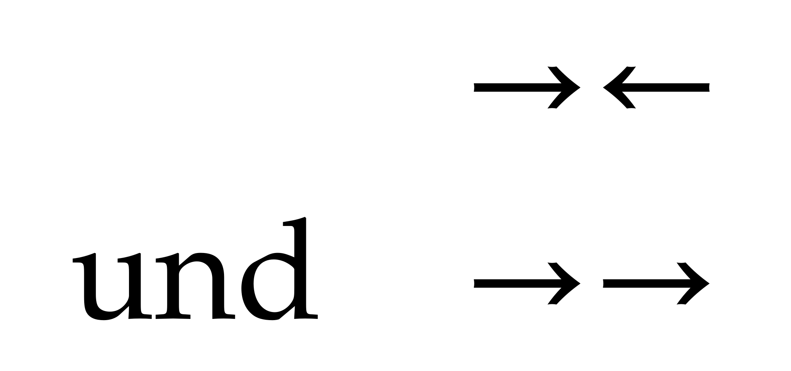; & ask him of which two he would like to say that they are ‘_directed in the same way_’. – If certain applications are uppermost in his mind, is it not easy to imagine that he will say of the _first_ pair that they are directed in the _same_ way?

### [EPB](/w-epb/#ms-115-255.2) [255\[2\]](https://cdn.wittgensteinnachlass.com/2000px/webp/Ms-115/255.webp)

(Perhaps one objects: “If one understands _this_ by ‘direction’ & _that_ by ‘same’, then one can call only _that_ ‘the same directions’.” Similarly one is tempted to say: “If one understands _this_ by the negation & _that_ by the affirmation, then a double negation yields an affirmation.” We still have to discuss the error in this view.)

### [EPB](/w-epb/#ms-115-255.3) [255\[3\]](https://cdn.wittgensteinnachlass.com/2000px/webp/Ms-115/255.webp)

126 When we hear a scale, we say that after every seven notes the same note recurs. If someone were asked why he calls it the ‘same’ note, he might perhaps answer: “It is a c again”. But that is not what I want to hear, for I ask: “Why is this note again called ‘c’?” – The answer might be: “Don’t you hear that it is the same note, only an octave higher?!” – Here too we can imagine that someone had been taught the use of the word ‘same’ as in (125), and now the C major scale was played to him and he was asked whether the ‘same notes’ recur in it again and again. And we can easily imagine various answers to this question. (Compare (110).)

### [EPB](/w-epb/#ms-115-255.4+256.1) [255\[4\]](https://cdn.wittgensteinnachlass.com/2000px/webp/Ms-115/255.webp),[256\[1\]](https://cdn.wittgensteinnachlass.com/2000px/webp/Ms-115/256.webp)

(In particular, I could imagine that he refuses to call the arrows

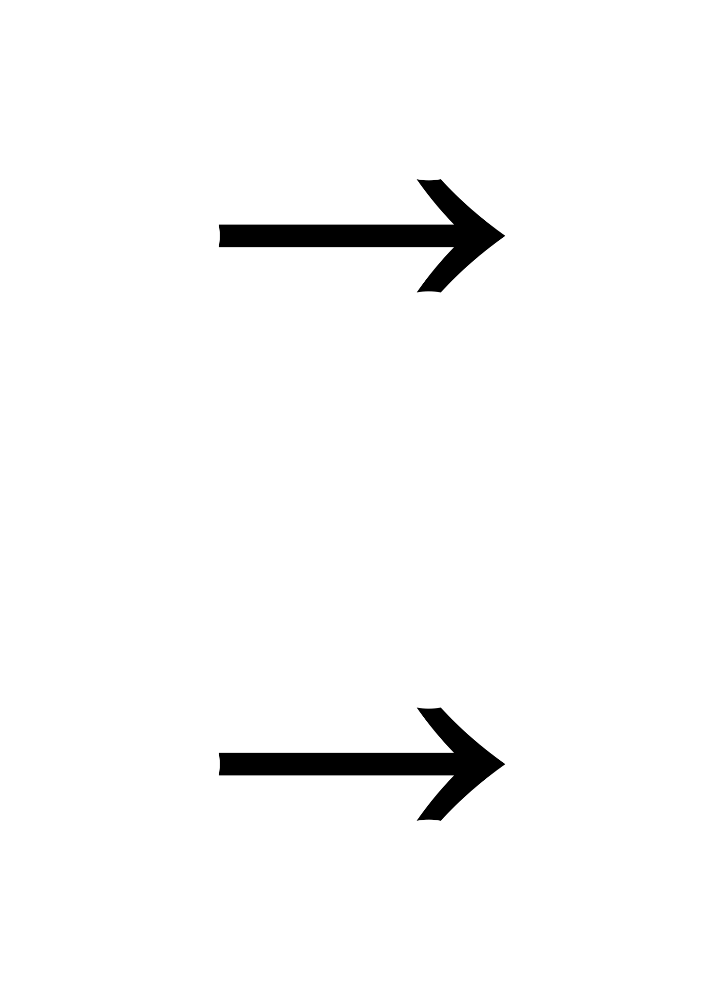

‘directed in the same way’, since there is no point to which they both point.)

### [EPB](/w-epb/#ms-115-256.2) [256\[2\]](https://cdn.wittgensteinnachlass.com/2000px/webp/Ms-115/256.webp)

If we make the experiment with two people A & B, & A uses ‘same’ for every eighth note & B also for the dominant of every note, – can we say: A & B hear different things? – If we say this, let us be clear whether we want to assert that there must be a difference in addition to the one the experiment has shown.

### [EPB](/w-epb/#ms-115-256.3+257.1) [256\[3\]](https://cdn.wittgensteinnachlass.com/2000px/webp/Ms-115/256.webp),[257\[1\]](https://cdn.wittgensteinnachlass.com/2000px/webp/Ms-115/257.webp)

127 Our discussions are connected with the following problem: Suppose we have taught someone to write number series according to rules of the form “Make each following number n larger”. We give the command to write such a series in the abbreviated form “Always add n!”. The number signs in this game are groups of strokes: |, ∣∣, ∣∣∣, ∣∣∣∣, etc.. – When I say that we have taught someone this game, I naturally mean that, on the one hand, we have given him explanations of a general kind, & have done practice examples with him. These examples would, for instance, have been within the number range up to 86. – Now we give him the command “Always add 1!” & observe that from 90 onwards he always adds 2, as we would say, & from 180 onwards always 3. We draw his attention to this & say: “I told you ‘add 1’; just look at how you began the series!” – Suppose the pupil says, pointing to the numbers 92, 94, etc., “But I have continued in the same way! I thought I _should_ do it like that.” – It would now be of no use to us to say: “But don’t you see …?”, & to show him the old rules & examples again. – In such a case we could say: This person naturally understands this rule (in response to our explanations & examples) in the same way as _we_ understand the rule: “Always add 1 up to 90, always 2 up to 180, etc.!”.

### [EPB](/w-epb/#ms-115-257.2) [257\[2\]](https://cdn.wittgensteinnachlass.com/2000px/webp/Ms-115/257.webp)

128 (This case would be similar to that of a person who naturally reacts to a pointing gesture by looking in the direction from the fingertip towards the hand. Understanding here is reacting.)

### [EPB](/w-epb/#ms-115-257.3+258.1) [257\[3\]](https://cdn.wittgensteinnachlass.com/2000px/webp/Ms-115/257.webp),[258\[1\]](https://cdn.wittgensteinnachlass.com/2000px/webp/Ms-115/258.webp)

129 “What you say therefore amounts to this: in order to follow the command ‘always add 1’ correctly, a new insight, intuition, is necessary at every step.” – But what does it mean to ‘carry out the command correctly’? How, & when is it to be decided which is the _correct_ step at a particular point? – “The correct step is everywhere the one that accords with the command as it is _meant_.” – That presumably means: when you gave him the command “Always add 1!”, you _meant_ that he should write 91 after 90, 291 after 290, 1042 after 1041 & so on. But how could you have meant all that at the time? Yes, an infinite number of meanings!? – Or would you say: only _one_ act of meaning took place, from which each of the particular meanings follows in its place? – But is the question not precisely: _What follows_ from the general rule? – “But I already knew that he was to write 91 after 90 when I gave the command ‘Always add 1’.” – You are being misled by the grammar of the word ‘know’. Was this knowledge a mental act by which you carried out the transition from 90 to 91 when you gave the command, i.e. an act comparable to uttering the sentence: ‘After 90 he is to write 91’? If so, ask yourself how many such acts you carried out when you gave the command. – Or do you mean by knowledge a disposition to certain acts of thinking? – Then only experience can teach us what it is a disposition to. – “But if I had been asked which number he should write after 1568, I would have answered ‘1569’.” – Perhaps I do not doubt that either, but it is nevertheless a _hypothesis_; comparable to the hypothesis that you would have pulled N out of the water if he had fallen into it. – I believe your idea is that in the mysterious process of meaning, of intention, you somehow made the transitions without _really_ making them. Your mind flies ahead, as it were, & makes all the transitions while your body has not yet reached them. – This strange idea, which we encounter again & again, is connected with the use of the past tense of the word “mean”, when we say: “I meant you to write ‘91’ after ‘90’”. This past tense seems to say that at that time a (particular) process of meaning concerning the succession of these numbers took place; in reality, however, the sentence speaks of no such process. The past tense could be explained by this reformulation of the sentence: “If you had asked me then which transition at this point accords with the sense of my command, I would have answered …”. But this is a hypothesis.

### [EPB](/w-epb/#ms-115-258.2+259.1) [258\[2\]](https://cdn.wittgensteinnachlass.com/2000px/webp/Ms-115/258.webp),[259\[1\]](https://cdn.wittgensteinnachlass.com/2000px/webp/Ms-115/259.webp)

Think of this case: “When I spoke of Strauss, I meant the composer of ‘Fledermaus’.” – Does that mean: when I meant him, I thought of the fact that he had written ‘Fledermaus’?

### [EPB](/w-epb/#ms-115-259.2) [259\[2\]](https://cdn.wittgensteinnachlass.com/2000px/webp/Ms-115/259.webp)

130 When we say: “According to the _sense of the command_ he should write ‘91’ after ‘90’”, it appears as though this sense hurries ahead of the command like a shadow, & all the transitions have already been made in the sense in a shadowy way. – But if the transitions had been made in a shadowy way, – which shadow makes the transitions from the shadowy transitions to the real ones? – If the _words_ of the rule could not anticipate the transitions from one number to the next, then neither could a mental act accompanying these words.

### [EPB](/w-epb/#ms-115-259.3+260.1) [259\[3\]](https://cdn.wittgensteinnachlass.com/2000px/webp/Ms-115/259.webp),[260\[1\]](https://cdn.wittgensteinnachlass.com/2000px/webp/Ms-115/260.webp)

In philosophy you encounter a great many such shadowy ethereal entities. Their conception forces itself upon us as an explanation of a grammatical form which we have misunderstood. (It is the product of a logic of language which has not been understood (Paul Ernst).)

### [EPB](/w-epb/#ms-115-260.2) [260\[2\]](https://cdn.wittgensteinnachlass.com/2000px/webp/Ms-115/260.webp)

131 It is not an act of insight that lets us apply the rule “Always add 1” at every step in the way in which we apply it. (Unless it were an act of insight _in the particular case_. I say, for example: “Ah, you mean that I should make each number 1 larger than the preceding one!”) One might speak rather of an act of decision. But that too is misleading, for no deliberation takes place; rather, he writes something down or says something. – Here – as in a thousand other cases – we do not want to admit that the chain of _reasons_ comes to an end.

### [EPB](/w-epb/#ms-115-260.3+261.1) [260\[3\]](https://cdn.wittgensteinnachlass.com/2000px/webp/Ms-115/260.webp),[261\[1\]](https://cdn.wittgensteinnachlass.com/2000px/webp/Ms-115/261.webp)

132 Now compare these two sentences: “It surely is not the same application of the rule ‘always add 1’ when one begins: ‘1, 2, 3, 4 …’ & continues after 90: ‘92, 94, 96 etc.’”; and: “It surely is not the same application of the word ‘darker’ when one first applies it to coloured things & then to sounds”.

– That depends on what you call ‘a different sense’. – But I too say that sounds are “in a different sense ‘lighter’ & ‘darker’” from coloured objects; & I also write in the series ‘Always add 1’ after ‘90’: ‘91, 92, 93 …’. – Not with a particular justification, – or not _necessarily_ with a particular justification.

### [EPB](/w-epb/#ms-115-261.2) [261\[2\]](https://cdn.wittgensteinnachlass.com/2000px/webp/Ms-115/261.webp)

133 It is a very widespread disease of thought to postulate states of mind behind all human actions, from which the actions ‘spring’. One gives pseudo-explanations of the kind: this action springs from the person’s character, the behaviour from the national character, etc., etc.. (It reassures us to say something that has the form of an explanation.) – Suppose someone says: “Fashion changes because people’s taste changes.” – If a tailor designs a different cut of dinner jacket this year from last year, why should what we call the change in his taste not consist, in part or entirely, precisely in his doing this?

### [EPB](/w-epb/#ms-115-261.3+262.1) [261\[3\]](https://cdn.wittgensteinnachlass.com/2000px/webp/Ms-115/261.webp),[262\[1\]](https://cdn.wittgensteinnachlass.com/2000px/webp/Ms-115/262.webp)

But one says: “Drawing a new cut is not changing one’s taste, just as saying something does not mean meaning it. Certain sensations, mental processes, must accompany the drawing & speaking. – It is surely possible for someone to draw a new cut without having changed his taste; just as he can say something without meaning it.” And that is certainly true. But it does not follow that, under certain circumstances, the distinguishing mark of a change in taste does not simply consist in his now drawing something different from what he drew a year ago. (See example 66). Besides, it is of course obvious that there will be manifold sensations & mental processes involved in this drawing. – And if, in a case, what he draws is _not_ the criterion of the change in taste, it does not follow that it consists in a change in some region of his mind, so to speak, a centre of taste.

### [EPB](/w-epb/#ms-115-262.2) [262\[2\]](https://cdn.wittgensteinnachlass.com/2000px/webp/Ms-115/262.webp)

We do not use the word ‘taste’ to designate a sensation. To assume something of this kind is to represent the use of this word as much simpler than it really is. The representation of the practice of our language in a falsely simplified form gives rise to a great many of our philosophical problems. (Think, for example, of the idea that the properties of a thing are ingredients contained in it. Beauty is contained in the beautiful, like alcohol in the alcoholic.)

### [EPB](/w-epb/#ms-115-262.3+263.1) [262\[3\]](https://cdn.wittgensteinnachlass.com/2000px/webp/Ms-115/262.webp),[263\[1\]](https://cdn.wittgensteinnachlass.com/2000px/webp/Ms-115/263.webp)

134 Whenever in these investigations we are dealing with expressions which, as one would say, describe mental processes or states, that is, with expressions such as ‘meaning a sentence in this or that sense’, ‘taking it’, ‘having an intention’, ‘being convinced of something’, ‘believing something’, ‘assuming’, ‘doubting’, ‘wishing’, ‘hoping’, etc., it is clarifying, in our considerations, to substitute for meaning, believing, doubting, and so on, the intonation, the gesture, the facial expression characteristic of those mental processes.

### [EPB](/w-epb/#ms-115-263.2+264.1) [263\[2\]](https://cdn.wittgensteinnachlass.com/2000px/webp/Ms-115/263.webp),[264\[1\]](https://cdn.wittgensteinnachlass.com/2000px/webp/Ms-115/264.webp)

Let us make this observation: William James speaks somewhere of our associating certain feelings with the words ‘if’, ‘and’, ‘not’, so that one could speak of an ‘if-feeling’, etc. These feelings are supposed to explain the meanings of those words. – How does one arrive at the idea that there are such feelings? – Well, one says a sentence to oneself, e.g. ‘If it rains today, I can’t go out’, & observes what happens. If you do this, you will immediately notice that the ‘if-feeling’ is not always ‘equally strong’. You may be inclined to say that you utter the sentence more mechanically on one occasion and less mechanically on another. – But think of how you utter it when you use it practically. For in practical use it presumably fulfils its proper function. You will see that on different occasions you utter it in very different ways & that the if-feeling does not vary merely in strength. And further: you will see that what you call this feeling is connected with a particular intonation, a gesture, a facial expression; if you change the intonation, the feeling changes, for it is, at least in part, the feeling of this intonation. Try the experiment: Say the if-sentence & shake your head _negatively_ as you do so.

### [EPB](/w-epb/#ms-115-264.2) [264\[2\]](https://cdn.wittgensteinnachlass.com/2000px/webp/Ms-115/264.webp)

If we are not led by a false conception of the grammar of the word ‘meaning’ to believe that there _must be an_ if-feeling, we shall now say: There are if-feelings, namely in the sense in which there are if-gestures, or if-intonations. These are characteristic of the use of the word ‘if’ insofar as we often utter the word in this way. But they may also be entirely absent and the word nevertheless be used quite properly.

### [EPB](/w-epb/#ms-115-264.3+265.1) [264\[3\]](https://cdn.wittgensteinnachlass.com/2000px/webp/Ms-115/264.webp),[265\[1\]](https://cdn.wittgensteinnachlass.com/2000px/webp/Ms-115/265.webp)

So it is also with the use of the words ‘mean’, ‘believe’, ‘intend’, etc.: a false – falsely simplified – conception of their meaning, i.e. of their grammar, leads us to think that each of these words must correspond to a particular characteristic experience. And here too one makes the experiment, as it were, says a sentence to oneself, such as ‘I believe it will rain today’, observes oneself & thinks: ‘Well, something quite definite surely happens when I believe something.’ But here too look away from this experimental utterance of the sentence & think of how you utter it for practical purposes. Does the same thing really always happen then? And now look at your experiment & ask yourself whether what happened there is not again connected with the particular way in which you uttered the sentence. Indeed, if you conduct such an experiment, you are miming believing, & how do you do it? You imitate a certain intonation, a face, a gesture. (Compare (86).) It is with the experience of meaning, of conviction, etc. just as it is with the if-feeling.

### [EPB](/w-epb/#ms-115-265.2) [265\[2\]](https://cdn.wittgensteinnachlass.com/2000px/webp/Ms-115/265.webp)

135 We speak of a ‘tone of conviction’, & we would not do so if this tone were not somehow characteristic of being convinced. – But it is also clear that this tone may be absent, & one may nevertheless speak with conviction. – ‘Quite right,’ you now say, ‘that shows that being convinced is something other than speaking in the tone of conviction. And since it is also something other than speaking with a particular gesture, etc., it is a specific experience, which is sometimes accompanied by such manifestations, but must not be confused with them.’ – But _that_ does not make it a specific experience! And _is_ it one? – For now there need be none. – Imagine that you did not understand the word ‘red’, & someone told you that ‘red’ meant a specific experience. You would ask: ‘Which one?’ And it is no explanation to say that conviction is a particular experience. The question is: Which one? _If_ you call an experience that, which one is it? – And if you try to answer this question, you will soon see that you do not use the word to designate _one_ experience.

### [EPB](/w-epb/#ms-115-265.3+266.1+267.1) [265\[3\]](https://cdn.wittgensteinnachlass.com/2000px/webp/Ms-115/265.webp),[266\[1\]](https://cdn.wittgensteinnachlass.com/2000px/webp/Ms-115/266.webp),[267\[1\]](https://cdn.wittgensteinnachlass.com/2000px/webp/Ms-115/267.webp)

136 When we want to find out which particular experience is that of conviction, what happens to us is like what happens when we look for the specific experience of reading. We focus our attention on the sensation in a particular case & believe that here we have the specific experience. – If, for example, I say to myself: ‘I am convinced that a terrible war will break out within five years’, I find that I feel a heavy, oppressive feeling in the region of my stomach. And if this were not my conviction, I would not have it. But now I imagine that I said: ‘I am convinced that the weather will remain fine today.’ Here too there is a feeling which would not be there if I were not convinced – but where is the common element? Look for it & see whether it is there, & what it might be! Only do not believe that it must be there. One thing is of course common: the same words; & that is already a lot, & perhaps a somewhat similar tone goes with them too. – Incidentally, compare with the sensations which characterise conviction in the two cases above, the experiences we have when we say: ‘I am convinced there is a mistake in this calculation!’ ‘But why do we then use the same word in these different cases?’ – The games we play with it have a certain similarity. – And the sensations which accompany the use of the word also have a _certain similarity_. – Think in which language-games you might learn the expression ‘I am convinced that …’. [→ ] Let us also think of how one might teach a child the word ‘sure’ or ‘certain’; one says to it, for example: ‘He is coming for certain!’, & here the intonation of the words plays the greatest role, as do gesture & face. The word serves mainly as the bearer of this intonation.

### [EPB](/w-epb/#ms-115-267.2+268.1) [267\[2\]](https://cdn.wittgensteinnachlass.com/2000px/webp/Ms-115/267.webp),[268\[1\]](https://cdn.wittgensteinnachlass.com/2000px/webp/Ms-115/268.webp)

137 Let us consider an analogy from the field of facial expression. Imagine the question were: what is the feature that makes a face friendly? At first one may assume that there are certain ‘friendly features’, each of which makes a face friendly to a certain degree, & the more such features there are, the friendlier the face is. Our way of speaking also points in this direction: we speak of ‘friendly eyes’, a ‘friendly mouth’, etc. But it is not difficult to see that the ‘friendly mouth’ _under certain circumstances_ – and here that means: together with certain other features of the face, e.g. wrinkles in the forehead, etc. – can look not friendly, indeed unfriendly. (A friendly and an unfriendly grin need not differ in the mouth. Consider line faces such as:

.

Do not say that what gives the one on the right no friendly expression is an association! It is irrelevant what causes the impression. It is also certainly true that these groups of dots & lines would have no ‘expression’ for us if we did not know this schema from the human face. But that too is irrelevant here: these groups of lines _now have_ expression, & when we look at them, we see only _them_ & do not hallucinate a face of flesh and blood behind them. We can therefore regard these line faces – and this is important for the following considerations – as autonomous formations with facial expression, which borrow it from nowhere else.)

### [EPB](/w-epb/#ms-115-268.2) [268\[2\]](https://cdn.wittgensteinnachlass.com/2000px/webp/Ms-115/268.webp)

But if that is how things stand, is it not wrong to speak of a ‘friendly mouth’, and the like? – Let us look at another expression we often use: ‘It is the _mouth_ that makes this face so friendly.’ That means roughly: ‘If the mouth were different, the face would not have the friendly expression.’ – But one could say that of the other features too! If they were different, it would not have the friendly expression either; even with this mouth. – But that is no reason why it should be nonsensical to say that it is the mouth that makes the face friendly: here we are thinking of a particular, relatively simple, change in the face which would transform its expression into the opposite. And furthermore, when we look at the face, this feature particularly draws our attention to itself. Also: if we remove the other features of the face from our view, we normally imagine a friendly face with this mouth; – although the opposite would also be possible. (Similarly we say, ‘It is _this_ word that gives the sentence its force.’ etc., etc.)

### [EPB](/w-epb/#ms-115-268.3+269.1) [268\[3\]](https://cdn.wittgensteinnachlass.com/2000px/webp/Ms-115/268.webp),[269\[1\]](https://cdn.wittgensteinnachlass.com/2000px/webp/Ms-115/269.webp)

There is a large family of friendly faces; in this family, so to speak, one important branch is marked by the ‘friendly mouth’, another by the ‘friendly eyes’, etc. But this mouth can _also_ occur in the large family of malicious faces, and these eyes too. And here the ‘friendly mouth’ does not have a friendly effect: so that its friendliness would, as it were, merely be drowned out by the malice of the other features. We also say, ‘the smiling mouth is contradicted by the eyes’, & not that the face is really not so unfriendly after all, since the mouth is nevertheless smiling.

### [EPB](/w-epb/#ms-115-269.2) [269\[2\]](https://cdn.wittgensteinnachlass.com/2000px/webp/Ms-115/269.webp)

138 Very different features mark what someone says as an expression of conviction. There are feelings such as those in the examples in (136), and feelings connected with the tone, the mien, a characteristic posture, a gesture of conviction, but he need not have any experiences characteristic of being convinced _while_ he expresses the conviction, & what constitutes being convinced may lie in what he _does_ before and afterwards. And that an action is accompanied by _all sorts_ of feelings is again self-evident.

### [EPB](/w-epb/#ms-115-269.3+270.1+271.1) [269\[3\]](https://cdn.wittgensteinnachlass.com/2000px/webp/Ms-115/269.webp),[270\[1\]](https://cdn.wittgensteinnachlass.com/2000px/webp/Ms-115/270.webp),[271\[1\]](https://cdn.wittgensteinnachlass.com/2000px/webp/Ms-115/271.webp)

‘But you cannot call the experience of the tone, the mien, etc. “characteristic of conviction”, since they can be contradicted by other experiences.’ – But in this and that case they _are_ not contradicted by anything else, & here they are the most striking feature of the conviction. – As in _this_ face the friendly mouth is the most strikingly friendly feature. Certainly, speaking in this way does not constitute being convinced; but if you ask me: ‘What experience did you have there, when you said … with conviction?’ I may have to answer: ‘I looked straight ahead, spoke in _this_ tone, (etc.)’; even if this experience characterised being convinced only in the particular situation, together with what preceded and followed it and in the absence of certain other tendencies. – ‘But one often says: “I spoke with the feeling of conviction”.’ – Well, imagine such cases! Then perhaps you will see it. – _I_ am thinking mainly of a feeling in the face (a feeling of facial expression) and a feeling in the chest (a feeling of breathing). Here it is useful again to ask oneself: ‘_When_ do I have the feeling of conviction?’ For do not forget that what you are convinced of is a _sentence_ – it has a beginning and an end. Are you _convinced_ from the first letter of the sentence to the last? & always of the same thing? Or are you convinced of each word separately, & _when_ are you so?

Do not draw a misleading boundary between action and experience either; as if it were not an experience to speak in such-and-such a way, etc. (Compare earlier remarks.) For, just like the tone of conviction, the ‘feeling of conviction’ may also be contradicted. The person who acts conviction and the person who _has_ it may experience exactly the same thing while giving expression to it; even when they do not speak ‘automatically’, or ‘without thinking’. Just as a friendly and an unfriendly face can have exactly the same eyes.

### [EPB](/w-epb/#ms-115-271.2) [271\[2\]](https://cdn.wittgensteinnachlass.com/2000px/webp/Ms-115/271.webp)

139 An expression which is liable to mislead us is this: ‘He _says_ it & _means_ it.’ – Compare ‘_Meaning what you say_’ when you say to someone a) ‘I shall be glad to see you’, & b): ‘The train to N leaves at 3 h30’. – Suppose you had said those first words to someone, & were then asked: ‘Did you mean it?’ You would perhaps think of your feelings as you said it & be inclined to answer: ‘Didn’t you notice that I meant it?’ But suppose you had given someone the information: ‘The train to N leaves at 3 h30’; & now someone asked you, ‘Did you mean it?’ You might simply be inclined to say: ‘Of course I did; why shouldn’t I have meant it!’

### [EPB](/w-epb/#ms-115-271.3) [271\[3\]](https://cdn.wittgensteinnachlass.com/2000px/webp/Ms-115/271.webp)

In the first case we may perhaps speak of a particular feeling which characterises meaning the words, but not in the second case.

### [EPB](/w-epb/#ms-115-271.4+272.1) [271\[4\]](https://cdn.wittgensteinnachlass.com/2000px/webp/Ms-115/271.webp),[272\[1\]](https://cdn.wittgensteinnachlass.com/2000px/webp/Ms-115/272.webp)

140 Compare now also the experiences of lying in the two cases! In the first, what will often characterise the lying is that our words are not accompanied by the corresponding feelings, but perhaps even by the opposite ones. We feel: it is difficult for us to put on a friendly face. – If in case (b) we tell a lie, we shall probably have a different experience from that which we have when truthfully informing someone about the train’s departure, but the difference will not now lie in the absence of a feeling characteristic of meaning, but perhaps in the presence of a feeling of unease, uncertainty, etc.

### [EPB](/w-epb/#ms-115-272.2) [272\[2\]](https://cdn.wittgensteinnachlass.com/2000px/webp/Ms-115/272.webp)

But it is also possible, when uttering a lie, to feel quite decisively what one might call _feelings of meaning_ what one says. (It is sometimes said of someone that he has said this lie so often that he almost believes it himself.)

141 But perhaps one should distinguish here between ‘believing’ what one says & ‘meaning’ what one says. If, for example, I say that the train leaves at 5 h30, while I know perfectly well that it leaves at 3 h, one could say that although I do not believe what I say, I nevertheless do not say it automatically, like a parrot, and thus _mean_ it. – Here again ask yourself _when_ you mean it; & how the meaning accompanies the saying. Also try this experiment: _Think_ ‘The train leaves at 3 h30’, but without words! – In answer to the question ‘What happened there, when you said it and meant it, and also believed it?’ you will have to answer in a large number of cases: ‘I _said_ it; I know nothing more.’ (More on meaning everything one does not speak automatically later.)

### [EPB](/w-epb/#ms-115-272.3+273.1) [272\[3\]](https://cdn.wittgensteinnachlass.com/2000px/webp/Ms-115/272.webp),[273\[1\]](https://cdn.wittgensteinnachlass.com/2000px/webp/Ms-115/273.webp)

If one wants to understand ‘believing’ as an act which takes place when what is believed is thought or uttered, then in many cases ‘believing’ will mean the same as ‘giving expression to belief’.

### [EPB](/w-epb/#ms-115-273.2) [273\[2\]](https://cdn.wittgensteinnachlass.com/2000px/webp/Ms-115/273.webp)

142 It is interesting to consider an objection to this: What if I say, truthfully, ‘I believe it will rain’, & someone wants to explain to a Frenchman who does not understand German _what_ I believe. – If all that happened was that I uttered that sentence, then the Frenchman ought to learn what I believe if he hears my words, or if one tells him: ‘Il croit: “es wird regnen”’. Now it is clear that this will not tell him what I believe; & this shows that we have not communicated the essential thing to him, namely the mental act of believing. – The answer, however, is that even if my words were accompanied by all sorts of experiences, & if we were able to transmit these to the Frenchman together with the German words, he still would not have known what I believe. For ‘knowing what I believe’ _does not mean_: feeling what I feel while I utter these words. Just as ‘knowing my intentions in making this chess move’ does not mean: feeling what I feel while making the move. Although knowing this would in certain cases give you very precise information about my intentions.

### [EPB](/w-epb/#ms-115-273.3+274.1) [273\[3\]](https://cdn.wittgensteinnachlass.com/2000px/webp/Ms-115/273.webp),[274\[1\]](https://cdn.wittgensteinnachlass.com/2000px/webp/Ms-115/274.webp)

We would say that we had communicated what I believe to the Frenchman if we had translated my words into French. And it is possible that by doing this we communicate _nothing_ to him about what was going on in me when I uttered the sentence. Rather, we have given him a sentence which occupies a similar place in his language to the place my sentence occupies in the German language. – And on the other hand one can again say that, in certain cases at least, we could have communicated what I believed to him much more precisely if he had been at home in German, because then he would have ‘known exactly what had gone on in me when I spoke’.

### [EPB](/w-epb/#ms-115-274.2) [274\[2\]](https://cdn.wittgensteinnachlass.com/2000px/webp/Ms-115/274.webp)

Given certain circumstances, meaning and not meaning, believing, intending, etc. will indeed be characterised by what does, or does not, go on in the mind of the speaker.

### [EPB](/w-epb/#ms-115-274.3) [274\[3\]](https://cdn.wittgensteinnachlass.com/2000px/webp/Ms-115/274.webp)

Here you can again ask yourself: What cases are there? And when you bring cases of meaning to mind, you will see that there are countless different ones; but they are all related to one another in one way or another.

### [EPB](/w-epb/#ms-115-274.4+275.1) [274\[4\]](https://cdn.wittgensteinnachlass.com/2000px/webp/Ms-115/274.webp),[275\[1\]](https://cdn.wittgensteinnachlass.com/2000px/webp/Ms-115/275.webp)

‘Meaning is a mental process that goes on when one speaks – perhaps beforehand too, but especially while one is speaking. – If I mean something, surely something different goes on in me from when I say it & don’t mean it.’ – The latter is broadly speaking true. _And now look and see what goes on._ And pay no attention to what ‘really ought to go on’. In philosophy we are always tempted to depict things as the little painter Klecksel depicted human faces in profile.

### [EPB](/w-epb/#ms-115-275.2) [275\[2\]](https://cdn.wittgensteinnachlass.com/2000px/webp/Ms-115/275.webp)

‘There is a difference in the mental process when you mean what you say & when you don’t mean it.’ – There are _all sorts_ of such differences, & quite different ones in different cases. But in particular cases there may also be no _such_ difference at all. Compare the characteristic sensations of meaning when you speak to someone:

‘Forgive me, I’m very sorry that I said that!’

‘I’m glad you’re here!’

‘The earth moves round the sun in an ellipse.’ ‘I hope to see you again!’ – What does meaning this consist in? One might think: in having a feeling of hoping. But what is such a feeling like? – Is it, for example, just a feeling of hoping in general, or of _this_ hope? – Look and see: do you really see such a feeling that _accompanies_ the words? – Perhaps you had a feeling of being weighed down at these words (the anxiety at parting), & with _these_ words & under _these_ circumstances, one can say that you felt hope.

### [EPB](/w-epb/#ms-115-275.3) [275\[3\]](https://cdn.wittgensteinnachlass.com/2000px/webp/Ms-115/275.webp)

‘Did you really mean that it will rain, or did you merely say it?’ Saying something & meaning it can mean saying it _without_ ulterior thoughts; & merely saying it can consist in saying it with ulterior thoughts.

### [EPB](/w-epb/#ms-115-276.1) [276\[1\]](https://cdn.wittgensteinnachlass.com/2000px/webp/Ms-115/276.webp)

‘I shall never set foot in this house again!’ Did you mean it? – How does one mean the ‘_never_ again’? – Does it take some time to mean these words? (or) can one do it while uttering them?

### [EPB](/w-epb/#ms-115-276.2) [276\[2\]](https://cdn.wittgensteinnachlass.com/2000px/webp/Ms-115/276.webp)

What would it have been like if he had ‘not _really_’ meant the words? – Ask yourself: how does one say this sentence when one means it; how when one does not really mean it?

### [EPB](/w-epb/#ms-115-276.3) [276\[3\]](https://cdn.wittgensteinnachlass.com/2000px/webp/Ms-115/276.webp)

“I meant it more as an exaggeration.” That I say this consists, in part, in my having meant it that way. (Compare dream & recounting the dream after waking.) – But what sort of discovery is it that I have made there? How could I make a discovery about what meaning consists in? – I look at the case without a certain grammatical prejudice & then I see that what I go on to say also determines whether I should speak of ‘exaggeration’. (Anyone who listens to the _ei_ sound without thinking of the spelling hears that it sounds like _a–e_.)

### [EPB](/w-epb/#ms-115-276.4) [276\[4\]](https://cdn.wittgensteinnachlass.com/2000px/webp/Ms-115/276.webp)

“Meaning something as a joke (seriously)” – Do you mean every word of a joke as a joke? etc. ]

### [EPB](/w-epb/#ms-115-276.5) [276\[5\]](https://cdn.wittgensteinnachlass.com/2000px/webp/Ms-115/276.webp)

In many cases – except when we are philosophizing – we won’t speak at all of someone meaning what he says: e.g. when he is explaining the laws of free fall to someone. If we want to speak of ‘meaning’ here, we feel a certain difficulty; we don’t quite know what case meaning is being contrasted with. Whether it is that the teacher is talking in his sleep, or that he is actually convinced of a different mechanics, or that he has spoken absent-mindedly, etc. – What is the difference between distracted, absent-minded speech & non-distracted speech? Imagine cases. –

### [EPB](/w-epb/#ms-115-277.1) [277\[1\]](https://cdn.wittgensteinnachlass.com/2000px/webp/Ms-115/277.webp)

I walk along a corridor & trip over a step, & say: “I thought it went on level there”. – What happened there, when I believed it? – Or I am of the same opinion & say to someone else: “Just go on!”

### [EPB](/w-epb/#ms-115-277.2) [277\[2\]](https://cdn.wittgensteinnachlass.com/2000px/webp/Ms-115/277.webp)

The mental processes during speaking play the same role as, in particular, the sensations of expression (i.e. the sensations that are the correlates of the expression of conviction, doubt, supposition, etc. etc.). One can say: “Someone who says it in these circumstances means it.” (In this setting this mouth is a friendly mouth.) There is nothing there that belies this expression. For it is not a symptom of something _else_ being present: the actual meaning; rather, it is one of the features that make up meaning, though only together with other features & in the _absence_ of certain others.

### [EPB](/w-epb/#ms-115-277.3) [277\[3\]](https://cdn.wittgensteinnachlass.com/2000px/webp/Ms-115/277.webp)

We can imagine the case where A is false towards B: he always speaks to him in the friendliest way because he is an excellent actor, but behind his back he hates B. So A will presumably speak badly of him & try to harm him in B’s absence. – But can we also imagine _this_: A is false towards B, he always speaks to him in the friendliest way because he is an excellent actor; but in B’s absence he also always speaks of him in the friendliest way, both to others and to himself, & he does nothing to harm B either. – It is highly useful for understanding to imagine countless cases.

### [EPB](/w-epb/#ms-115-277.4+278.1) [277\[4\]](https://cdn.wittgensteinnachlass.com/2000px/webp/Ms-115/277.webp),[278\[1\]](https://cdn.wittgensteinnachlass.com/2000px/webp/Ms-115/278.webp)

It isn’t true when one says: “Only he can really know whether he means what he says.” – No, it sometimes happens that I know with certainty that he means it, & couldn’t believe any of his subsequent assurances that he didn’t mean it. (More of that later.)

### [EPB](/w-epb/#ms-115-278.2) [278\[2\]](https://cdn.wittgensteinnachlass.com/2000px/webp/Ms-115/278.webp)

I promise someone: “I shall definitely come to you tomorrow.” – (What happens there, when I really mean it?). – Now imagine that you go up to a complete stranger & say these words to him. – Try to mean them. – “But how can I? I don’t even know where he lives?” – But if you say it to an acquaintance, you don’t have to think of his address while saying it either. – Let us suppose that someone had really said this to a stranger; & then assured us: “When I said it, I meant it.” – We shall ask him: “_What was it like_? – Did you take him for an acquaintance; or was it as if you had had a conversation with him & this were the last sentence of the conversation; or did you have, so to speak, a premonition that you would come to this person tomorrow; or did you suddenly feel compelled to go up to this person & seriously say this to him; or do you mean that you simply said it without ulterior thoughts, & without anything about it seeming strange to you?”

### [EPB](/w-epb/#ms-115-278.3+279.1) [278\[3\]](https://cdn.wittgensteinnachlass.com/2000px/webp/Ms-115/278.webp),[279\[1\]](https://cdn.wittgensteinnachlass.com/2000px/webp/Ms-115/279.webp)

Think of the grammar of the expression: “to checkmate someone”. It refers to a certain action in the game. But if someone, say a child, plays with chess pieces & a chessboard, putting a few pieces on the board & making the movements of checkmating, we shall not say that he checkmated someone.

### [EPB](/w-epb/#ms-115-279.2) [279\[2\]](https://cdn.wittgensteinnachlass.com/2000px/webp/Ms-115/279.webp)

Suppose: I make a move & checkmate my opponent; someone asks me: “Did you intend to checkmate him?” – I say yes. Now he asks: “How can you say that? Surely all you know is that such and such went on in you as you made the move.” For isn’t the only one who can intend to checkmate someone the one who understands the game; i.e. who knows the rules & has a certain amount of practice in playing? – But how can these conditions enter into my mental processes while making the move? – And yet it depends on these whether or not I have just checkmated him intentionally.

### [EPB](/w-epb/#ms-115-279.3) [279\[3\]](https://cdn.wittgensteinnachlass.com/2000px/webp/Ms-115/279.webp)

Or: can someone who doesn’t know the game want to checkmate me? And why not? Is it impossible for him to put himself into the right state of mind? And what if he did manage it after all? –

### [EPB](/w-epb/#ms-115-279.4) [279\[4\]](https://cdn.wittgensteinnachlass.com/2000px/webp/Ms-115/279.webp)

But what happened when I checkmated him intentionally? – Suppose I said the words to myself: “Now he’ll be checkmated.” – But someone who doesn’t know the game could say these words too; indeed, he could say them with all my experiences, but they mean nothing; not because they aren’t accompanied by the right experiences, but because they don’t stand in the context of a language-game.

### [EPB](/w-epb/#ms-115-280.1) [280\[1\]](https://cdn.wittgensteinnachlass.com/2000px/webp/Ms-115/280.webp)

Imagine this case: you had a visitor; he was unwelcome & boring; the whole time you had thoughts like: “If only he’d go already” etc. As he leaves you say to him: “I hope you come again soon!” – & _mean_ it. After you have said it, you hope he will never come again. – Is that possible? And if you think not, why not? – I believe you will ask yourself: How can this happen? What does it mean here to _mean_ this sentence, ex abrupto? – Suppose someone said: “That could only be a momentary madness.” But is that an explanation? Granted that it is madness, I want to know: _What constituted_ meaning it here? – Meaning something consists in thinking, feeling, saying & doing various things.

### [EPB](/w-epb/#ms-115-280.2) [280\[2\]](https://cdn.wittgensteinnachlass.com/2000px/webp/Ms-115/280.webp)

It also happens that we say: “At the moment when I said it, I was convinced of it.” And here – one might think – it ought (after all) to show what being convinced consists in. But imagine such a case! – You don’t find what you’re looking for. This being convinced – one might say – presumably had a history leading up to it.

### [EPB](/w-epb/#ms-115-280.3+281.1) [280\[3\]](https://cdn.wittgensteinnachlass.com/2000px/webp/Ms-115/280.webp),[281\[1\]](https://cdn.wittgensteinnachlass.com/2000px/webp/Ms-115/281.webp)

“Under these circumstances, at the end of a game of chess” – I shall have to say – “_that_ means intentionally checkmating him.” Or else: “Under these circumstances, what went on in me means intending to checkmate him.” One also says, for example: “I intended _now_ to check him.” And if I were asked: “What do you mean when you say that; what happened when you ‘intended’?” – I might recall the words I said to myself, the moves I imagined, etc. – And one also says: “I _intend_ now to check him” & this is not a description of my mental state – following prior introspection; it is not as if one said: “I notice that I now intend …”, as one might say “I notice that I now have a tendency to speak badly of N.” Rather, my saying this is part of the process of intending. That is, if I later remember it & am asked whether I intended it then & what this consisted in, I shall say that I _intended_ it because I said to myself (or aloud … for that comes to the same thing): “I now intend etc.”

### [EPB](/w-epb/#ms-115-281.2) [281\[2\]](https://cdn.wittgensteinnachlass.com/2000px/webp/Ms-115/281.webp)

Why are we so interested here, as earlier, when we spoke of reading and other things, in facts of psychology? What have they to do with our investigation? – What interests us is the contrast between the actual state of affairs & the one which our way of speaking inclines us to expect.

### [EPB](/w-epb/#ms-115-281.3+282.1) [281\[3\]](https://cdn.wittgensteinnachlass.com/2000px/webp/Ms-115/281.webp),[282\[1\]](https://cdn.wittgensteinnachlass.com/2000px/webp/Ms-115/282.webp)

Think of a (particular) person in whose affection (for you) you place unconditional trust – & now try to imagine that what he says to you is meant falsely. So he is an absolutely extraordinary actor. What would that mean? i.e. what assumptions are you now making about him? – You may imagine that when you turn your back on him he looks angrily at you; or that while saying such and such friendly things to you, he says something unfriendly to himself. But then I might have to say that he was mad, for if he said this even to himself, it would not at all be clear to me here that I shouldn’t trust what he says aloud.

### [EPB](/w-epb/#ms-115-282.2+283.1) [282\[2\]](https://cdn.wittgensteinnachlass.com/2000px/webp/Ms-115/282.webp),[283\[1\]](https://cdn.wittgensteinnachlass.com/2000px/webp/Ms-115/283.webp)

What holds of the word ‘mean’ also holds of ‘think’. – We often cannot think except by speaking half-aloud to ourselves; & no one who had to describe what is going on would think of saying that a process – thinking – accompanied the process of speaking. Unless he is led to this by the existence of the word-pair “speaking-thinking”, namely by the fact that our language makes parallel use of these two verbs. Think of the use of the expressions: “He speaks without thinking”, “Think before you speak!”, “I can’t express my thought properly”, “He says one thing & thinks something else”, “He doesn’t mean a word of what he says”. It is also very interesting & useful to consider the following absurdity, said some years ago by a French statesman: in the French language the words follow one another in the order in which one thinks.

### [EPB](/w-epb/#ms-115-283.2) [283\[2\]](https://cdn.wittgensteinnachlass.com/2000px/webp/Ms-115/283.webp)

If something accompanies speaking when one thinks aloud, it is, for example, the tone of voice, the expression of the face & gesture, & the like. But no one would call these processes alone ‘_thinking_’.

### [EPB](/w-epb/#ms-115-283.3) [283\[3\]](https://cdn.wittgensteinnachlass.com/2000px/webp/Ms-115/283.webp)

Of course, one says “I believe & say it will rain”; & this sounds as if two processes were running parallel here: believing it will rain, & saying it will rain.

### [EPB](/w-epb/#ms-115-283.5) [283\[5\]](https://cdn.wittgensteinnachlass.com/2000px/webp/Ms-115/283.webp)

“What _I_ mean by ‘darker’ is not to be found in the relation between sounds; I use it of sounds only in a figurative meaning, i.e. only by way of comparison.” – But do you then always think of colours first when you apply the word to sounds? – “No, but I only call on the word, bring it in as it were; it isn’t the proper word for the thing. The word then has a different relation to what it designates. Or: I have a different experience of meaning.” This experience is characterised, for example, by hesitation when we say expressively: “_o_ is – as it were – darker than _e_.” (Sometimes, instead of the word ‘as it were’, there is only a hesitation in speaking & an inarticulate sound.) [→ ]

### [EPB](/w-epb/#ms-115-283.6+284.1) [283\[6\]](https://cdn.wittgensteinnachlass.com/2000px/webp/Ms-115/283.webp),[284\[1\]](https://cdn.wittgensteinnachlass.com/2000px/webp/Ms-115/284.webp)

One _can_ say: “Physical & mental effort are both so called because the element of effort is in both.” The idea, the picture, here is: “effort” means something contained in both. But one can also say: “I call both ‘effort’ because there is a similarity between them.” And one can now recall all sorts of similarities. Think of mental & physical restlessness, or rest. One could say that mental restlessness is a kind of physical restlessness. Similar things have often been said (“And mind is also only something belonging to the body” (Zarathustra). This idea must still occupy us.) There may perhaps be people inclined to say: “I call sounds & colours ‘brighter’ & ‘darker’ because the same element is present in both relations.”

### [EPB](/w-epb/#ms-115-284.2) [284\[2\]](https://cdn.wittgensteinnachlass.com/2000px/webp/Ms-115/284.webp)

Suppose someone said: “_I_ see something common in them.” What am I to say now? – I shall ask him: What is it? – He: “I can’t explain that to you; I can only say that I see something of the sort.” – I: Then you aren’t telling me anything new by saying that, except that this is how you want to express yourself; & that may perhaps be interesting in some respects.

### [EPB](/w-epb/#ms-115-284.3+285.1) [284\[3\]](https://cdn.wittgensteinnachlass.com/2000px/webp/Ms-115/284.webp),[285\[1\]](https://cdn.wittgensteinnachlass.com/2000px/webp/Ms-115/285.webp)

Someone asks me: “What colour is the book over there?” I answer: “Red.” He: “Why do you call its colour ‘red’?” – I shall normally have to say: “For no reason. – I looked at it, & said the word ‘red’.” Here one would like to say: “That can’t be _all_! You could surely look at a colour & say a word while doing so, & yet not name the colour.” And then the explanation readily occurs to us: “When I say the word as the name of this colour, it comes to me in a particular way.” But when asked in what way, we can give no description of it. Now one might ask: “So do you remember that on such an occasion the word always came to you in this same way?” & I must admit that we do not remember any particular way. Indeed, it is easy to see that we can have entirely different experiences when naming a colour. Think, for example, of these cases: 1) I have put an iron in the fire, want to heat it to bright red heat & say: “Keep an eye on the iron & tell me from time to time what temperature it has reached.” You observe it & say: “It is beginning to turn bright red.” –

2) We are standing at a crossroads & I say: “Look at the traffic light & tell me when it turns green; then I’ll cross.” Ask yourself: if in _one_ such case you say “Green!” & in another “Cross!”, do these two words come to you differently, or in the same way? Can you say anything _in general_ about this?

3) I ask you: “What colour is that material over there?” You think: “What do they call it? Is it ‘Prussian blue’, or ‘indigo’?”

### [EPB](/w-epb/#ms-115-285.2+286.1) [285\[2\]](https://cdn.wittgensteinnachlass.com/2000px/webp/Ms-115/285.webp),[286\[1\]](https://cdn.wittgensteinnachlass.com/2000px/webp/Ms-115/286.webp)

One can put the question this way too: If I tell him “Bring me a red flower”, how is he to know which colour to choose? – “Very simple: he should take the colour whose image comes to mind when he hears the word.” – But how is he to know what the ‘colour’ is ‘whose image comes to mind’? Does this require a further criterion? – There is (incidentally) also a game: choosing the colour that comes to mind at the word ‘red’. And another: pointing to the colour you call ‘red’.

### [EPB](/w-epb/#ms-115-286.2+287.1) [286\[2\]](https://cdn.wittgensteinnachlass.com/2000px/webp/Ms-115/286.webp),[287\[1\]](https://cdn.wittgensteinnachlass.com/2000px/webp/Ms-115/287.webp)

When, in a discussion of these things, we say “The name of a colour comes in a particular way”, we do not concern ourselves with different cases & possibilities. Rather, our support is the argument that _naming_ a colour is different from uttering (some) word while looking at a colour. “Suppose I count objects lying on my table; one is blue, one red, one white, one black. I look at them in turn & say: ‘One, two, three, four.’ Isn’t it easy to see that something different happens while you utter the words from what happens if you had had to tell someone the colours of these objects? – And couldn’t you here, as earlier, have said: ‘all that happens is that I look at the things & say the number words’?” – Now it is certain that, in _many_ cases, counting things is accompanied by experiences with other, characteristic, features than giving their colours. And it is easy to say what this difference consists in. When counting objects there is, for example, a certain characteristic gesture: we point at them one after another with our finger & cross them off, as it were, as already counted. One can think of various similar experiences. On the other hand, there are experiences of concentrating our attention on the colour of things; _different_ experiences (one of them is that the name the colour has in our mother tongue occurs to us). But it is not true that whenever we count & whenever we give colours, the processes display such more or less characteristic features.

### [EPB](/w-epb/#ms-115-287.2) [287\[2\]](https://cdn.wittgensteinnachlass.com/2000px/webp/Ms-115/287.webp)

When these things cause us philosophical difficulties, we shall – as it were – make the attempt to ‘name a colour’, to see what happens. In doing so we stare, say, at a particular object in front of us & repeat the colour-name again and again, in the same tone & with the same gesture: trying, as it were, to read it off from the colour of the object. And it is no wonder that we are then inclined to say that something quite definite happens when we name a colour. But look from this attempt at other cases of naming colours! –

### [EPB](/w-epb/#ms-115-287.3+288.1+289.1) [287\[3\]](https://cdn.wittgensteinnachlass.com/2000px/webp/Ms-115/287.webp),[288\[1\]](https://cdn.wittgensteinnachlass.com/2000px/webp/Ms-115/288.webp),[289\[1\]](https://cdn.wittgensteinnachlass.com/2000px/webp/Ms-115/289.webp)

Think here of the questions that confront us when reflecting on the nature of _willing_, of voluntary action. Compare, for example, these cases: I consider whether I should lift a particular, rather heavy object; I decide to do so; then I exert my strength & lift it. – Here, one might say, we have a fully developed case of deliberate, voluntary action. – Compare with this, for example: you hold out a burning match to someone after lighting your cigarette with it – you have seen that he wants to light his as well. (You do this, as it were, ‘by the way’.) Or: you move your hand while writing a letter. Or your lips, tongue, etc. while speaking. – Earlier I deliberately used the misleading expression: “a fully developed case”; for this expresses what we are inclined to think about these cases: namely that in one of them what lies in all voluntary action, though not so obviously, is fully blossomed & visible to all. We take our picture & our way of speaking from a special case, apply them to things more & less closely related; & now want to say: really we have the same thing everywhere. The forms of expression of our language really fit certain special applications of the words: “want”, “think”, “mean”, etc.; “read” belongs here too. (Thus we could have called spelling ‘fully developed reading’. Compare my use of the word ‘picture’ in the Log. Phil. Abh..) – We speak of an act of will & distinguish it from the action willed. And in our first example there are _acts_ that distinguish this case from one in which I can say nothing other than that my arm has risen with the weight. But where are the analogues of these acts in other cases?

### [EPB](/w-epb/#ms-115-289.2) [289\[2\]](https://cdn.wittgensteinnachlass.com/2000px/webp/Ms-115/289.webp)

This absence of the act of will – as I shall call it for now – struck William James & he describes, for example, the act of getting up in the morning as follows: he is lying in bed and considers whether it is time to get up – & suddenly _finds that he is getting up_. Similarly one sometimes says “suddenly I heard myself saying the words …”. But what does it mean when I say: “When I get up _that is all_ that happens”? In contrast to what? What is it that does _not_ happen? And if something does _not_ happen _here_, then presumably it does happen in other cases. Well, I believe that if someone lifts a heavy weight with effort, or walks step by step along a laborious path, he will not say: “I find myself …” It is the feeling of muscular effort whose absence we called ‘absence of the act of will’.

### [EPB](/w-epb/#ms-115-289.3+290.1) [289\[3\]](https://cdn.wittgensteinnachlass.com/2000px/webp/Ms-115/289.webp),[290\[1\]](https://cdn.wittgensteinnachlass.com/2000px/webp/Ms-115/290.webp)

Here there is a curious conflict between two ideas: one wants to say “the will is not an experience” & – “the will is after all only an experience”. What do these two sentences mean at all & why does one want to say _both_? – When one says the first sentence, has one arrived at it through introspection? Have you observed yourself while willing & seen that the will is not an experience? One wants to say: “The will _must not_ be an experience! for if willing merely happens to me, then it isn’t willing.” – And here too, isn’t it as if we were wrestling with the essence of things?! – But aren’t both parts equally on the wrong track? “The will is an experience” – in contrast to what? – I could instead have said: “Willing _happens_ to me.” Now how do we use the expression “something happens to me”? We do not say “It happens to me that my arm rises” when I raise it; but we do say this in certain other cases. And we can express ourselves as follows: “the experiences when the arm rises in the two cases are different”. We do not ordinarily use the expression “it happens to me that I raise my arm”; & if we do, it presumably means: I raise my arm.

### [EPB](/w-epb/#ms-115-290.2) [290\[2\]](https://cdn.wittgensteinnachlass.com/2000px/webp/Ms-115/290.webp)

What, then, is the difference between the two experiences when on one occasion I raise my arm & on another it happens to me that it rises? There are _different_ cases. It may, for example, be raised by someone else against my will. That is, I make a muscular effort not to raise it. But there are also cases in which _we_ let the arm hang limply & it rises of its own accord, neither with nor against our will. Only then do we also not have the same sensations in the arm muscles as when we raise it.

### [EPB](/w-epb/#ms-115-290.3+291.1) [290\[3\]](https://cdn.wittgensteinnachlass.com/2000px/webp/Ms-115/290.webp),[291\[1\]](https://cdn.wittgensteinnachlass.com/2000px/webp/Ms-115/291.webp)

The confusion between willing & wishing is dangerous here. – For when I raise my arm, it isn’t that I first wish that it would rise, & then it actually does so. (Although that could happen in particular cases too.)

### [EPB](/w-epb/#ms-115-291.2) [291\[2\]](https://cdn.wittgensteinnachlass.com/2000px/webp/Ms-115/291.webp)

103 If we interlock our fingers in a particular way, we are unable to lift a particular finger on command if the person giving the command merely points to the finger – merely shows it to our eye. If, on the other hand, he touches it, we can move it. One can describe this experience by saying that we are unable to want to lift the finger. But not only is this quite different from being unable to lift the finger; we must also say that the expression ‘being able’ & the word ‘trying’ have a different, though related, meaning in the first case.

### [EPB](/w-epb/#ms-115-291.3) [291\[3\]](https://cdn.wittgensteinnachlass.com/2000px/webp/Ms-115/291.webp)

One is now readily inclined to describe this case as follows: one cannot find an _attack_ for the will until the finger has been touched, until one feels the finger. Only when one feels it can the will know where to attack. But this way of speaking is misleading. (One wants to say:) “How am I supposed to know where to apply the will if the feeling does not indicate the place?” (But I could ask: “)And how does one know, when the feeling is there, where I am to direct the will?(”)

### [EPB](/w-epb/#ms-115-291.4+292.1) [291\[4\]](https://cdn.wittgensteinnachlass.com/2000px/webp/Ms-115/291.webp),[292\[1\]](https://cdn.wittgensteinnachlass.com/2000px/webp/Ms-115/292.webp)

“This experiment, as well as drawing a square with its diagonals in the mirror, shows, one might say, that willing is also only an experience (the ‘will’ only ‘image’). It comes when it comes; I cannot bring it about.” – Or: “One cannot want when one wants. It simply happens!”

### [EPB](/w-epb/#ms-115-292.2) [292\[2\]](https://cdn.wittgensteinnachlass.com/2000px/webp/Ms-115/292.webp)

But what this experiment does is to suggest a way of looking at things. For by putting us in the position of saying: “I can’t want this”, it groups willing together with other things that do not come because I _wish_ them to come. It should have said above: I cannot always will when I _wish_ to will. Or, I cannot always carry out a voluntary action when I wish to perform it, or it does not always happen when I wish it to happen, even when no _force_ opposes my will.

### [EPB](/w-epb/#ms-115-292.3) [292\[3\]](https://cdn.wittgensteinnachlass.com/2000px/webp/Ms-115/292.webp)

(Anyone who learns to move his ears also learns to want to do it. This is similar to: anyone who learns to speak also learns to think.)

### [EPB](/w-epb/#ms-115-292.4) [292\[4\]](https://cdn.wittgensteinnachlass.com/2000px/webp/Ms-115/292.webp)

“Can you want when you want?” The word ‘want’ is being used incorrectly here. It shimmers between two meanings (Frege). It is as if with willing something were already willed – & were not yet willed. (The picture of shimmering represents the matter so well because the impression of shimmering is also, in a certain sense, _a_ colour impression.)
