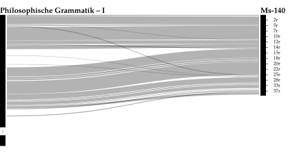

# Ms-140

143 published remarks, PG I

### [PG I](/w-pg-1/#ms-140-1r.1) [1r\[1\]](https://cdn.wittgensteinnachlass.com/2000px/webp/Ms-140/1r.webp)

How can one speak of ‘understanding’ & ‘not understanding’ a sentence; is it not only a sentence when one understands it?

### [PG I](/w-pg-1/#ms-140-1r.2) [1r\[2\]](https://cdn.wittgensteinnachlass.com/2000px/webp/Ms-140/1r.webp)

Does it make sense to point to a group of trees & ask: “Do you understand what this group of trees is saying?” Generally not; but could one not express a sense through the arrangement of trees, could that not be a secret language?

### [1r\[3\]](https://cdn.wittgensteinnachlass.com/2000px/webp/Ms-140/1r.webp)

<s>Usually we will not call a group of trees a sentence, but in the particular case perhaps we will; & if I have reason to assume that the planter also wanted to say something with this group here, then I will </s>

### [PG I](/w-pg-1/#ms-140-1r.4) [1r\[4\]](https://cdn.wittgensteinnachlass.com/2000px/webp/Ms-140/1r.webp)

One will then call the groups of trees that one understands ‘sentences’, but also others that one does not understand, if one assumes that the planter understood them.

### [PG I](/w-pg-1/#ms-140-1r.5) [1r\[5\]](https://cdn.wittgensteinnachlass.com/2000px/webp/Ms-140/1r.webp)

“Does understanding not begin only with the sentence, with the whole sentence? Can one _understand_ half a sentence?” – Half a sentence is not a whole sentence. – But perhaps what the question means can be understood as follows: Let us imagine that the knight’s move in chess were always carried out by two displacements of the knight (one straight, one oblique); then someone could say: “in chess there is no half knight’s move”, & mean: a half knight’s move is not related to a whole one as half a bread roll is to a whole one. One means to say: it is not a difference of degree.

### [PG I](/w-pg-1/#ms-140-1r.6) [1r\[6\]](https://cdn.wittgensteinnachlass.com/2000px/webp/Ms-140/1r.webp)

It would indeed be strange if science & mathematics used sentences but did not speak of understanding these sentences.

### [PG I](/w-pg-1/#ms-140-1r.7+2r.1) [1r\[7\]](https://cdn.wittgensteinnachlass.com/2000px/webp/Ms-140/1r.webp),[2r\[1\]](https://cdn.wittgensteinnachlass.com/2000px/webp/Ms-140/2r.webp)

One sees the essential thing in understanding, the incidental thing in the sign. – Besides, what is the sign for at all, then? – If one thinks, merely to make oneself understood by others, – then one presumably regards the sign as a medicine that is supposed to produce in the other person the same state as the one I have.

### [PG I](/w-pg-1/#ms-140-2r.2) [2r\[2\]](https://cdn.wittgensteinnachlass.com/2000px/webp/Ms-140/2r.webp)

If, in answer to the question “what do you mean by this movement of the hand?” the answer is: “I mean, you are to go out”, then this answer would not have been more correct as: “I mean what I mean by the sentence ‘You are to go out’”.

### [PG I](/w-pg-1/#ms-140-2r.3) [2r\[3\]](https://cdn.wittgensteinnachlass.com/2000px/webp/Ms-140/2r.webp)

When Frege speaks against the formal conception of arithmetic, he says _as it were_: these petty explanations concerning the signs are superfluous if we _understand_ the signs. And understanding would consist, as it were, in seeing a picture from which all the rules follow, thereby becoming intelligible. But Frege does not seem to see that this picture is itself again a sign, or a calculus that explains the written calculus to us.

### [PG I](/w-pg-1/#ms-140-2r.4) [2r\[4\]](https://cdn.wittgensteinnachlass.com/2000px/webp/Ms-140/2r.webp)

What we call “understanding a language” is often of the kind of understanding we acquire of a calculus when we learn about the history of its origin, or its practical application. And there too we become familiar with a more easily surveyable symbolism in place of the unfamiliar one. Let us imagine that someone had originally learnt chess as a writing game, & later was shown the ‘interpretation’ of chess as a board game. “Understanding” here means something similar to “having a clear view of the whole”.

### [PG I](/w-pg-1/#ms-140-2r.5+2v.1+3r.1) [2r\[5\]](https://cdn.wittgensteinnachlass.com/2000px/webp/Ms-140/2r.webp),[2v\[1\]](https://cdn.wittgensteinnachlass.com/2000px/webp/Ms-140/2v.webp),[3r\[1\]](https://cdn.wittgensteinnachlass.com/2000px/webp/Ms-140/3r.webp)

When I give someone a command, it is quite enough for me to give them signs. And, receiving a command, I would never say: “These are just words, & I must penetrate behind the words”. And if I have asked someone something & they give me an answer, I am satisfied – that was precisely what I expected – & do not object: “That is just an answer”.

### [PG I](/w-pg-1/#ms-140-3r.2) [3r\[2\]](https://cdn.wittgensteinnachlass.com/2000px/webp/Ms-140/3r.webp)

But if one says: “How am I supposed to know what he means, I only see his signs?” – I say: “How is _he_ supposed to know what he means; he only has his signs too”.

### [PG I](/w-pg-1/#ms-140-3r.3) [3r\[3\]](https://cdn.wittgensteinnachlass.com/2000px/webp/Ms-140/3r.webp)

What is said can be explained only through language, so one cannot explain _language itself_, in this sense.

### [PG I](/w-pg-1/#ms-140-3r.4) [3r\[4\]](https://cdn.wittgensteinnachlass.com/2000px/webp/Ms-140/3r.webp)

Language must speak for itself.

### [PG I](/w-pg-1/#ms-140-3r.5) [3r\[5\]](https://cdn.wittgensteinnachlass.com/2000px/webp/Ms-140/3r.webp)

One can say: What is meant falls out of the language; for what a sentence means is said again by means of a sentence.

### [PG I](/w-pg-1/#ms-140-3r.6) [3r\[6\]](https://cdn.wittgensteinnachlass.com/2000px/webp/Ms-140/3r.webp)

“What did you mean by these words?” “Did you _mean_ these words?” The first question is not a more precise formulation of the second. The first is answered by a sentence that replaces the sentence that was not understood. Similar to the second question is: “Did you mean that seriously or as a joke?” The case is different with: “Did you mean something by this movement of the hand, – & what?”

### [PG I](/w-pg-1/#ms-140-3r.7+4r.1) [3r\[7\]](https://cdn.wittgensteinnachlass.com/2000px/webp/Ms-140/3r.webp),[4r\[1\]](https://cdn.wittgensteinnachlass.com/2000px/webp/Ms-140/4r.webp)

The words “understand”, “mean” signify, in part of their applications, a psychic reaction on hearing, reading, uttering, etc., the sentence. Understanding is then the phenomenon that occurs when I hear the sentence in a language familiar to me, and not when I hear the sentence in a language unfamiliar to me. Learning the language _brings about_ its understanding. But that belongs to the history of this reaction. – The understanding of the sentence happens to me in the same way as hearing the sentence & accompanies the hearing.

### [PG I](/w-pg-1/#ms-140-4r.2) [4r\[2\]](https://cdn.wittgensteinnachlass.com/2000px/webp/Ms-140/4r.webp)

I can speak of an ‘experience’ of the sentence. “I don’t just say that, I also mean something by it”: If one considers what happens within us when we _mean_ words (& do not merely say them), it seems to us as if something were then coupled with these words, whereas otherwise they ran empty. As if they _intervened_ in us.

### [PG I](/w-pg-1/#ms-140-4r.3+5r.1) [4r\[3\]](https://cdn.wittgensteinnachlass.com/2000px/webp/Ms-140/4r.webp),[5r\[1\]](https://cdn.wittgensteinnachlass.com/2000px/webp/Ms-140/5r.webp)

The understanding of a sentence can also be compared with what we call understanding a picture. Let us imagine a still-life, and that we were unable to see it as a spatial representation, but saw only patches & lines on the picture surface. We can then say “we do not understand the picture”. But we also say this, (in another sense,) when although we see the picture spatially, we do not recognise familiar things (books, animals, bottles) in the spatial forms. Suppose the picture were a genre painting & the people in it about an inch long. If I had once seen real people of this height, I could recognise them in this picture & take the picture as their life-size representation. My visual experience of the picture would in this case be _different_ from when I normally see the picture as a reduced representation, although the illusion of spatial seeing is the same in both cases. – Seeing real people an inch tall is here given only as a possible cause of that visual experience; in other respects the latter is independent of it. Just as a drawing of a cube may be seen spatially only by someone who has already looked at many real cubes: but the description of the spatial visual image contains nothing of what distinguishes a real cube from a painted one. The different experiences when I see a picture once one way, once another, are to be compared with reading a sentence with understanding, and without understanding. (Let us recall what it is like when we read a sentence with incorrect emphasis, and therefore do not understand it, – & then realise how it is to be read.)

### [PG I](/w-pg-1/#ms-140-5r.2) [5r\[2\]](https://cdn.wittgensteinnachlass.com/2000px/webp/Ms-140/5r.webp)

(Seeing a clock as a clock, i.e., as a dial with hands, is similar to seeing the Orion as a walking man.)

### [PG I](/w-pg-1/#ms-140-5r.3) [5r\[3\]](https://cdn.wittgensteinnachlass.com/2000px/webp/Ms-140/5r.webp)

Think of the difference in understanding when, in a sentence, a word is felt on one occasion to belong together with this word and on another occasion with that word. And I could have said that the word is on one occasion construed, understood, seen, or spoken as belonging to this word, and on another occasion to that word.

### [PG I](/w-pg-1/#ms-140-5r.4) [5r\[4\]](https://cdn.wittgensteinnachlass.com/2000px/webp/Ms-140/5r.webp)

We can then call ‘sentence’ what is construed once one way, once another; but also this or that construal (itself). Here is a source of confusions.

### [PG I](/w-pg-1/#ms-140-5r.5+6r.1) [5r\[5\]](https://cdn.wittgensteinnachlass.com/2000px/webp/Ms-140/5r.webp),[6r\[1\]](https://cdn.wittgensteinnachlass.com/2000px/webp/Ms-140/6r.webp)

I read the sentence from the middle of a story: “after he had said that, he left her as on the previous day”. Do I understand the sentence? – That is not entirely easy to answer. It is a German sentence, & in that respect I understand it. I would know how one could use this sentence; I could invent a context for it. And yet I do not understand it in the sense in which I would understand it if I had read the story. (Compare: different language-games. Description of a state of affairs, inventing a story, etc. What is a meaningful sentence in the one case, what in the other?)

Do we _understand_ poems by Christian Morgenstern, or Lewis Carroll’s poem “Jabberwocky”? It becomes clear here that the concept of understanding is fluid.

### [PG I](/w-pg-1/#ms-140-6r.2) [6r\[2\]](https://cdn.wittgensteinnachlass.com/2000px/webp/Ms-140/6r.webp)

Let a sentence be given to me in a cipher unfamiliar to me & at the same time the key to deciphering it. Then, in a certain sense, everything necessary for understanding the sentence is given to me. And yet, if asked whether I understand the sentence, I would answer: “I must first decipher it”, & if I had deciphered it as a German sentence before me, I would say “Now I understand it”. If one now asks: “At what moment in the translation into German does understanding begin?” – one gains an insight into the essence of what we call “understanding”.

### [PG I](/w-pg-1/#ms-140-6r.3) [6r\[3\]](https://cdn.wittgensteinnachlass.com/2000px/webp/Ms-140/6r.webp)

I say a sentence: “I see a black patch over there”; but the words are arbitrary, so I replace them in order by the first 6 letters of the alphabet. It now reads: “a b c d e f”. But now it becomes clear that I – as one might say – cannot immediately think the sense of the above sentence in the new expression. I could also put it this way: I am not used to saying ‘a’ instead of ‘I’, ‘b’ instead of ‘see’, ‘c’ instead of ‘there’, etc. But I do not mean that I am not used to associating the sign ‘a’ immediately with the word ‘I’, etc.; rather, I am not used to using ‘a’ in place of ‘I’.

### [PG I](/w-pg-1/#ms-140-6r.4) [6r\[4\]](https://cdn.wittgensteinnachlass.com/2000px/webp/Ms-140/6r.webp)

“Understanding a sentence” can mean “knowing what the sentence says”, i.e.: being able to answer the question ‘what does this sentence say’.

### [PG I](/w-pg-1/#ms-140-6r.5+7r.1) [6r\[5\]](https://cdn.wittgensteinnachlass.com/2000px/webp/Ms-140/6r.webp),[7r\[1\]](https://cdn.wittgensteinnachlass.com/2000px/webp/Ms-140/7r.webp)

It is a frequently appearing view that a person can only _show_ their understanding imperfectly. That, as it were, they can only ever point to it from a distance, even approach it, but can never touch it with their hand. And that the final thing must always remain unsaid. – One says: “Understanding is indeed something _different_ from the expression of understanding. _Understanding_ cannot be shown; it is something inner, mental. –” Or also: “Whatever I do as a sign of understanding, whether I repeat the explanation of a word, or carry out a command as a sign that I have understood it, these actions _must_ nevertheless not be interpreted as proofs of understanding.” This is similar to what one also says: “I cannot show another person my toothache; & I cannot _prove_ to them that I have toothache.” But the impossibility spoken of (here) is supposed to be a logical one. “Is it not the case that the expression of understanding is precisely an imperfect expression?” That presumably means an expression lacking something – but something essentially _inexpressible_; for otherwise I could simply find a better one. And “essentially inexpressible” means that it makes no sense to speak of a more perfect expression.

### [PG I](/w-pg-1/#ms-140-7r.2) [7r\[2\]](https://cdn.wittgensteinnachlass.com/2000px/webp/Ms-140/7r.webp)

We are not interested in the psychic processes that experience shows to accompany a sentence. But we are interested in understanding, as laid down in an explanation of the sense.

### [PG I](/w-pg-1/#ms-140-7r.3) [7r\[3\]](https://cdn.wittgensteinnachlass.com/2000px/webp/Ms-140/7r.webp)

To understand the grammar of the word “mean”, one must ask oneself what the criterion is for an expression being meant _this way_. What is to be regarded as the criterion of what is meant? –

### [PG I](/w-pg-1/#ms-140-7r.4) [7r\[4\]](https://cdn.wittgensteinnachlass.com/2000px/webp/Ms-140/7r.webp)

The answer to the question “how is that meant” establishes the connection between two linguistic expressions. So the question, too, asks about this connection.

### [PG I](/w-pg-1/#ms-140-7r.5+8r.1) [7r\[5\]](https://cdn.wittgensteinnachlass.com/2000px/webp/Ms-140/7r.webp),[8r\[1\]](https://cdn.wittgensteinnachlass.com/2000px/webp/Ms-140/8r.webp)

<s>The manner & way in which the words “sense”, “meaning”, “mean”, etc. are used leads us to think that this sense, etc., stands in the same relation to the sign as the name does to its bearer.</s> The process that we call understanding a sentence, a description, is sometimes a transferring from one symbolism into another; a following-through of the picture, a copying, a transferring into another form of representation. Understanding the description then means making oneself a picture of what is described. And the process is more or less similar to making a drawing from a description.

### [PG I](/w-pg-1/#ms-140-8r.2) [8r\[2\]](https://cdn.wittgensteinnachlass.com/2000px/webp/Ms-140/8r.webp)

And we also say: “I understand this picture perfectly, I could model it in clay.”

### [PG I](/w-pg-1/#ms-140-8r.3) [8r\[3\]](https://cdn.wittgensteinnachlass.com/2000px/webp/Ms-140/8r.webp)

We speak of understanding a sentence as the condition for our being able to apply it. We say: “I cannot follow a command if I do not understand it”, or also: “I cannot follow it before I understand it”. Must I really understand a sentence in order to act according to it? – “Certainly, otherwise you would not know what you have to do.” – But what use is this knowledge to me; there is a leap from knowing to doing. “But surely I must understand a command in order to act according to it” – here the “must” is suspect. If this is a logical must, then the sentence is a grammatical remark.

### [PG I](/w-pg-1/#ms-140-8r.4) [8r\[4\]](https://cdn.wittgensteinnachlass.com/2000px/webp/Ms-140/8r.webp)

One could ask here: How long before following it _must_ you understand the command? – But the sentence “I must understand the command before I can act according to it” naturally has a good sense. Only no metalogical one. – And ‘understand’, ‘mean’ are not metalogical concepts.

### [PG I](/w-pg-1/#ms-140-8r.5+9r.1) [8r\[5\]](https://cdn.wittgensteinnachlass.com/2000px/webp/Ms-140/8r.webp),[9r\[1\]](https://cdn.wittgensteinnachlass.com/2000px/webp/Ms-140/9r.webp)

If “understanding a sentence” means acting according to it in some way, then understanding cannot be the condition for our acting according to it. But the particular action of understanding can, as a matter of experience, be the prior condition for following the command.

### [PG I](/w-pg-1/#ms-140-9r.2) [9r\[2\]](https://cdn.wittgensteinnachlass.com/2000px/webp/Ms-140/9r.webp)

“I cannot execute the command because I do not understand what you mean. – Yes, now I understand you.” – What was happening when I suddenly understood the other person? There are _many_ possibilities. For example: the command could have been given in a language familiar to me, but with incorrect emphasis, & suddenly the correct emphasis occurred to me. I would then say to a third person, say: “Now I understand him; he means …” & would then repeat the command with the correct emphasis. And in grasping the familiar sentence I would have understood the command. I mean: I would not now have to grasp an abstract sense first. – Or: I had understood the command in _this_ sense, so it was a proper German sentence; but it seemed nonsensical to me. In such a case I would say: “I do not understand you; for surely you cannot mean _that_”. Then a more comprehensible interpretation would occur to me. Several interpretations, i.e., several explanations, might have floated before me before understanding, and I then decided on one of them. (The process of understanding when the absent-minded person turns left at the command “right turn”, and then, clutching his forehead, says: “Oh, I see, ‘right turn’” and turns right.)

### [PG I](/w-pg-1/#ms-140-9r.3+10r.1) [9r\[3\]](https://cdn.wittgensteinnachlass.com/2000px/webp/Ms-140/9r.webp),[10r\[1\]](https://cdn.wittgensteinnachlass.com/2000px/webp/Ms-140/10r.webp)

Let us put the command to form the squares of a series of numbers in the form of a table:

– It seems to us as if, through understanding, we added something to the command that fills the gap between command & execution. So that we could reply to someone who says “but you understand it, so it is not incomplete”: “Yes, I understand it, but only because I add something else; the interpretation, namely.” – But what prompts you to give precisely _this_ interpretation? If it is the command –, then it was already unambiguous, since it commanded this interpretation. Or did you add the interpretation arbitrarily, – in that case you did not understand the command either, but only what you made of it.

### [PG I](/w-pg-1/#ms-140-10r.2) [10r\[2\]](https://cdn.wittgensteinnachlass.com/2000px/webp/Ms-140/10r.webp)

(We see problems in philosophical thinking at places where there are none. And philosophy is supposed to show that there is no problem there.)

### [PG I](/w-pg-1/#ms-140-10r.3) [10r\[3\]](https://cdn.wittgensteinnachlass.com/2000px/webp/Ms-140/10r.webp)

An interpretation is presumably something that is given in signs. It is _this_ interpretation as opposed to another. (The latter is worded differently.) So if one said: “every sentence still requires an interpretation”, that would mean: no sentence can be understood without an addition.

### [PG I](/w-pg-1/#ms-140-10r.4) [10r\[4\]](https://cdn.wittgensteinnachlass.com/2000px/webp/Ms-140/10r.webp)

Of course it happens that I _interpret_ signs, give signs an interpretation; but not whenever I understand a sign! (If someone asks me “what time is it?”, no work of interpretation goes on in me; rather, I simply react to what I see & hear. Someone brandishes a knife at me – then I do not say: “I interpret that as a threat”.)

### [PG I](/w-pg-1/#ms-140-10r.5) [10r\[5\]](https://cdn.wittgensteinnachlass.com/2000px/webp/Ms-140/10r.webp)

“Understanding a word” can mean: _knowing_ how it is used; _being able_ to apply it.

### [PG I](/w-pg-1/#ms-140-10r.6+11r.1) [10r\[6\]](https://cdn.wittgensteinnachlass.com/2000px/webp/Ms-140/10r.webp),[11r\[1\]](https://cdn.wittgensteinnachlass.com/2000px/webp/Ms-140/11r.webp)

“Can you lift this sphere?” – “Yes.” Then I try & do not succeed. I might then say: “_I was mistaken_, I cannot do it”. But perhaps: “I cannot do it _now_, because I am too tired; but when I said I could, I could”. Similarly: “I thought I could play chess, but I have already forgotten how”, but on the other hand: “When I said ‘I can play chess’, I could, but now it has all slipped my mind”. – But what is the criterion for my having been able to do it then? – How did I know that I could? One would answer: “I could always lift such a weight”, “I had just lifted it”, “I played chess not long ago & my memory is good”, “I had just recapitulated the rules”, etc. What I regard as an answer to that question will show me how I use the word “can”.

### [PG I](/w-pg-1/#ms-140-11r.2) [11r\[2\]](https://cdn.wittgensteinnachlass.com/2000px/webp/Ms-140/11r.webp)

One will want to call knowledge, ability, capacity a _state_. Let us compare sentences, each of which describes a state in a different sense: “I have had toothache since yesterday” “I have longed for him since yesterday” “I have been expecting him since yesterday” “I have known since yesterday that he would come” “I have been able to play chess since yesterday”.

Can one say: “I have known continuously since yesterday that he would come”? In which of these sentences can one meaningfully insert the word “continuously”?

### [PG I](/w-pg-1/#ms-140-11r.3) [11r\[3\]](https://cdn.wittgensteinnachlass.com/2000px/webp/Ms-140/11r.webp)

If one calls knowledge a “state”, then in the sense in which one speaks of the state of a body, of a physical model. Thus also in the physiological sense, or in that of a psychology that speaks of unconscious states of a mental model. And of course everyone would concede that; but now one must be clear that one has moved out of the grammatical domain of “conscious states” into another grammatical domain. I can indeed speak of unconscious toothache if the sentence “I have unconscious toothache” is supposed to mean something like: “I have a bad tooth that does not hurt”. But the expression “conscious state” (in the earlier sense) does not now stand in the same grammatical relation to the expression “unconscious state” as the expression “an armchair that I see” does to “an armchair that I do not see because it is behind me”.

### [PG I](/w-pg-1/#ms-140-11r.4) [11r\[4\]](https://cdn.wittgensteinnachlass.com/2000px/webp/Ms-140/11r.webp)

“Knowing something”, instead of this we can say: “having a slip of paper with it written down on it”.

### [PG I](/w-pg-1/#ms-140-12r.1) [12r\[1\]](https://cdn.wittgensteinnachlass.com/2000px/webp/Ms-140/12r.webp)

Understanding a sentence is more akin to understanding a piece of music than one would think. Why must these bars be played precisely this way? Why do I want to bring the increase & decrease of volume & tempo precisely onto this picture? – I would like to say: “because I know what it all means”. But what does it mean? – I would not know how to say. As an explanation I can only translate the musical picture into the picture of another process; & let this picture illuminate the former.

### [PG I](/w-pg-1/#ms-140-12r.2) [12r\[2\]](https://cdn.wittgensteinnachlass.com/2000px/webp/Ms-140/12r.webp)

If “understanding the meaning of a word” means knowing the grammatical possibilities of its application, then I can ask: “How can I then know straight away what I mean by a word that I utter; surely I cannot have the whole manner of application of the word in my head all at once?”

### [PG I](/w-pg-1/#ms-140-12r.3) [12r\[3\]](https://cdn.wittgensteinnachlass.com/2000px/webp/Ms-140/12r.webp)

I can have the possibilities of applying a word in my head in the sense in which the chess player has all the rules of chess in his head; but at the same time also the ABC & the multiplication tables. Knowledge is the hypothetical reservoir from which the water seen flows.

### [PG I](/w-pg-1/#ms-140-12r.4) [12r\[4\]](https://cdn.wittgensteinnachlass.com/2000px/webp/Ms-140/12r.webp)

So one must not think that understanding, meaning a word, is a matter of an act of grasping the grammar instantaneously, so to speak non-discursively. As if one could, as it were, swallow it all at once.

### [PG I](/w-pg-1/#ms-140-12r.5) [12r\[5\]](https://cdn.wittgensteinnachlass.com/2000px/webp/Ms-140/12r.webp)

It is as if I were preparing tools for future use in the toolbox of language.

### [PG I](/w-pg-1/#ms-140-12r.6) [12r\[6\]](https://cdn.wittgensteinnachlass.com/2000px/webp/Ms-140/12r.webp)

“I can apply the word ‘yellow’” is analogous to: “I can move with the king in chess”.

### [PG I](/w-pg-1/#ms-140-12r.7+13r.1) [12r\[7\]](https://cdn.wittgensteinnachlass.com/2000px/webp/Ms-140/12r.webp),[13r\[1\]](https://cdn.wittgensteinnachlass.com/2000px/webp/Ms-140/13r.webp)

And here in chess we can once again find the double meaning of the word “understand”. If someone who knows the game watches a game of chess, then, at a move in the game, he generally has an experience different from that of someone who watches without understanding the game. (And again a different experience from someone who does not even know that it is a game.) One can also say that it is knowledge of the rules of chess that distinguishes the first spectator from the second, & therefore also that it is knowledge of the rules through which the first experiences the chess move in his particular way. But this experience is not knowledge of the rules. We are nevertheless inclined to call both “understanding”.

### [PG I](/w-pg-1/#ms-140-13r.2) [13r\[2\]](https://cdn.wittgensteinnachlass.com/2000px/webp/Ms-140/13r.webp)

The understanding of language, of the game, as it were, seems like a background against which the individual sentence first acquires meaning. – But this understanding, knowledge of the language, is not a state of consciousness that accompanies the sentences of the language. Even if it had such a state in its wake. Rather, it is of the same kind as understanding, mastering a calculus, that is, as being able to multiply.

### [PG I](/w-pg-1/#ms-140-13r.3) [13r\[3\]](https://cdn.wittgensteinnachlass.com/2000px/webp/Ms-140/13r.webp)

To become clearer about the grammar of the word “understand”, let us ask: _When_ do we understand the sentence? – When we have uttered it completely? Or while we are uttering it? – Is understanding an articulated process like the speaking of the sentence; & does its articulation correspond to that of the sentence? Or is it unarticulated& accompanies the sentence as an organ point accompanies a theme?

### [PG I](/w-pg-1/#ms-140-13r.4) [13r\[4\]](https://cdn.wittgensteinnachlass.com/2000px/webp/Ms-140/13r.webp)

How long does it take: to understand a sentence?

And if we understand the sentence for an hour, do we keep starting afresh?

### [PG I](/w-pg-1/#ms-140-13r.5+14r.1) [13r\[5\]](https://cdn.wittgensteinnachlass.com/2000px/webp/Ms-140/13r.webp),[14r\[1\]](https://cdn.wittgensteinnachlass.com/2000px/webp/Ms-140/14r.webp)

Chess is characterised by its rules (its list of rules). If I define the game by its rules (distinguish it from draughts), then these rules belong to the grammar of the word “chess”. Must a definition of the word hover before the mind of someone who uses the word “chess” meaningfully? Certainly not. – Asked what he understands by “chess”, he will give one only then.

If I now asked: “When you uttered the word, what did you mean by it?” – If he answers me: “I meant the game we have played so often etc. etc.”, then I know that this explanation had in no way been in his mind when he used the word; & that his reply does not answer my question in _the_ sense of telling me what “went on in him” when he uttered the word.

### [PG I](/w-pg-1/#ms-140-14r.2) [14r\[2\]](https://cdn.wittgensteinnachlass.com/2000px/webp/Ms-140/14r.webp)

What the person who interprets, understands a sign in such-and-such a sense, does is a step in a calculus (a calculation, as it were). He approximately _does_ what he _says_ when he gives expression to his interpretation.

### [PG I](/w-pg-1/#ms-140-14r.3) [14r\[3\]](https://cdn.wittgensteinnachlass.com/2000px/webp/Ms-140/14r.webp)

By “thought” one can understand a particular psychic process that, say, accompanies the uttering of the sentence; but also: the sentence itself in the system of language.

### [PG I](/w-pg-1/#ms-140-14r.4) [14r\[4\]](https://cdn.wittgensteinnachlass.com/2000px/webp/Ms-140/14r.webp)

“He said these words, but wasn’t thinking anything as he said them.” – “Yes, I was thinking something as I said them.” – “And what, precisely?” – “Well, what I said.”

### [PG I](/w-pg-1/#ms-140-14r.5) [14r\[5\]](https://cdn.wittgensteinnachlass.com/2000px/webp/Ms-140/14r.webp)

One cannot essentially ask, in response to the statement “this sentence has sense”: “which?” Just as one cannot ask, in response to the sentence “this arrangement of words is a sentence”: “which one?”

### [PG I](/w-pg-1/#ms-140-14r.6) [14r\[6\]](https://cdn.wittgensteinnachlass.com/2000px/webp/Ms-140/14r.webp)

What if one asked: When _can_ you play chess? Always? Or while you are saying that you can? Or during a move in a game of chess? – And how strange that knowing how to play chess takes so little time & a game of chess so much longer! (Augustine: “_When_ do I measure a period of time?”)

### [PG I](/w-pg-1/#ms-140-14r.7) [14r\[7\]](https://cdn.wittgensteinnachlass.com/2000px/webp/Ms-140/14r.webp)

It may seem to us as though the grammatical rules were, in some sense, an unfolding of what we experience all at once when using the word.

### [PG I](/w-pg-1/#ms-140-15r.1) [15r\[1\]](https://cdn.wittgensteinnachlass.com/2000px/webp/Ms-140/15r.webp)

I want to explain: the place of a word in grammar is its meaning.

### [PG I](/w-pg-1/#ms-140-15r.2) [15r\[2\]](https://cdn.wittgensteinnachlass.com/2000px/webp/Ms-140/15r.webp)

But I can also say: The meaning of a word is what the explanation of the meaning explains.

### [PG I](/w-pg-1/#ms-140-15r.3) [15r\[3\]](https://cdn.wittgensteinnachlass.com/2000px/webp/Ms-140/15r.webp)

(“What 1 cm³ of water weighs has been called ‘1 gram’.” – “Yes, but what does it weigh?”)

### [PG I](/w-pg-1/#ms-140-15r.4) [15r\[4\]](https://cdn.wittgensteinnachlass.com/2000px/webp/Ms-140/15r.webp)

The explanation of the meaning explains the use of the word. The use of the word in the language is its meaning.

### [PG I](/w-pg-1/#ms-140-15r.5) [15r\[5\]](https://cdn.wittgensteinnachlass.com/2000px/webp/Ms-140/15r.webp)

Grammar describes the use of words in the language.

### [PG I](/w-pg-1/#ms-140-15r.6) [15r\[6\]](https://cdn.wittgensteinnachlass.com/2000px/webp/Ms-140/15r.webp)

It therefore relates to language somewhat as the description of a game, as the rules of a game, relate to the game.

### [PG I](/w-pg-1/#ms-140-15r.7) [15r\[7\]](https://cdn.wittgensteinnachlass.com/2000px/webp/Ms-140/15r.webp)

Meaning, in our sense, is laid down in the explanation of the meaning. If, on the other hand, by the word meaning we meant a characteristic sensation connected with the use of the word, then the explanation of the word would stand to its meaning approximately in the relation of cause to effect.

### [PG I](/w-pg-1/#ms-140-15r.8) [15r\[8\]](https://cdn.wittgensteinnachlass.com/2000px/webp/Ms-140/15r.webp)

The explanation of the meaning can remove any _difference of opinion_ concerning its meaning. It can clarify misunderstandings.

### [PG I](/w-pg-1/#ms-140-15r.9) [15r\[9\]](https://cdn.wittgensteinnachlass.com/2000px/webp/Ms-140/15r.webp)

The understanding spoken of here is a correlate of an explanation.

### [PG I](/w-pg-1/#ms-140-15r.10+15v.1+16r.1) [15r\[10\]](https://cdn.wittgensteinnachlass.com/2000px/webp/Ms-140/15r.webp),[15v\[1\]](https://cdn.wittgensteinnachlass.com/2000px/webp/Ms-140/15v.webp),[16r\[1\]](https://cdn.wittgensteinnachlass.com/2000px/webp/Ms-140/16r.webp)

“Explanation of the meaning of a sign” means above all other rules of use the _definitions_. The distinction between verbal definition & ostensive definition gives a rough classification of these kinds of explanation. In order to understand the role a definition plays in the calculus, one must examine the particular case.

### [PG I](/w-pg-1/#ms-140-16r.2) [16r\[2\]](https://cdn.wittgensteinnachlass.com/2000px/webp/Ms-140/16r.webp)

It may now seem to us as though the other grammatical rules concerning a word had to follow from the ostensive explanation of a word; whereas the ostensive explanation, e.g. “this means ‘red’”, determines the meaning of the word “red”. But this explanation is nothing more than these words together with pointing to a red object, e.g. a red piece of paper. Is this explanation really unambiguous? Could I not have used precisely the same one to give the word “red” the meaning of the word “paper”, “square”, “bright”, “light”, “thin”, etc., etc.?

### [PG I](/w-pg-1/#ms-140-16r.3) [16r\[3\]](https://cdn.wittgensteinnachlass.com/2000px/webp/Ms-140/16r.webp)

But if, instead of “this means ‘red’”, I had given the explanation “this colour is called ‘red’”, then this would indeed be unambiguous, but only if the grammar of the word “red” had been fixed, up to a final determination, by the expression “colour”. (The question could arise here, for example: “Are you calling just _this_ shade of colour red, or other similar shades of colour as well?”) One could explain: the colour of this spot is called “red”, the shape “ellipse”.

### [PG I](/w-pg-1/#ms-140-16r.4) [16r\[4\]](https://cdn.wittgensteinnachlass.com/2000px/webp/Ms-140/16r.webp)

I could say: One must already understand a great deal of a language in order to understand this explanation. Whoever understands this explanation must already know where the words (“red”, “ellipse”) are to be placed, what place in the language they are to occupy.

### [PG I](/w-pg-1/#ms-140-16r.5+17r.1) [16r\[5\]](https://cdn.wittgensteinnachlass.com/2000px/webp/Ms-140/16r.webp),[17r\[1\]](https://cdn.wittgensteinnachlass.com/2000px/webp/Ms-140/17r.webp)

The words “form”, “colour” in these explanations determine the _way of applying_ the word & hence what one can call the _word class_. And in ordinary grammar one could quite properly distinguish among the word classes “form-word”, “colour-word”, “sound-word”, “material-word”, etc. (But not with the same justification: “metal-word”, “poison-word”, “predator-word”. It makes sense to say: “iron is a metal”, “phosphorus is a poison”, etc.; but not: “red is a colour”, “the circle is a form”, etc.)

### [PG I](/w-pg-1/#ms-140-17r.2) [17r\[2\]](https://cdn.wittgensteinnachlass.com/2000px/webp/Ms-140/17r.webp)

I can now explain a colour-word, a form-word, a number-word, etc., etc., ostensively (number-words are explained ostensively to the child & the explanation is good); indeed, negation, disjunction, and so on as well. The _same_ pointing could explain a number-word, a form-word, a colour-word, etc. Only the ostensive explanation plays a different role in the grammar of each word class; & in each case it is only _one_ rule.

### [PG I](/w-pg-1/#ms-140-17r.3) [17r\[3\]](https://cdn.wittgensteinnachlass.com/2000px/webp/Ms-140/17r.webp)

(Consider also the grammar of explanations of the kind: “this day is called Monday”, “I shall call this day of the year ‘day of reconciliation’”.)

### [PG I](/w-pg-1/#ms-140-17r.4+18r.1) [17r\[4\]](https://cdn.wittgensteinnachlass.com/2000px/webp/Ms-140/17r.webp),[18r\[1\]](https://cdn.wittgensteinnachlass.com/2000px/webp/Ms-140/18r.webp)

But when we learn the meaning of a word, very often we are given _only_ the one rule, the ostensive explanation. How then does it come about that we understand the word on the basis of this explanation? Do we guess the other rules? Let us think of the case of the child learning to understand words by being shown objects & hearing words uttered at the same time. It does therefore receive ostensive explanations; & now it understands the words. – But what is the criterion of understanding here? Surely that it applies them correctly. Does it guess rules? – Yes, we shall ask ourselves: should we call this showing & uttering words “explanations” at all? But the language-game is still very simple & the ostensive explanation plays a different role in it from that which it plays in more developed language-games. (The child cannot yet ask, for example, “what is that called?”) But there is no sharp boundary between primitive forms & the more complicated ones. I would not know what I could still call “explanation” & what I could no longer call one. I can only describe language-games or calculi; whether one then wants to call them calculi is immaterial, & provided we do not let the use of the collective name prevent us from examining each individual case that we want to assess.

### [PG I](/w-pg-1/#ms-140-18r.2) [18r\[2\]](https://cdn.wittgensteinnachlass.com/2000px/webp/Ms-140/18r.webp)

What is the sign that someone understands a game? Must he be able to recite the rules? Is it not also a criterion that he can play the game, i.e. is playing it, & could he not be at a loss if asked about the rules? Does he necessarily learn the game by being told the rules, and not also merely by watching it being played? Of course, he will often say to himself: “Oh, I see, so that’s the rule”, & it might happen that he wrote down the rules as he noticed them; but there is certainly also a learning of the game without explicit rules.

### [PG I](/w-pg-1/#ms-140-18r.3) [18r\[3\]](https://cdn.wittgensteinnachlass.com/2000px/webp/Ms-140/18r.webp)

Indeed, just as the grammar of a language is first recorded & first comes into existence when the language has already been spoken by people for a _long_ time, primitive games are also played without their list of rules having been drawn up, indeed perhaps without a single rule having been formulated for them.

### [PG I](/w-pg-1/#ms-140-18r.4) [18r\[4\]](https://cdn.wittgensteinnachlass.com/2000px/webp/Ms-140/18r.webp)

But we consider games & language from the point of view of a game that proceeds according to rules. That is, we _compare_ language with such a process.

### [PG I](/w-pg-1/#ms-140-18r.5) [18r\[5\]](https://cdn.wittgensteinnachlass.com/2000px/webp/Ms-140/18r.webp)

I could also say of the small child: “it can apply the word, it knows how it is applied”. But what this means becomes clear only when I ask: what is the criterion of this knowledge? Here it is not the ability to state rules.

### [PG I](/w-pg-1/#ms-140-19r.1) [19r\[1\]](https://cdn.wittgensteinnachlass.com/2000px/webp/Ms-140/19r.webp)

The name I give to a body, – a shape, – a colour, – a length, always has a different grammar. (“A” in “A is yellow” has a different grammar when A is a body from when it is the surface of a body; it makes sense, for example, to say that the body is yellow throughout, but not that the surface is.) And one points to a body in a different sense from that in which one points to its length, or its colour; it is possible, for example, to define “pointing to a colour” as pointing to the body that has it. Just as someone who marries money does not marry it in the same sense in which he marries the woman who possesses it.

### [PG I](/w-pg-1/#ms-140-19r.2) [19r\[2\]](https://cdn.wittgensteinnachlass.com/2000px/webp/Ms-140/19r.webp)

Money, & what one buys with it. In certain cases an object; but also permission to sit in a place in the theatre, or a title, or rapid movement, or life, etc..

### [PG I](/w-pg-1/#ms-140-19r.3) [19r\[3\]](https://cdn.wittgensteinnachlass.com/2000px/webp/Ms-140/19r.webp)

A name has meaning, the sentence has sense in the calculus to which it belongs. The latter is autonomous, so to speak. – Language must speak for itself. I could say: I am interested only in the _content_ of a sentence; & the content of a sentence is in it. The sentence has its content as a member of a calculus.

### [PG I](/w-pg-1/#ms-140-20r.1) [20r\[1\]](https://cdn.wittgensteinnachlass.com/2000px/webp/Ms-140/20r.webp)

The meaning is the role the word plays in the calculus.

### [PG I](/w-pg-1/#ms-140-20r.2) [20r\[2\]](https://cdn.wittgensteinnachlass.com/2000px/webp/Ms-140/20r.webp)

The meaning of a name is not what we point to in the ostensive explanation of the name; that is, it is not the bearer of the name. – The expression “the bearer of the name ‘N’” is synonymous with the name “N”. The expression can be used in place of the name. “The bearer of the name ‘N’ is ill” means: N is ill. One does not say that the meaning of “N” is ill. The name does not lose its meaning when its bearer ceases to exist (when he dies, for example). But does “two names have _one_ bearer” not mean the same as “two names have the same meaning”? Certainly, instead of “a = B” one can write “the bearer of the name ‘A’ = the bearer of the name ‘B’”.

### [PG I](/w-pg-1/#ms-140-20r.3) [20r\[3\]](https://cdn.wittgensteinnachlass.com/2000px/webp/Ms-140/20r.webp)

What does it mean: “to understand a word”? One says to the child: “no, no more lumps of sugar!” & takes it away from the child. That is how it learns the meaning of the word “no”. If one had handed it a lump of sugar with the same words, it would have learnt to understand the word differently. (It has thereby learnt to use the word, but also to associate a particular feeling with it, to experience it in a particular way.)

### [PG I](/w-pg-1/#ms-140-20r.4+21r.1) [20r\[4\]](https://cdn.wittgensteinnachlass.com/2000px/webp/Ms-140/20r.webp),[21r\[1\]](https://cdn.wittgensteinnachlass.com/2000px/webp/Ms-140/21r.webp)

What does the _meaning_ of a word like “perhaps” consist in? – How does a child learn the use of the word “perhaps”? It may repeat a sentence it has heard from an adult: “she will _perhaps_ come”; in the same tone of voice as the adult. (This is, as it were, a game.) Then one sometimes asks oneself: does it already understand the word “perhaps”, or is it merely repeating it? – But what is the indication that it really understands the word? – Well, that it uses it in particular cases in a particular way – in certain sentence combinations & in a particular tone of voice. What does it mean: to understand the word “perhaps”? – Do _I_ understand the word “perhaps”? – And how do I judge whether I do? Roughly as follows: I know how it is used; I can explain its application to someone by describing it in fictional cases, say. I shall describe the occasion of its application, its position in sentences, the tone of voice in which it is spoken. – Of course, this only says that “I understand the word ‘perhaps’” means as much as: “I know how it is used; etc.”, not that, in order to answer the question whether I understand the word, I try to call its entire application to mind. Rather, in response to this question I shall either react immediately with the answer “yes”, perhaps after saying the word to myself once more, so to speak convincing myself that it is familiar to me; or think of _one_ application, say the word to myself in the correct tone with a gesture of uncertainty; and the like. This is a similar case to when someone explains a calculation to me “which I do not understand precisely”, and when he reaches a particular point in his explanation I say: “Ah, now I understand; now I know how to go on myself”. How do I know that I know how to go on? Have I, at this moment, run through the rest of the calculation? Certainly not. Perhaps part of it has hovered before my mind; perhaps a particular application, a figure. If I were asked: how do you know that you can apply the word “perhaps”, I might answer only: “I have applied it a hundred times”. –

### [PG I](/w-pg-1/#ms-140-21r.2) [21r\[2\]](https://cdn.wittgensteinnachlass.com/2000px/webp/Ms-140/21r.webp)

But one might ask: _Do_ I understand the word, with a description of its application; do I understand its _purpose_? Have I not cheated myself out of something important?

### [PG I](/w-pg-1/#ms-140-21r.3) [21r\[3\]](https://cdn.wittgensteinnachlass.com/2000px/webp/Ms-140/21r.webp)

Now I know only approximately how people use this word. But that could also be a game, or forms of politeness. I do not know why they act as they do, how _language_ enters into their lives. Is the meaning really only the use of the word? Is it not the way in which this use enters into life? But is its use not part of our life?!

### [PG I](/w-pg-1/#ms-140-22r.1) [22r\[1\]](https://cdn.wittgensteinnachlass.com/2000px/webp/Ms-140/22r.webp)

Do I understand the word “glorious”, if I know how & on what occasions people use it? Can I then already use it myself? I mean, use it, as it were, with conviction. Could I not know this use & nevertheless follow it without understanding? (As, in a certain sense, the singing of birds.) Does understanding therefore not consist in something else; in feeling “in one’s own breast”, experiencing these expressions? – They must enter into _my_ life.

### [PG I](/w-pg-1/#ms-140-22r.2) [22r\[2\]](https://cdn.wittgensteinnachlass.com/2000px/webp/Ms-140/22r.webp)

Well, language also enters into my life. And what is called “language” is an entity consisting of heterogeneous parts & the way & manner in which it enters into life is infinitely varied.

### [PG I](/w-pg-1/#ms-140-22r.3) [22r\[3\]](https://cdn.wittgensteinnachlass.com/2000px/webp/Ms-140/22r.webp)

We shall say that the word “glorious”, the word “oh”, but also the word “perhaps” is the _expression_ of a sensation, a feeling. But I do not call this feeling the meaning of the word. Whatever the relation of the word to this sensation may be, whether it is caused by it, whether it regularly accompanies the word, whether the word gives vent to it, like any empirical fact of language as such, does not interest us. For us it remains the description of a process, & what interests us in it is not its truth, but its form. The process as a game.

### [PG I](/w-pg-1/#ms-140-22r.4) [22r\[4\]](https://cdn.wittgensteinnachlass.com/2000px/webp/Ms-140/22r.webp)

I only _describe_ language & _explain_ nothing.

### [PG I](/w-pg-1/#ms-140-22r.5) [22r\[5\]](https://cdn.wittgensteinnachlass.com/2000px/webp/Ms-140/22r.webp)

For my purposes I can put tone of voice & gestures, with which the word is used, in place of the sensations which the word is said to express.

### [PG I](/w-pg-1/#ms-140-22r.6) [22r\[6\]](https://cdn.wittgensteinnachlass.com/2000px/webp/Ms-140/22r.webp)

And so I could say: In some cases, understanding a word includes being able to say it on certain occasions in a particular tone of voice.

### [PG I](/w-pg-1/#ms-140-22r.7) [22r\[7\]](https://cdn.wittgensteinnachlass.com/2000px/webp/Ms-140/22r.webp)

One might say that certain words are merely the point of application for a tone of voice.

### [PG I](/w-pg-1/#ms-140-22r.8+23r.1) [22r\[8\]](https://cdn.wittgensteinnachlass.com/2000px/webp/Ms-140/22r.webp),[23r\[1\]](https://cdn.wittgensteinnachlass.com/2000px/webp/Ms-140/23r.webp)

But for my purposes I could also regard the word itself as a gesture instead of the tone of voice & the accompanying gesture. (Can I not say that the sound “ha ha” is a laugh, the sound “oh” a sigh?)

### [PG I](/w-pg-1/#ms-140-23r.2) [23r\[2\]](https://cdn.wittgensteinnachlass.com/2000px/webp/Ms-140/23r.webp)

Could I not imagine a language spoken in an unvarying metre, with filler words inserted here and there between the words of the sentences in order to maintain this metre? Let us imagine that we spoke of the meaning of these filler words. (The blacksmith who, in order to strike in the same rhythm, makes weak blows between the effective ones.)

### [PG I](/w-pg-1/#ms-140-23r.3) [23r\[3\]](https://cdn.wittgensteinnachlass.com/2000px/webp/Ms-140/23r.webp)

Language is a collection of very different tools. In this toolbox there is a hammer, a saw, a ruler, a set square, a plumb line, a glue-pot & glue. Many of the tools are related to one another through form & use; one can also roughly divide the tools into groups according to their relatedness, but the boundaries of these groups will often be more or less arbitrary; & there are various kinds of relatedness which intersect.

### [PG I](/w-pg-1/#ms-140-23r.4) [23r\[4\]](https://cdn.wittgensteinnachlass.com/2000px/webp/Ms-140/23r.webp)

I said that the meaning of a word was the role it played in the calculus of language. (I compared it to a piece in chess.) And now let us think about how one calculates with a word, say the word “red”. It is stated where the colour is located, what shape and size the spot or the body bearing the colour has, whether it is pure or mixed with others, darker or lighter, remains the same or changes, etc. etc.. Inferences are drawn from the sentences, they are translated into depictions, into actions, things are drawn, measured & calculated. But let us think of the meaning of the word “oh”. If we were asked about it, we would probably say: “‘oh’ is a sigh; one says, for example, ‘oh, it’s raining again already!’” and the like. And with that one would have described the use of the word. But what corresponds to the calculus, the complicated game that we play with other words? Nothing in the use of the word “oh” or “hurrah” or “hm” can be compared with it.

### [PG I](/w-pg-1/#ms-140-24r.1) [24r\[1\]](https://cdn.wittgensteinnachlass.com/2000px/webp/Ms-140/24r.webp)

Incidentally, one must not confuse signs with symptoms here. The sound “hm” can be called an expression of hesitation & also, for the other person, a _symptom_ of hesitation, just as clouds are a symptom of rain. But “hm” is not the _name_ of hesitation.

### [PG I](/w-pg-1/#ms-140-24r.2) [24r\[2\]](https://cdn.wittgensteinnachlass.com/2000px/webp/Ms-140/24r.webp)

Let us imagine that we wanted to describe _ball games_. There would be such games as football, cricket, tennis, with a developed, complicated system of rules; but then a game consisting merely in each person throwing a ball as high as he can; finally one such as small children play, by throwing a ball in any direction & then fetching it again. Or someone throws a ball high out of joy & catches it again, without competing with others. Perhaps one will no longer want to call some of these a ball game; but is it clear where the boundary is to be drawn here?

### [PG I](/w-pg-1/#ms-140-24r.3) [24r\[3\]](https://cdn.wittgensteinnachlass.com/2000px/webp/Ms-140/24r.webp)

We are interested in language as a process that proceeds according to explicit rules. For the philosophical problems are misunderstandings that are to be removed by clarifying the rules according to which we want to use words. We consider language from a one-sided point of view.

### [PG I](/w-pg-1/#ms-140-24r.4) [24r\[4\]](https://cdn.wittgensteinnachlass.com/2000px/webp/Ms-140/24r.webp)

We said: we did not yet understand the _purpose_ of the word “perhaps” from its use. But by purpose we meant here the role it plays in human life. (And this role could be called the “meaning” of the word, in the sense in which one speaks of ‘the meaning of an event for our life’.) But we said: by “meaning” we understood what the explanation of meaning explains. And the explanation of meaning is not an experiential proposition & no causal explanation, but a rule, an agreement.

### [PG I](/w-pg-1/#ms-140-25r.1) [25r\[1\]](https://cdn.wittgensteinnachlass.com/2000px/webp/Ms-140/25r.webp)

One could explain: the word “ha!” in our language has the purpose of causing fright in the person addressed. What constitutes its having this purpose? What is the criterion for it? The word purpose is applied, like all the words of our language, in various more or less related ways. Let us name two characteristic games: we could say that the purpose of an action is what is given by the agent in answer to the question about its purpose. On the other hand, when we say that the hen clucks in order to call her chicks together, we infer this purpose from the _effect_ of the clucking. We would never call the gathering of the chicks the purpose of the clucking if the clucking did not always, or mostly, or under certain specifiable circumstances, have this result. – One may now say that the purpose, the effect, of the word “ha!” is what is important about this word; but the explanation of the purpose or of the effect is not what we call the explanation of meaning.

### [PG I](/w-pg-1/#ms-140-25r.2) [25r\[2\]](https://cdn.wittgensteinnachlass.com/2000px/webp/Ms-140/25r.webp)

A word can, in respect of its effect, be irreplaceable by any other; just as one gesture cannot be replaced by another. (The word has a _soul_, not merely a meaning.) Nor would anyone believe that a poem remained _essentially unchanged_ if its words were replaced by others in accordance with corresponding agreements.

### [PG I](/w-pg-1/#ms-140-25r.3) [25r\[3\]](https://cdn.wittgensteinnachlass.com/2000px/webp/Ms-140/25r.webp)

We can interpret our sentence, “meaning is what the explanation of meaning explains”, _in this way_: let us concern ourselves only with what is called the _explanation_ of meaning, and with meaning in no other sense.

### [PG I](/w-pg-1/#ms-140-25r.4) [25r\[4\]](https://cdn.wittgensteinnachlass.com/2000px/webp/Ms-140/25r.webp)

On the other hand one says “I understand this gesture” in the sense: “I understand this theme”, “it says something to me”, & that means here: I follow it with a particular experience.

### [PG I](/w-pg-1/#ms-140-25r.5+26r.1) [25r\[5\]](https://cdn.wittgensteinnachlass.com/2000px/webp/Ms-140/25r.webp),[26r\[1\]](https://cdn.wittgensteinnachlass.com/2000px/webp/Ms-140/26r.webp)

It is odd: we would like to explain our understanding of a gesture as translating it into words, & understanding words as translating them into gestures. And indeed, we explain words through a gesture & a gesture through words.

### [PG I](/w-pg-1/#ms-140-26r.2) [26r\[2\]](https://cdn.wittgensteinnachlass.com/2000px/webp/Ms-140/26r.webp)

(If asked what I mean by the word “and” in the sentence “give me the bread and the butter”, I would answer with a summarizing gesture; & this gesture would _illustrate_ what I mean. Similarly, as a green sample illustrates the meaning of “green” & the W-F notation the meaning of “not”, “and”, etc.)

### [PG I](/w-pg-1/#ms-140-26r.3) [26r\[3\]](https://cdn.wittgensteinnachlass.com/2000px/webp/Ms-140/26r.webp)

(The “not” makes a gesture of warding off.

No, it _is_ a gesture of warding off. Grasping negation is understanding a warding-off, negating gesture.)

### [PG I](/w-pg-1/#ms-140-26r.4+27r.1) [26r\[4\]](https://cdn.wittgensteinnachlass.com/2000px/webp/Ms-140/26r.webp),[27r\[1\]](https://cdn.wittgensteinnachlass.com/2000px/webp/Ms-140/27r.webp)

But could one not say this: The sentences we utter have a particular purpose, they are meant to produce certain effects. They are part of a mechanism, perhaps a psychological one, & their words are also such parts (levers, cogwheels, and the like). The example which seems to represent what we are thinking of here is a musical automaton, a game machine. It contains a roll, cylinder, etc., on which the piece of music is written in some notation (through the position of holes, pins, etc.). It is as if these written signs gave the command which was then carried out by the keys and hammers etc. And so should we not say that the sense of the sign is its effect? – But what if the game machine is in a poor condition, & the signs on the roll produce hissing and knocking instead of the sequence of notes? – Perhaps one says: the sense of the signs is their effect on a mechanism in good condition, thus: the sense of a command is its effect on a willing human being. But what is regarded here as the criterion of willingness? So one will say: the sense of those signs is not their effect, but their purpose. But let us consider this as well: one is tempted to believe that this purpose is now part of the whole purpose which the game machine has to fulfil. – This purpose is, say, to give people pleasure. But it is clear that no part of _this_ purpose was meant by the “sense of the signs”. Rather, we were thinking here only of the purpose of these signs _within_ the mechanism of the game machine. – And so one can say: The purpose of a command is its sense, insofar as the purpose is indicated by a rule of language. “I say ‘go!’, because I want you to leave me alone”, “I say ‘perhaps’, because I am not quite certain”.

### [PG I](/w-pg-1/#ms-140-27r.2) [27r\[2\]](https://cdn.wittgensteinnachlass.com/2000px/webp/Ms-140/27r.webp)

We are not interested in an explanation of the way language works as a psychophysical mechanism. This explanation is itself a description of phenomena (of association, memory, etc.) in language; it is itself a linguistic act & places itself outside the calculus; whereas we need an explanation which is _part of the calculus_.

### [PG I](/w-pg-1/#ms-140-27r.3) [27r\[3\]](https://cdn.wittgensteinnachlass.com/2000px/webp/Ms-140/27r.webp)

“How is he to know which colour he has to choose when he hears the word ‘red’?” – “Very simple: he is to take the colour whose image comes to mind when he hears the word.” – But how is he to know what that means, & which is the one, ‘that comes to mind when you hear the word’? Of course there is also a process: choosing the colour that comes to mind at this word. And the sentence: “red is the colour that comes to mind when you hear the word ‘red’” is a definition.

### [PG I](/w-pg-1/#ms-140-27r.4) [27r\[4\]](https://cdn.wittgensteinnachlass.com/2000px/webp/Ms-140/27r.webp)

If I say, “_symbol_ is what produces this effect” –, then the question is precisely: how can I speak of “this effect”? – And how do I know that it _is the one I meant_ when it occurs? – It is therefore no explanation which gets to the root of our problem to say: very simple, we compare it with our memory-image. For how is the method of comparison given to us, according to which we are to compare, i.e.: How do we know what we are to do when we are commanded “to compare”?

### [PG I](/w-pg-1/#ms-140-27r.5+28r.1) [27r\[5\]](https://cdn.wittgensteinnachlass.com/2000px/webp/Ms-140/27r.webp),[28r\[1\]](https://cdn.wittgensteinnachlass.com/2000px/webp/Ms-140/28r.webp)

In our language it is one function of the word “red” to call the particular colour to mind; indeed, it might be found that this word is better suited to this than others, indeed, that it alone fulfils that purpose. But instead of the mechanism of association we could also have used a chart, or a similar aid; & then our calculus would have to proceed with the associated, or seen, colour sample. The psychological effectiveness of a sign does not concern us. I would also allow myself to invent such an effectiveness.

### [PG I](/w-pg-1/#ms-140-28r.2) [28r\[2\]](https://cdn.wittgensteinnachlass.com/2000px/webp/Ms-140/28r.webp)

The investigation of whether the meaning of a word is its effect, its purpose, etc., is a grammatical investigation.

### [PG I](/w-pg-1/#ms-140-28r.3) [28r\[3\]](https://cdn.wittgensteinnachlass.com/2000px/webp/Ms-140/28r.webp)

Why can one understand a word & not a penholder? Is it the difference in the forms? But you say: we could also understand a penholder, if it had been given a meaning. But how does one give it a meaning? – How was a meaning given to the word “red”? Well, one points at something & says “I call this ‘red’”. Yes, is that a kind of consecration, or mystical formula? How does this pointing and uttering words work? It works only within a system of other linguistic actions. – And now one can therefore understand a penholder; but does this understanding then contain that whole system of its use? Impossible. We say that we understand its meaning when we know its use, but we have said that the word “know” does not designate a state of consciousness. That is: the grammar of this word is not that of a ‘state of consciousness’, but another. And to learn it is only a means: to look at how the word is actually used.

### [PG I](/w-pg-1/#ms-140-28r.4+29r.1) [28r\[4\]](https://cdn.wittgensteinnachlass.com/2000px/webp/Ms-140/28r.webp),[29r\[1\]](https://cdn.wittgensteinnachlass.com/2000px/webp/Ms-140/29r.webp)

But to the question: “did you understand the sentence (which you have just read)” one will nevertheless answer truthfully sometimes “yes”, sometimes “no”. “So something else must surely be going on when I understand it than when I do not understand it.” Good. So if I understand a sentence, something happens, very much like when I can follow a melody as a melody, in contrast to when it is too long or too complicated & I have to say, “I could not follow this part”. And the same could happen with a picture, I mean now, a pure ornament. At first I see only a tangle of lines, finally they group themselves into familiar & customary forms; I see a division, a system familiar to me. – If the ornament also contained depictions of objects well known to me, recognizing these would mean a further understanding. (Think here of resolving a puzzle picture.) I would then say: “yes, now I see the picture correctly”. – To the question: “what happened, when you read this sentence with understanding”, I would then have to say: I read it as a German concatenation of words well known to me in its kind. Perhaps also: an image floated before my mind …. But then one asks: “Is that all? Understanding could not consist in that alone!” Well, that (or something of the kind) is all that took place during my reading & immediately afterwards; but what we call “understanding” relates precisely to countless processes that take place before & after reading _this_ sentence. But if I do not understand a sentence: it could be a sentence in a language unfamiliar to me & all I see is a series of unknown words. Or what I read seemed to be a German sentence, but part was not a word-connection familiar to me, & when I then tried to grasp it (& that can again mean various things) I did not succeed. (Think of the processes when we try to understand the sense of a poem written in our mother tongue, whose forms of language we nevertheless do not understand.) But of a sentence in a language unfamiliar to me, say a Latin one, which I can decipher only laboriously by constructing it, I will also say that I understand it if I have translated it piecemeal into German and have never managed to grasp its sentence melody.

### [PG I](/w-pg-1/#ms-140-29r.2+30r.1) [29r\[2\]](https://cdn.wittgensteinnachlass.com/2000px/webp/Ms-140/29r.webp),[30r\[1\]](https://cdn.wittgensteinnachlass.com/2000px/webp/Ms-140/30r.webp)

But in order to understand the sentence, surely I must understand its words! And surely I understand words when reading, and others I do not. I hear a word & am asked: “did you understand it?” & I answer, truthfully, “yes”. What happened there, when I understood it: how does this – understanding differ from what happens when I do not understand the word? The word was, say, “tree”. Must the image of a tree have floated before my mind, for me to be able to say truthfully that I understood it? No. Nor any other image. All I can say is that, when asked “do you understand the word ‘tree’”, I would have answered “yes” without hesitation & without lying. – If the other had then asked me: “so, what is a tree?” I would now have described, shown, or drawn one for him; but perhaps I would have answered: “I know, but I do not want to explain it”. And while saying my words, the image of a tree might have floated before my mind, perhaps I looked for something that had some similarity to a tree, or other words went through my head, etc. etc.. Let us simply see how we actually use the word “understand”. That word could also have been one of which I said: “I knew what it meant, & it will come to me again”, & later I said: “now it has come to me!” – What had happened there? – Perhaps the situation in which the word had been explained to me had come to mind: I saw myself with others in a room etc. etc.. (But if I now read this word with understanding in a sentence, this image did not have to float before my mind again; perhaps there was no image at all.) Or it was a word in a foreign language; & I had often heard it, but not understood it. I might have said to myself: “what can it mean?” & tried to give it a meaning fitting the context (again, various possibilities). Now perhaps this situation comes to mind & I say: “I do not understand the word”. But I could also react immediately to the foreign word with the answer “I do not understand it”; just as I react oppositely to the word tree. Suppose the word was “red”, & I automatically said that I understood it; now he asks again: “do you really understand it?” Then, as if for purposes of checking, I call up a red mental image before my mind. But how do I know that the right colour is the one that appears to me? And yet I now say, completely convinced, that I understand it. – But I could also look at a colour chart with the word “red” beneath the colour. – I could extend the description of such processes indefinitely.

### [PG I](/w-pg-1/#ms-140-31r.2+32r.1) [31r\[2\]](https://cdn.wittgensteinnachlass.com/2000px/webp/Ms-140/31r.webp),[32r\[1\]](https://cdn.wittgensteinnachlass.com/2000px/webp/Ms-140/32r.webp)

The problem occupying us could be put, quite directly, in these words: “Must one, when reading the word ‘blue’ with understanding, perhaps see the image of the blue colour before one?” This question has often been asked, and then mostly answered in the negative; and from this answer the conclusion has been drawn that the process characteristic of understanding must be another one, not yet grasped by us. – So if by “understanding” one means what distinguishes reading with understanding from reading without understanding: what happens in understanding? Well, we do not call “understanding” one process accompanying reading or hearing, but rather: more or less related processes, against a background, in an environment of facts of a particular kind: the actual use of the language or languages learned. – It is said that understanding is a “mental process”, & this designation is misleading in this case, as well as in countless others. It compares understanding with a particular _process_ – such as translating from one language into another; and it suggests this same conception for thinking, knowing, believing, wishing, intending, and so on. For in all these cases we see that what we might naively give as the mark of such a process does not belong to it in all cases, or even in the majority of cases. And the next conclusion from this is that what is essential to the process is something hitherto undiscovered, difficult to grasp. For one says: If in all these cases I use the word “understand”, then something the same must happen in all of them, and that is precisely what is essential to understanding (expecting, wishing, etc.). For why else should I name them with the same word? – This argument proceeds from the conception that it is what the processes, or objects, etc., have in common which must justify their being characterized by a common concept-word. This conception is, in a certain sense, _too primitive_. What the concept-word indicates is indeed a relatedness of the objects, but this relatedness need not be a commonality of a property or a component. It can link the members together like a chain, so that one is related to another _through intermediate members_; and two neighbouring members can have features in common, be _similar_ to one another, while more distant ones have nothing more in common and yet belong to the same family. Indeed, even if one feature is common to all members of the family, it need not be the feature that defines the concept.

### [PG I](/w-pg-1/#ms-140-32r.2) [32r\[2\]](https://cdn.wittgensteinnachlass.com/2000px/webp/Ms-140/32r.webp)

One could say: the concept-word or collective name is defined in this case by there being transitions from one member to another. – But one could object that transitions can be made from anything to anything & that the concept would therefore not be bounded. To this I must say that it usually is not in fact bounded & its determination reads, say: “by ‘knowledge’ we mean these and these processes, _& similar ones_”. But if, in order to clarify a philosophical paradox, we want to draw boundaries in the use of a word, we place beside the actual picture of this use, in which, so to speak, the various colours flow into one another without sharp boundaries, another one, similar to the first in a particular way, but consisting of colours with clear boundaries between them.

### [PG I](/w-pg-1/#ms-140-32r.3) [32r\[3\]](https://cdn.wittgensteinnachlass.com/2000px/webp/Ms-140/32r.webp)

The relatedness of the members of the concept can be established through features common to them, whose occurrence in the family of the concept overlaps in extremely complicated ways.

### [PG I](/w-pg-1/#ms-140-32r.4) [32r\[4\]](https://cdn.wittgensteinnachlass.com/2000px/webp/Ms-140/32r.webp)

And instead of “and similar ones”, I could have said: “& related to them in some ways”.

### [PG I](/w-pg-1/#ms-140-32r.5+33r.1) [32r\[5\]](https://cdn.wittgensteinnachlass.com/2000px/webp/Ms-140/32r.webp),[33r\[1\]](https://cdn.wittgensteinnachlass.com/2000px/webp/Ms-140/33r.webp)

Thus there is probably not one characteristic common to everything we call a game. But one cannot say either that “game” has several independent meanings (like, say, the word “bank”). Rather, “games” are what we call processes related to one another in various ways, between which there is a multiplicity of transitions.

### [PG I](/w-pg-1/#ms-140-33r.2) [33r\[2\]](https://cdn.wittgensteinnachlass.com/2000px/webp/Ms-140/33r.webp)

When we consider the actual use of a word, we see something fluctuating. In our considerations we set something more fixed against this fluctuating thing. Similarly, as when one paints a stationary copy of the constantly changing image of a landscape.

### [PG I](/w-pg-1/#ms-140-33r.3) [33r\[3\]](https://cdn.wittgensteinnachlass.com/2000px/webp/Ms-140/33r.webp)

We consider language _from the point of view_ of a game governed by fixed rules. We compare it with such a game, measure it against it.

### [PG I](/w-pg-1/#ms-140-33r.4) [33r\[4\]](https://cdn.wittgensteinnachlass.com/2000px/webp/Ms-140/33r.webp)

If, for our purposes, we want to subject the use of a word to definite rules, we place another use beside its fluctuating use, by formulating a characteristic aspect of the first in rules.

### [PG I](/w-pg-1/#ms-140-33r.5) [33r\[5\]](https://cdn.wittgensteinnachlass.com/2000px/webp/Ms-140/33r.webp)

Thus one could say that the use of the word “good” (in the ethical sense) is composed of an exceedingly large number of related games. So to speak, facets of use. But it is precisely the connection between these facets, their relatedness, that produces _one_ concept here.

### [PG I](/w-pg-1/#ms-140-33r.6) [33r\[6\]](https://cdn.wittgensteinnachlass.com/2000px/webp/Ms-140/33r.webp)

But what happens here is not what, in physics, is the simplifying description of a natural phenomenon which disregards subordinate influences. One cannot say that logic represents an idealized reality, that it holds strictly only for an ideal language, and the like. For where do we get the concept of this ideal from?! At most one could say: “we _construct_ an ideal language”, in contrast, say, to ordinary language; but not that we _say_ something which would hold only of an ideal language.

### [PG I](/w-pg-1/#ms-140-34r.1+35r.1) [34r\[1\]](https://cdn.wittgensteinnachlass.com/2000px/webp/Ms-140/34r.webp),[35r\[1\]](https://cdn.wittgensteinnachlass.com/2000px/webp/Ms-140/35r.webp)

I would like to say the following about understanding a picture. One will speak of understanding a genre picture, for example, when we recognize the process depicted, the action in it. The criterion for this recognition is then, say, that, when asked, one explains the action in words, represents it through gestures, and so on. It is also possible that this recognition does not come easily to us, either because we do not immediately see the figures in the picture as such (a puzzle picture), or because we cannot piece together what they are doing with one another; and the like. In these cases there is then a process of recognition known to us, perhaps after a period of doubt. If, on the other hand, the picture is one of which we would say, “we grasp it at first sight”, we find it difficult to say what understanding here actually consists in. Above all, what does not happen is that we take the painted objects for real ones. And “I understand it” here does not mean either: I finally understand (after an effort) that it is _this_ picture. Nor does a recognition take place like recognizing an old acquaintance in the street, when one might say: “oh, it’s …!” If one wanted to say: a recognition takes place; what does this recognition consist in? I recognize, say, a certain part of the picture as a human face: Must I, to do this, look at a real face; or bring the memory of one seen before my mind’s eye? Is it like this: I rummage in the cupboard of my memory until I find something similar to the picture, and is the recognition just this finding? In our case there is not _one_ particular process which one could call recognition; although the person who sees the picture will truthfully answer “yes” to the question “do you recognize what this is”, or perhaps with the words: “that’s a face”. But one can say that he sees something different when he sees the complex of lines as a face from when he does not. I would then like to say: I see something _very familiar_ before me. But what constitutes the familiarity is nothing historical, namely that I have already seen such objects so often, etc., for the prehistory of the experience does not lie in the experience. Rather, the familiarity lies, say, in my immediately grasping a particular rhythm of the picture and remaining with it, resting, so to speak, in it. For the rest, the familiarity consists in each particular case in a particular experience, and the picture of a table has one experience, the picture of a bed another. When I say: “I understand this picture”, the question is precisely: do I mean, “I understand it _like this_”? And the “_like this_” stands for a translation of what is understood into another expression. Or is it an, so to speak, intransitive understanding? Do I, in understanding the one, think of another; i.e., does understanding consist in my thinking of something else? And if I do not mean this, then what is understood is quasi-autonomous, and understanding is to be compared with understanding a melody.

### [35r\[2\]](https://cdn.wittgensteinnachlass.com/2000px/webp/Ms-140/35r.webp)

And this perhaps sufficiently illuminates the understanding of a sentence. Understanding is not _one_ process during the reading (hearing or speaking) of the sentence. Countless interrelated processes correspond to this word. If we wanted to designate them by characteristic pictures, we would name reading a sentence _with “correct” emphasis_ as one of the most characteristic.

### [PG I](/w-pg-1/#ms-140-35r.3) [35r\[3\]](https://cdn.wittgensteinnachlass.com/2000px/webp/Ms-140/35r.webp)

(It is interesting to note that the pictures which float before us when reading an isolated word, when we want to understand it properly, are usually entirely absent when reading the sentence, and the picture which floats before us when reading it with understanding is often something like a result of the whole sentence.)

### [35r\[4\]](https://cdn.wittgensteinnachlass.com/2000px/webp/Ms-140/35r.webp),[36r\[1\]](https://cdn.wittgensteinnachlass.com/2000px/webp/Ms-140/36r.webp)

One can also say that, in reading the sentence with understanding, etc., it is often _used_ in some way, by translating it into a picture, comparing it with another sentence, in short, drawing some consequences from it. And if we want to understand a picture properly and consciously, we very often translate it into words; thus in a certain sense we move still further away

### [PG I](/w-pg-1/#ms-140-36r.2+37r.1) [36r\[2\]](https://cdn.wittgensteinnachlass.com/2000px/webp/Ms-140/36r.webp),[37r\[1\]](https://cdn.wittgensteinnachlass.com/2000px/webp/Ms-140/37r.webp)

It is possible that someone forgets the meaning of a word (e.g. the word “blue”). What has he forgotten? – How does this manifest itself? For example, he points to tablets of different colours and says: “I no longer know which of these one calls ‘blue’”. Or else he no longer knows at all what the word means (what the word is used for), and only that it is a German word. One might now say: The one who has forgotten the meaning of the word “blue” and was asked to select a blue object from others, feels, when looking at these objects, that the connection between the word “blue” and those colours no longer exists (that it is interrupted). And the connection is restored when we repeat the explanation of the word to him. But we could restore the connection in a variety of ways: We could point to a blue object and say “that is blue”, or say “remember your bruise”, or perhaps we pronounced the English “blue”, etc. etc. And when I now said that we could establish the connection in these different ways, the thought is suggested that I had brought about, in all these different ways, _one_ particular phenomenon which I call the connection between word and colour, or the understanding of the word, just as I can connect the ends of two wires conductively with one another by means of objects of different shapes and made of different materials. But there must be no talk of a phenomenon of such a connection, of, for example, an image of the colour appearing before my mind’s eye when I hear the word. For if what has been restored is his understanding of the word, this can manifest itself in very different processes, and behind these manifestations there is not yet another process, the actual understanding, which accompanies and causes these manifestations, as toothache causes groaning, holding one’s cheek, contorting one’s face, etc. If I were asked on this account whether I meant that there was no understanding at all, but only manifestations of understanding, I would have to answer that this question is as nonsensical as the question whether there is a three. I can only describe the grammar of the word “understand” (in fragments) and point out that it is not the grammar one would suppose without looking closely. We are in the same position here as the little painter Klecksel, who draws the human profile with two eyes because he knows that human beings have two eyes.

### [PG I](/w-pg-1/#ms-140-37r.2) [37r\[2\]](https://cdn.wittgensteinnachlass.com/2000px/webp/Ms-140/37r.webp)

Once again: In what cases will we say, “he understands the word ‘blue’”? Well, when he immediately selects the blue object from the others; or also when he says in a credible manner that he could now select the blue one, but does not want to (perhaps we notice that he involuntarily looks at the blue object while doing so; perhaps we merely believe him on the basis of his earlier behaviour). And how does _he_ know that he understands the word? i.e. under what circumstances will _he_ be able to say it? Sometimes after some test, sometimes without one. But will he not perhaps later have to say, “I was mistaken, I did not understand it after all”, if it turns out that he cannot apply it? Can he defend himself in this case and say that he did indeed understand the word when he asserted this, but that the meaning then escaped him? Well, what can he cite as a criterion (proof) that he understood the word at that time? – He might say: “I saw the colour before me then, but now I cannot remember it”. Now if this implies that he understood the word, then he understood it at that time. – Or he says: “I can only say that I have already used the word a hundred times”, or “that I had used it just before; and when I said I understood it, I was thinking of that case”. What one takes as the grounds for an assertion constitutes the sense of the assertion.

### [PG I](/w-pg-1/#ms-140-37r.3+38r.1) [37r\[3\]](https://cdn.wittgensteinnachlass.com/2000px/webp/Ms-140/37r.webp),[38r\[1\]](https://cdn.wittgensteinnachlass.com/2000px/webp/Ms-140/38r.webp)

What is it like, then, when we say: “he understands the word ‘blue’, he immediately took the blue ball out from among the others”; but he tells us: “I only drew it at random, I had not understood the word”. What criterion did he have for not having understood the word; and are we now to believe him? – It produces a curious thought-feeling when one asks oneself: “how do I know that I do not understand this word?” One then wants to say “I connect nothing with it”, “it says nothing to me”, “it is a mere sound”, and in order to understand these utterances one has to recall what it is like ‘when one connects something with the word’, when the sound of the word has become a meaningful word through an explanation, when one can _do something with_ the word. One will say: “Surely, he cannot be mistaken in saying that he did not understand the word”. And this is a remark about the grammar of the statement “I did not understand the word”. And likewise it is a remark on grammar when we say: “Whether he understood, we cannot _know_, but only suppose; he, however, knows it”. And it should be said that the statement “I did not understand the word” does not describe a state during the hearing of the word, but that the processes which characterized the failure to understand could have taken place in various ways after hearing the word.

### [PG I](/w-pg-1/#ms-140-38r.2+39r.1) [38r\[2\]](https://cdn.wittgensteinnachlass.com/2000px/webp/Ms-140/38r.webp),[39r\[1\]](https://cdn.wittgensteinnachlass.com/2000px/webp/Ms-140/39r.webp)

What is it like to remember the meaning of a word? I see an object of a particular colour before me and say: “this book is brown and I have always called this colour ‘brown’”. What act of remembering must take place for me to be able to say this? But one could put this question much more generally. If, for example, someone asked me “have you seen the table at which you are now sitting before”, I would answer: “yes, I have seen it countless times”. And if asked further I would say: I sat at it every day for months. – What act, or acts, of remembering are taking place here? Surely I do not see myself in my mind ‘sitting at this table every day for months’. But nevertheless I say that I remember having done so and can subsequently substantiate it in various ways. For example, I also lived in this room last summer. But how do I know that, do I see it before me? No. What, then, does remembering consist in in this case? If I, so to speak, pursue the grounds of the memory, individual images of my earlier stay also arise in me, but not, say, with their date. And even before they have arisen, and before I have summoned various pieces of testimony within me, I truthfully say that I remember living here for months and seeing this table. Remembering, then, is probably not the mental process which one would imagine it to be at first sight. If I rightly say “I remember it”, the _most varied things_ may take place, including merely my saying it. And when I say “rightly” here, I am of course not laying down what is the right and what the wrong use of the expression, but, conversely, characterizing the existing use.

### [PG I](/w-pg-1/#ms-140-39r.2) [39r\[2\]](https://cdn.wittgensteinnachlass.com/2000px/webp/Ms-140/39r.webp)

The mental process of understanding is like the arithmetical object three. The word “process” here and the word “object” there give us a false grammatical _attitude_ towards the word.

### [PG I](/w-pg-1/#ms-140-39r.3) [39r\[3\]](https://cdn.wittgensteinnachlass.com/2000px/webp/Ms-140/39r.webp)

The explanation of the meaning of a word has an effect similar to ‘knowing how to continue’, when one tells someone the beginning of a poem until he says: now I know how to continue. (Tell yourself the various mental possibilities of this knowing how to continue.)

### [PG I](/w-pg-1/#ms-140-39r.4) [39r\[4\]](https://cdn.wittgensteinnachlass.com/2000px/webp/Ms-140/39r.webp)

The way in which we learnt the language is not _contained_ in its use. (Just as the cause is not contained in its effect.)

### [PG I](/w-pg-1/#ms-140-39r.5) [39r\[5\]](https://cdn.wittgensteinnachlass.com/2000px/webp/Ms-140/39r.webp)

What effect has the ostensive explanation had? Is it repeatedly brought in when the word is used, or does it work like an inoculation which has changed us for the time being?

### [PG I](/w-pg-1/#ms-140-39r.6) [39r\[6\]](https://cdn.wittgensteinnachlass.com/2000px/webp/Ms-140/39r.webp)

The explanation as part of the calculus cannot act at a distance. It works only insofar as it is applied.

### [39v\[1\]](https://cdn.wittgensteinnachlass.com/2000px/webp/Ms-140/39v.webp)

_§1_

_Augustine_ describes how human beings learn language as follows: cum appellabant rem aliquam et cum secundum eam vocem corpus ad aliquid movebant, videbam et tenebam hoc ab eis vocari rem illam, quod sonabant, cum eam vellent ostendere. … Ita verba in variis sententiis locis suis posita, et crebro audita quarum rerum signa essent paulatim colligebam measque iam voluntates edomito in eis signis ore per haec enuntiabam.

We obtain here this picture of language: its words name objects; sentences are combinations of such names. Augustine does not speak of a difference between types of words. In his description, we mainly think of nouns, such as table, tree, bread and the proper names of people; the other types of words are added to these towards the background.

### [39v\[2\]](https://cdn.wittgensteinnachlass.com/2000px/webp/Ms-140/39v.webp)

_§2_

Let us imagine this use of language:
