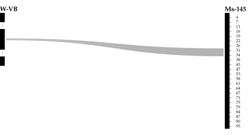
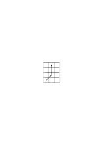
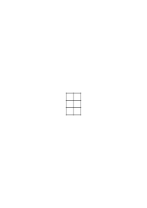
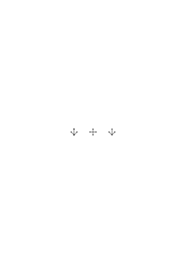
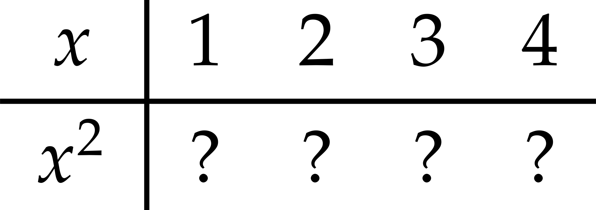
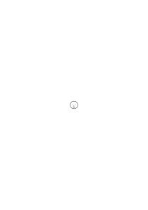
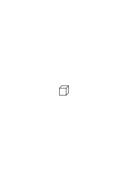

# Ms-145

4 published remarks, VB

### [1\[1\]](https://cdn.wittgensteinnachlass.com/2000px/webp/Ms-145/1.webp)

14.10.1933

If understanding is a hypothetical state, then the question is: What are we to do with the assertion that someone understands? And this question itself is not easy to understand.

### [1\[2\]](https://cdn.wittgensteinnachlass.com/2000px/webp/Ms-145/1.webp)

Someone asks us: “has N understood?” We answer “yes”. The questioner then gives N a task (which he would not have given him if N had not understood the word in question). E.g. we explain to someone the use of the compass (and thus the meaning of ‘South’, ‘North’, etc.). We test his understanding (as we would say) in some way. M then asks us: “has N understood?” We say “yes”; & now M gives N a task (an order) that presupposes an understanding of the points of the compass. (Say: “go 1 km south, then 2 km east, etc.”) (It is convenient here to use the example of the notation a = →, b = ↓ etc. How, for instance, would we explain the meaning of a, b etc. & how, on the other hand, would we test whether he had understood them?)

### [1\[3\]](https://cdn.wittgensteinnachlass.com/2000px/webp/Ms-145/1.webp),[2\[1\]](https://cdn.wittgensteinnachlass.com/2000px/webp/Ms-145/2.webp)

We could also express the opinion that N has understood in the form of a conjecture that he will act in such & such a way. So we might say, for instance: “You can go ahead & give him this task. He will carry it out.” or: “… he will carry it out _if_ nothing prevents him” (or “if he is in a good mood”).

### [2\[2\]](https://cdn.wittgensteinnachlass.com/2000px/webp/Ms-145/2.webp),[3\[1\]](https://cdn.wittgensteinnachlass.com/2000px/webp/Ms-145/3.webp)

Now suppose N carries out such orders from M. He carries out the orders twice, but the third time, in otherwise identical circumstances, he does not. Has he understood, then? Imagine one answered: “Yes, he _had_ understood, but _he_ has now forgotten the explanations again.” Now the question is: _is that an excuse?_ For supposing I always had an excuse ready, what would be the purpose of my statement that N had understood? I think it is clear that the statement really would be pointless then. I would say: “Whatever happens accords with it.” Could we not say here “the sentence is connected to reality by a friction clutch”? It is not _rigidly coupled_, then, & yet it does not run _idle_. (This simile is certainly not bad. If only we apply it correctly.)

### [3\[2\]](https://cdn.wittgensteinnachlass.com/2000px/webp/Ms-145/3.webp)

The word “perhaps” is a friction clutch of this kind. And so is the word “probably”.

### [3\[3\]](https://cdn.wittgensteinnachlass.com/2000px/webp/Ms-145/3.webp)

Imagine that we introduced an element of freedom & friction like this into the rules of chess.

### [3\[4\]](https://cdn.wittgensteinnachlass.com/2000px/webp/Ms-145/3.webp)

One could also say that the words “perhaps”, “probably”, etc. introduce springs into a rigid (positively coupled) mechanism, so that, so to speak, it can no longer be treated in purely kinematic terms, i.e. a purely kinematic treatment has _no application_ here.

### [3\[5\]](https://cdn.wittgensteinnachlass.com/2000px/webp/Ms-145/3.webp)

But one could now introduce a different regularity; one that takes account of the tension of the springs.

### [4\[1\]](https://cdn.wittgensteinnachlass.com/2000px/webp/Ms-145/4.webp)

Our language could surely contain a sign that served simply to frighten the person addressed; say the word Ha! It might always have been _taught_ in conjunction with beatings, for the express purpose of producing fright thereafter through this association. What about this word would correspond to what we call “meaning”?

### [4\[2\]](https://cdn.wittgensteinnachlass.com/2000px/webp/Ms-145/4.webp)

I say: “You want to see him? He sometimes comes to see me at this time because he passes this way, etc. etc.” He asks: “Do you mean that he will _perhaps_ come today as well?” If _I_ then said: ‘no, that is not what I meant’, would I not have to justify that first?

### [4\[3\]](https://cdn.wittgensteinnachlass.com/2000px/webp/Ms-145/4.webp)

If one says: “such & such will _perhaps_ happen”, must one not be able to give reasons for it? And are these reasons not equivalent to that statement?

### [5\[1\]](https://cdn.wittgensteinnachlass.com/2000px/webp/Ms-145/5.webp)

The same goes for the word “probably”.

For if I said of this house, which stands quite firmly: “perhaps it will collapse today” & had no reasons at all, my statement seems senseless.

### [5\[2\]](https://cdn.wittgensteinnachlass.com/2000px/webp/Ms-145/5.webp)

In a certain sense, by bringing in the reasons we eliminate the _friction_.

### [5\[3\]](https://cdn.wittgensteinnachlass.com/2000px/webp/Ms-145/5.webp)

What does the statement “I may yet die today” say (supposing there is _no_ reason for this assumption)? It makes sense, but what is its sense, then?

### [5\[4\]](https://cdn.wittgensteinnachlass.com/2000px/webp/Ms-145/5.webp)

If, e.g., I am asked: ‘has he understood’ & I say ‘he has probably understood’, that is as good as giving the evidence for this probability. For all that the other person can learn from the statement of probability & not also from the evidence for it is something personal about _my_ state of mind.

### [5\[5\]](https://cdn.wittgensteinnachlass.com/2000px/webp/Ms-145/5.webp),[6\[1\]](https://cdn.wittgensteinnachlass.com/2000px/webp/Ms-145/6.webp)

Now what about the loophole in a theory? I say, e.g., “he _has_ understood” & now the question is: in what circumstances will I stand by that?

What evidence do we have that it was an error of observation? Just the departure from our hypothesis?

### [6\[2\]](https://cdn.wittgensteinnachlass.com/2000px/webp/Ms-145/6.webp)

The strange thing is that it seems as though psychological reluctance to change a hypothesis, for instance, & psychological forces in general supplied some sort of substitute for rules that have not been laid down.

### [6\[3\]](https://cdn.wittgensteinnachlass.com/2000px/webp/Ms-145/6.webp)

Imagine one said: the knight’s ordinary move goes like this

,

but if you are in _great_ difficulty, you may also move like this

.

### [6\[4\]](https://cdn.wittgensteinnachlass.com/2000px/webp/Ms-145/6.webp),[7\[1\]](https://cdn.wittgensteinnachlass.com/2000px/webp/Ms-145/7.webp)

That obviously introduces a psychological element into the rule.

Imagine the thing slightly altered: “You may move like this if you are already trembling with excitement”. (Or: “if your heart is already beating at such & such a rate.”) This could still be called a ‘game’, but it would be one of a quite different kind. A psychological element in the rule cannot function in an essentially different way from a physical one.

### [7\[2\]](https://cdn.wittgensteinnachlass.com/2000px/webp/Ms-145/7.webp)

Imagine, more generally, a game like chess, but such that the moves allowed depended on tests of physical skill or strength.

### [7\[3\]](https://cdn.wittgensteinnachlass.com/2000px/webp/Ms-145/7.webp)

Suppose a star has been observed in various positions. They all lie on a circle & we now say: it moves in a circle. 1) Is that equivalent to: it has been observed at these places at these times? 2) Is it equivalent to 1) plus the sentence: ‘let us assume, then, that it moves in a circle’? 3) Does it tell the other person anything if I say: the star has been observed at such & such times in such & such places & that makes it _probable_ that it moves in a circle?

### [8\[1\]](https://cdn.wittgensteinnachlass.com/2000px/webp/Ms-145/8.webp)

Someone says to me: “this star _moves_ in a circle”. Suppose I do not know his reasons for this assertion: can I then assume that it is certain to be found on this path? I mean: can I attach a certainty to the assertion that it cannot actually have when I understand the reasons for it? Must I not say: I do not, admittedly, know his reasons for this statement, but at best they can be observations of past positions of the star; & his statement can therefore be no more for me than a report of such observations would be, plus the suggestion that we assume a circular path.

### [8\[2\]](https://cdn.wittgensteinnachlass.com/2000px/webp/Ms-145/8.webp),[9\[1\]](https://cdn.wittgensteinnachlass.com/2000px/webp/Ms-145/9.webp)

I asked: “What is the criterion of understanding: that someone can give the sufficient definition, or that he picks out a red object from among others?” Quite analogous, of course, is: “What is the criterion that I can play chess: that I recite the rules or that I play a game?”

### [9\[2\]](https://cdn.wittgensteinnachlass.com/2000px/webp/Ms-145/9.webp)

If the sufficient definition is supposed to impart understanding, then no doubt knowing the sufficient definition ought to guarantee understanding. Or: _In so far as_ the sufficient definition imparts understanding, knowing the sufficient definition shows that I understand. And in so far as this knowledge does not show understanding, the sufficient definition does not impart understanding either.

### [9\[3\]](https://cdn.wittgensteinnachlass.com/2000px/webp/Ms-145/9.webp)

The sufficient definition is a means of calculating: if I have first been told: “this colour is called ‘red’” & then: “pick out the red ball from this pile”, I am now to use the sufficient definition to calculate which ball I may pick out.

### [9\[4\]](https://cdn.wittgensteinnachlass.com/2000px/webp/Ms-145/9.webp),[10\[1\]](https://cdn.wittgensteinnachlass.com/2000px/webp/Ms-145/10.webp)

In answer to our question, what is to be said is: we can call it understanding when someone can give the sufficient definition or make up a table, as the case may be. But we can also use the word ‘understanding’ differently.

### [10\[2\]](https://cdn.wittgensteinnachlass.com/2000px/webp/Ms-145/10.webp)

Is my being able, for instance, to give the sufficient definition only the criterion that the _other person_ understands, or is it also the criterion that _I_ understand?

Can I, so to speak, know that I can give it without giving it, whereas the other person can infer my understanding only from my actually giving it?

### [10\[3\]](https://cdn.wittgensteinnachlass.com/2000px/webp/Ms-145/10.webp)

But why should the criterion for the other person & for me be _essentially_ different? Why should it be a matter of something outer & something inner? of something private & something anyone can see? If my understanding of the word ‘red’ were to consist, for instance, in calling up a red mental image before my mind, why could it not just as well consist in my pointing to something red lying in front of me? And the other person can see that too.

### [10\[4\]](https://cdn.wittgensteinnachlass.com/2000px/webp/Ms-145/10.webp),[11\[1\]](https://cdn.wittgensteinnachlass.com/2000px/webp/Ms-145/11.webp)

That is: experiencing (one’s own experiencing) understanding may quite well be an action that is not private.

### [11\[2\]](https://cdn.wittgensteinnachlass.com/2000px/webp/Ms-145/11.webp)

How do I know that I can pick out a red ball without picking one out? “Well, I have a particular experience”: I see something red in my mind, say; turn my eyes towards something red; make a movement towards something red; see a mental image of my movement in picking it out; etc. etc. Or again: what happens when I do _not_ understand the word ‘red’ & so cannot pick out a red ball does not happen. But that is something like doubting or believing & the other person cannot see whether I doubt; at least doubt _can_ be like toothache, namely private.

### [11\[3\]](https://cdn.wittgensteinnachlass.com/2000px/webp/Ms-145/11.webp)

“Can you pick out a red ball” really means here: “Is a certain condition for doing so fulfilled?”

### [12\[1\]](https://cdn.wittgensteinnachlass.com/2000px/webp/Ms-145/12.webp)

I could also have asked it this way: Is the criterion of understanding (mine or the other person’s) knowing the rule, or being able to apply it? Or is there an essentially private experience: “_understanding_ the rule”? That is, is there a private criterion for the person who gives the sufficient definition that he really has understood the pointing & speaking as a sufficient definition? So that mechanically reciting, or rather: merely reciting, the sufficient definition is a criterion of understanding only for others, but not for the person who recites it. But let us say there is such a specific experience – of what importance is it to _us_? Does it guarantee that I can make the application? It seems quite unimportant for our consideration.

### [12\[2\]](https://cdn.wittgensteinnachlass.com/2000px/webp/Ms-145/12.webp),[13\[1\]](https://cdn.wittgensteinnachlass.com/2000px/webp/Ms-145/13.webp)

One asks me, say: “do you understand the word ‘printing press’?” I answer: “yes, of course”. Whatever specific sensation there may be on hearing the word, it is quite unimportant to us: for it could not contain the way the word is applied any _more_ than any other experience could. At any rate, the sensation plays no special role in the calculus with this word.

---

### [13\[2\]](https://cdn.wittgensteinnachlass.com/2000px/webp/Ms-145/13.webp),[14\[1\]](https://cdn.wittgensteinnachlass.com/2000px/webp/Ms-145/14.webp)

Here one can ask, first of all: “are we talking about my understanding or the other person’s understanding?” For that I understand is not a hypothesis; that the other person understands is a hypothesis. This is correct if by “understanding” one means a specific sensation, an experience on hearing the word, & the grammar of this experience is analogous to that of the experience of pain. What, what there is to say about this will be discussed in more detail at the place where the grammar of the word “pain” will be discussed. One will be inclined, for instance, to regard the appearance of a red image before our mind’s eye, or something similar, as such a private experience. But why should I not put in its place the experience of looking at a red object in our surroundings when the word ‘red’ is spoken? Why should I not assume that there is always such an object, along with others, before my eyes? And why then should the experience not consist in pointing with my finger at the red thing in front of me? And could one not mean by this experience just the visual & not the motor experience of pointing? Anyone who now says: “certainly – but my visual experience is private too”, we will deal with later.

### [14\[2\]](https://cdn.wittgensteinnachlass.com/2000px/webp/Ms-145/14.webp),[15\[1\]](https://cdn.wittgensteinnachlass.com/2000px/webp/Ms-145/15.webp)

The question “what is the criterion of understanding, etc.” is now analogous to this one: what is the criterion that someone understands the use of a chess piece – that he recites the rules for its use or that he makes a correct move with the piece when asked to do so?

### [15\[2\]](https://cdn.wittgensteinnachlass.com/2000px/webp/Ms-145/15.webp)

One could say: reciting the rule is a criterion of understanding if he recites the rule with understanding & not purely mechanically. But the expression (the intonation) of his recitation could be the understanding; & why then not simply the utterance itself?

### [15\[3\]](https://cdn.wittgensteinnachlass.com/2000px/webp/Ms-145/15.webp)

On the other hand, it is surely use, not reciting the rule, that is the ultimate purpose. And again, one can call “understanding the word ‘red’” only _one_ aid to its use.

### [15\[4\]](https://cdn.wittgensteinnachlass.com/2000px/webp/Ms-145/15.webp)

I _can_ call giving the sufficient definition of ‘red’, or also the hypothetical state of mind of being able to give it, “understanding the word ‘red’”.

### [15\[5\]](https://cdn.wittgensteinnachlass.com/2000px/webp/Ms-145/15.webp),[16\[1\]](https://cdn.wittgensteinnachlass.com/2000px/webp/Ms-145/16.webp)

“He understands the word ‘red’” means: he can apply it. As a criterion of this ability one can take giving the sufficient definition just as well as a test of its use.

### [16\[2\]](https://cdn.wittgensteinnachlass.com/2000px/webp/Ms-145/16.webp)

But just as a game can be taught without stating a rule of the game, so too can language, & one could then say that someone understood the words but could not explain them, nor had they been explained to him. (He would presumably have been taught the language, or would have _learnt_ it, but by seeing & hearing others use it.)

### [16\[3\]](https://cdn.wittgensteinnachlass.com/2000px/webp/Ms-145/16.webp),[17\[1\]](https://cdn.wittgensteinnachlass.com/2000px/webp/Ms-145/17.webp)

We can call either reciting the rule alone the criterion of understanding, or tests of use alone.

In the one case, “he understands” will then mean: if you ask him for the rule, he will state it; in the other case: if you ask him for an application, he will make one. Or else we regard his reciting the rule as a symptom that he will also do something else. That is, as when we hold a watch to our ear, hear it ticking & say it is going. We then expect not only that it will go on ticking but also that its hands will move.

### [17\[2\]](https://cdn.wittgensteinnachlass.com/2000px/webp/Ms-145/17.webp)

What we call understanding is not the action, whatever it may be, that shows us the understanding, but a state of which this action is an indication. And that is a statement about the grammar of the designation of such a state.

### [17\[3\]](https://cdn.wittgensteinnachlass.com/2000px/webp/Ms-145/17.webp)

“Only I can know whether I understand; the other person can only guess.”

### [17\[4\]](https://cdn.wittgensteinnachlass.com/2000px/webp/Ms-145/17.webp),[18\[1\]](https://cdn.wittgensteinnachlass.com/2000px/webp/Ms-145/18.webp)

One says: “You cannot know whether I understand (whether I am pleased, etc.); you cannot look inside me”. “You cannot know what I am thinking.” Granted, but that holds only if you are not thinking aloud; & the difference between thinking aloud (or in writing) & thinking, say, by imagining the sentence does not interest us here.

### [18\[2\]](https://cdn.wittgensteinnachlass.com/2000px/webp/Ms-145/18.webp)

Anyone who says “You cannot know whether I understand, etc.” says roughly the same as: “You cannot know whether I am alive or an automaton”. But that makes no difference to our investigation.

### [18\[3\]](https://cdn.wittgensteinnachlass.com/2000px/webp/Ms-145/18.webp)

“I had understood it, but he could not tell by looking at me.”

### [18\[4\]](https://cdn.wittgensteinnachlass.com/2000px/webp/Ms-145/18.webp)

On the other hand: I cannot calculate in my head at all, but have to do everything in writing; so anyone can see when I calculate.

### [18\[5\]](https://cdn.wittgensteinnachlass.com/2000px/webp/Ms-145/18.webp)

Understanding = grasping = getting a particular impression (or particular impressions) of it. Taking a good look at an object, looking at it from different sides, letting it make an impression on one.

### [18\[6\]](https://cdn.wittgensteinnachlass.com/2000px/webp/Ms-145/18.webp)

Letting a sentence make an impression on one, considering various consequences, imagining them, etc.

### [19\[1\]](https://cdn.wittgensteinnachlass.com/2000px/webp/Ms-145/19.webp)

The question is whether for our purposes we could not substitute “he writes” & “I write” for “he understands” & “I understand”. We then leave the question of personal experience _entirely_ out of play. And so, perhaps, the question of personal understanding too. It then seems unimportant to us here.

### [19\[2\]](https://cdn.wittgensteinnachlass.com/2000px/webp/Ms-145/19.webp)

“Did you understand the order?!” – “Yes.” That is like: “Did you understand the picture (that I showed you)?” “Did you impress it on your mind, did you follow it in a certain way by paraphrasing it?”

### [19\[3\]](https://cdn.wittgensteinnachlass.com/2000px/webp/Ms-145/19.webp)

We call a psychological phenomenon that is specifically bound up with the learning & use of _our word-language_ “understanding”.

### [19\[4\]](https://cdn.wittgensteinnachlass.com/2000px/webp/Ms-145/19.webp),[20\[1\]](https://cdn.wittgensteinnachlass.com/2000px/webp/Ms-145/20.webp)

When we speak of primary & secondary signs, this is confusing in so far as it seems to indicate that there are essentially just _two_ kinds of sign. Whereas a slightly closer look shows at once that samples can be used in quite different ways.

### [20\[2\]](https://cdn.wittgensteinnachlass.com/2000px/webp/Ms-145/20.webp)

And if, on the other hand, the word ‘red’ is understood without a sample & without the intervention of a mental image either, as in the order “imagine a red circle”, – how can one call the word a secondary sign? – One can, of course, say that no one will understand the word “red” who has not been expressly taught it by means of a sufficient definition, whereas people will understand pointing to a red object without having been taught it as a translation from another language.

---

### [20\[3\]](https://cdn.wittgensteinnachlass.com/2000px/webp/Ms-145/20.webp),[21\[1\]](https://cdn.wittgensteinnachlass.com/2000px/webp/Ms-145/21.webp)

But do I not explain the meaning of ‘red’ to a Frenchman in just this way? “Yes, but only because he has learnt the meaning of ‘rouge’ by means of a sufficient definition.” But must this sufficient definition be present to him (∖ otherwise it is mere history), or indeed must any red mental image be present to him, when he understands my explanation of the word ‘red’? Must such an image be present when someone uses the word ‘rouge’ with understanding, as we would say? (Think of the order …)

### [21\[2\]](https://cdn.wittgensteinnachlass.com/2000px/webp/Ms-145/21.webp)

The idea is that the word always calls up an idea in us, which

### [21\[3\]](https://cdn.wittgensteinnachlass.com/2000px/webp/Ms-145/21.webp)

“Do what you remember doing at this time yesterday.” “Carry out the order ‘bring a red flower’ as you carried it out last time.”

### [21\[4\]](https://cdn.wittgensteinnachlass.com/2000px/webp/Ms-145/21.webp)

If the order “bring me a red flower” has sense only in so far as a memory-image hovers before him, then I could help someone who cannot act on it by saying: “Do what you remember etc.” …:

### [21\[5\]](https://cdn.wittgensteinnachlass.com/2000px/webp/Ms-145/21.webp),[22\[1\]](https://cdn.wittgensteinnachlass.com/2000px/webp/Ms-145/22.webp)

The question was: how can a bell signal tell me to come to such & such a place? Is that possible only because I translate it into words from memory (or by consulting a table)? And can these words in turn say anything only because I translate them (again from memory or by consulting a table) into a picture? (And how do I know how to apply this picture?)

### [22\[2\]](https://cdn.wittgensteinnachlass.com/2000px/webp/Ms-145/22.webp)

I now say: the ringing of the bell cannot order anyone to come to such & such a place; rather, it stands for the order “do what you remember doing at this time yesterday in response to this signal”. But this order makes sense only if something now occurs to him: if he remembers nothing, then the order is senseless. The order tells him where to look to find out what to do, so it corresponds to: “Do what is written on the slip of paper in this drawer.” And one could now say: “How does he know where to look in response to the words ‘remember, etc.’?” etc. etc.

### [23\[1\]](https://cdn.wittgensteinnachlass.com/2000px/webp/Ms-145/23.webp)

“How does he know which colour to choose when I tell him ‘bring a red flower’?” Well, you do tell him! He is to bring a _red_ one.

### [23\[2\]](https://cdn.wittgensteinnachlass.com/2000px/webp/Ms-145/23.webp)

Do we need a memory-image of how we obeyed a spoken order the last time in order to obey it? Consider the order: “Now do what you remember …” Surely one can give & understand this order easily enough. But do I need, in order to understand it, a further memory-image of what it is like to search one’s memory?

### [23\[3\]](https://cdn.wittgensteinnachlass.com/2000px/webp/Ms-145/23.webp),[24\[1\]](https://cdn.wittgensteinnachlass.com/2000px/webp/Ms-145/24.webp)

But what is this ‘just that’ in the particular case? If it is given by pointing to ‘reality’, then this act of pointing is the explanation of the linguistic expression & is itself such an expression. Pointing by way of explanation prepares one for the application of language; it really translates from one language into another. Explanation is an act of giving signs & is different from the judgement that a sentence accords with reality (or does not accord with it).

### [24\[2\]](https://cdn.wittgensteinnachlass.com/2000px/webp/Ms-145/24.webp)

& with this answer he might think he had found refuge in psychology. But “he notice that” is the expression of an act of giving signs.

### [24\[3\]](https://cdn.wittgensteinnachlass.com/2000px/webp/Ms-145/24.webp),[25\[1\]](https://cdn.wittgensteinnachlass.com/2000px/webp/Ms-145/25.webp)

“Could there be a prosthesis for thought, then? An inorganic substitute for thought”? But thinking is not essentially more human than writing. And a machine can write too, & calculate as well. But if thinking consists in writing, why shouldn’t a machine do it? “Yes, but the machine knows nothing of any of it.” Of course, it makes no sense to speak of a prosthesis for seeing or hearing. One speaks of an artificial foot, to be sure, but not of artificial pains in the foot.

### [25\[2\]](https://cdn.wittgensteinnachlass.com/2000px/webp/Ms-145/25.webp)

We can say: thinking is operating with symbols. But ‘thinking’ is a fluid concept & what kind of “operating with symbols” it is must be considered separately in each particular case. I could also say: thinking is operating with language, but ‘language’ is a fluid concept & so is what we call operating with it.

### [25\[3\]](https://cdn.wittgensteinnachlass.com/2000px/webp/Ms-145/25.webp)

Thought is not essentially a mental process.

### [25\[4\]](https://cdn.wittgensteinnachlass.com/2000px/webp/Ms-145/25.webp)

Different meanings of the word “thoughts”:

### [25\[5\]](https://cdn.wittgensteinnachlass.com/2000px/webp/Ms-145/25.webp)

‘Thought’ as the sense of the sentence,

“““ a psychological phenomenon,

“““ a process of consciousness.

### [26\[1\]](https://cdn.wittgensteinnachlass.com/2000px/webp/Ms-145/26.webp)

The explanations we have to give concerning thinking & thoughts are only clarifications of these words.

### [26\[2\]](https://cdn.wittgensteinnachlass.com/2000px/webp/Ms-145/26.webp)

If I fix the grammar of my generality, that rules out logical surprises. If I do not fix that grammar, I am no longer in the realm of an exact grammar.

### [26\[3\]](https://cdn.wittgensteinnachlass.com/2000px/webp/Ms-145/26.webp)

In logic one cannot be general at random.

### [26\[4\]](https://cdn.wittgensteinnachlass.com/2000px/webp/Ms-145/26.webp)

One plays many different games with the words “sentence” & “rule”, just as with the words “good” & “beautiful”, “plant”, etc. And in each case of the actual use of the words, the circumstances show which game we are playing.

### [27\[1\]](https://cdn.wittgensteinnachlass.com/2000px/webp/Ms-145/27.webp)

When we say “the ground was covered with plants”, we do not mean [unreadable] … And we mean only plants of roughly a certain size.

### [27\[2\]](https://cdn.wittgensteinnachlass.com/2000px/webp/Ms-145/27.webp)

But what is the criterion for what we _mean_?

### [VB](/w-vb/#ms-145-27.3) [27\[3\]](https://cdn.wittgensteinnachlass.com/2000px/webp/Ms-145/27.webp)

If, say, someone says “A’s eyes have a more beautiful expression than B’s”, what I want to say is that by the word beautiful he certainly does not mean what is common to everything we call beautiful. Rather, he is playing a game of quite limited scope with this word. But how does that show itself? Did I have some definite, narrow explanation of the word “beautiful” in mind, then? Certainly not. – But perhaps I won’t even want to compare the beauty of the expression of the eyes with the beauty of the shape of the nose. Indeed, one might say: If there were two words in a language & what is common to these cases thus went undesignated, I would simply take one of the two more specific words for my case & none of the sense would have been lost to us.

### [VB](/w-vb/#ms-145-28.1) [28\[1\]](https://cdn.wittgensteinnachlass.com/2000px/webp/Ms-145/28.webp)

One could say: how, then, would I explain the word “rule” or “plant” in the particular case? That will show ‘what I mean by it’. Suppose I had said: “the gardener grows very beautiful plants in this glasshouse”. Surely I want to communicate something to the other person by this; & he asks himself: does he have to know, for that, what is ‘common’ to everything we call a “plant”? No. I could quite well have given him the explanation for the present case by means of a few examples or a couple of pictures. Similarly, when I say: “I’ll explain the rule of this game to you sometime”, do I assume that the other person knows what is common to everything we call a “rule”?

### [28\[2\]](https://cdn.wittgensteinnachlass.com/2000px/webp/Ms-145/28.webp),[29\[1\]](https://cdn.wittgensteinnachlass.com/2000px/webp/Ms-145/29.webp),[30\[1\]](https://cdn.wittgensteinnachlass.com/2000px/webp/Ms-145/30.webp)

How did we actually learn to understand the word plant? If I leave aside the fact that one person or another may have learnt a definition of this concept, in botany say, which then plays a role only in botany, it is clear that we learnt the meaning of the word through examples. And if we now leave hypothetical dispositions aside, these examples stand only for themselves. We are not interested in hypotheses & causal connections in the learning & application of language. We therefore do not assume that the examples evoke something in the learner, call forth an essence from his mind, the meaning of the concept-word, the concept ‘plant’. If the examples should have an effect by producing, say, a particular visual image in the learner, the causal connection between the examples & this image is no concern of ours & for us they stand _side by side_. And then we might leave the examples entirely aside & regard only the image as a symbol of the concept; or the image & examples together. When one says “we understand the word chair because we know what all chairs have in common” – _what does it mean that we know this_? That we are ready to say it, perhaps (as in the case: we know how much 6 x 6 is)? And what, then, do they have in common? Or do we say that we know what they have in common only _because_ we can use the word “chair”?! Aren’t we perhaps misled here by an analogy such as this: Suppose I explained the word red by pointing to a red wall, a red book & glowing coal, & someone then made a sample of red by making a little red tile. In this case one could say he had shown that he had grasped what all the examples I had given him had in common. In contrast to the case where he might have wondered whether I meant four-sided or red.

### [30\[2\]](https://cdn.wittgensteinnachlass.com/2000px/webp/Ms-145/30.webp),[31\[1\]](https://cdn.wittgensteinnachlass.com/2000px/webp/Ms-145/31.webp)

Someone says to me “I’ll tell you the rules of ‘langer Puff’”. So he tells me them & asks me “Do you agree that what I’ve told you is a set of rules for a game?” I say: “yes”. And he says: “so you expected to hear something like that when I promised to tell you the rules?” I would say: “yes, that is the _kind_ of thing I expected”. Now, did I expect to hear something of which I knew only that it would have the properties or features common to everything we call a “rule”? Wouldn’t I have been surprised by many things that can also be called ‘stating a rule of a game’?

### [31\[2\]](https://cdn.wittgensteinnachlass.com/2000px/webp/Ms-145/31.webp)

I don’t play an exact grammatical game with the word “rule”. But if I want to compare such a game with an actual use, it is never one that makes use of a _general_ concept ‘rule’.

### [31\[3\]](https://cdn.wittgensteinnachlass.com/2000px/webp/Ms-145/31.webp)

When I say “I’ll now explain the rules of ‘langer Puff’ to you”, I do give the other person a general, i.e. rough, idea of what I’m going to do. I also _want_ to give him a ‘general idea’. But what does this general idea consist in? What is he supposed to be prepared for? For everything he would ever call a rule? Well, he obviously _is_ not prepared for that.

### [31\[4\]](https://cdn.wittgensteinnachlass.com/2000px/webp/Ms-145/31.webp),[32\[1\]](https://cdn.wittgensteinnachlass.com/2000px/webp/Ms-145/32.webp)

One might say: we want to give the other person a mental image.

Think of the description of a room in a short story or a sentence like: “The gardener brought the plants into the room & set them in suitable places”. We also say: “No, that’s not how I understood the word, I imagined …”, even if the unexpected interpretation was correct according to the usual grammar.

### [32\[2\]](https://cdn.wittgensteinnachlass.com/2000px/webp/Ms-145/32.webp)

Some people _understand_ certain pieces of music by devising a ballet to go with them.

### [32\[3\]](https://cdn.wittgensteinnachlass.com/2000px/webp/Ms-145/32.webp)

I say “come on, let’s play a game”. He understands me, knows what I mean by “game”. He can use the word “game”, & that has nothing at all to do with his knowing what all games have in common. His ability to use it will show itself in his being able, e.g., to give examples of different games, perhaps also to say how new games might be made out of these.

### [32\[4\]](https://cdn.wittgensteinnachlass.com/2000px/webp/Ms-145/32.webp),[33\[1\]](https://cdn.wittgensteinnachlass.com/2000px/webp/Ms-145/33.webp)

The grammatical place of the word “game” or “rule”, etc., is given for each use by examples, rather as the place of a meeting is given by saying: Let’s meet by this tree.

### [33\[2\]](https://cdn.wittgensteinnachlass.com/2000px/webp/Ms-145/33.webp)

One imagines the meaning of the word as something that floats before one in connection with the word.

### [33\[3\]](https://cdn.wittgensteinnachlass.com/2000px/webp/Ms-145/33.webp)

Or at any rate as characterized by what floats before us in connection with the word & that is indeed how things are.

### [33\[4\]](https://cdn.wittgensteinnachlass.com/2000px/webp/Ms-145/33.webp)

For how could I say that the word “good” is used in many different ways that are related to one another?

### [33\[5\]](https://cdn.wittgensteinnachlass.com/2000px/webp/Ms-145/33.webp),[34\[1\]](https://cdn.wittgensteinnachlass.com/2000px/webp/Ms-145/34.webp)

Suppose someone wants to write in a game’s list of rules that the game was invented at such & such a time. I tell him: “No, that doesn’t belong there; that’s not a rule!” Now how would I explain that to the other person if he did not understand straight away? I would say to him: “A rule is, after all, a prescription …” “A rule is e.g. … or ….” Would I mention something that all rules have in common & that the proposed sentence lacks?

### [34\[2\]](https://cdn.wittgensteinnachlass.com/2000px/webp/Ms-145/34.webp)

Think of the illustration to a story. It represents _one_ way of imagining what is described. We can imagine it saying: this is roughly how it happened. And in the same way, the image we have in mind when we hear a description represents, like an illustration, the approximate grammatical place of the description.

### [VB](/w-vb/#ms-145-34.3) [34\[3\]](https://cdn.wittgensteinnachlass.com/2000px/webp/Ms-145/34.webp)

If I say that A. has beautiful eyes, one can ask me: what do you find beautiful about his eyes & I might answer: the almond shape, the long lashes, the delicate lids. What do these eyes have in common with a Gothic church that I also find beautiful? Should I say they make a similar impression on me? What if I said: what they have in common is that my hand is tempted to copy them both in a drawing? That would in any case be a _narrow definition_ of the beautiful.

### [VB](/w-vb/#ms-145-35.1) [35\[1\]](https://cdn.wittgensteinnachlass.com/2000px/webp/Ms-145/35.webp)

One will often be able to say: ask for the reasons why you call something good or beautiful & the particular grammar of the word ‘good’ in this case will become apparent.

### [35\[2\]](https://cdn.wittgensteinnachlass.com/2000px/webp/Ms-145/35.webp)

One could also say: the limited meaning of the words “game”, “rule”, etc. is expressed in the limited range of examples we would need to explain the concept in the particular case.

### [35\[3\]](https://cdn.wittgensteinnachlass.com/2000px/webp/Ms-145/35.webp),[36\[1\]](https://cdn.wittgensteinnachlass.com/2000px/webp/Ms-145/36.webp)

I wanted to say that we always work with small communities which, to be sure, we call rules. But only because one already knows what I’m talking about in this case. So if, e.g., I say: “No, that doesn’t belong in the list of rules”, what I mean is that it doesn’t belong in this community. But not “because it isn’t a rule”, but because, say, it fails to satisfy certain particular conditions. I want to say something like: “the goalkeeper doesn’t belong in the football team because he is a _player_”; rather, the goalkeeper simply belongs to the game of *football*.

### [36\[2\]](https://cdn.wittgensteinnachlass.com/2000px/webp/Ms-145/36.webp)

Or again, what the members of the small community have in common with everything else we call rules is quite immaterial.

### [36\[3\]](https://cdn.wittgensteinnachlass.com/2000px/webp/Ms-145/36.webp)

If I say: “no, a sentence about the history of the game is not a rule of the game”, that does not presuppose that I ‘know what characterizes everything I call a rule’.

### [36\[5\]](https://cdn.wittgensteinnachlass.com/2000px/webp/Ms-145/36.webp),[37\[1\]](https://cdn.wittgensteinnachlass.com/2000px/webp/Ms-145/37.webp)

“What do I want to tell him, then, when I say: ‘no, that isn’t a rule’?” For I do want him to do something definite with this sentence & with the word “rule”. I want him to be able to play a certain game with the word “rule”, but not necessarily to do everything that is done with this word. Certain examples will suffice here, a certain extent of the concept. One could say: I want him to have a _definite_ conception of the nature of a rule. That is, I want him to be able to make certain applications.

### [37\[2\]](https://cdn.wittgensteinnachlass.com/2000px/webp/Ms-145/37.webp)

Imagine the sentence: “When I came into the room the two boys were sitting at a table & A was explaining a game to B.” Now it might well be that “game” was used only for board games, say. Or only for games like football, etc.

### [37\[3\]](https://cdn.wittgensteinnachlass.com/2000px/webp/Ms-145/37.webp),[38\[1\]](https://cdn.wittgensteinnachlass.com/2000px/webp/Ms-145/38.webp)

A says to me: “teach B a game!” I teach him roulette & A says “I didn’t _mean_ a game like that, but a board game”. When A _meant_ a board game, did he have to have something in mind? A could also have said: “I used game in the narrower meaning …”. But how would that have shown itself? – But can’t one also use the word “game”, e.g., in its widest meaning? But what is that? There will always be areas about which no decision has normally been made. So a sentence like “the people of … have various games” would strike us as odd if it stood on its own & we would ask ourselves: what is the author calling games here?

### [38\[2\]](https://cdn.wittgensteinnachlass.com/2000px/webp/Ms-145/38.webp)

Nor can one say: “just understand the word ‘game’ as broadly as possible”, for there simply are no limits here.

### [38\[3\]](https://cdn.wittgensteinnachlass.com/2000px/webp/Ms-145/38.webp)

By contrast, it isn’t odd to hear: “Several varieties of apple thrive in these northern regions”.

### [38\[4\]](https://cdn.wittgensteinnachlass.com/2000px/webp/Ms-145/38.webp),[39\[1\]](https://cdn.wittgensteinnachlass.com/2000px/webp/Ms-145/39.webp)

Compare also the generality of an expression such as generalized draughts, where the individual games are played like draughts but on 8 x 8 or

9 x 9 or 10 x 10 etc. squares.

### [39\[3\]](https://cdn.wittgensteinnachlass.com/2000px/webp/Ms-145/39.webp)

I want to look at the use of the word “rule” realistically, not force it into some preconceived view. And here what I wanted to say was: that we are always talking about a relatively small section or patch that we happen to be looking at, that what belongs to it is characterized in a particular way &, so to speak incidentally, is a rule. The word “rule” gives only a more or less loose characterization.

### [39\[4\]](https://cdn.wittgensteinnachlass.com/2000px/webp/Ms-145/39.webp),[40\[1\]](https://cdn.wittgensteinnachlass.com/2000px/webp/Ms-145/40.webp)

When my pupils _oppose_ other examples to examples of the use of a word in order to show that the word is not used as I think it is, the answer is always that these counterexamples (in themselves) are very useful but that they do not show that I have described the use incorrectly; for I did not mean to say that _my_ examples represented _the use_ of the word, but only one kind of use. The mistake is to assume that by means of the examples we wanted to illustrate _the essence_ of understanding, for example, & that the counterexamples now showed that this essence had not been grasped correctly. As if our aim were to give a theory of understanding which would then have to explain _all_ cases of understanding. But that is why, on the other hand, the examples singled out are useful only if they are clearly worked out and not merely hinted at vaguely.

### [40\[2\]](https://cdn.wittgensteinnachlass.com/2000px/webp/Ms-145/40.webp),[41\[1\]](https://cdn.wittgensteinnachlass.com/2000px/webp/Ms-145/41.webp)

… So here I exclude sentences about the history of the game from the rules. And I would likewise exclude a sentence such as “this game can only be learnt through long practice” from the rules as an empirical proposition. But it would easily be misleading to say that one had thereby drawn boundaries around the domain of rules.

### [41\[2\]](https://cdn.wittgensteinnachlass.com/2000px/webp/Ms-145/41.webp)

Is philosophy a creature of word-language? Is word-language a condition for the existence of philosophy? It would be more accurate to ask: Is there anything analogous to philosophy outside the domain of our word-language as well? For philosophy is the philosophical problems, i.e. the particular individual disquietudes that we call “philosophical problems”. What is _common_ to them extends as far as what is common to different domains of our languages. Now consider a particular philosophical problem, say this one:

### [41\[3\]](https://cdn.wittgensteinnachlass.com/2000px/webp/Ms-145/41.webp)

then what is characteristic of it is that a confusion is expressed here in the form of a question that does not acknowledge this confusion. That a certain change in his way of expressing himself _delivers_ him from his problem.

### [42\[1\]](https://cdn.wittgensteinnachlass.com/2000px/webp/Ms-145/42.webp)

The problem I described in the case of the organ is a philosophical one in the ordinary sense of the word. A problem _analogous_ to a philosophical one, or a disquietude, might arise, say, if someone _played_ on all the keys, the result didn’t sound like music & he was nevertheless tempted to believe it had to be music, etc.

### [42\[2\]](https://cdn.wittgensteinnachlass.com/2000px/webp/Ms-145/42.webp),[43\[1\]](https://cdn.wittgensteinnachlass.com/2000px/webp/Ms-145/43.webp)

When I give a command, it may seem as if the last thing the command wishes must, after all, remain unexpressed, since there is still a gulf between the command & its execution. I might wish for someone to make a particular movement, e.g. to raise his arm. To make it quite clear, I demonstrate to him the movement he is to make. Well, that seems unambiguous except for the question: How does he know that he is to make this movement? How does he even know how to use the signs, whatever they may be, that I give him? I might now try to supplement the command with further signs, say by pointing at the other person & making gestures of encouragement. Here it seems (to us) as if the command is beginning to stammer.

→ Suppose I wanted to instruct someone to square the numbers from 1 to 4 & did so with the table:

Now I am tempted to say that this question mark, after all, merely hints at something but does not say it.

### [43\[2\]](https://cdn.wittgensteinnachlass.com/2000px/webp/Ms-145/43.webp),[44\[1\]](https://cdn.wittgensteinnachlass.com/2000px/webp/Ms-145/44.webp)

What was it like when I imagined the bang louder than it turned out to be? I was prepared for a loud bang. I opened my mouth, e.g., & then it was clear that I could perfectly well have kept it shut. I held on so as not to fall over & then I haven’t the slightest tendency to do so. I expected a pain & it did not come. But wasn’t expecting a pain the uttering of the sentence: I’m going to be in pain, perhaps plus a particular feeling in my ear?

### [44\[2\]](https://cdn.wittgensteinnachlass.com/2000px/webp/Ms-145/44.webp)

[On p. 140] In what respect is the one the mould for the solid form of the other?

### [44\[3\]](https://cdn.wittgensteinnachlass.com/2000px/webp/Ms-145/44.webp)

[On p. 150] But the action of expecting can also consist in my saying: “I expect N at 5 o’clock today”.

### [44\[4\]](https://cdn.wittgensteinnachlass.com/2000px/webp/Ms-145/44.webp),[45\[1\]](https://cdn.wittgensteinnachlass.com/2000px/webp/Ms-145/45.webp)

When one wants to distinguish voluntary from involuntary movements, one would like to say, if for example I point out that moving one’s arm voluntarily differs from moving it involuntarily by a feeling, say of innervation: “but surely I am not _undergoing_ this experience, I am _doing_ something!” But in the case of this feeling, can there still be any question of a distinction between undergoing & doing? I would like to say: “When I will, surely nothing happens to me, neither the movement nor a feeling; rather, I am the agent”. Well, then let us try distinguishing between _all_ the experiences of acting plus the doing & all those experiences without the doing. Then you’ll see that the doing is nothing. And of course you can rightly say that when you do something nothing happens to you, for the phenomena in this case are simply different.

### [45\[2\]](https://cdn.wittgensteinnachlass.com/2000px/webp/Ms-145/45.webp),[46\[1\]](https://cdn.wittgensteinnachlass.com/2000px/webp/Ms-145/46.webp)

I can quite well say: pacing restlessly up & down in my room, looking towards the door, starting at a noise, means: expecting N. – That is simply a definition of the expression “expecting N”. Of course it is not a definition of the word “expecting”, for it would not explain what “expecting M” means. Well, for that we could say: suppose we say that expecting the person X means performing the above actions & saying the name X as one does so. On this definition, the person I expect is the one who bears the name uttered. Or I might define it thus: expecting the person X means performing the action Z & making a drawing of a person. By definition, the person expected is the one who bears the name X & looks like the picture drawn. Of course that does not define what it means to expect N to leave & for that I would have to give either a new definition or a more general one that covers both cases. And that would not explain what I mean by the words & I expect rain tomorrow etc. etc.

### [46\[2\]](https://cdn.wittgensteinnachlass.com/2000px/webp/Ms-145/46.webp)

What (however) characterizes all these cases is that what is expected can be read off from the action of expecting by means of the definition. And is not left to later experience. In language there meet ….

### [46\[3\]](https://cdn.wittgensteinnachlass.com/2000px/webp/Ms-145/46.webp)

And we can say: let us put the expression ….

### [46\[4\]](https://cdn.wittgensteinnachlass.com/2000px/webp/Ms-145/46.webp)

It is quite another thing when we call hunger an expectation.

### [46\[5\]](https://cdn.wittgensteinnachlass.com/2000px/webp/Ms-145/46.webp)

And in reality the word expectation is used as a cross between all these cases.

### [47\[1\]](https://cdn.wittgensteinnachlass.com/2000px/webp/Ms-145/47.webp)

Expectation can be understood as a … One can understand expectation as an expectant, preparatory action. Thus the ball player’s expectation may consist in stretching out his hands, getting them ready to receive the ball.

### [47\[2\]](https://cdn.wittgensteinnachlass.com/2000px/webp/Ms-145/47.webp)

The action of the person expecting is thus one that I can translate, according to given rules, into the sentence: “he expects p”. And so the simplest typical example of these cases is that the expectation of p consists in the person expecting saying: I expect p.

### [47\[3\]](https://cdn.wittgensteinnachlass.com/2000px/webp/Ms-145/47.webp)

If hunger is an expectation, then one can expect for an hour & this is an amorphous state; on the other hand …

### [47\[4\]](https://cdn.wittgensteinnachlass.com/2000px/webp/Ms-145/47.webp)

[On p.199] Hence in countless cases it clarifies the grammatical situation to say: “let us replace the expectation (the thought) with the expression of the expectation (the thought)!”

### [48\[1\]](https://cdn.wittgensteinnachlass.com/2000px/webp/Ms-145/48.webp)

One says “no, I don’t call all that ‘wishing’” but that too is true, because one calls not just this but all sorts of things by that name.

### [48\[2\]](https://cdn.wittgensteinnachlass.com/2000px/webp/Ms-145/48.webp)

One would say: the intention seen from outside can be nothing to us at all; it would be a brain process or something no better. What is the intention seen from outside, a nothing. A process like any other.

### [48\[3\]](https://cdn.wittgensteinnachlass.com/2000px/webp/Ms-145/48.webp),[49\[1\]](https://cdn.wittgensteinnachlass.com/2000px/webp/Ms-145/49.webp)

“The intention seen from outside”, that has to do with the question whether a machine could think. Whatever phenomena one saw, it could never be the intention. For the intention must contain what is intended. And every phenomenon would be something self-contained, unconcerned with anything else, lying there dead when one considered it on its own. It is then as if the intention were a living room that we look at from outside & would of course not see as a living room, since we would not see the furnishings, the objects in it; only from inside can we see it as a living room. So we are tempted to say “The intention is not a phenomenon at all, for no phenomenon, whatever it may be, can be an intention. And quite analogous is: The will cannot be a phenomenon, for again any phenomenon merely happens, is taken as given by us, but is not something we do. The will is not (something) I see happening; rather it consists, as it were, in our being in the action; in our being the action. Look at your arm & move it & you will feel the seeing strongly: you are not observing it move, you are not having an experience, or not merely having an experience, but you are _doing_ something. You can then tell yourself that you could quite well imagine a case where precisely the same thing might happen with your hand but would merely be observed by you, not willed by you. – But close your eyes & move your arm; you are having an experience then too, after all, & now ask yourself whether you could again imagine having the same experience but without willing it.

### [49\[2\]](https://cdn.wittgensteinnachlass.com/2000px/webp/Ms-145/49.webp)

By “intention” I mean here what thinks the sign, what directs the sign, what gives it its opinion, what makes the sign fulfil its function, _what_ uses _the sign_ in the thought. The intention seems to interpret, to give the final interpretation.

### [50\[2\]](https://cdn.wittgensteinnachlass.com/2000px/webp/Ms-145/50.webp)

<s> The intention is unsatisfied & prescribes its own completion. </s>

### [50\[3\]](https://cdn.wittgensteinnachlass.com/2000px/webp/Ms-145/50.webp),[51\[1\]](https://cdn.wittgensteinnachlass.com/2000px/webp/Ms-145/51.webp),[52\[1\]](https://cdn.wittgensteinnachlass.com/2000px/webp/Ms-145/52.webp)

Only the intended intention suffices as a standard in relation to reality. When viewed from the outside, it immediately stands there dead & isolated. It is as if we first looked at a picture in such a way that we live in it & the objects in it surround us as real, & then we were to step back & be outside now, see the frame & the picture would be a dead surface, no longer reality. So when we intend, the things of the intention surround us & we live among them. But when we wake up, as it were, they are merely spots on a canvas, without life & without interest for us. We could also say: When we intend, we _live_ in the space among the pictures (contents) of the intention, together with the real things. Let us think, we are sitting in the darkened cinema & living in the film. Suddenly the hall is illuminated but the film continues. But now we suddenly see it from the outside as movements of light & shadow on a canvas. (In a dream it sometimes happens that we first read a story & all at once are acting in it ourselves.) And after waking up it is sometimes as if we had stepped back out of the dream & now see it as a mere foreign picture in front of us. And one also speaks, for instance, of living in the pages of a book. This is connected with the fact that our body is quite inessential to the existence of our experience.

### [52\[2\]](https://cdn.wittgensteinnachlass.com/2000px/webp/Ms-145/52.webp)

but not just another sign or picture, but _the_ interpretation that one cannot in turn interpret any further. But a psychological end is reached, not a logical one. The mental image, in so far as it is a picture, is in turn open to interpretation. We could also imagine a language of signs that we interpret by means of a picture painted in perspective & it is quite clear that it is much easier to imagine different interpretations of written characters than different interpretations of a familiar painted picture. Here too we will be inclined to assume that there are now no further possibilities of interpretation.

### [53\[1\]](https://cdn.wittgensteinnachlass.com/2000px/webp/Ms-145/53.webp)

We could also say that we do not live in the sign language, but rather in the painted picture.

### [53\[2\]](https://cdn.wittgensteinnachlass.com/2000px/webp/Ms-145/53.webp)

It is not that this symbol can no longer be interpreted, but rather: I do not interpret; I feel satisfied in the symbol (much as in the customary table) & live in the thought as in something that goes without saying …. If I have fallen behind my friend on a walk, I walk faster until I catch up with him, but then I am satisfied & go on walking with him, as it were no longer noticing the pace.

### [53\[3\]](https://cdn.wittgensteinnachlass.com/2000px/webp/Ms-145/53.webp)

If I look at the imagined symbol “from outside”, I become aware that it could be interpreted further; if it is itself my thought, then it is a natural place for me to stay & its further interpretability does not occupy (& disturb) me.

### [53\[5\]](https://cdn.wittgensteinnachlass.com/2000px/webp/Ms-145/53.webp),[54\[1\]](https://cdn.wittgensteinnachlass.com/2000px/webp/Ms-145/54.webp),[55\[1\]](https://cdn.wittgensteinnachlass.com/2000px/webp/Ms-145/55.webp)

When I spoke of how, if one imagines imagining in human beings to be represented by this, my mental image must also bear the name of the person depicted if it is to be a portrait, that is not to say that I must imagine him together with his name. For if I say, for instance: surely I do not merely see a picture before me that looks like N but might also look like other people; I know, after all, that it is him, that it depicts him; then I could ask _when_ I know this, & what it means to _know_ it. But nothing need happen during the imagining that I could call “knowing that …”. Such a process might take place after the imagining, when I pass from the picture to the name, say, for instance, that I had imagined N, whereas _at the time_ of imagining nothing characterized it as an image of N except perhaps the likeness. But something might precede the imagining that constituted the reference to N. All this looks clearer if one imagines a person’s imagining to be represented by their drawing a picture. And so the intention is not necessarily an accompaniment to the mental image but a possible application. All this becomes clearer if, instead of imagining, one thinks of drawing a picture on paper.

### [55\[2\]](https://cdn.wittgensteinnachlass.com/2000px/webp/Ms-145/55.webp),[56\[1\]](https://cdn.wittgensteinnachlass.com/2000px/webp/Ms-145/56.webp)

If I want to describe the process of intention, I feel above all that it stands the best chance of doing what it is supposed to do if it contains an extremely faithful picture of what it intends. But then also that even this is not enough, since the picture, whatever it is, can be interpreted in different ways. … as soon as one considers this picture by itself, it is suddenly dead & it is as if something had been taken away from it that had previously brought it to life (when one was still intending with it). And this is true in so far as it was alive for us in the stream of calculating & acting & as a link in a chain. And what seems to bring it back to life for us is again a passing from it to other pictures etc., an application in a system. And it is right to say that the intention is not a phenomenon in so far as an intention, if by that is meant something in an exact system of expression & not just, say, a particular feeling, is not _one_ phenomenon, any more than a meaningful sentence is, but a move _in a game_. A chess move is not a phenomenon in this sense either, for the game of chess itself cannot be present in it. A sentence is something only in a language & an intention too is something only in a language.

### [56\[2\]](https://cdn.wittgensteinnachlass.com/2000px/webp/Ms-145/56.webp)

‘_In language_ everything is settled’.

### [56\[3\]](https://cdn.wittgensteinnachlass.com/2000px/webp/Ms-145/56.webp)

This portrait is him for me (the person portrayed). But what does that mean: I have certain relations to the picture that I had to him. The role it plays in my life constitutes what I express by saying: “that’s him”.

### [56\[4\]](https://cdn.wittgensteinnachlass.com/2000px/webp/Ms-145/56.webp)

The painted portrait is an example of how we work with a picture without _interpreting_ it further while we see it.

### [57\[1\]](https://cdn.wittgensteinnachlass.com/2000px/webp/Ms-145/57.webp),[58\[1\]](https://cdn.wittgensteinnachlass.com/2000px/webp/Ms-145/58.webp)

We think the thought must be a picture. But look at the picture & it is dead. It is no thought, no intention. And however we imagine it accompanied by articulated or unarticulated processes & by whatever sensations, it remains (with all its accompanying processes) isolated; it does not point beyond itself to a reality outside it. One might say: of course the picture does not intend; rather, we have to intend something with it. But if this intending is in turn to be a process, I do not see why it should be tied to a human being. After all, one can regard the process of digestion as a chemical process irrespective of whether it takes place in a living being. We want to say: surely intending is essentially a mental, living, organic process. But what is to constitute such a process other than the specific kind of thing that goes on, as long as it is only ↓[unstressed] a process. Yet, as we mean it, it seems to us that no _process_ at all, of whatever kind, can be the intending. It is the grammar of the _process_ we are dissatisfied with & not the specific kind of _a_ process. One could say: a phenomenon really will not do. Or again: we would call every process dead in our sense! What it lacks is not an accompaniment. The _process_ of thought may be the picture alone or something else; it is then not felt to be dead, because it is used (i.e. applied) in use. The process of the chess move – & this process as a chess move.

### [58\[2\]](https://cdn.wittgensteinnachlass.com/2000px/webp/Ms-145/58.webp)

“The opinion has a _direction_ (a sense) that no mere process has.” (One could almost say: “the opinion _moves_, while every process stands still.”)

### [58\[3\]](https://cdn.wittgensteinnachlass.com/2000px/webp/Ms-145/58.webp)

(Psychoanalysis of grammatical misinterpretations.)

### [58\[4\]](https://cdn.wittgensteinnachlass.com/2000px/webp/Ms-145/58.webp),[59\[1\]](https://cdn.wittgensteinnachlass.com/2000px/webp/Ms-145/59.webp)

When one says that the intention cannot appear as an intention when looked at from outside, this means _on the one hand_ that the sensation of intention can be had only by

the person who intends, not by someone who sees something from outside. One has to intend oneself, just as one has to wish, hope, or rejoice oneself. But the difficulty does not arise for joy. It arises for intention because one wants to say that only by intending oneself can one give the intention its direction. Our difficulty would not arise at all for intention as a sensation, since that, in turn, is self-contained.

### [59\[2\]](https://cdn.wittgensteinnachlass.com/2000px/webp/Ms-145/59.webp)

It is not enough for me to paint a picture of him as he …; I have to _mean_ it as that. It seems to us that we are able to mean something as something by virtue of a particular activity of the mind. To mean someone, so that if one told someone that this opinion was a picture, the person in question, one would say, would say _no_, it means the man himself. No picture, no process could do that, but _we_ can mean.

### [59\[3\]](https://cdn.wittgensteinnachlass.com/2000px/webp/Ms-145/59.webp),[60\[1\]](https://cdn.wittgensteinnachlass.com/2000px/webp/Ms-145/60.webp)

But that would mean not regarding the intention as a phenomenon – – –. (For no mere phenomenon is the intention.) Every appearance lacks something that would make it an intention.

### [60\[2\]](https://cdn.wittgensteinnachlass.com/2000px/webp/Ms-145/60.webp)

but rather as something intended, something that has been given a direction. And what the direction is, we do not know. (It is something the appearance as such lacks.)

### [60\[3\]](https://cdn.wittgensteinnachlass.com/2000px/webp/Ms-145/60.webp)

… none is unreal & needs interpretation to give it content.

### [60\[4\]](https://cdn.wittgensteinnachlass.com/2000px/webp/Ms-145/60.webp)

I do not interpret when the present stage is a natural place for me to stay.

### [60\[5\]](https://cdn.wittgensteinnachlass.com/2000px/webp/Ms-145/60.webp)

I do not interpret, do not go further until it comes naturally to me. And I stay in a picture as long as it is a natural place for me to stay.

### [60\[6\]](https://cdn.wittgensteinnachlass.com/2000px/webp/Ms-145/60.webp)

I do not interpret because I feel natural in the present picture. When I interpret, I go further along my path of thought from one stage to the next.

### [61\[1\]](https://cdn.wittgensteinnachlass.com/2000px/webp/Ms-145/61.webp)

Get into the habit of not seeing signs as names, but think of the comma & _its_ meaning, for it is as much a sign as the word “three” & in thinking of its meaning one thinks at once of its function. _It_ has its function in the sentence & the other signs in the sentence have theirs.

### [61\[2\]](https://cdn.wittgensteinnachlass.com/2000px/webp/Ms-145/61.webp)

“An intention is something only in a language”: that means not conceiving of the intention as a state of mind & not conceiving of it as a process along a path of thought either.

### [61\[3\]](https://cdn.wittgensteinnachlass.com/2000px/webp/Ms-145/61.webp)

What is the solution to the difficulty: “Your phenomenon seems to be capable of being the intention?

### [61\[4\]](https://cdn.wittgensteinnachlass.com/2000px/webp/Ms-145/61.webp)

“Something is a sentence only in a language.” But surely the sentence I utter has its function apart from the whole system of language to which it belongs! Of course, the uttered sentence had its causes & its effects; it stood in this particular chain of sentences & actions, was accompanied by these particular feelings and so on.

### [62\[1\]](https://cdn.wittgensteinnachlass.com/2000px/webp/Ms-145/62.webp)

Of course the sentence is part of a mechanism, or can be conceived of as such. And psychology etc. studies this mechanism. But philosophy has nothing to do with it.

### [62\[2\]](https://cdn.wittgensteinnachlass.com/2000px/webp/Ms-145/62.webp)

Our point of view could be put briefly like this: for us the meaning of a word lies in the explanation one has given for it, or: in the way this meaning, the way the use of the word was learnt, & this quite apart from what effects this learning, these explanations, may have had later. We merely give a description of the shapes of the bits of keys, quite apart from whether they were made of the right material to open the lock & from what effects they may have had in their locks.

### [62\[3\]](https://cdn.wittgensteinnachlass.com/2000px/webp/Ms-145/62.webp),[63\[1\]](https://cdn.wittgensteinnachlass.com/2000px/webp/Ms-145/63.webp)

In my thoughts I have “occupied myself with this person”. How is that possible?

### [63\[2\]](https://cdn.wittgensteinnachlass.com/2000px/webp/Ms-145/63.webp)

A thought experiment comes to the same thing as an experiment that one records instead of carrying out.

### [63\[3\]](https://cdn.wittgensteinnachlass.com/2000px/webp/Ms-145/63.webp)

One can also put it like this: something about thought seems mysterious to us & so we make it mysterious in a physical sense, although the mystery comes from the grammar. (It is rather like when one has eaten too much & the dream then interprets the stomach discomfort as something else.)

### [63\[4\]](https://cdn.wittgensteinnachlass.com/2000px/webp/Ms-145/63.webp)

“How do I know that I remember him if the memory is only a picture?” But in what sense do I know it? (If I remember one of two people who look exactly alike: a) how do I know which one I remember & how? b) what makes me say that the memory was a memory of N?)

or describes

### [64\[1\]](https://cdn.wittgensteinnachlass.com/2000px/webp/Ms-145/64.webp)

It is presumably possible, after all, to have the mental image, the picture, without the intention.

### [64\[2\]](https://cdn.wittgensteinnachlass.com/2000px/webp/Ms-145/64.webp)

The intention unsatisfied, every phenomenon satisfied. being alive & being unsatisfied are one.

### [64\[3\]](https://cdn.wittgensteinnachlass.com/2000px/webp/Ms-145/64.webp)

‘Portraying him consists in looking at him & drawing him. The objection seems to be: This process regarded as mechanical

### [64\[4\]](https://cdn.wittgensteinnachlass.com/2000px/webp/Ms-145/64.webp)

Let us imagine that the wish for this table to be a little higher is the act of my holding my hand above the table, as high as I wish the table to be. Now the objection is: “The hand above the table cannot be the wish: it does not express that the table should be higher; it is where it is & the table is where it is. And it would be no use making _any other_ gesture either.” –

### [64\[5\]](https://cdn.wittgensteinnachlass.com/2000px/webp/Ms-145/64.webp)

(The phenomenon stands still, the intention moves.)

### [65\[1\]](https://cdn.wittgensteinnachlass.com/2000px/webp/Ms-145/65.webp)

But why does this (holding one’s hand above the table) not seem dead to us when we do it in the course of wishing? One might say: On the one hand, because we do it, i.e. because it lies in the course of our action; we do it just as we eat or drink; on the other hand, admittedly I could not simply have translated this action into the words of my wish. If I think of uttering the wish as the act of wishing, the problem seems solved to me, because in the system of language I seem to have the medium in which the sentence is not dead. But now one would say: Even if _uttering_ the wish is the wish, the whole language is surely not present in this uttering & yet it is the wish. How does language help, then? Well, nothing else needs to be present. [Now see: We do not take issue with the mere process while we are wishing.]

### [65\[2\]](https://cdn.wittgensteinnachlass.com/2000px/webp/Ms-145/65.webp)

One could, so to speak, look up all the connections of this sentence in the grammar of the language. The whole network to which the sentence belongs can be seen there.

### [66\[1\]](https://cdn.wittgensteinnachlass.com/2000px/webp/Ms-145/66.webp)

If we think of the expression of the wish as the wish, it is almost as if on certain occasions we imagined living beings that moved only along the lines of a network on the ground, or something of the sort.

### [66\[2\]](https://cdn.wittgensteinnachlass.com/2000px/webp/Ms-145/66.webp)

In what sense, then, does language solve our difficulty? The difficulty, after all, was that the hand above the table expressed nothing; imposed no obligation on the table, so to speak, and was no more a model for the table than the table was for it.

### [66\[3\]](https://cdn.wittgensteinnachlass.com/2000px/webp/Ms-145/66.webp)

When I say that language is alive, I could just as well say that what we call ‘life’ is in fact language.

### [66\[4\]](https://cdn.wittgensteinnachlass.com/2000px/webp/Ms-145/66.webp),[67\[1\]](https://cdn.wittgensteinnachlass.com/2000px/webp/Ms-145/67.webp)

If one asks: why is it, then, that we do not take issue with the mere process when we wish or think, one can say on the one hand: because we are not then concerned with its interpretability but act with it; and on the other hand: it is not a _mere_ picture but it is a picture & a picture is precisely what we need. When I use it I am not thinking at all about whether it is a wish or not; rather, I use pictures & sentences etc.

### [67\[2\]](https://cdn.wittgensteinnachlass.com/2000px/webp/Ms-145/67.webp)

Is that not like someone pointing to a frame of a film & saying: “that can’t possibly depict movement, it’s only a still picture”!

### [67\[3\]](https://cdn.wittgensteinnachlass.com/2000px/webp/Ms-145/67.webp)

But of course, if you call the picture the wish that the table should be higher – what you are doing then is comparing the picture with an expression of _language_ & of course it does not correspond to that unless it is part of a parallel language.

### [67\[5\]](https://cdn.wittgensteinnachlass.com/2000px/webp/Ms-145/67.webp),[68\[1\]](https://cdn.wittgensteinnachlass.com/2000px/webp/Ms-145/68.webp)

One says: How can this gesture, this picture, be the wish that … were the case? It is nothing more than a hand above a table & stands alone & without _sense_! Like a single piece of scenery from a performance of a play that has been left standing by itself. It had life only in the play. Now this posture of the hand is not the wish for the table to be higher either, unless there is a rule by which we translate it into these words & then the gesture must be part of a language, that is, if “wishing” is used in this way.

### [68\[2\]](https://cdn.wittgensteinnachlass.com/2000px/webp/Ms-145/68.webp),[69\[1\]](https://cdn.wittgensteinnachlass.com/2000px/webp/Ms-145/69.webp)

The dog looks longingly at a piece of meat & someone says it wishes to eat the piece of meat. The hunger is not this wish, nor is the secretion of saliva (that is, if we use “wish” in a particular way). Perhaps its fixed stare at the piece of meat? But why did we say the meat & _eat_? And what is it that does not satisfy us about such an explanation (_what is not remedied_ by assuming mental pictures or something of the sort)? (For it is precisely taking an _external_ situation as a wish that makes the mismatch most glaring.) Why, then, do I not want this external situation of the dog to be called the wish? What does not satisfy us about explaining the wish as a hand above the table. We do not see in the gesture the actual shadow of reality; the unambiguous shadow, or the one not open to interpretation. We can ask: does a hand above a table wish? And does anything we have to add in the mind or body wish? Is what is wished for really there in any such situation or process? – And what is our paradigm for this presence? Is it not just our language? Where, then, is that which makes the wish a wishing for this particular thing given, even though it is only a wish? Precisely in the expressed wish.

### [69\[2\]](https://cdn.wittgensteinnachlass.com/2000px/webp/Ms-145/69.webp)

“A bold hypothesis”: what does this expression show?

### [69\[3\]](https://cdn.wittgensteinnachlass.com/2000px/webp/Ms-145/69.webp),[70\[1\]](https://cdn.wittgensteinnachlass.com/2000px/webp/Ms-145/70.webp)

… Why shouldn’t that be the wish if I _call_ it the wish? I simply stipulate: “Wishing that an object were n cm higher” means: holding one’s hand n cm above it. “But that’s not what we call ‘wishing’!” – I don’t know. – “Surely the wishing must show _what_ is wished for, it must surely picture what is wished for. But what actual process are you thinking of here? (Where is the mirror in which you imagine what is wished for being seen. Is it not the _mental image_, & _language_?

### [70\[2\]](https://cdn.wittgensteinnachlass.com/2000px/webp/Ms-145/70.webp),[71\[1\]](https://cdn.wittgensteinnachlass.com/2000px/webp/Ms-145/71.webp)

Someone holds their hand above a table with a particular facial expression & says: “this situation together with certain feelings of dissatisfaction, longing, & the like is the wish for the table to be this high. That would seem odd to us. We would rather say: “one can wish like that”. Why? We would say: because in this isolation it is not a wish. Now we have to imagine that picture as a wish, imagine it in conjunction with [unreadable] pictures. We should like to say: Yes, that is the _picture_ of a wish.

### [71\[2\]](https://cdn.wittgensteinnachlass.com/2000px/webp/Ms-145/71.webp)

What if, instead of this _static_ picture, we imagine an action unfolding in time, a passage through a series of situations? Do we still find this cinematographic picture unsatisfying? I mean, would it seem strange to us if one said _that_ was the wish? Would one still say: “one can wish like that”? One would like to say that the process shows more clearly than the static situation what the wish wishes for.

### [71\[3\]](https://cdn.wittgensteinnachlass.com/2000px/webp/Ms-145/71.webp)

Does “connection” above mean the connection within a process or the connection within a system?

### [71\[4\]](https://cdn.wittgensteinnachlass.com/2000px/webp/Ms-145/71.webp)

The gesture _tries_ to picture something in advance, one would like to say, “but cannot”. But where, then, is wishing pictured in advance? Where do we get this concept? [unreadable]

### [71\[5\]](https://cdn.wittgensteinnachlass.com/2000px/webp/Ms-145/71.webp),[72\[1\]](https://cdn.wittgensteinnachlass.com/2000px/webp/Ms-145/72.webp)

But what if we really do use a picture in expressing the wish, by saying: I would like the table to end up as high as the drawing shows?

### [72\[2\]](https://cdn.wittgensteinnachlass.com/2000px/webp/Ms-145/72.webp)

What is it that makes the wish appear as though it already contained within its sphere what fulfils it? Its expression in language. When we wish for something, the wish does not, after all, seem strange to us. When we wish, does the wish seem to us also to contain what fulfils it? Does it seem strange to us?

### [72\[3\]](https://cdn.wittgensteinnachlass.com/2000px/webp/Ms-145/72.webp)

Can one say that when I wish for something, my wish seems to picture its fulfilment in advance? It does not _seem_ to do anything at all then. It is only when I think about wish & fulfilment that anything of the sort strikes me, because the way our language expresses it confuses me.

### [72\[4\]](https://cdn.wittgensteinnachlass.com/2000px/webp/Ms-145/72.webp),[73\[1\]](https://cdn.wittgensteinnachlass.com/2000px/webp/Ms-145/73.webp)

“All the time I was wishing there were a table n cm high standing here”. But there was none there. What did the process of my wishing consist in? – I held my hands at the corresponding height, imagined a table in that spot, remembered a table of the kind I wished for & the like. That is what one calls the process of this wish, i.e. I can _rightly_ say that at the time I wished for … . But the fulfilment was not contained in this process even in appearance! And yet I would like to say: if he wished for _that_, then _that_ is precisely what must have been present in some way. But where does this illusion come from?

### [73\[2\]](https://cdn.wittgensteinnachlass.com/2000px/webp/Ms-145/73.webp)

Expression & Description of Wishing

### [73\[3\]](https://cdn.wittgensteinnachlass.com/2000px/webp/Ms-145/73.webp),[74\[1\]](https://cdn.wittgensteinnachlass.com/2000px/webp/Ms-145/74.webp)

If I said “the gesture of holding one’s hand above the table is surely not the wish …”, then what one should say is: this gesture etc. is what one calls the process of this wish. Now one says: but this process is supposed to be a shadow of precisely the fact wished for & this gesture surely is not that. But why do you say that the wish is supposed to be that?! Well, because it is the wish that precisely that should be the case. Yes & that is the only answer you could give to that. And so this process is the shadow after all, since we call it precisely the wish that _that_ should be the case. This shadow is in our form of language.

### [74\[2\]](https://cdn.wittgensteinnachlass.com/2000px/webp/Ms-145/74.webp)

Bear in mind that the expression of the wish can be the wish & that this expression does not owe its sense to the presence of a particular spirit!

### [74\[3\]](https://cdn.wittgensteinnachlass.com/2000px/webp/Ms-145/74.webp)

Think also of the quite analogous case: “this table is not 1 m high”. Must the fact that it is 80 cm high and hence not 1 m contain the shadow of the fact that it is 1 m high? Why does it give that impression? When I see the table that is 80 cm high, does it too perhaps give the shadowy impression of having the height it does not have?

### [75\[1\]](https://cdn.wittgensteinnachlass.com/2000px/webp/Ms-145/75.webp)

Let us imagine the wish represented in a language of painted pictures.

### [75\[2\]](https://cdn.wittgensteinnachlass.com/2000px/webp/Ms-145/75.webp)

“But these processes do not oblige reality to do anything.” But does the wish really oblige reality to do anything? It seems so to us only when we consider its linguistic expression. It is rather as if we misunderstood the assertion ~p to mean that it must contain the assertion p. (Here you see just how the signs are actually used.)

### [75\[3\]](https://cdn.wittgensteinnachlass.com/2000px/webp/Ms-145/75.webp)

In what case would I actually call the hand above the table the wish? Would it not be when it is _used_ in much the same way as the expression in words?

### [75\[4\]](https://cdn.wittgensteinnachlass.com/2000px/webp/Ms-145/75.webp),[76\[1\]](https://cdn.wittgensteinnachlass.com/2000px/webp/Ms-145/76.webp)

Someone describes to me what he did when, as he says, he wished the table were 10 cm higher. He says he held his hand 10 cm above the table. I reply: but how do you know you did not just wish the table were higher? For in that case too you would have held your hand at some height or other. Now he says: surely I know what I wished for. To which I reply: fine, but I want to know _what_ you remember, what you did & what makes you say you wished for precisely that. He: I know I _deliberately_ held my hand exactly 10 cm up. I: but what did that particular intention consist in? If he had said at the outset: I said to myself I would like the table to be 10 cm higher, there would have been no further doubt. (Unless one had gone on to ask: did you _mean_ it in the way these words are ordinarily meant?)

### [76\[2\]](https://cdn.wittgensteinnachlass.com/2000px/webp/Ms-145/76.webp)

One could also have asked him: did you wish on a scale of 1:1, too? And how do you know _that_?

And in the end it would always have come down to this: I simply call this process, without any further _opinion_, the wish that that should happen.

### [76\[3\]](https://cdn.wittgensteinnachlass.com/2000px/webp/Ms-145/76.webp),[77\[1\]](https://cdn.wittgensteinnachlass.com/2000px/webp/Ms-145/77.webp)

“Only someone who is _convinced_ of it can say that”. How does the conviction help him (with that) when he says it? – Is it then present _alongside_ the spoken expression? (Or is it, as it were, covered up by it, like a quiet tone by a loud one, so that, as it were, it can no longer be heard if one expresses it aloud?) What if someone said: in order to be able to sing a melody from memory, one must hear it in one’s mind & sing by following what one has heard in one’s mind?

### [77\[2\]](https://cdn.wittgensteinnachlass.com/2000px/webp/Ms-145/77.webp)

The thought seems mysterious to us. We ask ourselves: how can something connect objects in a way in which they are not connected at all in reality? How can something put objects together in one’s head?

### [77\[3\]](https://cdn.wittgensteinnachlass.com/2000px/webp/Ms-145/77.webp)

Take the uttering of the sentence as the process, as the thought, & it loses what is incredible about it.

### [77\[4\]](https://cdn.wittgensteinnachlass.com/2000px/webp/Ms-145/77.webp),[78\[1\]](https://cdn.wittgensteinnachlass.com/2000px/webp/Ms-145/78.webp)

But the thought does not seem mysterious to us at all when we think, but only when we say, as it were, retrospectively: “how was that possible?” How was it possible for me to have him go there in thought? But here I am only marvelling at my linguistic expression, which I now misunderstand.

### [78\[2\]](https://cdn.wittgensteinnachlass.com/2000px/webp/Ms-145/78.webp)

I said it was the _system of language_ that makes the sentence a thought & makes it a thought _for us_. But is that true? And in what respect?

### [78\[3\]](https://cdn.wittgensteinnachlass.com/2000px/webp/Ms-145/78.webp)

Should I say that, when I want to feel the sentence as something alive, I move about within the system of language? “I think of the system, the _game_,” but how can I think of the game? Other than of rules & moves? So what if I say: “it is the _system_ that makes the sentence come alive?” What does that mean? Presumably it can only mean: “that makes it seem alive to us”, for otherwise it is neither alive nor dead.

### [78\[4\]](https://cdn.wittgensteinnachlass.com/2000px/webp/Ms-145/78.webp),[79\[1\]](https://cdn.wittgensteinnachlass.com/2000px/webp/Ms-145/79.webp)

This does not mean that it is the system of language that makes the sentence a thought for us when we utter it, for the system is not present then, & nothing at all need make the sentence come alive for us, since the question of whether it is alive does not even arise. If, on the other hand, we ask: why does the sentence not seem isolated & dead to us, namely when we talk about the sentence, its sense, the thought, etc., the first answer is “because we understand its sense”.

### [79\[2\]](https://cdn.wittgensteinnachlass.com/2000px/webp/Ms-145/79.webp)

“The sense of this sentence was present to me”: what happened there?

### [79\[3\]](https://cdn.wittgensteinnachlass.com/2000px/webp/Ms-145/79.webp)

Say a sentence, say “the weather is very fine today”, & now think the thought of this sentence, but without the sentence, just the pure thought.

### [79\[5\]](https://cdn.wittgensteinnachlass.com/2000px/webp/Ms-145/79.webp),[80\[1\]](https://cdn.wittgensteinnachlass.com/2000px/webp/Ms-145/80.webp)

… It then seems dead to us despite a mental accompaniment (not, mind you, while we are using it) & we are not satisfied until

we say: the sentence is not a mere sound; it is more. We remind ourselves that a Chinese sentence is a mere sound to us, that this means we do not understand it & say this is because we have no thought in the case of the Chinese sentence (the Chinese word for ‘red’, for example, does not produce a red mental image in us). So what distinguishes the sentence that has sense from a mere sound is the thought it evokes. The sentence is like the bit of a key, whose individual teeth are so arranged as to move certain (familiar) mental levers in a certain way. The sentence, as it were, plays a theme (a thought) on the instrument of the mind. But why should I now assume, besides the systematic play of words, a parallel play of mental elements? It only adds something of the same kind to language.

### [80\[2\]](https://cdn.wittgensteinnachlass.com/2000px/webp/Ms-145/80.webp),[81\[1\]](https://cdn.wittgensteinnachlass.com/2000px/webp/Ms-145/81.webp)

Let the sentence be: “N went to Senate House this afternoon”. The sentence is not a mere sound to me; it evokes an image in me, say of someone in the [unreadable] Senate House. But the sentence & this image are not merely a sound & a faint image; rather, the sentence has it in it (so to speak) to evoke this image but also to have other consequences & _that_ is its sense. The image seems to be only a faint likeness of this sense or, let us say, only _one_ view of this sense. – But what do I mean by this? Am I not simply seeing the sentence as a member of a system of consequences? Can I not say: when I consider what the sense of a sentence was, I find that it lies in consequences following from the sentence in this way according to stipulations, in my considering the sentence rather as I would a move in a game.

### [81\[2\]](https://cdn.wittgensteinnachlass.com/2000px/webp/Ms-145/81.webp),[82\[1\]](https://cdn.wittgensteinnachlass.com/2000px/webp/Ms-145/82.webp)

Suppose the sentence above evoked in me a very clear picture of N on his way to Senate House, and that the setting sun (afternoon) & a calendar page with today’s date could also be seen in this picture. Could this picture (or something of the sort) replace the sentence, or do I always imagine it in conjunction with the sentence after all? And could one call it a thought? I.e.: is the picture again only _one_ consequence of the sentence – as before – or is it now the thought itself, which no longer has a sense? Would we say of the picture, by analogy with the sentence: this is no mere arrangement of patches of colour? Or of street, person & building. Can I say of the picture, in turn, that it has a sense? Indeed, am I not inclined to express this sense precisely through word-language?

### [82\[2\]](https://cdn.wittgensteinnachlass.com/2000px/webp/Ms-145/82.webp)

“The thought”, one might say, “is potential”.

Or can I say: “The thought is the potential aspect of the sentence”?

### [82\[3\]](https://cdn.wittgensteinnachlass.com/2000px/webp/Ms-145/82.webp)

Is the sentence only a convenient means of evoking mental images (according to certain laws)? Indeed, is its relation to its sense like that of the written sentence to the mental image of the spoken one, or of musical notation to the mental image of the piece of music?

### [83\[1\]](https://cdn.wittgensteinnachlass.com/2000px/webp/Ms-145/83.webp)

I can now also ask this way: if I imagine those pictures given directly – rather than with the help of sentences – do I still feel the need to say that, considered in themselves, they are not the thought, but that we are once again tempted to hypostatize something mental, precisely because it is again the picture considered as a member of a system (as if potentially) that constitutes the thought?

### [83\[2\]](https://cdn.wittgensteinnachlass.com/2000px/webp/Ms-145/83.webp)

If, instead of having the sentence evoke this picture, I painted it & showed it to someone as a communication in place of the sentence. I think that if I show someone the picture described above as a communication, one will again be inclined to say that he must understand it, & one will regard translation into word-language as the process of understanding. One will again say that the picture has a definite sense, that it communicates a thought & one will again consider the consequences of the picture characteristic of the thought.

### [83\[3\]](https://cdn.wittgensteinnachlass.com/2000px/webp/Ms-145/83.webp),[84\[1\]](https://cdn.wittgensteinnachlass.com/2000px/webp/Ms-145/84.webp)

If I now say that the thought-aspect of the sentence is its aspect as a member of a system, then this aspect too is again only a picture, a series of pictures or symbols. We are then once again describing only a process. Just as when we say: what gives the chess move meaning is that it is a move in a system of moves.

### [84\[2\]](https://cdn.wittgensteinnachlass.com/2000px/webp/Ms-145/84.webp)

What, then, of the confusion of a system & a mental process?

### [84\[3\]](https://cdn.wittgensteinnachlass.com/2000px/webp/Ms-145/84.webp)

When I say that there is something mysterious about thought, I do not mean what is interesting about the psychological phenomena of thinking (of forming images, of imagining), but rather the thought as the apparently necessary supplement to the sentence when it has sense.

### [84\[4\]](https://cdn.wittgensteinnachlass.com/2000px/webp/Ms-145/84.webp)

The thought as a mysterious something that _contains_ the consequences of the sentence.

### [84\[5\]](https://cdn.wittgensteinnachlass.com/2000px/webp/Ms-145/84.webp),[85\[1\]](https://cdn.wittgensteinnachlass.com/2000px/webp/Ms-145/85.webp)

When I read in a letter “I can come to Vienna on the 24th”, I say to myself: these are not mere words, strings of words; there is a sense behind them. For this “I” is _she_ & “Vienna” is the city etc.

### [85\[2\]](https://cdn.wittgensteinnachlass.com/2000px/webp/Ms-145/85.webp)

‘I put things together in thought’.

### [85\[3\]](https://cdn.wittgensteinnachlass.com/2000px/webp/Ms-145/85.webp),[86\[1\]](https://cdn.wittgensteinnachlass.com/2000px/webp/Ms-145/86.webp)

“I arrive on ….” These are surely not mere words. Certainly not: when I read them various things happen besides my seeing the words: I may feel joy, imagine something & so on. – But I do not just mean that the sentence is supposed to be accompanied by various more or less incidental phenomena; I mean that the sentence has a definite sense & I grasp it. But what is this definite sense? Well, that this particular person I know goes to such & such a place etc. Yes, & when you specify the sense you move around within the grammar of the sentence. You then see the transformations of the sentence as preformed & so they are, insofar as they are laid down in a grammar. (You are simply considering the sentence as a move in a given game.)

### [86\[2\]](https://cdn.wittgensteinnachlass.com/2000px/webp/Ms-145/86.webp)

In keeping with the words “I grasp the sense” or “I think the thought of this sentence”, you assume a process which, unlike the mere sentence-sign, contains these consequences.

### [86\[3\]](https://cdn.wittgensteinnachlass.com/2000px/webp/Ms-145/86.webp)

“The thought, this strange being”; but it does not seem strange to us when we think. It seems strange to us when we say to ourselves: that it contains reality, because it is precisely the thought that _this_ person _does that_; (“not to read the thought into reality”); it is not a sign or a picture, for in that case I would first have to know, all over again, how it is meant; the thought is not something dead, for _for me_ what I think then _really_ happens. Where does this strange way of looking at it come from? What leads us into it? The expressions. One is then tempted to assume a peculiar process of thought in the medium of the mind.

### [87\[1\]](https://cdn.wittgensteinnachlass.com/2000px/webp/Ms-145/87.webp)

What does “this portrait is him for me” mean? I have the same attitude towards it as towards the person himself. For I do distinguish between him & his picture.

### [87\[2\]](https://cdn.wittgensteinnachlass.com/2000px/webp/Ms-145/87.webp)

What makes one think that the thought, the sentence as thought, contains reality is that we are ready to pass from it to reality & to feel this transition as something already potentially contained in it (that is, when we reflect on it again), for we say this word meant _him_. We feel that this transition is as legitimate as a permitted move in a game.

### [87\[3\]](https://cdn.wittgensteinnachlass.com/2000px/webp/Ms-145/87.webp)

The thought seems mysterious to us. But not while we are thinking (it). Nor do we mean psychologically strange; we do not see in it merely another way of making pictures & signs; rather, we

### [88\[1\]](https://cdn.wittgensteinnachlass.com/2000px/webp/Ms-145/88.webp)

Thinking is a remarkable process, for when I think about tomorrow’s lecture I am in the future in my mind.

### [88\[2\]](https://cdn.wittgensteinnachlass.com/2000px/webp/Ms-145/88.webp)

… which is brought about by a misunderstanding of our form of language in a particular situation ….

### [88\[3\]](https://cdn.wittgensteinnachlass.com/2000px/webp/Ms-145/88.webp)

One thinks one is solving the problem of intention by saying that the intention must be intended in order to do what it does. Seen from outside it can never appear as an intention & so cannot accomplish the remarkable thing either ….

### [88\[4\]](https://cdn.wittgensteinnachlass.com/2000px/webp/Ms-145/88.webp),[89\[1\]](https://cdn.wittgensteinnachlass.com/2000px/webp/Ms-145/89.webp)

<s> It is of course a misunderstanding to think that the intention can accomplish the remarkable thing it accomplishes only by being a remarkable process & that one can see this process for what it is only from within, namely when one intends. </s>

### [89\[2\]](https://cdn.wittgensteinnachlass.com/2000px/webp/Ms-145/89.webp)

I.e. one speaks of a case, as opposed to experience, in which the subject is inextricably involved. But where does one get this idea, this concept? The concept of living action as opposed to a dead phenomenon?

### [89\[3\]](https://cdn.wittgensteinnachlass.com/2000px/webp/Ms-145/89.webp)

Let us imagine someone now saying: “walking oneself is not an experience”.

### [89\[4\]](https://cdn.wittgensteinnachlass.com/2000px/webp/Ms-145/89.webp)

We want to say & when we mean something there is no dead picture here (of whatever kind), but we are going towards ….

### [89\[5\]](https://cdn.wittgensteinnachlass.com/2000px/webp/Ms-145/89.webp)

Is it not as if one could say: we were going towards someone. We are going towards what is meant.

### [89\[6\]](https://cdn.wittgensteinnachlass.com/2000px/webp/Ms-145/89.webp),[90\[1\]](https://cdn.wittgensteinnachlass.com/2000px/webp/Ms-145/90.webp)

But here we wrongly construct a contrast between experience & something else, as if experience consisted in sitting still & letting the pictures pass before one.

### [90\[2\]](https://cdn.wittgensteinnachlass.com/2000px/webp/Ms-145/90.webp)

“When one means, one is oneself doing the meaning”, in this way one moves oneself. One storms forward oneself & can therefore not also observe the storming. Certainly not.

### [90\[3\]](https://cdn.wittgensteinnachlass.com/2000px/webp/Ms-145/90.webp)

Yes, to mean something is like approaching someone.

### [90\[4\]](https://cdn.wittgensteinnachlass.com/2000px/webp/Ms-145/90.webp)

The rules of grammar cannot be justified by saying that their application leads to an agreement between the representation & what is represented. For this justification must describe the very thing represented ….

### [90\[5\]](https://cdn.wittgensteinnachlass.com/2000px/webp/Ms-145/90.webp),[91\[1\]](https://cdn.wittgensteinnachlass.com/2000px/webp/Ms-145/91.webp)

But can the justification not simply _point_ to reality? In what respect, though, is this pointing a justification? Does it have the multiplicity of a justification? It may, of course, be the cause of our saying this sentence rather than that one. But is there a reason for it? Do we call _that_ justification?

### [91\[2\]](https://cdn.wittgensteinnachlass.com/2000px/webp/Ms-145/91.webp)

– Thus the rule to paint the sky brighter than something in front of it that received its light is not a convention.

### [91\[3\]](https://cdn.wittgensteinnachlass.com/2000px/webp/Ms-145/91.webp),[92\[1\]](https://cdn.wittgensteinnachlass.com/2000px/webp/Ms-145/92.webp)

… “It tells me something” can mean: I can translate it into a sentence of the language that deals with ordinary objects. I say, for example, “it depicts two people sitting in a tavern” etc. Now one might ask: when did it tell you that? While you were looking at it? You saw what you saw & the case differed, for example, from one in which you see unfamiliar forms in that there was no searching, perhaps also in that words for a description occurred to you at once, as they would not have in the other case, and so on. But the essential point is that the picture supplied the whole multiplicity of the understanding. We can imagine that seeing what is long familiar consists in following the line of the drawing — It is then like recognizing someone from a photograph. — more quickly with one’s eye & reacting more promptly with feelings of a particular class. The problem here is one of recognition. One can say: I recognize the forms of a human being in the picture. But what does that consist in? At first sight it is as though two things were being brought face to face. I recognize this one as that one. I recognize that this is Napoleon. And this may happen in such a way that I _say_ to myself “that is Napoleon”. And of course I may also say to myself in a particular case: “that is a human being” (if, for example, I have been looking for one for some time). But when I look at a genre painting, nothing of the sort necessarily happens even if I understand the picture at once. I.e. I understand it then without translating it _into any_ other form of expression. Rather, the case of understanding differs from the case of not understanding in my reaction [unreadable] to what I see.

### [92\[2\]](https://cdn.wittgensteinnachlass.com/2000px/webp/Ms-145/92.webp),[93\[1\]](https://cdn.wittgensteinnachlass.com/2000px/webp/Ms-145/93.webp),[94\[1\]](https://cdn.wittgensteinnachlass.com/2000px/webp/Ms-145/94.webp)

Now what do I understand? If, for example, I look at the drawing  & say I understand it as a face? What do I understand as a cube when I see the drawing

as a cube? The _drawing as opposed to my visual impression_. For the latter already contains the shape of the cube. And when I say I understand the face I do not recall anything & that is why the word ‘recognize’ is so misleading: there is no comparison, nor is there a transition from what I recognize to what I recognize it as. Any more than when I see the face of an actual person. It makes sense to say I see _something_ as a _face_ here, but then this something is not yet the visual image at all, but, say, the drawing, the physical object; if, then, the process is not that of understanding the picture as such & such, in which case the such & such must occur in it separately from the picture, then it can mean either seeing the physical drawing in such & such a way or, if what one understands is not the drawing but the visual impression, reacting to it in such & such a way. For example, understanding a face could mean contorting one’s own face in such & such a way, understanding a hand could mean holding one’s own hand in such & such a way, understanding a [unreadable] could mean making such & such a movement [unreadable]. And in this case what counted as understanding would be defined separately in each case & there might be only a loose kinship between the various cases.

### [94\[2\]](https://cdn.wittgensteinnachlass.com/2000px/webp/Ms-145/94.webp)

… that is, if one replies “it tells me, for example, that two people are sitting in a tavern & drinking wine”, then it can tell me this only if these words or signs corresponding to them occur in the process of understanding in addition to the picture, if, for example, I say something of the sort while looking at the picture. But that is not the sort of case we mean.

### [94\[3\]](https://cdn.wittgensteinnachlass.com/2000px/webp/Ms-145/94.webp)

Does it tell me, for example, “two people are sitting in a tavern …”? Only if this sentence occurs in some form in the process of understanding _in addition to_ the picture.

### [94\[4\]](https://cdn.wittgensteinnachlass.com/2000px/webp/Ms-145/94.webp),[95\[1\]](https://cdn.wittgensteinnachlass.com/2000px/webp/Ms-145/95.webp)

“The picture tells me something” as opposed to what? As opposed to one that does not show me familiar objects in a possible arrangement <s>And here it is exactly the same with painted objects as with real ones: a table is a familiar object precisely because it is familiar to me, not because it is a table. “Familiar” means almost the same as “not frightening”. </s>

### [95\[2\]](https://cdn.wittgensteinnachlass.com/2000px/webp/Ms-145/95.webp)

But what if one said: “something is familiar if one knows what it is”? What does it mean here to know what it is? It may mean assigning the object a place among words, but then this word in turn only gets its meaning from the object. Compare, on the other hand: “what is familiar is what one knows how to use.”

### [95\[3\]](https://cdn.wittgensteinnachlass.com/2000px/webp/Ms-145/95.webp)

<s> Suppose being familiar meant that at the sight of the object I took out of an album a photograph showing that object. </s>

### [95\[4\]](https://cdn.wittgensteinnachlass.com/2000px/webp/Ms-145/95.webp)

One might say: “a picture tells me something” means that it depicts familiar objects in a possible arrangement. And an object is familiar if our mind takes it for granted. If our mind grasps it & it sits comfortably in our mind.

### [96\[1\]](https://cdn.wittgensteinnachlass.com/2000px/webp/Ms-145/96.webp)

An object is familiar if it fits into a hollow mould in our mind.

### [96\[2\]](https://cdn.wittgensteinnachlass.com/2000px/webp/Ms-145/96.webp)

“What does it mean to say ‘this object is familiar to you’?” – “Well, I know it is a table”. That can mean, among other things, “I know how it is used, I know that when one unfolds it it looks like a table” etc. But if it only means “I know that one calls that a table”, what has been gained by that?

### [96\[3\]](https://cdn.wittgensteinnachlass.com/2000px/webp/Ms-145/96.webp)

What happens when we see an object that is familiar to us as opposed to one that seems strange to us? When, for instance, we see a person, a table, a clock? I see what I see with a certain calm that I do not have in the other case. I do not ask myself “what is that?” Do I perhaps perceive the form straight away in a particular way without changing the aspect, and the like? But what makes this difficult to say is that one thinks some recognition must be taking place because I say to myself, of course, that is the house I have seen 1000 times. But this is only a different reaction on seeing the object. A word (house) coming to me in a certain way as I see it. For it is not that I have the pictures with me, compare them with the object & find that they agree.
