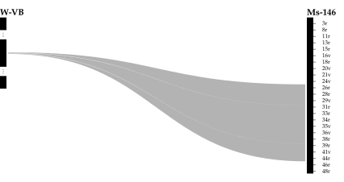
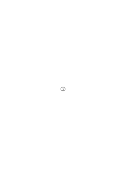
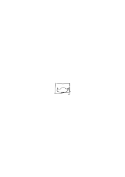
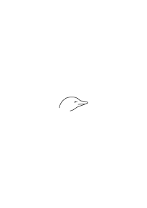
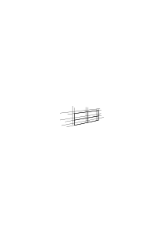
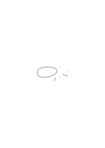
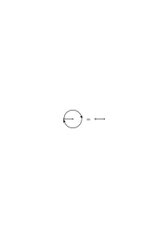
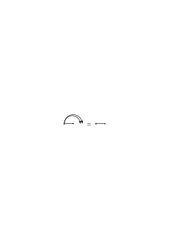

# Ms-146

3 published remarks, VB

### [1r\[1\]](https://cdn.wittgensteinnachlass.com/2000px/webp/Ms-146/1r.webp)

12.12.1933

If the picture _says_ something to me, it says words to me. But in what way does it explain itself in these words? Surely it is a roundabout way for reality to explain itself through language. ✓ A sentence or word coming to mind when we look at a picture is only one of several possible reactions.

### [1r\[2\]](https://cdn.wittgensteinnachlass.com/2000px/webp/Ms-146/1r.webp)

We are inclined to think there is a particular kind of recognition, recognizing the thing as _that_. But as _what_? As the thing that has this name? Or that is used in this way? For recognizing the thing as itself means nothing. The idea we have in mind here is that of comparing two pictures. It is as if we carried a picture of the object around with us & when we see it again we compare it with this picture & see that the two agree. This case can of course occur, but it is not at all the one in question: that is not what the cases we ordinarily call “recognizing” look like.

### [1r\[3\]](https://cdn.wittgensteinnachlass.com/2000px/webp/Ms-146/1r.webp),[1v\[1\]](https://cdn.wittgensteinnachlass.com/2000px/webp/Ms-146/1v.webp)

<s> How then does the picture of a human being differ from that of a monster unfamiliar to me? Well, <s>precisely in the forms, etc.</s> <s> Surely you do not deny that there is a difference in appearance. – But what makes the one long familiar to us, but not the other? For surely it would also be conceivable that the human form should strike us as unfamiliar and strange & the other not. But is that really conceivable? </s> What you really want to say is that all that happens to you is that you see a human being, & that familiarity is not a property this picture happens to have, but that it is more as if I said it is **a piece of furniture**, & being one does not consist in having a property in common with all other pieces of furniture either. So I could say: “To be familiar is to be one of our pieces of furniture”. “And what does it mean to be one of our pieces of furniture?” Well, a piece of furniture is a table, a chair, a … & possibly other objects that we need in our lives or associate with the things listed. </s>

### [2r\[1\]](https://cdn.wittgensteinnachlass.com/2000px/webp/Ms-146/2r.webp)

I could also say: I call objects that stand in certain relations to me, each in a different one, “pieces of furniture”. And if a person & a table are both familiar to me, this need not consist in the two impressions having anything in common beyond the fact that neither surprises me, or something of the sort. But that does not describe their intimacy with me. Yes, precisely: if we call both ‘intimacy’, we thereby point to something common to them. There is certainly no similarity between a nail & a hammer, but both are tools & have something in common, even if not in their use. One would like to say: one is _my_ table, the other _my_ shoe, _my_ stove, etc.

### [2r\[2\]](https://cdn.wittgensteinnachlass.com/2000px/webp/Ms-146/2r.webp)

“How then does a piece of furniture differ from something that is not a piece of furniture?” – “Well, in that the other thing is neither a table nor a chair nor etc. Nor do I need it in some other way.

### [2r\[3\]](https://cdn.wittgensteinnachlass.com/2000px/webp/Ms-146/2r.webp),[2v\[1\]](https://cdn.wittgensteinnachlass.com/2000px/webp/Ms-146/2v.webp)

It is as if limbs had formed to receive that object, and that is precisely what they have in common, while their forms need have nothing in common.

### [2v\[2\]](https://cdn.wittgensteinnachlass.com/2000px/webp/Ms-146/2v.webp)

We say I have a different attitude towards things that are thoroughly familiar from the one I have towards other things. Now does our relation to our shoes, to a person, to a house really have anything in common? Well, at any rate they have this in common: I do not ask myself “what is that”, and the sight of them does not surprise me. But did I not want to distinguish between a genre picture & an ornament, even though neither surprises me?

### [2v\[3\]](https://cdn.wittgensteinnachlass.com/2000px/webp/Ms-146/2v.webp)

The genre picture contains certain groups of forms to which we stand in particular relations, as we do to people, houses, tables, etc.

### [2v\[4\]](https://cdn.wittgensteinnachlass.com/2000px/webp/Ms-146/2v.webp)

So the fact that the picture says something to me does not essentially consist in words coming to mind at the sight of it, for surely the picture was supposed to be the more direct language.

### [3r\[2\]](https://cdn.wittgensteinnachlass.com/2000px/webp/Ms-146/3r.webp)

So the picture says itself to me. And its saying something to me will thus depend, perhaps, partly on its depicting bodies in a particular way (but this is a characterization of the forms & colours alone & does not refer to existing three-dimensional shapes), partly on our relation to the painted forms. That is, on our recognizing them, as we would say, as objects known to us.

### [3r\[3\]](https://cdn.wittgensteinnachlass.com/2000px/webp/Ms-146/3r.webp)

Of course I do not deny that there are phenomena we call recognizing that this is the object I once saw before.

### [3r\[4\]](https://cdn.wittgensteinnachlass.com/2000px/webp/Ms-146/3r.webp)

In saying this I do not, of course, deny that there are phenomena of recognition, & I do not deny either that comparing a memory-image with the impression of reality is such a phenomenon.

### [3v\[1\]](https://cdn.wittgensteinnachlass.com/2000px/webp/Ms-146/3v.webp)

One can now compare understanding a genre picture directly with understanding a portion of the reality surrounding one. Now when I understand such a portion, there need not be a translation into any form of expression. I see what I see & am, so to speak, in agreement with everything I see. But suppose we said our reaction to the familiar was to give things names. Here that would be a mere reaction, say of the mouth, for there is nothing in this reaction that entails that the spoken words belong to a language.

### [3v\[2\]](https://cdn.wittgensteinnachlass.com/2000px/webp/Ms-146/3v.webp),[4r\[1\]](https://cdn.wittgensteinnachlass.com/2000px/webp/Ms-146/4r.webp)

Recognition then is a reaction to what is seen. But it is not as if I saw the thing & nothing with my head; rather, the form I see enters into the recognition. I confirm _it_. It might be, for example, that I look restlessly at every other form under various aspects, but at the familiar one under _one_ aspect that <s> I do not change.</s> <s> I should like to say more; I should like to say “I see flowers, & leaves, a table, a curtain, all familiar things, & then I am in agreement”. Well, here two ways of expressing oneself hold their own. (That gives the multiplicity of the concept.)</s> What matters is that I do not compare what I see with anything else, and so my recognition consists, say, in a way of seeing that is at one with what is seen. The explanation of the word “recognition” in this sense does not mention the past. Recognition thus has no connection with my having seen the thing before, but neither has it any connection with its use, usefulness, etc. So I can recognize any form. For recognizing means seeing it, & not recognizing it as such-and-such, but, say, resting in the sight of it. Whatever it is, for since I compare it with nothing, I surely cannot prescribe what sight I can rest in. What does it mean, for example, to understand a face as such? What does one understand there, & as what? If I compare it with nothing, how then is the concept of a face given? It is a particular drawing seen under a particular aspect. I also adopt a particular attitude towards this sight.

### [4r\[2\]](https://cdn.wittgensteinnachlass.com/2000px/webp/Ms-146/4r.webp),[4v\[1\]](https://cdn.wittgensteinnachlass.com/2000px/webp/Ms-146/4v.webp)

<s> Familiarity & Attitude One might want to say, for instance, that I can only have such an attitude if a thing is familiar to me. But is there anything in common in the attitudes towards a face, a pair of shoes, a key? And I cannot now speak at all of the attitude towards an object that is still unfamiliar to me. I think of the attitude as bodily, as if the body adjusted itself in a particular way to what is seen. I might know a certain number of attitudes & these would then determine what can be familiar to me. Or the attitudes must be given to me in general. </s>

### [4v\[2\]](https://cdn.wittgensteinnachlass.com/2000px/webp/Ms-146/4v.webp),[5r\[1\]](https://cdn.wittgensteinnachlass.com/2000px/webp/Ms-146/5r.webp),[5v\[1\]](https://cdn.wittgensteinnachlass.com/2000px/webp/Ms-146/5v.webp),[6r\[1\]](https://cdn.wittgensteinnachlass.com/2000px/webp/Ms-146/6r.webp),[6v\[1\]](https://cdn.wittgensteinnachlass.com/2000px/webp/Ms-146/6v.webp)

Seeing the face as a face. At first one might think that what is at issue is seeing what is drawn as a real face. But then I say to myself that surely one could see the physical face as a face & in another way too. (What then do I see _as what_?) Again, the latter might be given by all the non-visual properties that distinguish the real face from the face seen physically but now real. But what does it mean to see something as what has such-and-such physical etc. etc. properties? There is probably a mistake here. If I know a body’s use, how it works and its physical properties, I do probably see it in a particular way, but all that is not contained in the aspect of the object; the aspect is only causally determined by these things. Thus there is presumably such a thing as “seeing a coat as a coat” & one learns it by becoming familiar with a coat. And the result of this process is then perhaps a quite particular attitude, perhaps of the whole body, when I see a coat or see something as a coat. And seeing something as a coat then means seeing a particular visual image under a particular aspect & with a particular attitude. Thus recognizing a coat as a coat can simply mean seeing the image under that particular aspect. – But what about the case where I see something & it is unfamiliar to me, then I see it as a coat & now it is familiar to me? What does the familiarity of the one aspect consist in in this case? I need not say to myself “that is a coat”, but one is tempted to say that _this_ aspect had been prepared for, that something had been prepared to receive it, and that this aspect now drops, like a tool, into the case prepared to receive it. That is supposed to be what thorough familiarity consists in. – But that is only a simile, so what prompts us to use this simile & makes it satisfy us? Above all, we do not see the prepared hollow form, but notice only something that might be compared to dropping into the hollow form that fits it well. Suppose for a moment that the characteristic relation of familiarity is saying the words “that is an x”, where a familiar word stands in place of x. For again I cannot say anything essentially different about x. I cannot say, either, that x is to be one of the commonly used nouns of the German language, since this specification again refers to something that is not present when one perceives something familiar. Now if one compares the familiarity of the one aspect to fitting into a case in our mind, but at the same time says that one does not see this case, the experience takes on the multiplicity of a confirmation such as “yes, that is how it is”. <s>Familiarity confirms the aspect without comparing it with anything else. Something is thoroughly familiar to me: is that of the same multiplicity as: I rest in this aspect?</s> Let us think of what it would mean to perceive something as an object of use, for that is evidently similar to perceiving something as familiar. If one were asked “what is an object of use?”, the answer would be partly a list of objects, partly a definition that would say, for instance, what using a thing consists in. But surely its use cannot enter into the sight of it. I have towards it the attitude that one can call “the attitude towards an object of use”; but now what must be meant by this is a particular form of attitude. For one might now ask: Is it to make sense to say of just anything that I have this attitude towards it? Or are the things determined in advance & hence the attitudes too? In the one case, if familiarity means that I rest in this aspect, then “A is familiar to me” means “I rest in aspect A”, whatever A may be (or at any rate A is not given by a list). In the other case I can rest only in certain aspects. But in which ones? Here one would like to say: “in those of objects of use”. But the use is not supposed to be contained in the aspect. And when something _becomes_ an object of use, what aspect does that bring about? Here one might say: not _one_ aspect, but different ones in the different cases. But why do I call them all aspects of use, what have they in common? Certainly I stand in quite different relations to a lamp & a table & shoes. But if these alone determine the concept of the relation to an object of use, then it is by a list of relations.

### [7r\[1\]](https://cdn.wittgensteinnachlass.com/2000px/webp/Ms-146/7r.webp),[7v\[1\]](https://cdn.wittgensteinnachlass.com/2000px/webp/Ms-146/7v.webp)

One conception: I see A as an object of use means I see A (I see what I see) & see it calmly. Another conception: I have the “object of use” attitude means I have towards an object the attitude corresponding to a possible use for it. And the attitude has something to do with its form. It is thus as if the attitude traced this form in a certain sense. That is to say, I cannot have the same attitude towards a point, towards a flat plate, towards a sphere. For the use at issue here is not its actual use but a possible one, i.e. one _derivable_ from the form. I see whatever bodily form I see; I mimic it with my body. Should I then say that one cannot see certain forms as objects? Imagine one said: only a form that looks like one of the limbs of our bodies can be an ‘object’. And the aspect of use is the one that corresponds to the normal aspect of that limb. If I see no aspect of use, think of the use, if only what is present plays a part, what possibility is there of my saying that I could not see a different form under this aspect? If I say this form seems all right to me, am I comparing it with other forms? Is it not: I see _it_ & accept it? Yes, but, one says, you do not simply accept it (amorphously); rather, you have towards it a quite particular attitude characteristic of just this form. One that you cannot transfer to any other form at will.

### [8r\[1\]](https://cdn.wittgensteinnachlass.com/2000px/webp/Ms-146/8r.webp)

I see what I see & accept it. Can one then say “whatever I accept has the aspect of familiarity”? Or does it make no sense to say of just anything that I accept it? Just as one can say of the mouth & the eyes that they smile, but a table is not thereby able to smile. So its being familiar to me does not simply mean I accept it, but: I accept it in one of the ways of accepting. As when one says “I grasp something”, that means: “I grasp something in one of the ways of grasping”, namely with the hand, the mouth, etc., but not with the back of the hand, the tip of the nose, etc.

### [8r\[2\]](https://cdn.wittgensteinnachlass.com/2000px/webp/Ms-146/8r.webp)

One says: “This face has a quite _distinct_ expression” & perhaps looks for words to characterize it.

### [8r\[3\]](https://cdn.wittgensteinnachlass.com/2000px/webp/Ms-146/8r.webp)

<s>

I speak of familiarity in a sense in which something can be familiar to me even if I am seeing it for the first time in my life. </s>

### [8r\[4\]](https://cdn.wittgensteinnachlass.com/2000px/webp/Ms-146/8r.webp),[8v\[1\]](https://cdn.wittgensteinnachlass.com/2000px/webp/Ms-146/8v.webp),[9r\[1\]](https://cdn.wittgensteinnachlass.com/2000px/webp/Ms-146/9r.webp)

<s> It may be that my whole body has a different attitude towards the form of the cap than towards the form of the lamp. And that familiarity consists in all these attitudes having **one** similarity, say a certain calmness & absence of trembling in common. For the question would be: does the body not adjust itself differently to something unfamiliar? If one says “no”, well then having an attitude at all is the mark of familiarity. – Now **can** the body adjust itself to everything? Can one say: “& if the body adjusts itself to **that**, then that too is familiar”? Or does that make no sense? How can one decide whether it **can** adjust itself to such-and-such a form? What is the criterion of its adjusting itself to **that**? Let it be, say, that we look intently at the thing, or is it something like: tracing its form?

</s> Imagine someone says: you have no _characteristic relation_ at all to most people, but you do to some: your father, your siblings … But a different one to each of them! What, then, do these characteristic relations have in common? (That is a good example.) Let us say they are bodily attitudes. – Why do we call such an attitude _characteristic_? One might say it is the _strength_ of the feelings that makes for the similarity. Here, however, I might seemingly say: ‘so it is conceivable that you have a characteristic relation to _that_ person too’. And yet there seems to be something wrong with that. One would like to reply: No, that is not always possible, but only in special cases. For the relation does not seem to be a mere reaction, but to contain the form of the other person. But not systematically either, only from case to case. <s> Then the concept ‘characteristic relation’ would be a collection of relations & no such relations would be conceivable other than those already there. But that again does not seem quite right. One would still want to allow for new ones. Let us picture such a characteristic relation: what might it consist in? </s>

### [9r\[2\]](https://cdn.wittgensteinnachlass.com/2000px/webp/Ms-146/9r.webp),[9v\[1\]](https://cdn.wittgensteinnachlass.com/2000px/webp/Ms-146/9v.webp)

<s> What I really want to say is that

what happens when one looks at the drawing of a face, does not recognize it as a face & then suddenly recognizes it as a face? I suddenly see it differently, perhaps smile. One can say I have the typical experience of recognition; but that means, say, that I have certain feelings, perhaps smile in a certain way, rest from searching. I do not recognize this as something else. Nor is any recollection involved in the experience. </s>

### [9v\[2\]](https://cdn.wittgensteinnachlass.com/2000px/webp/Ms-146/9v.webp),[10r\[1\]](https://cdn.wittgensteinnachlass.com/2000px/webp/Ms-146/10r.webp)

Let us look at the recognition of the written image of a word. I look at the word ‘Rauchen’ & recognize it as such. If I had never seen the word before, something quite different would probably happen from what actually happens in my case. I might react by saying the word at once. But is it also part of this reaction that I say the _right_ word? No, its being the right one is not part of the experience. All that is immediately given is that I utter a word, a series of sounds. But the word I say when I read a word-image is surely connected with it in a different way from just any word uttered while looking at the word-image. – If we speak of what is given in the experience of reading, there may well be a difference between the experience of reading and that of mere association, etc., but again this experience does not contain the following of the rule that is involved in reading.

### [10r\[2\]](https://cdn.wittgensteinnachlass.com/2000px/webp/Ms-146/10r.webp)

“Surely this painting says something to me, unlike what would happen if there were meaningless patches there.” But what I want to say is that if the asking is to be the experience I have when I see the painting, this specific experience contains none of what makes up the system, the world in which the picture has its life (in the course of time).

### [10r\[3\]](https://cdn.wittgensteinnachlass.com/2000px/webp/Ms-146/10r.webp)

↓“I see what I see”: by that I meant that I see it independently of any past; as if I were seeing it for the first time.

### [10v\[1\]](https://cdn.wittgensteinnachlass.com/2000px/webp/Ms-146/10v.webp)

If I say “surely this picture says something to me” & then, to express what it says to me, give a description in words of what it depicts, then what is essential to me is that these words are words of a language, that they have a sense. That these sound-images come to mind as I look at the picture is not all I mean to say.

### [10v\[2\]](https://cdn.wittgensteinnachlass.com/2000px/webp/Ms-146/10v.webp)

The system is not an experience & the specific experience “of the system” is not a system.

### [10v\[3\]](https://cdn.wittgensteinnachlass.com/2000px/webp/Ms-146/10v.webp)

<s> It is with the system & its manifestations as it is with the freedom of movement of a mechanism & its actual movements. The concept of this freedom of movement stands to the movements as the algebraic form (**the sign**) of an algebraic expression stands to arithmetical values of the expression.

</s>

### [11r\[1\]](https://cdn.wittgensteinnachlass.com/2000px/webp/Ms-146/11r.webp)

“Surely this picture says something to me: there is a veranda, a staircase, then trees & mountains, & these words in turn say something & are not mere sounds, etc.” It is as if, to explain the meaning of money, one were to describe examples of monetary transactions.

### [11r\[2\]](https://cdn.wittgensteinnachlass.com/2000px/webp/Ms-146/11r.webp)

<s> The specific experience on seeing the picture, the word, the sentence is one thing; the course of events one acknowledges as … of a system is another. </s>

### [11r\[3\]](https://cdn.wittgensteinnachlass.com/2000px/webp/Ms-146/11r.webp),[11v\[1\]](https://cdn.wittgensteinnachlass.com/2000px/webp/Ms-146/11v.webp)

<s> The familiar impression seems to drop into a little box made ready for it. I should like to say that is just a coat of the kind I have seen a hundred times before. Except that here these words too would be no more than a reaction in sounds to what I see. I see what I see (i.e. it is the complete impression, I compare it with nothing, nothing outside it plays any part) & I also see it in the way characteristic of the familiar. </s>

### [11v\[2\]](https://cdn.wittgensteinnachlass.com/2000px/webp/Ms-146/11v.webp)

I look at a picture; there is a face in it. I recognize it as a face. This can mean either that I _see_ it as a face (face in the moon, man in the moon) or that I say to myself or to someone else, that is a face, or that I compare it with a real face or with a memory.

### [11v\[3\]](https://cdn.wittgensteinnachlass.com/2000px/webp/Ms-146/11v.webp)

<s> ‘I see what I see’ also means that no shape of a case plays a part apart from the shape that is seen. </s>

### [11v\[4\]](https://cdn.wittgensteinnachlass.com/2000px/webp/Ms-146/11v.webp),[12r\[1\]](https://cdn.wittgensteinnachlass.com/2000px/webp/Ms-146/12r.webp)

<s> I see the picture of a thick coat & have a feeling of warmth. Now this feeling is of course appropriate because a thick coat is warm; but this fact does not enter into my experience as I look & the feeling of warmth is simply there along with the visual impression, without any justification. </s>

### [12r\[2\]](https://cdn.wittgensteinnachlass.com/2000px/webp/Ms-146/12r.webp)

<s> When one says “familiar objects are really such & such (a list)”, what one really means to say is: I do not recognize this object as familiar at all, but as a **coat** & it is just that I do call the coat a familiar object. This means: there is no sensation of familiarity, only various sensations that need have nothing at all in common with one another & the fact that we want to classify them together is due solely to the fact that we take a detour through real life, in which the corresponding objects are indeed somehow connected to one another by (actual) life. I see the picture of a cap & have the feeling of [unreadable] masculine; but these feelings, as I said, are there without anything to justify them. “The smile of recognition played on his face.”

</s>

### [12v\[1\]](https://cdn.wittgensteinnachlass.com/2000px/webp/Ms-146/12v.webp)

Is what I want to say not expressed by saying that, if I assume that the characteristic reaction of recognition is uttering the word for the object in question, nothing marks the word as the _right_ one; the word is _a_ word & is associated with certain feelings, but is isolated & outside any system. Think of the dream in which something quite unknown strikes you as right & familiar &.

### [12v\[2\]](https://cdn.wittgensteinnachlass.com/2000px/webp/Ms-146/12v.webp)

<s> In any case, there is a difference between trying to find out what something is & looking at it with satisfaction. </s>

### [12v\[3\]](https://cdn.wittgensteinnachlass.com/2000px/webp/Ms-146/12v.webp)

<s> Is there any such thing as familiarity, or only different impressions? </s>

### [12v\[4\]](https://cdn.wittgensteinnachlass.com/2000px/webp/Ms-146/12v.webp),[13r\[1\]](https://cdn.wittgensteinnachlass.com/2000px/webp/Ms-146/13r.webp)

<s> I say “**of course**, that’s a face” or “of course, that means …” But why **of course**?

I see something like an inscription on a box; I turn it & now I can read it: “100 envelopes”. I feel “of course, ‘envelopes’”, for as I know, there are envelopes in the box. But this knowledge & the justification of the “of course” in general are not already contained in the experience of “recognition”. </s>

### [13r\[2\]](https://cdn.wittgensteinnachlass.com/2000px/webp/Ms-146/13r.webp)

We come back again: A picture says something to me & this means I recognize what it depicts. But when we speak of the process of looking at the picture <s>it usually does not consist in our comparing the picture with something else, a mental image, an object in reality.</s> <s>Rather, one might say, the picture is tinged with memory. </s>

### [13r\[3\]](https://cdn.wittgensteinnachlass.com/2000px/webp/Ms-146/13r.webp),[13v\[1\]](https://cdn.wittgensteinnachlass.com/2000px/webp/Ms-146/13v.webp)

<s> In this picture I see a veranda, a path, grass, trees, mountains & sky. And one will say: surely you see all this differently from how you would see it if you had never seen it before. And there are indeed (good) reasons to say so. But when I now see the sky in the picture, I do not think of how I once saw the sky before & from the fact that I now see it in the picture as I do, it does not **follow** that I must have seen it before. Certainly I see it as something familiar, but that is a mode of its present appearance & contains no reference to a past. </s>

### [13v\[2\]](https://cdn.wittgensteinnachlass.com/2000px/webp/Ms-146/13v.webp)

Cases:

I recognize my brother, whom I see every day. I recognize a human being as such. I recognize someone I have not seen for a long time when it suddenly strikes me that he is the … I recognize someone from his picture. I recognize someone from a description.

### [13v\[3\]](https://cdn.wittgensteinnachlass.com/2000px/webp/Ms-146/13v.webp),[14r\[1\]](https://cdn.wittgensteinnachlass.com/2000px/webp/Ms-146/14r.webp)

Here it is easy to get into that dead end of philosophizing where one believes that the difficulty of the problem lies in the fact that something elusive, quickly vanishing present experience or the like, would have to be described by us, where ordinary language seems too crude to us & we seem to be dealing not with the phenomena of which everyday life speaks, but with the ones that quickly vanish, which, with their appearance & disappearance, approximately create those former ones.

### [14r\[2\]](https://cdn.wittgensteinnachlass.com/2000px/webp/Ms-146/14r.webp)

I do want to set two ways of looking at it against one another. But which ones? I want to say, ‘the picture says something to me’ means: it leads me somewhere; I go on from the picture; it is a point, a movement of thought. (Thought an _activity_.)

### [14r\[3\]](https://cdn.wittgensteinnachlass.com/2000px/webp/Ms-146/14r.webp)

The picture says something to me. – Well, what does it say to me? – It says itself to me. But only if it is of a certain kind.

### [14r\[4\]](https://cdn.wittgensteinnachlass.com/2000px/webp/Ms-146/14r.webp),[14v\[1\]](https://cdn.wittgensteinnachlass.com/2000px/webp/Ms-146/14v.webp)

“It says something to me” means: I have a certain attitude of life towards it. Compare positions of your body, some of which are natural to you; they are, as it were, resting positions; you can <s> stay in them.</s> <s>Others “say nothing to you”; they are at most transitional positions (as it were, not positions of stable equilibrium). </s>

### [14v\[2\]](https://cdn.wittgensteinnachlass.com/2000px/webp/Ms-146/14v.webp)

<s> And here one must remember that all the phenomena that now seem so strange to us are quite ordinary ones which, when they occur, do not strike us in the least. They only seem strange to us in the strange light that we cast upon them when we philosophize. </s>

### [14v\[3\]](https://cdn.wittgensteinnachlass.com/2000px/webp/Ms-146/14v.webp)

The picture says itself to me, & the sentence says itself to us. If the saying is to lie in anything besides the _impression_, it must lie in the fact that the formation belongs to a language.

### [14v\[4\]](https://cdn.wittgensteinnachlass.com/2000px/webp/Ms-146/14v.webp),[15r\[1\]](https://cdn.wittgensteinnachlass.com/2000px/webp/Ms-146/15r.webp)

So to say what it says, we describe the system to which it belongs; give rules of use, various examples, describe its systematic surroundings.

### [15r\[2\]](https://cdn.wittgensteinnachlass.com/2000px/webp/Ms-146/15r.webp)

What does the difference between a genre picture & an ornament consist in? For one thing, in seeing spatially. Now one would like to say: in the fact that the genre picture depicts real objects, but that is precisely what we do not want to say, for we want only to describe what is characteristic of the impression & that sentence gives only the normal cause of that impression. And if one describes the impression in words that establish a relation to real objects seen before, this is a description of the impression in the same way that it is a description of a pain to say that it is the characteristic pain of inflammation of the periosteum. (The designation “wine-red”, “sky-blue”, etc.)

### [15r\[3\]](https://cdn.wittgensteinnachlass.com/2000px/webp/Ms-146/15r.webp),[15v\[1\]](https://cdn.wittgensteinnachlass.com/2000px/webp/Ms-146/15v.webp)

So when one says “the picture says itself to me”, as opposed to an arrangement of arbitrary patches of colour, it is _what_ I see & how I see it (& how I react to it) that constitutes the saying. On the other hand, something in us resists saying that the picture, the sentence, says itself to us. [Could one say: “the sentence says something” means: something has been settled about the sentence?]

### [15v\[2\]](https://cdn.wittgensteinnachlass.com/2000px/webp/Ms-146/15v.webp)

“The sentence becomes a sentence through the language to which it belongs.” But the concept of a sentence is given by what we call “sentences”. And these are indeed always arrangements of words in a language. And ‘sentence’ & ‘say’ are correlatives.

### [15v\[3\]](https://cdn.wittgensteinnachlass.com/2000px/webp/Ms-146/15v.webp)

(I am continually inclined to systematize instead of simply describing, as I should.)

### [15v\[4\]](https://cdn.wittgensteinnachlass.com/2000px/webp/Ms-146/15v.webp)

Immerse yourself in a picture; consider in what respect it says something to you.

### [15v\[5\]](https://cdn.wittgensteinnachlass.com/2000px/webp/Ms-146/15v.webp)

In my mind I go for a walk in the landscape of a picture.

### [16r\[1\]](https://cdn.wittgensteinnachlass.com/2000px/webp/Ms-146/16r.webp)

Let us imagine a kind of puzzle picture in which there is not _one_ particular object to be found, but which at first glance appears to us as a jumble of lines that “say nothing” & only after some searching appears as, say, a landscape. Now what is the difference between the first sight of it & the later one? That we see it differently on the two occasions is clear; but the question is in what respect one can say of the second sight that the picture now says something to us, whereas before it said _nothing_ to us.

### [16r\[2\]](https://cdn.wittgensteinnachlass.com/2000px/webp/Ms-146/16r.webp)

A special case makes the process clearer to us from one side: it might be that on closer inspection the lines in the picture turn out to depict a solid, say a rhombic dodecahedron. Here too we might say that now they no longer say nothing & here it is clear what has happened. And when we recognize a picture as a landscape, one thing that certainly happens, among others, is that we see it clearly in three dimensions.

### [16r\[3\]](https://cdn.wittgensteinnachlass.com/2000px/webp/Ms-146/16r.webp),[16v\[1\]](https://cdn.wittgensteinnachlass.com/2000px/webp/Ms-146/16v.webp)

Asked what this is, we might answer <s>that is a tree and that is a snow-covered mountain & that is a man.</s> <s>But before we were asked, we had not said that to ourselves & yet we could say in the other sense that we had recognized it as a tree. That is, we had seen it with certain characteristic reactions. (These reactions would probably be absent in someone who had not, like us, seen such an object countless times in nature.)</s>

### [16v\[2\]](https://cdn.wittgensteinnachlass.com/2000px/webp/Ms-146/16v.webp)

Thus having feelings in my mouth might be part of seeing an apple as an apple; feeling a shiver might be part of seeing a snowy landscape, etc., etc. But surely I also see a jumble of lines with certain reactions, & do those other reactions have something in common that justifies the expression that the picture says something to me when it brings about one of them?

### [16v\[3\]](https://cdn.wittgensteinnachlass.com/2000px/webp/Ms-146/16v.webp)

<s> (The representation of philosophy can only be composed as poetry.)

</s>

### [17r\[1\]](https://cdn.wittgensteinnachlass.com/2000px/webp/Ms-146/17r.webp)

<s> The histories of the impressions I call familiar of course have something in common: namely, that I have often seen these objects. But do the impressions that may have arisen in this way also have something in common? </s>

### [17r\[2\]](https://cdn.wittgensteinnachlass.com/2000px/webp/Ms-146/17r.webp)

Let us imagine a series of pictures or coloured papers in frames. A landscape picture, a picture of an animal, a third is a human nude, a fourth shows a regular geometric solid, a fifth an irregular solid, a shape a stone might have, a sixth is an [unreadable] ornament, a seventh patches & lines with no visible system. Of the first … one will say that they depict familiar objects.

### [17r\[3\]](https://cdn.wittgensteinnachlass.com/2000px/webp/Ms-146/17r.webp)

<s> I am tempted to say that my attitudes towards familiar things have something in common. Namely that I feel, so to speak, at home among them. </s>

### [17r\[4\]](https://cdn.wittgensteinnachlass.com/2000px/webp/Ms-146/17r.webp),[17v\[1\]](https://cdn.wittgensteinnachlass.com/2000px/webp/Ms-146/17v.webp)

<s>As when I look out of the window onto the street, I see various </s> _pictures_: people walk past, a dog runs along, a vehicle goes by, rain falls, etc. But all these events, I would like to say, as completely different as they are, have this in common: they are familiar to me. They seem everyday to me.

### [17v\[2\]](https://cdn.wittgensteinnachlass.com/2000px/webp/Ms-146/17v.webp)

Thus, (I would like to say), the impressions of a nude study, a landscape picture, a still life have nothing in common with one another except perhaps what those positions of my body that I would call natural & habitual have in common with one another.

### [17v\[3\]](https://cdn.wittgensteinnachlass.com/2000px/webp/Ms-146/17v.webp)

But now I am not tempted to say that those impressions or positions must have _anything_ in common with one another as positions or forms, etc. On the contrary, I am prepared to say that in this respect they have nothing at all in common with one another.

### [17v\[4\]](https://cdn.wittgensteinnachlass.com/2000px/webp/Ms-146/17v.webp),[18r\[1\]](https://cdn.wittgensteinnachlass.com/2000px/webp/Ms-146/18r.webp)

I would then like to say that those impressions have nothing else in common but what drawings have in common by being bound together in one volume. The format & binding, as it were. – But then again this does not satisfy me & I still want them to have a more inward kinship. [Now what really is the problem?]

### [18r\[2\]](https://cdn.wittgensteinnachlass.com/2000px/webp/Ms-146/18r.webp)

(I am sick with language.)

### [18r\[3\]](https://cdn.wittgensteinnachlass.com/2000px/webp/Ms-146/18r.webp)

<s> I think the problem is that we would like to conceive of the object’s familiarity as its fitting into a mental case. (And the case would have been made by previous acquaintance.) </s>

### [18r\[4\]](https://cdn.wittgensteinnachlass.com/2000px/webp/Ms-146/18r.webp)

<s> (Familiarity,) memory is poured over it. </s>

### [18r\[5\]](https://cdn.wittgensteinnachlass.com/2000px/webp/Ms-146/18r.webp),[18v\[1\]](https://cdn.wittgensteinnachlass.com/2000px/webp/Ms-146/18v.webp)

<s> I see the form & get a quite definite impression. What familiar impressions have in **common** is (to begin with) only that they are at home; I would like to say something like “these impressions belong to my world”. But then what holds them together? Nothing at all, I think. (I see what I see.) </s>

### [18v\[2\]](https://cdn.wittgensteinnachlass.com/2000px/webp/Ms-146/18v.webp)

That is: when I look at the knob on the window latch, this impression alone is present, overwhelming, so to speak, & when I look at a face it is this impression, & at a snow-covered tree, this one.

What I want to say now is not just that no memory-image is there at the same time, but that I do not compare any of these habitual impressions with another while having it. The impression of what I see has a complete individuality; it is unlike the other ‘familiar’ impression. – How then can I apply the general word “familiar” to it?

### [18v\[3\]](https://cdn.wittgensteinnachlass.com/2000px/webp/Ms-146/18v.webp),[19r\[1\]](https://cdn.wittgensteinnachlass.com/2000px/webp/Ms-146/19r.webp)

When I say _it_ is familiar to me, what would it be like if _it_ were not familiar to me? In this way I shall see what it is that I ascribe familiarity to. For I can imagine this knob having the same shape but a different colour; I can, for example, paint one like that; but what corresponds to this _in the case_ of familiarity & unfamiliarity?

### [19r\[2\]](https://cdn.wittgensteinnachlass.com/2000px/webp/Ms-146/19r.webp)

Can one imagine a face that gives the impression of a face but without the familiarity? What am I doing when I try to imagine away the familiarity from the visual impression? Do I not imagine my eyes wandering over the picture & that, of course, the specific impression of a face does not arise? For I might, for example, smile at a face; that is my attitude, the attitude of my body towards the face. To see the face as a face and yet not as familiar would be, as it were, to invent the specific impression of a face or to stumble on it by chance. But if that happened, would the impression then lack its long-standing familiarity? Surely not. And yet I say that the impressions of shoes, tables, mountains, people, though _completely_ different, are ‘familiar’ to me, quite apart from their history.

### [19r\[3\]](https://cdn.wittgensteinnachlass.com/2000px/webp/Ms-146/19r.webp),[19v\[1\]](https://cdn.wittgensteinnachlass.com/2000px/webp/Ms-146/19v.webp)

Let us imagine those puzzle pictures again; I have a series of them lying before me, pieces of paper with senseless lines & patches on them, & now I solve them one by one. So now all these solutions as such have something in common, although they may all be completely different from one another. How, then, would I describe the _experience_ of solving them _in general_?

### [19v\[2\]](https://cdn.wittgensteinnachlass.com/2000px/webp/Ms-146/19v.webp)

I said I could not imagine the specific impression of the human face without its familiarity. But can I not imagine this impression and at the same time say to myself that I have never seen it before in my life? Besides, this is partly what happens when I get to know a new face. So there are degrees here. Let us now imagine the further degrees as well: getting to know a new mammal; getting to know something that bears a certain resemblance to an animal.

### [19v\[3\]](https://cdn.wittgensteinnachlass.com/2000px/webp/Ms-146/19v.webp),[20r\[1\]](https://cdn.wittgensteinnachlass.com/2000px/webp/Ms-146/20r.webp)

<s> And now I could imagine that those puzzle pictures would yield as solutions, first, objects of a **familiar kind**, that is, faces, landscapes, etc., secondly, familiar **individual** objects: my sister’s face, our house, etc., thirdly, perhaps objects that bear a certain resemblance to those of a familiar kind: imaginary animals & plants, etc. (Think of the extraordinary variety of what we call painted pictures: nudes, portraits, still lifes, genre pictures, landscapes, Picasso, etc.) </s>

### [20r\[2\]](https://cdn.wittgensteinnachlass.com/2000px/webp/Ms-146/20r.webp)

<s> Does the consideration above not show that a **general** description of the experience of solving the puzzle picture is possible? For are there not, then, kinds of familiarity common to the objects of those three categories?

Let us think, for example, just of pictures of people. I look at a series of such pictures & say: I know this one & that one & that one, but not this one. What do the first three **impressions** have in common that they do not have in common with the fourth? (This is admittedly a somewhat different problem from the one above, but they are solved together.) </s>

### [20r\[3\]](https://cdn.wittgensteinnachlass.com/2000px/webp/Ms-146/20r.webp)

<s> How do I know, then, that one picture is familiar to me individually, the other familiar by kind? It must presumably lie in the impression. </s>

### [20v\[1\]](https://cdn.wittgensteinnachlass.com/2000px/webp/Ms-146/20v.webp)

<s> For if I ask, for example: can it not be just the history that distinguishes these pictures from one another, it must be said that I might be mistaken & say I knew this face, even if it turned out that I had never seen anyone who looked like that. </s>

### [20v\[2\]](https://cdn.wittgensteinnachlass.com/2000px/webp/Ms-146/20v.webp)

<s> What does the familiarity of sequences of letters, in words, consist in? </s>

### [20v\[3\]](https://cdn.wittgensteinnachlass.com/2000px/webp/Ms-146/20v.webp)

<s> For the criterion for its being familiar to me individually is not the historical investigation but the impression. & the two can also yield different results. </s>

### [20v\[4\]](https://cdn.wittgensteinnachlass.com/2000px/webp/Ms-146/20v.webp),[21r\[1\]](https://cdn.wittgensteinnachlass.com/2000px/webp/Ms-146/21r.webp)

<s> But can I now imagine the impression of individual familiarity away where it is present, or imagine it in where it is absent? And in what sense?

And what does it mean here to say, for example, “this impression & the individual familiarity can be separated from one another only with difficulty – or not at all”?

For here it sounds again as though this were a task for psychology or introspection! And in reality it is a matter of representation. (This applies to a large area of philosophical problems; think of the idea of an **exact** pictorial reproduction of what is seen in the visual field. Compare also “how many raindrops do you see when you look at the rain”.) </s>

### [21r\[2\]](https://cdn.wittgensteinnachlass.com/2000px/webp/Ms-146/21r.webp)

<s> (But) what, then, is the object of familiarity, for what it is must be separable from the familiarity. </s>

### [21r\[3\]](https://cdn.wittgensteinnachlass.com/2000px/webp/Ms-146/21r.webp)

<s> Are we not letting ourselves be led astray here by the concepts “impression” & “reaction”? If I designate a face familiar to me individually as such, that is presumably a spontaneous reaction, but why should we call it an “impression”? That is confusing. </s>

### [21r\[4\]](https://cdn.wittgensteinnachlass.com/2000px/webp/Ms-146/21r.webp),[21v\[1\]](https://cdn.wittgensteinnachlass.com/2000px/webp/Ms-146/21v.webp)

<s> The philosophical problem: language sits awkwardly on the facts. Lay it so that the pressure disappears? </s>

### [21v\[2\]](https://cdn.wittgensteinnachlass.com/2000px/webp/Ms-146/21v.webp)

<s> **I** ask: Must the solutions to that puzzle picture have anything else in common besides this: that I content myself with them? </s>

### [21v\[3\]](https://cdn.wittgensteinnachlass.com/2000px/webp/Ms-146/21v.webp)

I look at a picture: I would like to say: my whole field of consciousness is taken up by what I see there. “I see what I see”; where is there still room for familiarity?

### [21v\[4\]](https://cdn.wittgensteinnachlass.com/2000px/webp/Ms-146/21v.webp)

<s> When we see the one picture, we do not think of another, & not of anything the two have in common either. </s>

### [21v\[5\]](https://cdn.wittgensteinnachlass.com/2000px/webp/Ms-146/21v.webp),[22r\[1\]](https://cdn.wittgensteinnachlass.com/2000px/webp/Ms-146/22r.webp),[22v\[1\]](https://cdn.wittgensteinnachlass.com/2000px/webp/Ms-146/22v.webp)

It is strangely hard to formulate: Each _picture_ impression is an impression of its own, one that need not have anything to do with another; & yet they all belong to _life_, one would like to say. When one looks at them one would like to say: “why, that’s …”: a path & grass, a girl, etc. <s> The impression has **depth** (not only spatial). And yet (on the other hand) it stands in isolation, has nothing to do with the other “familiar” impressions; “I see what I see”. And yet I compare the picture with something: here I see a girl pushing a cart, “if there were just a cube here, it would say nothing to me, but the girl is from life”. This form I see seems to me to be not simply **a** form but one somehow singled out (case). It seems to have been marked out as something special in advance (But that would be only a causal explanation of the present impression. As if one said this movement is so easy it is as if it had been practised.); like, for instance, the person I was expecting who comes into my room. I seem already to have been carrying his image around with me before he came in. ‘But I know what I see in this picture! Those are arms, that’s flesh.’ “Surely this is – I want to say – not just **a** form to which I happen to attach certain sensations, but the familiar, deeply embedded form of a woman.” But this really means nothing other than that the experience does not consist of two components, the form & the impression of familiarity. For the case must fit **every** feature of what is seen & so become one with it. </s>

### [22v\[2\]](https://cdn.wittgensteinnachlass.com/2000px/webp/Ms-146/22v.webp)

<s> Suppose I said “why, that’s a picture from my collection!” That explains its being familiar. So its being familiar consists in there being such a picture in my collection & that is like its being bundled up with others in a particular wrapper, lying in **this** drawer. But if I really imagine this & suppose I simply compared the picture I was given with those in my book & found that it matched one of them, that would not be like the phenomenon of familiarity. For one is already assuming that only the picture in our collection is familiar. If it were strange to us, the fact that it was in this wrapper would mean nothing to us at all. </s>

### [22v\[3\]](https://cdn.wittgensteinnachlass.com/2000px/webp/Ms-146/22v.webp),[23r\[1\]](https://cdn.wittgensteinnachlass.com/2000px/webp/Ms-146/23r.webp)

<s> When I speak of the case, I want the case to be in my mind, so to speak as a “form of imagination”, so that I cannot say there is a case (or model) in my mind which is really not there. It is like that particular pair of spectacles which one is not supposed to be able to explain away by interpretation. (Does it correspond to a form of expression?) </s>

### [23r\[2\]](https://cdn.wittgensteinnachlass.com/2000px/webp/Ms-146/23r.webp),[23v\[1\]](https://cdn.wittgensteinnachlass.com/2000px/webp/Ms-146/23v.webp)

<s> Let us imagine a drawing representing some complicated irregular three-dimensional shape (it might, for example, be part of a heap of gravel.). It is surely conceivable that we might come to use precisely this configuration of solid bodies very often. It might, for example, represent a view of the inside of a radio receiver. At first this representation is just “senseless lines” to us, but when we become thoroughly familiar with how the apparatus works, the representation will change its aspect & **‘live’** for us. Clearly the experience of seeing the drawing has changed. But what was the general characteristic of the senseless impression at first & of the living one afterwards? –</s> <s>I do **want** to say that the two experiences are distinguished by a more generally applicable characteristic:</s> One might say that in the living impression other parts of our world of sensation are made to speak. Or again: The first experience is characterized by a certain restlessness, unsteadiness.

### [23v\[2\]](https://cdn.wittgensteinnachlass.com/2000px/webp/Ms-146/23v.webp)

<s> But if one now asks: “is it conceivable that just any impression should have the calm etc. that makes it a living one?” Then the question would be: Given a particular solid shape that is now senseless to me (say, in a picture), can I imagine it as having sense at will? That would be like asking: can I imagine an object of any shape as an object for use? But for what use? </s>

### [23v\[3\]](https://cdn.wittgensteinnachlass.com/2000px/webp/Ms-146/23v.webp),[24r\[1\]](https://cdn.wittgensteinnachlass.com/2000px/webp/Ms-146/24r.webp)

A picture shows the corner of a room. I look at it & take it to be the corner of a small room; then someone tells me it is the corner of a hall. Now it looks different. The experience of seeing it has changed. Schopenhauer on the impression made by a building when one learns it is made of paper.)

### [24r\[2\]](https://cdn.wittgensteinnachlass.com/2000px/webp/Ms-146/24r.webp)

<s> Well, one can at least systematically imagine one class of solid shapes as dwellings for animals or human beings. Another class as weapons. Another, say, as models of landscapes etc. etc. And here, then, I know how to give sense to a senseless shape. </s>

### [24r\[3\]](https://cdn.wittgensteinnachlass.com/2000px/webp/Ms-146/24r.webp)

<s> Experience of the actual size. What would the picture of an armchair shape look like if we knew it represented a structure the size of a house? </s>

### [24r\[4\]](https://cdn.wittgensteinnachlass.com/2000px/webp/Ms-146/24r.webp)

<s> We speak of lines that say nothing, in contrast to, say, a drawing of a face, but also of a face that says nothing, in contrast to an ‘expressive’, ‘speaking’ one. [Behind all these considerations lies a deeper disquiet, hidden from view.] </s>

### [24r\[5\]](https://cdn.wittgensteinnachlass.com/2000px/webp/Ms-146/24r.webp),[24v\[1\]](https://cdn.wittgensteinnachlass.com/2000px/webp/Ms-146/24v.webp)

<s> “The picture says something to me.” But it gives me itself. I simply receive an impression. But that is not satisfactory. But when I say “the picture says something to me”, I am surely comparing it to an expression of a language. And one might also say that what the picture says to me is really always its description in word-language. And one more thing: after all, we never use the expression “it says something to me” of what is seen ‘in reality’; I mean: we say that the picture depicting trees & a meadow says something to me, but I will not generally say that the sight I have when I look at the actual landscape says something to me. </s>

### [24v\[2\]](https://cdn.wittgensteinnachlass.com/2000px/webp/Ms-146/24v.webp)

One says of words that they say something & wants to render what they say by a gesture or a (painted) picture & we say of a picture that it says something & want to render it in words & we say it of a musical theme & want to translate it into a gesture or a sentence. But I cannot remember a single case in which I wanted to explain in tones what a sentence says.

### [24v\[3\]](https://cdn.wittgensteinnachlass.com/2000px/webp/Ms-146/24v.webp)

‘Language’ is _first_ and foremost word-language; but then we also include drawings & paintings in language, as well as gestures of imitation & indication, & finally gestures & tones too.

### [25r\[1\]](https://cdn.wittgensteinnachlass.com/2000px/webp/Ms-146/25r.webp)

I also say, after all, that the picture on the wall “represents something”, say, a sunny landscape, but I do not say of the sunny landscape itself that it represents something. Now it is true that one might say the picture _gives_ us a sunny landscape or the impression, but it is essential to our taking the picture as a picture that we receive this impression through a picture on the wall & not through what we see out of the window. So it is no doubt true that we need not compare what we see in the picture with anything else & yet the picture as a picture differs from a piece of reality that we see. If I took the picture for reality, I would not speak of what I see in that way as saying something to me.

### [25r\[2\]](https://cdn.wittgensteinnachlass.com/2000px/webp/Ms-146/25r.webp)

<s>

One might say: one experiences the illusion as an illusion. (One knows that one is dreaming.) </s>

### [25r\[3\]](https://cdn.wittgensteinnachlass.com/2000px/webp/Ms-146/25r.webp)

<s> Incidentally, this is not to say that representation on a flat surface is essential to a picture. Think of nativity scenes, tableaux vivants, models etc. </s>

### [VB](/w-vb/#ms-146-25v.1) [25v\[1\]](https://cdn.wittgensteinnachlass.com/2000px/webp/Ms-146/25v.webp)

<s> I believe I summed up my attitude to philosophy when I said: philosophy ought really only to be **composed as poetry**. From this, it seems to me, it must follow how far my thinking belongs to the present, the future or the past. For in saying this I also acknowledged myself to be someone who cannot quite do what he wishes he could do.

---

</s>

### [25v\[2\]](https://cdn.wittgensteinnachlass.com/2000px/webp/Ms-146/25v.webp)

<s> “The picture says something to me”. – But it gives me itself; a particular impression. But that is not satisfactory; it does not correspond to the concept I have of ‘saying’. Somehow it does not quite convey what I meant by the sentence above. </s>

### [25v\[3\]](https://cdn.wittgensteinnachlass.com/2000px/webp/Ms-146/25v.webp)

<s> But what is it that I say says something to me; and of which I must therefore be able to assert the opposite with sense? </s>

### [25v\[4\]](https://cdn.wittgensteinnachlass.com/2000px/webp/Ms-146/25v.webp),[26r\[1\]](https://cdn.wittgensteinnachlass.com/2000px/webp/Ms-146/26r.webp)

<s> When I say of the landscape picture “it says something to me”, don’t I mean: what the description of the landscape says to me? And does not a story in pictures tell me just what its rendering in words would tell me? Isn’t that what I mean when I say “the picture says something to me”? </s>

### [26r\[2\]](https://cdn.wittgensteinnachlass.com/2000px/webp/Ms-146/26r.webp)

<s> But can I say of a sentence in word-language that it says something? </s>

### [26r\[3\]](https://cdn.wittgensteinnachlass.com/2000px/webp/Ms-146/26r.webp)

<s> Here one sees just how many forms what one calls “language” takes. For we would also speak of a picture-language. And we could very well imagine a people that had only this. Let us think again of the various language-games.

---

</s>

### [26r\[4\]](https://cdn.wittgensteinnachlass.com/2000px/webp/Ms-146/26r.webp)

<s> What does it consist in for a sight to be familiar to me? ✓I would like to say: I see what I see. And the familiarity can only lie in my resting in the sight & impression.

</s>

### [26v\[1\]](https://cdn.wittgensteinnachlass.com/2000px/webp/Ms-146/26v.webp)

<s> “I see what I see”, I say this because I do not want to name what I see. I do not want to say “I see a flower”, for that presupposes a linguistic convention & my way of expressing myself is not supposed to presuppose anything historical. </s>

### [26v\[2\]](https://cdn.wittgensteinnachlass.com/2000px/webp/Ms-146/26v.webp)

<s> Yes, if I say that the familiarity of this sight to me consists in my recognizing that I see a flower, then I now give the matter this turn: uttering the words of recognition “that is a flower” is a reaction to the sight, but one cannot say that I recognize the object because I name it correctly, but because I utter a word, perhaps with certain feelings, at the sight of it. For that it is the right word, indeed that it is a word of a language at all, is not given in the experience of uttering it.

---

</s>

### [26v\[3\]](https://cdn.wittgensteinnachlass.com/2000px/webp/Ms-146/26v.webp),[27r\[1\]](https://cdn.wittgensteinnachlass.com/2000px/webp/Ms-146/27r.webp)

<s> “A landscape picture says something to me: I follow it with a particular experience, the experience of the landscape. It not only takes on depth for me, but I experience its shapes in a particular way (as “mountains”, “hills”, “valleys”). But part of this is that what I see is not mountains, hills, valleys, but, say, a painted picture in a frame.

---

</s>

### [27r\[2\]](https://cdn.wittgensteinnachlass.com/2000px/webp/Ms-146/27r.webp)

<s> But now the question arises: Can I say with sense of just any impression that it is familiar to me (and so also when it is not)? Can one say with sense of an arbitrary impression that it is familiar to me? What is the subject of familiarity? </s>

### [27r\[3\]](https://cdn.wittgensteinnachlass.com/2000px/webp/Ms-146/27r.webp),[27v\[1\]](https://cdn.wittgensteinnachlass.com/2000px/webp/Ms-146/27v.webp)

Suppose something were familiar to me if I were calm at the sight of it, & instead of this I want in turn to say that my face would remain still while I looked at it. Then it is clear what it means to say of any sight, (whether) truly or falsely, that it is familiar to me. I would then say: I can well imagine this sight being familiar to me even when it is not (just as I can say that I can imagine this person having grey hair although he has blond hair). It is clear to me (here) what <s>imagining away the blond hair etc. consists in (it might consist in my painting the person but with a different hair colour).</s> <s>Now what about the analogous case in which we want to imagine the familiarity away from an impression, or imagine one in?</s>

### [27v\[2\]](https://cdn.wittgensteinnachlass.com/2000px/webp/Ms-146/27v.webp)

<s> What then would we call (here) “imagining away familiarity”? What would it be like if I imagined the shape of the human face as something strange? </s>

### [27v\[3\]](https://cdn.wittgensteinnachlass.com/2000px/webp/Ms-146/27v.webp)

<s> Can one imagine a smiling face expressing anger? Or, say, hair colour as an expression of mood? </s>

### [27v\[4\]](https://cdn.wittgensteinnachlass.com/2000px/webp/Ms-146/27v.webp),[28r\[1\]](https://cdn.wittgensteinnachlass.com/2000px/webp/Ms-146/28r.webp)

<s> In a sense the friendly expression seems bound up with the shape of the face. I would like to say: “how could a different shape give me this impression? Surely I must be able to smile into a pair of eyes?” “Well, to that extent the shape of the face is presumably part of what one means by “the friendly expression”. </s>

### [28r\[2\]](https://cdn.wittgensteinnachlass.com/2000px/webp/Ms-146/28r.webp)

<s> Now if I tell myself to look at a human face as something strange to me, I let my eyes wander over it, rather as over a machine of a kind I have not seen before. I do not let the stable impression of the human face form. </s>

### [28r\[3\]](https://cdn.wittgensteinnachlass.com/2000px/webp/Ms-146/28r.webp)

Calm comes in philosophy when the word that brings release has been found.

### [28r\[4\]](https://cdn.wittgensteinnachlass.com/2000px/webp/Ms-146/28r.webp)

Why are we tempted to conceive of memory as working by comparing the object we see with a picture we have brought with us? Because such a picture can in a certain way take the place of our memory. If, for example, we want to know what someone looked like many years ago, we may turn to a photograph for help.

### [28r\[5\]](https://cdn.wittgensteinnachlass.com/2000px/webp/Ms-146/28r.webp),[28v\[1\]](https://cdn.wittgensteinnachlass.com/2000px/webp/Ms-146/28v.webp)

Incidentally; when I treat the objects around me as familiar, do I think <s>of this comparison?</s> <s>Of course not. I only do so when I consider the act of recognition (recognizing again) afterwards; & then not so much by trying to remember what went on at the time as by looking at it through a preconceived schema. (Flow of time)</s>

### [28v\[2\]](https://cdn.wittgensteinnachlass.com/2000px/webp/Ms-146/28v.webp)

We use a notebook as an aid to memory & so think of memory itself as a kind of notebook. Or the things have left their imprint & now fit back into this imprint if they have not changed. We can _really_ imagine searching our memory as looking something up in a notebook. “We say this face looks familiar to me”, “I know this face – & that is when we do _not_ remember where or when we saw it.

### [28v\[3\]](https://cdn.wittgensteinnachlass.com/2000px/webp/Ms-146/28v.webp),[29r\[1\]](https://cdn.wittgensteinnachlass.com/2000px/webp/Ms-146/29r.webp)

When we speak of familiarity as fitting into a case, it is not quite the same as when we _compare_ what we see with a likeness. What we really mean then is the feeling when the object slides without resistance into the shape of the case. But we could have this feeling even if there were no case that fitted exactly. We can also imagine every object in an invisible case & that makes no difference at all to the experience & is now an empty form of representation.

---

### [29r\[2\]](https://cdn.wittgensteinnachlass.com/2000px/webp/Ms-146/29r.webp)

<s> I want to eliminate everything ‘historical’ from my way of looking at being familiar. Only impressions then remain & even where language enters into our experiences we do not regard it as an **institution**.

This is the one way of looking at things that I **want to adopt**. </s>

### [29r\[3\]](https://cdn.wittgensteinnachlass.com/2000px/webp/Ms-146/29r.webp),[29v\[1\]](https://cdn.wittgensteinnachlass.com/2000px/webp/Ms-146/29v.webp)

<s> So the multiplicity of “being familiar” as I understand it is that of resting in a sight. It might consist in my not changing the aspect of the object but simply sliding into an aspect; that is, without wavering, & staying with it. I have some sight or other, & see it in a particular way (in the way of being familiar). </s>

### [29v\[2\]](https://cdn.wittgensteinnachlass.com/2000px/webp/Ms-146/29v.webp)

Being thoroughly familiar confirms the aspect without, however, comparing it with anything else.

### [29v\[3\]](https://cdn.wittgensteinnachlass.com/2000px/webp/Ms-146/29v.webp)

The face can smile but not the hand & not the coat button.

But I would like to say more: … Well, here two ways of expressing oneself are at odds.

### [29v\[4\]](https://cdn.wittgensteinnachlass.com/2000px/webp/Ms-146/29v.webp)

The system is not an experience & the specific experience of the system is not a system.

### [30r\[3\]](https://cdn.wittgensteinnachlass.com/2000px/webp/Ms-146/30r.webp)

<s> “I see a picture of a thick coat & have a feeling of warmth & comfort. I see a snowy landscape & feel cold. Justification. </s>

### [30r\[4\]](https://cdn.wittgensteinnachlass.com/2000px/webp/Ms-146/30r.webp)

Sky in a landscape picture. Picture-sky. Do we compare it with the real one? It is familiar to us.

### [30r\[5\]](https://cdn.wittgensteinnachlass.com/2000px/webp/Ms-146/30r.webp)

Various cases of recognition.

### [30r\[6\]](https://cdn.wittgensteinnachlass.com/2000px/webp/Ms-146/30r.webp)

Thought an _activity_.

### [30r\[7\]](https://cdn.wittgensteinnachlass.com/2000px/webp/Ms-146/30r.webp),[30v\[1\]](https://cdn.wittgensteinnachlass.com/2000px/webp/Ms-146/30v.webp)

One says, for example, ‘we could not use words at all if we did not recognize them & their meanings.’ So if we did not recognize the colour green as such – (presumably for lack of memory) we could not apply the word green. But have we any check on this recognition so that we know that it really is recognition? When we speak of recognition we have in mind that we correctly identify what we see as such-and-such. We say, for example, that we recognize someone as the person he actually is by other criteria. But it is misleading to speak of recognition where it is itself the criterion of identity. “Recognizing” means: recognizing what is the case.

### [30v\[2\]](https://cdn.wittgensteinnachlass.com/2000px/webp/Ms-146/30v.webp)

No one will say that every time I come into my room, into the familiar surroundings, a recognition of everything I see & have seen hundreds of times takes place.

### [30v\[3\]](https://cdn.wittgensteinnachlass.com/2000px/webp/Ms-146/30v.webp)

But even when, say, I recognize someone in the street whom I have not seen for years, I do not see two images before me that I compare with one another, his past image & the present one.

### [30v\[4\]](https://cdn.wittgensteinnachlass.com/2000px/webp/Ms-146/30v.webp),[31r\[1\]](https://cdn.wittgensteinnachlass.com/2000px/webp/Ms-146/31r.webp)

One might say: if I had not retained his image in my memory, I could not recognize him. One might say: the image need not be consciously present, but when I recognize him it comes back into consciousness. But that is not true.

### [31r\[2\]](https://cdn.wittgensteinnachlass.com/2000px/webp/Ms-146/31r.webp)

What then does recognizing the person in the street consist in? Perhaps I am walking towards him, his features make a particular impression on me, I go up to him & call him by name & perhaps speak of times past; perhaps an image of him in a particular situation now comes before me.

### [31r\[3\]](https://cdn.wittgensteinnachlass.com/2000px/webp/Ms-146/31r.webp),[31v\[1\]](https://cdn.wittgensteinnachlass.com/2000px/webp/Ms-146/31v.webp)

When we think of our understanding a picture, say, a genre painting, we are perhaps inclined to assume that there is a particular phenomenon of recognition there & that we recognize the painted people as people, the benches as benches, the sky as sky. But when I look at a genre painting do I compare the painted people with real ones & the painted sky with the real one? Am I then to say that I recognize the painted people as painted people? And therefore the real people too as real?

### [31v\[2\]](https://cdn.wittgensteinnachlass.com/2000px/webp/Ms-146/31v.webp)

<s> But the painted people, like the real ones, are thoroughly familiar objects to us. Of recognition </s> Of course there is a phenomenon when, perhaps after searching for a long time, we recognize a drawing as one of a person, but what takes place here is just what does not take place when I see the drawing at once as one of a person.

### [31v\[3\]](https://cdn.wittgensteinnachlass.com/2000px/webp/Ms-146/31v.webp)

On the other hand I would like to say: the shape I see here is surely not just some shape that I see with certain experiences, but first and foremost it is my coat, which I know down to the last detail.

### [32r\[1\]](https://cdn.wittgensteinnachlass.com/2000px/webp/Ms-146/32r.webp)

On the other hand I would like to say that what I see before me here is surely not some shape that I see in a particular way, but simply my shoes, which I know. But here it is only two ways of expressing oneself that are at odds.

### [32r\[2\]](https://cdn.wittgensteinnachlass.com/2000px/webp/Ms-146/32r.webp)

This shape that I see, I would like to say, is not simply _one_ shape, but it is a shape known from the outset, distinguished in advance. It is one of the shapes whose picture was already in me earlier & only because it corresponds to such a picture is it the well-known shape. (I carry, as it were, a catalogue of such shapes with me & the objects depicted there are then the well-known ones.)

### [32r\[3\]](https://cdn.wittgensteinnachlass.com/2000px/webp/Ms-146/32r.webp),[32v\[1\]](https://cdn.wittgensteinnachlass.com/2000px/webp/Ms-146/32v.webp)

When one says “the picture says itself to me”, that means it differs from objects that one would not call pictures by features contained in itself. That would be the case, for example, if “it says itself to me” meant: “it depicts combinations of cubes”.

### [32v\[2\]](https://cdn.wittgensteinnachlass.com/2000px/webp/Ms-146/32v.webp)

“It says something to me” means “it tells me something”, “it is a narrative”.

### [32v\[3\]](https://cdn.wittgensteinnachlass.com/2000px/webp/Ms-146/32v.webp)

It says itself to me as a sentence, a narrative, says itself to me.

### [32v\[4\]](https://cdn.wittgensteinnachlass.com/2000px/webp/Ms-146/32v.webp)

Isn’t the concept of a picture that tells a story similar to that of a genre painting? And if I wanted to describe what a genre painting is, I would not need to refer to any reality outside the picture at all, but only speak of painted people, painted rooms, etc. & likewise if I wanted to define what still lifes are, or nude studies, etc.

### [32v\[5\]](https://cdn.wittgensteinnachlass.com/2000px/webp/Ms-146/32v.webp)

“This picture says something to me” it uses words; here are eyes, nose, mouth, hands etc. etc. I compare it to an expression of a language & I can do so, for a description corresponds to it & we can assign words to parts of the picture at once.

### [33r\[1\]](https://cdn.wittgensteinnachlass.com/2000px/webp/Ms-146/33r.webp)

But the system of language, language itself, does not belong to the category of experiences & an experience that typically accompanies the use of a language is not the language.

### [33r\[2\]](https://cdn.wittgensteinnachlass.com/2000px/webp/Ms-146/33r.webp)

Why (from what point of view) does it come naturally to me to say that the picture says something to me? (For I do not always say it to myself when I see a picture.) Because it is comparable to a piece of writing. And that in turn comes down to the fact that the picture can easily be described in our word-language. This would not be the case, for example, if it showed only irregular solid bodies & patches.

### [33r\[3\]](https://cdn.wittgensteinnachlass.com/2000px/webp/Ms-146/33r.webp)

I compare the picture with a combination of linguistic forms.

### [33r\[4\]](https://cdn.wittgensteinnachlass.com/2000px/webp/Ms-146/33r.webp),[33v\[1\]](https://cdn.wittgensteinnachlass.com/2000px/webp/Ms-146/33v.webp)

Suppose I say: “Now this sentence (this sequence of signs) says something to me; before, when I had not yet learnt the language, it said nothing to me”. And suppose that by this saying we meant that the sentence now produces a particular impression. Certainly this sequence of signs did not produce this impression on me before I learnt the language. The impression is of course quite independent of the system of the language if we leave causal matters aside. And now something in me resists saying that the sentence’s saying something consists in its making that impression on me. (What I want to say is: something is a sentence only in a language. And that characterizes how I use the word “sentence”.)

### [33v\[2\]](https://cdn.wittgensteinnachlass.com/2000px/webp/Ms-146/33v.webp)

For let us imagine the impression of the sentence made objective: let it consist in a series of mental images floating before me & I replace them with a series of pictures. – – –

### [33v\[3\]](https://cdn.wittgensteinnachlass.com/2000px/webp/Ms-146/33v.webp)

It is part of the grammar of the word “sentence” that I can ask: “what does this word mean, what words can it be combined with, in short, that I can talk about the grammar of the word.

### [34r\[1\]](https://cdn.wittgensteinnachlass.com/2000px/webp/Ms-146/34r.webp)

There is of course a great deal of truth in saying that the system of the use of words gives them their meaning, i.e. gives the sentence its sense. Or again, the purpose of the sentence lies in the transformations of the expression according to the rules. Thinking an activity) [As the sense of the game lies in the transformations of the positions in the game.]

### [34r\[2\]](https://cdn.wittgensteinnachlass.com/2000px/webp/Ms-146/34r.webp)

But surely I can read a story & get something out of it; & in what way am I making use of the language system? Suppose the effect of the story were to call up a series of pictures before my eyes.

### [34r\[3\]](https://cdn.wittgensteinnachlass.com/2000px/webp/Ms-146/34r.webp)

Language, after all, is the languages. Including ones I invent by analogy with existing ones. Languages _are_ systems.

### [34r\[4\]](https://cdn.wittgensteinnachlass.com/2000px/webp/Ms-146/34r.webp)

A sentence is a sentence of a language. But that just means that I call the members of languages sentences.

### [34r\[5\]](https://cdn.wittgensteinnachlass.com/2000px/webp/Ms-146/34r.webp)

But let us pay attention to the _use_ of the word “German language”; otherwise we are liable to ask: what is the German language? All the sentences that have ever been spoken? All the words????

### [34r\[6\]](https://cdn.wittgensteinnachlass.com/2000px/webp/Ms-146/34r.webp),[34v\[1\]](https://cdn.wittgensteinnachlass.com/2000px/webp/Ms-146/34v.webp)

And what does it mean to say: “the system of use … gives words their meaning”? Of course, this can only be an explanation of the use of the word ‘meaning’. Presumably it means: I answer the question about the meaning of a word with an explanation of its systematic use.

### [34v\[2\]](https://cdn.wittgensteinnachlass.com/2000px/webp/Ms-146/34v.webp)

I should like to say: It is surely obvious that it is the combining of words that constitutes language. But that means that it is these combinations that constitute it for me. I.e. that is how I look at language. If someone were to reply: surely all that matters is the pictures the sentences call up, I would say: Then you simply do not regard language as language. For me, language is not a means of producing certain mental effects but a _system_ of words (signs).

### [34v\[3\]](https://cdn.wittgensteinnachlass.com/2000px/webp/Ms-146/34v.webp)

_We_ want to pay attention to the system of language.

### [34v\[4\]](https://cdn.wittgensteinnachlass.com/2000px/webp/Ms-146/34v.webp),[35r\[3\]](https://cdn.wittgensteinnachlass.com/2000px/webp/Ms-146/35r.webp)

Certainly, I read a story & don’t give a damn about a system. I simply read, have impressions, see pictures before me, etc. But when I now _look at_ language, I look at it as a system.

### [35r\[1\]](https://cdn.wittgensteinnachlass.com/2000px/webp/Ms-146/35r.webp)

I said: “to understand a sentence means to understand a language”. But of course I can have the _experience_ of understanding a sentence without understanding any other sentence in this sense or having learnt the language.

### [35r\[2\]](https://cdn.wittgensteinnachlass.com/2000px/webp/Ms-146/35r.webp)

“What is the system?” “Where is it?” “What is the game of chess?” “All the games?” “The list of rules?” But we ask: how do we use the word ‘game of chess’?

### [35r\[4\]](https://cdn.wittgensteinnachlass.com/2000px/webp/Ms-146/35r.webp)

Thinking is an activity, like calculating. No one would call calculating or playing chess a state.

### [35r\[5\]](https://cdn.wittgensteinnachlass.com/2000px/webp/Ms-146/35r.webp)

One could, for example, define “genre picture” as a combination of painted people, chairs, tables & jugs.

### [35r\[6\]](https://cdn.wittgensteinnachlass.com/2000px/webp/Ms-146/35r.webp),[35v\[1\]](https://cdn.wittgensteinnachlass.com/2000px/webp/Ms-146/35v.webp)

The question is: is “well known” an extensional concept? So is it given by a list or not? If it is, then it makes no sense to say that something that is not well known to us now can become well known to us.

### [VB](/w-vb/#ms-146-35v.2) [35v\[2\]](https://cdn.wittgensteinnachlass.com/2000px/webp/Ms-146/35v.webp)

If one uses a trick in logic, whom can one deceive but oneself?

### [35v\[3\]](https://cdn.wittgensteinnachlass.com/2000px/webp/Ms-146/35v.webp)

One might ask what prompts you to give this particular definition (of a genre picture). Why do you single out just these forms and group them together? And the answer might then be: because they often occur together in actual situations. I would not, for example, have grouped shoes, lilies & inkpots together in that way.

### [35v\[4\]](https://cdn.wittgensteinnachlass.com/2000px/webp/Ms-146/35v.webp)

What if one were to ask: Why do you always put the forms  together according to the story schema ?

### [35v\[5\]](https://cdn.wittgensteinnachlass.com/2000px/webp/Ms-146/35v.webp),[36r\[1\]](https://cdn.wittgensteinnachlass.com/2000px/webp/Ms-146/36r.webp)

Let us imagine that we had a special name for pictures depicting objects of everyday use.

<s>Reading is not spelling out the letters very quickly.

---

</s>

### [36r\[2\]](https://cdn.wittgensteinnachlass.com/2000px/webp/Ms-146/36r.webp)

<s> I think no more of its system than I do when I look at a series of pictures, a picture story. </s>

### [36r\[3\]](https://cdn.wittgensteinnachlass.com/2000px/webp/Ms-146/36r.webp)

Let us imagine a picture story in schematic pictures, thus more like a narrative in a language than a sequence of realistic pictures would be. In such a picture language one might, for instance, have recorded the course of battles in particular. (Language-game) And a sentence of our word-language comes much closer to such a picture in this picture language than one might think. [Now what about system & impression here?] Let us also remember that we would not first translate such pictures into realistic ones in order to ‘understand’ them, any more than we ever translate photographs or a story on film into colour pictures, even though we have never seen black-and-white people, etc. [What if we now said here: “a picture is something only in a system?”]

### [36r\[4\]](https://cdn.wittgensteinnachlass.com/2000px/webp/Ms-146/36r.webp),[36v\[1\]](https://cdn.wittgensteinnachlass.com/2000px/webp/Ms-146/36v.webp)

A sentence gives us the same satisfaction as a picture.

### [36v\[2\]](https://cdn.wittgensteinnachlass.com/2000px/webp/Ms-146/36v.webp)

Remember that one sees a picture at a glance but does not “grasp everything it depicts”. I.e. one has not thereby carried out the various transformations into sentences. But similarly, we do read through a sentence & “understand it”, but if we want to do something with it, we must then go into the individual relations within it.

### [36v\[3\]](https://cdn.wittgensteinnachlass.com/2000px/webp/Ms-146/36v.webp)

When I read a sentence with understanding, it could be the only sentence there is; for I have in mind neither general rules of a system nor other sentences.

### [36v\[4\]](https://cdn.wittgensteinnachlass.com/2000px/webp/Ms-146/36v.webp)

I should like to say: “I can discern the _method_ of language only in the system”.

### [36v\[5\]](https://cdn.wittgensteinnachlass.com/2000px/webp/Ms-146/36v.webp)

But I said myself, after all, that if we do not use the rules in the calculus, they are merely stories of understanding.

### [36v\[4\]](https://cdn.wittgensteinnachlass.com/2000px/webp/Ms-146/36v.webp),[36v\[6\]](https://cdn.wittgensteinnachlass.com/2000px/webp/Ms-146/36v.webp),[37r\[1\]](https://cdn.wittgensteinnachlass.com/2000px/webp/Ms-146/37r.webp)

But that only means: only as a system does language have a method.

### [37r\[2\]](https://cdn.wittgensteinnachlass.com/2000px/webp/Ms-146/37r.webp)

Can one not compare it to reading aloud from a written text, where too the whole shape of the word is often translated & the justification by spelling it out can be given only later.

### [37r\[3\]](https://cdn.wittgensteinnachlass.com/2000px/webp/Ms-146/37r.webp)

<s> (Opposed conceptions) In the one case it is said: learning the language is merely a way of exerting an influence, a means of producing certain reactions & impressions later on; in the other it merely provides the building blocks of language. In the one case the learning of the system, the structure of language, **constitutes the essence of the sentence, of language**; in the other </s>

### [37r\[4\]](https://cdn.wittgensteinnachlass.com/2000px/webp/Ms-146/37r.webp)

One could imagine an alphabetic script in which the pronunciation of the words has nothing at all to do with the letters that make up their written signs. The letters would serve only to make it easier to form the various word-signs.

### [37r\[5\]](https://cdn.wittgensteinnachlass.com/2000px/webp/Ms-146/37r.webp),[37v\[1\]](https://cdn.wittgensteinnachlass.com/2000px/webp/Ms-146/37v.webp)

We can imagine a language in which the impression we get from the signs does not matter in any way, in which there is no understanding in the sense of such an impression. The sign is transmitted to us in writing, say, & we can then perhaps _memorize_ it. Now if it is a command, we translate the signs into actions according to tables. Nothing like the impression of a picture occurs at all & one does not write stories in this language either. But there is perhaps a kind of recreational reading that consists in translating certain sequences of signs into bodily movements that form something like a dance. (_Cipher_)

### [37v\[2\]](https://cdn.wittgensteinnachlass.com/2000px/webp/Ms-146/37v.webp)

Of course, it would also be conceivable that, to get an impression from a sentence of word-language, we would first have to translate it into a drawn picture.

### [37v\[3\]](https://cdn.wittgensteinnachlass.com/2000px/webp/Ms-146/37v.webp)

One is then trained to use the rules; the tables are the rules.

### [37v\[4\]](https://cdn.wittgensteinnachlass.com/2000px/webp/Ms-146/37v.webp)

(You will think differently when you have gone through this exercise.)

### [37v\[5\]](https://cdn.wittgensteinnachlass.com/2000px/webp/Ms-146/37v.webp),[38r\[1\]](https://cdn.wittgensteinnachlass.com/2000px/webp/Ms-146/38r.webp)

But even in our ordinary language we can often disregard entirely the impression of the <s>sentence & all that matters is what we do with the sentence, how we go on operating with it.</s>

### [38r\[2\]](https://cdn.wittgensteinnachlass.com/2000px/webp/Ms-146/38r.webp)

<s> What then is our concept of a system, if it is not cloud-cuckoo-land? Where do we get it from? Well, from a game such as chess, for example. </s>

### [38r\[3\]](https://cdn.wittgensteinnachlass.com/2000px/webp/Ms-146/38r.webp)

<s> And what if I were now to say: “there is no position in a game without a system of play”? </s>

### [38r\[4\]](https://cdn.wittgensteinnachlass.com/2000px/webp/Ms-146/38r.webp)

<s> In the case above one really could say: the sequence of signs is **dead** without the system. </s>

### [38r\[5\]](https://cdn.wittgensteinnachlass.com/2000px/webp/Ms-146/38r.webp)

“A sentence is something only in a language” – what did that _really_ mean? I want to call this formation a sentence only if the meanings of its words can be explained to me. I want to call this arrangement of pieces of wood a position in a game only if the description of a game goes with it. He went out through the door, then came back in & sat down in the armchair.

### [38r\[6\]](https://cdn.wittgensteinnachlass.com/2000px/webp/Ms-146/38r.webp),[38v\[1\]](https://cdn.wittgensteinnachlass.com/2000px/webp/Ms-146/38v.webp)

I want to call this sequence of sounds only a word. ‘A sentence’, I should say, “is what I call something only if it is part of a language.” And this is _one_ important aspect of sentences.

### [38v\[3\]](https://cdn.wittgensteinnachlass.com/2000px/webp/Ms-146/38v.webp)

“A sentence is something only …”; it seems quite self-evident.

### [38v\[4\]](https://cdn.wittgensteinnachlass.com/2000px/webp/Ms-146/38v.webp)

Let us imagine a sequence of words: by some means of association, etc., I have made the sequence of words give me a particular impression. Is it a sentence now? I want to say: I would not call it a sentence if it were not made up of words that can give a _new, unexplained_ sense through their combination.

### [38v\[5\]](https://cdn.wittgensteinnachlass.com/2000px/webp/Ms-146/38v.webp)

“There is no sentence that stands alone”.

### [38v\[6\]](https://cdn.wittgensteinnachlass.com/2000px/webp/Ms-146/38v.webp)

For what I call a ‘sentence’ is a game position in a language.

### [39r\[1\]](https://cdn.wittgensteinnachlass.com/2000px/webp/Ms-146/39r.webp)

<s> Isn’t the confusing thing that I can look at a position in a game as closely as I like without finding out in this way that it is a **position in a game**? Something in the grammar of the word “position in a game” confuses us here. </s>

### [39r\[2\]](https://cdn.wittgensteinnachlass.com/2000px/webp/Ms-146/39r.webp),[39v\[1\]](https://cdn.wittgensteinnachlass.com/2000px/webp/Ms-146/39v.webp)

<s> 1) The solution consists in seeing the picture as clear spatial forms. 2) The solution consists in seeing the picture as a scene from human life. But how is such a scene characterized? By an **enumeration** or something intensional. But how does one know in the first case that the picture is solved? It might be by looking at a table of solutions. What if one says the picture is solved when you recognize an object well known to you? That would certainly be possible. – How does one recognize a well-known object? What general criterion am I to give for it? For if I later recognize it as the well-known object, then it was also possible to specify earlier what now makes it the well-known object. For when I say, look for a well-known object, is that then as if I said, look for a spherical object, & I had to be able to recognize beforehand what “spherical” means? </s>

### [39v\[2\]](https://cdn.wittgensteinnachlass.com/2000px/webp/Ms-146/39v.webp)

Now if I were asked to list all the objects well known to me: I would probably list the objects I have come into close contact with in my life. I might first list all the furnishings in my room, then some in my parents’ house in the country, etc. etc.

### [39v\[3\]](https://cdn.wittgensteinnachlass.com/2000px/webp/Ms-146/39v.webp),[40r\[1\]](https://cdn.wittgensteinnachlass.com/2000px/webp/Ms-146/40r.webp)

Let us imagine the following procedure: someone says nouns to me that designate physical things & asks whether I can imagine a thing corresponding to the word. He lists words such as table, chair, tree, etc. Now how do I know that I am imagining the right thing? Do I use a criterion for that? What happens here? I hear “table”, imagine _something_, not a table (for what would be the mark of that?) & say “yes”, perhaps. That may be all.

### [40r\[2\]](https://cdn.wittgensteinnachlass.com/2000px/webp/Ms-146/40r.webp)

How do I know that I have solved the puzzle picture? “Well, I see a person, for example?” But was that the definition of the solution? So that is not the right answer either. I see something (say _one_ clear spatial impression) _& am satisfied_; that may be _all_.

### [40r\[3\]](https://cdn.wittgensteinnachlass.com/2000px/webp/Ms-146/40r.webp)

<s> I could say: the criterion of the solution is that I trace over certain lines & say that the picture is solved. </s>

### [40r\[4\]](https://cdn.wittgensteinnachlass.com/2000px/webp/Ms-146/40r.webp)

<s> Do I mean to say that all solutions must have something in common in their form? </s>

### [40r\[5\]](https://cdn.wittgensteinnachlass.com/2000px/webp/Ms-146/40r.webp),[40v\[1\]](https://cdn.wittgensteinnachlass.com/2000px/webp/Ms-146/40v.webp)

<s> The use of the words is confusing here. I should say: I see **this** (pointing to a picture as I do so). For the fact that this has a name in the language is beside the point. And now one might go on to say “& **this** is a solution according to the table of solutions” or “& this is a combination of people & animals & that was the general description of the solutions” or “& this is an object in my surroundings”. Let us imagine he said: this is the solution because it depicts a house & garden. Could we not ask: What does it mean that it depicts a house? Are you thereby comparing it with an object outside the picture? & if not, what makes it a painted house apart from the form we see? Then saying that it is a painted house tells us nothing at all about it. And if we compare it with something outside the picture, what is gained? Unless the definition of the solution is that it is a picture for which I can find a spatial object in nature. What is it then that tempts us to say “& this is the solution, for the picture now depicts a house etc.”. Suppose the word-meaning here is ‘well established’. But this can lie in a series of different reactions if I do not necessarily mean an impression by it. “Why do you call that the solution?” – “I don’t know, it looks familiar to me.” </s>

### [40v\[2\]](https://cdn.wittgensteinnachlass.com/2000px/webp/Ms-146/40v.webp),[41r\[1\]](https://cdn.wittgensteinnachlass.com/2000px/webp/Ms-146/41r.webp)

<s> Would it not be possible to imagine something quite unknown to us as well known, I mean to deceive ourselves about it: we might see something that looks like an irregular stone & say, why, that’s a …. (The word is not one we have ever actually heard) & now we say to ourselves, it is used for … (another new word) & now we imagine this activity, which might consist in putting one such thing next to another in a row. Could that not happen in a dream? </s>

### [41r\[2\]](https://cdn.wittgensteinnachlass.com/2000px/webp/Ms-146/41r.webp)

It should really not be: “yes, I recognize it, it is a face” but “I recognize it, I see a face”. The word ‘face’ could now mean the _ornament_  to us (without the slightest relation to a human face). And so it may be as well to consider the case where someone says, yes, I recognize it, it is the swastika.

### [41r\[3\]](https://cdn.wittgensteinnachlass.com/2000px/webp/Ms-146/41r.webp),[41v\[1\]](https://cdn.wittgensteinnachlass.com/2000px/webp/Ms-146/41v.webp)

“The puzzle picture is solved”. “Why do you say it is solved?” – “Well, it depicts this form.” – “But why do you call that a solution?” – a) Because it gives me the impression of being well known. b) Because I know (i.e. I associate a name with it in a particular way) what it is called, what one does with it, where I have seen it. Because it is in my table of solutions, <s> because it is a regular solid, because it is a clear spatial picture, because it is symmetrical, because it makes an ornamental impression.</s>

### [41v\[2\]](https://cdn.wittgensteinnachlass.com/2000px/webp/Ms-146/41v.webp)

<s> (Anyone who does not understand why we are talking about these things must find what we say empty play.) </s>

### [41v\[3\]](https://cdn.wittgensteinnachlass.com/2000px/webp/Ms-146/41v.webp),[42r\[1\]](https://cdn.wittgensteinnachlass.com/2000px/webp/Ms-146/42r.webp)

When I say that this face has the expression of mildness, goodness, cowardice, I seem not merely to mean that we associate such & such feelings with the face, but I am tempted to say that the face is an aspect of cowardice, goodness, etc., itself. (Weininger & others) One can say: I see the cowardice in this face (& could see it in another as well), but in any case it does not seem merely associated with the face, connected externally; rather, the fear has the multiplicity of the facial features. And if, for instance, the features change a little, we can speak of a corresponding change in the fear. If we were asked “can you also imagine this face as the expression of courage”, we would, as it were, not know how to fit courage into these features. One might then say: I don’t know what it would mean for this face to be a courageous face. But what does the solution to such a question look like? One says: Yes, now I understand it; the face is as it were indifferent to the outside world. So we have read courage into it. But what was the criterion for our having succeeded? Courage now _fits_ the face again. But what fits what here? It is a similar case (though it does not seem so at first sight) if, for instance, we wonder how the Romans could say “the man is good-er” instead of “the man is good” & are then reassured when we tell ourselves they said “the man is a good one.” Understanding the ending in a church mode.

### [42r\[2\]](https://cdn.wittgensteinnachlass.com/2000px/webp/Ms-146/42r.webp)

<s> The impression is one thing & the definiteness of the impression another. Familiarity here has the multiplicity of a definiteness.

</s>

### [42v\[1\]](https://cdn.wittgensteinnachlass.com/2000px/webp/Ms-146/42v.webp)

We can also look into a human face without getting any impression, quite blankly, as it were, & between that and a strong impression there are all degrees.

### [42v\[2\]](https://cdn.wittgensteinnachlass.com/2000px/webp/Ms-146/42v.webp)

Suppose a face makes a strong, particular impression on me; am I to say that first of all it must be well known to me as a face? Is not what I call the impression of familiarity part of that particular impression? A face stares at me & I am afraid. Is my impression then on the one hand that the form I see is well known to me as a face, with the impression of fright there in addition?

### [42v\[3\]](https://cdn.wittgensteinnachlass.com/2000px/webp/Ms-146/42v.webp)

_Where_ do I recognize something as _what_? For to recognize something as itself means nothing.

### [42v\[4\]](https://cdn.wittgensteinnachlass.com/2000px/webp/Ms-146/42v.webp),[43r\[1\]](https://cdn.wittgensteinnachlass.com/2000px/webp/Ms-146/43r.webp)

The smile of friendliness & of hatred. Might not the interpretations of the visual impression consist in my imagining a different (kind of) continuation for it each time? That is certainly often so. What do I do when I take the smile as friendly one time and as malicious another? Must I not imagine it in connection with acts that I call friendly or spiteful? I might imagine the person smiling down on an enemy’s suffering, say, and at another time smiling down on his child. Nothing about this is changed by the fact that I can in turn interpret this situation differently by imagining appropriate situations that follow it, etc. I will take a certain smile as friendly if no special circumstances lead me to another interpretation. Will react accordingly.

### [43r\[2\]](https://cdn.wittgensteinnachlass.com/2000px/webp/Ms-146/43r.webp)

What does it mean to “_read_ friendliness _into_ the smile”? Perhaps it means that I make a face correlated in a particular way with the smiling face. In one case, say, the smile brings about a smile, in another a different facial expression.

### [43r\[3\]](https://cdn.wittgensteinnachlass.com/2000px/webp/Ms-146/43r.webp),[43v\[1\]](https://cdn.wittgensteinnachlass.com/2000px/webp/Ms-146/43v.webp)

A friendly mouth, friendly eyes. How does one imagine a friendly hand? Probably open & not in a fist. And could one imagine hair colour as an expression of friendliness? But put that way the question seems to ask whether we will succeed. The question should be: Do we want to call something a friendly hair colour? We might then imagine a person whose hair darkens when he gets angry. But in reading the malicious expression into the dark hair colour we would be using an idea already formed beforehand. One might say that we already have several symbols of malice, mildness and cowardice ready to hand & when we read these states of mind into an expression we see that expression as one of those symbols. We say he puts on a dark look, perhaps because the eyes are shaded by the eyebrows & now we transfer the idea of darkness to the hair colour. If I wanted to imagine a friendly coat button, I would imagine it with a smiling _face_ painted on it.

### [43v\[2\]](https://cdn.wittgensteinnachlass.com/2000px/webp/Ms-146/43v.webp)

It is true that the smile is in a certain sense part of friendliness.

### [44r\[1\]](https://cdn.wittgensteinnachlass.com/2000px/webp/Ms-146/44r.webp)

That is connected with _saying_ & _meaning_.

### [44r\[2\]](https://cdn.wittgensteinnachlass.com/2000px/webp/Ms-146/44r.webp)

“Every expression can lie”: But just think what you mean by lying. How do you imagine the lie; do you not set one expression against another? Surely at least you set against the expression a process that could also be an expression.

### [44r\[3\]](https://cdn.wittgensteinnachlass.com/2000px/webp/Ms-146/44r.webp)

A friendly eye, a friendly mouth, (a friendly face) a dog wagging its tail, etc., are presumably primary & independent symbols; parts of what one calls friendliness. If one wants to imagine other phenomena as expressions of friendliness, one sees those symbols in the phenomena, just as I can read a face into the dial of my pocket watch.

### [44r\[4\]](https://cdn.wittgensteinnachlass.com/2000px/webp/Ms-146/44r.webp),[44v\[1\]](https://cdn.wittgensteinnachlass.com/2000px/webp/Ms-146/44v.webp)

I say, for instance: “I can also imagine this face (which at first sight gives the impression of timidity) as a courageous face”. By this we do not mean that I can imagine that the person with this face can save someone’s life (one can imagine that in connection with any face). I am speaking, rather, of an aspect of the <s>faces themselves.</s> <s>Of course, I also do not mean that this person can change his face into one that is courageous in the ordinary sense, but perhaps that it can turn into one in such & such a way. It is much more like hearing this chord one time as a transition to these notes & another time to those. (The difference between F & E sharp.) </s>

### [VB](/w-vb/#ms-146-44v.2) [44v\[2\]](https://cdn.wittgensteinnachlass.com/2000px/webp/Ms-146/44v.webp)

Names of composers. Sometimes it is the method of projection that we take as given. When, for example, we ask ourselves: What name would capture this person’s character? But sometimes we project the character into the name & take the name as given. Thus it seems to us that the great masters so familiar to us have just the names that fit their work.

### [44v\[3\]](https://cdn.wittgensteinnachlass.com/2000px/webp/Ms-146/44v.webp),[45r\[1\]](https://cdn.wittgensteinnachlass.com/2000px/webp/Ms-146/45r.webp)

Comparing memory with a notebook. The comparison of memory with a notebook. On the one hand this comparison serves as a picture of what goes on consciously; on the other hand <s>it is a psychological model for us (& the word “conscious” here characterizes the grammar of a statement & is not one of the psychological pair of words “conscious”, “unconscious”).</s>

### [45r\[2\]](https://cdn.wittgensteinnachlass.com/2000px/webp/Ms-146/45r.webp),[45v\[1\]](https://cdn.wittgensteinnachlass.com/2000px/webp/Ms-146/45v.webp)

Did you see this table (your desk) yesterday? Do you remember it? I would say “yes”. But does any picture of the desk as it was yesterday float before me as I say this? No. If one were to ask me: How do you know you saw it yesterday? I would have to answer: I was in my room yesterday, after all. But do you remember _that_? Yes, I do see myself doing one thing or another too; but that is not essential, I simply know I was here yesterday, where else could I have been? And how do you know that what you see of yourself consists of pictures from _yesterday_? Do you see the date on a calendar of yours? Or do you remember the whole series of events from today back to yesterday, so that you could perhaps also trace it back to the day before yesterday & [unreadable]? “Did you see this table yesterday, are you sure?” – “Of course I’m sure; I’d know if I’d been somewhere else yesterday, quite apart from the fact that I remember having N.N. here with me yesterday.” Now I could of course check whether it was yesterday by actually calling to mind a series of events. But how do I know, e.g., that there isn’t a day in between what I take to be my going to bed yesterday and today? I can ask other people, look in my notebook, etc. etc. But in any case that is not what I actually do before I say “of course I was in this room yesterday”. So what happens? What makes me so sure? Nothing; I simply say it with the feeling of certainty or [unreadable] of an experience. (In a confident voice and the like.)

### [45v\[2\]](https://cdn.wittgensteinnachlass.com/2000px/webp/Ms-146/45v.webp)

When we say we remember an occurrence, we probably do sometimes see memory-images before us. But most of the time they are merely scattered through the memory like illustrations in a book of fairy tales.

(Think also of what happens when we ‘remember’ what colour the word “red” designates, or the name of some extremely familiar object, a table, a chair, etc.”) How do we remember that this is called “table”?)

### [45v\[3\]](https://cdn.wittgensteinnachlass.com/2000px/webp/Ms-146/45v.webp),[46r\[1\]](https://cdn.wittgensteinnachlass.com/2000px/webp/Ms-146/46r.webp)

There are people who remember a tune by having the written notes appear before them & reading them off.

### [46r\[2\]](https://cdn.wittgensteinnachlass.com/2000px/webp/Ms-146/46r.webp)

Did you see your desk yesterday?

_Of course!_

Did you see such & such an object yesterday, one that is not very easy to see? I don’t know but it is very likely, because I … Or: I remember seeing it & I even thought to myself at the time …. I see myself standing there & looking at it. I have no idea whether I looked at it. I saw it but I don’t know whether it was yesterday.

### [46r\[3\]](https://cdn.wittgensteinnachlass.com/2000px/webp/Ms-146/46r.webp),[46v\[1\]](https://cdn.wittgensteinnachlass.com/2000px/webp/Ms-146/46v.webp)

As if one were to ask: “If I remember doing such & such yesterday & the picture I have as I remember it does not show me that it was precisely that which happened, & that it happened precisely yesterday, how do I translate my memory into words? But if I remember directly in words, couldn’t one then ask: So someone who has not learnt a language cannot have certain memories? Of course, he cannot have linguistic memories, linguistic wishes etc. And linguistic memories etc. are not just translations; and isn’t a linguistic experience an experience? One can fall in love with the description of a beauty, not just with a visual image we derive from that description.

### [46v\[2\]](https://cdn.wittgensteinnachlass.com/2000px/webp/Ms-146/46v.webp)

Threadbare schemata.

### [46v\[3\]](https://cdn.wittgensteinnachlass.com/2000px/webp/Ms-146/46v.webp),[47r\[1\]](https://cdn.wittgensteinnachlass.com/2000px/webp/Ms-146/47r.webp)

Suppose I said: “Language” is a word like “keyboard”. There are machines that need a keyboard. Now for some reason I might take an interest in forms of keyboards (those actually used & new ones I have discovered). And inventing a keyboard might then mean finding that a certain keyboard is suitable for this machine, for this purpose, but also simply devising new ones by analogy with other keyboards. Inventing a game might mean inventing something that has the intended effect of a game on a person; but also inventing something that is similar in certain respects to particular games, in which case the psychological effects of the new game would be quite immaterial. “Game” would then be defined not by its purpose or effect but by its form.

### [47r\[2\]](https://cdn.wittgensteinnachlass.com/2000px/webp/Ms-146/47r.webp)

To say that the rules of a game are arbitrary is to say: the concept of a game is not defined by its psychological effect.

### [47r\[3\]](https://cdn.wittgensteinnachlass.com/2000px/webp/Ms-146/47r.webp)

Is the purpose of a command (apart from its effect) its sense? Am I not using the word purpose in two ways?

### [47r\[4\]](https://cdn.wittgensteinnachlass.com/2000px/webp/Ms-146/47r.webp)

Here it is difficult, as it were, to keep one’s head above water & to see that we must stick to the questions of ordinary understanding & not let ourselves be tempted to descend into a semblance of depth, to pseudo-questions that could be answered only by an inconceivable refinement of our way of expressing ourselves.

### [47v\[1\]](https://cdn.wittgensteinnachlass.com/2000px/webp/Ms-146/47v.webp)

Odd usage of the words & philosophy “Has a person a right to live?” “A right to own his nose.” Right, time, … very _important_ words, but used irregularly. Analogy in a game: game pieces that appear in the game only at “odd points”, as opposed to those in constant & regular use. Or a word has one use that follows a law & several “discrete” uses.

### [47v\[2\]](https://cdn.wittgensteinnachlass.com/2000px/webp/Ms-146/47v.webp)

Anyone who wants to learn philosophy from this book should _examine_ the sentences in it.

### [47v\[3\]](https://cdn.wittgensteinnachlass.com/2000px/webp/Ms-146/47v.webp)

The syllogism is a kind of calculation that _can_ be applied to propositions. (Like multiplication to plums)

### [47v\[4\]](https://cdn.wittgensteinnachlass.com/2000px/webp/Ms-146/47v.webp),[48r\[1\]](https://cdn.wittgensteinnachlass.com/2000px/webp/Ms-146/48r.webp)

Didn’t I say that the prescription governing the use of a word would thereby give it its meaning? Couldn’t I now say that two words, “non” & “ne”, both have the same meaning, that they are both negation signs, but non non p = p + ne ne p = ne p? After all, there are plenty of word-languages in which a double negation is a negation. But why then do I call both negations? What do they have in common? Well, it is clear that they have a large part of their use in common. But that does not yet solve our problem. For we would like to say: It must also be true for both notations that double negation is an affirmation, if only we understand the doubling in the appropriate way. But how? Well, in the way it can be expressed, e.g., by brackets.

ne (ne p) = p (ne ne)p = ne p

### [48r\[2\]](https://cdn.wittgensteinnachlass.com/2000px/webp/Ms-146/48r.webp)

The analogous (or special) geometrical case immediately suggests itself to us.

### [48r\[3\]](https://cdn.wittgensteinnachlass.com/2000px/webp/Ms-146/48r.webp),[48v\[1\]](https://cdn.wittgensteinnachlass.com/2000px/webp/Ms-146/48v.webp)

“Two half-turns added together cancel each other out”, “two half-turns added together give a half-turn”. It just depends

on how we add them. (I could just as well call it “adding two half-turns” to turn an object twice in the way diagram A shows, or to turn it once by 180˚ & then, as if to emphasize this turn, go back to the first position & make the first turn again (B).

,

### [48v\[2\]](https://cdn.wittgensteinnachlass.com/2000px/webp/Ms-146/48v.webp)

What if I wrote ne p = non p,

does it follow that ne ne p = non non p?

Given the way we use brackets, it does indeed follow that ne (ne p) = non (non p)

But we could lay down different rules for the signs ne ne & non non.

### [48v\[3\]](https://cdn.wittgensteinnachlass.com/2000px/webp/Ms-146/48v.webp)

But here we encounter a remarkable & characteristic phenomenon in philosophical investigations: The difficulty – one might say – is not to find the solution, but to recognize something as the solution that looks as if it were only a preliminary step. “We have already said everything” – he might say. “Not something that follows from it, but precisely _that_ is the solution.” I think this is connected with the fact that we wrongly expect an explanation; while a description is the solution to the difficulty, if we correctly incorporate it into our consideration. If we dwell on it & do not try to go beyond it.
