# Ms-147

2 published remarks, VB

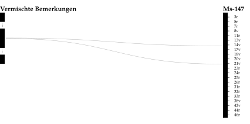

### [FCv\[1\]](https://cdn.wittgensteinnachlass.com/2000px/webp/Ms-147/FCv.webp)

We feel at home in the use of the word “reading” which presupposes very complicated circumstances. After one survey it is clear that in № 43 we might say B is reading or not reading & that there is no one correct answer. We have to make up from such a case a meaning of the word “reading”.

### [1r\[1\]](https://cdn.wittgensteinnachlass.com/2000px/webp/Ms-147/1r.webp)

_Early February 34_

I think this is connected with the fact that we wrongly expect an explanation; while a description is the solution to the difficulty, if we correctly incorporate it into our consideration. If we dwell on it and do not try to go beyond it.

### [1r\[2\]](https://cdn.wittgensteinnachlass.com/2000px/webp/Ms-147/1r.webp)

“That is already all that can be said about it!”

### [1r\[3\]](https://cdn.wittgensteinnachlass.com/2000px/webp/Ms-147/1r.webp)

We may look at our word-language from a simple point of view. But it _is_ a composite structure, a stream into which the most diverse waters from different sources flow together.

### [1r\[4\]](https://cdn.wittgensteinnachlass.com/2000px/webp/Ms-147/1r.webp),[1v\[1\]](https://cdn.wittgensteinnachlass.com/2000px/webp/Ms-147/1v.webp),[2r\[1\]](https://cdn.wittgensteinnachlass.com/2000px/webp/Ms-147/2r.webp)

To _interpret_ “non non p” as the negation of the negated sentence means writing non non p = non (non p). To say “if ‘ne’ is a negation, then ne ne p, if it is correctly understood, must be equal to p” and “if one takes ne ne p as the negation of p, one understands the doubling differently” … One would like to say: “The doubling _means_ something different then, _therefore_ it now yields a negation”, that is: that it now yields a negation is the _consequence_ of my now meaning it differently. “I now mean it as an _intensification_,” one would say. We put the expression of the opinion in place of the opinion. What might it have consisted in that, _when I said ne ne_, I meant it as an intensification? In the circumstances in which I used the expression; in the tone (just as I can also express the brackets ne (ne p) in my tone). I mean ne ne as an intensification in the manner of speaking it as an intensification. To mean the doubling as cancellation means, for example, putting in brackets (and I have just said that, among other things, one can also put in brackets through the tone of voice). “Yes, but these brackets themselves can surely play different roles, for who says that in ~(~p) the brackets are understood in the ordinary sense and not somehow differently—for example, the first as a dividing line between the two ~s, the second as belonging to the ‘p’?” Nobody says so. And you have once again replaced your interpretation with words. What the brackets mean will be shown in their use, and in the other sense it lies, say, in the aspect of the impression seen, ~(~p).

Should I now say that the meaning of “non” and “ne” is _somewhat_ different? That they are different kinds of negation? We would (of course) never say that. For, we would object, does “do not go into this room” then not mean exactly the same if in one case “non”, and in the other “ne”, stands in place of “not”? On the other hand, one would again like to say _against_ this: “If, as we are supposed to admit, this means exactly the same, how can ne ne not mean the same as non non?” But here we are presupposing a symbolism, i.e. taking as our model one in which it follows from what has just been said that the two words are used in the same way in all cases. The rotation through 180˚ and negation are, in the particular case, actually _the same_, and the _application_ of negation and of the rule ~~p = p is the application of a geometry.

### [2r\[2\]](https://cdn.wittgensteinnachlass.com/2000px/webp/Ms-147/2r.webp),[2v\[1\]](https://cdn.wittgensteinnachlass.com/2000px/webp/Ms-147/2v.webp)

Let us suppose I asked: “Does it become clear to us, when we utter the sentences ‘this stick is 1 m long’ and ‘there is 1 soldier here’, that we mean different things by ‘1’, that ‘1’ has different meanings?” It does not become clear to us at all. Especially when we say, for example: “This piece is 1 m long and there is a soldier here …”. If asked “Do you mean the same thing?” one might answer “Of course I mean the same thing: _one_” (perhaps raising a finger). Do you mean the same thing by “not” when you say “2 × 2 is not 4” and “this room is not large”? “Of course I mean the same thing: not!” (with a negating gesture).

### [2v\[2\]](https://cdn.wittgensteinnachlass.com/2000px/webp/Ms-147/2v.webp)

What does one mean by saying that “ne ne”, even if by convention “ne” _could_ also be used as a cancelled negation? Does this not simply mean that we can provide a symbolism in which ne ne p = p but ne (ne p) = p?

### [2v\[3\]](https://cdn.wittgensteinnachlass.com/2000px/webp/Ms-147/2v.webp),[3r\[1\]](https://cdn.wittgensteinnachlass.com/2000px/webp/Ms-147/3r.webp)

One might object to the classification of the four elements that “fire” belongs in any case to a different category from the other three elements, since fire is not a substance. But could we not regard the flame as a substance, a material? It certainly looks like one, does it not? And why should we not construct a physical theory with this conception, even if it were extremely impractical? To what extent are we thereby interfering with the grammar of the words “fire”, “flame”, etc.? Is this interference with the grammar not comparable to always speaking of a circle with radius 0 instead of a point, or of a straight line as a rectangle of width 0 and length ∞? (Compare the idea of the electron, which cannot at the same time have a definite position and a definite velocity, and of the tone, which cannot at the same time have a definite pitch and a definite duration.)

### [3r\[2\]](https://cdn.wittgensteinnachlass.com/2000px/webp/Ms-147/3r.webp)

We can very easily imagine a ‘more primitive’ logic (in the sense of a primitive arithmetic) in which something corresponding to our negation exists only for certain sentences, for example those that contain no negation. In the language with the more primitive logic, one could then negate a sentence such as “go into this room”. But if one showed these people a sentence of their language in which two negations were appropriate, they would always understand the two only as a repetition and never as a cancellation of the one.

### [3r\[3\]](https://cdn.wittgensteinnachlass.com/2000px/webp/Ms-147/3r.webp),[3v\[1\]](https://cdn.wittgensteinnachlass.com/2000px/webp/Ms-147/3v.webp)

To ask whether, for these people, the negation has the same meaning as for us would then be quite analogous to asking whether the digit 2 means the same thing for people whose number series only goes up to 5 as it does for us. And here it once again becomes clear how our explanation of meaning often results in a distortion of the normal use of this word.

### [3v\[2\]](https://cdn.wittgensteinnachlass.com/2000px/webp/Ms-147/3v.webp)

<s>Is it not here almost like the plane depictions of the globe? The Mercator projection is certainly a useful instrument and yet it totally distorts the polar zones. But let us consider in what respect something is a distortion. What do we compare the picture with; what is our standard of non-distortion? – </s>

### [3v\[3\]](https://cdn.wittgensteinnachlass.com/2000px/webp/Ms-147/3v.webp),[4r\[1\]](https://cdn.wittgensteinnachlass.com/2000px/webp/Ms-147/4r.webp)

Whoever calls ~~p = p (or also ~~p ≡ p) a necessary “sentence of logic”, perhaps an “axiom”, but is not inclined to call it a postulate of our adopted method of representation, has the tendency to say that this sentence follows from the meaning of negation. If in dialects double negation is used as negation, as we do not use it in the written language, for example “I haven’t found nothing anywhere”, then we are inclined to say: _actually_ that means that he found something everywhere. Let us consider what this “actually” means! –

### [4r\[2\]](https://cdn.wittgensteinnachlass.com/2000px/webp/Ms-147/4r.webp)

<s>If we wanted to bring our explanation that meaning is constituted by the rules of use of a word closer to the normal use of the word “meaning”, we would now explain that those rules of use constitute the meaning which we could easily overlook, which gave us an easily overlooked characteristic picture, or something of the sort. (The ease of overlooking may consist in the fact that certain rules or ways of applying something readily occur to us one after another. Almost like the sentences of a poem well known to us: they seem to hang together like the pearls of a string of pearls, one drawing the next after it.) </s>

### [4r\[3\]](https://cdn.wittgensteinnachlass.com/2000px/webp/Ms-147/4r.webp)

<s>The idea of meaning which lies in the word, so that the word is a bottle with a label whose contents we hold in our hand when we hold it in our hand, and whose contents we can now pour out gradually, always pouring out what was already in it. This idea corresponds precisely to that of meaning as a series of applications firmly linked together in our mind. </s>

### [4v\[1\]](https://cdn.wittgensteinnachlass.com/2000px/webp/Ms-147/4v.webp)

<s>One can say: No doubt the explanation of meaning gives the meaning, and this explanation is a rule for the use of the word, but we do not say of every rule that it gives the meaning, only of certain ones. And these I can indeed characterize through examples, but not by giving a general characterization. (The great family of ‘ostensive definitions’.) </s>

### [4v\[2\]](https://cdn.wittgensteinnachlass.com/2000px/webp/Ms-147/4v.webp)

If we think of negation as a _reversal_, then the sentence ~(~p) = p is unavoidable for us. (Half-turn) (I believe the form of the sign ~ derives from this.)

### [4v\[3\]](https://cdn.wittgensteinnachlass.com/2000px/webp/Ms-147/4v.webp),[5r\[1\]](https://cdn.wittgensteinnachlass.com/2000px/webp/Ms-147/5r.webp)

One could say (quite in accordance with a customary way of speaking): it depends on what _picture_ we have of negation, and the picture would consist in the ways of applying it which we involuntarily run through in our mind when we are asked about the meaning of the word—the ones in our box of pearls which can be drawn out on a thread. <s>If meaning lies in the **apparatus** of the language, then it changes the meaning if the word can make only a half-turn on one occasion and a complete turn on another.</s>

### [5r\[2\]](https://cdn.wittgensteinnachlass.com/2000px/webp/Ms-147/5r.webp)

Does the sentence “do not go into this room now” have the same sense as a wave if this wave is, say, the sign of a language consisting only of two opposing waves which, translated into our language, mean “go in”, “stay out”? If the sense lies in the apparatus and not merely in the instantaneous movement, then the sentence and the primitive sign do not have the same sense.

### [5r\[3\]](https://cdn.wittgensteinnachlass.com/2000px/webp/Ms-147/5r.webp)

Always think: What is the point of the whole problem!

### [5r\[4\]](https://cdn.wittgensteinnachlass.com/2000px/webp/Ms-147/5r.webp),[5v\[1\]](https://cdn.wittgensteinnachlass.com/2000px/webp/Ms-147/5v.webp)

How is the sense of the sentence “do not go into this room” determined for you? By the feeling you have when uttering it plus a picture of the situation when the command is obeyed? Or by the situation in which it is uttered and all the linguistic contexts which are possible around it?

### [5v\[2\]](https://cdn.wittgensteinnachlass.com/2000px/webp/Ms-147/5v.webp)

Is the use of the word “not” as the negation of negation then such a context, characteristic of the meaning of the word “not” in the sentence?

### [5v\[3\]](https://cdn.wittgensteinnachlass.com/2000px/webp/Ms-147/5v.webp)

Here we might perhaps say that we really mean more contexts which can also be shown in pictures (painted, for example).

### [5v\[4\]](https://cdn.wittgensteinnachlass.com/2000px/webp/Ms-147/5v.webp)

Negation might, for example, essentially mean that we restrain someone from making a movement. – Then there would be no negation of negation here except in a new transferred sense.

### [5v\[5\]](https://cdn.wittgensteinnachlass.com/2000px/webp/Ms-147/5v.webp),[6r\[1\]](https://cdn.wittgensteinnachlass.com/2000px/webp/Ms-147/6r.webp)

Nevertheless, the use of this negation and of our negation in the particular cases could come to the same thing. This is the same case as that of 2 in primitive arithmetic and in our arithmetic. Would we not necessarily say that the two have the same meaning, and justify this by saying that when we ask for two apples in both languages we get the same thing? Should I therefore not say: In this respect the games we play with both agree.

### [6r\[2\]](https://cdn.wittgensteinnachlass.com/2000px/webp/Ms-147/6r.webp),[6v\[1\]](https://cdn.wittgensteinnachlass.com/2000px/webp/Ms-147/6v.webp)

<s>Let us imagine a game consisting of several games. We might imagine this, for example, as our having to play games of another game with the pieces in order to decide certain moves. If such a sub-game were draughts, would one not be allowed to call it draughts because it is part of another game?</s> Can I not say: There is the most compelling reason for using the sign “2” in both cases. And what makes me translate ne into non if the two belong, say, to different languages? A _similarity_; and what is similar? How would I know that they have the same meaning if one were a word of my mother tongue and the other belonged to the language of a newly discovered tribe, so that I first had to discover for myself how the two languages are to be translated into one another? I have to make the first bilingual dictionary for them. – When I now see what they mean by ne ne p, I shall say that ne is not the same ne as non. I shall then perhaps discover that their use otherwise agrees.

### [6v\[2\]](https://cdn.wittgensteinnachlass.com/2000px/webp/Ms-147/6v.webp)

<s>Let us imagine two kinds of door fastenings. One a bolt which can be pushed back and one which can be turned back. When they are fastened, they function in the same way. </s>

### [6v\[3\]](https://cdn.wittgensteinnachlass.com/2000px/webp/Ms-147/6v.webp)

<s>There could surely not be the slightest doubt about the correspondence of the two “2”s. </s>

### [6v\[4\]](https://cdn.wittgensteinnachlass.com/2000px/webp/Ms-147/6v.webp),[7r\[1\]](https://cdn.wittgensteinnachlass.com/2000px/webp/Ms-147/7r.webp)

<s>There is an exact correspondence. Can one now say that the correspondence must be present in the essential features for us to speak of identical meanings, and that these essential features can be strictly separated from the inessential ones; or is there no sharp boundary? So that one should rather speak of a blurring of the concept ‘meaning’? </s>

### [7r\[2\]](https://cdn.wittgensteinnachlass.com/2000px/webp/Ms-147/7r.webp)

The sentences “stay here!” and “do not go in!” certainly do not have the same sense, and yet in a particular situation they would come to exactly the same thing. Would we not say: “In this case I mean the same thing by both”?

### [7r\[3\]](https://cdn.wittgensteinnachlass.com/2000px/webp/Ms-147/7r.webp)

<s>Let us suppose I actually said instead of the negation “do the opposite of …” and in the other case, say, “Stop the activity …”. Would one not then have a case similar to the previous sentence; namely, one could say: the two sentences do not really say quite the same thing, but here they come to the same thing?</s>

### [7r\[4\]](https://cdn.wittgensteinnachlass.com/2000px/webp/Ms-147/7r.webp)

<s>But are they not identical if each follows from the other?! </s>

### [7r\[5\]](https://cdn.wittgensteinnachlass.com/2000px/webp/Ms-147/7r.webp),[7v\[1\]](https://cdn.wittgensteinnachlass.com/2000px/webp/Ms-147/7v.webp)

<s>Should I therefore say: I do not recognize two symbolisms such as that of non and ne, just as I would not recognize one which, say, makes p ne q = p or q. Rather, just as in this case I would put another sign in place of ne, so that ‘or’ and ‘not’ do not have the same sign, so I shall either abolish ne ne p = ne p or distinguish between (ne ne) p and ne (ne p).

</s>

### [7v\[3\]](https://cdn.wittgensteinnachlass.com/2000px/webp/Ms-147/7v.webp)

<s> ∣∣∣∣∣ p ∙ q = p p ∙ q = q :. p = q </s>

### [7v\[4\]](https://cdn.wittgensteinnachlass.com/2000px/webp/Ms-147/7v.webp),[8r\[1\]](https://cdn.wittgensteinnachlass.com/2000px/webp/Ms-147/8r.webp)

<s>What if, alongside our arithmetic, we retained a primitive one with the digits 1–5, which named and wrote the numbers from 1 to 5 differently? Would 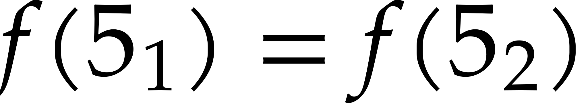? Would the sentence “there are 51 cows in the field” mean **the same** as “there are 52 cows in the field”? And how can one decide this question? Now one says: Of course they mean the same thing; the cows you see there we call both “51 cows” and “52 cows” (Think of designations such as score, dozen, etc.). Yes, but you say “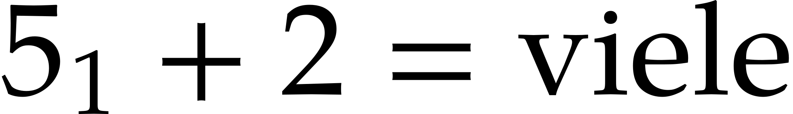” & “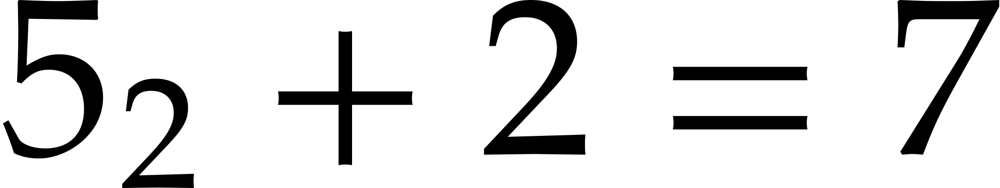”. So do ‘51’ and ‘52’ have the same meaning? And if not, how can ‘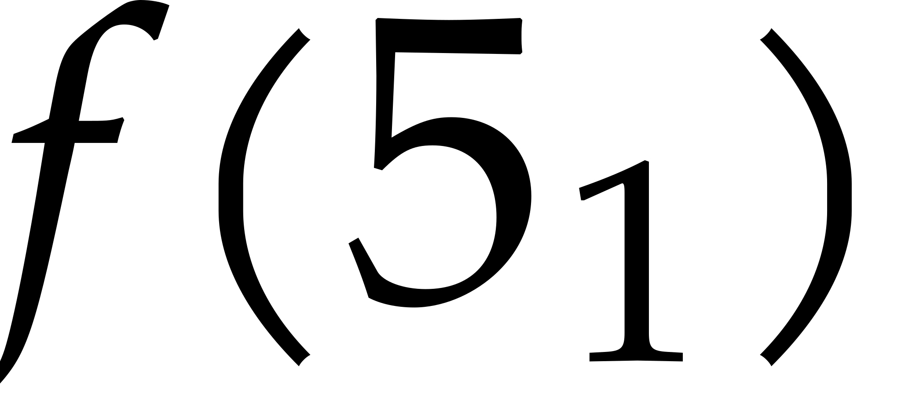’ have the same sense as ‘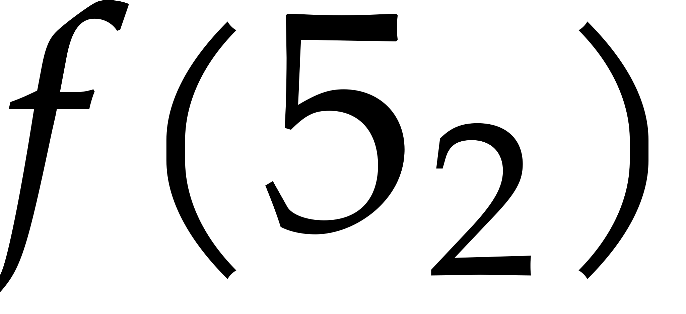’? </s>

### [8r\[2\]](https://cdn.wittgensteinnachlass.com/2000px/webp/Ms-147/8r.webp)

<s>Now one will answer something like: “That is merely an external difference; one **could** just as well say  and have only **one** sign for both”. But that means that I am now setting up a **different** calculus; one in which I can now apply my criteria of sameness of meaning, etc. </s>

### [8r\[3\]](https://cdn.wittgensteinnachlass.com/2000px/webp/Ms-147/8r.webp)

<s>We have here essentially the same case as when we considered the different meanings of the word “is” in the sentences “the rose is red” and “2 + 2 = 4”. At that time we said that we replaced this notation with another.</s>

### [8r\[4\]](https://cdn.wittgensteinnachlass.com/2000px/webp/Ms-147/8r.webp)

Let us imagine people whose number series consisted of three concepts: Few, one hand, many; ‘one hand’ cows are 5 cows. 1, 2, 3, 4 are few, and numbers over 5 are many. Can one now say that the words ‘one hand’ and ‘five’ have the same meaning?

### [8v\[1\]](https://cdn.wittgensteinnachlass.com/2000px/webp/Ms-147/8v.webp)

<s>Two different arithmetics should surely be comparable to two different systems of length measurement. </s>

### [8v\[2\]](https://cdn.wittgensteinnachlass.com/2000px/webp/Ms-147/8v.webp)

Our problem could be put very clearly as follows: Suppose we had two systems of length measurement; in both systems a length is expressed by a number-word followed by a word which indicates the system. The one system designates a length as n feet, and “feet” is a unit of length in the ordinary sense; in the other system a length is designated by nW, and 1W = 1 foot. But 2W = 4F, 3W = 9F, etc. Thus the sentence “this stick is 1W long” means the same as “this stick is 1 foot long”. Question: Do “W” and “foot” have the same meaning in these two sentences?

### [8v\[3\]](https://cdn.wittgensteinnachlass.com/2000px/webp/Ms-147/8v.webp)

<s>ne p = non p agrees with our convention only when p does not have the form non p or ne p. So one may not write the equation without qualification either.

</s>

### [9r\[1\]](https://cdn.wittgensteinnachlass.com/2000px/webp/Ms-147/9r.webp)

Returning to = and ε: If the meaning of a sign is simply determined by the game we play with it, why should we not say that the word “is” has the same meaning in the sentences “the rose is red” and “2 + 2 = 4”? If the meaning of a word is its use, then the meaning of the word “is” is the use of this word (wherever it is used). And of course I can say that, and must then warn against confusing two parts of this use. Yet one says: the “is” in “the rose is red” has a different meaning from the “is” in “2 + 2 is 4”. “Bank”

### [9r\[2\]](https://cdn.wittgensteinnachlass.com/2000px/webp/Ms-147/9r.webp)

<s>One cannot say: ne = non, since one may not put “ne” everywhere in place of “non”. But if p is an unnegated sentence, one can write generally ne p = non p. </s>

### [9r\[3\]](https://cdn.wittgensteinnachlass.com/2000px/webp/Ms-147/9r.webp),[9v\[1\]](https://cdn.wittgensteinnachlass.com/2000px/webp/Ms-147/9v.webp)

The question is wrongly posed. This is best seen when we express sameness of meaning by an equation. The question can then only be: is W = foot or not; the sentences in which the words occur merely disappear from our view. – Nor can one, of course, in this terminology ask: “is is = is?” But one can ask: “ε = =”. Well, we did say: 1 foot = 1W; but foot ≠ W.

### [9v\[2\]](https://cdn.wittgensteinnachlass.com/2000px/webp/Ms-147/9v.webp)

Our difficulties can be solved, and they do not require new and subtle discoveries, penetrating analyses and the like for their solution, but a compilation of the right examples, the word that brings release.

### [9v\[3\]](https://cdn.wittgensteinnachlass.com/2000px/webp/Ms-147/9v.webp)

When one says that ‘ne ne p’ could also be used as a cancelled negation, this is presumably meant to say that, if we changed the rule to ne ne p = p, we would obtain a calculus which can be translated completely into the first.

### [9v\[4\]](https://cdn.wittgensteinnachlass.com/2000px/webp/Ms-147/9v.webp),[10r\[1\]](https://cdn.wittgensteinnachlass.com/2000px/webp/Ms-147/10r.webp)

Does ne now have the same meaning as non? – Can I substitute ne for non? Well, in some places yes, in others no. But that is not what I was asking. My question was: can one use ne instead of non without further qualification? No.

### [10r\[2\]](https://cdn.wittgensteinnachlass.com/2000px/webp/Ms-147/10r.webp),[10v\[1\]](https://cdn.wittgensteinnachlass.com/2000px/webp/Ms-147/10v.webp)

“‘ne’ and ‘non’ mean exactly the same thing in _this_ case.” And namely, what? “No, that one should _not_ do it.” – But here you have said a sentence, namely ne p = non p, and we do not deny that if p contains no negation. And why do you say “in this case”; do they mean something different otherwise? If the difference between ne ne and non non lies in the composition, why do you not use different signs of composition (e.g. positions of brackets)? If you explain ne ne p = ne p, non non p = p, then you are simply using the two words in different ways; and if one adheres to the view that what they yield in certain combinations depends on their meaning, on the meaning that they carry with them, then one must say that they must have different meanings if, when composed in the same way, they can yield different results. That is, one would then have to say that ne ne p cannot yield something different from non non p if their meanings really are the same. And we merely express that differently.

### [10v\[2\]](https://cdn.wittgensteinnachlass.com/2000px/webp/Ms-147/10v.webp),[11r\[1\]](https://cdn.wittgensteinnachlass.com/2000px/webp/Ms-147/11r.webp)

When one says that this word has _in this sentence_ the same meaning as that one, one is thus talking about the meaning of a word in such a way that this meaning can change in the game that is played with the word.

One might, for example, talk about the function of this word in this sentence. But what does this function consist in? How does it manifest itself? For there is nothing hidden, we see the whole sentence! The function must show itself in the calculus. Now, it presumably shows itself, for example, in the fact that non (ne p) = non (non p) = p. But it had been conceded that non p = ne p was to hold (so long as p is not itself a negated sentence). One now wants to say: “‘non’ _does_ the same thing to p as ‘ne’ does (it inverts it).” But these are just other words for non p = ne p. (Again and again, the thought that what we see of the sign is only an exterior of an interior, in which the actual operations of opinion take place.)

### [11r\[2\]](https://cdn.wittgensteinnachlass.com/2000px/webp/Ms-147/11r.webp)

In contrast to our explanation that “meaning” is constituted by the rules for the use of the word, the normal use of the word “meaning” is characterised by the fact that the meaning of the word is something that can float before us. What floats before us are, of course, particular kinds of application & they float before us in the sense in which, for example, a poem that we know by heart floats before us, namely not as _one_ picture but as a series of sentences, one of which draws the next after it & seems to be connected with it. (The string of pearls that we pull out of the box.) Really, in contrast to our explanation of meaning, the case ε, =, …

### [11r\[3\]](https://cdn.wittgensteinnachlass.com/2000px/webp/Ms-147/11r.webp),[11v\[1\]](https://cdn.wittgensteinnachlass.com/2000px/webp/Ms-147/11v.webp)

This is connected with the fact that it is not natural for us to say that the word “is” has a meaning which permits it to occur in the sentences “2 × 2 is 4” & “the rose is red”. And if we said that, the use of the word “meaning” would, as it were, lose all its point for us. But note that I can then naturally neither say that “is” has different meanings in the sentences … nor that it has the same meaning in them. I can, however, say: The meaning of “is” is explained in such a way that one can put the sign ε with these rules & the sign = with those. The objection to this is: “But that does not explain a meaning!” By meaning, one would like to say, I mean a homogeneous use.

### [11v\[2\]](https://cdn.wittgensteinnachlass.com/2000px/webp/Ms-147/11v.webp)

One of the temptations which we must resist when philosophising is to believe that we must make something more exact than it is in our present mode of expression. This wrong turning is that of a kind of mathematical philosophy which believes that mathematical problems must be solved in order for us to arrive at philosophical clarity (Ramsey). We need only a correct description of the present situation.

### [11v\[3\]](https://cdn.wittgensteinnachlass.com/2000px/webp/Ms-147/11v.webp)

The animal eats, man eats. What does it mean to say that _essen_ & _fressen_ mean the same thing?

### [12r\[1\]](https://cdn.wittgensteinnachlass.com/2000px/webp/Ms-147/12r.webp)

Let us take the example of the use of a game piece.

### [12r\[2\]](https://cdn.wittgensteinnachlass.com/2000px/webp/Ms-147/12r.webp)

The kinship between “essen” & “fressen” must show itself in their use & likewise the lack of kinship between “ = ” & “ε” or between “Sitzbank” & “Bankinstitut”.

### [12r\[3\]](https://cdn.wittgensteinnachlass.com/2000px/webp/Ms-147/12r.webp)

Let us imagine that in a board game one uses a piece for the purpose of keeping a square of the board free. One of the game pieces is taken for this …

### [12r\[4\]](https://cdn.wittgensteinnachlass.com/2000px/webp/Ms-147/12r.webp)

<s> In draughts, two ordinary game pieces placed one on top of the other are used as a king, but one could just as well use a differently shaped piece as a king. But what does “could” mean here?! If the meaning of a piece simply lies in what is done with it, then the game changes when something else is done with it. But the important thing is that even in the **game** we distinguish between what is essential & inessential in the rules. </s>

### [12v\[1\]](https://cdn.wittgensteinnachlass.com/2000px/webp/Ms-147/12v.webp)

Here we apparently penetrate deeper than the mere rules of the game (as in the case of “is”). We say that the word has two meanings although according to the surface rules it has only one. And we have a _feeling_ that there are two meanings here. We resist understanding it as one meaning. These two meanings are, as it were, two pictures which we take for two & not for one, just as if we saw a picture representing two people shaking hands with each other. If we did not know people, we could take it for the representation of a four-legged, two-headed being.

### [12v\[2\]](https://cdn.wittgensteinnachlass.com/2000px/webp/Ms-147/12v.webp),[13r\[1\]](https://cdn.wittgensteinnachlass.com/2000px/webp/Ms-147/13r.webp)

We say that this word has two meanings, not one, for it is used _in this way_ here & quite differently there. Now I say: but surely its meaning consists precisely in the fact that it is used in the one way here and in the other way there. But one replies: No, these uses are connected with one another by nothing other than the same word (to which nothing corresponds) & that could just as well be replaced by two words. But why do I say “to which nothing corresponds”? Is it arbitrary, or can I justify replacing the one word by two? Does this rule determine the meaning, or is the rule determined by something lying behind it? Could I also explain that it is essential that the same word (“is”) be used here? <s>That this is the game I **want** to play? Not, however, so that I justify this by saying, for example, that there is nevertheless a similarity etc., but rather that the game essentially consists in the same piece being used here, just as if one did that in draughts. What if in draughts one said that these two functions are connected merely by the same piece **to which nothing corresponds**? One could say: What is the same piece supposed to stand for here? Two different ones would do just as well. But what would they do just as well?</s>

### [13r\[2\]](https://cdn.wittgensteinnachlass.com/2000px/webp/Ms-147/13r.webp)

The game has not only rules but also a point.

### [13v\[1\]](https://cdn.wittgensteinnachlass.com/2000px/webp/Ms-147/13v.webp)

<s>What would correspond to the connection through the sameness of the word would be steps in the calculus that made use of this sameness. (Transitions etc.) One might ask: Why the same word here? But the counter-question would be: Why anything at all? Must I justify my rules? And the answer would be: The justification lies in the calculus, just as the justification for not changing the knight's piece in the game lies in the calculus.</s>

### [13v\[2\]](https://cdn.wittgensteinnachlass.com/2000px/webp/Ms-147/13v.webp)

I could say: when using “is”, _two_ meanings float before me, not _one_.

### [13v\[3\]](https://cdn.wittgensteinnachlass.com/2000px/webp/Ms-147/13v.webp)

The meaning of a piece is the role it plays in the game. Would we count it as part of the role of the pawn in chess that we toss with two of them to determine who gets White & who gets Black?

### [14r\[1\]](https://cdn.wittgensteinnachlass.com/2000px/webp/Ms-147/14r.webp)

Let us imagine the two offices united in one person as an old custom.

### [14r\[2\]](https://cdn.wittgensteinnachlass.com/2000px/webp/Ms-147/14r.webp)

Why the same word, when we do not make use of this sameness in the calculus? Why the same pieces both times? – But what does it mean here to make use of the sameness? Isn’t it a use if we simply use the same word?

### [14r\[3\]](https://cdn.wittgensteinnachlass.com/2000px/webp/Ms-147/14r.webp)

It now seems here as if the use of the same word, the same piece, has a _purpose_ (if the sameness is not accidental, inessential). And as if the purpose were that one should be able to recognise the piece & know how to play. Is this a physical or a logical possibility? If the latter, then the sameness of the pieces belongs in the game.

### [14r\[4\]](https://cdn.wittgensteinnachlass.com/2000px/webp/Ms-147/14r.webp),[14v\[1\]](https://cdn.wittgensteinnachlass.com/2000px/webp/Ms-147/14v.webp)

Surely, the game is meant to be determined by the rules: So, if a rule of the game stipulates that the two kings are to be taken when drawing lots, then this is, essentially, part of the game. What could one object to this? Only that one does not see the point of this rule. Just as one might not see the point of a rule that required one to turn each piece over three times before moving. If we found such a rule in a game, we would be surprised & make assumptions about the reason for such a rule. (“Is this rule intended to prevent one from playing too quickly?” etc.)

### [14v\[2\]](https://cdn.wittgensteinnachlass.com/2000px/webp/Ms-147/14v.webp)

“If I understand the character of the players correctly,” I could say, “then this does not (essentially) belong to it.” Does this also apply to the case of “is”?

### [14v\[3\]](https://cdn.wittgensteinnachlass.com/2000px/webp/Ms-147/14v.webp)

One says that the same word is superfluous because no transitions are made with it.

### [14v\[4\]](https://cdn.wittgensteinnachlass.com/2000px/webp/Ms-147/14v.webp)

Or could I not simply say: because the calculus with ε & = is the one I want, & _therefore_ a relation between the two signs is superfluous?

### [14v\[5\]](https://cdn.wittgensteinnachlass.com/2000px/webp/Ms-147/14v.webp),[15r\[1\]](https://cdn.wittgensteinnachlass.com/2000px/webp/Ms-147/15r.webp)

Examples: 1 The seeing eye is not in the geometrical eye. One’s own body is seen en face in the middle of the visual field. 2 One’s own body with the seeing eye is sometimes seen, sometimes not, like the foreign body. 3 Memory always skips 24 hours, according to the testimony of others etc. Two persons in one body. 4 There are, say, 5 human bodies & 8 characters who take up residence in them in turn. 5 When I raise my arm according to the muscle sensation, usually the arm of my body visibly rises, but often another one does instead.

### [16r\[1\]](https://cdn.wittgensteinnachlass.com/2000px/webp/Ms-147/16r.webp)

What I want to say is that the temptation towards solipsism could not arise in the person whose body would be the body of reference of a solipsistic mode of expression.

### [VB](/w-vb/#ms-147-16r.2) [16r\[2\]](https://cdn.wittgensteinnachlass.com/2000px/webp/Ms-147/16r.webp)

When someone prophesies that the future generation will occupy itself with these problems & solve them, this is usually only a kind of wish-dream in which he excuses himself for what he ought to have achieved & has not achieved. The father wants the son to achieve what he did not achieve, so that the task he left unsolved might nevertheless find a solution. But the son gets a _new_ task. I mean: the wish that the task should not remain unfinished clothes itself in the expectation that it will be continued by the next generation.

### [16r\[3\]](https://cdn.wittgensteinnachlass.com/2000px/webp/Ms-147/16r.webp)

The essence of experience needs no sign. One is tempted to rescue the sign “I” from ordinary usage & into this metaphysical position. But then it loses its meaning.

### [16r\[4\]](https://cdn.wittgensteinnachlass.com/2000px/webp/Ms-147/16r.webp),[16v\[1\]](https://cdn.wittgensteinnachlass.com/2000px/webp/Ms-147/16v.webp),[17r\[1\]](https://cdn.wittgensteinnachlass.com/2000px/webp/Ms-147/17r.webp)

If I see things, is it my experience that _I_ see them? Is it my visual experience? When I see things what is the criterion that _I_ see them & no one else, or no one? Compare with that: “What's the criterion for the penny being in my hand, not in his or in no one's hand?” “Only I can see for I know what ‘seeing’ means only through _my_ seeing; & if anything is seen I always see it”. But if that's how you use the word “to see” then it's unnecessary to add the word “I”. Whereas in the way it's ordinarily used the word “I” isn't superfluous; & this shows you that in the ordinary way of expression it's used differently. But what do you want to say when you say “only _I_ see”? Do you want to say: “only Wittgenstein sees?” You probably feel that the name “W.” is to stand on the same level as all other personal names (i.e. that you want to use it in this way). And that the fact that when I see, W. sees, is to be an empirical fact. In other words “W.” is to refer to a particular body. To a body which may or may not lie around the geometrical eye.

But you also do not want to say that the word “I” is to be omitted from everyone’s mouth.

### [17r\[2\]](https://cdn.wittgensteinnachlass.com/2000px/webp/Ms-147/17r.webp)

Let us imagine that I were the test body for all other people & when they wanted to know what something looked like they placed me somewhere & asked me.

### [17r\[3\]](https://cdn.wittgensteinnachlass.com/2000px/webp/Ms-147/17r.webp)

Instead of “I see this & that”: “from there, with body W., it looks like this.”

### [17r\[4\]](https://cdn.wittgensteinnachlass.com/2000px/webp/Ms-147/17r.webp)

“W. sees” does not mean the same as “I see”. Should one then say: W. & I are different persons? Or different objects?

### [17r\[5\]](https://cdn.wittgensteinnachlass.com/2000px/webp/Ms-147/17r.webp)

What is the ‘I’ that sees & hears & knows, thinks that it sees & hears this & that? Does the I have organs? Or different parts, one of which sees and the other thinks? How does one imagine the I here?

### [17v\[1\]](https://cdn.wittgensteinnachlass.com/2000px/webp/Ms-147/17v.webp)

The information I desire when I say “I see …” is, apart from what is seen, only the place & body of the seer. Not a subject beyond that. Not another person who differs from another in nothing bodily.

### [17v\[2\]](https://cdn.wittgensteinnachlass.com/2000px/webp/Ms-147/17v.webp)

I as test body. “What does it look like?” My mouth answers “it looks like this and that”.

### [17v\[3\]](https://cdn.wittgensteinnachlass.com/2000px/webp/Ms-147/17v.webp)

“I can never make the other person understand what I mean by the words ‘I see’.” – But what do you call ‘making someone understand’?

### [17v\[4\]](https://cdn.wittgensteinnachlass.com/2000px/webp/Ms-147/17v.webp)

‘_I_ speak’ & ‘_I_ see’ – Here lies …

### [17v\[5\]](https://cdn.wittgensteinnachlass.com/2000px/webp/Ms-147/17v.webp)

It seems as though I could say: “Only _I_ am really talking about what is seen.”

### [18r\[1\]](https://cdn.wittgensteinnachlass.com/2000px/webp/Ms-147/18r.webp)

The solipsistic, realistic, modes of expression etc. differ from one another like two different kinds of metric. The one says that circle a is at the edge of A, the other says that a is

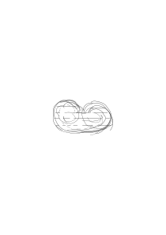

in the middle of A. And this one too is right if we carry it through completely. And whether we are inclined to use one or the other depends on the kind of mirror, medium, etc. through which we look.

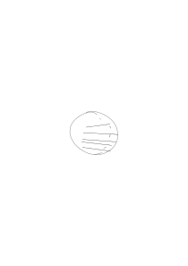

### [18r\[2\]](https://cdn.wittgensteinnachlass.com/2000px/webp/Ms-147/18r.webp)

Solipsistic = egocentric

### [18r\[3\]](https://cdn.wittgensteinnachlass.com/2000px/webp/Ms-147/18r.webp)

What is really asymmetrical in experience could also be symmetrical. But we are inclined to assume an asymmetry that could not be otherwise.

### [18r\[4\]](https://cdn.wittgensteinnachlass.com/2000px/webp/Ms-147/18r.webp),[18v\[1\]](https://cdn.wittgensteinnachlass.com/2000px/webp/Ms-147/18v.webp)

Whatever is asymmetrical in our experience can also be thought of as symmetrical.

### [18v\[2\]](https://cdn.wittgensteinnachlass.com/2000px/webp/Ms-147/18v.webp)

I say: “If anything is seen at all, then I always see.” Now, if I say this to someone else, he sees my mouth move & that is part of the game he plays with my assertion & which I therefore play with him. But that was not at all what I wanted; for which mouth said it was quite immaterial to me; I could say it with my eyes closed & not know at all which mouth was moving. For the others my assertion would have been senseless if it had come from a loudspeaker & the speaker could therefore not be identified. But in that respect the “_I_” is meaningless for me too.

### [18v\[3\]](https://cdn.wittgensteinnachlass.com/2000px/webp/Ms-147/18v.webp)

“What does the word _me_ mean?” “What does it mean to _him_?” When we play together we play the same game. I know of no essentially private meaning.

### [18v\[4\]](https://cdn.wittgensteinnachlass.com/2000px/webp/Ms-147/18v.webp),[19r\[1\]](https://cdn.wittgensteinnachlass.com/2000px/webp/Ms-147/19r.webp)

“If anything is seen, then _I_ see”: Who is the one to whom I point? And when do I point to him? How does he differ from others? If I decide between A & him and B & him, do I also decide between A & B? I believe: If I point to someone, it is the person whose eyes are in the geometrical eyes & the mouth that utters the sentence is essentially the mouth belonging to these eyes. That means that if I felt myself speaking the sentence but saw & heard another mouth speaking it, the sentence would not be as I wanted. But one could say: Even if the sentence sounds from somewhere else, relate it to yourself! Mean yourself by it! But how do I do that? I believe it would happen by my nodding my head or moving my facial muscles in an understanding, affirmative way (or something of the sort).

### [19r\[2\]](https://cdn.wittgensteinnachlass.com/2000px/webp/Ms-147/19r.webp),[19v\[1\]](https://cdn.wittgensteinnachlass.com/2000px/webp/Ms-147/19v.webp)

Or, if I point to myself with that sentence, is it enough if I point to my chest or mouth? Must I not point to the eyes? And does that not then merely mean: “the seeing eyes see”. This is just as if I used the word “this” in a nonsensical way: as if I said, for example, this chair must not be moved without pointing to a chair [there would be better examples]. Ask yourself also how one means such a word demonstratively without actually pointing. (Also remember that one could say: we never really point to a chair; we can only point to the appearance of a chair. The case of appearance of the object & object is in _some_ respects analogous to the case of body & person.)

### [19v\[2\]](https://cdn.wittgensteinnachlass.com/2000px/webp/Ms-147/19v.webp)

Now there is still an experiential proposition which I would generally express as follows: I often see a human body around the geometrical eye & in this case, as a matter of experience, always the same one which you, L.W., call. How could this sentence be expressed differently?

### [19v\[3\]](https://cdn.wittgensteinnachlass.com/2000px/webp/Ms-147/19v.webp)

[I am poor in experiences of the mind but I am in connection with the ground where innumerable seeds of such sensations lie.]

### [20r\[1\]](https://cdn.wittgensteinnachlass.com/2000px/webp/Ms-147/20r.webp)

The experiential proposition is: ‘usually, when anything is seen, a human body of such-and-such a kind is near the geometrical eye’. Someone could reply to me: “not when anything is seen, but when _you_ see, it looks like this”. To this I would say to him: I am not talking about _you_ seeing & so I am not saying: _I_ see either.

### [20r\[2\]](https://cdn.wittgensteinnachlass.com/2000px/webp/Ms-147/20r.webp)

Suppose one sees the example

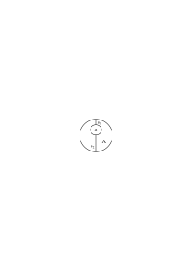

in such a way that the figure represents a truncated cone seen obliquely. Then one will immediately be inclined to say that the circles (or ellipses) are really, properly speaking, concentric & that s1 & s2 are really of equal length.

### [20r\[3\]](https://cdn.wittgensteinnachlass.com/2000px/webp/Ms-147/20r.webp)

One could, oddly enough, call the solipsistic mode of expression ‘the behaviourist’ one.

### [20r\[4\]](https://cdn.wittgensteinnachlass.com/2000px/webp/Ms-147/20r.webp)

Behaviourism, if it is not a boot, is a form of expression, not a view about the structure of the world.

### [20r\[5\]](https://cdn.wittgensteinnachlass.com/2000px/webp/Ms-147/20r.webp),[20v\[1\]](https://cdn.wittgensteinnachlass.com/2000px/webp/Ms-147/20v.webp)

Think of Russell’s ‘neutral’ building material. There is no more misleading mode of expression than talking here of building material.

### [20v\[2\]](https://cdn.wittgensteinnachlass.com/2000px/webp/Ms-147/20v.webp)

The new mode of expression leaves all expressions referring to ‘behaviour’ as they were, referring to movement, physical & chemical processes etc. It extends only to the words: “hear”, “see”, “feel”, “think” & those grammatically related to them.

### [20v\[3\]](https://cdn.wittgensteinnachlass.com/2000px/webp/Ms-147/20v.webp)

What we are discussing is the grammar of the words “see”, “hear”, “feel” etc.

### [20v\[4\]](https://cdn.wittgensteinnachlass.com/2000px/webp/Ms-147/20v.webp),[21r\[1\]](https://cdn.wittgensteinnachlass.com/2000px/webp/Ms-147/21r.webp)

Let us suppose we put ‘A can … draw’ instead of ‘A sees …’. Now one could object that this does not alter the problem that _I_ can draw something because I see it, whereas the other can draw it in the sense in which a mechanism is capable of doing something. But is that so? Can I not say exactly the same thing about my body? Is the personal experience of seeing in a _causal_ connection with the drawing movement of my body? And is this connection in my case at the place where the physical & physiological etc. one is in another?

### [21r\[2\]](https://cdn.wittgensteinnachlass.com/2000px/webp/Ms-147/21r.webp)

Instead of “what do you see?”: “what do you answer to the words ‘what do you see’?” (This is a schema which can be applied to all _similar_ cases.)

### [21r\[3\]](https://cdn.wittgensteinnachlass.com/2000px/webp/Ms-147/21r.webp)

Starlings are unfinished birds. What is observed & the mode of observation.

### [21r\[4\]](https://cdn.wittgensteinnachlass.com/2000px/webp/Ms-147/21r.webp)

“But I say ‘I see’ because I _see_!” What does that mean?

### [21r\[5\]](https://cdn.wittgensteinnachlass.com/2000px/webp/Ms-147/21r.webp),[21v\[1\]](https://cdn.wittgensteinnachlass.com/2000px/webp/Ms-147/21v.webp)

“But I behave like this because I have toothache!” But the point is that we only want to use the language of physical phenomena. And nothing is lost by this. Behaviourism then says only that in our normal mode of expression two forms of expression occur, whereas it wants to use only one of them throughout.

### [21v\[2\]](https://cdn.wittgensteinnachlass.com/2000px/webp/Ms-147/21v.webp)

The mode of expression of _evidence_ then drops out.

### [21v\[3\]](https://cdn.wittgensteinnachlass.com/2000px/webp/Ms-147/21v.webp)

We also say now: “there is a tree over there” & no one misses an indication of personal experience.

### [21v\[4\]](https://cdn.wittgensteinnachlass.com/2000px/webp/Ms-147/21v.webp)

The contrast ‘mind & body’, about which philosophers have talked so much, rests to a large extent on the two forms of expression in our language.

### [21v\[5\]](https://cdn.wittgensteinnachlass.com/2000px/webp/Ms-147/21v.webp)

The other mode of expression is characterised by its wanting to describe the phenomenon seen, what is immediately experienced. It is therefore the mode of expression of sense-data.

### [21v\[6\]](https://cdn.wittgensteinnachlass.com/2000px/webp/Ms-147/21v.webp),[22r\[1\]](https://cdn.wittgensteinnachlass.com/2000px/webp/Ms-147/22r.webp)

“White is no colour” our gardener said to me. Would one say that in the case of the tricolour? Does one experience white there as the unpainted material?! Or indeed: does one experience black-white-red as an arrangement of three colours?

### [VB](/w-vb/#ms-147-22r.2) [22r\[2\]](https://cdn.wittgensteinnachlass.com/2000px/webp/Ms-147/22r.webp)

[The overwhelming _ability_ in Brahms.]

### [22r\[3\]](https://cdn.wittgensteinnachlass.com/2000px/webp/Ms-147/22r.webp)

Nothing _is_ asymmetrical in a grammar but it may _appear_ asymmetrical to us. We compare it with the phenomenon of asymmetry 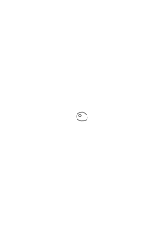 & set it against another system which is the symmetrical one for us.

### [22r\[4\]](https://cdn.wittgensteinnachlass.com/2000px/webp/Ms-147/22r.webp)

I therefore want to express myself in the phenomenal mode of expression as follows:

### [22r\[5\]](https://cdn.wittgensteinnachlass.com/2000px/webp/Ms-147/22r.webp),[22v\[1\]](https://cdn.wittgensteinnachlass.com/2000px/webp/Ms-147/22v.webp)

Each of these modes of expression is equivalent to the other. One sees that nothing is lost with the one, since what one seems to lose at one point must be brought in, as they can be projected into one another. We seem to lose or gain only when, attuned to the one mode of expression, we consider an isolated mode of expression of the other. (Conscious & unconscious thoughts.)

### [22v\[2\]](https://cdn.wittgensteinnachlass.com/2000px/webp/Ms-147/22v.webp)

One could say: When I say “I see …” the ‘I’ is meaningless, for firstly it does not express what is seen, secondly it does not indicate who sees, because ‘I’ is not a personal name, & finally I do not intentionally move _this_ mouth & no other when I say ‘I’.

### [22v\[3\]](https://cdn.wittgensteinnachlass.com/2000px/webp/Ms-147/22v.webp)

The matter becomes clearer when one considers that the sentence “I see …” is an answer to the question “what do _you_ see” & that this question is addressed to a human body.

### [22v\[4\]](https://cdn.wittgensteinnachlass.com/2000px/webp/Ms-147/22v.webp)

Let us imagine, incidentally, that the mouth of someone else always answered this question.

### [22v\[5\]](https://cdn.wittgensteinnachlass.com/2000px/webp/Ms-147/22v.webp)

In phenomenal terminology the question would naturally have to be something like: “What is seen?”

### [22v\[6\]](https://cdn.wittgensteinnachlass.com/2000px/webp/Ms-147/22v.webp),[23r\[1\]](https://cdn.wittgensteinnachlass.com/2000px/webp/Ms-147/23r.webp)

For one could ask: “For what purpose is he addressing this body with this question?” The question is indeed (clear &) unambiguous.

### [23r\[2\]](https://cdn.wittgensteinnachlass.com/2000px/webp/Ms-147/23r.webp)

It might clarify matters if one imagined that someone said to me: It is not enough that you see, you must also _know_ what you see in order to be able to answer the question. I would immediately ask myself: what does it consist in, to know it? Not, for example, in saying it? And who is it that speaks? Not the one whose mouth is moving?

### [23r\[3\]](https://cdn.wittgensteinnachlass.com/2000px/webp/Ms-147/23r.webp)

I could also say: _I_ know it when the sound of the sentence comes from somewhere, but _I_ nod in response. But what does that mean? That my head, i.e. the seeing head, makes the movement? No. That I feel that I am nodding. And here I would again have to say: “that nodding is felt.”

### [23r\[4\]](https://cdn.wittgensteinnachlass.com/2000px/webp/Ms-147/23r.webp),[23v\[1\]](https://cdn.wittgensteinnachlass.com/2000px/webp/Ms-147/23v.webp)

The difficulty is this: in the new terminology we want to say: “... is seen”; but that is not to mean the same as “I, W., see ...” but rather “I see ...”. I.e. it is not to mean “I, W., see”, & also not “I see ...” in the ordinary sense, since here its sense depends on a particular mouth speaking it.

### [23v\[2\]](https://cdn.wittgensteinnachlass.com/2000px/webp/Ms-147/23v.webp)

We apparently presuppose that there is a sentence “I see ...” whose use does not depend on a particular speaker (speaking body).

### [23v\[3\]](https://cdn.wittgensteinnachlass.com/2000px/webp/Ms-147/23v.webp)

For the Other the sentence “... is seen” would be like a picture presented to him without any further commentary.

### [23v\[4\]](https://cdn.wittgensteinnachlass.com/2000px/webp/Ms-147/23v.webp)

I.e.: in the ordinary game the picture is not everything, but it also matters who hands it over. Whereas I call a game one in which that plays no role.

### [23v\[5\]](https://cdn.wittgensteinnachlass.com/2000px/webp/Ms-147/23v.webp)

But bear *in* mind: in answer to the question “what do you see” I quite naturally answer what I would like to answer to the question “what is seen”. I am not for a moment in doubt as to what I should answer.

### [24r\[1\]](https://cdn.wittgensteinnachlass.com/2000px/webp/Ms-147/24r.webp)

Let us examine the sentence: “only _I_ may do that”! So I have been granted a privilege. Can that be so without its referring to my body?

### [24r\[2\]](https://cdn.wittgensteinnachlass.com/2000px/webp/Ms-147/24r.webp)

Let us imagine this mistake: I say “I see ...”. I am asked where my eyes are & I point above me to the eyes of another body. Was I then right or wrong when I said I see that & pointed, say, to my (L.W.’s) chest?

### [24r\[3\]](https://cdn.wittgensteinnachlass.com/2000px/webp/Ms-147/24r.webp)

Yes, in answer to the question “what do you see?” I answer _exactly that_ which I think of as a description of the immediate experience.

### [24r\[4\]](https://cdn.wittgensteinnachlass.com/2000px/webp/Ms-147/24r.webp)

I believe that the difficulty lies in the concept of the experiential proposition, namely insofar as one can ask whether it is an experience that _I_ am the one who sees it.

### [24r\[5\]](https://cdn.wittgensteinnachlass.com/2000px/webp/Ms-147/24r.webp),[24v\[1\]](https://cdn.wittgensteinnachlass.com/2000px/webp/Ms-147/24v.webp)

For example, also whether this is again _my_ experience, etc. It is the role of the word “I” that confuses us in comparison with the role of other pronouns or nouns.

### [24v\[2\]](https://cdn.wittgensteinnachlass.com/2000px/webp/Ms-147/24v.webp)

The only thing that might seem odd about the question “what do you see” is that it has to be addressed to a particular person; & that in certain cases I will say: “I thought you were asking _me_, so I answered”. But this case is not to be confused with the case where he had asked “how large is the diameter of the earth”.

### [24v\[3\]](https://cdn.wittgensteinnachlass.com/2000px/webp/Ms-147/24v.webp)

But why would I in particular be able to answer that question? – What if I were asked: “How do _you_ in particular know the answer?”

### [24v\[4\]](https://cdn.wittgensteinnachlass.com/2000px/webp/Ms-147/24v.webp)

And what does it mean when I say: no one else _can_ know it?

### [24v\[5\]](https://cdn.wittgensteinnachlass.com/2000px/webp/Ms-147/24v.webp)

What would it be like if I did not know what I see?

### [24v\[6\]](https://cdn.wittgensteinnachlass.com/2000px/webp/Ms-147/24v.webp),[25r\[1\]](https://cdn.wittgensteinnachlass.com/2000px/webp/Ms-147/25r.webp)

But in what cases would I say that A knows what B sees but not what A sees?

### [25r\[2\]](https://cdn.wittgensteinnachlass.com/2000px/webp/Ms-147/25r.webp)

The ‘I’ designates a person! –

### [25r\[3\]](https://cdn.wittgensteinnachlass.com/2000px/webp/Ms-147/25r.webp)

When I am asked “what do you see?” I need not answer: “I see this & that” but merely “this & that”.

### [25r\[4\]](https://cdn.wittgensteinnachlass.com/2000px/webp/Ms-147/25r.webp)

Our difficulties concern not only language but the pictures in general that we form when representing the facts.

### [25r\[5\]](https://cdn.wittgensteinnachlass.com/2000px/webp/Ms-147/25r.webp)

If the answer to the question “what do you see” is “this & that” & that is precisely what I would like to call pure description of the experience, then surely the question must have asked precisely for this description.

### [25v\[1\]](https://cdn.wittgensteinnachlass.com/2000px/webp/Ms-147/25v.webp)

Think of the question: “Where is the geometrical eye?” – In answer to this question my hand moves to the right place even if it is not my eye. But could one not imagine that, experientially, the hands of the Others also pointed to this place?

### [25v\[2\]](https://cdn.wittgensteinnachlass.com/2000px/webp/Ms-147/25v.webp)

“I am here”.

### [25v\[3\]](https://cdn.wittgensteinnachlass.com/2000px/webp/Ms-147/25v.webp)

If my body is able to point to the geometrical eye, is it then difficult to imagine a connection between my body & that of another which moves it to point to the spot at which my finger would point under certain circumstances? I give this only as a possible hypothesis, if in such a case one should want such a hypothesis.

### [25v\[4\]](https://cdn.wittgensteinnachlass.com/2000px/webp/Ms-147/25v.webp),[26r\[1\]](https://cdn.wittgensteinnachlass.com/2000px/webp/Ms-147/26r.webp)

The solipsistic standpoint wants to place the description of my experience at the centre. But one can easily dissuade the solipsist from regarding his body as essentially privileged.

### [26r\[2\]](https://cdn.wittgensteinnachlass.com/2000px/webp/Ms-147/26r.webp)

Bear in mind that someone’s saying: “Only _I_ see” expresses no opinion.

### [26r\[3\]](https://cdn.wittgensteinnachlass.com/2000px/webp/Ms-147/26r.webp)

Do I choose the mouth with which I scream when I feel pain? Or say: “I see ...”?

### [26r\[4\]](https://cdn.wittgensteinnachlass.com/2000px/webp/Ms-147/26r.webp)

Who says ‘α’ falls from one form of language into another.

### [26r\[5\]](https://cdn.wittgensteinnachlass.com/2000px/webp/Ms-147/26r.webp)

Can one say “the word ‘I’ designates a person” or also “the word ‘I’ in a person’s mouth designates a person”?

### [26r\[6\]](https://cdn.wittgensteinnachlass.com/2000px/webp/Ms-147/26r.webp)

“I” as subject & as object.

### [26r\[7\]](https://cdn.wittgensteinnachlass.com/2000px/webp/Ms-147/26r.webp),[26v\[1\]](https://cdn.wittgensteinnachlass.com/2000px/webp/Ms-147/26v.webp)

Let us imagine that a hand were placed beside my left hand which looked exactly like it & made the same movements. How could I know which was mine? Let us simply imagine that we suddenly saw everything double.

### [27r\[1\]](https://cdn.wittgensteinnachlass.com/2000px/webp/Ms-147/27r.webp),[27v\[1\]](https://cdn.wittgensteinnachlass.com/2000px/webp/Ms-147/27v.webp),[28r\[1\]](https://cdn.wittgensteinnachlass.com/2000px/webp/Ms-147/28r.webp),[28v\[1\]](https://cdn.wittgensteinnachlass.com/2000px/webp/Ms-147/28v.webp)

<s> … is used in a way to express an opinion which we reject. The opinion e.g. that all other people except A (or myself) are shamming when they say that they have toothache. It seems that the solipsist wants to say of them that they haven't got toothache i.e. that he wants to say of them that which the sentence ‘they haven't got toothache’ says in ordinary language. Whereas what he really wishes to do is to change the notation. Analogous when the idealist says that the tree doesn't exist when nobody looks at it. He is prompted to say this but his sentence in ordinary language expresses a view which he isn't at all keen on holding. He doesn't wish to say that the tree in the sense in which it might vanish while we look at it actually always vanishes as soon as everybody turns their backs on it. But he is not able to overcome the difficulty of expression which consists in his expressing himself in the phraseology in which **views** about things are uttered in ordinary language instead of the phraseology of grammar; i.e. laying down rules. Why is he unable to emerge from that phraseology? Note the usage of the word ‘possibility’.</s> The confusion we talk about is all here in the terminology which talks about physical & logical possibility. Now I _am_ tempted to say: whenever anything is really seen it is I who see. “For I was taught to use the word ‘to see’ for that which only I do.” But that isn't true. Rather I am tempted to use this word in a way different from that I was taught (drawing the boundary of a county). (Imagine someone who said: the word ‘red’ ought only to be used when something is said to be red not where a thing's said not to be red. One could perfectly well have such a notation & there is in fact quite a strong urge for one sometimes.) <s> Now when I say: α) “Whenever anything is really seen it is I who see” I am pleading for a notation in which in certain cases [behaviourism] for me the use of the word ‘I’ is abolished. And that is what I want for I want to say that nothing in the visual experience necessarily points to my (or in fact a person) having it. A person may be seen (or may **be**) round the geometric eye but no person need be there. When I said α it seemed as though I wished to be partial but as a matter of fact I wished to be impartial. What I wished was to give a description of what is seen without mentioning a person. </s> “Whenever anything is really seen it is I who see.” 1) Why then use the ‘I’ at all? What you plead for is a notation in which you say “so & so is seen” instead of ‘I see so & so’. But further: whom did you mean by ‘I’? Wittgenstein? Now he is distinguished from other people primarily by his body. But there are many criteria for identifying the person & if we imagine facts a bit different from what they are we shall see that the use of the personal name is not as simple as it appears. Examples: Imagine all men looking alike but there existing definite sets of characteristics (like the four temperaments) inhabiting them & sometimes changing their habitation. One might in this case be inclined to call a particular character Jones. Think of Jekyll & Hyde. In which cases would we talk of two persons inhabiting the same body? Memories. Imagine my memory today to leave out yesterday the day before the day before yesterday etc. but tomorrow remembering yesterday etc. We could then say that two persons inhabited my body. But we needn't say this. Imagine everybody getting two names for the odd & even days of his life because of memory leaving out every other day.

### [28v\[2\]](https://cdn.wittgensteinnachlass.com/2000px/webp/Ms-147/28v.webp),[29r\[1\]](https://cdn.wittgensteinnachlass.com/2000px/webp/Ms-147/29r.webp),[29v\[1\]](https://cdn.wittgensteinnachlass.com/2000px/webp/Ms-147/29v.webp),[30r\[1\]](https://cdn.wittgensteinnachlass.com/2000px/webp/Ms-147/30r.webp)

To return: When I said α I did not mean by ‘I’: Wittgenstein. For W. is characterized by his body, or by his memories or by his character etc. but I wasn't concerned with any such thing. I did not mean to state that mostly when I see there are near to the geometric eye parts of a body which people call W.'s. This may be so but it is just as easily imaginable that the body round the geometric eye disappears for good or changes its shape & properties constantly etc. I did not want to state α as a proposition of experience. – Imagine that the upper half of my head vanished without my noticing it but the geometric eye would still lie in the same position with respect to my mouth, say, as before. I should then talk about what I see just as usual. One might say: this is exactly the case as having pains in your amputated foot. All right, but let us ask the analogous question in this case: with what right does the man say that _he_ has pains in the foot which belongs no more to him than to his neighbour? Well with what right does he i.e. that particular mouth shout, or make a gesture of pain? But isn't that just the connection which pain has to him. (We are _not_ talking of the hypothetical connection through nerves & brains). We can imagine a man to have pain in a sixth finger although he never had one. In which case should we say this? Imagine him touching the sixth finger with his other hand. What is the criterion for the place in which the pain is. In what sense does he know where the pain is before he touches the painful spot. You ask the man with the amputated foot “where do you feel pain?” & he points to a point in space. It is his pointing that fixes the place of pain. Compare this to seeing a spot & pointing to it. – Now back to the question “with what right does he say ‘I see’ if his eyes have been removed & the geometric eye isn't on any part of his body?” Let us ask: With what right does his body shrink from an approaching danger or his mouth shout; even if he has never learnt any language? Let us talk about ‘the mouth that sees’ meaning the mouth of the man who sees. Now which mouth do we call the mouth which sees if the geometric eye is not in a human eye? Do I choose the mouth with which I say “I see …”? Or doesn't the mouth which says it determine the meaning of the word ‘I’? What meaning would the word ‘I’ have if it came from a microphone? But you say: “It would perhaps have no meaning to anybody else but the person who sees would know that _he_ saw”. But what would he know? (Note the queer idea of meaning when you say it has a meaning to him. The idea of a private meaning is obviously that of a picture _he_ sees & no one else does. Now what would this picture of _himself_ be like? Would it not be that of his body in the ordinary sense?) Knowing is something like saying & the sense of what you say depends on the use that's made of the words you say. Now if he says to himself ‘I’ that's no use if he cannot distinguish the person which says it from other people. The man who says ‘α’ falls from one language into another as the man who says ‘I am here’. Here too people might say that this proposition has no sense for anyone else but that it has for the man who thinks it.

### [30r\[2\]](https://cdn.wittgensteinnachlass.com/2000px/webp/Ms-147/30r.webp)

Can a machine think? Different languages.

### [30r\[3\]](https://cdn.wittgensteinnachlass.com/2000px/webp/Ms-147/30r.webp)

I want a notation which only describes (expresses) the experience. And in the sentence “I have toothache” the ‘I’ is an element of the sentence which does not belong to the _picture of the experience_, as we understand it.

### [30r\[4\]](https://cdn.wittgensteinnachlass.com/2000px/webp/Ms-147/30r.webp)

“Mr. Nobody is in this room.”

### [30r\[5\]](https://cdn.wittgensteinnachlass.com/2000px/webp/Ms-147/30r.webp)

Can one talk about “_my_ geometric eye”?

### [30r\[6\]](https://cdn.wittgensteinnachlass.com/2000px/webp/Ms-147/30r.webp),[30v\[1\]](https://cdn.wittgensteinnachlass.com/2000px/webp/Ms-147/30v.webp)

I am tempted not only to use a particular notation but also to justify it & to say why I am tempted to do so. But I give the justification already in the new language! Unless I am really describing empirical facts. – I would like to say: “I would like to express myself in such & such a way, for it is surely true that ...” & now there follows something that is only meant to make it seem justified that I want _this_ form of expression. But as soon as, for example, I want to justify a solipsistic form of language in this way, the Other tells me that this applies to him too & now I am at a loss & do not know what to say. Thus, for example, pointing to my eye, I say to him: “the geometrical eye is here.” He replies: “_Your_ geometrical eye is here but _mine_ is there!” Now the initially correct answer to that would be: “You do not understand me, what I mean is here where I am pointing & I am not talking about Yours & Mine but about the geometrical eye.” Here only the expression “what I mean” is misleading because it makes it appear as if I had something special “in mind” which I cannot express. The fact remains that I am laying down a statute for a notation; a notation which is no more justified or unjustified than another.

### [30v\[2\]](https://cdn.wittgensteinnachlass.com/2000px/webp/Ms-147/30v.webp)

“The geometrical eye is here” is not a determination of location but a definition.

### [30v\[3\]](https://cdn.wittgensteinnachlass.com/2000px/webp/Ms-147/30v.webp)

And a dispute about it is (therefore) a dispute about a definition.

### [31r\[1\]](https://cdn.wittgensteinnachlass.com/2000px/webp/Ms-147/31r.webp)

Now I want to have a notation in which what I see – as I must openly say – – – –

### [31r\[2\]](https://cdn.wittgensteinnachlass.com/2000px/webp/Ms-147/31r.webp)

Let us imagine that we described what was seen not in words but through painting. – – – [→ ]

### [31r\[3\]](https://cdn.wittgensteinnachlass.com/2000px/webp/Ms-147/31r.webp)

Let us imagine that what _I_ see were much more important in the life of the community than it actually is.

### [31r\[4\]](https://cdn.wittgensteinnachlass.com/2000px/webp/Ms-147/31r.webp)

Is it not merely a coincidence that only _one_ mouth knows what I see? Let us suppose there were two mouths. Then there _may_ be no discrepancy between these two & if there is we must not say that it is a difference of opinion but simply that the relevant game is not being played. I could imagine the case in which I spoke & wrote at the same time, even wrote with both hands. If my mouth then said one thing & my hand something else, that would be taken as nonsense.

### [31r\[5\]](https://cdn.wittgensteinnachlass.com/2000px/webp/Ms-147/31r.webp),[31v\[1\]](https://cdn.wittgensteinnachlass.com/2000px/webp/Ms-147/31v.webp)

Each of us (each body) produces a picture. And the picture I produce in fact plays no greater role in communal life than that of any Other. Nor would I want it to play a greater one.

### [31v\[2\]](https://cdn.wittgensteinnachlass.com/2000px/webp/Ms-147/31v.webp)

If it played a greater role; if people repeatedly spoke of what I see, it would be easier to introduce a special notation for it. The strongest case would be that I alone was employed to see & make pictures.

### [31v\[3\]](https://cdn.wittgensteinnachlass.com/2000px/webp/Ms-147/31v.webp)

If one says that one would like the visual image to play a central role in language, one could reply that it plays no role at all since it is not a sign of language. That what occurs in language is the pictures that the persons make & that these pictures are on an equal footing.

### [31v\[4\]](https://cdn.wittgensteinnachlass.com/2000px/webp/Ms-147/31v.webp)

Must I know who I am? And in what respect? For if I can only say “I am I”, then I know nothing at all.

### [32r\[1\]](https://cdn.wittgensteinnachlass.com/2000px/webp/Ms-147/32r.webp)

“Only my own experiences are real”: one can also say: “Only _I_ really see, really hear, etc.” Or also: “Whenever seeing occurs, it is always _I_ who see.” Whoever says this wants to emphasise the difference between the relations of “I have a blue mark” & “he has a blue mark” on the one hand & “I see ...” & “he sees ...” on the other.

### [32r\[2\]](https://cdn.wittgensteinnachlass.com/2000px/webp/Ms-147/32r.webp)

The role played by the ‘I’ in “I see ...” becomes clear if one imagines that it were asked “what does _he_ see”, where this question means as much as “what do you see that he sees”.

### [32r\[3\]](https://cdn.wittgensteinnachlass.com/2000px/webp/Ms-147/32r.webp)

Also: As the only watchman on the tower I have to say what is seen. In this case there is no temptation at all to say “_I_ see ...”.

### [32r\[4\]](https://cdn.wittgensteinnachlass.com/2000px/webp/Ms-147/32r.webp)

I know that the Other sees from an experience that relates to that body. I do not know that _I_ see from an experience.

### [32v\[1\]](https://cdn.wittgensteinnachlass.com/2000px/webp/Ms-147/32v.webp)

You want to say that the sign is unique & say that the thing is unique.

### [32v\[2\]](https://cdn.wittgensteinnachlass.com/2000px/webp/Ms-147/32v.webp)

This ultimately comes down to something similar to confusing the word ‘A’ with the thing A.

### [32v\[3\]](https://cdn.wittgensteinnachlass.com/2000px/webp/Ms-147/32v.webp)

I misunderstand the grammar of the sentence “I see ...” in such a way that I forget that the “I” here is essentially a signal of my body.

### [32v\[4\]](https://cdn.wittgensteinnachlass.com/2000px/webp/Ms-147/32v.webp)

I look around & say: “this is seen & that is seen” and so on. Then I say: “No one else has what I have there”.

### [32v\[5\]](https://cdn.wittgensteinnachlass.com/2000px/webp/Ms-147/32v.webp)

The situation in which one feels a philosophical difficulty is very important.

### [32v\[6\]](https://cdn.wittgensteinnachlass.com/2000px/webp/Ms-147/32v.webp),[33r\[1\]](https://cdn.wittgensteinnachlass.com/2000px/webp/Ms-147/33r.webp)

It may be, for example, that the sentence you always want to say is merely the picture of what is seen, which is also used in language. And one can arrange language in such a way that the picture by itself is one of its signs.

### [33r\[2\]](https://cdn.wittgensteinnachlass.com/2000px/webp/Ms-147/33r.webp)

We become entangled in language.

### [33r\[3\]](https://cdn.wittgensteinnachlass.com/2000px/webp/Ms-147/33r.webp)

Can one say that the muscle-feeling is the characteristic that _I_ raise my arm. And not someone else?

### [33r\[4\]](https://cdn.wittgensteinnachlass.com/2000px/webp/Ms-147/33r.webp)

“When someone Else raises his arm I recognise it by what I see & hear; when _I_ raise it, by what I feel.” (“So really only _I_ want to.”)

### [33r\[5\]](https://cdn.wittgensteinnachlass.com/2000px/webp/Ms-147/33r.webp)

The “I” is not a sign by which the person is recognised. I can recognise by looking which person is raising his arm but not by feeling. When I scream from pain I do not recognise who is in pain & express it.

### [33r\[6\]](https://cdn.wittgensteinnachlass.com/2000px/webp/Ms-147/33r.webp)

From the circumstance of who is screaming we recognise who is in pain, but the fact that he & not someone Else is screaming expresses no opinion about who is in pain.

### [33v\[1\]](https://cdn.wittgensteinnachlass.com/2000px/webp/Ms-147/33v.webp)

Experience that relates to my body. The sentence “I see” says nothing about my body. “But you do distinguish between the case where you see and the case where someone Else sees.”

### [34r\[1\]](https://cdn.wittgensteinnachlass.com/2000px/webp/Ms-147/34r.webp),[34v\[1\]](https://cdn.wittgensteinnachlass.com/2000px/webp/Ms-147/34v.webp),[35r\[1\]](https://cdn.wittgensteinnachlass.com/2000px/webp/Ms-147/35r.webp),[35v\[1\]](https://cdn.wittgensteinnachlass.com/2000px/webp/Ms-147/35v.webp),[36r\[1\]](https://cdn.wittgensteinnachlass.com/2000px/webp/Ms-147/36r.webp),[36v\[1\]](https://cdn.wittgensteinnachlass.com/2000px/webp/Ms-147/36v.webp),[37r\[1\]](https://cdn.wittgensteinnachlass.com/2000px/webp/Ms-147/37r.webp),[37v\[1\]](https://cdn.wittgensteinnachlass.com/2000px/webp/Ms-147/37v.webp)

If someone asked me: how do you know that only what you see is really seen I should answer “because _this_ is what's seen (with a gesture pointing before me), & _I_ see it (& it's I who sees it). I point before me & say “after all, it is only _that_ which is really seen”. I forget that a sentence may come to us as naturally as anything, but thereby still have no use. Let us think of “A = A”, “this tree is the same as this tree”. The gestures & images through which I apparently give this sentence a sense are very similar to those in the case of “only _that_ is seen”. (It is important to become conscious of these particular circumstances in which one is especially inclined to utter a particular metaphysical sentence.) There is, as we have said, no objection to adopting a symbolism in which a person always or temporarily holds an exceptional place in the grammar. And therefore if I utter the sentence “Only I really see” it is conceivable that upon this my fellow creatures arrange their notation in such a way as to put me into its center. <s> For this purpose it was not necessary that the ‘I’ in ‘Only I see’ should stand for ‘L.W.’. For they took that person as the center of their notation who said it. I could perhaps have achieved the same by raising my hand. </s>

What however is wrong is to think that I can justify this choice. When I said from my heart that only I see I was also inclined to say that by ‘I’ I didn't really mean L.W. That for the benefit of my fellow men I could translate my sentence into “it is now L.W. who really sees” but that this was not its real meaning. I could almost have said that I by ‘I’ meant something which just now inhabits L.W. but which the others can't see & therefore I must, to them, talk of ‘L.W.’ (“I meant my mind & could only point to it via my body”). As I said, the only justification, namely that it is _that_ which lives in this body (say in L.W.), is senseless. For, admittedly, I do not thereby want to say anything which, in the ordinary sense, experience teaches. (And do not think that it is an empirical proposition which only I can know, because only I am in a position to have this experience.) The idea now that the real I only lives in my _body_ is connected with the peculiar grammar of the word ‘I’ & the confusions and misunderstandings to which it gives rise. I want to distinguish two cases in the use of the word ‘I’, which I shall call its use as subject & its use as object. Examples of the former: “My arm is broken”, “I am growing”, “I have a bump on my forehead”, “The wind is moving my hair”; examples of the latter: “I see …”, “I hear …”, “I want to move my arm”, “I strike the table”, “I feel pain”, etc. <s> The first grammatical difference which strikes us between these two kinds of cases is that in the case of the first kind it makes sense to ask: are you sure that it is your arm? </s> The difference between these two kinds of cases can be described by saying: the cases of the first kind involve recognizing the person & in this case there is the possibility of error, or we might also say: the possibility of error is provided for. I may think I see my arm broken & see someone else’s. I may, e.g. in a mirror, take my face for his (take myself for him) & the bump on his forehead for one on my forehead. By contrast, in the case of my having pain, recognizing the person is not in question. To ask: “are you sure that _you_ have toothache” would be nonsensical. Now, if in this sense no error is possible, it is because what would look like an error has no place in the game we are playing. In chess we distinguish between good & bad moves & call it an error if I carelessly expose myself to ‘check’; but it is not an error in this sense if I make a knight’s move with the king. And here the formulation occurs to us that an error about the person in the sentence ‘I am in pain’ is no more possible than it can be based on an error that _I_ cry out when I am in pain. And to say “I am in pain” is no more a statement about a particular person than my groaning is. I.e. the particular person does not enter into the statement, he enters the game as the first person, not as the third. “But the word “I” in the mouth of a person does refer to that person, he is not thereby pointing to someone else but to himself; indeed, sometimes one really points at oneself with one’s finger when one says the word “I”.” But this pointing is quite superfluous, for one might just as well raise one’s hand. Nor can one say: if I point at the sky I also point at myself, for on the one hand I point towards the sky, on the other hand it is I who points. The word “I” has neither the meaning of the name “L.W.” (even if I am L.W.) nor the meaning of the words “the speaker”. This can only be understood when one is conscious that a multiplicity of _different_ games is played with language. (Comparison of the parts of speech with the tools in a toolbox.) On the other hand I _point_ to the _place_ where I am in pain. Someone who cries out in pain – or says that he is in pain – does not choose the mouth with which he does so. It all comes down to saying that the person of whom we say that he has the pain is, according to the rules of the game, the one who groans, grimaces, etc. – not necessarily the one in whom the pain is. If, when saying the word ‘I’, one _points_ to one’s own body, one thereby assimilates the appearance of the use of ‘I’ to that of the use of the demonstrative “This” or “this person”. This assimilation has similarities with that in a geometrical proof: “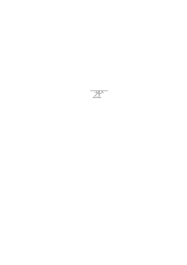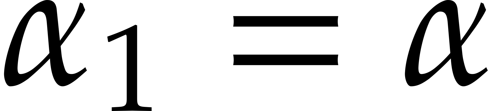, 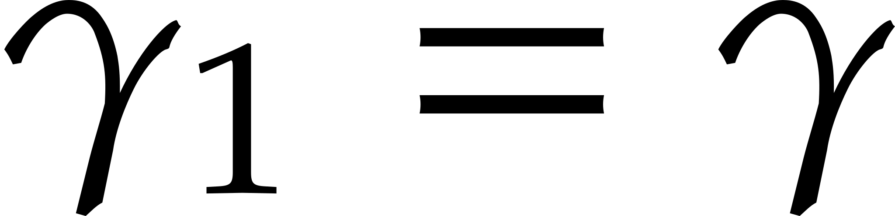 & β = β”.

‘Ich’ in “ich habe Schmerzen” is not a demonstrative. Compare: “How do you know that he is in pain” – “Because he said so”; & on the other hand: “How do you know that _you_ are in pain” – “I know that I have it because I _feel_ it”. “Ich habe sie” means “I feel them”; but the fact that in the answer “weil ich sie _fühle_” the “fühle” is stressed & not the “ich” expresses that here I am not singling out one person among others. Do I recognize Nobody when I enter a room & see that there is nobody in the room? Let us imagine a language in which this sentence was assimilated to the sentence “Mr A is in this room” by saying “Mr Nobody is in this room” & think of the philosophical problems which this way of expressing it could generate. “But surely in one case I point at other bodies & in the other at my own, this body!” But why do I point at my body, say at my chest? What has it got to do with toothache? And if I point to the place of the pain I do not point according to visual criteria either. “I am in pain” is not an _expression of opinion_. (Nor is groaning.) One is inclined here to a notation which, like groaning, leaves the ‘I’ out. We are inclined to forget entirely that it is the particular use of the word which gives it its meaning. Let us think only of the example of the use of the word “apple”, etc. We could imagine that it was customary to attach labels to objects on which their name was written, or some sign which, depending on its use, one might call the name of the colour of the object, the name of the object, the name of its shape, etc. etc. We are like people who forget that such labels on things only have a sense if we know what to do with them & who are now led by the mere existence of a label to believe that there must be a use, even if an occult one. Thus, if we make the movement of pointing & pronounce certain words while doing so, we believe that we have thereby named something. It is as if someone believed that game pieces on a chessboard _must_ thereby eo ipso belong to a game without particular rules applying to them. We say that we name something “toothache” & believe that the word has thereby already acquired a use if, in certain circumstances, we point to part of our body & say “I have (or this is) toothache”. In reality, a use of the word ‘toothache’ is essentially that of an articulated groan. (We have the idea that, if we point to the cheek & say “this is toothache”, the other person, if only he is clever enough to know which object we designate by this word, must understand the use of the word.) (Primitive conception of language) (Cogito ergo sum)

### [37v\[2\]](https://cdn.wittgensteinnachlass.com/2000px/webp/Ms-147/37v.webp)

<s> 1 Objection: Surely I point to one person in contrast to another & in contrast to that, when I point to others when I say “I am in pain”. 2 Answer to this objection 3 – </s>

### [37v\[3\]](https://cdn.wittgensteinnachlass.com/2000px/webp/Ms-147/37v.webp),[38r\[1\]](https://cdn.wittgensteinnachlass.com/2000px/webp/Ms-147/38r.webp)

The difference between “I have toothache” & “he has toothache” is not that between the sentences “L.W. has toothache” & “Smith has toothache”. Rather, the difference between those sentences is to be compared with my groaning on one occasion and saying on another that someone is groaning. We now feel that no body corresponds to the I in the sentences of the second category & this creates the illusion that something incorporeal corresponds to it, which nevertheless has its seat in our body. This supposed real I is also the one of which it was said “I think therefore I am”. This sentence too is, so to speak, a morbid excrescence of the body of language.

In fact we might say that what we were all the time concerned with was the grammar of the words: ‘seeing’, ‘hearing’, ‘thinking’ etc. Let us return to the question whether a machine can think. Groaning &: the description of what is seen (the experience) does not essentially contain a subject. The exceptional status of the word “I” is not the exceptional status of a person. The solipsist desires, in a certain sense, impartiality of expression. Behaviourist forms of expression.

### [38r\[2\]](https://cdn.wittgensteinnachlass.com/2000px/webp/Ms-147/38r.webp)

How do I know what I see? Why do you believe that I know it? How does my mouth know what the eyes see? Does this not mean that there can be no question here of ‘knowledge’ at all?

Do I assume that someone else can know it? I.e. would I say that he knows it if, for example, he could always say correctly what I see? Would I say that my hand & my mouth know it? (I assume that my hand says it in writing.)

### [38r\[3\]](https://cdn.wittgensteinnachlass.com/2000px/webp/Ms-147/38r.webp)

What does it mean to communicate something to oneself?

### [38r\[4\]](https://cdn.wittgensteinnachlass.com/2000px/webp/Ms-147/38r.webp)

It is as if the expression “the same colour” or “the colour blue” had two different meanings for us. The normal one, in which it is immaterial to us whether someone else ‘really sees the same thing’, & one in which the words “_this_ particular impression” are meant.

### [38v\[1\]](https://cdn.wittgensteinnachlass.com/2000px/webp/Ms-147/38v.webp)

Whoever says ‘I see’ does not describe something that is going on in a human being. A human being merely says it & what is going on in him can itself be seen.

### [38v\[2\]](https://cdn.wittgensteinnachlass.com/2000px/webp/Ms-147/38v.webp)

Is there no mind but only a body? The answer is the word “mind” has meaning i.e. a use in one language but this doesn't yet say anything about the kind of use that is made of it.

### [38v\[3\]](https://cdn.wittgensteinnachlass.com/2000px/webp/Ms-147/38v.webp)

Just think: the mouth that says “I see” is not the eye, after all, & the eye need not be present at all.

### [38v\[4\]](https://cdn.wittgensteinnachlass.com/2000px/webp/Ms-147/38v.webp)

Someone proposes: I will use the word “blue” in such a way that it means only what _I_ see when, according to normal linguistic usage, I see blue. Or let us say: to distinguish it from “blue”, I will then say “blue'’”. But what _use_ do I now make of “blue'’”?

### [38v\[5\]](https://cdn.wittgensteinnachlass.com/2000px/webp/Ms-147/38v.webp)

One could also say: “when I describe my personal experience this experience is only an accompaniment of the description, for no one forces me to describe it _thus_.”

### [39r\[1\]](https://cdn.wittgensteinnachlass.com/2000px/webp/Ms-147/39r.webp)

For what does the description do except pronounce words?

---

### [39r\[2\]](https://cdn.wittgensteinnachlass.com/2000px/webp/Ms-147/39r.webp),[39v\[1\]](https://cdn.wittgensteinnachlass.com/2000px/webp/Ms-147/39v.webp)

Now the language we're in when we adopt the sense datum-notation is to forget the difference between the grammar of a statement about sense data & the grammar & an outwardly similar statement about physical reality. (From this point one might go on talking about the misunderstandings which find their expression in such sentences as “we can never see an accurate circle” or “all our sense data are vague”, or about absolute position & absolute motion & size in visual space as opposed to Euclidian space etc. etc.) Now we can make use of such an expression as “pointing to the appearance of a body” or “pointing to a sense datum”. Roughly speaking this sort of pointing comes to the same as sighting say along the barrel of a gun. Thus we may point & say “this is the direction in which I see my image in the mirror.” One can also use such an expression as the appearance or sense datum of my finger points to the sense datum of the tree etc. It is a different case however when I point say to where a sound seems to come from or when on being asked point to my forehead I do so with closed eyes etc. Now when in the solipsistic way I say “this is what's really seen” I point before me & it is essential that I point _visually_. If I pointed sideways or behind me as it were to things which I don't see the pointing would in this case be meaningless to me it would not be pointing in the sense in which I wish to point. But this means that when I point before me saying “this is what's really seen” although I make the gesture of pointing I don't make any use of it for I don't point to one thing as opposed to another. (This is as though travelling in a car & feeling in a hurry I instinctively press against something in front of me as though I could shove the car from the inside.) If it makes sense to say “I see this” or “this is seen”, pointing to what I see, it makes sense to say “I see this” or “this is seen” & to point to something I _don't_ see. And in this way the solipsist's “only this is really seen” reminds us of a tautology.

### [39v\[2\]](https://cdn.wittgensteinnachlass.com/2000px/webp/Ms-147/39v.webp),[40r\[1\]](https://cdn.wittgensteinnachlass.com/2000px/webp/Ms-147/40r.webp),[40v\[1\]](https://cdn.wittgensteinnachlass.com/2000px/webp/Ms-147/40v.webp),[41r\[1\]](https://cdn.wittgensteinnachlass.com/2000px/webp/Ms-147/41r.webp),[41v\[1\]](https://cdn.wittgensteinnachlass.com/2000px/webp/Ms-147/41v.webp),[42r\[1\]](https://cdn.wittgensteinnachlass.com/2000px/webp/Ms-147/42r.webp)

I pointed but I robbed the pointing of its sense by leaving no possibility of a choice. I constructed a clock with all its wheels etc. & in the end fastened the dial to the pointer & made it go round with it. Of course one of the things which tempt us to make our pseudo-proposition is the proposition “I see this” where I point to certain objects around me as opposed to others or in a certain direction in physical space (not in visual space) as opposed to other directions in physical space. And if, pointing in this sense, I say “this is what is really seen” one may answer me “this is what you L.W. see” & there is no objection to adopting a notation in which what we used to call “things which L.W. sees” is replaced by “things really seen”. If however in saying “this is seen” I point to that of which I say that it has no neighbour. I make a mistake absolutely analogous to this when I think that the sentence “I am here” makes sense & is always true (although possibly no one else can understand it) when I say it under conditions different from those special conditions under which it makes sense, e.g. when my voice is recognized by the other person & the direction from which I speak, & others. Again a case where you can learn that the word has meaning by the particular use we make of it. We are like people who think that pieces of wood shaped more or less like chessmen or draught stones standing on a chessboard constitute a game even if nothing has been said as to how they are to be used. To say “it approaches me” has sense even when in the physical sense nothing comes nearer to my body. And in the same way “it has reached me” or “it is here now” when nothing has reached my body & on the other hand “I am here” makes sense if my voice is recognized & heard to come from a particular Euclidian place. I could however try to express my solipsism in a different way. I imagine that I & others make descriptions of what each sees by writing, drawing etc. These descriptions are put before me. I point to the descriptions which I have made & say “only this is (or was) seen”. That is, I am tempted to say only this description has reality (visual reality) behind it. The others I might call blind descriptions. I could also express myself by saying “_This_ description only was taken from a reality only this was compared with a reality.” Now it has a clear meaning when we say that this picture or description is a projection of say this group of objects the trees I look at or has been derived from it. But we must look into the grammar of such a phrase as “this description is derived from my sense datum”. What we are talking about is connected with the temptation to say: “I never know what the other really means by ‘brown’ or what he really sees when he says (truthfully) that he sees brown.” – We could propose to one who says this to use two different words instead of the one word ‘brown’; one word “_for his particular impression_”, the other word with that meaning which other people can understand as well. If he thinks about this proposal he will see that there is something wrong about his conception of the meaning function of the word ‘brown’ & others. He looks for a justification of his description where there is none. (Just as in the case when one believes that the chain of reasons must have no end. Think of the justification by a general formula for the performance of a mathematical operation & of the question: does this formula compel us to use it as we do in this particular case). To say “I derive a description from visual reality” can't have a sense analogous to that of “I derive a description from this part of reality” for otherwise the _method of derivation_ would have as it were to be described by means of a sample of reality which did not belong to reality. I may e.g. see a table in which a colour sample is correlated to the word “brown” & besides a patch of the same colour elsewhere & I may say: “so I must for the description of this patch use the word ‘brown’”. But it would be meaningless to say that I derive the word “brown” from the particular colour-impression which I receive. Let us now ask: “can a human _body_ have pain? One is inclined to say how can the body have pain? The body in itself is something dead; a body isn't conscious.” And here again it is as though we looked into the nature of pain & saw that it lay in its nature that a body couldn't have it. And it is as though we found that what had pain must be an entity of a different nature than a material object in fact a spiritual object. But to say that the ego is spiritual or mental is like saying that the number 3 is of a mental or of an immaterial nature when we recognize that ‘3’ isn't used as a sign for a physical object. On the other hand we can perfectly well adopt the expression “this body feels pain”, & we would just tell it to go to the doctor, lie down, & even to remember that the last time he had pains they were over in a day. But wouldn't this form of expression at least be an indirect one? As when one strikes the [unreadable] …? – Is it only an indirect expression when we say “write ‘3’ for ‘x’ in this formula” instead of “substitute 3 for x”? (Or on the other hand is the first the only direct expression as some mathematicians think)?! All depends how we go on using our words. Don't imagine meaning as an occult process or interaction between the word a mind & a thing which contains the whole usage of the word as a seed might be said to contain the future tree.

### [42r\[2\]](https://cdn.wittgensteinnachlass.com/2000px/webp/Ms-147/42r.webp)

The one expression is no more direct than the other. The meaning of the expression depends entirely on how we go on using it.

### [42v\[1\]](https://cdn.wittgensteinnachlass.com/2000px/webp/Ms-147/42v.webp)

“Expressing toothache” “expressing wilfulness” “expressing blueness”. Let us imagine that people reacted to colours with particular sounds.

### [42v\[2\]](https://cdn.wittgensteinnachlass.com/2000px/webp/Ms-147/42v.webp)

One must become clear about how much someone would have to invent if he wanted to invent the expression of pain as a game.

### [42v\[3\]](https://cdn.wittgensteinnachlass.com/2000px/webp/Ms-147/42v.webp)

Whoever invents the word for toothache must also invent the game that is to be played with it. – “Well, then he simply invents that people say this word when they have toothache.” But it is strange that he can invent this & yet is not supposed to be able to explain his invention to the others! Or have we made a mistake & was that not an explanation at all?! For what did he understand by it: that the others had “toothache”? Do not answer that he meant that they have what he has, for it has not yet been determined in what sense one can say “_he has something_”. He does not invent a name, he invents (fabricates) the _expression of pain_!

### [43r\[1\]](https://cdn.wittgensteinnachlass.com/2000px/webp/Ms-147/43r.webp)

“So I only know of myself that I am in pain. Or rather: so I only know of myself what pain is.” But of _whom_? And to whom do I say this? Of course I did not learn the word “pain”, like the word “brown”, from myself; – but so I have given them a private meaning myself!

### [43r\[2\]](https://cdn.wittgensteinnachlass.com/2000px/webp/Ms-147/43r.webp)

I should like to say: I supply _all_ actual & imagined pains.

### [43r\[3\]](https://cdn.wittgensteinnachlass.com/2000px/webp/Ms-147/43r.webp)

But there is a notation which in a certain sense reproduces this view: it puts the words “I believe” before every sentence which is not already a description of one’s own experience. And thus every sentence acquires the form of a description of one’s own experience. One then says “I have toothache” but “I believe he has toothache”.

### [43r\[4\]](https://cdn.wittgensteinnachlass.com/2000px/webp/Ms-147/43r.webp)

What are we to say now: that every hypothesis is in any case an abbreviation in place of a sentence “I believe …”? That every sentence is naturally about the I, even when we do not say so?

### [43v\[1\]](https://cdn.wittgensteinnachlass.com/2000px/webp/Ms-147/43v.webp)

One might ask: “do I understand my own ostensive definition?” Yes, but what does it mean to understand _it_? And does that then require further explanations? I _use_ it or I do not use it. But precisely for that reason it does not help me by itself.

### [43v\[2\]](https://cdn.wittgensteinnachlass.com/2000px/webp/Ms-147/43v.webp)

I say to myself: “_this_ is surely green” & point to something green; & it is as if I had connected the word ‘green’ with a particular thing.

### [43v\[3\]](https://cdn.wittgensteinnachlass.com/2000px/webp/Ms-147/43v.webp)

“I want ‘it is green’ to be substituted for ‘I see green’; but only when it is I who says it.” But “I” here does not mean a particular person; indeed I do not want it to draw attention to this body at all. Well then, in this case it says nothing at all. You say ‘this is green’ & you say you give the impression, this impression, the name “Green”; & that is good, if it means _this_ impression and not that one (which is called ‘red’, say). But you do not really want to make this contrast, but something like the contrast: impression – thing. You think that you could use the word ‘green’ _more directly_. Where does this feeling come from?

### [44r\[1\]](https://cdn.wittgensteinnachlass.com/2000px/webp/Ms-147/44r.webp)

Again and again the feeling that I can say: “I only want to speak of ‘green’ where _I_ see green, without the ‘I’ referring to a particular person”. But what then is the continuity of what I name in this way? – I could also ask: “how am I to lay down the rule for naming?” For I seem essentially to acknowledge _no_ continuity.

### [44r\[2\]](https://cdn.wittgensteinnachlass.com/2000px/webp/Ms-147/44r.webp),[44v\[1\]](https://cdn.wittgensteinnachlass.com/2000px/webp/Ms-147/44v.webp)

Let us return to the person who ‘invented a name for toothache’. “He wants to communicate that he is in pain & cannot, because he has no word for the pain”. But how can he _want to communicate it_ if he has no language yet? Can one want to play chess & invent chess out of this need?! Now one will say: But surely he can be in pain without saying it; – & why should he not then want to communicate that he is in pain? But what does it mean: to communicate it? Is this communication of the same kind as saying that such-and-such an object is standing there? Or that a lunar eclipse will be visible at this time; etc.? What is the other person to do with this communication? For the communication is provisionally nothing more than a sentence which I tell him. – It would be better to ask: What _does_ the person do of whom you say that he wants to communicate that he is in pain? For example: how does he train the others? Or: how does he seem to want to train the others?

### [44v\[2\]](https://cdn.wittgensteinnachlass.com/2000px/webp/Ms-147/44v.webp)

Could he, for example, _get the idea_ of pointing to his cheek when he has pain there? But in what sense does he have pain _there_ if he does not point there? The place of the pain – in _one_ sense – is precisely the place to which I point in certain circumstances. And here we have our old case: the pointing is not justified by another knowledge of the place, but it could appear so to us.

### [44v\[3\]](https://cdn.wittgensteinnachlass.com/2000px/webp/Ms-147/44v.webp),[45r\[1\]](https://cdn.wittgensteinnachlass.com/2000px/webp/Ms-147/45r.webp)

Let us now suppose that we said he wanted to communicate to no one else but only to tell himself that he had toothache. Here we have the feeling that although he knows it & it is therefore superfluous in a certain sense to tell himself, he could nevertheless also tell himself. But one forgets that one only says of the sounds which he thereby produces that they have meaning or sense because the game behind them is what this sentence is _a_ move in.

### [45r\[2\]](https://cdn.wittgensteinnachlass.com/2000px/webp/Ms-147/45r.webp)

One can say: “There is toothache (i.e. real toothache) here”; one thereby merely gives a name, for no justification is admitted. Yet the feeling is present as if we were justified. (Quite as when we perform certain calculations according to a general formula.)

### [45r\[3\]](https://cdn.wittgensteinnachlass.com/2000px/webp/Ms-147/45r.webp)

Now remember that untruth can play different roles in language-games.

### [45r\[4\]](https://cdn.wittgensteinnachlass.com/2000px/webp/Ms-147/45r.webp)

We are inclined to ask ourselves: “What is a question?” & that is because we …

### [45r\[5\]](https://cdn.wittgensteinnachlass.com/2000px/webp/Ms-147/45r.webp),[45v\[1\]](https://cdn.wittgensteinnachlass.com/2000px/webp/Ms-147/45v.webp)

If we forget the essential difference between language-games, we are inclined to ask ourselves: What is a question? Is a question the statement that I do not know this & that, or the statement that I wish the other to tell me … Or is it the description of my mental state? And is the cry “Help!” such a description?

### [45v\[2\]](https://cdn.wittgensteinnachlass.com/2000px/webp/Ms-147/45v.webp)

Remember how different things are called ‘description’. Think of the description of the position of bodies by a drawing, a plan, & of the description of the course of a sensation of pain.

### [45v\[3\]](https://cdn.wittgensteinnachlass.com/2000px/webp/Ms-147/45v.webp)

Why is the thought, the expectation, the belief not mere playfulness? Do they alter reality? Is reality … not independent of them? What has the thought to do with what is the case? What makes expectation the expectation of reality for us? I wrote about this: “ …” And it is true: the portrait acquires its meaning for us through our having a similar attitude towards it as towards the person. This is of course only a special case.

### [45v\[4\]](https://cdn.wittgensteinnachlass.com/2000px/webp/Ms-147/45v.webp),[46r\[1\]](https://cdn.wittgensteinnachlass.com/2000px/webp/Ms-147/46r.webp)

Would we also say, in case 15˙2, that B was following a rule “– – x”? Would we not say that whether he really followed the rule would be shown by whether he also acted correspondingly on other signs, say – x x x. And this expresses the view as if following were a process hidden from our perception, perhaps a spirit of the person who follows the rule. And the sentence is comparable to: Whether the mechanism of a pocket-watch is really in the case will be shown by whether it also goes when we no longer wind it up. Is the process in the mind of the rule-follower conscious or unconscious? If the latter, then it is a hypothetically assumed process. One would say: one cannot follow the sign “– – x” except by following a general rule. But what does it consist in, following a general rule? Does it consist only in what I do on one occasion when I use the sign “– – x”, or also in the rule’s being applied repeatedly? & how often?

---

### [46r\[2\]](https://cdn.wittgensteinnachlass.com/2000px/webp/Ms-147/46r.webp)

What are we to think of this enumeration?

### [46v\[1\]](https://cdn.wittgensteinnachlass.com/2000px/webp/Ms-147/46v.webp),[47r\[1\]](https://cdn.wittgensteinnachlass.com/2000px/webp/Ms-147/47r.webp),[47v\[1\]](https://cdn.wittgensteinnachlass.com/2000px/webp/Ms-147/47v.webp)

Our examples – to

Let us ask the following question: “suppose on one such ground or another B had said ‘I can continue the series’ & on being asked to continue it had stopped & shown himself unable to go on should we say that this proved that his previous statement that he could continue was wrong or should we say that he could continue when he said he could but that he can't now?” Should B himself say “I see I was wrong” or “I was right at the time I said it but …”. There are cases in which he would correctly say the one & cases in which he would correctly say the other. Suppose he said the formula & forgot it later. Or he continued & can't continue the same numbers now. Or he says I now know the numbers I got then but I couldn't get them now. Or then I felt I could continue. Or my arm didn't hurt then. In other cases we shall say, I thought I could lift this weight but I was mistaken. I thought I could say it by heart but I was mistaken. We may say that then it was a conjecture that I could. Another class of cases is: I can but I won't. I can if I try hard but I won't. One might also say I could then do it if I actually did it, otherwise only “I could do it as far as … was concerned”. This is the use of such a phrase as that if something happens it can happen. One of the most useless phrases there are. It sounds as though it had a very clear & deep meaning but is like most of these general philosophical propositions meaningless except in very special cases. Imagine this language it has two expressions for ‘I lift a weight” one of them is used as a test, one otherwise. There is the feature of conjecture, that of the description of a state, that of an account of certain tests passed & others. We see that the uses of ‘can’ have a vast net of family likenesses & that certain features can be said to be blended in the different cases in various degrees.

There are on the other hand various obvious reasons why we are inclined to look at the fact of someone being able to do something etc. as the fact that he is in a peculiar state. And this way of looking at it or this particular metaphor is embodied in such expressions as he is capable of, _in the present tense_ he is in the state of … We talk of states of mind not meaning conscious mental occurrences. We regard the memory under the picture of a storehouse etc. (If a metaphor is embodied in one of our typical sayings that shows how immensely natural it comes to us.) And we now see that it wasn't at all a final answer to say that a man is led by the signs

– ∙ ∙ … if he _could_ also have followed other signs. In fact if we imagine this to describe a _state_ we could make clear to ourselves what we have in mind by constructing this kind of example. Consider this mechanism.

---

### [47v\[2\]](https://cdn.wittgensteinnachlass.com/2000px/webp/Ms-147/47v.webp)

Describe the use of “to be led by”

& “compound sign”.

### [47v\[3\]](https://cdn.wittgensteinnachlass.com/2000px/webp/Ms-147/47v.webp),[48r\[1\]](https://cdn.wittgensteinnachlass.com/2000px/webp/Ms-147/48r.webp)

The use of the word ‘to read’ is quite clear in the normal surroundings. A person has passed through one of the normal forms of training he then reads books, newspapers, letters & so forth. What happens when he reads his newspaper? A mixture of a great variety of things. Of course roughly speaking he looks at the words & utters to himself the sounds corresponding to the letters but some words he pronounces to himself just looking at them as a whole others foreign to him, he may read letter by letter. Others perhaps he never says to himself.

### [48r\[2\]](https://cdn.wittgensteinnachlass.com/2000px/webp/Ms-147/48r.webp),[48v\[1\]](https://cdn.wittgensteinnachlass.com/2000px/webp/Ms-147/48v.webp)

There is the case when a person reacts to the letters he sees in the ‘correct’ way never having seen this piece of print before reading his newspaper and the case where he knows what is before him by heart he has never been able to read & now just looks at the piece of paper & says the piece by heart. Or he can read but slowly & with pain but he knows the piece by heart or almost by heart & he looks at the words in a sense half reading half saying by heart (reading music).

Or he looks at the paper & has a conversation he is not guided. Totally different from the experience of normal quick reading is that of reading a new script, here we have most characteristic _experiences_ of reading whereas in the other case we haven't. Of a man who reads his newspaper we may say that many words he doesn't read. Sometimes it is the personal experience which clearly distinguishes reading from not reading: e.g. when A cheats you & pretends he is reading his personal experience is certainly different from that if he were reading. We say here surely _he knows_ whether he is reading or not & so reading seems a peculiar personal experience But this doesn't follow. Of course when B is reading a newspaper he has _not_ the personal experience of a man pretending to read. On the other hand there are all sorts of characteristic experience connected with reading. Dream reading. Imagine a person who while reading had the experience of saying by heart. Should we say he was reading or not?

“Only he can know whether he is reading”. This applies if by reading we mean personal experience.

### [48v\[2\]](https://cdn.wittgensteinnachlass.com/2000px/webp/Ms-147/48v.webp),[BCr\[1\]](https://cdn.wittgensteinnachlass.com/2000px/webp/Ms-147/BCr.webp)

In some cases we make a precise distinction between the mental activity which distinguishes reading from not reading, e.g. when someone is just learning to read – sometimes spelling out, sometimes guessing, sometimes reciting from memory. In fluent reading _we speak_ of reading & not reading irrespective of what goes on with the individual words. We say he is not reading but pretending to read when he looks at the newspaper & is thinking about something else, but what if he reads correctly outwardly but does not think about what he is reading? Or he pretends to read by reciting from memory & performing the outward actions of reading. But let us imagine a person who reads something new aloud correctly with the feeling that he is reciting it from memory.

When we speak of a person’s reading, different points of view play a role: on the one hand we consider him as a reading machine, on the other hand we speak of particular accompanying experiences & again of certain processes of transfer.

### [BCr\[2\]](https://cdn.wittgensteinnachlass.com/2000px/webp/Ms-147/BCr.webp)

Imagine a reading automaton which has to be trained. There is a stage when he ‘accidentally’ says the right word & a stage where he can read. Suppose he says the right word & you say “oh he isn't reading” then he goes on right, should you say “I was wrong he did read” or not? At which moment does he really begin to read? Should we say we can never know? Compare this with a case, in which there is a mechanism I can see & say _now_ he reads _now_ this connection is made. Again we are inclined to say that what distinguishes reading from not reading is the personal experience. This is when we say “only _he_ can know whether he is really reading”. Imagine a case where we are doubtful whether he knows by heart or gets a peculiar experience of reading or whether he goes through certain conscious processes or not. On the other hand we can easily imagine a case in which with the experience of knowing by heart we should still talk of reading.

Reading a real language, reading an imaginary language.
