# Ms-150

### [1\[1\]](https://cdn.wittgensteinnachlass.com/2000px/webp/Ms-150/1.webp),[2\[1\]](https://cdn.wittgensteinnachlass.com/2000px/webp/Ms-150/2.webp)

When we ask ourselves what the impression a word makes on us consists in, we ultimately think of what we _see_ when we look at the word. We assume that the _image_ of the word itself is rather inessential and that the impression somehow lies behind the word-image. And we make this mistake again and again. But the shape of a word which we – like all the words of ordinary language – have seen innumerable times makes a deep impression on us. Just think of the difficulties we feel when the spelling is changed. Such changes have been felt to be sacrilegious. Of course, only certain signs make a deep impression on us, others do not. A newly invented sign, say “ ⌵ ” for “or”, can be replaced by any other without arousing anything in us. Think of the fact that the written word is familiar to us in a similar way to the spoken word. Think of Esperanto & how strange it seems to us to hear an expression of cordiality translated into this artificial language. We could not arbitrarily replace the handshake by another sign either. This is connected with the fact that we imagine the feeling of sadness as something behind the sensations of crying, heavy breathing etc. etc., and are inclined to neglect these as something inessential. It is also connected with the question whether the impression of the face 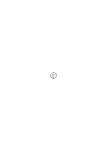 is _seen_ or felt behind what is seen. Think of  & …

### [2\[2\]](https://cdn.wittgensteinnachlass.com/2000px/webp/Ms-150/2.webp)

When we read an English sentence in ordinary script, we can have a familiar sensation or experience in doing so. What does this mean: “We have a quite definite experience here”?!! in what respect _definite_? Read a series of ordinary, say English, sentences in ordinary script. You will then feel the experience of reading, namely a continuous, quasi-uniform experience.

### [2\[3\]](https://cdn.wittgensteinnachlass.com/2000px/webp/Ms-150/2.webp)

What does the expression of a face, of a word, consist in?

### [2\[4\]](https://cdn.wittgensteinnachlass.com/2000px/webp/Ms-150/2.webp),[3\[1\]](https://cdn.wittgensteinnachlass.com/2000px/webp/Ms-150/3.webp)

A ‘definite’ impression, as opposed to what?

‘The face has a definite expression; – as opposed to what? One can focus one’s attention on the _expression_ of the face. What does this mean? What does one do then? It is similar to seeing it plastically.

### [3\[2\]](https://cdn.wittgensteinnachlass.com/2000px/webp/Ms-150/3.webp)

Is the expression added to the purely visual? – Now, do you _know_ that it is added? – So the case differs from that in which I see something & at the same time feel pain in my stomach.

### [3\[3\]](https://cdn.wittgensteinnachlass.com/2000px/webp/Ms-150/3.webp)

“When you make this line, it changes the expression of the face completely.” “When you draw this line, the expression of these animals changes completely.”

### [3\[4\]](https://cdn.wittgensteinnachlass.com/2000px/webp/Ms-150/3.webp),[4\[1\]](https://cdn.wittgensteinnachlass.com/2000px/webp/Ms-150/4.webp)

Let us suppose I say: the impression (expression) is determined by our attitude towards the picture. If this changes through a new line, we say that the expression changes. But what is essential in this explanation can be seen from the fact that we can make different assumptions. We can, for example, assume that our face always imitates a drawn face. But it is enough if we assume that a new line changes the way & manner, say the path, in which our eye repeatedly glides over the drawing.

### [4\[2\]](https://cdn.wittgensteinnachlass.com/2000px/webp/Ms-150/4.webp)

“A point in this place changes the expression, but a point here does not change it.”

### [4\[3\]](https://cdn.wittgensteinnachlass.com/2000px/webp/Ms-150/4.webp)

“Earlier the expression was friendly, now it is sad.” Does this mean: ‘I know that a sad person looks like this & a friendly one like that’?

### [4\[4\]](https://cdn.wittgensteinnachlass.com/2000px/webp/Ms-150/4.webp)

One could say: this line changes our experience when looking at the picture in a different way from a ‘meaningless’ line & this change is _similar_ to the one that occurs when the line changes the _spatial_ appearance of the drawing.

### [4\[5\]](https://cdn.wittgensteinnachlass.com/2000px/webp/Ms-150/4.webp)

It is the word ‘definite’ that we must understand.

### [4\[6\]](https://cdn.wittgensteinnachlass.com/2000px/webp/Ms-150/4.webp),[5\[1\]](https://cdn.wittgensteinnachlass.com/2000px/webp/Ms-150/5.webp)

I read, say, a series of ordinary sentences & observe myself doing so. I notice that I am doing “something quite definite”, i.e. always approximately the same thing. It is as if I said: When I write I always do approximately the same thing. That is, I always move my hand in approximately the same way.

### [5\[2\]](https://cdn.wittgensteinnachlass.com/2000px/webp/Ms-150/5.webp)

Compare the family of what is called ‘writing’ with the family ‘reading’.

### [5\[3\]](https://cdn.wittgensteinnachlass.com/2000px/webp/Ms-150/5.webp)

We feel the constancy of the experience.

### [5\[4\]](https://cdn.wittgensteinnachlass.com/2000px/webp/Ms-150/5.webp)

Change of punctuation compared with a change in the drawing which changes the facial expression. (“The pupil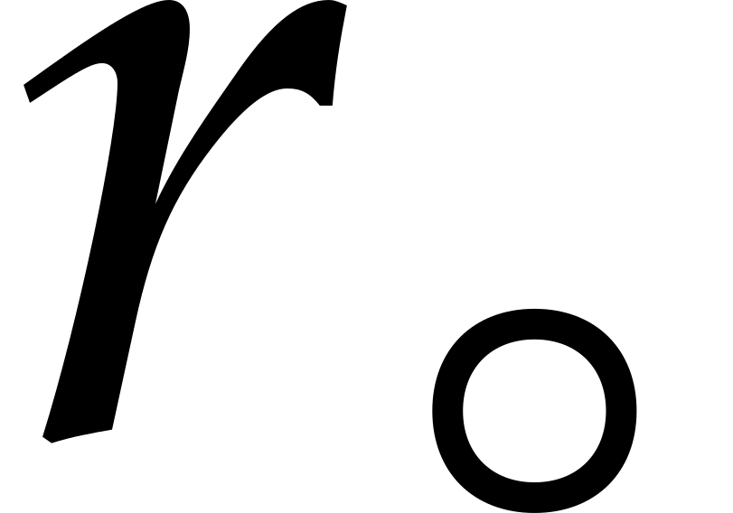 says the teacher↙ is a donkey.”) It is not _knowledge_ that makes the change appear significant to us.

### [5\[5\]](https://cdn.wittgensteinnachlass.com/2000px/webp/Ms-150/5.webp)

Opposition of expressions. – Opposition: expression – no expression.

### [5\[6\]](https://cdn.wittgensteinnachlass.com/2000px/webp/Ms-150/5.webp),[6\[1\]](https://cdn.wittgensteinnachlass.com/2000px/webp/Ms-150/6.webp)

One thing is this: the peculiarity of the impression tempts us to ask: what is essential to reading? The other is this: I must make the role of the typical example clearer. Namely: the role played by the explanation: _That_ is in any case a typical example – of a government, of cultural decline, of refinement of taste. At first one thinks one is speaking of a _common feature_ & that the ideal is to specify and represent this. But then what is fixed is no longer a common feature but an example. (So to speak, a centre of variations.)

### [6\[2\]](https://cdn.wittgensteinnachlass.com/2000px/webp/Ms-150/6.webp)

The written words of a language familiar to me are familiar faces to me. And reading them is a familiar experience to me. If I were asked what I do that is special when I read the words, I would have to say: I see them & pronounce them. And the main thing about the experience lies in the familiarity of the words. But this familiarity is a particular one in the particular case; it is not, for example, the experience of the familiarity of a face & here too there are different cases. Reading familiar script is a particular experience, different, for example, from spelling something out or reading off a graphic representation etc.

### [7\[1\]](https://cdn.wittgensteinnachlass.com/2000px/webp/Ms-150/7.webp)

“I don’t know, the word suddenly seems so strange to me.” –

### [7\[2\]](https://cdn.wittgensteinnachlass.com/2000px/webp/Ms-150/7.webp)

Quite apart from reading, it is a different kind of experience when one’s gaze glides over familiar word-images than when it glides over unfamiliar ones.

### [7\[3\]](https://cdn.wittgensteinnachlass.com/2000px/webp/Ms-150/7.webp)

What does this mean: “reading a language familiar to us is a quite particular experience”? That is, in passing through the lines while reading, we have a _uniform_ experience, and it differs from passing through any other series of forms. It would also be incorrect to say that reading consists in passing through series of signs & having sounds occur to us in the process. For if I pass through the series

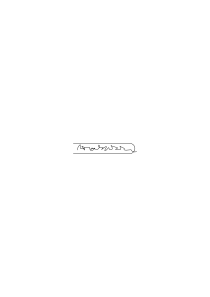

& have sounds occur to me in doing so – which is very easy – that is nevertheless not reading. It is different whether I read & pronounce ‘a’ or whether the same sound occurs to me at ‘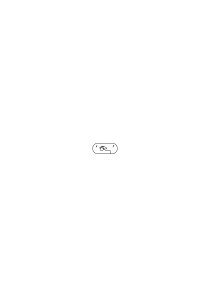’. And this kind of experience is characteristic of every fluent reading of everything we ordinarily call ‘writing’; but not of ‘reading’ in general.

### [8\[1\]](https://cdn.wittgensteinnachlass.com/2000px/webp/Ms-150/8.webp)

Compare ‘reading’ & ‘picture’. In this case too, a narrowly delimited field which we initially think of, but then an urge which draws us ever farther afield.

### [8\[2\]](https://cdn.wittgensteinnachlass.com/2000px/webp/Ms-150/8.webp)

Circles.

### [8\[3\]](https://cdn.wittgensteinnachlass.com/2000px/webp/Ms-150/8.webp)

Rule, member of a system.

### [8\[4\]](https://cdn.wittgensteinnachlass.com/2000px/webp/Ms-150/8.webp)

To understand a rule _sometimes_ means understanding the system. But what does _that_ mean?

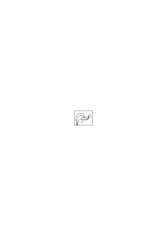

In what case do we say that someone understands the system of these commands? He reacts to members of the system in a definite way; he can _explain_ the system. How does he do that?

### [8\[5\]](https://cdn.wittgensteinnachlass.com/2000px/webp/Ms-150/8.webp)

“It is an _attitude_ of surrendering oneself to the command, whatever it may be.” Example of allowing oneself to be guided. Allowing one’s hand to be guided. Machine.

### [8\[6\]](https://cdn.wittgensteinnachlass.com/2000px/webp/Ms-150/8.webp),[9\[1\]](https://cdn.wittgensteinnachlass.com/2000px/webp/Ms-150/9.webp)

Consider a general sentence such as “the rule guides us when it is a member of a system”! What are the _examples_ of this? How do they merge into the surroundings?

### [9\[2\]](https://cdn.wittgensteinnachlass.com/2000px/webp/Ms-150/9.webp),[10\[1\]](https://cdn.wittgensteinnachlass.com/2000px/webp/Ms-150/10.webp)

When we read ordinary writing, one and the same thing always happens & one might say: just observe what happens & you will see what reading consists in. You have, so to speak, enough time to observe it. Now what do I see there? (There is something interesting here: that one is unable to look at a written or printed word _without_ reading it.) I move my gaze along the line & that already does not happen in the same way as when I move it along any arbitrary series of pictures (I am not speaking here of what can be established experimentally by observing eye movements). The gaze glides, one might say, particularly smoothly & yet not fleetingly (the familiarity of the word-shapes, – different again when one reads from right to left). At the same time a quite involuntary ‘speaking in the imagination’ takes place. And this is how it is when I read German, English, French, & printed, written in Roman or Gothic script. But which of all this is essential to reading as such? Not a feature that occurred in every case of reading.

### [10\[2\]](https://cdn.wittgensteinnachlass.com/2000px/webp/Ms-150/10.webp)

Understanding Meaning Thinking Expecting Wishing Fearing Believing Conviction

### [11\[1\]](https://cdn.wittgensteinnachlass.com/2000px/webp/Ms-150/11.webp)

A: “Why do you call these two colours ‘red’?” – B: “Because there is a certain similarity between them.”

### [11\[2\]](https://cdn.wittgensteinnachlass.com/2000px/webp/Ms-150/11.webp)

What does it mean to say “these two colours are similar”; – how does one use this expression?

### [11\[3\]](https://cdn.wittgensteinnachlass.com/2000px/webp/Ms-150/11.webp)

“The two colours have an element in common & I call that ‘red’.”

### [11\[4\]](https://cdn.wittgensteinnachlass.com/2000px/webp/Ms-150/11.webp)

A: “These two colours are surely very similar.” B: “I find them very different.”

### [11\[5\]](https://cdn.wittgensteinnachlass.com/2000px/webp/Ms-150/11.webp)

A: “Ah, that’s why!”

### [11\[6\]](https://cdn.wittgensteinnachlass.com/2000px/webp/Ms-150/11.webp)

Why do we call searching in memory ‘searching’?

### [11\[7\]](https://cdn.wittgensteinnachlass.com/2000px/webp/Ms-150/11.webp)

Why do we call a mood “dull”? As when one says, “because the weather & the mood make the same impression on us”? Does the sameness of the impression not consist partly precisely in our being inclined to use the same word in both cases & in similar combinations? Also in our saying the word in the same tone.

### [12\[1\]](https://cdn.wittgensteinnachlass.com/2000px/webp/Ms-150/12.webp)

“Ah, it’s _you_!”

### [12\[2\]](https://cdn.wittgensteinnachlass.com/2000px/webp/Ms-150/12.webp)

(The problematic nature of philosophy is the problematic nature of jokes.)

### [12\[3\]](https://cdn.wittgensteinnachlass.com/2000px/webp/Ms-150/12.webp)

What is it like when a comparison forces itself upon us? For example that of ‘searching’ in memory.

### [12\[4\]](https://cdn.wittgensteinnachlass.com/2000px/webp/Ms-150/12.webp)

The word ‘as it were’. “He looks as it were dull.” “I always want to say ‘dull’.”

### [12\[5\]](https://cdn.wittgensteinnachlass.com/2000px/webp/Ms-150/12.webp)

A mental tension. We would probably say that it was somewhat similar to a physical tension. “Now I know why I always wanted to call that ‘a tension’.” (I may, for example, have discovered that certain muscles are tense in the process. – But I did not know that when I was inclined to call it tension.)

### [13\[1\]](https://cdn.wittgensteinnachlass.com/2000px/webp/Ms-150/13.webp)

### [13\[2\]](https://cdn.wittgensteinnachlass.com/2000px/webp/Ms-150/13.webp)

“If in both cases we speak of ‘dull’, then we use the word with different meanings.” – What is the criterion for use with different meanings?

### [13\[3\]](https://cdn.wittgensteinnachlass.com/2000px/webp/Ms-150/13.webp)

How would I separate one meaning from the other?

### [13\[4\]](https://cdn.wittgensteinnachlass.com/2000px/webp/Ms-150/13.webp)

Or also: How do you know that? or does use with different meanings consist precisely in that? What do you mean?

### [13\[5\]](https://cdn.wittgensteinnachlass.com/2000px/webp/Ms-150/13.webp),[14\[1\]](https://cdn.wittgensteinnachlass.com/2000px/webp/Ms-150/14.webp)

I would now list differences between the two games as an explanation. In one, for example, one puts something black next to the other to see whether the two are the same; in the other game this is not the case. So my sentence means: If you use the word ‘black’ in both combinations, I can draw your attention to other differences in the two games.

### [14\[2\]](https://cdn.wittgensteinnachlass.com/2000px/webp/Ms-150/14.webp)

_That_, however, would have no answer if someone now said, “but I call what you call two games _one_ game”.

### [14\[3\]](https://cdn.wittgensteinnachlass.com/2000px/webp/Ms-150/14.webp),[15\[1\]](https://cdn.wittgensteinnachlass.com/2000px/webp/Ms-150/15.webp)

“But why do you speak both of physical & mental ‘strain’?” – “Because they have a certain similarity, they have a common element.” What is this common element? Can you point to it as you pointed in …? Can you say anything more about it than that it is the element of strain? “It is a certain tension.” That doesn't get us any further, for why do you talk of tension in these different cases. “A certain feeling of tension is part of both experiences”. Are you not just translating what you said before, into other language or are you referring to an experience like that of feeling your heart beat, as you could say that this feeling is a constituent both of certain sensations of fear & of joy.

### [15\[2\]](https://cdn.wittgensteinnachlass.com/2000px/webp/Ms-150/15.webp)

“But why should we call both experiences a strain if there was no similarity between them?” But can't the similarity just consist in this that you are inclined to use in both cases the same metaphor, the same expression.

### [15\[3\]](https://cdn.wittgensteinnachlass.com/2000px/webp/Ms-150/15.webp)

And we are not only inclined to use the phrase a deep sorrow & a deep well but very often to accompany both by the same gestures & to say them in the same tone of voice.

### [15\[4\]](https://cdn.wittgensteinnachlass.com/2000px/webp/Ms-150/15.webp)

“There is something in common between the two experiences only I don't know what”. Well this too characterizes your experience & I should say when you'll say that you know what is in common between them your experience will be different.

### [15\[5\]](https://cdn.wittgensteinnachlass.com/2000px/webp/Ms-150/15.webp),[16\[1\]](https://cdn.wittgensteinnachlass.com/2000px/webp/Ms-150/16.webp)

To say that you use the same word ‘strain’ in all the different cases because of a similarity is all right if you wish to distinguish this case from the case of the word ‘bank’. The river bank & the money bank are _not_ so called because of any similarity.

### [16\[2\]](https://cdn.wittgensteinnachlass.com/2000px/webp/Ms-150/16.webp)

“But isn't there a particular experience of similarity which you have when you compare physical & mental strain; just the experience you don't have when you compare a river bank & a money bank?”

### [16\[3\]](https://cdn.wittgensteinnachlass.com/2000px/webp/Ms-150/16.webp)

But do you also experience a similarity between this similarity and other similarities? For what makes you call this a similarity (if you think there always must be something to _make_ you call a thing what you call it).

### [16\[4\]](https://cdn.wittgensteinnachlass.com/2000px/webp/Ms-150/16.webp)

Consider uses of the word ‘similar’: We say these two pieces of paper have similar colour if it is difficult for us to distinguish them to say which of them is darker. Now compare the experience of difficulty to say which is darker with the experience of similarity when it is impossible not to distinguish them but when I say I like my trousers & jacket to have similar colours so as not to have too strong a contrast.

### [17\[1\]](https://cdn.wittgensteinnachlass.com/2000px/webp/Ms-150/17.webp)

“The feeling of familiarity is a feeling of at-homeness.”

### [17\[2\]](https://cdn.wittgensteinnachlass.com/2000px/webp/Ms-150/17.webp)

Aren't my chairs etc. familiar to me & do I always have a feeling of athomeness when I see them?

### [17\[3\]](https://cdn.wittgensteinnachlass.com/2000px/webp/Ms-150/17.webp)

“But what else does it mean ‘that you are familiar with them’?” I am not surprised to see them; I should on being asked, say that I see them every day, that I have sat in them hundreds of times. I could describe on what occasions they were used & tell you a lot about them. All the experiences which go along with saying these things & the experience of doing so we can call experiences of familiarity.

### [17\[4\]](https://cdn.wittgensteinnachlass.com/2000px/webp/Ms-150/17.webp)

“Why do we call all these different experiences experiences of strain?” – “Because there is a common element in them all.”

### [17\[5\]](https://cdn.wittgensteinnachlass.com/2000px/webp/Ms-150/17.webp)

I can imagine a case in which this kind of answer is certainly correct: Say I call all kinds of states of excitement in which I feel the blood rush up into my head congestional experiences.

### [18\[1\]](https://cdn.wittgensteinnachlass.com/2000px/webp/Ms-150/18.webp)

Now should we say that all the experiences of strain have a common element?

### [18\[2\]](https://cdn.wittgensteinnachlass.com/2000px/webp/Ms-150/18.webp)

‘Perhaps we had better say that they are all in some respect similar.’

### [18\[3\]](https://cdn.wittgensteinnachlass.com/2000px/webp/Ms-150/18.webp)

Do you mean there _must_ be a common element, or there actually _is_ one. If the latter, what makes you say ‘there is a common element’?

### [18\[4\]](https://cdn.wittgensteinnachlass.com/2000px/webp/Ms-150/18.webp)

There seems to be a difference between this case & that when we say “well, we call this colour ‘red’ because it _is_ red.” I.e. we seem to use the word ‘strain’ here in a derivative sense, as opposed to a direct sense.

### [18\[5\]](https://cdn.wittgensteinnachlass.com/2000px/webp/Ms-150/18.webp)

What does it consist in to use a word in a derivative sense? “In this that its derivative sense is not the same but only similar to the direct one.” –

### [18\[6\]](https://cdn.wittgensteinnachlass.com/2000px/webp/Ms-150/18.webp),[19\[1\]](https://cdn.wittgensteinnachlass.com/2000px/webp/Ms-150/19.webp)

There is something very queer in the proposition ‘when we look at a well known word we have a particular sensation’. “When we pronounce the words ‘and’, ‘if’ etc. we have peculiar sensations”.

“When we understand an ordinary word like ‘tree’, ‘table’, we have a peculiar sensation.” “As opposed to what”.

The word ‘and’ = + gives me a different sensation from the word “and” = “and”.

### [19\[2\]](https://cdn.wittgensteinnachlass.com/2000px/webp/Ms-150/19.webp)

I can, as it were, direct my attention to the sensation. “The face 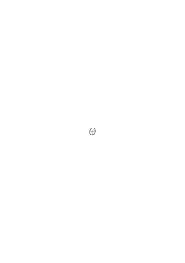 has a _peculiar_ expression”. The question is: is what you call the peculiar expression bound up with this face or could a different face have the same expression?

### [19\[3\]](https://cdn.wittgensteinnachlass.com/2000px/webp/Ms-150/19.webp)

“This face gives me a peculiar impression, the same impression which the other one gave me.” “This face & the other make me smile.”

### [19\[4\]](https://cdn.wittgensteinnachlass.com/2000px/webp/Ms-150/19.webp)

“These faces make a particular impression on me which I can't describe.” What does it mean ‘I _can't_ describe’? Is there anything to describe? What is this impossibility of describing like? For there are many different cases. And in one ‘I can't describe’ is really a grammatical remark.

### [19\[5\]](https://cdn.wittgensteinnachlass.com/2000px/webp/Ms-150/19.webp),[20\[1\]](https://cdn.wittgensteinnachlass.com/2000px/webp/Ms-150/20.webp)

“I had a definite sensation a moment ago & I have it now”.

### [20\[2\]](https://cdn.wittgensteinnachlass.com/2000px/webp/Ms-150/20.webp)

“I'm seeing this as a ship now, whereas I always saw it just as a decoration before.” – “But what's it like to see it ‘_as a ship_’”. “I can't describe”. “But what made you say you saw it ‘as a ship’, what made you use this expression?” – “I saw as it were how the sails were inflated by the wind.” – “But did they look as though they bulged more?” – “No, I just had a feeling & these words suggested themselves for it.”

### [20\[3\]](https://cdn.wittgensteinnachlass.com/2000px/webp/Ms-150/20.webp)

When you say, you have a definite feeling which you can't describe, is this a peculiar experience, don't you always have a definite feeling? Isn't all you want to say something like: “I feel very interested now.”

### [20\[4\]](https://cdn.wittgensteinnachlass.com/2000px/webp/Ms-150/20.webp)

We must do something similar with these expressions as with such expressions as “war is war!”

### [20\[5\]](https://cdn.wittgensteinnachlass.com/2000px/webp/Ms-150/20.webp),[21\[1\]](https://cdn.wittgensteinnachlass.com/2000px/webp/Ms-150/21.webp)

The form of the expression “I have a particular feeling which I can't describe” is misleading. It would be just like saying “everything has a particular character”.

### [21\[2\]](https://cdn.wittgensteinnachlass.com/2000px/webp/Ms-150/21.webp)

“A chair has a particular character about it.”

### [21\[3\]](https://cdn.wittgensteinnachlass.com/2000px/webp/Ms-150/21.webp)

But is there not a difference between things which have a certain warmth about them & those which are unfamiliar to us?

### [21\[4\]](https://cdn.wittgensteinnachlass.com/2000px/webp/Ms-150/21.webp)

One can surely speak of things which strike us, say, as _homely_.

### [21\[5\]](https://cdn.wittgensteinnachlass.com/2000px/webp/Ms-150/21.webp)

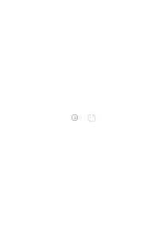

I can also see a particular drawn face once as the face of so-and-so & once differently.

### [21\[6\]](https://cdn.wittgensteinnachlass.com/2000px/webp/Ms-150/21.webp)

“Each of the written letters has its own character.” But this is not meant in contrast to the printed ones or to those of another script.

### [21\[7\]](https://cdn.wittgensteinnachlass.com/2000px/webp/Ms-150/21.webp)

Cf. “Each of these flats has a particular smell.”

### [21\[8\]](https://cdn.wittgensteinnachlass.com/2000px/webp/Ms-150/21.webp)

Could one therefore distinguish between signs without character & signs with character?

### [22\[1\]](https://cdn.wittgensteinnachlass.com/2000px/webp/Ms-150/22.webp)

But can I therefore say that each of the letters gives me a particular _feeling_? It might be so: one might make me feel warm, another cool, – but must it be so? The experience of ‘the particular character’ may consist merely in saying, with a particular intonation, “he has a particular character”.

### [22\[2\]](https://cdn.wittgensteinnachlass.com/2000px/webp/Ms-150/22.webp)

The word as ‘_expression_ of the feeling’

### [22\[3\]](https://cdn.wittgensteinnachlass.com/2000px/webp/Ms-150/22.webp)

“He puts all the feeling into this word.”

### [22\[4\]](https://cdn.wittgensteinnachlass.com/2000px/webp/Ms-150/22.webp),[23\[1\]](https://cdn.wittgensteinnachlass.com/2000px/webp/Ms-150/23.webp)

When one copies an object, one is inclined to say: “it has (or the curvature has) a quite definite character”. And one recalls, for example, the feeling, the experience, of this character again and again. The experience may consist, for example, in a word bringing an object before our mind, in our making a particular gesture, a particular face. But also merely in the words occurring to us: “this curve has, namely, a quite definite character”. And that is really only an _emphasis_ of the curve itself. That is, it has the multiplicity of an emphasis of what, for example, is experienced when seeing the object.

### [23\[2\]](https://cdn.wittgensteinnachlass.com/2000px/webp/Ms-150/23.webp)

When one finds the expression for the feeling one also finds a new feeling. It is not like looking up what ‘sadness’ means in Russian.

### [23\[4\]](https://cdn.wittgensteinnachlass.com/2000px/webp/Ms-150/23.webp)

“A region rich in memories.” Forms are sometimes rich in associations. But can one call the richness of associations introduced?

### [23\[5\]](https://cdn.wittgensteinnachlass.com/2000px/webp/Ms-150/23.webp),[24\[1\]](https://cdn.wittgensteinnachlass.com/2000px/webp/Ms-150/24.webp)

“He sang the song expressively.” – Can one ask “with what expression?”? If one asked: “What did his singing expressively consist in”, something of the following kind would be the answer: “he sang this passage … in such-and-such a way & not, for example, in this way …”. But this statement actually has quite a different multiplicity from the first, for it could not be applied to another song which was sung expressively. The explanation might be: “it is expressive when it is sung as I wish it sung.”

### [24\[2\]](https://cdn.wittgensteinnachlass.com/2000px/webp/Ms-150/24.webp)

“When one looks at this face, one feels warm.” If one were to ask: “Do you really feel warm”, he would say “no, only figuratively speaking”.

### [24\[3\]](https://cdn.wittgensteinnachlass.com/2000px/webp/Ms-150/24.webp)

“A warm colour”

### [24\[4\]](https://cdn.wittgensteinnachlass.com/2000px/webp/Ms-150/24.webp)

“Is soft water only figuratively speaking ‘soft’ or in the proper sense of the word?”

### [24\[5\]](https://cdn.wittgensteinnachlass.com/2000px/webp/Ms-150/24.webp)

Let us imagine someone were to speak of a ‘red blue’ instead of a ‘reddish blue’ & say that the word “red” was being used in a transferred meaning.

### [24\[6\]](https://cdn.wittgensteinnachlass.com/2000px/webp/Ms-150/24.webp),[25\[1\]](https://cdn.wittgensteinnachlass.com/2000px/webp/Ms-150/25.webp)

But now one thinks one can say: It simply depends on what you mean by the word; if you mean what mental effort & physical effort have in common, then you use the word in both cases in its proper meaning; if not, then it has different meanings in the two cases & one can speak of a direct and a transferred meaning.

### [25\[2\]](https://cdn.wittgensteinnachlass.com/2000px/webp/Ms-150/25.webp)

But what does it mean to mean what the two have in common? (I cannot point to it.) Does ‘meaning what they have in common’ in this case not simply mean ‘meaning both’?

### [25\[3\]](https://cdn.wittgensteinnachlass.com/2000px/webp/Ms-150/25.webp)

Imagine one said: “Boiling water & human blood are called warm because ‘warm’ means what both degrees of heat have in common”.

### [25\[4\]](https://cdn.wittgensteinnachlass.com/2000px/webp/Ms-150/25.webp)

a) If one asks what these pictures have in common, one points to a patch with a colour which occurs in both. b) If one asks what the two colours have in common (e.g. a reddish blue & a reddish yellow), one points to a patch with yellow colour. Here one sees how differently one can use the expression “have this and that in common”. And neither way is more direct or more correct!

### [25\[5\]](https://cdn.wittgensteinnachlass.com/2000px/webp/Ms-150/25.webp),[26\[1\]](https://cdn.wittgensteinnachlass.com/2000px/webp/Ms-150/26.webp)

One could now, for example, say that by ‘yellowish’ I mean what the two colours have in common & I _do_ it by imagining something yellow while doing so.

### [26\[2\]](https://cdn.wittgensteinnachlass.com/2000px/webp/Ms-150/26.webp)

“One means what the two have in common when one thinks of what they have in common” but how does one do that? How does one, for example, think of what the letters R & B have in common? Thinking of it sometimes means pointing to it, imagining it, etc.

### [26\[3\]](https://cdn.wittgensteinnachlass.com/2000px/webp/Ms-150/26.webp)

“Think of what all plants have in common!”.

### [26\[4\]](https://cdn.wittgensteinnachlass.com/2000px/webp/Ms-150/26.webp)

“I call both an ‘effort’ because by that I mean what they have in common.”

### [26\[5\]](https://cdn.wittgensteinnachlass.com/2000px/webp/Ms-150/26.webp)

The task of arranging the vowels according to their darkness is in many respects entirely analogous to a so-called mathematical problem.

### [26\[6\]](https://cdn.wittgensteinnachlass.com/2000px/webp/Ms-150/26.webp),[27\[1\]](https://cdn.wittgensteinnachlass.com/2000px/webp/Ms-150/27.webp)

“Why do you call that ‘red’?” – “I thought you called ‘red’ everything that has this colour in common.” One can object: “I thought you called everything that bears such a blossom a papilionaceous plant.” Also: “I thought you called ‘reddish’ everything that has this tone in common.”

### [27\[2\]](https://cdn.wittgensteinnachlass.com/2000px/webp/Ms-150/27.webp)

I do not mean that one cannot use the expression “these two colours have this → (pointing to a colour) in common”. One could, for example, if asked what two shades of red have in common, point to pure red. But what this means must first be established in a language-game. One could not, for example, now ask: “Is it true that they have this red in common?”

### [27\[3\]](https://cdn.wittgensteinnachlass.com/2000px/webp/Ms-150/27.webp)

“Why do you call that ‘pain’?” – “Well, that is what ‘pain’ means.”

“Why do you speak of mental pain?” – “Because it is _like_ pain.”

### [27\[4\]](https://cdn.wittgensteinnachlass.com/2000px/webp/Ms-150/27.webp)

Language-game: ‘light’ & ‘dark’ are explained and used with colours. – Then I say: “Arrange the vowels according to their brightness”. Here we would speak of a transferred meaning.

### [28\[1\]](https://cdn.wittgensteinnachlass.com/2000px/webp/Ms-150/28.webp)

Philosophizing consists in examples occurring to one in the right order.

### [28\[2\]](https://cdn.wittgensteinnachlass.com/2000px/webp/Ms-150/28.webp)

Let us imagine someone were to say: “The words ‘high’, ‘low’ are applied to tones in their original meaning; that is also the case with ‘high’ & ‘low’.”

### [28\[3\]](https://cdn.wittgensteinnachlass.com/2000px/webp/Ms-150/28.webp)

Someone learns to use the colour words ‘red’, ‘green’ etc. for pure colours. Then one points to a heap of reddish & greenish blue pieces and says: “separate the red ones from the green ones.” Was the word being used in its original meaning or in another meaning? One could say here: If you had instructed me to paint a red patch, I would not have painted this colour.

### [28\[4\]](https://cdn.wittgensteinnachlass.com/2000px/webp/Ms-150/28.webp)

In one case _we feel_ that we are using a _metaphor_, in the other case we use the word directly.

### [28\[5\]](https://cdn.wittgensteinnachlass.com/2000px/webp/Ms-150/28.webp),[29\[1\]](https://cdn.wittgensteinnachlass.com/2000px/webp/Ms-150/29.webp)

What does the difference between these _experiences_ consist in? We regard the one use as something completed. Are there two clearly separate experiences here? The experience of calling what is black ‘black’; & that of calling what is _as it were_ black ‘black’? –

### [29\[2\]](https://cdn.wittgensteinnachlass.com/2000px/webp/Ms-150/29.webp)

I could imagine that someone accustomed to speaking only of ‘physical effort’ said: “thinking is as it were an effort.”.

### [29\[3\]](https://cdn.wittgensteinnachlass.com/2000px/webp/Ms-150/29.webp)

But could we not also imagine this case: someone knew the colour red only from complexion; he now wanted to describe the colour of an apple & said that the apple was ‘as it were red’. Someone who says this thinks, say, of faces.

### [29\[4\]](https://cdn.wittgensteinnachlass.com/2000px/webp/Ms-150/29.webp)

“The sky is as it were blue.”

### [29\[5\]](https://cdn.wittgensteinnachlass.com/2000px/webp/Ms-150/29.webp)

“The face makes a darker impression although the complexion is in reality lighter.”

### [29\[6\]](https://cdn.wittgensteinnachlass.com/2000px/webp/Ms-150/29.webp)

Think of people who, when they are supposed to sing back a struck note, sing its fifth. Is the fifth now the same note or not?

### [30\[1\]](https://cdn.wittgensteinnachlass.com/2000px/webp/Ms-150/30.webp)

I could imagine a person who had been taught to copy coloured objects by painting & who always copied the sky _white_. That is, I could somehow easily imagine doing it myself. (By applying, so to speak, a different method of projection.)

### [30\[2\]](https://cdn.wittgensteinnachlass.com/2000px/webp/Ms-150/30.webp)

“He has, as it were, a darker voice.” – “Why don’t you simply say ‘he has a darker voice’? It is darker, after all.” – “But ‘darker’ properly means the relation between these two colours. For example, this (pointing) is darker than that.” – “Yes, but his voice is _also_ darker than the other person’s.”

### [30\[3\]](https://cdn.wittgensteinnachlass.com/2000px/webp/Ms-150/30.webp)

One can imagine that one face looks darker than the other although its complexion is not darker.

### [30\[4\]](https://cdn.wittgensteinnachlass.com/2000px/webp/Ms-150/30.webp)

But could one avoid speaking of _two_ kinds of use in this case?

### [31\[1\]](https://cdn.wittgensteinnachlass.com/2000px/webp/Ms-150/31.webp)

“Why do you call this ‘blue’?” – There is no ‘why’ to it if you're referring to a _reason_. –

### [31\[2\]](https://cdn.wittgensteinnachlass.com/2000px/webp/Ms-150/31.webp)

But there is also this case: “I call this blue because in daylight it looks blue.” But also: “I call this blue because it is almost blue”.

### [31\[3\]](https://cdn.wittgensteinnachlass.com/2000px/webp/Ms-150/31.webp)

“What do these two colours have in common?” – What sort of answer do you want? For imagine these different games: – – –

### [31\[4\]](https://cdn.wittgensteinnachlass.com/2000px/webp/Ms-150/31.webp)

The capacity of solving philosophical problems is the capacity of remembering the right examples (in the right order).

### [31\[5\]](https://cdn.wittgensteinnachlass.com/2000px/webp/Ms-150/31.webp)

“Why do you call this a ‘strain’ too?” Because it has something in common with bodily strain. – “What?” – I don't know but there is obviously a similarity.

### [31\[6\]](https://cdn.wittgensteinnachlass.com/2000px/webp/Ms-150/31.webp),[32\[1\]](https://cdn.wittgensteinnachlass.com/2000px/webp/Ms-150/32.webp)

Then when you said the two experiences had something in common this expression just compared this case with that when one primarily speaks of common elements between two things. (Nr. …)

### [32\[2\]](https://cdn.wittgensteinnachlass.com/2000px/webp/Ms-150/32.webp)

(If philosophy deals with its own method how can it come to an end at all, how is it bounded? Its domain is that of our philosophical troubles. It only devises remedies for mental troubles & where such troubles actually don't arise (as a matter of psychology) it has nothing to say.)

### [32\[3\]](https://cdn.wittgensteinnachlass.com/2000px/webp/Ms-150/32.webp)

It was then no explanation just to say that the similarity consisted in the occurrence of a common element.

### [32\[4\]](https://cdn.wittgensteinnachlass.com/2000px/webp/Ms-150/32.webp)

Now shall we say that you have a feeling of similarity if you compare, say, physical & mental strain?

### [32\[5\]](https://cdn.wittgensteinnachlass.com/2000px/webp/Ms-150/32.webp)

If you say you have let's hear some more about this feeling. Would you say it was located in this or in that place of your body? And when is it present? Perhaps you say when you compare physical & bodily strain, but comparing is a complicated activity & do you have the same feeling throughout the whole activity?

### [32\[6\]](https://cdn.wittgensteinnachlass.com/2000px/webp/Ms-150/32.webp)

(This face has no real expression, no meaning, it doesn't click.)

### [33\[2\]](https://cdn.wittgensteinnachlass.com/2000px/webp/Ms-150/33.webp)

Perhaps you say: ‘Anyhow, if I have compared & say they are similar I mean what I say & this too is some sort of mental event & perhaps the feeling of similarity is the feeling you have while you say the word ‘similar’ _meaning_ it.’

### [33\[3\]](https://cdn.wittgensteinnachlass.com/2000px/webp/Ms-150/33.webp)

Pronounce the word ‘similar’ in a sentence very slowly meaning it & see if you really have one feeling accompanying it _from beginning to end_. But surely it is a different experience if I say similar & mean it & if on the other hand I say it without meaning it.

### [33\[4\]](https://cdn.wittgensteinnachlass.com/2000px/webp/Ms-150/33.webp)

It is no more true that you have one peculiar feeling corresponding to the meaning of ‘similar’ as it would be to say that you have one peculiar facial expression when you say it. Although on the other hand there will probably be one particular facial expression with which you often say the word but you won't always have it when you say the word (meaning what you say) & the same facial expression will accompany other words & phrases too.

### [34\[1\]](https://cdn.wittgensteinnachlass.com/2000px/webp/Ms-150/34.webp)

It is often useful for us to speak about gestures, facial expressions & the like instead of of the experiences bound up with them.

### [34\[2\]](https://cdn.wittgensteinnachlass.com/2000px/webp/Ms-150/34.webp)

What have these two figures in common

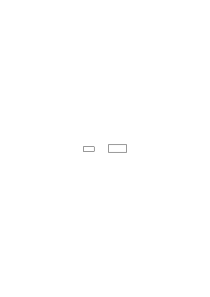?

---

### [34\[3\]](https://cdn.wittgensteinnachlass.com/2000px/webp/Ms-150/34.webp)

Example of someone who, on being commanded to arrange things according to their darkness, also arranges the vowels.

### [34\[4\]](https://cdn.wittgensteinnachlass.com/2000px/webp/Ms-150/34.webp)

Tone of the command: arrange the tones according to their darkness & ordinary tone.

### [34\[5\]](https://cdn.wittgensteinnachlass.com/2000px/webp/Ms-150/34.webp)

One is tempted to say he must have understood something else by ‘dark’. Comparison with another instrument according to whose readings he orders everything. But such an instrument does not exist. It must exist means that we are resolved to use this picture.

### [34\[6\]](https://cdn.wittgensteinnachlass.com/2000px/webp/Ms-150/34.webp),[35\[1\]](https://cdn.wittgensteinnachlass.com/2000px/webp/Ms-150/35.webp)

“But surely it is another sense of dark that we are using here.”

What is that supposed to mean? Are you distinguishing here the sense from the use & saying that when someone uses the word in this way it follows that something else must or will be going on elsewhere, or do you merely want to say that this use is nevertheless different from that one?

### [35\[2\]](https://cdn.wittgensteinnachlass.com/2000px/webp/Ms-150/35.webp)

Are you satisfied now if I enumerate the differences in the two cases? Or must I concede something else as well?

### [35\[3\]](https://cdn.wittgensteinnachlass.com/2000px/webp/Ms-150/35.webp)

What if someone said: “But these are different kinds of use of ‘red’.” I would say that one is light red, the other dark red, but why should I call that different kinds of use of ‘red’?

### [35\[4\]](https://cdn.wittgensteinnachlass.com/2000px/webp/Ms-150/35.webp),[36\[1\]](https://cdn.wittgensteinnachlass.com/2000px/webp/Ms-150/36.webp)

But does the difference in use consist in anything other than the differences that we can enumerate? For certainly in one case I put coloured patches together & compare them by looking now at one, now at the other; I perhaps hold them in a better light; I paint one colour that is lighter than another, & so on & so on. In the case of the vowels no such putting together, painting, etc. took place.

### [36\[2\]](https://cdn.wittgensteinnachlass.com/2000px/webp/Ms-150/36.webp)

But I do see that the relation between a lighter & a darker piece of fabric is different from that between e & u. Just as, on the other hand, I see that the relation between u & e is the same as that between e & i.

### [36\[3\]](https://cdn.wittgensteinnachlass.com/2000px/webp/Ms-150/36.webp)

Whether you call the relations the same or different probably depends on how you compare them. Is → the same direction as ← or are they opposite? Mirror

Corresponding circumstances can induce us to say that the relations are different, others that they are the same.

### [36\[4\]](https://cdn.wittgensteinnachlass.com/2000px/webp/Ms-150/36.webp)

It is here as with the continuation of a series. Intuitionism.

### [36\[5\]](https://cdn.wittgensteinnachlass.com/2000px/webp/Ms-150/36.webp),[37\[1\]](https://cdn.wittgensteinnachlass.com/2000px/webp/Ms-150/37.webp)

“It isn't only that you use the word ‘red’ for this colour but you use it with a _particular_ experience.” “Experience when we use a word in a derivative sense.” Tone of voice in the order “now arrange the _vowels_ in order of their darkness”.

### [37\[3\]](https://cdn.wittgensteinnachlass.com/2000px/webp/Ms-150/37.webp)

The tone of voice may be, all things being equal, the decisive experience?

### [37\[4\]](https://cdn.wittgensteinnachlass.com/2000px/webp/Ms-150/37.webp)

He said & meant it sounds as though two activities here ran parallel.

### [37\[5\]](https://cdn.wittgensteinnachlass.com/2000px/webp/Ms-150/37.webp)

But surely there is a difference between saying something & meaning it, & saying it without meaning it. There needn't be a difference while he says it & if there is a difference then this may be of all sorts of different kinds according to the surrounding circumstances. It does not follow from the fact that there is what we call a friendly & an unfriendly expression of the eye that there must be a difference between the eyes of a friendly & of an unfriendly face.

### [38\[1\]](https://cdn.wittgensteinnachlass.com/2000px/webp/Ms-150/38.webp)

Suppose one said: “this line can't make the face look friendly as it could be belied by other lines.”

### [38\[2\]](https://cdn.wittgensteinnachlass.com/2000px/webp/Ms-150/38.webp)

Under these circumstances we call this activity reading. If he does it we say he is reading & if we order him to read & he does it we are satisfied. Under these circumstances we call this picture of his eye a friendly eye. Under these circumstances this was what saying & meaning it consisted in.

### [38\[3\]](https://cdn.wittgensteinnachlass.com/2000px/webp/Ms-150/38.webp)

In a large group of cases believing something is the same or something very similar to uttering your belief.

### [38\[4\]](https://cdn.wittgensteinnachlass.com/2000px/webp/Ms-150/38.webp)

All the circumstances which make believing intersect in the present moment.

### [38\[5\]](https://cdn.wittgensteinnachlass.com/2000px/webp/Ms-150/38.webp)

Now is he meaning it when he says it or isn't he?

### [39\[1\]](https://cdn.wittgensteinnachlass.com/2000px/webp/Ms-150/39.webp)

“I said it & meant it.” – How did you do it? –

### [39\[2\]](https://cdn.wittgensteinnachlass.com/2000px/webp/Ms-150/39.webp)

Compare meaning “I shall be delighted to see you” with meaning “the train goes at 3˙30”.

### [39\[3\]](https://cdn.wittgensteinnachlass.com/2000px/webp/Ms-150/39.webp)

There are certain expressions characteristic of believing i.e. there is a large group of cases in which they together with other factors constitute what we call believing. But because these first components aren't present in all cases of believing you mustn't conclude that any of the others is.

### [39\[4\]](https://cdn.wittgensteinnachlass.com/2000px/webp/Ms-150/39.webp)

Compare lying about the train with lying about being delighted.

### [39\[5\]](https://cdn.wittgensteinnachlass.com/2000px/webp/Ms-150/39.webp)

It is even possible while lying feeling quite strongly what is usually felt when one means sincerely what one says.

### [39\[6\]](https://cdn.wittgensteinnachlass.com/2000px/webp/Ms-150/39.webp),[40\[1\]](https://cdn.wittgensteinnachlass.com/2000px/webp/Ms-150/40.webp)

And at the same time one refers to just these feelings sometimes when one says I said it and meant it. I.e. one would mention these feelings as characteristic for one's meaning what one said. And if anyone said “But these same feelings could also have been present if you hadn't meant it” one could answer: “not in the kind of case this was”.

### [40\[2\]](https://cdn.wittgensteinnachlass.com/2000px/webp/Ms-150/40.webp)

“He was very friendly, he smiled at me most kindly”. – But he might have done that & felt unfriendly.

### [40\[3\]](https://cdn.wittgensteinnachlass.com/2000px/webp/Ms-150/40.webp)

“This is a friendly face, look at the eyes.” – But these same eyes would not be friendly in another face. “Still in this face they are friendly”.

### [40\[4\]](https://cdn.wittgensteinnachlass.com/2000px/webp/Ms-150/40.webp)

Should we say “under these circumstances I call this reading” or “under these circumstances I regard this as carrying out my order read” etc.?

### [40\[5\]](https://cdn.wittgensteinnachlass.com/2000px/webp/Ms-150/40.webp),[41\[1\]](https://cdn.wittgensteinnachlass.com/2000px/webp/Ms-150/41.webp)

One remembers just that feeling when one says I meant what one said, although etc.. This feeling then stood out, it is a question just whether one had it or not. And those circumstances which could have contradicted this feeling don't come here at all into question. I would perhaps [unreadable] be ready to say in this case that I meant by ‘I meant it’ I had this feeling.

### [41\[2\]](https://cdn.wittgensteinnachlass.com/2000px/webp/Ms-150/41.webp)

And there are cases where I would be ready to give such an explanation of ‘I meant’ & cases like that of ‘the train leaves at 3˙30’ where I might say “well I just said it, why shouldn't I have meant it”.

### [41\[3\]](https://cdn.wittgensteinnachlass.com/2000px/webp/Ms-150/41.webp)

We very often find it impossible to think without speaking to ourselves half aloud; – & nobody asked to describe what happened in this case would _ever_ say that something, the thinking, accompanied the speaking were they not tempted to do so by the existence of the two verbs speaking & thinking & their use in many of our common phrases. If anything can be said to go with the speech it would be something like the modulation of vocal means of expression. But does the Ausdruck accompany the words in the sense in which a melody accompanies them?

### [42\[1\]](https://cdn.wittgensteinnachlass.com/2000px/webp/Ms-150/42.webp)

We merely _count_ one relatedness between the darkness of the colour & of the sound.

### [42\[2\]](https://cdn.wittgensteinnachlass.com/2000px/webp/Ms-150/42.webp)

One thing is important if you say when I say “blue” I have a particular experience, the word comes in a particular way you don't trouble to think of (the) many different experiences while saying the word ‘blue’ & the word ‘three’.

### [42\[4\]](https://cdn.wittgensteinnachlass.com/2000px/webp/Ms-150/42.webp)

The same picture can be an image of different things. The surroundings are different. The use, the atmosphere.

### [42\[5\]](https://cdn.wittgensteinnachlass.com/2000px/webp/Ms-150/42.webp),[43\[1\]](https://cdn.wittgensteinnachlass.com/2000px/webp/Ms-150/43.webp)

But moreover, the difference between observing & acting does not at all necessarily consist in a difference in every moment or phase of the action. Exactly the same may happen during the action but the surroundings will be different. Moving in different circles. Different atmosphere.

### [43\[2\]](https://cdn.wittgensteinnachlass.com/2000px/webp/Ms-150/43.webp)

It thinks

### [43\[3\]](https://cdn.wittgensteinnachlass.com/2000px/webp/Ms-150/43.webp)

Absence of the experience of saying “Oh that's where it's going now”.

### [43\[4\]](https://cdn.wittgensteinnachlass.com/2000px/webp/Ms-150/43.webp)

“Of course we aren't surprised as we do it ourselves!” We take as the criterion of _doing_ it ourselves the absence of surprise.

### [43\[5\]](https://cdn.wittgensteinnachlass.com/2000px/webp/Ms-150/43.webp)

One might think the absence of surprise comes from knowing beforehand what one is going to do.

### [43\[6\]](https://cdn.wittgensteinnachlass.com/2000px/webp/Ms-150/43.webp)

Involuntary speech “Stop!”, “Oh”, “Help!” Like blinking one's eyelids or raising a hand to protect one's face.

### [43\[7\]](https://cdn.wittgensteinnachlass.com/2000px/webp/Ms-150/43.webp)

Speaking as somebody's friend, doctor, speaking as a private person, as a university lecturer. One might think that whenever a man speaks he speaks as someone.

### [44\[1\]](https://cdn.wittgensteinnachlass.com/2000px/webp/Ms-150/44.webp)

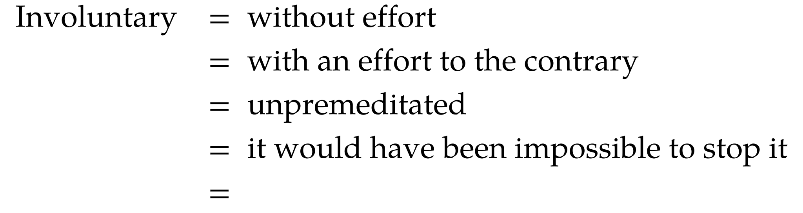

Is moving one's fingers in example № … involuntary should we call it so? Is breathing voluntary?

### [44\[2\]](https://cdn.wittgensteinnachlass.com/2000px/webp/Ms-150/44.webp)

Should we say that when we shout “Help!” there is no act of volition, whereas when we say “Hallo!” to a friend there is?

### [44\[3\]](https://cdn.wittgensteinnachlass.com/2000px/webp/Ms-150/44.webp)

Compare the cases when you raise your hand with an effort or move it without effort in a particular curve (say writing a letter in the air) or after deliberating whether you lift it or not, you ‘find yourself lifting it’.

### [44\[4\]](https://cdn.wittgensteinnachlass.com/2000px/webp/Ms-150/44.webp)

Ordinary speaking is called voluntary not because there is a particular effort present, the act of will.

### [44\[5\]](https://cdn.wittgensteinnachlass.com/2000px/webp/Ms-150/44.webp)

Premeditated acts

### [45\[1\]](https://cdn.wittgensteinnachlass.com/2000px/webp/Ms-150/45.webp)

If against my will I shriek with pain the overcoming of my will is not like the overcoming of a muscular effort.

### [45\[2\]](https://cdn.wittgensteinnachlass.com/2000px/webp/Ms-150/45.webp)

One might say “surely shrieking with pain is a good example of involuntary speaking because here far from there being an act of volition which worked the speaking there even was one against it.” I should say: Certainly I too would call this involuntary speaking. And I agree that an act of volition preparatory to or accompanying the speech is absent if by ‘act of volition’ you refer to certain acts of intention, premeditation or effort. But then in many cases of voluntary speech I don't feel an effort, many were not premeditated & as to intentions sometimes the unintentional action is characterized as such by an experience of surprise in others the intentional is characterized by a spoken or imagined expression of intention.

### [46\[1\]](https://cdn.wittgensteinnachlass.com/2000px/webp/Ms-150/46.webp)

“All that happens is that I get out of bed”. “All that happens when I mean it is in this case that I say it”. That is to say: I don't call it ‘meaning what I say’ because of any peculiar experience which I have while I say it. But what is a peculiar experience? Isn't the absence of an experience an experience? Yes but we don't call the absence of a feeling a feeling or the absence of pain a pain. It is certainly sometimes misleading to say: “Not the presence of something characterizes this case but the absence of something”. But when we are inclined to look out for a sensation it makes sense to point out that in such & such a case we don't find a peculiar sensation but we do in the opposite case.

### [46\[2\]](https://cdn.wittgensteinnachlass.com/2000px/webp/Ms-150/46.webp)

In a great many cases the difference is not one lying in the action or an accompaniment of it, but in the surrounding circumstances the _environment_ of the action.

### [47\[1\]](https://cdn.wittgensteinnachlass.com/2000px/webp/Ms-150/47.webp)

It is as though I said “these two people move in different circles” does not mean that they are never surrounded by exactly the same people, e.g. when they walk in the street.

### [47\[2\]](https://cdn.wittgensteinnachlass.com/2000px/webp/Ms-150/47.webp)

A kind & an unkind expression might look exactly alike, only what goes before & after would be different.

### [47\[3\]](https://cdn.wittgensteinnachlass.com/2000px/webp/Ms-150/47.webp)

Our tendency is to describe something that is a matter of atmosphere round a situation in a too primitive way as a difference in the situation.

### [47\[4\]](https://cdn.wittgensteinnachlass.com/2000px/webp/Ms-150/47.webp)

Thus one says: “something peculiar happens when the name of a colour comes, something different when the numeral comes.” But we have no reason at all to say this. But I agree that the surroundings of these two are different.

### [47\[5\]](https://cdn.wittgensteinnachlass.com/2000px/webp/Ms-150/47.webp),[48\[1\]](https://cdn.wittgensteinnachlass.com/2000px/webp/Ms-150/48.webp)

Why do you say “_something_ does happen when I understand a word!”. Do you remember that the same thing always happens or do you know that one of, say, four things happen?

“Es drückt etwas aus. Es sagt mir etwas.”

### [48\[3\]](https://cdn.wittgensteinnachlass.com/2000px/webp/Ms-150/48.webp)

One face reminds you of someone, one strikes you as Chinese, one makes you think of an illustration you have seen.

### [48\[4\]](https://cdn.wittgensteinnachlass.com/2000px/webp/Ms-150/48.webp)

I'm seeing this as a face as opposed to seeing it as a wineglass in a round hole. And when you change over from the one to the other you change the ‘attention’ & you look at it with a different face.

### [48\[5\]](https://cdn.wittgensteinnachlass.com/2000px/webp/Ms-150/48.webp),[49\[1\]](https://cdn.wittgensteinnachlass.com/2000px/webp/Ms-150/49.webp)

Look at W, alternately as a W and as an M upside down. How queer that you can comply with this order. And what do you do to comply with it? “I see it resting on the upper end”. But what does _that_ mean? Aren't there lots of possibilities? & isn't one of them that you read it M instead of W?

### [49\[2\]](https://cdn.wittgensteinnachlass.com/2000px/webp/Ms-150/49.webp)

Do I get all sorts of impressions from these figures _and_ all along see them as faces?

### [49\[3\]](https://cdn.wittgensteinnachlass.com/2000px/webp/Ms-150/49.webp)

And how about a real face, – does one see that too as a face always? Is it correct to say that if we don't see it as something else we have one particular attitude towards it? And don't (or do) you look in a particular way at everything you look at? Or: couldn't you look at everything in several ways? Look at your tea kettle & see its spout as a nose. –

### [49\[4\]](https://cdn.wittgensteinnachlass.com/2000px/webp/Ms-150/49.webp)

Do you wish to say this soap has a particular smell as opposed to no particular smell; or that it has this smell as opposed to another one or both the first & the second.

### [49\[5\]](https://cdn.wittgensteinnachlass.com/2000px/webp/Ms-150/49.webp),[50\[1\]](https://cdn.wittgensteinnachlass.com/2000px/webp/Ms-150/50.webp)

We are tempted to ask: “What does seeing something as a face consist in?” And we feel tempted to ask: “does it consist in anything obviously superadded to the mere seeing of the strokes, or is there only a ‘seeing it as a face’ as distinguished from seeing it as something else?”

### [50\[2\]](https://cdn.wittgensteinnachlass.com/2000px/webp/Ms-150/50.webp)

Are we aware of seeing a table which we see ‘_as table_’?

### [50\[3\]](https://cdn.wittgensteinnachlass.com/2000px/webp/Ms-150/50.webp)

Suppose I said “I am in a particular bodily position now”; What happens is that I am concentrating my attention on the sensations I have in this situation.

### [50\[4\]](https://cdn.wittgensteinnachlass.com/2000px/webp/Ms-150/50.webp),[51\[1\]](https://cdn.wittgensteinnachlass.com/2000px/webp/Ms-150/51.webp)

I see a skirt & a cap hanging on a clothes hook; they make me—as I am tempted to say—an entirely particular impression at once. But let us compare the impression of a fur coat with that of a raincoat, of a new smooth coat & an old shabby one. A neck makes a different impression from a face & feet make another. But one does not always obtain these impressions when one sees these things. On the other hand, can’t one say: when I saw the coat, I saw it immediately as a _coat_, before I had any particular impression, say of warmth or softness?

### [51\[2\]](https://cdn.wittgensteinnachlass.com/2000px/webp/Ms-150/51.webp)

But are you sure that you did not merely see this particular form of the coat, – & of course not with amazement, not with the question “what is that?” and the like?

### [51\[3\]](https://cdn.wittgensteinnachlass.com/2000px/webp/Ms-150/51.webp)

The answer to the question “how does he enter the room?” might in this case be a picture showing him entering the room.

### [51\[4\]](https://cdn.wittgensteinnachlass.com/2000px/webp/Ms-150/51.webp)

“The word ‘red’” – we are inclined to say – “comes in a particular way, namely in _this_ way.” But “in this way” here only means: it comes in the way it comes.

### [51\[5\]](https://cdn.wittgensteinnachlass.com/2000px/webp/Ms-150/51.webp)

It is as though calling it a particular feeling when one sees red still had sense although the feeling was to be bound up with seeing red.

### [51\[6\]](https://cdn.wittgensteinnachlass.com/2000px/webp/Ms-150/51.webp),[52\[1\]](https://cdn.wittgensteinnachlass.com/2000px/webp/Ms-150/52.webp)

We use the word “particular” here as an emphasis whereas it seems that we use it transitively &, in particular, reflexively.

### [52\[2\]](https://cdn.wittgensteinnachlass.com/2000px/webp/Ms-150/52.webp)

You think you compare it with a paradigm & it agrees or it fits into a mould ready for it in your mind. But in your experience no such mould or comparison enters there is only this shape not any other to compare it with & you, as it were, say “of course” to it (but not because it fits anything, but because of no reason).

### [52\[3\]](https://cdn.wittgensteinnachlass.com/2000px/webp/Ms-150/52.webp)

You lay an emphasis on it but you express this in a form which tempts you to believe that you are _recognizing it_.

### [52\[4\]](https://cdn.wittgensteinnachlass.com/2000px/webp/Ms-150/52.webp)

Instead of saying “it comes with a particular experience” you should have said: “I concentrate my attention on the way it comes or on its coming” (compare ‘I draw the way he comes into the room’).

### [52\[5\]](https://cdn.wittgensteinnachlass.com/2000px/webp/Ms-150/52.webp),[53\[1\]](https://cdn.wittgensteinnachlass.com/2000px/webp/Ms-150/53.webp)

The word in this case comes with a particular experience should in this case mean ‘it always comes with the same experience’, but you aren't ready to confirm that! So why are you tempted here to use the phrase while contemplating the way it comes? Because you are contemplating it. You thereby lay an emphasis on it.

### [53\[2\]](https://cdn.wittgensteinnachlass.com/2000px/webp/Ms-150/53.webp)

If you try to see what it is you are comparing it with you should be inclined to say that you compare it with itself. And this is a most characteristic situation.

### [53\[3\]](https://cdn.wittgensteinnachlass.com/2000px/webp/Ms-150/53.webp)

The way can't in this case be separated from him.

### [53\[4\]](https://cdn.wittgensteinnachlass.com/2000px/webp/Ms-150/53.webp),[54\[1\]](https://cdn.wittgensteinnachlass.com/2000px/webp/Ms-150/54.webp)

Now if I wished to draw him coming in & was contemplating his coming in I should while doing so be inclined to say to myself & repeat: “He has a particular way of coming in”. But the answer to the question “What is this way?” would be “it's _this_ way” (perhaps drawing it). But there may be no such answer & my phrase may only mean: “I contemplate his position”. Our expression on the other hand made it appear as though his position was not characterized by anything but itself.

### [54\[2\]](https://cdn.wittgensteinnachlass.com/2000px/webp/Ms-150/54.webp)

We very often use the reflexive form when we wish to lay an emphasis on something & such expressions can then always be straightened out: Thus we say a man's a man À la guerre comme, à la guerre. If I can't I can't, I am what I am. That's that. Take it or leave it. It either rains or it doesn't rain.

This is no piece of information; if it rains we shall – – –

There must be a greatest number of examples let it be 500.

### [54\[3\]](https://cdn.wittgensteinnachlass.com/2000px/webp/Ms-150/54.webp)

“If the length of the one is L the length of the other is L”. This is a form of various propositions but not itself a proposition But we could say: “Let us put ‘L’ instead of ‘length’: then they have the same L. But it makes sense to say: “Let us consider propositions of the form “if A has the length L so has B”.”

### [55\[1\]](https://cdn.wittgensteinnachlass.com/2000px/webp/Ms-150/55.webp)

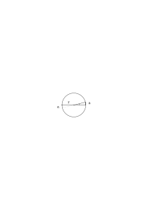

25 × 25 ≷ 625

25 × a ≧ 625

### [55\[2\]](https://cdn.wittgensteinnachlass.com/2000px/webp/Ms-150/55.webp)

“Let us think that the radius r has two extensions”; – but that really is possible! We are not making an absurd assumption.

### [55\[3\]](https://cdn.wittgensteinnachlass.com/2000px/webp/Ms-150/55.webp)

Imagine this indirect proof in such a way that what is proved does not appear openly but is concealed through a chain of transformations; & I then show that if there is a gap there ↗, there must also be one here ↙. Imagine a complicated mechanism mediating between two positions.

### [55\[4\]](https://cdn.wittgensteinnachlass.com/2000px/webp/Ms-150/55.webp)

The proof shows the inconvenience of the continuation in which the radius can have two continuations. The contradiction yielded by the proof is _harmless_.

### [55\[5\]](https://cdn.wittgensteinnachlass.com/2000px/webp/Ms-150/55.webp),[56\[1\]](https://cdn.wittgensteinnachlass.com/2000px/webp/Ms-150/56.webp)

But the assumption _appears_ absurd at first sight. But if it really is absurd then one cannot make it.

### [56\[2\]](https://cdn.wittgensteinnachlass.com/2000px/webp/Ms-150/56.webp)

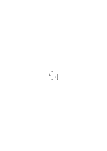

“The two measure L feet” is the general form of a proposition saying that they have a particular length in common.

### [56\[3\]](https://cdn.wittgensteinnachlass.com/2000px/webp/Ms-150/56.webp)

“This face has a particular expression?” I'm inclined to say this when I'm letting it make its full impression on me. And this is something like letting it govern you (sich ihm hingeben). It is then as though I wished to say what this expression consisted in & really this is what one does when one wants to find the right expression.

### [56\[4\]](https://cdn.wittgensteinnachlass.com/2000px/webp/Ms-150/56.webp)

The question “What expression does it have here” means, I wish to get its full impression.

### [56\[5\]](https://cdn.wittgensteinnachlass.com/2000px/webp/Ms-150/56.webp),[57\[1\]](https://cdn.wittgensteinnachlass.com/2000px/webp/Ms-150/57.webp)

“But surely, this face has a peculiar expression!” What does this mean? _Has_ it got something? *Is*n't it something?

### [57\[2\]](https://cdn.wittgensteinnachlass.com/2000px/webp/Ms-150/57.webp)

It would be interesting to imagine beings which consisted of nothing else than a circular stroke & two eye strokes & nose-stroke & one mouth-stroke & whose movements consisted in movements, changes of the shape of these strokes.

### [57\[3\]](https://cdn.wittgensteinnachlass.com/2000px/webp/Ms-150/57.webp)

_I_ emphasise it! It is as if I were making a rubber stamp of it.

### [57\[4\]](https://cdn.wittgensteinnachlass.com/2000px/webp/Ms-150/57.webp)

Philosophizing is an illness & we are trying to describe minutely its symptoms, clinical appearance.

### [57\[5\]](https://cdn.wittgensteinnachlass.com/2000px/webp/Ms-150/57.webp)

“It couldn't be just these strokes! You're obviously comparing them with something else you know. There is something behind those strokes!”

### [57\[6\]](https://cdn.wittgensteinnachlass.com/2000px/webp/Ms-150/57.webp)

To say ‘it _has_ the expression’ makes it appear as though I could separate the expression from the face.

### [57\[7\]](https://cdn.wittgensteinnachlass.com/2000px/webp/Ms-150/57.webp),[58\[1\]](https://cdn.wittgensteinnachlass.com/2000px/webp/Ms-150/58.webp)

“You won't tell me that this tune doesn't express something particular”. Does this mean that you make particular movements to it? But particular movements as opposed to which?

### [58\[2\]](https://cdn.wittgensteinnachlass.com/2000px/webp/Ms-150/58.webp)

“But these movements also express _something_, they aren't just movements!”

### [58\[3\]](https://cdn.wittgensteinnachlass.com/2000px/webp/Ms-150/58.webp)

Supposing you said: “You won't tell me that this tune hasn't a particular rhythm”! – “Why, of course it has a particular rhythm, which tune hasn't.” It here seems as though the peculiarity must consist in our recognizing it as this rhythm which we know from somewhere else. But this may be a delusion & it has just its own rhythm but a rhythm which strikes you, say makes you sway.

### [58\[4\]](https://cdn.wittgensteinnachlass.com/2000px/webp/Ms-150/58.webp)

“It says something” could in this case be translated into “it speaks to me”.

### [59\[1\]](https://cdn.wittgensteinnachlass.com/2000px/webp/Ms-150/59.webp)

As if I had to find this expression (of the face) somewhere else as well!

### [59\[2\]](https://cdn.wittgensteinnachlass.com/2000px/webp/Ms-150/59.webp)

Or I ask “What does it express, then?” and yet really want no answer.

It really means it has expression, it is a face.

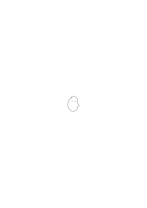

### [59\[3\]](https://cdn.wittgensteinnachlass.com/2000px/webp/Ms-150/59.webp)

Seeing a number as a year.

### [59\[4\]](https://cdn.wittgensteinnachlass.com/2000px/webp/Ms-150/59.webp)

There are experien*ces* of familiarity.

### [59\[5\]](https://cdn.wittgensteinnachlass.com/2000px/webp/Ms-150/59.webp)

“This is a serious face”. – What is it that is serious?

### [59\[6\]](https://cdn.wittgensteinnachlass.com/2000px/webp/Ms-150/59.webp)

Does it _mean_ that it makes me serious, that it has such & such an effect on me? And if eating a soup has this effect do I call it serious? And can't a smiling face somehow make me feel serious?

### [59\[7\]](https://cdn.wittgensteinnachlass.com/2000px/webp/Ms-150/59.webp),[60\[1\]](https://cdn.wittgensteinnachlass.com/2000px/webp/Ms-150/60.webp)

On the other hand: does a ‘serious face’ always strike me as serious?

### [60\[2\]](https://cdn.wittgensteinnachlass.com/2000px/webp/Ms-150/60.webp)

Supposing I got its impression if I imitated it! (This can still easier be imagined if it is the posture of a man  which I imitate.)

### [60\[3\]](https://cdn.wittgensteinnachlass.com/2000px/webp/Ms-150/60.webp)

How is it that this kind of picture  can look serious & not this ? What ‘can't’ is this?! Is it a hypothesis to say this 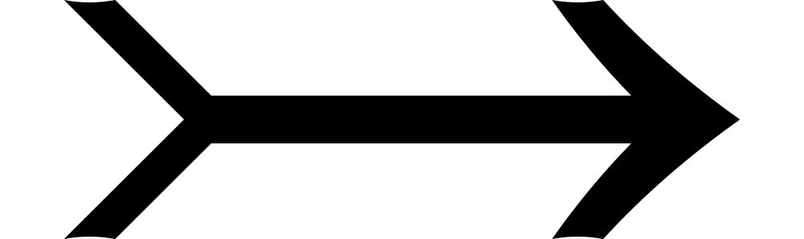 can never look serious?

### [60\[4\]](https://cdn.wittgensteinnachlass.com/2000px/webp/Ms-150/60.webp)

But can't a chair look serious? “But not in the sense in which a face does”. – What does this mean?

### [60\[5\]](https://cdn.wittgensteinnachlass.com/2000px/webp/Ms-150/60.webp)

If looking at it so that you get its expression consists in imitating it, what has the expression, the face or me? Is it the face insofar as it has a certain effect? What is heavy the balance or the weight?

### [60\[6\]](https://cdn.wittgensteinnachlass.com/2000px/webp/Ms-150/60.webp)

How can I be sure that lengthening the mouth is what makes it look serious? Are any experiments needed for that?

### [60\[7\]](https://cdn.wittgensteinnachlass.com/2000px/webp/Ms-150/60.webp),[61\[1\]](https://cdn.wittgensteinnachlass.com/2000px/webp/Ms-150/61.webp)

Do I see it by introspection? Is it self-evident?

### [61\[2\]](https://cdn.wittgensteinnachlass.com/2000px/webp/Ms-150/61.webp)

Isn't it that I measure the picture by a different kind of instrument; weigh it on a different kind of balance.

### [61\[3\]](https://cdn.wittgensteinnachlass.com/2000px/webp/Ms-150/61.webp)

Does Harmony treat of our feelings? Is it psychology?

### [61\[4\]](https://cdn.wittgensteinnachlass.com/2000px/webp/Ms-150/61.webp)

Is it a delusion consisting in “_projecting_” our own feelings into the thing we see? Is there such a case of projecting? Where do we take this idea from?

### [61\[5\]](https://cdn.wittgensteinnachlass.com/2000px/webp/Ms-150/61.webp)

Is the _sugar_ sweet, or do we project the feeling of sweetness into the sugar?

### [61\[6\]](https://cdn.wittgensteinnachlass.com/2000px/webp/Ms-150/61.webp)

It is as if every way of life were something present in seeing. As if every possible contrast were a colouring. As if we first had the apparently pure seeing & then various other experiences were added.

### [61\[7\]](https://cdn.wittgensteinnachlass.com/2000px/webp/Ms-150/61.webp),[62\[1\]](https://cdn.wittgensteinnachlass.com/2000px/webp/Ms-150/62.webp)

It is as if the impression of a face _consisted_ of so and so many parts, the purely optical, the facial expression, etc..

### [62\[2\]](https://cdn.wittgensteinnachlass.com/2000px/webp/Ms-150/62.webp)

“A word (particularly a well known one) has”, we should like to say, “a particular expression (facial expression). We don't just see it we feel something – or all sorts of things – when we see it.” This is almost as if one said “if I see red I have all sorts of feelings, the feeling of the absence of green, of blue, of yellow, etc. etc.”.

### [62\[3\]](https://cdn.wittgensteinnachlass.com/2000px/webp/Ms-150/62.webp)

It is as though we saw a face first purely visual then _in addition_ to that as a face then _in addition_ to that as a Chinese face & _in addition_ to that as a well known one.

### [62\[4\]](https://cdn.wittgensteinnachlass.com/2000px/webp/Ms-150/62.webp)

Now we can imagine additional processes corresponding to each such case but these are not ‘directly perceived’.

### [62\[5\]](https://cdn.wittgensteinnachlass.com/2000px/webp/Ms-150/62.webp)

The word ‘that’ has a peculiar expression. What do you contrast it with? Can you …

### [63\[1\]](https://cdn.wittgensteinnachlass.com/2000px/webp/Ms-150/63.webp)

Would you think about it as you do, if you did not know something about the optical apparatus of our eyes?

### [63\[2\]](https://cdn.wittgensteinnachlass.com/2000px/webp/Ms-150/63.webp)

It is as though I had necessarily got to say that I distinguish _elements_ in the seeing of a face or a word.

### [63\[3\]](https://cdn.wittgensteinnachlass.com/2000px/webp/Ms-150/63.webp)

Should I say “This eye sparkles” or that I, as it were, sparkle when looking at it. Should I say that the lines of the drawn cube recede or that, as it were, I recede when looking at them? Should I say “_this aspect_ sparkles” or “This drawing seems to sparkle in this aspect”?

### [63\[4\]](https://cdn.wittgensteinnachlass.com/2000px/webp/Ms-150/63.webp)

The words are well known; what does their being well known consist in?

### [63\[5\]](https://cdn.wittgensteinnachlass.com/2000px/webp/Ms-150/63.webp),[64\[1\]](https://cdn.wittgensteinnachlass.com/2000px/webp/Ms-150/64.webp)

If I look at the word ‘this’, e.g., it looks familiar to me, it looks at me with a familiar face, like an old acquaintance. – But does it always? Am I always touched when I see it? Do I remember having seen it before. Did you say to it “Oh, that's the word …”?

### [64\[2\]](https://cdn.wittgensteinnachlass.com/2000px/webp/Ms-150/64.webp)

You are looking at this ‘as a face’! As what are you looking at it? Can you show me that _as what_ you are looking at it?

### [64\[3\]](https://cdn.wittgensteinnachlass.com/2000px/webp/Ms-150/64.webp)

Seeing the word ‘That’ gives me the feeling of familiarity whereas seeing the word ‘continuity’ doesn't give it to me. But does the first word _always_ give me that feeling?

### [64\[4\]](https://cdn.wittgensteinnachlass.com/2000px/webp/Ms-150/64.webp)

Look at a word & let it seem familiar. Then look at one of its letters & ask yourself whether that also seemed familiar (gave you the feeling of familiarity) when the word as a whole did. And on the other hand the letter is, of course, familiar too.

### [64\[5\]](https://cdn.wittgensteinnachlass.com/2000px/webp/Ms-150/64.webp),[65\[1\]](https://cdn.wittgensteinnachlass.com/2000px/webp/Ms-150/65.webp)

p⊃p = T (p⊃p) ∙ q = q T ∙ p = p p ⌵ T = T p ∙ q ․⊃․ p = T

(p ∙ q ⊃ p) ∙ r = r (p ∙ q) ∙ p = p ∙ q (p ∙ q) ⌵ p = p p ∙ q = p p ⌵ q = (p ∙ q) ⌵ p = p ~p ⌵ q

~(p ∙ q) ⌵ p = T p⊃p ⌵ q

(~(p ∙ q) ⌵ p) ⌵ (p ∙ q) = p ∙ q P․⊃․Q = T

⊢(p⊃q) = p ~p = ~p ∙ q = ~p ⌵ q = ~(p ∙ q) ⌵ q = p ∙ q⊃q ⊢q q ․⊃․ p ⌵ q = Log.

### [65\[2\]](https://cdn.wittgensteinnachlass.com/2000px/webp/Ms-150/65.webp)

Where a logical proposition has a main ․⊃․ we may infer the right hand side from the left.

### [65\[3\]](https://cdn.wittgensteinnachlass.com/2000px/webp/Ms-150/65.webp)

~~p = p Can we deduce this?

### [65\[4\]](https://cdn.wittgensteinnachlass.com/2000px/webp/Ms-150/65.webp)

p ⌵ q = q

### [65\[5\]](https://cdn.wittgensteinnachlass.com/2000px/webp/Ms-150/65.webp)

q․⊃․ p ⌵ q = ~q ․⊃․ p ⌵ ~q

### [66\[1\]](https://cdn.wittgensteinnachlass.com/2000px/webp/Ms-150/66.webp)

When I read a line of writing in a well known language trying to see what reading consists in I get a particular experience which I take to be the experience of reading.

### [66\[2\]](https://cdn.wittgensteinnachlass.com/2000px/webp/Ms-150/66.webp)

This experience doesn't simply seem to consist in seeing & pronouncing but in some other, as it were, some kind of intimate experience. We are on an intimate ‘footing’ with the words.

### [66\[3\]](https://cdn.wittgensteinnachlass.com/2000px/webp/Ms-150/66.webp)

The spoken words we are inclined to say come in a _particular way_ & in fact the written ones themselves don't appear just like _any_ scratches. And at the same time I seem unable to get hold of that ‘_way_’. The process of reading out the word seems we are inclined to say, enshrouded by a particular atmosphere. But here again I don't mean to say that I recognize this atmosphere rather I notice it when in philosophizing I read a line. And here again it is as though I didn't notice it & did notice it.

### [66\[4\]](https://cdn.wittgensteinnachlass.com/2000px/webp/Ms-150/66.webp),[67\[1\]](https://cdn.wittgensteinnachlass.com/2000px/webp/Ms-150/67.webp)

It is the atmosphere of contemplation which I provide. And of course I see what I see. Look at a written word, say ‘read’. It isn't just a scribble it's ‘read’. I should like to say it has no definite physiognomy. But what is it that I really _am_ saying about it?! What's this statement, straightened out?! It falls one is tempted to explain, into a mould of my mind _language_ prepared for it. But as I can't see any such mould; this simile must mean that my experience is one of putting something into a mould when I _don't_ see the mould but just feel it.

### [67\[2\]](https://cdn.wittgensteinnachlass.com/2000px/webp/Ms-150/67.webp)

Knowing what a thing is

a hat

a spectroscope

a piece of coal

an ‘A’

some rubbish etc.

### [67\[3\]](https://cdn.wittgensteinnachlass.com/2000px/webp/Ms-150/67.webp)

What do we contrast all the different experiences of familiarity with?

### [67\[4\]](https://cdn.wittgensteinnachlass.com/2000px/webp/Ms-150/67.webp)

Experience of familiarity added?

It is misleading to say that the experience of seeing a face is a _compound_ one.

### [67\[5\]](https://cdn.wittgensteinnachlass.com/2000px/webp/Ms-150/67.webp)

“This word now somehow looks queer to me”.

### [68\[1\]](https://cdn.wittgensteinnachlass.com/2000px/webp/Ms-150/68.webp)

We wish to say “it's that other thing”, & yet …

### [68\[2\]](https://cdn.wittgensteinnachlass.com/2000px/webp/Ms-150/68.webp)

It looks at me & I wish to say “_it looks at me in this way_”!

### [68\[3\]](https://cdn.wittgensteinnachlass.com/2000px/webp/Ms-150/68.webp)

I can't say “I see _this_ as _this_ face” but “I see this as _a_ face”.

### [68\[4\]](https://cdn.wittgensteinnachlass.com/2000px/webp/Ms-150/68.webp)

But where does the strong temptation come from?

### [68\[5\]](https://cdn.wittgensteinnachlass.com/2000px/webp/Ms-150/68.webp)

“This isn't just a scribble, but it's _this_ particular face.”

### [68\[6\]](https://cdn.wittgensteinnachlass.com/2000px/webp/Ms-150/68.webp)

I am tempted to say “I don't see this as _a_ face, I see it as _this_ face!” …

### [68\[7\]](https://cdn.wittgensteinnachlass.com/2000px/webp/Ms-150/68.webp)

Suppose I said “I see this scribble like _this_”, – this would mean something like: What at one time appears to me like this, at another appeared to me like that. [→ ]

### [68\[8\]](https://cdn.wittgensteinnachlass.com/2000px/webp/Ms-150/68.webp),[69\[1\]](https://cdn.wittgensteinnachlass.com/2000px/webp/Ms-150/69.webp)

My language predicates something but I don't really wish to predicate anything, I don't want to say I look at this in such & such a way which can be described without reference to _this_.

### [69\[2\]](https://cdn.wittgensteinnachlass.com/2000px/webp/Ms-150/69.webp)

In fact I don't want to say anything _about_ it but I want to say something _to_ it.

### [69\[3\]](https://cdn.wittgensteinnachlass.com/2000px/webp/Ms-150/69.webp)

This proposition, in what game can I use it? I seem to have constructed a game & yet haven't done so.

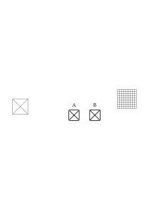

### [69\[4\]](https://cdn.wittgensteinnachlass.com/2000px/webp/Ms-150/69.webp)

Why do I say what I say? What do I contrast the word with of which I say it has a particular essence? Or don't I contrast it with anything? For that shows me what game I'm playing with it. For, what is the use of this phrase? Do I say it of everything I see or only of certain shapes or of anyone when I contemplate it in some special way?

### [70\[1\]](https://cdn.wittgensteinnachlass.com/2000px/webp/Ms-150/70.webp)

The word … isn't just scribble, it's _this_. (And if I say ‘this’, I let the word make an impression on me, look at it in a peculiar way.)

### [70\[2\]](https://cdn.wittgensteinnachlass.com/2000px/webp/Ms-150/70.webp)

Now when I say there is particular atmosphere about my reading a sentence what do I contrast it with? What is it that I notice? Am I noticing that there is the same tone throughout or one tone as opposed to another tone? Do I oppose the experience to seeing some scribbles & saying words as they come into my mind looking at the scribbles in turn?

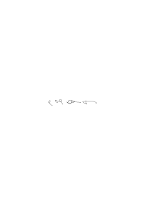

### [70\[3\]](https://cdn.wittgensteinnachlass.com/2000px/webp/Ms-150/70.webp)

Now it is very easy to describe differences between these two cases but difficult if possible at all to specify differences between what is happening in the moment of saying the words.

### [70\[4\]](https://cdn.wittgensteinnachlass.com/2000px/webp/Ms-150/70.webp)

I am not familiar with the sign. I don't know this sign properly, the other I know. What is the difference while I look at them.

### [71\[1\]](https://cdn.wittgensteinnachlass.com/2000px/webp/Ms-150/71.webp)

“I notice that the same thing happens throughout.” – What, seeing scribbles & speaking? – “Not that alone there is something else something particular about the way it's done. I don't know what it is but there is something happening? Alright, but let us see what it signifies that you don't know what happens & still know that something particular goes on. For are you looking for that which really happens? Have you a method of finding it? Are you attempting an analysis? And what are your means of analysing? If not, let us look at the actual state of affairs. We have just to take this as the description of this state of affairs that you notice something going on & can't say what.

### [71\[2\]](https://cdn.wittgensteinnachlass.com/2000px/webp/Ms-150/71.webp),[72\[1\]](https://cdn.wittgensteinnachlass.com/2000px/webp/Ms-150/72.webp)

For the expression that the words came in a particular _way_ was misleading. You don't even know what kind of thing the word “way” alludes to. It doesn't for instance allude to a process of deriving the spoken word. If anything one might use it as opposed to other ways for instance that of thinking of any spoken word to associate with the written one. Or the way is a lack of any.

### [72\[2\]](https://cdn.wittgensteinnachlass.com/2000px/webp/Ms-150/72.webp)

If you say you know that something goes on, are you ever clear that this something might not be the _absence_ of anything? Perhaps a certain smoothness. Again the familiar look of the words.

### [72\[3\]](https://cdn.wittgensteinnachlass.com/2000px/webp/Ms-150/72.webp)

But nothing of what we can enumerate is anything that you should care to call the process of reading.

### [72\[4\]](https://cdn.wittgensteinnachlass.com/2000px/webp/Ms-150/72.webp)

Do you notice anything? Don't you just direct your attention on your reading. You look at how you are reading, but …

### [73\[1\]](https://cdn.wittgensteinnachlass.com/2000px/webp/Ms-150/73.webp)

Observe the special lighting that is in your room right now, do you notice it?? “Observe the particular colour of your wall!” Well what am I supposed to do? Am I merely to look at the wall in a particular, intense way? Or merely say something while doing so???

“Look at the difference between the colour of the chair & the colour of the wall!” Well what about it? “Look at the peculiar character of this writing!”

### [73\[2\]](https://cdn.wittgensteinnachlass.com/2000px/webp/Ms-150/73.webp)

‘Don't I notice something when I observe myself reading?’ But what _could_ you notice?!

### [73\[3\]](https://cdn.wittgensteinnachlass.com/2000px/webp/Ms-150/73.webp)

“Notice this peculiar contrast of colours!” But _what_ about it?

### [73\[4\]](https://cdn.wittgensteinnachlass.com/2000px/webp/Ms-150/73.webp)

With what sense am I to notice the way the word comes when I'm reading?

### [73\[5\]](https://cdn.wittgensteinnachlass.com/2000px/webp/Ms-150/73.webp),[74\[1\]](https://cdn.wittgensteinnachlass.com/2000px/webp/Ms-150/74.webp)

But can’t I attach a name to the particular bodily feeling I have now, notice it? What does that mean? Does it mean noticing that I have one or that it is the one which … Or?

### [74\[2\]](https://cdn.wittgensteinnachlass.com/2000px/webp/Ms-150/74.webp)

There is an _impressive_ phrase in music & when one hears such a thing, one may say: “But this phrase does express something!” But what one wants to say is: it is not merely impressive, it also expresses something particular. But we did say, _it_ was impressive.

### [74\[3\]](https://cdn.wittgensteinnachlass.com/2000px/webp/Ms-150/74.webp)

“It all happens in a peculiar way.”

### [74\[4\]](https://cdn.wittgensteinnachlass.com/2000px/webp/Ms-150/74.webp)

“It makes a strong impression on me.” “It impresses itself on me”.

### [74\[5\]](https://cdn.wittgensteinnachlass.com/2000px/webp/Ms-150/74.webp)

alsigon

### [74\[6\]](https://cdn.wittgensteinnachlass.com/2000px/webp/Ms-150/74.webp)

“It all happens in the way A.”

### [74\[7\]](https://cdn.wittgensteinnachlass.com/2000px/webp/Ms-150/74.webp)

The “kind” is like a particular colouring. But what is remarkable is that in this colouring I apparently am not speaking in contrast to another.

### [74\[8\]](https://cdn.wittgensteinnachlass.com/2000px/webp/Ms-150/74.webp),[75\[1\]](https://cdn.wittgensteinnachlass.com/2000px/webp/Ms-150/75.webp)

Now if I observe myself saying it I find that I have to read a longish sentence. And I wish to say “it's all the same colour”. But it hasn't just got all the same colour but one particular colour! Yes, but you mistake the function of language! It seems you wish to specify it, but you don't wish to say anything _about_ it, & it seems to you as if pointing to it specified it as though you could explain it by itself. It is as though what I pointed to was at the same time the sample & what one compares it with.

### [75\[2\]](https://cdn.wittgensteinnachlass.com/2000px/webp/Ms-150/75.webp)

You can, of course, take the reading of an English sentence as a _sample_ for reading. But taking it as a sample doesn't say anything about the sample. You can then say something by means of the sample.

### [75\[3\]](https://cdn.wittgensteinnachlass.com/2000px/webp/Ms-150/75.webp)

In saying this wall has all one particular colour we make the same mistake one makes thinking that if we give an ostensive definition we say something about the object we point to.

### [75\[4\]](https://cdn.wittgensteinnachlass.com/2000px/webp/Ms-150/75.webp)

This is a particular shape (colour) because I make a particular face when looking at it.

### [75\[5\]](https://cdn.wittgensteinnachlass.com/2000px/webp/Ms-150/75.webp)

What does the face, the colour, etc. that I am looking at function as? As a _sample_ or as what I make a statement about?

### [76\[1\]](https://cdn.wittgensteinnachlass.com/2000px/webp/Ms-150/76.webp)

“On this subject I make a _quite particular_ gesture”.

### [76\[2\]](https://cdn.wittgensteinnachlass.com/2000px/webp/Ms-150/76.webp)

Although we do not really want to set the ‘particular’ lighting against any other, we nevertheless use this expression in the case in which the lighting makes an impression on us. – And that is a specification independent of the particular lighting –, & we can also describe the impression, set it against other impressions.

### [76\[3\]](https://cdn.wittgensteinnachlass.com/2000px/webp/Ms-150/76.webp)

[You can't move a King of Chess in this way

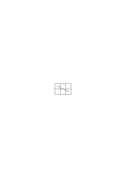

.]

### [76\[4\]](https://cdn.wittgensteinnachlass.com/2000px/webp/Ms-150/76.webp)

It is absurd to say “you can't use negation this way” as the use determines whether it's negation. What is to determine whether it is negation or not.

### [77\[1\]](https://cdn.wittgensteinnachlass.com/2000px/webp/Ms-150/77.webp)

x = y, x = x 2 + 2 = 4 Is this the result of a calculation or isn't it. If not it is a definition & how could this be a tautology?

### [77\[2\]](https://cdn.wittgensteinnachlass.com/2000px/webp/Ms-150/77.webp)

(∃x,y) ∙ x = y ․≡․ φx ∙ φy

### [77\[3\]](https://cdn.wittgensteinnachlass.com/2000px/webp/Ms-150/77.webp)

F(x,y)

f(a)⊃f(b) f(a)⊃f(a) f(2 + 2)․⊃․f(4)

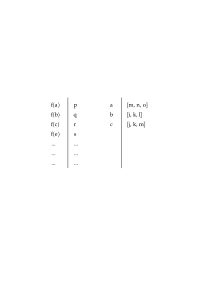

### [78\[1\]](https://cdn.wittgensteinnachlass.com/2000px/webp/Ms-150/78.webp)

But can't I say that I see now, – what I do see?

### [78\[2\]](https://cdn.wittgensteinnachlass.com/2000px/webp/Ms-150/78.webp)

When I said, …, I wished to say that I didn't just see anything, nor did I wish to give any general characteristic of what I saw but – – –.

### [78\[3\]](https://cdn.wittgensteinnachlass.com/2000px/webp/Ms-150/78.webp)

“Write a sentence! – While you write do you feel something?” – “Yes, I have a particular feeling while writing”. I don't want to say just that I have the same feeling the whole time but also that I have this particular feeling. But what is this particular feeling characterized by except itself?

### [78\[4\]](https://cdn.wittgensteinnachlass.com/2000px/webp/Ms-150/78.webp)

The word ‘particular feeling’ belongs together with the feeling itself. One could just say “I have … while writing”. And during ‘ …’ produce the feeling.

### [78\[5\]](https://cdn.wittgensteinnachlass.com/2000px/webp/Ms-150/78.webp)

“Observe the feeling which you have while writing.”

### [79\[1\]](https://cdn.wittgensteinnachlass.com/2000px/webp/Ms-150/79.webp)

It seems it has sense to say “I have _this_ feeling while writing”. And while saying this I produce a feeling.

### [79\[2\]](https://cdn.wittgensteinnachlass.com/2000px/webp/Ms-150/79.webp)

“Surely I can say that I have this feeling while I'm writing”. Of course you can say it & when you say “this feeling” you concentrate on the feeling (which is comparable to looking not to seeing). But what do you do with the sentence? What use is it to you?

### [79\[3\]](https://cdn.wittgensteinnachlass.com/2000px/webp/Ms-150/79.webp)

“Observe the feeling” can't mean “feel it”. I can say look closely at what you see, not see clearly what you see.

### [79\[4\]](https://cdn.wittgensteinnachlass.com/2000px/webp/Ms-150/79.webp)

I can't visually point to what I see because I see the pointing finger & it does not point to what I see but is part of it.

### [79\[5\]](https://cdn.wittgensteinnachlass.com/2000px/webp/Ms-150/79.webp),[80\[1\]](https://cdn.wittgensteinnachlass.com/2000px/webp/Ms-150/80.webp)

It is as though I could say: My act of concentrating the attention is an inward (act of) pointing. An act which nobody else sees but that doesn't matter. But I don't point to the feeling by attending to it but rather produce it.

### [80\[2\]](https://cdn.wittgensteinnachlass.com/2000px/webp/Ms-150/80.webp)

“When reading a sentence I feel a particular process.” What is true about that?

### [80\[3\]](https://cdn.wittgensteinnachlass.com/2000px/webp/Ms-150/80.webp)

When I see familiar things I have a particular experience; what is _true about it_?

### [80\[4\]](https://cdn.wittgensteinnachlass.com/2000px/webp/Ms-150/80.webp)

“I notice that the wall has this particular colour”.

### [80\[5\]](https://cdn.wittgensteinnachlass.com/2000px/webp/Ms-150/80.webp)

“Do you only notice that it has the same colour throughout or do you also notice the particular colour it has?” This might mean: are you impressed by the particular colour it has.

### [80\[6\]](https://cdn.wittgensteinnachlass.com/2000px/webp/Ms-150/80.webp)

“I know what colour it has because I see it”. Well, what colour has it. “I know which colour it has.” “I know the colour.”

### [80\[7\]](https://cdn.wittgensteinnachlass.com/2000px/webp/Ms-150/80.webp),[81\[1\]](https://cdn.wittgensteinnachlass.com/2000px/webp/Ms-150/81.webp)

It has a particular colour A & I know A.

### [81\[2\]](https://cdn.wittgensteinnachlass.com/2000px/webp/Ms-150/81.webp)

I weigh a taste on my tongue.

### [81\[3\]](https://cdn.wittgensteinnachlass.com/2000px/webp/Ms-150/81.webp)

You misunderstand the function of language. It seems to you as though you could say: I notice the colour besides seeing that it has all one colour.

### [81\[4\]](https://cdn.wittgensteinnachlass.com/2000px/webp/Ms-150/81.webp)

You think it makes sense to say: the colour of this→ is this→.

### [81\[5\]](https://cdn.wittgensteinnachlass.com/2000px/webp/Ms-150/81.webp)

Observe the feeling of writing. “Yes I'm looking at it”, or “yes I'm impressing it on my mind”.

### [81\[6\]](https://cdn.wittgensteinnachlass.com/2000px/webp/Ms-150/81.webp)

If I observe the particular lighting etc. I don't do anything with it.

### [81\[7\]](https://cdn.wittgensteinnachlass.com/2000px/webp/Ms-150/81.webp),[82\[1\]](https://cdn.wittgensteinnachlass.com/2000px/webp/Ms-150/82.webp)

“I see this”. Surely it makes sense to say what I see & how could I do this better than by letting what I see speak for itself. But I can't point visually to what I see. – – – It seems as though I singled something out but the sample can't single out itself. When I said you mistake the function of language it was because a sentence seemed to you to do what only the sample itself does. The sample seemed to be its own description.

### [82\[2\]](https://cdn.wittgensteinnachlass.com/2000px/webp/Ms-150/82.webp)

“The wall has now got this colour”. Imagine someone asked “Has it really this colour now?”

### [82\[3\]](https://cdn.wittgensteinnachlass.com/2000px/webp/Ms-150/82.webp)

Observe the lighting …. – Hasn't it one particular lighting? Like doesn't the sentence read give me one particular impression? Observe the particular thing that takes place when you read. Impress the lighting of the room on you.

Suppose someone said “I am now observing the particular lighting it has”. This would sound as if he could point out which it was.

### [82\[4\]](https://cdn.wittgensteinnachlass.com/2000px/webp/Ms-150/82.webp),[83\[1\]](https://cdn.wittgensteinnachlass.com/2000px/webp/Ms-150/83.webp)

… because by its help you seem to be pointing out to yourself what colour you see.

---

### [83\[2\]](https://cdn.wittgensteinnachlass.com/2000px/webp/Ms-150/83.webp)

You are ordered to concentrate your attention on the sample and I could in fact have said “look at the colour of this sample”. But this would have asked you to attend to it in a particular way, not to attend to a particular thing.

### [83\[3\]](https://cdn.wittgensteinnachlass.com/2000px/webp/Ms-150/83.webp)

By attending, looking you produce the impression. You can't look at the impression.

### [83\[4\]](https://cdn.wittgensteinnachlass.com/2000px/webp/Ms-150/83.webp)

Nothing yet is done with this sample.

### [83\[5\]](https://cdn.wittgensteinnachlass.com/2000px/webp/Ms-150/83.webp),[84\[1\]](https://cdn.wittgensteinnachlass.com/2000px/webp/Ms-150/84.webp)

But you might think that you can look at the particular lighting of this room. As though you didn't look at the room but at something else which the room had. And you are then in fact concentrating your attention … on the lighting which doesn't mean to look at a particular thing but in a particular way. (I must try to cheat myself to believe that I can look at the particular lighting of this room.)

### [84\[2\]](https://cdn.wittgensteinnachlass.com/2000px/webp/Ms-150/84.webp)

It doesn't say anything about the appearance of the room. (Rather) the appearance of the room is the sample.

### [84\[3\]](https://cdn.wittgensteinnachlass.com/2000px/webp/Ms-150/84.webp)

Observe … is like saying get hold of _it_ whereas it is obeyed by putting myself into a certain state.

### [84\[4\]](https://cdn.wittgensteinnachlass.com/2000px/webp/Ms-150/84.webp)

This [unreadable] a particular lighting, get hold of it.

### [84\[5\]](https://cdn.wittgensteinnachlass.com/2000px/webp/Ms-150/84.webp)

The order could have been “see _what_ lighting the room has”.

### [84\[6\]](https://cdn.wittgensteinnachlass.com/2000px/webp/Ms-150/84.webp)

“There is a particular lighting I must observe”.

### [85\[1\]](https://cdn.wittgensteinnachlass.com/2000px/webp/Ms-150/85.webp)

It seemed that I could say: Now I've noticed it something particular happens when I read.

### [85\[2\]](https://cdn.wittgensteinnachlass.com/2000px/webp/Ms-150/85.webp)

You read put yourself into the state of attention & say: “Something peculiar happens undoubtedly”. You are inclined to go on “There is a certain smoothness about it.” But you feel that this is only an inadequate description & that the experience can only describe itself.

### [85\[3\]](https://cdn.wittgensteinnachlass.com/2000px/webp/Ms-150/85.webp)

“Something peculiar happens undoubtedly” is like saying “I've had an experience!” But you don't wish to make a general statement independent of the particular experience you have had but rather a statement into which this particular experience enters.

### [85\[4\]](https://cdn.wittgensteinnachlass.com/2000px/webp/Ms-150/85.webp)

_You are under a particular impression_.

### [85\[5\]](https://cdn.wittgensteinnachlass.com/2000px/webp/Ms-150/85.webp),[86\[1\]](https://cdn.wittgensteinnachlass.com/2000px/webp/Ms-150/86.webp)

You are saying something general & at the same time concentrating your attention on a sample & so it seems as though this sample entered your statement. It is as though you looked into a microscope say observing the motions of animals & said to a pupil: “Something peculiar goes on there”; intending to let him look too & to use what you observe as a sample for further consideration.

### [86\[2\]](https://cdn.wittgensteinnachlass.com/2000px/webp/Ms-150/86.webp)

You think you've noticed the process of reading, the particular way in which signs are transformed into sounds. You've seen the particular process of transformation.

### [86\[3\]](https://cdn.wittgensteinnachlass.com/2000px/webp/Ms-150/86.webp)

“This sentence is spoken in a particular tone.” – Every sentence is spoken in a particular tone, what makes you say that it's spoken in a particular tone is that you're concentrating on this tone.

### [86\[4\]](https://cdn.wittgensteinnachlass.com/2000px/webp/Ms-150/86.webp),[87\[1\]](https://cdn.wittgensteinnachlass.com/2000px/webp/Ms-150/87.webp)

You are under an impression. That's why you say what you say. But the sentence that you are under an impression, is a general statement. You wish to make this impression a sample drawing a circle round it. And this action of saying something to it you mistake for saying some thing about it.

### [87\[2\]](https://cdn.wittgensteinnachlass.com/2000px/webp/Ms-150/87.webp)

You are under an impression. This makes you say “I am under a _particular_ impression. And this sentence seems to say to yourself under what impression you are. As though you had pointed to a picture ready in your mind & said this is it. Whereas you have only pointed to your impression. You did something like drawing a circle round the colour …

### [87\[3\]](https://cdn.wittgensteinnachlass.com/2000px/webp/Ms-150/87.webp)

“That's how one reads!”

You seem to have observed reading as under a magnifying glass & discovered the reading process (which had escaped the superficial observation.)

But the case is more like that of observing something through a coloured glass.

### [87\[4\]](https://cdn.wittgensteinnachlass.com/2000px/webp/Ms-150/87.webp)

You interpret your impression as one of having noticed something which was independent of the particular signs you saw, the words you uttered, the writing etc.

### [88\[1\]](https://cdn.wittgensteinnachlass.com/2000px/webp/Ms-150/88.webp)

Thought expressed by architecture.

### [88\[2\]](https://cdn.wittgensteinnachlass.com/2000px/webp/Ms-150/88.webp)

Stiefmütterchen, “jede Farbenzusammenstellung sagt etwas, speaks to me”. Everyone of these men says something.

### [88\[3\]](https://cdn.wittgensteinnachlass.com/2000px/webp/Ms-150/88.webp)

“That's what happens when I read (at least what happened in this case)”. What was it? “Oh I got a particular impression”.

### [88\[4\]](https://cdn.wittgensteinnachlass.com/2000px/webp/Ms-150/88.webp)

I am impressed by the reading. And that made me say that I had observed something besides the mere seeing & speaking. “Something peculiar happens when I read”. That is I am impressed.

### [88\[5\]](https://cdn.wittgensteinnachlass.com/2000px/webp/Ms-150/88.webp)

The words are old acquaintances of mine. But do I always have towards old acquaintances the one feeling of old acquaintance.

### [88\[6\]](https://cdn.wittgensteinnachlass.com/2000px/webp/Ms-150/88.webp)

The words easily awaken feelings in me. Odd scratches don't. I can easier feel at home in well known things than in others.

### [89\[1\]](https://cdn.wittgensteinnachlass.com/2000px/webp/Ms-150/89.webp)

Music impressing you “sad”, “joyful”, etc..

### [89\[2\]](https://cdn.wittgensteinnachlass.com/2000px/webp/Ms-150/89.webp)

The only adequate way of expressing your impression might be to draw what you see.

### [89\[3\]](https://cdn.wittgensteinnachlass.com/2000px/webp/Ms-150/89.webp)

“An impression” sounds like something amorphous.

### [89\[4\]](https://cdn.wittgensteinnachlass.com/2000px/webp/Ms-150/89.webp)

I don't want to say I see this & am impressed as though being impressed meant something like having a particular feeling & the sentence meant something like I see this & feel a pressure.

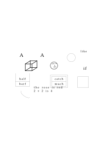

### [90\[1\]](https://cdn.wittgensteinnachlass.com/2000px/webp/Ms-150/90.webp)

“Do you remember having lived yesterday?”

### [90\[2\]](https://cdn.wittgensteinnachlass.com/2000px/webp/Ms-150/90.webp)

Can one remember without language. Can one wish to be somewhere at 5.05 o'clock if one knows no clocks.

### [90\[3\]](https://cdn.wittgensteinnachlass.com/2000px/webp/Ms-150/90.webp)

What is the difference between a memory image & an image we deliberately make up.

### [90\[4\]](https://cdn.wittgensteinnachlass.com/2000px/webp/Ms-150/90.webp)

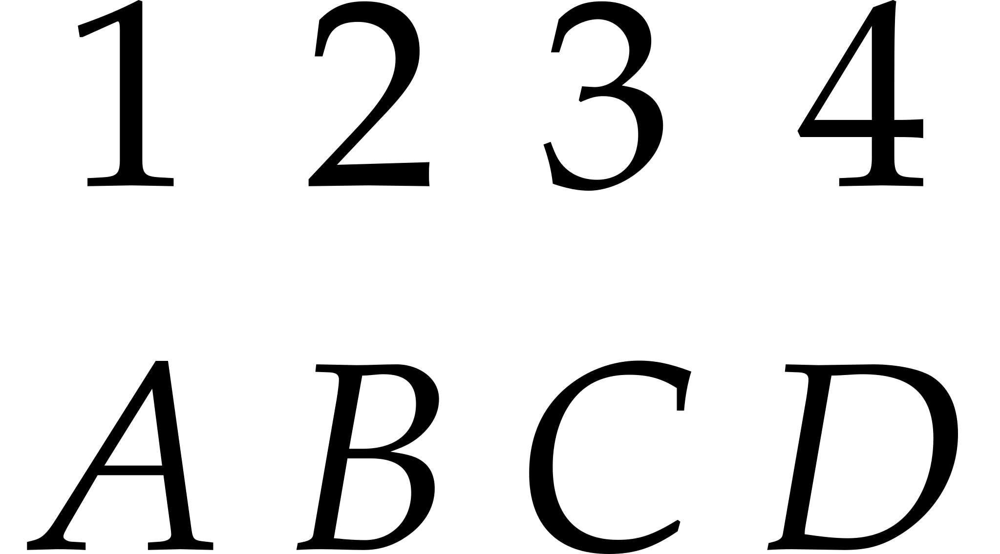

### [90\[5\]](https://cdn.wittgensteinnachlass.com/2000px/webp/Ms-150/90.webp),[91\[1\]](https://cdn.wittgensteinnachlass.com/2000px/webp/Ms-150/91.webp)

Russell doesn't really wish to say that two classes are similar if they are correlated. He needs a correlation which isn't a grossly material one, which in fact is the possibility of a material correlation. And that means that when he says A & B are 1-1 correlated it really means they can be, or it makes sense to say that they are. So we are driven to consider cases in which it makes sense & such in which it makes no sense to say that two classes are 1-1 correlated. What is the condition of their being 1-1 correlatable.

### [91\[2\]](https://cdn.wittgensteinnachlass.com/2000px/webp/Ms-150/91.webp)

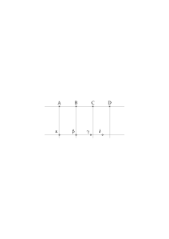

### [91\[3\]](https://cdn.wittgensteinnachlass.com/2000px/webp/Ms-150/91.webp)

What in this case is the _condition_. Or how would I get a contradiction? E.g. if I said A B C D are equidistant, α β γ δ are not equidistant & parallel lines are drawn between them. And here Russell's correlation seems to furnish a criterion of their correlatability. A logical criterion. Isn't it very queer that by just looking at the names I should be able to say whether or not a certain relation held between the objects? But _I_ correlate the names. And why? To see whether a correlation _can_ exist between the things.

Correlation

Correspondence

We draw lines in our thought.

### [91\[4\]](https://cdn.wittgensteinnachlass.com/2000px/webp/Ms-150/91.webp)

They are thus correlated whether anybody knows it or not.

### [92\[1\]](https://cdn.wittgensteinnachlass.com/2000px/webp/Ms-150/92.webp)

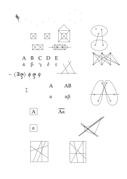

### [93\[1\]](https://cdn.wittgensteinnachlass.com/2000px/webp/Ms-150/93.webp)

“Remembering is a characteristic experience.” But the experience is curiously elusive. There are indeed experiences connected with it which are not elusive. We have e.g. memory images, we see so & so before us. But then there are other images besides memory ones. They only seem elusive when we philosophise about them. Otherwise we say without any hesitation: “I remember so & so”. And not only very sensitive people do so. Take as example the feeling of ‘long, long ago’ because this is a strong & clearly circumscribed experience. And yet in a sense it seems just as elusive as any other feeling of memory. [“Far away look in his eyes.”] Tone & gesture of memory. The experience of singing with expression without the feeling. Suppose the feeling consists a) of feeling the heartbeat b) of not feeling its beat.

### [93\[2\]](https://cdn.wittgensteinnachlass.com/2000px/webp/Ms-150/93.webp)

When understanding of a subject comes, the experience naturally changes; but does a particular feeling get added?

### [94\[2\]](https://cdn.wittgensteinnachlass.com/2000px/webp/Ms-150/94.webp)

### [94\[3\]](https://cdn.wittgensteinnachlass.com/2000px/webp/Ms-150/94.webp)

Language treats our ‘particular feeling’ as something separate. As an experience separate from the other sense experiences.

### [94\[4\]](https://cdn.wittgensteinnachlass.com/2000px/webp/Ms-150/94.webp)

I say “I remember seeing him yesterday” and now I look behind saying these words for the experience of remembering.

### [94\[5\]](https://cdn.wittgensteinnachlass.com/2000px/webp/Ms-150/94.webp)

If we say “The words came in a particular way”, _how is this way to be described_? For what the word “way” meant can only be seen by looking at the kind of specification.

### [94\[5\]](https://cdn.wittgensteinnachlass.com/2000px/webp/Ms-150/94.webp),[95\[1\]](https://cdn.wittgensteinnachlass.com/2000px/webp/Ms-150/95.webp)

Our sentence really meant no more than: There is a difference between someone saying these words & remembering & saying these words without remembering.

### [95\[2\]](https://cdn.wittgensteinnachlass.com/2000px/webp/Ms-150/95.webp)

“The image has some indefinable ‘past’ quality”. – Now do you say this because you think you have to say it or because you notice a quality in the picture which you want to give a name to. Alright I don't _ask_ you to define it as I don't ask you to define ‘blue’ either.

Let's hear how you are going to use the word for this quality, then I'll know in what sense it is a quality. (Is it, e.g., like size, shape, or colour?)

### [95\[3\]](https://cdn.wittgensteinnachlass.com/2000px/webp/Ms-150/95.webp)

Representing memory images in the Film.

### [95\[4\]](https://cdn.wittgensteinnachlass.com/2000px/webp/Ms-150/95.webp)

“Let me see what did I do before that?” “A particular way of looking for an image”.

### [95\[5\]](https://cdn.wittgensteinnachlass.com/2000px/webp/Ms-150/95.webp)

“Reading in the book of memory.” “Looking up something in the book of memory.”

### [95\[6\]](https://cdn.wittgensteinnachlass.com/2000px/webp/Ms-150/95.webp)

Rising hot air.

### [96\[1\]](https://cdn.wittgensteinnachlass.com/2000px/webp/Ms-150/96.webp)

“Do you know the phenomenon of ‘searching in memory’?”

### [96\[2\]](https://cdn.wittgensteinnachlass.com/2000px/webp/Ms-150/96.webp)

“Intangible”

### [96\[3\]](https://cdn.wittgensteinnachlass.com/2000px/webp/Ms-150/96.webp)

“He started – like this.” – “Was that all, or did he have an experience besides?”

### [96\[4\]](https://cdn.wittgensteinnachlass.com/2000px/webp/Ms-150/96.webp)

Mixed colour: “Do I see one or two colours when I see a whitish green?” “Does the earth make two movements or one movement?” Related & yet very different: “Do I have one or three sound experiences when I hear a triad?” Is sweet tea _one_ taste or two tastes?

### [96\[5\]](https://cdn.wittgensteinnachlass.com/2000px/webp/Ms-150/96.webp)

Couldn't a characteristic element of fright be that of having a momentary abnormally quick succession of ideas. – Would I deny such a thing?

### [96\[6\]](https://cdn.wittgensteinnachlass.com/2000px/webp/Ms-150/96.webp)

Counting & calculating with musical figures.
