# Ms-152

### [5\[1\]](https://cdn.wittgensteinnachlass.com/2000px/webp/Ms-152/5.webp)

Let us look back at the problem in case 47: Is B guided by the three signs? We shall answer: It is not a clear case of being guided. Various circumstances might prompt us to say that he is guided, others to say that he is not guided. And we can give the same answer if asked whether B _could_ follow other combinations of signs, whether he _reads_ the signs, whether he _derives_ what he does from them.

### [5\[2\]](https://cdn.wittgensteinnachlass.com/2000px/webp/Ms-152/5.webp),[6\[1\]](https://cdn.wittgensteinnachlass.com/2000px/webp/Ms-152/6.webp)

One might say: if you want to see what reading consists in, read, & pay attention to what happens. Now what happens? I see words & pronounce them. But it is hard to say what actually happens; it goes so quickly. I see it better when I read Cyrillic, for that goes more slowly. Well, as I said, I see words, some, I would say, at _one_ glance, some bit by bit, & I speak as I do so. But that cannot be all, for I might quite well see words & speak at the same time & yet not read. Now the words I speak come of themselves; it is not as if I first thought them up to go with the written signs (as of course I could also do). But then do you read a word if it _comes to mind_ while you are looking at written signs? No. In reading, the word comes in a special way. But in what sort of way? – I can explain it at most by saying that it comes quite easily, it slips in, as it were. But its coming easily is presumably not enough either; that could also happen in another way. Here, however, it happens in a special, characteristic way.

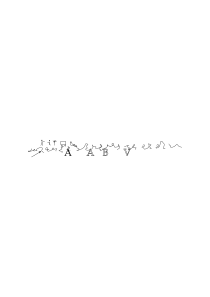

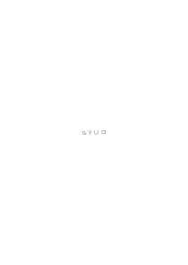

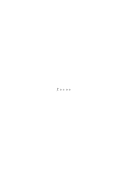

### [6\[2\]](https://cdn.wittgensteinnachlass.com/2000px/webp/Ms-152/6.webp),[7\[1\]](https://cdn.wittgensteinnachlass.com/2000px/webp/Ms-152/7.webp)

What, then, is there to the assertion that reading – is, after all, a ‘perfectly definite process’? Presumably that means that _one_ definite process always takes place when we read, one that we recognize. But if on the one hand I read a word in a book & on the other I move in the game in accordance with a sentence, using the table, – is this really the same mental process? There is, on the other hand, of course, a uniformity in the process of reading a printed page. For the process is indeed uniform. And naturally this process differs from, say, letting words come to mind at the sight of arbitrary strokes. For the mere sight of a printed line is already extremely characteristic, i.e. a quite specific image: the letters all roughly the same size, recurring countless times. The words, a large proportion of which recur constantly & are immensely familiar to us, just like familiar faces. Think of the unease a change in spelling causes us. Of course, not every form of sign has been _deeply_ imprinted on us. A newly invented sign like ~ for ‘not’ can be replaced by any other without stirring anything in us.

---

### [7\[2\]](https://cdn.wittgensteinnachlass.com/2000px/webp/Ms-152/7.webp),[8\[1\]](https://cdn.wittgensteinnachlass.com/2000px/webp/Ms-152/8.webp),[9\[1\]](https://cdn.wittgensteinnachlass.com/2000px/webp/Ms-152/9.webp)

But why do you say that we feel a ‘causation’? Causation, after all, is what we establish through experiments on the basis of coincidence, by observing the regular concurrence of events. How could I say that I feel precisely what is established in this way by experiments (there will have to be more about this later). One might just as well say that I feel that the letters are the _reason_ why I read in such (& such) a way. For if someone asks me why do you read – – – then I justify it by the letters. But what is it supposed to mean to _feel_ this justification that I am thinking of here? I would like to say that I feel a certain _influence_ of the letters on me, but not an influence of those arbitrary signs on my speaking. Read nie nib hci. Let us look again at individual letters. Let us compare i with 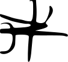. Would I also say that I feel the influence of ‘i’ when I _read_ these letters? There is of course a difference between saying ‘i’ at the sight of ‘i’ and saying ‘i’ at the sight of ‘’. And the difference is that with the sign ‘i’ the sound ‘i’ comes automatically, even against my will, & when I read the letter aloud, saying the word takes less effort than in the case of . It would never have occurred to us that we were being … influenced if we had not compared the case of the word with that of the signs . And here we do indeed notice a _difference_ & now we interpret this difference as an influence of the [unreadable] etc. As an _influence_, that is, when we read in a particular slow way & look at each letter. We let ourselves be ostentatiously guided by the letters, so to speak. But this being guided consists simply in my looking at each letter. We imagine that by means of a feeling we perceive, as it were, a mechanism linking word & sound. For when I speak of influence, causation, being guided, this is supposed to mean that I feel, as it were, the movement of the levers linking the sight of the letters with the utterance of the sound. But what I feel so distinctly is the shape of the letters.

### [9\[2\]](https://cdn.wittgensteinnachlass.com/2000px/webp/Ms-152/9.webp),[10\[1\]](https://cdn.wittgensteinnachlass.com/2000px/webp/Ms-152/10.webp),[11\[1\]](https://cdn.wittgensteinnachlass.com/2000px/webp/Ms-152/11.webp)

If I vividly imagine such a definite process, it appears to me as the experience of being guided, of reading. But now I ask myself: What are you _doing_? – You look at those signs for a while. You make this face, you draw the line segment slowly (and the like). – So _that_ is the experience of being guided? Here I would like to say: No, that is not it, it is something inner, more essential. It is as if at first all these rather inessential actions were enveloped in a certain atmosphere, which now evaporates when I look closely.

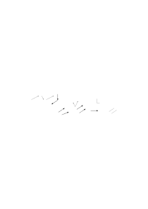

Ask yourself how you draw an arrow ‘deliberately’ parallel to another, and another time deliberately at an angle to that arrow. What is the experience of deliberation? A particular facial expression, a particular gesture immediately comes to mind, & then you would like to say “& it is indeed a _definite_ inner experience”. (With which you have of course said nothing more.) (You notice here a connection with the question of the essence of intention, of will, of meaning & understanding.) Now isn’t what I am doing trying to separate a kind of general experience from the particular experience of having drawn _this_ line segment in this way

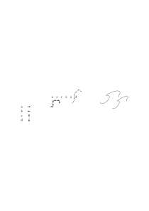

& wasn’t it that the word ‘guide’ came to mind as I did so? I want to say, for example, that the experience of being guided is an experience of nestling against something (with a gesture). As soon as I ask myself “so is that what is essential to the experience of being guided” I have to take it back. – So what I really want to say is: The experience of being guided is _this_, & now let myself be guided (as a sample). But once again I have not _described_ it. But here is another point: _while_ I let myself be guided everything is quite simple, I notice _nothing special_; but afterwards, when I ask myself what happened then, something indescribable seems to have happened. Afterwards no description satisfies me. Try this. I tell myself I let myself _“be guided”_ & when I put myself back into the process in this way, _it acquires a_ peculiar feature which it did not have before (at all). I could say: Certainly; I have just let myself be guided. But what characteristic thing happened in the process –? When I say what happened, it no longer strikes me as characteristic. But did what you want to say really happen then, or only when you said “Certainly I have just let myself be guided”? (Meaning) Wasn’t it, for example, the particular tone in which you said this sentence? Possibly also a guiding movement of the hand. – The difficulty is that I feel as if being guided involved not only what is phenomenal, what occurs _simultaneously_ with the movement of the hand, for example, but also an influence, a compulsion. Expressed in the sentence “I don’t merely _do_ it, I have to do it.” (The will not a _phenomenon_). Isn’t this as if one were not content to describe the feeling that there is a heavy storm by – – – but said it was more, it was a desire to move downwards. As if, so to speak, the movement were already there & yet again not there. Incidentally, make a guiding movement with your hand, as if you were leading someone along (but without actually doing so), & ask yourself what made this movement a guiding one. For admittedly you have not guided anyone here & yet you could call the movement a _guiding_ one. So this movement & the sensation that went with it did not contain the essence of guiding & yet you could not help using this designation. It is just _one form of appearance_ of guiding that suggests _this expression_ to you.

(Absolute & relative movement)

### [11\[2\]](https://cdn.wittgensteinnachlass.com/2000px/webp/Ms-152/11.webp),[12\[1\]](https://cdn.wittgensteinnachlass.com/2000px/webp/Ms-152/12.webp)

It is _that_, I would like to say.

I cannot, so to speak, believe that I _merely_ looked, made that face, drew the line, etc. But do I remember anything else? _No_; & yet it seems to me there must have been something else; that is, when I say the word “guide” to myself in connection with it. ‘For I was _guided_, after all,’ I tell myself. There is, for example, a visual appearance of being guided that one could imitate on the stage without anyone being guided. (One has to reflect in this way again and again when thinking about the relation between the expression of a feeling & the feeling.)

### [12\[2\]](https://cdn.wittgensteinnachlass.com/2000px/webp/Ms-152/12.webp)

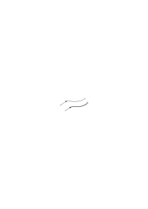

Only then does the idea of that _ethereal_, intangible influence arise. (When I get up, ‘I find myself getting up’.)

### [12\[3\]](https://cdn.wittgensteinnachlass.com/2000px/webp/Ms-152/12.webp)

[Keys often come to mind, but I do not know which lock they belong to.]

### [12\[4\]](https://cdn.wittgensteinnachlass.com/2000px/webp/Ms-152/12.webp)

For of course I do what I do under the influence.

### [13\[1\]](https://cdn.wittgensteinnachlass.com/2000px/webp/Ms-152/13.webp)

Much of it is patchwork & botchwork.

### [13\[2\]](https://cdn.wittgensteinnachlass.com/2000px/webp/Ms-152/13.webp)

This book sets out my views on philosophy as they have developed over the last eight years. I have done it as well as I could; but it has nevertheless turned out unsatisfactorily in many respects. It lacks telling brevity; the expression is long-winded. What should have been drawn with one stroke I have to draw with ten strokes and thus indistinctly …

The book is poor in another respect too. The expression lacks precision and is often long-winded; much in the examples could be better & the structure is in large part patchwork & botchwork. The book is wanting in another respect too; but only a reader who _really_ understands something will see that, should it fall into the hands of such a reader. But I do not need to explain it to that reader.

### [14\[1\]](https://cdn.wittgensteinnachlass.com/2000px/webp/Ms-152/14.webp),[15\[1\]](https://cdn.wittgensteinnachlass.com/2000px/webp/Ms-152/15.webp)

Imagine a surface painted in different colours. Say one part is green. The green shades off in all directions into other colours; in one direction it becomes more & more yellowish & finally pure yellow; in another (direction) it becomes more bluish until we come to pure blue. This in turn shades off in another direction into white, etc. In some directions the colour changes rapidly. – One might say the colour gradient is steep; in others it is gentler & in places almost entirely or nearly level. Now imagine this surface so large that you cannot take it in at one glance; suppose you take a walk on it. You happen to be standing in the blue & bluish part; now you are to say what colour the surface is. You will be tempted to say: “It is really _blue_; admittedly the blue shades into other colours too, but what is common, what is characteristic, is that it is blue.” But if you move further & further into the reddish part, your feeling will change; & you will want to say: “_Perhaps_ I should really have said it is bluish red; the blue was only a limiting case; really it is bluish red”. And so on. This will happen if for some reason you have a preconception that the surface has _one_ characteristic colouring. You could then be led from colour to colour & be deceived by each. We would like to cling to each of them desperately until there is no trace of it left & we give in to a new impression.

### [15\[2\]](https://cdn.wittgensteinnachlass.com/2000px/webp/Ms-152/15.webp)

Likewise, when one asks us: ‘What does “reading” consist in?’ we want to say: Reading is a definite mental activity. (But we do not mean understanding). Then we are inclined to read a page to see what this activity consists in. In ordinary reading we notice nothing, & now we want to look more closely. _Then_ it seems to us that we see something: the words speak to us in a definite way. They are familiar, expressive faces (this may be especially true of handwritten words & in a hand very familiar to us). And it is precisely the familiarity of the impression that misleads us into believing that we now have what is essential. But we need only walk further in the region of reading, & nothing remains of this particular impression & the landscape changes. – But if you wanted to describe such a gradually changing landscape, wouldn’t you try to describe characteristic rock formations & forms of vegetation? As it were, various poles between which these forms move?

### [16\[1\]](https://cdn.wittgensteinnachlass.com/2000px/webp/Ms-152/16.webp)

<s> And the more familiar the colour is to us & the stronger the impression it makes on us, the more inclined we will be to regard it as **the** colour of the surface. </s> It is the extraordinary familiarity of our script, the characteristic impression it makes on us, that misleads us into thinking we see the essence of reading in reading the script.

### [16\[2\]](https://cdn.wittgensteinnachlass.com/2000px/webp/Ms-152/16.webp)

The more familiar & the stronger the impression such a shade of colour makes on us, the more inclined I will be to see in it _the_ colour of the surface.

### [16\[3\]](https://cdn.wittgensteinnachlass.com/2000px/webp/Ms-152/16.webp),[17\[1\]](https://cdn.wittgensteinnachlass.com/2000px/webp/Ms-152/17.webp)

This is how it is when one asks us: what is the essence of punishment & one person says that _really_ all punishment is society’s revenge, another that its essence is deterrence, etc. But aren’t there typical cases of society’s revenge, and again of measures of deterrence, and others of punishment as a means of reform, & then countless mixtures & intermediate stages? So if we were asked about the essence of punishment, or about the essence of revolution, or about the essence of knowledge, or of cultural decline, or of a refined sense for music, – then we should not try at all costs to find something common to the entirely different cases, but instead examples, as it were centres of variation.

### [17\[2\]](https://cdn.wittgensteinnachlass.com/2000px/webp/Ms-152/17.webp)

The more familiar, then, & the stronger the impression such a shade of colour makes on me, the more inclined I am to take it for the colour of the surface.

### [17\[3\]](https://cdn.wittgensteinnachlass.com/2000px/webp/Ms-152/17.webp)

This happens to us with many concepts: when we think about them, we think first of the part of their extension where we are, one might say, at home. From there we are drawn further afield & do not notice that the landscape now changes entirely, _gradually & by degrees_. And to say: at bottom it is always the same, now perhaps means only: _that_ is where I come from, I want to refer everything back to that state.

### [17\[4\]](https://cdn.wittgensteinnachlass.com/2000px/webp/Ms-152/17.webp)

Now what does it mean when we say that the script is familiar to us?

### [17\[5\]](https://cdn.wittgensteinnachlass.com/2000px/webp/Ms-152/17.webp),[18\[1\]](https://cdn.wittgensteinnachlass.com/2000px/webp/Ms-152/18.webp),[19\[1\]](https://cdn.wittgensteinnachlass.com/2000px/webp/Ms-152/19.webp)

But how is it, then: did we carry out a ‘thought experiment’ here? – How do we know that this is how things are? Simply by imagining them to be so? What sort of strange method is this for finding out what actually happens? – Or is it because these processes take place _in_ me, so that I need only look inside myself? – We shall speak later of ‘outside & inside’, – but in any case one would think that if I want to see the thing in myself now, it would have to be going on in me right now. (And merely pretending is again not enough.)

Nor was I (perhaps) remembering the case, for it has never happened to me. Now on the one hand one really can carry out an experiment by imagining something, not an experiment _in_ the imagination. (As if a physicist could do without actual apparatus & experiment in the imagination.) If someone asks me, for example, how do you greet N., how do you approach him, then in order to give an answer I can imagine N. & now, as it were, approach the mental image. And this is an experiment. It may mislead me & what actually happens in such a case may be something else, but experience may teach us that in such cases what usually happens is what such an experiment shows. So if the question had been: Does a person smile in such a case, then I could indeed have carried out the experiment with the aid of imagination. Do I now know that _one_ smiles, or only that _I_ smile? And if the former, isn’t imagining then a kind of _remembering_? In any case not necessarily ‘remembering particular cases’! – The task would be: Act out how one approaches someone in such & such circumstances. Here remembering could take the form of imitation, without there being, say, a visual memory-image to go by in imitating. And if I now imitate myself, is that remembering? In such cases one sometimes says, after imagining the situation: In my own case I know for certain that I smile, I simply couldn’t do otherwise. – But might it not happen that an eyewitness said to me: “I assure you, you never smiled on those occasions”; & isn’t it possible that I would believe him? – But that was not the kind of experiment at issue in case 95. For the question was not whether such & such a feeling familiar to us occurs in these cases or not, but whether a feeling occurs here that we are prepared to call a ‘feeling of familiarity’. So if I said: “Let us imagine what actually happens in such a case”, that would mean: let us imagine the case without being influenced by the words ‘feeling of familiarity’, thus, as we might say: _without grammatical prejudice_. And we might ask: Do you now (still) feel the need to say that he had the feeling of familiarity at the sight of the pencil? –

### [20\[1\]](https://cdn.wittgensteinnachlass.com/2000px/webp/Ms-152/20.webp)

…, in which a word is sometimes used to designate a ‘mental’ ‘process or state’ which an action initiates, but sometimes the performance of the action itself is the criterion of the …

### [20\[2\]](https://cdn.wittgensteinnachlass.com/2000px/webp/Ms-152/20.webp),[21\[1\]](https://cdn.wittgensteinnachlass.com/2000px/webp/Ms-152/21.webp)

– I say “agreement”. But surely it cannot be just the word “agreement”. On my walk I see the bare summit of the mountain lit by the sun & behind it the blue sky. I tell myself that it is very beautiful but do not feel it as strongly as I would probably like; then I say to myself the word “the blue ether” – & now I feel satisfied. But it cannot have been the sequence of sounds “the blue ether”, for that could come to mind & make no impression on you. Yes, of course I said these words in a special way. I.e., with a smiling face, breathing in the cool air with my mouth open. So breathing in a definite way, not panting, etc. But I had no image in mind that might have belonged to this word & that I might have compared with what I actually saw. But wasn’t it a specific feeling that you get only when you say these very words & that is the product of the various images & associations that have been linked with this word? I am sure, for example, that the satisfaction this word aroused in me … in the … has these associations, e.g. in the one with certain lines of verse in which it occurs. But have I any reason to say that the feeling that accompanied the words was a special one connected only with these concepts? The sound of these words is _special_, & so was the sight.

### [21\[2\]](https://cdn.wittgensteinnachlass.com/2000px/webp/Ms-152/21.webp)

… One would probably say then: red & green are two different aspects of the same thing. Isn’t that like calling green & blue cold colours, for instance? The difficulty with my example is that those who say ‘patrician colour’ & ‘plebeian colour’ should not feel this designation to be merely external. Rather, for them green & red stand for the same thing. They feel them to be only two varieties of the same thing. Perhaps as two poles of the same thing, but belonging together like the two ends of the same rod. They would not, of course, then point to a colour that is what they have in common.

### [21\[3\]](https://cdn.wittgensteinnachlass.com/2000px/webp/Ms-152/21.webp)

– – – Ask yourself: does this happen in every ostensive explanation of a generic name?

### [22\[1\]](https://cdn.wittgensteinnachlass.com/2000px/webp/Ms-152/22.webp)

The grammar of the word ‘as it were’.

### [22\[2\]](https://cdn.wittgensteinnachlass.com/2000px/webp/Ms-152/22.webp)

Imagine people who have a special way of using colour words for horses & a different one again for cows (different weights & measures, as it were). You have to _learn_ what it is in this case that is called yellow. They speak of blue apples. Here we would say: when I call an apple & a sky blue, I am not calling what they have in common blue. “Bring me the red pot from the kitchen.” – There isn’t one there. – Oh, you call that one red! I would call it brown with a slight reddish tinge.

### [22\[3\]](https://cdn.wittgensteinnachlass.com/2000px/webp/Ms-152/22.webp)

When I say to someone, “I’m very sorry I said that to you”, _meaning_ it presumably consists in feeling something definite while one says it. If someone asked me, “Did you really mean it when you said you were very sorry?”, I would recall what I felt while saying it.

### [22\[4\]](https://cdn.wittgensteinnachlass.com/2000px/webp/Ms-152/22.webp)

“When one _means_ what one says, certain things go on within one.”

### [23\[1\]](https://cdn.wittgensteinnachlass.com/2000px/webp/Ms-152/23.webp)

Under normal circumstances this is a friendly mouth, & these feelings mean that one means what one says. Under normal circumstances that is the characteristic of meaning what one says. But this feature too can be belied by another.

### [23\[2\]](https://cdn.wittgensteinnachlass.com/2000px/webp/Ms-152/23.webp)

I have, for example, talked myself into a certain mood.

### [23\[3\]](https://cdn.wittgensteinnachlass.com/2000px/webp/Ms-152/23.webp)

One calls this the characteristic of meaning, for _those_ circumstances that would belie it are _not at issue at all_ now.

### [23\[4\]](https://cdn.wittgensteinnachlass.com/2000px/webp/Ms-152/23.webp)

No, that is too simple a representation of the situation. –

### [23\[5\]](https://cdn.wittgensteinnachlass.com/2000px/webp/Ms-152/23.webp)

… And when I call them ‘feelings of meaning’, what I want to say is that, in other circumstances, it is precisely these feelings we refer to when we say that while we were speaking we also _meant_ something. Only, that is in cases where one doesn’t think at all of that case of lying.

### [23\[6\]](https://cdn.wittgensteinnachlass.com/2000px/webp/Ms-152/23.webp),[24\[1\]](https://cdn.wittgensteinnachlass.com/2000px/webp/Ms-152/24.webp)

With the words believe, mean, intend, etc., we refer to states & processes that we can call ‘mental’, given certain circumstances. That is, under these circumstances, we could say, it counts as believing what I say if I experience _that_ while saying it.

Under _these_ circumstances these feelings are the criteria of meaning, believing.

### [24\[2\]](https://cdn.wittgensteinnachlass.com/2000px/webp/Ms-152/24.webp)

Compare the characteristic feelings of meaning what you say when you say to someone a) “Forgive me, I’m very sorry I said that!”

b) “I’m glad you’re here!”

d) “The Earth describes an ellipse round the Sun.”

e) “It’ll rain today.”

c) “I’m hungry.”

### [24\[3\]](https://cdn.wittgensteinnachlass.com/2000px/webp/Ms-152/24.webp)

“But surely there is a difference in the mental process when you mean what you say & when you don’t mean it!” – There are _all sorts_ of such differences, & quite different ones in different cases. But in particular cases there may also be no _such_ difference at all.

### [24\[4\]](https://cdn.wittgensteinnachlass.com/2000px/webp/Ms-152/24.webp),[25\[1\]](https://cdn.wittgensteinnachlass.com/2000px/webp/Ms-152/25.webp)

– – – But why then, after all, do I say at all that this word refers to mental acts & states?? – Presumably because, between the case where one means _this_ sentence & the case where one doesn’t mean it, there _is_ a difference in the mental processes, at least most of the time. In what way, then, does it _refer_ to them? (For above all, no superstition!) Well, that can only mean that, for example, in answer to the question “Why do you say you meant what you said?”, you cite in many cases what you felt or didn’t feel when you said it. Sometimes you say: I really was glad; I really was sorry, I really was afraid it would rain, I didn’t say it absent-mindedly but was thinking as I said it. And each such explanation could in turn be expanded: one could say how I felt when I was glad, etc.

### [25\[2\]](https://cdn.wittgensteinnachlass.com/2000px/webp/Ms-152/25.webp)

In many cases, except when we are philosophizing, we won’t speak at all of someone meaning what he says, for instance when he is explaining the laws of free fall to someone. If we want to speak of “meaning” here we feel a certain difficulty: we don’t quite know what case meaning is being contrasted with, whether it is that the teacher is talking in his sleep, or whether he understands what he is saying, or that he is convinced of a different mechanics, etc.

### [25\[3\]](https://cdn.wittgensteinnachlass.com/2000px/webp/Ms-152/25.webp)

Am I entitled to say that believing, etc., is or refers to a mental activity? Or is that merely a philosopher’s fancy?

### [25\[4\]](https://cdn.wittgensteinnachlass.com/2000px/webp/Ms-152/25.webp)

“Did you really believe it was going to rain, or did you just say so?” – “No, I really did believe it.” How does ‘saying & believing’ differ from saying alone?

### [25\[5\]](https://cdn.wittgensteinnachlass.com/2000px/webp/Ms-152/25.webp),[26\[1\]](https://cdn.wittgensteinnachlass.com/2000px/webp/Ms-152/26.webp)

One contrasts believing with mere saying, _so_ believing means: saying & believing minus saying. That is, it means what makes what is said into what is believed.

### [26\[2\]](https://cdn.wittgensteinnachlass.com/2000px/webp/Ms-152/26.webp)

So the question would always be: what is the difference between saying & believing & saying without believing; _that_ is what we want to call ‘believing’. –

### [26\[3\]](https://cdn.wittgensteinnachlass.com/2000px/webp/Ms-152/26.webp)

Saying something & believing it can mean, for example, saying it _without_ ulterior thoughts. And ‘merely saying’ it can consist in saying it _with_ ulterior thoughts.

### [26\[4\]](https://cdn.wittgensteinnachlass.com/2000px/webp/Ms-152/26.webp)

When I ask: did you believe it when you told me?, I am asking about the mental state he was in.

“I didn’t say it absent-mindedly.” What is the difference between speaking absent-mindedly & speaking otherwise? There is a difference while one is speaking. Imagine a case like that.

When I ask: did you really believe it, etc., then at any rate _I_ am inclined to say that I am asking what things were like inside him, what went on in him when he told me this, or shortly afterwards or beforehand.

### [27\[1\]](https://cdn.wittgensteinnachlass.com/2000px/webp/Ms-152/27.webp)

“Did you really believe it in your heart?”

### [27\[2\]](https://cdn.wittgensteinnachlass.com/2000px/webp/Ms-152/27.webp)

“I was distracted when I said it.” What is it like when one is distracted? Different cases.

### [27\[3\]](https://cdn.wittgensteinnachlass.com/2000px/webp/Ms-152/27.webp)

Can I say of a poem I recite from memory or read aloud that I mean it? In what cases would you say such a thing?

### [27\[4\]](https://cdn.wittgensteinnachlass.com/2000px/webp/Ms-152/27.webp)

I go into a corridor & trip over a step & say I believed it went on level there.

### [27\[5\]](https://cdn.wittgensteinnachlass.com/2000px/webp/Ms-152/27.webp)

“Did you really believe it was level there?” – “I didn’t know there was a step here.”

### [27\[6\]](https://cdn.wittgensteinnachlass.com/2000px/webp/Ms-152/27.webp)

But what, then, is the kinship between the different cases of ‘believing’?

### [27\[7\]](https://cdn.wittgensteinnachlass.com/2000px/webp/Ms-152/27.webp)

I believed it; I didn’t want to mislead you.

I believed it & didn’t say it in a moment of distraction.

I believed it & didn’t say it just to avoid contradicting you.

I believed it & didn’t merely think it might be so.

I believed it, even if I did say it rather distractedly.

### [27\[8\]](https://cdn.wittgensteinnachlass.com/2000px/webp/Ms-152/27.webp),[28\[1\]](https://cdn.wittgensteinnachlass.com/2000px/webp/Ms-152/28.webp)

“I meant it; I didn’t say it in a moment of distraction.” “Meaning it in jest”, “meaning it in earnest”. Think what you do in such a case. Do you mean every word in jest?

### [28\[2\]](https://cdn.wittgensteinnachlass.com/2000px/webp/Ms-152/28.webp)

Can you think a joke without words?

### [28\[3\]](https://cdn.wittgensteinnachlass.com/2000px/webp/Ms-152/28.webp)

“I’ll never set foot in this house again!” Did you mean it? How did he mean the “_never_ again”? Does it take some time to mean these words? Or can one do it while uttering them? What would it have been like if I had _not_ meant the words?

### [28\[4\]](https://cdn.wittgensteinnachlass.com/2000px/webp/Ms-152/28.webp)

– How does one say this sentence when one means it, and how when one doesn’t mean it?

### [28\[5\]](https://cdn.wittgensteinnachlass.com/2000px/webp/Ms-152/28.webp)

‘Meaning’ – ‘not meaning’: that refers to a mass of contrasts.

### [28\[6\]](https://cdn.wittgensteinnachlass.com/2000px/webp/Ms-152/28.webp),[29\[1\]](https://cdn.wittgensteinnachlass.com/2000px/webp/Ms-152/29.webp)

I say, “I’ll never climb this mountain again either!” & later say, “I meant it as an exaggeration.” The fact that I say this is part of what my having meant it that way consists in. (Telling a dream) But what sort of discovery have I made there? – I have only freed myself from the compulsion of the grammatical form & now look at what actually happens.

### [29\[2\]](https://cdn.wittgensteinnachlass.com/2000px/webp/Ms-152/29.webp)

Anyone who listens to the ei sound without thinking of the spelling hears that it sounds like a-e.

### [29\[3\]](https://cdn.wittgensteinnachlass.com/2000px/webp/Ms-152/29.webp)

[Imagine a script in which the letter 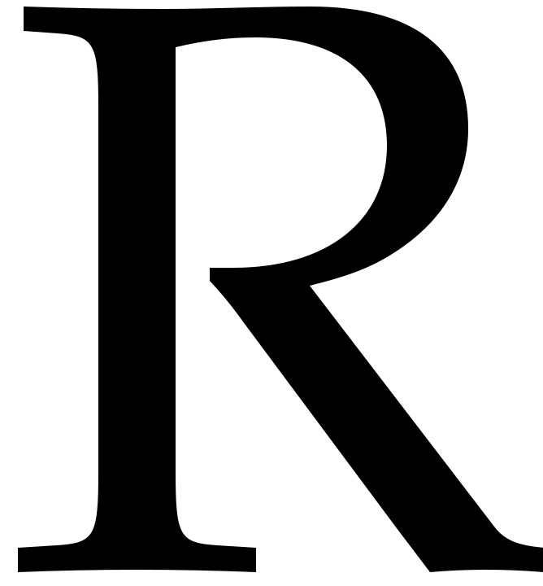 can be written just as well as 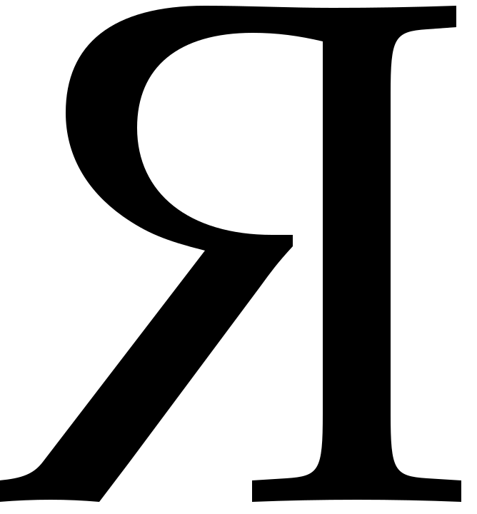 as it can as . For them it is the same letter. Should we say that, for them, the letter is what both have in common? Or even a script in which every letter can lie any which way, for example, the A like this: 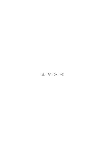. They, for example, have always cut their signs into stamps & then printed them.]

### [29\[4\]](https://cdn.wittgensteinnachlass.com/2000px/webp/Ms-152/29.webp)

“I hope to see you again!” – what does meaning it consist in? One might think: in having a feeling of hoping. But what is such a feeling like? Is it just a feeling of hoping in general, or of this hope? Look and see: do you really see such a feeling that _accompanies_ the words? – Perhaps you had a feeling of being weighed down as you said these words & with these words & under these circumstances one can say you felt hope.

### [29\[5\]](https://cdn.wittgensteinnachlass.com/2000px/webp/Ms-152/29.webp),[30\[1\]](https://cdn.wittgensteinnachlass.com/2000px/webp/Ms-152/30.webp)

What is it like when you remember having meant something even though you can’t remember the mental processes that accompanied the utterance of the sentence?

### [30\[2\]](https://cdn.wittgensteinnachlass.com/2000px/webp/Ms-152/30.webp)

One can say: “Someone who _means_ it when he says he is sorry says it with a different feeling.” And that is like saying: “with a different expression”.

### [30\[3\]](https://cdn.wittgensteinnachlass.com/2000px/webp/Ms-152/30.webp)

One could also say: “Someone who says it with this expression under these circumstances _means_ it.” (Under these circumstances this mouth is a friendly mouth.) And likewise: someone who is lying will say it differently under these circumstances.

### [30\[4\]](https://cdn.wittgensteinnachlass.com/2000px/webp/Ms-152/30.webp)

It isn’t true when one says: “Only he can really know whether he means it.” – No, it sometimes happens that I know with certainty that he means what he says & couldn’t believe any of his assurances that he didn’t mean it. (More of that later.)

### [30\[5\]](https://cdn.wittgensteinnachlass.com/2000px/webp/Ms-152/30.webp),[31\[1\]](https://cdn.wittgensteinnachlass.com/2000px/webp/Ms-152/31.webp)

The mental processes that go on while one is speaking play the same role as the sensations of expression, i.e. the sensations that are a correlate of the expression of conviction, doubt, supposition, etc. etc. That is, if someone speaks with this expression under such & such circumstances, we say he means what he says while saying it. There is nothing there to belie this expression. For this expression is not a symptom that something else is present, the actual meaning-it; rather, it is one of the features that make up meaning it, though only together with others & in the absence of certain other features.

### [31\[2\]](https://cdn.wittgensteinnachlass.com/2000px/webp/Ms-152/31.webp)

Imagine this: you go up to some stranger or other & say, with as friendly an expression as possible, “I’m very glad to see you”. What will you feel while doing this?

### [31\[3\]](https://cdn.wittgensteinnachlass.com/2000px/webp/Ms-152/31.webp)

Can one say that the mental processes that go on when one speaks are a ‘component of meaning’?

### [31\[4\]](https://cdn.wittgensteinnachlass.com/2000px/webp/Ms-152/31.webp)

“Meaning is a mental process that goes on when one speaks – perhaps beforehand too, but especially while one is speaking. – If I mean something, surely I am in a different state from when I say it & don’t mean it.” – That is true, roughly speaking. _And now look and see what goes on._ And pay no attention to what ‘surely must go on’.

### [31\[5\]](https://cdn.wittgensteinnachlass.com/2000px/webp/Ms-152/31.webp)

Meaning a promise. Here, as so often in philosophy, we are tempted to represent the facts as the little painter Klecksel represents human faces in profile.

### [32\[1\]](https://cdn.wittgensteinnachlass.com/2000px/webp/Ms-152/32.webp)

Suppose I checkmate my opponent; someone asks me, “Did you intend to checkmate him?” I say yes; & now he asks, “How can you say that? Surely all you know is that such & such went on in you when you made the move!” Does the intention to checkmate someone consist in making this move with these thoughts & feelings?

### [32\[2\]](https://cdn.wittgensteinnachlass.com/2000px/webp/Ms-152/32.webp)

How is it that one so seldom says: I remember saying it, but I no longer remember whether I meant it. One would think that the subtleties of the feelings one had when uttering the _sentence_ would very easily slip one’s mind.

### [32\[3\]](https://cdn.wittgensteinnachlass.com/2000px/webp/Ms-152/32.webp)

One can imagine countless cases, to great advantage.

### [32\[4\]](https://cdn.wittgensteinnachlass.com/2000px/webp/Ms-152/32.webp)

Can you have the intention of checkmating him unless you know the game? And how does knowing the game enter into your mental state during the move?

### [33\[1\]](https://cdn.wittgensteinnachlass.com/2000px/webp/Ms-152/33.webp)

… For isn’t the only _person_ who can intend to checkmate me the one who understands the game, i.e. who knows the rules & also has a certain amount of practice in playing? But how can these conditions enter into his mental processes during the move? And yet it depends on them whether or not he has just checkmated me intentionally. Or: can someone who doesn’t know the game want to checkmate me? And why not? Is it so impossible to put oneself into the right state of mind? And what if he did manage it after all? But what happened when I checkmated him intentionally? Suppose I said the words “Now I’ll checkmate him” to myself. But someone who doesn’t know the game could say these words too, & he could say them with all the feelings I had, but they mean nothing, not because they aren’t accompanied by the right feelings but because they aren’t part of a language-game.

### [33\[2\]](https://cdn.wittgensteinnachlass.com/2000px/webp/Ms-152/33.webp)

Meaning something consists in thinking, feeling, saying & doing various things.

### [33\[3\]](https://cdn.wittgensteinnachlass.com/2000px/webp/Ms-152/33.webp),[34\[1\]](https://cdn.wittgensteinnachlass.com/2000px/webp/Ms-152/34.webp)

Imagine this case: you had a visitor; he was unwelcome & boring, and the whole time you had thoughts like: if only he’d go now, etc. As he leaves you say to him, “I hope you’ll come again soon” – & _mean_ it. But after you’ve said it you go back to hoping he won’t come again. Is that possible? And if you think not, why not? I think you will ask yourself: how can this happen? That is, what does it mean here to _mean_ this sentence, ex abrupto? Suppose someone said, “That could only be a moment of madness”. But is that an explanation? Granted that it is madness, what I want to know is: _What constituted_ meaning it here? I could, for example, say to myself: another time he’ll be more pleasant & I’ll be in a better mood, I hope he gives me a chance to try it, or I suddenly regretted my cool behaviour.

### [34\[2\]](https://cdn.wittgensteinnachlass.com/2000px/webp/Ms-152/34.webp)

That will become clear when we talk about _understanding_. – But why are we so interested in psychological facts? …

### [34\[3\]](https://cdn.wittgensteinnachlass.com/2000px/webp/Ms-152/34.webp)

This being convinced – one might say – presumably had a history leading up to it.

### [34\[4\]](https://cdn.wittgensteinnachlass.com/2000px/webp/Ms-152/34.webp)

… You don’t find what you’re looking for.

### [35\[1\]](https://cdn.wittgensteinnachlass.com/2000px/webp/Ms-152/35.webp)

Why are we so interested here, as we were earlier when we spoke of reading, in facts of psychology? What have they to do with our investigation?

### [35\[2\]](https://cdn.wittgensteinnachlass.com/2000px/webp/Ms-152/35.webp)

One _can_ say: physical & mental effort are both so called because the element of effort is present in both. The idea, the picture here is this: “effort” means something contained in both. But one can also say: I call both effort because there is a similarity between them. And one can now remind you of all sorts of similarities. (Think of mental & physical restlessness or rest.) One could say that mental restlessness is a kind of physical restlessness & similar things have often been said. (And mind, too, is only something belonging to the body (Zarathustra). We still have to consider this idea.) There may be people inclined to say: “I call sounds & coloured things brighter & darker because the same element is present in both relations.” And it is possible that in other respects there is no difference at all between their use of these words & ours.

### [35\[3\]](https://cdn.wittgensteinnachlass.com/2000px/webp/Ms-152/35.webp),[36\[1\]](https://cdn.wittgensteinnachlass.com/2000px/webp/Ms-152/36.webp)

Suppose someone said: “_I_ see something common to these relations.” What am I to say now? – I will ask him: what is it? He: “I can’t explain that to you; I can only say that I see something of the sort.” I: “Then you aren’t telling me anything new by saying that, except that this is how you want to express yourself, & that may be interesting in some respects.”

### [36\[2\]](https://cdn.wittgensteinnachlass.com/2000px/webp/Ms-152/36.webp)

“By ‘darker’ I mean _this_ relation & not _really_ the relation of the sounds to one another. For me the word designates this relation directly & the other only in a figurative sense.” “The concept ‘darker’ doesn’t really fit the relation between the sounds.”

‘darker’ has a different relation to the relation between sounds than it has to the relation between colours.

### [36\[3\]](https://cdn.wittgensteinnachlass.com/2000px/webp/Ms-152/36.webp)

But what sort of relation is this, designating in a figurative sense?

### [36\[4\]](https://cdn.wittgensteinnachlass.com/2000px/webp/Ms-152/36.webp),[37\[1\]](https://cdn.wittgensteinnachlass.com/2000px/webp/Ms-152/37.webp)

“When I say of two things that one is darker, I mean it directly; when I say it with reference to sounds, I mean it only figuratively, only ‘as it were’.” What happens when one means the word directly in one case, and only in a figurative sense in the other?

### [37\[2\]](https://cdn.wittgensteinnachlass.com/2000px/webp/Ms-152/37.webp)

“What _I_ mean by ‘darker’ is not to be found in the relation between sounds; I use the word of sounds only in a figurative meaning, i.e. only by way of comparison.” – But do you then always think of colours first when you use the word of sounds? – “No, but I only call on the word, bring it in as it were; it isn’t the proper word for the thing.” – – – The word then has a different relation to what it designates – – –

### [37\[3\]](https://cdn.wittgensteinnachlass.com/2000px/webp/Ms-152/37.webp)

“Both the animal’s colour and the sounds it made were darker than those of the ….” Or: “Its colour was brighter than that of the …, but the sound it made was darker.”

### [37\[4\]](https://cdn.wittgensteinnachlass.com/2000px/webp/Ms-152/37.webp)

But surely you can’t read a book by the brightness of a sound!”

### [37\[5\]](https://cdn.wittgensteinnachlass.com/2000px/webp/Ms-152/37.webp),[38\[1\]](https://cdn.wittgensteinnachlass.com/2000px/webp/Ms-152/38.webp)

… I have a different experience of meaning. This experience is characterized, for example, by the hesitation when we say “_o_ is – as it were – darker than _e_”. The expression ‘as it were’ is often replaced by a faltering in speech & an inarticulate sound. [→ (see p. 253)]

### [38\[2\]](https://cdn.wittgensteinnachlass.com/2000px/webp/Ms-152/38.webp)

Augustine describes the learning of human language as follows: …

### [38\[3\]](https://cdn.wittgensteinnachlass.com/2000px/webp/Ms-152/38.webp)

Learning language thus appeared to him as learning the names of things. And his words therefore give a picture of the way of looking at things that sees the foundation of language in the ‘_meaning_ of the word’.

### [39\[1\]](https://cdn.wittgensteinnachlass.com/2000px/webp/Ms-152/39.webp)

_Augustine_ describes in the Confessions I,8 how a child learns its mother tongue. He says:

### [39\[3\]](https://cdn.wittgensteinnachlass.com/2000px/webp/Ms-152/39.webp)

_Augustine_ described in the Confessions (I/8) how a child learns its mother tongue. He says:

### [39\[4\]](https://cdn.wittgensteinnachlass.com/2000px/webp/Ms-152/39.webp)

Learning language thus appeared to him as learning the names of things (objects) ….

### [39\[5\]](https://cdn.wittgensteinnachlass.com/2000px/webp/Ms-152/39.webp)

_Augustine_ describes (Confessions I/8) how human beings learn language.

### [39\[6\]](https://cdn.wittgensteinnachlass.com/2000px/webp/Ms-152/39.webp)

_Augustine_ describes (Confessiones I/8) how

human beings learn language.

### [39\[7\]](https://cdn.wittgensteinnachlass.com/2000px/webp/Ms-152/39.webp)

_Augustine_ describes the learning of language

as follows:

### [39\[8\]](https://cdn.wittgensteinnachlass.com/2000px/webp/Ms-152/39.webp)

In the Confessiones (I/8) Augustine describes how a child learns language. He says

### [39\[9\]](https://cdn.wittgensteinnachlass.com/2000px/webp/Ms-152/39.webp)

Augustine describes how human beings learn language as follows:

### [40\[1\]](https://cdn.wittgensteinnachlass.com/2000px/webp/Ms-152/40.webp)

The concept of the “meaning of words”, with that meaning supposed to form the centre of philosophy, is …

### [40\[2\]](https://cdn.wittgensteinnachlass.com/2000px/webp/Ms-152/40.webp)

The philosophical concept of the meaning of words – as the foundation of all language –

### [40\[3\]](https://cdn.wittgensteinnachlass.com/2000px/webp/Ms-152/40.webp)

Such primitive forms of language

### [40\[4\]](https://cdn.wittgensteinnachlass.com/2000px/webp/Ms-152/40.webp)

“I get the brake working by connecting this lever to the rod.” Yes – given the whole rest of the mechanism. Only with this mechanism is it a brake lever, & quite detached from it, it isn’t even a lever but could be a weapon, a prop, a weight.

### [40\[5\]](https://cdn.wittgensteinnachlass.com/2000px/webp/Ms-152/40.webp),[41\[1\]](https://cdn.wittgensteinnachlass.com/2000px/webp/Ms-152/41.webp)

Don’t let it bother you that language (3) consists only of commands. We can easily imagine languages that consist merely of questions & the words yes & no.

Frege’s _assertion_ see book

### [41\[2\]](https://cdn.wittgensteinnachlass.com/2000px/webp/Ms-152/41.webp)

Remark on Russell – Nicod

Don’t let the commands bother you, etc.

Only one party speaks.

Variety of instruments

Switchboard?

Parts of speech

### [41\[3\]](https://cdn.wittgensteinnachlass.com/2000px/webp/Ms-152/41.webp)

It clears away the fog if we …

… in primitive *ways* of using language…

…, in which one can clearly see the purpose & functioning of the words.

### [41\[4\]](https://cdn.wittgensteinnachlass.com/2000px/webp/Ms-152/41.webp)

look at the phenomena of language (there) as they occur in primitive ways of using language

### [41\[5\]](https://cdn.wittgensteinnachlass.com/2000px/webp/Ms-152/41.webp)

It is in such primitive forms that the child learns to speak

### [41\[6\]](https://cdn.wittgensteinnachlass.com/2000px/webp/Ms-152/41.webp),[42\[1\]](https://cdn.wittgensteinnachlass.com/2000px/webp/Ms-152/42.webp)

In addition to the four words plate, cube, etc., let the language now contain a series of words used as the merchant in (2) uses the number words. This series can be that of the letters of the ABC; furthermore: two words, I will have them be “hither”, “thither”, because this already gives us a (rough) idea of their purpose; they are accompanied by a hand gesture; finally, there are also some small tablets of different colours. A now gives a command of the form 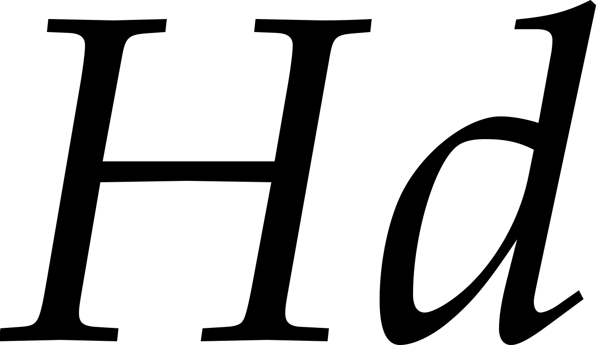 “plate thither”; in doing so he points to a place & shows the assistant a coloured tablet. The assistant takes from the stock of plates one of the colour of the tablet for each letter of the ABC up to 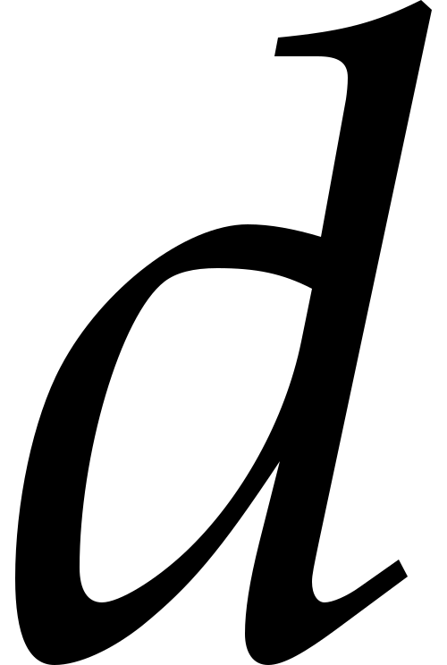 & brings them to the place the builder indicates. A command might be: “this thither” and so on.

Now what do the words of the language designate?

### [42\[2\]](https://cdn.wittgensteinnachlass.com/2000px/webp/Ms-152/42.webp),[43\[1\]](https://cdn.wittgensteinnachlass.com/2000px/webp/Ms-152/43.webp)

But how do they do that? In what respect do they designate something? Surely it must lie in what we do with them? And what that is we have already described & it is quite different for different words & to describe the function of the word in all these cases by saying ‘it designates something’ is surely just to apply the same word in the most varied cases, come what may.

### [43\[2\]](https://cdn.wittgensteinnachlass.com/2000px/webp/Ms-152/43.webp)

Are “this” & “thither” also taught ostensively? Well, imagine how one might teach their use! It will also occur there in acts of pointing.

### [43\[3\]](https://cdn.wittgensteinnachlass.com/2000px/webp/Ms-152/43.webp)

– Will ostensive teaching of the words also occur in this instruction? Well, for example, plates will be pointed to & counted …

### [43\[4\]](https://cdn.wittgensteinnachlass.com/2000px/webp/Ms-152/43.webp)

But does it play a similar role here to the one it plays in the other cases?

### [43\[5\]](https://cdn.wittgensteinnachlass.com/2000px/webp/Ms-152/43.webp)

Now what do all the words of this language _designate_?

### [43\[6\]](https://cdn.wittgensteinnachlass.com/2000px/webp/Ms-152/43.webp)

What they designate – how is that to show itself, if not in the way they are used? And we have already described that. So the expression “this word designates _that_” would have to be used in such a way as to become part of this description. The description of the use of a word is to be transformed into the form “The word … designates …”

### [44\[1\]](https://cdn.wittgensteinnachlass.com/2000px/webp/Ms-152/44.webp)

I can do it this way.

But does this make the use of the number words any more like that of the words for shapes? The question is: What is the point of this transformation? What can it achieve? It allows me to say: 3 designates ∣∣∣ not ∣∣∣∣. Plate designates this, & not this.

Compare: ‘This is the brake lever’.

### [44\[2\]](https://cdn.wittgensteinnachlass.com/2000px/webp/Ms-152/44.webp)

Designation by the proper name.

### [44\[3\]](https://cdn.wittgensteinnachlass.com/2000px/webp/Ms-152/44.webp)

Of course, what confuses us is the uniformity of their appearance when we encounter them in speech or in writing & in print. For their _use_ does not strike us so readily. Especially not when we philosophize. As when we look at a control panel: we see handles that all look more or less alike. (Understandably – for they are all meant to be grasped by hand.)

### [45\[1\]](https://cdn.wittgensteinnachlass.com/2000px/webp/Ms-152/45.webp)

Meaning the sentence as one or as 4 words

Assertion & assumption

Language-game ‘Light–Dark’ or an equivalent

[Comparison of sample & fabric]

Variety of language-games etc. etc. etc. etc.

What is a question?

Sentence structure & the logicians’ view

Russell – Nicod

Language-game: asking for the name

Ostensive explanation.

Agreement with reality

‘This’ the name proper

Concentrating on the colour, the shape

Meaning the colour.

Meaning ≡ use

Meaning ≡ place in grammatical space

Russell’s Descriptions

But how do you mean “Bring me …” while you say [unreadable]? Do you say the unshortened sentence to yourself inwardly? And why should I, in order to say what you

[unreadable] is simply not what cannot be divided?

Is every square an element?

Concept of the family of language-games.

Family of games.

Difference between this & my earlier way of looking at things

can? But when I say “Plate!” I do want him to bring me a plate! Certainly, but does ‘wanting this’ consist in your thinking, in some form or other, a sentence different from the one you say? –

### [46\[1\]](https://cdn.wittgensteinnachlass.com/2000px/webp/Ms-152/46.webp)

– – – But if someone now says “Bring me –”, it seems he could mean it as a single long word, corresponding, that is, to the word ‘plate’! So can one mean this sentence sometimes as one word, sometimes as 4 words, & how does one usually mean it?

### [46\[2\]](https://cdn.wittgensteinnachlass.com/2000px/webp/Ms-152/46.webp)

What is the difference between the report “5 plates” & the command “5 plates”?

### [47\[1\]](https://cdn.wittgensteinnachlass.com/2000px/webp/Ms-152/47.webp)

Reporting an event we have witnessed

Conjecturing an event that explains what we see

Describing an object

Representing an experiment by means of tables & diagrams

Formulating & testing a hypothesis

Betting

Posing & solving a riddle

Making a joke

Inventing a story

Giving commands & acting on them

Solving an applied arithmetic problem

Greetings

Discussing

Training an animal to respond to signs

Transforming one notation into another

Translating from one language into another

Acting in a play

etc. etc. etc. etc.

Drawing up a plan

### [47\[2\]](https://cdn.wittgensteinnachlass.com/2000px/webp/Ms-152/47.webp)

Language is far more complicated than the logicians & the author of the Log. Phil. Abh. imagined.

### [47\[3\]](https://cdn.wittgensteinnachlass.com/2000px/webp/Ms-152/47.webp)

Think of these & other examples:

### [47\[4\]](https://cdn.wittgensteinnachlass.com/2000px/webp/Ms-152/47.webp),[48\[1\]](https://cdn.wittgensteinnachlass.com/2000px/webp/Ms-152/48.webp)

Bring the variety … before your mind _through examples_ like these Compare the variety of the tools of language & of language-games with what logicians etc.

### [48\[2\]](https://cdn.wittgensteinnachlass.com/2000px/webp/Ms-152/48.webp)

The word ‘language-*game*’ emphasizes here that speaking is part of certain activities.

### [48\[3\]](https://cdn.wittgensteinnachlass.com/2000px/webp/Ms-152/48.webp)

I have thereby given the word ‘king’ a definite function, which is explained by the rules themselves. For if he did not know that this piece of wood was a _game piece_ in such a game, he would not know how to use the word king either. So knowing what role the word plays in the language can here mean knowing the rules of the game. For these rules are rules of the language-game we play with the word.

### [48\[4\]](https://cdn.wittgensteinnachlass.com/2000px/webp/Ms-152/48.webp),[49\[1\]](https://cdn.wittgensteinnachlass.com/2000px/webp/Ms-152/49.webp)

<s> But knowing how the word is used does not here mean knowing rules in addition to this explanation, but … </s> Here too this explanation will teach the use of the word only because he knows how this piece of wood is used, but this knowledge is not here knowledge of rules. He simply uses it like that. When we say that the ostensive definition explains the use only if he already knows the place in which the word is put, this knowledge can differ from not knowing in different ways in different cases.

### [49\[2\]](https://cdn.wittgensteinnachlass.com/2000px/webp/Ms-152/49.webp)

We might picture it like this: someone already knows the use of the word except for one last specification, which is just what the ostensive explanation supplies.

### [49\[3\]](https://cdn.wittgensteinnachlass.com/2000px/webp/Ms-152/49.webp)

In different cases this familiarity with the use will consist in different things. Just as mastery of a game consists in different things.

### [49\[4\]](https://cdn.wittgensteinnachlass.com/2000px/webp/Ms-152/49.webp)

We also say that the question “what is this called” makes no sense if he does not know whether he is asking for the name of the colour, the shape, the thing, the material, etc. etc., & that means if he does not know how he wants to use the word.

### [49\[5\]](https://cdn.wittgensteinnachlass.com/2000px/webp/Ms-152/49.webp)

“Very simple, he just doesn’t know what is being pointed to”. He must already know something in order to ask what it is called.

### [50\[1\]](https://cdn.wittgensteinnachlass.com/2000px/webp/Ms-152/50.webp)

What must someone know if he is able to ask for the name of the _game piece_?

### [50\[2\]](https://cdn.wittgensteinnachlass.com/2000px/webp/Ms-152/50.webp)

Rules of the game?

This knowledge takes as many forms as mastery of a game.

### [50\[3\]](https://cdn.wittgensteinnachlass.com/2000px/webp/Ms-152/50.webp)

But doesn’t one simply point to one object on one occasion & to another on another?

And one could imagine it like this: the specifications for the use of the colour words, except for the last

### [50\[4\]](https://cdn.wittgensteinnachlass.com/2000px/webp/Ms-152/50.webp),[51\[1\]](https://cdn.wittgensteinnachlass.com/2000px/webp/Ms-152/51.webp)

If one shows someone the king piece in chess & says “this is the chess king piece”, one does not thereby explain to him the use of this piece unless he already knew the rules of the game, except perhaps for the specification of the shape of a king piece. But it need not be rules that he knows.

### [51\[2\]](https://cdn.wittgensteinnachlass.com/2000px/webp/Ms-152/51.webp)

Pouring tea.

“He looks good”

Copying a colour

“Copy this colour”

“Is this colour lighter than this one or the same”

What colour fits here

“Look at the blue of the sky!”

“Can one see any blue sky yet?”

Traffic signal

“What is this colour called … or …”

You ask yourself “What do I do when I direct my attention to the colour” & stare at the book in front of you & perhaps repeat “this is red”. For what you do in this ‘philosophical experiment’ is itself only one of the many things one designates by the words directing one’s attention to the colour.

### [51\[3\]](https://cdn.wittgensteinnachlass.com/2000px/webp/Ms-152/51.webp),[52\[1\]](https://cdn.wittgensteinnachlass.com/2000px/webp/Ms-152/52.webp)

You look at the object that has the colour; sometimes you look back and forth between things of different colours, sometimes the name of the colour occurs to you, sometimes you look at the object alternately from close up & from far away & in different lights. One can say that in all these cases it is a matter of the colour. But _this_ lies not in the mental processes that go on when one looks at the colour, but in the language-game …. The mental processes are more or less like one another. And it is easy to invent a series of intermediate links between any two that are unlike. In giving these examples, however, I do not mean that in each of these cases there is always some particular … going on & always the same one. No, it can in

### [52\[2\]](https://cdn.wittgensteinnachlass.com/2000px/webp/Ms-152/52.webp)

How would you describe what happened? If you were now asked to remember more precisely?

### [52\[3\]](https://cdn.wittgensteinnachlass.com/2000px/webp/Ms-152/52.webp)

Now imagine you were watching the changes in shape of a blue object. Don’t you notice that it is blue? And can you say that in all cases of attending to the colour something different happened?

### [52\[4\]](https://cdn.wittgensteinnachlass.com/2000px/webp/Ms-152/52.webp)

It _is_ a matter of the colour.

### [52\[5\]](https://cdn.wittgensteinnachlass.com/2000px/webp/Ms-152/52.webp)

“Yes, I’m not looking at the colour at all now.”

### [53\[1\]](https://cdn.wittgensteinnachlass.com/2000px/webp/Ms-152/53.webp)

Looking at the colour can mean, for example, screening the particular outline from one’s view. Not looking at the colour can mean blinking so that one does not see the colour clearly. Someone comes towards you; presumably you recognize him by shape & colour. But do you direct your attention to both?

### [53\[2\]](https://cdn.wittgensteinnachlass.com/2000px/webp/Ms-152/53.webp)

Look how ugly the green of the traffic sign is!

This blue of the sky is hard to match

This blue is magnificent

Is this blue the same as that,

can you see a difference?

One can already see a little blue sky now

What on earth is this blue called, is it ultramarine?

Watch out, when the blue light comes on, then

Look how the blue turns to yellow towards the west

Look how different these two blues are

### [53\[3\]](https://cdn.wittgensteinnachlass.com/2000px/webp/Ms-152/53.webp)

But what do I say if someone replies “In all these cases I have the same experience of concentrating my attention”?

### [53\[4\]](https://cdn.wittgensteinnachlass.com/2000px/webp/Ms-152/53.webp),[54\[1\]](https://cdn.wittgensteinnachlass.com/2000px/webp/Ms-152/54.webp)

But even if you always did the same thing when you point to a coloured thing & say “this is red” & even if the other person saw what was distinctive about what you do in pointing, why should he not interpret all of it one way or another? That is: why should he not still act as though you

### [54\[2\]](https://cdn.wittgensteinnachlass.com/2000px/webp/Ms-152/54.webp)

… And _then_ it can also seem to us as though the word had this meaning when we … it …

### [54\[3\]](https://cdn.wittgensteinnachlass.com/2000px/webp/Ms-152/54.webp)

Naming an occult process – – –

### [54\[4\]](https://cdn.wittgensteinnachlass.com/2000px/webp/Ms-152/54.webp)

And _then_ we can indeed imagine that naming is a curious mental act, as it were a special kind of baptism of an object. And in this way we can also say the word “this” to the object, so to speak, a strange ceremony not used anywhere else.

### [54\[5\]](https://cdn.wittgensteinnachlass.com/2000px/webp/Ms-152/54.webp),[55\[1\]](https://cdn.wittgensteinnachlass.com/2000px/webp/Ms-152/55.webp)

I wouldn’t know what in this language-game I should more naturally call “the simple”. – Under other circumstances, though, I would … But now I really don’t know whether to say that the figure … consists of 4 elements or of nine?

If I imagine the figure as a mosaic, I will perhaps be inclined to call each square an element. If I imagine them all simply stamped on paper with four-colour stamps, I may be inclined towards the other conception. <s> But is every language then like … Is every sentence a complex of names, e.g. [unreadable] the sentences in (9)? Well, I could of course say: Every sentence can be **compared** with a complex of names, but the less the cases resemble the … the less successful the comparison will be, & in countless cases it will do more to mislead than to explain. </s>

### [55\[2\]](https://cdn.wittgensteinnachlass.com/2000px/webp/Ms-152/55.webp)

But is every language then to be compared with …? – _Yes_, – but the comparison will fit well in certain cases, in others less & less well until finally it is merely misleading & no longer illuminating.

### [55\[3\]](https://cdn.wittgensteinnachlass.com/2000px/webp/Ms-152/55.webp)

Games family. Applying the concept back again.

### [55\[4\]](https://cdn.wittgensteinnachlass.com/2000px/webp/Ms-152/55.webp)

I can only name the elements, not describe them. As though the name stood to the elements as the sentence stands to the complex.

Back to the purpose of the whole thing.

### [56\[2\]](https://cdn.wittgensteinnachlass.com/2000px/webp/Ms-152/56.webp)

_Existence._

### [56\[3\]](https://cdn.wittgensteinnachlass.com/2000px/webp/Ms-152/56.webp)

Mendikant

Reblaus

Schönbern

Kleborn

Bornemouth

Valborn

Friborn

Kalbausen

Klobasen

Kleebon

### [56\[4\]](https://cdn.wittgensteinnachlass.com/2000px/webp/Ms-152/56.webp)

The meanings of these signs are fixed by ostensive explanation in the language-game as in …

### [56\[5\]](https://cdn.wittgensteinnachlass.com/2000px/webp/Ms-152/56.webp),[57\[1\]](https://cdn.wittgensteinnachlass.com/2000px/webp/Ms-152/57.webp),[58\[1\]](https://cdn.wittgensteinnachlass.com/2000px/webp/Ms-152/58.webp),[59\[1\]](https://cdn.wittgensteinnachlass.com/2000px/webp/Ms-152/59.webp)

I said in (47) that the names ‘r’ ‘g’, ‘b’ & ‘w’ corresponded to the colours of the squares. But what does this correspondence consist in, in what respect can one say that certain colours of the squares correspond to these signs? The explanation I gave in (47) only established a connection between these signs and certain words (the colour names) of our language. Now, it was assumed that the signs would be taught differently in the game, namely ostensively. Very well, – but what does it mean to say that in linguistic _practice_ certain elements correspond to these signs? Does it lie in the fact that the person describing the complexes of coloured squares always says “r” where there is a red square, “b” where there is a blue one, etc.? But what if he makes a mistake & wrongly says “r” where he sees a blue square? What is the criterion for its being a mistake? Or does the fact that “r” designates a red square consist in the describer always having such a square in mind when uttering or hearing the sign “r”? – Well, to see clearly, here as in all similar cases we must attend to the possible details of what happens, look at them _from close up_. If I am inclined to believe that a mouse comes into being by … out of grey rags & dust, then it will be as well to investigate exactly how a mouse could have got to the place it came from, etc. But if I am convinced that a mouse cannot come into being out of these things, then this investigation may be superfluous. But what it is that stands in the way of such an examination of the details we must still learn to understand. Now there are _different_ possibilities for our language-game (47), different cases in which we would say that a sign names a certain coloured square in the game. We would say this (for example) if we knew that the people who use this language had been taught to use the signs in a particular way. Or if it were set down in writing, for example in the form of a table, that this element corresponds to these signs, & if this table were used in teaching the game & consulted to settle a dispute, should one arise. – But we can also imagine that such a table is an essential tool of linguistic practice. The description of a complex then proceeds as follows: the describer carries a table with him & looks up each element of the complex in it & passes from the element to the sign. And the person who is given the description can also use the table to translate the words of the description back into a visual presentation of coloured squares. One could say: this table here takes on the role that memory or association plays in other cases. If we call such a table the expression of a rule of the game, one can say that what we call a rule of a game can play very different roles in the game in different cases. Just think of the cases in which we say that a game is played according to a particular rule! The rule might be given to people explicitly when they are taught the game & they might then be drilled in its application. Or the rule might serve as an aid in the game itself. Or again, the rule is never stated, either in teaching the game or in the way it is played, nor is it written down in a list of rules, for the game is learnt simply by the beginner watching the experienced player. But a spectator can read off the rule from the way the game is played, as though it were a natural law of the game. And there are all sorts of mixtures & intermediate stages between these cases.

But how, in this case, does the observer distinguish between a mistake by the players & a correct move in the game? Well, there are marks of this in their behaviour. Think of how one corrects oneself after a slip of the tongue. But in particular cases the distinction between a mistake in the game & the correct action can also become completely blurred.

### [60\[1\]](https://cdn.wittgensteinnachlass.com/2000px/webp/Ms-152/60.webp)

Can red be destroyed because it is not _simple_? Is it destroyed, then, by separating its parts?

### [60\[2\]](https://cdn.wittgensteinnachlass.com/2000px/webp/Ms-152/60.webp)

The idea that the simple is indestructible sees destruction as tearing apart, smashing, & the indestructible simple as a kind of atom.

### [60\[3\]](https://cdn.wittgensteinnachlass.com/2000px/webp/Ms-152/60.webp)

The objects must be indestructible, for if they were destructible there could be no meaningful sentence at all … one could not say of anything that it was destructible. For one must also be able to say that everything has been destroyed & if this sentence were true it would still have to have sense. Or there would still have to be the objects that correspond to the words of this sentence.

### [60\[4\]](https://cdn.wittgensteinnachlass.com/2000px/webp/Ms-152/60.webp)

So I must be able to say: “there is no longer a red square” & so even if this sentence is true there must still be what corresponds to its words.

But what I want to say is: There need only be what belongs to the language! [Neurath?]

### [61\[1\]](https://cdn.wittgensteinnachlass.com/2000px/webp/Ms-152/61.webp),[62\[1\]](https://cdn.wittgensteinnachlass.com/2000px/webp/Ms-152/62.webp),[63\[1\]](https://cdn.wittgensteinnachlass.com/2000px/webp/Ms-152/63.webp)

What corresponds to its words cannot be destructible, for otherwise the sentence “it is destroyed” would have no sense. What corresponds to its words must be simple, for if it were composite it would be destructible. But what corresponds to the words here must be that without which the words have no meaning. This is, for example, a sample or paradigm which is used in our language-game together with the words. But what if no such sample belongs to the language, if, for example, we _remember_ the colour that a word designates? And if we remember it, then it appears before our mind’s eye when, say, we utter the word. So it must be indestructible in itself if it is to be possible for us to recall it at any time. But what do we take as the criterion for whether we recall it correctly? If we work with a sample instead of with our memory, under certain circumstances we say that the sample has changed colour & we judge this by memory. But can we not also, under certain circumstances, speak of our memory-image darkening, for example? Are we not just as much at the mercy of memory as of a sample? Or take a chemical reaction. Imagine you are to paint a certain colour – I call it ‘Φ’ – & this is the colour we see when substance S combines chemically with substance T. Suppose this colour seemed lighter to you on one day than on another. Would you not then – under certain circumstances at least – say: I must be mistaken, the colour is certainly the same as yesterday? And of course that only shows that we do not always use memory as the supreme judge from whose verdict there is no appeal. Something red can be destroyed but red cannot be destroyed & therefore the meaning of the word ‘red’ is independent of the existence of a thing. Certainly it makes no sense to say that the colour red is torn to pieces or crushed. But do we not say that the redness disappears? And do not cling to the fact that we can call it up before our mind’s eye even if there is nothing red any more. This is no different from wanting to say that there is still a chemical reaction that will produce something red again. – For what if you can no longer recall the colour? This actually happens & then the word really does lose its meaning for us, i.e. we can no longer play the language-game with it. And the situation is then comparable to one in which the paradigm that was a resource of our language has been lost. One wants to say: “I will call a sign ξ a name only if it makes no sense to say: ‘ξ exists’.” And so it makes no sense to say “red exists” and it makes sense to say “something red exists or gets destroyed” … for if red did not exist, one could not speak of it at all, could not say anything about it. But it would be more correct to say: If the sentence “ξ exists” is meant to say the same thing as “‘ξ’ has meaning” – & this need not be the case at all – then it is a sentence about our linguistic usage, not a sentence that says something about the colour red in the sense in which, say, the sentence “The sky is turning red in the west” does. But “Red exists” could also be used with a different meaning.

### [63\[2\]](https://cdn.wittgensteinnachlass.com/2000px/webp/Ms-152/63.webp),[64\[1\]](https://cdn.wittgensteinnachlass.com/2000px/webp/Ms-152/64.webp)

“A name is to designate only what is an _element_ of reality. What cannot be destroyed; what remains the same through all change.” But what is that? We already had it in mind as we said the sentence! We were already speaking from a very definite conception. For we do not find these elements in reality. We have not taken them from observation of reality but _put them into it_. And that something is indestructible is supposed to lie in the _nature_ of the thing.

### [64\[2\]](https://cdn.wittgensteinnachlass.com/2000px/webp/Ms-152/64.webp)

Destruction, one wants to say, is in some sense a separation of the elements. That is, destruction can somehow be compared with this picture. But that only means that this picture fits somehow, that is, well or badly. Imagine I said: every pair of shoes fits me somehow.

Carbo Medicinalis

### [64\[3\]](https://cdn.wittgensteinnachlass.com/2000px/webp/Ms-152/64.webp),[65\[1\]](https://cdn.wittgensteinnachlass.com/2000px/webp/Ms-152/65.webp)

“An element is that which makes change possible. Change is possible only through _something_ changing. And the something is what cannot change.” Put this alongside it: “A word has meaning because _something_, an object in reality, corresponds to it.” But what is it that must correspond to a word? At first one thinks, say, of a world consisting of atoms & each atom corresponds to a name. But what if an atom disappears – does its name necessarily lose its meaning as a result? – Well then it is not the atom that has the name, but perhaps its shape &, as it were, its state of aggregation, for these cannot disappear. But can they not if all the atoms disappear? No, for we are left with their concept. But are you not thinking here of a kind of paradigm, perhaps in the imagination?

### [65\[2\]](https://cdn.wittgensteinnachlass.com/2000px/webp/Ms-152/65.webp)

For in a certain sense this person does correspond to the name Paul. But this person is destructible.

### [65\[3\]](https://cdn.wittgensteinnachlass.com/2000px/webp/Ms-152/65.webp),[66\[1\]](https://cdn.wittgensteinnachlass.com/2000px/webp/Ms-152/66.webp),[67\[1\]](https://cdn.wittgensteinnachlass.com/2000px/webp/Ms-152/67.webp),[68\[1\]](https://cdn.wittgensteinnachlass.com/2000px/webp/Ms-152/68.webp)

Now if I say “This broom used to stand there”, – is this actually a statement about the broom handle & the brush? In any case, one could replace this statement with one in which the location of the handle & the brush is given. And this statement is then a further analysed form of the first. But why do I call it “further analysed”? – Well, if the broom was there, then surely its handle & its brush had to be there & that is now said & before it was hidden in the sense. But imagine a language-game in which I give someone commands to bring, move or the like, certain objects that are composite in this sense. In what respect is it an analysis of the sense of a command to bring me a certain broom if I say that the command tells him to bring the handle with the particular brush? I have, admittedly, been able to give these two parts names & to give the command with the help of these names; but can I say that by the unanalysed command I actually meant the analysed one? Example But here I think we come to the great problem behind all these questions. For one could now object to me: You are making it easy for yourself! You talk about all sorts of language-games but have nowhere said what is essential to the language-game & thus to language, what is common to all these games & makes them language or parts of language. You are thus skipping precisely the part of the investigation that gave you the most trouble at the time, namely the part concerning the general form of the sentence & of language. And that is true, I skip this investigation entirely. And instead of saying what is common to all “languages” I say that there is no one thing they all have in common that makes us apply the same word to them all; rather, they are related to one another in many different ways! And it is because of this kinship or these kinships that we call them all “languages”. I will try to explain this. Consider the activities we call games. I mean board games, card games, dice games, ball games, fighting games, etc. etc. What is common to all of these? Do not say “there _must_ be something common to them, otherwise they would not be called games”, but _look_ at what they have in common. For if you look at them, you will see nothing that is common to them _all_, but you will see similarities, kinships, & quite a number of them. Do not think, but look! Look, for example, at board games with their manifold kinships; now go on to card games or dominoes & you see that certain similarities cease here while others are still there. Entertaining element & chess problem. Competition & a game of patience & playing ball alone.

Could we not imagine people who had names for such combinations of colours but not for the colours? (Think of the case where we say, for instance: this combination of colours – e.g. the tricolour – has a quite definite character.)

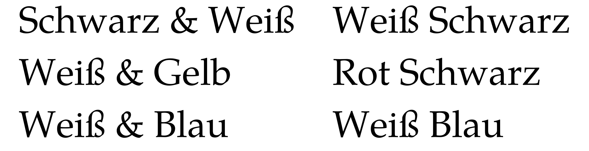

In what respect must these signs be analysed? Indeed, in what respect can the game be replaced by (47)? It is simply a _different_ language-game, even if related to (47).

### [69\[1\]](https://cdn.wittgensteinnachlass.com/2000px/webp/Ms-152/69.webp)

If something on whose existence the meaning of a word depends does not exist; well, then _this_ language-game cannot be played.

### [69\[2\]](https://cdn.wittgensteinnachlass.com/2000px/webp/Ms-152/69.webp)

The concept of the _same_ game.

And, immediately connected with this, that of the gist of a game, its point.

### [69\[3\]](https://cdn.wittgensteinnachlass.com/2000px/webp/Ms-152/69.webp)

Now does a description in game … say the same thing as one in game …? Does it say the same thing to say that an armchair stands there & that such-and-such parts of an armchair & in _that_ arrangement are to be found there? – Well, it is easy to set up a correspondence according to which certain sentences of one system contradict sentences of the other & accordingly sentences of one system also have the same sense as sentences of the other.

---

### [69\[4\]](https://cdn.wittgensteinnachlass.com/2000px/webp/Ms-152/69.webp),[70\[1\]](https://cdn.wittgensteinnachlass.com/2000px/webp/Ms-152/70.webp)

“What the names of the language designate must be indestructible. For one must be able to describe the state in which everything that is destructible has been destroyed. And in this description there will be words; & what corresponds to them must not then be destroyed, for otherwise the words would have no meaning. I am not allowed to cut off the branch on which I am sitting.” One could now, of course, object that the description itself must be exempt from destruction. – But what corresponds to the words of the description & therefore must not be destroyed if it is true is what gives the words their meaning, without which they would have no meaning. – But this person surely is, in a certain sense, what corresponds to his name. But he is destructible & the name does not lose its meaning when its bearer is destroyed. That without which the name would have no meaning is, for example, a paradigm that is used in the language-game in connection with the name.

### [70\[2\]](https://cdn.wittgensteinnachlass.com/2000px/webp/Ms-152/70.webp)

[Important example] “I imagined it was Saturday today”.

### [70\[3\]](https://cdn.wittgensteinnachlass.com/2000px/webp/Ms-152/70.webp)

It seems to us as though we were saying something about the nature of red in saying that “Red exists” makes no sense. [unreadable] As if it existed timelessly ‘in itself’. The word “indestructible” also points to this. Whereas we are laying down a stipulation for the use of the word “red”.

### [71\[1\]](https://cdn.wittgensteinnachlass.com/2000px/webp/Ms-152/71.webp)

But really we only want to take the statement “Red exists” as the statement that “Red” has meaning, or perhaps, more correctly, to take the statement “Red does not exist” as “‘Red’ has no meaning”. One wants to say: If this statement meant anything at all, that is what it would mean. Only we do not want to say that he _says_ that, but that he had to say _that_, _if_ he said anything. But that in trying to say it he contradicts himself, since red supposedly exists in & of itself. – Whereas in reality a contradiction lies, if anywhere, only in the fact that the sentence looks as though it were about ξ, while it is supposed to say something about the sign ‘ξ’.

### [71\[2\]](https://cdn.wittgensteinnachlass.com/2000px/webp/Ms-152/71.webp)

So does the person who says that the broom is in the corner actually mean that the handle is there & the brush & the handle is stuck into the brush? For suppose you said to someone, instead of “Bring me the broom”, “Bring me the broom handle & the brush attached to it”. Will he not reply: “Do you want the broom? and why are you putting it so stupidly?!” So will he understand the further analysed sentence better? The sentence, one could say, accomplishes the same thing as the ordinary one, but does so in a cumbersome way.

### [72\[1\]](https://cdn.wittgensteinnachlass.com/2000px/webp/Ms-152/72.webp)

We might think: Whoever knows only the unanalysed form misses out on the analysis, but whoever knows only the analysed form gets everything with it. But can I not say that the person who knows only the so-called analysed form misses an aspect of the matter, just as the other person does?

### [72\[2\]](https://cdn.wittgensteinnachlass.com/2000px/webp/Ms-152/72.webp),[73\[1\]](https://cdn.wittgensteinnachlass.com/2000px/webp/Ms-152/73.webp)

“But you will not deny that a particular command in (a) says the same thing as a particular one in b. And what will you call the second if not an analysis of the first?” – Of course, I too would say that a command in a has the same sense as one in b, or, as I put it earlier: they accomplish the same thing. And that means: If, say, I am told a command in a & asked the question “Which command in b has the same sense as this one?” or again “What commands in b contradict this command?”, then I will be able to answer the question in such-and-such a way. But that does _not_ mean that we have come to an understanding about the use of the expression “to have the same sense” or “to accomplish the same thing” in all cases. For one can ask: in what cases do we say: these two games are only two different forms of the _same_ game? Imagine, for instance, that the person given commands in a & b has to consult a table matching names to pictures before bringing what is asked for. Does he now do the _same thing_ when he receives a command in a & the ‘corresponding’ one in b? Yes & no. You can say: The point of the command is the same. I would say the same thing here. But it is not always so clear what to say ‘the point’ of the command is. (Just as one can say of certain things: their purpose is such-and-such; what is essential is that this is a lamp for lighting; that it adorns the room, fills an empty space, and so on, is inessential. But the essential & the inessential are not always sharply separated.) But the way of putting it that a sentence in b is an ‘analysed’ form of one in a can easily mislead. For it is easily understood as if the second form were the more fundamental one, as if only it showed what was meant by the first, etc.

### [73\[2\]](https://cdn.wittgensteinnachlass.com/2000px/webp/Ms-152/73.webp),[74\[1\]](https://cdn.wittgensteinnachlass.com/2000px/webp/Ms-152/74.webp)

And so we could go through the many, many other groups of games; see similarities emerge & disappear. And we can express the result of this consideration as follows: we see a complicated network of similarities that overlap & cross one another. Similarities on a large & small scale. I cannot characterize these similarities better than by the word “family resemblances”; for that is how the various similarities among the members of a family overlap & cross: build, facial features, eye colour; gait, temperament, etc. etc. And I will say that ‘games’ form a family. And likewise, for instance, the kinds of numbers form a family. _Why_ do we call something a number? Well, perhaps because it has a direct kinship with some things that have hitherto been called numbers. And through this, one can say, it acquires an indirect kinship with other things that we also call that. And we extend our concept as in spinning we twist fibre onto fibre. And the strength of the thread lies not in one fibre running through its entire length, but in many fibres overlapping. If someone wanted to say that what all the members of the family have in common is precisely the logical sum of these common features, it would be as if he were to say:

then I would reply: here you are only playing with a word. I could equally say that something runs through the whole thread

### [75\[1\]](https://cdn.wittgensteinnachlass.com/2000px/webp/Ms-152/75.webp)

Contrast with Plato’s Way of Looking at Things

Sharply & indistinctly bounded concept Frege: ‘district’ Game with exact rules Definition of Moses

### [75\[2\]](https://cdn.wittgensteinnachlass.com/2000px/webp/Ms-152/75.webp),[76\[1\]](https://cdn.wittgensteinnachlass.com/2000px/webp/Ms-152/76.webp),[77\[1\]](https://cdn.wittgensteinnachlass.com/2000px/webp/Ms-152/77.webp)

“Good, so for you the concept of number is explained as the logical sum of those individual, mutually related concepts, cardinal number, rational number, real number, etc. & likewise the concept of a game as the logical sum of all the corresponding concepts.” – No, that need not be so. For I _can_ give the concept of number fixed boundaries in this way, i.e. use the word number to designate a concept with fixed boundaries, but I can also use it in such a way that the extension of the concept is _not_ closed off by a boundary. And that is how we actually use the word “game”. So how is the concept of a game closed off? What still counts as a game & what no longer does? Can you specify the boundaries? No. You can _draw_ some; _for none have been drawn yet_. But that has never bothered you when you have applied the word “game”. “Yes, but then the language-game we play has no clear rules.” Certainly it is not bounded everywhere by rules, but there are no rules about how high one may throw the ball in tennis or how hard, either, and yet tennis is a game & it has rules too. How, then, would you explain to someone what a game is? I think you would explain games to him & you could add “that _& things like it_ are called games”. And do you yourself know any more? Is it perhaps only that you cannot tell the other person _exactly_ what a game is? But of course, that is not ignorance. You do not know the boundaries because there are none. As I said, you can – for some definite purpose – draw a boundary. In doing so, one can say, you alter the concept. Is that what first makes it usable? Not at all! Except for a particular purpose. No more than the person who gave the definition 1 pace = 75 cm made the measure of length “one pace” usable. And if you want to say “but before that it was not an exact measure of length”, I reply: “very well, then it was an inexact one”. Though you still owe me the definition of exactness.

Frege says that an indistinctly bounded concept is not a concept at all, just as an indistinctly bounded district is not a district. Well then, there are no districts at all. Has a boundary stone no width & where is its exact centre etc. etc.! There is no _one_ ideal exactness. I say: “We eat at 1 o’clock sharp” & that is correct even though we do not raise our spoons simultaneously at the stroke of 1 & if we did, the question would be what is meant by the stroke of 1. And something analogous holds for exact astronomical time measurement too. One can also very well play a game & make rules as they are needed.

Moses.

---

### [77\[2\]](https://cdn.wittgensteinnachlass.com/2000px/webp/Ms-152/77.webp)

The concept of a game is a concept with blurred edges. “But is a blurred concept a concept at all…” etc.

### [77\[3\]](https://cdn.wittgensteinnachlass.com/2000px/webp/Ms-152/77.webp)

[Would we recognize a boundary?]

### [77\[4\]](https://cdn.wittgensteinnachlass.com/2000px/webp/Ms-152/77.webp),[78\[1\]](https://cdn.wittgensteinnachlass.com/2000px/webp/Ms-152/78.webp)

Now imagine I said “Moses was a great leader of his people.” I am asked: “Whom do you mean by ‘Moses’?” I answer: “the man the Bible tells of.” I am told: “There was no one who did all those things”. I: Well, if not absolutely _everything_ & every last detail, then certainly much of it. Now will I declare my sentence false straight away if I am shown that Moses did not do such-and-such, even if I do not count it as one of his essential deeds? But on the other hand will I be prepared to draw a firm line in advance between the essential & the inessential?

But is the meaning of the name Moses, & thus the sense of my sentence, clearly determined by this? Is it not that I have, so to speak, a whole series of supports in reserve & am prepared to rely on _this_ one if the other should be withdrawn from me, and vice versa?

### [78\[2\]](https://cdn.wittgensteinnachlass.com/2000px/webp/Ms-152/78.webp)

In (…) I said that the game was not bounded everywhere by rules. But what does a game look like that is bounded everywhere by rules? A game in which the rules plug every gap and keep all doubt out.

### [79\[1\]](https://cdn.wittgensteinnachlass.com/2000px/webp/Ms-152/79.webp)

I say “there is an armchair there.” What if I go over & want to pick it up & it dissolves into vapour? So it was not an armchair but some sort of illusion, a phantasm. But in a few seconds we see it again & can touch it, etc. So there was an armchair there after all & its disappearance was an illusion. And in an hour it disappears again, or seems to disappear, and so on. What are we to say now? Do you have rules ready for such cases? But do we miss them & are we to say that we do not know what the word “armchair” means, since we are not equipped with rules for its application in every case we could imagine?

### [79\[2\]](https://cdn.wittgensteinnachlass.com/2000px/webp/Ms-152/79.webp)

But when I make a statement about Moses, am I always ready to substitute any _one_ of these descriptions for Moses? Isn’t it very often the case that I, so to speak … – – – ([unreadable]) – Consider yet another case:

### [79\[3\]](https://cdn.wittgensteinnachlass.com/2000px/webp/Ms-152/79.webp)

What is a “complete list of rules” for a word (sign)?

### [79\[4\]](https://cdn.wittgensteinnachlass.com/2000px/webp/Ms-152/79.webp)

Is there a game governed by rules with ideal completeness? Exactness

### [80\[1\]](https://cdn.wittgensteinnachlass.com/2000px/webp/Ms-152/80.webp)

This question is directly connected with the question: What is accuracy?

### [80\[2\]](https://cdn.wittgensteinnachlass.com/2000px/webp/Ms-152/80.webp)

I called game a concept with blurred edges in contrast to … _Difference in degree_ between blurred & exact.

### [80\[3\]](https://cdn.wittgensteinnachlass.com/2000px/webp/Ms-152/80.webp),[81\[1\]](https://cdn.wittgensteinnachlass.com/2000px/webp/Ms-152/81.webp)

Can’t we always imagine a rule that governs the application of the rule? And a doubt that this further rule removes, and so on? But that is not to say that we doubt because we can imagine someone else doubting. I can quite well imagine someone who, before opening his front door, always has doubts as to whether an abyss might have opened up behind it & who makes sure before stepping through the door (& it may turn out one day that he was right), but that doesn’t make me doubt in this case. A rule stands there like a signpost. Does it leave no room for doubt about the way I have to go? Where does it say in which direction I have to go once I’ve passed it, whether along the road or along the field path or across the fields? But where does it say in what sense I am to follow it, whether in the direction of the hand or in the opposite direction. And if instead of a signpost there were a closed chain of signposts or chalk marks running along the ground, is there only _one_ interpretation for them?

_Table of readings …_

### [81\[2\]](https://cdn.wittgensteinnachlass.com/2000px/webp/Ms-152/81.webp)

But do I want to say by this that the signpost is no use? Moses was the man …

Frege ‘regions’ sharp delimitation

What is a sharp boundary

Accuracy.

### [81\[3\]](https://cdn.wittgensteinnachlass.com/2000px/webp/Ms-152/81.webp),[82\[1\]](https://cdn.wittgensteinnachlass.com/2000px/webp/Ms-152/82.webp)

Now we have a tendency to see a kind of ideal in logic (simplex sigillum veri). And this is what makes us want to understand by a word, for example, not the sign of flesh & blood but something sublimated. One could imagine something similar for chess too.

One would be tempted to say that besides the chess kings made of wood, bone, etc., there is _the_ chess king (the meaning of the material pieces, so to speak). This meaning, the chess king proper (while the pieces of wood are merely, so to speak, its representatives in the land of crude sensory images), this chess king is sublime, indestructible & the real object of the game.

### [82\[2\]](https://cdn.wittgensteinnachlass.com/2000px/webp/Ms-152/82.webp),[83\[1\]](https://cdn.wittgensteinnachlass.com/2000px/webp/Ms-152/83.webp)

One says to oneself, perhaps: Surely logic cannot be about strokes of ink. “Surely it isn’t a few pieces of wood that interest us in chess.” Of course not! And what the tailor makes the suit for isn’t a few little pieces of paper. But surely the _value_ of the banknote isn’t some sort of mental banknote standing behind the material one. Don’t ask what the chess king is, but how we use the word “chess king”. Don’t ask what the number 2 is, but … Not what is value, but, better put, what does value consist in, _what_ does meaning _consist in_, for the answer to that is a sentence of the form … – Logic is not _about_ sublime objects. Time is not a clock, but neither is it a sublimated clock. Logic as the class of the most general truths: _Frege_ fundamental truths. Attempt to explain the sublimity of logic in a quasi-idealistic way. Spider’s web.

What happens to the ideality of logic in our way of looking at it? For I am not turning it into a natural science. I do not want to take its ideality away from it, as Ramsey, if I am not mistaken, would have done. It disappears altogether, so to speak. It is burnt, not buried.

### [83\[2\]](https://cdn.wittgensteinnachlass.com/2000px/webp/Ms-152/83.webp)

Considerations on the examples underlying the ideas.

### [83\[3\]](https://cdn.wittgensteinnachlass.com/2000px/webp/Ms-152/83.webp)

The totality of rules concerning a word. Again the temptation to adopt the sublime point of view.

### [83\[4\]](https://cdn.wittgensteinnachlass.com/2000px/webp/Ms-152/83.webp)

Thinking

Language

Sentence

Grammar

Word

Meaning

### [83\[5\]](https://cdn.wittgensteinnachlass.com/2000px/webp/Ms-152/83.webp)

But thinking is not _one_ thing but many different things.

### [83\[6\]](https://cdn.wittgensteinnachlass.com/2000px/webp/Ms-152/83.webp),[84\[1\]](https://cdn.wittgensteinnachlass.com/2000px/webp/Ms-152/84.webp)

Conflict between the sublime conception & the facts concerning the nature of the word, the sentence, etc. One wants to resolve it by trying to penetrate into the personal mental image. There, in what is happening at that instant, is where one supposedly must find the word proper, for example, & perhaps understanding too, etc. It is there, on this view, that the sublime is to be found. But here our language seems to fail us. We have got onto smooth ice where there is no friction, so that in a certain sense the conditions are ideal, but for that very reason we cannot walk. We want to walk; then we need _friction_. Back to _concrete_ examples!

### [84\[2\]](https://cdn.wittgensteinnachlass.com/2000px/webp/Ms-152/84.webp)

The explanation “stay somewhere around there” may work or not.

### [84\[3\]](https://cdn.wittgensteinnachlass.com/2000px/webp/Ms-152/84.webp),[85\[1\]](https://cdn.wittgensteinnachlass.com/2000px/webp/Ms-152/85.webp)

The mistaken idea that what has not yet been explained could not be understood. As if wherever a further explanation were possible but had not been given. But it is not as if we now somehow mysteriously had the answers to infinitely many questions within us either. As if the explanation hung in the air unless other explanations supported it. Whereas one explanation can indeed rest on another that has been given. But no explanation in itself needs another, unless _we_ need it to clear up a misunderstanding. One could also put it like this: An explanation serves to remove or prevent a misunderstanding, that is, one that would arise without this explanation, but not every one that could conceivably arise.

### [85\[2\]](https://cdn.wittgensteinnachlass.com/2000px/webp/Ms-152/85.webp)

Might it be that accuracy is not really at issue here because one can say “just think of the accuracy of time measurement in the laboratory & in the observatory”?

### [85\[3\]](https://cdn.wittgensteinnachlass.com/2000px/webp/Ms-152/85.webp)

The word “accuracy” is used in very different ways. There is no one ideal of accuracy, unless you yourself stipulate that this is to be accuracy proper. But this stipulation will be unsatisfactory, because

### [85\[4\]](https://cdn.wittgensteinnachlass.com/2000px/webp/Ms-152/85.webp)

Think of different cases of measurement & of what one calls ‘accurate’ in them.

### [85\[5\]](https://cdn.wittgensteinnachlass.com/2000px/webp/Ms-152/85.webp)

The words “accurate” & “inaccurate” are used in different related ways.

There is no _one_ ideal of accuracy, i.e. none has yet been provided for, I don’t know what to imagine by it; unless …

### [85\[7\]](https://cdn.wittgensteinnachlass.com/2000px/webp/Ms-152/85.webp),[86\[1\]](https://cdn.wittgensteinnachlass.com/2000px/webp/Ms-152/86.webp)

So think of the family of applications of the words.

No _one_ ideal … has been provided for; we don’t know what …: unless you yourself stipulate what you want to call by that name. (But you will find it difficult ….)

### [86\[2\]](https://cdn.wittgensteinnachlass.com/2000px/webp/Ms-152/86.webp)

…; is _accuracy_ not really at issue here; because one can say – – –?

We use “accurate”, after all, as an ideal of fitness for a purpose. And only once one has recognized this can one see the family of its uses clearly; that is, the real nature of its use.

### [86\[3\]](https://cdn.wittgensteinnachlass.com/2000px/webp/Ms-152/86.webp),[87\[1\]](https://cdn.wittgensteinnachlass.com/2000px/webp/Ms-152/87.webp)

“Inexact” is really a reproach, (& “exact” a commendation). And that surely means: what is inexact does not attain the aim as perfectly as what is exact. So it depends on what we call the aim. Is it a disadvantage that a ship’s mast is not an absolutely rigid body & that it therefore makes no sense to give its inclination to the nearest second of arc?

Is it inexact if we do not specify the width of a table to the carpenter to within a 1000th of a millimetre? & do not give the distance of the sun from the earth to the nearest metre?

Frege on “are we still Christians”. “A line must be drawn around it.” But aren’t there degrees of sharpness here again? These considerations now put us on the same bit of ground as the problem.

### [87\[2\]](https://cdn.wittgensteinnachlass.com/2000px/webp/Ms-152/87.webp)

Augustine says in the Confessiones that a child learns its native language like this:

### [87\[3\]](https://cdn.wittgensteinnachlass.com/2000px/webp/Ms-152/87.webp)

Augustine says in the Conf. that a child learns its native language like this:

### [87\[4\]](https://cdn.wittgensteinnachlass.com/2000px/webp/Ms-152/87.webp)

Augustine says in the Confessiones that a child learns its native language in this And this is the picture in which the philosophical idea of the _meaning_ of words

### [87\[5\]](https://cdn.wittgensteinnachlass.com/2000px/webp/Ms-152/87.webp)

: With its words we name objects, the sentences ….

### [87\[6\]](https://cdn.wittgensteinnachlass.com/2000px/webp/Ms-152/87.webp)

Augustine says (Conf.…) that a child learns its native language like this:

### [87\[7\]](https://cdn.wittgensteinnachlass.com/2000px/webp/Ms-152/87.webp)

Augustine tells us that a person learns their ….

### [88\[1\]](https://cdn.wittgensteinnachlass.com/2000px/webp/Ms-152/88.webp)

This is the picture in which the idea

### [88\[2\]](https://cdn.wittgensteinnachlass.com/2000px/webp/Ms-152/88.webp)

In this picture the idea has its roots: The word has a meaning correlated with it, namely the object it designates.

### [88\[3\]](https://cdn.wittgensteinnachlass.com/2000px/webp/Ms-152/88.webp)

All the rules that deal with a word.

### [88\[4\]](https://cdn.wittgensteinnachlass.com/2000px/webp/Ms-152/88.webp)

nor do I try to reduce the number of unexplained expressions to a minimum. What would I gain by having fewer of them. (rather than more.) For the clarity we strive for is indeed _complete_. But that only means that the philosophical problems are to disappear _completely_.

### [88\[5\]](https://cdn.wittgensteinnachlass.com/2000px/webp/Ms-152/88.webp),[89\[1\]](https://cdn.wittgensteinnachlass.com/2000px/webp/Ms-152/89.webp)

I do not ask: What is a word? what, a sentence? what, a rule? I use these words as they are _ordinarily_ used; & give a specification only where it is needed to avoid a misunderstanding. Of course I cannot then make statements about words, sentences, rules, that are more general than the ordinary ones either.

For the concepts ‘word’ ‘sentence’ ‘rule’ and others have indeterminacies of their own. Is this still a word? Is this still a rule? etc. But I use these expressions in philosophy just as in ordinary life & just as I use the words “leaf”, – “bottle”, “water” and so on. But one easily goes astray by wanting to play a game above the ordinary one with these words, & by believing, – – – – –

In answer to the question “What is a word?”, “What is a rule?”, one would only need to look and see how the word “word” or “rule” is used: what we say is a rule, what we say is the expression of a rule; in what cases we say that something happens in accordance with a rule, etc. etc. But that does not seem enough to us; for we believe we must play a game with ideally exact rules with these expressions, because only that can remove the doubts into which language plunges us. We would like to say: Why, we don’t know _in the first place_ what a word is, what a rule is! how can we put language in order then?! For we can surely see that it is language that lures us into the strange traps we call philosophical difficulties.

### [90\[1\]](https://cdn.wittgensteinnachlass.com/2000px/webp/Ms-152/90.webp),[91\[1\]](https://cdn.wittgensteinnachlass.com/2000px/webp/Ms-152/91.webp),[92\[1\]](https://cdn.wittgensteinnachlass.com/2000px/webp/Ms-152/92.webp)

When the philosopher wants to utter propositions of unheard-of generality, the need for definitions quite rightly arises. If I say: “The whole world consists of plants”, one would quite rightly ask in response: “what is a plant”. By contrast, no one will ask that if I say to them “There are some plants here that I am not yet familiar with”. Exactness is an ideal & has to do with the elimination of mix-ups. When we ask “What is a word?”, “What is a rule?”, etc., we would like, so to speak, to find purer entities than those we ordinarily designate by these expressions. We want to represent the latter as an adulteration of the former. _The word that has the meaning_ ought really to be the _mental image_ of the word, – not the hypothetical object, the stroke of ink, etc. But just look and see how we _use_ the expression “the word ‘table’” – for example –! And of course the grammar of physical objects & their mental images gives rise to all sorts of confusion & philosophical torment. But this is not because our language is internally diseased & brittle here, so that we would first have to replace it with a new one. And it is not that this language is adequate for everyday life, but shows its weaknesses when, in philosophizing, we want to examine things more exactly, to penetrate deeper. The philosophical problem does, of course, arise because we do not know our way around in the grammar of our way of expressing ourselves. And _one_ means of making the grammar surveyable for ourselves is to introduce a new way of expressing ourselves particularly suited to this purpose. If I had somehow defined the word “chair” with the help of the expression “mental image of the chair”, this would indeed be a sure means of clarifying the designation of the use of the two expressions. But this is not to say that one could actually establish this relation by such a definition; nor that the tormenting obscurities could be removed only by such a definition. One believes that one must be more exact about the word “word” or “rule” than about “lamp” or “coal”; for how else is one to state the most general things about the former, the things one must understand to gain clarity about the essence of language. [I am not yet at the bottom of the question.] Why do we suddenly give up trying to express the essence of language, & the essence of the world? “Phenomenological language.” Belief in its necessity. It seemed as if our language were somehow _crude_, an imperfect representation of states of affairs & to be understood only as a crude, imperfect likeness. As if philosophy had to improve it, refine it, so as to be able to understand the structure of the world. _Then_ it became apparent that philosophy had to understand language as it is, i.e. recognize it for what it is, because the aim was not a new clarity that the old language did not provide, but the elimination of the philosophical { mazes, bewilderment. Perplexities, wandering about lost, being at a loss, not knowing one’s way about, being perplexed, riddles, misleading questions, I mean a question asked in order to lead one into a maze, such as a witch might ask. } “And your difficulties are misunderstandings.” – If they were not misunderstandings, if we really had to analyse further to get onto firm ground, then we would have to ask ourselves: with what finer concept must we replace the ordinary concept “word” (for example). We would then have to set the usual words aside _along with_ their use in order to search in the depths for the real concepts to which we must adapt language.

### [93\[1\]](https://cdn.wittgensteinnachlass.com/2000px/webp/Ms-152/93.webp)

Again and again one was tempted to say “Surely it must …”

In logic we have a _theory_. And it must be simple & nice. For what I want to know is what makes language language. I believe that all the things we call “language” have imperfections, dross, in them, but I want to get to know the _very thing_ _that_ is so adulterated. What enables me _to say something_. For surely that must be something very peculiar. Thought, a strange entity. (It can think what is not the case.) But here too the mystery rests on a misunderstanding.

### [93\[2\]](https://cdn.wittgensteinnachlass.com/2000px/webp/Ms-152/93.webp),[94\[1\]](https://cdn.wittgensteinnachlass.com/2000px/webp/Ms-152/94.webp)

At the time I did resist the idea of an order in logic that was not perfect. “Every sentence has a _determinate_ sense”; “There can be no lack of clarity in logic, since otherwise there would be no clarity at all (& hence no lack of clarity either).”, “A logically unclear sentence is one that has no determinate sense, hence _no_ sense”. – What keeps haunting us here is the idea of an ethereal sense, of what one _means, of the mental process_.

Logic seemed the archetype of _order_. I always wanted to say (against Ramsey): Surely logic cannot become an empirical science. But how we use language is of course an empirical matter.

### [94\[2\]](https://cdn.wittgensteinnachlass.com/2000px/webp/Ms-152/94.webp),[95\[1\]](https://cdn.wittgensteinnachlass.com/2000px/webp/Ms-152/95.webp)

“It can be thought after all!” or “Experience teaches that it can be thought after all”: that was revolting as long as thinking was the mental process as opposed to speaking, writing, etc. Logic had either to dispute such assertions – dogmatically – or to withdraw from them & say that it had no business where such questions were asked. But if it withdrew like this, what field was left to it? (It seemed to shrink to nothing.) What was right was that our considerations were not to be scientific considerations. There must be nothing hypothetical about them. The experience “that something _can_ be thought” (whatever that may mean) could not interest us. All _explanation_ had to go – & only _description_ was to take its place. And this description received its light, i.e. its purpose, from the philosophical problems. These are of course not empirical; rather, they are solved through insight into the essence of our language! And in such a way that this essence is revealed: _against_

---

a tendency to misunderstand it. Not by providing new experience, but by bringing together what has long been known. Philosophy is a struggle against the spell of language.

_Etc.?_

“All the rules that deal with a word”, “the complete description of its use.” “It must be possible to describe its grammar completely _before_ any application.” “Before using the word ‘leaf’, one must know what is still to be called a leaf & what isn’t.” Of course, in quite a few cases it would not do; to make the rules as we go along. But in other cases we _do_ it. Both sorts matter to us.

### [95\[2\]](https://cdn.wittgensteinnachlass.com/2000px/webp/Ms-152/95.webp),[96\[1\]](https://cdn.wittgensteinnachlass.com/2000px/webp/Ms-152/96.webp)

“What are the words, the sentences, that logic is about?” “What is the _real_ sign?” Again, as if our language were in disorder & we had to put it in order. As if the last word had not been said when one uses the word “word” as one has up to now. It is as if with this word one felt reality as though through thick gloves & had to take off these gloves to be able to feel the exact shapes. (Am I really lighting the stove or a _mental image_ of the stove?) – But here you must think of chess. Here our investigation is repeatedly led away from everyday things, into a deceptive depth. For the problem does not show itself to us in its true nature, as a confusion in our form of expression, but as if we had to penetrate to greater depths, to the real constituents of reality.

### [96\[2\]](https://cdn.wittgensteinnachlass.com/2000px/webp/Ms-152/96.webp)

The ideal name. The simple. The role of calculi in our representation. Application of the calculus. I.e. _actual_ not ideal ones. What is a name? What is a sentence? Elementary proposition etc. etc. understanding, meaning, reading, following.

### [96\[3\]](https://cdn.wittgensteinnachlass.com/2000px/webp/Ms-152/96.webp)

The { primordial element as a sublime concept & the simple as an important _form of representation_ but with a down-to-earth application. And what this form of representation tempts us to do. A proposition is anything that can be true or false. Agreement with reality.

### [96\[4\]](https://cdn.wittgensteinnachlass.com/2000px/webp/Ms-152/96.webp)

I would like to say that the sublimity of the concept lies in the impression it makes on us. Then, that we are inclined to see the world in terms of the contrast between ‘simple’ & ‘composite’.
