# Ms-153a

18 published remarks, VB

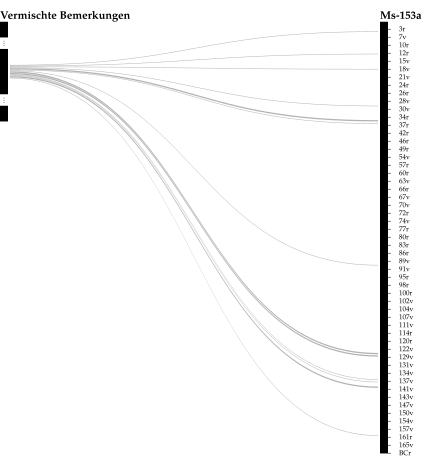

### [1r\[1\]](https://cdn.wittgensteinnachlass.com/2000px/webp/Ms-153a/1r.webp)

## Remarks

### [1r\[2\]](https://cdn.wittgensteinnachlass.com/2000px/webp/Ms-153a/1r.webp)

Ludwig Wittgenstein

### [1r\[3\]](https://cdn.wittgensteinnachlass.com/2000px/webp/Ms-153a/1r.webp)

Trinity College

### [1v\[1\]](https://cdn.wittgensteinnachlass.com/2000px/webp/Ms-153a/1v.webp)

Surely I can quite plainly let myself be guided by colour, & in a way in which I cannot let myself be guided by words, because I do not have words for all the shades.

### [1v\[2\]](https://cdn.wittgensteinnachlass.com/2000px/webp/Ms-153a/1v.webp)

The meaning – say – of the word – “chair” is anchored in many ways.

### [1v\[3\]](https://cdn.wittgensteinnachlass.com/2000px/webp/Ms-153a/1v.webp),[2r\[1\]](https://cdn.wittgensteinnachlass.com/2000px/webp/Ms-153a/2r.webp),[2v\[1\]](https://cdn.wittgensteinnachlass.com/2000px/webp/Ms-153a/2v.webp)

Whatever incidental things go on in uttering the sentence, I must then be able to act in accordance with it. And therefore the meaning of the words will show itself; but not as if it only then came to light in the action. For it comes to light only in the action that corresponds to the sentence. And whether it corresponds to it can in turn be decided only on the basis of the meaning of the words. Rather, the word-meaning shows itself in _deciding whether_ the action corresponds to the sentence.

### [2v\[2\]](https://cdn.wittgensteinnachlass.com/2000px/webp/Ms-153a/2v.webp),[2v\[3\]](https://cdn.wittgensteinnachlass.com/2000px/webp/Ms-153a/2v.webp)

I.e., the meaning shows itself in collating the fact against the sentence.

“Bedeutung” comes from “deuten”.

### [2v\[4\]](https://cdn.wittgensteinnachlass.com/2000px/webp/Ms-153a/2v.webp)

But this collation is, after all, independent of whether the sentence is correct or not.

### [2v\[5\]](https://cdn.wittgensteinnachlass.com/2000px/webp/Ms-153a/2v.webp),[3r\[1\]](https://cdn.wittgensteinnachlass.com/2000px/webp/Ms-153a/3r.webp)

But this collation, like the concept of meaning, is a remnant of a primitive conception.

### [3r\[2\]](https://cdn.wittgensteinnachlass.com/2000px/webp/Ms-153a/3r.webp),[3v\[1\]](https://cdn.wittgensteinnachlass.com/2000px/webp/Ms-153a/3v.webp),[4r\[1\]](https://cdn.wittgensteinnachlass.com/2000px/webp/Ms-153a/4r.webp)

If, for example, I collate the actual seating arrangement at a table with a written list, it makes good sense to point to a particular person at each name (on the paper). But if I were to compare the description of a picture with the picture itself, and the description, besides listing the people, also said that A is kissing B, I would not know what to point to as the correlate of the word “kiss”. Or if it said, “A is bigger than B”, what am I to point to at the word “bigger”? Quite clearly I cannot point to anything corresponding to this word in the sense in which I point, say, to the person A in the picture.

### [4r\[2\]](https://cdn.wittgensteinnachlass.com/2000px/webp/Ms-153a/4r.webp)

The sentence that a word has meaning only in the context of a sentence must of course also read quite differently when correctly formulated. (As a rule of language, of course.)

### [4r\[3\]](https://cdn.wittgensteinnachlass.com/2000px/webp/Ms-153a/4r.webp),[4v\[1\]](https://cdn.wittgensteinnachlass.com/2000px/webp/Ms-153a/4v.webp)

The German language, and every language, not only lays down forms of language but also says what they are to mean, fixes their meaning.

### [VB](/w-vb/#ms-153a-4v.2) [4v\[2\]](https://cdn.wittgensteinnachlass.com/2000px/webp/Ms-153a/4v.webp)

10.05.1931

[The lovely difference in temperature between the parts of a human body.]

### [4v\[3\]](https://cdn.wittgensteinnachlass.com/2000px/webp/Ms-153a/4v.webp)

“I can apply the word ‘yellow’” – is that on a different level from “I can play chess”, or “I can use the king in chess”?

### [4v\[4\]](https://cdn.wittgensteinnachlass.com/2000px/webp/Ms-153a/4v.webp),[5r\[1\]](https://cdn.wittgensteinnachlass.com/2000px/webp/Ms-153a/5r.webp),[5v\[1\]](https://cdn.wittgensteinnachlass.com/2000px/webp/Ms-153a/5v.webp),[6r\[1\]](https://cdn.wittgensteinnachlass.com/2000px/webp/Ms-153a/6r.webp)

Let us think again of the intention to play chess. I sit down & say “now let’s play chess”. In a certain sense, I have then resolved to follow the rules of chess. But have I run through all these rules in my mind? No. I did not, for example, think of the rule for castling. Now, however, it comes to castling. Why do I recognize this rule as a rule of chess? Because it is in the chess book? No. I could imagine that when I go to look it up, it is not in any book. Because I had resolved to follow it? No, for I had not thought of it. So it is decided in another way whether a rule belongs to chess, and thus whether I have followed my resolution or not.

### [6r\[2\]](https://cdn.wittgensteinnachlass.com/2000px/webp/Ms-153a/6r.webp),[6v\[1\]](https://cdn.wittgensteinnachlass.com/2000px/webp/Ms-153a/6v.webp)

Now if I say: chess consists in the rules, where are these rules to be found? I do not, after all, recognize the authority of chess books, since I think it _possible_ that they do not contain the rules I mean. And my resolution becomes a different one if I resolve to follow whatever rules I find in a particular book.

### [6v\[2\]](https://cdn.wittgensteinnachlass.com/2000px/webp/Ms-153a/6v.webp)

Now can one say, perhaps, that my intention is to do what I find at a particular place in my memory?

### [6v\[3\]](https://cdn.wittgensteinnachlass.com/2000px/webp/Ms-153a/6v.webp),[7r\[1\]](https://cdn.wittgensteinnachlass.com/2000px/webp/Ms-153a/7r.webp)

That is, a particular criterion is given in the intention, by which it is then decided whether something accords with a rule of chess.

(As it were, the _concept_ of a rule of chess.)

### [7r\[2\]](https://cdn.wittgensteinnachlass.com/2000px/webp/Ms-153a/7r.webp),[7v\[1\]](https://cdn.wittgensteinnachlass.com/2000px/webp/Ms-153a/7v.webp)

So if I say that I understand the word “yellow”, here too it is only later that I shall decide whether this use accords with the original meaning or not. For here too I cannot go by a list of rules. For who knows what I shall find in it.

### [7v\[2\]](https://cdn.wittgensteinnachlass.com/2000px/webp/Ms-153a/7v.webp)

I can do nothing but set down rules in a _book_.

### [7v\[3\]](https://cdn.wittgensteinnachlass.com/2000px/webp/Ms-153a/7v.webp)

And that shows the relation my activity bears to what is immediate.

### [7v\[4\]](https://cdn.wittgensteinnachlass.com/2000px/webp/Ms-153a/7v.webp),[8r\[1\]](https://cdn.wittgensteinnachlass.com/2000px/webp/Ms-153a/8r.webp)

If, for example, I say that these rules hold for negation, then it must make no sense to ask: how do you know that you are still speaking of the same thing (negation in the same sense)? For in this sense the rules constitute negation, just as the rules of chess constitute chess.

### [8r\[2\]](https://cdn.wittgensteinnachlass.com/2000px/webp/Ms-153a/8r.webp),[8v\[1\]](https://cdn.wittgensteinnachlass.com/2000px/webp/Ms-153a/8v.webp)

I believe that if someone says “surely I know what the word ‘yellow’ means”, he calls up a mental image, or he means nothing at all, or else he means it just as one does when one says: “I can play chess but not draughts”.

### [8v\[2\]](https://cdn.wittgensteinnachlass.com/2000px/webp/Ms-153a/8v.webp)

What if one asked: when _can_ you play chess? Always? Or while you are saying so? But throughout the whole sentence? And how strange that knowing how to play chess takes so little time and a game of chess so much longer!

### [8v\[3\]](https://cdn.wittgensteinnachlass.com/2000px/webp/Ms-153a/8v.webp)

Are you describing a disposition by that?

### [9r\[1\]](https://cdn.wittgensteinnachlass.com/2000px/webp/Ms-153a/9r.webp)

Now if “understanding the word ‘yellow’” means being able to apply it. So the same question remains: when _can_ you apply it? Are you talking about a disposition? Is it a conjecture?

### [9r\[2\]](https://cdn.wittgensteinnachlass.com/2000px/webp/Ms-153a/9r.webp)

“I can play chess, – but at the moment I have quite forgotten how, – but I have played it countless times”.

### [9v\[1\]](https://cdn.wittgensteinnachlass.com/2000px/webp/Ms-153a/9v.webp)

In what respect is a red board a better sign for red than the word ‘red’? Or: does it mean anything to say that the word ‘red’, to be a usable sign, needs a supplement – say, in memory? I.e., in what respect is it not a sign on its own, and are we not mistaken in thinking that something more is needed to supplement this sign?

### [10r\[1\]](https://cdn.wittgensteinnachlass.com/2000px/webp/Ms-153a/10r.webp)

I should like to say that the step we take in fulfilling the sign can also only be described, not designated.

### [10r\[2\]](https://cdn.wittgensteinnachlass.com/2000px/webp/Ms-153a/10r.webp)

Or do I want to say: identification is _possible_ only through a description.

### [10r\[3\]](https://cdn.wittgensteinnachlass.com/2000px/webp/Ms-153a/10r.webp)

“What's red like?”

### [10r\[4\]](https://cdn.wittgensteinnachlass.com/2000px/webp/Ms-153a/10r.webp)

“What is white?” – “A swan is white”.

### [10v\[1\]](https://cdn.wittgensteinnachlass.com/2000px/webp/Ms-153a/10v.webp)

Yes, what fulfils a sentence can be set down _in language_ only by means of a sentence. And if it is set down by means of a painted or constructed image, then this image is a sentence.

### [10v\[2\]](https://cdn.wittgensteinnachlass.com/2000px/webp/Ms-153a/10v.webp)

(I mean that I cannot complain that this sign does not have the requisite multiplicity, either, except in a language that has it.)

### [11r\[1\]](https://cdn.wittgensteinnachlass.com/2000px/webp/Ms-153a/11r.webp)

If I want to fix the meaning (of a sign), I must fix it generally, i.e. by means of a description, and not, as it were, for the particular case.

### [11r\[2\]](https://cdn.wittgensteinnachlass.com/2000px/webp/Ms-153a/11r.webp)

The particular case cannot, in a certain sense, be described as such.

(This is of course all quite incorrectly expressed, but the correct expression for it is what I am looking for.)

### [11v\[1\]](https://cdn.wittgensteinnachlass.com/2000px/webp/Ms-153a/11v.webp)

I.e., it cannot be seen from the special translation, the action I perform on the sign Г, – – –.

### [11v\[2\]](https://cdn.wittgensteinnachlass.com/2000px/webp/Ms-153a/11v.webp)

Let us imagine that someone was prescribed certain actions every day by signs in a calendar (say what he is to eat for lunch) – – –.

### [11v\[3\]](https://cdn.wittgensteinnachlass.com/2000px/webp/Ms-153a/11v.webp),[12r\[1\]](https://cdn.wittgensteinnachlass.com/2000px/webp/Ms-153a/12r.webp)

If I describe an experience with the words “there is a blue kettle in front of me”, is there some further justification for these words besides the experience described in them, such as the memory that I have always used the word blue for this colour, etc.?

### [12r\[2\]](https://cdn.wittgensteinnachlass.com/2000px/webp/Ms-153a/12r.webp)

Or conversely: What, apart from the command, justifies the action that follows it?

### [VB](/w-vb/#ms-153a-12v.1) [12v\[1\]](https://cdn.wittgensteinnachlass.com/2000px/webp/Ms-153a/12v.webp)

[It is shameful to have to show oneself as an empty tube that is merely inflated by the spirit.]

### [12v\[2\]](https://cdn.wittgensteinnachlass.com/2000px/webp/Ms-153a/12v.webp),[13r\[1\]](https://cdn.wittgensteinnachlass.com/2000px/webp/Ms-153a/13r.webp)

If I tell someone: When I ring, come to me, then at first, when he hears the bell ring, he will translate this command into words for himself and obey only the command as translated. After a while, however, he will translate the ringing into action without the intervention of other signs. And so, if I say “point to a red patch”, he obeys this command without an imagined picture of a red patch first appearing to him as a sign for ‘red’.

### [13r\[2\]](https://cdn.wittgensteinnachlass.com/2000px/webp/Ms-153a/13r.webp)

Multiplicity depends on between which possibilities a choice is made.

### [13v\[1\]](https://cdn.wittgensteinnachlass.com/2000px/webp/Ms-153a/13v.webp)

When he rings, I come to him; without first imagining a picture of my movements which I act on.

### [13v\[2\]](https://cdn.wittgensteinnachlass.com/2000px/webp/Ms-153a/13v.webp),[14r\[1\]](https://cdn.wittgensteinnachlass.com/2000px/webp/Ms-153a/14r.webp),[14v\[1\]](https://cdn.wittgensteinnachlass.com/2000px/webp/Ms-153a/14v.webp)

Now if he rings today, I can (but need not) remember that he did so yesterday too, & that I went to him yesterday too. (Just as I could remember having done something else in response to the ringing yesterday.) And then this memory would also be a sign I can follow. – The command could also be: do today what you did yesterday in response to the ringing. And now I can act in accordance with the memory-image; but now it makes no sense to ask for a further instruction as to how I am to act in accordance with this image. And that is really what I want to say.

### [14v\[2\]](https://cdn.wittgensteinnachlass.com/2000px/webp/Ms-153a/14v.webp)

When I say that every picture still needs an interpretation, ‘interpretation’ means translation into a further picture, or into action.

### [14v\[3\]](https://cdn.wittgensteinnachlass.com/2000px/webp/Ms-153a/14v.webp),[15r\[1\]](https://cdn.wittgensteinnachlass.com/2000px/webp/Ms-153a/15r.webp)

But how does that agree with the assertion that the command determines how it is obeyed – isn’t this contradicted by saying that the command still has to be interpreted (even if it were given in the form of a model of the action)? No; the action is determined by the command only in so far as it can be derived from it, as 5² from x²; x = 5

### [15r\[2\]](https://cdn.wittgensteinnachlass.com/2000px/webp/Ms-153a/15r.webp),[15v\[1\]](https://cdn.wittgensteinnachlass.com/2000px/webp/Ms-153a/15v.webp)

You get your knowledge of what you have to do from the command. And yet the command gives you only itself & its _effect_ is immaterial.

### [15v\[2\]](https://cdn.wittgensteinnachlass.com/2000px/webp/Ms-153a/15v.webp)

But then everything has been said by that & – – –

### [15v\[3\]](https://cdn.wittgensteinnachlass.com/2000px/webp/Ms-153a/15v.webp)

The command tells me what I have to do; it can communicate this to me only in itself.

### [15v\[4\]](https://cdn.wittgensteinnachlass.com/2000px/webp/Ms-153a/15v.webp),[16r\[1\]](https://cdn.wittgensteinnachlass.com/2000px/webp/Ms-153a/16r.webp)

I.e., it must contain within itself everything we mean by this communication.

### [16r\[2\]](https://cdn.wittgensteinnachlass.com/2000px/webp/Ms-153a/16r.webp)

I know what I have to do does not, after all, mean that it gets done.

### [16r\[3\]](https://cdn.wittgensteinnachlass.com/2000px/webp/Ms-153a/16r.webp),[16v\[1\]](https://cdn.wittgensteinnachlass.com/2000px/webp/Ms-153a/16v.webp)

This only becomes strange when the command is, say, a bell signal. – For in what sense does this sign communicate to me what I have to do, apart from my simply doing it _&_ the sign having been there – –. For it is not a matter of experience showing that I invariably do it when the sign is given, either.

### [16v\[2\]](https://cdn.wittgensteinnachlass.com/2000px/webp/Ms-153a/16v.webp)

That is why it _makes no sense_ just like that to say: I must go because the bell has rung. Rather, something else has to be given as well.

### [16v\[3\]](https://cdn.wittgensteinnachlass.com/2000px/webp/Ms-153a/16v.webp),[17r\[1\]](https://cdn.wittgensteinnachlass.com/2000px/webp/Ms-153a/17r.webp)

Normal – abnormal: we lay down the norm & then regard it as something given a priori. It is a given form of representation.

### [17r\[2\]](https://cdn.wittgensteinnachlass.com/2000px/webp/Ms-153a/17r.webp),[17v\[1\]](https://cdn.wittgensteinnachlass.com/2000px/webp/Ms-153a/17v.webp)

This other thing is, or is connected with, my having resolved – for example – to act in this way at the bell signal. But in the resolution itself it did not come about that I acted in that way either, or if it did happen, this action had the meaning of a symbol for the future. I mean: I keep speaking here of “this action”, but in doing so I can at most give a picture of it; indeed, if I performed it myself, that would have sense here only as a picture.

### [17v\[2\]](https://cdn.wittgensteinnachlass.com/2000px/webp/Ms-153a/17v.webp),[18r\[1\]](https://cdn.wittgensteinnachlass.com/2000px/webp/Ms-153a/18r.webp)

That is, the intention could consist either in words or in images of the imagination, or again in my actually performing the action in question – i.e., such an action.

### [18r\[2\]](https://cdn.wittgensteinnachlass.com/2000px/webp/Ms-153a/18r.webp)

How, then, does forming the intention to perform this action differ from forming the intention to perform another.

### [18r\[3\]](https://cdn.wittgensteinnachlass.com/2000px/webp/Ms-153a/18r.webp)

Now if I act in the same way again at a further bell signal, this repetition is not hypothetical; rather, I repeat the action _consciously_. That is, I go by my memory.

### [VB](/w-vb/#ms-153a-18v.1) [18v\[1\]](https://cdn.wittgensteinnachlass.com/2000px/webp/Ms-153a/18v.webp)

[No one likes to have hurt the other; that is why it feels so good to everyone when the other does not show himself hurt. No one likes to have an offended sausage before him. Remember that. It is much easier to get out of the way of the offender patiently – & tolerantly – than to approach him in a friendly manner. That too requires courage.]

### [18v\[2\]](https://cdn.wittgensteinnachlass.com/2000px/webp/Ms-153a/18v.webp),[19r\[1\]](https://cdn.wittgensteinnachlass.com/2000px/webp/Ms-153a/19r.webp)

Whenever I speak of the fulfilment of a sentence, I speak of it in general terms. I describe it in some form or other. Indeed, this generality already lies in my being able to give the description in advance, & in any case independently of whether the fact comes about.

### [19r\[2\]](https://cdn.wittgensteinnachlass.com/2000px/webp/Ms-153a/19r.webp),[19v\[1\]](https://cdn.wittgensteinnachlass.com/2000px/webp/Ms-153a/19v.webp)

When I say: I speak of the fulfilment of the sentence in general terms, I notice that I speak in words that are not made for this particular occasion.

### [19v\[2\]](https://cdn.wittgensteinnachlass.com/2000px/webp/Ms-153a/19v.webp)

“I ordered him to do p.” – “Well & what did he do?” – “p.” –. “Well then, it’s all right”.

### [19v\[3\]](https://cdn.wittgensteinnachlass.com/2000px/webp/Ms-153a/19v.webp),[20r\[1\]](https://cdn.wittgensteinnachlass.com/2000px/webp/Ms-153a/20r.webp)

“I said, ‘leave the room’ & he left the room”. – “I said ‘leave the room’ & he slowly left the room”. – “I said ‘leave the room’ & he jumped out of the window”.

Comparisons are possible here even where the description of the action is not the one given by the command.

### [20r\[2\]](https://cdn.wittgensteinnachlass.com/2000px/webp/Ms-153a/20r.webp),[20v\[1\]](https://cdn.wittgensteinnachlass.com/2000px/webp/Ms-153a/20v.webp)

I can certainly say: “Do now what you did at this time yesterday”. And if he remembers, he can follow his memory. But if he does not remember, the command has no sense for him.

### [20v\[2\]](https://cdn.wittgensteinnachlass.com/2000px/webp/Ms-153a/20v.webp)

“Say what you said to me yesterday”.

### [20v\[3\]](https://cdn.wittgensteinnachlass.com/2000px/webp/Ms-153a/20v.webp)

Isn’t it like this: if I set the signal for an activity, I must have been _able_ to form the intention of using this signal _in this way_. But in doing so I must already have connected it with another symbolism.

### [21r\[1\]](https://cdn.wittgensteinnachlass.com/2000px/webp/Ms-153a/21r.webp)

But even if I formed this intention by saying that this signal means _this_ & carrying out a certain activity as I said it, the memory of the activity must later work together with the sign.

### [21r\[2\]](https://cdn.wittgensteinnachlass.com/2000px/webp/Ms-153a/21r.webp),[21v\[1\]](https://cdn.wittgensteinnachlass.com/2000px/webp/Ms-153a/21v.webp)

The knot in the handkerchief.

It is senseless if I do not actually remember something when I look at it. It is therefore not a symbol on its own either. Or does it mean: “Remember something!”? In any case, these words would serve the same purpose.

### [21v\[2\]](https://cdn.wittgensteinnachlass.com/2000px/webp/Ms-153a/21v.webp)

I can forget which colour a word means & also what a particular colour is called (say, in English).

### [21v\[3\]](https://cdn.wittgensteinnachlass.com/2000px/webp/Ms-153a/21v.webp),[22r\[1\]](https://cdn.wittgensteinnachlass.com/2000px/webp/Ms-153a/22r.webp)

I am asked to imagine the colour orange & have forgotten what ‘orange’ means. What happens here? And what happens when I remember it again? The question, that is, is this: what does my being able to comply with the request to imagine the colour A depend on?

### [22r\[2\]](https://cdn.wittgensteinnachlass.com/2000px/webp/Ms-153a/22r.webp)

One more question: Can one speak of different interpretations of the memory-image? Certainly not. But why not?

(?)

### [22v\[1\]](https://cdn.wittgensteinnachlass.com/2000px/webp/Ms-153a/22v.webp)

If there is anywhere one is hampered by prejudices, it is in philosophy?

### [22v\[2\]](https://cdn.wittgensteinnachlass.com/2000px/webp/Ms-153a/22v.webp)

“Paint a red strip”, – “I have forgotten what red means; the word tells me nothing”.

### [22v\[3\]](https://cdn.wittgensteinnachlass.com/2000px/webp/Ms-153a/22v.webp),[23r\[1\]](https://cdn.wittgensteinnachlass.com/2000px/webp/Ms-153a/23r.webp)

If the word red, in order to have meaning, must call up a mental image which is what really counts as the picture, why should it not suffice for the word, when confronted with an actual colour, to elicit a particular feeling, say one of satisfaction.

### [23r\[2\]](https://cdn.wittgensteinnachlass.com/2000px/webp/Ms-153a/23r.webp)

The justification “You told me ‘bring something red’; this is called ‘red’, after all” is more general in the previous sense.”

### [23r\[3\]](https://cdn.wittgensteinnachlass.com/2000px/webp/Ms-153a/23r.webp),[23v\[1\]](https://cdn.wittgensteinnachlass.com/2000px/webp/Ms-153a/23v.webp)

Didn’t I say that the justification must always be of the form: black – – – ⬛, so: make a black circle – – – – ⚫.

### [23v\[2\]](https://cdn.wittgensteinnachlass.com/2000px/webp/Ms-153a/23v.webp)

Could the justification go like this: “You said ‘bring something red’, and this then gave me a feeling of satisfaction & so I brought it?”

### [23v\[3\]](https://cdn.wittgensteinnachlass.com/2000px/webp/Ms-153a/23v.webp),[24r\[1\]](https://cdn.wittgensteinnachlass.com/2000px/webp/Ms-153a/24r.webp)

Could one not answer: I didn’t tell you to bring me whatever would give you such a feeling in response to my words!

### [24r\[2\]](https://cdn.wittgensteinnachlass.com/2000px/webp/Ms-153a/24r.webp)

But would this objection also hold if I had answered: “You did say I should bring something ‘red’ & then I remembered that you had previously called this ‘red’”. I think the objection would not hold here.

### [24r\[2\]](https://cdn.wittgensteinnachlass.com/2000px/webp/Ms-153a/24r.webp),[24v\[1\]](https://cdn.wittgensteinnachlass.com/2000px/webp/Ms-153a/24v.webp)

In any case I could appeal, by way of justification, to a table of colours with their names.

### [24v\[2\]](https://cdn.wittgensteinnachlass.com/2000px/webp/Ms-153a/24v.webp)

But it might also be that I resist such a table & appeal to my memory (or is it something else?).

### [24v\[3\]](https://cdn.wittgensteinnachlass.com/2000px/webp/Ms-153a/24v.webp),[25r\[1\]](https://cdn.wittgensteinnachlass.com/2000px/webp/Ms-153a/25r.webp)

Does this mean, then, that in my memory I have, as it were, another table that says something different? And what justifies the choice between the two?

### [25r\[2\]](https://cdn.wittgensteinnachlass.com/2000px/webp/Ms-153a/25r.webp)

If I tell someone “paint the green of your room door from memory”, that determines what he is to do no more unambiguously than the order “paint the green you see on this board”.

### [25r\[3\]](https://cdn.wittgensteinnachlass.com/2000px/webp/Ms-153a/25r.webp)

“The wind carries my thoughts away”. – “Weight of a quantity of energy”.

### [25r\[4\]](https://cdn.wittgensteinnachlass.com/2000px/webp/Ms-153a/25r.webp),[25v\[1\]](https://cdn.wittgensteinnachlass.com/2000px/webp/Ms-153a/25v.webp)

If what matters for the meaning of the word “red” is the image my memory automatically reproduces at the sound of this word, then I must rely on this reproduction just as if I were determined to establish the meaning by looking it up in a book, in which case I would be putting myself, as it were, entirely at the mercy of that book.

### [26r\[1\]](https://cdn.wittgensteinnachlass.com/2000px/webp/Ms-153a/26r.webp)

But that would mean: the meaning of the word is what occurs to me in a particular way in connection with it.

### [26r\[2\]](https://cdn.wittgensteinnachlass.com/2000px/webp/Ms-153a/26r.webp)

I am at the mercy of memory.

### [26r\[3\]](https://cdn.wittgensteinnachlass.com/2000px/webp/Ms-153a/26r.webp)

In a certain sense, “to recognize a colour” means nothing.

### [26r\[4\]](https://cdn.wittgensteinnachlass.com/2000px/webp/Ms-153a/26r.webp),[26v\[1\]](https://cdn.wittgensteinnachlass.com/2000px/webp/Ms-153a/26v.webp)

And yet I can say: “Where can I have seen this green before”, or “this combination of colours”.

### [26v\[2\]](https://cdn.wittgensteinnachlass.com/2000px/webp/Ms-153a/26v.webp)

I should like to say: only what can be described can be recognized.

### [26v\[3\]](https://cdn.wittgensteinnachlass.com/2000px/webp/Ms-153a/26v.webp)

And now “green” _seems_ to be the description of a _colour_!

### [26v\[4\]](https://cdn.wittgensteinnachlass.com/2000px/webp/Ms-153a/26v.webp)

“Bring me a yellow flower.” How do you justify what you bring me?”

### [26v\[5\]](https://cdn.wittgensteinnachlass.com/2000px/webp/Ms-153a/26v.webp),[27r\[1\]](https://cdn.wittgensteinnachlass.com/2000px/webp/Ms-153a/27r.webp)

If you say “but isn’t this colour called yellow”, your question refers only to a particular linguistic convention (and is therefore trivial).

### [27r\[2\]](https://cdn.wittgensteinnachlass.com/2000px/webp/Ms-153a/27r.webp)

If I look for a yellow flower with a little yellow card in my hand, that is analogous to working out a multiplication such as 164 × 280; but if I go looking with the word “yellow”, it is analogous to an arithmetical proposition 2 + 3 = 5, where nothing shows an internal relation.

### [27v\[1\]](https://cdn.wittgensteinnachlass.com/2000px/webp/Ms-153a/27v.webp),[28r\[1\]](https://cdn.wittgensteinnachlass.com/2000px/webp/Ms-153a/28r.webp)

Surely it is not impossible for one person to look for the yellow flower using an image in his imagination just as another does using the little coloured card, or a third, in some sense, using an image of a reaction that what he is looking for is supposed to elicit (bell).

But whatever he sets out with (whatever paradigm he uses), nothing compels him to accept as what he was looking for the thing he actually accepts in the end, & the justification he then gives for the result in words or other signs is once again a justification only in relation to another description in the same language.

### [28r\[2\]](https://cdn.wittgensteinnachlass.com/2000px/webp/Ms-153a/28r.webp)

The difficulty is to stop asking ‘why’ (I mean, to refrain from asking this question.)

### [28r\[3\]](https://cdn.wittgensteinnachlass.com/2000px/webp/Ms-153a/28r.webp),[28v\[1\]](https://cdn.wittgensteinnachlass.com/2000px/webp/Ms-153a/28v.webp)

There is clearly a difference between my saying “this ↑ strip is white” and my saying “I shall call the colour of this strip ‘A’”.

### [28v\[2\]](https://cdn.wittgensteinnachlass.com/2000px/webp/Ms-153a/28v.webp)

We can imagine someone taking the meanings of the colour names from a table in which they stand next to the corresponding colours, until, as one says, he _has the table in his head._

### [28v\[3\]](https://cdn.wittgensteinnachlass.com/2000px/webp/Ms-153a/28v.webp)

Presumably that means that something has now taken the place of this table.

### [29r\[1\]](https://cdn.wittgensteinnachlass.com/2000px/webp/Ms-153a/29r.webp)

Could not the objection I made earlier to the use of such a table be made to any calculation?

### [29r\[2\]](https://cdn.wittgensteinnachlass.com/2000px/webp/Ms-153a/29r.webp)

What about the two sentences: “this leaf is red” & “this leaf has the colour that is called ‘rot’ in German”? Do they both say the _same thing_?

### [29r\[3\]](https://cdn.wittgensteinnachlass.com/2000px/webp/Ms-153a/29r.webp),[29v\[1\]](https://cdn.wittgensteinnachlass.com/2000px/webp/Ms-153a/29v.webp)

Doesn’t that depend on what the criterion is for a colour being called ‘rot’ in German?

### [29v\[2\]](https://cdn.wittgensteinnachlass.com/2000px/webp/Ms-153a/29v.webp)

Can one also say, instead of “fetch me a yellow flower”: “fetch me a flower whose colour you call ‘yellow’”?

### [29v\[3\]](https://cdn.wittgensteinnachlass.com/2000px/webp/Ms-153a/29v.webp)

Is the wording of the description now derived only from what is described, or from this & a table or something analogous to it?

### [VB](/w-vb/#ms-153a-29v.4+30r.1) [29v\[4\]](https://cdn.wittgensteinnachlass.com/2000px/webp/Ms-153a/29v.webp),[30r\[1\]](https://cdn.wittgensteinnachlass.com/2000px/webp/Ms-153a/30r.webp)

[Being good to someone who does not like you requires not only a great deal of good nature but also a great deal of _tact_.]

### [30r\[2\]](https://cdn.wittgensteinnachlass.com/2000px/webp/Ms-153a/30r.webp)

You command me “bring me a yellow flower”; I bring one & you ask: “why did you bring me one like that?” Then this question makes sense only if it can be completed with “and not one of this (other) kind”.

### [30r\[3\]](https://cdn.wittgensteinnachlass.com/2000px/webp/Ms-153a/30r.webp),[30v\[1\]](https://cdn.wittgensteinnachlass.com/2000px/webp/Ms-153a/30v.webp)

That is, this question already refers to a system; and the answer must refer to the same system.

### [30v\[2\]](https://cdn.wittgensteinnachlass.com/2000px/webp/Ms-153a/30v.webp)

In reply to the question “why do you do _that_ at my command?” one can ask: “What?”

### [30v\[3\]](https://cdn.wittgensteinnachlass.com/2000px/webp/Ms-153a/30v.webp),[31r\[1\]](https://cdn.wittgensteinnachlass.com/2000px/webp/Ms-153a/31r.webp)

Now it would be absurd to ask “why do you bring me a yellow flower when I commanded you to bring me a yellow flower”. One might rather ask “why do you bring a red flower when I said you should bring a yellow one” or “why do you bring a dark yellow one in response to the command ‘bring a yellow one’.”

### [31r\[2\]](https://cdn.wittgensteinnachlass.com/2000px/webp/Ms-153a/31r.webp)

How can one derive the action from the command “fetch a yellow flower”? – How can one derive the sign “5” from the sign “2 + 3”?

### [31r\[3\]](https://cdn.wittgensteinnachlass.com/2000px/webp/Ms-153a/31r.webp),[31v\[1\]](https://cdn.wittgensteinnachlass.com/2000px/webp/Ms-153a/31v.webp)

What, then, about the designation of a quite particular shade of yellow. Here it does seem clear that the word-language is not sufficient to describe every such shade, although it can say a reddish or greenish yellow, and so on? On the other hand: Give this shade a name & it is on the same footing, in no different position from the word “yellow” or “red”.

### [31v\[2\]](https://cdn.wittgensteinnachlass.com/2000px/webp/Ms-153a/31v.webp),[32r\[1\]](https://cdn.wittgensteinnachlass.com/2000px/webp/Ms-153a/32r.webp)

Is it not conceivable, then, that a grammatical system has two (or more) applications in reality?

### [32r\[2\]](https://cdn.wittgensteinnachlass.com/2000px/webp/Ms-153a/32r.webp)

Yes, but if we can say this at all, we must also be able to distinguish both applications by a description.

### [32r\[3\]](https://cdn.wittgensteinnachlass.com/2000px/webp/Ms-153a/32r.webp),[32v\[1\]](https://cdn.wittgensteinnachlass.com/2000px/webp/Ms-153a/32v.webp)

If we think of two applications of the colour schema, we can describe them. But what is essential about this description is that it describes only a pure multiplicity of signs & does not connect with reality in any sense in which the sign would be more than a sign.

### [32v\[2\]](https://cdn.wittgensteinnachlass.com/2000px/webp/Ms-153a/32v.webp)

But where does the concept of such a sense come from (at all)?

### [32v\[3\]](https://cdn.wittgensteinnachlass.com/2000px/webp/Ms-153a/32v.webp),[33r\[1\]](https://cdn.wittgensteinnachlass.com/2000px/webp/Ms-153a/33r.webp)

Doesn’t this come from our being, as I should like to say, quite familiar with certain signs? Apart from the languages we speak fluently, many gestures are familiar to us in this sense. But what does this familiarity consist in? I beckon to someone & he comes to me. But suppose he did not understand this language so readily, yet after some thought interpreted it correctly; then he would have translated it in his thoughts into a language in which he is fluent.

### [33r\[2\]](https://cdn.wittgensteinnachlass.com/2000px/webp/Ms-153a/33r.webp),[33v\[1\]](https://cdn.wittgensteinnachlass.com/2000px/webp/Ms-153a/33v.webp)

Using a wire to look for a short circuit; one has found it when the bell rings. But am I thereby also looking for something that is the same as the idea of the bell ringing? etc., etc.?

### [33v\[2\]](https://cdn.wittgensteinnachlass.com/2000px/webp/Ms-153a/33v.webp),[34r\[1\]](https://cdn.wittgensteinnachlass.com/2000px/webp/Ms-153a/34r.webp)

I can say: “mix colours according to the ones I paint for you”, but not: “mix colours according to the words I call out to you”– if these words are not already known to me. – I can likewise say “Draw the curves I draw for you”, but only in certain cases “draw the curves I call out to you”. But isn’t that the case we would have if we designated various complicated truth-functions on the one hand by new names and on the other by the WF notation?

### [34r\[2\]](https://cdn.wittgensteinnachlass.com/2000px/webp/Ms-153a/34r.webp),[34v\[1\]](https://cdn.wittgensteinnachlass.com/2000px/webp/Ms-153a/34v.webp)

“Mix colours according to the words I say to you” of course comes to the same thing as: “Mix a colour according to the word ‘A’.”

### [34v\[2\]](https://cdn.wittgensteinnachlass.com/2000px/webp/Ms-153a/34v.webp)

That means, after all, a colour that can be justified by the word A.

But in what respect can a colour be justified by this _colour_?

### [34v\[3\]](https://cdn.wittgensteinnachlass.com/2000px/webp/Ms-153a/34v.webp)

Explanation of the sense of an arrow.

### [34v\[4\]](https://cdn.wittgensteinnachlass.com/2000px/webp/Ms-153a/34v.webp)

The paradox of searching.

### [VB](/w-vb/#ms-153a-35r.1) [35r\[1\]](https://cdn.wittgensteinnachlass.com/2000px/webp/Ms-153a/35r.webp)

We are struggling with language.

### [VB](/w-vb/#ms-153a-35r.2) [35r\[2\]](https://cdn.wittgensteinnachlass.com/2000px/webp/Ms-153a/35r.webp)

We are struggling with language.

### [35r\[3\]](https://cdn.wittgensteinnachlass.com/2000px/webp/Ms-153a/35r.webp)

“An event occurs.” “A person enters.”

### [35r\[4\]](https://cdn.wittgensteinnachlass.com/2000px/webp/Ms-153a/35r.webp),[35v\[1\]](https://cdn.wittgensteinnachlass.com/2000px/webp/Ms-153a/35v.webp)

The whole problem of the meaning of words is opened up by my looking for A before I have found him. – What is to be said about this is that I can look for him even if in a certain sense he does not exist. If we say that a picture is needed for this, that in some sense we must carry a picture of him around with us, I say: perhaps, but what sense does it make to say that it is a picture of _him_. That too, then, makes sense only if I have another picture of him, corresponding to the word “him”.

### [VB](/w-vb/#ms-153a-35v.2+36r.1) [35v\[2\]](https://cdn.wittgensteinnachlass.com/2000px/webp/Ms-153a/35v.webp),[36r\[1\]](https://cdn.wittgensteinnachlass.com/2000px/webp/Ms-153a/36r.webp)

The solution of philosophical problems compared with the gift in the fairy tale which appears magically in the enchanted castle and, when viewed outside in daylight, is nothing but an ordinary piece of iron (or the like).

### [36r\[2\]](https://cdn.wittgensteinnachlass.com/2000px/webp/Ms-153a/36r.webp),[36v\[1\]](https://cdn.wittgensteinnachlass.com/2000px/webp/Ms-153a/36v.webp),[37r\[1\]](https://cdn.wittgensteinnachlass.com/2000px/webp/Ms-153a/37r.webp)

One might say: If I speak of the sun, I must have a picture of the sun in me. – But how can one say that it is a picture of the sun. Here the sun is surely mentioned again, in contrast to its picture. And for me to be able to say: “this is a picture of the sun”, I would have to have another picture of the sun, and so on. To say that memory is a picture of what was has sense only if I can set what was against this picture and compare the two, say. This is also possible if by what was one understands the hypothetical, but not if one understands by it precisely what is given in memory.

### [37r\[2\]](https://cdn.wittgensteinnachlass.com/2000px/webp/Ms-153a/37r.webp),[37v\[1\]](https://cdn.wittgensteinnachlass.com/2000px/webp/Ms-153a/37v.webp)

One could only say: if he speaks of the sun, he must see a visual image (or a configuration of such and such a character – round, yellow, etc.) before him. Not that this is true, but it makes sense & this image is then part of the sign.

### [37v\[2\]](https://cdn.wittgensteinnachlass.com/2000px/webp/Ms-153a/37v.webp),[38r\[1\]](https://cdn.wittgensteinnachlass.com/2000px/webp/Ms-153a/38r.webp)

I go looking for the yellow flower, and even if a picture floats before me as I go, do I need it when I see the yellow – or another – flower?! And if I say, as soon as I see a yellow flower something clicks into place in my memory – as it were – can I foresee, expect, this clicking into place any more readily than the yellow flower? I don’t see why. That is, if in a particular case I really do expect not the yellow flower but some other (indirect) criterion, this is in any case no explanation of expecting.

### [38r\[2\]](https://cdn.wittgensteinnachlass.com/2000px/webp/Ms-153a/38r.webp),[38v\[1\]](https://cdn.wittgensteinnachlass.com/2000px/webp/Ms-153a/38v.webp),[39r\[1\]](https://cdn.wittgensteinnachlass.com/2000px/webp/Ms-153a/39r.webp)

But doesn’t a phenomenon of affirmation (or satisfaction) always go _hand in hand_ with the occurrence of what is expected? Then I ask: Is this phenomenon something other than the occurrence of what is expected? If so, then I don’t know whether such a distinct phenomenon always accompanies fulfilment. – Or is it the same thing as fulfilment? If I say: The person whose expectation is fulfilled doesn’t _have_ to say “yes, that’s it” or something of the sort, one may reply: “certainly, but surely he must _know_ that the expectation is fulfilled.” – Yes, insofar as knowing is part of the expectation's _being_ fulfilled. In this sense: if he didn’t know it, it wouldn’t be fulfilled. – “True, but when someone’s expectation is fulfilled, surely there is always a release of tension!” – – –

### [39r\[2\]](https://cdn.wittgensteinnachlass.com/2000px/webp/Ms-153a/39r.webp),[39v\[1\]](https://cdn.wittgensteinnachlass.com/2000px/webp/Ms-153a/39v.webp)

It is perhaps most instructive to think that when we use a yellow tile to look for the flower, the relation of sameness of colour does not in any case float before us as a further picture, but we are quite content with the one.

### [39v\[2\]](https://cdn.wittgensteinnachlass.com/2000px/webp/Ms-153a/39v.webp)

(Just as we would not think for a moment of teaching a child the language of gestures.)

### [39v\[3\]](https://cdn.wittgensteinnachlass.com/2000px/webp/Ms-153a/39v.webp),[40r\[1\]](https://cdn.wittgensteinnachlass.com/2000px/webp/Ms-153a/40r.webp),[40v\[1\]](https://cdn.wittgensteinnachlass.com/2000px/webp/Ms-153a/40v.webp)

Of course one can say: in reality the yellow tile is not decisive either, because memory is used as a check on the tile. But first, this is not true when we are to go by a quite definite shade of colour (then we often trust the tile & not our memory), and second: what of the relation between what memory gives & what I recognize as corresponding to it in reality? Do I carry around a picture of this relation?

### [40v\[2\]](https://cdn.wittgensteinnachlass.com/2000px/webp/Ms-153a/40v.webp)

All explanation seems to come to an end here. Of course, we are not in the domain of explanations at all.

### [40v\[3\]](https://cdn.wittgensteinnachlass.com/2000px/webp/Ms-153a/40v.webp),[41r\[1\]](https://cdn.wittgensteinnachlass.com/2000px/webp/Ms-153a/41r.webp)

In a game of hide-and-seek I expect to find the thimble. When I find it, I give a sign of satisfaction, or at least feel satisfaction. I may have expected this phenomenon too (or not), but this expectation is not the expectation of the thimble. I can have both expectations & they are clearly quite distinct.

### [41r\[2\]](https://cdn.wittgensteinnachlass.com/2000px/webp/Ms-153a/41r.webp),[41v\[1\]](https://cdn.wittgensteinnachlass.com/2000px/webp/Ms-153a/41v.webp)

I expect to find a yellow flower, and a picture of a yellow flower floats before me. Couldn’t a picture of a red flower float before me as I expect this – of a non-yellow flower?

### [41v\[2\]](https://cdn.wittgensteinnachlass.com/2000px/webp/Ms-153a/41v.webp),[42r\[1\]](https://cdn.wittgensteinnachlass.com/2000px/webp/Ms-153a/42r.webp)

It is not that we observe a phenomenon, a dissatisfaction, which is then removed by finding the thimble, and then say: “so that phenomenon was the expectation of the thimble”.

No, the first phenomenon is the expectation of the thimble just as surely as the second is the finding of the thimble. The word “thimble” belongs to the description of the first just as necessarily as to the description of the second. Only let us not confuse “the meaning of the word ‘thimble’” (the place of this word in grammatical space) with the fact that a thimble is here.

### [42r\[2\]](https://cdn.wittgensteinnachlass.com/2000px/webp/Ms-153a/42r.webp),[42v\[1\]](https://cdn.wittgensteinnachlass.com/2000px/webp/Ms-153a/42v.webp)

“I wish I had a yellow flower.” – “Yes, I’ll go & look for a yellow flower for you.” “Here, I’ve found one.” – Does the meaning of “yellow flower” belong to the last sentence any more than to the preceding one?

### [42v\[2\]](https://cdn.wittgensteinnachlass.com/2000px/webp/Ms-153a/42v.webp)

To justify the words that describe the expectation I could only say: There must be a difference between expecting a yellow flower and expecting a red or a blue one, or a yellow fruit, etc.

### [43r\[1\]](https://cdn.wittgensteinnachlass.com/2000px/webp/Ms-153a/43r.webp)

What does looking for a yellow flower consist in? Well, I walk about, look at the flowers and – if I see _a yellow flower_, I pick it, say.

### [43r\[2\]](https://cdn.wittgensteinnachlass.com/2000px/webp/Ms-153a/43r.webp),[43v\[1\]](https://cdn.wittgensteinnachlass.com/2000px/webp/Ms-153a/43v.webp)

We have put ourselves outside all explanation, [outside the domain of all explanations.]

We can only describe, since causal connections, i.e. actual facts in the processes, do not interest us (since in this respect we are prepared to believe anything). And the connections that then remain are formal ones, which cannot be described but are expressed in grammar.

### [43v\[2\]](https://cdn.wittgensteinnachlass.com/2000px/webp/Ms-153a/43v.webp),[44r\[1\]](https://cdn.wittgensteinnachlass.com/2000px/webp/Ms-153a/44r.webp)

What does wishing for a yellow flower consist in? Essentially in missing a yellow flower in what one sees. And so also in recognizing what is expressed in the sentence “I see no yellow flower now”.

### [44r\[2\]](https://cdn.wittgensteinnachlass.com/2000px/webp/Ms-153a/44r.webp)

The meaning of the word “yellow” is not the existence [the existence] of a yellow patch: that is what I would like to say about the word “meaning”

### [44v\[1\]](https://cdn.wittgensteinnachlass.com/2000px/webp/Ms-153a/44v.webp)

What about this: “A” means the direction →, “B” the direction ←.

### [44v\[2\]](https://cdn.wittgensteinnachlass.com/2000px/webp/Ms-153a/44v.webp)

A curious inscription for a book: “This book may be read only in _this_ room of the library.”

(_Much_ could be explained by this.)

### [44v\[3\]](https://cdn.wittgensteinnachlass.com/2000px/webp/Ms-153a/44v.webp),[45r\[1\]](https://cdn.wittgensteinnachlass.com/2000px/webp/Ms-153a/45r.webp)

As for the explanation of the arrow, it is clear that one can say: This arrow does not mean that you are to go there (pointing with the hand), but to that other place. And it is clear that I would understand this explanation.

### [45r\[2\]](https://cdn.wittgensteinnachlass.com/2000px/webp/Ms-153a/45r.webp),[45v\[1\]](https://cdn.wittgensteinnachlass.com/2000px/webp/Ms-153a/45v.webp),[46r\[1\]](https://cdn.wittgensteinnachlass.com/2000px/webp/Ms-153a/46r.webp)

“That inscription for a library book (invented by me) & the remark I once actually read beneath a set of room regulations, ‘These rules must not be broken’, are just as ineffective as a machine that occurred to my father once & whose ineffectiveness he did not initially recognize. It was to be a road roller of this kind.

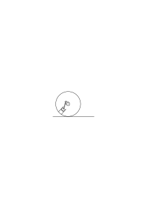

The cylinder is fixed inside the roller & so, naturally, the whole is a rigid system whose parts cannot move against one another. And on the other hand one can roll it back and forth as one likes & it always works. What I mean is: whatever one does with the roller is all right with the inside of this roller. (And here lies the analogy.)

### [46r\[2\]](https://cdn.wittgensteinnachlass.com/2000px/webp/Ms-153a/46r.webp)

A sense-datum is of course not a concept either, but a form.

### [46r\[3\]](https://cdn.wittgensteinnachlass.com/2000px/webp/Ms-153a/46r.webp),[46v\[1\]](https://cdn.wittgensteinnachlass.com/2000px/webp/Ms-153a/46v.webp),[47r\[1\]](https://cdn.wittgensteinnachlass.com/2000px/webp/Ms-153a/47r.webp)

I could follow the explanation of the arrow with the mental image. That would be as if I followed it with a drawing (and here it is the ‘primary’ of the drawing that is at issue, not the physical). But then the mental image seems to play another role in which it is apparently not interpretable. Not interpretable because it has already been interpreted, or rather because it is already sign & interpretation. But how does one interpret signs? Through other signs, after all.

### [47r\[2\]](https://cdn.wittgensteinnachlass.com/2000px/webp/Ms-153a/47r.webp)

What I want to say is: one cannot interpret language as a whole.

### [47r\[3\]](https://cdn.wittgensteinnachlass.com/2000px/webp/Ms-153a/47r.webp),[47v\[1\]](https://cdn.wittgensteinnachlass.com/2000px/webp/Ms-153a/47v.webp)

It is easy to confuse the painted picture in the physical sense with the corresponding visual image. This can quite well take the place of the memory-image; why not? When one feels that this is not possible, one thinks of the physical picture.

### [47v\[2\]](https://cdn.wittgensteinnachlass.com/2000px/webp/Ms-153a/47v.webp)

It is therefore correct to say: I remember “that ↗˚”. The image is then in a certain sense present & past.

### [47v\[3\]](https://cdn.wittgensteinnachlass.com/2000px/webp/Ms-153a/47v.webp),[48r\[1\]](https://cdn.wittgensteinnachlass.com/2000px/webp/Ms-153a/48r.webp)

If one says to me “bring a yellow flower” & I imagine fetching a yellow flower, I have proved that I have understood the order. But equally if I picture to myself how I carry out the order. – Why? Presumably because what I do must be described using words from the order. Or should I say that I have actually carried out a related order.

### [48r\[2\]](https://cdn.wittgensteinnachlass.com/2000px/webp/Ms-153a/48r.webp),[48v\[1\]](https://cdn.wittgensteinnachlass.com/2000px/webp/Ms-153a/48v.webp)

Why does one take it as proof that a sentence has sense that I can imagine what it says? Because I would have to describe this image with a sentence related to the first sentence.

### [48v\[2\]](https://cdn.wittgensteinnachlass.com/2000px/webp/Ms-153a/48v.webp)

But does it follow that there is no difference between one picture & another? One symbol & another?

### [48v\[3\]](https://cdn.wittgensteinnachlass.com/2000px/webp/Ms-153a/48v.webp),[49r\[1\]](https://cdn.wittgensteinnachlass.com/2000px/webp/Ms-153a/49r.webp)

“I imagine what it will be like” (when a black patch appears there) – How can I imagine it, then, when it is not so?! Is imagination a kind of magic? No, the description of the mental image is (precisely) not the same as the description of the expected event.

### [49r\[2\]](https://cdn.wittgensteinnachlass.com/2000px/webp/Ms-153a/49r.webp)

“You told me ‘leave the room’, so I did _that_” (and now he draws what happened, or acts it out). But there is apparently no connection at all!

### [49r\[3\]](https://cdn.wittgensteinnachlass.com/2000px/webp/Ms-153a/49r.webp),[49v\[1\]](https://cdn.wittgensteinnachlass.com/2000px/webp/Ms-153a/49v.webp)

How can one calculate that 3 & 2 = 5?! when after all ‘5’ has no internal relation to ‘3 & 2’? The only way to do it is one that establishes this relation.

### [49v\[2\]](https://cdn.wittgensteinnachlass.com/2000px/webp/Ms-153a/49v.webp)

The sentence is as similar to the fact as the sign ‘5’ is to the sign ‘3 &2’. And the painted picture of the fact is as similar to the sign ∣∣∣∣∣ as the sign ∣∣ + ∣∣∣.

### [49v\[3\]](https://cdn.wittgensteinnachlass.com/2000px/webp/Ms-153a/49v.webp),[50r\[1\]](https://cdn.wittgensteinnachlass.com/2000px/webp/Ms-153a/50r.webp),[50v\[1\]](https://cdn.wittgensteinnachlass.com/2000px/webp/Ms-153a/50v.webp)

When one says: I imagine the sun _as_ it moves rapidly across the sky; surely the mental image is not described by saying that “the sun is moving rapidly across the sky”! Now, on the one hand I could ask: Isn’t what you see before you perhaps a yellow disc in motion, but not specifically the sun? – On the other hand, when I say “I imagine the sun thus & so”, that is not the same as if I were – cinematographically, say – to see such a picture. Indeed, it would make sense to ask of this picture: “Does that represent the sun?”

### [50v\[2\]](https://cdn.wittgensteinnachlass.com/2000px/webp/Ms-153a/50v.webp),[51r\[1\]](https://cdn.wittgensteinnachlass.com/2000px/webp/Ms-153a/51r.webp)

Suppose there were two suns A & B in the sky that looked alike, & now someone says: “I imagine sun A moving in this way”. Could one then ask him: “How do you know it’s sun A in particular”? The difference cannot lie in anything about the mental image that is comparable to a painted picture.

### [51r\[2\]](https://cdn.wittgensteinnachlass.com/2000px/webp/Ms-153a/51r.webp)

On imagining as proof of sense: If it makes sense to say “I can imagine that p is the case”, then it also makes sense to say “p is the case”.

### [51r\[2\]](https://cdn.wittgensteinnachlass.com/2000px/webp/Ms-153a/51r.webp),[51v\[1\]](https://cdn.wittgensteinnachlass.com/2000px/webp/Ms-153a/51v.webp)

The mental image in the sense in which I spoke of it earlier is like a picture with the caption ‘Portrait of N.N.’.

### [51v\[2\]](https://cdn.wittgensteinnachlass.com/2000px/webp/Ms-153a/51v.webp)

[My brain will probably one day go blind with age, as it were. But not necessarily only when I am much older than I am now.]

### [51v\[3\]](https://cdn.wittgensteinnachlass.com/2000px/webp/Ms-153a/51v.webp),[52r\[1\]](https://cdn.wittgensteinnachlass.com/2000px/webp/Ms-153a/52r.webp),[52v\[1\]](https://cdn.wittgensteinnachlass.com/2000px/webp/Ms-153a/52v.webp),[53r\[1\]](https://cdn.wittgensteinnachlass.com/2000px/webp/Ms-153a/53r.webp),[53v\[1\]](https://cdn.wittgensteinnachlass.com/2000px/webp/Ms-153a/53v.webp)

What does it mean, then, to “discover that a sentence has sense”? Or let us ask it this way: How can one substantiate the claim that a sentence is nonsensical (say, “this body is extended”) by saying: “I cannot imagine what it would be like if it were otherwise”.

For can I even try to imagine it? Does it not mean: To say that I imagine it is senseless? How then does this recasting of one piece of nonsense into another help me? – And why does one say precisely: “I cannot imagine what it would be like if it were _otherwise_” & not – which after all comes to the same thing – “I cannot imagine what that would be like”?? One seems to acknowledge in the nonsensical sentence something like a tautology as opposed to a contradiction. But that too is wrong. One says, as it were: “Yes, it is extended, but how could it be otherwise; so why say it. –” It is the same tendency that leads us to reply to the sentence “this rod has a definite length” not with “Nonsense”, but with: “Of course!”. But what is the reason for this tendency? It might also be expressed thus: when we hear the two sentences “this rod has a length” & its negation “this rod has no length”, we are biased & incline towards the former instead of declaring both nonsense).

The reason for this, however, is a confusion: We see the first sentence as verified (& the second as falsified) by saying, for example, “the rod is 4m long”. And one will say: “and surely 4m is a length” and forget that what one has here is a sentence of grammar.

### [53v\[1\]](https://cdn.wittgensteinnachlass.com/2000px/webp/Ms-153a/53v.webp),[54r\[1\]](https://cdn.wittgensteinnachlass.com/2000px/webp/Ms-153a/54r.webp)

When one sometimes says that one could not see what is light if one did not see what is dark, this is not a sentence of physics or psychology – for here it isn’t true & I can very well see an entirely white surface & nothing dark alongside it – but what it must mean is: it makes no sense in our language to speak of lightness if it does not make sense to speak of something dark.

### [54r\[2\]](https://cdn.wittgensteinnachlass.com/2000px/webp/Ms-153a/54r.webp),[54v\[1\]](https://cdn.wittgensteinnachlass.com/2000px/webp/Ms-153a/54v.webp)

What does it mean, then, to “discover that a sentence has no sense”?

And what does this mean: “if I mean something by it, surely it must have sense”?!

### [54v\[2\]](https://cdn.wittgensteinnachlass.com/2000px/webp/Ms-153a/54v.webp)

“If I mean something by it …” – if I mean _what_ by it?!

### [54v\[3\]](https://cdn.wittgensteinnachlass.com/2000px/webp/Ms-153a/54v.webp)

What does it mean: “If I can imagine something in connection with it, it must have sense.”

### [54v\[4\]](https://cdn.wittgensteinnachlass.com/2000px/webp/Ms-153a/54v.webp),[55r\[1\]](https://cdn.wittgensteinnachlass.com/2000px/webp/Ms-153a/55r.webp)

If I can imagine _what_ in connection with it? What I say? That means nothing. And Something? That would mean: If I can use the words in this way, then they have sense. Or rather: If I use them to calculate, then they have sense.

### [55r\[2\]](https://cdn.wittgensteinnachlass.com/2000px/webp/Ms-153a/55r.webp)

No one understands philosophy: either one does not understand what is written, or one understands it, but not that it is philosophy.

### [55r\[3\]](https://cdn.wittgensteinnachlass.com/2000px/webp/Ms-153a/55r.webp),[55v\[1\]](https://cdn.wittgensteinnachlass.com/2000px/webp/Ms-153a/55v.webp)

“You made a movement with your hand; did you mean something by it? – I thought you meant that I should come to you.”

### [55v\[2\]](https://cdn.wittgensteinnachlass.com/2000px/webp/Ms-153a/55v.webp)

The question is whether one may ask: “_what_ did you mean”. The answer to this question (however) is again a sentence. Whereas if one may not ask the question that way, then meaning is – so to speak – amorphous. And “I mean something by it” then has the same form as “the sentence is useful”.

### [55v\[3\]](https://cdn.wittgensteinnachlass.com/2000px/webp/Ms-153a/55v.webp),[56r\[1\]](https://cdn.wittgensteinnachlass.com/2000px/webp/Ms-153a/56r.webp)

Now if one asks “did you mean something by this movement of your hand?”, the answer may be “no, I didn’t mean anything by it at all” or “yes, I meant something”. And in the second case one will ask “what?” and the answer will be words, say.

### [56r\[2\]](https://cdn.wittgensteinnachlass.com/2000px/webp/Ms-153a/56r.webp),[56v\[1\]](https://cdn.wittgensteinnachlass.com/2000px/webp/Ms-153a/56v.webp)

But could one answer: “I meant something by this movement that I can express only through this movement”?

### [56v\[2\]](https://cdn.wittgensteinnachlass.com/2000px/webp/Ms-153a/56v.webp)

I seem to want to say: understanding means only grasping (receiving) certain signs.

### [56v\[3\]](https://cdn.wittgensteinnachlass.com/2000px/webp/Ms-153a/56v.webp),[57r\[1\]](https://cdn.wittgensteinnachlass.com/2000px/webp/Ms-153a/57r.webp)

“No, I didn’t mean anything at all by this movement. I made it quite involuntarily.” Or alternatively: “Yes, I meant something, I wanted you to come”. But then this wanting the other person to come was a separate process. That is to say, I have now translated the whole process into the sentence “I want you to come.” But then it was, after all, only a sign again.

---

### [57r\[2\]](https://cdn.wittgensteinnachlass.com/2000px/webp/Ms-153a/57r.webp)

“Is the mental image only the mental image, or is it an image of something in reality?”

### [57r\[3\]](https://cdn.wittgensteinnachlass.com/2000px/webp/Ms-153a/57r.webp),[57v\[1\]](https://cdn.wittgensteinnachlass.com/2000px/webp/Ms-153a/57v.webp)

And one could also grasp the relation of the mental image to the painted picture by starting from this question.

### [57v\[2\]](https://cdn.wittgensteinnachlass.com/2000px/webp/Ms-153a/57v.webp),[58r\[1\]](https://cdn.wittgensteinnachlass.com/2000px/webp/Ms-153a/58r.webp)

But the question could not be: “Is the mental image always an image of something that exists in reality”– for plainly it is not always that –; it would have to be: does the mental image always refer, truly or falsely, to reality.

– For that is something one cannot say of a painted picture. –

### [58r\[2\]](https://cdn.wittgensteinnachlass.com/2000px/webp/Ms-153a/58r.webp)

But why then shouldn’t one say that the mental image is an image of a dream?

### [58r\[3\]](https://cdn.wittgensteinnachlass.com/2000px/webp/Ms-153a/58r.webp),[58v\[1\]](https://cdn.wittgensteinnachlass.com/2000px/webp/Ms-153a/58v.webp)

Are not the mental image & reality related as a plane picture is to three-dimensional space, in which there _can_ always be something of which the plane picture is the projection?

### [58v\[2\]](https://cdn.wittgensteinnachlass.com/2000px/webp/Ms-153a/58v.webp)

… quia plus loquitur inquisitio quam inventio … Augustine.

### [58v\[3\]](https://cdn.wittgensteinnachlass.com/2000px/webp/Ms-153a/58v.webp)

_Manifestissima & usitatissima sunt, & eadem rursus nimis latent, & nova est inventio eorum._ Augustine

### [58v\[4\]](https://cdn.wittgensteinnachlass.com/2000px/webp/Ms-153a/58v.webp),[59r\[1\]](https://cdn.wittgensteinnachlass.com/2000px/webp/Ms-153a/59r.webp)

If one says that mental images are private, one is again misled by a false analogy.

### [59r\[2\]](https://cdn.wittgensteinnachlass.com/2000px/webp/Ms-153a/59r.webp)

Could I paint that things are so if it made no sense to say “things are so”?

---

### [59r\[3\]](https://cdn.wittgensteinnachlass.com/2000px/webp/Ms-153a/59r.webp),[59v\[1\]](https://cdn.wittgensteinnachlass.com/2000px/webp/Ms-153a/59v.webp),[60r\[1\]](https://cdn.wittgensteinnachlass.com/2000px/webp/Ms-153a/60r.webp)

If the picture is meant to depict Napoleon’s coronation, one would not have to write that underneath it if it were contained in the picture. If, that is, it too were described in the mere description of the picture. And one might now draw a sharp distinction between thought & picture by saying that the description of the _thought_, unlike that of the mere picture, must also contain a description of the reality to which the thought refers. But there is an error here.

### [60r\[2\]](https://cdn.wittgensteinnachlass.com/2000px/webp/Ms-153a/60r.webp),[60v\[1\]](https://cdn.wittgensteinnachlass.com/2000px/webp/Ms-153a/60v.webp)

Doesn’t the difference arise from the fact that the painted picture is not in itself part of a much more comprehensive picture– a language –. By giving it a caption we incorporate the picture into the more comprehensive one. Could we not do this just as effectively by incorporating it into a series of painted pictures?

### [60v\[2\]](https://cdn.wittgensteinnachlass.com/2000px/webp/Ms-153a/60v.webp),[61r\[1\]](https://cdn.wittgensteinnachlass.com/2000px/webp/Ms-153a/61r.webp)

What is characteristic of language is that all explanations can be given in advance. I.e. it must have been possible to foresee them all & none needs to be given ad hoc. (And this is what seems to constitute its pictorial character.)

### [61r\[2\]](https://cdn.wittgensteinnachlass.com/2000px/webp/Ms-153a/61r.webp),[61v\[1\]](https://cdn.wittgensteinnachlass.com/2000px/webp/Ms-153a/61v.webp)

I could present my problem like this: if I wanted to investigate whether Napoleon’s coronation really took place in such and such a way, I could use the picture as a documentary record rather than a description. And then the question arises: is the whole comparison of the record with reality of the same kind as the comparison of reality with the picture, or is there also something else involved, of a different kind?

---

### [61v\[2\]](https://cdn.wittgensteinnachlass.com/2000px/webp/Ms-153a/61v.webp)

But what is one to compare reality with, if not with the sentence? And what else is one to do but compare it with the sentence?

### [61v\[2\]](https://cdn.wittgensteinnachlass.com/2000px/webp/Ms-153a/61v.webp),[62r\[1\]](https://cdn.wittgensteinnachlass.com/2000px/webp/Ms-153a/62r.webp)

Or should I say: As long as one does not compare the picture with anything, one _can_ compare it with anything. But when we think, we are already comparing the picture with reality, for we know, for example, that Napoleon is not here now, but Mr N.N. is.

### [62r\[2\]](https://cdn.wittgensteinnachlass.com/2000px/webp/Ms-153a/62r.webp)

That is connected with the problem of Here & Now.

### [62r\[3\]](https://cdn.wittgensteinnachlass.com/2000px/webp/Ms-153a/62r.webp)

The capacity for philosophy consists in the capacity to receive a _strong_ (lasting) impression from a fact of grammar.

### [62v\[1\]](https://cdn.wittgensteinnachlass.com/2000px/webp/Ms-153a/62v.webp),[63r\[1\]](https://cdn.wittgensteinnachlass.com/2000px/webp/Ms-153a/63r.webp)

In a certain sense the meaning of the words “here”, “now” (etc.) is the only one I cannot fix in advance. But that is of course a misleading way of putting it: the meaning _can_ be fixed and is fixed when the rules for these words are fixed & that can be done before they are applied in a particular case; for why else use _one_ word in different cases.

### [63r\[2\]](https://cdn.wittgensteinnachlass.com/2000px/webp/Ms-153a/63r.webp),[63v\[1\]](https://cdn.wittgensteinnachlass.com/2000px/webp/Ms-153a/63v.webp)

The words “here” “now”, etc. designate the starting-point of a coordinate system:

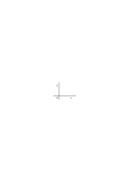

Like the letter ‘O’, but they do not describe its position relative to objects in space.

### [63v\[2\]](https://cdn.wittgensteinnachlass.com/2000px/webp/Ms-153a/63v.webp)

To understand the meaning of a word is to know, to understand, its use.

---

### [63v\[3\]](https://cdn.wittgensteinnachlass.com/2000px/webp/Ms-153a/63v.webp),[64r\[1\]](https://cdn.wittgensteinnachlass.com/2000px/webp/Ms-153a/64r.webp)

When I say: “the present situation enters into my thoughts”, this does not mean: the situation insofar as I can describe it. For insofar as I can describe it, I can paint it.

### [64r\[2\]](https://cdn.wittgensteinnachlass.com/2000px/webp/Ms-153a/64r.webp)

Here & Now are geometrical concepts, like, for example, the centre of my visual field.

---

### [64r\[3\]](https://cdn.wittgensteinnachlass.com/2000px/webp/Ms-153a/64r.webp),[64v\[1\]](https://cdn.wittgensteinnachlass.com/2000px/webp/Ms-153a/64v.webp)

Here & Now have no greater multiplicity than they seem to have. The great danger is to assume that they do. Replace them with whatever expression you like, it is always only one word – & one is as good as another.

### [64v\[2\]](https://cdn.wittgensteinnachlass.com/2000px/webp/Ms-153a/64v.webp)

“I am here now” in what situation does this make sense, and in what situation does it not?

### [64v\[3\]](https://cdn.wittgensteinnachlass.com/2000px/webp/Ms-153a/64v.webp)

Let us imagine a letter dated: Here, Now.

But I think this shows what these words mean: they stand for the _preprinted_ word “date …”.

### [64v\[4\]](https://cdn.wittgensteinnachlass.com/2000px/webp/Ms-153a/64v.webp),[65r\[1\]](https://cdn.wittgensteinnachlass.com/2000px/webp/Ms-153a/65r.webp)

Difference between legend & fairy tale.

Fairy tales (& other works of fiction) cut off from the now & the here.

### [65r\[2\]](https://cdn.wittgensteinnachlass.com/2000px/webp/Ms-153a/65r.webp)

But it is an important proposition in the grammar of the word “Here” that it makes no sense to write “here” where a location is to be specified; that I should therefore not attach to my chair a little sign bearing the inscription “This chair is always to be used here and nowhere else”.

### [65r\[3\]](https://cdn.wittgensteinnachlass.com/2000px/webp/Ms-153a/65r.webp)

“This is here now”.

### [65r\[4\]](https://cdn.wittgensteinnachlass.com/2000px/webp/Ms-153a/65r.webp),[65v\[1\]](https://cdn.wittgensteinnachlass.com/2000px/webp/Ms-153a/65v.webp)

Of course, with regard to the words “now & here” etc. (also) I can only do what I do in other cases, namely describe their use. And this description must be general; i.e. given in advance, _before_ any use.

### [65v\[2\]](https://cdn.wittgensteinnachlass.com/2000px/webp/Ms-153a/65v.webp)

Instead of “Portrait of Mr N.N.”, the inscription on the picture could also read: “A man like this can now be seen in such & such a place”.

### [66r\[1\]](https://cdn.wittgensteinnachlass.com/2000px/webp/Ms-153a/66r.webp)

And here one would see more clearly how the caption relates to now & here.

### [66r\[2\]](https://cdn.wittgensteinnachlass.com/2000px/webp/Ms-153a/66r.webp)

The painting depicting Napoleon’s coronation would, without the caption, correspond exactly to a fictional description.

### [66r\[3\]](https://cdn.wittgensteinnachlass.com/2000px/webp/Ms-153a/66r.webp)

The map & its orientation.

### [66r\[4\]](https://cdn.wittgensteinnachlass.com/2000px/webp/Ms-153a/66r.webp)

“I imagine the _sun_” is picture & caption.

### [66r\[5\]](https://cdn.wittgensteinnachlass.com/2000px/webp/Ms-153a/66r.webp),[66v\[1\]](https://cdn.wittgensteinnachlass.com/2000px/webp/Ms-153a/66v.webp)

I go by his _words & gestures_.

### [66v\[1\]](https://cdn.wittgensteinnachlass.com/2000px/webp/Ms-153a/66v.webp)

The gestures must serve as the basis of the calculus, however that calculus may be worked out.

### [66v\[3\]](https://cdn.wittgensteinnachlass.com/2000px/webp/Ms-153a/66v.webp)

Now is not my expression, that the sentence is a picture, a skewed expression that carries a certain analogy too far??

### [66v\[4\]](https://cdn.wittgensteinnachlass.com/2000px/webp/Ms-153a/66v.webp),[67r\[1\]](https://cdn.wittgensteinnachlass.com/2000px/webp/Ms-153a/67r.webp)

It is not true that what I say holds only for an “ideal language”; but one can say that we construct an ideal language into which, however, everything that can be said in non-ideal languages can then be translated.

### [67r\[2\]](https://cdn.wittgensteinnachlass.com/2000px/webp/Ms-153a/67r.webp)

“What, then, is the ‘present situation’?” Well, that such & such is the case. _Not_: “that such & such is _now_ the case.”

### [67r\[3\]](https://cdn.wittgensteinnachlass.com/2000px/webp/Ms-153a/67r.webp),[67v\[1\]](https://cdn.wittgensteinnachlass.com/2000px/webp/Ms-153a/67v.webp)

“Now” is a word. What do I need this word for? ‘Now’ – as opposed to what? – As opposed to ‘in half an hour’, ‘half an hour ago’, etc. etc. “Now” does not designate a system but belongs to a system. It does not work by magic; any more than any word does.

### [67v\[2\]](https://cdn.wittgensteinnachlass.com/2000px/webp/Ms-153a/67v.webp),[68r\[1\]](https://cdn.wittgensteinnachlass.com/2000px/webp/Ms-153a/68r.webp)

Would I not have to say: the sentences I use to describe reality are exactly the same as those used in literature, say in King Lear: but I use them differently. But if I can say that, ‘differently’, then surely I would also have to be able to specify the difference.

### [68r\[2\]](https://cdn.wittgensteinnachlass.com/2000px/webp/Ms-153a/68r.webp),[68v\[1\]](https://cdn.wittgensteinnachlass.com/2000px/webp/Ms-153a/68v.webp)

If language can be compared to money, which does not matter in and of itself but has meaning only indirectly, because one can use it to buy objects that have meaning for us, then one can say that here, in the use of the words “I” “Here”, “now” etc., barter enters into monetary trade.

### [68v\[2\]](https://cdn.wittgensteinnachlass.com/2000px/webp/Ms-153a/68v.webp)

It is clear that someone who makes a plan makes a picture.

### [68v\[3\]](https://cdn.wittgensteinnachlass.com/2000px/webp/Ms-153a/68v.webp)

But there is something else as well: namely, when he makes orientation marks on the plan & on reality.

### [69r\[1\]](https://cdn.wittgensteinnachlass.com/2000px/webp/Ms-153a/69r.webp)

Explanation of language, e.g. of the plan, by demonstrating its use in a particular case: but this demonstration interests us not insofar as it is the cause of correct imitation, but insofar as it can be interpreted (afterwards) as an _explanation_.

### [69r\[2\]](https://cdn.wittgensteinnachlass.com/2000px/webp/Ms-153a/69r.webp),[69v\[1\]](https://cdn.wittgensteinnachlass.com/2000px/webp/Ms-153a/69v.webp)

What is “particular” is the event. The event described by the words “it rained today” & the next day by “it rained yesterday”.

### [69v\[2\]](https://cdn.wittgensteinnachlass.com/2000px/webp/Ms-153a/69v.webp)

Apparent consistency when someone promises today “I shall visit you tomorrow” & repeats this promise word for word the next day.

### [69v\[3\]](https://cdn.wittgensteinnachlass.com/2000px/webp/Ms-153a/69v.webp)

Picture & reality must form _one_ system. Just as the result of the calculation & all the rest of the calculation must.

### [70r\[1\]](https://cdn.wittgensteinnachlass.com/2000px/webp/Ms-153a/70r.webp)

When we demonstrate a mapping, it is no concern of ours whether this demonstration has the effect of being correctly imitated; all that interests us is what happens _if_ the example is correctly understood.

### [70r\[2\]](https://cdn.wittgensteinnachlass.com/2000px/webp/Ms-153a/70r.webp)

What interests us is only the _exact_ relation of the example to following. [Imitation] ---

### [70v\[1\]](https://cdn.wittgensteinnachlass.com/2000px/webp/Ms-153a/70v.webp)

One calculates again from the example.

### [70v\[2\]](https://cdn.wittgensteinnachlass.com/2000px/webp/Ms-153a/70v.webp)

Examples are proper signs, not waste, not a means of influencing someone.

### [70v\[3\]](https://cdn.wittgensteinnachlass.com/2000px/webp/Ms-153a/70v.webp)

For all that interests us is the geometry of the mechanism. (That is to say, the grammar of its description.)

### [70v\[4\]](https://cdn.wittgensteinnachlass.com/2000px/webp/Ms-153a/70v.webp),[71r\[1\]](https://cdn.wittgensteinnachlass.com/2000px/webp/Ms-153a/71r.webp)

Meaning is a stipulation, not experience. And so not causality.

### [71r\[2\]](https://cdn.wittgensteinnachlass.com/2000px/webp/Ms-153a/71r.webp)

What is exact is the internal relation.

### [71r\[3\]](https://cdn.wittgensteinnachlass.com/2000px/webp/Ms-153a/71r.webp)

The sign, insofar as it suggests and thus insofar as it has an effect, does not interest us at all.

It interests us only as a move in a game: an _element_ in a system that is self-standing.

### [71r\[4\]](https://cdn.wittgensteinnachlass.com/2000px/webp/Ms-153a/71r.webp),[71v\[1\]](https://cdn.wittgensteinnachlass.com/2000px/webp/Ms-153a/71v.webp)

The difference between kinds of words is always like the difference between game pieces, or like the even greater difference between a game piece & the chessboard.

### [71v\[2\]](https://cdn.wittgensteinnachlass.com/2000px/webp/Ms-153a/71v.webp)

The name “Napoleon” has sense only as a sign of a calculus (like every other name).

### [71v\[3\]](https://cdn.wittgensteinnachlass.com/2000px/webp/Ms-153a/71v.webp)

The system here, for example, is that this name could stand above various pictures & does stand above one.

### [72r\[1\]](https://cdn.wittgensteinnachlass.com/2000px/webp/Ms-153a/72r.webp)

One finds out through experience what the sign suggests: It is experience that teaches us which signs are least easily misunderstood.

### [72r\[2\]](https://cdn.wittgensteinnachlass.com/2000px/webp/Ms-153a/72r.webp),[72v\[1\]](https://cdn.wittgensteinnachlass.com/2000px/webp/Ms-153a/72v.webp)

It must be clear to us that the connection of our thought with Napoleon can be made only through Napoleon himself & not through any picture (mental image, etc.), however close the likeness. On the other hand, however, for us Napoleon is no less contained in it in his absence than in his presence.

### [72v\[2\]](https://cdn.wittgensteinnachlass.com/2000px/webp/Ms-153a/72v.webp)

“But the thought of Napoleon must surely have something to do with Napoleon”. Certainly & it must contain that whose existence is not in doubt.

### [72v\[3\]](https://cdn.wittgensteinnachlass.com/2000px/webp/Ms-153a/72v.webp)

And that must correspond to the words whose existence is not in doubt.

### [73r\[1\]](https://cdn.wittgensteinnachlass.com/2000px/webp/Ms-153a/73r.webp),[73v\[1\]](https://cdn.wittgensteinnachlass.com/2000px/webp/Ms-153a/73v.webp)

Anyone who calls green an object must say that this object occurs in the symbolism. For otherwise the sense of the symbolism, and hence its being a symbolism, would not be assured. That of course overturns the whole concept of an object! And rightly so. Red, left & much must not count as objects; only the red patch, the table, etc., may. If one does not want to deal with these objects, it is probably better not to use the word “object”.

### [73v\[2\]](https://cdn.wittgensteinnachlass.com/2000px/webp/Ms-153a/73v.webp),[74r\[1\]](https://cdn.wittgensteinnachlass.com/2000px/webp/Ms-153a/74r.webp)

The awkwardness with which the sign, like a mute person, tries to make itself understood through all sorts of suggestive gestures disappears when we recognize that what is essential to the sign is only the system to which it belongs & the rest of its content drops away.

### [74r\[2\]](https://cdn.wittgensteinnachlass.com/2000px/webp/Ms-153a/74r.webp)

Thinking is making plans.

When you make plans, you make _one_ plan as opposed to other plans.

### [74r\[3\]](https://cdn.wittgensteinnachlass.com/2000px/webp/Ms-153a/74r.webp),[74v\[1\]](https://cdn.wittgensteinnachlass.com/2000px/webp/Ms-153a/74v.webp)

You make this one as distinct from others. And that is how the sign, the mental image, characterizes the plan. In contrast, namely, to other signs & mental images.

### [74v\[2\]](https://cdn.wittgensteinnachlass.com/2000px/webp/Ms-153a/74v.webp)

For us the thought can only be what is used.

### [74v\[3\]](https://cdn.wittgensteinnachlass.com/2000px/webp/Ms-153a/74v.webp)

We are not in the realm of explanations, & every explanation sounds trivial to us.

### [74v\[4\]](https://cdn.wittgensteinnachlass.com/2000px/webp/Ms-153a/74v.webp)

But giving up explanation makes it so hard to grasp what thought really accomplishes.

### [74v\[5\]](https://cdn.wittgensteinnachlass.com/2000px/webp/Ms-153a/74v.webp),[75r\[1\]](https://cdn.wittgensteinnachlass.com/2000px/webp/Ms-153a/75r.webp)

One can say: It calculates on the basis of what is given & ends in an action.

### [75r\[2\]](https://cdn.wittgensteinnachlass.com/2000px/webp/Ms-153a/75r.webp)

Calculating the wall thickness of a boiler & making it in accordance with the calculation is a clear example of thinking.

### [75r\[3\]](https://cdn.wittgensteinnachlass.com/2000px/webp/Ms-153a/75r.webp),[75v\[1\]](https://cdn.wittgensteinnachlass.com/2000px/webp/Ms-153a/75v.webp)

The step that leads from the calculation on paper to the action is still a step in the calculation.

### [75v\[2\]](https://cdn.wittgensteinnachlass.com/2000px/webp/Ms-153a/75v.webp)

When one says “it must be essential to mathematics that it can be applied”, one means that this applica*bility* is not that of a piece of wood of which I say: I shall be able to use that for such & such.

### [75v\[3\]](https://cdn.wittgensteinnachlass.com/2000px/webp/Ms-153a/75v.webp),[76r\[1\]](https://cdn.wittgensteinnachlass.com/2000px/webp/Ms-153a/76r.webp)

If thinking were not in a certain sense mechanical – proceeding of necessity – it would be of no use.

### [76r\[2\]](https://cdn.wittgensteinnachlass.com/2000px/webp/Ms-153a/76r.webp)

“The plan consists in my seeing myself do such & such.” But how do I know it is _me_? – Well, it is not me that I see, but a picture, say. But why do I call it _my_ picture? Not because it looks like me, for instance.

### [76r\[3\]](https://cdn.wittgensteinnachlass.com/2000px/webp/Ms-153a/76r.webp),[76v\[1\]](https://cdn.wittgensteinnachlass.com/2000px/webp/Ms-153a/76v.webp)

[In Christianity the good Lord says to human beings, as it were: Do not play at tragedy, that is, at heaven & hell on earth; _I_ have reserved heaven & hell for myself.]

### [76v\[2\]](https://cdn.wittgensteinnachlass.com/2000px/webp/Ms-153a/76v.webp)

It is true: names can stand for things; but they do not stand for their meanings; & to call the things (spatial objects, say) the meanings of the words is absurd.

### [76v\[3\]](https://cdn.wittgensteinnachlass.com/2000px/webp/Ms-153a/76v.webp),[77r\[1\]](https://cdn.wittgensteinnachlass.com/2000px/webp/Ms-153a/77r.webp)

Would that not mean: The bearer of the name is not its meaning?

### [77r\[2\]](https://cdn.wittgensteinnachlass.com/2000px/webp/Ms-153a/77r.webp)

But is not L.W. the bearer of the name “L.W.”? And is not L.W. the meaning of “L.W.”?

### [77r\[3\]](https://cdn.wittgensteinnachlass.com/2000px/webp/Ms-153a/77r.webp)

Is not “L.W. is dead” the same sentence as “the bearer of the name ‘L.W.’ is dead”?

### [77r\[4\]](https://cdn.wittgensteinnachlass.com/2000px/webp/Ms-153a/77r.webp),[77v\[1\]](https://cdn.wittgensteinnachlass.com/2000px/webp/Ms-153a/77v.webp)

But is it not nonsense to say that L.W. is the meaning of the name “L.W.”?! That would presumably mean that I could substitute the words “the meaning of ‘L.W.’” for the word “L.W.” in my language. And that at any rate goes quite against the normal use of this expression.

### [77v\[2\]](https://cdn.wittgensteinnachlass.com/2000px/webp/Ms-153a/77v.webp)

One can say that the words “the bearer of the name ‘L.W.’” have the same meaning as the name “L.W.” – so they can be substituted for one another.

### [77v\[3\]](https://cdn.wittgensteinnachlass.com/2000px/webp/Ms-153a/77v.webp),[78r\[1\]](https://cdn.wittgensteinnachlass.com/2000px/webp/Ms-153a/78r.webp)

But does it not come to the same thing to say “two names have _one_ bearer” & “two names have one & the same meaning”? (Morning Star, Evening Star, Venus.)

### [78r\[2\]](https://cdn.wittgensteinnachlass.com/2000px/webp/Ms-153a/78r.webp),[78v\[1\]](https://cdn.wittgensteinnachlass.com/2000px/webp/Ms-153a/78v.webp)

If by the sentence “‘a’ & ‘b’ have the same bearer” what is meant is that “the bearer of ‘a’” means the same as “the bearer of ‘b’”, then all is in order, because that means the same as a = b. But if by the bearer of ‘a’ we mean, say, the person who can be established to have been christened ‘a’; or the person who wears the little plaque with the name ‘a’ round his neck; etc., then it does not follow at all that I mean this person by a, & that the names that have the same bearer mean the same thing.

### [78v\[2\]](https://cdn.wittgensteinnachlass.com/2000px/webp/Ms-153a/78v.webp),[79r\[1\]](https://cdn.wittgensteinnachlass.com/2000px/webp/Ms-153a/79r.webp)

The question “How do I know that is me?” or, more correctly, “… that that stands for _me_” is nonsense, for its standing for me is my own stipulation. Indeed, I might just as well ask: “how do I know that the word ‘I’ stands for me?”, for my figure in the picture was only another word ‘I’.

### [79r\[2\]](https://cdn.wittgensteinnachlass.com/2000px/webp/Ms-153a/79r.webp),[79v\[1\]](https://cdn.wittgensteinnachlass.com/2000px/webp/Ms-153a/79v.webp)

One could, however, ask “What has the name ‘a’ got to do with this person?” And the answer would be: Well, that _is_ a.

### [79v\[2\]](https://cdn.wittgensteinnachlass.com/2000px/webp/Ms-153a/79v.webp)

But do we not point to the object for which the name stands in order to explain the meaning? Yes; but this object is not the meaning, although the meaning is determined by pointing to this object.

### [79v\[3\]](https://cdn.wittgensteinnachlass.com/2000px/webp/Ms-153a/79v.webp)

“This figure in the picture is me” is a convention.

### [80r\[1\]](https://cdn.wittgensteinnachlass.com/2000px/webp/Ms-153a/80r.webp)

Yes, but what do we agree on? What relation do we establish between the sign & me? Well, _only_ the one that holds, say, through pointing with the hand or hanging a little label round someone’s neck, for this relation is significant only through the system to which it belongs.

### [80r\[2\]](https://cdn.wittgensteinnachlass.com/2000px/webp/Ms-153a/80r.webp),[80v\[1\]](https://cdn.wittgensteinnachlass.com/2000px/webp/Ms-153a/80v.webp)

So if I point to a patch & say “that is red” by way of explanation of a word, I ought not to have said “that is the meaning of the word ‘red’”.

### [80v\[2\]](https://cdn.wittgensteinnachlass.com/2000px/webp/Ms-153a/80v.webp)

The correlation of object & name is none other than the one produced by the words “that is …” or by a table

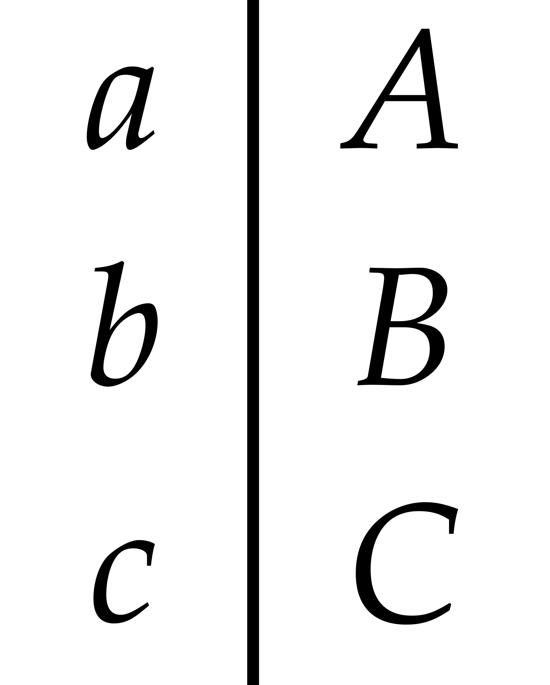

etc. It is a part of the symbolism. It is therefore nonsense to say that the correlation of name & object is a psychological one.

### [81r\[1\]](https://cdn.wittgensteinnachlass.com/2000px/webp/Ms-153a/81r.webp)

Thinking is a continuous calculation.

### [81r\[2\]](https://cdn.wittgensteinnachlass.com/2000px/webp/Ms-153a/81r.webp)

_Induction_.

### [81r\[3\]](https://cdn.wittgensteinnachlass.com/2000px/webp/Ms-153a/81r.webp)

That the fire will burn me if I put my hand in it: that is certainty.

### [81r\[4\]](https://cdn.wittgensteinnachlass.com/2000px/webp/Ms-153a/81r.webp)

“I foresaw that” – how is that possible, when after all it did not happen then (& may never have happened later either)?!

### [81v\[1\]](https://cdn.wittgensteinnachlass.com/2000px/webp/Ms-153a/81v.webp),[82r\[1\]](https://cdn.wittgensteinnachlass.com/2000px/webp/Ms-153a/82r.webp)

What does a person think for? What is the use of it? What does he _calculate_ steam boilers for, instead of leaving it to chance how thick he makes the wall of the steam boiler? It is, after all, only an empirical fact that boilers calculated in this way do not explode as often. But just as he would do anything rather than put his hand in the fire that burnt him before, so he will do anything rather than not calculate the boiler. Since, however, we are not interested in causes, we can only say: people do indeed think: they proceed, for example, in this way when they make a steam boiler.

Can a boiler produced in this way not explode? Oh yes. –

### [82r\[2\]](https://cdn.wittgensteinnachlass.com/2000px/webp/Ms-153a/82r.webp),[82v\[1\]](https://cdn.wittgensteinnachlass.com/2000px/webp/Ms-153a/82v.webp)

Augustine: _When_ do I measure a period of time. Similar to my question: _When_ _can_ I play chess.

### [82v\[2\]](https://cdn.wittgensteinnachlass.com/2000px/webp/Ms-153a/82v.webp)

Thinking something over. I am thinking over whether to go to the cinema now. I picture how the evening’s time would be divided up. I could quite well represent it graphically too. But _what_ do I do this _for_?? After all, I’m not carrying out a ‘thought experiment’!

### [83r\[1\]](https://cdn.wittgensteinnachlass.com/2000px/webp/Ms-153a/83r.webp)

Here we also come to the question: to what extent does thinking help one find the truth? (Johnson)

### [83r\[2\]](https://cdn.wittgensteinnachlass.com/2000px/webp/Ms-153a/83r.webp)

“I picture it to myself.”

### [83r\[3\]](https://cdn.wittgensteinnachlass.com/2000px/webp/Ms-153a/83r.webp)

In a certain sense thinking merely brings things together.

### [83r\[4\]](https://cdn.wittgensteinnachlass.com/2000px/webp/Ms-153a/83r.webp),[83v\[1\]](https://cdn.wittgensteinnachlass.com/2000px/webp/Ms-153a/83v.webp)

“The sentence is a picture”. A picture of what? Can one say: “Of the fact that makes it true if it is true, & of the fact that makes it false if it is false. In the first case it is a correct picture, in the second case an incorrect one.”?

### [83v\[2\]](https://cdn.wittgensteinnachlass.com/2000px/webp/Ms-153a/83v.webp)

For it is not a picture of how things would be if …. That means nothing. Then it would at most be a picture of the sentence or of another picture of how things would be if ….

### [83v\[3\]](https://cdn.wittgensteinnachlass.com/2000px/webp/Ms-153a/83v.webp),[84r\[1\]](https://cdn.wittgensteinnachlass.com/2000px/webp/Ms-153a/84r.webp)

If by picture one means a correct or incorrect representation of reality, then one must know of which reality, or of which part of reality; i.e., one must have a means of comparing the sentence with reality in a particular way. I can represent this room correctly or incorrectly, but to find out whether it is correct or not, I must know that this room is meant.

### [84r\[2\]](https://cdn.wittgensteinnachlass.com/2000px/webp/Ms-153a/84r.webp),[84v\[1\]](https://cdn.wittgensteinnachlass.com/2000px/webp/Ms-153a/84v.webp),[85r\[1\]](https://cdn.wittgensteinnachlass.com/2000px/webp/Ms-153a/85r.webp)

Let us think of a cipher: suppose we are given a sentence in the cipher & also the key; then of course, in a certain _respect_, we are given everything for understanding the cipher. And yet, if asked “do you understand this sentence in the cipher?”, I might answer: No, I must first decipher it & only once I had translated it into German, for example, would I say “now I understand it”. Is this because at first glance I could not even have said whether the expression in cipher was a sentence at all & not just words strung together nonsensically?

### [85r\[2\]](https://cdn.wittgensteinnachlass.com/2000px/webp/Ms-153a/85r.webp),[85v\[1\]](https://cdn.wittgensteinnachlass.com/2000px/webp/Ms-153a/85v.webp)

We all understand what it means to look up in a calendar which day of the week we are free. The picture we see is, say: 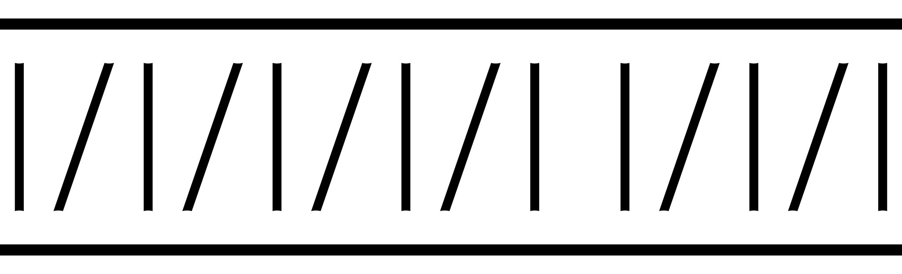 & we now say that we are free only on Thursday, & act accordingly.

But it is hard to say what actually happens here & with what warrant we act in accordance with the picture.

### [85v\[2\]](https://cdn.wittgensteinnachlass.com/2000px/webp/Ms-153a/85v.webp)

What happens when I think over a move in chess? In this case I can make the moves in advance & so draw up the direct picture of what will happen. ---

### [86r\[1\]](https://cdn.wittgensteinnachlass.com/2000px/webp/Ms-153a/86r.webp)

Is it not the case that all thinking about reality is based on induction?

### [86r\[2\]](https://cdn.wittgensteinnachlass.com/2000px/webp/Ms-153a/86r.webp)

Learning philosophy _really_ is a recollection. We recall that we really have used the words in this way.

### [86r\[3\]](https://cdn.wittgensteinnachlass.com/2000px/webp/Ms-153a/86r.webp),[86v\[1\]](https://cdn.wittgensteinnachlass.com/2000px/webp/Ms-153a/86v.webp)

From expectation to fulfilment is a step in a calculation. Indeed, the calculation:

stands to its result 625 in exactly the same relation as expectation to fulfilment.

### [86v\[2\]](https://cdn.wittgensteinnachlass.com/2000px/webp/Ms-153a/86v.webp)

And to the extent – & only to the extent – that this calculation is a picture of the result, the expectation too is a picture of the fulfilment.

### [86v\[3\]](https://cdn.wittgensteinnachlass.com/2000px/webp/Ms-153a/86v.webp)

And to the extent that the result is determined by the calculation, the fulfilment is determined by the expectation.

### [87r\[1\]](https://cdn.wittgensteinnachlass.com/2000px/webp/Ms-153a/87r.webp)

We expect something & act on the expectation. Must the expectation come true? No. But why do we act on the expectation? Because we are driven to do so, just as we are driven to get out of the way of a car, to sit down when we are tired & to jump up when we have sat on a thorn.

### [87r\[2\]](https://cdn.wittgensteinnachlass.com/2000px/webp/Ms-153a/87r.webp),[87v\[1\]](https://cdn.wittgensteinnachlass.com/2000px/webp/Ms-153a/87v.webp),[88r\[1\]](https://cdn.wittgensteinnachlass.com/2000px/webp/Ms-153a/88r.webp)

I put my hand on a plate, feel unbearable heat & quickly pull my hand away: Was it not possible that the heat of the plate would have ceased the next moment? Could I have known? And was it not possible that my very movement exposed me to pain? So in a sense it is not a good justification to say: “I pulled my hand away because the plate was too hot”!

### [88r\[2\]](https://cdn.wittgensteinnachlass.com/2000px/webp/Ms-153a/88r.webp)

And if one asked: Are you sure you did it _for that reason_? Would one not swear that one did it for that reason alone?

And yet is it not experience?

### [88r\[3\]](https://cdn.wittgensteinnachlass.com/2000px/webp/Ms-153a/88r.webp),[88v\[1\]](https://cdn.wittgensteinnachlass.com/2000px/webp/Ms-153a/88v.webp),[89r\[1\]](https://cdn.wittgensteinnachlass.com/2000px/webp/Ms-153a/89r.webp)

“I couldn’t bear it any more (any longer)”.

“I can’t bear it any more; I must pull my hand away”. But what does this pulling away consist in, if not in wishing that the hand would pull away while it actually does pull away? If it does not pull away, there is nothing we can do either. At any rate, ‘wanting to pull it away’ is an experience we can wish for but cannot bring about. Think of the experience of drawing the figure  through the mirror.

### [89r\[2\]](https://cdn.wittgensteinnachlass.com/2000px/webp/Ms-153a/89r.webp)

What is a sentence? What defines this concept? – How is this word used in non-philosophical language? Sentence, in contrast to what?

### [89r\[3\]](https://cdn.wittgensteinnachlass.com/2000px/webp/Ms-153a/89r.webp)

I know a sentence when I see one.

### [89r\[4\]](https://cdn.wittgensteinnachlass.com/2000px/webp/Ms-153a/89r.webp),[89v\[1\]](https://cdn.wittgensteinnachlass.com/2000px/webp/Ms-153a/89v.webp)

This question is fundamental: Suppose we have a new experience, say we become acquainted with a new taste or a new stimulus to the skin; how do I know that what describes this experience is a sentence? Or, why should I call it a sentence? Well, with the same warrant as I had for speaking of a new experience. For experience & sentence are equivalent. But why did I use the word experience, in contrast to what?

### [89v\[2\]](https://cdn.wittgensteinnachlass.com/2000px/webp/Ms-153a/89v.webp)

The word “sentence” & the word “experience” already have a determinate grammar.

### [90r\[1\]](https://cdn.wittgensteinnachlass.com/2000px/webp/Ms-153a/90r.webp)

That is to say, their grammar must be determined in advance, & does not depend on any future event.

### [90r\[2\]](https://cdn.wittgensteinnachlass.com/2000px/webp/Ms-153a/90r.webp)

Here, too, the nonsense in the “experimental theory of meaning” is made explicit. For meaning is laid down in grammar.

### [90r\[3\]](https://cdn.wittgensteinnachlass.com/2000px/webp/Ms-153a/90r.webp)

How does the grammar of the word “sentence” relate to the grammar of sentences?

### [90v\[1\]](https://cdn.wittgensteinnachlass.com/2000px/webp/Ms-153a/90v.webp)

“Sentence” is evidently the heading of the grammar of sentences. In one sense, though, it is also the heading of grammar as a whole, and thus equivalent to the words “grammar” & “language”.

### [VB](/w-vb/#ms-153a-90v.2) [90v\[2\]](https://cdn.wittgensteinnachlass.com/2000px/webp/Ms-153a/90v.webp)

The thinker is very like the draughtsman. Who wants to draw all the connections as they are.

### [90v\[3\]](https://cdn.wittgensteinnachlass.com/2000px/webp/Ms-153a/90v.webp)

This is also what is meant by saying that there are surprises in the world but not in grammar.

### [91r\[1\]](https://cdn.wittgensteinnachlass.com/2000px/webp/Ms-153a/91r.webp)

Boundary that grammar _apparently draws in_ language, & representation of a journey on the globe on the one hand & on its projection in two circles ◯◯ in the plane on the other.

### [91r\[2\]](https://cdn.wittgensteinnachlass.com/2000px/webp/Ms-153a/91r.webp)

What seems to make our question even harder is that the words “world” & “reality” are also equivalents of the word “sentence”.

### [91r\[3\]](https://cdn.wittgensteinnachlass.com/2000px/webp/Ms-153a/91r.webp),[91v\[1\]](https://cdn.wittgensteinnachlass.com/2000px/webp/Ms-153a/91v.webp)

But it is ridiculous to want to delimit the world, or reality. What is one to set it against? And so it is with the meaning of the word “fact”. But then one does not use these words as concept-words either.

### [91v\[2\]](https://cdn.wittgensteinnachlass.com/2000px/webp/Ms-153a/91v.webp),[92r\[1\]](https://cdn.wittgensteinnachlass.com/2000px/webp/Ms-153a/92r.webp)

<s>Gott sei Dank:</s> We are only concerned with what can be said. We have to do only with what can be said.

That is to say: Fortunately we need not admit to any disappointments; there is nothing we try to do but cannot carry out.

### [92r\[2\]](https://cdn.wittgensteinnachlass.com/2000px/webp/Ms-153a/92r.webp)

Something is a sentence only in a language.

### [92r\[3\]](https://cdn.wittgensteinnachlass.com/2000px/webp/Ms-153a/92r.webp),[92v\[1\]](https://cdn.wittgensteinnachlass.com/2000px/webp/Ms-153a/92v.webp)

Now if I say: but language can expand, after all, the answer is: Certainly, but if this word “expand” has a sense here, then I must already know _now_ what I mean by it, must be able to say how I imagine such an expansion. And what I cannot think now, I cannot express now & cannot even hint at.

### [92v\[2\]](https://cdn.wittgensteinnachlass.com/2000px/webp/Ms-153a/92v.webp),[93r\[1\]](https://cdn.wittgensteinnachlass.com/2000px/webp/Ms-153a/93r.webp)

Here we have this nagging problem: how it is possible even to think of the existence of things when we always see only mental images – their likenesses.

### [93r\[2\]](https://cdn.wittgensteinnachlass.com/2000px/webp/Ms-153a/93r.webp)

Of course we are dealing once again with a false analogy: It makes perfectly good sense to say “I know that he is in this room because I can hear him, even though I cannot go in & see him.”

### [93r\[3\]](https://cdn.wittgensteinnachlass.com/2000px/webp/Ms-153a/93r.webp),[93v\[1\]](https://cdn.wittgensteinnachlass.com/2000px/webp/Ms-153a/93v.webp)

If I accept “things are thus & so” as the general sentential form, then I must count 2 × 2 = 4 among the sentences, for it is grammatically correct to say: “things are such that 2 x 2 = 4.” Further rules are needed to exclude the sentences of arithmetic.

### [93v\[2\]](https://cdn.wittgensteinnachlass.com/2000px/webp/Ms-153a/93v.webp),[94r\[1\]](https://cdn.wittgensteinnachlass.com/2000px/webp/Ms-153a/94r.webp)

Is it a kind of contamination of the sense that we express it in a particular language with its contingencies & not, as it were, disembodied & pure? No, for it is essential that I understand the idea of translation from one language into another.

### [94r\[2\]](https://cdn.wittgensteinnachlass.com/2000px/webp/Ms-153a/94r.webp),[94v\[1\]](https://cdn.wittgensteinnachlass.com/2000px/webp/Ms-153a/94v.webp)

Since the sense of a sentence is fixed entirely in language, & it is the sense that matters, every language is equally good. But the sense is what sentences that are mutually translatable have in common. Yet sentences can be translated into one another only within their languages. For if, for example, I translate one word into another, I make a rule for all the combinations in which the word occurs.

### [94v\[2\]](https://cdn.wittgensteinnachlass.com/2000px/webp/Ms-153a/94v.webp)

Now what does it mean to understand the idea of translation or translatability?

### [94v\[3\]](https://cdn.wittgensteinnachlass.com/2000px/webp/Ms-153a/94v.webp)

Here, incidentally, lies the difference between the philological & the philosophical way of looking at things.

### [95r\[1\]](https://cdn.wittgensteinnachlass.com/2000px/webp/Ms-153a/95r.webp)

Surely it cannot mean: to know every possible translation, and thus all possible equivalent languages!

### [95r\[2\]](https://cdn.wittgensteinnachlass.com/2000px/webp/Ms-153a/95r.webp),[95v\[1\]](https://cdn.wittgensteinnachlass.com/2000px/webp/Ms-153a/95v.webp)

Rather, translations stand to a language as the various views or projections stand to the solid of which they are projections. If the solid is given – say, by an equation with respect to a coordinate system, then its equations with respect to every other coordinate system are given as well, since the other coordinate system, being in the same space as the first, can only be described in terms of the first. So the transformation rule is already given by the description of the second coordinate system in the language of the first.

### [95v\[2\]](https://cdn.wittgensteinnachlass.com/2000px/webp/Ms-153a/95v.webp),[96r\[1\]](https://cdn.wittgensteinnachlass.com/2000px/webp/Ms-153a/96r.webp)

‘2 × 2 is 4’, ‘the rose is red’ etc. Why should I not write: ‘2 × 2 = 4’ & ‘the rose = red’. If it works with ‘is’, then it works with ‘ = ’ too. Certainly, but what characterizes the logical form is precisely the _stipulation_ that the sign = _may_ not be used in the second combination.

### [96r\[2\]](https://cdn.wittgensteinnachlass.com/2000px/webp/Ms-153a/96r.webp),[96v\[1\]](https://cdn.wittgensteinnachlass.com/2000px/webp/Ms-153a/96v.webp)

To grasp the meaning of the sign ‘is’ correctly even without this transfer is to perform no incorrect operations in the particular case; for example, not to substitute the words ‘the rose’ for ‘red’.

### [96v\[2\]](https://cdn.wittgensteinnachlass.com/2000px/webp/Ms-153a/96v.webp),[97r\[1\]](https://cdn.wittgensteinnachlass.com/2000px/webp/Ms-153a/97r.webp)

The question of extending grammar is not a serious objection to what I am saying, for I must have known what I mean by this extension within the unextended grammar. But one might indeed ask whether grammar is complete at all; or whether we can say that we know all the rules governing the application [unreadable] of a word.

Is that supposed to mean that in every particular case I know, or can know, whether the word has been applied in accordance with the rule or not.

### [97r\[2\]](https://cdn.wittgensteinnachlass.com/2000px/webp/Ms-153a/97r.webp),[97v\[1\]](https://cdn.wittgensteinnachlass.com/2000px/webp/Ms-153a/97v.webp)

This is one of the many places where one is (always) tempted to say more than is clear & necessary. That is, one is tempted to make an assumption.

### [97v\[2\]](https://cdn.wittgensteinnachlass.com/2000px/webp/Ms-153a/97v.webp)

Logic as “normative”.

### [97v\[3\]](https://cdn.wittgensteinnachlass.com/2000px/webp/Ms-153a/97v.webp)

“The sentence has sense if I mean something by it”.

### [97v\[4\]](https://cdn.wittgensteinnachlass.com/2000px/webp/Ms-153a/97v.webp)

Can one say: ‘I mean something by these words’, that is, they are part of a calculation.

### [97v\[5\]](https://cdn.wittgensteinnachlass.com/2000px/webp/Ms-153a/97v.webp)

If I beckon someone over to me with my finger, is that an operation in a calculation, a thought?

### [98r\[1\]](https://cdn.wittgensteinnachlass.com/2000px/webp/Ms-153a/98r.webp)

Now is this beckoning not on the same footing as pressing the button of a bell so that my servant will come?

### [98r\[2\]](https://cdn.wittgensteinnachlass.com/2000px/webp/Ms-153a/98r.webp)

Searching & finding are not related in the same way as hunger & the satisfaction of hunger.

### [98r\[3\]](https://cdn.wittgensteinnachlass.com/2000px/webp/Ms-153a/98r.webp)

Should I say: Language interests me only in so far as it is a calculus.

### [98r\[4\]](https://cdn.wittgensteinnachlass.com/2000px/webp/Ms-153a/98r.webp),[98v\[1\]](https://cdn.wittgensteinnachlass.com/2000px/webp/Ms-153a/98v.webp)

But what about this: I go this way to get there; I turn on the tap to get water, I beckon so that someone will come to me & finally I communicate my wish to him so that he will fulfil it!

### [98v\[2\]](https://cdn.wittgensteinnachlass.com/2000px/webp/Ms-153a/98v.webp),[99r\[1\]](https://cdn.wittgensteinnachlass.com/2000px/webp/Ms-153a/99r.webp)

But what goes on when I turn on the tap _so that_ water will flow out? What happens is that I turn on the tap & then water comes out, or does not. So what happens is that I turn on the tap. – What follows the word “so that”, the intention, is not contained in that. If it is present, it must be expressed & it can already be expressed by turning on the tap only if it is part of a language.

### [99r\[2\]](https://cdn.wittgensteinnachlass.com/2000px/webp/Ms-153a/99r.webp)

I look for my pencil; then the intention of searching is not expressed in the movements of the search.

---

### [99v\[1\]](https://cdn.wittgensteinnachlass.com/2000px/webp/Ms-153a/99v.webp)

If I look for something, it is essential that I must be able to describe the finding just as fully (whether it occurs ever in that way or not) before the object is found. Now apply that to the search for the solution to a mathematical problem.

### [99v\[2\]](https://cdn.wittgensteinnachlass.com/2000px/webp/Ms-153a/99v.webp)

One of the most dangerous ideas is, curiously, that we think with our head, or in our head.

### [100r\[1\]](https://cdn.wittgensteinnachlass.com/2000px/webp/Ms-153a/100r.webp)

But paper & pencil are not what matters either, for I can merely imagine everything written down (just as I can merely imagine everything spoken).

### [100r\[2\]](https://cdn.wittgensteinnachlass.com/2000px/webp/Ms-153a/100r.webp)

The idea of a process in the head, in that completely enclosed space, lends thinking an occult quality.

### [100r\[3\]](https://cdn.wittgensteinnachlass.com/2000px/webp/Ms-153a/100r.webp)

The grammatical rules do not hold “only in a vacuum”.

### [100v\[1\]](https://cdn.wittgensteinnachlass.com/2000px/webp/Ms-153a/100v.webp)

Philosophy purely descriptive, & what it describes is language. I.e.: it gives no grounds.

### [100v\[2\]](https://cdn.wittgensteinnachlass.com/2000px/webp/Ms-153a/100v.webp)

The most difficult problem seems to be the contrast, the relation, between operating with language in time & grasping the sentence in an instant.

### [100v\[3\]](https://cdn.wittgensteinnachlass.com/2000px/webp/Ms-153a/100v.webp),[101r\[1\]](https://cdn.wittgensteinnachlass.com/2000px/webp/Ms-153a/101r.webp)

But _when_ do we grasp or understand the sentence?! _After_ we have uttered it? – And if while we are uttering it: is the understanding an articulated process, like the forming of the sentence, or an inarticulate one? And if it is articulated: must it not be connected projectively with the other process? For otherwise its articulation would be independent of the first.

### [101r\[2\]](https://cdn.wittgensteinnachlass.com/2000px/webp/Ms-153a/101r.webp),[101v\[1\]](https://cdn.wittgensteinnachlass.com/2000px/webp/Ms-153a/101v.webp)

One might ask: How long does it take to understand a sentence. And if one understands it for an hour, does one keep starting afresh?

### [101v\[2\]](https://cdn.wittgensteinnachlass.com/2000px/webp/Ms-153a/101v.webp)

The ringing of the bell; the sign that something has been found.

### [101v\[3\]](https://cdn.wittgensteinnachlass.com/2000px/webp/Ms-153a/101v.webp),[102r\[1\]](https://cdn.wittgensteinnachlass.com/2000px/webp/Ms-153a/102r.webp)

The bridge _can_ only be crossed when we get there, not before. (What is meant is the bridge between sign & reality.)

### [101v\[4\]](https://cdn.wittgensteinnachlass.com/2000px/webp/Ms-153a/101v.webp),[102r\[1\]](https://cdn.wittgensteinnachlass.com/2000px/webp/Ms-153a/102r.webp)

[It is often said that the new religion brands the gods of the old one as devils. But in reality they have by then probably already become devils.]

### [102r\[2\]](https://cdn.wittgensteinnachlass.com/2000px/webp/Ms-153a/102r.webp)

If understanding is not the grasping of the sentence, it can also take place afterwards (& why not beforehand too).

### [102r\[3\]](https://cdn.wittgensteinnachlass.com/2000px/webp/Ms-153a/102r.webp),[102v\[1\]](https://cdn.wittgensteinnachlass.com/2000px/webp/Ms-153a/102v.webp)

Understanding, as it is usually conceived, is a vague process – we are interested only in what is exact. But not because we are interested only in the “ideal” of a language, “which reality merely approaches”, but because only in this way can we grasp what is expressed in every language.

### [102v\[2\]](https://cdn.wittgensteinnachlass.com/2000px/webp/Ms-153a/102v.webp)

But what do I say in saying “that I am interested only in what is exact”? What, then, is the inexact? What is the Vague that I exclude?

### [102v\[3\]](https://cdn.wittgensteinnachlass.com/2000px/webp/Ms-153a/102v.webp),[103r\[1\]](https://cdn.wittgensteinnachlass.com/2000px/webp/Ms-153a/103r.webp)

Is it not that I must exclude what I do not know exactly. I.e. do I not want to say that – – –.

### [103r\[2\]](https://cdn.wittgensteinnachlass.com/2000px/webp/Ms-153a/103r.webp)

Why do I say: the feelings, moods, etc. that accompany a sentence, or follow it, or precede it, do not interest me? Because it is only the symbolic structure that interests me.

### [103r\[3\]](https://cdn.wittgensteinnachlass.com/2000px/webp/Ms-153a/103r.webp),[103v\[1\]](https://cdn.wittgensteinnachlass.com/2000px/webp/Ms-153a/103v.webp)

Does the vague not consist in its not belonging to the symbol, in its being able to vary even when the symbol is the same?

### [103v\[2\]](https://cdn.wittgensteinnachlass.com/2000px/webp/Ms-153a/103v.webp)

No, it is something else again: As if my only task were to say something clearly & not to hint at anything.

### [103v\[3\]](https://cdn.wittgensteinnachlass.com/2000px/webp/Ms-153a/103v.webp),[104r\[1\]](https://cdn.wittgensteinnachlass.com/2000px/webp/Ms-153a/104r.webp)

It is almost as if I wanted to say that I am weaving a tapestry & cannot use indistinct transitions between colours there. But that is not really a good simile.

---

### [104r\[2\]](https://cdn.wittgensteinnachlass.com/2000px/webp/Ms-153a/104r.webp)

Should I say: the exactness consists in our not being concerned with what is doubtful?

### [104r\[3\]](https://cdn.wittgensteinnachlass.com/2000px/webp/Ms-153a/104r.webp)

What does our exactness consist in?

### [104r\[4\]](https://cdn.wittgensteinnachlass.com/2000px/webp/Ms-153a/104r.webp),[104v\[1\]](https://cdn.wittgensteinnachlass.com/2000px/webp/Ms-153a/104v.webp)

Frege on psychological logic. His remarks all concern the inexactness of the psychological way of looking at things as opposed to the logical one.

### [104v\[2\]](https://cdn.wittgensteinnachlass.com/2000px/webp/Ms-153a/104v.webp)

Can I say that I am interested only in the _content_ of the sentence? And the content of the sentence is in it.

### [104v\[3\]](https://cdn.wittgensteinnachlass.com/2000px/webp/Ms-153a/104v.webp)

The sentence has its content as a member of the calculus.

### [104v\[4\]](https://cdn.wittgensteinnachlass.com/2000px/webp/Ms-153a/104v.webp),[105r\[1\]](https://cdn.wittgensteinnachlass.com/2000px/webp/Ms-153a/105r.webp)

Is “understanding a sentence”, then, of the same kind as “being able to master a calculus”? Like: being able to multiply? I believe it is.

### [105r\[2\]](https://cdn.wittgensteinnachlass.com/2000px/webp/Ms-153a/105r.webp)

For is not the test of understanding always a matter of going on from the sentence?!

### [105r\[3\]](https://cdn.wittgensteinnachlass.com/2000px/webp/Ms-153a/105r.webp)

And the response to the question “what does ‘understanding a sentence’ mean?” must be: What is the test of understanding?

### [105r\[4\]](https://cdn.wittgensteinnachlass.com/2000px/webp/Ms-153a/105r.webp),[105v\[1\]](https://cdn.wittgensteinnachlass.com/2000px/webp/Ms-153a/105v.webp)

In asking about the general sentential form, we bear in mind that although ordinary language has a certain sentence rhythm, not everything with this rhythm is a sentence. I.e. much can _sound like a sentence_ & not be one. – Hence the idea of a ‘_sentence_’ with sense & of a nonsensical one.

### [105v\[2\]](https://cdn.wittgensteinnachlass.com/2000px/webp/Ms-153a/105v.webp),[106r\[1\]](https://cdn.wittgensteinnachlass.com/2000px/webp/Ms-153a/106r.webp)

On the other hand, this rhythm is of course not essential. The expression “sugar table” does not _sound_ like a sentence, but it can quite well replace the sentence “there is sugar on the table”. And not as if we had to supply something missing in our minds; rather, what matters, again, is simply the system to which the expression “sugar table” belongs.

### [106r\[2\]](https://cdn.wittgensteinnachlass.com/2000px/webp/Ms-153a/106r.webp),[106v\[1\]](https://cdn.wittgensteinnachlass.com/2000px/webp/Ms-153a/106v.webp)

The question, then, is whether, apart from this misleading sentence sound, we have a general concept of the sentence. (I am speaking now of what is held together by ∙ ⌵ ~.)

### [106v\[2\]](https://cdn.wittgensteinnachlass.com/2000px/webp/Ms-153a/106v.webp),[107r\[1\]](https://cdn.wittgensteinnachlass.com/2000px/webp/Ms-153a/107r.webp)

What, then, do I distinguish a sentence from? Or what do I want to distinguish it from? From *parts* of a sentence within its grammatical system, or from _everything_ we do not call a sentence, such as this armchair, my watch etc., etc.? For the fact that there are written or spoken forms that are especially like sentences need not really concern us.

### [107r\[2\]](https://cdn.wittgensteinnachlass.com/2000px/webp/Ms-153a/107r.webp)

Or we must say: One can speak of the concept of a sentence only within a grammatical system.

### [107r\[3\]](https://cdn.wittgensteinnachlass.com/2000px/webp/Ms-153a/107r.webp),[107v\[1\]](https://cdn.wittgensteinnachlass.com/2000px/webp/Ms-153a/107v.webp)

It is with the word “sentence” as with the word “object” and others: they are admissible only when applied within a limited sphere, & there they are natural. If the sphere is to be extended so as to make the concept a philosophical one, the meaning of the words evaporates & they are empty shadows. We must give them up there & go back to using them within their narrow bounds.

### [107v\[2\]](https://cdn.wittgensteinnachlass.com/2000px/webp/Ms-153a/107v.webp),[108r\[1\]](https://cdn.wittgensteinnachlass.com/2000px/webp/Ms-153a/108r.webp),[108v\[1\]](https://cdn.wittgensteinnachlass.com/2000px/webp/Ms-153a/108v.webp)

But now one would like to say: “A sentence is anything by which I mean something”. And if asked “what does it mean to mean ‘something?’”, I would have to give examples. Now these examples do have a domain over which they can be extended, but they take me no _further_. Just as in logic I cannot generalize at random. But the point here is not about types; it is that the generalization itself is something determinate, namely a sign with grammatical rules determined in advance. That is, the indeterminacy of generality is not a logical indeterminacy. As if we now had not only freedom in logical space but also freedom to extend or alter that space.

---

### [108v\[2\]](https://cdn.wittgensteinnachlass.com/2000px/webp/Ms-153a/108v.webp)

No sign leads us beyond itself; & no argument does either.

### [108v\[3\]](https://cdn.wittgensteinnachlass.com/2000px/webp/Ms-153a/108v.webp),[109r\[1\]](https://cdn.wittgensteinnachlass.com/2000px/webp/Ms-153a/109r.webp)

If we say that a sentence is any sign by which we mean something, one might ask: what do we mean & _when_ do we mean it? While we are giving the sign etc., etc.? And here it becomes clear again that this act of meaning, if it is to be relevant, must belong to the process involving the symbol. Unless by ‘meaning’ one understood a process that had particular significance for us by virtue of its psychological or physiological character. It might be, for example, that we would say that an order had sense for us only if it produced certain muscular contractions in us, or again, if we had translated it into a language of muscular contractions. It would be as if one were to say: The sentence has sense if it acquires significance for life.

### [109v\[1\]](https://cdn.wittgensteinnachlass.com/2000px/webp/Ms-153a/109v.webp)

If I ask “what is the general form of the sentence”, the question in reply may be: “_have_ we a general concept of the sentence that we now want to formulate precisely?” – As in: have we a general concept of reality? “Reality” – as opposed to what?

### [110r\[1\]](https://cdn.wittgensteinnachlass.com/2000px/webp/Ms-153a/110r.webp)

Or can one say: We have a concept of the _whole_ of reality as opposed to a part of reality?

### [110r\[2\]](https://cdn.wittgensteinnachlass.com/2000px/webp/Ms-153a/110r.webp),[110v\[1\]](https://cdn.wittgensteinnachlass.com/2000px/webp/Ms-153a/110v.webp)

The question may also be put this way: What happens when a new sentence is taken into the language: What is the criterion for its being a sentence? Or, if being taken into the language stamps it as a sentence, what does this admission consist in? Or: what is language?

### [110v\[2\]](https://cdn.wittgensteinnachlass.com/2000px/webp/Ms-153a/110v.webp)

Now it seems obvious here that one distinguishes giving signs _from other activities_. A person sleeps, eats, drinks & gives signs etc.

### [111r\[1\]](https://cdn.wittgensteinnachlass.com/2000px/webp/Ms-153a/111r.webp)

Giving signs = using a language.

### [111r\[2\]](https://cdn.wittgensteinnachlass.com/2000px/webp/Ms-153a/111r.webp)

How does “using a language” compare with “playing a game”. For that too is one of those activities, & one that has a similarity to giving signs.

### [111r\[3\]](https://cdn.wittgensteinnachlass.com/2000px/webp/Ms-153a/111r.webp)

So it would be as difficult to say what ‘language’ means as to say what “sport”, “game”, “cleaning” mean.

### [111v\[1\]](https://cdn.wittgensteinnachlass.com/2000px/webp/Ms-153a/111v.webp)

So the word “language” will not occur in grammar.

### [111v\[2\]](https://cdn.wittgensteinnachlass.com/2000px/webp/Ms-153a/111v.webp)

‘Language’ as opposed to sport, yes, – but grammar has nothing to do with that.

### [111v\[3\]](https://cdn.wittgensteinnachlass.com/2000px/webp/Ms-153a/111v.webp),[112r\[1\]](https://cdn.wittgensteinnachlass.com/2000px/webp/Ms-153a/112r.webp)

But why do I rack my brains over the concept of language instead of using language?! This brain-racking is justified only if we _have_ a general concept.

### [112r\[2\]](https://cdn.wittgensteinnachlass.com/2000px/webp/Ms-153a/112r.webp),[112v\[1\]](https://cdn.wittgensteinnachlass.com/2000px/webp/Ms-153a/112v.webp)

If one said: language is anything by means of which one can communicate, then one would have to ask: But what does it consist in, communicating? In answer I could describe a real or fictitious case of communication between people or other living beings. In this description fictitious causal connections would then play a part. But if the concept of language is determined by such connections, it does not interest us. But apart from those empirical regularities of events we then have only an arbitrary calculus left. But what is essential to a calculus?

### [112v\[2\]](https://cdn.wittgensteinnachlass.com/2000px/webp/Ms-153a/112v.webp),[113r\[1\]](https://cdn.wittgensteinnachlass.com/2000px/webp/Ms-153a/113r.webp)

“Is this sentence not _perhaps_ a logical product of two sentences?” How, then, would that emerge?

### [113r\[2\]](https://cdn.wittgensteinnachlass.com/2000px/webp/Ms-153a/113r.webp)

Motive & cause

### [113r\[3\]](https://cdn.wittgensteinnachlass.com/2000px/webp/Ms-153a/113r.webp),[113v\[1\]](https://cdn.wittgensteinnachlass.com/2000px/webp/Ms-153a/113v.webp)

Is a space conceivable that contains only the rational points, all of them, but not the irrational ones? Would this structure perhaps be too imprecise for our space? Because we could then always determine the irrational points only approximately. So our net would not be fine enough? – No. What we would lack is the laws, not the extensions.

### [113v\[2\]](https://cdn.wittgensteinnachlass.com/2000px/webp/Ms-153a/113v.webp)

We adhere to the words.

### [113v\[3\]](https://cdn.wittgensteinnachlass.com/2000px/webp/Ms-153a/113v.webp)

When we read an explanation, for instance, of logical consequence, we adhere to what he writes. We adhere to the words; to the signs.

### [113v\[4\]](https://cdn.wittgensteinnachlass.com/2000px/webp/Ms-153a/113v.webp),[114r\[1\]](https://cdn.wittgensteinnachlass.com/2000px/webp/Ms-153a/114r.webp)

But can one say: “One cannot say from which propositions this proposition follows”? That sounds like: one does not know; but of course it is not like that. And I can after all state propositions, & state them in advance, from which it follows. – “Only not all” – But that is just what means nothing.

### [114r\[2\]](https://cdn.wittgensteinnachlass.com/2000px/webp/Ms-153a/114r.webp),[114v\[1\]](https://cdn.wittgensteinnachlass.com/2000px/webp/Ms-153a/114v.webp)

There are just the general proposition (present) & particular propositions (not: the particular propositions). But the general proposition does not enumerate particular propositions. But what, then, characterizes it as general & what shows that it does not simply encompass _the_ particular propositions of which we speak in a particular case?

### [114v\[2\]](https://cdn.wittgensteinnachlass.com/2000px/webp/Ms-153a/114v.webp),[115r\[1\]](https://cdn.wittgensteinnachlass.com/2000px/webp/Ms-153a/115r.webp)

It cannot be characterized by its special cases; for however many one enumerates, the general proposition could always be confused with the product of the special cases cited.

### [115r\[2\]](https://cdn.wittgensteinnachlass.com/2000px/webp/Ms-153a/115r.webp)

If one asks, say, “is this the last rule to be set up”, the answer would be: of course not. One can also say: none will be the last. But here one is already using a variable, for no logical product corresponds to ‘none’.

### [115r\[3\]](https://cdn.wittgensteinnachlass.com/2000px/webp/Ms-153a/115r.webp),[115v\[1\]](https://cdn.wittgensteinnachlass.com/2000px/webp/Ms-153a/115v.webp)

---

### [115v\[2\]](https://cdn.wittgensteinnachlass.com/2000px/webp/Ms-153a/115v.webp)

Infinity is not a magnitude, but looks like a magnitude. (That is our difficulty).

### [115v\[3\]](https://cdn.wittgensteinnachlass.com/2000px/webp/Ms-153a/115v.webp),[116r\[1\]](https://cdn.wittgensteinnachlass.com/2000px/webp/Ms-153a/116r.webp),[116v\[1\]](https://cdn.wittgensteinnachlass.com/2000px/webp/Ms-153a/116v.webp),[117r\[1\]](https://cdn.wittgensteinnachlass.com/2000px/webp/Ms-153a/117r.webp),[117v\[1\]](https://cdn.wittgensteinnachlass.com/2000px/webp/Ms-153a/117v.webp)

“This landscape makes me melancholy.” How do you know it is the landscape? Is that a hypothesis – just as you only _believe_ that that food caused the stomach pains – or does it belong to immediate experience? Would it then be refuted if, transported to a different landscape, you remained melancholy; or is it not open to refutation by a future experience, because it describes the present one? Indeed, how did you come by the thought that it is the landscape that brings on this mood? Or is it not a matter at all of a state it brings about in me, but, perhaps, of the picture of the landscape _being_ melancholy? (This is directly connected with the problem: motive & cause.) “That is a dreadful sight”. – “How do you know that _it_ is dreadful?” “I tremble because I see it” –. _That_ you cannot know. Perhaps you would have trembled anyway. How does the fear relate to the sight? Or to the dreadful image? Or should I perhaps say: “to be afraid of this image” _means_ to have it & to be afraid? But if one has several images while one is afraid (sees or hears several things), is there any doubt as to what is dreadful? Or is it from experience that one knows what (out of all these things) one is afraid of? On the other hand, can one not separate the sight & the fear, and so say that the “sight in itself” is not dreadful? – I would also like to say “being afraid is an engagement with the sight”. Can I say that it is a very complicated process into which the image enters at quite definite points?

### [117v\[2\]](https://cdn.wittgensteinnachlass.com/2000px/webp/Ms-153a/117v.webp),[118r\[1\]](https://cdn.wittgensteinnachlass.com/2000px/webp/Ms-153a/118r.webp),[118v\[1\]](https://cdn.wittgensteinnachlass.com/2000px/webp/Ms-153a/118v.webp),[119r\[1\]](https://cdn.wittgensteinnachlass.com/2000px/webp/Ms-153a/119r.webp)

Imagine you were out walking with someone & engaged in conversation. Then as the conversation went on you would walk now more slowly, now faster & keep stopping here & there. Someone listening to the conversation will find these pauses in walking quite natural, since they arise directly from the life of the conversation itself. Now suppose someone were to reproduce the conversation only as to its sense (say, by translating it into another language) & one had to walk the same way again as well & the places where one stopped before were marked, then these forced pauses in walking would now be _extremely_ disruptive, though they had helped the conversation before. That is how it is with the translation of the Platonic dialogues in dialogue form. Only in the original, unique course of the conversation were the affirmative & negative replies natural & helpful resting points. In the translation they are agonizing, disruptive delays. Imagine a theme whose rhythm was reinforced by strokes on the kettledrum on the first beat of the bar & now imagine that these strokes were shifted a little! Who would not rather do without this support now?

### [119r\[2\]](https://cdn.wittgensteinnachlass.com/2000px/webp/Ms-153a/119r.webp),[119v\[1\]](https://cdn.wittgensteinnachlass.com/2000px/webp/Ms-153a/119v.webp)

Letters at equal intervals. “I believe this letter is just midway between these two”.

### [119v\[2\]](https://cdn.wittgensteinnachlass.com/2000px/webp/Ms-153a/119v.webp),[120r\[1\]](https://cdn.wittgensteinnachlass.com/2000px/webp/Ms-153a/120r.webp)

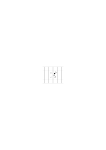

It can happen that I know a spot is in quadrilateral A because I know that it is either in quadrilateral a or in quadrilateral b or c or d. But I cannot know that it is in A because I know it is in one of all the possible positions.

### [120r\[2\]](https://cdn.wittgensteinnachlass.com/2000px/webp/Ms-153a/120r.webp)

“If the book is on the table, it must surely be _somewhere_ on the table” is of course senseless.

### [120r\[3\]](https://cdn.wittgensteinnachlass.com/2000px/webp/Ms-153a/120r.webp)

“You hit the top right-hand corner”. Of what? (“Take me to No 47, I’ll tell you the street later”.) “Did I hit the black?” – “Yes, _more precisely_, in the upper half”.

### [120r\[4\]](https://cdn.wittgensteinnachlass.com/2000px/webp/Ms-153a/120r.webp),[120v\[1\]](https://cdn.wittgensteinnachlass.com/2000px/webp/Ms-153a/120v.webp)

“Is the shot in the black? Have you seen it?” – “Yes” – “Where is it?” – “I don’t know, I only saw that it was in the black, but not where.” – That does not correspond to the experience we mean.

### [120v\[2\]](https://cdn.wittgensteinnachlass.com/2000px/webp/Ms-153a/120v.webp)

The circle is in the square = it is in position 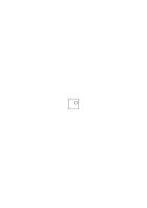, or not in that position = it is in the positions 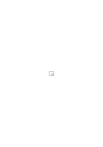, or , or in none of etc. But it cannot say “or in one of the other possible positions”.

### [121r\[1\]](https://cdn.wittgensteinnachlass.com/2000px/webp/Ms-153a/121r.webp)

[The works of the great masters are like stars that rise & set around us. So the time will come again for every great work that has now set.]

### [121r\[2\]](https://cdn.wittgensteinnachlass.com/2000px/webp/Ms-153a/121r.webp)

It is in the square; not: “in some position or other in the square”. (In a _position_, of course.) For that makes it seem as if the _positions_ were somehow given to us. As if, for instance, they were drawn in beforehand

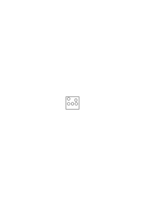.

### [121v\[1\]](https://cdn.wittgensteinnachlass.com/2000px/webp/Ms-153a/121v.webp)

“There is no other circle in the square besides this one”.

### [121v\[2\]](https://cdn.wittgensteinnachlass.com/2000px/webp/Ms-153a/121v.webp)

(Mendelssohn’s music, where it is perfect, consists of musical arabesques. That is why we find every lack of rigour in him painful.)

### [121v\[3\]](https://cdn.wittgensteinnachlass.com/2000px/webp/Ms-153a/121v.webp),[122r\[1\]](https://cdn.wittgensteinnachlass.com/2000px/webp/Ms-153a/122r.webp)

In Western civilization the Jew is always measured by standards that do not fit him. It is clear to many that the Greek thinkers were neither philosophers in the Western sense nor scientists in the Western sense, that the participants in the Olympic Games were not sportsmen & fit into no Western category. But so it is with the Jew too. And because the words of our language appear to us to be the standards as such, we always do him an injustice. And he is now overestimated, now underestimated. Spengler is therefore right not to rank Weininger among the Western philosophers.

### [122v\[1\]](https://cdn.wittgensteinnachlass.com/2000px/webp/Ms-153a/122v.webp)

What does it mean to know what a plant is? What does it mean to know it & not be able to say it?

“You know it & can speak Greek, so surely you must be able to say it.

### [122v\[2\]](https://cdn.wittgensteinnachlass.com/2000px/webp/Ms-153a/122v.webp)

The idleness of the definition.

### [122v\[3\]](https://cdn.wittgensteinnachlass.com/2000px/webp/Ms-153a/122v.webp)

[One kind of madness is a fainting of the understanding because it can no longer bear a pain.]

### [122v\[4\]](https://cdn.wittgensteinnachlass.com/2000px/webp/Ms-153a/122v.webp)

“Think of a map”.

### [123r\[1\]](https://cdn.wittgensteinnachlass.com/2000px/webp/Ms-153a/123r.webp)

Nothing one does can be defended conclusively. Only in relation to something else that has been fixed. I.e. no reason can be given why one should act _thus_ (or should have acted thus) other than one that says that this brings about a particular state of affairs, which in turn one must _accept_ as the goal.

### [123r\[2\]](https://cdn.wittgensteinnachlass.com/2000px/webp/Ms-153a/123r.webp),[123v\[1\]](https://cdn.wittgensteinnachlass.com/2000px/webp/Ms-153a/123v.webp),[124r\[1\]](https://cdn.wittgensteinnachlass.com/2000px/webp/Ms-153a/124r.webp),[124v\[1\]](https://cdn.wittgensteinnachlass.com/2000px/webp/Ms-153a/124v.webp),[125r\[1\]](https://cdn.wittgensteinnachlass.com/2000px/webp/Ms-153a/125r.webp)

(On Engelmann’s Orpheus: I believe: Once Orpheus has returned from the underworld, having now lost Euridice, he must say nothing more in the play; for whatever he says is chatter. Only genii can still say something, namely that this is the lot of mortals & that only in another world can he be reunited with Euridice. At first I imagined the genii hovering around him as he lies asleep or unconscious. But now I think he ought not to be seen again at all, for what purpose does his figure serve once he has nothing more to say to us? I could imagine, rather, the genii (Horae) speaking as they look into the entrance to the passage. Accompanying the process of turning round with their speeches too & speaking a closing chorus while he, unseen by us, staggers towards the exit; & fleeing, frightened away by him as he now reaches the exit – but in such a way that the curtain falls before one catches sight of him. Hence it was assumed that Orpheus turns round not right at the exit but at some point in the passage. But this seems more fitting in so far as it is hard to imagine him turning round a step away from the exit. Rather, he will turn round where his anxiety is greatest, say at a slight bend in the passage. I imagine: had he got as far as the exit, the daylight would already have dispelled his anxiety. And the sense is: he could not get as far as the exit.) (The genii know this, incidentally, & say it before he comes into their sight.)

### [125r\[2\]](https://cdn.wittgensteinnachlass.com/2000px/webp/Ms-153a/125r.webp),[125v\[1\]](https://cdn.wittgensteinnachlass.com/2000px/webp/Ms-153a/125v.webp),[126r\[1\]](https://cdn.wittgensteinnachlass.com/2000px/webp/Ms-153a/126r.webp),[126v\[1\]](https://cdn.wittgensteinnachlass.com/2000px/webp/Ms-153a/126v.webp),[127r\[1\]](https://cdn.wittgensteinnachlass.com/2000px/webp/Ms-153a/127r.webp),[127v\[1\]](https://cdn.wittgensteinnachlass.com/2000px/webp/Ms-153a/127v.webp)

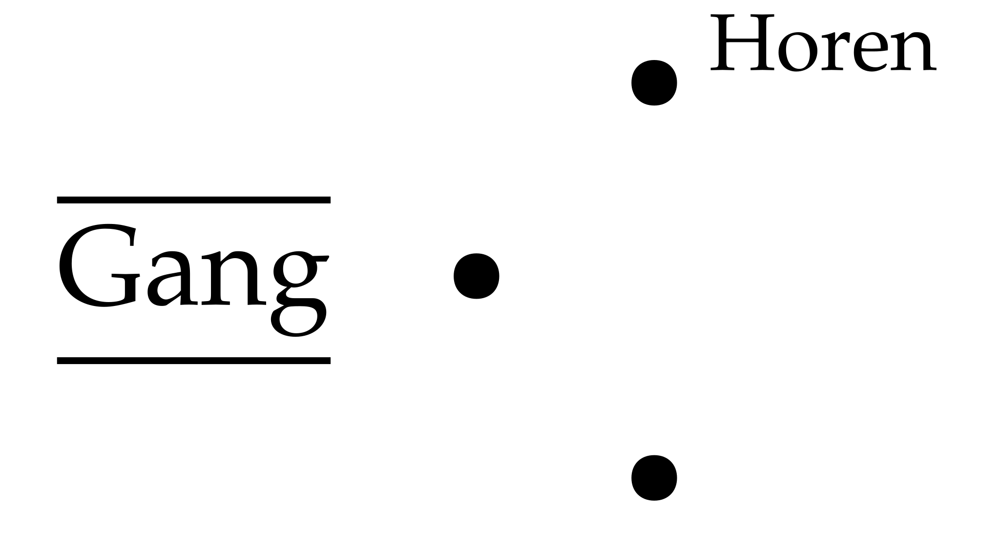

They speak the chorus facing the spectator & only casting sidelong glances, as it were, back into the passage. When I say, incidentally, “accompanying the process of turning round with their speeches”, I do not imagine it on the model of, say, a battle in a play being described by an observer keyed up with suspense. For the Horae are not keyed up but perfectly composed. And they _accompany_ the process with their speeches and do not dance around it. In that case, admittedly, the drama does not really have 5 acts. But – it seems to me – the fifth act is superfluous, for the catastrophe is already completely determined in the four. In the 5th act the storm would break over the hero. But here nothing breaks in; something merely reaches its conclusion. Could one say: In the 4th act the water is dammed up; in the 5th the sluice gates are now raised & the flood bursts in. So there is still room for action. One might say: but here too surely something is building up that is then released. – Of course an ever greater tension is produced in the process of temptation too, so that something is dammed up, as it were, but the hero does not perish by being destroyed by what bursts forth when he now succumbs to temptation; rather, in yielding to the pressure he is already destroyed, and so, as it were, in an instant. If Eve, say, were the heroine, the catastrophe would be the instant in which she begins to reach for the apple & not the act of plucking the fruit. If one loads a beam to breaking point, it is all over when it begins to give, for everything that follows is then already given. And if the _beam_ is the hero (& is not above the hero’s head), then the hero is destroyed when the beam _begins_ to break.

“Orpheus”, of course, is not a tragedy either & Orpheus is not a hero. For the hero _triumphs_ (after all) in perishing. I.e. he is overcome not inwardly but only outwardly. (If he were overcome inwardly, he would lose our interest after the _instant_ of his downfall. The 5th act is then only an _afterpiece_.)

### [VB](/w-vb/#ms-153a-127v.2+128r.1) [127v\[2\]](https://cdn.wittgensteinnachlass.com/2000px/webp/Ms-153a/127v.webp),[128r\[1\]](https://cdn.wittgensteinnachlass.com/2000px/webp/Ms-153a/128r.webp)

Compositions composed at the piano, on the piano, those composed thinking with the pen & those composed with the inner ear alone must be quite different in kind & make an impression of quite different kinds. I am firmly convinced that Bruckner composed only with the inner ear & an image of the orchestra playing, Brahms with the pen. This is of course represented more simply than it is. But _one_ characteristic is thereby captured.

### [VB](/w-vb/#ms-153a-128v.1) [128v\[1\]](https://cdn.wittgensteinnachlass.com/2000px/webp/Ms-153a/128v.webp)

A tragedy could always begin with the words: “Nothing at all would have happened if ….”

### [VB](/w-vb/#ms-153a-128v.2) [128v\[2\]](https://cdn.wittgensteinnachlass.com/2000px/webp/Ms-153a/128v.webp)

(If he had not got a corner of his coat caught in the machine?)

### [VB](/w-vb/#ms-153a-128v.3) [128v\[3\]](https://cdn.wittgensteinnachlass.com/2000px/webp/Ms-153a/128v.webp)

But is this not a one-sided view of tragedy which only allows it to show that an encounter can decide our whole life.

### [VB](/w-vb/#ms-153a-129r.1+129v.1) [129r\[1\]](https://cdn.wittgensteinnachlass.com/2000px/webp/Ms-153a/129r.webp),[129v\[1\]](https://cdn.wittgensteinnachlass.com/2000px/webp/Ms-153a/129v.webp)

I believe that today there could be a theatre in which masks were used. The figures would simply be stylized human beings. This can be seen clearly in Kraus’s writings. His plays could, or ought to, be performed in masks. This naturally corresponds to a certain abstractness of these products. And masked theatre, as I understand it, is in general the expression of a spiritualistic character. Perhaps, therefore, only the Jews will be inclined towards this theatre.

### [129v\[2\]](https://cdn.wittgensteinnachlass.com/2000px/webp/Ms-153a/129v.webp)

Yes, the 5th act in Orpheus can only be an epilogue.

### [129v\[3\]](https://cdn.wittgensteinnachlass.com/2000px/webp/Ms-153a/129v.webp)

The inexpressible (that which appears mysterious to me & which I am unable to express) perhaps provides the background against which what I was able to express acquires meaning.

### [130r\[1\]](https://cdn.wittgensteinnachlass.com/2000px/webp/Ms-153a/130r.webp)

Arithmetic _is_ not a game. Surely one cannot win or lose in arithmetic!

### [130r\[2\]](https://cdn.wittgensteinnachlass.com/2000px/webp/Ms-153a/130r.webp),[130v\[1\]](https://cdn.wittgensteinnachlass.com/2000px/webp/Ms-153a/130v.webp)

But an arithmetical game is conceivable. Two people operate alternately on a number according to certain operations restricted by rules, with a number which has arisen through these operations from a number as [unreadable] initial position. Whoever first obtains 0 in this way has won.

### [130v\[2\]](https://cdn.wittgensteinnachlass.com/2000px/webp/Ms-153a/130v.webp)

What is one denying mathematics when one says it is only a game (or: it is a game)?

### [130v\[3\]](https://cdn.wittgensteinnachlass.com/2000px/webp/Ms-153a/130v.webp)

A game, as opposed to what? – What is one attributing to mathematics when one says that its sentences have sense?

### [131r\[1\]](https://cdn.wittgensteinnachlass.com/2000px/webp/Ms-153a/131r.webp)

The sense outside the sentence.

### [131r\[2\]](https://cdn.wittgensteinnachlass.com/2000px/webp/Ms-153a/131r.webp)

And what does that have to do with us? Where does it show itself & what can we do with it? [A sentence comes as the answer to the question “what is the sense of this sentence?”]

### [131r\[3\]](https://cdn.wittgensteinnachlass.com/2000px/webp/Ms-153a/131r.webp)

“But surely the mathematical sentence expresses a thought” – what thought? –

### [131r\[4\]](https://cdn.wittgensteinnachlass.com/2000px/webp/Ms-153a/131r.webp),[131v\[1\]](https://cdn.wittgensteinnachlass.com/2000px/webp/Ms-153a/131v.webp)

Can it be expressed by another sentence? or only by this? – Or not at all? In this case it is no concern of ours.

### [131v\[2\]](https://cdn.wittgensteinnachlass.com/2000px/webp/Ms-153a/131v.webp)

Does one merely want to distinguish mathematical sentences from other formations, hypotheses, etc.? One is right to do so & there is no doubt that this distinction exists.

### [131v\[3\]](https://cdn.wittgensteinnachlass.com/2000px/webp/Ms-153a/131v.webp),[132r\[1\]](https://cdn.wittgensteinnachlass.com/2000px/webp/Ms-153a/132r.webp)

If one means that mathematics is played like [unreadable] chess or patience & that there is such a thing as winning or the game coming out, then that is plainly incorrect.

### [132r\[2\]](https://cdn.wittgensteinnachlass.com/2000px/webp/Ms-153a/132r.webp),[132v\[1\]](https://cdn.wittgensteinnachlass.com/2000px/webp/Ms-153a/132v.webp)

If one says that the mental processes which accompany the use of mathematical symbols are different from those which accompany the chess game, I do not know what to say about that.

### [132v\[2\]](https://cdn.wittgensteinnachlass.com/2000px/webp/Ms-153a/132v.webp),[133r\[1\]](https://cdn.wittgensteinnachlass.com/2000px/webp/Ms-153a/133r.webp)

In chess, too, there are some configurations which are impossible. E.g. one in which the starting position of the pawns is still intact & a bishop is already on the board. But one could imagine a game in which the number of moves before the beginning of the game was recorded & then there would be the case that this configuration could not occur after n moves and yet one could not tell from the configuration at the same time whether it was possible as the n-th or not.

### [133r\[2\]](https://cdn.wittgensteinnachlass.com/2000px/webp/Ms-153a/133r.webp)

The actions in the game must correspond to the actions in calculating.

### [133v\[1\]](https://cdn.wittgensteinnachlass.com/2000px/webp/Ms-153a/133v.webp)

Which equation, say, of the form

abc… × cde… = ghi

is right, and which wrong?

### [133v\[2\]](https://cdn.wittgensteinnachlass.com/2000px/webp/Ms-153a/133v.webp),[134r\[1\]](https://cdn.wittgensteinnachlass.com/2000px/webp/Ms-153a/134r.webp)

Indeed, can one say of the written sign (at all) that it is right or wrong? For that depends on the sense of the answer: “the equation which one can generate according to the rules is right”, as opposed to: “the equation which one has generated according to the rules is right”.

### [134r\[2\]](https://cdn.wittgensteinnachlass.com/2000px/webp/Ms-153a/134r.webp)

It is clear that the position (equation) is right or wrong only in the system in which it can be generated.

### [134r\[3\]](https://cdn.wittgensteinnachlass.com/2000px/webp/Ms-153a/134r.webp),[134v\[1\]](https://cdn.wittgensteinnachlass.com/2000px/webp/Ms-153a/134v.webp)

“One must not use a system of axioms before its consistency has been demonstrated.” “There must be no contradictions in the rules of a game.” Why not?

“Because then one would not know how to play”?

### [134v\[2\]](https://cdn.wittgensteinnachlass.com/2000px/webp/Ms-153a/134v.webp)

But how does it come about that one reacts to the contradiction with doubt?

### [134v\[3\]](https://cdn.wittgensteinnachlass.com/2000px/webp/Ms-153a/134v.webp),[135r\[1\]](https://cdn.wittgensteinnachlass.com/2000px/webp/Ms-153a/135r.webp)

One does not react to the contradiction at all. One could only say: If that is really what is meant (if the contradiction is _meant_ to be here), then I don’t understand it. Or: I haven’t learnt it. I don’t understand these signs. I haven’t learnt what I am to do in response, whether it is an order at all; etc.

### [135r\[2\]](https://cdn.wittgensteinnachlass.com/2000px/webp/Ms-153a/135r.webp),[135v\[1\]](https://cdn.wittgensteinnachlass.com/2000px/webp/Ms-153a/135v.webp)

What if, for example, one wanted to add the equation 2 × 2 = 5 to the usual axioms of arithmetic? That of course meant that the equals sign had now changed its meaning, i.e. that different rules would now hold for the equals sign.

### [135v\[2\]](https://cdn.wittgensteinnachlass.com/2000px/webp/Ms-153a/135v.webp)

Hilbert puts forward the rules of a particular calculus as rules of a metamathematics.

### [135v\[3\]](https://cdn.wittgensteinnachlass.com/2000px/webp/Ms-153a/135v.webp),[136r\[1\]](https://cdn.wittgensteinnachlass.com/2000px/webp/Ms-153a/136r.webp)

Now if I said: “so I cannot use it as a substitution sign”, that would mean that its grammar no longer accords with that of the word “substitute” (“substitution sign”, etc.). For the word “can” in this sentence does not indicate a physical (physiological, psychological) possibility.

### [136r\[2\]](https://cdn.wittgensteinnachlass.com/2000px/webp/Ms-153a/136r.webp),[136v\[1\]](https://cdn.wittgensteinnachlass.com/2000px/webp/Ms-153a/136v.webp)

“The rules must not contradict one another”, that is like: “negation must not yield a negation when doubled”. For it is part of the grammar of the word “rule” that p ˙ ~p is not a rule (if p is one).

### [136v\[2\]](https://cdn.wittgensteinnachlass.com/2000px/webp/Ms-153a/136v.webp)

That is, one could also say: the rules may contradict one another if different rules hold for the word “rule” – if the word “rule” has a different meaning.

### [136v\[3\]](https://cdn.wittgensteinnachlass.com/2000px/webp/Ms-153a/136v.webp),[137r\[1\]](https://cdn.wittgensteinnachlass.com/2000px/webp/Ms-153a/137r.webp)

Here too we cannot give a justification (except (_say_) biologically or historically) & can only describe how the word “rule” is used, [but only establish the agreement or non-agreement of the rules for certain words, thus saying that these words are used with these rules.]

### [137r\[2\]](https://cdn.wittgensteinnachlass.com/2000px/webp/Ms-153a/137r.webp)

“Indirect proof”

### [VB](/w-vb/#ms-153a-137r.3+137v.1) [137r\[3\]](https://cdn.wittgensteinnachlass.com/2000px/webp/Ms-153a/137r.webp),[137v\[1\]](https://cdn.wittgensteinnachlass.com/2000px/webp/Ms-153a/137v.webp)

Frida Schanz:

Foggy day. The grey autumn goes about.

Laughter seems corrupted;

the world lies so silent today,

as if it had died at night. In the golden-red hedge

the fog dragons brew;

and the day lies slumbering.

The day does not want to wake.

─────── ∙ ───────

### [137v\[2\]](https://cdn.wittgensteinnachlass.com/2000px/webp/Ms-153a/137v.webp)

I said “but doesn’t the schema 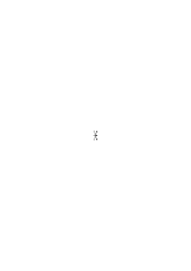 then have to be given beforehand”. Only in so far as the schema  is also given beforehand.

### [137v\[3\]](https://cdn.wittgensteinnachlass.com/2000px/webp/Ms-153a/137v.webp),[138r\[1\]](https://cdn.wittgensteinnachlass.com/2000px/webp/Ms-153a/138r.webp)

“But isn’t at least a certain regularity in use required, then? Would it do if we had to use a table according to this schema on one occasion and that schema on another? _How is one supposed to know_ how to use this table?!” –

Well, how does one know today? Explanations of signs do come to an end at some point.

### [VB](/w-vb/#ms-153a-138r.2+138v.1) [138r\[2\]](https://cdn.wittgensteinnachlass.com/2000px/webp/Ms-153a/138r.webp),[138v\[1\]](https://cdn.wittgensteinnachlass.com/2000px/webp/Ms-153a/138v.webp)

I took the poem on the previous page from a “knight’s tour”, where naturally the punctuation was missing. I therefore do not know, for example, whether the word “Foggy day” is the title, or whether it belongs to the first line, as I have written it. And it is remarkable how trivial the poem sounds when it begins not with the word “Foggy day” but with “The grey”. The rhythm of the _whole_ poem changes as a result.

### [138v\[2\]](https://cdn.wittgensteinnachlass.com/2000px/webp/Ms-153a/138v.webp),[139r\[1\]](https://cdn.wittgensteinnachlass.com/2000px/webp/Ms-153a/139r.webp)

The primary signs as you meant them would really not be signs at all. Rather, they relate to signs as the portrait of a person relates to his name.

### [139r\[2\]](https://cdn.wittgensteinnachlass.com/2000px/webp/Ms-153a/139r.webp)

So it is essential that the little plaque at which I point with the words “this colour I call ‘red’” should be red.

### [139r\[3\]](https://cdn.wittgensteinnachlass.com/2000px/webp/Ms-153a/139r.webp),[139v\[1\]](https://cdn.wittgensteinnachlass.com/2000px/webp/Ms-153a/139v.webp),[140r\[1\]](https://cdn.wittgensteinnachlass.com/2000px/webp/Ms-153a/140r.webp)

Incidentally, it is remarkable that, if there are primary signs, we can use the secondary ones at all. One will of course say: yes, we must have the primary ones to fall back on (as it were, as a gold reserve for our paper money). But in what sense are they a support to us while we use the others & do not think at all of the primary signs? – Well, they are a support of the calculus, the foundation of its list of rules. – But as such a foundation we need only definitions (rules like all the others).

### [140r\[2\]](https://cdn.wittgensteinnachlass.com/2000px/webp/Ms-153a/140r.webp)

If I recognize an object as red, I do indeed make use of an explanation of the form “this colour is called ‘red’” (or at least I can do so).

### [140r\[3\]](https://cdn.wittgensteinnachlass.com/2000px/webp/Ms-153a/140r.webp),[140v\[1\]](https://cdn.wittgensteinnachlass.com/2000px/webp/Ms-153a/140v.webp),[141r\[1\]](https://cdn.wittgensteinnachlass.com/2000px/webp/Ms-153a/141r.webp)

There is a way of looking at electrical apparatus & machines (dynamos, electric motors etc. etc.) which, as it were, without any preconceived understanding, regards these things as a distribution of copper, iron, silk, rubber, glass, etc. in space & could lead to some interesting results. This way of looking at things is quite similar to considering a mathematical sentence as an ornament. It is, of course, a perfectly rigorous & correct view & what is characteristic & difficult about it is that it considers the object without any preconceived idea. (As it were, from a Martian point of view.)

### [VB](/w-vb/#ms-153a-141r.2) [141r\[2\]](https://cdn.wittgensteinnachlass.com/2000px/webp/Ms-153a/141r.webp)

What you have achieved cannot mean more to others than to yourself.

### [VB](/w-vb/#ms-153a-141r.3) [141r\[3\]](https://cdn.wittgensteinnachlass.com/2000px/webp/Ms-153a/141r.webp)

As much as it has cost you, so much will they pay.

### [141r\[4\]](https://cdn.wittgensteinnachlass.com/2000px/webp/Ms-153a/141r.webp)

[→ ]

### [141v\[1\]](https://cdn.wittgensteinnachlass.com/2000px/webp/Ms-153a/141v.webp)

Is it really true that, in addition to the sentence “this object is red”, I must in any case have a rule of the form “this colour is called ‘red’”? But doesn’t the question always make sense: “which colour is called red?” (and therefore that answer too?)

### [141v\[2\]](https://cdn.wittgensteinnachlass.com/2000px/webp/Ms-153a/141v.webp),[142r\[1\]](https://cdn.wittgensteinnachlass.com/2000px/webp/Ms-153a/142r.webp)

But there is a difficulty with this question: it apparently belongs to the kind of question “which man is called ‘N’”. And the question can apparently now be directed to a quite definite list of rules in which a corresponding rule is given.

### [142r\[2\]](https://cdn.wittgensteinnachlass.com/2000px/webp/Ms-153a/142r.webp)

What strikes me is that the rule for the word ‘red’ absolutely _ought_ to be given together with a red plaque.

### [142r\[3\]](https://cdn.wittgensteinnachlass.com/2000px/webp/Ms-153a/142r.webp),[142v\[1\]](https://cdn.wittgensteinnachlass.com/2000px/webp/Ms-153a/142v.webp)

But surely it is nonsense to say such a thing, for the object is red when I call its colour ‘red’.

### [142v\[2\]](https://cdn.wittgensteinnachlass.com/2000px/webp/Ms-153a/142v.webp)

The two sentences: “this thing is red”, “the colour of this thing is called ‘red’”.

### [142v\[3\]](https://cdn.wittgensteinnachlass.com/2000px/webp/Ms-153a/142v.webp)

Is it a contradiction: “this thing is green & its colour is called ‘vert’”? If so, that means

its colour is called ‘red’ = it is red.

### [142v\[4\]](https://cdn.wittgensteinnachlass.com/2000px/webp/Ms-153a/142v.webp),[143r\[1\]](https://cdn.wittgensteinnachlass.com/2000px/webp/Ms-153a/143r.webp)

But the sentence “its colour is called ‘red’” refers to a table. In this table, then, the plaque of this colour stands opposite the word ‘red’.

### [143r\[2\]](https://cdn.wittgensteinnachlass.com/2000px/webp/Ms-153a/143r.webp)

But why should a sign for red be red? Or is the plaque in the table opposite the word ‘red’ not a sign? ((Word sample))

### [143r\[3\]](https://cdn.wittgensteinnachlass.com/2000px/webp/Ms-153a/143r.webp)

One will say: it is not a sign, it is the object itself, – which is baptised.

### [143r\[4\]](https://cdn.wittgensteinnachlass.com/2000px/webp/Ms-153a/143r.webp),[143v\[1\]](https://cdn.wittgensteinnachlass.com/2000px/webp/Ms-153a/143v.webp)

One appoints ‘red’ as the name of the colour, as one appoints a person to stand in for another.

### [143v\[2\]](https://cdn.wittgensteinnachlass.com/2000px/webp/Ms-153a/143v.webp),[144r\[1\]](https://cdn.wittgensteinnachlass.com/2000px/webp/Ms-153a/144r.webp)

But isn’t this naming in turn subject to interpretation – to application? Is naming anything other than attaching a name tag (or the like)? And the purpose, after all, is to make a transition from operations with the name to operations with the bearer of the name (tag). But the bearers of names, even if they are not written or spoken signs, are, from our point of view, not essentially different from them. For the purpose & utility of the operations are no concern of ours & nor is it our concern whether we operate with bodies or letters.

### [144r\[2\]](https://cdn.wittgensteinnachlass.com/2000px/webp/Ms-153a/144r.webp),[144v\[1\]](https://cdn.wittgensteinnachlass.com/2000px/webp/Ms-153a/144v.webp)

For now I could say: in every definition a thing is given a name & what happens is that a name is hung on a name. And if I write 1 + 1 = 2 Def. or set “2” opposite “1 + 1” in the table (as above ‘red’ opposite the coloured plaque), I could ask all the questions about the former juxtaposition that I asked about the latter.

### [144v\[2\]](https://cdn.wittgensteinnachlass.com/2000px/webp/Ms-153a/144v.webp),[145r\[1\]](https://cdn.wittgensteinnachlass.com/2000px/webp/Ms-153a/145r.webp)

Through Russell, but especially through Whitehead, a pseudo-exactness has entered philosophy, which is the worst enemy of real exactness. At its root lies the mistake of thinking that a calculus can be the metamathematical foundation of mathematics.

### [145r\[2\]](https://cdn.wittgensteinnachlass.com/2000px/webp/Ms-153a/145r.webp)

Is pointing with the finger essential to our language? It is certainly a curious feature of our language that we explain its words ostensively: “this is a tree”, “this is a horse”, “this is green”, etc.

### [145v\[1\]](https://cdn.wittgensteinnachlass.com/2000px/webp/Ms-153a/145v.webp),[146r\[1\]](https://cdn.wittgensteinnachlass.com/2000px/webp/Ms-153a/146r.webp)

Isn’t it again as with paper money & goods? I can buy & sell money & buy & sell goods, etc. And as long as it is only a question of buying & selling, money & goods do not differ. Only in their utility do they differ. And so I could call spoken & written signs money & the bearers of names goods. (This simile too is, again, more than a simile.) _I should like to say:_

That pointing to the red plaque is also a sign can be seen from the fact that it too has to be understood. And it can be misunderstood, i.e. interpreted in different ways.

### [146r\[2\]](https://cdn.wittgensteinnachlass.com/2000px/webp/Ms-153a/146r.webp)

But one will say: one does not use the red plaque like a name but like a portrait. And that is true. But just as the mode of projection is arbitrary in the case of a portrait, so it is in the case of merely stating the colour of a place.

### [146v\[2\]](https://cdn.wittgensteinnachlass.com/2000px/webp/Ms-153a/146v.webp),[147r\[1\]](https://cdn.wittgensteinnachlass.com/2000px/webp/Ms-153a/147r.webp)

But could one not now say that, if only, say, the plaques red blue green yellow are to be used, the words perform the same service and _therefore_ these plaques are used here as words; whereas if the representation by colours is used in such a way that one copies the colour of the plaque, so that arbitrary mixtures of colours are represented, then the plaques are no longer words but, understood _in this way_, cannot be replaced individually by words either.

### [147r\[2\]](https://cdn.wittgensteinnachlass.com/2000px/webp/Ms-153a/147r.webp)

But I can say: “Look up in the list of rules which plaque stands opposite the word ‘red’, & paint the colour of this plaque.”

### [147r\[3\]](https://cdn.wittgensteinnachlass.com/2000px/webp/Ms-153a/147r.webp),[147v\[1\]](https://cdn.wittgensteinnachlass.com/2000px/webp/Ms-153a/147v.webp)

Let us think, say, of the colours in a paint shop which have numbers (their names), or of the cloth samples in a weaving mill or the wallpaper patterns. Here the sample catalogue is a necessary requisite of the language.

### [147v\[2\]](https://cdn.wittgensteinnachlass.com/2000px/webp/Ms-153a/147v.webp)

A language is what it is & another language is not this language. So I use the numbers in the sample catalogue differently from the words “red”, “green”, “yellow”, “blue”.

### [147v\[3\]](https://cdn.wittgensteinnachlass.com/2000px/webp/Ms-153a/147v.webp),[148r\[1\]](https://cdn.wittgensteinnachlass.com/2000px/webp/Ms-153a/148r.webp)

“But doesn’t that come merely from the fact that I have the explanation of the one in my head and not the other? For an employee of the weaving mill could also have the whole sample catalogue in his head & would then use its numbers as we use the names of the simple colours.”

### [148r\[2\]](https://cdn.wittgensteinnachlass.com/2000px/webp/Ms-153a/148r.webp),[148v\[1\]](https://cdn.wittgensteinnachlass.com/2000px/webp/Ms-153a/148v.webp)

So we ought to be able to see fully from the sample catalogue & its use what is at issue with primary & secondary signs, for the samples are evidently what one calls primary signs & the numbers the secondary ones.

### [148v\[2\]](https://cdn.wittgensteinnachlass.com/2000px/webp/Ms-153a/148v.webp)

But aren’t the numbers the _names_ of the samples? _Are_ they not their primary signs?

### [148v\[3\]](https://cdn.wittgensteinnachlass.com/2000px/webp/Ms-153a/148v.webp)

And what about names of points in a geometrical drawing?

### [148v\[4\]](https://cdn.wittgensteinnachlass.com/2000px/webp/Ms-153a/148v.webp),[149r\[1\]](https://cdn.wittgensteinnachlass.com/2000px/webp/Ms-153a/149r.webp)

Let us imagine that one used a sample continuously instead of its number, by printing it where the number would otherwise stand; then this sample would be used in two quite different ways. Once in such a way that it could be replaced by the number & once differently (if, say, we copied it).

### [149r\[2\]](https://cdn.wittgensteinnachlass.com/2000px/webp/Ms-153a/149r.webp),[149v\[1\]](https://cdn.wittgensteinnachlass.com/2000px/webp/Ms-153a/149v.webp)

Let us think of reading aloud from writing. We could of course imagine a kind of table (gramophone records with the letters as labels) which we could follow in doing this. But we follow no such table. No act of memory, nothing, mediates between the written sign & the sound. But even if something did mediate, if, for example, in order to know how ‘a’ is pronounced, we played the a-record. Of course, following this sound is quite different in kind from following the letter ‘a’.

### [149v\[2\]](https://cdn.wittgensteinnachlass.com/2000px/webp/Ms-153a/149v.webp),[150r\[1\]](https://cdn.wittgensteinnachlass.com/2000px/webp/Ms-153a/150r.webp)

The example of the symbolism a = ↑, b = →, c = ↓, d = ← shows clearly how names & samples function. I follow both the configuration of the names and the arrows.

### [150r\[2\]](https://cdn.wittgensteinnachlass.com/2000px/webp/Ms-153a/150r.webp)

But it may also be that I merely follow the order of the names.

### [150r\[3\]](https://cdn.wittgensteinnachlass.com/2000px/webp/Ms-153a/150r.webp),[150v\[1\]](https://cdn.wittgensteinnachlass.com/2000px/webp/Ms-153a/150v.webp)

But isn’t what is essential that a table like the sample catalogue can always be drawn up? But this table is of no use to me if I take the samples not as samples but once again as names.

### [150v\[2\]](https://cdn.wittgensteinnachlass.com/2000px/webp/Ms-153a/150v.webp)

A further useful example of the application of names is typing on a typewriter, on whose keys the names of the letters are written.

### [150v\[3\]](https://cdn.wittgensteinnachlass.com/2000px/webp/Ms-153a/150v.webp),[151r\[1\]](https://cdn.wittgensteinnachlass.com/2000px/webp/Ms-153a/151r.webp)

Consider now that one can also follow the arrows ↑ ↓ etc. in different ways & that one can imagine a table which assigns the sign ↑ to the sign → and thus translates, as it were, from one arrow-language into another. And this is of course only meant to show that the application of the arrows is no more self-evident than that of the letters. It is admitted that it is in any case different from that of the letters.

### [151r\[2\]](https://cdn.wittgensteinnachlass.com/2000px/webp/Ms-153a/151r.webp),[151v\[1\]](https://cdn.wittgensteinnachlass.com/2000px/webp/Ms-153a/151v.webp)

And how do I know the application of the table which assigns letters & arrows to one another? How do I know which assignment is intended? And when it is explained, how the explanation is intended, etc.

### [151v\[2\]](https://cdn.wittgensteinnachlass.com/2000px/webp/Ms-153a/151v.webp),[152r\[1\]](https://cdn.wittgensteinnachlass.com/2000px/webp/Ms-153a/152r.webp)

Well, I follow the letters via the arrows; – but I reach the arrows from the letters through the table which mediates this transition, but surely I must once again understand the manner of this mediation as I please. The arrow ↑ stands next to the letter ‘a’, but does that compel me to pass from a to ↑?

### [152r\[2\]](https://cdn.wittgensteinnachlass.com/2000px/webp/Ms-153a/152r.webp)

What, then, is the relation between the mutual position of arrow & letter in the table and the words “this arrow is called a”?

For whereas in the table there is an ambiguity of possible uses, this does not seem to be the case in ostensive definition. But here too it is certainly the case.

### [152r\[3\]](https://cdn.wittgensteinnachlass.com/2000px/webp/Ms-153a/152r.webp),[152v\[1\]](https://cdn.wittgensteinnachlass.com/2000px/webp/Ms-153a/152v.webp),[153r\[1\]](https://cdn.wittgensteinnachlass.com/2000px/webp/Ms-153a/153r.webp)

The point is, after all, that no preparation can take the place of the step in the calculus: it must always be made afresh. Or: the table is the table, but not the application of the table.

That is, I must _make_ the step from the letter to the arrow. It is not made in the table. I make it (when I use the table) in the table. (I could say: I am not spared the leap, even if everything has been made ready for it.)

### [153r\[2\]](https://cdn.wittgensteinnachlass.com/2000px/webp/Ms-153a/153r.webp)

Following the rows of the table (or the strokes of the equals sign), I make the leap I could have made without these aids.

### [153r\[3\]](https://cdn.wittgensteinnachlass.com/2000px/webp/Ms-153a/153r.webp)

The definiendum is the name of the definiens.

### [153r\[4\]](https://cdn.wittgensteinnachlass.com/2000px/webp/Ms-153a/153r.webp),[153v\[1\]](https://cdn.wittgensteinnachlass.com/2000px/webp/Ms-153a/153v.webp)

And when, in accordance with a definition, I replace one sign with another in my sentences, I make the same transition as the one I make from sentences to actions.

### [153v\[2\]](https://cdn.wittgensteinnachlass.com/2000px/webp/Ms-153a/153v.webp),[154r\[1\]](https://cdn.wittgensteinnachlass.com/2000px/webp/Ms-153a/154r.webp)

Deal with the clear cases in philosophy, not the unclear ones. The latter will resolve themselves once the former have been resolved. The tendency to begin the investigation of a sentence where its application is quite hazy & uncertain (the sentence of identity, for example), instead of setting these cases (at least) aside for the time being & tackling the sentence where we can talk about it with common sense, this tendency is characteristic of the unpromising method of most philosophers.

### [154r\[2\]](https://cdn.wittgensteinnachlass.com/2000px/webp/Ms-153a/154r.webp),[154v\[1\]](https://cdn.wittgensteinnachlass.com/2000px/webp/Ms-153a/154v.webp)

It sounds like a laughably obvious truism when I say that someone who believes gestures to be the primary signs underlying all the others would be unable to replace the most ordinary sentence with gestures.

### [154v\[2\]](https://cdn.wittgensteinnachlass.com/2000px/webp/Ms-153a/154v.webp),[155r\[1\]](https://cdn.wittgensteinnachlass.com/2000px/webp/Ms-153a/155r.webp)

You say that pointing to a red object is the primary sign for ‘red’. But pointing to a red object is no more than the particular movement of the hand towards a red object, & as yet it is no sign at all. If you say you mean: pointing to the red object _understood as a sign_ – then I say: the understanding that concerns us is not a process that accompanies the pointing (a process in the brain, say) & if you do mean such a process, then this in turn is not in itself a sign.

### [155r\[2\]](https://cdn.wittgensteinnachlass.com/2000px/webp/Ms-153a/155r.webp),[155v\[1\]](https://cdn.wittgensteinnachlass.com/2000px/webp/Ms-153a/155v.webp)

(Tolstoj: the meaning of an object lies in its being intelligible to everyone. That is true & false. What makes the object hard to understand – if it is significant – is not that understanding it would require some special instruction in abstruse matters, but the opposition between understanding it & what most people _want_ to see. This can make the very thing that lies closest to hand the hardest of all to understand. What has to be overcome is not a difficulty of the intellect, but of the will.)

### [155v\[2\]](https://cdn.wittgensteinnachlass.com/2000px/webp/Ms-153a/155v.webp),[156r\[1\]](https://cdn.wittgensteinnachlass.com/2000px/webp/Ms-153a/156r.webp)

‘Primary’ ought really to mean: impossible to misunderstand.

### [156r\[2\]](https://cdn.wittgensteinnachlass.com/2000px/webp/Ms-153a/156r.webp)

Now one will say: the ostensive hand movement is of course not primary in itself, but in the system in which it is used, or: when it is used in a particular way.

### [156r\[3\]](https://cdn.wittgensteinnachlass.com/2000px/webp/Ms-153a/156r.webp)

(There is no logic for a vacuum.)

### [156r\[4\]](https://cdn.wittgensteinnachlass.com/2000px/webp/Ms-153a/156r.webp),[156v\[1\]](https://cdn.wittgensteinnachlass.com/2000px/webp/Ms-153a/156v.webp)

The purpose of a good expression & a good simile is that it permits an immediate overview.

### [156v\[2\]](https://cdn.wittgensteinnachlass.com/2000px/webp/Ms-153a/156v.webp)

What is essential is not that the sign for ‘black’ is black, or only where it is not used as a sign _like this word_. But if it is used as a model (for copying in paint), then it is nonsense to say that it stands for ‘black’ only if it is black.

### [157r\[1\]](https://cdn.wittgensteinnachlass.com/2000px/webp/Ms-153a/157r.webp)

For in the system of colour models (samples) the black tile is not singled out at all; it is singled out only by my assigning the name “black” to the one tile (I do not say “to the black one”).

### [157r\[2\]](https://cdn.wittgensteinnachlass.com/2000px/webp/Ms-153a/157r.webp),[157v\[1\]](https://cdn.wittgensteinnachlass.com/2000px/webp/Ms-153a/157v.webp)

Both the word-language and the gesture-language are used so that we orient ourselves by their signs (sentences), & neither contains this application (within itself).

### [157v\[2\]](https://cdn.wittgensteinnachlass.com/2000px/webp/Ms-153a/157v.webp)

(Whoever teaches philosophy today gives the pupil food not because it tastes good to him, but in order to change his taste.)

### [157v\[3\]](https://cdn.wittgensteinnachlass.com/2000px/webp/Ms-153a/157v.webp),[158r\[1\]](https://cdn.wittgensteinnachlass.com/2000px/webp/Ms-153a/158r.webp)

One could surely imagine the description of the method of projection being given for every projection of a series of words, say a a b c c, in the form of the table

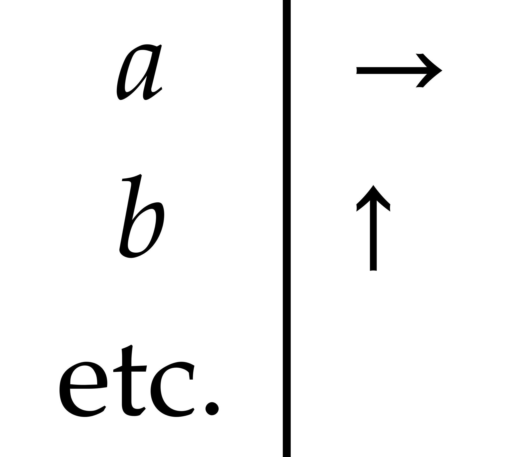

& thus always reduce the following of a series of secondary signs to copying primary signs. But why should I not be able to produce the figure after a a b c c without looking at the table, and on the other hand, if I look at it, _must_ I then make the transition & must I make it in the usual way?

### [158r\[2\]](https://cdn.wittgensteinnachlass.com/2000px/webp/Ms-153a/158r.webp),[158v\[1\]](https://cdn.wittgensteinnachlass.com/2000px/webp/Ms-153a/158v.webp)

But there is an objection to this, namely: Of course I _can_ produce the figure without looking at the table, but then I have not drawn it _according to_ the sentence a a b c c, nor derived it from it, but merely happened to make it that way.

### [158v\[2\]](https://cdn.wittgensteinnachlass.com/2000px/webp/Ms-153a/158v.webp)

But how can the use of the table alter this? For the table does not force me to use it in this (& this) way.

### [158v\[3\]](https://cdn.wittgensteinnachlass.com/2000px/webp/Ms-153a/158v.webp),[159r\[1\]](https://cdn.wittgensteinnachlass.com/2000px/webp/Ms-153a/159r.webp)

But what if I said: the table belongs to this game? Good, but then we also have a game without this table. In the one game he must first direct his eyes to the table and look from its left side to its right side before he may draw the arrow; in the other game he may draw the arrow without the table.

### [159r\[2\]](https://cdn.wittgensteinnachlass.com/2000px/webp/Ms-153a/159r.webp),[159v\[1\]](https://cdn.wittgensteinnachlass.com/2000px/webp/Ms-153a/159v.webp)

Good, but if he has now translated a into →, he has thereby committed himself & must translate every future a in the same way: that would certainly be a possible rule of a game. But there would be any number of others. For example, whoever translates a with → must translate the next a with ↓, the next with ←, and so on. And so forth.

### [159v\[2\]](https://cdn.wittgensteinnachlass.com/2000px/webp/Ms-153a/159v.webp),[160r\[1\]](https://cdn.wittgensteinnachlass.com/2000px/webp/Ms-153a/160r.webp)

This is connected with the fact that there is no general form of the rule & not the concept ‘rule’ as a metalinguistic concept (any more than the concept ‘game’). And that therefore I can describe only individual games as they are.

### [160r\[2\]](https://cdn.wittgensteinnachlass.com/2000px/webp/Ms-153a/160r.webp),[160v\[1\]](https://cdn.wittgensteinnachlass.com/2000px/webp/Ms-153a/160v.webp)

But what if, regardless of whether the rule 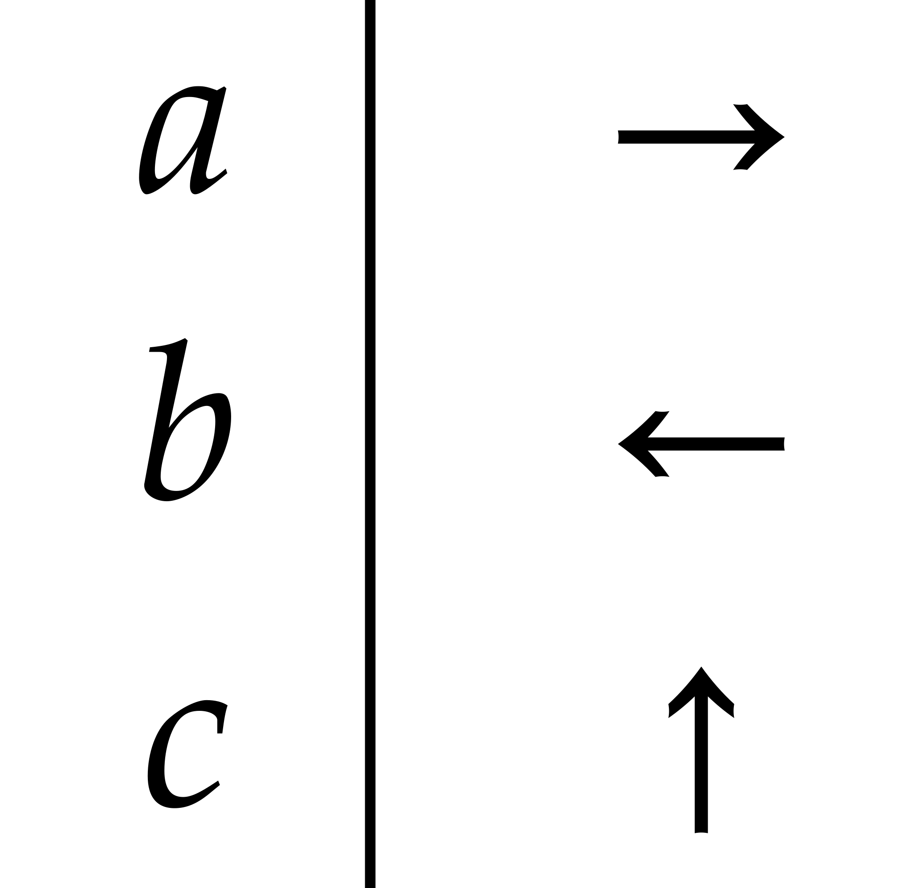 is used as a rule of the game or not, I use it as a description of the game as it is actually played? So that one could at least say of the game that it could be described by a table assigning secondary signs to primary ones? – Even then I have to make this transition in the table; it does not make it itself, it merely paves the way.

### [160v\[2\]](https://cdn.wittgensteinnachlass.com/2000px/webp/Ms-153a/160v.webp)

The simplicity of differential calculus.

### [VB](/w-vb/#ms-153a-160v.3) [160v\[3\]](https://cdn.wittgensteinnachlass.com/2000px/webp/Ms-153a/160v.webp)

(The Jew is a barren region beneath whose thin crust, however, lie the fiery-liquid masses of the spiritual.)

### [161r\[1\]](https://cdn.wittgensteinnachlass.com/2000px/webp/Ms-153a/161r.webp)

Even if I admit that whenever we set about carrying out the order fetch me a red flower, a red image caused by the word ‘red’ hovers before us [unreadable] [unreadable]: Who forces us to orient ourselves by this image? and to orient ourselves _in this way_?

### [161r\[2\]](https://cdn.wittgensteinnachlass.com/2000px/webp/Ms-153a/161r.webp),[161v\[1\]](https://cdn.wittgensteinnachlass.com/2000px/webp/Ms-153a/161v.webp),[162r\[1\]](https://cdn.wittgensteinnachlass.com/2000px/webp/Ms-153a/162r.webp),[162v\[1\]](https://cdn.wittgensteinnachlass.com/2000px/webp/Ms-153a/162v.webp),[163r\[1\]](https://cdn.wittgensteinnachlass.com/2000px/webp/Ms-153a/163r.webp)

If there was a red flower there, why did he need the little red picture? For if he recognized the colour of the little picture as red, why not recognize the colour of the flower straight away? Now one will say: he does not recognize the colour of the picture as red at all, since _this_ process is possible only with the coloured model. For recognizing the colour of this flower as red means nothing other than recognizing it as the same colour as the tile on which the word ‘red’ is written. Certainly, in this sense one cannot then recognize the red tile itself as red (it is so by definition).

And this means: it is one game to go around with a particular tile, holding it against the objects & testing in this way whether the colours are the same; and another to act, without such a tile, on words in a word-language. Now one thinks: Yes, I understand the first game; it is quite simple too: the first step is from a written word to the same written word on the sample; the second is the transition from a word on the tile to the colour on the _same_ tile & the third the comparison of colours. So we take each step in this calculus on a bridge. (We are guided, the step is mapped out in advance.) But here we are guided only in so far as we let ourselves be guided. In this way I can call anything guidance & need call nothing guidance. – And in the end I do what I do & that is all.

### [163r\[2\]](https://cdn.wittgensteinnachlass.com/2000px/webp/Ms-153a/163r.webp),[163v\[1\]](https://cdn.wittgensteinnachlass.com/2000px/webp/Ms-153a/163v.webp)

But a difference does remain: If I am asked why I call this particular colour the colour ‘red’, I could actually answer: because it is on the same tile as the word ‘red’. But if I were asked in the second game “why do you call this colour red”, there would be no answer & the question would have no sense. – But in the first game this question has no sense: “why do you call the colour red that is on the same tile as the word ‘red’”. That is just how I act (& one can no doubt give a cause for it, but not a reason).

### [163v\[2\]](https://cdn.wittgensteinnachlass.com/2000px/webp/Ms-153a/163v.webp)

(A reason can be given only _within_ a game.)

### [163v\[3\]](https://cdn.wittgensteinnachlass.com/2000px/webp/Ms-153a/163v.webp),[164r\[1\]](https://cdn.wittgensteinnachlass.com/2000px/webp/Ms-153a/164r.webp)

The chain of reasons comes to an end, namely the end in this game.

### [164r\[2\]](https://cdn.wittgensteinnachlass.com/2000px/webp/Ms-153a/164r.webp)

(I am to be only the mirror in which my reader sees his own thinking with all its deformities & by which he can put his thinking right.)

### [164r\[3\]](https://cdn.wittgensteinnachlass.com/2000px/webp/Ms-153a/164r.webp),[164v\[1\]](https://cdn.wittgensteinnachlass.com/2000px/webp/Ms-153a/164v.webp)

The only dignified task of philosophy is: to destroy the old idols of ultraphysics. (That is, its only connection with gods.) [→ ]

### [164v\[2\]](https://cdn.wittgensteinnachlass.com/2000px/webp/Ms-153a/164v.webp)

If one wants to call something a calculus only when the transition, for example from the word to the colour, takes place via a table, that is up to us. But this does not accomplish very much.

### [164v\[3\]](https://cdn.wittgensteinnachlass.com/2000px/webp/Ms-153a/164v.webp),[165r\[1\]](https://cdn.wittgensteinnachlass.com/2000px/webp/Ms-153a/165r.webp)

One might perhaps say: the rules of the game are the ones taught when the game is taught. Now, for example, someone learning to read is actually taught: this is an a, this is an e, etc.; so, one might say, these rules, this table, belong to the game. – But first: is the use of this table taught as well, and, on the other hand, _could_ it not be taught? And secondly, the game can _actually_ be played in two different ways.

### [165v\[1\]](https://cdn.wittgensteinnachlass.com/2000px/webp/Ms-153a/165v.webp)

One can now ask: but is it still a game if someone sees the letters abbc & does _just anything_? And where does the game stop, & where does it begin?

### [165v\[2\]](https://cdn.wittgensteinnachlass.com/2000px/webp/Ms-153a/165v.webp)

The answer is of course: it is a game if it proceeds according to a rule. But what still counts as a rule & what no longer does?

### [165v\[3\]](https://cdn.wittgensteinnachlass.com/2000px/webp/Ms-153a/165v.webp),[166r\[1\]](https://cdn.wittgensteinnachlass.com/2000px/webp/Ms-153a/166r.webp)

I can give a rule only by giving its expression; for examples too, if they are to be examples, are an expression of the rule like any other.

### [166r\[2\]](https://cdn.wittgensteinnachlass.com/2000px/webp/Ms-153a/166r.webp),[166v\[1\]](https://cdn.wittgensteinnachlass.com/2000px/webp/Ms-153a/166v.webp)

So if I say: I call it a game only if it takes place in accordance with a rule & the rule is a table, then I cannot guarantee the way this table is used, for I can specify it only by means of a further table, or by means of examples. These examples take us no further than they themselves go & the second table is in the same position as the first.

### [166v\[2\]](https://cdn.wittgensteinnachlass.com/2000px/webp/Ms-153a/166v.webp),[167r\[1\]](https://cdn.wittgensteinnachlass.com/2000px/webp/Ms-153a/167r.webp)

I could also say: What is the game of chess other than lists of rules, spoken or written, & the description of a number of games of chess?!

### [167r\[2\]](https://cdn.wittgensteinnachlass.com/2000px/webp/Ms-153a/167r.webp)

Of course I am free, accordingly, to call only something of a definitely fixed outward appearance a rule of a game.

### [167r\[3\]](https://cdn.wittgensteinnachlass.com/2000px/webp/Ms-153a/167r.webp),[167v\[1\]](https://cdn.wittgensteinnachlass.com/2000px/webp/Ms-153a/167v.webp)

And I can speak of primary & secondary signs – in _one_ particular game, one particular language. – In the catalogue of material samples I can call these the primary signs & the numbers the secondary ones. But what is one to say in a case like that of written & spoken letters? Which are the primary signs here, and which the secondary ones?

### [167v\[2\]](https://cdn.wittgensteinnachlass.com/2000px/webp/Ms-153a/167v.webp),[168r\[1\]](https://cdn.wittgensteinnachlass.com/2000px/webp/Ms-153a/168r.webp)

The idea is this: A sign is secondary if, in order to orient myself by it, I need a table that first connects it with another (primary) sign, through which alone I can orient myself by the secondary one.

### [168r\[2\]](https://cdn.wittgensteinnachlass.com/2000px/webp/Ms-153a/168r.webp)

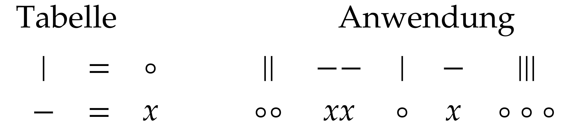

And what if I wrote the table 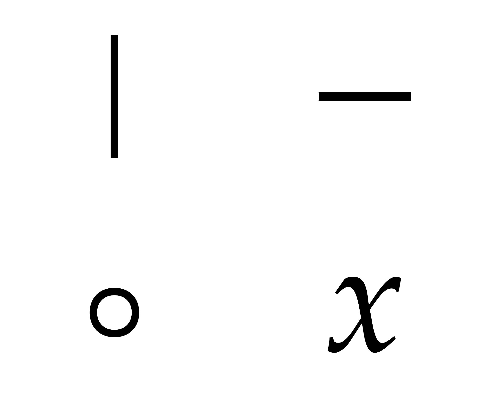? Then it would look exactly like the application.

### [168r\[3\]](https://cdn.wittgensteinnachlass.com/2000px/webp/Ms-153a/168r.webp),[168v\[1\]](https://cdn.wittgensteinnachlass.com/2000px/webp/Ms-153a/168v.webp)

But I do nevertheless orient myself by the secondary sign, even if via the table. So only a small trick is needed to make the secondary signs meaningful.

### [168v\[2\]](https://cdn.wittgensteinnachlass.com/2000px/webp/Ms-153a/168v.webp)

I can represent the transition with the help of the table as follows

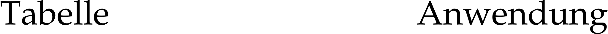

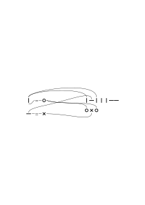

etc.

### [168v\[3\]](https://cdn.wittgensteinnachlass.com/2000px/webp/Ms-153a/168v.webp),[BCr\[1\]](https://cdn.wittgensteinnachlass.com/2000px/webp/Ms-153a/BCr.webp)

But here it becomes clear that I make the transition from 1 to 0 in the table in the same way as I would have made it without the table; and the table does not guarantee the regularity (sameness) of the transition, for it does not force me to use it in the same way every time. It is there like a field through which paths lead, but I can also go cross-country.

### [BCr\[2\]](https://cdn.wittgensteinnachlass.com/2000px/webp/Ms-153a/BCr.webp)

That is, I make the transition from the secondary sign to the primary one (which is of the same kind as the transition from the secondary sign to what the primary one designates) without mediation … [→ ]
