# Ms-153b

3 published remarks, VB

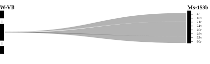

### [FCv\[3\]](https://cdn.wittgensteinnachlass.com/2000px/webp/Ms-153b/FCv.webp),[1r\[1\]](https://cdn.wittgensteinnachlass.com/2000px/webp/Ms-153b/1r.webp)

… for the table does not force me to make it. I make it afresh every time I use it. It is not, as it were, made once and for all in the table for me. (At most, the table _tempts_ me to make it that way).

And so I do follow the secondary sign _directly_ when, in the table, I go from this secondary sign precisely _there_.

### [1r\[2\]](https://cdn.wittgensteinnachlass.com/2000px/webp/Ms-153b/1r.webp),[1v\[1\]](https://cdn.wittgensteinnachlass.com/2000px/webp/Ms-153b/1v.webp)

Now, of course, one could replace the table by the first applications of the secondary signs, and in future one would have to follow these first applications. And to a certain extent this does happen, for we may perhaps remember having always read the letter _a_ _that way_.

### [1v\[2\]](https://cdn.wittgensteinnachlass.com/2000px/webp/Ms-153b/1v.webp),[2r\[1\]](https://cdn.wittgensteinnachlass.com/2000px/webp/Ms-153b/2r.webp)

The words are arbitrary; it does not emerge from them which colour they mean. But that is how the table is used. It does not emerge from it either how it is to be used. So has it really nothing to do with the arbitrariness of words? Is all this nonsense? No.

The table does in fact have a particular effect on us. (It makes no difference whether I say the table or the ostensive explanation, for these two are one.)

And where it is necessary we can speak of primary & secondary signs.

### [2r\[1\]](https://cdn.wittgensteinnachlass.com/2000px/webp/Ms-153b/2r.webp),[2v\[1\]](https://cdn.wittgensteinnachlass.com/2000px/webp/Ms-153b/2v.webp)

What, then, is the nature of my statement about the table “that it does not force me to use it in such-and-such a way”. And “that the application is not anticipated by the rule (or table)”?

### [2v\[2\]](https://cdn.wittgensteinnachlass.com/2000px/webp/Ms-153b/2v.webp)

Where does this examination derive its importance from, since it seems only to destroy everything interesting? –

### [2v\[3\]](https://cdn.wittgensteinnachlass.com/2000px/webp/Ms-153b/2v.webp)

The foundations we mean _pervade_ rather than _underlie_ mathematics & the sciences. (see Augustine et cum effunderis super nos, non tu iaces, sed erigis nos.)

### [VB](/w-vb/#ms-153b-3r.1) [3r\[1\]](https://cdn.wittgensteinnachlass.com/2000px/webp/Ms-153b/3r.webp)

Grillparzer: “How easily one moves in what is great & distant, how difficult it is to grasp what is near & individual ….”

### [3r\[2\]](https://cdn.wittgensteinnachlass.com/2000px/webp/Ms-153b/3r.webp),[3v\[1\]](https://cdn.wittgensteinnachlass.com/2000px/webp/Ms-153b/3v.webp)

Where does the examination derive its importance from, the examination that draws our attention to the fact that one can use a table in more than _one_ way, that one can think of a table as a guide to the use of a table, that one can also take an arrow as showing the direction from its tip to its tail, that I can use a model as a model in all sorts of ways?

### [3v\[2\]](https://cdn.wittgensteinnachlass.com/2000px/webp/Ms-153b/3v.webp),[4r\[1\]](https://cdn.wittgensteinnachlass.com/2000px/webp/Ms-153b/4r.webp)

So what is involved in the remark that there must be primary signs in every language which define the words is this: that one can set up a table on whose one side are the words and on whose other side are examples of their application. And that is true insofar as examples of the application of words are suitable for being represented in a table, for the table is then nothing other than a particular case of the application of words; compare 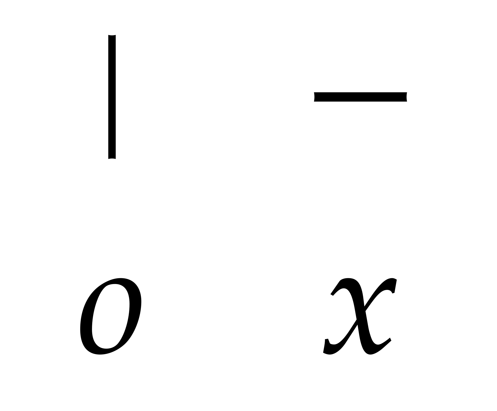.

### [4r\[2\]](https://cdn.wittgensteinnachlass.com/2000px/webp/Ms-153b/4r.webp)

The error concerning primary signs belongs to those who treat philosophy as a kind of physics, wanting to pursue simple laws. Principles in Newton’s sense.

### [4v\[1\]](https://cdn.wittgensteinnachlass.com/2000px/webp/Ms-153b/4v.webp),[5r\[1\]](https://cdn.wittgensteinnachlass.com/2000px/webp/Ms-153b/5r.webp)

„Verifying by inspection” is a completely misleading expression. It says, namely, that first a process takes place, the inspection, & that would be comparable to looking through a microscope or to the process of turning one’s head _to see something_. And that then seeing necessarily takes place. One could speak of ‚seeing by turning’ or seeing by looking. But then the turning (or looking) is a process external to seeing which interests us (therefore) only practically. What one means is ‚seeing by seeing’, but that means nothing.

### [5r\[2\]](https://cdn.wittgensteinnachlass.com/2000px/webp/Ms-153b/5r.webp)

There is an infinity of things which you must notice about the use of the simplest word. The grammar of every word is enormously complicated & therefore enormously difficult to overlook & it is just that you must try to do.

### [5v\[1\]](https://cdn.wittgensteinnachlass.com/2000px/webp/Ms-153b/5v.webp)

Methods of projection for colours & shapes.

### [5v\[2\]](https://cdn.wittgensteinnachlass.com/2000px/webp/Ms-153b/5v.webp),[6r\[1\]](https://cdn.wittgensteinnachlass.com/2000px/webp/Ms-153b/6r.webp)

Language has the same traps ready for everyone, the same vast network of already-laid false paths. And so we see one person after another take the same paths & already know where he will turn off now, where he will go straight on without noticing the turning, etc. etc. I ought therefore to put up signposts at all the places where false paths have been laid, to help people past the dangerous points.

### [6r\[2\]](https://cdn.wittgensteinnachlass.com/2000px/webp/Ms-153b/6r.webp),[6v\[1\]](https://cdn.wittgensteinnachlass.com/2000px/webp/Ms-153b/6v.webp),[7r\[1\]](https://cdn.wittgensteinnachlass.com/2000px/webp/Ms-153b/7r.webp),[7v\[1\]](https://cdn.wittgensteinnachlass.com/2000px/webp/Ms-153b/7v.webp),[8r\[1\]](https://cdn.wittgensteinnachlass.com/2000px/webp/Ms-153b/8r.webp),[8v\[1\]](https://cdn.wittgensteinnachlass.com/2000px/webp/Ms-153b/8v.webp),[9r\[1\]](https://cdn.wittgensteinnachlass.com/2000px/webp/Ms-153b/9r.webp),[9v\[1\]](https://cdn.wittgensteinnachlass.com/2000px/webp/Ms-153b/9v.webp)

<s>Here, of course, the rule is different from that in the first case & if it is consulted, the game-action is therefore also different. But what if it is not consulted? Then the command is, say, “bring me a red flower”, in which a green tile stands in place of the word ‚red’, & the command is carried out exactly as if the word ‚red’ or a red tile stood there. The question now is: if this rule in its essence relates only to the colours blue, red, green, yellow, is it not identical with the rule which stipulates the green sign as a word for ‚red’, etc., and the blue sign as a word for ‚yellow’, etc.? For a generality which in its logical essence can be replaced by a logical product is nothing other than this logical product. (For one cannot say: here is the green sign; now fetch me a thing of the complementary colour, **whatever it may be**. That is, “the complementary colour of red” is not a description of green.) The stipulation to take the complementary colour as the meaning of the tile is then like a horizontal line in a table

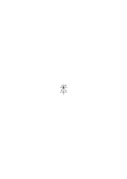

a horizontal line drawn in the grammar of colours. Here the green tile is therefore merely a word. It would be otherwise if the rule said that the tile always means a shade somewhat darker than the pure one. One must once again attend to the different senses of colour- & shape-projection (and, in the latter case, again to depiction in visual space & transfer by measuring instruments). Copying the colour when the instruction is to paint a shade somewhat darker than the given one is naturally of a **different kind** from copying in the sense of producing the same shade (whereas copying a figure with compass & ruler is copying in the same sense, whether I copy the figure at its natural size or to a scale of 4 : 2, etc., by parallel or central projection; compare the metric of shades). If I take this into account, I can, in the changed sense of the word “sample”, take the lighter tile as a sample of the darker object. The question therefore remains: how can I distinguish the sign that is used as a word from the one that is used as a sample. </s> (The sentence is a sample, the word is not a sample. Think also of how you can copy a map by walking through it, both map & legend, and whether anything else is needed for this, <s>which cannot be expressed at all.) </s> <s>The original question was: couldn’t we point to a green tile just as well as to a red one in giving an ostensive explanation of ‚red’; for if this definition merely replaces one sign by another, surely it should come to the same thing. – Insofar as the explanation merely puts one word in place of another, it is the same. But if the explanation connects the word with a sign that is used differently (as a sample), then it does matter which tile the sign is connected with. “But then there are arbitrary & non-arbitrary signs?” – The use of words is not arbitrary either, insofar as, once ❘ = 0 + – = x has been stipulated, the translation of ❘ – – ∣∣ is no more arbitrary than copying a colour.</s>

### [10r\[1\]](https://cdn.wittgensteinnachlass.com/2000px/webp/Ms-153b/10r.webp),[10v\[1\]](https://cdn.wittgensteinnachlass.com/2000px/webp/Ms-153b/10v.webp),[11r\[1\]](https://cdn.wittgensteinnachlass.com/2000px/webp/Ms-153b/11r.webp),[11v\[1\]](https://cdn.wittgensteinnachlass.com/2000px/webp/Ms-153b/11v.webp),[12r\[1\]](https://cdn.wittgensteinnachlass.com/2000px/webp/Ms-153b/12r.webp),[12v\[1\]](https://cdn.wittgensteinnachlass.com/2000px/webp/Ms-153b/12v.webp),[13r\[1\]](https://cdn.wittgensteinnachlass.com/2000px/webp/Ms-153b/13r.webp),[13v\[1\]](https://cdn.wittgensteinnachlass.com/2000px/webp/Ms-153b/13v.webp)

<s>Does it not follow, then, that the definition which connects word with word (even if this is a coloured tile) is a definition of a different kind, in a different sense, from one which connects the word with a sample? Of course this definition too allows me to put one sign in place of another, the sample in place of the word. But the further use of the sign is quite different. So perhaps the word ‘definition’ is not being used in different meanings, but the word ‘sign’. The word ‚red’ could mean different colours in different languages, but the red tile cannot be copied into different colours & even if, for example, the geometrical figure can be projected by different methods of projection, one still cannot say this of a word, say the word “circle”. </s> Words are not patterns but patterns are made out of words.

<s>We can certainly say—that is, it accords entirely with linguistic usage—that we communicate by means of signs, whether we use words or samples, but a sample is not a word & the game of going by words is different from that of going by samples or a sample. Words are not essential to language. The original question was: must a **red** tile stand for ‚red’, or does this merely make the transition easy for us, just as it is easier to find one’s way about in a table arranged according to the schema 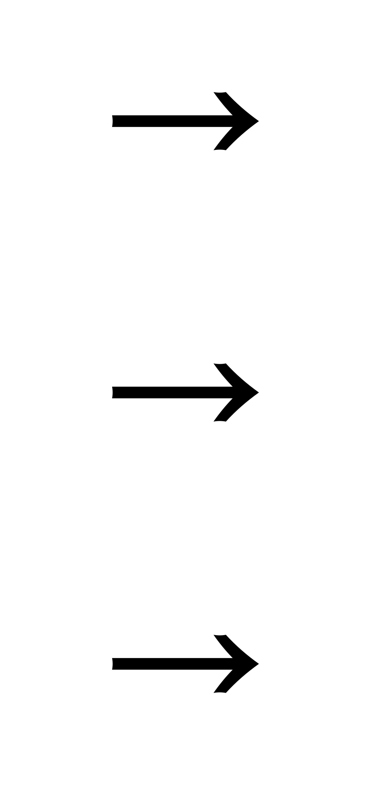 rather than according to a more complicated one? And it is clear that a green tile can stand for the word ‚red’ just as well as a blue one. It is also clear that a green one cannot serve as a sample of a red shade in the same sense as a tile of that shade. The question now is: if it is only a matter of designating the colours red, blue, green, yellow, does the red tile stand in a different relation to ‚red’ from the one it stands in to ‚green’, etc.? That is, does the tile in this case come into consideration as a sample at all, or only as a word, so that it then makes no difference which tile designates red? Yes, but surely we must have a way of fixing the meaning that ‚red’ actually has, as opposed to another. – One thing is clear: if the tiles do not function as samples (& if they do, everything is clear anyway), there is no reason why I should assign the word ‚red’ to a colour rather than to a shape or a sound; and that is to say: if the tiles do not function as samples of any kind, they function simply as words. If a green tile can designate red, it can do so only in the same way as the doubled c on the violin. But one has a feeling that this is not so, as if there were a method of projection here (only not as convenient as the one that projects red into red) that projects red into green. But if that were so, we should have to know what this method of projection yields with another argument. Well, here of course we think of the rule for replacing a colour by its complementary colour.</s>

### [13v\[2\]](https://cdn.wittgensteinnachlass.com/2000px/webp/Ms-153b/13v.webp),[14r\[1\]](https://cdn.wittgensteinnachlass.com/2000px/webp/Ms-153b/14r.webp),[14v\[1\]](https://cdn.wittgensteinnachlass.com/2000px/webp/Ms-153b/14v.webp),[15r\[1\]](https://cdn.wittgensteinnachlass.com/2000px/webp/Ms-153b/15r.webp),[15v\[1\]](https://cdn.wittgensteinnachlass.com/2000px/webp/Ms-153b/15v.webp),[16r\[1\]](https://cdn.wittgensteinnachlass.com/2000px/webp/Ms-153b/16r.webp),[16v\[1\]](https://cdn.wittgensteinnachlass.com/2000px/webp/Ms-153b/16v.webp)

<s>But was my question really not this: does copying come into consideration at all when words are defined? That is, must not everything by which a word is defined be, eo ipso, a word, function as a word, even if it is a coloured plaque & could therefore function differently, namely as a sample? Is it not the case, then, that colour samples, as soon as they define words, are only words? – But it is clear that in the sample catalogue we can quite well go from the numbers (the names) to the sample & then use it as a sample, even though it is true that we need not use it as a sample, but can also use it as a word (two different games). But if the number of samples is limited from the outset—is there then room for copying? Well, I can certainly copy the colour of the sign even then. What matters to me, for example, is not the exact shade at all, but only whether it is a shade of red, blue, yellow or green. But I can also copy in such a way that only the **neighbourhood** of the relevant primary colour is preserved. – So if my system of signs consists only of the words red, blue, green, yellow & four corresponding coloured tiles, is an explanation (table) that connects the red tile with the word ‚blue’ on the same footing as one that connects it with ‚red’? If I stipulate that the blue tile is to mean red, and so on round the circle, it follows that the red one means yellow, the yellow one green & the green one blue, and that is a similar case to designation by the complementary colour. It is clear that with the help of such a rule I could construct a table before any application, by first connecting ‚red’ with the blue tile & then connecting that with the red one, etc. And that is to say that the one designation is just as good as the other & in this grammatical system is the same mode of designation. By specifying that the red tile is to designate blue & so on round the circle I have in fact specified a method of projection based on the internal relations of the colours (like representation by complementary colours). Specifying this method of projection makes the designation of red by means of the blue tile equivalent to that by means of the red tile. But only through this specification. The green tile can thus become a sample for red in the system of complementary colours. It corresponds to the sample of the execution as the photographic negative corresponds to the positive. Let us imagine a photographic green-red negative, etc. etc. etc. etc. </s>

### [16v\[2\]](https://cdn.wittgensteinnachlass.com/2000px/webp/Ms-153b/16v.webp),[17r\[1\]](https://cdn.wittgensteinnachlass.com/2000px/webp/Ms-153b/17r.webp),[17v\[1\]](https://cdn.wittgensteinnachlass.com/2000px/webp/Ms-153b/17v.webp)

<s>What is characteristic of these methods of projection is that they lead to a table, which spatial ones do not. Hence they are equivalent to this table. Insofar as this is so, the designation of red by the red tile is merely a convenience. But not when it is a matter of accurately copying the shade. For there is then no method of projection from one colour into another. Insofar as the colours stand in internal relations to one another, one can also pass naturally from one to the other, that is, make a transition within the colour itself without using, say, a particular colour circle. (The possibilities are clearly shown in the colour octahedron.)</s>

### [17v\[2\]](https://cdn.wittgensteinnachlass.com/2000px/webp/Ms-153b/17v.webp),[18r\[1\]](https://cdn.wittgensteinnachlass.com/2000px/webp/Ms-153b/18r.webp),[18v\[1\]](https://cdn.wittgensteinnachlass.com/2000px/webp/Ms-153b/18v.webp)

<s>But is a word really used as a word if I use it only in conjunction with a table that makes the transition to samples? So isn’t it wrong to say that a sentence is a picture if I only put together a picture by following it & the table? But in that case the sentence & the table together are a picture after all, so not a d b c b alone, but this sign together with

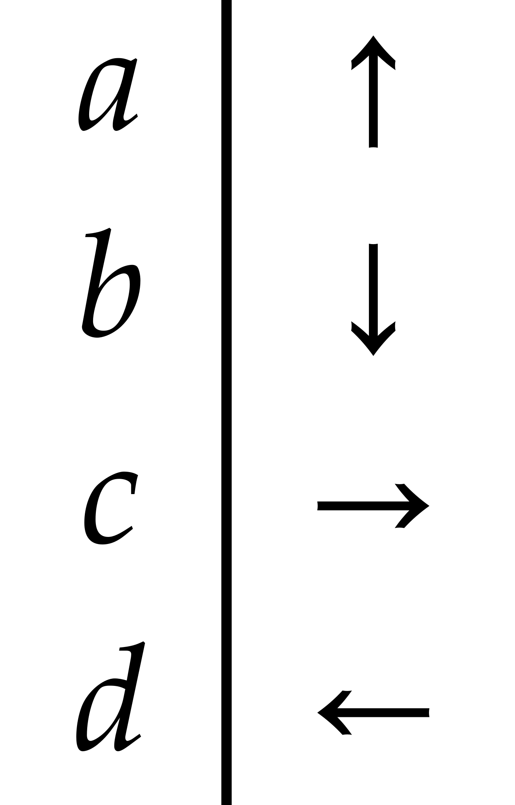.

But it is obvious that a d b c b too can be called a picture of ↑←↓→↓. Yes, but isn’t the sign a d b c b after all a more arbitrary picture of ↑←↓→↓ than this sign is of the execution of the movement? There is something arbitrary about this transfer too (the method of projection) & how am I to determine which is more arbitrary?</s>

### [18v\[2\]](https://cdn.wittgensteinnachlass.com/2000px/webp/Ms-153b/18v.webp)

“Put your foot on socks an ell high, you remain what you are all the same.”

### [19r\[1\]](https://cdn.wittgensteinnachlass.com/2000px/webp/Ms-153b/19r.webp)

<s>The word in quotation marks is a sample.</s>

### [19r\[2\]](https://cdn.wittgensteinnachlass.com/2000px/webp/Ms-153b/19r.webp)

„I see that p is the case”

„I know that p is the case”

Does seeing depend on one of the senses?

The subject in visual space.

### [19r\[3\]](https://cdn.wittgensteinnachlass.com/2000px/webp/Ms-153b/19r.webp),[19v\[1\]](https://cdn.wittgensteinnachlass.com/2000px/webp/Ms-153b/19v.webp)

<s>The difficulty we have in speaking about visual space without a subject and about my & his toothache is one of setting the language straight so that it fits the facts properly.</s>

### [19v\[2\]](https://cdn.wittgensteinnachlass.com/2000px/webp/Ms-153b/19v.webp)

<s>When Mr N is introduced to me, do I now know something about him, namely what he looks like, etc., or do I now understand the name ‚N’? That is, was the image a sentence about N or a definition of ‚N’?</s>

### [19v\[3\]](https://cdn.wittgensteinnachlass.com/2000px/webp/Ms-153b/19v.webp)

<s>**Reason & cause**.</s>

### [19v\[4\]](https://cdn.wittgensteinnachlass.com/2000px/webp/Ms-153b/19v.webp),[20r\[1\]](https://cdn.wittgensteinnachlass.com/2000px/webp/Ms-153b/20r.webp)

<s>So I connect a (new) sign with it (another kind of arrow, as when, to explain the patch o x, I put an arrow beside it 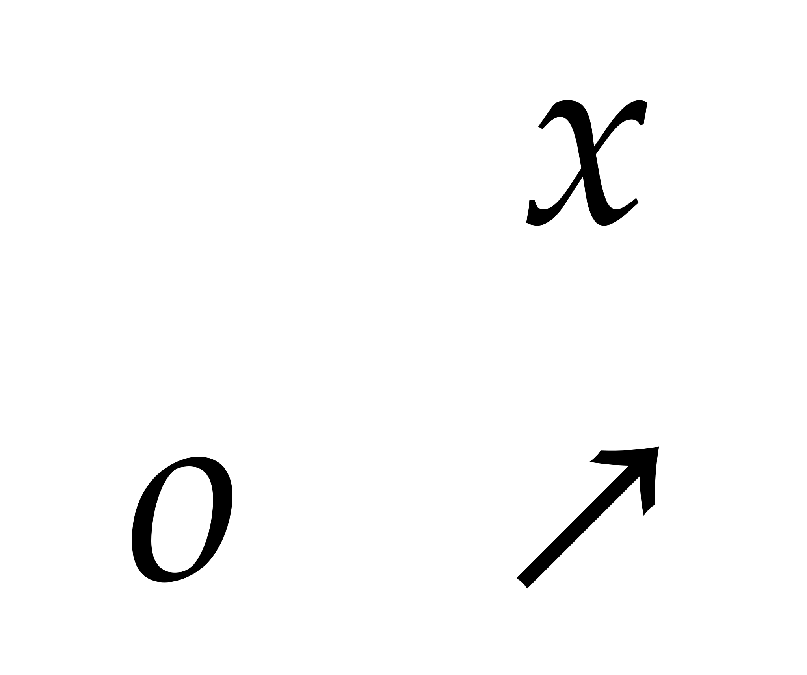.</s>

### [20r\[2\]](https://cdn.wittgensteinnachlass.com/2000px/webp/Ms-153b/20r.webp)

<s> Don't say this is no explanation: This is **what we call** an explanation.</s>

### [20r\[3\]](https://cdn.wittgensteinnachlass.com/2000px/webp/Ms-153b/20r.webp),[20v\[1\]](https://cdn.wittgensteinnachlass.com/2000px/webp/Ms-153b/20v.webp)

<s>But it seems as though we were saying or doing something other than replacing one sign by another. It is as though we were now saying something about the arrow which determines its direction, which previously was not determined. As when I first say “he was wearing a hat” & only then give its colour. As though the arrow alone had left a visible gap which I am now filling (once and for all).</s>

### [20v\[2\]](https://cdn.wittgensteinnachlass.com/2000px/webp/Ms-153b/20v.webp),[21r\[1\]](https://cdn.wittgensteinnachlass.com/2000px/webp/Ms-153b/21r.webp)

<s>– I give a definition, whereas it seems as though I had, so to speak, filled out what the arrow states. I have replaced the arrow with a new sign that we can use instead of the arrow. – **Can** **use**. – Whereas it **seems** as though the arrow itself were essentially imperfect, in need of supplementation, & as though I had now given it what it needed: as when one recognizes a description of an object as imperfect & completes it. As though the arrow had begun the description & we had completed it with the sentence.</s>

### [21r\[2\]](https://cdn.wittgensteinnachlass.com/2000px/webp/Ms-153b/21r.webp),[21v\[1\]](https://cdn.wittgensteinnachlass.com/2000px/webp/Ms-153b/21v.webp)

What Eddington says about ‘the direction of time’ & the law of entropy amounts to saying that time would reverse its direction if people one fine day began to walk backwards. One can of course call it that if one likes; one just has to be clear that this says nothing more than that people have changed the direction in which they walk.

### [21v\[2\]](https://cdn.wittgensteinnachlass.com/2000px/webp/Ms-153b/21v.webp)

Let us examine language _for its rules_.

### [22r\[1\]](https://cdn.wittgensteinnachlass.com/2000px/webp/Ms-153b/22r.webp)

If we find no (fixed) rules somewhere, well, then _that_ is the result.

### [22r\[2\]](https://cdn.wittgensteinnachlass.com/2000px/webp/Ms-153b/22r.webp)

How does one find the rule of a game among a foreign people?

### [22r\[3\]](https://cdn.wittgensteinnachlass.com/2000px/webp/Ms-153b/22r.webp)

Someone divides people into buyers & sellers & forgets that buyers are also sellers. If I remind him of this, is his grammar changed?

### [22r\[4\]](https://cdn.wittgensteinnachlass.com/2000px/webp/Ms-153b/22r.webp),[22v\[1\]](https://cdn.wittgensteinnachlass.com/2000px/webp/Ms-153b/22v.webp)

If I said “I saw an armchair”, the sentence ‘there wasn’t one there’ does not contradict it (used in a certain sense). For I would also use the first sentence in describing a dream & no one would then contradict me with the words of the second. But describing the dream in those words sheds _a_ light on the sense of the words “_I saw_”.

### [22v\[2\]](https://cdn.wittgensteinnachlass.com/2000px/webp/Ms-153b/22v.webp),[23r\[1\]](https://cdn.wittgensteinnachlass.com/2000px/webp/Ms-153b/23r.webp),[23v\[1\]](https://cdn.wittgensteinnachlass.com/2000px/webp/Ms-153b/23v.webp)

Most people, when they are to undertake a philosophical investigation, go about it like someone looking extremely nervously for an object in a drawer. He throws papers out of the drawer – what he is looking for may be among them – and leafs hastily & carelessly through the rest. Throws the first ones back & others out, etc. One can only say to him then: Stop, if you search _like that_, I can’t help you look. First you must start going through things with complete calm & methodically, one after the other; then I am also ready to help you look & to adapt my method to yours.

### [23v\[2\]](https://cdn.wittgensteinnachlass.com/2000px/webp/Ms-153b/23v.webp)

<s>“The piece was meant for you”; how does that manifest itself, what is the verification of this sentence? Then we shall know what it says.</s>

### [23v\[3\]](https://cdn.wittgensteinnachlass.com/2000px/webp/Ms-153b/23v.webp),[24r\[1\]](https://cdn.wittgensteinnachlass.com/2000px/webp/Ms-153b/24r.webp)

The philosophically most important aspects of things are hidden by their simplicity & everyday character. One cannot notice it because it is always plainly before one’s eyes.

### [24r\[2\]](https://cdn.wittgensteinnachlass.com/2000px/webp/Ms-153b/24r.webp)

(The real achievement of a Copernicus or Darwin etc. was not the discovery of a true theory but of a fruitful aspect.)

c a b b d

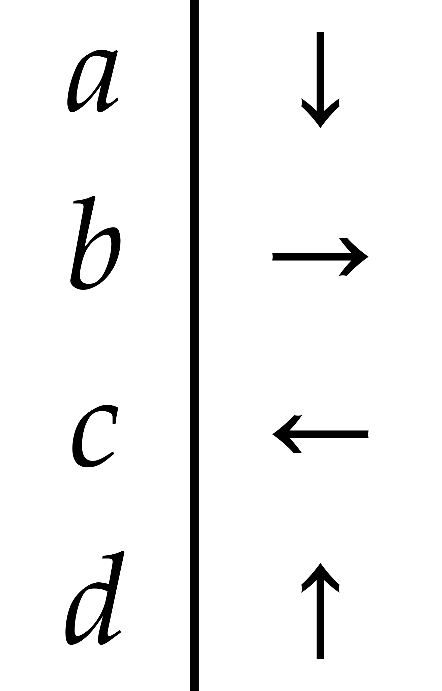

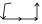

### [24v\[1\]](https://cdn.wittgensteinnachlass.com/2000px/webp/Ms-153b/24v.webp)

<s>The transition from calculating with plums to an action with the plums & from the word plum to the thing.</s>

### [24v\[2\]](https://cdn.wittgensteinnachlass.com/2000px/webp/Ms-153b/24v.webp),[25r\[1\]](https://cdn.wittgensteinnachlass.com/2000px/webp/Ms-153b/25r.webp),[25v\[1\]](https://cdn.wittgensteinnachlass.com/2000px/webp/Ms-153b/25v.webp),[26r\[1\]](https://cdn.wittgensteinnachlass.com/2000px/webp/Ms-153b/26r.webp),[26v\[1\]](https://cdn.wittgensteinnachlass.com/2000px/webp/Ms-153b/26v.webp),[27r\[1\]](https://cdn.wittgensteinnachlass.com/2000px/webp/Ms-153b/27r.webp),[27v\[1\]](https://cdn.wittgensteinnachlass.com/2000px/webp/Ms-153b/27v.webp),[28r\[1\]](https://cdn.wittgensteinnachlass.com/2000px/webp/Ms-153b/28r.webp)

<s> Definition & naming assign a sign to a thing (in the first case to a sign). – But a **name** is given to the thing so that I can speak about it. – This sounds as though the name were like a telescope & the above sentence **analogous** to: A telescope is given to me so that I can see it. But ‘speaking about it’ now consists in the fact that it was first said that it↑ is called ‘N’ & then the name ‘N’ is used in the language & in the transition from language to actions etc. – Nevertheless, speaking of N is different from an operation which I perform with N. Indeed, also different from operating with an object which stands for N, but for which N could also be used. – But if, for example, I now wanted to see at which place on the wall a particular picture would look best & moved another, approximately equally large, piece of paper for this purpose, could I not say that here I am speaking of the picture, **mean** the picture, & that the paper signifies the picture? Is this not the type of every deliberation? I can certainly also say that in making a substitution I am guided by the sign according to the definition & likewise when I follow an order. (When I follow an order in accordance with explanations of words.) “If, as an abbreviation, I put Moore ≝ M then ‘M’ is merely the name of the same object as ‘Moore’, but not the name of the name “Moore”. The two have **one** bearer, but the sign on the left is not the bearer of the one on the right.” 

 Well, – but what if I now give the sign on the left a name, – how can it be used, & can it not be used like ‘M’? Let us give it the name ‘A’. If I then say “point to A”, this means as much as “point to the word ‘Moore’”, or again “point to ‘Moore’”. So A = “Moore”. So A is not the same as M. [And yet there must be a similarity between the two which I simply do not yet see] I can also, however absurd it may sound, define N = N, and thus take N to stand for N, but does it thereby become its own name? That is, really: I can put a thing in place of what stands for it & make the latter superfluous; but can I also put the thing in place of its name & thereby make the latter superfluous? Can one, then, use the sign N instead of the sign ‘N’ after all? Yes, that is possible, but then one uses the first sign in a different sense from the one in which it is used as a name for the person; i.e. the sentences in which the sign occurs would now have quite different consequences. (**I cannot find my way** **about**. And that is the formulation of every philosophical problem.) And indeed chiefly not in the role that a substitute plays in a calculus. That is not really a substitute. What stands for a chess piece is itself the chess piece, and so, as such, is not the substitute for a particular little piece of wood. It would only stand for what is arbitrary. One might rather say that one piece now takes up the office formerly held by another. And definition is like the transfer of an office from one sign to another. By contrast, the name & its bearer as such do not have the same office. To transfer the office of a name is not to give the name a name. Both connect signs with one another, but in different ways. The left-hand side of the definition (simply) does not stand to the right-hand side as the bearer of a name stands to the name. </s>

### [28r\[2\]](https://cdn.wittgensteinnachlass.com/2000px/webp/Ms-153b/28r.webp),[28v\[1\]](https://cdn.wittgensteinnachlass.com/2000px/webp/Ms-153b/28v.webp),[29v\[1\]](https://cdn.wittgensteinnachlass.com/2000px/webp/Ms-153b/29v.webp)

<s> That is, the transition from the name to what is named must be of a different nature from that from the defining to the defined expression. But are not both transitions translations from one language into another? How is it that the former seems, as it were, not to be a transition within **one** calculus? It is as if following an order did not draw a further **consequence** from the order. – But what I want to say is: it is, after all, a transformation of this order. (Indeed</s> <s>, it could count as a further order & in this transformation the object A does correspond to the sign ‘A’.) Or does the difference lie in this, that a person can take the place of the word ‘person’, but the person N cannot take the place of ‘N’? In the difference, then, between names of concepts & proper names? </s>

### [29v\[2\]](https://cdn.wittgensteinnachlass.com/2000px/webp/Ms-153b/29v.webp),[30v\[2\]](https://cdn.wittgensteinnachlass.com/2000px/webp/Ms-153b/30v.webp),[31r\[1\]](https://cdn.wittgensteinnachlass.com/2000px/webp/Ms-153b/31r.webp),[31v\[1\]](https://cdn.wittgensteinnachlass.com/2000px/webp/Ms-153b/31v.webp),[32r\[1\]](https://cdn.wittgensteinnachlass.com/2000px/webp/Ms-153b/32r.webp),[32v\[1\]](https://cdn.wittgensteinnachlass.com/2000px/webp/Ms-153b/32v.webp),[33r\[1\]](https://cdn.wittgensteinnachlass.com/2000px/webp/Ms-153b/33r.webp)

<s> Is it not simply like this, then: the equals sign between two expressions means that the two have the same</s> <s> meaning, i.e. that the same grammatical rules apply to them. But one cannot say this of a name & what is named. Not even if both are signs. The relation of sameness of meaning is also symmetric, but that between a name & what is named is not. The person is not the name of his name, i.e. at any rate not **by virtue of** this word being his name, and the relation of names to what is named is not transitive either. – When I give a thing a name, I am not thereby using the thing as a sign. – There are presumably cases where executing the order consists in our putting the bearers in place of the names. (In cases like that of seating arrangements); but that does not make this a case of sameness of meaning between signs. Rather, in one case A is substituted for B because the two signs have the same meaning, in the other because one is the name of the other and this particular case is that of the transition from sentence to action. – The essential difference lies in the intransitivity of names. Let us imagine a language in which a rhombus 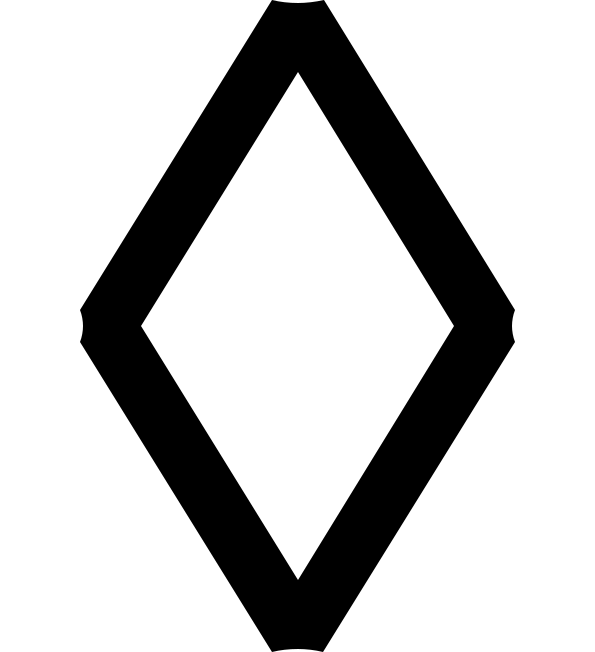 means what “square” means in ours; & suppose that in that language a square 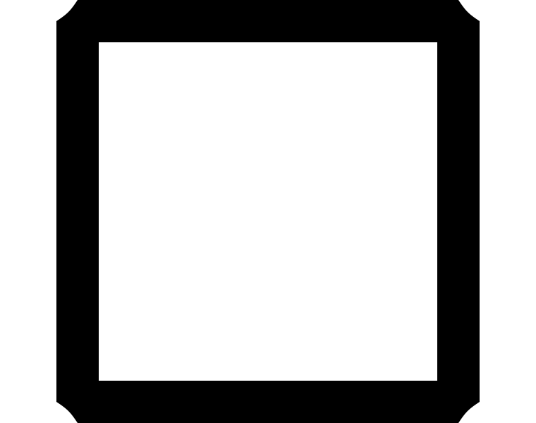 is the sign used in place of our word “rectangle”. This is not a projection that leads from the rhombus through the square to the rectangle. Rather, the process of naming ends with what is named. And the name of N’s name is no more (a) name of N than my laundress’s laundress is my laundress.

I do, to be sure, determine the meaning of a word by explaining it as the name of an object, & also by explaining it as having the same meaning as another word. But didn’t I say that one can explain a sign only by means of another? And that is certainly so, inasmuch as the ostensive explanation “this↑ is N” is a sign. But here the bearer of ‘N’, who is pointed to, also forms part of the sign. For: (this↑ person did it) = (N did it). But then ‘N’ is the name of this person, not of the sign “this↑”, of which this person is also a part. And the bearer plays a quite special role in the sign. </s>

### [30r\[1\]](https://cdn.wittgensteinnachlass.com/2000px/webp/Ms-153b/30r.webp),[30v\[1\]](https://cdn.wittgensteinnachlass.com/2000px/webp/Ms-153b/30v.webp)

---

### [33r\[1\]](https://cdn.wittgensteinnachlass.com/2000px/webp/Ms-153b/33r.webp),[33v\[1\]](https://cdn.wittgensteinnachlass.com/2000px/webp/Ms-153b/33v.webp),[37v\[2\]](https://cdn.wittgensteinnachlass.com/2000px/webp/Ms-153b/37v.webp),[38r\[2\]](https://cdn.wittgensteinnachlass.com/2000px/webp/Ms-153b/38r.webp),[38v\[1\]](https://cdn.wittgensteinnachlass.com/2000px/webp/Ms-153b/38v.webp)

<s>If, then, I define one name ostensively & a second by means of the first, the second stands in a different relation to the first from the one in which it stands to the sign given in the ostensive definition. That is, the latter sign differs essentially in its use from the name, and hence the ‘definitions’ are such in different senses of the word. Now how does ostensive explanation work? It explains the use of a sign; & the remarkable thing is only that it seems to teach its use even in cases where going back to the ostensive sign is not possible. But does this not happen by our, so to speak, transforming in a particular way the rules learnt in the ostensive definition? (If, for example, the man who was introduced to me is absent</s> <s>& I nevertheless use his name, whose use was explained to me by the introduction.) If I now use it, **in what respect am I making use of the explanation given by the introduction**? Evidently not in the way in which I could make use of it in the man’s presence. And that means that it could now really be replaced by another</s> <s>; or: if we say that we are now guided by an explanation, the wording must now be different. We are now playing according to another rule. The one which we have in fact obtained from the first.

There is evidently one game in which I can always give the ostensive sign in place of the name, & another in which that is no longer possible.</s>

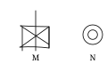

### [34r\[1\]](https://cdn.wittgensteinnachlass.com/2000px/webp/Ms-153b/34r.webp),[34v\[1\]](https://cdn.wittgensteinnachlass.com/2000px/webp/Ms-153b/34v.webp),[35r\[1\]](https://cdn.wittgensteinnachlass.com/2000px/webp/Ms-153b/35r.webp),[35v\[1\]](https://cdn.wittgensteinnachlass.com/2000px/webp/Ms-153b/35v.webp),[36r\[1\]](https://cdn.wittgensteinnachlass.com/2000px/webp/Ms-153b/36r.webp),[36v\[1\]](https://cdn.wittgensteinnachlass.com/2000px/webp/Ms-153b/36v.webp),[37r\[1\]](https://cdn.wittgensteinnachlass.com/2000px/webp/Ms-153b/37r.webp),[37v\[1\]](https://cdn.wittgensteinnachlass.com/2000px/webp/Ms-153b/37v.webp)

---

### [39r\[1\]](https://cdn.wittgensteinnachlass.com/2000px/webp/Ms-153b/39r.webp)

“But I did mean something when I said that!” Well then, but how can we find it out? Surely only by asking him. If we are not to take his remaining behaviour as the criterion of sense, then what he explains to us.

### [39r\[2\]](https://cdn.wittgensteinnachlass.com/2000px/webp/Ms-153b/39r.webp)

When one asks in philosophy “what is – e.g. – substance” etc. etc., one is asking for a rule.

### [VB](/w-vb/#ms-153b-39v.1) [39v\[1\]](https://cdn.wittgensteinnachlass.com/2000px/webp/Ms-153b/39v.webp)

I look at photographs of Corsican bandits and think to myself: the faces are too hard & mine too soft for Christianity to be written on them. The faces of the bandits are horrible to look at & yet they are surely no further removed from a good life & merely lie on another side of it than I do.

---

### [40r\[1\]](https://cdn.wittgensteinnachlass.com/2000px/webp/Ms-153b/40r.webp),[40v\[1\]](https://cdn.wittgensteinnachlass.com/2000px/webp/Ms-153b/40v.webp),[41r\[1\]](https://cdn.wittgensteinnachlass.com/2000px/webp/Ms-153b/41r.webp)

Two colours, two vapour pressures, two electrical charges etc. etc. cannot occupy one place at the same time. A curious company that I am listing here. But first, something else: if f(x) says that x is now at this place, then fa ∙ fb is a contradiction. Why do I call it that, given that p ∙ ~ p is the form of a contradiction? It presumably simply means that the expression fa ∙ fb is not a sentence. The difficulty here is just that we do have the feeling that there is a sense here, even if a degenerate one (Ramsey). That if I put myself between two statements, a living creature must come into being & not something dead, as if I had written, say, a ∙ f. This is a very curious and very deep-seated feeling. Whether fa ∙ fb is nonsense, like a ∙ f, could be decided like this: is p ∙ ~ (fa ∙ fb) = p, or is the left-hand side of this equation nonsense? Can I not decide as I please? Can I write the rule that underlies all this like this: fa = fa ∙ ~ fb? i.e.: ~ fb follows from fa.

### [41r\[2\]](https://cdn.wittgensteinnachlass.com/2000px/webp/Ms-153b/41r.webp),[41v\[1\]](https://cdn.wittgensteinnachlass.com/2000px/webp/Ms-153b/41v.webp)

When people say that the sentence “it is probable that p will occur” says something about the event p, they forget that it remains probable even if the event p has _not occurred_.

### [41v\[2\]](https://cdn.wittgensteinnachlass.com/2000px/webp/Ms-153b/41v.webp)

With the sentence “p will probably occur” we do indeed say something about the future, but not something “_about_ the event p”, as the grammatical form of the statement leads us to believe.

### [41v\[3\]](https://cdn.wittgensteinnachlass.com/2000px/webp/Ms-153b/41v.webp),[42r\[1\]](https://cdn.wittgensteinnachlass.com/2000px/webp/Ms-153b/42r.webp)

When I ask for the grounds for an assertion, the answer to this question is not valid for the person asked, but is valid generally.

### [42r\[2\]](https://cdn.wittgensteinnachlass.com/2000px/webp/Ms-153b/42r.webp),[42v\[1\]](https://cdn.wittgensteinnachlass.com/2000px/webp/Ms-153b/42v.webp)

If I say: “the weather points to rain”, am I saying something about the future weather? No, but about the present weather, with the help of a law that connects the weather at one time with the weather at a later time. This law must already be in place & with its help we sum up certain statements about our experience. – But then one could say the same for historical statements. Yet it was hasty, after all, to say that the sentence “the weather points to rain” says nothing about the future weather. That depends on what one understands by “saying something about something”. It says precisely what its words say!

### [42v\[1\]](https://cdn.wittgensteinnachlass.com/2000px/webp/Ms-153b/42v.webp),[43r\[1\]](https://cdn.wittgensteinnachlass.com/2000px/webp/Ms-153b/43r.webp)

The sentence “it will probably occur” says something about the future only in a sense in which its truth & falsity are entirely independent of what will happen in the future.

### [43r\[2\]](https://cdn.wittgensteinnachlass.com/2000px/webp/Ms-153b/43r.webp),[43v\[1\]](https://cdn.wittgensteinnachlass.com/2000px/webp/Ms-153b/43v.webp)

When we say that the rifle is now aimed at this point P, we say nothing about where the shot will hit. The point at which it is aimed is a _geometrical_ aid for specifying its direction. Of course, the fact that we use this particular means is connected with certain

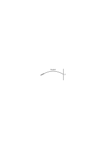

empirical facts (parabolic trajectory etc.), but these do not now enter into the determination of the direction.
---

### [43v\[2\]](https://cdn.wittgensteinnachlass.com/2000px/webp/Ms-153b/43v.webp)

With the possibility p ∙ q = p, if it does not follow from the truth-functional notation, I have of course introduced a completely new element into the calculus, changed the calculus.

### [44r\[1\]](https://cdn.wittgensteinnachlass.com/2000px/webp/Ms-153b/44r.webp),[44v\[1\]](https://cdn.wittgensteinnachlass.com/2000px/webp/Ms-153b/44v.webp),[45r\[1\]](https://cdn.wittgensteinnachlass.com/2000px/webp/Ms-153b/45r.webp),[45v\[1\]](https://cdn.wittgensteinnachlass.com/2000px/webp/Ms-153b/45v.webp)

One can define

(∃x) φx

(∃x,y) φx ∙ φ y ∙ ~

(∃ x,y,z) φx ∙ φ y ∙ φ

z ≝ (∃n φx,y)

φx ∙ φ y = ∃n ∣∣x)

φx

and likewise

(∃ x,y,z) φx

∙ φ y ∙ φ z ∙ ~ – – –

= (∃n ∣∣∣ x) φx

etc.

One can then show that

(∃n∣∣∣∣∣ x) φx

∙ (∃n ∣∣∣ x) ψ x ∙

~ ∃ x) φx ∙ ψ x

․⊃․

(∃n∣∣∣∣∣ x) φx ⌵ ψ

x is a tautology. Have we thereby shown the arithmetical proposition ∣∣ & ∣∣∣ =

∣∣∣∣∣? Of course not. Nor have we shown that

(∃n ∣∣ x)

φx ∙ (∃n ∣∣∣ x)

φx ∙ Ind.

․⊃․ (∃n ∣∣ +

∣ ∣ ∣ x) φx ⌵ ψx is a tautology, for addition ∣∣ + ∣∣∣ has so far not been mentioned at all.

\> But one can now show that the expression “to the right of ․⊃․”, which makes the whole a tautology, is always obtained by putting in the brackets the letters found by the calculus x y z u v w r s t x' y' x' y' z' or a group of strokes produced by joining together the two groups on the left. Thus, more generally, for

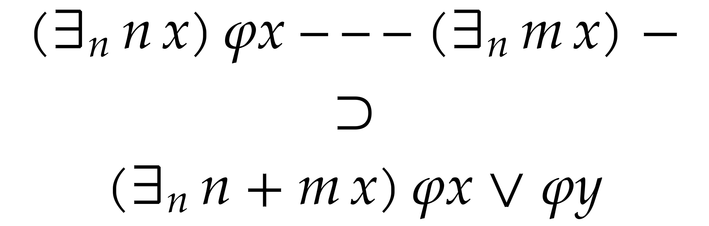

Here it makes sense to write the right-hand number m + n, for this expresses a law. By contrast, it made no sense to write ∣∣∣∣∣ ∣∣ + ∣∣∣ instead of it, since one could equally well write ∣ + ∣∣∣∣ or ∣∣∣∣∣. It does, however, make sense, according to this general rule, to write

(∃ 2x – – – (∃ 3x)

(∃ 2 + 3x)

if one (so to speak) does not yet know what 2 + 3 will yield, since 2 + 3 has a sense only insofar as it still has to be calculated. Hence the equation ∣∣ + ∣∣∣ = ∣∣∣∣∣ has a sense only if the sign ∣∣∣∣∣ can be recognized in the same way as the sign 5.

### [45v\[1\]](https://cdn.wittgensteinnachlass.com/2000px/webp/Ms-153b/45v.webp),[46r\[1\]](https://cdn.wittgensteinnachlass.com/2000px/webp/Ms-153b/46r.webp),[46v\[1\]](https://cdn.wittgensteinnachlass.com/2000px/webp/Ms-153b/46v.webp)

To say “4 objects + 4 objects are 8 objects” says nothing & equally little does “4 apples & 4 apples are 8 apples”, unless this is meant to express the experiential proposition that 8 apples are lying on the table when first 4 & then another 4 apples have been placed on the table. The equation of arithmetic, by contrast, is 4 + 4 = 8. Its numbers are essentially unnamed. The numbers are of course also unnamed when one calculates with fingers, strokes or balls, for these objects are not what is being spoken _about_, but the signs themselves. It is therefore nonsense to ask whether four objects are also 2 + 2 objects when not every 2 of them falls under one concept.

---

### [46v\[2\]](https://cdn.wittgensteinnachlass.com/2000px/webp/Ms-153b/46v.webp),[47r\[1\]](https://cdn.wittgensteinnachlass.com/2000px/webp/Ms-153b/47r.webp),[47v\[1\]](https://cdn.wittgensteinnachlass.com/2000px/webp/Ms-153b/47v.webp)

To say of a part of my visual field that it has no colours is nonsense, and so, of course, is saying that it has colours. It does, however, make sense to say that it has only one colour, at least two colours, only two colours, etc. So in the sentence “this quadrilateral has at least two colours” I cannot substitute “one” for “two”, & in the sentence “it has only one colour” I cannot substitute “0” for “one”. If the question were now whether 1 has the same meaning in such a sentence as where 0 can be substituted for it, what would one have to answer? “That depends on what you understand by ‘having the same meaning’, or: what you take as the criterion of sameness of meaning.” The way we understand the word “meaning” makes the meaning different.

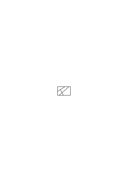

### [48r\[1\]](https://cdn.wittgensteinnachlass.com/2000px/webp/Ms-153b/48r.webp)

We need not speak of colours but only of the division of a surface in visual space generally.

– – – – –

### [48r\[2\]](https://cdn.wittgensteinnachlass.com/2000px/webp/Ms-153b/48r.webp),[48v\[1\]](https://cdn.wittgensteinnachlass.com/2000px/webp/Ms-153b/48v.webp)

I.e. The statement “the surface has only one colour” contains no statement “the surface is coloured”, which would be nonsense. What is counted are the uniformly coloured (single-coloured) patches in the _quadrilateral_. And there may quite well be no such patches at all in the quadrilateral, if, for example, the whole quadrilateral is filled by a continuous rainbow (continuous = visually continuous).

### [48v\[2\]](https://cdn.wittgensteinnachlass.com/2000px/webp/Ms-153b/48v.webp)

When I say “all these hats are of _one_ size”, this does not mean “they have one and only one size”.

### [48v\[3\]](https://cdn.wittgensteinnachlass.com/2000px/webp/Ms-153b/48v.webp),[50r\[1\]](https://cdn.wittgensteinnachlass.com/2000px/webp/Ms-153b/50r.webp),[50v\[1\]](https://cdn.wittgensteinnachlass.com/2000px/webp/Ms-153b/50v.webp),[51r\[1\]](https://cdn.wittgensteinnachlass.com/2000px/webp/Ms-153b/51r.webp),[51v\[1\]](https://cdn.wittgensteinnachlass.com/2000px/webp/Ms-153b/51v.webp),[52r\[1\]](https://cdn.wittgensteinnachlass.com/2000px/webp/Ms-153b/52r.webp)

Should I now write the sentence all these rods have the same length as follows: “There is one length which all these rods have”? Thus:

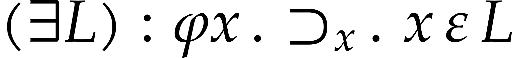

But would I not then also have to make sense of the sentence (∃L) aεL; that is: “a has a length”?

→ Here there is an error in the conception. That is, I can of course write 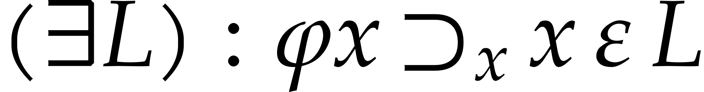 if I know only that the rule applies here that (∃L) a ε L is senseless. This notation is simply somewhat misleading in this case. – “To have a length”, “to have a father”. Here we have the case which we often express in ordinary language by saying: “If a has length 𝓁, then all the other rods also have length 𝓁.” But here the sentence “a has length 𝓁” would not make sense either; or at least not as a statement about a. But we also say “let us call the length of a ‘𝓁’ ….” – To say “the two rods have _a_ length” says nothing at all about the length of each rod, for it does not even say “that each has a length”. The case therefore has no similarity at all to: “A & B have the same father” & “the father of A & B is N”, where I simply substitute the proper name for the general designation. But 5 m is not the name of the relevant length which was initially only said to be possessed by a & b. – It is different again when we are dealing with lengths in the visual field. Here we can also say this line & that one have the same length, but we could not “name” this length with a number. Let us again think of the sentence “there are equally many apples in the two crates”. This sentence too cannot be written “there is a number which is the number of the apples in both crates”, because one could not say “there is a number which is the number of the apples in this crate”. Of course the sentence is connected with the series

ε(1x) φx ∙ ε(1x) ψx

ε(2x) φx ∙ ε(2x) ψx

ε(3x) φx ∙ ε(3x) ψx

_u.s.w._

But it is not a sentence of this form, nor one similar to these sentences in that the particular number is replaced in it by a variable, for making this substitution in _one_ of the two sentences would yield nonsense. One might be tempted to write the sentence like this

(ε x) φx ∙ (εx) ψx & that shows clearly that we are no longer dealing here with a logical product (just as the differential quotient is not a quotient). And just as one can write this in such a way that it loses every appearance of a quotient, so too our sentence in such a way that it loses every appearance of a logical product. Let us write it, say: Z (φ(Z), ψ(Z)).

(What troubles us here is the wholly unnecessary subject–predicate form. We never say a is an apple.) The rule then of course holds for Z (φ Z, ψ Z) that

Z (φ Z, ψ Z) ∙ (ε1 x) φx ∙ (ε 1 x) ψ x = (ε 1 x) φx ∙ (ε 1 x) ψ x = = Z (φ Z, ψ Z) ∙ (ε 1 x) φx = = Z (φ Z ψZ) ∙ (ε 1 x) ψ x etc. in the series of cardinal numbers.

### [52r\[2\]](https://cdn.wittgensteinnachlass.com/2000px/webp/Ms-153b/52r.webp)

The equation p ∙ q = p shows the essential connection between following and the truth-functions.

### [52r\[3\]](https://cdn.wittgensteinnachlass.com/2000px/webp/Ms-153b/52r.webp)

[unreadable] a b b c d e f a a a a a a a a b c d e f g

there are 7 letters, so there can be no more than 7 types of letters & no fewer than one.

### [52v\[1\]](https://cdn.wittgensteinnachlass.com/2000px/webp/Ms-153b/52v.webp)

But if there are 0 letters, how many types can then be present? We say: it has caps & 3 kinds of hats, or also “caps & _one_ kind of hats”, but also caps & no kind of hats.

### [52v\[2\]](https://cdn.wittgensteinnachlass.com/2000px/webp/Ms-153b/52v.webp),[53r\[1\]](https://cdn.wittgensteinnachlass.com/2000px/webp/Ms-153b/53r.webp)

One could quite well give the number of things, hats for instance, by the number of their possible pairs, and the number of the different kinds among them by the number of different pairs. Should I now say that the numbers indicating the possible pairs are of a different kind from the cardinal numbers? Should I say that the square numbers 1, 4, 9, 16, etc. are not cardinal numbers? And that, in a certain sense, the square numbers stand to the cardinal numbers as the cardinal numbers stand to the rational numbers?

### [53r\[2\]](https://cdn.wittgensteinnachlass.com/2000px/webp/Ms-153b/53r.webp)

Is a _sentence_ proved by the proof of consistency? And what is it?

### [53v\[1\]](https://cdn.wittgensteinnachlass.com/2000px/webp/Ms-153b/53v.webp)

Suppose consistency has been proved: what have we gained?

### [53v\[2\]](https://cdn.wittgensteinnachlass.com/2000px/webp/Ms-153b/53v.webp)

In what sense, then, is the contradiction _already contained_ in the axioms, if I know no methods for bringing it out?

### [53v\[3\]](https://cdn.wittgensteinnachlass.com/2000px/webp/Ms-153b/53v.webp),[54r\[1\]](https://cdn.wittgensteinnachlass.com/2000px/webp/Ms-153b/54r.webp)

„There must be no contradiction in the rules” sounds like a prescription: „in a petrol engine the gear on the crankshaft must not sit loose”. One then expects a justification: because otherwise …. In the first case, however, this justification could only be: because otherwise it is not a list of rules. Once again, it is a case of grammatical structure, which cannot be justified.

### [54r\[2\]](https://cdn.wittgensteinnachlass.com/2000px/webp/Ms-153b/54r.webp),[54v\[1\]](https://cdn.wittgensteinnachlass.com/2000px/webp/Ms-153b/54v.webp),[55r\[1\]](https://cdn.wittgensteinnachlass.com/2000px/webp/Ms-153b/55r.webp)

Could I now also set against the cardinal numbers a kind of number that were, say, the cardinal numbers without the 5? Oh yes; only this kind would be of _no_ use for anything the cardinal numbers are useful for. And the 5 is not missing from these numbers like an apple which one has taken out of a box full of apples and can put back in; rather, the 5 is missing from the essence of these numbers: they do not name the 5 (just as the cardinal numbers do not name the number ½). Thus these numbers (if one wants to call them that) would be applied in a case in which it would be _nonsensical_ to apply the cardinal numbers (with the 5).

### [55r\[2\]](https://cdn.wittgensteinnachlass.com/2000px/webp/Ms-153b/55r.webp)

Doesn’t this show how nonsensical the talk of “basic intuition” is?

### [55r\[3\]](https://cdn.wittgensteinnachlass.com/2000px/webp/Ms-153b/55r.webp),[55v\[1\]](https://cdn.wittgensteinnachlass.com/2000px/webp/Ms-153b/55v.webp)

Rules that establish a connection between language and reality, and ones that do not. Of the first kind, say: “I call this colour ‘red’” – of the second: “~ ~p = p”.

But there is a misconception about this distinction, through which it seems to be one of principle.

### [55v\[2\]](https://cdn.wittgensteinnachlass.com/2000px/webp/Ms-153b/55v.webp),[56r\[1\]](https://cdn.wittgensteinnachlass.com/2000px/webp/Ms-153b/56r.webp)

The philosophers who say: “after death a timeless state will set in”, or “with death a timeless state sets in”, & do not notice that they have said “after” & “with” temporally, & that the temporality lies in their grammar.

### [56r\[2\]](https://cdn.wittgensteinnachlass.com/2000px/webp/Ms-153b/56r.webp),[56v\[1\]](https://cdn.wittgensteinnachlass.com/2000px/webp/Ms-153b/56v.webp),[57r\[1\]](https://cdn.wittgensteinnachlass.com/2000px/webp/Ms-153b/57r.webp),[57v\[1\]](https://cdn.wittgensteinnachlass.com/2000px/webp/Ms-153b/57v.webp)

“The square has a colour & only _one_.” The first part of the sentence must not then be the grammatical statement of being coloured. (“I can _distinguish_ 3 colours in this surface.”)

I myself do not know _what_ it is that is still unclear to me about this matter, what my problem is, & yet there is still one. Something is not yet clear. Put incorrectly, but as one would put it at first, the problem runs: “why can one say ‘there are 2 colours on this surface’ & not ‘there is _one_ colour on this surface’?” Or: How must I express the grammatical rule so that I am no longer tempted to say something nonsensical & so that it goes without saying for me? Where is the false thought, the false analogy, through which I am led into using language incorrectly? How must I represent the grammar so that this temptation disappears? If, for example, I call the black surface colourless, everything seems to become quite simple. One is tempted to believe that although _one_ length is not like an apple, 3 lengths are like 3 apples.

### [57v\[2\]](https://cdn.wittgensteinnachlass.com/2000px/webp/Ms-153b/57v.webp),[58r\[1\]](https://cdn.wittgensteinnachlass.com/2000px/webp/Ms-153b/58r.webp),[58v\[1\]](https://cdn.wittgensteinnachlass.com/2000px/webp/Ms-153b/58v.webp),[59r\[1\]](https://cdn.wittgensteinnachlass.com/2000px/webp/Ms-153b/59r.webp),[59v\[1\]](https://cdn.wittgensteinnachlass.com/2000px/webp/Ms-153b/59v.webp),[60r\[1\]](https://cdn.wittgensteinnachlass.com/2000px/webp/Ms-153b/60r.webp)

One would also always like to say “that the rods have a length is self-evident”. Whereas one should say: there is no such sentence at all; on the other hand, if, for example, part of the rods were continually expanding & contracting, one could say: I see a length among the rods before me (as opposed to _none_). I am thinking of the case in which one can say: “I see _one_ colour; I do not yet know whether there are others.” “I count two colours –” “I count one colour. –” If I were counting the lengths of strokes, could I begin counting at ‘one’? In a certain sense ‘yes’ & in a certain sense ‘no’. If, for instance, I counted by making strokes on the paper: should I make a stroke on the paper when I have seen a stroke (“for it does have some length”)? I made a tally stroke on the paper when I saw the first stroke; what was it that struck me? that the stroke had a length? – In this sense strokes of no length would be no strokes (I mean the sentence “I have seen strokes of no length” would mean the same as “I have seen no strokes”.)

One could therefore also ask: How am I to _count_ colours (or lengths, etc.)? (For greater clarity, I shall assume that we count by tally strokes.) Should I now begin with one stroke or, say, with two? If I begin counting with two strokes, this clearly shows me the radical difference, & that here I am using ‘count’ in a different sense from, say, when I count soldiers. For two is not preceded by some imagined one, but the two pieces would really be the _beginning_. And there could be no one there, just as when one counted with the even numbers, one would have no place in the number series.

In this case one could write the tally strokes something like this

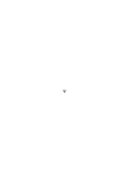

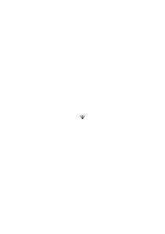

to show that what is involved in them is the difference in direction; so that the single stroke ❘ corresponds to a kind of 0. Yes, one can also really count the differences, & in this case there is a one, but the number series is 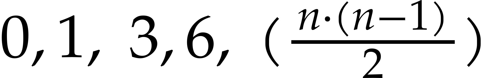.

### [60r\[2\]](https://cdn.wittgensteinnachlass.com/2000px/webp/Ms-153b/60r.webp)

What is it, then, when we count the parts into which a particular square, say, is divided? (When divided into two parts

it is also called ‘_once_ divided’, & when the whole is only one part one says that it is *un*divided.)

### [60r\[3\]](https://cdn.wittgensteinnachlass.com/2000px/webp/Ms-153b/60r.webp)

The unsettling character of grammatical unclarities.

### [60v\[1\]](https://cdn.wittgensteinnachlass.com/2000px/webp/Ms-153b/60v.webp),[BCr\[1\]](https://cdn.wittgensteinnachlass.com/2000px/webp/Ms-153b/BCr.webp)

One finds what the sense of music is by asking oneself: how do I know that a person understands a piece of music (that is, “its sense”)? Well, if he can say, for each note, how it is to be played, and indicate the tempo of each bar. Possibly also if he can justify this by saying, for example: this is like when someone says … or: this corresponds to this dance step, or: this

is the answer to that, or by considering the piece in Schenkerian fashion. Or by saying that it must be played like a waltz, or: it is serious but not sad. If that is the criterion for having understood the sense, then this also shows what the sense is.

### [FCv\[1\]-relocated](https://cdn.wittgensteinnachlass.com/2000px/webp/Ms-153b/FCv.webp)

Philosophy derives all its emphasis from the sentences which it destroys.

### [VB](/w-vb/#ms-153b-29r.1-relocated) [29r\[1\]-relocated](https://cdn.wittgensteinnachlass.com/2000px/webp/Ms-153b/29r.webp)

What feeling would we have if we had not heard of Christ? Would we have the feeling of darkness & abandonment? Do we lack it only in the sense in which a child lacks it when it knows that someone is in the room with it? Religious madness is madness arising from irreligiousness.

### [30r\[1\]-relocated](https://cdn.wittgensteinnachlass.com/2000px/webp/Ms-153b/30r.webp)

Difficulty of our investigations: great length of chain of thoughts. The difficulty is here essential to the thought not as in the sciences due to its novelty. It is a difficulty which I can't remove if I try to make you see the problems.

I can't give you a startling solution which suddenly will remove all your difficulties. I can't find one key which will unlock the door of our safe. The unlocking must be done in you by a difficult process of synoptizing certain facts.

The philosophical problem is an awareness of the disorder of our concepts, to be resolved by arranging them.

So it was a philosophical question when the sister of my acquaintance E. asked him this: What actually is one third? “But an apple has _four_ parts.” She evidently could not, at that moment, explain to herself where the designation “one third” came from, since no arrangement of quarters deserved this expression & she was thinking only of quartering.

Someone has heard that a ship’s anchor is raised by a steam engine. He now thinks of the one that drives the ship & cannot make sense of what he has heard. (Perhaps the difficulty only occurs to him later.) Now we tell him: No, it is not _this_ steam engine; besides it there are several others on the ship, and one of them raises the anchor. – Was his problem philosophical? Was it philosophical if he had heard of the existence of other steam engines on board and now only needed to be reminded of them? – I think his lack of clarity has two parts: what the person explaining communicates to him as a fact, the questioner might quite well have thought up for himself as a possibility, & he might have put his question in a definite form instead of with merely an admission of confusion. He could have dispelled this part of the lack of clarity himself, whereas reflection could not have acquainted him with the facts. Or: the uneasiness that comes from his not knowing the truth could not be removed by arranging his concepts. The other uneasiness & lack of clarity are marked by the words “something here doesn’t seem right to me”, and the solution by “Oh, I see, you don’t mean _that_ steam engine” or “Oh, I see, by steam engine you mean not only a reciprocating engine but also a turbine”.

The work of the philosopher is a bringing together of truths for a particular purpose.

We have to arrange evidence & do no more.

A philosophical question is similar to one about the constitution of a particular society. – And it would be something like a society without clearly written rules coming together but with a need for such rules. Indeed, also with a feeling which causes it to observe certain rules in its meetings, only this is made more difficult because nothing (about it) has been clearly expressed & no arrangement has been made that makes the rule clear. For example, they actually regard one of them, more or less constantly, as a kind of president. But he does not sit at the head of the table, is marked out by nothing, & this makes the proceedings more difficult. So we come along & create a clear order: we put the president at the head of the table & his secretary beside him at a table of his own, and all the equal members at one table, etc. etc.

Lecture: primary & secondary signs. Sample bearer of name, & word. Ostensive Definition.
