# Ms-154

20 published remarks, VB

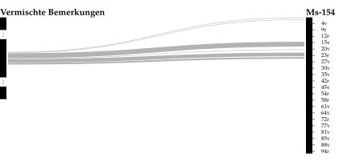

### [VB](/w-vb/#ms-154-1r.1) [1r\[1\]](https://cdn.wittgensteinnachlass.com/2000px/webp/Ms-154/1r.webp)

A confession must be part of the new life.

### [1r\[2\]](https://cdn.wittgensteinnachlass.com/2000px/webp/Ms-154/1r.webp)

The title of my book: ## “Philosophical Investigations. Arranged alphabetically according to their objects.”

### [1r\[4\]](https://cdn.wittgensteinnachlass.com/2000px/webp/Ms-154/1r.webp),[1v\[2\]](https://cdn.wittgensteinnachlass.com/2000px/webp/Ms-154/1v.webp)

How can one make preparations for the arrival of something that may exist, in the sense in which Russell & Ramsey always did so? <s> Russell made provision for the existence of infinitely many things; Ramsey for the existence of arbitrary n-place relations, etc. </s>

### [VB](/w-vb/#ms-154-1v.1) [1v\[1\]](https://cdn.wittgensteinnachlass.com/2000px/webp/Ms-154/1v.webp)

I always express what I want to express only “with half success”. Indeed, not even that, but perhaps only with a tenth. That surely means something. My writing is often only “stammering”.

### [2r\[1\]](https://cdn.wittgensteinnachlass.com/2000px/webp/Ms-154/2r.webp)

<s> One [unreadable] prepares logic for the existence of n-place relations or for the existence of an infinite number of objects etc. </s>

### [2r\[2\]](https://cdn.wittgensteinnachlass.com/2000px/webp/Ms-154/2r.webp),[2v\[1\]](https://cdn.wittgensteinnachlass.com/2000px/webp/Ms-154/2v.webp)

<s> Now one can indeed make provision for the existence of a thing: I make a little box, for example, to put jewellery in that may be made one day.

But here I can say what must be the case, what case it is that I am making provision for. I can describe this case just as well as after it has arisen. (Solution of mathematical problems.) Whereas Russell & Ramsey are making provision for a possible grammar.

x = a ⌵ x = b ⌵ …

x = a ∙ y = b ․⌵․ x = c ∙ y = d .⌵

x = a ∙ y = b ∙ z = c ․⌵․ … </s>

### [2v\[2\]](https://cdn.wittgensteinnachlass.com/2000px/webp/Ms-154/2v.webp),[3r\[1\]](https://cdn.wittgensteinnachlass.com/2000px/webp/Ms-154/3r.webp),[3v\[1\]](https://cdn.wittgensteinnachlass.com/2000px/webp/Ms-154/3v.webp)

<s> One thinks, for example, on the one hand that arithmetic has to do with the functions whose numbers it deals with. But one does not want to be bound by the functions now known to us and one does not know whether there will ever be one that is satisfied by 100 objects: so one must make provision & make a construction that gets everything ready for the 100-place relation, should one turn up. But what does it mean at all “a 100-place relation turns up (or: there is a 100-place relation)”? What concept do we have of it? or of a 2-place one?! – As an example of a 2-place relation one might give that of the relation between father & son. But what significance does this example have for the further treatment of the object? Are we now to imagine, in place of every a R b, a is the father, of b? & – – – but if not, is the example or indeed any example at all essential? Does this example not play the same role as one in arithmetic when I explain 3 × 6 = 18 to someone by means of 3 rows of 6 apples each? </s>

### [3v\[2\]](https://cdn.wittgensteinnachlass.com/2000px/webp/Ms-154/3v.webp),[4r\[1\]](https://cdn.wittgensteinnachlass.com/2000px/webp/Ms-154/4r.webp)

<s> Here we are concerned with the concept of **application**. One might picture a motor that first idles & then drives a machine. </s>

### [4r\[2\]](https://cdn.wittgensteinnachlass.com/2000px/webp/Ms-154/4r.webp)

<s> But what does the application give to the calculation? Does it add a new calculus to it? Then it is now a **different** calculation. Or does it give it substance in some sense essential to mathematics (logic)? How, then, can one disregard the application at all, even for a time? </s>

### [4v\[1\]](https://cdn.wittgensteinnachlass.com/2000px/webp/Ms-154/4v.webp)

<s> No, calculation with apples is essentially the same as calculation with strokes or digits. The machine is a continuation of the motor, but the application (in this sense) is not a continuation of the calculation. </s>

### [4v\[2\]](https://cdn.wittgensteinnachlass.com/2000px/webp/Ms-154/4v.webp),[5r\[1\]](https://cdn.wittgensteinnachlass.com/2000px/webp/Ms-154/5r.webp)

<s> Now if I say “love is, for example, a 2-place relation”, am I saying anything here about love? Of course not. I am giving a rule for the use of the word “love” & want to say something like this: we use **this** word in this way, for example. </s>

### [5r\[2\]](https://cdn.wittgensteinnachlass.com/2000px/webp/Ms-154/5r.webp),[5v\[1\]](https://cdn.wittgensteinnachlass.com/2000px/webp/Ms-154/5v.webp)

<s> And yet one does have the feeling that in pointing to the 2-place relation love one has put sense into the casing of the calculus of relations. – Let us imagine a geometrical demonstration carried out on a lamp cylinder instead of on a drawing or by means of analytical symbols. In what respect has an application of geometry been made here? Does the use of the glass cylinder as a lamp cylinder enter into the geometrical consideration? And does the use of the word “love” in a declaration of love enter into my consideration? </s>

### [5v\[2\]](https://cdn.wittgensteinnachlass.com/2000px/webp/Ms-154/5v.webp),[6r\[1\]](https://cdn.wittgensteinnachlass.com/2000px/webp/Ms-154/6r.webp)

<s> We are dealing with different uses of the word “application”.

“Multiplication is applied in this calculation”, “The glass cylinder is used in the lamp”; “the calculation has been applied to these apples & pears”. </s>

### [6r\[2\]](https://cdn.wittgensteinnachlass.com/2000px/webp/Ms-154/6r.webp),[6v\[1\]](https://cdn.wittgensteinnachlass.com/2000px/webp/Ms-154/6v.webp)

<s> Here one can now say: Arithmetic is its own application. The calculus is its own application. We cannot make provision in arithmetic for a grammatical application. For if arithmetic is only a game, then for it its application too is only a game & either the same game (in which case it takes us no further) or a different one – & then we could already have played it in **pure** arithmetic. </s>

### [6v\[2\]](https://cdn.wittgensteinnachlass.com/2000px/webp/Ms-154/6v.webp),[7r\[1\]](https://cdn.wittgensteinnachlass.com/2000px/webp/Ms-154/7r.webp)

<s> So when the logician says that he has made provision in arithmetic for any possibly existing 6-place relations or for functions satisfied by 27 things, we can ask: What, then, will be added to what you have prepared when it now finds its application? A new calculus? – but that is precisely what you have not prepared. Or something that does not affect the calculus? – then it does not interest us & the calculus you have shown us is application enough for us. </s>

### [7r\[2\]](https://cdn.wittgensteinnachlass.com/2000px/webp/Ms-154/7r.webp),[7v\[1\]](https://cdn.wittgensteinnachlass.com/2000px/webp/Ms-154/7v.webp)

<s> The mistaken idea is that the application of a calculus in the grammar of actual language assigns it a reality that it did not have before. </s>

### [7v\[2\]](https://cdn.wittgensteinnachlass.com/2000px/webp/Ms-154/7v.webp)

<s> But, as usual in our field, the mistake here lies not in believing something false, but in fixing one’s attention on an analogy that does not fit. </s>

### [7v\[3\]](https://cdn.wittgensteinnachlass.com/2000px/webp/Ms-154/7v.webp),[8r\[1\]](https://cdn.wittgensteinnachlass.com/2000px/webp/Ms-154/8r.webp),[8v\[1\]](https://cdn.wittgensteinnachlass.com/2000px/webp/Ms-154/8v.webp)

<s> What happens, then, when the 6-place relation is found? Is it as though a metal were found that now has the desired property (the right specific gravity, the right strength, etc.)? No; a **word** is found that we actually use in the language as we used, say, the letter R. “Yes, but this word has a meaning, whereas R had none! So now we see that something can correspond to R.” But the meaning of the word does not consist in something corresponding to it. Except perhaps where it is a matter of a name & the object named, but there the bearer of the name merely continues the calculus, that is, the language. And it is **not** like saying: this story actually happened [unreadable], it was not mere fiction. </s>

### [8v\[2\]](https://cdn.wittgensteinnachlass.com/2000px/webp/Ms-154/8v.webp),[9r\[1\]](https://cdn.wittgensteinnachlass.com/2000px/webp/Ms-154/9r.webp)

<s> All this is also connected with the mistaken conception of logical analysis that Russell, I & Ramsey had. So that one waits for a finite logical analysis of the facts as one waits for a chemical analysis of compounds. An analysis through which one then actually finds, say, a 7-place relation, like an element that really does have a specific gravity so & so. </s>

### [9r\[2\]](https://cdn.wittgensteinnachlass.com/2000px/webp/Ms-154/9r.webp)

<s> Grammar is for us a pure calculus. (Not the application of one to reality.) </s>

### [9r\[3\]](https://cdn.wittgensteinnachlass.com/2000px/webp/Ms-154/9r.webp)

<s> Words are not the **ingredients** of a sentence. </s>

### [9v\[1\]](https://cdn.wittgensteinnachlass.com/2000px/webp/Ms-154/9v.webp)

<s> (∃2x) φx ∙ (∃2x) ψx ∙ Ind. ․⊃․ ․⊃․ (∃4x) φx⌵ψx </s>

### [9v\[2\]](https://cdn.wittgensteinnachlass.com/2000px/webp/Ms-154/9v.webp),[10r\[1\]](https://cdn.wittgensteinnachlass.com/2000px/webp/Ms-154/10r.webp)

<s> To promise less than one wants to keep is often fine, but it can also spring from presumption; namely, when one also prides oneself on promising less than one will keep. – Is it right or wrong not to call my book “Philosophical Investigations etc.”, but rather: “Philosophical **Remarks**, arranged alphabetically according to their objects”? </s>

### [10r\[2\]](https://cdn.wittgensteinnachlass.com/2000px/webp/Ms-154/10r.webp)

What I do for language when I place simple grammatical schemata alongside it is similar to what the inventors of letters (sound-signs for spoken language) did.

### [10r\[3\]](https://cdn.wittgensteinnachlass.com/2000px/webp/Ms-154/10r.webp),[10v\[1\]](https://cdn.wittgensteinnachlass.com/2000px/webp/Ms-154/10v.webp)

The discussions about natural law, a good example of how a problem becomes obsolete & people of a future generation simply are not troubled by it.

(No, that is how he should improve!)

### [10v\[2\]](https://cdn.wittgensteinnachlass.com/2000px/webp/Ms-154/10v.webp)

Let us imagine the score of psychic & physical events written down; is believing (expecting, hoping, fearing, etc.) like an organ point or a basso ostinato?

### [10v\[3\]](https://cdn.wittgensteinnachlass.com/2000px/webp/Ms-154/10v.webp),[11r\[1\]](https://cdn.wittgensteinnachlass.com/2000px/webp/Ms-154/11r.webp),[11v\[1\]](https://cdn.wittgensteinnachlass.com/2000px/webp/Ms-154/11v.webp)

Philosophical clarity will have the same effect on the growth of mathematics as the sun on the unrestrained growth of potato shoots. (In the dark cellar they grow metres long.) Philosophical transparency will have the same effect on the growth of mathematics which the sun has on potatoes. It keeps them down.

### [11v\[2\]](https://cdn.wittgensteinnachlass.com/2000px/webp/Ms-154/11v.webp)

One of the most important ideas among our ideas, like the idea of disposition. “I can recite the A-B-C if I want to.” I have written it down in myself, as it were, and there it is not some image that I carry within me, but it is a matter only of quite definite [things].

### [11v\[3\]](https://cdn.wittgensteinnachlass.com/2000px/webp/Ms-154/11v.webp),[12r\[1\]](https://cdn.wittgensteinnachlass.com/2000px/webp/Ms-154/12r.webp)

What does it consist in to have an intention? (See believing, expecting, hoping etc.) What do you take as the criterion that he has _this_ intention? That, for example, he intends to improve the other person with the punishment, not to deter him, or vice versa; etc.? – (Look at the various theories of punishment from this standpoint.)

### [12r\[2\]](https://cdn.wittgensteinnachlass.com/2000px/webp/Ms-154/12r.webp),[12v\[1\]](https://cdn.wittgensteinnachlass.com/2000px/webp/Ms-154/12v.webp)

When one says to someone: “just think what would come of it if _everyone_ did what you are doing”, this _may_ make a deterrent impression on him, or it may not. It _may_ appeal to him, or not. It is not an argument that compels him. It will impress him _if this sort of thing impresses him._

### [12v\[2\]](https://cdn.wittgensteinnachlass.com/2000px/webp/Ms-154/12v.webp)

The dispute about whether One or only Two is the first number.

### [12v\[3\]](https://cdn.wittgensteinnachlass.com/2000px/webp/Ms-154/12v.webp),[13r\[1\]](https://cdn.wittgensteinnachlass.com/2000px/webp/Ms-154/13r.webp)

<s> What does a sentence of the form (∃n) 4 + n = 7 mean? Well, first ask oneself this: is there already a proof for or against it, for that changes its grammar. And if one can prove it: how? – – – Is **that** the proof? Good, now I also know what the sentence means. </s>

### [13r\[2\]](https://cdn.wittgensteinnachlass.com/2000px/webp/Ms-154/13r.webp)

<s> What if a sentence itself did not quite grasp its own sense? If it were, so to speak, over its own head. And that is really what the logicians assume. </s>

### [13r\[3\]](https://cdn.wittgensteinnachlass.com/2000px/webp/Ms-154/13r.webp),[13v\[1\]](https://cdn.wittgensteinnachlass.com/2000px/webp/Ms-154/13v.webp),[14r\[1\]](https://cdn.wittgensteinnachlass.com/2000px/webp/Ms-154/14r.webp)

<s> “All numbers perhaps have this property.” – But what does ‘all numbers’ mean? – You know that! 1, 2, 3, 4, etc. ad inf. – Yes, there it depends on what grammar the etc. ad inf. has. I shall know what it means that the numbers perhaps have this property when you tell me how one could possibly know it. (For if you told me one could know it if one could go through all the numbers, that would be **nonsense**.) Precisely because this cannot be said, the question becomes acute: “What does it mean, all numbers have the property?” But if you can prove it, then presumably it will emerge from the proof what it proves & hence also what the sentence says. All errors here rest on the strange assumption that it is only a human weakness that we could not go through all the numbers & so we really have a verification for our sentence from the outset, even if it is not practicable for external reasons. </s>

### [14v\[1\]](https://cdn.wittgensteinnachlass.com/2000px/webp/Ms-154/14v.webp)

<s>

An unproved mathematical sentence – a signpost for mathematical research. </s>

### [14v\[2\]](https://cdn.wittgensteinnachlass.com/2000px/webp/Ms-154/14v.webp)

<s> The proof of a sentence is part of its grammar. And if it is unproved then it has a different function from when it (or a calculus in which it occurs) is proved.

The unproved sentence is always a simile with a non-mathematical sentence. </s>

### [15r\[1\]](https://cdn.wittgensteinnachlass.com/2000px/webp/Ms-154/15r.webp)

We have spoken of a number series “1, 2, 3, 4, 5, Many” & its arithmetic; but there is of course also an arithmetic (or: I can of course also construct an arithmetic) for the series “1, 2, 3, 4, 5” without the concluding indefinite number-word.

### [15r\[2\]](https://cdn.wittgensteinnachlass.com/2000px/webp/Ms-154/15r.webp),[15v\[1\]](https://cdn.wittgensteinnachlass.com/2000px/webp/Ms-154/15v.webp)

I now easily lose myself in a forest of possible notations & calculi in which I seem to move in a circle or circles.

### [VB](/w-vb/#ms-154-15v.2) [15v\[2\]](https://cdn.wittgensteinnachlass.com/2000px/webp/Ms-154/15v.webp)

The Jewish “genius” is only a saint. The greatest Jewish thinker is only a talent. (I, for example.)

### [VB](/w-vb/#ms-154-15v.3+16r.1) [15v\[3\]](https://cdn.wittgensteinnachlass.com/2000px/webp/Ms-154/15v.webp),[16r\[1\]](https://cdn.wittgensteinnachlass.com/2000px/webp/Ms-154/16r.webp)

There is, I believe, some truth in thinking that in my thinking I am really only reproductive. I believe I have never _invented_ a movement of thought but that it was always given to me by someone else & I merely took it up at once, passionately, for my work of clarification. Thus Boltzmann, Hertz, Schopenhauer, Frege, Russell, Kraus, Loos, Weininger, Spengler, Sraffa influenced me. Can Breuer & Freud be cited as an example of Jewish reproductivity? – What I invent are new _similes_.

### [VB](/w-vb/#ms-154-16r.2+16v.1) [16r\[2\]](https://cdn.wittgensteinnachlass.com/2000px/webp/Ms-154/16r.webp),[16v\[1\]](https://cdn.wittgensteinnachlass.com/2000px/webp/Ms-154/16v.webp)

When at one time I modelled the head for Drobil, the inspiration too was essentially a work of Drobil’s & my work was really once again that of clarification. I believe the essential thing is that the activity of clarification must be pursued with _courage_: if that is lacking it becomes merely a clever game.

### [VB](/w-vb/#ms-154-16v.2) [16v\[2\]](https://cdn.wittgensteinnachlass.com/2000px/webp/Ms-154/16v.webp)

The Jew must in the proper sense “stake his all on nothing”. But that is especially difficult for him, because, so to speak, he has nothing. It is much harder to be voluntarily poor when one _has_ to be poor than when one could also be rich.

### [VB](/w-vb/#ms-154-16v.3+17r.1+17v.1) [16v\[3\]](https://cdn.wittgensteinnachlass.com/2000px/webp/Ms-154/16v.webp),[17r\[1\]](https://cdn.wittgensteinnachlass.com/2000px/webp/Ms-154/17r.webp),[17v\[1\]](https://cdn.wittgensteinnachlass.com/2000px/webp/Ms-154/17v.webp)

One might say (whether it is true or not) that the Jewish spirit is incapable of producing even a blade of grass or a flower, but that it is its way to copy the blade of grass or the flower that has grown in another spirit & thereby to create a comprehensive picture. This is not an admission of a vice & everything is in order so long as this remains completely clear. It becomes dangerous only when the manner of the Jewish work is confused with that of the non-Jewish work & especially when the creator of the former does this himself, which is very tempting. (“Doesn’t he look so proud as if he himself had milked it?”) It is typical of the Jewish spirit to understand another’s work better than he himself understands it.

### [VB](/w-vb/#ms-154-17v.2+18r.1+18v.1) [17v\[2\]](https://cdn.wittgensteinnachlass.com/2000px/webp/Ms-154/17v.webp),[18r\[1\]](https://cdn.wittgensteinnachlass.com/2000px/webp/Ms-154/18r.webp),[18v\[1\]](https://cdn.wittgensteinnachlass.com/2000px/webp/Ms-154/18v.webp)

I have often caught myself being so proud, when I had had a picture correctly framed or hung in the right surroundings, as if I had painted the picture. That is not really right; not “as proud as if I had painted it” but as proud as if I had helped to paint it, as if, so to speak, I had painted a small part of it. It is as if the extraordinary arranger of grasses should at the end think that he had himself produced at least one tiny little blade of grass. Whereas he must be clear that his work lies in an entirely different field.

The process of the formation even of the tiniest & shabbiest blade of grass is entirely foreign & unknown to him.

### [VB](/w-vb/#ms-154-18v.2+19r.1) [18v\[2\]](https://cdn.wittgensteinnachlass.com/2000px/webp/Ms-154/18v.webp),[19r\[1\]](https://cdn.wittgensteinnachlass.com/2000px/webp/Ms-154/19r.webp)

The most exact picture of an entire apple tree has in a certain sense infinitely less likeness to it than the smallest daisy has to the tree. And in this sense a Bruckner symphony is infinitely more closely related to a symphony of the heroic age than a Mahler one is. If the latter is a work of art, then it is one of an _entirely_ different kind. (This consideration itself, however, is really Spenglerian.)

### [VB](/w-vb/#ms-154-19r.2) [19r\[2\]](https://cdn.wittgensteinnachlass.com/2000px/webp/Ms-154/19r.webp)

When I was in Norway, incidentally, in 1913–14, I had thoughts of my own, or so it seems to me now at least. I mean, it seems to me as if I gave birth to new movements of thought within myself then (But perhaps I am mistaken). Whereas now I seem only to apply old ones.

### [19v\[1\]](https://cdn.wittgensteinnachlass.com/2000px/webp/Ms-154/19v.webp)

~(∃φ):(Еx) φx

(∃x) φx ∙ ~ (∃xy) φx ∙ φy

φxε1

φxε5

### [19v\[6\]](https://cdn.wittgensteinnachlass.com/2000px/webp/Ms-154/19v.webp)

The sentence ~(∃φ):(Еx) φx must be of the same kind as this: There is no circle on this surface that contains only one black spot.

### [20r\[1\]](https://cdn.wittgensteinnachlass.com/2000px/webp/Ms-154/20r.webp),[20v\[1\]](https://cdn.wittgensteinnachlass.com/2000px/webp/Ms-154/20v.webp)

If it now follows from the sentences ~(∃φ):(Еx) φx & ~(∃φ):(Еx,y) φx ∙ φy that 1 = 2, then what is meant here by “1” & “2” is not what we commonly mean by them, for the sentences ρ & σ would in ordinary word-language read: There is no function that is satisfied by only one thing & none that is satisfied by only two things. And according to the rule of our language these are different sentences, and this rule is not based on the fact that – – –

### [20v\[2\]](https://cdn.wittgensteinnachlass.com/2000px/webp/Ms-154/20v.webp)

– – – But this occurrence of the paradigm of such-and-such a class in the symbolism does not mean that a particular sentence of the symbolism must be true.

### [VB](/w-vb/#ms-154-20v.3) [20v\[3\]](https://cdn.wittgensteinnachlass.com/2000px/webp/Ms-154/20v.webp)

Rousseau has something Jewish in his nature.

### [20v\[4\]](https://cdn.wittgensteinnachlass.com/2000px/webp/Ms-154/20v.webp),[21r\[1\]](https://cdn.wittgensteinnachlass.com/2000px/webp/Ms-154/21r.webp)

But the equation 1 = 2 on this conception is not at all surprising, for it says: _the_ _extension_ of the 1 class is the same as _the_ _extension_ of the 2 class. And if these two classes have no extension then they have the same one. But of course we do not use the signs 1 & 2 with this meaning.

### [21r\[2\]](https://cdn.wittgensteinnachlass.com/2000px/webp/Ms-154/21r.webp)

The fact that your sentence (∃x,y)x = a ∙ y = b is true is surely not what puts me in a position to say “(∃x,y) φx ∙ φy”!

### [21r\[3\]](https://cdn.wittgensteinnachlass.com/2000px/webp/Ms-154/21r.webp),[21v\[1\]](https://cdn.wittgensteinnachlass.com/2000px/webp/Ms-154/21v.webp)

Can one say that a sentence presupposes, for its sense, the truth of the description of the sentence?

### [21v\[2\]](https://cdn.wittgensteinnachlass.com/2000px/webp/Ms-154/21v.webp)

Or can one say that the sentence (∃φ):(Еx) φx is its own proof, since the sentence itself contains such a thing?

### [VB](/w-vb/#ms-154-21v.3+22r.1) [21v\[3\]](https://cdn.wittgensteinnachlass.com/2000px/webp/Ms-154/21v.webp),[22r\[1\]](https://cdn.wittgensteinnachlass.com/2000px/webp/Ms-154/22r.webp)

When it is sometimes said that philosophy (of a person) is a matter of temperament, there is also some truth in that. The preference for certain similes is what is called a matter of temperament & far more oppositions rest on it than perhaps initially appears.

### [VB](/w-vb/#ms-154-20r.2) [20r\[2\]](https://cdn.wittgensteinnachlass.com/2000px/webp/Ms-154/20r.webp)

“Regard this wart as a proper member of your body!” Can one do that, on command?

### [VB](/w-vb/#ms-154-22v.1+23r.1+23v.1) [22v\[1\]](https://cdn.wittgensteinnachlass.com/2000px/webp/Ms-154/22v.webp),[23r\[1\]](https://cdn.wittgensteinnachlass.com/2000px/webp/Ms-154/23r.webp),[23v\[1\]](https://cdn.wittgensteinnachlass.com/2000px/webp/Ms-154/23v.webp)

Is it in my power arbitrarily to have or not to have an ideal of my body? The history of the Jews is not treated in the history of the European peoples with the detail that their intervention in European events really deserved, because they are felt in this history to be a kind of illness, anomaly, & no one likes to place an illness, so to speak, on the same level as normal life. One can say: this swelling can be regarded as a member of the body only if the whole feeling for the body changes (if the whole national feeling for the body changes). Otherwise one can at most _tolerate_ it.

One can expect such tolerance from an individual person, or that he will rise above these things; but not from the nation, which is a nation precisely because it does not rise above them. That is, it is a contradiction to expect someone to retain the old aesthetic feeling for his body _&_ welcome the swelling.

### [VB](/w-vb/#ms-154-23v.2+24r.1) [23v\[2\]](https://cdn.wittgensteinnachlass.com/2000px/webp/Ms-154/23v.webp),[24r\[1\]](https://cdn.wittgensteinnachlass.com/2000px/webp/Ms-154/24r.webp)

Power & possession are not _the same_. Although possession also gives us power. If one says that the Jews have no sense of possession, that is presumably compatible with their liking to be rich; for money is for them a particular kind of power, not possession. (For example, I would not like my people to become poor, for I wish them a certain power. Indeed also that they should use this power properly.)

### [VB](/w-vb/#ms-154-23r.2+24v.1) [23r\[2\]](https://cdn.wittgensteinnachlass.com/2000px/webp/Ms-154/23r.webp),[24v\[1\]](https://cdn.wittgensteinnachlass.com/2000px/webp/Ms-154/24v.webp)

There is definitely a certain affinity between Brahms & Mendelssohn; & by this I do not mean the one that shows itself in individual passages in Brahms’s works that recall passages by Mendelssohn, but one could express the affinity I am talking about by saying that Brahms does with complete strictness what Mendelssohn did with half. Or: Brahms is often Mendelssohn without faults.

### [VB](/w-vb/#ms-154-25r.1) [25r\[1\]](https://cdn.wittgensteinnachlass.com/2000px/webp/Ms-154/25r.webp)

Passionately

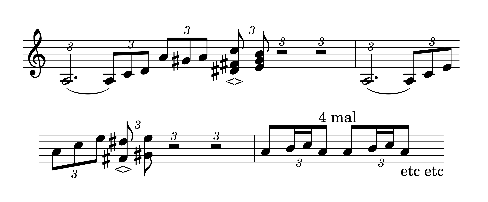

That would be the end of a theme that I do not know. It occurred to me today as I was thinking about my work in philosophy & said to myself: “I destroy, I destroy, I destroy –”

### [25r\[2\]](https://cdn.wittgensteinnachlass.com/2000px/webp/Ms-154/25r.webp),[25v\[1\]](https://cdn.wittgensteinnachlass.com/2000px/webp/Ms-154/25v.webp)

Frege believed that by giving up the laws of logic we would “bring our thinking into confusion”! If that were so, I would study this confusion; it would be very interesting.

### [VB](/w-vb/#ms-154-25v.2+26r.1) [25v\[2\]](https://cdn.wittgensteinnachlass.com/2000px/webp/Ms-154/25v.webp),[26r\[1\]](https://cdn.wittgensteinnachlass.com/2000px/webp/Ms-154/26r.webp)

It has sometimes been said that the secrecy & furtiveness of the Jews was brought about by the long persecution. This is certainly untrue; on the other hand, it is certain that, despite this persecution, they still exist only because they have a tendency towards this secrecy. As one might say that such-and-such an animal has not yet been exterminated only because it has the possibility or ability to hide itself. I do not of course mean that one should praise this possibility on that account, not at all.

### [VB](/w-vb/#ms-154-26r.2+26v.1) [26r\[2\]](https://cdn.wittgensteinnachlass.com/2000px/webp/Ms-154/26r.webp),[26v\[1\]](https://cdn.wittgensteinnachlass.com/2000px/webp/Ms-154/26v.webp)

Bruckner’s music no longer has anything of the long & narrow (northern?) face of Nestroy, Grillparzer, Haydn etc., but has altogether a round, full (Alpine?) face, of an even less mixed type than Schubert’s was.

### [VB](/w-vb/#ms-154-26v.2+27r.1) [26v\[2\]](https://cdn.wittgensteinnachlass.com/2000px/webp/Ms-154/26v.webp),[27r\[1\]](https://cdn.wittgensteinnachlass.com/2000px/webp/Ms-154/27r.webp)

The levelling power of language, which shows itself most starkly in the _dictionary_ & made it possible for _time_ to be personified, which is no less curious than it would be if we had deities of the logical constants.

### [27r\[2\]](https://cdn.wittgensteinnachlass.com/2000px/webp/Ms-154/27r.webp)

a b c d

In the logical sense of the word possible, the inference from esse ad posse is no more justified than that from non esse ad posse.

### [27r\[3\]](https://cdn.wittgensteinnachlass.com/2000px/webp/Ms-154/27r.webp)

Arrange one’s way of acting on the assumption that things will always continue in this way.

### [27r\[4\]](https://cdn.wittgensteinnachlass.com/2000px/webp/Ms-154/27r.webp),[27v\[1\]](https://cdn.wittgensteinnachlass.com/2000px/webp/Ms-154/27v.webp)

Believe, expect, hope that things will always continue in this way.

### [27v\[2\]](https://cdn.wittgensteinnachlass.com/2000px/webp/Ms-154/27v.webp)

<s> If we want to say that infinity is a property of possibility, not of reality, or that the word “infinite” always belongs with the word “possible”, and the like, this amounts to saying that the word “infinite” is always part of a **rule**, not of an empirical proposition. </s>

### [27v\[3\]](https://cdn.wittgensteinnachlass.com/2000px/webp/Ms-154/27v.webp),[28r\[1\]](https://cdn.wittgensteinnachlass.com/2000px/webp/Ms-154/28r.webp)

<s> One can say: I am making preparations for the next 3 days, or 10 years, etc., and also “I am making preparations for an indefinite time”, but not “for an infinite time”. </s>

### [28r\[2\]](https://cdn.wittgensteinnachlass.com/2000px/webp/Ms-154/28r.webp)

<s> But if I “make preparations for an indefinite time”, then a period can be found (afterwards) for which I am certainly no longer making preparations. </s>

### [28r\[3\]](https://cdn.wittgensteinnachlass.com/2000px/webp/Ms-154/28r.webp)

<s> I.e. the proposition “I am making preparations for an indefinite time” does not entail every arbitrary proposition “I am making preparations for an indefinite number of years”. </s>

### [28v\[1\]](https://cdn.wittgensteinnachlass.com/2000px/webp/Ms-154/28v.webp)

<s> To say that every arbitrary proposition (∃ux) φx follows from the infinite hypothesis (u) ∙ (∃ux) φx, as I shall now write it merely for the sake of brevity, and that it itself follows from none of these propositions, of course says nothing at all yet about the further use of this game. </s>

### [28v\[2\]](https://cdn.wittgensteinnachlass.com/2000px/webp/Ms-154/28v.webp)

<s> Think, indeed, of the proposition: I surmise that this will always go on like this. </s>

### [28v\[3\]](https://cdn.wittgensteinnachlass.com/2000px/webp/Ms-154/28v.webp),[29r\[1\]](https://cdn.wittgensteinnachlass.com/2000px/webp/Ms-154/29r.webp)

<s> The odd sound of the refutation: You said the clock would always go on like this, and it has already stopped.

We feel that any finite prediction that was too long would also of course be refuted by the fact, and that the refutation is therefore in some sense incommensurable with the assertion.

For it is nonsense to say: “it did not go on infinitely, but stopped after ten years”, or, still more oddly: “but stopped **already** after ten years”. </s>

### [29r\[2\]](https://cdn.wittgensteinnachlass.com/2000px/webp/Ms-154/29r.webp),[29v\[1\]](https://cdn.wittgensteinnachlass.com/2000px/webp/Ms-154/29v.webp)

<s> How strange it would be to say: it takes great daring to predict something for 100 years; but what daring must it take to predict something for infinite time, as Newton did in the law of inertia! </s>

### [29v\[2\]](https://cdn.wittgensteinnachlass.com/2000px/webp/Ms-154/29v.webp)

<s> “I believe this will always go on like this.” “Is it not enough if you say you believe it will go on like this for another 100000 years?” – “Yes, that will do too.” </s>

### [30r\[1\]](https://cdn.wittgensteinnachlass.com/2000px/webp/Ms-154/30r.webp)

<s> “For all practical purposes” it is enough to say, “I believe it will last for … years.” </s>

### [30r\[2\]](https://cdn.wittgensteinnachlass.com/2000px/webp/Ms-154/30r.webp),[30v\[1\]](https://cdn.wittgensteinnachlass.com/2000px/webp/Ms-154/30v.webp)

<s> For we must ask: can there be grounds for this belief? What are they? What are the grounds for assuming that the clock will go on for another 10000 years, what are the grounds for assuming that it will go on for another 100000 years – and what now are the grounds for the infinite assumption?!

That is precisely what makes the proposition “I surmise that it will always go on like this” so odd, because we want to ask: why do you surmise that? For what we want to say is that it is senseless to surmise this, because it is senseless to speak of grounds for such a surmise. </s>

### [30v\[2\]](https://cdn.wittgensteinnachlass.com/2000px/webp/Ms-154/30v.webp),[31r\[1\]](https://cdn.wittgensteinnachlass.com/2000px/webp/Ms-154/31r.webp),[31v\[1\]](https://cdn.wittgensteinnachlass.com/2000px/webp/Ms-154/31v.webp)

<s> Think of the proposition “this comet will move in a parabola with the equation …”. How is this proposition used? It cannot be verified (i.e. **we** have made no provision for its verification. Of course that does not mean that one cannot say it is true, for “p is true” says only “p”). It may lead us to make certain experiments and observations. But a finite prediction would always have done for those too. (And its relation to such a prediction is rather like that between giving a round number and giving the error limits of a date.)

It will also determine certain actions; e.g. it will then prevent us from looking for the comet there and there. But a finite statement would have sufficed for that too.

The infinity of the assumption consists not in its **size**, but in its open-endedness.

</s>

### [31v\[2\]](https://cdn.wittgensteinnachlass.com/2000px/webp/Ms-154/31v.webp)

Different forms of disturbance of the understanding are calmed by different means (indeed, we call them all problems and speak of searching for and finding their solution).

Some by explanations, some by similes, some by simplifications.

### [32r\[1\]](https://cdn.wittgensteinnachlass.com/2000px/webp/Ms-154/32r.webp),[32v\[1\]](https://cdn.wittgensteinnachlass.com/2000px/webp/Ms-154/32v.webp)

<s> When one speaks of the concept “infinity”, one must remember that this word has an innumerable number of different meanings, and which one we are speaking of just now. Whether, for example, of the infinity of the series of numbers and of the cardinal numbers in particular. Thus, when I say that “infinite” is a characteristic of a rule or of possibility and not of reality, I am referring to **one** particular meaning of the word. We could, for example, quite well say that a continuous transition in colour is a transition through infinitely many stages, provided we know that here we are newly defining the meaning of the word “infinitely many” through the experience of the transition in colour (albeit by analogy with an earlier use of the word ‘infinite’).

Another example: straight lines meet at infinity when they are parallel, or the ruler has an infinite degree of curvature. </s>

### [32v\[2\]](https://cdn.wittgensteinnachlass.com/2000px/webp/Ms-154/32v.webp),[33r\[1\]](https://cdn.wittgensteinnachlass.com/2000px/webp/Ms-154/33r.webp)

<s> (The peculiar relief that occurs when we set other similar cases alongside a case we thought unique occurs again and again in our investigation when we **show** that a word has not merely one, not merely two meanings, but is used in 5 or 6 different meanings.)

</s>

### [33r\[2\]](https://cdn.wittgensteinnachlass.com/2000px/webp/Ms-154/33r.webp),[33v\[1\]](https://cdn.wittgensteinnachlass.com/2000px/webp/Ms-154/33v.webp),[34r\[1\]](https://cdn.wittgensteinnachlass.com/2000px/webp/Ms-154/34r.webp)

<s>

Why are we tempted to relegate the word “infinite” entirely to the rules? And why does it feel uncomfortable when it occurs in a hypothesis? But even in the hypothesis, I want to say, it stands only for possibility. – What one is resisting is of course the use of “infinite” as a numeral. But what has that to do with reality and possibility? Well, the use of “∞” together with the numbers takes place in such a way that ∞ is the ‘**permission**’ and the numbers are the execution. We resist the conception of the infinite as an enormous magnitude. (Which, strangely enough, we grasp without difficulty, whereas a large finite number may be too large to write down. As though, although we could not work our way through the series of numbers, we could nevertheless reach the infinite by going round the outside.) </s>

### [34r\[2\]](https://cdn.wittgensteinnachlass.com/2000px/webp/Ms-154/34r.webp),[34v\[1\]](https://cdn.wittgensteinnachlass.com/2000px/webp/Ms-154/34v.webp)

<s> Let us imagine telling someone: “Yesterday I bought myself a ruler with an infinite radius of curvature.” (Ah, you mean it was straight – yes, I understand that.) But here the word “infinite” occurs in an empirical proposition. – But I can never have the experience that would entitle me to say that the ruler really has an infinite radius, since a radius of 100¹⁰⁰ km will already do. Granted, but then I cannot have the experience that entitles me to say that the ruler is straight either, and the words **“straight”** and “infinite” (or, on another occasion, “parallel”) are in the **same** position. </s>

### [35r\[1\]](https://cdn.wittgensteinnachlass.com/2000px/webp/Ms-154/35r.webp)

<s> I mean: if the word “straight”, or “parallel”, or “equal in length”, etc. etc. may occur in an empirical proposition, then so may the word “infinite”. </s>

### [35r\[2\]](https://cdn.wittgensteinnachlass.com/2000px/webp/Ms-154/35r.webp)

<s> And what if I now said: “straight is only possibility, not reality”?

But that would make sense only in so far as – – – </s>

### [35r\[3\]](https://cdn.wittgensteinnachlass.com/2000px/webp/Ms-154/35r.webp),[35v\[1\]](https://cdn.wittgensteinnachlass.com/2000px/webp/Ms-154/35v.webp)

<s> “Only possibility is infinite” means: “infinite” is an addition before “etc.”

Now if I say “this comet moves in a parabola”. </s>

### [35v\[2\]](https://cdn.wittgensteinnachlass.com/2000px/webp/Ms-154/35v.webp)

<s> In so far as “infinite” is an addition to etc., it belongs in a rule, a law. But not necessarily in the grammar! </s>

### [35v\[3\]](https://cdn.wittgensteinnachlass.com/2000px/webp/Ms-154/35v.webp)

<s> It does not belong in experience **insofar** as the experience that corresponds to a law is a **series** of experiences. </s>

### [35v\[4\]](https://cdn.wittgensteinnachlass.com/2000px/webp/Ms-154/35v.webp),[36r\[1\]](https://cdn.wittgensteinnachlass.com/2000px/webp/Ms-154/36r.webp)

<s> “The word ‘infinite’ is only possibility, not reality” is misleading. It points, only in a particular case, to the relation between a law and the experiences that confirm it, or between the rule and the actions that follow it.

The word combats one error, but also suggests one. One can say: “infinite is **here** only possibility”. And one rightly asks: what is infinite about this hypothesis? Is there anything enormously large about this assumption, this thought?! </s>

### [36v\[2\]](https://cdn.wittgensteinnachlass.com/2000px/webp/Ms-154/36v.webp)

<s> I am not surprised that the word “inf.” occurring in “etc. ad inf.” occurs nowhere else. For “etc. ad inf.” is, so to speak, not a word. </s>

### [36v\[3\]](https://cdn.wittgensteinnachlass.com/2000px/webp/Ms-154/36v.webp),[37r\[1\]](https://cdn.wittgensteinnachlass.com/2000px/webp/Ms-154/37r.webp),[37v\[1\]](https://cdn.wittgensteinnachlass.com/2000px/webp/Ms-154/37v.webp),[38r\[1\]](https://cdn.wittgensteinnachlass.com/2000px/webp/Ms-154/38r.webp)

<s> Let us imagine that a shop assistant said to us: “You can have any quantity of this”, and suppose that I was allowed to name a number only once. Let us imagine that the fairy in the tale said: “You can have as many gold pieces as you wish, but you may wish only once.” Is her prophecy not fulfilled if I get what I wish for? And was my choice not unrestricted? Would the case not have been different if she had set a limit for me, however far out she had set it? Can I not then say: the freedom she left me was unrestricted, or infinite? And does that not describe a reality? Now if someone says: No, freedom of choice is only a possibility, he here confuses the statement that the fairy left me infinite freedom, which is not a rule of grammar, with the rule that allows me, in accordance with the promise, to name any number. </s>

### [38r\[2\]](https://cdn.wittgensteinnachlass.com/2000px/webp/Ms-154/38r.webp),[38v\[1\]](https://cdn.wittgensteinnachlass.com/2000px/webp/Ms-154/38v.webp),[39r\[1\]](https://cdn.wittgensteinnachlass.com/2000px/webp/Ms-154/39r.webp),[39v\[1\]](https://cdn.wittgensteinnachlass.com/2000px/webp/Ms-154/39v.webp)

<s> One could also put it this way: when one applies the concept of infinity in the description of reality, such descriptions do not speak, for example, of infinitely long rulers, but of rulers with an infinite radius of curvature. And not of infinitely many gold pieces, but of the infinite freedom the fairy leaves me to wish for gold pieces.

When we say: the possibility of forming decimal places in the division

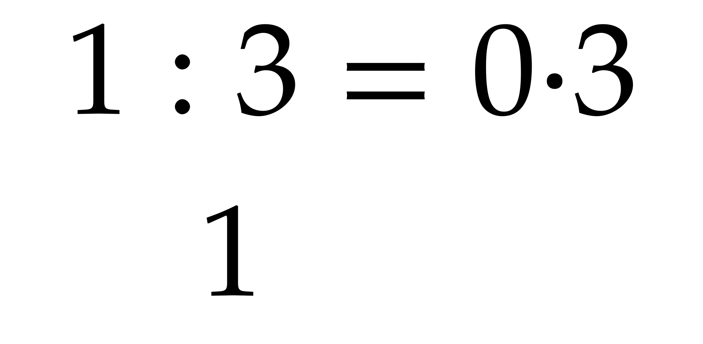

is infinite, we are not establishing a natural fact here, but giving a rule. Likewise when we say: this division never comes to an end. For it actually comes to an end when we stop it. But if I say: “I leave you infinite freedom to form as many places as you wish. I shall not prevent you from doing so”, that is not the laying down of a rule but a prediction in which the word “infinite” occurs. Now someone says, “yes, but only as the description of a possibility, not of a reality”. But I say: no, of a reality, but **of course** not that of infinitely many places; but that is precisely the grammatical error we must avoid. </s>

### [39v\[2\]](https://cdn.wittgensteinnachlass.com/2000px/webp/Ms-154/39v.webp)

<s> If one says that this area of our subject is extraordinarily difficult, that is not true in the sense that we are dealing with things that are difficult to imagine or complicated, but only in the sense that it is extraordinarily difficult to get past the countless traps laid for us here in language.

</s>

### [40r\[1\]](https://cdn.wittgensteinnachlass.com/2000px/webp/Ms-154/40r.webp)

<s> And of course in these empirical propositions “infinite” remains a property of a rule, if one wants to put it that way, and that means nothing other than that here too it can be rendered by “etc. ad inf.”, and at the same time that is all that is meant; infinity is a product of possibility. </s>

### [40r\[2\]](https://cdn.wittgensteinnachlass.com/2000px/webp/Ms-154/40r.webp),[40v\[1\]](https://cdn.wittgensteinnachlass.com/2000px/webp/Ms-154/40v.webp),[41r\[1\]](https://cdn.wittgensteinnachlass.com/2000px/webp/Ms-154/41r.webp)

Must one say that the construction of the 7-gon is impossible? What if it were not so natural to try to make this construction, and one had first known the arithmetical formulation? In mathematics one could think up all sorts of things that would not be possible. It would be more correct to say: there is no analogue, in this series, of the series of constructions with compass and ruler on the one hand and the series of polygons on the other.

This is no different from saying that the division of 2 by 4 is not possible in the system of cardinal numbers, _i.e._ it does not _exist_ there.

### [40r\[2\]](https://cdn.wittgensteinnachlass.com/2000px/webp/Ms-154/40r.webp),[41v\[1\]](https://cdn.wittgensteinnachlass.com/2000px/webp/Ms-154/41v.webp)

The series of n-gon constructions _contains_ no 17-gon. Just as the series of combination numbers does not contain the number 3. Once one has the “strict” concept of an n-gon construction, there are no attempts at constructing the n-gon for it; and before one had it, our concept was a _different_ one. For the mathematical form is the sign of the concept in mathematics. And different forms are different mathematical concepts, even when word-language gives them the same name.

### [41v\[2\]](https://cdn.wittgensteinnachlass.com/2000px/webp/Ms-154/41v.webp),[42r\[1\]](https://cdn.wittgensteinnachlass.com/2000px/webp/Ms-154/42r.webp)

Let us imagine that someone set himself the following problem. I want to invent a game played on a chessboard according to the following conditions. Each side is to have 6 pieces, including equal-ranking pieces which I shall call citizens, and two which I shall call consuls. These two are to be allowed to make somewhat different moves from the citizens. One takes an opponent’s piece by placing one’s own on the opponent’s square. The player who has lost both consuls has lost. The whole thing is to resemble the First Punic War.

Let us imagine that the problem presented itself in the form: How can one win in such a game? That would be a problem-setting entirely analogous to that of mathematics.

### [42r\[2\]](https://cdn.wittgensteinnachlass.com/2000px/webp/Ms-154/42r.webp),[42v\[1\]](https://cdn.wittgensteinnachlass.com/2000px/webp/Ms-154/42v.webp)

<s> One could say:

The proved mathematical proposition has, in its grammar, an overbalance towards truth. For if I say: “If we want to understand its sense, let us ask how it is proved”, there is an error in that: it ought to say: “let us ask whether it or its opposite is proved, and how”. </s>

### [42v\[2\]](https://cdn.wittgensteinnachlass.com/2000px/webp/Ms-154/42v.webp)

If it is now proved, what is the sense of its opposite? I.e. is the analogy between mathematical and other propositions present only where the doubt whether a proposition is true or false takes a particular form, e.g. in propositions of the kind 25 × 25 = 625?

For although

25 × 25 is not 624, 20 × 31˙2 = 624.

### [43r\[1\]](https://cdn.wittgensteinnachlass.com/2000px/webp/Ms-154/43r.webp)

a + (b + c) = (a + b) + c

If I negate this, it makes sense only if I can say something like: It is not

a + (b + c) = (a + b) + c

but = (a + b) + (c + 1)!

What is the space in which I exclude the proposition, and what is around it that is not excluded? Or what is the space in which my proposition draws a boundary? Well, Fermat’s proposition: Is it _so_ and not _how_?

### [43r\[2\]](https://cdn.wittgensteinnachlass.com/2000px/webp/Ms-154/43r.webp),[43v\[1\]](https://cdn.wittgensteinnachlass.com/2000px/webp/Ms-154/43v.webp)

There is something that we call working out 25 × 25, or checking 25 × 25 = 625. Can one now work out a + (b + c) = (a + b) + c? Depending on whether one regards it as calculable or incalculable, it is provable or not. For if it is a rule which every calculation must follow, a paradigm, then it makes no sense to speak of working it out, any more than of working out a definition, say 1 + 1 = 2 Def.

### [43v\[2\]](https://cdn.wittgensteinnachlass.com/2000px/webp/Ms-154/43v.webp),[44r\[1\]](https://cdn.wittgensteinnachlass.com/2000px/webp/Ms-154/44r.webp)

What is essential to the possibility of calculation here is always belonging to the counting system. And _it is important_ that the kinds of arithmetical error avoided by the correct calculation are also given in the system of calculation.

For example, (a + b)² = a² + 2ab + b² is not a³ + 4ab, but (a + b)² = log a would not be a possible arithmetical error in this system.

### [44r\[2\]](https://cdn.wittgensteinnachlass.com/2000px/webp/Ms-154/44r.webp),[44v\[1\]](https://cdn.wittgensteinnachlass.com/2000px/webp/Ms-154/44v.webp)

Insofar as one can represent the impossibility of trisection as a real impossibility by saying, for example, “Don’t try to divide the angle into 3 parts, it’s hopeless!”, to that extent the proof of impossibility does _not_ prove it. That it is _hopeless_ to try it has to do with physical facts.

### [44v\[2\]](https://cdn.wittgensteinnachlass.com/2000px/webp/Ms-154/44v.webp)

a + (b + c) = (a + b) + c

One cannot say “I shall work out _that_ it is so”, but “whether it is so”. That is, whether it is _this_ way or another.

### [44v\[3\]](https://cdn.wittgensteinnachlass.com/2000px/webp/Ms-154/44v.webp),[45r\[1\]](https://cdn.wittgensteinnachlass.com/2000px/webp/Ms-154/45r.webp)

I could also say quite in passing (see other remarks):

“25 × 64 = 160

64 × 25 = 160,

this proves that a × b = b × a” (and this way of speaking is not perhaps ridiculous and wrong; one need only interpret it correctly). And one can correctly infer from it: thus a ∙ b = b ∙ a can be proved in _a certain_ sense.

### [45r\[2\]](https://cdn.wittgensteinnachlass.com/2000px/webp/Ms-154/45r.webp),[45v\[1\]](https://cdn.wittgensteinnachlass.com/2000px/webp/Ms-154/45v.webp)

And what I want to say is that _only_ in the sense in which working out such an example can be called a proof of the algebraic proposition is Skolem’s proof a proof of this proposition. Only in*so*far does it check the algebraic proposition.

### [45v\[2\]](https://cdn.wittgensteinnachlass.com/2000px/webp/Ms-154/45v.webp)

Now one speaks of the proof of the proposition 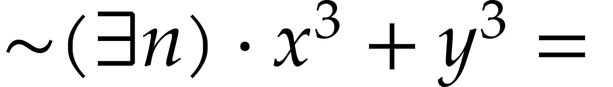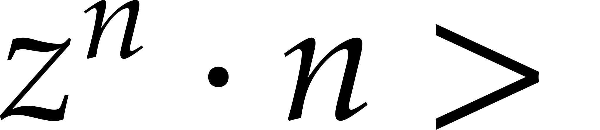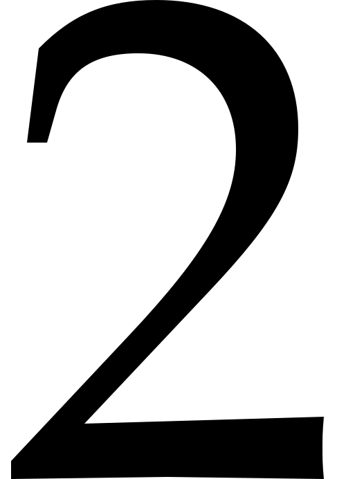. So this is presumably the way in which one works out that it is so.

### [45v\[3\]](https://cdn.wittgensteinnachlass.com/2000px/webp/Ms-154/45v.webp),[46r\[1\]](https://cdn.wittgensteinnachlass.com/2000px/webp/Ms-154/46r.webp)

Philosophy does not examine the calculi of mathematics, but only what mathematicians say about these calculi.

### [46r\[2\]](https://cdn.wittgensteinnachlass.com/2000px/webp/Ms-154/46r.webp)

“I have worked out that there is no number…”

In what system of calculation does this calculation occur? This will show us what system of propositions the proposition obtained by calculation belongs to. (One also asks: “how does one work out _something like that_?”)

### [46r\[3\]](https://cdn.wittgensteinnachlass.com/2000px/webp/Ms-154/46r.webp)

“I have found that there is such a number.”

“I have worked out that there is no such number.”

### [46r\[4\]](https://cdn.wittgensteinnachlass.com/2000px/webp/Ms-154/46r.webp),[46v\[1\]](https://cdn.wittgensteinnachlass.com/2000px/webp/Ms-154/46v.webp),[47r\[1\]](https://cdn.wittgensteinnachlass.com/2000px/webp/Ms-154/47r.webp),[47v\[1\]](https://cdn.wittgensteinnachlass.com/2000px/webp/Ms-154/47v.webp),[48r\[1\]](https://cdn.wittgensteinnachlass.com/2000px/webp/Ms-154/48r.webp),[48v\[1\]](https://cdn.wittgensteinnachlass.com/2000px/webp/Ms-154/48v.webp),[48ar\[1\]](https://cdn.wittgensteinnachlass.com/2000px/webp/Ms-154/48ar.webp),[48av\[1\]](https://cdn.wittgensteinnachlass.com/2000px/webp/Ms-154/48av.webp)

In the first sentence I may not substitute “no” for “a”.

And what if in the second I put “a” in place of “no”? Let us suppose the calculation yields not the proposition ~(∃) etc. but (∃…) etc. Does it then make sense to say: take heart, now you must come across such a number _eventually_, if only you try long enough? _That_ makes sense only if the proof has not yielded (∃…) etc. but has set limits to the trial process, and so has accomplished something quite different. I.e. what we call the proposition “There is a number…”, which helps us to look for such a number, has as its opposite not the proposition ~(∃) … but a proposition saying that in _this_ interval there is no number that …. What is the opposite of what has been proved? One must look at the _proof_. (The opposite of the proposition is what would have been proved by a particular error of calculation.) Now if, for example, the proof that ~ (∃…)… is the case is an induction showing that however far we go, no such number can occur (just as we prove that there is no cardinal number which, when multiplied by 3, gives 7), then the opposite of this proof (let me use this expression for once) is not the proof that there is a number, etc. …. For here it is not as in the case of the proof that none of the numbers a, b, c, d has the property ε, which one always has in mind as a model. Here I might make the mistake of believing that c had the property and, once I had recognized the mistake, I would know that _none_ of the numbers had the property. This is just where the analogy breaks down. (This is connected with the fact that I may not _eo ipso_ use negations of equations in every calculus in which I am allowed to use equations.) For 3 × 3 ≠ 7 does not simply mean that the equation 3 × 3 = 7 does not occur in my calculus, as 3 × 3 = x does; rather, the negation is an exclusion within a system determined from the outset. I cannot negate a definition in the same sense in which I can negate an equation derived according to rules. It makes no sense to speak of a proof of the opposite of 28 × 15 = 618, since there is no such proof _eo ipso_, but one can speak of the proof of the opposite of an analogous proposition in the same system (i.e. a proposition which we regard as analogous in the same system, thereby giving the first proposition the character of a proposition). And comparison between mathematical propositions and what we otherwise call propositions is possible only so long as we can speak, in this sense, of negations and proofs of the opposite proposition. This means: the mathematical criterion for whether a proposition is correct or incorrect cannot relate to this proposition alone, but to the system to which it belongs.

I must therefore derive what the opposite of a proposition is from the rules of calculation, which specify when a proposition of a particular kind (of a system) is proved and when its opposite is proved. Here the opposite can be spoken of only _generally_. – In this sense, the rules of multiplication tell us when a proposition a × b = c and when its opposite is to be regarded as proved. But how is it in the case of the proof that there is no n for which n × 3 = 7 ∙ n > 3?

### [48av\[2\]](https://cdn.wittgensteinnachlass.com/2000px/webp/Ms-154/48av.webp),[49r\[1\]](https://cdn.wittgensteinnachlass.com/2000px/webp/Ms-154/49r.webp)

The existence proof (in our sense) is evidently the proof of the existence of a number in interval I. For if one says that the interval is not essential, since another would have done just as well, that of course does not mean that the absence of an interval specification would have done just as well. The proof of non-existence, then, does not stand to the proof of existence as a proof of p stands to the proof of its opposite.

### [49r\[2\]](https://cdn.wittgensteinnachlass.com/2000px/webp/Ms-154/49r.webp),[49v\[1\]](https://cdn.wittgensteinnachlass.com/2000px/webp/Ms-154/49v.webp)

One would think that a negation could creep into the proof of the opposite of (∃– – –), which would mistakenly prove ~(∃x). Let us, conversely, start from the proofs and suppose that they had originally been shown to us and that we had then been asked: what do these propositions prove? Would we say that one proves the opposite of the other?

### [49v\[2\]](https://cdn.wittgensteinnachlass.com/2000px/webp/Ms-154/49v.webp),[50r\[1\]](https://cdn.wittgensteinnachlass.com/2000px/webp/Ms-154/50r.webp),[50v\[1\]](https://cdn.wittgensteinnachlass.com/2000px/webp/Ms-154/50v.webp)

I say, for example: I know how to check that 37 × 18 = 426; if 426 comes out in such-and-such a way, the sentence is correct; if another number results in this way, its opposite is true. – Is there now a similar consideration for the proof of the sentence ‘(∃n) etc.’? Here I am making a mistake by confusing the existence-proof in the general case with that of trying in the interval in the particular case. Even if an existence-proof first showed me the interval, existence nevertheless proves the number found (or the numbers found). Look at the proofs and decide _then_ what they prove!

### [51r\[1\]](https://cdn.wittgensteinnachlass.com/2000px/webp/Ms-154/51r.webp),[51v\[1\]](https://cdn.wittgensteinnachlass.com/2000px/webp/Ms-154/51v.webp),[52r\[1\]](https://cdn.wittgensteinnachlass.com/2000px/webp/Ms-154/52r.webp),[52v\[1\]](https://cdn.wittgensteinnachlass.com/2000px/webp/Ms-154/52v.webp)

What I said about the infinite divisibility of visual space is based, I think, on a mistake. We must presumably think of the case when we see a line, say the length of an elongated black patch on a white wall. If I now say, for example, that it can be divided in half, my sentence refers directly to the patch before me. If it disappears, it is senseless to say that it could be divided in half, for the word ‘it’ has no meaning without it; the patch itself is part of my symbol. But the sentence ‘it can be divided into 2 parts’ ought to mean ‘it makes sense – whether true or false – to say of it that it _is_ divided’. Now how can this be said here? If the patch itself belongs to the symbol, it cannot be said. It is different if it merely indicates its location. It makes sense to say: Where you now see the black patch you will presently see a two-coloured one. There is a particular phenomenon, the change in the colour of a patch in the visual field while its form is retained. Does it now make _sense_ in every case to predict such a division into two? And what does that depend on? Perhaps on whether I can ‘imagine it’?? For in certain cases I shall presumably say: that is impossible. For example, if I were told that I would see a fixed star half red and half yellow.

(Remember here the language-games with green & red lanterns and the sense of true and false.)

### [52v\[2\]](https://cdn.wittgensteinnachlass.com/2000px/webp/Ms-154/52v.webp),[53r\[1\]](https://cdn.wittgensteinnachlass.com/2000px/webp/Ms-154/53r.webp),[53v\[1\]](https://cdn.wittgensteinnachlass.com/2000px/webp/Ms-154/53v.webp)

∣ ∣

Does it make sense to say: I would not have believed that this line could still be divided?

How do you know that after the division it is still this line? And here too there is a very typical case of uncertainty. If one now wanted to say ‘what do you mean by saying that you will see this strip half red and half white’. How would I have to explain what I mean, that is, the grammar? Here a mental image can undoubtedly enter my symbolism. But I could also explain the matter by placing a two-coloured strip beside my

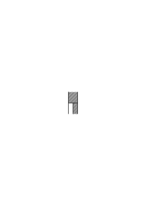

single-coloured strip, etc. One also says ‘that is not how I imagined it’, ‘that is not what I meant’.

The image is precisely a sample, a part of the language.

### [53v\[2\]](https://cdn.wittgensteinnachlass.com/2000px/webp/Ms-154/53v.webp),[54r\[1\]](https://cdn.wittgensteinnachlass.com/2000px/webp/Ms-154/54r.webp)

When one says that the line in visual space is infinitely divisible, one means something analogous to saying that a patch can occupy infinitely many positions in visual space, which only means that no number of positions is determined in any sense.

---

### [54r\[2\]](https://cdn.wittgensteinnachlass.com/2000px/webp/Ms-154/54r.webp)

A check is a method that one can apply independently of whether the sentence is true or false. ‘We shall calculate that in a moment.’

### [54r\[3\]](https://cdn.wittgensteinnachlass.com/2000px/webp/Ms-154/54r.webp),[54v\[1\]](https://cdn.wittgensteinnachlass.com/2000px/webp/Ms-154/54v.webp)

I can describe the method of checking. If I now wanted to describe it for a particular case, I could not say: if 25 × 628 gives this, then … if it gives 624, then …. For I cannot of course describe the case in which it does not give 628; that means nothing. My description, on the other hand, is general & reads: if it gives a + b c as in … then …; if it does not give c as in … then …. I can describe the case in which a multiplication does not yield a number, but not the case in which 25 × 25 does not yield 125.

### [55r\[1\]](https://cdn.wittgensteinnachlass.com/2000px/webp/Ms-154/55r.webp),[55v\[1\]](https://cdn.wittgensteinnachlass.com/2000px/webp/Ms-154/55v.webp)

This is how I describe the checking of divisibility (etc.). If the number is divisible by 8, then …; not ‘if 128 is divisible by 8, then …’. Thus there is a check for the sentences (∃x) etc. & ~(∃x) when finite classes of numbers are involved. Now consider the question: ‘Does the equation x² + ax + b = 0 have a real solution?’ Here again there is a check, and the check distinguishes between the cases (∃) etc. & ~(∃) etc.

But can I also ask and check in the same sense whether the equation has a solution, unless I again bring this case together with others, into a system?

### [55v\[2\]](https://cdn.wittgensteinnachlass.com/2000px/webp/Ms-154/55v.webp)

The sentence that this proof is recursive is a sentence of mathematics in quite a different sense from one that permits a check.

### [55v\[3\]](https://cdn.wittgensteinnachlass.com/2000px/webp/Ms-154/55v.webp),[56r\[1\]](https://cdn.wittgensteinnachlass.com/2000px/webp/Ms-154/56r.webp)

In the first case the proof answers a question & the two alternatives of the question can of course be described.

### [56r\[2\]](https://cdn.wittgensteinnachlass.com/2000px/webp/Ms-154/56r.webp)

_[unreadable]_

I can of course ask ‘is 25 × 25 625 or not’; but the question immediately follows: How will you find that out? And the answer to that is the description of the general method of checking.

### [56r\[3\]](https://cdn.wittgensteinnachlass.com/2000px/webp/Ms-154/56r.webp)

In reality the ‘proof of the fundamental theorem’ creates a new kind of number.

### [56r\[4\]](https://cdn.wittgensteinnachlass.com/2000px/webp/Ms-154/56r.webp),[56v\[1\]](https://cdn.wittgensteinnachlass.com/2000px/webp/Ms-154/56v.webp)

The philosophy of mathematics consists in an extremely detailed working-through of mathematical proofs (not in surrounding mathematics with a cloud of haze).

### [56v\[2\]](https://cdn.wittgensteinnachlass.com/2000px/webp/Ms-154/56v.webp),[57r\[1\]](https://cdn.wittgensteinnachlass.com/2000px/webp/Ms-154/57r.webp)

The question is always: what does the description of the opposite consist in, what does it rest on, on which examples, & how are these examples related to a particular case. This is not perhaps incidental but absolutely essential. ‘Every equation has a root’ & what if it has none? Can we describe this case as we can the case in which it has no rational solution?

### [57r\[2\]](https://cdn.wittgensteinnachlass.com/2000px/webp/Ms-154/57r.webp),[57v\[1\]](https://cdn.wittgensteinnachlass.com/2000px/webp/Ms-154/57v.webp),[58r\[1\]](https://cdn.wittgensteinnachlass.com/2000px/webp/Ms-154/58r.webp)

Let us look at an inductive proof, say that of the sentence that no number greater than 1, when multiplied by 3, yields 5:

3 × 2 = 5 + 1

3 × a = 5 + b

3 × (a + 1) = (5 + (b + 3))

3 × (a + 1) = (3 × a) + 3 = (5 + b) + 3 = 5 + (b + 3)

What can be negated in this proof & by what modification is the opposite proved? Obviously only by modifying the first sentence.

So if a calculation-error was made in a sentence, correcting this error can prove the opposite of what ought to have been proved. On the other hand, no calculation-error in the second equation can turn the proof into its opposite. (Law of excluded middle)

### [58r\[2\]](https://cdn.wittgensteinnachlass.com/2000px/webp/Ms-154/58r.webp),[58v\[1\]](https://cdn.wittgensteinnachlass.com/2000px/webp/Ms-154/58v.webp)

That is, if it is shown to me that I was mistaken in the second equation, I am thereby not in a position to assert the opposite of the sentence ~(∃) etc. Now, one could of course say the same of an error in the calculation 25 × 25 etc., for the fact that an error had been demonstrated would not prove the result false, but only because there might perhaps be a second error; since the calculation is in every case a check on the sentence & if it is completely correct proves the sentence or its opposite.

### [58v\[2\]](https://cdn.wittgensteinnachlass.com/2000px/webp/Ms-154/58v.webp)

The general geometrical proof of the Euclidean kind is what all particular proofs, say for particular triangles, have in common. But it proves it for the triangle … only when this triangle is given.

### [58v\[3\]](https://cdn.wittgensteinnachlass.com/2000px/webp/Ms-154/58v.webp),[59r\[1\]](https://cdn.wittgensteinnachlass.com/2000px/webp/Ms-154/59r.webp)

The inductive proof is the general form of (or for) calculations.

But the opposite of the existence of this form is not, say, possession of a form that contradicts it.

### [59r\[2\]](https://cdn.wittgensteinnachlass.com/2000px/webp/Ms-154/59r.webp)

I should rather say: if the proof of ~(∃– – –) etc. had been supplied & were unique, it would not then be the proof of a sentence either. For then one could ask: What would it be like if it were otherwise? Or: What is the system in which there is room only for the opposite?

### [59v\[1\]](https://cdn.wittgensteinnachlass.com/2000px/webp/Ms-154/59v.webp)

The proof provides for its own opposite through the calculus to which it belongs (or will belong).

### [59v\[2\]](https://cdn.wittgensteinnachlass.com/2000px/webp/Ms-154/59v.webp)

One must bear in mind that the sentence that there is no number which … is not to be understood extensionally but is essentially _what_ the inductive proof shows.

But what does it show? What is its result? It only shows itself.

### [59v\[3\]](https://cdn.wittgensteinnachlass.com/2000px/webp/Ms-154/59v.webp),[60r\[1\]](https://cdn.wittgensteinnachlass.com/2000px/webp/Ms-154/60r.webp)

The inductive proof is, properly understood, what proofs have in common & not itself a proof. And in this respect the general sentence corresponds to it, since from it, just as from the proof, arbitrarily many particular sentences follow. One could also write the inductive proof as a series of proofs with the etc. ad inf. But a series of proofs is not a proof, or only in quite another sense of the word.

### [60v\[1\]](https://cdn.wittgensteinnachlass.com/2000px/webp/Ms-154/60v.webp)

Can one say ‘let us check whether this sentence holds for all n or whether it does not hold for some’?

### [60v\[2\]](https://cdn.wittgensteinnachlass.com/2000px/webp/Ms-154/60v.webp),[61r\[1\]](https://cdn.wittgensteinnachlass.com/2000px/webp/Ms-154/61r.webp)

Suppose someone said: ‘let us check whether f holds for all n’. He now begins & after a few attempts says ‘I can already see that it holds for all’. To this I say: yes, if you meant this by the sentence (x) f(x)! But he has then checked whether he can find an induction; but if he does not find one, he has thereby not found a number that does not satisfy the condition either.

For the check would read: let us see whether an induction can be found or a case for which the law does not hold. But these two are not alternatives. (Law of excluded middle!)

### [61r\[2\]](https://cdn.wittgensteinnachlass.com/2000px/webp/Ms-154/61r.webp),[61v\[1\]](https://cdn.wittgensteinnachlass.com/2000px/webp/Ms-154/61v.webp)

If the law of excluded middle does not hold, that only means that the construction can no longer be compared with a sentence.

### [61v\[2\]](https://cdn.wittgensteinnachlass.com/2000px/webp/Ms-154/61v.webp)

One can perhaps say: if the induction is correct, then I cannot find a number that does not satisfy the conditions, because the induction is the proof of every particular sentence. And conversely, if I have found a value of a such that ~ fn, then the induction can only begin after a.

### [62r\[1\]](https://cdn.wittgensteinnachlass.com/2000px/webp/Ms-154/62r.webp)

The induction is the common form of proofs, each of which would be contradicted by the discovery of a sentence ~fa. That is why I say that it proves a sentence (n) f(n). For the relation between induction & ~fa is now more similar to that between ‘all men are mortal’ & ‘is a man & not mortal’.

### [62r\[2\]](https://cdn.wittgensteinnachlass.com/2000px/webp/Ms-154/62r.webp)

In the case of the proof of 25 × 25 = 625 I say: perhaps I was mistaken & 25 × 25 is not 625.

But in the case of the proof of (n)f(n) in – – –.

### [62v\[1\]](https://cdn.wittgensteinnachlass.com/2000px/webp/Ms-154/62v.webp)

Instead of ‘it holds for all’ I can say ‘it holds for every one you write down’.

& not ‘the induction proves that it holds for all n’ but that every sentence fn that you write down is correct.

Or rather, the induction proves every sentence of the form fn that you write down.

### [62v\[2\]](https://cdn.wittgensteinnachlass.com/2000px/webp/Ms-154/62v.webp)

(n) fn then means: every sentence fn that you give is correct.

### [63r\[1\]](https://cdn.wittgensteinnachlass.com/2000px/webp/Ms-154/63r.webp)

The induction is not a proof but the construction of a series of proofs. Hence, if this construction is not present, none of the sentences is negated whose proofs the induction would have held together.

### [63r\[2\]](https://cdn.wittgensteinnachlass.com/2000px/webp/Ms-154/63r.webp)

One cannot compare the induction with a proof.

### [63r\[3\]](https://cdn.wittgensteinnachlass.com/2000px/webp/Ms-154/63r.webp),[63v\[1\]](https://cdn.wittgensteinnachlass.com/2000px/webp/Ms-154/63v.webp)

I cannot describe the case in which _this_ division comes out evenly & does not come out evenly, but the case in which _a_ division comes out evenly or does not come out evenly <s>& not the case that this equation is soluble only by real & only by imaginary numbers but the case that an equation …</s> <s> And so I would also have to be able to describe the case in which an equation has or has no solution & decide between them by calculation. And the case must be similar for Fermat’s theorem. </s>

### [63v\[2\]](https://cdn.wittgensteinnachlass.com/2000px/webp/Ms-154/63v.webp),[64r\[1\]](https://cdn.wittgensteinnachlass.com/2000px/webp/Ms-154/64r.webp)

‘Does this equation have a solution?’ – What is the sentence-system of this question?

### [64r\[2\]](https://cdn.wittgensteinnachlass.com/2000px/webp/Ms-154/64r.webp),[64v\[1\]](https://cdn.wittgensteinnachlass.com/2000px/webp/Ms-154/64v.webp)

To make the engine of a car run backwards is impossible, or would require the greatest changes, but making the car run backwards requires only a slight movement. So it sometimes appears as though people who do the opposite must be fundamentally opposed & one then often has to say that the opposition is based only in the gearing, in the deeper layers, and that a comparatively slight jolt would reverse the movement here.

### [64v\[2\]](https://cdn.wittgensteinnachlass.com/2000px/webp/Ms-154/64v.webp),[65r\[1\]](https://cdn.wittgensteinnachlass.com/2000px/webp/Ms-154/65r.webp)

How is it that I do not have to prove this sentence (the geometrical or arithmetical one) again for every case?! But you do, namely by writing down the sentence, since the rest is only what all proofs of such sentences have in common. (You have to prove the sentence again for each triangle, for it is only proved for a triangle when this triangle has been drawn.

### [65r\[2\]](https://cdn.wittgensteinnachlass.com/2000px/webp/Ms-154/65r.webp),[65v\[1\]](https://cdn.wittgensteinnachlass.com/2000px/webp/Ms-154/65v.webp),[66r\[1\]](https://cdn.wittgensteinnachlass.com/2000px/webp/Ms-154/66r.webp)

(Why do I call this proof (the induction) the proof that (n)~f(n)?! Well, don’t you see that if the proposition holds for 2, it also holds for 3 & then for 4 & that it always goes on like this? (What am I explaining to the person to whom I explain how the inductive proof works?) So you call it a proof of ‘f2 ∙ f3 ∙ f4 etc.’, but shouldn’t you say that it is the form of the proofs of 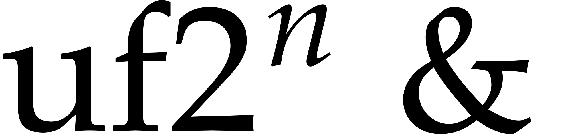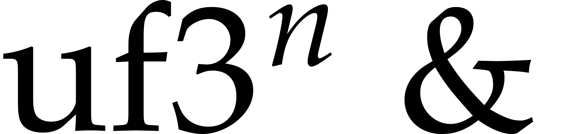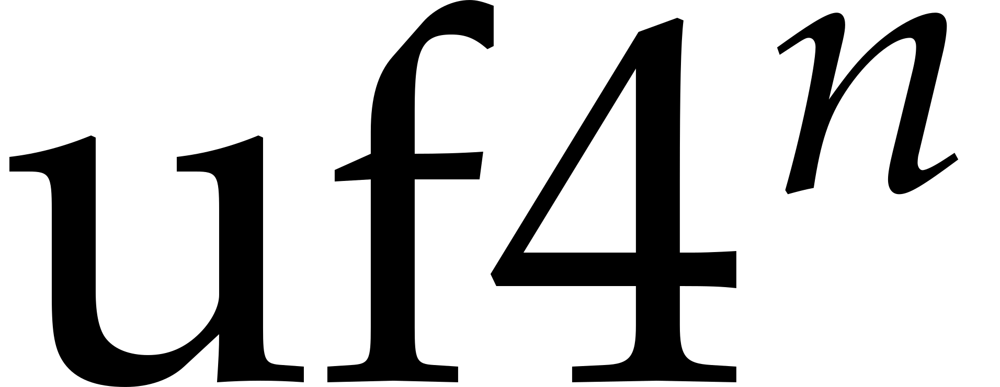 etc.? Or does that amount to one and the same thing? Now, if I call the induction the proof of a sentence, I may do so only if that is to mean nothing other than that it proves every sentence of a certain form. (And my expression makes use of an analogy.) But when I say I [unreadable] the proof of (n)fn, the analogy leads me to think

### [66r\[2\]](https://cdn.wittgensteinnachlass.com/2000px/webp/Ms-154/66r.webp),[66v\[1\]](https://cdn.wittgensteinnachlass.com/2000px/webp/Ms-154/66v.webp),[67r\[1\]](https://cdn.wittgensteinnachlass.com/2000px/webp/Ms-154/67r.webp),[67v\[1\]](https://cdn.wittgensteinnachlass.com/2000px/webp/Ms-154/67v.webp),[68r\[1\]](https://cdn.wittgensteinnachlass.com/2000px/webp/Ms-154/68r.webp),[68v\[1\]](https://cdn.wittgensteinnachlass.com/2000px/webp/Ms-154/68v.webp)

that it must make sense to say that the induction proves that this, and not the opposite, is the case. But what would the opposite be? Well, that (∃n)fn is the case. Here I combine two concepts: one that I derive from my present concept of the proof from the concept n & another taken from the analogy with (∃x)fx. (For you must bear in mind that the sentence (n)fn is nonsensical as long as I have no criterion of its truth & then has only the sense this criterion gives it. For before I had this criterion I could, say, have been on the lookout for an analogy with (x)fx, but only once I had it did I have the sense of (n)f(n).) What is the opposite of what the inductionist proves? What is the opposite of what the proof of (a + b)² = a² + 2ab + b² proves – or, for that matter, what is the opposite of this equation – e.g. (a + b)² = a² + 3ab + b², a sentence refuted by the one proved. Which sentence is now refuted by the induction? – Every sentence of the form ~f(n). The proof a + b² etc. works out that a + b² = a² + 2ab + b² & not = a² + 3ab + b² etc. If one now asks analogously what the inductive proof works out, one must say that it works out that 3 × 2 = 5 + 1 and, for example, not 3 × 1 = 6 + 1.

We learn that a + … = – – – & not … but this opposite does not correspond to the sentence (∃) φx. But does the induction not work out f2? No, for it does so only when f(2) is written down. And when it has been written down, ~f(2) is an opposite of the sentence worked out, but not (∃n)~fn, or only if that is to mean that every sentence of the form ~fn is opposed to the induction. One can simply ask: How do I use the expression ‘the sentence (∃n)fn’ correctly, what is its grammar? The mathematician must shudder at my mathematical discussions, for his training has always discouraged him from giving himself over to thoughts & doubts of the kind I bring to light. He has learnt to regard them as something contemptible & has, to use one of the analogies from psychoanalysis, acquired a disgust for these things, as for something infantile. That is, I bring to light all those problems that, say, a boy feels as difficulties when learning mathematics & that he has to suppress in order to move on unhindered. So I say to these suppressed doubts: you are quite right, go ahead and ask & demand clarification.

### [68v\[2\]](https://cdn.wittgensteinnachlass.com/2000px/webp/Ms-154/68v.webp),[69r\[1\]](https://cdn.wittgensteinnachlass.com/2000px/webp/Ms-154/69r.webp)

It would make no sense to say ~ ((a + b)² = a² + 3ab + b²) if this had not expressly been permitted as a sentence, or 25 × 25 ≠ 620 if this sentence had not expressly been incorporated into the calculus<s> had.</s> <s>(In elementary school one does not calculate with such sentences but dismisses false equations such as 25 × 25 = 620 as not belonging to the game.) </s>

### [69r\[2\]](https://cdn.wittgensteinnachlass.com/2000px/webp/Ms-154/69r.webp)

The fact that I use this expression in certain connections does not entail that I use it in everything analogously to the expression ‘the sentence (∃x)fx’.

### [69r\[3\]](https://cdn.wittgensteinnachlass.com/2000px/webp/Ms-154/69r.webp),[69v\[1\]](https://cdn.wittgensteinnachlass.com/2000px/webp/Ms-154/69v.webp)

If we look once more at the analogy of the ‘inductive proof’ with the other proofs, the following emerges: there is a series of proofs 3 × 2 = 5 + 1 3 × 2 > 5

3 × (2 + 1) = (3 × 2) + 3 = (5 + 1) + 3 = 5 + (1 + 3) 3x

3 × (2 + 2) = (3 × (2 + 1)) + 3 = (5 + (1 + 3)) + 3 = 5 + (1 + 3 + 3)

Each of these proofs is of the kind of the proof of 25 × 25 = 625 or, say, 25 × 25 = 125 × 5. They end in sentences that we check according to the rules. [unreadable] These proofs now form a particular _pattern_ (which can be made visible, for example, by underlining & connecting lines).

### [69v\[2\]](https://cdn.wittgensteinnachlass.com/2000px/webp/Ms-154/69v.webp),[70r\[1\]](https://cdn.wittgensteinnachlass.com/2000px/webp/Ms-154/70r.webp)

And I can now abbreviate the proofs by writing, for example, instead of the 2nd equation 0'(3 × 2 = 5 + 1), instead of the second 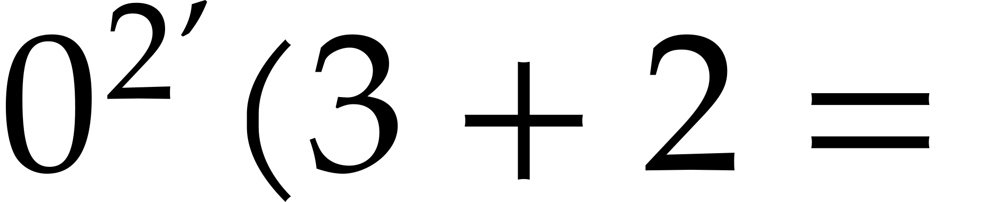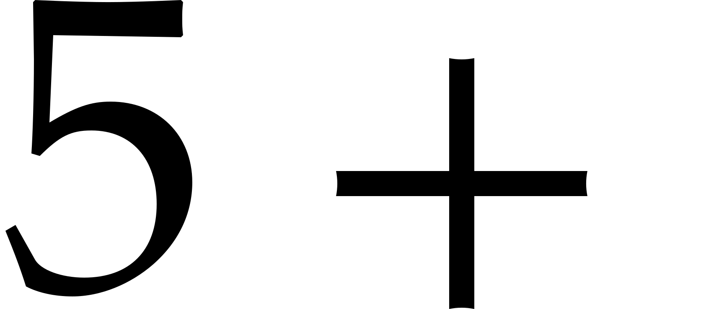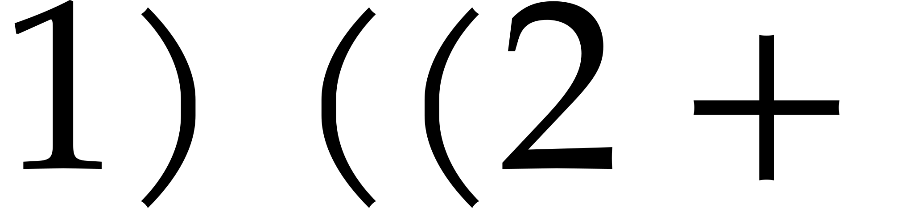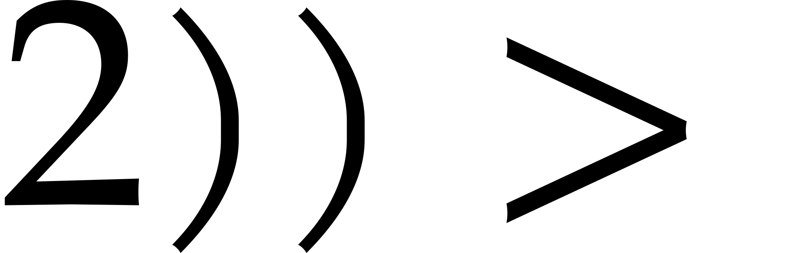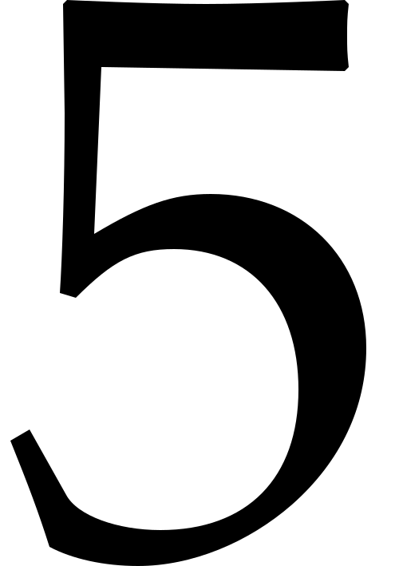 etc.

### [70r\[3\]](https://cdn.wittgensteinnachlass.com/2000px/webp/Ms-154/70r.webp),[70v\[1\]](https://cdn.wittgensteinnachlass.com/2000px/webp/Ms-154/70v.webp),[71r\[1\]](https://cdn.wittgensteinnachlass.com/2000px/webp/Ms-154/71r.webp)

At the end each of these proofs becomes nothing more than the sentence proved, which contains, as it were, the index & the general form. Proving then consists only in recognizing the given sentence as a case of the form that connects the two.

We look, say, at the sentence & say: Yes, the left-hand side is of the kind of this left-hand side; so the right-hand side ought now to be _this_, and it is. Each of these proofs checks a question answered by sentences. But now one says that the general proof-form is the proof of a general sentence. This is supposed to mean that it is the proof-form for the sentences f2, f3, f4 _etc._ ad inf. But if one expresses oneself in this way, one cannot say: I shall check whether the general sentence is correct or incorrect. For no general method for checking this sentence as part of a sentence-system has been given.

### [71r\[2\]](https://cdn.wittgensteinnachlass.com/2000px/webp/Ms-154/71r.webp),[71v\[1\]](https://cdn.wittgensteinnachlass.com/2000px/webp/Ms-154/71v.webp)

If there is a check here, it is always [unreadable] whether all n have this or that property, but not whether all have it or some do not have it. We then have a system of inductions & calculate, for example, that all equations of the class have a rational solution, whereas those of class 5 etc. do not.

### [71v\[2\]](https://cdn.wittgensteinnachlass.com/2000px/webp/Ms-154/71v.webp),[72r\[1\]](https://cdn.wittgensteinnachlass.com/2000px/webp/Ms-154/72r.webp)

Hence we find it strange when we are told that induction proves the general proposition, since we rightly feel that in terms of induction we could not have asked the general question at all. Since we were not initially presented with an alternative (or only seemed to be so long as we had an extensive conception of all numbers?).

### [72r\[2\]](https://cdn.wittgensteinnachlass.com/2000px/webp/Ms-154/72r.webp)

The question of generality had not yet had any sense before the proof, so it was not a question either, for it would have had sense only if a general method was known _before_ the particular proof was known.

### [72r\[3\]](https://cdn.wittgensteinnachlass.com/2000px/webp/Ms-154/72r.webp),[72v\[1\]](https://cdn.wittgensteinnachlass.com/2000px/webp/Ms-154/72v.webp),[73r\[1\]](https://cdn.wittgensteinnachlass.com/2000px/webp/Ms-154/73r.webp),[73v\[1\]](https://cdn.wittgensteinnachlass.com/2000px/webp/Ms-154/73v.webp)

Suppose that people had been arguing about whether the division 1 : 3 yielded nothing but threes.

Suddenly one of them notices the inductive relation in the division 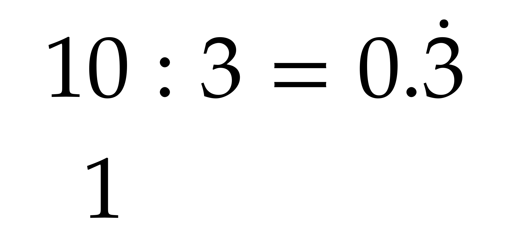 & says: ‘I know how it is: nothing but 3s will come, you see, etc.’ But in their argument the others had not thought at all of this kind of decision; an extensive decision had been in their minds. If they now continue to think in terms of an extension, the person who found the induction has indeed proved that nothing but 3s will follow, for the induction proves this for every extension. But if they give up this idea, the question now becomes a different one [unreadable]: does an induction arise in these cases, and here that means: does the remainder remain equal to the dividend? & this can be decided. But the question has now completely changed its character & the old extensive mode of expression is now extremely misleading.

### [73v\[2\]](https://cdn.wittgensteinnachlass.com/2000px/webp/Ms-154/73v.webp),[74r\[1\]](https://cdn.wittgensteinnachlass.com/2000px/webp/Ms-154/74r.webp)

The expression d, a, a, etc. is no more inexact an expression than that of the general term. For this too relies on knowledge of the number series & this cannot be conveyed by a general term such as _n_! Rather, n is essentially the independent variable. And how does the series

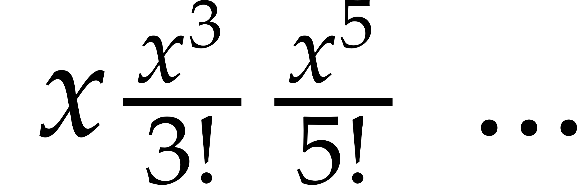 … differ from ∣ ∣∣ ∣∣∣ …?

Today we write the form of the odd numbers as 2n + 1

but the form of the cardinal numbers could be written 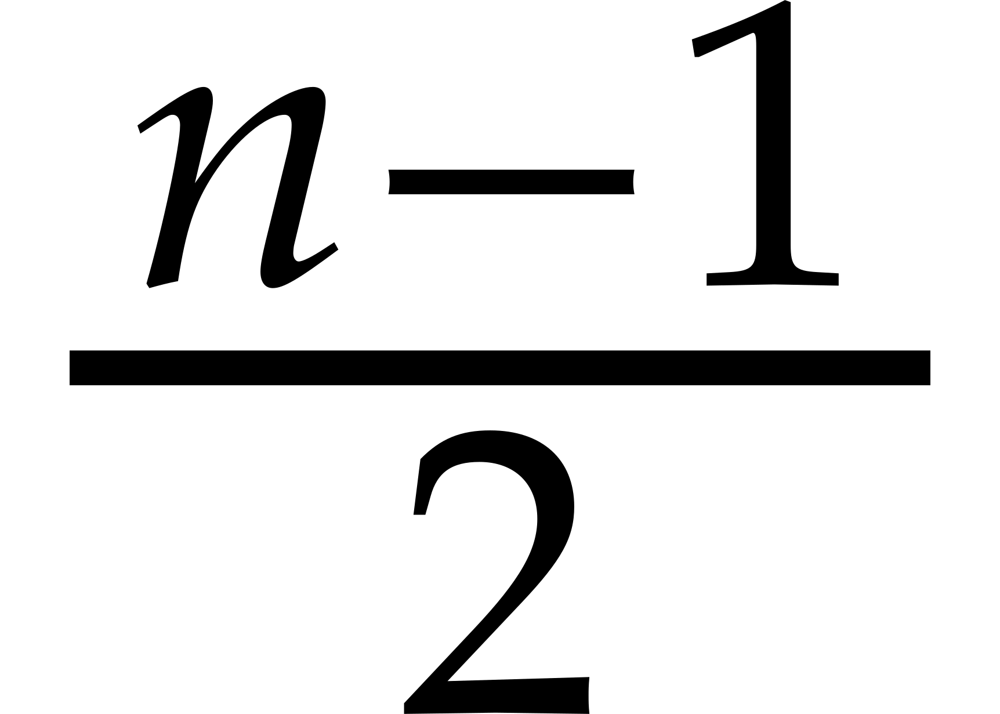 where n runs through the series of odd numbers.

### [74r\[2\]](https://cdn.wittgensteinnachlass.com/2000px/webp/Ms-154/74r.webp),[74v\[1\]](https://cdn.wittgensteinnachlass.com/2000px/webp/Ms-154/74v.webp),[75r\[1\]](https://cdn.wittgensteinnachlass.com/2000px/webp/Ms-154/75r.webp)

In the world of Euclid’s Elements I can no more ask about the trisection than I can look for it. It is simply not spoken of. It must read: In the domain of ruler-and-compass the trisection is not there. I cannot speak of it in the language of ruler-and-compass because there is no such expression there, but only where the concepts trisection & ruler-and-compass are separate. Trisection with ruler and compass is not a construction which I, so to speak, ban, but rather it is a description to which nothing corresponds. It does not mean that trisection with ruler and compass is impossible, as if I said it were forbidden; rather, I want to say that trisection occurs in such-and-such a neighbourhood of ruler-and-compass geometry.

### [75r\[2\]](https://cdn.wittgensteinnachlass.com/2000px/webp/Ms-154/75r.webp)

One can ask only in a system in which both trisection and geometry with ruler and compass are present.

### [75r\[3\]](https://cdn.wittgensteinnachlass.com/2000px/webp/Ms-154/75r.webp)

I can ask only once I can ask: _where_ is the trisection?

### [75r\[4\]](https://cdn.wittgensteinnachlass.com/2000px/webp/Ms-154/75r.webp),[75v\[1\]](https://cdn.wittgensteinnachlass.com/2000px/webp/Ms-154/75v.webp),[76r\[1\]](https://cdn.wittgensteinnachlass.com/2000px/webp/Ms-154/76r.webp)

I cannot ask whether 4 occurs among the numbers of combinations if this is my number system. Nor whether ½ occurs among the cardinal numbers, or show that it does not stand among them, except in a system in which both the cardinal number and ½ occur. But then neither can I ask whether 3 occurs among the cardinal numbers. The _calculation_ must have sense. Rather, the question reads something like this: Does the division 4 : 2 give a whole number? & this can only be asked in a system in which giving a whole number & not giving a whole number are known. We cannot work out whether 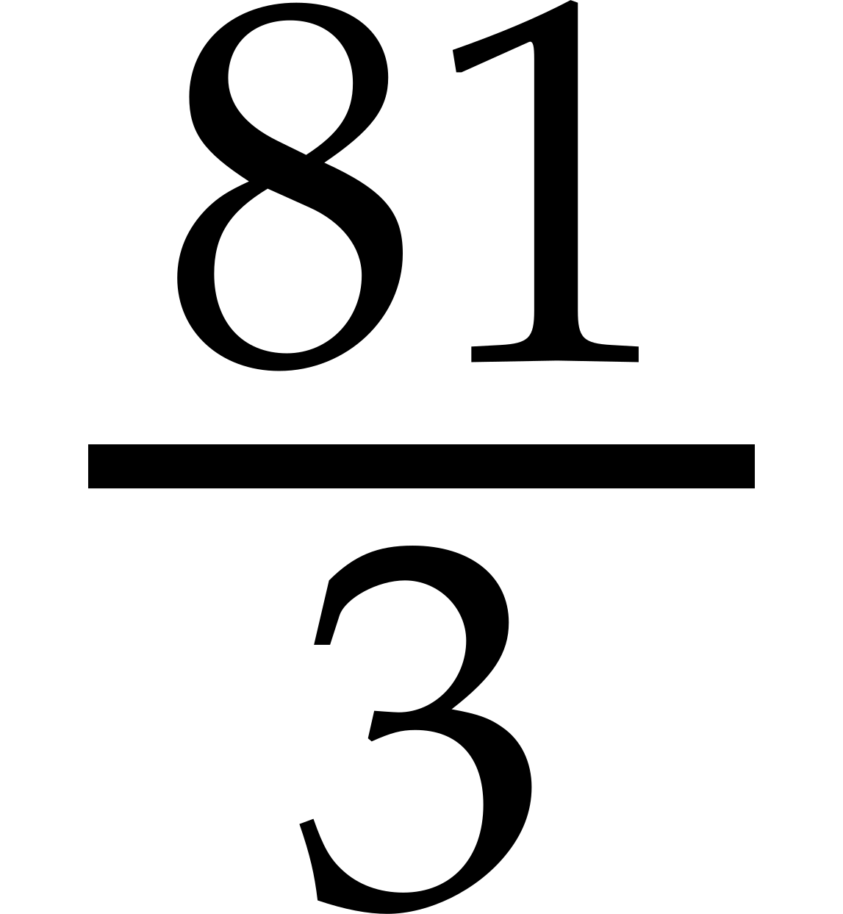 is a cardinal number, but whether the division gives a whole number or not. So if 3 is inserted in the formula which is meant to tell me whether trisection is possible.

### [76r\[2\]](https://cdn.wittgensteinnachlass.com/2000px/webp/Ms-154/76r.webp)

The effect of a false analogy enclosed in the language. It produces constant strain & disquiet (a constant irritation, as it were). It is as when a thing seems from a distance to be something other than it is when viewed from close up; we then say: Ah yes, that is a tree. As soon as we move a little away & lose sight of the explanations, one shape appears to us; when we look more closely at it, we see another; now we move away again, etc. etc.

### [77r\[1\]](https://cdn.wittgensteinnachlass.com/2000px/webp/Ms-154/77r.webp)

Let us imagine that the constructional process described were that of the continued bisection of a line. For a further condition could be attached to the construction with ruler and compass, in the Euclidean manner. One would then ask: is there a trisection of the line in this process? One might designate the series of divisions approximately by the signs 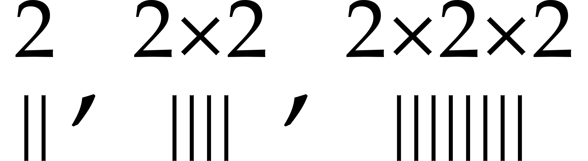 etc. & then ask: Does a 3 occur here? But one would not really have asked about a trisection.

### [77r\[2\]](https://cdn.wittgensteinnachlass.com/2000px/webp/Ms-154/77r.webp),[77v\[1\]](https://cdn.wittgensteinnachlass.com/2000px/webp/Ms-154/77v.webp)

The _problem_ of trisection is not a Euclidean one. (We do not want to speak of solutions in the Euclidean system but of problems in the Euclidean system, i.e. questions which have sense in this language.)

### [77v\[2\]](https://cdn.wittgensteinnachlass.com/2000px/webp/Ms-154/77v.webp),[78r\[1\]](https://cdn.wittgensteinnachlass.com/2000px/webp/Ms-154/78r.webp)

‘Is bisection possible in the Euclidean system?’ How does one approach this question if one does not yet know bisection? As a physical question it is of course possible. For in the system of physical divisions I do have bisection (& also trisection etc.).

The problem then reads: Is there a construction with compass and ruler which divides the physical line, to which the physical angles belong, into equal parts? But the criterion that this is a method of trisection is then also a physical one.

Let us imagine that the compass in our geometry had a constant opening.

### [78v\[1\]](https://cdn.wittgensteinnachlass.com/2000px/webp/Ms-154/78v.webp)

If one asks: is the construction of the trisection of the angle possible, I could answer: What does that mean: is it possible? what is possible? I cannot even describe _it_. And I cannot ask: is bisection possible, for by stating what I am asking about I have already described bisection. (I can of course ask: is physical trisection or bisection possible.)

### [78v\[2\]](https://cdn.wittgensteinnachlass.com/2000px/webp/Ms-154/78v.webp),[79r\[1\]](https://cdn.wittgensteinnachlass.com/2000px/webp/Ms-154/79r.webp)

One can now ask: is this construction a construction of trisection, for example?

?

We might imagine that he saw the construction through a distorting medium & the 3 parts appeared equal to him. And the answer is of course no, this construction does not produce equal parts, for it produces…. – But one cannot ask: ‘How does one divide the angle with ruler & compass into 3 parts?’ nor: ‘is a trisection … possible?’

### [79r\[2\]](https://cdn.wittgensteinnachlass.com/2000px/webp/Ms-154/79r.webp),[79v\[1\]](https://cdn.wittgensteinnachlass.com/2000px/webp/Ms-154/79v.webp),[80r\[1\]](https://cdn.wittgensteinnachlass.com/2000px/webp/Ms-154/80r.webp)

The word ‘possible’ is misleading. It should read: is there a trisection in the Euclidean system. For when one asks whether it is possible one always wants to ask: for whom? –

### [79v\[2\]](https://cdn.wittgensteinnachlass.com/2000px/webp/Ms-154/79v.webp),[80r\[1\]](https://cdn.wittgensteinnachlass.com/2000px/webp/Ms-154/80r.webp)

Is there a trisection of the line in the α system? This can mean: does the number 3 occur among the numbers 2, 2², 2³ …? or is it possible to divide a line into 3 equal parts with this operation. This too can be answered & indeed by an induction. The first question is not really about 3 _parts_, whereas the second is. What kind of questions are these? For the first there is a method of searching. The second question is: is one of the numbers 2, 2², 2³ etc. divisible by 3? An induction will give us the answer of its kind.

### [80v\[1\]](https://cdn.wittgensteinnachlass.com/2000px/webp/Ms-154/80v.webp),[81r\[1\]](https://cdn.wittgensteinnachlass.com/2000px/webp/Ms-154/81r.webp)

‘Can one trisect the angle with ruler & compass?’ If it is impossible (logically impossible), how can one ask about it at all? How can one describe the logically impossible & ask about its possibility? I.e. how can one put logically incompatible concepts together & meaningfully ask about their possibility? It cannot mean that trisection with compass & ruler is impossible, as it might mean that it is not permitted; rather, trisection does not lie in the domain of compass & ruler but in another adjoining domain.

### [81r\[2\]](https://cdn.wittgensteinnachlass.com/2000px/webp/Ms-154/81r.webp)

The question above all is: what do I understand by ‘trisection’ here? physical division? division by another construction? The trisection I am talking about must nevertheless be possible, i.e. it must have sense to use this expression; which trisection is meant?

### [81r\[3\]](https://cdn.wittgensteinnachlass.com/2000px/webp/Ms-154/81r.webp),[81v\[1\]](https://cdn.wittgensteinnachlass.com/2000px/webp/Ms-154/81v.webp)

In the sense, for example, in which one can say that the product 3 × α is divided into 3 parts, one can speak of a constructed mean, say of the angle.

### [81v\[2\]](https://cdn.wittgensteinnachlass.com/2000px/webp/Ms-154/81v.webp)

(We speak of a division of the circle into 7 equal parts & of a division of a cake into 7 equal parts.)

### [81v\[3\]](https://cdn.wittgensteinnachlass.com/2000px/webp/Ms-154/81v.webp)

One can say: This construction does not result in a trisection if, for example, the result of the division consists of parts in the ratio 1 : 1 : 3. (See 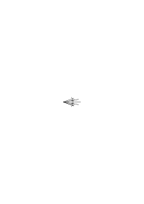)

### [81v\[4\]](https://cdn.wittgensteinnachlass.com/2000px/webp/Ms-154/81v.webp),[82r\[1\]](https://cdn.wittgensteinnachlass.com/2000px/webp/Ms-154/82r.webp),[82v\[1\]](https://cdn.wittgensteinnachlass.com/2000px/webp/Ms-154/82v.webp),[83r\[1\]](https://cdn.wittgensteinnachlass.com/2000px/webp/Ms-154/83r.webp)

In the α system I really cannot speak of a trisection; on the other hand, I can take the numbers 2, 2², 2³ etc. as part of the cardinal numbers & then say that 3 is none of them. This would be the case if ‘there is no trisection in the α system’ means that there is a 4-division there, or that 3 does not occur in this way, which means nothing other than that it does not occur in the series 2, 2² …, or 2 ≠ 3, 2² ≠ 3, 2³ ≠ 3 etc. But then ‘there is no trisection’ could mean: not in this system, but in another it is; not in α but in β.

And this comes down to asking what kind of trisection is meant when one says that it does not exist. If one carried out geometry with square-root expressions, one would not arrive at a 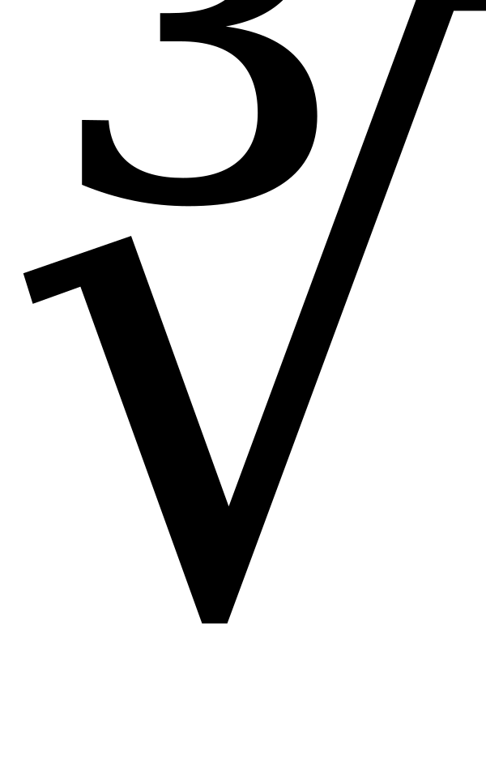 at all. How could one then ask about trisection in this geometry? or about the ? Well, it of course has sense to say that by superposition of ²√ we do not arrive at , for I divide my system into that of the n-th roots.

That is the same case as that of the α system.

### [83r\[2\]](https://cdn.wittgensteinnachlass.com/2000px/webp/Ms-154/83r.webp),[83v\[1\]](https://cdn.wittgensteinnachlass.com/2000px/webp/Ms-154/83v.webp)

‘Is trisection … possible?’ how can one ask about it, etc. etc. Well, this comes down to the same thing as asking: how can one ask whether 25 × 25 = 624 if it is not so, since it is then _logically_ impossible; I cannot write what it would be like if –. Yes, the doubt about 25 × 25 = 624 or that about 28 × 28 = 628 has just the sense the method of checking gives it. And the question of the possibility of trisection has the sense the method of checking gives it. It is quite true: here we do not imagine or describe what it is like if 25 × 25 = 624 & this simply means that we are dealing here with a different kind of question from in the case: ‘is this building 3 metres high or 4 metres high?’

### [84r\[1\]](https://cdn.wittgensteinnachlass.com/2000px/webp/Ms-154/84r.webp)

The _proof_ of the proposition that [unreadable] holds for all numbers would be a construction of induction from general principles.

a + (b + 1) = (a + b) + 1

(b + (c + 1)) = (a + (b + c)) + 1

(a + b) + (c + 1) = ((a + b) + c) + 1

### [84r\[2\]](https://cdn.wittgensteinnachlass.com/2000px/webp/Ms-154/84r.webp)

The general form of a proof by recursion is the general term of a series of proofs. I could just as well write this series in the form 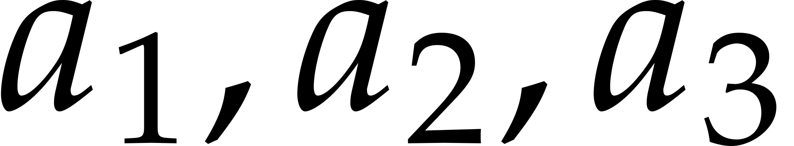 etc.

### [84v\[1\]](https://cdn.wittgensteinnachlass.com/2000px/webp/Ms-154/84v.webp)

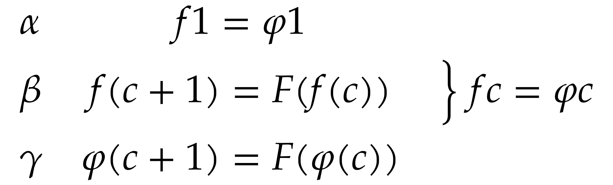

a + (b + c) = (a + b) + c

### [84v\[3\]](https://cdn.wittgensteinnachlass.com/2000px/webp/Ms-154/84v.webp)

The construction of induction is not _one_ proof but a particular arrangement of proofs.

### [84v\[4\]](https://cdn.wittgensteinnachlass.com/2000px/webp/Ms-154/84v.webp),[85r\[1\]](https://cdn.wittgensteinnachlass.com/2000px/webp/Ms-154/85r.webp)

If I have proved three sentences of the forms α, β, γ, then I say I have proved fc = φc. Which is nothing more than a definition (explanation) of the expression ‘proving φc = fc’.

### [85r\[2\]](https://cdn.wittgensteinnachlass.com/2000px/webp/Ms-154/85r.webp)

One cannot say either that I prove one equation when I prove three.

Just as the movements of a _sonata_ do not add up to _one_ movement.

### [85r\[3\]](https://cdn.wittgensteinnachlass.com/2000px/webp/Ms-154/85r.webp)

Does A now stand to B in the relation of sentences to a calculation? Does it not stand in the relation of

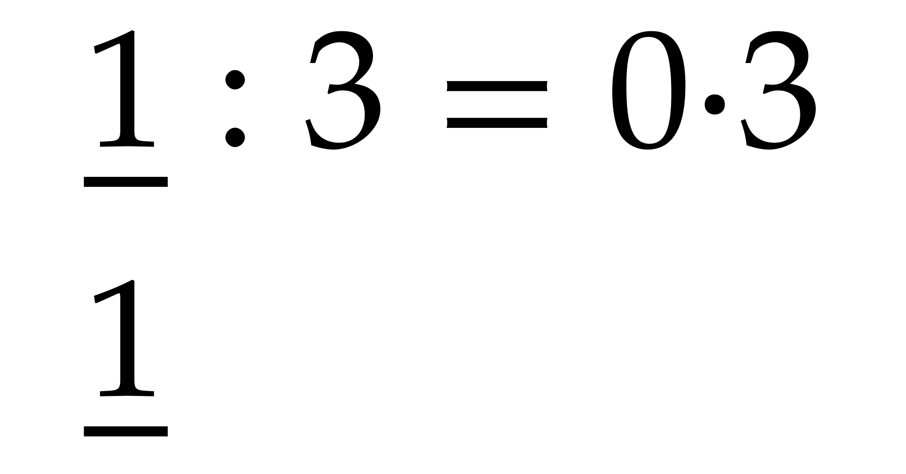

to 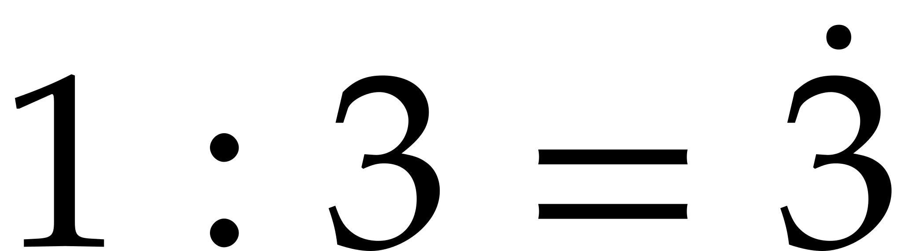?

### [85r\[4\]](https://cdn.wittgensteinnachlass.com/2000px/webp/Ms-154/85r.webp),[85v\[1\]](https://cdn.wittgensteinnachlass.com/2000px/webp/Ms-154/85v.webp)

No, a calculation does indeed occur, but it calculates α β & γ & is to be omitted in B.

### [85v\[2\]](https://cdn.wittgensteinnachlass.com/2000px/webp/Ms-154/85v.webp)

If B were the calculation of A, I would not have been able to describe A [unreadable] more generally.

### [85v\[3\]](https://cdn.wittgensteinnachlass.com/2000px/webp/Ms-154/85v.webp),[86r\[1\]](https://cdn.wittgensteinnachlass.com/2000px/webp/Ms-154/86r.webp)

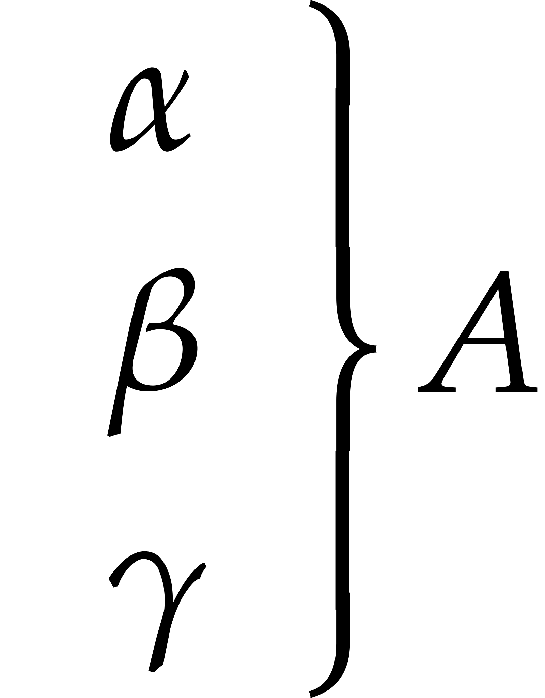 is a _determination_, not a calculation, for according to what _principles_ would the calculation have been carried out? But what is the determination? If sentences of the schema 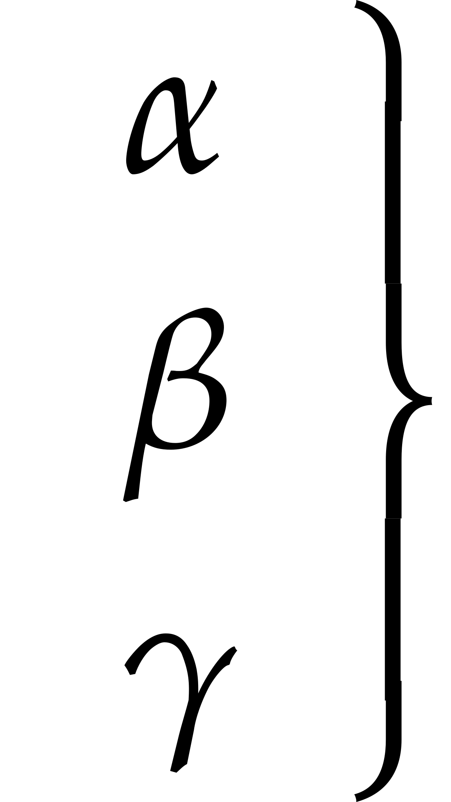 have been proved, then we say A is proved.

Trampolines.

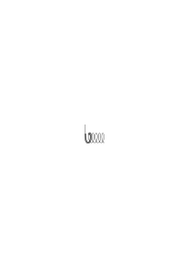

### [86r\[2\]](https://cdn.wittgensteinnachlass.com/2000px/webp/Ms-154/86r.webp),[86v\[1\]](https://cdn.wittgensteinnachlass.com/2000px/webp/Ms-154/86v.webp)

But that already means that we have not proved A in the same sense in which we have, say, proved one of the sentences α, β, γ. The question whether A is the case is thus the question whether α, β, & γ are the case & the assertion of A asserts α, β & γ. Where the opposite of what is asked consists in one of the 3 sentences being false. So not that the general sentence does not hold for one number. The question therefore does not ask whether ([unreadable])fn or (∃n)~fn.

### [86v\[2\]](https://cdn.wittgensteinnachlass.com/2000px/webp/Ms-154/86v.webp)

I have now newly defined the word ‘proof’ with the help of the concept of the proof of an equation & the pattern α β γ.

### [87r\[1\]](https://cdn.wittgensteinnachlass.com/2000px/webp/Ms-154/87r.webp)

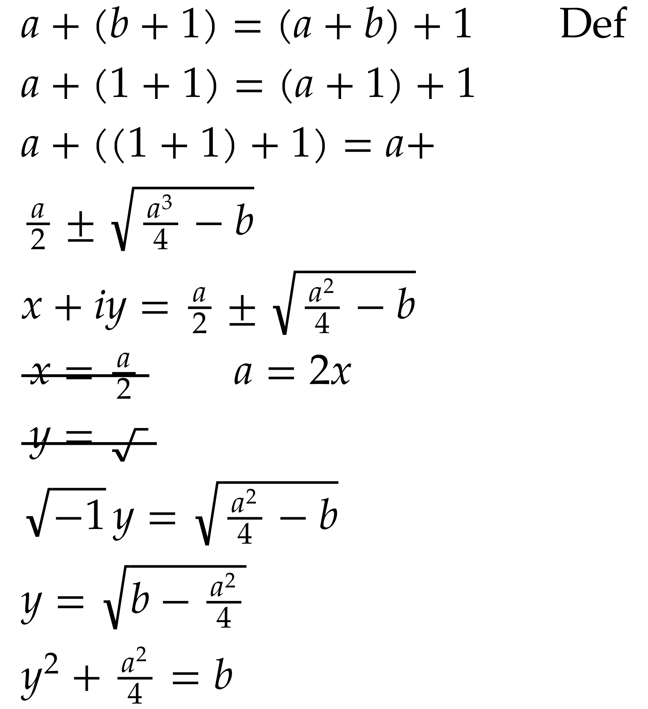

### [87v\[1\]](https://cdn.wittgensteinnachlass.com/2000px/webp/Ms-154/87v.webp)

I can quite calmly speak of ‘my visual space’ & ‘the Other’s visual space’; it will already be shown in the grammar of these expressions that this is not a distinction like that between my penknife & the Other’s.

### [87v\[2\]](https://cdn.wittgensteinnachlass.com/2000px/webp/Ms-154/87v.webp)

<s> One likes to imagine visual space as a kind of [unreadable] which everyone carries around with them. </s>

### [88r\[1\]](https://cdn.wittgensteinnachlass.com/2000px/webp/Ms-154/88r.webp)

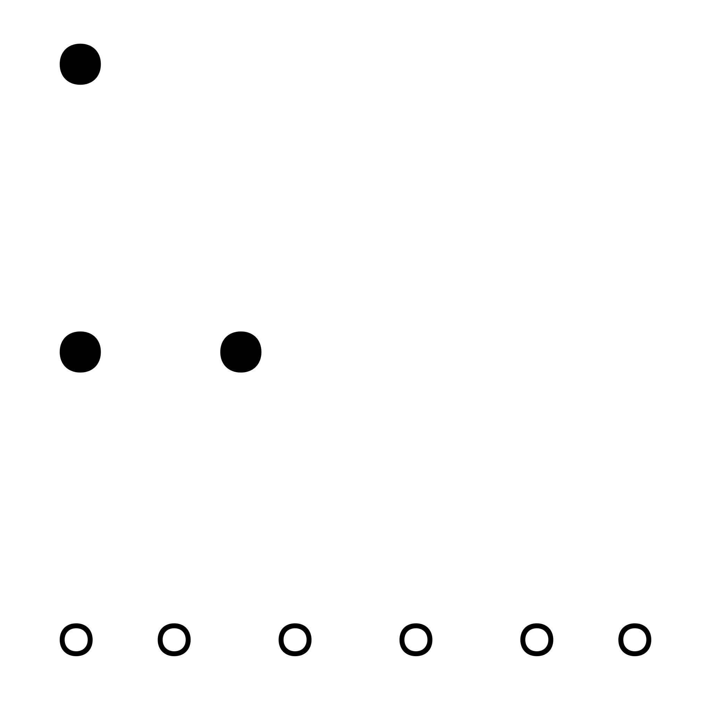

### [88r\[2\]](https://cdn.wittgensteinnachlass.com/2000px/webp/Ms-154/88r.webp)

Concept & object are subject & predicate. fa = a ε f(ξ)

This body is a piece of iron. Mr N is a Frenchman. This leaf is a rose leaf. That is a cannon shot. ‘That is a house’ can mean ‘there is a house here’.

### [88r\[3\]](https://cdn.wittgensteinnachlass.com/2000px/webp/Ms-154/88r.webp),[88v\[1\]](https://cdn.wittgensteinnachlass.com/2000px/webp/Ms-154/88v.webp)

Is ‘here’ a name? No. It cannot be replaced by a name either.

It has sense to give an object a name only insofar as I can say this is the same object which …

### [88v\[2\]](https://cdn.wittgensteinnachlass.com/2000px/webp/Ms-154/88v.webp),[89r\[1\]](https://cdn.wittgensteinnachlass.com/2000px/webp/Ms-154/89r.webp)

When I say in geometry, the circle 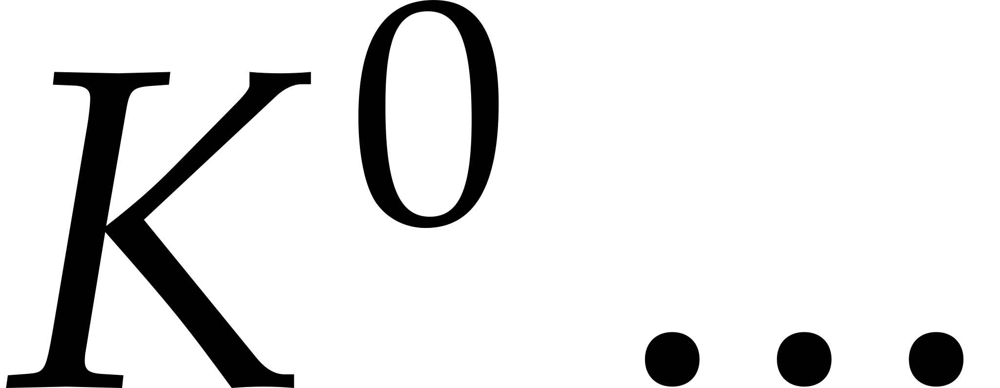, this means the circle at this location. It would have no sense, if this circle disappeared from me & one appeared at another place, to ask: is that again the circle K?

What is the criterion for an object’s being object A? (How can I recognize object A again.)

### [89r\[2\]](https://cdn.wittgensteinnachlass.com/2000px/webp/Ms-154/89r.webp),[89v\[1\]](https://cdn.wittgensteinnachlass.com/2000px/webp/Ms-154/89v.webp)

In the case of the use of a personal name, for example, it is essential that the question have sense: is this object the one you called A? For the ostensive definition reads: This is A & insofar A could simply stand in place of the indication. Instead of ‘A grows’ I can then simply say ‘this grows’. But the technique of using A is precisely that I use A where the _original_ ostensive explanation cannot be given. And then the meaning of A differs according to what the criterion of identity is.

### [89v\[2\]](https://cdn.wittgensteinnachlass.com/2000px/webp/Ms-154/89v.webp),[90r\[1\]](https://cdn.wittgensteinnachlass.com/2000px/webp/Ms-154/90r.webp),[90v\[1\]](https://cdn.wittgensteinnachlass.com/2000px/webp/Ms-154/90v.webp)

The notation (∃x) takes its form from ordinary word-language ‘there is …’. But although we say, for example: ‘There is a man who is 8 feet tall’, we do not say ‘there is a thing which is a man & 8 feet tall’. We say ‘every man is mortal’ but not ‘every thing which is a man is mortal’. This is rather a very typical sublimation of Fregean & Russellian logic. If I now say ‘In the large circle

there is a small one concentrically’, this would in the (∃)-notation mean that there is a thing in the large circle which is a concentric circle. Now what thing is that? – The notation as Russell understands it would always have to permit the sentence ‘there is a thing in this circle … & this thing is a’. The notation of ordinary language ‘There are 3 circles in the quadrilateral’ is much more correct. It makes more relevant distinctions than Russell’s.

### [90v\[2\]](https://cdn.wittgensteinnachlass.com/2000px/webp/Ms-154/90v.webp),[91r\[1\]](https://cdn.wittgensteinnachlass.com/2000px/webp/Ms-154/91r.webp),[91v\[1\]](https://cdn.wittgensteinnachlass.com/2000px/webp/Ms-154/91v.webp)

‘Man’ is of course a concept-word & not a designation for a man & ‘circle’ is not the name of a circle (insofar as a circle can have a name at all). But red circle of  radius 1 cm in [unreadable] is also a concept & yet it is ridiculous to speak of an object falling under this concept. Russell’s notation has the advantage of uniformity & this is an advantage insofar as word-language, although not uniform, is nevertheless not free of the multiplicity of its meanings, so that it is better to dispense once and for all with the expression ‘grammar’ in the notation & say that in each particular case one has to consider the grammar.

### [92r\[1\]](https://cdn.wittgensteinnachlass.com/2000px/webp/Ms-154/92r.webp)

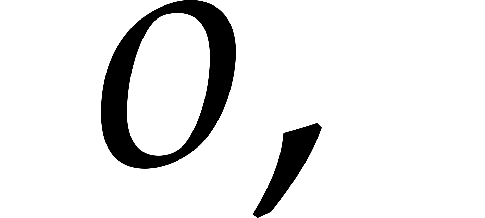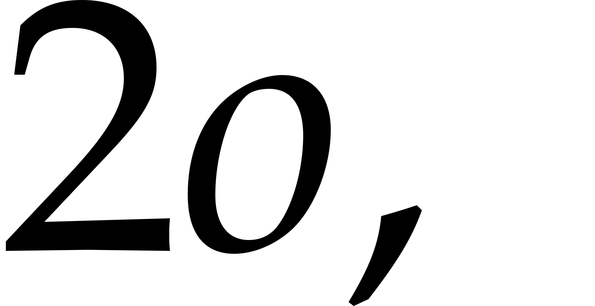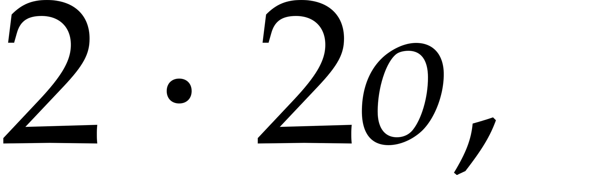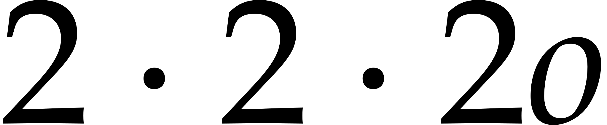

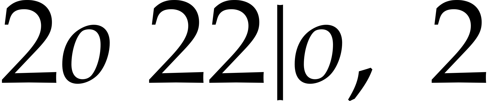

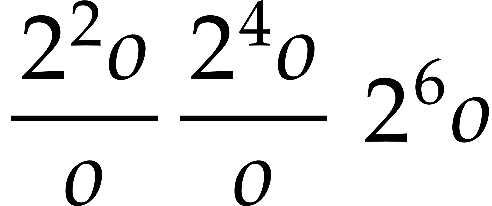

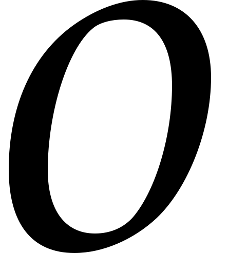

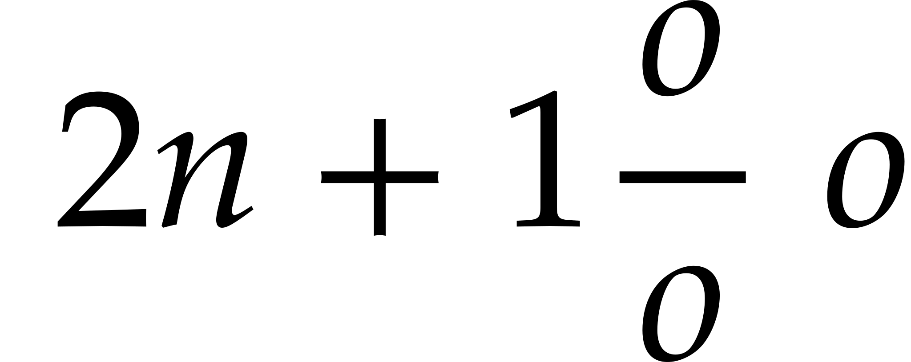

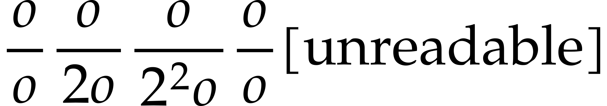

### [92r\[2\]](https://cdn.wittgensteinnachlass.com/2000px/webp/Ms-154/92r.webp),[92v\[1\]](https://cdn.wittgensteinnachlass.com/2000px/webp/Ms-154/92v.webp)

‘Does the operation yield, for example, a rational number?’ How can this be asked if one has no method for deciding the question, for the operation _yields_ only within the stipulated calculus. I mean: ‘yields’ is essentially in the present tense. It does not mean: yields with time; rather, yields now according to the rules.

### [92v\[2\]](https://cdn.wittgensteinnachlass.com/2000px/webp/Ms-154/92v.webp),[93r\[1\]](https://cdn.wittgensteinnachlass.com/2000px/webp/Ms-154/93r.webp)

The question ‘is π = π'’ therefore has no sense. π & π' are not comparable with one another. If π is a point on the number line, π' is not one. One cannot say ‘π' is a point which I do not know’, for π' is only what I know & if I were once to call something π' which is comparable with π, then it would not be today’s π'. And if I were once to find 3 sevens in the [unreadable] of π, then π' would not be what I now understand by it.

### [93r\[2\]](https://cdn.wittgensteinnachlass.com/2000px/webp/Ms-154/93r.webp)

However much I reduce the interval, I arrive not only at no decision _but remain always equally far_ from the decision.

### [93v\[1\]](https://cdn.wittgensteinnachlass.com/2000px/webp/Ms-154/93v.webp),[94r\[1\]](https://cdn.wittgensteinnachlass.com/2000px/webp/Ms-154/94r.webp)

When one says: ‘people mean by the expression … this (or really this)’, one usually wants to say that they can be brought in a particular way to say that they meant this. For example, if one gives them a definition of a concept which they had not previously thought of & they now _accept_ it.

### [94r\[2\]](https://cdn.wittgensteinnachlass.com/2000px/webp/Ms-154/94r.webp)

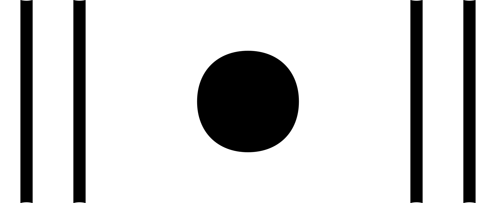

Would the number π change because a method had been found for calculating at which place in the expansion 777 777 occurs?

### [94r\[3\]](https://cdn.wittgensteinnachlass.com/2000px/webp/Ms-154/94r.webp)

What magnificent people we are to have solved these old problems! – No, time has changed us & the problems have disappeared.

### [94v\[1\]](https://cdn.wittgensteinnachlass.com/2000px/webp/Ms-154/94v.webp)

Continuity.

### [94v\[2\]](https://cdn.wittgensteinnachlass.com/2000px/webp/Ms-154/94v.webp)

Sameness in visual space as opposed to Euclidean space. S 72

### [BCr\[1\]](https://cdn.wittgensteinnachlass.com/2000px/webp/Ms-154/BCr.webp)

Gecto Plotj

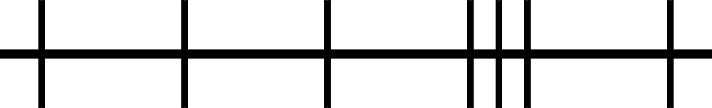
