# Ms-155

2 published remarks, VB

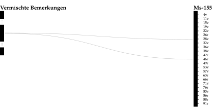

### [1r\[1\]](https://cdn.wittgensteinnachlass.com/2000px/webp/Ms-155/1r.webp)

So it would be possible to say “now I no longer see this as a rose but only as a plant”!

Or: “Now I see it only as a rose, no longer as _this_ rose”.

### [1r\[2\]](https://cdn.wittgensteinnachlass.com/2000px/webp/Ms-155/1r.webp)

“I now see the spot  only in the square, but no longer in a particular position”

### [1r\[3\]](https://cdn.wittgensteinnachlass.com/2000px/webp/Ms-155/1r.webp)

It is precisely the mental process of understanding that does not interest us at all: (Any more than that of intuition.)

### [1v\[1\]](https://cdn.wittgensteinnachlass.com/2000px/webp/Ms-155/1v.webp),[2r\[1\]](https://cdn.wittgensteinnachlass.com/2000px/webp/Ms-155/2r.webp)

“Surely there is no doubt at all that someone who understands the examples as arbitrary cases illustrating the concept understands something different from someone who takes them as a definitely bounded enumeration”. Quite right, but _what_ does the first understand that the second does not? Well, he sees only _examples_ in the things shown, which are meant only to bring out certain features, but he does not think that I am otherwise showing him these things for their own sake. –

Yes, but is it really the case that he now actually sees only these features in the thing? For example, in the leaf only what all leaves have in common? That would be as if he saw everything else “in blanco”. Thus, as it were, an unfilled form in which the essential features are pre-printed. (But the function “f( …)” is just such a form.)

### [2r\[2\]](https://cdn.wittgensteinnachlass.com/2000px/webp/Ms-155/2r.webp),[2v\[1\]](https://cdn.wittgensteinnachlass.com/2000px/webp/Ms-155/2v.webp),[3r\[1\]](https://cdn.wittgensteinnachlass.com/2000px/webp/Ms-155/3r.webp)

But what sort of process is it when someone shows me several different things as examples of a concept, to lead me to see what they have in common; & when I try to see it & now really do see it?

He can also _draw my attention_ to what they have in common. – But does he thereby bring it about that I _see_ the object differently? Perhaps he does, for I can in any case look particularly at one of its parts, whereas otherwise I would have seen all the others equally clearly. But this seeing is not understanding the concept. For we do not see something with an _empty_ argument place.

### [3r\[2\]](https://cdn.wittgensteinnachlass.com/2000px/webp/Ms-155/3r.webp)

“Pick out from these penholders the ones shaped _like this_”. – – – “I did not know in _that_ case whether you wanted this one too.”

### [3r\[2\]](https://cdn.wittgensteinnachlass.com/2000px/webp/Ms-155/3r.webp),[3v\[1\]](https://cdn.wittgensteinnachlass.com/2000px/webp/Ms-155/3v.webp)

One might also ask: does someone who takes the sign “∣∣∣ …” as a sign for the concept of number (as opposed to “∣∣∣”, which is meant to designate 3) see that first group of strokes differently from the second? But even if he sees it differently, perhaps more blurred, as it were, does he thereby _see_ what is essential to the concept of number? Would that not mean that he would then actually have to be unable to distinguish “∣∣∣ …” from “∣∣∣∣ …” (if I had given him, that is, the potion that makes him see the _concept_)?

### [3v\[2\]](https://cdn.wittgensteinnachlass.com/2000px/webp/Ms-155/3v.webp),[4r\[1\]](https://cdn.wittgensteinnachlass.com/2000px/webp/Ms-155/4r.webp),[4v\[1\]](https://cdn.wittgensteinnachlass.com/2000px/webp/Ms-155/4v.webp)

For when I say: he tries, by showing us several specimens, to get us to see what they have in common & disregard the rest, what this really means is that the rest recedes into the background, thus becoming paler, as it were (& why should it not then be able to disappear altogether), & “what they have in common”, say the egg shape, alone remains in the foreground.

But that is not how it is. Besides, the several examples would be only a technical aid, & once I had seen what I was meant to see, I could see it in _one_ example as well. (Just as “(∃x)․fx” too contains only _one_ example.)

### [4v\[2\]](https://cdn.wittgensteinnachlass.com/2000px/webp/Ms-155/4v.webp)

So it is the rules that hold for the example that make it an example.

### [4v\[3\]](https://cdn.wittgensteinnachlass.com/2000px/webp/Ms-155/4v.webp)

“Think of a map.”

### [4v\[4\]](https://cdn.wittgensteinnachlass.com/2000px/webp/Ms-155/4v.webp),[5r\[1\]](https://cdn.wittgensteinnachlass.com/2000px/webp/Ms-155/5r.webp)

But nowadays, at any rate, the mere word for the concept, without _an_ illustration, is enough to make something intelligible to me. (And the history of the understanding does not interest us.) E.g. when someone says to me, shape an Easter egg; & surely I do not want to say that I somehow see the concept of an Easter egg before my mind’s eye when I understand this command (& the word “Easter egg”).

### [5r\[2\]](https://cdn.wittgensteinnachlass.com/2000px/webp/Ms-155/5r.webp),[5v\[1\]](https://cdn.wittgensteinnachlass.com/2000px/webp/Ms-155/5v.webp),[6r\[1\]](https://cdn.wittgensteinnachlass.com/2000px/webp/Ms-155/6r.webp),[6v\[1\]](https://cdn.wittgensteinnachlass.com/2000px/webp/Ms-155/6v.webp),[7r\[1\]](https://cdn.wittgensteinnachlass.com/2000px/webp/Ms-155/7r.webp)

When we apply the concept of a plant (in a particular case), surely we do not first have a general image in mind, nor, on hearing the word plant, the image of the particular object which I call a plant in it.

Rather, I make the application quite spontaneously, so to speak.

Nevertheless there is an application of which I would say: no, that is not what I meant by “plant”; or on the other hand “yes, I meant that too”. But does that mean that I had these images in mind & expressly rejected & admitted them in my mind? – And yet it looks that way when I say: “yes, that & that & that, I meant all of that, but not _that_”. But one might ask: yes, did you foresee all these cases? & the answer would then be “yes”, or “no, but I thought it should be something between … & …” or something of the sort. Most of the time, though, I drew no boundaries at all at that moment, & these emerge only by the indirect route of reflection. For example, I say “bring me another flower about this size for the bouquet” & one arrives & I say: Yes, that is the sort I meant. I may then remember an image I had in mind, but it does not follow from all this that the carnation brought is also still admissible. Rather, this is where I apply that very image.

And this application had not been anticipated.

———— · ————

### [7r\[2\]](https://cdn.wittgensteinnachlass.com/2000px/webp/Ms-155/7r.webp)

There is no roundabout route by which what is said about an enumeration of individual cases can yield the explanation of generality.

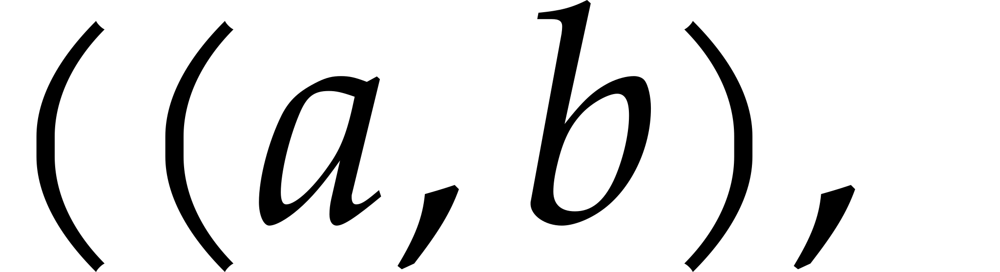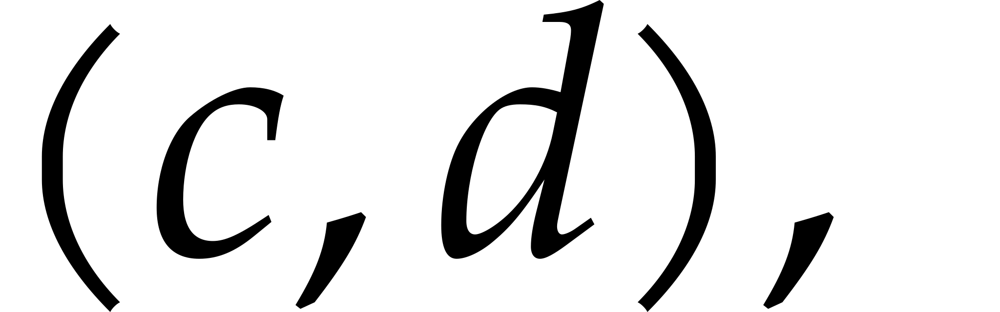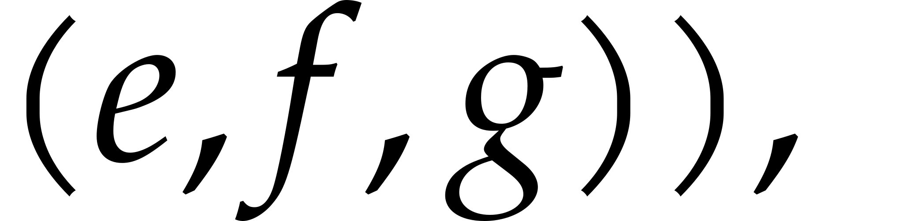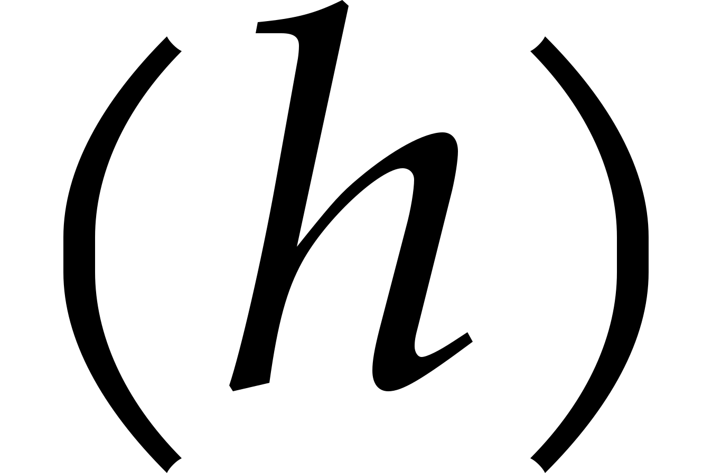

### [7r\[3\]](https://cdn.wittgensteinnachlass.com/2000px/webp/Ms-155/7r.webp),[7v\[1\]](https://cdn.wittgensteinnachlass.com/2000px/webp/Ms-155/7v.webp),[8r\[1\]](https://cdn.wittgensteinnachlass.com/2000px/webp/Ms-155/8r.webp)

Is it then the case that the command “bring me a flower” can never be replaced by a command of the form “bring me an A or B or C”, but must always be “bring me an A or B or C _or another flower_”? But why does the general proposition make itself out to be so indefinite when I could, after all, have foreseen every case that actually occurs? But there is presumably the greatest enumeration I can give – complete in some sense (say, an enumeration of all the cases I have encountered in my life) – and even after it, “or another” will retain its sense.

### [8r\[2\]](https://cdn.wittgensteinnachlass.com/2000px/webp/Ms-155/8r.webp),[8v\[1\]](https://cdn.wittgensteinnachlass.com/2000px/webp/Ms-155/8v.webp),[9r\[1\]](https://cdn.wittgensteinnachlass.com/2000px/webp/Ms-155/9r.webp)

But even this does not yet seem to me to get at the most important point in this matter. Because what matters again, I believe, is not really the infinity of the possibilities but a kind of indefiniteness. Indeed, if asked how many possibilities there were for a circle in the visual field to lie within the quadrilateral, I could neither name a finite number nor say there were infinitely many (as, for example, in Euclidean space). Rather, though we never come to an end here, it is not in the sense of the number series.

Rather, no end we come to is essentially the end. That is, I could always say: I do not see why these should be all the possibilities. And presumably that means that it is _precisely_ senseless to speak of “all the possibilities”.

The concepts “plant” & “Easter egg”, then, are _quite untouched_ by the enumeration.

### [9r\[1\]](https://cdn.wittgensteinnachlass.com/2000px/webp/Ms-155/9r.webp),[9v\[1\]](https://cdn.wittgensteinnachlass.com/2000px/webp/Ms-155/9v.webp)

If fa were to go under in f(∃) because the latter was already a disjunction, a disjunction of the form f(∃) ⌵ f(a) ⌵ f(b) ⌵ f(c) would be equal to f(a) ⌵ f(b) ⌵ f(c). But in fact it lies in the nature of f(∃) that this does not happen.

### [9v\[2\]](https://cdn.wittgensteinnachlass.com/2000px/webp/Ms-155/9v.webp),[10r\[1\]](https://cdn.wittgensteinnachlass.com/2000px/webp/Ms-155/10r.webp),[10v\[1\]](https://cdn.wittgensteinnachlass.com/2000px/webp/Ms-155/10v.webp),[11r\[1\]](https://cdn.wittgensteinnachlass.com/2000px/webp/Ms-155/11r.webp)

Even if we say that we could always have foreseen the particular way of obeying the command, f(a), in reality we did not foresee it. But even if I foresee it & expressly permit it, it is lost beside the general proposition, precisely because it is from the general proposition that I see that this particular case is also permitted & not simply from the disjunctively stipulated permission of this case. For if the general proposition is there, adding the particular case is of no further use to me. For the justification of this addition lies only in the general proposition, since it is only from the general proposition that I have seen that this case is permitted. And we could understand this permission as meaning that the general proposition is a disjunction only if we defined it as a conditional disjunction; for only then would it be one. What prevents us from defining it in this way? Only that it expresses no disjunction but is essentially different from a disjunction. Not that the disjunction always leaves something over, but that it does not touch what is essential to the general proposition at all; indeed, if one adds it to the latter, it derives its justification from it in the first place.

———— · ————

### [11r\[2\]](https://cdn.wittgensteinnachlass.com/2000px/webp/Ms-155/11r.webp)

Infinite possibilities. What does it mean to say: the number series is infinite?

### [11r\[3\]](https://cdn.wittgensteinnachlass.com/2000px/webp/Ms-155/11r.webp)

That must surely be a stipulation, not the statement of a fact.

### [11v\[1\]](https://cdn.wittgensteinnachlass.com/2000px/webp/Ms-155/11v.webp)

I was right, of course, that infinite possibility (e.g. infinite divisibility) belongs to quite a different grammatical category from finite possibility (the possibility of dividing into 3 parts). But this does not yet _determine_ the grammar of the word “infinite”.

### [11v\[2\]](https://cdn.wittgensteinnachlass.com/2000px/webp/Ms-155/11v.webp),[12r\[1\]](https://cdn.wittgensteinnachlass.com/2000px/webp/Ms-155/12r.webp),[12v\[1\]](https://cdn.wittgensteinnachlass.com/2000px/webp/Ms-155/12v.webp)

If, for example, I say “I call everything that results from 1 by the continued addition of 1 cardinal numbers”, the word “continued” does not stand for a hazy continuation of 1, 1 + 1, 1 + 1 + 1; rather, the sign “1, 1 + 1, 1 + 1 + 1, …” too is to be taken quite exactly; as distinct from “1, 1 + 1, 1 + 1 + 1”, it is subject to other definite rules and is not a representative of a series “that I cannot write down”.

### [12v\[2\]](https://cdn.wittgensteinnachlass.com/2000px/webp/Ms-155/12v.webp)

That is: one also _calculates_ with the sign “1, 1 + 1, 1 + 1 + 1 …” as with the numerals, only differently.

### [12v\[3\]](https://cdn.wittgensteinnachlass.com/2000px/webp/Ms-155/12v.webp),[13r\[1\]](https://cdn.wittgensteinnachlass.com/2000px/webp/Ms-155/13r.webp)

But what is it, then, that one imagines? What mistake is one making? What does one take the sign “1, 1 + 1, 1 + 1 + 1 …” for? That is: where does what one thinks one sees in this sign _actually_ occur?

Perhaps when I say “he counted 1, 2, 3, 4, 5, 6, and so on up to a thousand”? Where it would also be possible actually to write down all the numbers.

---

### [13r\[2\]](https://cdn.wittgensteinnachlass.com/2000px/webp/Ms-155/13r.webp),[13v\[1\]](https://cdn.wittgensteinnachlass.com/2000px/webp/Ms-155/13v.webp)

What does one see “1, 1 + 1, 1 + 1 + 1 …” as, then? As an inexact form of expression. The dots are like further numerals, only blurred. As if one stopped writing down numerals because one cannot write them all down anyway, but as if they were indeed there, so to speak, in a box.

### [13v\[2\]](https://cdn.wittgensteinnachlass.com/2000px/webp/Ms-155/13v.webp),[14r\[1\]](https://cdn.wittgensteinnachlass.com/2000px/webp/Ms-155/14r.webp)

Or again, as when I whistle only the first notes of a tune distinctly & merely hint at the rest & let it trail off into nothing (or when, in writing a word, one writes only a few letters distinctly & ends with an unarticulated stroke) _where a distinct would then correspond to the indistinct_.

### [14r\[2\]](https://cdn.wittgensteinnachlass.com/2000px/webp/Ms-155/14r.webp),[14v\[1\]](https://cdn.wittgensteinnachlass.com/2000px/webp/Ms-155/14v.webp)

There is also the question where exactly the concept of number (or the concept of cardinal number) is indispensable. Number in contrast to what? [1, ξ, ξ + 1] presumably in contrast to [5, ξ, √ξ] etc. – For if I actually introduce such a sign (as [1, ξ, ξ + 1]) (& do not just drag it around as a luxury), then I must also do something with it, i.e. use it in a calculus, & then it loses its supremacy & enters a system of signs on a par with it.)

### [14v\[2\]](https://cdn.wittgensteinnachlass.com/2000px/webp/Ms-155/14v.webp),[15r\[1\]](https://cdn.wittgensteinnachlass.com/2000px/webp/Ms-155/15r.webp)

One might say: but surely cardinal number contrasts with rational number, real number, etc. But this difference is a difference in the rules (the rules of the games that hold for them) – not one of position on the chessboard – not a difference for which one needs different words on a par in the same calculus.

### [15r\[2\]](https://cdn.wittgensteinnachlass.com/2000px/webp/Ms-155/15r.webp)

We do not say that, if a proposition has been proved for x = 1, & it has been shown that it holds for x = c + 1 when x = c

### [15r\[3\]](https://cdn.wittgensteinnachlass.com/2000px/webp/Ms-155/15r.webp),[15v\[1\]](https://cdn.wittgensteinnachlass.com/2000px/webp/Ms-155/15v.webp)

We do not say that if f1 holds & fc + 1 follows from fc, the proposition fx is _therefore_ true for all cardinal numbers; rather, “the proposition holds for all cardinal numbers” _means_ “it holds for 1 + f(c + 1) follows from f(c).”

### [15v\[2\]](https://cdn.wittgensteinnachlass.com/2000px/webp/Ms-155/15v.webp),[16r\[1\]](https://cdn.wittgensteinnachlass.com/2000px/webp/Ms-155/16r.webp)

But how do I know that 28 + (45 + 17) = (28 + 45) + 17 without having proved it? How can a general proof give me a particular proof?

For I could give the particular proof, after all, and how do the two proofs collide, and what if they do not agree?

### [16r\[2\]](https://cdn.wittgensteinnachlass.com/2000px/webp/Ms-155/16r.webp)

And here the connection with generality in finite domains is quite clear, for in a finite domain that very thing would indeed be the proof that fx holds for all values of x, & _that very thing_ is why we say in the arithmetical case too that fx holds for all numbers.

### [16v\[1\]](https://cdn.wittgensteinnachlass.com/2000px/webp/Ms-155/16v.webp)

And if one now asks: well, _can_ the particular proof yield anything other than 28 + (45 + 17) = (28 + 45) + 17, then I would have to answer: of course it can yield something else (if its yielding that result is an independent fact), but if it yields something else, I shall say I have made a mistake in the calculation.

### [17r\[1\]](https://cdn.wittgensteinnachlass.com/2000px/webp/Ms-155/17r.webp)

But surely I would say: the general proof already shows that nothing else can come out.

But surely things are just the same with a general geometrical proof; for example, that the angle in a semicircle is a right angle.

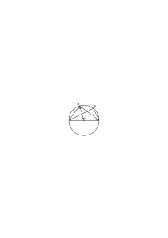

### [17r\[2\]](https://cdn.wittgensteinnachlass.com/2000px/webp/Ms-155/17r.webp),[17v\[1\]](https://cdn.wittgensteinnachlass.com/2000px/webp/Ms-155/17v.webp)

I then take the proposition as proved for another case as well; but I could also prove it explicitly for this case.

### [17v\[2\]](https://cdn.wittgensteinnachlass.com/2000px/webp/Ms-155/17v.webp)

First it is necessary to see clearly that we are not proving any fact. For just because things are so in the one case, how can I know that they are so in the other? And there is no such thing as ‘having to be so’. If it is not so, there is nothing one can do about it. Only what depends on us can we _determine_ in advance.

### [17v\[3\]](https://cdn.wittgensteinnachlass.com/2000px/webp/Ms-155/17v.webp),[18r\[1\]](https://cdn.wittgensteinnachlass.com/2000px/webp/Ms-155/18r.webp),[18v\[1\]](https://cdn.wittgensteinnachlass.com/2000px/webp/Ms-155/18v.webp)

The proof can therefore prophesy nothing. Is the proof, carried out for A, also the proof for B, so that it makes no difference at all in which triangle it is drawn? And if it were drawn in both triangles, would only _the same_ proof be repeated? So that the sign of the proof – the proof as a sign – could consist just as well of the construction in A & the triangle B as of this triangle & a construction in it.

### [18v\[2\]](https://cdn.wittgensteinnachlass.com/2000px/webp/Ms-155/18v.webp)

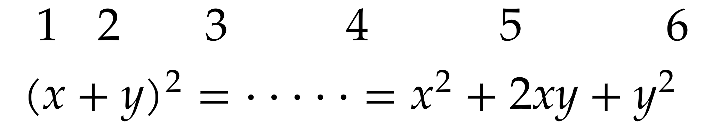

The proof that (3 + 4)² = 3² + 2 ∙ 3 ∙ 4 + 4² would then, in my language, consist in 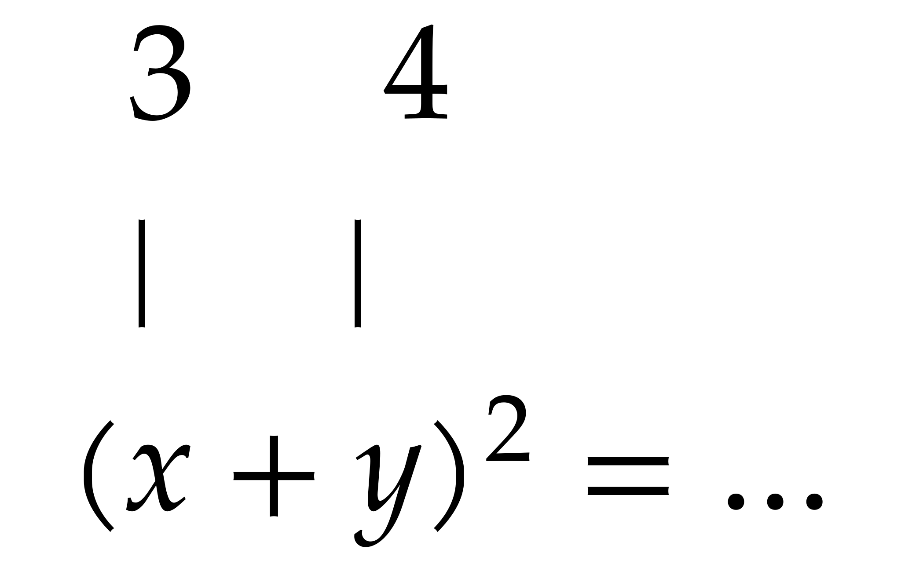 & could also consist in 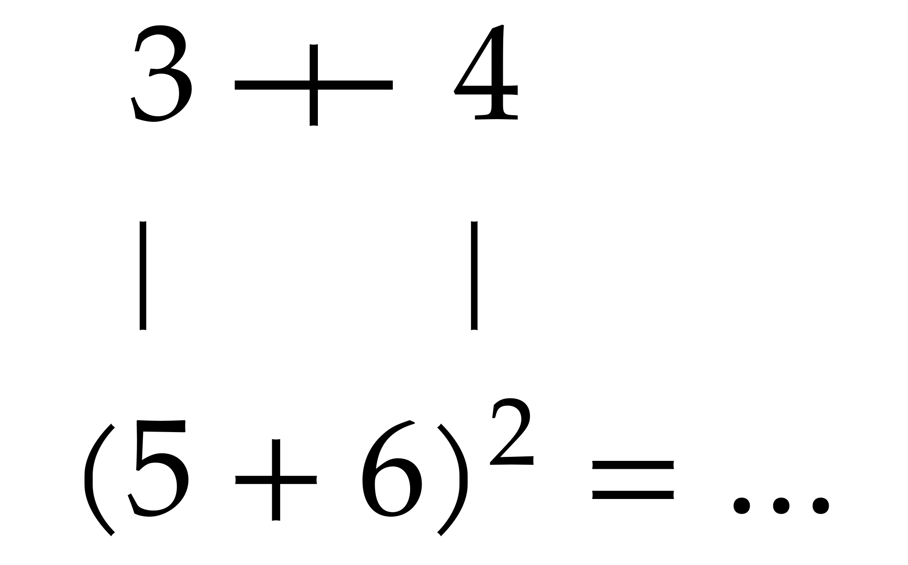.

### [18v\[3\]](https://cdn.wittgensteinnachlass.com/2000px/webp/Ms-155/18v.webp),[19r\[1\]](https://cdn.wittgensteinnachlass.com/2000px/webp/Ms-155/19r.webp)

That is, the proof carried out with 45, 17 & 28 must not give me any greater certainty than the “general” one. Or else the two must be entirely independent. But not then _independent_ proofs _of the same thing_, for that is nonsense (they are, after all, connected by having the same end).

### [19r\[2\]](https://cdn.wittgensteinnachlass.com/2000px/webp/Ms-155/19r.webp)

_How_ does the general proof by induction make me certain that the particular one will yield that result?

### [19v\[1\]](https://cdn.wittgensteinnachlass.com/2000px/webp/Ms-155/19v.webp)

(Just do not despise the simple calculi that every child & every shopkeeper uses.)

### [19v\[2\]](https://cdn.wittgensteinnachlass.com/2000px/webp/Ms-155/19v.webp),[20r\[1\]](https://cdn.wittgensteinnachlass.com/2000px/webp/Ms-155/20r.webp)

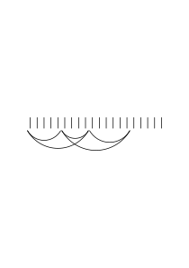

This too must be a perfectly rigorous proof of the associative law.

And here one can clearly distinguish the two cases we spoke of in the earlier geometrical proof.

For the figure can count as a general proof, & also as a proof only of 5 + (4 + 6) = (5 + 4) + 6, and I can write down the proof of 3 + (7 + 2) = (3 + 7) + 2 like this

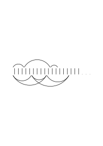

…

I have carried out the proof only below (drawn the construction).

### [20r\[2\]](https://cdn.wittgensteinnachlass.com/2000px/webp/Ms-155/20r.webp),[20v\[1\]](https://cdn.wittgensteinnachlass.com/2000px/webp/Ms-155/20v.webp)

One calculus is not more rigorous than another! One only has to know the limits of each.

One can call a calculus less rigorous than another only insofar as its rules are not clearly formulated.

———— · ————

### [20v\[2\]](https://cdn.wittgensteinnachlass.com/2000px/webp/Ms-155/20v.webp)

One sees the proof by induction as, as it were, an indirect proof of general validity. (But in logic there is nothing behind what we see.)

### [21r\[1\]](https://cdn.wittgensteinnachlass.com/2000px/webp/Ms-155/21r.webp)

“Sweeping statements” get one nowhere in philosophy; rather, everything must be represented precisely as it is.

### [21r\[2\]](https://cdn.wittgensteinnachlass.com/2000px/webp/Ms-155/21r.webp),[21v\[1\]](https://cdn.wittgensteinnachlass.com/2000px/webp/Ms-155/21v.webp)

Simplicissimus: Riddles of Engineering

(Picture: Two professors in front of a bridge under construction) (Voice from above:) “Lower it – – – whoa – – – lower it, I say – – – then we’ll turn it round the other way!” – – – – – – “It really is incomprehensible, my dear colleague, that such complicated & precise work can be accomplished in this language!”

Does visual space have a centre? – It makes sense to put a little cross in a picture

& to say: look at the cross. You will still see the rest then, but from then on the cross will be “at the centre”.

### [21v\[2\]](https://cdn.wittgensteinnachlass.com/2000px/webp/Ms-155/21v.webp),[22r\[1\]](https://cdn.wittgensteinnachlass.com/2000px/webp/Ms-155/22r.webp)

All considerations can be pursued in a much more homely way than I pursued them earlier. And that is why no new words need be used in philosophy either; the old ones suffice.

### [22r\[2\]](https://cdn.wittgensteinnachlass.com/2000px/webp/Ms-155/22r.webp)

“Is that a proof of this proposition?” Is it _used_ as a proof? If so, why should I not call it a proof?

### [22r\[3\]](https://cdn.wittgensteinnachlass.com/2000px/webp/Ms-155/22r.webp),[22v\[1\]](https://cdn.wittgensteinnachlass.com/2000px/webp/Ms-155/22v.webp)

(Every multiplication _16 × 25_ is a proof. It settles that 16 × 25 … is & nothing else, & is actually used as a proof of that.)

———— · ————

### [22v\[2\]](https://cdn.wittgensteinnachlass.com/2000px/webp/Ms-155/22v.webp)

When one introduces irrational numbers, one always acts as if one had now discovered something new, whereas it is not a matter of a new discovery but of a new construction (which one can then call a “number”, or not).

### [22v\[3\]](https://cdn.wittgensteinnachlass.com/2000px/webp/Ms-155/22v.webp),[23r\[1\]](https://cdn.wittgensteinnachlass.com/2000px/webp/Ms-155/23r.webp)

Suppose we were to call the proposition that 7 is not divisible by any of the numbers preceding it except 1 the law of the sacred number, & were to express it in the words: “7 is the sacred number”. Then we would have a case similar to that of the “fundamental theorem of arithmetic” & others that really name an individual calculation, which we call the proof of that proposition.

### [23r\[1\]](https://cdn.wittgensteinnachlass.com/2000px/webp/Ms-155/23r.webp),[23v\[1\]](https://cdn.wittgensteinnachlass.com/2000px/webp/Ms-155/23v.webp)

Only for such a “proposition of mathematics” are there different independent proofs. For the mutually independent calculations arbitrarily contain the same name.

### [23v\[2\]](https://cdn.wittgensteinnachlass.com/2000px/webp/Ms-155/23v.webp),[24r\[1\]](https://cdn.wittgensteinnachlass.com/2000px/webp/Ms-155/24r.webp)

I do not need to _assert_ that one must be able to construct the n roots of an equation of the nth degree; I say only that the proposition “this equation has n roots” means something _different_ when I have proved it by counting the constructed roots & when I have proved it in some other way. But if I find a formula for the roots of an equation, I have constructed a new calculus & not filled a gap in an old one.

### [24r\[2\]](https://cdn.wittgensteinnachlass.com/2000px/webp/Ms-155/24r.webp),[24v\[1\]](https://cdn.wittgensteinnachlass.com/2000px/webp/Ms-155/24v.webp)

It is therefore nonsense to say that the proposition … is not proved until one exhibits such a construction. For then we have constructed something new, & what we now understand by the fundamental theorem is just the _present_ ‘proof’.

### [24v\[2\]](https://cdn.wittgensteinnachlass.com/2000px/webp/Ms-155/24v.webp)

It is nonsense to fear that arithmetic might thus be deprived of this support.

———— · ————

### [24v\[3\]](https://cdn.wittgensteinnachlass.com/2000px/webp/Ms-155/24v.webp),[25r\[1\]](https://cdn.wittgensteinnachlass.com/2000px/webp/Ms-155/25r.webp)

The question is, how does the calculus go on now that the fundamental laws have been proved by induction?

### [25r\[2\]](https://cdn.wittgensteinnachlass.com/2000px/webp/Ms-155/25r.webp)

In the end I always do no more than draw attention to something (and gather such Observations together.)

———— · ————

### [25r\[3\]](https://cdn.wittgensteinnachlass.com/2000px/webp/Ms-155/25r.webp),[25v\[1\]](https://cdn.wittgensteinnachlass.com/2000px/webp/Ms-155/25v.webp)

“Definitions merely introduce convenient abbreviations, but we could manage without them too.” But what about the recursive definition here?

### [25v\[2\]](https://cdn.wittgensteinnachlass.com/2000px/webp/Ms-155/25v.webp)

One can call two different things an application of the rule a + (b + 1) = (a + b) + 1. 4 + (2 + 1) = (4 + 2) + 1 is an application in _one_ sense, in the other only:

4 + (2 + 1) = ((4 + 1) + 1) + 1 = (4 + 2) + 1

### [25v\[3\]](https://cdn.wittgensteinnachlass.com/2000px/webp/Ms-155/25v.webp),[26r\[1\]](https://cdn.wittgensteinnachlass.com/2000px/webp/Ms-155/26r.webp)

The result of the calculation … is 5 + (4 + 3) = (5 + 4) + 3, but it also has a result in another sense. Can one then express this in the equation a + (b + c) = (a + b) + c just as one expresses the first by 5 + (4 + 3) = (5 + 4) + 3?

———— · ————

### [26r\[2\]](https://cdn.wittgensteinnachlass.com/2000px/webp/Ms-155/26r.webp),[26v\[1\]](https://cdn.wittgensteinnachlass.com/2000px/webp/Ms-155/26v.webp)

What a geometrical proposition means, what generality it has, must all become apparent when we see how it is applied. For even if there were something incomprehensible that someone _meant by it_, that would not help him, since he can apply it only quite openly and in a way anyone can understand. If, say, someone also imagines something mystical in connection with the king in chess, that does not concern us, since he can move it only on the 8 × 8 squares of the chessboard.

### [27r\[1\]](https://cdn.wittgensteinnachlass.com/2000px/webp/Ms-155/27r.webp)

Surely a + (b + c) = (a + b) + c can now surely be an _abbreviation_ of the proof by induction.

### [27r\[2\]](https://cdn.wittgensteinnachlass.com/2000px/webp/Ms-155/27r.webp)

For if need be, we would have to be able to calculate everything with the proofs by induction as units.

### [27r\[3\]](https://cdn.wittgensteinnachlass.com/2000px/webp/Ms-155/27r.webp),[27v\[1\]](https://cdn.wittgensteinnachlass.com/2000px/webp/Ms-155/27v.webp)

Whatever the rule a + (b + c) = (a + b) + c justifies, the proof by induction can justify too.

### [27v\[2\]](https://cdn.wittgensteinnachlass.com/2000px/webp/Ms-155/27v.webp)

One cannot specify a calculation as the proof of a proposition.

### [27v\[3\]](https://cdn.wittgensteinnachlass.com/2000px/webp/Ms-155/27v.webp)

(I want to say): _Must_ one call these calculations the proof of the proposition a + (b + c) = (a + b) + c? I.e., will no other relation do?

### [27v\[4\]](https://cdn.wittgensteinnachlass.com/2000px/webp/Ms-155/27v.webp),[28r\[1\]](https://cdn.wittgensteinnachlass.com/2000px/webp/Ms-155/28r.webp)

Even on the customary view, the proof by induction does not purport to prove a + (b + c) = (a + b) + c, but only to prove that this proposition holds for all numbers.

### [28r\[2\]](https://cdn.wittgensteinnachlass.com/2000px/webp/Ms-155/28r.webp)

The proof by induction seems to be _one_ unit & not to consist of the individual transitions as its units.

### [28r\[3\]](https://cdn.wittgensteinnachlass.com/2000px/webp/Ms-155/28r.webp),[28v\[1\]](https://cdn.wittgensteinnachlass.com/2000px/webp/Ms-155/28v.webp)

Thus, for instance, the result of the division 1:3 worked out to 2 places is 0∙33, but in this division one also sees the periodicity & that is not a result in the same sense as the quotient 0∙33.

### [28v\[2\]](https://cdn.wittgensteinnachlass.com/2000px/webp/Ms-155/28v.webp)

We could quite well call the proof by induction a periodic calculation.

### [28v\[3\]](https://cdn.wittgensteinnachlass.com/2000px/webp/Ms-155/28v.webp),[29r\[1\]](https://cdn.wittgensteinnachlass.com/2000px/webp/Ms-155/29r.webp)

And its result a + (b + c) = (a + b) + c would then be analogous to 0˙3, whereas the ends of the chain of inference would be analogous to 0˙33. I should like to say: Surely I could not set out to find the periodicity in the calculation, – unless I already have one & a method for generating others with its aid.

### [VB](/w-vb/#ms-155-29r.2+29v.1) [29r\[2\]](https://cdn.wittgensteinnachlass.com/2000px/webp/Ms-155/29r.webp),[29v\[1\]](https://cdn.wittgensteinnachlass.com/2000px/webp/Ms-155/29v.webp)

[A beautiful dress which turns into worms & snakes (as it were, coagulates) when the person wearing it makes himself look handsome in the mirror with self-satisfaction.]

### [29v\[2\]](https://cdn.wittgensteinnachlass.com/2000px/webp/Ms-155/29v.webp),[30r\[1\]](https://cdn.wittgensteinnachlass.com/2000px/webp/Ms-155/30r.webp)

One can regard the calculation as an ornament. A figure in the plane can fit with another, or it may not; it can be fitted together with others in various ways. If the figure is also coloured, then there is also a fitting in relation to the colour. (Colour is just another dimension.)

### [30r\[2\]](https://cdn.wittgensteinnachlass.com/2000px/webp/Ms-155/30r.webp)

To regard calculation as ornament is also formalism, but of a good kind.

### [30r\[3\]](https://cdn.wittgensteinnachlass.com/2000px/webp/Ms-155/30r.webp),[30v\[1\]](https://cdn.wittgensteinnachlass.com/2000px/webp/Ms-155/30v.webp)

When I compared the sentence to a yardstick, strictly speaking I merely took a sentence that states a length with the aid of a yardstick as an example for all sentences.

———— · ————

### [30v\[2\]](https://cdn.wittgensteinnachlass.com/2000px/webp/Ms-155/30v.webp),[31r\[1\]](https://cdn.wittgensteinnachlass.com/2000px/webp/Ms-155/31r.webp)

(That one person despises another, even if unconsciously (Paul Ernst), means that this can be made clear to the person who despises him by presenting him with a definite situation which in reality has never yet occurred & probably never will occur, and he must admit that he would then act in such-and-such a way.)

### [31r\[2\]](https://cdn.wittgensteinnachlass.com/2000px/webp/Ms-155/31r.webp),[31v\[1\]](https://cdn.wittgensteinnachlass.com/2000px/webp/Ms-155/31v.webp)

That one assigns equation A to complex B, 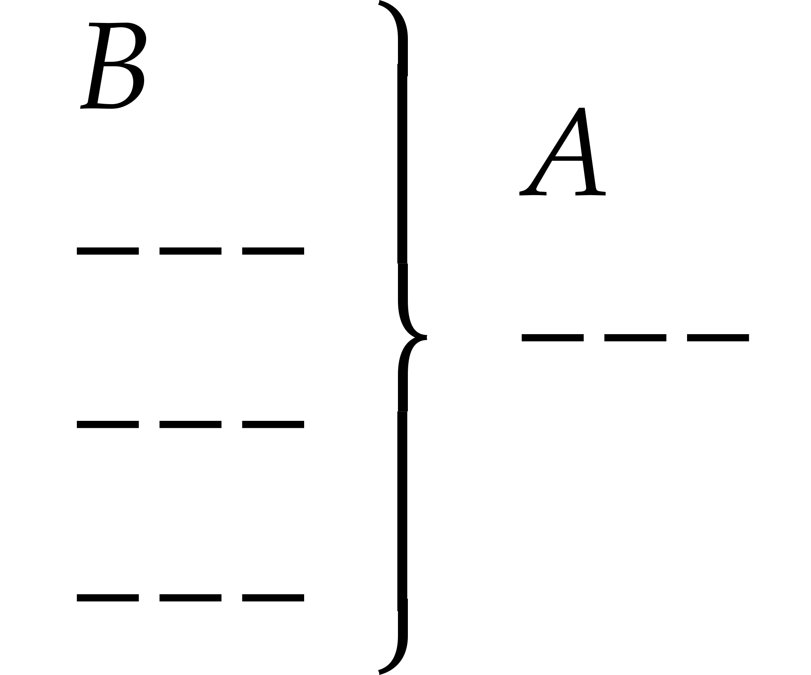 means that an equation of the kind A has the multiplicity that one sees in complex B, i.e. that one can distinguish as much in this equation (or make as many distinctions in it) as in the complex.

————|————

### [31v\[2\]](https://cdn.wittgensteinnachlass.com/2000px/webp/Ms-155/31v.webp),[32r\[1\]](https://cdn.wittgensteinnachlass.com/2000px/webp/Ms-155/32r.webp)

I.e. that the ornament of the complex has as many fitting surfaces as that of the equation

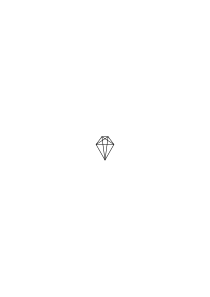

& the remaining multiplicity of the complex falls away like that of the pentagon, so that, as far as combining it with other figures is concerned, one could replace it only by its contour

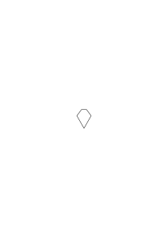

& in this sense the equation traces the contour of the complex.

————|————

### [32r\[2\]](https://cdn.wittgensteinnachlass.com/2000px/webp/Ms-155/32r.webp)

One could put the equality sign between B & A.

### [32r\[3\]](https://cdn.wittgensteinnachlass.com/2000px/webp/Ms-155/32r.webp),[32v\[1\]](https://cdn.wittgensteinnachlass.com/2000px/webp/Ms-155/32v.webp)

Is it like this: Sentence A contains nothing other than B, indeed is an abbreviation of B. But I cannot say that B would be proved by a + (b + c) = (a + b) + c. That of course means nothing at all. – Only β & γ were proved with α. –

### [32v\[2\]](https://cdn.wittgensteinnachlass.com/2000px/webp/Ms-155/32v.webp)

And α, β & γ were simply put together. They were picked out & something new was made from them

### [32v\[3\]](https://cdn.wittgensteinnachlass.com/2000px/webp/Ms-155/32v.webp),[33r\[1\]](https://cdn.wittgensteinnachlass.com/2000px/webp/Ms-155/33r.webp)

It cannot be shown, proved, that one _can_ use certain rules as rules of this way of acting.

### [33r\[2\]](https://cdn.wittgensteinnachlass.com/2000px/webp/Ms-155/33r.webp)

Here in Austria the machines still keep people on the rails.

———— · ————

### [33r\[3\]](https://cdn.wittgensteinnachlass.com/2000px/webp/Ms-155/33r.webp),[33v\[1\]](https://cdn.wittgensteinnachlass.com/2000px/webp/Ms-155/33v.webp),[34r\[1\]](https://cdn.wittgensteinnachlass.com/2000px/webp/Ms-155/34r.webp)

(a + b) + 1 = (a + b) + 1

a + (b + (c + 1)) = (a + (b + c)) + 1 } (a + b) + c = (a + b) + c

(a + b) + (c + 1) = ((a + b) + c) + 1

(a + 1) + 1 = (a + 1) + 1

}a + 1 = 1 + a

1 + (a + 1) = (1 + a) + 1 a + b = b + a

a + (b + 1) = (a + b) + 1

((b + 1) + a) = (b + a) + 1

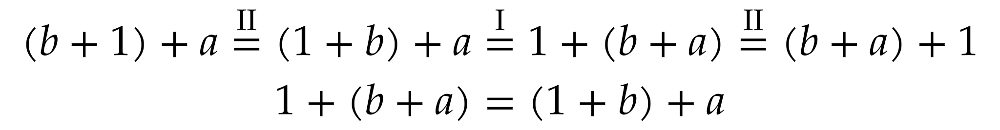

### [34r\[2\]](https://cdn.wittgensteinnachlass.com/2000px/webp/Ms-155/34r.webp)

(a + b) ∙ (a + b) = a ∙ a + 2ab + b ∙ b

(1 + 1 + 1) + (1 + 1 ∙ 1 + 1) =

(a + b) = b + a

### [34v\[1\]](https://cdn.wittgensteinnachlass.com/2000px/webp/Ms-155/34v.webp),[35r\[1\]](https://cdn.wittgensteinnachlass.com/2000px/webp/Ms-155/35r.webp)

„This sentence is proved for all numbers by the recursive procedure”. That is the expression that is so thoroughly misleading. It sounds as though a sentence stating that this & this holds for all cardinal numbers were here established as true by some route & as though this route were a route in a space of conceivable routes. Whereas in _reality_ recursion shows only itself, as does periodicity.

### [35r\[2\]](https://cdn.wittgensteinnachlass.com/2000px/webp/Ms-155/35r.webp)

The analogy between the recursive proof and periodicity has also not been worked out with complete clarity.

### [35v\[1\]](https://cdn.wittgensteinnachlass.com/2000px/webp/Ms-155/35v.webp)

1 + (1 + (1 + 1)) = 1 + ((1 + 1) + 1)

a + (b + (c + 1)) = a + ((b + c) + 1) = (a + (b + c)) + 1, hence analogously

1 + (1 + (1 + 1)) = 1 + ((1 + 1) + 1) = (1 + (1 + 1)) + 1, so I would need as definitions:

1 + (1 + 1) = ((1 + 1) + 1 _and_ 1 + ((1 + 1) + 1) = (1 + (1 + 1)) + 1 and (1 + 1) + (1 + 1) = ((1 + 1) + 1) + 1 1 + (1 + 1) = (1 + 1) + 1

---

### [36r\[1\]](https://cdn.wittgensteinnachlass.com/2000px/webp/Ms-155/36r.webp)

1 + (1 + (1 + 1)) = (1 + (1 + 1)) + 1

(1 + 1) + (1 + 1) = ((1 + 1) + 1) + 1

---

How does one prove this?

(1 + 1) + (1 + (1 + 1)) = ((1 + 1) + 1) + (1 + 1) =

———— · ————

### [36v\[1\]](https://cdn.wittgensteinnachlass.com/2000px/webp/Ms-155/36v.webp)

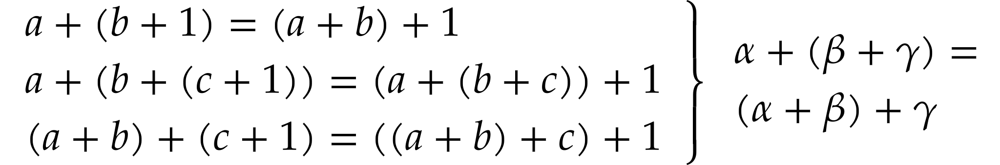

### [36v\[2\]](https://cdn.wittgensteinnachlass.com/2000px/webp/Ms-155/36v.webp)

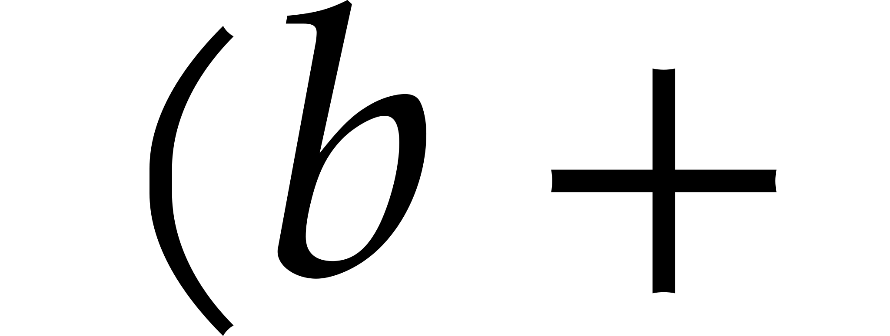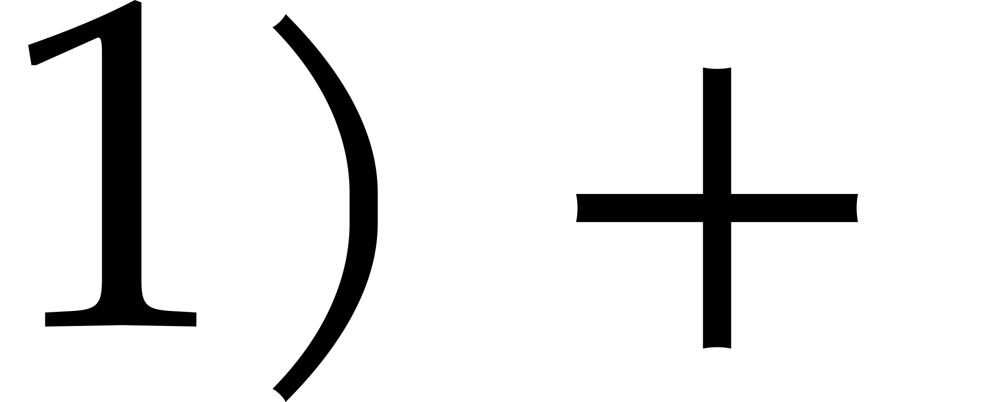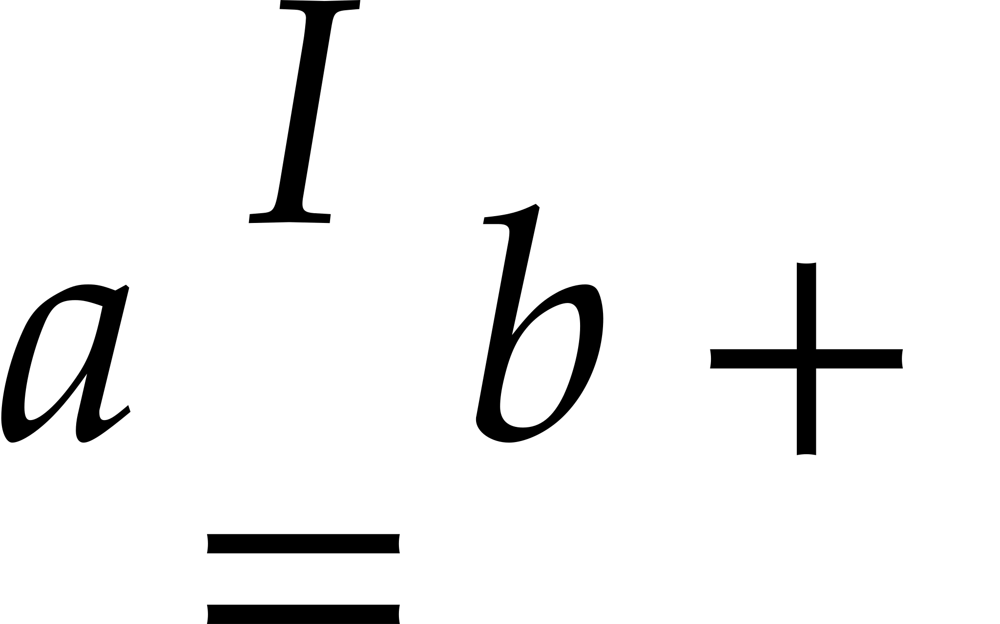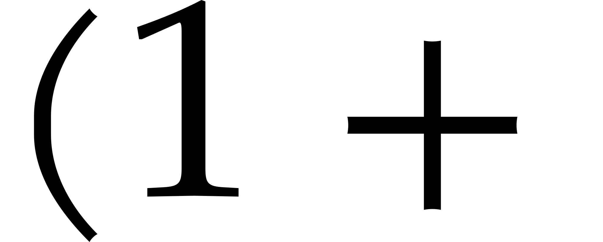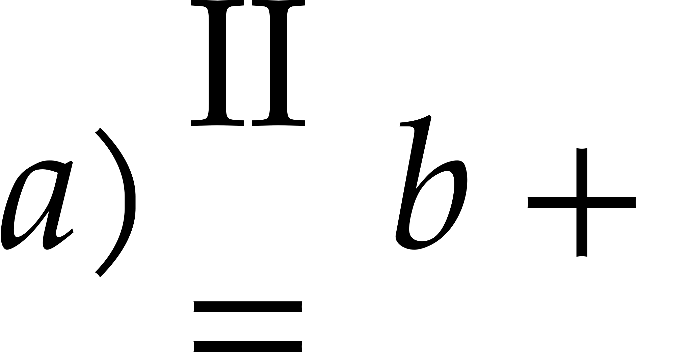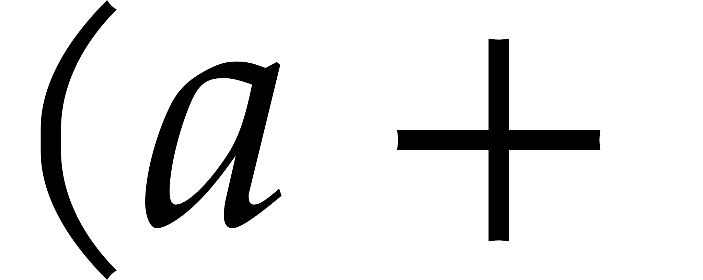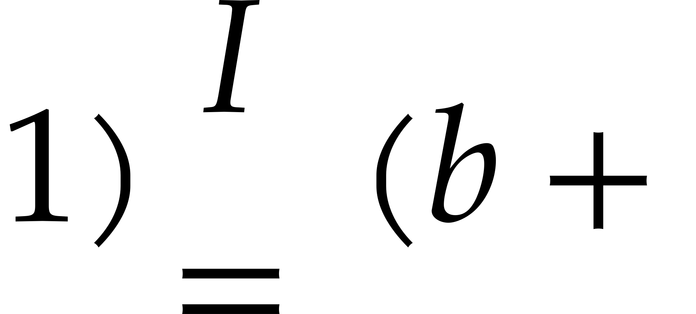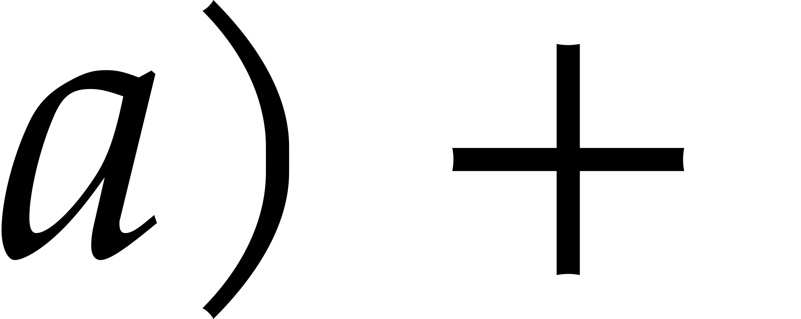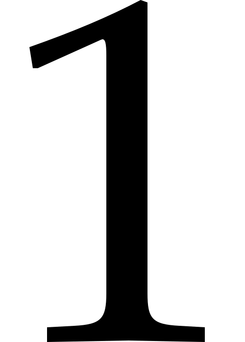

### [36v\[3\]](https://cdn.wittgensteinnachlass.com/2000px/webp/Ms-155/36v.webp),[37r\[1\]](https://cdn.wittgensteinnachlass.com/2000px/webp/Ms-155/37r.webp)

What I should like to get you to do is not to agree with me in particular opinions but to investigate the matter in the right way. To notice the interesting kind of things (i.e. the things which will serve as keys if you use them properly).

### [37r\[2\]](https://cdn.wittgensteinnachlass.com/2000px/webp/Ms-155/37r.webp)

What different people expect to get from religion is what they expect to get from philosophy.

### [37r\[3\]](https://cdn.wittgensteinnachlass.com/2000px/webp/Ms-155/37r.webp),[37v\[1\]](https://cdn.wittgensteinnachlass.com/2000px/webp/Ms-155/37v.webp)

I don't want to give you a definition of philosophy but I should like you to have a very lively idea as to the character of philosophic problems. If you had, by the way, I could stop lecturing at once.

### [37v\[2\]](https://cdn.wittgensteinnachlass.com/2000px/webp/Ms-155/37v.webp)

To tackle the philosophical problems is difficult as we are caught in the meshes of language.

### [37v\[3\]](https://cdn.wittgensteinnachlass.com/2000px/webp/Ms-155/37v.webp)

„Has the universe an end in time” (Einstein)

### [37v\[4\]](https://cdn.wittgensteinnachlass.com/2000px/webp/Ms-155/37v.webp),[38r\[1\]](https://cdn.wittgensteinnachlass.com/2000px/webp/Ms-155/38r.webp)

You would perhaps give up philosophy if you knew what it is – you want explanations instead of wanting descriptions. And you are therefore looking for the wrong kind of thing.

### [38r\[2\]](https://cdn.wittgensteinnachlass.com/2000px/webp/Ms-155/38r.webp)

Philosophical questions, as soon as you boil them down to … change their aspect entirely. What evaporates is what the intellect can't tackle.

### [38r\[3\]](https://cdn.wittgensteinnachlass.com/2000px/webp/Ms-155/38r.webp),[38v\[1\]](https://cdn.wittgensteinnachlass.com/2000px/webp/Ms-155/38v.webp)

(a + b)² = a² + 2ab + b²

(i + k)² = i² + 2ik + k²

Is the second derived from the first? and if so why not the first from the second.

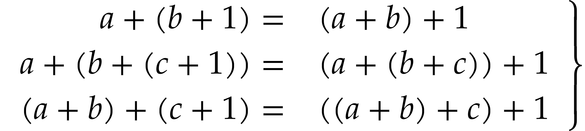

### [38v\[2\]](https://cdn.wittgensteinnachlass.com/2000px/webp/Ms-155/38v.webp)

Concrete Example _ambiguity_

### [38v\[3\]](https://cdn.wittgensteinnachlass.com/2000px/webp/Ms-155/38v.webp),[39r\[1\]](https://cdn.wittgensteinnachlass.com/2000px/webp/Ms-155/39r.webp)

What does it mean not to take α․β․γ as a sentence? That should shed some light on what it means to regard something as a sentence. And here again I think of running through it lengthwise, instead of crosswise

### [39r\[2\]](https://cdn.wittgensteinnachlass.com/2000px/webp/Ms-155/39r.webp),[39v\[1\]](https://cdn.wittgensteinnachlass.com/2000px/webp/Ms-155/39v.webp)

As if one did not run along a rail that went like this 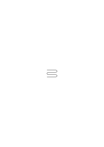 but used it as a ladder (crosswise).

### [39v\[2\]](https://cdn.wittgensteinnachlass.com/2000px/webp/Ms-155/39v.webp)

Suppose we were to read the sentences of a book backwards (the words in reverse order); could we not still understand the sentence? And wouldn’t it now sound quite unlike a sentence?

### [39v\[3\]](https://cdn.wittgensteinnachlass.com/2000px/webp/Ms-155/39v.webp),[40r\[1\]](https://cdn.wittgensteinnachlass.com/2000px/webp/Ms-155/40r.webp)

I only want to tabulate the use of words. I am your secretary & a deaf & dense secretary who asks you 10 times before he puts anything down.

### [40r\[2\]](https://cdn.wittgensteinnachlass.com/2000px/webp/Ms-155/40r.webp)

What I want to teach you isn't opinions but a method. In fact the method to treat as irrelevant every question of opinion.

### [40r\[3\]](https://cdn.wittgensteinnachlass.com/2000px/webp/Ms-155/40r.webp),[40v\[1\]](https://cdn.wittgensteinnachlass.com/2000px/webp/Ms-155/40v.webp)

I want you to get to the point where you can take the _right kind of notes_. Note everything that strikes you about the case say of the doctor finding out the hour of death. Compare it with other cases. Refrain to write down any hypothesis & any vague general statement & you have made a philosophical investigation.

### [40v\[2\]](https://cdn.wittgensteinnachlass.com/2000px/webp/Ms-155/40v.webp),[41r\[1\]](https://cdn.wittgensteinnachlass.com/2000px/webp/Ms-155/41r.webp)

Is what happens in the process of meaning something momentary while you pronounce the word? etc. Paint me Julius Caesar's death then I'll know what you mean by his death.

### [41r\[2\]](https://cdn.wittgensteinnachlass.com/2000px/webp/Ms-155/41r.webp)

If I'm wrong then you are right, which is just as good. As long as you look for the same thing.

### [41r\[3\]](https://cdn.wittgensteinnachlass.com/2000px/webp/Ms-155/41r.webp),[41v\[1\]](https://cdn.wittgensteinnachlass.com/2000px/webp/Ms-155/41v.webp)

When you say there is no doubt about the meaning of „Caesar's death”, I quite agree with you but there is no doubt because there is no doubt about the logically admissible verifications. There is doubt only about matters of experience e.g. whether as a matter of fact such & such phenomena are regularly followed by certain experience which we call seeing a man dying, etc.

### [41v\[2\]](https://cdn.wittgensteinnachlass.com/2000px/webp/Ms-155/41v.webp),[42r\[1\]](https://cdn.wittgensteinnachlass.com/2000px/webp/Ms-155/42r.webp)

The hidden truth in idealism was that idealism recognized the _essential_ connection between a statement about the physical world & a statement about our direct experience which is said to support the first statement.

### [42r\[2\]](https://cdn.wittgensteinnachlass.com/2000px/webp/Ms-155/42r.webp)

I don't try to make you _believe_ something, you don't believe, but to make you _do_ something, you won't _do_.

### [42r\[3\]](https://cdn.wittgensteinnachlass.com/2000px/webp/Ms-155/42r.webp)

It is an activity which I ask of you & you refuse to do.

### [42r\[4\]](https://cdn.wittgensteinnachlass.com/2000px/webp/Ms-155/42r.webp),[42v\[1\]](https://cdn.wittgensteinnachlass.com/2000px/webp/Ms-155/42v.webp),[43r\[1\]](https://cdn.wittgensteinnachlass.com/2000px/webp/Ms-155/43r.webp)

<s>That really means no more than that the two sides together form one sign. That they have meaning only in relation to one another (& not individually). And the same holds when it says “F(a) and a≝f(b)” or “F(a) where a≝f(b) is.” Here too Fa & the definition really form **one** sign, or, more correctly & without mythology: they belong together & I could just as well have written:

Fa≝F(f(b))</s>

### [43r\[1\]](https://cdn.wittgensteinnachlass.com/2000px/webp/Ms-155/43r.webp),[43v\[1\]](https://cdn.wittgensteinnachlass.com/2000px/webp/Ms-155/43v.webp)

<s>There is presumably a difference between the cases in which, on the one hand, 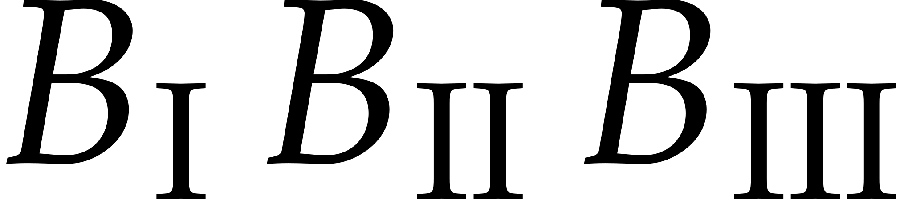 are constructed for 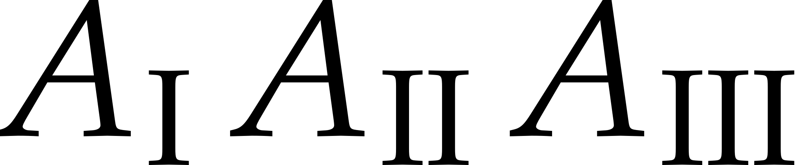 without an analogy between the Bs being seen (or emphasised), and, on the other hand, the analogy of the Bs being emphasised. But it is true that emphasising this analogy does not make the Bs proofs.</s>

### [43v\[2\]](https://cdn.wittgensteinnachlass.com/2000px/webp/Ms-155/43v.webp)

<s>Is it correct to say: no further step can make B a proof if it is not one after the first?</s>

### [43v\[3\]](https://cdn.wittgensteinnachlass.com/2000px/webp/Ms-155/43v.webp),[44r\[1\]](https://cdn.wittgensteinnachlass.com/2000px/webp/Ms-155/44r.webp)

<s>

Someone shows me the complexes B and I say, those are your proofs of the equations A. Now he says: But you no longer see the system according to which these complexes are formed & shows it to me. How could that make the Bs into **proofs**? –</s>

### [44r\[2\]](https://cdn.wittgensteinnachlass.com/2000px/webp/Ms-155/44r.webp)

<s>Through this insight I ascend to a different, so to speak higher, level, whereas the **proof** would have had to be carried out on the lower one.</s>

### [44r\[3\]](https://cdn.wittgensteinnachlass.com/2000px/webp/Ms-155/44r.webp),[44v\[1\]](https://cdn.wittgensteinnachlass.com/2000px/webp/Ms-155/44v.webp),[45r\[1\]](https://cdn.wittgensteinnachlass.com/2000px/webp/Ms-155/45r.webp)

<s>For all that is there are **these** proofs,

and the concept under which the proofs fall is superfluous, for we have never done anything with them. Just as the concept of a chair is superfluous if I only want to say, pointing at the objects, put this & this & this in my room (although the three objects are chairs). (And if one of these objects is not suitable for sitting on, that is not changed by drawing attention to a similarity between them.</s>

### [45r\[2\]](https://cdn.wittgensteinnachlass.com/2000px/webp/Ms-155/45r.webp),[45v\[1\]](https://cdn.wittgensteinnachlass.com/2000px/webp/Ms-155/45v.webp)

<s>But that means nothing other than that the individual proof needs our recognition as such (if ‘proof’ is to mean what it means); if it lacks this, no discovery of an analogy with other such formations can give it that recognition. And the appearance of proof arises from the fact that α, β, γ & A are equations & that a general rule can be given according to which one can form A from B (and in this sense derive it). One can become aware of **this general rule** **afterwards**. (But does this make one aware (of the fact) that the Bs really are proofs of the As?) One becomes aware of a rule with which one …</s>

### [46r\[1\]](https://cdn.wittgensteinnachlass.com/2000px/webp/Ms-155/46r.webp)

<s>Where does this conflict come from: „that’s no proof” – „but that is a proof!”.</s>

### [VB](/w-vb/#ms-155-46r.2) [46r\[2\]](https://cdn.wittgensteinnachlass.com/2000px/webp/Ms-155/46r.webp)

<s>[The joy in my thoughts is the joy in my own strange life. Is that joy in life?]</s>

### [46r\[3\]](https://cdn.wittgensteinnachlass.com/2000px/webp/Ms-155/46r.webp),[46v\[1\]](https://cdn.wittgensteinnachlass.com/2000px/webp/Ms-155/46v.webp)

<s>One could say: It is no doubt true that in the proof of B, by means of α, I trace the outlines of equation A, but not in the way that I call proving A by means of α.</s>

### [46v\[2\]](https://cdn.wittgensteinnachlass.com/2000px/webp/Ms-155/46v.webp)

<s>↖ could have begun: & by means of & α one could have constructed AI AII etc. But no one would have called them a proof in this game.</s>

### [46v\[3\]](https://cdn.wittgensteinnachlass.com/2000px/webp/Ms-155/46v.webp),[47r\[1\]](https://cdn.wittgensteinnachlass.com/2000px/webp/Ms-155/47r.webp)

<s>The difficulty to be overcome in this consideration is that of regarding the proof by induction **naively**, so to speak, as something new.</s>

### [47r\[2\]](https://cdn.wittgensteinnachlass.com/2000px/webp/Ms-155/47r.webp),[47v\[1\]](https://cdn.wittgensteinnachlass.com/2000px/webp/Ms-155/47v.webp)

<s>I seem to be using 2 arguments: 1.) The general concept of induction is superfluous because it is not used. 2.) Even if it is used **it is** not a proof. Two arguments are too many. In reality it is like this: I can indeed use R to construct the As, but once they are constructed the false appearance arises that they were constructed in another – proving – way; & that is what is to be denied.</s>

### [47v\[2\]](https://cdn.wittgensteinnachlass.com/2000px/webp/Ms-155/47v.webp)

<s>Is the relatedness of the As shown by the Bs?

</s>

### [48r\[1\]](https://cdn.wittgensteinnachlass.com/2000px/webp/Ms-155/48r.webp)

<s>Two objections

The first objection: that the generality of the method of induction is humbug, since all that is used are the particular cases of induction & induction is never used constructively.</s>

### [48r\[2\]](https://cdn.wittgensteinnachlass.com/2000px/webp/Ms-155/48r.webp)

<s>The other, that although one can construct the sentences A by means of R and α, this construction is not a proof.</s>

### [48r\[3\]](https://cdn.wittgensteinnachlass.com/2000px/webp/Ms-155/48r.webp),[48v\[1\]](https://cdn.wittgensteinnachlass.com/2000px/webp/Ms-155/48v.webp)

<s>The numerical example by which we show the operation of the induction-schema interests us only insofar as it represents a property of (schema) B. Just as, for example, we direct a current through a system of tubes in order to make the operation of the system of tubes clear, to demonstrate the system of tubes to ourselves.</s>

### [48v\[2\]](https://cdn.wittgensteinnachlass.com/2000px/webp/Ms-155/48v.webp),[49r\[1\]](https://cdn.wittgensteinnachlass.com/2000px/webp/Ms-155/49r.webp)

<s>For the general form R is really not used to construct B. α serves this purpose. A sentence of the form R is constructed by means of α. R

One does construct something new with it – one does construct something with it!)

If this has **succeeded**, I can now indeed use a construction rule which says: take these members of B & put an equality sign between them & thus construct A.</s>

### [49r\[2\]](https://cdn.wittgensteinnachlass.com/2000px/webp/Ms-155/49r.webp)

<s>Have I now constructed A **with R** or not?</s>

### [49r\[3\]](https://cdn.wittgensteinnachlass.com/2000px/webp/Ms-155/49r.webp),[49v\[1\]](https://cdn.wittgensteinnachlass.com/2000px/webp/Ms-155/49v.webp)

<s>We must also bear in mind that the task of constructing, by means of ρ, a complex of the form R is not really a mathematical task, since we know no method for solving it. It is rather a matter of chance when such a complex comes about.</s>

### [49v\[2\]](https://cdn.wittgensteinnachlass.com/2000px/webp/Ms-155/49v.webp),[50r\[1\]](https://cdn.wittgensteinnachlass.com/2000px/webp/Ms-155/50r.webp),[50v\[1\]](https://cdn.wittgensteinnachlass.com/2000px/webp/Ms-155/50v.webp)

<s>So if I said earlier that we can begin with R, then beginning with R in this way is in a certain sense _humbug_. It is not like beginning a calculation by working out 526 × 718. For here this formulation of the problem is the starting point of a path. Whereas there I leave R behind at once and have to begin somewhere else. And once I have constructed a complex of the form R, it again makes no difference whether I set myself that aim externally beforehand, because this intention was no help to me mathematically, i.e. in the calculus. So what remains is the fact that I now have a complex of the form R before me.</s>

### [50v\[2\]](https://cdn.wittgensteinnachlass.com/2000px/webp/Ms-155/50v.webp),[51r\[1\]](https://cdn.wittgensteinnachlass.com/2000px/webp/Ms-155/51r.webp)

<s>Could I not now say that definition V is humbug, for it is an **empty** promise so long as I have not constructed complexes of this form & then superfluous? No, for I can construct such complexes from every algebraic equation, as it were beginning from the back. And so we could really begin & write, once and for all, quite independently of the possibility of a proof, every algebraic prototype in the form B – constructed from A.</s>

### [51r\[2\]](https://cdn.wittgensteinnachlass.com/2000px/webp/Ms-155/51r.webp)

<s>If this had happened, the inductive proof would simply present itself as an algebraic proof of α, β & γ.</s>

### [51r\[3\]](https://cdn.wittgensteinnachlass.com/2000px/webp/Ms-155/51r.webp),[53v\[1\]](https://cdn.wittgensteinnachlass.com/2000px/webp/Ms-155/53v.webp),[52r\[1\]](https://cdn.wittgensteinnachlass.com/2000px/webp/Ms-155/52r.webp)

<s>We could imagine knowing only the proof BI & then saying: All we have is this construction; there is no talk at all of an analogy between this and other constructions, or of a general principle in carrying out this construction. If I see B & A only in this way, I have to ask: but why do you call that a proof **of AI in particular**? (I am not yet asking: why do you call it a proof) (What has this complex to do with AI?). In reply he has to draw my attention to the relation between A & B that is expressed in V.</s>

### [52r\[2\]](https://cdn.wittgensteinnachlass.com/2000px/webp/Ms-155/52r.webp),[52v\[1\]](https://cdn.wittgensteinnachlass.com/2000px/webp/Ms-155/52v.webp)

<s>If one says that one does not need the general form R in the proof of A, I should say: it is none of my concern when I am looking for the proof of A in B. Or: I should not need it. If I recognise the form R in B (or relation V in A D), it is of no use to me. If it is shown to me (with the intention of drawing my attention to the probative force of B for A), I should like to say: well, & what next?</s>

### [52v\[2\]](https://cdn.wittgensteinnachlass.com/2000px/webp/Ms-155/52v.webp),[53r\[1\]](https://cdn.wittgensteinnachlass.com/2000px/webp/Ms-155/53r.webp)

<s>If I say that the general principle is immaterial, since only this **one** case matters (& **hic** Rhodos **hic** salta), that is correct if the generality of the principle means its applicability to cases other than this one. On the other hand, what matters is seeing complex B with **these** emphases. So I shall not concern myself with any other analogous cases, but in B } A draw attention to something definite.</s>

### [53r\[2\]](https://cdn.wittgensteinnachlass.com/2000px/webp/Ms-155/53r.webp),[53r\[1\]](https://cdn.wittgensteinnachlass.com/2000px/webp/Ms-155/53r.webp)

<s>If I say that R is never used for construction, the answer is: it **could** also be used for construction in the one case, but on the other hand it does not help with the proof.</s>

### [53v\[1\]](https://cdn.wittgensteinnachlass.com/2000px/webp/Ms-155/53v.webp)

<s>We have only this one case & pointing out a general principle to which it belongs does not make it a proof.</s>

### [53v\[2\]](https://cdn.wittgensteinnachlass.com/2000px/webp/Ms-155/53v.webp)

<s>„I have only this **one** case, I do not know whether I shall ever have another, what is a general principle supposed to do here?” Here there really would be the case of the primary colours.</s>

### [53v\[3\]](https://cdn.wittgensteinnachlass.com/2000px/webp/Ms-155/53v.webp),[54r\[1\]](https://cdn.wittgensteinnachlass.com/2000px/webp/Ms-155/54r.webp)

<s>But the case here is the case of the proof of B by means of α (or ρ). That does not hold for the other case, namely the construction of B from A! Rather, here I see a general principle at the moment when I discover it at all in B & A.</s>

### [54r\[2\]](https://cdn.wittgensteinnachlass.com/2000px/webp/Ms-155/54r.webp),[54v\[1\]](https://cdn.wittgensteinnachlass.com/2000px/webp/Ms-155/54v.webp)

<s>Someone shows us BI and explains to us the connection with AI, i.e. that the right-hand side of A was obtained in such-and-such a way, etc. etc. We understand him. And he asks us now: is that, then, a proof of A? We would answer: certainly **not**! Had we then understood everything there was to understand about this proof? Yes. Had we also seen the general form of the connection between B & A? Yes!</s>

### [54v\[2\]](https://cdn.wittgensteinnachlass.com/2000px/webp/Ms-155/54v.webp)

<s>And we could also conclude from this that in this way one can construct a B from every A **& hence also, conversely, A from B.**

</s>

### [55r\[1\]](https://cdn.wittgensteinnachlass.com/2000px/webp/Ms-155/55r.webp),[55v\[1\]](https://cdn.wittgensteinnachlass.com/2000px/webp/Ms-155/55v.webp)

<s>This proof is built according to a definite plan (according to which other proofs are also built). But this plan cannot make the proof a proof. For here and now we have only the one embodiment of this plan & can disregard the plan as a general concept altogether. The proof must speak for itself & the plan is only embodied in it, but is itself no part of the proof (that is what I wanted to say all along). So it is no use to me if someone draws my attention to the similarities between proofs in order to convince me that they are proofs.</s>

### [55v\[2\]](https://cdn.wittgensteinnachlass.com/2000px/webp/Ms-155/55v.webp),[56r\[1\]](https://cdn.wittgensteinnachlass.com/2000px/webp/Ms-155/56r.webp)

<s>Certainly it does not help towards this conviction to see that these proofs are built according to the same plan & as I said, I could have only a single proof before me. But it is different if this plan is the essence of proving itself. For I could say that all algebraic proofs are built according to a plan & thereby mean the essence of proving equations. And we are only objecting to the claim that the relatedness of A to B, to which R V draws our attention, is the relatedness of what is proved to the proof.</s>

### [56r\[2\]](https://cdn.wittgensteinnachlass.com/2000px/webp/Ms-155/56r.webp),[56v\[1\]](https://cdn.wittgensteinnachlass.com/2000px/webp/Ms-155/56v.webp)

<s>I must say: if A follows from B, then it follows whether or not the rule of inference has been formulated generally. Everything concerning the internal relation of B to A is seen from these two alone.</s>

### [56v\[2\]](https://cdn.wittgensteinnachlass.com/2000px/webp/Ms-155/56v.webp)

<s>A rule of inference corresponds exactly to a **plan** of the proof. It can record the particular kind of inference, but cannot justify the inference; only the two members of the inference can do that.</s>

### [56v\[3\]](https://cdn.wittgensteinnachlass.com/2000px/webp/Ms-155/56v.webp),[57r\[1\]](https://cdn.wittgensteinnachlass.com/2000px/webp/Ms-155/57r.webp)

<s>So I must be able to point to B & A alone & ask: is this a proof of that?</s>

### [57r\[1\]](https://cdn.wittgensteinnachlass.com/2000px/webp/Ms-155/57r.webp),[57v\[1\]](https://cdn.wittgensteinnachlass.com/2000px/webp/Ms-155/57v.webp)

<s>But one might say: This argument could also be applied to the proof (a + b)² etc. & say: whether or not the transition (a + b) ∙ (a + b) = a ∙ (a + b) etc. is correct can only be seen in it itself (in its members); one needs no rule for that. That is true too & the rules merely tabulate the permitted transitions. But then I can look in the rule-book to convince myself whether a transition is permitted or not. And why should I not do the same in the case of the transition from B to A & look at V?</s>

### [57v\[2\]](https://cdn.wittgensteinnachlass.com/2000px/webp/Ms-155/57v.webp),[58r\[1\]](https://cdn.wittgensteinnachlass.com/2000px/webp/Ms-155/58r.webp)

<s>So if someone points to B & A & asks whether this is a proof of that, I could answer: I have just forgotten the rules; I must look them up first? So can I not know whether B is a proof of A even if I recognise relation V in them, so long as I have not convinced myself that R appears in the rule-book? That seems to be the fundamental question.</s>

### [58r\[2\]](https://cdn.wittgensteinnachlass.com/2000px/webp/Ms-155/58r.webp)

<s>If the rule-book were not to hand & someone said: „I don’t know whether B is a proof of A”! –</s>

### [58v\[1\]](https://cdn.wittgensteinnachlass.com/2000px/webp/Ms-155/58v.webp)

<s>For that is how he would then have to speak. „One cannot simply say whether it is a proof of A.”</s>

### [58v\[2\]](https://cdn.wittgensteinnachlass.com/2000px/webp/Ms-155/58v.webp),[59r\[1\]](https://cdn.wittgensteinnachlass.com/2000px/webp/Ms-155/59r.webp),[59v\[1\]](https://cdn.wittgensteinnachlass.com/2000px/webp/Ms-155/59v.webp),[60r\[1\]](https://cdn.wittgensteinnachlass.com/2000px/webp/Ms-155/60r.webp),[60v\[1\]](https://cdn.wittgensteinnachlass.com/2000px/webp/Ms-155/60v.webp)

<s>When I said earlier „that’s no proof”, I meant ‘proof’ in a quite definite sense, in which it can be seen from A & B alone. For in this sense I can say: I understand perfectly well what B does & how it is related to A. Any further instruction is superfluous & **that** is not a proof. In this sense I am dealing with B & A alone; I see nothing apart from them & nothing else concerns me.

So I see the relation according to rule V perfectly well, but for me it is quite out of the question as a construction rule. If someone told me, while I was considering A & B, that one could also have constructed B from A (or conversely) according to a rule, I could only tell him ‘don’t bother me with inessentials’. For that is self-evident & I see at once that it does not make B a proof of A. For the existence of such a general rule could only show that B is the proof **of A** **& of no other sentence**, if it were a proof at all. I.e. the connection between B & A according to a rule cannot show that B is a **proof** of A. And any such connection could be used to construct B from A (and conversely).

Now I could of course say: whether this connection is the connection of proving depends on whether its general description (its prototype) appears on my list of rules of proof or not. But then here we are calling something proof other than what we called it above, for we come into conflict with our ordinary way of speaking. For the relation between B & A is **already described** by the ordinary way of speaking & in the system of this way of speaking we also speak of proofs, but describe the relation between A & B **not** as that of proof.

</s>

### [61r\[1\]](https://cdn.wittgensteinnachlass.com/2000px/webp/Ms-155/61r.webp),[61v\[1\]](https://cdn.wittgensteinnachlass.com/2000px/webp/Ms-155/61v.webp),[62r\[1\]](https://cdn.wittgensteinnachlass.com/2000px/webp/Ms-155/62r.webp)

<s> So if I said “V isn’t used in the construction at all, so we have nothing to do with it”, I should have said: I am dealing with A & B alone. It is enough for me to set A & B against each other and ask whether B is a proof of A; and so I do not need to construct A from B according to a rule fixed beforehand, but need only set the individual As against the individual Bs & ask whether this is a proof of that. I do not need a rule of construction. And that is true. I do not need a rule of construction set up beforehand (from which I would only then have obtained the As).

On the other hand, when A & B are set against each other (even if only **one** B with **one** A), I presumably do have to look at the two and understand their internal relation.

“V is not used as a rule of construction” means that I have not in fact constructed with it & do not need to either, and that is true. But it is also true that I **could** construct with this rule & also that this of course does not make B a proof of A. </s>

### [62r\[2\]](https://cdn.wittgensteinnachlass.com/2000px/webp/Ms-155/62r.webp)

<s> The use of the word “this↗” </s>

### [62v\[1\]](https://cdn.wittgensteinnachlass.com/2000px/webp/Ms-155/62v.webp)

<s> Onus probandi (on the part of the mathematician etc.). </s>

### [62v\[2\]](https://cdn.wittgensteinnachlass.com/2000px/webp/Ms-155/62v.webp)

<s> Connection between the As shown by B? Even without seeing the Bs.</s>

### [62v\[3\]](https://cdn.wittgensteinnachlass.com/2000px/webp/Ms-155/62v.webp)

<s> Why should I not point to something green when explaining the word ‘red’, and vice versa. </s>

### [62v\[4\]](https://cdn.wittgensteinnachlass.com/2000px/webp/Ms-155/62v.webp)

<s> Then, however, the definition “this → is red” and the statement “this is red” now sound outwardly different from each other. </s>

### [63r\[1\]](https://cdn.wittgensteinnachlass.com/2000px/webp/Ms-155/63r.webp)

<s> What if the words ‘red’, ‘blue’ had the effect of making us see coloured circles, like pressure on our eyelids, so that we could say to the child “fetch the blue one” & would not have to point to a blue plaque, but the word would act like an onomatopoeic word. </s>

### [63r\[2\]](https://cdn.wittgensteinnachlass.com/2000px/webp/Ms-155/63r.webp),[63v\[1\]](https://cdn.wittgensteinnachlass.com/2000px/webp/Ms-155/63v.webp)

<s> Is this to which I point the colour, or what has the colour? And could my explanation of the word not run: “I say that ‘this plaque is red’”. </s>

### [63v\[2\]](https://cdn.wittgensteinnachlass.com/2000px/webp/Ms-155/63v.webp)

<s> But how is it decided what is being pointed to? Whether to the colour or the place? Presumably to the place where the colour is. But there is nothing further to distinguish there. </s>

### [63v\[3\]](https://cdn.wittgensteinnachlass.com/2000px/webp/Ms-155/63v.webp),[64r\[1\]](https://cdn.wittgensteinnachlass.com/2000px/webp/Ms-155/64r.webp)

<s> The explanation of the word could also run: I call the colour which this place has ‘red’. What is the ‘**real position**’ of the body I see under water, what is the **real colour** of the table? Here it is precisely the question about verification that makes the sense of these expressions clear. </s>

### [64r\[2\]](https://cdn.wittgensteinnachlass.com/2000px/webp/Ms-155/64r.webp),[64v\[1\]](https://cdn.wittgensteinnachlass.com/2000px/webp/Ms-155/64v.webp)

<s> What strikes a false note in the question whether there must be primary signs (ostensive gestures), whereas our language could get by without the others (words), is that one expects to obtain an **explanation** of the existing language rather than a mere description. </s>

### [64v\[2\]](https://cdn.wittgensteinnachlass.com/2000px/webp/Ms-155/64v.webp)

<s> (Instead of turbulent conjectures! & explanations, let us give calm accounts of linguistic usages.) </s>

### [64v\[3\]](https://cdn.wittgensteinnachlass.com/2000px/webp/Ms-155/64v.webp),[65r\[1\]](https://cdn.wittgensteinnachlass.com/2000px/webp/Ms-155/65r.webp)

<s> It is not the colour red that takes the place of the word “red”, but the gesture of pointing to a red object, or the little red plaque. </s>

### [65r\[2\]](https://cdn.wittgensteinnachlass.com/2000px/webp/Ms-155/65r.webp),[65v\[1\]](https://cdn.wittgensteinnachlass.com/2000px/webp/Ms-155/65v.webp)

<s> But now I say: “It rightly counts as a criterion of understanding the word ‘red’ that someone can pick out a red object on command from objects of other colours; whereas correctly translating the word ‘red’ into English or French is no proof of his understanding. So the little red plaque is a primary sign for ‘red’, whereas every word is a secondary sign.” </s>

### [65v\[2\]](https://cdn.wittgensteinnachlass.com/2000px/webp/Ms-155/65v.webp)

<s> What, then, is the criterion of our understanding: pointing out the little red plaque when one was asked which of these plaques is red, or repeating the ostensive definition “that ↗ is red”? </s>

### [65v\[3\]](https://cdn.wittgensteinnachlass.com/2000px/webp/Ms-155/65v.webp),[66r\[1\]](https://cdn.wittgensteinnachlass.com/2000px/webp/Ms-155/66r.webp)

<s> The first sign of your understanding would be if I began to have your cooperation & this would alter the tone of these discussions which would become that of a quiet search. </s>

### [66r\[2\]](https://cdn.wittgensteinnachlass.com/2000px/webp/Ms-155/66r.webp),[66v\[1\]](https://cdn.wittgensteinnachlass.com/2000px/webp/Ms-155/66v.webp),[67r\[1\]](https://cdn.wittgensteinnachlass.com/2000px/webp/Ms-155/67r.webp),[67v\[1\]](https://cdn.wittgensteinnachlass.com/2000px/webp/Ms-155/67v.webp)

<s> Understanding a sentence of word-language is much more akin to understanding a musical theme (or piece of music) than one believes. Indeed, understanding the linguistic sentence is much closer to understanding the musical one than one believes. Why do I whistle it just **so**? Why do I make the diminuendo of dynamics & tempo conform to just this particular ideal? I would like to say: “because I know what it all means” – but what does it mean? I wouldn’t know how to say, except by translating it into a process with the same rhythm. I could now say: this is how this melody dwells in me, this is the place this schema occupies in my mind. As if someone gave me a garment & I put it on **my** body & it thereby took on a quite particular shape, stretching here and drawing in there, & only thereby & **in this way** acquired meaning for me. This is the shape this theme takes on as a garment for part of **my** mind. Yes, one sometimes says: “one could also play this at **this** tempo – but then it means something quite different”. And when asked “what does it mean, then?”, one would be back in the same old predicament. But one could say: now it serves me as a nightcap (now I put it on this way & now that way). </s>

### [67v\[2\]](https://cdn.wittgensteinnachlass.com/2000px/webp/Ms-155/67v.webp),[68r\[1\]](https://cdn.wittgensteinnachlass.com/2000px/webp/Ms-155/68r.webp)

<s> Even if we understand that the expression “that is red” can have two quite different functions, as an ostensive definition on the one hand (“I call the colour of this patch ‘red’”) & as a statement that this patch is red, the formal kinship of the two signs nevertheless remains remarkable, and is precisely what causes their frequent confusion. </s>

### [68r\[2\]](https://cdn.wittgensteinnachlass.com/2000px/webp/Ms-155/68r.webp)

<s> I cannot point to the meaning of a word. (At most to the bearer of a name.) </s>

### [68r\[3\]](https://cdn.wittgensteinnachlass.com/2000px/webp/Ms-155/68r.webp),[68v\[1\]](https://cdn.wittgensteinnachlass.com/2000px/webp/Ms-155/68v.webp)

<s> What stands on the left-hand side of the equals sign in the ostensive definition of a word (when the word stands on the right) is not the meaning of the word (that means nothing). </s>

### [68v\[2\]](https://cdn.wittgensteinnachlass.com/2000px/webp/Ms-155/68v.webp),[69r\[1\]](https://cdn.wittgensteinnachlass.com/2000px/webp/Ms-155/69r.webp)

<s> “This book has the colour that is called ‘red’.”

“The colour this book has is called ‘red’.”

This is how the two sentences sound most alike, but obviously we could also let one of these sentences take the function of the other. But in one case we stipulate the use of a word, thus announcing a grammatical rule; in the other we make an assertion that can be confirmed or refuted by experience. </s>

### [69r\[2\]](https://cdn.wittgensteinnachlass.com/2000px/webp/Ms-155/69r.webp)

<s> In one case, we make a move in an existing game, in the other we set a rule of the game. One could also consider moving a game piece in these two ways: as a paradigm for future games & as a move in a game (of the game).</s>

### [69r\[3\]](https://cdn.wittgensteinnachlass.com/2000px/webp/Ms-155/69r.webp),[69v\[1\]](https://cdn.wittgensteinnachlass.com/2000px/webp/Ms-155/69v.webp)

<s> But of course it means something that we can mean the move in both ways. </s>

### [69v\[2\]](https://cdn.wittgensteinnachlass.com/2000px/webp/Ms-155/69v.webp),[70r\[1\]](https://cdn.wittgensteinnachlass.com/2000px/webp/Ms-155/70r.webp)

<s> In the one sense of the sentence I could perfectly well point to a little green plaque & say “this is red”, by which I mean that the little green plaque (or the gesture of pointing to it) may be used (put in place) as a sign for the word red. We might then prefer to say “that is **called** ‘red’”. </s>

### [70r\[2\]](https://cdn.wittgensteinnachlass.com/2000px/webp/Ms-155/70r.webp)

<s> Now one will object: “But such an explanation couldn’t be used as an explanation of the meaning of the word ‘red’”. To this I can only reply: I don’t know; I would have to try it & see whether the other person responds with understanding after this explanation of the sign. </s>

### [70r\[3\]](https://cdn.wittgensteinnachlass.com/2000px/webp/Ms-155/70r.webp),[70v\[1\]](https://cdn.wittgensteinnachlass.com/2000px/webp/Ms-155/70v.webp),[71r\[1\]](https://cdn.wittgensteinnachlass.com/2000px/webp/Ms-155/71r.webp),[71v\[1\]](https://cdn.wittgensteinnachlass.com/2000px/webp/Ms-155/71v.webp)

<s> What is it like if I establish a notation for myself: if, for example, I want to give certain colours names for my own use. I would do it by means of a table (it always comes down to this). And surely I will not write the name next to the wrong colour (the colour I do not want to give it to).

But why not? Why shouldn’t ‘red’ stand opposite the green plaque & ‘green’ opposite the red one, etc.? Yes, but then surely we must at least know that ‘red’ does not mean the plaque opposite. But what does it mean to “know that”, apart from imagining, say, another table alongside the written one, in which the arrangement is different? Yes, but **this** plaque is red & not **this** one. Certainly, & that does not change however I arrange the plaques & words, and it would of course be wrong to point to the green plaque & say this plaque is red, but that is not a definition either, but a statement.

Very well, but then surely among all possible arrangements the usual one (in which the first plaque stands opposite the word red etc.) occupies a quite special place; certainly; it is the case in which the explanation of the sign & the statement of the colour have the same wording. </s>

### [71v\[2\]](https://cdn.wittgensteinnachlass.com/2000px/webp/Ms-155/71v.webp),[72r\[1\]](https://cdn.wittgensteinnachlass.com/2000px/webp/Ms-155/72r.webp),[72v\[1\]](https://cdn.wittgensteinnachlass.com/2000px/webp/Ms-155/72v.webp)

<s> Whatever went on “in me” when the sign was explained plays no role at all. Let us therefore think only of the application. The definition ran: this (a green plaque) means ‘red’. Now I am told: choose this from among these stones (with the green plaque being pointed to); why should I not then correctly choose the red one? Yes, but must I not then imagine it and choose it according to this image? But what did I then imagine it according to? Presumably according to the command. And this command consisted in pointing to a green plaque. </s>

### [72v\[2\]](https://cdn.wittgensteinnachlass.com/2000px/webp/Ms-155/72v.webp)

<s> What I am doing here is simply **strictly** separating the sentence “this is red” from the definition. </s>

### [72v\[3\]](https://cdn.wittgensteinnachlass.com/2000px/webp/Ms-155/72v.webp)

<s> This separation creates the same difficulty that always led one to want to assign the definition a function other than that of putting one sign in place of another. </s>

### [73r\[1\]](https://cdn.wittgensteinnachlass.com/2000px/webp/Ms-155/73r.webp),[73v\[1\]](https://cdn.wittgensteinnachlass.com/2000px/webp/Ms-155/73v.webp)

<s> One could imagine that pointing to a green plaque, when one wants the other person to fetch a red one, had originally been established as a kind of secret language, but had then become customary with me. At first, after this agreement, I would perhaps have imagined a red image in response to the sign (a red image would have appeared before my mind – which means the same thing), but later this would have happened no more than, say, on hearing the word ‘red’, and I would now carry out the command directly in response to the green plaque. But if this happens, does it make any difference to the use of the green plaque that I once imagined something red alongside it? All that is merely history.

</s>

### [74r\[1\]](https://cdn.wittgensteinnachlass.com/2000px/webp/Ms-155/74r.webp)

<s> Do not forget, the agreement is **past**. </s>

### [74r\[2\]](https://cdn.wittgensteinnachlass.com/2000px/webp/Ms-155/74r.webp)

<s> But did this agreement not ultimately have to consist in my first pointing to the green plaque and then to something red and saying “**this** now means **that**”? </s>

### [74r\[3\]](https://cdn.wittgensteinnachlass.com/2000px/webp/Ms-155/74r.webp),[74v\[1\]](https://cdn.wittgensteinnachlass.com/2000px/webp/Ms-155/74v.webp)

<s> But if this is a definition, then it again merely puts one sign in place of another, and the use of the green plaque is now no more self-evident than when I simply put the **word** ‘red’ and the green plaque opposite each other in the definition. </s>

### [74v\[2\]](https://cdn.wittgensteinnachlass.com/2000px/webp/Ms-155/74v.webp),[75r\[1\]](https://cdn.wittgensteinnachlass.com/2000px/webp/Ms-155/75r.webp)

<s> There is simply the fact that we apply the word ‘red’ as we apply it and do not always imagine a red object while doing so; and even if that did happen, it would not explain the carrying out of the command “imagine something red”. </s>

### [75r\[2\]](https://cdn.wittgensteinnachlass.com/2000px/webp/Ms-155/75r.webp),[75v\[1\]](https://cdn.wittgensteinnachlass.com/2000px/webp/Ms-155/75v.webp)

<s> But is it not true that, in order to explain a word, we need not simply a definition in this sense but an elucidation, that is, a statement in which the word ‘red’, for example, occurs and whose sense we then guess? That may well be so. If it is so, that is an empirical matter. But a sentence containing the word red – and thereby saying something – is admittedly not a word-explanation in our sense. </s>

### [75v\[2\]](https://cdn.wittgensteinnachlass.com/2000px/webp/Ms-155/75v.webp)

<s> You are looking for the wrong thing & are therefore blind for the philosophically important things which lie under your eyes.

</s>

### [76r\[1\]](https://cdn.wittgensteinnachlass.com/2000px/webp/Ms-155/76r.webp)

<s> “But when I point to a red object and say ‘one calls this colour red’, surely I am not merely giving one sign in place of another! And what would be the use of this substitution?!” – I give him a sign whose use he knows in place of one whose use he did not yet know, and thereby teach him the use of the latter. </s>

### [76r\[2\]](https://cdn.wittgensteinnachlass.com/2000px/webp/Ms-155/76r.webp),[76v\[1\]](https://cdn.wittgensteinnachlass.com/2000px/webp/Ms-155/76v.webp)

<s> “The colour of this object is called ‘red’.” (This must of course be of the same kind as “this man is called ‘George Moore’”.)

“Which colour is called ‘Sepia’?” </s>

### [76v\[2\]](https://cdn.wittgensteinnachlass.com/2000px/webp/Ms-155/76v.webp),[77r\[1\]](https://cdn.wittgensteinnachlass.com/2000px/webp/Ms-155/77r.webp)

<s> When I say “I call this colour ‘Sepia’”, I have not yet used the word Sepia in this sentence (nor – as someone might think – (in order) to say that the colour of the indicated place is sepia). If I now use the word in future, I could always use the gesture by which I explained it then in place of the word. </s>

### [77r\[2\]](https://cdn.wittgensteinnachlass.com/2000px/webp/Ms-155/77r.webp),[77v\[1\]](https://cdn.wittgensteinnachlass.com/2000px/webp/Ms-155/77v.webp)

<s> Would this gesture, then, in every case be more immediate or easier to understand than the word? So that one could not be mistaken about the meaning of the sign used (no doubt about its interpretation would be possible), whereas the word would first need an explanation? So that “bring me a yellow flower” would have to fall back on an explanation of the word “yellow”; but the command “bring me such a flower” (as one points to a yellow plaque) would admit of no further explanation. Let us think here of the commands “bring me 2 apples” & “bring me II apples”, for the word ‘red’ stands in precisely this relation to the red plaque. </s>

### [77v\[2\]](https://cdn.wittgensteinnachlass.com/2000px/webp/Ms-155/77v.webp),[78r\[1\]](https://cdn.wittgensteinnachlass.com/2000px/webp/Ms-155/78r.webp)

<s> But can’t I object: I can copy the red plaque and count after the sign II, but I cannot copy after the word ‘red’ or count after the sign ‘2’? </s>

### [78r\[2\]](https://cdn.wittgensteinnachlass.com/2000px/webp/Ms-155/78r.webp),[78v\[1\]](https://cdn.wittgensteinnachlass.com/2000px/webp/Ms-155/78v.webp),[79r\[1\]](https://cdn.wittgensteinnachlass.com/2000px/webp/Ms-155/79r.webp)

<s> But firstly, I can also copy the red plaque & the sign II in (infinitely many) different ways, and furthermore, if my only choice **is** between four colours – red, blue, green, yellow – I can copy after these words just as I can read after them, and I can count after the numeral ‘2’, for it will have to be the case that 2 = 1 + 1.

The explanations:

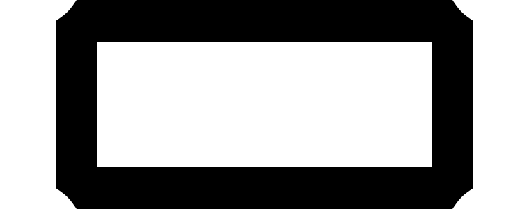 red

 blue

 yellow

 green

are necessary insofar as they remove a doubt. And then this table stands on its own. For it too is capable of different interpretations. </s>

### [79r\[2\]](https://cdn.wittgensteinnachlass.com/2000px/webp/Ms-155/79r.webp),[79v\[1\]](https://cdn.wittgensteinnachlass.com/2000px/webp/Ms-155/79v.webp),[80r\[1\]](https://cdn.wittgensteinnachlass.com/2000px/webp/Ms-155/80r.webp),[80v\[1\]](https://cdn.wittgensteinnachlass.com/2000px/webp/Ms-155/80v.webp),[81r\[1\]](https://cdn.wittgensteinnachlass.com/2000px/webp/Ms-155/81r.webp),[81v\[1\]](https://cdn.wittgensteinnachlass.com/2000px/webp/Ms-155/81v.webp)

<s> “But surely it must mean something that here, in explaining a name, I point precisely to its bearer.” Pointing is presumably something that is geometrically determined, so the arrow P points to 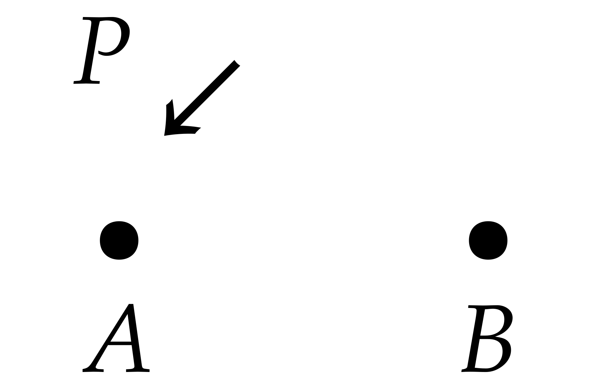 A & not to B. But I could quite well point to A & say this point is called “B”, and the other person could still understand me correctly and, if I said, for example, wipe out B, wipe out B & not A. – Of course, but then he simply had to **understand** my words differently from the way they are normally understood. But what sort of symbolic process is understanding? **Did** he necessarily have to imagine the arrow pointing towards A on hearing my words? Or at least glance towards A? But even if he did that during the explanation, how does it help him when he is now to use the sign B? But one thing is clear: if I want to introduce Mr N. to you (so that you understand the name “N” in future), I can point to Mr M. (if, say, there was an earlier agreement about pointing), but Mr N. must in any case be present. But the agreement is now only part of the history of my understanding and so is irrelevant, & secondly, Mr N. need not be present & the introduction could still be understood as if he were here. But there you use precisely the words “be understood as”! So you admit that in introducing the absent person something different (a different complementary process in me) must take place from what takes place in introducing the person who is present – that is, a different complementary process (say, an imaginary arrow which nevertheless points to N.) when we do not point to N. with the hand, and another when we do point to N. No, I do not admit that: this understanding need not manifest itself in such a process, but in the future application of the word N. So if I ask him “did you understand me?”, that can manifest itself in his further explanations & actions. Just as I can understand the word red in a sentence without hallucinating anything red in the process. </s>

### [81v\[2\]](https://cdn.wittgensteinnachlass.com/2000px/webp/Ms-155/81v.webp),[82r\[1\]](https://cdn.wittgensteinnachlass.com/2000px/webp/Ms-155/82r.webp),[82v\[1\]](https://cdn.wittgensteinnachlass.com/2000px/webp/Ms-155/82v.webp)

<s> Now of course I grant that, except after a prior agreement on a code, I would cause a misunderstanding if I were to point to point A and say that this point is called ‘B’. Just as, if I want to show someone the way, I point my finger in the direction in which he is to go, not in the opposite direction. But it is clear that the other procedure too could be correctly understood, and without this understanding supplementing the given sign with another. It is in human nature to understand pointing with the finger in this way. And so the human language of gestures is not **the** primary language in a logical sense, but merely primary in a psychological sense. </s>

### [82v\[2\]](https://cdn.wittgensteinnachlass.com/2000px/webp/Ms-155/82v.webp),[83r\[1\]](https://cdn.wittgensteinnachlass.com/2000px/webp/Ms-155/83r.webp)

<s> The distinction one wants to retain is that between a picture & an (‘arbitrary’) sign.

And so I want to say that, if the sign is a sign, it must function as a picture. And that the picture (as it is usually understood) must also be arbitrary in **one** sense.

The old argument: I can carry out the command according to a picture & according to words, and construct the picture according to words.

</s>

### [83v\[1\]](https://cdn.wittgensteinnachlass.com/2000px/webp/Ms-155/83v.webp)

<s> The only difference is that words are discontinuous, whereas the picture can be continuous. But numerals are words too, and we have the decimal system etc. And continuous transitions of colour I can in any case only copy, not demonstrate or follow with words.

---

</s>

### [83v\[2\]](https://cdn.wittgensteinnachlass.com/2000px/webp/Ms-155/83v.webp),[84r\[1\]](https://cdn.wittgensteinnachlass.com/2000px/webp/Ms-155/84r.webp)

<s> What is arbitrary in words is not what is used in them, what constitutes their function.

Their **place** (their **position**) is their meaning. </s>

### [84r\[2\]](https://cdn.wittgensteinnachlass.com/2000px/webp/Ms-155/84r.webp)

<s> Words are like the letters written next to the points of a geometrical drawing. Here the grammatical place really is a place in Euclidean space. </s>

### [84r\[3\]](https://cdn.wittgensteinnachlass.com/2000px/webp/Ms-155/84r.webp),[84v\[1\]](https://cdn.wittgensteinnachlass.com/2000px/webp/Ms-155/84v.webp)

<s> Do not forget here either that word-language is only **one** among many possible languages & that there are transitions from word-language into the others. Examine the map for what in it corresponds to the expression of word-language. </s>

### [84v\[2\]](https://cdn.wittgensteinnachlass.com/2000px/webp/Ms-155/84v.webp)

<s> The shape of the word is as incidental as that of the chess piece. And the chess piece too marks a place. </s>

### [84v\[3\]](https://cdn.wittgensteinnachlass.com/2000px/webp/Ms-155/84v.webp),[85r\[1\]](https://cdn.wittgensteinnachlass.com/2000px/webp/Ms-155/85r.webp)

<s> „What's the University of Cambridge?” – Let's see how we use this word. You expect me to give you puzzles to solve at which to exercise your cleverness & I'm not going to do it. </s>

### [85r\[2\]](https://cdn.wittgensteinnachlass.com/2000px/webp/Ms-155/85r.webp)

<s> **Actor**. </s>

### [85r\[3\]](https://cdn.wittgensteinnachlass.com/2000px/webp/Ms-155/85r.webp),[85v\[1\]](https://cdn.wittgensteinnachlass.com/2000px/webp/Ms-155/85v.webp)

<s> [Zettel]

That the bearer of a name is dead is a fact which we describe by means of this name (which therefore must have meaning here). But what if we say that the bearer never lived? The meaning of the name lies in everything that we can say of him with sense (truly or falsely). </s>

### [85v\[2\]](https://cdn.wittgensteinnachlass.com/2000px/webp/Ms-155/85v.webp)

<s> Is the hypothetical existence of the bearer involved when, in defining the name, we point to the bearer & say “this is N”? </s>

### [85v\[3\]](https://cdn.wittgensteinnachlass.com/2000px/webp/Ms-155/85v.webp),[86r\[1\]](https://cdn.wittgensteinnachlass.com/2000px/webp/Ms-155/86r.webp)

<s> It makes no sense always to speak here of “the bearer of the name ‘N’”, since this expression is synonymous with “N”. </s>

### [86r\[2\]](https://cdn.wittgensteinnachlass.com/2000px/webp/Ms-155/86r.webp)

<s> Everything consists in my being able to say “Moses does not exist (did not exist)”, but not “this man (whom I am pointing to) does not exist”. </s>

### [86r\[3\]](https://cdn.wittgensteinnachlass.com/2000px/webp/Ms-155/86r.webp)

<s> And this leads back again to our being able to say “I see no red patch here” even if none can be found anywhere at all. And why should one ever have had to be found? </s>

### [86r\[4\]](https://cdn.wittgensteinnachlass.com/2000px/webp/Ms-155/86r.webp),[86v\[1\]](https://cdn.wittgensteinnachlass.com/2000px/webp/Ms-155/86v.webp)

<s> That is: for the time being I am playing my game with the name alone, without its bearer, and I do not miss the bearer in doing so. </s>

### [86v\[2\]](https://cdn.wittgensteinnachlass.com/2000px/webp/Ms-155/86v.webp)

<s> But if the bearer of the name can be lost, or may never have existed, then one had to allow for this possibility from the outset in using the name. That had to lie in its meaning. </s>

### [86v\[3\]](https://cdn.wittgensteinnachlass.com/2000px/webp/Ms-155/86v.webp),[87r\[1\]](https://cdn.wittgensteinnachlass.com/2000px/webp/Ms-155/87r.webp)

<s> If one asks “what relation do names & things stand in?”, the answer is: in the relation of the house to its house number. (One could always imagine that the name-plaque had been hung around the thing.) </s>

### [87r\[2\]](https://cdn.wittgensteinnachlass.com/2000px/webp/Ms-155/87r.webp)

<s>

The grammar of names is complicated & connected with many false ideas. </s>

### [87r\[3\]](https://cdn.wittgensteinnachlass.com/2000px/webp/Ms-155/87r.webp),[87v\[1\]](https://cdn.wittgensteinnachlass.com/2000px/webp/Ms-155/87v.webp)

<s>One might call the sign “this↗” a proper name. If one then speaks of a bearer of this name (the object to which the arrow points), then here the word without a bearer has no meaning.</s>

### [87v\[2\]](https://cdn.wittgensteinnachlass.com/2000px/webp/Ms-155/87v.webp)

<s>A word that has an application also has a meaning.</s>

### [87v\[3\]](https://cdn.wittgensteinnachlass.com/2000px/webp/Ms-155/87v.webp),[88r\[1\]](https://cdn.wittgensteinnachlass.com/2000px/webp/Ms-155/88r.webp)

<s>I tell someone about a man called N. He had studied here, then he was etc. etc. And now I put him in the street & say: look at the passers-by & see whether any one of them is N. Is that not senseless?</s>

### [88r\[2\]](https://cdn.wittgensteinnachlass.com/2000px/webp/Ms-155/88r.webp)

<s>But if I had said N is a short, stout man in a black suit etc., then the request to look for N among the passers-by would now have a sense.</s>

### [88r\[3\]](https://cdn.wittgensteinnachlass.com/2000px/webp/Ms-155/88r.webp)

<s>The request had the same wording on both occasions. What had changed was the meaning of “N”.</s>

### [88r\[4\]](https://cdn.wittgensteinnachlass.com/2000px/webp/Ms-155/88r.webp),[88v\[1\]](https://cdn.wittgensteinnachlass.com/2000px/webp/Ms-155/88v.webp)

<s>If I say to someone “bring a red flower” & he brings one & then I say “why did you bring me one like that” & he says: “but it’s red”, then this last is a sentence of grammar. It justifies an application of the word.</s>

### [88v\[2\]](https://cdn.wittgensteinnachlass.com/2000px/webp/Ms-155/88v.webp)

<s>If this sentence is missing, the grammar of the word (its meaning) is different.</s>

### [88v\[3\]](https://cdn.wittgensteinnachlass.com/2000px/webp/Ms-155/88v.webp),[89r\[1\]](https://cdn.wittgensteinnachlass.com/2000px/webp/Ms-155/89r.webp)

<s>The savages have games (or that at least is what we call them) for which they have no written rules, no list of rules. Let us now imagine travelling through these peoples’ countries and drawing up lists of rules for their games. That is the exact analogue of what the philosopher does.</s>

### [89r\[2\]](https://cdn.wittgensteinnachlass.com/2000px/webp/Ms-155/89r.webp),[89v\[1\]](https://cdn.wittgensteinnachlass.com/2000px/webp/Ms-155/89v.webp)

<s>But there is now a difficulty: when I say “but I call this colour ‘red’” it does not seem that I have simply put sign for sign here.</s>

### [89v\[2\]](https://cdn.wittgensteinnachlass.com/2000px/webp/Ms-155/89v.webp),[90r\[1\]](https://cdn.wittgensteinnachlass.com/2000px/webp/Ms-155/90r.webp)

<s>Let us imagine the following case: he has brought me the red flower at my command; I ask him why are you bringing one of **this** colour & he says, pointing to a green plaque: “but you call this colour ‘red’; that is why I brought you this flower”.</s>

### [90r\[2\]](https://cdn.wittgensteinnachlass.com/2000px/webp/Ms-155/90r.webp)

<s>He could have said two things: 1) “I’m bringing it because it’s red (& you did ask for a red one)”

2) “I’m bringing it, for you do call this colour ‘red’”.</s>

### [90r\[3\]](https://cdn.wittgensteinnachlass.com/2000px/webp/Ms-155/90r.webp)

<s>Are these two defences equivalent? There is no definition in the first.</s>

### [90r\[4\]](https://cdn.wittgensteinnachlass.com/2000px/webp/Ms-155/90r.webp),[90v\[1\]](https://cdn.wittgensteinnachlass.com/2000px/webp/Ms-155/90v.webp)

<s>(“Isn’t this red, I mean: don’t you call this colour ‘red’?”) And when I say I call this ‘red’, what else can I do but look at something on a table in which ‘red’ is assigned to the first plaque.</s>

### [90v\[2\]](https://cdn.wittgensteinnachlass.com/2000px/webp/Ms-155/90v.webp),[91r\[1\]](https://cdn.wittgensteinnachlass.com/2000px/webp/Ms-155/91r.webp)

<s>Is it true that, if my explanation of the word consists in pointing with my finger to a green plaque and saying this colour is called ‘red’ & if I then point to a red object & say “this object is red”, this sentence must be false in the language explained?</s>

### [91r\[2\]](https://cdn.wittgensteinnachlass.com/2000px/webp/Ms-155/91r.webp)

<s>Let us think of the code in which the explanation of the word is first given (unintelligible to the untrained person). The command is then apparently obeyed in contradiction to the explanation.</s>

### [91r\[3\]](https://cdn.wittgensteinnachlass.com/2000px/webp/Ms-155/91r.webp),[91v\[1\]](https://cdn.wittgensteinnachlass.com/2000px/webp/Ms-155/91v.webp),[92r\[1\]](https://cdn.wittgensteinnachlass.com/2000px/webp/Ms-155/92r.webp)

<s>But one will say: “If, in response to the command ‘bring the red flower’, he really brings the red flower, then that explanation of the sign was merely sleight of hand & when pointing to the green plaque he did indeed understand that in reality the other colour was meant.” In what process does this understanding prove itself? It is of course possible that, when he pointed to the green plaque, he imagined a red one & related the explanation to that. But must that have happened?</s>

### [92r\[2\]](https://cdn.wittgensteinnachlass.com/2000px/webp/Ms-155/92r.webp)

<s>One says: That is precisely why you spoke of a code, of an earlier agreement, because without this agreement, which supplements the explanation & makes it correct again, the other **could** not have understood correctly.</s>

### [92r\[3\]](https://cdn.wittgensteinnachlass.com/2000px/webp/Ms-155/92r.webp),[92v\[1\]](https://cdn.wittgensteinnachlass.com/2000px/webp/Ms-155/92v.webp)

<s>But could this also be conceivable? Someone has four bells in front of him, he strikes them in succession & says, as if explaining: “I call this ‘red’, that ‘green’, that ‘blue’, that ‘yellow’. So—now fetch me a yellow flower.” And the other obeys the command correctly, bringing a yellow flower.</s>

### [92v\[2\]](https://cdn.wittgensteinnachlass.com/2000px/webp/Ms-155/92v.webp),[93r\[1\]](https://cdn.wittgensteinnachlass.com/2000px/webp/Ms-155/93r.webp),[93v\[1\]](https://cdn.wittgensteinnachlass.com/2000px/webp/Ms-155/93v.webp),[94r\[1\]](https://cdn.wittgensteinnachlass.com/2000px/webp/Ms-155/94r.webp)

<s>But if I am to act on the explanation (& surely I am), then there must be a path, a calculation, leading from it to the action. If, pointing to something red, I say I call this ‘red’ & then correspondingly say of something red “this is red”, then here is this connection. But if I explain the word ‘red’ (which, as I assume, I use in the way we actually use it), if I explain this word by pointing to a green plaque, how **can** the other know what I mean? Does a path still lead from this explanation to the ordinary application?

I could also put it this way: I don’t mean to insist that in the explanatory table the red plaque should be horizontally opposite the word ‘red’, but surely there must be some law for reading the table. Otherwise the table loses its sense.

But is it without a law if the table

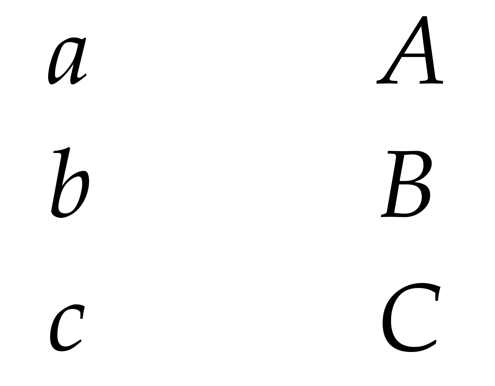

is understood as follows:

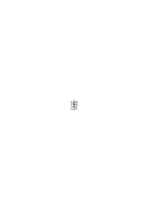?

But doesn’t the schema 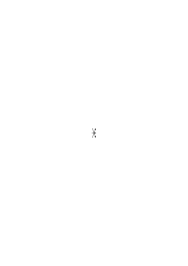 itself then have to be given beforehand?</s>

### [94r\[2\]](https://cdn.wittgensteinnachlass.com/2000px/webp/Ms-155/94r.webp),[94v\[1\]](https://cdn.wittgensteinnachlass.com/2000px/webp/Ms-155/94v.webp),[94v\[2\]](https://cdn.wittgensteinnachlass.com/2000px/webp/Ms-155/94v.webp)

<s>And even if an explanation other than the ordinary one is possible, the ordinary explanation is always **also** possible & one can always (also) translate back into it.

</s>

### [94v\[1\]](https://cdn.wittgensteinnachlass.com/2000px/webp/Ms-155/94v.webp),[95r\[1\]](https://cdn.wittgensteinnachlass.com/2000px/webp/Ms-155/95r.webp)

<s>[unreadable]

---

Dr Komisch

**Tuesday 4–6**

**Wednesday ½10–**

Call K at 10 tomorrow.</s>

### [95r\[2\]](https://cdn.wittgensteinnachlass.com/2000px/webp/Ms-155/95r.webp)

The primary definitions (or definitions by means of primary signs) are presumably the rules for the application of signs to things outside the world of written or spoken signs. For, practically speaking, there is evidently the world of books & speech & the world outside it.

### [95r\[3\]](https://cdn.wittgensteinnachlass.com/2000px/webp/Ms-155/95r.webp)

The primary rule is supposed, as it were, to establish the connection of sign-language with life.
