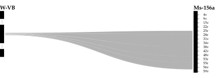
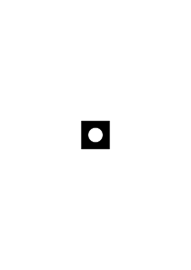
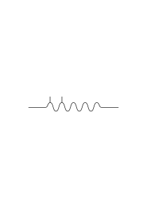
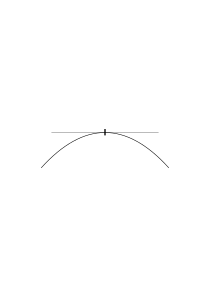
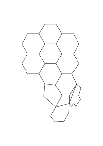

# Ms-156a

6 published remarks, VB

### [FCv\[1\]](https://cdn.wittgensteinnachlass.com/2000px/webp/Ms-156a/FCv.webp)

Momentary experience the real

Perhaps

Aesthetics

Meaning

### [1r\[1\]](https://cdn.wittgensteinnachlass.com/2000px/webp/Ms-156a/1r.webp),[1v\[1\]](https://cdn.wittgensteinnachlass.com/2000px/webp/Ms-156a/1v.webp)

Would it be right to say: “other people’s toothaches are a completely different phenomenon from my own”? No. It has a quite definite sense in our ordinary way of expressing ourselves to say “he has much stronger pains than I” or “much slighter ones” & it also makes sense at the same time, in certain cases, to talk of my & the other person’s having roughly the same pains. What _we_ say can only be a remark about our present way of expressing ourselves, not a remark about pains in this way of expressing ourselves.

### [1v\[2\]](https://cdn.wittgensteinnachlass.com/2000px/webp/Ms-156a/1v.webp)

In answer to the question: who is in pain one points to a body & I too must point to a body.

### [2r\[1\]](https://cdn.wittgensteinnachlass.com/2000px/webp/Ms-156a/2r.webp),[2v\[1\]](https://cdn.wittgensteinnachlass.com/2000px/webp/Ms-156a/2v.webp)

Can I say “the word ‘toothache’ has a different meaning when I talk of my toothache & on the other hand of the other person’s” & can someone answer me “no, it has exactly the same meaning”? What is the criterion for the correctness of these assertions.

### [2v\[2\]](https://cdn.wittgensteinnachlass.com/2000px/webp/Ms-156a/2v.webp)

To say “I notice that he has _the_ ‘toothache’ that I have now” is similar to the statement: I mean that the particles of a rod are moving in the same sense in which the rod itself is moving before my eyes.

### [2v\[3\]](https://cdn.wittgensteinnachlass.com/2000px/webp/Ms-156a/2v.webp),[3r\[1\]](https://cdn.wittgensteinnachlass.com/2000px/webp/Ms-156a/3r.webp)

Here too one could say: My toothache can be used as a picture for his behaviour.

### [3r\[2\]](https://cdn.wittgensteinnachlass.com/2000px/webp/Ms-156a/3r.webp)

How do I know that the other person has toothache & how do I know that I have toothache. But if all human bodies appeared in the same way in the mirror the question might well arise, “does L.W. have toothache?”.

### [3v\[1\]](https://cdn.wittgensteinnachlass.com/2000px/webp/Ms-156a/3v.webp)

If we decided to talk of unconscious toothache then my unconscious toothache would be on the same level as his. For the criterion for my having unconscious toothache would be of the same kind as that for his having it.

### [3v\[2\]](https://cdn.wittgensteinnachlass.com/2000px/webp/Ms-156a/3v.webp),[4r\[1\]](https://cdn.wittgensteinnachlass.com/2000px/webp/Ms-156a/4r.webp),[4v\[1\]](https://cdn.wittgensteinnachlass.com/2000px/webp/Ms-156a/4v.webp)

Whoever believes he can say, as a proposition about the visual field, that it has blurred edges, should think of the visual field when one looks through a black tube at an illuminated surface. The picture is then roughly

.

The square edge is arbitrary & the edge of the circle sharp. To someone who asks where in the black the visual field stops, one must say that it stops nowhere.

### [4v\[2\]](https://cdn.wittgensteinnachlass.com/2000px/webp/Ms-156a/4v.webp)

Equation, inequation. At first glance the inequation looks more like a proposition, less like a rule. But let us remember that inequations always occur in _one_ system together with equations.

### [5r\[1\]](https://cdn.wittgensteinnachlass.com/2000px/webp/Ms-156a/5r.webp),[5v\[1\]](https://cdn.wittgensteinnachlass.com/2000px/webp/Ms-156a/5v.webp)

Evidence, verification: insofar as I can be in doubt about what I shall acknowledge as evidence for p, it is a matter of psychological evidence. But insofar as I can determine now what is to be regarded as evidence for p, it is a matter of a determination of grammar, of the laying down of a rule.

### [5v\[2\]](https://cdn.wittgensteinnachlass.com/2000px/webp/Ms-156a/5v.webp),[6r\[1\]](https://cdn.wittgensteinnachlass.com/2000px/webp/Ms-156a/6r.webp)

There is a calculus with equations & a calculus with inequations. There are transitions from one inequation to another, only the rules are of course different from those for the transitions that are permitted by equations. The inequations, like the equations, are applied as grammatical rules.

### [6r\[2\]](https://cdn.wittgensteinnachlass.com/2000px/webp/Ms-156a/6r.webp),[6v\[1\]](https://cdn.wittgensteinnachlass.com/2000px/webp/Ms-156a/6v.webp)

An excellent question for gaining insight into the essence of the question “what is” would be this: “what, is the chess king, assuming that we play the game only as a writing game”! Let us imagine here the dispute between the formalists & adherents of contentual mathematics transferred to the game of chess. –

### [6v\[2\]](https://cdn.wittgensteinnachlass.com/2000px/webp/Ms-156a/6v.webp),[7r\[1\]](https://cdn.wittgensteinnachlass.com/2000px/webp/Ms-156a/7r.webp)

“The correct equation is the one that _can_ be generated according to the rules”. What is the criterion for the possibility of generating it? Surely the proof _i.e._ the proof carried out, not the possibility of the proof. But then was 25 × 25 = 625 not correct before it had been worked out? – And what has time to do with this question at all?

### [7r\[2\]](https://cdn.wittgensteinnachlass.com/2000px/webp/Ms-156a/7r.webp)

“For every δ there is an E, such that …” e.g.: for every δ there is an ε, such that ε < δ. The proof of this is a _solution_ of the inequation, say ε = ½δ.

### [7v\[1\]](https://cdn.wittgensteinnachlass.com/2000px/webp/Ms-156a/7v.webp)

lim f(n) = a

f(n) ‒ a < δ

(δ): (∃v):n > v ․⊃․ fn ‒ a < δ

### [7v\[2\]](https://cdn.wittgensteinnachlass.com/2000px/webp/Ms-156a/7v.webp),[8r\[1\]](https://cdn.wittgensteinnachlass.com/2000px/webp/Ms-156a/8r.webp),[8v\[1\]](https://cdn.wittgensteinnachlass.com/2000px/webp/Ms-156a/8v.webp)

Let us imagine that someone had learned only Russell’s notation for this calculation (or even Frege’s) without the translation into word-language. _Would_ this person have to hit upon the fact that this notation corresponds to such-and-such a way of expressing things in our ordinary language? In this way this calculus would suddenly be placed in the right light.

Consider here that the words “there is” etc. in word-language are not taught to us through the rules that also hold for Russell’s notation, but (as I have already said earlier about negation) through a kind of ostensive explanations.

I.e. the sense of the expression (δ): (∃n) etc. is much less akin to the sense of the words “for all numbers δ there is a number n” than it seems at first.

### [8v\[2\]](https://cdn.wittgensteinnachlass.com/2000px/webp/Ms-156a/8v.webp)

If that calculus is conceived as a general one, then its particular cases are the solutions of particular inequations.

### [8v\[3\]](https://cdn.wittgensteinnachlass.com/2000px/webp/Ms-156a/8v.webp),[9r\[1\]](https://cdn.wittgensteinnachlass.com/2000px/webp/Ms-156a/9r.webp)

One can always ask here: What, e.g., becomes of the sense of the so-called theory of irrational numbers if arithmetic knows no particular irrational numbers? The calculus that is called the general theory of course remains rightly in place. But would we then also be tempted to call it a gen. theory? So how far does it take its meaning from the individual cases & how far from itself?

### [9v\[1\]](https://cdn.wittgensteinnachlass.com/2000px/webp/Ms-156a/9v.webp)

Let us now compare the generality of algebra, which presupposes, say, that we can multiply any two cardinal numbers together, with the generality of the theory of irrational numbers, or of limits.

### [9v\[2\]](https://cdn.wittgensteinnachlass.com/2000px/webp/Ms-156a/9v.webp),[10r\[1\]](https://cdn.wittgensteinnachlass.com/2000px/webp/Ms-156a/10r.webp)

And now the illusion that the difference is that in one case the generality is a _greater_ one, because the number of individual cases is greater than ℵ0!

### [10r\[2\]](https://cdn.wittgensteinnachlass.com/2000px/webp/Ms-156a/10r.webp),[10v\[1\]](https://cdn.wittgensteinnachlass.com/2000px/webp/Ms-156a/10v.webp),[11r\[1\]](https://cdn.wittgensteinnachlass.com/2000px/webp/Ms-156a/11r.webp)

“Only the present image is real”. What brings one to say that? – One answer – just as false as this assertion is: “past & future experience is just as _real_ only it is past & future!”. – I would like to say: “after all, we know past experience only from memory or from documents and the like; only present experience is before us”. But here one sees at once that the simile of the film is leading us astray. To say, for instance, “after all, I can only see the present state of the table, not that of a minute ago”, is simply nonsense. Here we pretend to be making a picture of the world, in contrast to another one which does not fit. Compare: “the edge of our visual field is blurred”.

### [11r\[2\]](https://cdn.wittgensteinnachlass.com/2000px/webp/Ms-156a/11r.webp),[11v\[1\]](https://cdn.wittgensteinnachlass.com/2000px/webp/Ms-156a/11v.webp),[12r\[1\]](https://cdn.wittgensteinnachlass.com/2000px/webp/Ms-156a/12r.webp)

To say (like Russell): “the world could have been created 5 minutes ago just as it actually was 5 minutes ago, with all the memories & documents which would then be completely misleading” says nothing, for then, admittedly, there is no verification of this proposition. It is a picture that is not used as a picture. A picture that runs idle. Let us imagine a pictorial (drawn) representation & the method of projection were so laid down that the drawn picture would be the portrait of any state of affairs whatever; then we have the exact analogue of that process & also the reason why we are tempted to say: “But surely it is not senseless to say that the world was created 5 minutes ago (even if I cannot know it), for I do mean _something_ by it when I say that”. To mean something, in this case, means to use a familiar picture, only it is not used for a representation.

### [12r\[2\]](https://cdn.wittgensteinnachlass.com/2000px/webp/Ms-156a/12r.webp),[12v\[1\]](https://cdn.wittgensteinnachlass.com/2000px/webp/Ms-156a/12v.webp)

What if I said that the world could have perished 3 minutes ago & my images & memories remained the same, which would now be completely deceptive. Here we have, precisely, Descartes’ devil. But a deception that ex hypothesi we cannot discover is no deception. (“Whom God deceives is well deceived”.)

### [12v\[2\]](https://cdn.wittgensteinnachlass.com/2000px/webp/Ms-156a/12v.webp),[13r\[1\]](https://cdn.wittgensteinnachlass.com/2000px/webp/Ms-156a/13r.webp)

“Now”. Physics does not contain the words “now”, “here”, etc.

### [13r\[2\]](https://cdn.wittgensteinnachlass.com/2000px/webp/Ms-156a/13r.webp)

Instead of saying “now” one could clap one’s hands, as one counts “1, 2, 3, go!”. And the use of the words “now”, “here” etc. characterizes precisely one kind of use of language. (Think of language-games.)

### [13r\[3\]](https://cdn.wittgensteinnachlass.com/2000px/webp/Ms-156a/13r.webp),[13v\[1\]](https://cdn.wittgensteinnachlass.com/2000px/webp/Ms-156a/13v.webp)

If “now” is a time signal then it does not correspond to a clock’s striking 6, but rather, say, to the ringing of a bell before the start of a play.

Instead of “do that now” one could also say: “do that when I clap my hands” & at the same time give this sign. (It is interesting, by the way, that one calls that a sign; compare the remark about the various handles in the driver’s cab of the locomotive.)

### [14r\[1\]](https://cdn.wittgensteinnachlass.com/2000px/webp/Ms-156a/14r.webp),[14v\[1\]](https://cdn.wittgensteinnachlass.com/2000px/webp/Ms-156a/14v.webp),[15r\[1\]](https://cdn.wittgensteinnachlass.com/2000px/webp/Ms-156a/15r.webp)

One could also express the thought that the only reality is the experience of the present moment by saying that we could not know it if the world had been created at this moment with all memories etc.: that from this it follows that everything else is only conjecture, while the experience of the present moment is the only material that leads to all conjectures. But here the word “present” has no sense, for it is not supposed to mean present in contrast to what is past, but really one would like to talk here of a present experience. But what one wants to emphasize is that present, past & future do not correspond to the pictures on a film, which are all there, only in different places. What one really wants to say is that this simile breaks down here.

### [15r\[2\]](https://cdn.wittgensteinnachlass.com/2000px/webp/Ms-156a/15r.webp),[15v\[1\]](https://cdn.wittgensteinnachlass.com/2000px/webp/Ms-156a/15v.webp)

The now seems, as it were, to designate (to pick out) one picture on the strip of film, to say that this is what is really real. But here it is just as if someone in the cinema, instead of pointing to the film & saying that this is the picture which is now in the lens of the lantern, pointed to the screen & said that this is the real picture. That is as if one wanted to say “now is now”.

### [15v\[2\]](https://cdn.wittgensteinnachlass.com/2000px/webp/Ms-156a/15v.webp),[16r\[1\]](https://cdn.wittgensteinnachlass.com/2000px/webp/Ms-156a/16r.webp)

One says that a hypothesis does not only describe what we see hear etc. but that _with it we also express certain expectations._ But here one sees how ambiguous the expression “expectation” is (like “believe”, “think” etc.). For when I say “there is a chair over there” I do not _expect_ anything at all in the sense that I am, say, _watching_ for the occurrence of a phenomenon.

### [16v\[1\]](https://cdn.wittgensteinnachlass.com/2000px/webp/Ms-156a/16v.webp)

Experience as logical form. Experience in contrast to what?

### [16v\[2\]](https://cdn.wittgensteinnachlass.com/2000px/webp/Ms-156a/16v.webp),[17r\[1\]](https://cdn.wittgensteinnachlass.com/2000px/webp/Ms-156a/17r.webp)

That no subject enters into immediate experience becomes quite clear if, e.g., in the course of an investigation, one draws what one sees in a microscope or describes it in such a way that the description is, say, equivalent to a drawing. This drawing or description is then a proposition that expresses immediate experience & of course contains no subject. Likewise if one wanted to reproduce a heard sequence of tones by means of musical notation, say; etc.

### [17r\[2\]](https://cdn.wittgensteinnachlass.com/2000px/webp/Ms-156a/17r.webp),[17v\[1\]](https://cdn.wittgensteinnachlass.com/2000px/webp/Ms-156a/17v.webp),[18r\[1\]](https://cdn.wittgensteinnachlass.com/2000px/webp/Ms-156a/18r.webp)

“The eyepiece of the largest telescope no larger than our eye” that could mean: in the end it is, after all, _we_ who must see the thing, everything is, after all, _our_ mental image. Or even: “in the end everything is, after all, only in our head”. What one means is the pointing to the evidence as the source of our speculations. As when I say: let us look at the proof; it will show us what has been proved. And so one can no doubt point to immediate experience in order to reject a certain idolatry which worships what one has made oneself. But here the emphasis does not lie on the smallness of the eye or of the head & not at all on the subject & so not on the subjective.

### [18v\[1\]](https://cdn.wittgensteinnachlass.com/2000px/webp/Ms-156a/18v.webp)

The concept “solution” of an equation & the concept “proof”. When I introduce complex numbers I introduce a new concept of _solution_ of an equation. And if the proof of Goldbach’s theorem should succeed then something new would thereby be called a “proof”.

### [18v\[2\]](https://cdn.wittgensteinnachlass.com/2000px/webp/Ms-156a/18v.webp),[19r\[1\]](https://cdn.wittgensteinnachlass.com/2000px/webp/Ms-156a/19r.webp)

To what extent is it necessary to be able to imagine what a sentence says? (“Do you have pains at this spot?”)

### [19r\[2\]](https://cdn.wittgensteinnachlass.com/2000px/webp/Ms-156a/19r.webp)

‘Thinkable’ is something similar to ‘imaginable’. ‘Thinkable’ is only an extension of the concept ‘imaginable’. (That is what my conception of the proposition as a picture meant to say.)

### [19v\[1\]](https://cdn.wittgensteinnachlass.com/2000px/webp/Ms-156a/19v.webp)

Sense – nonsense: “I throw a ball out into 4-dimensional space”. If a system is given in which this sentence can be called a picture & has a use then it has thereby acquired sense. But if someone uses it without further ado we shall rightly say that it is nonsensical.

### [19v\[2\]](https://cdn.wittgensteinnachlass.com/2000px/webp/Ms-156a/19v.webp),[20r\[1\]](https://cdn.wittgensteinnachlass.com/2000px/webp/Ms-156a/20r.webp)

The task of philosophy (in my sense) is to point out _actual_ errors.

### [20r\[2\]](https://cdn.wittgensteinnachlass.com/2000px/webp/Ms-156a/20r.webp),[20v\[1\]](https://cdn.wittgensteinnachlass.com/2000px/webp/Ms-156a/20v.webp),[21r\[1\]](https://cdn.wittgensteinnachlass.com/2000px/webp/Ms-156a/21r.webp),[21v\[1\]](https://cdn.wittgensteinnachlass.com/2000px/webp/Ms-156a/21v.webp)

Meaning seriously, (in jest). Can one _want_ to mean something seriously? Can one try to mean something seriously (in jest)? The word “try” is simply ambiguous. How does one try, e.g., to raise an arm & how to produce a note of a particular loudness & particular character. How does one try to remember a word or to put oneself in someone’s position. For I wanted to compare “meaning a sentence seriously” with singing it to a ‘serious’ melody. But one can object to this comparison that one can sing the sentence to the serious melody at will but cannot mean it seriously at will. & that, correspondingly, one can simulate seriousness. We distinguish seriousness from everything that one could call behaviour. As something inner from something outer. And why do we call it something inner? Where is it & where does this simile of inner & outer come from? One says “one doesn’t see the seriousness, only the expression of seriousness”: but does that mean that the seriousness is hidden & is this sentence analogous to: you don’t see the money only the wallet? And on the other hand seriousness is not invisible in the sense in which, say, the air is. Rather, it would presumably have to mean that it makes no sense to say “I see the seriousness” any more than “I see stomach-aches”. One could also ask: is meaning a sentence seriously something similar to hearing a seriously spoken sentence?

### [22r\[1\]](https://cdn.wittgensteinnachlass.com/2000px/webp/Ms-156a/22r.webp),[22v\[1\]](https://cdn.wittgensteinnachlass.com/2000px/webp/Ms-156a/22v.webp)

Is singing a melody seriously something similar to hearing a melody sung with a serious expression? And does the difference lie in anything other than that this hearing does not compel us to move with this melody ourselves. Could one say: no, hearing is not enough, but if you sing along with the melody in exactly this way, then you are serious yourself? Or is meaning a sentence seriously something similar to having a stomach-ache while one utters it? What is certain is that singing a melody with seriousness & meaning a sentence seriously are similar.

### [22v\[2\]](https://cdn.wittgensteinnachlass.com/2000px/webp/Ms-156a/22v.webp),[23r\[1\]](https://cdn.wittgensteinnachlass.com/2000px/webp/Ms-156a/23r.webp)

If one calls “Endless” a number, then I demand that one also call “Some” a number & then it becomes very clear that a definition of the concept of number is superfluous.

### [23r\[2\]](https://cdn.wittgensteinnachlass.com/2000px/webp/Ms-156a/23r.webp)

Regrouping of an infinite series.

### [23r\[3\]](https://cdn.wittgensteinnachlass.com/2000px/webp/Ms-156a/23r.webp)

As n gets larger,  gets smaller and smaller. How does this new thought enter arithmetic? Induction.

### [23r\[4\]](https://cdn.wittgensteinnachlass.com/2000px/webp/Ms-156a/23r.webp),[23v\[1\]](https://cdn.wittgensteinnachlass.com/2000px/webp/Ms-156a/23v.webp)

One cannot explain the regrouping of an infinite series extensionally but only by an example & that means intensionally.

### [23v\[2\]](https://cdn.wittgensteinnachlass.com/2000px/webp/Ms-156a/23v.webp),[24r\[1\]](https://cdn.wittgensteinnachlass.com/2000px/webp/Ms-156a/24r.webp)

One cannot say: our ear is not fine enough to perceive the vibrations of the air individually, it therefore receives only a general (blurred) impression.

### [24r\[2\]](https://cdn.wittgensteinnachlass.com/2000px/webp/Ms-156a/24r.webp)

Can one say “the siren can give either the exact pitch or the exact duration of the note, but not both”?

### [24r\[3\]](https://cdn.wittgensteinnachlass.com/2000px/webp/Ms-156a/24r.webp)

But can one now say that a note must, so to speak, have a blurred beginning, since the vibration does not really have a beginning together with a wavelength?

### [24v\[1\]](https://cdn.wittgensteinnachlass.com/2000px/webp/Ms-156a/24v.webp)

What makes a chapter of mathematics _interesting_?

### [24v\[2\]](https://cdn.wittgensteinnachlass.com/2000px/webp/Ms-156a/24v.webp),[25r\[1\]](https://cdn.wittgensteinnachlass.com/2000px/webp/Ms-156a/25r.webp)

Surely it is clear that the sentence of a German or English story calls forth, word for word, different reactions in me than such a sentence in a Chinese story, which affects me not much differently from an arbitrary pattern of strokes. Precisely because I have learned German & English. Just as it is also clear that watching the moves of a game familiar to us must call forth quite different reactions in us than when we watch a game that we do not “understand”.

### [VB](/w-vb/#ms-156a-25r.2) [25r\[2\]](https://cdn.wittgensteinnachlass.com/2000px/webp/Ms-156a/25r.webp)

Remember the impression of good architecture, that it expresses a thought. One would like to follow it, too, with a gesture.

### [25v\[1\]](https://cdn.wittgensteinnachlass.com/2000px/webp/Ms-156a/25v.webp)

“So does mathematics deal with the sign ‘4’”? In the sense in which, & as little as, a sign-*rule* _deals_ with the sign. Namely not in the sense in which an empirical proposition deals with the sign. (Say: that the sign 4 is easy to write.)

### [25v\[2\]](https://cdn.wittgensteinnachlass.com/2000px/webp/Ms-156a/25v.webp),[26r\[1\]](https://cdn.wittgensteinnachlass.com/2000px/webp/Ms-156a/26r.webp)

Geometrical cube = cube-form, geometrical circle = circle-form geometrical straight line = form of the straight line. And now consider the grammar of these two ‘objects’: of the cube (made of wood) & of the cube-form (of the block of wood)!

### [26r\[2\]](https://cdn.wittgensteinnachlass.com/2000px/webp/Ms-156a/26r.webp)

Chapter: “How grammar is used”.

————|————

### [26r\[3\]](https://cdn.wittgensteinnachlass.com/2000px/webp/Ms-156a/26r.webp)

How does one teach someone the meanings of the words “please” & “thank you”?

### [26r\[4\]](https://cdn.wittgensteinnachlass.com/2000px/webp/Ms-156a/26r.webp),[26v\[1\]](https://cdn.wittgensteinnachlass.com/2000px/webp/Ms-156a/26v.webp)

How does one learn the meaning of the word “perhaps”? What is the ‘_meaning_’ of this word? Can one say: “its meaning is its use”? One can learn it, for we have all learned it. Not, of course, through a definition.

### [26v\[2\]](https://cdn.wittgensteinnachlass.com/2000px/webp/Ms-156a/26v.webp)

How can one ask about the meaning of the word “vielleicht”? – “Does ‘vielleicht’ mean the same as ‘perhaps’?”, “is it applied _thus_: …?”, “Does it mean as much as the gesture …?”

### [26v\[3\]](https://cdn.wittgensteinnachlass.com/2000px/webp/Ms-156a/26v.webp),[27r\[1\]](https://cdn.wittgensteinnachlass.com/2000px/webp/Ms-156a/27r.webp)

How does one learn the meaning of a word? There are many cases here.

### [27r\[2\]](https://cdn.wittgensteinnachlass.com/2000px/webp/Ms-156a/27r.webp)

We call it “explaining the meaning of the word” when we translate it into another language, but also when we make a gesture instead of it, or when we point to a bearer of the name; etc. The expression “explanation of the meaning” is used in so many different ways.

### [27r\[3\]](https://cdn.wittgensteinnachlass.com/2000px/webp/Ms-156a/27r.webp),[27v\[1\]](https://cdn.wittgensteinnachlass.com/2000px/webp/Ms-156a/27v.webp),[28r\[1\]](https://cdn.wittgensteinnachlass.com/2000px/webp/Ms-156a/28r.webp)

If one says: the meaning of a word is what the explanation of the meaning explains,– then one is thinking of this explanation, that is, of the paradigm of a step in a calculus. One imagines one could add it to the sign to be explained, indeed even replace the sign by it. If the explanation is repeated in this way with the sign (or instead of the sign) then it is clear that it is not regarded as a, once-and-for-all effective, medicine (as an inoculation, so to speak) but as part of our ongoing calculus.

### [28r\[2\]](https://cdn.wittgensteinnachlass.com/2000px/webp/Ms-156a/28r.webp)

<s> “What is the meaning of a word?” – “What is the usefulness of an object?”

</s>

### [28r\[3\]](https://cdn.wittgensteinnachlass.com/2000px/webp/Ms-156a/28r.webp),[28v\[1\]](https://cdn.wittgensteinnachlass.com/2000px/webp/Ms-156a/28v.webp)

<s> One can say of the explanation of the meaning that it teaches the use of the word.

</s>

### [28v\[2\]](https://cdn.wittgensteinnachlass.com/2000px/webp/Ms-156a/28v.webp),[29r\[1\]](https://cdn.wittgensteinnachlass.com/2000px/webp/Ms-156a/29r.webp),[29v\[1\]](https://cdn.wittgensteinnachlass.com/2000px/webp/Ms-156a/29v.webp)

It is interesting to see what happens when we try to tell ourselves that we do not really _want_ the movement of the fingers when we want to bend them into a fist, say, but the movement of the muscle which, purely mechanically, through the pull on the tendon, brings about the bending of the fingers. One can see the movement of the muscle in the forearm & now try to tell oneself that what I really want is that this muscle should move. One then sees that this is apparently not possible at all & that one feels the movement of the muscle as a consequence of the movement of the fingers that is really wanted. This is of course only meant to show as much as that wanting a movement has nothing to do with physiology.

### [29v\[2\]](https://cdn.wittgensteinnachlass.com/2000px/webp/Ms-156a/29v.webp),[30r\[1\]](https://cdn.wittgensteinnachlass.com/2000px/webp/Ms-156a/30r.webp)

Let one ask oneself whether with each of the many small movements that one makes performs, writing, reading, or even brooding “idly” to oneself, something goes on that one calls an act of will. – Perhaps one objects: But surely these movements are not observed by me like something that happens independently of me myself, say like the movements of the leaves on the tree in front of my window.

### [30r\[2\]](https://cdn.wittgensteinnachlass.com/2000px/webp/Ms-156a/30r.webp)

<s> That is iron, that is grey, that is a rod, that is a poker.

</s>

### [30r\[3\]](https://cdn.wittgensteinnachlass.com/2000px/webp/Ms-156a/30r.webp),[30v\[1\]](https://cdn.wittgensteinnachlass.com/2000px/webp/Ms-156a/30v.webp)

<s> What does it mean: one cannot point to a body in the same sense as to a colour? Does it mean anything other than: whoever points to a body thereby points to its colour, but precisely only if by ‘pointing to the colour’ one understands precisely this: pointing to the body that has it. As when one says someone marries his wife’s money & one were to explain that one cannot marry the money **in the same sense** as the wife.

</s>

### [VB](/w-vb/#ms-156a-30v.2) [30v\[2\]](https://cdn.wittgensteinnachlass.com/2000px/webp/Ms-156a/30v.webp)

Do not play with the depths of the other person!

### [31r\[1\]](https://cdn.wittgensteinnachlass.com/2000px/webp/Ms-156a/31r.webp)

Learning language as being trained.

### [31r\[2\]](https://cdn.wittgensteinnachlass.com/2000px/webp/Ms-156a/31r.webp),[31v\[1\]](https://cdn.wittgensteinnachlass.com/2000px/webp/Ms-156a/31v.webp)

Think over this sentence: No one, during a steady rain, believes in his heart that it will ever be fine again. The feeling of conviction: Is it not similar to the sun falling on a previously dull landscape. It is the same landscape, but everything is individually changed & yet everything in one sense towards the more joyful, the more hopeful. One can say the experience of the sentence, its landscape stands in a different light.

### [31v\[2\]](https://cdn.wittgensteinnachlass.com/2000px/webp/Ms-156a/31v.webp)

What does the word “perhaps” do in the sentence? Does it only spread a kind of mood; as if I were humming a note during the whole sentence?

### [31v\[3\]](https://cdn.wittgensteinnachlass.com/2000px/webp/Ms-156a/31v.webp),[32r\[1\]](https://cdn.wittgensteinnachlass.com/2000px/webp/Ms-156a/32r.webp)

Incidentally, I could also have said what I said above in this way: confidence is something similar to the confident tone. –

### [32r\[2\]](https://cdn.wittgensteinnachlass.com/2000px/webp/Ms-156a/32r.webp),[32v\[1\]](https://cdn.wittgensteinnachlass.com/2000px/webp/Ms-156a/32v.webp),[33r\[1\]](https://cdn.wittgensteinnachlass.com/2000px/webp/Ms-156a/33r.webp)

Insofar as a part of my expression is simply intended to produce a certain effect on the other person's mind as, say, the loud voice intimidates him, to that extent I do not count it among the signs. But why should a word not be used merely for this purpose or a noise of another kind. We can also imagine something that looks just like a sentence & whose effect consists in each of the words producing a certain effect on the one who hears it & the whole sentence acting, say, like a kind of statement or like a sequence of different washings & rubbings-down. On the other hand every real sentence must surely also act in this way besides its actual function.

The first effect of the sentence on us would then be like the effect of the pianola roll on the keyboard.

### [33r\[2\]](https://cdn.wittgensteinnachlass.com/2000px/webp/Ms-156a/33r.webp)

If one wanted in this way to call the effect of a word its meaning then one would have to say that what the meaning of a word is is a matter of experience.

### [33r\[3\]](https://cdn.wittgensteinnachlass.com/2000px/webp/Ms-156a/33r.webp),[33v\[1\]](https://cdn.wittgensteinnachlass.com/2000px/webp/Ms-156a/33v.webp)

One could explain the word “perhaps”, say, by a kind of ostensive definition by, e.g., pointing to the grey sky & saying “it will perhaps rain”.

### [33v\[2\]](https://cdn.wittgensteinnachlass.com/2000px/webp/Ms-156a/33v.webp)

We would say of a person: “he uses the word ‘perhaps’ differently from us; he says ‘perhaps’ when we say ‘certainly’”. Or: “he says ‘à dieu’ when we say ‘hello’”. But how then is the ‘place’ of the word determined here? (The Swiss: “I believe it is so”.)

### [33v\[3\]](https://cdn.wittgensteinnachlass.com/2000px/webp/Ms-156a/33v.webp),[34r\[1\]](https://cdn.wittgensteinnachlass.com/2000px/webp/Ms-156a/34r.webp)

The explanation of the meaning of a word is not the explanation (or description) of the effect of the word.

### [34r\[2\]](https://cdn.wittgensteinnachlass.com/2000px/webp/Ms-156a/34r.webp)

“If someone says ‘I will perhaps come’ & then he doesn't come, he has not thereby broken a promise”.

### [34r\[3\]](https://cdn.wittgensteinnachlass.com/2000px/webp/Ms-156a/34r.webp)

To explain the word “perhaps” one gives _reasons_ which can lead us to say that such & such will perhaps happen.

### [34v\[1\]](https://cdn.wittgensteinnachlass.com/2000px/webp/Ms-156a/34v.webp)

The meaning is what the explanation of meaning explains. By this I mean: “What is to interest us about meaning is to be what finds expression in an explanation of meaning.”

### [34v\[2\]](https://cdn.wittgensteinnachlass.com/2000px/webp/Ms-156a/34v.webp)

By “explanation of meaning” I understand whatever occurs as such an explanation in the calculus of language.

### [34v\[3\]](https://cdn.wittgensteinnachlass.com/2000px/webp/Ms-156a/34v.webp),[35r\[1\]](https://cdn.wittgensteinnachlass.com/2000px/webp/Ms-156a/35r.webp)

Now were the words of our ordinary language explained to us when we learned the language? Most of them certainly not. The word “perhaps” was never explained to me yet I did – in a certain sense – once learn its use.

### [35r\[2\]](https://cdn.wittgensteinnachlass.com/2000px/webp/Ms-156a/35r.webp),[35v\[1\]](https://cdn.wittgensteinnachlass.com/2000px/webp/Ms-156a/35v.webp)

But are there for every word at all explanations that one could call grammatical explanations of meaning? What if a word has the purpose of putting the other person into a certain mood? Suppose this were stated of it, surely I would then have to say: that is not what I call explanation of a meaning, that has nothing to do with an explanation of a meaning.

### [35v\[2\]](https://cdn.wittgensteinnachlass.com/2000px/webp/Ms-156a/35v.webp),[36r\[1\]](https://cdn.wittgensteinnachlass.com/2000px/webp/Ms-156a/36r.webp)

But whether something is to be regarded as a word, as a sign, is surely determined by its grammar or perhaps by the absence of a grammar. And furthermore it is with grammatical explanations, with explanations of meaning, just as it is with games. I can understand a game & not be able to say what is common to or characteristic of all games. Just as I can describe a cognition, a piece of knowledge, without being able to say “what knowledge is”.

### [36r\[2\]](https://cdn.wittgensteinnachlass.com/2000px/webp/Ms-156a/36r.webp)

I.e.: What an explanation of meaning is must be shown by examples.

### [36v\[1\]](https://cdn.wittgensteinnachlass.com/2000px/webp/Ms-156a/36v.webp),[37r\[1\]](https://cdn.wittgensteinnachlass.com/2000px/webp/Ms-156a/37r.webp)

Now the thought occurs to me: I can of course give grammatical explanations about the word perhaps. Explanations that regulate the use of the word. But do these rules in every case give it meaning. I could surely lay down arbitrary rules for a sign A as to how it is to be used within sentences; but would it thereby have what we call meaning? Could it not be a completely _useless_ sign? And what, on the other hand, determines the utility of the sign? Must I say here: Only examples can show what the use, the utility, of a sign is? –

### [37r\[2\]](https://cdn.wittgensteinnachlass.com/2000px/webp/Ms-156a/37r.webp),[37v\[1\]](https://cdn.wittgensteinnachlass.com/2000px/webp/Ms-156a/37v.webp)

Instead of the ostensive definition “that is green” one could also use the sentence “this leaf is green;” & analogously explain the word perhaps by pointing to the clouds with the sentence “it will perhaps rain”. (And if that is an explanation, then it is surely most likely to be the one by which we actually learn the meaning of the word.)

### [37v\[2\]](https://cdn.wittgensteinnachlass.com/2000px/webp/Ms-156a/37v.webp)

<s> Does the word “good day” have meaning? The word “Ow!” the word “oh dear!”, “Ugh!”? </s>

### [37v\[3\]](https://cdn.wittgensteinnachlass.com/2000px/webp/Ms-156a/37v.webp),[38r\[1\]](https://cdn.wittgensteinnachlass.com/2000px/webp/Ms-156a/38r.webp)

<s>“The word ‘perhaps’ has meaning”, by this we mean that something in the world corresponds to it; but of course, not in such a way that a thing corresponds to it, but in such a way that something in the external world corresponds to its use; that we are answerable to the facts when we use it; etc. </s>

### [38r\[2\]](https://cdn.wittgensteinnachlass.com/2000px/webp/Ms-156a/38r.webp)

Why must I get involved with this question?

### [38r\[3\]](https://cdn.wittgensteinnachlass.com/2000px/webp/Ms-156a/38r.webp),[38v\[1\]](https://cdn.wittgensteinnachlass.com/2000px/webp/Ms-156a/38v.webp)

To say that the word has meaning only in the context of a sentence means that the meaning is not the feeling which the word produces. One would not say that the word has a sound only in the context of a sentence. That sentence means that the word has meaning only as a piece in the calculus.

### [38v\[2\]](https://cdn.wittgensteinnachlass.com/2000px/webp/Ms-156a/38v.webp),[39r\[1\]](https://cdn.wittgensteinnachlass.com/2000px/webp/Ms-156a/39r.webp)

How does a child learn the use of a word, say of the word ‘perhaps’. It repeats, say, a sentence that it has heard from an adult: “she will perhaps come” & in the adult's tone of voice. Then one sometimes asks oneself: does it already understand the word “perhaps” or is it only repeating it? Well, what is the indication that it really understands the word? – This, that it uses it correctly – (that surely means in accordance with the rules) – in various cases & also acts accordingly.

### [39r\[2\]](https://cdn.wittgensteinnachlass.com/2000px/webp/Ms-156a/39r.webp),[39v\[1\]](https://cdn.wittgensteinnachlass.com/2000px/webp/Ms-156a/39v.webp)

If there were a word in the German language that was intended merely to produce a certain mood in the other person, would I say of this word that it has no meaning but only an effect? Let us think of the word “he he” as it is used, say, in a mocking speech. Does this word have a meaning?

### [39v\[2\]](https://cdn.wittgensteinnachlass.com/2000px/webp/Ms-156a/39v.webp)

But suppose someone explained: “‘he he’ means the same as ‘haha’”, has he not now given an explanation of the meaning?

### [40r\[1\]](https://cdn.wittgensteinnachlass.com/2000px/webp/Ms-156a/40r.webp)

It is obvious that with the question about the meaning of the word “hehe” we are approaching the question about the meaning of laughter, or of shrugging one's shoulders.

### [40r\[2\]](https://cdn.wittgensteinnachlass.com/2000px/webp/Ms-156a/40r.webp),[40v\[1\]](https://cdn.wittgensteinnachlass.com/2000px/webp/Ms-156a/40v.webp),[41r\[1\]](https://cdn.wittgensteinnachlass.com/2000px/webp/Ms-156a/41r.webp)

Now one would like to say: Language serves to influence & is a mechanism of influence. Every word has a place in this mechanism, is as it were a cog-wheel (lever etc.) of the mechanism. And its meaning is its part in the total effect of the mechanism. So what is this part for the word “table”, what for the word “red”, or “not”? What is their effect? One thinks first, of course, that it consists in producing associations. But it is clear that this is in any case only a part of the function of a word. One could perhaps similarly say: it is the function of the game of chess to give us pleasure; but can one describe the function of the riddle by showing the part of the whole pleasure that falls to the riddle?

### [41r\[2\]](https://cdn.wittgensteinnachlass.com/2000px/webp/Ms-156a/41r.webp),[41v\[1\]](https://cdn.wittgensteinnachlass.com/2000px/webp/Ms-156a/41v.webp)

But if I said, the meaning is the way a word works? – [The way it works] Well, then of course the way it works in the calculus has something to do with its – psychological – effect. For the definition, explanation, is after all remembered & used in that way.

### [41v\[2\]](https://cdn.wittgensteinnachlass.com/2000px/webp/Ms-156a/41v.webp),[42r\[1\]](https://cdn.wittgensteinnachlass.com/2000px/webp/Ms-156a/42r.webp)

But how does this problem relate to the particular problems about the meaning of words? Well it is itself such a particular problem. The problem of time can be answered without that of meaning being answered. And that is a clear & important insight like the one that one can have knowledge without being able to answer the question what knowledge is.

### [42r\[2\]](https://cdn.wittgensteinnachlass.com/2000px/webp/Ms-156a/42r.webp)

If we are asked “what does the word ‘hello’ mean” we shall answer: “‘hello’ is an exclamation. On such & such an occasion we say ‘hello’. It means the same as the word ….”

### [42r\[3\]](https://cdn.wittgensteinnachlass.com/2000px/webp/Ms-156a/42r.webp)

The meaning of the word “stop” in telegrams.

### [42v\[1\]](https://cdn.wittgensteinnachlass.com/2000px/webp/Ms-156a/42v.webp)

<s> “The meaning, what the explanation of meaning explains, by that I meant: What enters our calculus concerning meaning is the explanation of meaning. Or: what concerns us is the explanation of meaning. For this explanation is a further piece of language.” </s>

### [42v\[2\]](https://cdn.wittgensteinnachlass.com/2000px/webp/Ms-156a/42v.webp)

<s>The word “table” & the word “oho!”</s>

### [42v\[3\]](https://cdn.wittgensteinnachlass.com/2000px/webp/Ms-156a/42v.webp),[43r\[1\]](https://cdn.wittgensteinnachlass.com/2000px/webp/Ms-156a/43r.webp)

<s> That the explanation of meaning in general ‘removes misunderstandings’, i.e. decides between meanings with an equal claim, is not true. That is true of an ‘explanation of meaning’ of the kind “this colour is called green” or “this man is Napoleon”. </s>

### [43r\[2\]](https://cdn.wittgensteinnachlass.com/2000px/webp/Ms-156a/43r.webp)

“This action is good”, “This activity is a game”. If an action has been completely described, is it then an empirical fact that it is good??! Criteria!

### [43v\[1\]](https://cdn.wittgensteinnachlass.com/2000px/webp/Ms-156a/43v.webp),[44r\[1\]](https://cdn.wittgensteinnachlass.com/2000px/webp/Ms-156a/44r.webp)

<s> 1 The meaning, what the explanation of meaning explains.

2 What does that mean? The explanation of meaning, part of the calculus.

3 What concerns us in philosophy. A piece of language

4 Explanation of meaning however of many kinds: “That is N.N”, “that = red” “p⊃q = etc.”. One says the name N means this person, the word “table” means an object of this kind, but nothing analogous for the word “eight”. But of the word “hello” or “oho!” too one says it has meaning, as opposed to a combination of sounds like “kauken”. Of many a word we shall say that it is synonymous with a gesture; & when we speak of the meaning of the word “hehe!”, then in roughly the same sense as of the meaning of laughter. What is called explanation of the meaning of a word, e.g. a definition, teaches us the use of the word. And most words were not explained to us by definition, but we learned their use in another way </s>

### [44r\[2\]](https://cdn.wittgensteinnachlass.com/2000px/webp/Ms-156a/44r.webp),[44v\[1\]](https://cdn.wittgensteinnachlass.com/2000px/webp/Ms-156a/44v.webp),[45r\[1\]](https://cdn.wittgensteinnachlass.com/2000px/webp/Ms-156a/45r.webp)

The meaning of the word, its utility, its effect. If I give someone an order & he obeys it then the words determine what he does. I say [unreadable] “pick up a stone” & he does not pick up a stick; but had I said “pick up a stick” then it would have been a stick. And had I said “throw a stone” he would have thrown it & not picked it up. So the meaning of each word in the order is its effect. Its effect when the order is obeyed. Suppose one were to say: the meaning of a word is its effect on a good-natured person. But do I mean by this that if the person has proved to be good-natured, I will then accept as meaning whatever experience should show to be the effect of the word. Perhaps one will say: If he is good-natured then that surely means that he obeys the order as _he_ understands it. So what he does must show how he has understood it; what meaning each word has for him. But that he is good-natured shows only that he is good-natured & that I am then only saying I define the expression “meaning that a word has for him” as: effect that it exerts on him.

### [45v\[1\]](https://cdn.wittgensteinnachlass.com/2000px/webp/Ms-156a/45v.webp)

Can one say: “The meaning is the purpose of a word, not its effect”? (The purpose can be laid down, the effect is a matter of experience.)

### [45v\[2\]](https://cdn.wittgensteinnachlass.com/2000px/webp/Ms-156a/45v.webp)

The word “stone” is responsible for its being precisely a _stone_ that was picked up, the word “pick up” for what happened to the stone, etc..

### [45v\[3\]](https://cdn.wittgensteinnachlass.com/2000px/webp/Ms-156a/45v.webp),[46r\[1\]](https://cdn.wittgensteinnachlass.com/2000px/webp/Ms-156a/46r.webp)

The meaning of a word is laid down. The effect experience will show.

### [46r\[2\]](https://cdn.wittgensteinnachlass.com/2000px/webp/Ms-156a/46r.webp),[46v\[1\]](https://cdn.wittgensteinnachlass.com/2000px/webp/Ms-156a/46v.webp)

I could now say: the purpose of the order “pick up the stone” is that he picks up the stone. But what is the purpose of the word “stone”? I surely cannot say: a part of the purpose of the whole sentence. Of course I could say the word “stone” makes him pick up precisely a _stone_. But we might perhaps have assisted this effect by giving him an electric shock. How would this influence then have mixed with that of the word stone. The meaning of a word is the role that a word _is to_ play in the purpose of the whole sentence. After all it would only be a hypothesis that it was the word “stone” that had this effect.

### [46v\[2\]](https://cdn.wittgensteinnachlass.com/2000px/webp/Ms-156a/46v.webp),[47r\[1\]](https://cdn.wittgensteinnachlass.com/2000px/webp/Ms-156a/47r.webp),[47v\[1\]](https://cdn.wittgensteinnachlass.com/2000px/webp/Ms-156a/47v.webp),[48r\[1\]](https://cdn.wittgensteinnachlass.com/2000px/webp/Ms-156a/48r.webp)

Now one would like to say: certainly the meaning of a word is its effect. For the sentences we say have a certain purpose, they are to bring about certain effects. So they are obviously part of a mechanism (say a psychical one) for bringing about this effect & the words too are such parts. (Levers, cog-wheels and the like.) And the simple example would be the effect of a group of holes on the paper strip of the pianola. <s>But what if the pianola does not work because</s> <s> something in its mechanism has got out of order?</s> <s> If, that is, this group of holes now produces a knocking & hissing instead of a musical phrase. Are we now to say that this is the sense of those signs on the roll? Perhaps one says the sense is the effect on a pianola in good condition (the sense of an order its effect on a willing person).

It is not to the effect that the sense corresponds but to the purpose. The purpose is laid down ….

So can I say the purpose of a word is its meaning? So what is the purpose of the word “big” (don't say it is simply that of producing in us an image of big.)? Does this word have **one** purpose? Asked about the purpose of the holes on the pianola roll I shall describe the way they work **in the pianola**. But I could not represent the purpose of these holes as part of the purpose of the pianola. Chess. </s>

### [48v\[1\]](https://cdn.wittgensteinnachlass.com/2000px/webp/Ms-156a/48v.webp)

“And so the chorus points to a secret law.” That it _points_ is precisely what is telling. It is not a law that we perceive, but something that one could call the intimation of a law. Seeing the indistinct picture of a human being has a particular effect whether or not it comes from a real human being.

### [49r\[2\]](https://cdn.wittgensteinnachlass.com/2000px/webp/Ms-156a/49r.webp)

How does one understand a gesture? If on some occasion I say: “I understand this gesture”, do I mean that I can translate it into words or other signs? Certainly not always. I am characterizing an experience.

### [VB](/w-vb/#ms-156a-49r.3) [49r\[3\]](https://cdn.wittgensteinnachlass.com/2000px/webp/Ms-156a/49r.webp)

The face is the soul of the body.

### [49v\[1\]](https://cdn.wittgensteinnachlass.com/2000px/webp/Ms-156a/49v.webp)

The tone of conviction & conviction but also the tone of belief & belief & the tone of hope & hope.

### [VB](/w-vb/#ms-156a-49v.2) [49v\[2\]](https://cdn.wittgensteinnachlass.com/2000px/webp/Ms-156a/49v.webp)

One can no more look at one's own character from outside than at one's _own handwriting_. I have a one-sided attitude towards my handwriting which prevents me from seeing it on an equal footing with other handwritings & comparing it with them.

### [50r\[1\]](https://cdn.wittgensteinnachlass.com/2000px/webp/Ms-156a/50r.webp)

We renounce general dogmas about our subject, – the particular examples throw as much general light on their surroundings as is due to them.

### [50r\[2\]](https://cdn.wittgensteinnachlass.com/2000px/webp/Ms-156a/50r.webp)

“What is the right way to spend one's money?”

### [50r\[3\]](https://cdn.wittgensteinnachlass.com/2000px/webp/Ms-156a/50r.webp),[50v\[1\]](https://cdn.wittgensteinnachlass.com/2000px/webp/Ms-156a/50v.webp)

The understanding of the different sense of two sentences that consist of the same words but with different punctuation. The sense of the sentence not consisting of the meanings of the words? Different _feelings_ when reading the two sentences (“the pupil said the teacher is an ass”). (Double negation understood as reinforced negation and on the other hand as affirmation.) But this shows again what the situation is with the meaning of words.

### [51r\[1\]](https://cdn.wittgensteinnachlass.com/2000px/webp/Ms-156a/51r.webp)

For this is surely only the function of the words in the sentence (the word has meaning only in context etc.).

Suppose one said, in one case we see the pupil with an ass's head in the other the teacher; and something similar may well be the difference in the experience; then this experience at any rate does not run parallel to the sentence but is perhaps its consequence.

### [52r\[1\]](https://cdn.wittgensteinnachlass.com/2000px/webp/Ms-156a/52r.webp),[52v\[1\]](https://cdn.wittgensteinnachlass.com/2000px/webp/Ms-156a/52v.webp)

Are a meadow, a flower, a piece of music, a drama, say, only so many different means of giving us the feeling of pleasure? And why then does one use so many different kinds of arousing pleasure. Perhaps because one cannot have each one in every season? Or does one want to say: what we wish for is not merely pleasure but pleasure together with certain other impressions? But why then should one resist saying that what we wished for could also be the other impression? Or should I say there are not only different degrees, but also different kinds of pleasure? But why does one call them all kinds of _pleasure_? And is it now an empirical fact that one wishes only for pleasurable experiences. Is it not precisely a tautology that the people who say this are striving to say?

### [53r\[1\]](https://cdn.wittgensteinnachlass.com/2000px/webp/Ms-156a/53r.webp)

————|————

Does the artist work only to bring forth something agreeable to him in order to make something that pleases him?!

### [53r\[2\]](https://cdn.wittgensteinnachlass.com/2000px/webp/Ms-156a/53r.webp)

“This face is stupid” is not a statement about an appearance (a sensation) that this face _produces_.

### [53r\[3\]](https://cdn.wittgensteinnachlass.com/2000px/webp/Ms-156a/53r.webp),[53v\[1\]](https://cdn.wittgensteinnachlass.com/2000px/webp/Ms-156a/53v.webp)

If I now said of a sculpture: “this face has too stupid an expression”; what does the “too” mean. Too stupid for what? To give me pleasure?

### [53v\[2\]](https://cdn.wittgensteinnachlass.com/2000px/webp/Ms-156a/53v.webp)

Or also: What is it that in the end must speak for itself? Does “that is how I wanted it” mean; that is how it is agreeable to me??

### [53v\[3\]](https://cdn.wittgensteinnachlass.com/2000px/webp/Ms-156a/53v.webp),[54r\[1\]](https://cdn.wittgensteinnachlass.com/2000px/webp/Ms-156a/54r.webp)

Let us think of the aesthetic instruction that would be given by showing someone a master's sketch & how he then altered it.

### [54r\[2\]](https://cdn.wittgensteinnachlass.com/2000px/webp/Ms-156a/54r.webp)

What sort of sentence is this: “That must be played at _this_ tempo”.

Or: the theme … (9th Symphony) is to be heard not as mysterious but as clear & it has its greatness through its clarity. What are the reasons, & what speaks for itself?

And what does it mean: “yes now I understand it; _that_ is how it must be!”

### [54r\[3\]](https://cdn.wittgensteinnachlass.com/2000px/webp/Ms-156a/54r.webp),[54v\[1\]](https://cdn.wittgensteinnachlass.com/2000px/webp/Ms-156a/54v.webp)

So far as aesthetics is concerned.

### [54v\[2\]](https://cdn.wittgensteinnachlass.com/2000px/webp/Ms-156a/54v.webp)

Natural history of man, not psychology.

### [54v\[3\]](https://cdn.wittgensteinnachlass.com/2000px/webp/Ms-156a/54v.webp)

What is a justification of a feature of a work of art? e.g., of a piece of music?

### [54v\[4\]](https://cdn.wittgensteinnachlass.com/2000px/webp/Ms-156a/54v.webp),[55r\[1\]](https://cdn.wittgensteinnachlass.com/2000px/webp/Ms-156a/55r.webp)

The aesthetic criticism of a work of art directs our attention to certain features. By putting the work together with others, describing, comparing it with other processes etc. etc. it says, for instance: pay attention to this climax etc.

### [55r\[2\]](https://cdn.wittgensteinnachlass.com/2000px/webp/Ms-156a/55r.webp)

Here again one easily confuses reason & cause.

### [55r\[3\]](https://cdn.wittgensteinnachlass.com/2000px/webp/Ms-156a/55r.webp),[55v\[1\]](https://cdn.wittgensteinnachlass.com/2000px/webp/Ms-156a/55v.webp)

If one had asked a composer; why do you write in the form of the fugue etc.?

Or: why do you follow this rule of the fugue?

### [55v\[2\]](https://cdn.wittgensteinnachlass.com/2000px/webp/Ms-156a/55v.webp)

Aesthetics acquaints us _essentially_ with a _system_. _It teaches us to see a system._

### [55v\[3\]](https://cdn.wittgensteinnachlass.com/2000px/webp/Ms-156a/55v.webp),[56r\[1\]](https://cdn.wittgensteinnachlass.com/2000px/webp/Ms-156a/56r.webp)

That its ultimate reasons must in the end “appeal” to us, that has, so to speak, nothing to do with it. And it does not describe this state either, or rather these many states of mental equilibrium. It is, so to speak, axiomatic.

### [56r\[2\]](https://cdn.wittgensteinnachlass.com/2000px/webp/Ms-156a/56r.webp)

Compare here the meanings of “equally probable” and “aesthetically satisfying”.

### [56r\[3\]](https://cdn.wittgensteinnachlass.com/2000px/webp/Ms-156a/56r.webp)

If it were psychology then systematicity would _not_ be essential to it.

### [56r\[4\]](https://cdn.wittgensteinnachlass.com/2000px/webp/Ms-156a/56r.webp)

Understanding the church modes. Understanding a Chinese depiction.

### [56r\[5\]](https://cdn.wittgensteinnachlass.com/2000px/webp/Ms-156a/56r.webp),[56v\[1\]](https://cdn.wittgensteinnachlass.com/2000px/webp/Ms-156a/56v.webp)

Can a cause be established by introspection??

### [56v\[2\]](https://cdn.wittgensteinnachlass.com/2000px/webp/Ms-156a/56v.webp)

Psychoanalysis. Bear in mind that the result of the analysis demands the acknowledgement of the person analysed!

### [56v\[3\]](https://cdn.wittgensteinnachlass.com/2000px/webp/Ms-156a/56v.webp)

Why is Freud's importance as a psychologist bound up with his style.

### [56v\[4\]](https://cdn.wittgensteinnachlass.com/2000px/webp/Ms-156a/56v.webp)

Aesthetics seeks out reasons, not causes.

### [56v\[5\]](https://cdn.wittgensteinnachlass.com/2000px/webp/Ms-156a/56v.webp),[57r\[1\]](https://cdn.wittgensteinnachlass.com/2000px/webp/Ms-156a/57r.webp)

Goethe, why he rejected the experiment in the theory of colours. Compare our feeling about the psychological experiment. It does not communicate to us _that_ which interests us. It is of course not true that it communicates _nothing_ to us.

### [VB](/w-vb/#ms-156a-57r.2) [57r\[2\]](https://cdn.wittgensteinnachlass.com/2000px/webp/Ms-156a/57r.webp)

In art it is hard to say something that is as good as: saying nothing.

### [57v\[1\]](https://cdn.wittgensteinnachlass.com/2000px/webp/Ms-156a/57v.webp),[58r\[1\]](https://cdn.wittgensteinnachlass.com/2000px/webp/Ms-156a/58r.webp)

### [58v\[1\]](https://cdn.wittgensteinnachlass.com/2000px/webp/Ms-156a/58v.webp)

### [VB](/w-vb/#ms-156a-58v.2) [58v\[2\]](https://cdn.wittgensteinnachlass.com/2000px/webp/Ms-156a/58v.webp)

On my thinking, as on that of every human being, hang the withered husks of my earlier (dead) thoughts.

### [58v\[3\]](https://cdn.wittgensteinnachlass.com/2000px/webp/Ms-156a/58v.webp),[59r\[1\]](https://cdn.wittgensteinnachlass.com/2000px/webp/Ms-156a/59r.webp)

Mathematical problem. Think of guessing a riddle. In particular, say, of guessing a riddle of which one does not know whether it has a solution: Lewis Carroll's “why is a raven like a writing desk”. (cf. what he writes about it.)

### [59r\[2\]](https://cdn.wittgensteinnachlass.com/2000px/webp/Ms-156a/59r.webp)

It is remarkable, by the way, that the nature of the riddle is not dealt with in detail in logic.

### [59r\[3\]](https://cdn.wittgensteinnachlass.com/2000px/webp/Ms-156a/59r.webp)

Lack of rigour in my style & in the “composition”.

### [59v\[1\]](https://cdn.wittgensteinnachlass.com/2000px/webp/Ms-156a/59v.webp)

### [59v\[2\]](https://cdn.wittgensteinnachlass.com/2000px/webp/Ms-156a/59v.webp),[60r\[1\]](https://cdn.wittgensteinnachlass.com/2000px/webp/Ms-156a/60r.webp)

The general in mathematics is not more indeterminate than the particular. “General” & “particular” in mathematics are relative concepts. And yet there is no hierarchy of types in mathematics!

### [60r\[2\]](https://cdn.wittgensteinnachlass.com/2000px/webp/Ms-156a/60r.webp),[60v\[1\]](https://cdn.wittgensteinnachlass.com/2000px/webp/Ms-156a/60v.webp)

We only go from calculus to calculus. From ornament to ornament. For every calculus can be represented as an ornament. Only when we compare two calculi can we arrive at the concept of the general & the particular. In the _application_ to the figure in the plane of the special case lies the relation of general to particular.

### [60v\[2\]](https://cdn.wittgensteinnachlass.com/2000px/webp/Ms-156a/60v.webp)

Or also: only in the _combined_ calculus is there a general & a particular part.

### [60v\[3\]](https://cdn.wittgensteinnachlass.com/2000px/webp/Ms-156a/60v.webp)

And the particular case is then always generated by saying: “Substitute, e.g., for x, ε”, or “for f(x) x²” or for “F{fx} ∫ fx dx” etc. …
