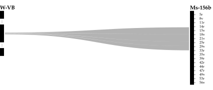

# Ms-156b

5 published remarks, VB

### [FCv\[1\]](https://cdn.wittgensteinnachlass.com/2000px/webp/Ms-156b/FCv.webp)

Orthography

### [1r\[1\]](https://cdn.wittgensteinnachlass.com/2000px/webp/Ms-156b/1r.webp)

… A combined calculus with levels then results.

### [1r\[2\]](https://cdn.wittgensteinnachlass.com/2000px/webp/Ms-156b/1r.webp)

But the calculi (partial calculi) at the separate levels are not essentially, i.e. taken by themselves, calculi of different orders.

Rather, one might even think of them as the same calculus.

### [1r\[3\]](https://cdn.wittgensteinnachlass.com/2000px/webp/Ms-156b/1r.webp),[1v\[1\]](https://cdn.wittgensteinnachlass.com/2000px/webp/Ms-156b/1v.webp)

Perhaps the case of dimensions is a good illustration. The generality comes out only when one says: Take, for example …. (Say,

instead of T(fx )..f'x instead of fx x ² instead of x ... 4.

But the _relation_ of the example to the general case, too, obtains only insofar as the example & the general case are set side by side.

### [1v\[2\]](https://cdn.wittgensteinnachlass.com/2000px/webp/Ms-156b/1v.webp),[2r\[1\]](https://cdn.wittgensteinnachlass.com/2000px/webp/Ms-156b/2r.webp),[2v\[1\]](https://cdn.wittgensteinnachlass.com/2000px/webp/Ms-156b/2v.webp)

The tone of conviction, belief as the accompaniment of a statement: Remember that a conversation in English, even when one hears it from far away & so cannot make out a word, sounds quite different from one in French or German. That chess, apart from its individual moves, also has a general character, so that one might conceivably distinguish people playing chess from people playing draughts without seeing a single move; that is, without seeing _what_ actually distinguishes chess from draughts.

### [2v\[2\]](https://cdn.wittgensteinnachlass.com/2000px/webp/Ms-156b/2v.webp),[3r\[1\]](https://cdn.wittgensteinnachlass.com/2000px/webp/Ms-156b/3r.webp),[3v\[1\]](https://cdn.wittgensteinnachlass.com/2000px/webp/Ms-156b/3v.webp)

What does the mult. ax. mean

–❘——❘——❘——❘—

What does it mean that there _is_ a selective class. The question is not whether it is true or not, but what does it mean, how are things _if_ it is true? This axiom seems to have a particular subtlety, since it _assumes_ what seems self-evident. But let us ask ourselves: why does it seem self-evident? And on the other hand: how can I even make an _assumption_ about the infinite? Can one say: Surely the infinite will not do us the wrong of behaving quite differently from the finite. (This is analogous to a theological argument.) So what does it mean that there is a selection? What is this selection; a law? And how can one assert the existence of a law? Perhaps this could be made clear in a more specific case.

### [3v\[2\]](https://cdn.wittgensteinnachlass.com/2000px/webp/Ms-156b/3v.webp),[4r\[1\]](https://cdn.wittgensteinnachlass.com/2000px/webp/Ms-156b/4r.webp),[4v\[1\]](https://cdn.wittgensteinnachlass.com/2000px/webp/Ms-156b/4v.webp)

As I said, one need not worry at all that the axiom might not be true. The only question is what sense, what purpose is it to have? For it is nonsense to say that it, as it were, assumes something about reality. It can, on the other hand, be a rule which in certain circumstances permits the formation of a sign that we call the sign of the selective class & for whose application in the calculus there are rules. And why should one want to forbid such a calculus. The only question is whether it does what one believes it does.

### [4v\[2\]](https://cdn.wittgensteinnachlass.com/2000px/webp/Ms-156b/4v.webp)

### [4v\[3\]](https://cdn.wittgensteinnachlass.com/2000px/webp/Ms-156b/4v.webp),[5r\[1\]](https://cdn.wittgensteinnachlass.com/2000px/webp/Ms-156b/5r.webp)

What is _remarkable_ in mathematics likewise signifies the lack of a solution. (One can never say: “Well, that’s just how it is. The proofs show it & if it is remarkable, then something remarkable has been proved.” Rather, everything is in order, solved, only when nothing seems significant. .

### [5r\[2\]](https://cdn.wittgensteinnachlass.com/2000px/webp/Ms-156b/5r.webp)

Why do musical automata appear to us to be living beings? And couldn’t one call them living beings? –

### [5r\[3\]](https://cdn.wittgensteinnachlass.com/2000px/webp/Ms-156b/5r.webp),[5v\[1\]](https://cdn.wittgensteinnachlass.com/2000px/webp/Ms-156b/5v.webp)

It is due to the primitive form of our language that we want to imagine everything as a body: thus we think of the surface of a body as a very thin skin, of a line as a very thin rod, etc., just so that we can interpret all nouns as signs for bodies, _objects_.

### [5v\[2\]](https://cdn.wittgensteinnachlass.com/2000px/webp/Ms-156b/5v.webp),[6r\[1\]](https://cdn.wittgensteinnachlass.com/2000px/webp/Ms-156b/6r.webp)

<s> Is hunger the wish for food? But why not merely for hunger to cease, whatever may bring that about. – But what phenomenon does one call the wish for food? When I am hungry, & look in the drawer where there is usually something to eat & am annoyed after (not because) I have found nothing. And now perhaps I **say** to myself: where else could I find something? Finally someone comes in & I say to him: I’d like something to eat. </s>

### [6r\[2\]](https://cdn.wittgensteinnachlass.com/2000px/webp/Ms-156b/6r.webp),[6v\[1\]](https://cdn.wittgensteinnachlass.com/2000px/webp/Ms-156b/6v.webp)

What is it supposed to mean that everything is settled in language? _For us_ everything is settled in language.

### [6v\[2\]](https://cdn.wittgensteinnachlass.com/2000px/webp/Ms-156b/6v.webp)

Language seemed to me to be, so to speak, a yardstick against which one measures the facts & by which their differences or agreement are settled. Thus expectation & fulfilment are measured against one another in language.

### [7r\[1\]](https://cdn.wittgensteinnachlass.com/2000px/webp/Ms-156b/7r.webp)

<s> In what way does grammar describe language? It says that such & such combinations of words are permissible. Also that this word means the same as that one. So it is really a jumble of rules. It consists of **agreements** about language. </s>

### [7r\[2\]](https://cdn.wittgensteinnachlass.com/2000px/webp/Ms-156b/7r.webp),[7v\[1\]](https://cdn.wittgensteinnachlass.com/2000px/webp/Ms-156b/7v.webp)

<s> These agreements cannot be justified by what is called sense or meaning, for it is precisely they that determine sense & meaning. The conventions can be justified by the purpose for which language is applied. This justification, however, does not interest us. – We would also allow ourselves to invent causal connections. </s>

### [7v\[2\]](https://cdn.wittgensteinnachlass.com/2000px/webp/Ms-156b/7v.webp),[8r\[1\]](https://cdn.wittgensteinnachlass.com/2000px/webp/Ms-156b/8r.webp)

Someone who learns to read musical notation learns the grammar of a language. (One could, for example, take a written melody as the command to play it on the piano.)

### [8r\[2\]](https://cdn.wittgensteinnachlass.com/2000px/webp/Ms-156b/8r.webp)

By training a child to do something in response to certain signs (commands), one can use the child as a machine for certain tasks.

The commands are like levers one pulls.

But what about this mechanism interests _us_?

### [8v\[1\]](https://cdn.wittgensteinnachlass.com/2000px/webp/Ms-156b/8v.webp)

Someone who is not clear about the nature of time. – Remember that in a machine there is a device that makes the ignition occur _earlier_ or _later_. Is it possible that the machine is not clear about what ‘before’ & ‘after’ mean? or “faster” & “slower”?

### [8v\[2\]](https://cdn.wittgensteinnachlass.com/2000px/webp/Ms-156b/8v.webp),[9r\[1\]](https://cdn.wittgensteinnachlass.com/2000px/webp/Ms-156b/9r.webp)

I (always) call grammatical rules to mind. I recall them to mind.

### [9r\[2\]](https://cdn.wittgensteinnachlass.com/2000px/webp/Ms-156b/9r.webp),[9v\[1\]](https://cdn.wittgensteinnachlass.com/2000px/webp/Ms-156b/9v.webp)

To be sure, the explanation of meaning, the ostensive definition, establishes a connection between a word & a thing, & the purpose of this connection is for the mechanism of language to work properly. So the explanation brings about proper functioning, like connecting a wire, etc., but it does not consist in the fact that hearing the word now has the corresponding effect, even if it does perhaps have this effect _because_ the connection was made. And it is the connection, not the effect, that determines the meaning.

### [9v\[2\]](https://cdn.wittgensteinnachlass.com/2000px/webp/Ms-156b/9v.webp)

Why, then, does one recall grammatical rules to mind?

### [9v\[3\]](https://cdn.wittgensteinnachlass.com/2000px/webp/Ms-156b/9v.webp),[10r\[1\]](https://cdn.wittgensteinnachlass.com/2000px/webp/Ms-156b/10r.webp)

It is done for someone who is confused by language.

### [10r\[2\]](https://cdn.wittgensteinnachlass.com/2000px/webp/Ms-156b/10r.webp)

When I say “the rules are arbitrary”, that means “I disregard their purpose or usefulness”.

### [10r\[3\]](https://cdn.wittgensteinnachlass.com/2000px/webp/Ms-156b/10r.webp)

The question as assurance, assertion: “Isn’t that so?” One could imagine a language consisting entirely of such & other questions.

### [10r\[4\]](https://cdn.wittgensteinnachlass.com/2000px/webp/Ms-156b/10r.webp),[10v\[1\]](https://cdn.wittgensteinnachlass.com/2000px/webp/Ms-156b/10v.webp)

If one may offer a general criticism of present-day mathematics & give an indication of how it is to change, one might say that a certain false generality in its investigations & a false striving for generality will disappear from it.

### [10v\[2\]](https://cdn.wittgensteinnachlass.com/2000px/webp/Ms-156b/10v.webp)

I want to distinguish “meaning” from _reactions_.

### [10v\[3\]](https://cdn.wittgensteinnachlass.com/2000px/webp/Ms-156b/10v.webp),[11r\[1\]](https://cdn.wittgensteinnachlass.com/2000px/webp/Ms-156b/11r.webp)

“I mean something by this movement” is like saying: I play a game with it, which can be described in advance.

### [11r\[2\]](https://cdn.wittgensteinnachlass.com/2000px/webp/Ms-156b/11r.webp)

Could I put it like this: When I say I mean something by it (by this gesture), that means I look at it from the standpoint of language.

### [11r\[3\]](https://cdn.wittgensteinnachlass.com/2000px/webp/Ms-156b/11r.webp),[11v\[1\]](https://cdn.wittgensteinnachlass.com/2000px/webp/Ms-156b/11v.webp)

My words & gestures are of course not ‘invented ad hoc’; but not everything that is not invented has been agreed on beforehand.

### [11v\[2\]](https://cdn.wittgensteinnachlass.com/2000px/webp/Ms-156b/11v.webp)

Doesn’t it just mean: I mean something by this gesture (etc.) means I bring it into connection with language. (With what I already call ‘language’.)

### [11v\[3\]](https://cdn.wittgensteinnachlass.com/2000px/webp/Ms-156b/11v.webp),[12r\[1\]](https://cdn.wittgensteinnachlass.com/2000px/webp/Ms-156b/12r.webp)

One is accustomed to thinking of a concept in such a way that the objects it encloses

all lie in much the same position relative to its boundary, whereas in most cases a picture like this

is more accurate, or again:

.

### [12r\[2\]](https://cdn.wittgensteinnachlass.com/2000px/webp/Ms-156b/12r.webp),[12v\[1\]](https://cdn.wittgensteinnachlass.com/2000px/webp/Ms-156b/12v.webp)

It is interesting, for example, to see colours not as objects on a par with one another but as phenomena that each occupy a different _place_ in the concept, whereas in the case of

one cannot speak of the place of the object in the concept.

### [12v\[2\]](https://cdn.wittgensteinnachlass.com/2000px/webp/Ms-156b/12v.webp)

In what way is shrugging one’s shoulders part of language? – can one imagine more disparate things than the word “red”, the sign “3”, the word “perhaps”, the word “Hurrah” & a shrug of the shoulders?

### [12v\[3\]](https://cdn.wittgensteinnachlass.com/2000px/webp/Ms-156b/12v.webp),[13r\[1\]](https://cdn.wittgensteinnachlass.com/2000px/webp/Ms-156b/13r.webp)

The word “hurra”, too, is used as a sign not because the mouth cannot help forming these sounds but because that is the word used on this occasion. For if one asks someone, why do you say that, one is _not_ asking for the cause but for the motive.

### [13r\[2\]](https://cdn.wittgensteinnachlass.com/2000px/webp/Ms-156b/13r.webp),[13v\[1\]](https://cdn.wittgensteinnachlass.com/2000px/webp/Ms-156b/13v.webp)

If one asked: why do you say “Hurra” & not “huihui”, the answer would be: “‘huihui’ doesn’t mean anything, ‘hurra’ is a sign of joy”. “hui” as a sign of misgiving.

### [13v\[2\]](https://cdn.wittgensteinnachlass.com/2000px/webp/Ms-156b/13v.webp)

A human language, German for example, is an extremely complicated organism. There is room in it for the most diverse things. And there are countless transitions from one to another.

### [13v\[3\]](https://cdn.wittgensteinnachlass.com/2000px/webp/Ms-156b/13v.webp)

Or is it not _simply_ that the only side of language that concerns _me_ is the one that is a calculus, ‘a game’?

### [14r\[1\]](https://cdn.wittgensteinnachlass.com/2000px/webp/Ms-156b/14r.webp)

“The sentence has sense” can indeed mean that it is a member of a system; but how could “_I_ understand it” mean that, since the system of the language is in any case independent of the person?

### [14r\[2\]](https://cdn.wittgensteinnachlass.com/2000px/webp/Ms-156b/14r.webp),[14v\[1\]](https://cdn.wittgensteinnachlass.com/2000px/webp/Ms-156b/14v.webp)

One says “I just said the sentence quite thoughtlessly”, “I just said it quite mechanically, without thinking anything by it”. Or else, “no, I _meant_ what I said”. It is _here_ that the sentence seems, as it were, to engage with something in us.

### [14v\[2\]](https://cdn.wittgensteinnachlass.com/2000px/webp/Ms-156b/14v.webp)

“I mean something by it” could also mean: the sentence is part of a system I know. _I_ play the game it is part of.

### [VB](/w-vb/#ms-156b-14v.3) [14v\[3\]](https://cdn.wittgensteinnachlass.com/2000px/webp/Ms-156b/14v.webp)

[The _strength of thought_ in Brahms’s music.]

### [14v\[4\]](https://cdn.wittgensteinnachlass.com/2000px/webp/Ms-156b/14v.webp),[15r\[1\]](https://cdn.wittgensteinnachlass.com/2000px/webp/Ms-156b/15r.webp)

“The sentence has sense in virtue of the fact that ….” Whenever I say that, it strikes me for a moment as quite right.

### [15r\[2\]](https://cdn.wittgensteinnachlass.com/2000px/webp/Ms-156b/15r.webp)

What does seem right is that only the system lifts the sign beyond the momentary experience.

### [15r\[3\]](https://cdn.wittgensteinnachlass.com/2000px/webp/Ms-156b/15r.webp)

It draws the boundary between the calculus & the experience, or the causes & effects.

### [15r\[4\]](https://cdn.wittgensteinnachlass.com/2000px/webp/Ms-156b/15r.webp)

“It has sense” could amount to “it has consequences” (I do not, of course, mean effects).

### [15v\[1\]](https://cdn.wittgensteinnachlass.com/2000px/webp/Ms-156b/15v.webp)

A shrug, or the word “perhaps”, can be part of a conversation.

### [15v\[2\]](https://cdn.wittgensteinnachlass.com/2000px/webp/Ms-156b/15v.webp)

I can invent a conversation in which this word is a reply & in which it has sense, but also one in which it has no sense. (Is used against the rules of the game.)

### [15v\[3\]](https://cdn.wittgensteinnachlass.com/2000px/webp/Ms-156b/15v.webp)

But of course I don’t call every game a language.

### [15v\[4\]](https://cdn.wittgensteinnachlass.com/2000px/webp/Ms-156b/15v.webp),[16r\[1\]](https://cdn.wittgensteinnachlass.com/2000px/webp/Ms-156b/16r.webp),[16v\[1\]](https://cdn.wittgensteinnachlass.com/2000px/webp/Ms-156b/16v.webp)

If one asks: “why did you say that?” (thus asking for the motive) & I answer: “because you said …”, then before I said that there need not have been any connection other than temporal succession, but the connection is _made_ by stating the motive. – This might also show itself in the following way: if one asks “why did you say that” & I answer, the question now is whether or not this answer rests on an act of memory.

### [16v\[2\]](https://cdn.wittgensteinnachlass.com/2000px/webp/Ms-156b/16v.webp)

The background that seems to be the meaning of a word is the system to which the word belongs.

### [16v\[3\]](https://cdn.wittgensteinnachlass.com/2000px/webp/Ms-156b/16v.webp)

Certainly, the words of a language differ from other sequences of sounds by virtue of the linguistic system to which they belong.

### [17r\[1\]](https://cdn.wittgensteinnachlass.com/2000px/webp/Ms-156b/17r.webp)

“This sentence says something” means: it is a sentence of the language. But that is no reason why it makes sense to say it; rather, there is nothing we can do but describe language, what we call by that name.

### [17r\[2\]](https://cdn.wittgensteinnachlass.com/2000px/webp/Ms-156b/17r.webp),[17v\[1\]](https://cdn.wittgensteinnachlass.com/2000px/webp/Ms-156b/17v.webp)

I beckon to someone to come to me. In what way is that a sign? In what way is it part of language? Through what I feel as I do it? No. (But one may be thinking that I say words to myself as I do it.) Through its connection & kinship with word-language.

### [17v\[2\]](https://cdn.wittgensteinnachlass.com/2000px/webp/Ms-156b/17v.webp)

<s> The distinction between verbal definition & ostensive definition gives a rough classification of these kinds of explanation.</s>

### [17v\[3\]](https://cdn.wittgensteinnachlass.com/2000px/webp/Ms-156b/17v.webp),[18r\[1\]](https://cdn.wittgensteinnachlass.com/2000px/webp/Ms-156b/18r.webp)

<s> To understand the role it plays in the calculus one must examine each case individually. Examples

</s>

### [18r\[2\]](https://cdn.wittgensteinnachlass.com/2000px/webp/Ms-156b/18r.webp)

I mean that “I understand the word ‘perhaps’” means “I know how it is applied, I can describe its application like this”; but I may not apply any criterion for this at all, or perhaps I will call to mind just one application or merely evoke the feeling of the word.

### [18r\[3\]](https://cdn.wittgensteinnachlass.com/2000px/webp/Ms-156b/18r.webp),[18v\[1\]](https://cdn.wittgensteinnachlass.com/2000px/webp/Ms-156b/18v.webp)

Can one say: when people feel uncertain, they say the word “perhaps”. The word is the expression of this feeling.

### [18v\[2\]](https://cdn.wittgensteinnachlass.com/2000px/webp/Ms-156b/18v.webp)

“As it is, this book is nothing but smallness & pettiness, but it could also have expressed the highest.”

### [18v\[3\]](https://cdn.wittgensteinnachlass.com/2000px/webp/Ms-156b/18v.webp),[19r\[1\]](https://cdn.wittgensteinnachlass.com/2000px/webp/Ms-156b/19r.webp)

We are interested in language as a process that follows explicit rules. For philosophical problems are misunderstandings that are to be removed by clarifying the rules by which we want to use words.

### [19r\[2\]](https://cdn.wittgensteinnachlass.com/2000px/webp/Ms-156b/19r.webp)

The purpose of a command is its sense, insofar as the purpose is specified by a rule of language.

### [19r\[3\]](https://cdn.wittgensteinnachlass.com/2000px/webp/Ms-156b/19r.webp),[19v\[1\]](https://cdn.wittgensteinnachlass.com/2000px/webp/Ms-156b/19v.webp)

Why, or in what way, can I not invent a new colour? One might say: I can invent only new combinations of the elements of reality, not new elements. And there must be much truth in that, & yet it is not quite right. How does one invent something, then? Well, by describing it. But how am I to describe a new colour, – or rather: what would I (then) call the description of a new colour?! –

### [19v\[2\]](https://cdn.wittgensteinnachlass.com/2000px/webp/Ms-156b/19v.webp)

The _sentences_ “I am going for a walk” & “I am not going for a walk” are opposed to one another. – “Yes, but why does one call them opposed to one another?” – Well, look at the use of the word “not”.

### [20r\[1\]](https://cdn.wittgensteinnachlass.com/2000px/webp/Ms-156b/20r.webp),[20v\[1\]](https://cdn.wittgensteinnachlass.com/2000px/webp/Ms-156b/20v.webp)

One believes that because it makes sense to say Mozart was a greater composer than Brahms, an analogous sentence must now have sense (not _hold true_) for any two composers or poets, etc. One thinks it must be possible, so to speak, to measure greatness in every case, even if we may be too ignorant to carry out the measurement. Whereas here it is much as it is with measurements in visual space, where it is senseless (not false) to say that one line segment is a ten-thousandth of another.

### [20v\[2\]](https://cdn.wittgensteinnachlass.com/2000px/webp/Ms-156b/20v.webp)

“What is mathematics?” – Well, what is in mathematics books: “But what is it that makes all these calculi, etc., akin?” Well, that is very complicated to describe & not terribly interesting.

### [20v\[3\]](https://cdn.wittgensteinnachlass.com/2000px/webp/Ms-156b/20v.webp),[21r\[1\]](https://cdn.wittgensteinnachlass.com/2000px/webp/Ms-156b/21r.webp)

One says that one could always speak with the expression of conviction even without the conviction; but one simply doesn’t. [This thought came to me when I was half asleep.]

### [21r\[2\]](https://cdn.wittgensteinnachlass.com/2000px/webp/Ms-156b/21r.webp)

What is there to the “lightning speed” of thought?

### [21r\[4\]](https://cdn.wittgensteinnachlass.com/2000px/webp/Ms-156b/21r.webp),[21v\[1\]](https://cdn.wittgensteinnachlass.com/2000px/webp/Ms-156b/21v.webp)

And what is this understanding of which these tests seem to us to be signs? How _else_ does it show itself. What do we expect, for example, if the tests come out positive?

### [21v\[2\]](https://cdn.wittgensteinnachlass.com/2000px/webp/Ms-156b/21v.webp)

It is a very remarkable game we are playing here.

We recognize both as tests; – tests for what?

### [21v\[3\]](https://cdn.wittgensteinnachlass.com/2000px/webp/Ms-156b/21v.webp),[22r\[1\]](https://cdn.wittgensteinnachlass.com/2000px/webp/Ms-156b/22r.webp)

What is it that we then assume when the tests come out positive, what do we assume in saying: yes, he understands it. What goes on when we say that? Must anything go on other than our saying it?

### [22r\[2\]](https://cdn.wittgensteinnachlass.com/2000px/webp/Ms-156b/22r.webp),[22v\[1\]](https://cdn.wittgensteinnachlass.com/2000px/webp/Ms-156b/22v.webp)

Nor is it right to say that I simply expect further ‘signs of understanding’, any more than I generally expect further views of a chair when I see one. Though I may be surprised if I do not get them. At any rate, this expectation is not a state of mind while seeing the chair.

### [22v\[2\]](https://cdn.wittgensteinnachlass.com/2000px/webp/Ms-156b/22v.webp)

Realism is always right in what it says. But idealism sees problems that are there & that realism does not see.

### [22v\[3\]](https://cdn.wittgensteinnachlass.com/2000px/webp/Ms-156b/22v.webp)

“Expression of thought”

“Expression of feeling”

“Expression of expectation”

“Expression of toothache”

### [23r\[1\]](https://cdn.wittgensteinnachlass.com/2000px/webp/Ms-156b/23r.webp)

Think of the use of language when someone teases another person by continually repeating a word! Where is the calculus here?

### [23r\[2\]](https://cdn.wittgensteinnachlass.com/2000px/webp/Ms-156b/23r.webp),[23v\[1\]](https://cdn.wittgensteinnachlass.com/2000px/webp/Ms-156b/23v.webp)

If philosophy also has to do with the use of the word “philosophy”, one might think that there must therefore be a philosophy of the second order, etc. But it is not like that; rather, it is the same as with orthography, which also has to do with the word “orthography” but is not in this case an orthography of the second order.

### [VB](/w-vb/#ms-156b-23v.2) [23v\[2\]](https://cdn.wittgensteinnachlass.com/2000px/webp/Ms-156b/23v.webp)

The various plants & their human character: rose, ivy, grass, oak, apple tree, cereal, palm. Compared with the differing character of words.

### [24r\[1\]](https://cdn.wittgensteinnachlass.com/2000px/webp/Ms-156b/24r.webp),[24v\[1\]](https://cdn.wittgensteinnachlass.com/2000px/webp/Ms-156b/24v.webp)

If, for example, one were quite ready to say that he understands the word ‘red’ if a red image floats before him when he hears the word, why not say (also) that he understands it if, when asked for the definition, he points to something red? And if one now hesitates to accept the first as a criterion of understanding, that only shows that “understanding” is something more complicated than one was originally inclined to think.

### [24v\[2\]](https://cdn.wittgensteinnachlass.com/2000px/webp/Ms-156b/24v.webp)

If he can give the ostensive definition on request but cannot pick out a red object from among others, one _can_ say he understands the word “red” but not the other words of the command.

### [VB](/w-vb/#ms-156b-24v.3+25r.1) [24v\[3\]](https://cdn.wittgensteinnachlass.com/2000px/webp/Ms-156b/24v.webp),[25r\[1\]](https://cdn.wittgensteinnachlass.com/2000px/webp/Ms-156b/25r.webp)

If one wanted to characterize the nature of Mendelssohn’s music, one might do so by saying that perhaps none of Mendelssohn’s music is hard to understand.

### [25r\[2\]](https://cdn.wittgensteinnachlass.com/2000px/webp/Ms-156b/25r.webp),[25v\[1\]](https://cdn.wittgensteinnachlass.com/2000px/webp/Ms-156b/25v.webp)

Suppose it is a child & the child carries out a simple command & we say: “It understood it!” Then we can ask in turn: “Are you sure? What will you say if the child does not carry out the command the second time, & what if it carries it out the second & third times, but not after that. After how many times will you say: I am sure it understood it. Or won’t you say it at all.”

### [25v\[2\]](https://cdn.wittgensteinnachlass.com/2000px/webp/Ms-156b/25v.webp)

Or should I say: after how many times will you expect it to behave in such & such a way.

### [25v\[3\]](https://cdn.wittgensteinnachlass.com/2000px/webp/Ms-156b/25v.webp),[26r\[1\]](https://cdn.wittgensteinnachlass.com/2000px/webp/Ms-156b/26r.webp)

That would really be like asking: “after how many times will you _act_ in such & such a way?” Well, I don’t know that. Here, too, we are no longer dealing with anything comparable to a game.

### [26r\[2\]](https://cdn.wittgensteinnachlass.com/2000px/webp/Ms-156b/26r.webp)

Suppose understanding were a physiological change, then there _would_ be a direct way of checking understanding & it would be like the case of the people in the next room.

### [26r\[3\]](https://cdn.wittgensteinnachlass.com/2000px/webp/Ms-156b/26r.webp),[26v\[1\]](https://cdn.wittgensteinnachlass.com/2000px/webp/Ms-156b/26v.webp)

One of the most misleading words is the question “what do I mean by that?” In most cases, one could answer: “nothing at all – I _say_ …”

### [26v\[2\]](https://cdn.wittgensteinnachlass.com/2000px/webp/Ms-156b/26v.webp),[27r\[1\]](https://cdn.wittgensteinnachlass.com/2000px/webp/Ms-156b/27r.webp),[27v\[1\]](https://cdn.wittgensteinnachlass.com/2000px/webp/Ms-156b/27v.webp),[28r\[1\]](https://cdn.wittgensteinnachlass.com/2000px/webp/Ms-156b/28r.webp)

What happens when we try, for example, while writing a letter, to find the right “expression for our thoughts”? This expression compares the process to that of translation or description. The thoughts are already there beforehand, as it were, & we are only looking for their expression. And this image is more or less accurate in the various cases. But what can’t happen here! For example: I indulge in a mood & the expression _comes_; or: an image floats before me & I try to describe it; or: an English expression came to me & I want to recall the corresponding German one; or: a gesture comes to me & I ask myself which sentence corresponds to this gesture? Finally, one occurs to me & seems appropriate for the gesture, etc. etc. etc. If one were now to ask: “did you have the thought before you had the expression”, what would one have to answer? And what about the question what did the thought consist in as it existed before the expression? Here there are the most diverse cases & in our ordinary way of speaking they are all designated by just _one_ image.

### [28r\[2\]](https://cdn.wittgensteinnachlass.com/2000px/webp/Ms-156b/28r.webp),[28v\[1\]](https://cdn.wittgensteinnachlass.com/2000px/webp/Ms-156b/28v.webp)

“You say: ‘let us put the expression of belief in place of belief’; but that would be just like putting the expression ‘I have toothache’ in place of the toothache!”

---

### [28v\[2\]](https://cdn.wittgensteinnachlass.com/2000px/webp/Ms-156b/28v.webp)

Instead of “the other person has toothache” we say “his tooth goes ow”.

### [28v\[3\]](https://cdn.wittgensteinnachlass.com/2000px/webp/Ms-156b/28v.webp),[29r\[1\]](https://cdn.wittgensteinnachlass.com/2000px/webp/Ms-156b/29r.webp)

“But surely you don’t want to deny that the other person can have what you have”. Certainly not. I only want to know how I am to imagine it. I know how, for example, in the case of the grey hair that I & the other person can have, and likewise in the case of bad teeth. But if I apply _this_ concept in the case of toothache, I do not go from my toothache to his, but from my toothache in my teeth to my toothache in his teeth.

### [29r\[2\]](https://cdn.wittgensteinnachlass.com/2000px/webp/Ms-156b/29r.webp),[29v\[1\]](https://cdn.wittgensteinnachlass.com/2000px/webp/Ms-156b/29v.webp)

And if one were now to ask “why do you still call it your toothache”, I would have to answer “because I feel it”. But if you say that, then it is also possible to say that the other person feels this very same toothache & how do you know that you feel it & not the other person. For what is there in the feeling of toothache that points to an owner?

### [29v\[2\]](https://cdn.wittgensteinnachlass.com/2000px/webp/Ms-156b/29v.webp)

_I_ & _you_, when all human bodies are seen only in the mirror & all the utterances are heard coming from one place.

### [30r\[1\]](https://cdn.wittgensteinnachlass.com/2000px/webp/Ms-156b/30r.webp)

“I feel the toothache”, which mouth is to say that? And what if no _mouth_ says it at all?

### [30r\[2\]](https://cdn.wittgensteinnachlass.com/2000px/webp/Ms-156b/30r.webp),[30v\[1\]](https://cdn.wittgensteinnachlass.com/2000px/webp/Ms-156b/30v.webp)

We haven’t the slightest practical problem about toothache, or if we have any, they are, say, problems of dentistry.

_Our_ problem arises only when we look at language from the outside (the problem isn’t there when we use language to deal with the matter at hand.)

### [30v\[2\]](https://cdn.wittgensteinnachlass.com/2000px/webp/Ms-156b/30v.webp),[31r\[1\]](https://cdn.wittgensteinnachlass.com/2000px/webp/Ms-156b/31r.webp)

Let us put it this way: “So we want to assign the toothache a place in body A & to claim an owner for it as well. That seems possible as long as _I_ am the owner. But what if one person, A, has pains in another, B? Then we see at once that it is the bodily phenomena that determine the owner. And if we disregard the bodily criteria, there is no owner & so there is then no other person set over against the I & the ‘I’ is superfluous.

### [31r\[2\]](https://cdn.wittgensteinnachlass.com/2000px/webp/Ms-156b/31r.webp)

[I always want to make history.]

### [31r\[3\]](https://cdn.wittgensteinnachlass.com/2000px/webp/Ms-156b/31r.webp),[31v\[1\]](https://cdn.wittgensteinnachlass.com/2000px/webp/Ms-156b/31v.webp)

[I feel I have done my work very badly; although, possibly, no one today can do it better.]

### [31v\[2\]](https://cdn.wittgensteinnachlass.com/2000px/webp/Ms-156b/31v.webp)

[I don’t know what I am; I can’t compare myself with anything. Isn’t it better, then, to dispense with comparisons altogether, since any of them might be misleading. Or is what speaks in me here partly the fear of comparing myself with things I wouldn’t want to be compared with?]

### [32r\[1\]](https://cdn.wittgensteinnachlass.com/2000px/webp/Ms-156b/32r.webp)

[It is true, my soul is more naked than most people’s, but I also feel cold & tell others that I feel cold.]

### [VB](/w-vb/#ms-156b-32r.2+32v.1) [32r\[2\]](https://cdn.wittgensteinnachlass.com/2000px/webp/Ms-156b/32r.webp),[32v\[1\]](https://cdn.wittgensteinnachlass.com/2000px/webp/Ms-156b/32v.webp)

[Every artist has been influenced by others & shows (the) traces of that influence in his works; but what he offers us is, after all, only his own personality. What comes from someone else can only be eggshells. We may be indulgent about their being there, but they will not be our spiritual nourishment.]

### [VB](/w-vb/#ms-156b-32v.2) [32v\[2\]](https://cdn.wittgensteinnachlass.com/2000px/webp/Ms-156b/32v.webp)

[It (sometimes) seems to me as though I were already philosophizing with a toothless mouth & as though speaking with a toothless mouth seemed to me the genuine, more valuable way to speak. I see something similar in Kraus. Instead of recognizing it as decline.]

### [33r\[1\]](https://cdn.wittgensteinnachlass.com/2000px/webp/Ms-156b/33r.webp)

Can one say that the people who confidently expected the world to end in the year 1000 were misled by the decimal notation for numbers?

### [33r\[2\]](https://cdn.wittgensteinnachlass.com/2000px/webp/Ms-156b/33r.webp),[33v\[1\]](https://cdn.wittgensteinnachlass.com/2000px/webp/Ms-156b/33v.webp)

[“Posterity weaves no wreaths for the player”; one can say that of anyone who is an actor instead of an artist.]

### [33v\[2\]](https://cdn.wittgensteinnachlass.com/2000px/webp/Ms-156b/33v.webp),[34r\[1\]](https://cdn.wittgensteinnachlass.com/2000px/webp/Ms-156b/34r.webp)

It is very interesting to see that more recent philosophers say that the things around us are _classes_ of sense perceptions. As though one could define the word “table” as a _class_ of sense impressions. If there is a connection with sense impressions, people believe, it can only be that one thing is a class or group of the other. For they do not think of the _use_ of words in its countless forms, but always of the word as a name of a thing.

### [34r\[2\]](https://cdn.wittgensteinnachlass.com/2000px/webp/Ms-156b/34r.webp)

The I does not occur in visual experience, & how could it possibly occur?!

### [34r\[3\]](https://cdn.wittgensteinnachlass.com/2000px/webp/Ms-156b/34r.webp),[34v\[1\]](https://cdn.wittgensteinnachlass.com/2000px/webp/Ms-156b/34v.webp)

While one is setting up the notation, i.e. translating the old notation into the new, one naturally cannot feel at home in it.

### [34v\[2\]](https://cdn.wittgensteinnachlass.com/2000px/webp/Ms-156b/34v.webp)

“Put yourself in his place”. Take his place. Let us consider what that means when we imagine that we had his pains & on the other hand, say, his money.

### [34v\[3\]](https://cdn.wittgensteinnachlass.com/2000px/webp/Ms-156b/34v.webp),[35r\[1\]](https://cdn.wittgensteinnachlass.com/2000px/webp/Ms-156b/35r.webp)

The question “which one is my arm” makes sense. (The answer may be: “the one that looks like _this_”, “the one that moves when …” etc.) But the question “which ones are my toothaches” or “how do I tell them apart from others” makes no sense.

### [35r\[2\]](https://cdn.wittgensteinnachlass.com/2000px/webp/Ms-156b/35r.webp)

Consciousness is not a phenomenon. But a way & manner of looking at phenomena.

### [35r\[3\]](https://cdn.wittgensteinnachlass.com/2000px/webp/Ms-156b/35r.webp)

What we are doing is: clearing away philosophy.

### [35r\[4\]](https://cdn.wittgensteinnachlass.com/2000px/webp/Ms-156b/35r.webp),[35v\[1\]](https://cdn.wittgensteinnachlass.com/2000px/webp/Ms-156b/35v.webp)

When one says: It seems to me that there is a tree there, one is playing a different kind of game from that of merely describing the visual fact. That is: no doubt these games have certain moves in common, but in the game in which people are designated there are other moves as well.

### [35v\[2\]](https://cdn.wittgensteinnachlass.com/2000px/webp/Ms-156b/35v.webp),[36r\[1\]](https://cdn.wittgensteinnachlass.com/2000px/webp/Ms-156b/36r.webp)

It is almost as though besides ordinary chess there were another game in which, say, each of the pieces had an owner & there were other aims besides the usual aim of the game; for instance, to lose a particular piece as late as possible. (Indeed, there need not be any checkmate in the ordinary sense in this game; one might win on points, for instance.)

### [36r\[2\]](https://cdn.wittgensteinnachlass.com/2000px/webp/Ms-156b/36r.webp)

Instead of “do you see that?”: “can you draw that?”

### [36v\[1\]](https://cdn.wittgensteinnachlass.com/2000px/webp/Ms-156b/36v.webp)

Who is the one with toothache when I have toothache? The one whose mouth moves when he says so? the one with the bad tooth? the one who grimaces?

Whom is one to comfort? which tooth is one to treat? For comforting relates to a _body_.

### [36v\[2\]](https://cdn.wittgensteinnachlass.com/2000px/webp/Ms-156b/36v.webp)

Let us imagine _my_ body, rather than just the geometrical eye, in the middle of the visual field & seen en face.

### [37r\[1\]](https://cdn.wittgensteinnachlass.com/2000px/webp/Ms-156b/37r.webp),[37v\[1\]](https://cdn.wittgensteinnachlass.com/2000px/webp/Ms-156b/37v.webp)

When I say: “only what _I_ see is real”, I am already adopting, without knowing it, a linguistic usage different from the ordinary one. I am already using language in a form that departs from the ordinary one. I have already given in to the temptation to use it in the solipsistic way. And so I really need say nothing more, & what I say is like what the realist says when he says: “What I see is just as real as what you see, only it just happens that I’m seeing it now & not you.” Which really says nothing at all except that it emphasizes a form of language.

### [37v\[2\]](https://cdn.wittgensteinnachlass.com/2000px/webp/Ms-156b/37v.webp),[38r\[1\]](https://cdn.wittgensteinnachlass.com/2000px/webp/Ms-156b/38r.webp)

The solipsist regards his position as _unassailable_. “Surely it is _clear_ that my experience is the only real one; it _can’t_ possibly be otherwise”. Certainly not, if you use language that way. For you are already using it that way; you are not just now making a case for that use. The temptation to use it this way is there; & you have already given in to it.

### [38r\[2\]](https://cdn.wittgensteinnachlass.com/2000px/webp/Ms-156b/38r.webp)

Surely it couldn’t possibly be – in a certain sense – that the solipsist (idealist or realist) was wrong.

### [38r\[3\]](https://cdn.wittgensteinnachlass.com/2000px/webp/Ms-156b/38r.webp),[38v\[1\]](https://cdn.wittgensteinnachlass.com/2000px/webp/Ms-156b/38v.webp)

“I see myself playing the piano”. How do you know that you see _yourself_? Well, I recognize myself. – How do you know that _you_ see yourself? Do you recognize yourself there too?

### [38v\[2\]](https://cdn.wittgensteinnachlass.com/2000px/webp/Ms-156b/38v.webp)

I have pains here (in my tooth). Is it part of the experience that I have them in _my_ body? But also that _I_ have them?

### [38v\[3\]](https://cdn.wittgensteinnachlass.com/2000px/webp/Ms-156b/38v.webp),[39r\[1\]](https://cdn.wittgensteinnachlass.com/2000px/webp/Ms-156b/39r.webp)

Grammatical difficulties find expression in the various philosophical theories. Difficulties whose sources we find only by rummaging carefully through the grammar of our words. They find expression, so to speak, off the main road.

### [39r\[2\]](https://cdn.wittgensteinnachlass.com/2000px/webp/Ms-156b/39r.webp),[39v\[1\]](https://cdn.wittgensteinnachlass.com/2000px/webp/Ms-156b/39v.webp)

Now if one asked whether it is an experience that I see & not someone else, I would have to say: yes. For when I say that someone else sees, that is based on different experiences from when I say that I see. But the sentence “I see” has a different grammar from “A sees” & the feature that distinguishes “A sees” from “B sees” is different from the one that distinguishes these from “I see”.

### [39v\[2\]](https://cdn.wittgensteinnachlass.com/2000px/webp/Ms-156b/39v.webp),[40r\[1\]](https://cdn.wittgensteinnachlass.com/2000px/webp/Ms-156b/40r.webp)

My error is of this kind: at one time I take myself to be a place in Euclidean space, at another in visual space. In visual space one cannot say: “From here it looks like _this_”. Because there is no _here_ at all.

### [40r\[2\]](https://cdn.wittgensteinnachlass.com/2000px/webp/Ms-156b/40r.webp)

We are sitting in a row, each to say in turn what he sees.

### [40r\[3\]](https://cdn.wittgensteinnachlass.com/2000px/webp/Ms-156b/40r.webp),[40v\[1\]](https://cdn.wittgensteinnachlass.com/2000px/webp/Ms-156b/40v.webp)

And yet the command could be: Draw what this person sees. I would then not draw what I draw when the command is: draw what you see, & yet it would be drawn no less directly.

That might even be the natural way to render it.

### [40v\[2\]](https://cdn.wittgensteinnachlass.com/2000px/webp/Ms-156b/40v.webp)

When we give someone a command “do such & such” & the command refers to him or to other people, e.g. “Prick yourself in the arm”. Does the person addressed play the same role in the command as the person we are talking about?

### [40v\[3\]](https://cdn.wittgensteinnachlass.com/2000px/webp/Ms-156b/40v.webp),[41r\[1\]](https://cdn.wittgensteinnachlass.com/2000px/webp/Ms-156b/41r.webp)

If I say to someone “raise your right arm” he can do it with his eyes closed. And that says it all.

### [41r\[2\]](https://cdn.wittgensteinnachlass.com/2000px/webp/Ms-156b/41r.webp)

Must I know what I see?

### [41r\[3\]](https://cdn.wittgensteinnachlass.com/2000px/webp/Ms-156b/41r.webp)

Now if my solipsistic wishes were wholly fulfilled, – how would language be used?

### [41r\[4\]](https://cdn.wittgensteinnachlass.com/2000px/webp/Ms-156b/41r.webp),[41v\[1\]](https://cdn.wittgensteinnachlass.com/2000px/webp/Ms-156b/41v.webp)

The person figures as an object of experience, but seems to figure in another way as well: essentially as subject, not object.

### [41v\[2\]](https://cdn.wittgensteinnachlass.com/2000px/webp/Ms-156b/41v.webp),[42r\[1\]](https://cdn.wittgensteinnachlass.com/2000px/webp/Ms-156b/42r.webp)

I say “I see” & am not quite sure what the other person can say that would amount to the same thing. But if what I said made sense, then the other person must also be able to say it (i.e. the sentence with the same sense). What is he to say? Presumably: “You see …” as he turns to address me. But whom does he address? W.? Not _necessarily_. The geometrical eye.

### [42r\[2\]](https://cdn.wittgensteinnachlass.com/2000px/webp/Ms-156b/42r.webp)

If I say: “… is seen” then by way of reply he is to turn so that he appears en face.

### [42r\[3\]](https://cdn.wittgensteinnachlass.com/2000px/webp/Ms-156b/42r.webp)

But does ‘turning to address the geometrical eye’ mean anything?

### [42r\[4\]](https://cdn.wittgensteinnachlass.com/2000px/webp/Ms-156b/42r.webp),[42v\[1\]](https://cdn.wittgensteinnachlass.com/2000px/webp/Ms-156b/42v.webp)

Yes: For when he turns to address A I see his face opposite A’s. When he turns to address B, his face opposite B’s. But if I see it en face, opposite no one, I say he is addressing me.

### [42v\[2\]](https://cdn.wittgensteinnachlass.com/2000px/webp/Ms-156b/42v.webp)

But it might also be that I had to answer for someone, say a child, whenever the child was asked a question.

### [42v\[3\]](https://cdn.wittgensteinnachlass.com/2000px/webp/Ms-156b/42v.webp),[43r\[1\]](https://cdn.wittgensteinnachlass.com/2000px/webp/Ms-156b/43r.webp)

Indeed, the child could even be asked, what do you see & I answer. Either “it sees …” or “I see …”

### [43r\[2\]](https://cdn.wittgensteinnachlass.com/2000px/webp/Ms-156b/43r.webp)

It might also be that I am always addressed by way of my reflection in the mirror.

### [43r\[3\]](https://cdn.wittgensteinnachlass.com/2000px/webp/Ms-156b/43r.webp)

Suppose I said: “I know then that I am the one meant” would that mean anything?

### [43r\[4\]](https://cdn.wittgensteinnachlass.com/2000px/webp/Ms-156b/43r.webp),[43v\[1\]](https://cdn.wittgensteinnachlass.com/2000px/webp/Ms-156b/43v.webp)

It is not as though the sense of sight were reserved for me; other people’s statements merely have a different relation to it.

### [43v\[2\]](https://cdn.wittgensteinnachlass.com/2000px/webp/Ms-156b/43v.webp)

Am I, is my body, in any privileged position? That is: is it situated asymmetrically? Well, yes & no; it depends on the geometry we use.

### [43v\[3\]](https://cdn.wittgensteinnachlass.com/2000px/webp/Ms-156b/43v.webp),[44r\[1\]](https://cdn.wittgensteinnachlass.com/2000px/webp/Ms-156b/44r.webp)

Suppose that I raise my hand so that others know where the geometrical eye is. The others then make me (my body) the centre of their notation. The question is: Do I thereby communicate anything to them; as I would communicate something to them if I raised my hand to indicate that I am in pain? No!!

### [44r\[2\]](https://cdn.wittgensteinnachlass.com/2000px/webp/Ms-156b/44r.webp),[44v\[1\]](https://cdn.wittgensteinnachlass.com/2000px/webp/Ms-156b/44v.webp)

For what you say to them is just as if you said: “The geometrical eye is here” while pointing at your eye. But to what space does the word “here” refer. Surely not to visual space.

### [44v\[2\]](https://cdn.wittgensteinnachlass.com/2000px/webp/Ms-156b/44v.webp)

“We know what he sees” doesn’t mean anything of the sort: “we know that he has such & such a picture in his head (in his mind etc.)”.

### [44v\[3\]](https://cdn.wittgensteinnachlass.com/2000px/webp/Ms-156b/44v.webp),[45r\[1\]](https://cdn.wittgensteinnachlass.com/2000px/webp/Ms-156b/45r.webp)

The tendency is to say “only what _I_ see is really seen”. I look at my surroundings & say: “_this_ is seen”. When someone else says he sees such & such, I say: “Only this is _seen_. What is seen has no _neighbour_”.

But by what right do I say “Only _I_ see …” Who is I? No doubt I could say W. sees & mean that his body is now visible around the geometrical eye. “I see” tells me nothing at all if I don’t know who I am.

### [45r\[2\]](https://cdn.wittgensteinnachlass.com/2000px/webp/Ms-156b/45r.webp),[45v\[1\]](https://cdn.wittgensteinnachlass.com/2000px/webp/Ms-156b/45v.webp)

Imagine that in response to the statement “what is seen, _I_ see” someone asked me: “how do you know that _you_ see it?” (perhaps touching my arm as he does so).

### [45v\[2\]](https://cdn.wittgensteinnachlass.com/2000px/webp/Ms-156b/45v.webp)

“A sentence consists of nouns, verbs & adjectives”. What corresponds to this is: “All tools are hammers, nails, or pliers.”

### [45v\[3\]](https://cdn.wittgensteinnachlass.com/2000px/webp/Ms-156b/45v.webp)

I _seem_ to speak to myself in a way that makes sense, and in a way no one else would understand.

### [45v\[4\]](https://cdn.wittgensteinnachlass.com/2000px/webp/Ms-156b/45v.webp),[46r\[1\]](https://cdn.wittgensteinnachlass.com/2000px/webp/Ms-156b/46r.webp)

So I say: “what is really seen is _this_” & point my finger at my surroundings. But of course I want to point not to objects but to visual space, which naturally means nothing.

### [46r\[2\]](https://cdn.wittgensteinnachlass.com/2000px/webp/Ms-156b/46r.webp)

Thus some philosophers believe they can say to themselves, with sense: “this is here”.

### [46r\[3\]](https://cdn.wittgensteinnachlass.com/2000px/webp/Ms-156b/46r.webp),[46v\[1\]](https://cdn.wittgensteinnachlass.com/2000px/webp/Ms-156b/46v.webp)

I say to someone “if there is seeing, it is always _I_ who see”. He replies “what, – if there is seeing, it is always _you_ who see” & points at me. Then I feel that I haven’t really said what I wanted to say. For in visual space that means nothing & it wasn’t meant for Euclidean space.

### [46v\[2\]](https://cdn.wittgensteinnachlass.com/2000px/webp/Ms-156b/46v.webp),[47r\[1\]](https://cdn.wittgensteinnachlass.com/2000px/webp/Ms-156b/47r.webp)

“Seeing is what I am doing now”. Certainly, that is seeing; but what do you want to do with the word now? How do you want to restrict its use?

### [47r\[2\]](https://cdn.wittgensteinnachlass.com/2000px/webp/Ms-156b/47r.webp)

Presumably I don’t want anyone else to say “I see …” in my presence.

### [47r\[3\]](https://cdn.wittgensteinnachlass.com/2000px/webp/Ms-156b/47r.webp),[47v\[1\]](https://cdn.wittgensteinnachlass.com/2000px/webp/Ms-156b/47v.webp)

Consider the case in which my seeing or what I say about it is regarded as a kind of oracle. But what then would be the constant source of the oracle? Who would _I_ be, who gives it.

### [47v\[2\]](https://cdn.wittgensteinnachlass.com/2000px/webp/Ms-156b/47v.webp)

Imagine I were king & said: “what _I_ say is law”.

### [47v\[3\]](https://cdn.wittgensteinnachlass.com/2000px/webp/Ms-156b/47v.webp)

“Only what _I_ see is seen”: that is an exclamation; but what can one do with it?

### [47v\[4\]](https://cdn.wittgensteinnachlass.com/2000px/webp/Ms-156b/47v.webp),[48r\[1\]](https://cdn.wittgensteinnachlass.com/2000px/webp/Ms-156b/48r.webp)

What impresses you is that visual space has no neighbour. Which is why – as you say – it does not even make sense to suppose hypothetically that the other person sees.

But how exactly is visual space especially connected with _you_? For what ‘I’, your person in _which_ sense, are you talking about here? Your image in visual space? No. The body L.W.?

### [48r\[2\]](https://cdn.wittgensteinnachlass.com/2000px/webp/Ms-156b/48r.webp)

Did you choose the mouth you said that with?

### [48r\[3\]](https://cdn.wittgensteinnachlass.com/2000px/webp/Ms-156b/48r.webp),[48v\[1\]](https://cdn.wittgensteinnachlass.com/2000px/webp/Ms-156b/48v.webp)

Imagine someone else, say a flatterer, were to anticipate your solipsistic thought & say to you: “Only what _you_ see is really seen”. You would be embarrassed then & might say something like: “I’ve had a thought like that myself, but that isn’t quite right, the way you put it!”

### [48v\[2\]](https://cdn.wittgensteinnachlass.com/2000px/webp/Ms-156b/48v.webp),[49r\[1\]](https://cdn.wittgensteinnachlass.com/2000px/webp/Ms-156b/49r.webp),[49v\[1\]](https://cdn.wittgensteinnachlass.com/2000px/webp/Ms-156b/49v.webp)

He says to me: “Be quite uninhibited & open, really say what you mean; don’t give any thought to us (others)!” Am I then to say: “Yes, I really am the only one who sees, hears etc..”

“So”, he says, “we’re blind & deaf?”. “No” I say; “of course you’re not. You have nothing at all to do with seeing, hearing etc. It’s not that I don’t _know_ whether you see & hear too, either, but that I know that my seeing & hearing etc. has no neighbour.”

– “But with which _you_ is this thing that has no neighbour connected? with this body? with these memories? Is the connection merely that _you_ (this body) have just said it?

### [49v\[2\]](https://cdn.wittgensteinnachlass.com/2000px/webp/Ms-156b/49v.webp)

Grammatical illusion

### [49v\[3\]](https://cdn.wittgensteinnachlass.com/2000px/webp/Ms-156b/49v.webp)

But that _this_ body said it, that isn’t your responsibility at all, either.

### [49v\[4\]](https://cdn.wittgensteinnachlass.com/2000px/webp/Ms-156b/49v.webp),[50r\[1\]](https://cdn.wittgensteinnachlass.com/2000px/webp/Ms-156b/50r.webp),[50v\[1\]](https://cdn.wittgensteinnachlass.com/2000px/webp/Ms-156b/50v.webp)

“Only what I myself see is really seen”: that seems to be an unassailable standpoint. Voice: “what about other people?” I: “I wasn’t really thinking about them at all”. They don’t come into it at all. For I am not saying anything here that would be remotely like a hypothesis. Nor do I want to claim anything special for this body of mine. But whom do I want to claim it for? Don’t I want to say something like: “this body is at this moment the bearer of life”? (Here, incidentally, one sees what a strange meaning ‘life’ can have.)

### [50v\[2\]](https://cdn.wittgensteinnachlass.com/2000px/webp/Ms-156b/50v.webp)

Shouldn’t I say: “_This_ – & only this – is the description of what is now seen. There is no talk of persons at all in it. A person does say it, to be sure, but that is quite immaterial.

### [50v\[3\]](https://cdn.wittgensteinnachlass.com/2000px/webp/Ms-156b/50v.webp)

But why do you call it “the description of what is now seen”? What sort of concept is that?

### [51r\[1\]](https://cdn.wittgensteinnachlass.com/2000px/webp/Ms-156b/51r.webp)

Since you allow no doubt about it, this sentence amounts, so to speak, to an appointment.

### [51r\[2\]](https://cdn.wittgensteinnachlass.com/2000px/webp/Ms-156b/51r.webp)

One might say that what I really want is to single out the concept of seeing. But now this way of putting it suggests itself: we find that the word “see” has two different meanings & that is what we wanted to distinguish.

### [51v\[1\]](https://cdn.wittgensteinnachlass.com/2000px/webp/Ms-156b/51v.webp),[52r\[1\]](https://cdn.wittgensteinnachlass.com/2000px/webp/Ms-156b/52r.webp)

Suppose I had painted a _series_ of pictures of what I have seen & now see. I point to this series of pictures & say: “this is what was seen”. That is quite all right if I only mean to designate these pictures. But it seems as though I wanted to say: “These are the pictures that really had something behind them”. Now if the other person asks: “what is it that is behind these & not behind the others”, what can I answer? And can I give myself an answer if I can’t give him one?

### [52r\[2\]](https://cdn.wittgensteinnachlass.com/2000px/webp/Ms-156b/52r.webp)

Then it seems very much as though I could point out something to myself that I cannot point out to the other person (logically cannot). But we forget that it is the function of pointing that makes it pointing.

### [52v\[1\]](https://cdn.wittgensteinnachlass.com/2000px/webp/Ms-156b/52v.webp)

Can I show someone else what I see? Not in the sense in which only I can see it.

### [52v\[2\]](https://cdn.wittgensteinnachlass.com/2000px/webp/Ms-156b/52v.webp)

But can I show it to _myself_ if to no one else? (“This is here.”)

### [52v\[3\]](https://cdn.wittgensteinnachlass.com/2000px/webp/Ms-156b/52v.webp),[53r\[1\]](https://cdn.wittgensteinnachlass.com/2000px/webp/Ms-156b/53r.webp)

I can put myself into the solipsistic state of mind by pointing to the things I see & saying: “this is what is actually seen”. But what is this _this_? Just consider, after all, that this word can have different meanings, different ways of being used.

Is it supposed to mean: ‘these trees’? Or ‘what looks as I represent it in this description or drawing’? (The state of mind is very reminiscent of the one in which one says to oneself “A is equal to A” or “this tree is this tree” & strains to find a sense in it.)

### [53r\[2\]](https://cdn.wittgensteinnachlass.com/2000px/webp/Ms-156b/53r.webp),[53v\[1\]](https://cdn.wittgensteinnachlass.com/2000px/webp/Ms-156b/53v.webp)

It becomes clearer still if in this case one points with one’s eyes instead of one’s hand. Here, one might say, one directs one’s attention to the object. But to which object?

### [53v\[2\]](https://cdn.wittgensteinnachlass.com/2000px/webp/Ms-156b/53v.webp),[54r\[1\]](https://cdn.wittgensteinnachlass.com/2000px/webp/Ms-156b/54r.webp)

Likewise, when I say “only _I_ see”, I think that, strictly speaking, I cannot in essence make myself understood to the other person, since after all he cannot understand my life, of which I am the bearer. So I point to my body & that serves “all practical purposes”.

### [54r\[2\]](https://cdn.wittgensteinnachlass.com/2000px/webp/Ms-156b/54r.webp)

I raise my hand & say “make me the centre of your notation”. That is all right. But now I have a feeling as though I could justify it, only not to him.

---

### [54r\[3\]](https://cdn.wittgensteinnachlass.com/2000px/webp/Ms-156b/54r.webp)

The description of what is seen does not essentially include a person. The I in the first person in “I see …”

### [54r\[4\]](https://cdn.wittgensteinnachlass.com/2000px/webp/Ms-156b/54r.webp),[54v\[1\]](https://cdn.wittgensteinnachlass.com/2000px/webp/Ms-156b/54v.webp)

Imagine: everyone sees the same thing & what they say is like what my mouth & my hands say. They could then describe what is seen; but what could one do with such a description?

Can my mouth communicate to my hands what it sees (or vice versa)?

### [54v\[2\]](https://cdn.wittgensteinnachlass.com/2000px/webp/Ms-156b/54v.webp),[55r\[1\]](https://cdn.wittgensteinnachlass.com/2000px/webp/Ms-156b/55r.webp)

The solipsist (but the idealist & realist too) wants to say something _that makes no difference_. Like someone who says that our senses always deceive us.

If it is to make no difference, then it can be translated into what someone else says as well & so it is a matter of notation.

### [55r\[2\]](https://cdn.wittgensteinnachlass.com/2000px/webp/Ms-156b/55r.webp)

One would like to say: “even if ‘blue’ works in _communication_ only through agreement etc., _I_ can still mean, for my own part, the particular impression I have. So by ‘blue’ I mean _this_” (pointing). Here lies the whole source of the solipsistic error.

### [55r\[3\]](https://cdn.wittgensteinnachlass.com/2000px/webp/Ms-156b/55r.webp),[55v\[1\]](https://cdn.wittgensteinnachlass.com/2000px/webp/Ms-156b/55v.webp)

If one says that consciousness awakens at a certain stage in the development of the organism, one could really picture it as though, say, a human being came into existence but were at first in a state of sleep after coming into existence & then woke up. One could imagine, for example, that someone was able to make a human being but could only manage to make a sleeping human being, while failing to make the part of the mechanism that makes waking possible.

### [56r\[1\]](https://cdn.wittgensteinnachlass.com/2000px/webp/Ms-156b/56r.webp)

Place where one feels pain. Think of how one projects a noise onto a particular spot when the eye tells one that it comes from there.

One doesn’t think one can tell where a smell is coming from.

### [56r\[2\]](https://cdn.wittgensteinnachlass.com/2000px/webp/Ms-156b/56r.webp)

We resist the view that my visual field is next to his. I.e. we want to use “visual field” in a sense in which it does not mean a part of physical space. We must ask ourselves again: how do we use the word “visual field”?

### [56v\[1\]](https://cdn.wittgensteinnachlass.com/2000px/webp/Ms-156b/56v.webp)

It is wrong to reply to the solipsist: “Of course you want to put _your_ pictures in the foreground but you don’t consider that others have pictures too.”

### [56v\[2\]](https://cdn.wittgensteinnachlass.com/2000px/webp/Ms-156b/56v.webp)

“In the sense in which I mean it, _this_ picture really was seen; & in saying that I am saying nothing about myself”. Well and good, but am I thereby saying anything about the picture?

### [57r\[1\]](https://cdn.wittgensteinnachlass.com/2000px/webp/Ms-156b/57r.webp),[57v\[1\]](https://cdn.wittgensteinnachlass.com/2000px/webp/Ms-156b/57v.webp)

Now if I say to the others: “this picture really was seen” they say: “You mean _you_ saw it” & then I must admit that normally I would have said “I saw it”. But now it seems, then, as though they don’t quite understand what I mean when I say “I see …” or as though there are two senses of this sentence, only one of which I understand and the others don’t. For whereas the others always understand something subjective, tied to a person, I understand something impersonal. (Which is why I wouldn’t agree if someone else said to me “only what you see is really seen”.)

### [57v\[2\]](https://cdn.wittgensteinnachlass.com/2000px/webp/Ms-156b/57v.webp)

I want to say: “Behind what is called the description of my experience there stands something that has no neighbour, that is produced, with which I compare the description.

### [57v\[3\]](https://cdn.wittgensteinnachlass.com/2000px/webp/Ms-156b/57v.webp),[58r\[1\]](https://cdn.wittgensteinnachlass.com/2000px/webp/Ms-156b/58r.webp)

One says “I see …” in describing one’s personal experience & now one talks of comparing the description with what one sees, pointing to what one sees etc., all of which are turns of phrase in which “what one sees” ought to mean physical objects.

### [58r\[2\]](https://cdn.wittgensteinnachlass.com/2000px/webp/Ms-156b/58r.webp)

What, incidentally, about pointing. Suppose I close my eyes & see an after-image; how can I point to what is seen.
