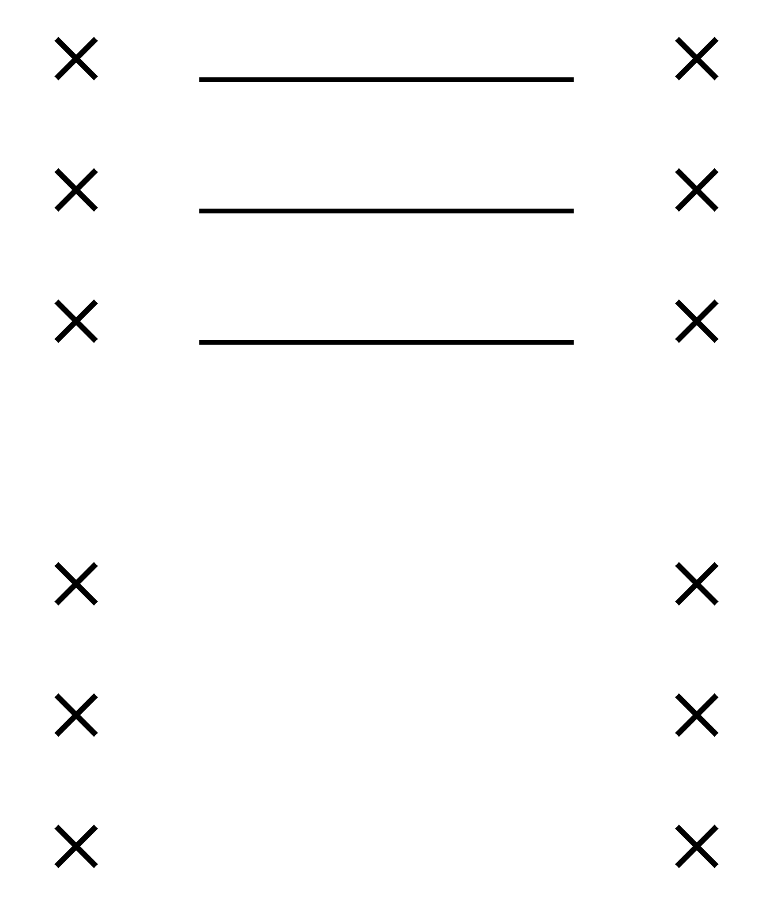
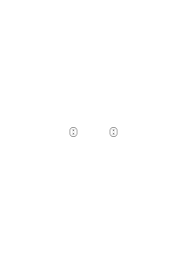
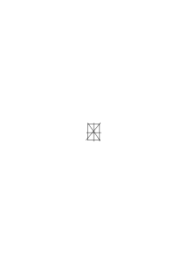
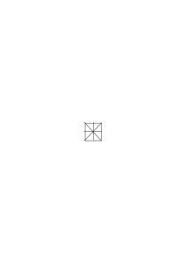
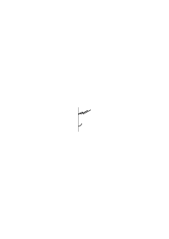
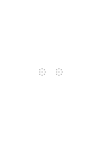
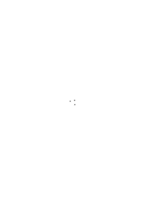
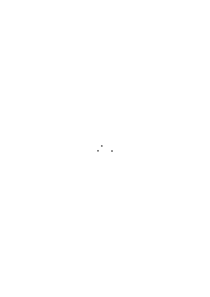
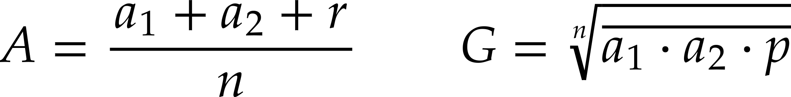

# Ms-178a

### [1\[1\]](https://cdn.wittgensteinnachlass.com/2000px/webp/Ms-178a/1.webp),[2\[1\]](https://cdn.wittgensteinnachlass.com/2000px/webp/Ms-178a/2.webp)

One could also take the (whole) matter purely geometrically as the problem of assigning & equinumerosity of points by straight lines. And here once again it becomes clear how the essence of logic does not at all consist in the often-discussed generality. How it loses nothing if we abandon this generality.

(It is, so to speak, a quite unnecessary ambition of logic to be satisfied only with generality.

In geometry one would now say: ‘between two equally numerous rows of points _there are_ connecting straight lines, which etc.’ The equality of number is thought of as having been established, say, as the equality of the lengths of two rods (by laying them against one another), by a kind of laying against one another. Namely by a criterion that does not mention numbers—or rather, numerals. For if numerals were mentioned we would be dealing with the disjunction with the dots. (Incidentally one could propose calling this the infinite disjunction & saying how this comes about: of course an infinite disjunction is something different from a finite one. And this …

### [2\[2\]](https://cdn.wittgensteinnachlass.com/2000px/webp/Ms-178a/2.webp)

… this sentence that it should not write equal numbers above 10000100000?

### [2\[3\]](https://cdn.wittgensteinnachlass.com/2000px/webp/Ms-178a/2.webp)

When I develop the rules for S(φψ) in this way, what do I develop them from? Do I read them off from a fixed thing, the opinion?

### [2\[4\]](https://cdn.wittgensteinnachlass.com/2000px/webp/Ms-178a/2.webp)

But how does it come about that the determinations concerning the inference of S from φ & ψ do not also entail π ∙ S = π? That is what I do not understand. But does the inference of numerical equality from π mean anything more than the series

_π ∙ φ1 = π ∙ φ1 ∙ ψ1 = π ∙ ψ1_

_π ∙ φ2 = π ∙ φ2 ∙ ψ2 = π ∙ ψ2_

– – – – – – – – –

– – – – – – – – –

<s> φ1 ≡ ψ1 ∙ φ2 ≡ ψ2 Is it true that the form (φ1 ∙ ψ1) ⌵ (φ2 ∙ ψ2) … is sufficient? </s>

### [2\[5\]](https://cdn.wittgensteinnachlass.com/2000px/webp/Ms-178a/2.webp)

Several possibilities of thought intersect here. One would like to speak of a condition for π to hold. A geometrical condition. In the sense in which the circular form is the condition for a particular division & the ellipse is not. In the sense in which the condition is not fulfilled by φ5 & ψ7.

### [3\[1\]](https://cdn.wittgensteinnachlass.com/2000px/webp/Ms-178a/3.webp)

What then is numerical equality? Is it only what one sees in ? But then classes of greater number are never numerically equal! We must remember that S(φ, ψ) has a different sense depending on whether we are speaking of apples in two boxes or spots in our visual field, etc. And that does not matter, for φ5 & φ5 & φy too has a different sense in the different cases & that has nothing to do with the arithmetic of 5. The numerical equalities of the points of intersection in

 &

seems to be a property of these figures—a part ‘part’ of their equality. Is a 1-1 connection between these points a proof of _this_ numerical equality?

### [3\[2\]](https://cdn.wittgensteinnachlass.com/2000px/webp/Ms-178a/3.webp)

One is inclined to say: If I could see a 100-sided polygon as such, then two counted 100-sided polygons would have to look alike. That two classes have the same number must be an experience. How does the …

### [4\[1\]](https://cdn.wittgensteinnachlass.com/2000px/webp/Ms-178a/4.webp),[5\[1\]](https://cdn.wittgensteinnachlass.com/2000px/webp/Ms-178a/5.webp),[6\[1\]](https://cdn.wittgensteinnachlass.com/2000px/webp/Ms-178a/6.webp)

… is supposed to contain, then it must follow from π according to a quite different principle from that according to which ψ20 follows from π ∙ φ20. Then it can follow only by virtue of a new rule. If something amorphous is supposed to follow from π, then this must be newly stipulated. It would be, say, the sentence that the two classes consist of pairs. But, let us remember, not of _determinate_ pairs!! But then it comes down once again merely to this: that φ & ψ have the same number of things. And here we have the variable n & its relation to 1, 2, 3, etc. So I would finally have to stipulate π ∙ Σ = π after all. But we do not feel comfortable with this.

Would I not have to know what the criterion for Σ is, as opposed to the criterion for π? I.e. what is the verification of S as opposed to that of π? And is this question not essential? In practice, are we not really dealing with a mixed criterion of numerical equality, namely both that φ5 ∙ ψ5 and also π? So that there is therefore _one_ sense of S in which S = π. But does π ∙ φ1 = φ1 + ψ1 etc. etc. not already mean: S follows from π? What does one see when one sees that two classes are 1-1 connected? Does one notice there, in addition to or _in_ this fact, the numerical equality? We must surely speak of the numerical equality of actual classes. It is an important question, surely: does a particular experience correspond to numerical equality? Let us suppose that for us numerical equality is what is established by counting the classes. If I then see that two classes are 1-1 connected, I cannot of course predict that, if I count them, the same result will come out. But I shall say that I have either counted wrongly or that the classes have changed. And that is an agreement, an accord. But then at least one matter is settled: that numerical equality in this sense is somehow contained _in_ π.

If I count the left-hand row & see the 1-1 relation, then in doing so I also count the right-hand row. φ4 ∙ π = φ4 ∙ π ∙ ψ4. But not only that, but etc. etc., or as one writes

_φn ∙ π = φn ∙ π ∙ ψn._

Do not forget that the numerical equality which is supposed to be established by π is supposed to be something like the property of classes of crosses which can be brought into the same pattern.

But how do I see that two classes _can_ be brought into this schema? It is always once again the case of the rods which, _when laid against one another_, coincide. If I can say that I directly perceive the numerical equality of the groups  &  or even of the groups  & , then I cannot perceive them in this sense in xxxxxxx & xxxxxxx.

### [6\[2\]](https://cdn.wittgensteinnachlass.com/2000px/webp/Ms-178a/6.webp),[7\[1\]](https://cdn.wittgensteinnachlass.com/2000px/webp/Ms-178a/7.webp)

How strange that, when speaking with sentences, we at least ordinarily do not speak of the sense of these sentences! Whereas that ought not to be the exception, or, if it is one, this cannot be of fundamental importance. The argument is therefore

### [7\[2\]](https://cdn.wittgensteinnachlass.com/2000px/webp/Ms-178a/7.webp)

If I make a1 = a2 by keeping a1 & a2 (that is, A) equal, then G becomes larger. So it becomes larger whenever I make two terms equal & reaches its maximum = A when all the a’s are equal, and so on. — But I have a difficulty with this proof. (In it, one part of a path is traversed & the rest of the path is as it were assumed without our seeing it.) The difficulty lies somehow in the r + p which are assumed to consist in a certain way of the a’s, without this nevertheless being expressed. The difficulty is that no path has been shown to us from making two a’s equal to making all the a’s equal.

### [7\[6\]](https://cdn.wittgensteinnachlass.com/2000px/webp/Ms-178a/7.webp)

The proof presupposes that there is a way of making all the a’s equal by always making a pair equal!
