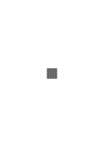

# Ms-178h

### [1\[1\]](https://cdn.wittgensteinnachlass.com/2000px/webp/Ms-178h/1.webp)

… follows? Is _that_ understanding?

No, that equation is a part of understanding itself. (which thus lies spread out before me). For the assumption of an understanding which, originally concentrated, can only then be spread out in this way is after all incorrect.

If I say I know that it follows because I understand it, that would mean that, in understanding it, I see something _other_ than the given sign, as it were a definition from which its following emerges.

### [1\[2\]](https://cdn.wittgensteinnachlass.com/2000px/webp/Ms-178h/1.webp)

What are the truth-possibilities of the general sentence?

### [1\[3\]](https://cdn.wittgensteinnachlass.com/2000px/webp/Ms-178h/1.webp),[1\[4\]](https://cdn.wittgensteinnachlass.com/2000px/webp/Ms-178h/1.webp)

Mathematics consists of calculations.

### [1\[5\]](https://cdn.wittgensteinnachlass.com/2000px/webp/Ms-178h/1.webp)

