# Ts-208

### [1r\[1\]](https://cdn.wittgensteinnachlass.com/2000px/webp/Ts-208/1r.webp)

Is a space conceivable that contains all the rational points but none of the irrational ones? And that just means: are the irrational numbers not already predetermined by the rational ones?

### [1r\[2\]](https://cdn.wittgensteinnachlass.com/2000px/webp/Ts-208/1r.webp)

There seems to be much to suggest that the mapping of visual space by physics really is the simplest. That is, that physics would be the true phenomenology. But there is an objection to this: physics aims at truth, that is, at correct predictions of events, whereas phenomenology does not do _that_; it aims at _sense_, not at _truth_.

### [1r\[3\]](https://cdn.wittgensteinnachlass.com/2000px/webp/Ts-208/1r.webp)

But one can say: physics has a language, and in this language it utters sentences. These sentences can be true or false. _They_ constitute physics, and their grammar constitutes phenomenology (or whatever one wants to call it).

### [1r\[4\]](https://cdn.wittgensteinnachlass.com/2000px/webp/Ts-208/1r.webp)

There is a certain multiplicity of sense and a _different_ multiplicity of _laws_.

### [1r\[5\]](https://cdn.wittgensteinnachlass.com/2000px/webp/Ts-208/1r.webp)

Physics differs from phenomenology in that it seeks to establish laws. Phenomenology only establishes the possibilities. So phenomenology would be the grammar of the description of those facts on which physics builds its theories.

### [1r\[6\]](https://cdn.wittgensteinnachlass.com/2000px/webp/Ts-208/1r.webp)

To explain is more than to describe. But every explanation contains a description.

### [1r\[7\]](https://cdn.wittgensteinnachlass.com/2000px/webp/Ts-208/1r.webp)

Somehow it seems to me as though every uniformly coloured patch in the visual field were simple and only appeared to be composed of smaller parts.

### [1r\[8\]](https://cdn.wittgensteinnachlass.com/2000px/webp/Ts-208/1r.webp)

One might think that visual space is composed of minima visibilia, say, of nothing but little squares that one sees as indivisible patches. But then the choice of these parts is evidently arbitrary. For example, I could not say how the square grid is to be laid over a particular picture, for if one shifts the grid by less than the width of one square, the minima visibilia are in quite different places, yet the picture looks exactly the same.

### [1r\[9\]](https://cdn.wittgensteinnachlass.com/2000px/webp/Ts-208/1r.webp)

It seems as though one cannot see a uniformly coloured patch as composite unless one imagines it as _not_ uniformly coloured. Imagining a dividing line makes the patch multicoloured, for the dividing line must be a different colour from the rest of the patch.

### [1r\[10\]](https://cdn.wittgensteinnachlass.com/2000px/webp/Ts-208/1r.webp)

That would mean: the simple constituents of the visual field are uniformly coloured patches. But what then of continuous transitions of colour?

### [1v\[1\]](https://cdn.wittgensteinnachlass.com/2000px/webp/Ts-208/1v.webp)

“p.q = p” means “q follows from p”

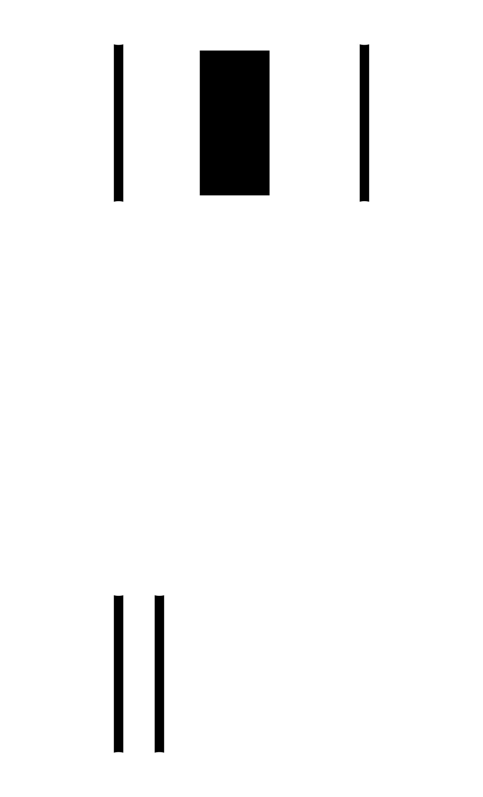

### [2r\[1\]](https://cdn.wittgensteinnachlass.com/2000px/webp/Ts-208/2r.webp)

Can one say that the smaller patch is simpler than the larger one? Suppose they are uniformly coloured circles: what is the greater simplicity of the smaller circle supposed to consist in? One might say that the larger can consist of the smaller and one further part, but not vice versa. But why should I not represent the smaller as the difference between the larger and the ring? So it seems to me that the smaller patch is no simpler than the larger one.

### [2r\[2\]](https://cdn.wittgensteinnachlass.com/2000px/webp/Ts-208/2r.webp)

It seems to be a peculiar feature of spatial statements that one cannot describe space without some allusion to time; it is probable from the outset that time cannot enter into the consideration of visual space as an afterthought, as a mere adjunct.

### [2r\[3\]](https://cdn.wittgensteinnachlass.com/2000px/webp/Ts-208/2r.webp)

In a certain sense it must not be possible to describe an object. That is, the description must not ascribe to it any properties whose absence would nullify the very existence of the object. That is, the description must not state what would be essential to the object's existence.

### [2r\[4\]](https://cdn.wittgensteinnachlass.com/2000px/webp/Ts-208/2r.webp)

I once said that there was no extensional infinity. Ramsey replied, “Can one not imagine, for example, that someone lives for ever, that is, simply never dies, and is that not extensional infinity? Surely I can imagine a wheel turning and _never_ stopping.” Here there is a curious difficulty: it seems to me nonsensical to say that there are infinitely many bodies in a space, as though this were something contingent. On the other hand, I can indeed conceive intensionally of an infinite law (or an infinite rule) by which something new is always produced – ad infinitum – but of course only what a rule can produce, namely constructions. And now it seems that the infinitely many revolutions of a wheel can be constructions, whereas I cannot construct new objects.

### [2r\[5\]](https://cdn.wittgensteinnachlass.com/2000px/webp/Ts-208/2r.webp)

Suppose we walk out into Euclidean space along a straight line and say that every 10 metres we encounter an iron sphere of a certain diameter, ad infinitum; is that a construction? So it seems. The curious thing is that one can take such an infinite complex of spheres as the endless recurrence of the same sphere according to a certain law. But the moment one thinks of the spheres as individually distinct, their infinite number seems to become nonsense.

### [2r\[6\]](https://cdn.wittgensteinnachlass.com/2000px/webp/Ts-208/2r.webp)

The merely negative description of _not coming to an end_ cannot yield any positive infinity. This negative characteristic presumably suffices for intensional infinity. Here it means only that an operation _by its very nature_ can be applied to its own result.

### [2r\[7\]](https://cdn.wittgensteinnachlass.com/2000px/webp/Ts-208/2r.webp)

Suppose my visual image consists of two red circles of equal size on a blue background: what is present here twice and what once? And what does this question mean at all? One might say that we have _one_ colour here but _two_ locations. But can one speak of locations without thinking of them as filled – that is, while thinking of them as mere possibilities?

### [3r\[1\]](https://cdn.wittgensteinnachlass.com/2000px/webp/Ts-208/3r.webp)

An apparent way out would of course be to say that red, circular, are properties (external) of two objects that one might call patches, and that these patches also stand in certain spatial relations to each other; but that is nonsense.

### [3r\[2\]](https://cdn.wittgensteinnachlass.com/2000px/webp/Ts-208/3r.webp)

It is evidently possible to establish the identity of a place in the visual field, for otherwise one could not tell whether a patch stays in the same place throughout or changes its place. If we imagine a patch that disappears and reappears, we can still say whether it reappears in the same place or in another. (_Physiologically_ one could explain this by saying that the individual points of the retina have local marks.) So one really can speak of certain places in the visual field, and with the same right as one speaks of different places on the retina. Would such a space be comparable to a surface whose curvature differed at each of its points, so that each point is a distinguished point?

### [3r\[3\]](https://cdn.wittgensteinnachlass.com/2000px/webp/Ts-208/3r.webp)

One can also say that visual space is an oriented space, a space in which there is an up and a down, and a right and a left. And _this_ up and down, right and left, has nothing to do with gravity or with the right and left hands. It would, for example, retain its sense even if we spent our whole lives looking at the stars through a telescope.

### [3r\[4\]](https://cdn.wittgensteinnachlass.com/2000px/webp/Ts-208/3r.webp)

Suppose we look at the starry sky through a telescope. Then our visual field would be completely dark except for a lighter circle, and in this circle there would be points of light. Suppose further that we had never seen our body but had always seen only this image, so that we could not compare the position of a star with that of our head or feet. What then shows me that my space has an up and a down etc., or simply that it is oriented? At any rate I can perceive that the whole array of stars _rotates_ within the bright circle, that is, I can perceive different orientations of the array of stars. If I hold a book upside down, I cannot read the letters, or can do so only with difficulty. This state of affairs is not _explained_, as one might think, by saying: the retina does after all have an up and a down etc., so it is easy to understand that there is something analogous in the visual field. Rather, this is merely a _representation_ of the state of affairs by the roundabout route of the relations in the retina.

### [3r\[5\]](https://cdn.wittgensteinnachlass.com/2000px/webp/Ts-208/3r.webp)

We can also say that in our visual field it is always as if, along with everything else, we saw an oriented coordinate system by reference to which we can fix every direction. – But this too is not a correct representation, for if we really did see such a pair of coordinate axes (with arrows, say), we would in fact be able to fix not only the orientations of the objects relative to these axes, but also the position of the axes themselves in space, as it were relative to an unseen coordinate system inherent in the nature of this space.

### [3r\[6\]](https://cdn.wittgensteinnachlass.com/2000px/webp/Ts-208/3r.webp),[4r\[1\]](https://cdn.wittgensteinnachlass.com/2000px/webp/Ts-208/4r.webp)

What would our visual field have to be like if that were not so? I could of course then see relative positions and changes of position, but not absolute ones. But that means, for example, that it would make no sense to speak of a rotation of the entire visual field. So far, perhaps, it is still intelligible. But now suppose that through our telescope we saw, say, only one star at a certain distance from the black rim. This star would disappear and reappear at the same distance from the rim. Then we could not know whether it reappeared in the same spot or in another. Or two stars might appear and disappear alternately at the same distance from the rim, and then we could not say whether – or that – they were the same star or different stars.

### [4r\[2\]](https://cdn.wittgensteinnachlass.com/2000px/webp/Ts-208/4r.webp)

It is not just that we could “not know whether”; it would make _no sense_ in this context to speak of the same or different places. And since in reality it does make sense, our visual field does not have this structure. The real criterion of the structure is precisely which sentences make sense for it – not which are true. To look for this is the method of philosophy

### [4r\[3\]](https://cdn.wittgensteinnachlass.com/2000px/webp/Ts-208/4r.webp)

We can also represent it like this: suppose that at some point a pair of oriented coordinate axes had flashed up in our visual field for a few moments and disappeared again; with a good enough memory we could fix the orientation of any subsequent image by reference to our recollection of those axes. If there were no absolute direction, that would be logically impossible.

### [4r\[4\]](https://cdn.wittgensteinnachlass.com/2000px/webp/Ts-208/4r.webp)

But that means we have the possibility of describing a possible position – that is, a spot – in the visual field without referring to anything that happens to be there. So we can say, for example, that something can be at the top right and so on. (The analogy with the curved surface would be to say, for example: a patch on an egg can be near the blunt end.)

### [4r\[5\]](https://cdn.wittgensteinnachlass.com/2000px/webp/Ts-208/4r.webp)

Evidently I can see the sign V now as a v, now as an A, as the sign for greater than or for less than, even if I were seeing it through a telescope and could not compare its position with that of my body. Perhaps one will say that I feel the position of my body without seeing it. But position in the space of feeling (as I shall call it for now) has nothing to do with position in visual space; the two are independent of one another, and if there were no absolute direction in visual space, one could not correlate the direction in the space of feeling with such a direction at all.

### [4r\[6\]](https://cdn.wittgensteinnachlass.com/2000px/webp/Ts-208/4r.webp)

Can I now say, for example: the upper half of my visual field is red? And what does that mean? Can it say that an object (the upper half) has the property red? One must remember that every part of visual space _must_ have a colour and that every colour _must_ occupy a part of visual space. The forms _colour_ and _visual space_ permeate one another

### [4r\[7\]](https://cdn.wittgensteinnachlass.com/2000px/webp/Ts-208/4r.webp)

Are not colour and visual space related to each other as argument and function are? The forms of argument and function must also permeate one another.

### [4r\[8\]](https://cdn.wittgensteinnachlass.com/2000px/webp/Ts-208/4r.webp),[5r\[1\]](https://cdn.wittgensteinnachlass.com/2000px/webp/Ts-208/5r.webp)

As for the composition of spatial configurations out of their smaller spatial constituents, it is like this: the larger _geometrical_ configuration is not composed of smaller _geometrical_ configurations, any more than one can say that 5 is composed of 3 and 2, or indeed that 2 is composed of 5 and ‒ 3. For here the larger entails the smaller just as the smaller entails the larger. The quadrilateral  is not composed of the quadrilaterals

.

Rather, the first geometrical figure entails the other two and vice versa. So here Nicod would be right in saying that the larger figure does not contain the smaller ones as constituents. But things are different in filled space: the figure 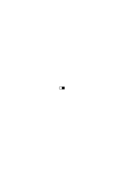 does in fact consist of the constituents  and , although the purely geometrical figure of the large square does _not_ consist of the figures of the two rectangles. These “purely geometrical figures” are after all only logical possibilities. – Now one can in fact see a physical chessboard as a unity – not as composed of its squares – by seeing it as one large quadrilateral and disregarding its squares. – But if one does not disregard the squares, then it is a complex and the squares are its constituents, which constitute it, to use Nicod’s way of speaking. (Incidentally, I cannot understand what it is supposed to mean for something to be “determined” but not “constituted” by certain objects. If these two expressions have any sense at all, they have the same sense.) An intellect that surveys the constituents and their relations but not the whole is an absurdity. If each point in visual space is a distinguished point, then it certainly makes sense to speak of Here and There in visual space, and this now seems to me to make the representation of visual states of affairs simpler. But is this property of distinguished points really essential to visual space? I mean, could we not conceive of a visual space in which one perceived only certain relations of position but no absolute position, that is, could we picture such an experience? In much the same sense as we can imagine the experiences of someone with one eye –? I do not think so. One could not, for example, perceive a rotation of the whole visual image, or rather, it would not be conceivable. What, for instance, would the hand of a clock look like as it moved round the dial? (I assume that the dial, as on some large clocks, has only dots and no numerals.) We would then indeed perceive the movement from one dot to the next – provided it did not happen in _one_ jerk – but once the hand had reached a dot, we could not distinguish its position from the one at the previous dot. I think this shows that such a thing is unimaginable with our sense of sight.

### [5r\[2\]](https://cdn.wittgensteinnachlass.com/2000px/webp/Ts-208/5r.webp)

It is clear that there is no relation of “being situated” between a colour and a place in which it “is situated”. There is no intermediate link between colour and space. Colour and space saturate one another. And the way they permeate one another makes up the visual field.

### [5r\[3\]](https://cdn.wittgensteinnachlass.com/2000px/webp/Ts-208/5r.webp),[5v\[1\]](https://cdn.wittgensteinnachlass.com/2000px/webp/Ts-208/5v.webp)

To represent space one needs – so it seems to me – a stretchable sign, as it were. Perhaps a sign that allows interpolation, analogous to the decimal system. The sign must have the multiplicity and properties of space.

### [5v\[1\]](https://cdn.wittgensteinnachlass.com/2000px/webp/Ts-208/5v.webp)

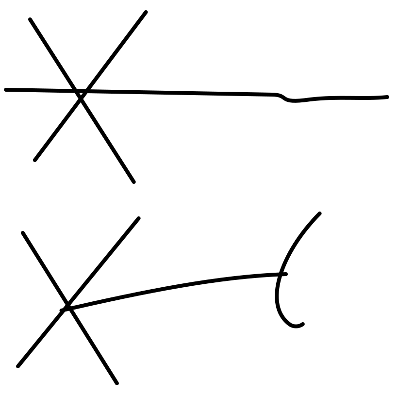

### [6r\[1\]](https://cdn.wittgensteinnachlass.com/2000px/webp/Ts-208/6r.webp)

Is not the decimal system, with its infinite possibility of interpolation, precisely this sign?

### [6r\[2\]](https://cdn.wittgensteinnachlass.com/2000px/webp/Ts-208/6r.webp)

The rules for the numeral system – the decimal system, say – contain everything that is infinite about numbers. For example, that _these rules_ place no limit on how far the numerals can extend to the right or to the left: _that_ is what expresses the infinity. One might perhaps say: yes, but the numerals are surely limited by the use of paper and writing materials and by other circumstances. Quite so, but that is not expressed in the _rules_ for their use, and only in these is their true nature set out.

### [6r\[3\]](https://cdn.wittgensteinnachlass.com/2000px/webp/Ts-208/6r.webp)

What sort of proposition is “there is a prime number between 5 and 8”? I would say: “That _shows_ itself”. And that is right; but can one not draw attention to this internal state of affairs? One could surely say: examine the interval from 10 to 20 for prime numbers. How many are there? Would that not be a clear task? And how would its solution be correctly expressed or represented? What does the sentence “There are 4 prime numbers between 10 and 20” mean?

---

This sentence seems to draw our attention to a certain aspect of the matter.

### [6r\[4\]](https://cdn.wittgensteinnachlass.com/2000px/webp/Ts-208/6r.webp)

If I ask someone “How many prime numbers are there between ten and twenty?”, he will say, I don’t know at the moment but I can find out at any time. For it is as if it were already written down somewhere.

### [6r\[5\]](https://cdn.wittgensteinnachlass.com/2000px/webp/Ts-208/6r.webp)

One could also put it like this: the fully analysed mathematical proposition is its own proof. Or again: the mathematical proposition is only the immediately visible surface of the whole body of the proof, marking its front boundary. The mathematical proposition is – in contrast to a proposition proper – _essentially_ the last link in a demonstration that shows it to be correct or incorrect.

### [6r\[6\]](https://cdn.wittgensteinnachlass.com/2000px/webp/Ts-208/6r.webp)

How does it show itself that space is not a collection of points but the realization of a law?

### [6r\[7\]](https://cdn.wittgensteinnachlass.com/2000px/webp/Ts-208/6r.webp)

It seems to me that the concept of distance is given directly in the structure of visual space. If that were not so, and the concept of distance were associated with visual space only through a correlation of a distance-free visual space with another structure that contains distances, then it would be conceivable that a change in this association would make, for example, the segment a appear longer than the segment b, although we would still see the point B between A and C. ()

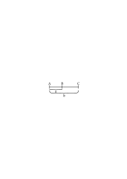

### [6r\[8\]](https://cdn.wittgensteinnachlass.com/2000px/webp/Ts-208/6r.webp)

It seems as though one must first build up the whole structure of space without sentences; and then one can form all the correct sentences within it.

### [7r\[1\]](https://cdn.wittgensteinnachlass.com/2000px/webp/Ts-208/7r.webp)

One is sure to get the right multiplicity of designations if one uses analytical geometry. The fact that a point in the plane is represented by a pair of numbers and a point in three-dimensional space by a triple of numbers already shows that the object represented is not the point at all, but the fabric of points.

### [7r\[2\]](https://cdn.wittgensteinnachlass.com/2000px/webp/Ts-208/7r.webp)

To say that a particular colour is now at a place is to describe that place _completely_.

### [7r\[3\]](https://cdn.wittgensteinnachlass.com/2000px/webp/Ts-208/7r.webp)

Incidentally, things are no different with colours than with tones or electrical charges. What is at issue in each case is the complete description of a certain state at _one_ point or at the same time. Could there not be a schema like this: the colour at a point is described not by assigning _one_ number to a point but by assigning _several_ numbers. It takes a mixture of these numbers to make the colour, and to describe the complete colour I need the sentence that _this_ mixture is the complete mixture, so that nothing more can be added. It would be as if I described the taste of a dish by listing the ingredients; then at the end I must add that these are _all_ the ingredients. So one could say that the description of the colour, too, is complete only when all its ingredients have been given, naturally with the addition that they are all of them. But how is this addition to be made? If in the form of a _sentence_, then the incomplete description would already have to be a sentence too. And if not in the form of a separate sentence, but only by some kind of hint in the first sentence, how can I make a second sentence of the same form correspond to the first? After all, two elementary propositions cannot contradict one another.

### [7r\[4\]](https://cdn.wittgensteinnachlass.com/2000px/webp/Ts-208/7r.webp)

But what of all the seemingly similar statements, such as: A material point can have only _one_ velocity at a time, at a point on a charged surface there can be only _one_ voltage, at a point on a warm surface only _one_ temperature at _one_ time, at _one_ point in a steam boiler only _one_ pressure, etc. No one can doubt that these are all self-evident and that the contrary statements are contradictions.

### [7r\[5\]](https://cdn.wittgensteinnachlass.com/2000px/webp/Ts-208/7r.webp)

If I compare the facts of the first system with the pictures on the screen, and the facts in the second system with the pictures on the strip of film, then on the strip of film there is a present picture, along with past and future pictures; on the screen, however, there is only the present. The one characteristic feature of this simile is that in it I regard the future as preformed. It makes sense to say that future events are preformed if it is in the _nature_ of time not to break off. For then one can say: Something will happen, I just do not know what. And in the world of physics one can say that.

### [8r\[1\]](https://cdn.wittgensteinnachlass.com/2000px/webp/Ts-208/8r.webp)

There seem to be simple colours. Simple as psychological phenomena. What I need is a psychological theory of colour, not a physical one, nor a physiological one either. And it must be a _purely_ psychological theory of colour, in which only what can actually be perceived is spoken of and no hypothetical objects – waves, cells, etc. – occur.

### [8r\[2\]](https://cdn.wittgensteinnachlass.com/2000px/webp/Ts-208/8r.webp)

One can now recognize colours _directly_ as mixtures of red, green, blue, yellow, black, and white. Here colour is always color, never pigmentum, never light, never a process on or in the retina, etc. One can also see that one colour is redder than another, or whiter, etc. But can I find a metric for colours? Does it make sense to say that one colour lies _midway_ between two others, say, with respect to how much red it contains? It does at any rate seem to make sense to say that one colour is closer in this respect to another than to a third.

### [8r\[3\]](https://cdn.wittgensteinnachlass.com/2000px/webp/Ts-208/8r.webp)

Here we encounter the problem that also arises in connection with the extension of visual space, namely that of the smallest visible difference. The existence of a smallest visible difference contradicts continuity, and yet the two must be reconcilable.

### [8r\[4\]](https://cdn.wittgensteinnachlass.com/2000px/webp/Ts-208/8r.webp)

If I have a row of patches that are alternately black and white, as the figure shows

then as I subdivide further I will soon reach a limit where I can no longer distinguish the black and white patches, where I have, say, the impression of a grey strip. But does that not mean that I cannot subdivide the segment in my visual field at will? And yet I see no discontinuity, and that too is of course self-evident, since I could see a discontinuity only if I had not yet reached the limit of what can be distinguished. This looks very paradoxical. But what about continuity between the individual rows? We evidently have a penultimate row of distinguishable patches and then the last, uniformly grey row; can one tell by looking at this last row that it did in fact result from subdividing the penultimate one? Evidently not. On the other hand: Can one tell by looking at the so-called penultimate row that it cannot be subdivided any further in a visible way? It seems to me that one cannot tell that either. Then there would be no last visibly subdivided row after all! But if I can no longer subdivide the segment visibly, then I cannot even _attempt_ this subdivision, and so I cannot see such an attempt fail either. (It is the same here as with the boundlessness of visual space.) The same would of course also hold for differences between colours.

### [9r\[1\]](https://cdn.wittgensteinnachlass.com/2000px/webp/Ts-208/9r.webp)

Continuity in our visual field consists in our seeing no discontinuity.

### [9r\[2\]](https://cdn.wittgensteinnachlass.com/2000px/webp/Ts-208/9r.webp)

If the world of data is timeless, how can one talk about it at all?

### [9r\[3\]](https://cdn.wittgensteinnachlass.com/2000px/webp/Ts-208/9r.webp)

If memory is _not_ a seeing into the past, how do we know at all that it is to be interpreted with reference to the past? We could then remember an occurrence and doubt whether what we have in our memory-image is a picture of the past or of the future. One can of course say: I do not see the past, but only a _picture_ of the past. But how do I _know_ that it is a picture of the _past_ if that does not lie in the nature of the memory-image? Have we perhaps learnt through experience to interpret these pictures as pictures of the past? But what would “past” mean here at all?

### [9r\[4\]](https://cdn.wittgensteinnachlass.com/2000px/webp/Ts-208/9r.webp)

Now the idea that I should perceive into the past conflicts with all notions of physical time, and this in turn seems to mean nothing other than that the concept of time in the first system must be radically different from the one in physics.

### [9r\[5\]](https://cdn.wittgensteinnachlass.com/2000px/webp/Ts-208/9r.webp)

If one asks: What experience underlies the concept of time, the assumption of a time; how must one answer? – It is memory, if there is a point-like present; or it is a continuous perception of which the present is one endpoint and which, in a wider sense, one can also call memory.

### [9r\[6\]](https://cdn.wittgensteinnachlass.com/2000px/webp/Ts-208/9r.webp)

A spatial distance can be represented by a number. (This sentence is not about rigid measuring rods) It must follow directly from the structure of visual space. Instead of writing the spatial relation between two patches a and b as “aRb”, I could then write it as aNb, where N is a number, hence a _stretchable_ relation.

### [9r\[8\]](https://cdn.wittgensteinnachlass.com/2000px/webp/Ts-208/9r.webp)

(∃x,y,z)․ fx & fy & fz & non (∃x,y,z,u)․ fx & fy & fz & fu

How should I now go about writing the general form of such sentences? This question evidently makes perfectly good sense. For if I write down just a few such sentences, one understands what is supposed to be _essential_ to them.

### [9r\[9\]](https://cdn.wittgensteinnachlass.com/2000px/webp/Ts-208/9r.webp)

I said that every symbolism presupposes such descriptions. If, for instance, Russell introduces the sign “(∃x …)”, he cannot introduce all signs of this kind ad infinitum, but gives _one_ rule which we must understand; a syntactical rule.

### [10r\[1\]](https://cdn.wittgensteinnachlass.com/2000px/webp/Ts-208/10r.webp)

Let us remember: In arithmetic the number occurs alone, without the concept to which it belongs. But then it is an incomplete sign after all. Yet it never occurs like that in a _sentence_ either; in a sentence it is always linked to a concept. No sentence is about the number 4. In arithmetic, however, where numbers occur by themselves, they do not stand in sentences either. The numeral is a schema, and in arithmetic it is torn out of its context.

### [10r\[2\]](https://cdn.wittgensteinnachlass.com/2000px/webp/Ts-208/10r.webp)

Numbers are pictures of the extensions of concepts.

### [10r\[3\]](https://cdn.wittgensteinnachlass.com/2000px/webp/Ts-208/10r.webp)

One can ask: Does number have anything essentially to do with a concept? I think this comes down to asking whether it makes sense to speak of a number of objects that have not been brought under a concept. Does it mean anything, for instance, to say: “a and b and c are 3 objects”? I think the answer is plainly no. There is, admittedly, a feeling that tells us: Why speak of concepts? The number depends only on the _extension_ of the concept, and once that has been determined, the concept can, so to speak, leave the stage. The concept is only a method for determining an extension, but the extension stands on its own and is in its nature independent of the concept; for it does not matter which concept we used to determine the extension. That is the argument for the extensional view. In reply one can first say: If the concept really is only a means of getting to the extension, then the concept has no business in arithmetic; then one must simply separate the class altogether from the concept that happens to be linked with it. In the opposite case, however, the extension independent of the concept is a mere chimera, and then it is better not to speak of it at all, but only of the concept.

### [10r\[4\]](https://cdn.wittgensteinnachlass.com/2000px/webp/Ts-208/10r.webp)

One could now regard the extension of a concept as an object whose name, after all, likewise has sense only in the context of a sentence. “a and b and c” admittedly has no sense; it is not a sentence. But “a” is not a sentence either.

### [10r\[5\]](https://cdn.wittgensteinnachlass.com/2000px/webp/Ts-208/10r.webp)

One can regard every number as consisting of several others. For it seems to me that breaking down a number into its summands is an immediately evident operation and need not be introduced by the roundabout route of operations with truth-functions.

### [10r\[6\]](https://cdn.wittgensteinnachlass.com/2000px/webp/Ts-208/10r.webp)

It is curious that in the case of tautology and contradiction one really could speak of sense and meaning in Frege's sense. If one calls the tautology's property of being a tautology its meaning, then one can call the way in which the tautology comes about here its sense. The same for contradiction.

### [10r\[7\]](https://cdn.wittgensteinnachlass.com/2000px/webp/Ts-208/10r.webp)

If, as Ramsey suggests, one explains the sign “ = ” in such a way that x = x is a tautology and x = y a contradiction, then one can say that the tautology and the contradiction here have no “sense”.

### [11r\[1\]](https://cdn.wittgensteinnachlass.com/2000px/webp/Ts-208/11r.webp)

So if the tautology shows something in that it is precisely _this_ sense that yields _this_ meaning, then in Ramsey's account the tautology shows nothing, for it is a tautology ex definitione.

### [11r\[2\]](https://cdn.wittgensteinnachlass.com/2000px/webp/Ts-208/11r.webp)

Ramsey proposes to express the proposition that infinitely many objects satisfy a function by negating all sentences of the form:

non (∃x)fx

(∃x)fx & non (∃x,y)fx & fy etc.

But suppose now that there are only three objects, i.e. that only three names have meaning. Then we cannot even write down the fourth sentence in the series, for in that case it makes no sense to write: non (∃x,y,z,u)fx & fy & fz & fu. Thus by negating all the sentences in that series I do not arrive at the infinite.

### [11r\[3\]](https://cdn.wittgensteinnachlass.com/2000px/webp/Ts-208/11r.webp)

In what sense does a notation for the infinite presuppose infinite space or infinite time? An infinitely large piece of paper is of course not presupposed. But presumably its possibility is?

### [11r\[4\]](https://cdn.wittgensteinnachlass.com/2000px/webp/Ts-208/11r.webp)

Surely we can imagine a notation that proceeds in time instead of in space. Speech, for instance. Here too we can evidently imagine the infinite being represented, and in doing so we are surely making no _hypothesis_ about time. It appears to us as essentially an _infinite_ possibility. And evidently infinite, given what we know about its structure.

### [11r\[5\]](https://cdn.wittgensteinnachlass.com/2000px/webp/Ts-208/11r.webp)

Surely it is impossible that mathematics should depend on a hypothesis about physical space. And _visual space_ is not infinite in this sense, after all. And if what is at issue is not the actuality but only the possibility of the hypothesis of infinite space, then surely this possibility must be prefigured somewhere.

### [11r\[6\]](https://cdn.wittgensteinnachlass.com/2000px/webp/Ts-208/11r.webp)

We cannot get around using the variable form. It is indeed restricted to certain kinds of series of forms in the notation proposed by Ramsey, but it _must_ occur there too and makes all the constructs in which it occurs into series of forms.

### [11r\[8\]](https://cdn.wittgensteinnachlass.com/2000px/webp/Ts-208/11r.webp),[12r\[1\]](https://cdn.wittgensteinnachlass.com/2000px/webp/Ts-208/12r.webp)

Is primary time infinite? I.e. is it an infinite possibility? Even if it is filled only as far as memory reaches, that by no means says that it is finite. It is infinite in the same sense in which three-dimensional visual space is infinite, even if I can in fact see only as far as the walls of my room. For what I see presupposes the possibility of seeing further. I.e. I could represent what I see correctly only by means of an infinite form. Is it possible to imagine time with one end or with two ends?

### [12r\[2\]](https://cdn.wittgensteinnachlass.com/2000px/webp/Ts-208/12r.webp)

What can happen _now_ could have happened earlier and will always be able to happen in the future, if time remains as it is. But _that_ does not depend on any future experience. Time contains within itself _now_ the possibility of all future time. But all this already means that time is not infinite in the sense of the primitive conception of the infinite set. And the same holds for space. If I say I can imagine a cylinder extended to infinity, that already lies in its nature. Again, in the nature of the homogeneity of the cylinder and of the space it is in – and each presupposes the other – and this homogeneity is in the finite piece I see.

### [12r\[3\]](https://cdn.wittgensteinnachlass.com/2000px/webp/Ts-208/12r.webp)

A distance can be expressed by a number, but by any number at all. It is no use, however, designating a segment, say, by a letter n instead of by a definite number, for I cannot then designate another segment by n; instead, it is then 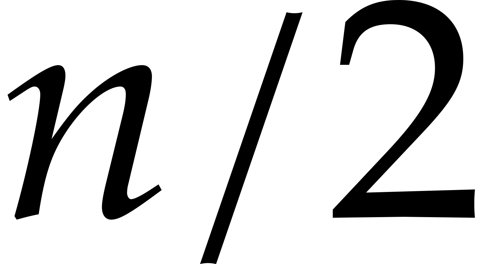 or 3n, etc., so that I am referring once again to a basic segment, whether it is called n or 1. On the other hand, I can surely write 1n instead of n, and why should I recognize any difference of rank among the numbers? But one thing is clear: which of my segments I then call 27n, for example, is arbitrary.

### [12r\[4\]](https://cdn.wittgensteinnachlass.com/2000px/webp/Ts-208/12r.webp)

But one could also say: The unit segment belongs to the symbolism. It belongs to the method of projection. Its length is arbitrary, but _it_ contains the specifically spatial element. So if I call a segment 3, the 3 designates it here with the aid of the unit segment presupposed in the symbolism. One can apply the same thing to time as well.

### [12r\[5\]](https://cdn.wittgensteinnachlass.com/2000px/webp/Ts-208/12r.webp)

Can one say: If one sees a figure in the visual field, say a red triangle, then one cannot describe it by describing, say, one half of the triangle in one sentence and the other half in another sentence. I.e. one can say that in a certain sense there is no such thing as a half of _this_ triangle. One can speak of the triangle at all only if its boundary lines are the boundaries between two colours.

### [12r\[6\]](https://cdn.wittgensteinnachlass.com/2000px/webp/Ts-208/12r.webp)

If “red is at this place” is a sentence p and “red is at that place” a sentence q, then p & q is the _same_ sentence as “red is at this and that place” and this sentence is evidently of exactly the same form and complexity as q or p alone; for two places make _one_ place. – From this the infinite complexity of spatial sentences would follow. – There would be no elementary sentences

### [17r\[1\]](https://cdn.wittgensteinnachlass.com/2000px/webp/Ts-208/17r.webp)

One could say that colours have an elementary affinity with one another.

### [17r\[2\]](https://cdn.wittgensteinnachlass.com/2000px/webp/Ts-208/17r.webp)

What is the difference between specifying the number for the extension of a concept and specifying the number for the range of a variable? The first is a sentence, the second is not. For I can derive the numerical specification for a variable from the variable itself. (It must show itself.) But can I not give a variable by saying that its values are to be all the objects that satisfy a certain material function? Then the variable is not a form! And then the sense of one sentence depends on whether another is true or false.

### [17r\[3\]](https://cdn.wittgensteinnachlass.com/2000px/webp/Ts-208/17r.webp)

Specifying the number for a variable consists in transforming the variable so as to make the number of its values visible.

### [17r\[4\]](https://cdn.wittgensteinnachlass.com/2000px/webp/Ts-208/17r.webp)

Let us imagine two planes. On plane I there are to be figures that we want to map onto plane II by some methods of projection or other. We can then fix a method of projection (say, orthogonal projection) and interpret the pictures on the second plane in accordance with that method of mapping. But we can also take another course; for some reason or other we stipulate, say, that the pictures on the second plane are all to be circles, whatever the figures on the first plane may be. I.e. different figures on the first plane are mapped onto the second plane by different methods of projection. Then, to understand the circles in II as pictures, I will have to say for each circle which method of projection goes with it. But the mere fact that a figure is represented as a circle in II will not yet say anything at all. – This is how it is with reality when we depict it in subject–predicate sentences. That we use subject–predicate sentences is merely a matter of our notation. Subject–predicate form is not in itself a logical form, and it is a means of expressing countless fundamentally different logical forms, like the circles on plane II. Sentences such as “The plate is round”, “the man is tall”, “the patch is red” have nothing in common in their form.

### [17r\[5\]](https://cdn.wittgensteinnachlass.com/2000px/webp/Ts-208/17r.webp)

One difficulty with Frege's theory is the generality of the words “concept” and “object”. For since one can count tables and sounds and vibrations and thoughts, it is hard to put them all under one heading. But concept and object are predicate and subject. And we have just said that subject–predicate is not _one_ logical form.

### [17r\[6\]](https://cdn.wittgensteinnachlass.com/2000px/webp/Ts-208/17r.webp)

For it is clear that once one has started doing arithmetic one no longer concerns oneself with functions and objects. Indeed, even if one has decided to work only with extensions, there is still the oddity that one pays no regard whatsoever to the form of the objects either.

### [17r\[7\]](https://cdn.wittgensteinnachlass.com/2000px/webp/Ts-208/17r.webp)

If in laying the foundations of arithmetic we use only extensive functions such as (abc)x or (ab, cd, ef)xy, then such a function would be a touchstone with which to test sentences for usefulness, by substituting a constructed function in them for an actual one and seeing whether a tautology or a contradiction results.

### [17r\[8\]](https://cdn.wittgensteinnachlass.com/2000px/webp/Ts-208/17r.webp),[18r\[1\]](https://cdn.wittgensteinnachlass.com/2000px/webp/Ts-208/18r.webp)

What relation is there, then, between the sign “ = Def” and that equality sign which is explained by means of tautology and contradiction? With this equality sign, is “p & q = non(non.negp ⌵ nonq)” a tautology? One could say: “p & q = p & q” is a taut. and since one may replace the one sign “p & q” here by “non (non.negp & nonq)” in accordance with the definition, the expression above is also a taut..

### [18r\[2\]](https://cdn.wittgensteinnachlass.com/2000px/webp/Ts-208/18r.webp)

So one ought not to write the explanation of the equality sign like this:

x = x is a taut.

x = y is a contr. Rather, one would have to say: If, and _only_ if, “x” and “y” have the same meaning according to the rules for the signs, for instance according to the rule x = y = Def, then “x = y” is a taut.; if “x” and “y” do not have the same meaning according to the rules for the signs, then “x = y” is a contr.. It would then be expedient to write the equality sign as thus explained differently, to distinguish it from “x = y”, which represents a rule for the signs and says that we may replace x by y. For I cannot tell that from the sign explained above, but only from its being a tautology; yet I only know that, too, if I already know the substitution rules.

### [18r\[3\]](https://cdn.wittgensteinnachlass.com/2000px/webp/Ts-208/18r.webp)

(∃x)fx = (∃1)xf(x) ≝ (∃x,y)fx & fy = (∃1 + 1)xf(x) ≝ etc. Further: (∃n)xf(x) & non (∃n + 1)xf(x) = (n)xf(x) ≝. Then one can write, for example:

(3)xFx & (4)xGx & non (∃x)Fx & Gx .⊃. (3 + 4)x.Fx ․⌵․ Gx This expression is not the same thing as the substitution rule 3 + 4 = 7.

### [18r\[4\]](https://cdn.wittgensteinnachlass.com/2000px/webp/Ts-208/18r.webp)

One could also ask it this way: Suppose I have 4 objects that satisfy a function. Does it make sense in every case to say that these 4 objects are 2 + 2 objects? After all, I do not know whether there are functions that bring 2 and 2 of them under one heading (one for each pair). Does it make sense to say of any 4 objects that they consist of 2 objects and 2 objects? The notation I used above, “(3 + 4)x etc.”, already contains the assumption that it always makes sense to regard 7 as 3 + 4, for to the right of “.⊃.” I have, so to speak, already forgotten where this 3 and 4 come from. On the other hand: In the sign 1 + 1 + 1 + 1 + 1 + 1 + 1 I can surely distinguish 3 and 4 in any case. Is this perhaps the solution? What if I had a sign for 7 in which I could not separate out 3 and 4? Is such a sign conceivable?

### [18r\[5\]](https://cdn.wittgensteinnachlass.com/2000px/webp/Ts-208/18r.webp)

Does it make sense to say that a relation connects 2 objects with one another, even if they do not otherwise fall under any concept? Yes, of course: For one can form the class of all x x̂(xRb ․⌵․ aRx). But no: For this class need not have only 2 members. Nor do I mean the case where R connects only a and b and no other pair; I only want to say that in every complex xRy R connects two objects (or, as one says, that R is a two-place relation.)

### [19r\[1\]](https://cdn.wittgensteinnachlass.com/2000px/webp/Ts-208/19r.webp)

What about the sentence “(∃x,y,z)․aRx & xRy & yRz & zRb ․⌵․ aRy & yRx & xRz & zRb․⌵․ etc.” (All the combinations follow)? Can I not write it intelligibly in the form “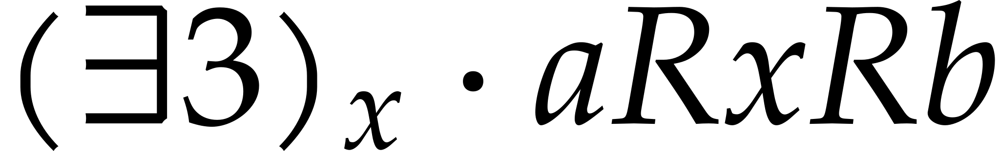”, roughly “3 links are inserted between a and b”. Here we have formed the concept “link between a and b”.

### [19r\[3\]](https://cdn.wittgensteinnachlass.com/2000px/webp/Ts-208/19r.webp)

What sort of sentence would this be: “There is a colour such that a place in visual space has it”? Suppose there were only 4 colours: is it conceivable, then, that a place has no colour? If there are sentences that ascribe the colours A, B, C, D to the place O, then of course there must be a sentence with sense: non.negOA & nonOB & nonOC & nonOD and this sentence too, if it is true, must describe a _visible_ situation. So if it is true that every place must in a certain sense have a colour, then one of these “colours” must be the absence of the others. Might that be black?

### [19r\[4\]](https://cdn.wittgensteinnachlass.com/2000px/webp/Ts-208/19r.webp)

Whatever conception one has of number, one can take sentences “(∃n) …” to define number only if n can be arbitrarily large.

### [19r\[5\]](https://cdn.wittgensteinnachlass.com/2000px/webp/Ts-208/19r.webp)

The problem is: How can one make preparations to receive something that may exist?

### [19r\[6\]](https://cdn.wittgensteinnachlass.com/2000px/webp/Ts-208/19r.webp)

The Axiom of infinity is nonsense for this reason alone: the possibility of stating it presupposes infinitely many things – and thus what it purports to assert. Of logical concepts, e.g. infinity, one can say that their essence proves their existence. The axiom itself has to display infinity already, even if by way of definitions.

### [19r\[7\]](https://cdn.wittgensteinnachlass.com/2000px/webp/Ts-208/19r.webp)

Suppose I believed that there was only one function in all and that it was satisfied by 4 objects. Later I find that it is also satisfied by a 5th thing; has the sign “4” now become senseless? Yes, if there is no 4 in the calculus, then it is senseless.

### [19r\[8\]](https://cdn.wittgensteinnachlass.com/2000px/webp/Ts-208/19r.webp)

I want to say that numbers can be defined only from the *forms* of sentences, independently of which sentences are true or false.

### [19r\[9\]](https://cdn.wittgensteinnachlass.com/2000px/webp/Ts-208/19r.webp)

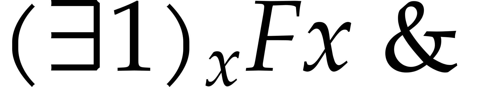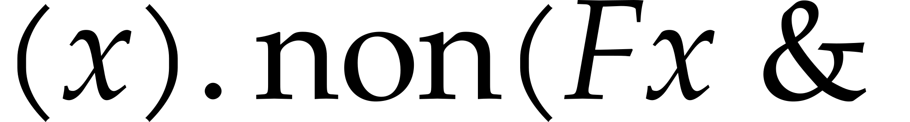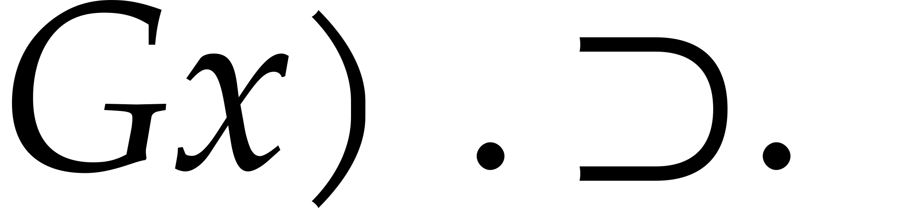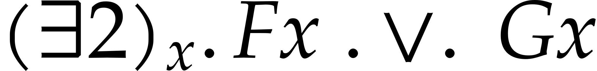

If F and G here are the forms x = a ․⌵․ x = b, etc., then the whole sentence has become a device that ensures that the addition is done correctly.

### [19r\[10\]](https://cdn.wittgensteinnachlass.com/2000px/webp/Ts-208/19r.webp),[19v\[1\]](https://cdn.wittgensteinnachlass.com/2000px/webp/Ts-208/19v.webp),[19v\[2\]](https://cdn.wittgensteinnachlass.com/2000px/webp/Ts-208/19v.webp),[19v\[3\]](https://cdn.wittgensteinnachlass.com/2000px/webp/Ts-208/19v.webp),[19v\[4\]](https://cdn.wittgensteinnachlass.com/2000px/webp/Ts-208/19v.webp),[20r\[1\]](https://cdn.wittgensteinnachlass.com/2000px/webp/Ts-208/20r.webp)

In the symbolism a correlation is actually made, whereas in the meaning it is only the possibility of correlation that is at issue. (One could thus call the pseudo-functions x = a, x = a ․⌵․ x = b, etc., arithmetical functions. For they contain what is arithmetical in the sentences. They contain the numbers.

### [19v\[2\]](https://cdn.wittgensteinnachlass.com/2000px/webp/Ts-208/19v.webp)

(∃1x) φx. (∃1x) ψx. Ind ․⊃․ (∃1 + 1x) φx⌵ψx.

(∃1 + 1x) φx. (∃1x) ψx. Ind ․⊃․ (∃(1 + 1) + 1x) φx⌵ψx.

(1 + 1) + 1 = 1 + 1 + 1

### [19v\[3\]](https://cdn.wittgensteinnachlass.com/2000px/webp/Ts-208/19v.webp)

Is “(Еn)4 + n = 7–α” a disjunction? No, for a disjunction would have not the sign “u.s.w. ad inf.” at the end but a member of the form 4 + x.

### [19v\[4\]](https://cdn.wittgensteinnachlass.com/2000px/webp/Ts-208/19v.webp)

Nor is α of the same kind as the sentence “There are people in this house” or the sentence “There is a colour that mixes well with this one” or “There are problems that are too hard for me” or “There is a time of day when I like to go for a walk”.

### [20r\[2\]](https://cdn.wittgensteinnachlass.com/2000px/webp/Ts-208/20r.webp)

2 + 1 is surely just a rule for forming a third sign from two signs we already know. “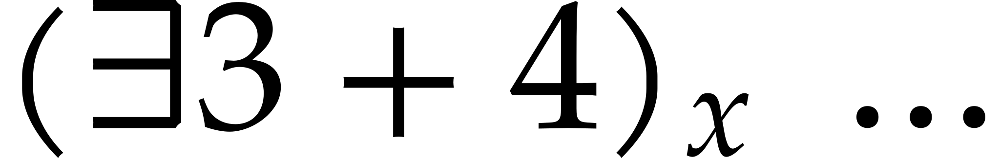” means: Form a sign by etc. … So it would be something like this: I know “3” and “4” from the signs “(∃3) …” and “(∃4) …”, and now I use this knowledge in forming the sign “(∃3 + 4) …”. It would already follow from this, incidentally, that one must not define “3” and “4” by the signs “(∃3)…”, “(∃4)…”, respectively, since the sign “(∃3)…” does not occur in the sign “(∃3 + 4) …”.

### [20r\[3\]](https://cdn.wittgensteinnachlass.com/2000px/webp/Ts-208/20r.webp)

It seems to me that one can compare the equations of mathematics only with sentences that have sense, not with tautologies. For an equation contains just this element that states something – the equals sign – which is not meant to show anything. For what shows itself shows itself without the equals sign. The equals sign does not correspond to the “․⊃․” in “p & (p⊃q) ․⊃․ q”, for the “․⊃․” is only _one_ component among others that go into forming the tautology. It does not stand apart from the rest, but belongs to the sentence, like the “ & ” or “⊃”. The “ = ”, however, is a copula which alone makes the equation something sentence-like.

### [20r\[4\]](https://cdn.wittgensteinnachlass.com/2000px/webp/Ts-208/20r.webp)

What does a mathematical sentence of the kind “(∃n)․ 4 + n = 7” mean? It would be a disjunction: 4 + 0 = 7 ․⌵․ 4 + 1 = 7 ․⌵․ etc. ad inf.. But what does that mean. I can understand a sentence that has a beginning and an end. But can one also understand a sentence that has no end? I also understand that one can give an infinite rule according to which infinitely many finite sentences can be formed. But what does an endless sentence mean?

### [20r\[5\]](https://cdn.wittgensteinnachlass.com/2000px/webp/Ts-208/20r.webp)

If the sentence is not made true by any finite product, that means: It is made true by _no_ product. And that is why it _is_ not a logical product.

### [20r\[6\]](https://cdn.wittgensteinnachlass.com/2000px/webp/Ts-208/20r.webp)

I can see that there is no black point on this white surface from the fact that it is all white. But does that mean that _all_ points are white?

### [20r\[7\]](https://cdn.wittgensteinnachlass.com/2000px/webp/Ts-208/20r.webp),[21r\[1\]](https://cdn.wittgensteinnachlass.com/2000px/webp/Ts-208/21r.webp)

In response to the question “is there a chromatic number” one could say: If such a number is found, then the question is answered: There is a chromatic number. If none is found, that proves nothing. But surely a proof that there is none is conceivable. But what does it prove? It proves that the assumption that n is such a number leads to contradictions with the laws for forming the two series. So it has been proved that _n_ is not a chromatic number. Has it been proved that “for all values of n n is not a chromatic number”? No. It is remarkable that we take ourselves here to have proved something that does not come out of the proof! (At least not unless we make an illicit transition.)

### [21r\[2\]](https://cdn.wittgensteinnachlass.com/2000px/webp/Ts-208/21r.webp)

How is the sentence “The red circle lies between the two vertical lines” to be explained? It seems to be of the form (∃n)Fn. And n can have infinitely many values.

### [21r\[3\]](https://cdn.wittgensteinnachlass.com/2000px/webp/Ts-208/21r.webp)

One can imagine the mathematical sentence as a living being that itself knows whether it is true or false. (Unlike sentences proper.) The mathematical sentence itself knows that it is true or that it is false. If it is about all numbers, then it must already have all numbers in view. Its truth or falsity, like its sense, must lie within it.

### [21r\[4\]](https://cdn.wittgensteinnachlass.com/2000px/webp/Ts-208/21r.webp)

It is as if the generality of a sentence like “(n)nonChr n” were only a pointer to the proper, actual, mathematical generality of a sentence. As it were, only a description of the generality, not that generality itself. As if the sentence merely formed, in a purely external way, a sign to which one still has to give sense from within.

### [21r\[5\]](https://cdn.wittgensteinnachlass.com/2000px/webp/Ts-208/21r.webp)

We feel; The generality of the mathematical assertion is different from the generality of the sentence that has been proved.

### [21r\[6\]](https://cdn.wittgensteinnachlass.com/2000px/webp/Ts-208/21r.webp)

How is a problem in mathematics related to its answer?

### [21r\[7\]](https://cdn.wittgensteinnachlass.com/2000px/webp/Ts-208/21r.webp)

One could say: A mathematical sentence is an indication of a proof.

### [21r\[8\]](https://cdn.wittgensteinnachlass.com/2000px/webp/Ts-208/21r.webp)

A generality cannot be both empirical and provable.

### [21r\[9\]](https://cdn.wittgensteinnachlass.com/2000px/webp/Ts-208/21r.webp)

If a sentence is to have a definite sense (and otherwise it is nonsensical) it must grasp its sense completely – survey it completely; the generality has sense only if it – i.e. all the values of the variable – is fully determined.

### [21r\[10\]](https://cdn.wittgensteinnachlass.com/2000px/webp/Ts-208/21r.webp)

If I can make progress along an endless stretch only by trial, why should it be any different on an infinite one? And then of course I can never reach the goal. But if I go along the infinite stretch only step by step, then I cannot grasp the infinite stretch at all. So I grasp it in another way; and once I have grasped it, the sentence about it can be verified only in the same way as it has apprehended it.

### [21r\[11\]](https://cdn.wittgensteinnachlass.com/2000px/webp/Ts-208/21r.webp),[21v\[1\]](https://cdn.wittgensteinnachlass.com/2000px/webp/Ts-208/21v.webp),[21v\[2\]](https://cdn.wittgensteinnachlass.com/2000px/webp/Ts-208/21v.webp),[22r\[1\]](https://cdn.wittgensteinnachlass.com/2000px/webp/Ts-208/22r.webp)

So it cannot now be verified by a progression conceived as endless, for even such a progression would not reach a goal, since the sentence can keep stepping beyond our step just as endlessly. But only in _one_ step, just as the totality of numbers could be grasped only in _one_ stroke.

### [21v\[2\]](https://cdn.wittgensteinnachlass.com/2000px/webp/Ts-208/21v.webp)

Here one takes the sense of a sentence “all numbers have the property ε” as given, instead of seeing that it seems to be given to us only on the strength of a vague image & that we would first have to ask about its calculus in order to understand it!

### [22r\[2\]](https://cdn.wittgensteinnachlass.com/2000px/webp/Ts-208/22r.webp)

One can also say: There is no path to infinity, _not even the endless one_.

### [22r\[3\]](https://cdn.wittgensteinnachlass.com/2000px/webp/Ts-208/22r.webp)

It would be something like this: We have an infinitely long row of trees, and to inspect it I make a path alongside it. Very well, then this path must be endless. But if it is endless, that means precisely that one cannot walk to the end of it. I.e. it does _not_ enable me to survey the row. (Admittedly not.) For the endless path does not have an “infinitely distant” end, but no end.

### [22r\[4\]](https://cdn.wittgensteinnachlass.com/2000px/webp/Ts-208/22r.webp)

It is not just “for us human beings” that it is impossible to grasp all numbers successively; it is impossible, it means nothing.

### [22r\[5\]](https://cdn.wittgensteinnachlass.com/2000px/webp/Ts-208/22r.webp)

Nor can one say: “The sentence cannot grasp all numbers successively, so it must grasp them by means of the concept.”, as though it were a matter of faute de mieux: “Because it cannot do it _this_ way, it must do it the other way”. But that is not how it is: Successive grasping is certainly possible, only it does _not_ lead to the totality. The totality, however, is there only as a concept.

### [22r\[6\]](https://cdn.wittgensteinnachlass.com/2000px/webp/Ts-208/22r.webp)

Is it possible that each number is achromatic for an individual reason? I.e., can one even say that; does this sentence have sense?

### [22r\[7\]](https://cdn.wittgensteinnachlass.com/2000px/webp/Ts-208/22r.webp)

A series is only an illustration of a law.

### [22r\[8\]](https://cdn.wittgensteinnachlass.com/2000px/webp/Ts-208/22r.webp)

It is remarkable, incidentally, and sheds light on the correct analysis of sentences about colours, that on the one hand only a surface can be coloured, while on the other hand the colour can change continuously. The “colour at a point” is then only a limiting value.

### [22r\[9\]](https://cdn.wittgensteinnachlass.com/2000px/webp/Ts-208/22r.webp),[22v\[1\]](https://cdn.wittgensteinnachlass.com/2000px/webp/Ts-208/22v.webp),[22v\[2\]](https://cdn.wittgensteinnachlass.com/2000px/webp/Ts-208/22v.webp),[23r\[1\]](https://cdn.wittgensteinnachlass.com/2000px/webp/Ts-208/23r.webp)

One can also say: Each number has an individual essence and hence individual properties. But a number’s properties are exhausted by its internal properties. A number is nothing _more_ than the so-and-so-th number; it has no other property. So the concept of being a number, i.e. a “so-and-so-th number”, exhausts everything that all numbers can have in common. If each number is achromatic for an individual reason, then that is a general reason, for each number is given to me only through the concept (the essence) of number. If “being the so-and-so-th number” were _one_ concept-forming property among others that determine the same class, then all numbers could happen to have, or not to have, a common property. The essence of a house, for example, is not exhausted by its being the so-and-so-th in a row of houses; and so one can also make discoveries about each house in the row that have nothing to do with the position of the house in the row, i.e. are not determined by it.

### [22v\[2\]](https://cdn.wittgensteinnachlass.com/2000px/webp/Ts-208/22v.webp)

What a strange question: “Can one imagine an endless row of trees”!

When one speaks of an endless row of trees, what one means will surely have something to do with the experiences one calls “seeing a row of trees”, “counting a row of trees”, etc.

“Can we imagine …”! Certainly, once we have settled what is to be understood by it; i.e., once we have brought this concept into connection with all that, with the experiences that determine a row of trees.

### [23r\[2\]](https://cdn.wittgensteinnachlass.com/2000px/webp/Ts-208/23r.webp)

But if _all_ the properties of the house are fully determined by its position, then something that holds for all positions is contained in the concept of position.

### [23r\[3\]](https://cdn.wittgensteinnachlass.com/2000px/webp/Ts-208/23r.webp)

Where does the mult. ax. get its plausibility? Surely from the fact that in the case of a finite class of classes one can actually make a selection. But what about infinitely many subclasses? It is clear that here I can know only the law for forming a selection. Now I can form something like an _arbitrary_ selection from a finite class of classes. Is that _conceivable_ in the case of an infinite class of classes? It seems nonsensical to me.

### [23r\[4\]](https://cdn.wittgensteinnachlass.com/2000px/webp/Ts-208/23r.webp)

Imagine an endless life, and that the person who lives it chooses in turn an arbitrary fraction from among the fractions between 1 and 2, 2 and 3, and so on ad inf. Do we thus obtain a selection from all those intervals? No, for he does _not_ finish. But can I not say that all those intervals must come up in turn, since I cannot name one he would not reach _sometime_? Yet it does not follow from the fact that he will reach _each_ interval _sometime_ that he will _sometime_ have reached them all.

### [23r\[5\]](https://cdn.wittgensteinnachlass.com/2000px/webp/Ts-208/23r.webp)

But do we not after all have the description of a process by which selections are produced without end, and does that not mean precisely that an infinite selection is being formed? But here the infinite is contained only in the prescription.

### [23r\[6\]](https://cdn.wittgensteinnachlass.com/2000px/webp/Ts-208/23r.webp)

It evidently _does_ make sense to say that a person who lived endlessly could roll π (in base six) with a die. The infinite event is given there by a law. But can I not modify this so that he still rolls endlessly, but does _not_ roll π?

### [23r\[7\]](https://cdn.wittgensteinnachlass.com/2000px/webp/Ts-208/23r.webp)

And about the first sentence one must say: Rolling π means only that each roll accords with the law of π, for π is not a decimal fraction but only the law according to which infinitely many decimal fractions can be formed.

### [23r\[8\]](https://cdn.wittgensteinnachlass.com/2000px/webp/Ts-208/23r.webp)

In what sense is endless time a possibility and not a reality? For one could object that time surely has to be a reality just as colour, for example, is.

### [23r\[9\]](https://cdn.wittgensteinnachlass.com/2000px/webp/Ts-208/23r.webp),[24r\[1\]](https://cdn.wittgensteinnachlass.com/2000px/webp/Ts-208/24r.webp)

But is not colour on its own also only a possibility so long as it does not exist at a particular time in a particular place? Empty infinite time is only the possibility of facts, which alone are the realities. But must not the infinite _past_ be thought of as filled, and does that not yield an infinite reality? And if there is an infinite reality, then there is also chance in the infinite. Thus, e.g., an infinite decimal number not given by any law. Everything in Ramsey’s conception stands or falls with this.

### [24r\[2\]](https://cdn.wittgensteinnachlass.com/2000px/webp/Ts-208/24r.webp)

That we conceive of time not as an infinite reality but as intentionally infinite is shown by the fact that, on the one hand, we cannot imagine an infinite span of time, yet we see that no day can be the last, that time therefore cannot have an end.

### [24r\[3\]](https://cdn.wittgensteinnachlass.com/2000px/webp/Ts-208/24r.webp)

One could also say: Infinity lies in the nature of time; it is not its contingent extent.

### [24r\[4\]](https://cdn.wittgensteinnachlass.com/2000px/webp/Ts-208/24r.webp)

We know time, as it were, only from the stretch of time that lies before our eyes. It would be odd if we could grasp its infinite extent that way (in the sense, namely, in which we would grasp it if we ourselves were its contemporaries for an infinitely long time).

### [24r\[5\]](https://cdn.wittgensteinnachlass.com/2000px/webp/Ts-208/24r.webp)

In fact, we are in the same position with time as with space. The filled time we know is bounded (finite). Infinity is an internal quality of the form of time.

### [24r\[6\]](https://cdn.wittgensteinnachlass.com/2000px/webp/Ts-208/24r.webp)

It seems to me to be something like this: If one lines up wedge-shaped pieces side by side, one can go on doing so only a finite number of times, because one comes to an end. Rectangular pieces, on the other hand, can be lined up without limit. And in both cases this is due to the shape of the individual piece itself.

### [24r\[7\]](https://cdn.wittgensteinnachlass.com/2000px/webp/Ts-208/24r.webp)

What is an infinite decimal number without rules? Can one also give an infinite sequence of digits by a non-mathematical – and hence external – description instead of by a law? (Very strange that there should be two ways of grasping it).

### [24r\[8\]](https://cdn.wittgensteinnachlass.com/2000px/webp/Ts-208/24r.webp)

“The number that comes out when the man rolls the die endlessly” seems nonsensical because no infinite number comes out.

### [24r\[9\]](https://cdn.wittgensteinnachlass.com/2000px/webp/Ts-208/24r.webp)

But why is an endless life easier to imagine than an endless spatial series? Somehow because we never feel that the endless life is complete, while the infinite spatial series would have to be there already as a whole.

### [24r\[10\]](https://cdn.wittgensteinnachlass.com/2000px/webp/Ts-208/24r.webp)

Let us imagine a man who has lived for an infinitely long time and who says to us: “Now I am writing down the last digit of π, namely the 3”. He has written down a digit every day of his life and has never begun doing so; now he has finished. This seems sheer nonsense and a reduction ad absurdum of the concept of an infinite _totality_.

### [25r\[1\]](https://cdn.wittgensteinnachlass.com/2000px/webp/Ts-208/25r.webp)

Imagine an infinite row of trees, all of different heights between 3 and 4 m. If a law is given according to which the height varies, then the row is determined by the law and can be imagined (I assume that the trees differ in nothing but their height.). But what if the heights vary without rules? Then – one must say – there is only an infinitely long, an endless description. But that is not a description at all! I can imagine that there are infinitely many descriptions of the infinitely many finite stretches of the infinite row of trees, but then I must know these infinitely many descriptions through a law that they obey in succession. Or if there is no such law, I again need an infinite description of these descriptions. And that in turn would get me nowhere.

### [25r\[2\]](https://cdn.wittgensteinnachlass.com/2000px/webp/Ts-208/25r.webp)

Now I could say: I know the law that each tree must be of a different height from all the preceding ones. This is indeed a law, but it does not yet determine the row. Now if I assume that there can be a row without rules, it is a row about which, by its very nature, I can know nothing but that I cannot know it. Or better, that it cannot be known. For is it a case, perhaps, where “the human intellect is not up to it, but a higher one could manage it”? And how then does human understanding come in the first place to that question, into that alley it cannot walk to the end of? In endlessness only the endlessness is infinite.

### [25r\[3\]](https://cdn.wittgensteinnachlass.com/2000px/webp/Ts-208/25r.webp)

Imagine we roll a two-sided die, say a coin. By going on tossing it I now want to determine a point on the segment AB, always carrying out the bisection prescribed by the toss; if, say, heads means that I am to bisect the piece on the right, tails that I am to bisect the piece on the left.

### [25r\[4\]](https://cdn.wittgensteinnachlass.com/2000px/webp/Ts-208/25r.webp)

Now does it describe the position of a point on the segment if I say “it is the _one_ that the bisection approaches without limit as the tossing goes on endlessly”?

### [25r\[5\]](https://cdn.wittgensteinnachlass.com/2000px/webp/Ts-208/25r.webp)

When we form the concept “sentence”, what do we want to distinguish sentences from? Is it not the case that we can describe the sentence in general only from the outside? Likewise when we ask: Is there a general form of the law? As opposed to what? After all, the laws have to fill the whole of logical space, so I can no longer set limits to them.

### [25r\[6\]](https://cdn.wittgensteinnachlass.com/2000px/webp/Ts-208/25r.webp)

The general sentential form, too, is one of those devices of philosophy and is done with as soon as philosophy has finished making its demonstrations with it.

### [25r\[7\]](https://cdn.wittgensteinnachlass.com/2000px/webp/Ts-208/25r.webp),[26r\[1\]](https://cdn.wittgensteinnachlass.com/2000px/webp/Ts-208/26r.webp)

What about a decimal number that has the digit 1 in all prime positions and 0 elsewhere? If there is a law that describes how the primes run, all is well. Must there be such a law? Might it not very well be that the reason why a prime number occurs here and not elsewhere presupposes all the preceding numbers? So this reason would become ever more complicated as we proceed through the series, and this complication would grow without limit with the prime numbers.

### [26r\[2\]](https://cdn.wittgensteinnachlass.com/2000px/webp/Ts-208/26r.webp)

Is this what would be meant by saying that there can be a law, but an infinitely complicated one? But that is no law at all, for it has no end and so is not a whole. There could only be a law according to which those original laws grow.

### [26r\[3\]](https://cdn.wittgensteinnachlass.com/2000px/webp/Ts-208/26r.webp)

Can one say: One could not foresee that 6 ‒ 4 is exactly 2; one can only see it when one gets there. How can I find out what 19 × 17 is except by working it out?

### [26r\[4\]](https://cdn.wittgensteinnachlass.com/2000px/webp/Ts-208/26r.webp)

The problem is precisely that the prime numbers must all be predetermined, so to speak, i.e. we merely calculate them in succession but they are all already determined, (“God knows them all”) and yet it seems possible that they cannot be predetermined by a law.

### [26r\[5\]](https://cdn.wittgensteinnachlass.com/2000px/webp/Ts-208/26r.webp)

This much, at any rate, is clear: there is no duality of law and infinite series that follows it; i.e. there is nothing in logic like description and reality.

### [26r\[6\]](https://cdn.wittgensteinnachlass.com/2000px/webp/Ts-208/26r.webp)

The distribution of the prime numbers would then, for once, be something in logic that a god could know and we could not. I.e. there would be something in logic that we could not know but that can be known.

### [26r\[7\]](https://cdn.wittgensteinnachlass.com/2000px/webp/Ts-208/26r.webp)

Does it make sense to say: “I have as many shoes as a root of the equation 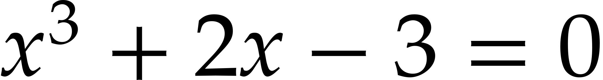 amounts to”? Even if the solution were to yield a positive integer? On my view, you see, we would have here a notation such that one cannot tell just by looking at it whether it is nonsensical or not.

### [26r\[8\]](https://cdn.wittgensteinnachlass.com/2000px/webp/Ts-208/26r.webp)

If one regards the expression “the root of the equation Fx = 0” as a description in Russell’s sense, then a sentence about the root of the equation x + 2 = 6 would have to have a different sense from one that says the same thing about 4.

### [26r\[9\]](https://cdn.wittgensteinnachlass.com/2000px/webp/Ts-208/26r.webp)

I cannot use a sentence until I know whether it has sense, whether it is a sentence. And I do not know this in the case of an unsolved equation above, for I do not know whether cardinal numbers correspond to the roots in the stipulated way. It is clear that in the given case the sentence turns out to be nonsensical and not false (nor a contradiction), for “I have n shoes and n² = 2” obviously means the same as “I have √2 shoes”.

### [26r\[10\]](https://cdn.wittgensteinnachlass.com/2000px/webp/Ts-208/26r.webp)

But surely I can establish that – or surely it can be established – just by looking at the signs. But I must not put the equation into the sentence on the off chance, but only if I know that it determines a cardinal number, for then it is simply another way of writing the cardinal number. Otherwise it is just as if I jumbled signs together at random and left it to chance whether or not they yielded a sense.

### [27r\[1\]](https://cdn.wittgensteinnachlass.com/2000px/webp/Ts-208/27r.webp)

Equations are a kind of number.

### [27r\[2\]](https://cdn.wittgensteinnachlass.com/2000px/webp/Ts-208/27r.webp)

The usual view is roughly this: although the real numbers have a different multiplicity from the rational numbers, one can start by writing the two series side by side, and somewhere the series of real numbers leaves the other behind and goes on to infinity.

### [27r\[3\]](https://cdn.wittgensteinnachlass.com/2000px/webp/Ts-208/27r.webp)

But my view is this: one can only ever set finite series side by side and compare them in this way; putting dots after these finite stretches (as a sign that the series goes on to infinity) makes no sense. Further, one can compare a law with a law, but not a law with _no_ law.

### [27r\[4\]](https://cdn.wittgensteinnachlass.com/2000px/webp/Ts-208/27r.webp)

But what then is it supposed to mean to say that every set can be well-ordered?

### [27r\[5\]](https://cdn.wittgensteinnachlass.com/2000px/webp/Ts-208/27r.webp)

“What interests me is not the law but its infinity. Not its finite results, but the infinitely distant limit to which they point”. (Here we would have the “Infinite Proper”. But surely it is precisely the law that must point to this limit! And yet this does seem to contradict my view that the law is the irrational number. It is of course true that an infinite operation cannot produce a final result, but what about a _limit_ that the results approach without bound? In a certain sense, of course, the law must be equivalent to the limit, but not in every sense.

### [27r\[6\]](https://cdn.wittgensteinnachlass.com/2000px/webp/Ts-208/27r.webp)

Only what is endless can be stretched (compare the “indeterminate number” _Some_).

### [27r\[7\]](https://cdn.wittgensteinnachlass.com/2000px/webp/Ts-208/27r.webp)

I can now understand intuitionism better: each number has its individual properties. Now these are of course determined by the position in the series of the operation 1 + 1 etc., but each such position is after all an individual position; in fact it has the same individuality as the number itself that occupies it. So we cannot get away from the infinitely many individualities.

### [27r\[8\]](https://cdn.wittgensteinnachlass.com/2000px/webp/Ts-208/27r.webp)

And why, after all, should the series (1, ‒ , ‒ + 1) be more fundamental than (2, ‒ , ‒ + 2)? What is fundamental in both is not the particular operation but the concept of a series. Or should we say: what is fundamental is the concept of repeating the operation? For after all we have a general concept of number, a concept of its unlimited possibility. And surely there cannot be, in logic, a concept and distinct individual objects falling under it which the concept does not completely determine.

### [27r\[9\]](https://cdn.wittgensteinnachlass.com/2000px/webp/Ts-208/27r.webp)

The mere fact that with the logical concept (1, ‒ , ‒ + 1) the existence of its objects is already given shows that it determines them.

### [27r\[10\]](https://cdn.wittgensteinnachlass.com/2000px/webp/Ts-208/27r.webp)

This, incidentally, is quite clear; each number has its irreducible individuality. And if I want to prove some property of a number, I must always bring the number itself into it somehow.

### [28r\[1\]](https://cdn.wittgensteinnachlass.com/2000px/webp/Ts-208/28r.webp)

In that sense one can say that the properties of a particular number cannot be _foreseen_. One sees them only when one is there. One might say: can I not prove something about the number 3¹⁰ even though I cannot write it down? No doubt, but 3¹⁰ already is the number, only written in a different way.

### [28r\[2\]](https://cdn.wittgensteinnachlass.com/2000px/webp/Ts-208/28r.webp)

What is fundamental is only the repetition of an operation. Each stage of this repetition has its individuality.

### [28r\[3\]](https://cdn.wittgensteinnachlass.com/2000px/webp/Ts-208/28r.webp)

Now it is not as if I progressed by means of the operation from one individuality to another. As if the operation were the means of getting from one to another. Something like the vehicle that stops at each number, which one can now inspect. Rather, performing the operation + 1 three times produces and _is_ the number 3.

### [28r\[4\]](https://cdn.wittgensteinnachlass.com/2000px/webp/Ts-208/28r.webp)

An “infinitely complicated law” means no law. How could one know that it is infinitely complicated? Only if there were, as it were, infinitely many approximations to this law. But does that not require that they really _approach_ a goal? Or can one call the infinitely many descriptions of stretches of the series of prime numbers such approximations to the law? No, for no description of a finite stretch brings us any closer to the goal of a complete description. How, then, does an infinitely complicated law in this sense differ from no law at all? The most the law would say, then, is “everything is as it is”.

### [28r\[5\]](https://cdn.wittgensteinnachlass.com/2000px/webp/Ts-208/28r.webp)

The number 5 does not do its work as the fifth number in comparison with the fourth, but as 5, which is unique.

### [28r\[6\]](https://cdn.wittgensteinnachlass.com/2000px/webp/Ts-208/28r.webp)

“We know infinity from the description”. Well then, there is only this description and nothing else.

### [28r\[7\]](https://cdn.wittgensteinnachlass.com/2000px/webp/Ts-208/28r.webp)

Mathematicians’ reflections on the infinite are, after all, finite reflections every one of them.

### [28r\[8\]](https://cdn.wittgensteinnachlass.com/2000px/webp/Ts-208/28r.webp)

Is it conceivable, then, that there are two classes of irrational numbers: one determined by laws, hence all those we can ever know, and one determined by no laws, hence the totality of those we cannot know!

### [28r\[9\]](https://cdn.wittgensteinnachlass.com/2000px/webp/Ts-208/28r.webp)

Suppose I make a cut where there is no rational number. Then there _must_ be approximations to this cut. But what does “nearer” mean here? _Nearer_ to what? As yet I have nothing in the realm of number that I can approach. But I do on the geometrical line segment. Here it is clear that I can get as close as I like to any non-rational cut. – And it is also clear that this process never ends and that the spatial fact leads me onwards unambiguously.

### [28r\[10\]](https://cdn.wittgensteinnachlass.com/2000px/webp/Ts-208/28r.webp)

Once again it is only the infinite possibility, but now the law is given in a different way.

### [29r\[1\]](https://cdn.wittgensteinnachlass.com/2000px/webp/Ts-208/29r.webp)

Thus I can approach any point of a line segment without bound by successive bisection, and with infinitely sharp eyes and infinitely fine instruments _every_ step of the bisection would be determined. (The infinite acuity of the eyes does not give rise to a vicious circle.)

### [29r\[2\]](https://cdn.wittgensteinnachlass.com/2000px/webp/Ts-208/29r.webp)

Could one now call a sequence of digits determined in this way an infinite decimal fraction? I.e. does this geometrical procedure determine a _number_?

### [29r\[3\]](https://cdn.wittgensteinnachlass.com/2000px/webp/Ts-208/29r.webp)

The geometrical procedure contains no vicious circle because it presupposes only an infinite possibility, not an infinite reality. (Lines and points are given by the boundary lines of areas of colour.)

### [29r\[4\]](https://cdn.wittgensteinnachlass.com/2000px/webp/Ts-208/29r.webp)

In what sense can one say that I have thereby actually divided the rational numbers into two classes? In fact this division never comes about. But I have a _procedure_ by which I approach this division without bound? I have an unbounded procedure whose results as such do not get me to the goal, but whose boundless possibility is itself the goal. But what does this boundlessness consist in? Have we not once again got just an operation, and that ad infinitum? Certainly. But the operation is not an arithmetical one. (And I cannot give arithmetically that point which serves as an aid to my endless construction.)

### [29r\[5\]](https://cdn.wittgensteinnachlass.com/2000px/webp/Ts-208/29r.webp)

Now many would say here: it does not matter that the method was geometrical; it is only the resulting _extension_ that is our goal. But do I actually have it?

### [29r\[6\]](https://cdn.wittgensteinnachlass.com/2000px/webp/Ts-208/29r.webp)

Does the question make sense: if a particular point is given and with it an endless procedure, is there an arithmetical procedure that generates the same extension as the point?

### [29r\[7\]](https://cdn.wittgensteinnachlass.com/2000px/webp/Ts-208/29r.webp)

But does it even make sense to say that a certain – non-rational – point determines an irrational number? Yes, that seems to make sense. For the point determines all the approximating numbers in advance; in a certain sense they are _all_ given with it.

### [29r\[8\]](https://cdn.wittgensteinnachlass.com/2000px/webp/Ts-208/29r.webp)

Proofs that prove the same thing can be translated into one another and are to that extent the same proof. This fails to hold only for proofs such as: “I can tell he is at home from two facts; first, his coat is hanging in the hall and second, I can hear him whistling”. Here we have two independent sources of knowledge. Such a proof needs grounds from outside, whereas a mathematical proof is the analysis of the mathematical proposition.

### [30r\[1\]](https://cdn.wittgensteinnachlass.com/2000px/webp/Ts-208/30r.webp)

Does a geometrical proof have a different kind of intuitive clarity from an arithmetical one? The only point is that the proof must not become an experiment.

### [30r\[2\]](https://cdn.wittgensteinnachlass.com/2000px/webp/Ts-208/30r.webp)

What is the analogue in arithmetic of the geometrical process? It must be the reverse procedure, that of determining a point by a law. (Instead of the law by a point).

### [30r\[3\]](https://cdn.wittgensteinnachlass.com/2000px/webp/Ts-208/30r.webp)

Specifically, it would correspond to the endless process of choosing between 0 and 1 in an infinite binary fraction 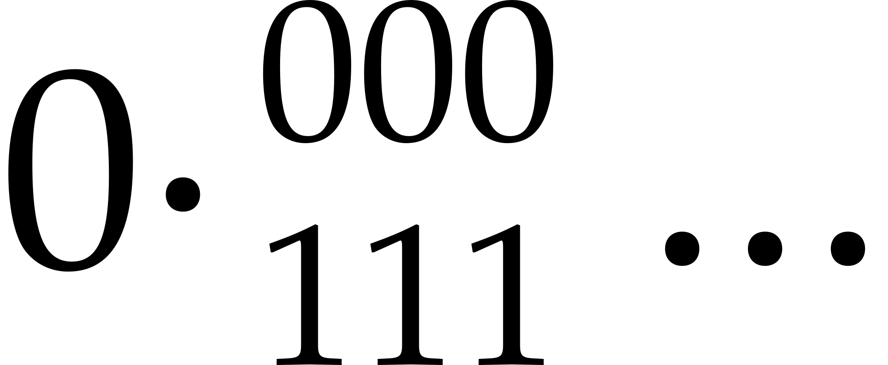 ad inf.. The law here would read, “you must put down 0 or 1 time after time ad infinitum; each gives a law, each a different one”.

### [30r\[4\]](https://cdn.wittgensteinnachlass.com/2000px/webp/Ts-208/30r.webp)

But this does not mean that a law would be given _by_ my saying: “Toss for heads or tails each time”. In this way I would of course have to obtain a special case of that law, but would not know in advance which one. The instruction to throw dice describes no law of the sequence.

### [30r\[5\]](https://cdn.wittgensteinnachlass.com/2000px/webp/Ts-208/30r.webp)

One might ask: But how does the geometrical procedure differ from throwing dice? Are they not essentially the same, namely a quasi-physical method? No, for the instruction to throw dice does not itself determine a sequence of numbers; the position of the point is already the equivalent of a particular infinite sequence of numbers

### [30r\[6\]](https://cdn.wittgensteinnachlass.com/2000px/webp/Ts-208/30r.webp)

What is arithmetical about the process of throwing dice is not the actual result but the infinite indeterminacy. But that does not _determine_ a number. That is not true! The process of measuring!! Nothing determines what will come out of the process of halving.

### [30r\[7\]](https://cdn.wittgensteinnachlass.com/2000px/webp/Ts-208/30r.webp)

If I indicate a law like this “0˙001001001… ad inf.”, what I want to show is not the finite series as a specimen of a stretch of an infinite one, but the kind of regularity that can be gleaned from it. But from  I glean _no_ law, but precisely the absence of a law. Unless perhaps it is the law that only “0” and “1”, and no other signs, represent the results of the particular laws.

### [30r\[8\]](https://cdn.wittgensteinnachlass.com/2000px/webp/Ts-208/30r.webp)

The rules for combining 0 and 1 yield the totality of _all_ finite fractions. That would be an infinite extension, in which one would also have to find the infinite extension of the fractions 0˙1, 0˙101, 0˙10101, etc. ad inf. and indeed all irrational numbers.

### [30r\[9\]](https://cdn.wittgensteinnachlass.com/2000px/webp/Ts-208/30r.webp)

Can one say that if there are only finitely many things, the infinite number series is nevertheless applied to that finite number, only in a different way from the way it is applied to an infinite multiplicity. For instance, by counting the finite number over and over from the beginning, infinitely many times. But does this not presuppose precisely that time is infinite? And is the instruction (a, ‒ , ‒ a) then infinite? But here only a finite possibility is presupposed.

### [31r\[1\]](https://cdn.wittgensteinnachlass.com/2000px/webp/Ts-208/31r.webp)

If all our signs were allowed to lie only at 6 points on a circle, that would do nothing to impair the infinite rule. Our instruction would still be infinite.

### [31r\[2\]](https://cdn.wittgensteinnachlass.com/2000px/webp/Ts-208/31r.webp)

The maximum of a function admits of an intentional explanation. The highest point of a curve is indeed higher than any other point one might pick out, but I do not find it by going through the points of the curve one by one and seeing whether there is one still higher.

### [31r\[3\]](https://cdn.wittgensteinnachlass.com/2000px/webp/Ts-208/31r.webp)

Here again it is grammar that plays a trick on us, as it always does in the realm of the infinite. We say “the highest point of the curve”. But this cannot mean “the highest point among all the points of the curve” in the sense in which one speaks of the largest of these three apples, for we do not have all the points of the curve before us; indeed, this expression is nonsensical. It is the same fault in our syntax that presents the sentence “the apple can be divided into two parts” as having the same form as “a line segment is divisible without bound”, so that in both cases one can apparently say “let us suppose the possible division has been carried out”. In fact, however, the expressions “divisible into two parts” and “divisible without bound” have quite different forms. This is of course the same as operating with the word “infinite” as if it were a number word; because in ordinary language both are given in answer to the question “how many”.

### [31r\[4\]](https://cdn.wittgensteinnachlass.com/2000px/webp/Ts-208/31r.webp)

The curve is there independently of its individual points. This is also expressed by the fact that I can _construct_ the highest point. I.e. obtain it from a law and not by examining individual points.

### [31r\[5\]](https://cdn.wittgensteinnachlass.com/2000px/webp/Ts-208/31r.webp)

What is an aggregate of points? Can we not, after all, describe an infinite aggregate as such, as it were from outside? By saying – quite generally – that every element has a successor that is not the element itself or one of its predecessors? Does this not describe an actual infinity, whether anything corresponds to it or not. And how is infinity grasped here? For apparently it is represented entirely by finite concepts. Or does infinity enter my sentence through the fact that I have to say that no element can be the successor of its ancestor? How is the sentence “a is the ancestor of b” to be represented? aRb ․⌵․ (∃x)aRx ․ & ․ xRb ․⌵․ (∃x,y)aRx ․ & ․ xRy ․ & ․ yRb ․⌵․ etc. If there is no “ad inf.” at the end of this series, then the sentence does not describe an infinite series either. But an infinite logical sum is nonsense.

### [31r\[6\]](https://cdn.wittgensteinnachlass.com/2000px/webp/Ts-208/31r.webp)

Dedekind’s definition of an infinite set, too, is one that aims to describe the infinite without _representing_ it. It would be like describing an illness by its outward symptoms, which one knows always occur together with the illness. Only in this case there is a connection that is not formal in nature.

### [32r\[1\]](https://cdn.wittgensteinnachlass.com/2000px/webp/Ts-208/32r.webp)

Does a notation like the one above not result if we introduce that notation for generality which Russell does not use but which is needed, for example, for a correct explanation of R. For this requires a notation:

“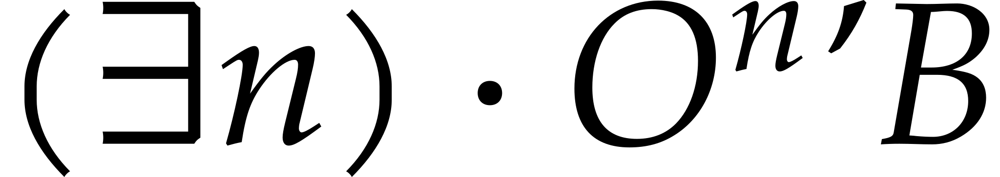”

### [32r\[2\]](https://cdn.wittgensteinnachlass.com/2000px/webp/Ts-208/32r.webp)

(n)․(∃nx)Fx: “You can have _any_ number of them”.

### [32r\[3\]](https://cdn.wittgensteinnachlass.com/2000px/webp/Ts-208/32r.webp)

The question would be: What criterion is there for the irrational numbers to be _complete_?

### [32r\[4\]](https://cdn.wittgensteinnachlass.com/2000px/webp/Ts-208/32r.webp)

Let us look at an irrational number: it runs along a series of rational approximations. When does it leave this series? Never. But then it never comes to an end either. Suppose we had the totality of all irrational numbers with a single exception. How would we miss this one? And how would it now – if it were added – fill the gap? – Suppose it were π. If an irrational number is given by the totality of its approximations, then up to _any_ point one might choose there would be a series that agrees with that of π. To be sure, for each such series there comes a point where they part company. But that point may lie as far “out” as one likes. So that for every series that accompanies π I can find one that accompanies it further. If, then, I have the totality of all irrational numbers except π, and now put π in, I cannot specify any point at which π really becomes necessary; at _every_ point it has a companion that has accompanied it from the beginning.

### [32r\[5\]](https://cdn.wittgensteinnachlass.com/2000px/webp/Ts-208/32r.webp)

This shows clearly that an irrational number is not the extension of an infinite decimal fraction but a law.

### [32r\[6\]](https://cdn.wittgensteinnachlass.com/2000px/webp/Ts-208/32r.webp)

It seems somehow to follow from this – and it makes a great deal of sense to me – that the infinity of a length is not a magnitude of the length.

### [32r\[7\]](https://cdn.wittgensteinnachlass.com/2000px/webp/Ts-208/32r.webp)

One would have to answer the question above: “π, if it were an extension, would never be missed”. I.e. we could never notice a gap. If someone were to ask us “but have you also got an infinite decimal fraction with _m_ in the rth place and _n_ in the sth” etc., we could always supply one.

### [32r\[8\]](https://cdn.wittgensteinnachlass.com/2000px/webp/Ts-208/32r.webp)

Now suppose we were given all the irrational numbers that can be represented by laws, but that these were not all of them, and now I am given a cut representing a number not contained in this first class: how can I tell that this is the case? It is impossible, for however far I go with my values, a corresponding fraction will always be found. So one cannot say that the infinite decimal fractions that proceed according to laws still need to be supplemented by an infinite set of unordered infinite decimal fractions that would “fall by the wayside” if we _confined ourselves to those generated according to laws_. Where is such an infinite fraction generated without a law? And how can we miss it? Where is the gap it would have to fill?

Everything is governed by the analogy that one can measure _a length_ in _different ways_. But here too, after all, the word “length” means different things depending on the method or the group of permitted methods.

### [33r\[1\]](https://cdn.wittgensteinnachlass.com/2000px/webp/Ts-208/33r.webp)

If one says “the set of all transcendental numbers is larger than that of the algebraic numbers”, this is nonsense; it is of a different nature. It is not “no longer” countable, but simply: not countable!

### [33r\[2\]](https://cdn.wittgensteinnachlass.com/2000px/webp/Ts-208/33r.webp)

If right from the start it is only laws that reach into the infinite, then the question whether the totality of laws exhausts the totality of infinite decimal fractions could make no sense at all.

### [33r\[3\]](https://cdn.wittgensteinnachlass.com/2000px/webp/Ts-208/33r.webp)

We evidently have a _concept_ of the geometrical method without being able actually to carry out even a single example. Why, then, can one not describe this concept? It is represented by the continuum that a spatial line segment represents for us. The real question, then, would be: Can the continuum be described? As Cantor and others have tried to do.

### [33r\[4\]](https://cdn.wittgensteinnachlass.com/2000px/webp/Ts-208/33r.webp)

A form cannot be described but only represented.

### [33r\[5\]](https://cdn.wittgensteinnachlass.com/2000px/webp/Ts-208/33r.webp)

What if one checks the various laws, so to speak, against the set of finite combinations? The results of a law run through the finite combinations, and the laws are therefore complete as far as their extensions are concerned if _all_ the finite combinations are run through.

### [33r\[6\]](https://cdn.wittgensteinnachlass.com/2000px/webp/Ts-208/33r.webp)

Nor can one say: Two laws are identical if they yield the same result at every stage. Rather, they are identical if they yield essentially the same result, i.e. if they are identical.

### [33r\[7\]](https://cdn.wittgensteinnachlass.com/2000px/webp/Ts-208/33r.webp)

If an amorphous theory of infinite aggregates is possible, it must describe and represent only what is amorphous about these aggregates. It would then really have to regard the laws as merely inessential means of representing an aggregate. And abstract from what is inessential here and look only at what is essential. But at what? Is it possible to abstract from the law in the law and see the extension represented as what is essential?

### [33r\[8\]](https://cdn.wittgensteinnachlass.com/2000px/webp/Ts-208/33r.webp)

But then its being a law would not be what is essential about the symbol. Rather, its determining an infinite extension. (But that is precisely what the law does not give.)

### [33r\[9\]](https://cdn.wittgensteinnachlass.com/2000px/webp/Ts-208/33r.webp),[34r\[1\]](https://cdn.wittgensteinnachlass.com/2000px/webp/Ts-208/34r.webp)

Does the geometrical method of intersection give us the idea of an infinite combination, which we would not have without it? One thing, surely, is clear: the result of the intersection method is arithmetical. So either the prescription must be arithmetical, or, if it is not, the extension of the numbers constructed, detached from this prescription, is an arithmetical concept. I.e., if the intersection method does not belong to arithmetic, there is a procedure for making one's way along an infinite series of numbers, which is itself inessential and would merely show us that this extension exists. Here we would have a sequence of numbers that as such would undoubtedly be produced by a law that was not arithmetical and was therefore not essential to this sequence. The procedure would present us with this sequence and then, so to speak, withdraw. Either way we would be out of trouble. Either the geometrical method is arithmetical, in which case it may be used in arithmetic to define the irrational numbers, or it is not arithmetical, in which case it yields an infinite extension and this is an object of arithmetic.

### [34r\[2\]](https://cdn.wittgensteinnachlass.com/2000px/webp/Ts-208/34r.webp)

One would then say: Irrational numbers are either _given_ to us by arithmetical laws or not; we see that there are some that are not given to us by arithmetical laws, for example, from the fact that a geometrical method yields extensions that are not given by any arithmetical law.

### [34r\[3\]](https://cdn.wittgensteinnachlass.com/2000px/webp/Ts-208/34r.webp)

The geometrical procedure would then really be no more than an inessential construction (scaffolding) for arriving at the numbers of an existing extension.

### [34r\[4\]](https://cdn.wittgensteinnachlass.com/2000px/webp/Ts-208/34r.webp)

But can I be in doubt whether all the points of a line segment can really be represented by arithmetical prescriptions? Can I ever find a point for which I can show that this is not the case? If it is given by a construction, I can translate the construction into an arithmetical prescription, and if it is given by chance, however far I continue the approximation, there is always an arithmetically determined decimal fraction that accompanies it. It is clear that a point corresponds to a prescription.

### [34r\[5\]](https://cdn.wittgensteinnachlass.com/2000px/webp/Ts-208/34r.webp)

What about the types of prescriptions, and does it make sense to speak of all prescriptions, and thus of all points? In some sense there cannot be irrational numbers of different types. My feeling here is this: Whatever the prescription may say, I still never get anything but an endless series of rational numbers. One can also put it this way: Whatever the prescription says, when I translate it into geometrical notation, everything is of the same type.

### [34r\[6\]](https://cdn.wittgensteinnachlass.com/2000px/webp/Ts-208/34r.webp)

In approximating by successive bisection one approaches _every_ point by means of _rational_ numbers. There is no point that one could approach only by means of irrational numbers of a particular type. Is this not an “axiom of reducibility”?

### [34r\[7\]](https://cdn.wittgensteinnachlass.com/2000px/webp/Ts-208/34r.webp)

Does not the general form of a law read: “Here, at every stage, choose the step that satisfies a particular condition”? But the general form of a condition is merely the absence of any condition, while each particular case can only be a condition that regulates the choice ad infinitum.

### [34r\[8\]](https://cdn.wittgensteinnachlass.com/2000px/webp/Ts-208/34r.webp)

But all that is there is the point. And that is a method for generating an extension without end. The completed infinite extension is never there, for it is an absurdity. The point gives infinitely many – finite – extensions. But not an infinite extension. The infinite is an arrow, not a line segment!

### [35r\[1\]](https://cdn.wittgensteinnachlass.com/2000px/webp/Ts-208/35r.webp)

Can one not somehow represent the process of bisection using a movable scale, so that the process is tied to infinite space rather than to a line segment? That would amount to looking at the segment through a stronger magnifying glass each time so as to be able to go on measuring; and that is of course possible.

### [35r\[2\]](https://cdn.wittgensteinnachlass.com/2000px/webp/Ts-208/35r.webp)

The theory of aggregates seeks to grasp the infinite in a more general way than the theory of prescriptions. It says that what is actually infinite cannot be grasped at all with arithmetical symbolism and thus can only be described, not represented. The description would grasp it rather as one carries a number of things that one cannot hold all at once in one's hands by packing them in a box. They are then out of sight, yet we know that we are carrying them (indirectly, so to speak). The theory of aggregates, as it were, buys a pig in a poke. Let the infinite make itself at home in its box however it pleases.

### [35r\[3\]](https://cdn.wittgensteinnachlass.com/2000px/webp/Ts-208/35r.webp)

This is also the basis of the idea that one can describe logical forms by means of language. In such a description the structures, and perhaps correlating relations, etc., are presented all wrapped up, and so it really looks as though one could speak of a structure without reproducing it in the sentence itself. We may indeed use concepts wrapped up in this way, whose structure is thus unrecognizable, but they always have their meaning via definitions which are precisely what wrap the concepts up in this way; and if we now go backwards through these definitions, the concepts are unwrapped again and are thus present in their structure.

### [35r\[4\]](https://cdn.wittgensteinnachlass.com/2000px/webp/Ts-208/35r.webp)

That is what Russell does with R + , he wraps up the concept so that its form disappears.

### [35r\[5\]](https://cdn.wittgensteinnachlass.com/2000px/webp/Ts-208/35r.webp)

The point of this method is to make everything amorphous and to treat it as such.

### [35r\[6\]](https://cdn.wittgensteinnachlass.com/2000px/webp/Ts-208/35r.webp)

Can one say: The extension of one law is the same as that of another, or different from it. No! One can say that one law yields different results from the other in a particular range, and of course one can say that one law differs from the other. One may also speak of a law that yields only binary fractions, if what this gives is an – internal – property of the law.

### [35r\[7\]](https://cdn.wittgensteinnachlass.com/2000px/webp/Ts-208/35r.webp)

It is quite possible that I come upon a new prescription in determining a maximum, but it has nothing essential to do with the determination of the maximum; it does not refer explicitly to a totality of real numbers.

### [35r\[8\]](https://cdn.wittgensteinnachlass.com/2000px/webp/Ts-208/35r.webp),[36r\[1\]](https://cdn.wittgensteinnachlass.com/2000px/webp/Ts-208/36r.webp)

It does now appear that the generality sign for numbers makes no sense. I mean: One cannot say “(n)Fn” because “all natural numbers” is not a bounded concept. But then one may not say either that a general statement follows from a statement about the essence of number.

### [36r\[2\]](https://cdn.wittgensteinnachlass.com/2000px/webp/Ts-208/36r.webp)

But then it seems to me that one cannot use generality – all, etc. – in mathematics at all. There are no such things as all the numbers, precisely because there are infinitely many. And because what is at issue here is not the amorphous “all”, as in the sentence “all apples are ripe”, where the set is given by an external description, but the totality of structures, which must be given as such.

### [36r\[3\]](https://cdn.wittgensteinnachlass.com/2000px/webp/Ts-208/36r.webp)

It is no concern of logic, so to speak, how many apples there are when one speaks of _all_ the apples. But it is different with numbers: logic is responsible for them individually.

### [36r\[4\]](https://cdn.wittgensteinnachlass.com/2000px/webp/Ts-208/36r.webp)

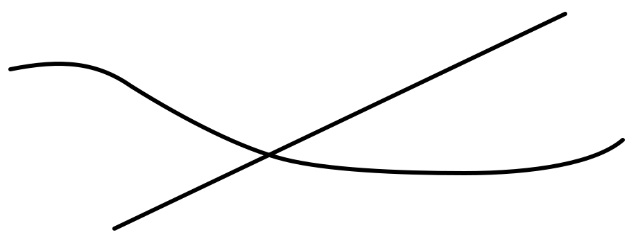

Here there seems to be an essential “there is”. Or can one say that the variable curve intersects the straight line at _one_ variable point? It does not say “among _all_ the points there is only one at which it intersects the straight line”, but speaks only of _one_ point. Of one that moves along the straight line, so to speak, but not of one among all the points of the straight line. The straight line does not _consist_ of points.

### [36r\[5\]](https://cdn.wittgensteinnachlass.com/2000px/webp/Ts-208/36r.webp)

One can imagine a notation in which every sentence is represented as the result of certain operations – transitions – on the basis of particular “axioms”. (Say, on the analogy of representing a chemical compound by the chemical name “Trimethylamido …” etc.).

### [36r\[6\]](https://cdn.wittgensteinnachlass.com/2000px/webp/Ts-208/36r.webp)

Such a notation could be produced with a few modifications from the instructions that Russell and Whitehead place before the sentences of Principia Mathematica.

### [36r\[7\]](https://cdn.wittgensteinnachlass.com/2000px/webp/Ts-208/36r.webp)

The mathematical proposition then stands to its proof as the top face of a solid stands to the solid itself. One might speak of the proposition's body of proof. The proposition has meaning for us only on the assumption that there is a solid behind the face. One also says: The mathematical proposition is (only) the last link in a chain of proof.

### [36r\[8\]](https://cdn.wittgensteinnachlass.com/2000px/webp/Ts-208/36r.webp)

A general mathematical proposition that says nothing about the _essence_ of number – and therefore cannot be proved either – is an absurdity

### [36r\[9\]](https://cdn.wittgensteinnachlass.com/2000px/webp/Ts-208/36r.webp),[37r\[1\]](https://cdn.wittgensteinnachlass.com/2000px/webp/Ts-208/37r.webp)

Are the intuitionists not simply saying that the opposite of the sentence “a proof of A is possible” is not “a proof of ~A is possible”, but “a proof of A is not possible”.

### [37r\[2\]](https://cdn.wittgensteinnachlass.com/2000px/webp/Ts-208/37r.webp)

If the sentence “(n)․Fn” means “it is of the essence of number that Fn”, then its opposite is not “it is of the essence of number that non-Fn” but “it is not of the essence of number that Fn”.

### [37r\[3\]](https://cdn.wittgensteinnachlass.com/2000px/webp/Ts-208/37r.webp)

The description of phenomena by means of the hypothesis of a world of physical bodies is indispensable because of its simplicity compared with the incomprehensibly complicated phenomenological description. If I see several scattered pieces of a circumference, it may be impossible to describe them exactly and directly, but to say that they are pieces of a circle which, for reasons not investigated further, I do not see in its entirety – is simple.

### [37r\[4\]](https://cdn.wittgensteinnachlass.com/2000px/webp/Ts-208/37r.webp)

This description always introduces some parameter that for our purposes we may leave unexamined.

### [37r\[5\]](https://cdn.wittgensteinnachlass.com/2000px/webp/Ts-208/37r.webp)

Is the variable the same in the equations (x + y)² = x² + y² + 2xy and x² + 3x + 2 = 0? And what about x² + ax + b = 0? Or x² + xy + z = 0?

### [37r\[6\]](https://cdn.wittgensteinnachlass.com/2000px/webp/Ts-208/37r.webp)

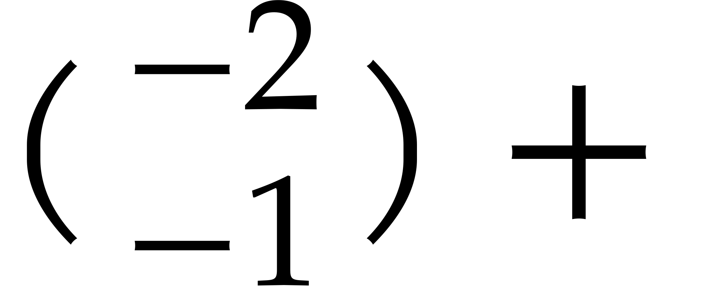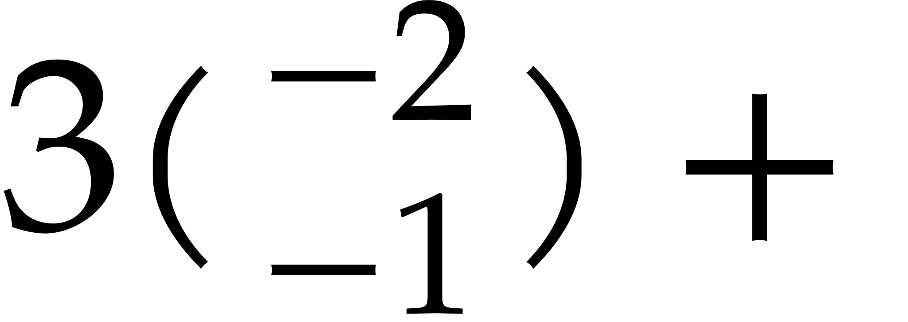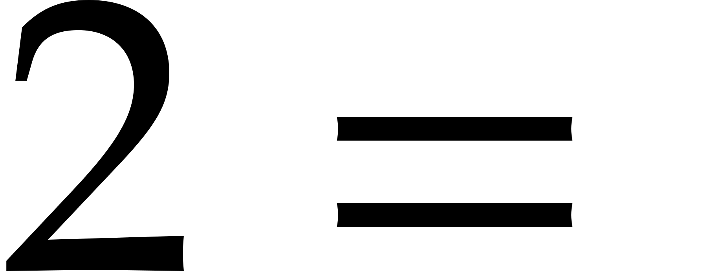 the equation is a question, but can one not also take it as the assertion (∃n)․(n² + 3n + 2 = 0)?

### [37r\[7\]](https://cdn.wittgensteinnachlass.com/2000px/webp/Ts-208/37r.webp)

What does “there is essentially” mean other than “it can be constructed”?

### [37r\[8\]](https://cdn.wittgensteinnachlass.com/2000px/webp/Ts-208/37r.webp)

(x + y)² = x² + y² + 2xy is correct in the same sense as 2 × 2 = 4. And 2 + n = 1 (where n is a cardinal number) is just as false as 2 + 3 = 1, and 2 + n ≠ 1 is correct, like the one above.

### [37r\[9\]](https://cdn.wittgensteinnachlass.com/2000px/webp/Ts-208/37r.webp)

What makes one doubtful about merely internal generality is the fact that it can be refuted by the occurrence of a single case (and thus by something extensional). But how do the general and the particular proposition come into conflict here? The particular case refutes the general proposition from within, not in an external way. It is directed against the internal proof of the proposition and does not refute it in the way that the existence of a one-eyed person refutes the sentence “all human beings have two eyes”.

### [37r\[10\]](https://cdn.wittgensteinnachlass.com/2000px/webp/Ts-208/37r.webp)

To the objection “If I run through the number series, then either I come at some point to the number with the desired property, or I never do”, the only reply is that it makes no sense to say one comes to the number _at some point_, and _just as little_ to say one _never_ gets there. It is, no doubt, correct to say that 101 is that number or that it is not. But one cannot speak of _all_ the numbers, because there are no such things as _all_ the numbers.

### [38r\[1\]](https://cdn.wittgensteinnachlass.com/2000px/webp/Ts-208/38r.webp)

But then what about a proper – non-amorphous – explanation of R + ? Surely I need “(n)…” here. In this case the expression seems to be permissible. Is it then impermissible only where we are dealing not with propositions proper but with equations?

---

### [38r\[2\]](https://cdn.wittgensteinnachlass.com/2000px/webp/Ts-208/38r.webp)

After all, “(∃x).Fx” also says “there are a number of x that satisfy Fx”, and yet the expression “(∃x).Fx” must not presuppose the totality of all numbers.

### [38r\[3\]](https://cdn.wittgensteinnachlass.com/2000px/webp/Ts-208/38r.webp)

Ramsey’s explanation of infinity is nonsensical for this very reason too, for “(n):(∃nx).Fx” would presuppose actual infinity as given, and not merely the unbounded possibility of proceeding.

### [38r\[4\]](https://cdn.wittgensteinnachlass.com/2000px/webp/Ts-208/38r.webp)

But is it inconceivable that I know that someone is an ancestor of mine but have _no idea at all_ how many generations back, so that the number of intervening links would be _unbounded_?

### [38r\[5\]](https://cdn.wittgensteinnachlass.com/2000px/webp/Ts-208/38r.webp)

But how does the sentence “F is satisfied by just as many objects as G” go? One would think: “(∃n) :(∃nx).Fx ․ & . (∃nx)Gx”.

### [38r\[6\]](https://cdn.wittgensteinnachlass.com/2000px/webp/Ts-208/38r.webp)

Curiously, one could let this notation stand if n is taken to range only over all the numbers from 1 up to the total number of objects. The sentence must become nonsensical if n exceeds a certain bound, which can only be given by the sense of x.

### [38r\[7\]](https://cdn.wittgensteinnachlass.com/2000px/webp/Ts-208/38r.webp)

But does not the expression “(∃n):(∃nx) etc.” take care of itself? For “(∃n)” has sense only in conjunction with a generality sign like “(∃nx)”, and this very conjunction ensures that “(∃n)” is not understood in a nonsensical way.

### [38r\[8\]](https://cdn.wittgensteinnachlass.com/2000px/webp/Ts-208/38r.webp)

The difference between the two equations x² = x ∙ x and x² = 2x is _not_ a difference in the extension of their correctness.

### [38r\[9\]](https://cdn.wittgensteinnachlass.com/2000px/webp/Ts-208/38r.webp)

If one says (as Brouwer does) that in the case of (x).Fx = Gx there is, besides yes and no, also the case of undecidability, this means that “(x)…” is meant extensionally and that one can speak of the case where all x happen to have a property. In truth, however, one cannot speak of this case at all, and “(x)…” in arithmetic cannot be understood extensionally.

### [38r\[10\]](https://cdn.wittgensteinnachlass.com/2000px/webp/Ts-208/38r.webp)

“(x).x² = x + x” appears to be false because examining the equation yields 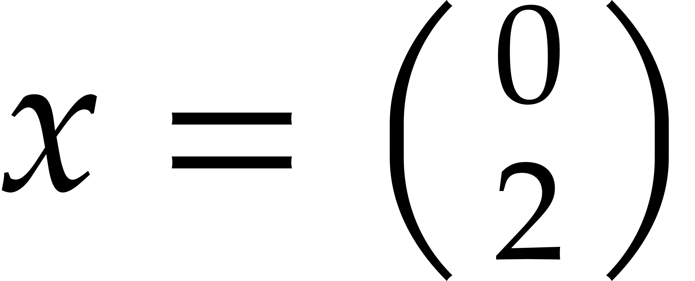 rather than showing that the two sides cancel out. Trying the substitution of 3, for example, also yields the general result – (∃x).x² ≠ 2x – and must therefore itself coincide with the general method in so far as its result coincides with that of the general solution.

### [39r\[1\]](https://cdn.wittgensteinnachlass.com/2000px/webp/Ts-208/39r.webp)

But can I not say of an equation: “I know it does not hold for some substitutions – I no longer remember which – but whether it fails to hold generally, I don’t know”? Does this not make good sense, and is it not compatible with the generality of the inequality?

### [39r\[2\]](https://cdn.wittgensteinnachlass.com/2000px/webp/Ts-208/39r.webp)

Should I reply to this: “If one knows that the inequality holds for some substitutions, that can never mean for some (arbitrary) ones from the infinite series of numbers; rather, I always also know that this number lies between 1 and 10⁷, or between some other bounds.”?

### [39r\[3\]](https://cdn.wittgensteinnachlass.com/2000px/webp/Ts-208/39r.webp)

Can I know that _one_ number satisfies the equation without any finite range being delimited for its occurrence in the infinite series? No.

### [39r\[4\]](https://cdn.wittgensteinnachlass.com/2000px/webp/Ts-208/39r.webp)

An equation is a syntactic rule.

### [39r\[5\]](https://cdn.wittgensteinnachlass.com/2000px/webp/Ts-208/39r.webp)

Does that not explain why in mathematics we cannot have questions that are unanswerable in principle? For if the rules of syntax are not intelligible, they are no good. And it likewise explains why an infinity that exceeds our powers of comprehension cannot enter into these rules. And it also makes intelligible the attempts of the formalists, who see mathematics as a game with signs.

### [39r\[6\]](https://cdn.wittgensteinnachlass.com/2000px/webp/Ts-208/39r.webp)

Does the relation m = 2n correlate the class of all numbers with one of its subclasses? No. It correlates any given number with another, and in this way we get infinitely many pairs of classes, with one class correlated with the other in each pair, but the classes are _never_ related as class and subclass. Nor is this infinite process itself in any sense such a pair of classes. In the superstition that m = 2n correlates a class with its subclass, we are once again dealing only with ambiguous grammar.

### [39r\[7\]](https://cdn.wittgensteinnachlass.com/2000px/webp/Ts-208/39r.webp)

And everything hinges on the syntax of reality and possibility. m = 2n contains the _possibility of correlating each number_ with another, _but it does not correlate all numbers with others_.

### [39r\[8\]](https://cdn.wittgensteinnachlass.com/2000px/webp/Ts-208/39r.webp)

If two arrows point in the same direction, is it not absurd to call these directions equally _long_ because what lies in the direction of one arrow also lies in that of the other.

### [39r\[9\]](https://cdn.wittgensteinnachlass.com/2000px/webp/Ts-208/39r.webp)

Generality in mathematics is a direction, an arrow that points along the series of operations. One can say, indeed, that the arrow points into the infinite; but does that mean that there is a something, the infinite, at which it points – as at a thing? If one takes it like that, it must of course lead to endless nonsense.

### [39r\[10\]](https://cdn.wittgensteinnachlass.com/2000px/webp/Ts-208/39r.webp)

The arrow, as it were, designates the possibility of being situated in its direction.

### [40r\[1\]](https://cdn.wittgensteinnachlass.com/2000px/webp/Ts-208/40r.webp)

The word possibility is of course misleading, for what is possible, one will say, is now to become real. One always thinks here, too, of processes in time, and concludes from the fact that mathematics has nothing to do with time that possibility in it is (already) reality.

### [40r\[2\]](https://cdn.wittgensteinnachlass.com/2000px/webp/Ts-208/40r.webp)

(In truth, however, it is the other way round, and what is called possibility in mathematics is just the same as what it is in time.)

### [40r\[3\]](https://cdn.wittgensteinnachlass.com/2000px/webp/Ts-208/40r.webp)

m = 2n points along the series of numbers, and if we add “into the infinite”, that means nothing more than that it does not point to an object at a definite distance.

### [40r\[4\]](https://cdn.wittgensteinnachlass.com/2000px/webp/Ts-208/40r.webp)

The infinite series of numbers itself is only such a possibility – as is clear from the sole symbol for it, “(1, x, x + 1)”. This symbol is itself an arrow, and the first “1” is the feather of the arrow and “x + 1” its point, and what is characteristic is that, just as the length of an arrow is inessential, here the variable x indicates that it does not matter how far the point is from the feather.

### [40r\[5\]](https://cdn.wittgensteinnachlass.com/2000px/webp/Ts-208/40r.webp)

It is possible to speak of things that lie in the direction of the arrow, but nonsensical to speak of all possible positions of things in the direction of the arrow as equivalent to that direction itself.

### [40r\[6\]](https://cdn.wittgensteinnachlass.com/2000px/webp/Ts-208/40r.webp)

If a searchlight casts light into infinite space, it does indeed illuminate everything in its direction, but one cannot say that it illuminates infinity.

### [40r\[7\]](https://cdn.wittgensteinnachlass.com/2000px/webp/Ts-208/40r.webp)

Is not the possibility here (in the symbolism of arithmetic) actually that of applying the general equation to a particular case? I.e., this possibility of application in symbols is the true picture of mathematical possibility.

### [40r\[8\]](https://cdn.wittgensteinnachlass.com/2000px/webp/Ts-208/40r.webp)

Set theory is wrong because it apparently presupposes a symbolism that does not exist, instead of the one that does (the only one possible). It builds on a fictitious symbolism, and thus on nonsense.

### [40r\[9\]](https://cdn.wittgensteinnachlass.com/2000px/webp/Ts-208/40r.webp)

One can also put it this way: It makes sense to say that infinitely many things can lie in one direction, but it makes no sense to say that infinitely many things lie there. And this contrasts with the ordinary way in which the word “can” is applied. For if it makes sense to say that a book can lie on this table, then it also makes sense to say that it lies there. But here language leads us astray. “Infinitely many” is used, so to speak, adverbially, and is to be understood in that way.

### [40r\[10\]](https://cdn.wittgensteinnachlass.com/2000px/webp/Ts-208/40r.webp),[41r\[1\]](https://cdn.wittgensteinnachlass.com/2000px/webp/Ts-208/41r.webp)

That is, the sentences “3 things can lie in this direction” and “infinitely many things can lie in this direction” only seem to be built alike; in reality they differ in structure. In particular, “infinitely many” in the second sentence does not play the role of “3” in the first.

### [41r\[2\]](https://cdn.wittgensteinnachlass.com/2000px/webp/Ts-208/41r.webp)

Again, it is only the ambiguity of our language that makes it seem as if the numerals and the word “infinite” were answers to the same question. Whereas in reality the questions those words answer are fundamentally different.

### [41r\[3\]](https://cdn.wittgensteinnachlass.com/2000px/webp/Ts-208/41r.webp)

(The ordinary conception really amounts to this: the absence of a limit is itself a limit. Even if it is not expressed so clearly.)

### [41r\[4\]](https://cdn.wittgensteinnachlass.com/2000px/webp/Ts-208/41r.webp)

There is no logical hypothesis.

### [41r\[5\]](https://cdn.wittgensteinnachlass.com/2000px/webp/Ts-208/41r.webp)

The infinite number series is only the infinite possibility of finite number series. It is senseless to speak of the _whole_ infinite number series as if it too were an extension.

### [41r\[6\]](https://cdn.wittgensteinnachlass.com/2000px/webp/Ts-208/41r.webp)

The possibility is rendered by the possibility. In the signs themselves lies only the possibility of repetition, not its reality.

### [41r\[7\]](https://cdn.wittgensteinnachlass.com/2000px/webp/Ts-208/41r.webp)

Isn’t this how it goes: Facts are finite; the infinite possibility of facts lies in the objects. That is why it is shown, not described.

### [41r\[8\]](https://cdn.wittgensteinnachlass.com/2000px/webp/Ts-208/41r.webp)

And what corresponds to this is that the numbers – which after all describe the facts – are finite, whereas their possibility, which corresponds to the _possibility_ of the facts, is infinite. It is expressed, as I said, in the possibilities of the symbolism.

### [41r\[9\]](https://cdn.wittgensteinnachlass.com/2000px/webp/Ts-208/41r.webp)

The feeling is: There cannot be both reality and possibility in mathematics. Everything is on _one_ level. And is in a certain sense real. And that is right. For everything mathematics expresses with its signs is on _one_ level; that is: It does not speak now of its reality and now of its possibility. Rather, it must not try to speak of its possibility at all. But there is indeed a possibility in its signs, namely the very same one that lies in the sentences proper in which mathematics is applied. And when it tries (as in set theory) to _state_ its possibilities, that is, when it confuses them with its reality, one may relegate it to its proper bounds. Possibility of a calculus.

### [41r\[10\]](https://cdn.wittgensteinnachlass.com/2000px/webp/Ts-208/41r.webp),[42r\[1\]](https://cdn.wittgensteinnachlass.com/2000px/webp/Ts-208/42r.webp)

“The highest point of a curve” does not mean “the highest point among all the points of the curve” – after all, we do not see them; rather, it is a particular point that the curve generates. Likewise, the maximum of a function is not the greatest value among all its values (that is nonsense except in the case of finitely many discrete points), but a point generated by a law and a condition; one which does, to be sure, lie higher than any other point picked out at will (_possibility_, not reality). Likewise, the point of intersection of two lines is not the common member of two classes of points, but the intersection of two laws. As is also plainly evident in analytic geometry.

### [42r\[2\]](https://cdn.wittgensteinnachlass.com/2000px/webp/Ts-208/42r.webp)

The proposition that says, in Dedekind’s sense, that a class F is infinite is, to be sure, merely false – not nonsensical – if only finitely many things satisfy the function F, but it is nonsensical if there are only a finite number of things. And this demolishes that conception of the infinite.

### [42r\[3\]](https://cdn.wittgensteinnachlass.com/2000px/webp/Ts-208/42r.webp)

“Every thing has one and only one predecessor; a has no successor; all things except a have one and only one successor.” These sentences seem to describe an infinite series (and hence also to say that there are infinitely many things. But the latter would be a prerequisite for the sentences to have sense). They seem to describe a structure _amorphously_. We can draw a structure in accordance with these sentences, one they describe unambiguously. But where is this structure to be found in them? – If there are only finitely many things, the proposition must lead to a contradiction. How does it come about? At any rate, when we infer its particular cases from the general proposition.

### [42r\[4\]](https://cdn.wittgensteinnachlass.com/2000px/webp/Ts-208/42r.webp)

But can one not take the sentences above simply as sentences of physics that set out a scientific hypothesis? Then they ought to be unassailable. What if physiology were to discover an animal species in which _every_ individual seems to derive from _one_ earlier individual, and were to state this as a hypothesis.

### [42r\[5\]](https://cdn.wittgensteinnachlass.com/2000px/webp/Ts-208/42r.webp)

Are we misled here by the appearance that pieces of matter – in this case, say, the individuals of the animal species – are the simple objects? That is, isn’t it the combinations of things according to their infinite possibilities, and never the things themselves, that one can imagine multiplying without end?

### [42r\[6\]](https://cdn.wittgensteinnachlass.com/2000px/webp/Ts-208/42r.webp)

The things themselves are perhaps the 4 primary colours, space, time, and other such givens.

### [42r\[7\]](https://cdn.wittgensteinnachlass.com/2000px/webp/Ts-208/42r.webp)

What, then, about a series of fixed stars in which _each_ has a predecessor (in a particular direction in space)? And this hypothesis would come to the same thing as the hypothesis of an endless life. This seems to me to make sense, precisely because it does not conflict with the insight that one cannot make a hypothesis about the number of objects (elements of facts). Its analysis presupposes only the infinite possibility of space and time and a _finite_ number of elements of experience.

### [42r\[8\]](https://cdn.wittgensteinnachlass.com/2000px/webp/Ts-208/42r.webp)

If I say “the world will end _someday_”, that says nothing at all if the time is left open without limit. For the world’s still existing on any given day is compatible with this specification. – What is _infinite_ is the _possibility_ of numbers in sentences of the form “in n days the world will end”.

### [43r\[1\]](https://cdn.wittgensteinnachlass.com/2000px/webp/Ts-208/43r.webp)

Suppose the hypothesis were: There is an infinite series of red spheres in space, lying one behind another at intervals of 1 m. What _conceivable_ experience could correspond to this hypothesis? I imagine, say, travelling along this series and passing a certain number n of red spheres every day. Then my experience would have to consist in seeing n new spheres on _every_ future day _that there can be_. But when will I have had this experience? Never!

### [43r\[2\]](https://cdn.wittgensteinnachlass.com/2000px/webp/Ts-208/43r.webp)

To the objection “But what if there are infinitely many things after all”, one can only reply: “But there aren’t.” And what makes us believe that perhaps there are is only that we confuse the things of physics with the elements of knowledge.

### [43r\[3\]](https://cdn.wittgensteinnachlass.com/2000px/webp/Ts-208/43r.webp)

That is why we cannot assume a hypothetical infinite visual space either, in which an infinite series of red patches is visible. What we imagine in physical space is not what is primary, which we can know only to a greater or lesser extent; rather, what we can know of physical space shows us how far what is primary extends and how we are to _interpret_ physical space.

### [43r\[4\]](https://cdn.wittgensteinnachlass.com/2000px/webp/Ts-208/43r.webp)

But how is a sentence of the form “The red patch a lies somewhere between b and c” to be analysed? The sentence does not say “one of the infinitely many numbers between the numbers for b and c corresponds to the patch a” (it is not a disjunction). It is clear that the infinite possibility of positions for a between b and c is not stated in the sentence. Just as in the sentence “I locked him in the room” the infinitely many possible positions of the person locked in the room do not somehow play a role.

### [43r\[5\]](https://cdn.wittgensteinnachlass.com/2000px/webp/Ts-208/43r.webp)

Suppose a rule of a game read: “One is to write down a fraction that lies between 0 and 1.” Isn’t this rule intelligible? Does a limit need to be given here? And what about the rule “One is to write down a number greater than 100”? Both seem entirely intelligible.

### [43r\[6\]](https://cdn.wittgensteinnachlass.com/2000px/webp/Ts-208/43r.webp)

The proposition that someday – in the infinite future the event A will occur is compatible with every experience. That is, this proposition says nothing. But isn’t it then at least on the level of a tautology? In a certain respect it is _like_ a taut.

### [43r\[7\]](https://cdn.wittgensteinnachlass.com/2000px/webp/Ts-208/43r.webp)

It makes sense to say that F is between 1 and 8, because colour boundaries in the visual field correspond to these numbers. But does it also make sense to say, for example, that F lies between 3 and 7 if nothing in the visual field corresponds to those numbers? I don’t think so.

### [43r\[8\]](https://cdn.wittgensteinnachlass.com/2000px/webp/Ts-208/43r.webp)

The question is: Can I leave something unspecified in a sentence _without_ also specifying exactly what possibilities are left open?

### [44r\[1\]](https://cdn.wittgensteinnachlass.com/2000px/webp/Ts-208/44r.webp)

But if I only ever see finitely many things, divisions, colours, etc., then there is no infinity at all; not in any sense. The feeling here is: If I only ever see so few, then there simply are no more. As if it were a case of: If I see only 4, then there simply aren’t 100. But infinity does not occupy the place of a number. It is quite right: If I see only 4, there aren’t 100, and there aren’t 5 either. But there is the infinite possibility, which is no more exhausted by a small number than by a large one. And this is in fact because it is not itself _any_ magnitude.

### [44r\[2\]](https://cdn.wittgensteinnachlass.com/2000px/webp/Ts-208/44r.webp)

We all know, of course, what it means for there to be an infinite possibility and a finite reality, for we say that time and physical space are infinite but that we can only ever see or live through finite stretches of them. But how then do I know anything at all about the infinite? So in some sense I must have experiences of two kinds: one of the finite that cannot go beyond it (this very idea of going beyond it is already nonsensical), and one of the infinite. And so it is. Experience as the living through of facts gives me the finite; the objects _contain_ the infinite. Not, of course, as a magnitude competing with finite experience, but intentionally. Not as if I saw space almost entirely empty, with only a tiny finite experience in it. Rather, I see in space the possibility for every finite experience. That is, no experience can be too large for it, or exactly fill it. And this is not because we know the magnitude of all experiences and know that space is larger than they are, but because we understand that this lies in the essence of space. – We recognize this infinite essence of space in the smallest stretch. What is already nonsensical is that one so often thinks that surely a large number is closer to the infinite than a small one. The infinite – as I said – does not compete with the finite. It is that which essentially excludes nothing finite. In this sentence we have the word “nothing”, and once again this must not be understood as the expression of an infinite conjunction; rather, “essentially” and “nothing” belong together. It is no wonder that time and again I can explain infinity only by means of itself, that is, that I _cannot explain_ it.

### [44r\[3\]](https://cdn.wittgensteinnachlass.com/2000px/webp/Ts-208/44r.webp)

Space has no extension; only spatial objects are extended, but infinity is a property of space. (That alone shows that it is not an infinite extension.) And the same holds for time.

### [44r\[4\]](https://cdn.wittgensteinnachlass.com/2000px/webp/Ts-208/44r.webp),[44v\[2\]](https://cdn.wittgensteinnachlass.com/2000px/webp/Ts-208/44v.webp)

What about infinite divisibility? Let us remember that it makes sense to say that _every_ finite number of parts is conceivable, but no infinite number; and that this is what infinite divisibility consists in! But here “every” does not mean that the _totality of all_ divisions is conceivable (it is not, for there is no such totality). Rather, there is the _variable_ “divisibility” (i.e. the concept of divisibility), which _sets no limits_ to actual divisibility; and that is what its infinity consists in.

### [45r\[1\]](https://cdn.wittgensteinnachlass.com/2000px/webp/Ts-208/45r.webp)

But how do we construct an infinite hypothesis, say, the hypothesis of infinitely many fixed stars (it is clear that it can _ultimately_ correspond only to a finite reality) –? Once again, it can be given only by a law. Think of the infinite series of red spheres. – Think of an infinite strip of film. (It would provide the possibility for everything finite that happens on the screen.) It is the typical case of a hypothesis that reaches into the infinite. It is clear to us that no experience _corresponds_ to it. It exists only in the “second system”, that is, in language; but how is it expressed here? (If someone can _imagine_ an infinite strip, then for that person there is an infinite reality, and there is also the “actually infinite” in mathematics.) It is expressed by a sentence of the kind “(n):(∃nx) .Fx.” Everything that relates to the infinite possibility, that is, all the infinite statements about the film, is rendered in the expression in the first bracket, and the reality that limits this possibility in the second bracket.

### [45r\[2\]](https://cdn.wittgensteinnachlass.com/2000px/webp/Ts-208/45r.webp)

But what, then, does divisibility have to do with being divided, if something can be divisible that _never_ _is_ divided? Indeed, what does divisibility mean at all in what is primarily given? How can one distinguish possibility from reality here? It must be wrong to speak, as I do, of the _restriction_ of infinite possibility to the finite. For this makes it seem as if an infinite reality were conceivable – even if it did not exist, and thus once again as if what was at issue were a possible infinite extension and an actual finite one. As if infinite possibility were the possibility of an infinite number. And this shows again that we are dealing with two different meanings of the word “_possible_” when I say “the segment can be divided into 3 parts” and, on the other hand, “the segment is infinitely divisible”. (The remark above, which raises the doubt whether there is anything actual and possible in visual space, points to this too.) What does it mean that a patch in visual space _can_ be divided into 3 parts? Surely it can only mean that a sentence describing a patch divided in that way makes sense. (If this is not a case of confusing the divisibility of physical objects with that of a patch in visual space.) Infinite – or better, _unlimited_ – divisibility, by contrast, does not mean that there is a sentence describing a segment divided into infinitely many parts, for there is no such sentence. This possibility, then, is indicated not by a reality of the signs, but by a possibility of a _different_ kind belonging to the signs themselves.

### [44v\[2\]](https://cdn.wittgensteinnachlass.com/2000px/webp/Ts-208/44v.webp)

Infinite & finite logical possibility is expressed in the rules of language.

### [45r\[3\]](https://cdn.wittgensteinnachlass.com/2000px/webp/Ts-208/45r.webp)

When one says: Space is infinitely divisible, what this really means is: Space does not consist of individual things (parts).

### [45r\[4\]](https://cdn.wittgensteinnachlass.com/2000px/webp/Ts-208/45r.webp)

Infinite divisibility means, in a certain sense, that space can be subdivided, that a division does not affect _it_. That it has nothing to do with the matter: _It_ does not consist of parts. It says, as it were, to reality: You can do in me whatever you want. (You can be divided in me as many times as you want.) Space gives reality infinite scope for division.

### [45r\[5\]](https://cdn.wittgensteinnachlass.com/2000px/webp/Ts-208/45r.webp)

And that is why there is only _one_ letter in the first bracket. Evidently just an opportunity, nothing else.

### [46r\[1\]](https://cdn.wittgensteinnachlass.com/2000px/webp/Ts-208/46r.webp)

We give far too little thought to the fact that a sign really cannot mean more than it is.

### [46r\[2\]](https://cdn.wittgensteinnachlass.com/2000px/webp/Ts-208/46r.webp)

The infinite possibility in the symbol relates – that is, points – only to the essence of finite extension and thereby leaves its magnitude open.

### [46r\[3\]](https://cdn.wittgensteinnachlass.com/2000px/webp/Ts-208/46r.webp)

When I say “If we knew an infinite extension, it would be in order to speak of the actually infinite”, it is really as if I said “if there is a sense called Abracadabra, then it is in order to speak of abracadabric sense perceptions”.

### [46r\[4\]](https://cdn.wittgensteinnachlass.com/2000px/webp/Ts-208/46r.webp)

We see a continuous transition in colour and a continuous movement, but then we simply see _no_ parts, _no_ jumps (not infinitely many).

### [46r\[5\]](https://cdn.wittgensteinnachlass.com/2000px/webp/Ts-208/46r.webp)

One could say “the mathematical proposition is an instruction for arriving at an insight”. The assumption that no insight corresponds to it would make it complete nonsense. We cannot _understand_ an equation if we cannot see the connection between its two sides.

### [46r\[6\]](https://cdn.wittgensteinnachlass.com/2000px/webp/Ts-208/46r.webp)

Undecidability presupposes that between the two sides of an equation there is, so to speak, an underground connection; that the bridge cannot be built in symbols. But exists all the same: For otherwise the equation would be senseless. For the equation indicates a bridge that _can_ be built between the symbols.

### [46r\[7\]](https://cdn.wittgensteinnachlass.com/2000px/webp/Ts-208/46r.webp)

A connection between symbols that exists but cannot be represented by symbolic transitions is a thought that cannot be thought. If the connection is there, it must be possible to see it.

### [46r\[8\]](https://cdn.wittgensteinnachlass.com/2000px/webp/Ts-208/46r.webp)

For it _exists_ in the way the connection between parts of visual space exists. It is not a _causal_ chain. The transition is not effected by some obscure speculation of a different kind from what it connects. (Like a dark passage between two light places.)

### [46r\[9\]](https://cdn.wittgensteinnachlass.com/2000px/webp/Ts-208/46r.webp)

Of course, if mathematics were the empirical science of infinite extensions, which one can never know in their entirety, then a question undecidable in principle would indeed be conceivable.

### [46r\[10\]](https://cdn.wittgensteinnachlass.com/2000px/webp/Ts-208/46r.webp),[46v\[1\]](https://cdn.wittgensteinnachlass.com/2000px/webp/Ts-208/46v.webp)

Understanding the prescription and how to carry it out in practice only ever takes us a finite distance. To determine a real number, the prescription must be completely intelligible _in itself_. That is, it must not be essentially undecided whether a part of it could be dispensed with.

### [47r\[1\]](https://cdn.wittgensteinnachlass.com/2000px/webp/Ts-208/47r.webp)

For then it is simply not clearly given, since there is no extension that would be equivalent to it, and in itself it is indeterminate. π' would then go looking for adventure in infinite space.

### [47r\[2\]](https://cdn.wittgensteinnachlass.com/2000px/webp/Ts-208/47r.webp)

When Brouwer challenges the application of the law of excluded middle, he is right insofar as the procedure is analogous to proving empirical facts. In mathematics I can never prove anything _this_ way: I saw 2 apples lying on the table, now there is only 1, so he ate one. For one cannot prove a new possibility by excluding certain possibilities unless the new possibility is identical with the exclusion of the others. That is, non-p only ever says non-p, never q. There is only a contradictory opposite, proved by reductio ad absurdum of the one possibility, but not a contrary opposite, no genuine alternative. Such that a new synthetic judgement would be obtained from non-non-p. If aggregates in mathematics were given to us synthetically, one could designate what was not excluded by excluding a part, and here the part not excluded would not be equivalent to the exclusion of the other.

### [47r\[3\]](https://cdn.wittgensteinnachlass.com/2000px/webp/Ts-208/47r.webp)

Brouwer is right when he says that the properties of his oscillating number are incompatible with the law of excluded middle. Only this does not reveal any peculiarity of the propositions about infinite aggregates. What underlies it, rather, is that logic presupposes that it must not be a priori – that is, logically – impossible to recognize whether a proposition is true or false. For if the question whether a proposition is true or false is a priori undecidable, the proposition thereby loses its sense, and for that very reason the propositions of logic cease to apply to it.

### [47r\[4\]](https://cdn.wittgensteinnachlass.com/2000px/webp/Ts-208/47r.webp)

Just as, quite generally, the whole way of looking at things according to which a proposition that holds in one area of mathematics need not necessarily hold in another is quite out of place in mathematics, entirely at odds with its essence. Although this is precisely what the authors regard as particularly subtle and contrary to prejudices.

### [47r\[5\]](https://cdn.wittgensteinnachlass.com/2000px/webp/Ts-208/47r.webp)

Mathematics is thoroughly infected by the pernicious set-theoretical manner of speaking. _One_ example of this is that one says a straight line consists of points. A straight line is a law and consists of nothing at all. A straight line as a coloured stroke in visual space can consist of shorter coloured strokes (but of course not of points). And then one wonders, for instance, how “between the rational points that lie densely everywhere” there is still room for the irrational ones! What does a construction like that of the point √2 show? Does it show how this point still finds room between all the rational points? It simply shows that the point _generated_ by the construction _is not rational_. And what corresponds to this construction and this point in arithmetic? A number, perhaps, that wedges itself in between the rational numbers _after all_? A law that is not of the nature of a rational number.

### [47r\[6\]](https://cdn.wittgensteinnachlass.com/2000px/webp/Ts-208/47r.webp)

The explanation of the Dedekind cut pretends to give an intuitive picture, namely when it is said: There are only 3 cases: either R has a last member and L no first member, or etc. In truth none of these cases can be thought (or imagined).

### [46v\[2\]](https://cdn.wittgensteinnachlass.com/2000px/webp/Ts-208/46v.webp)

For if, dumbfounded that someone should speak of a series with no beginning, one says: for God’s sake give us an example of such a series, he brings up the example of the rational numbers. But where here is the class that has no beginning? The simile of the cut is presumably meant to

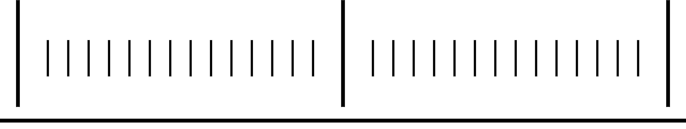

_explain_ the arithmetical facts & not itself be explained solely & exclusively by them, for that only makes it misleading, & it is unnecessary.

### [48r\[1\]](https://cdn.wittgensteinnachlass.com/2000px/webp/Ts-208/48r.webp)

This leads to the question: How do I see that one given number is smaller than another, say that 4 is smaller than 5, or 36 than 42? The relative magnitudes of the digits 0 to 9 have to be laid down. A rule determines the rest.

### [48r\[2\]](https://cdn.wittgensteinnachlass.com/2000px/webp/Ts-208/48r.webp)

I can, of course, define m greater than n as (∃x).n + x = m, but whether x = m ‒ n yields a number I know only if I know the rule of subtraction, and here that rule takes the place of the rule for determining greater and smaller. Put this way, the rule reads: m is greater than n if m ‒ n yields a number according to the rule of subtraction.

### [48r\[3\]](https://cdn.wittgensteinnachlass.com/2000px/webp/Ts-208/48r.webp)

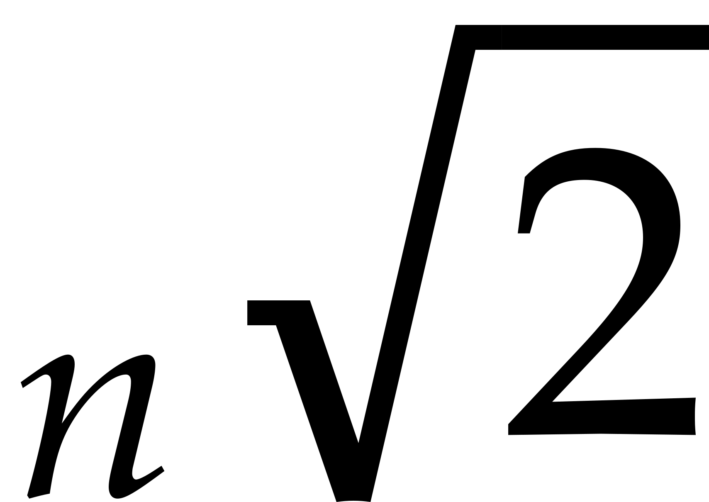 is what we must introduce first. This carries within it the infinite possibility of n.

### [48r\[4\]](https://cdn.wittgensteinnachlass.com/2000px/webp/Ts-208/48r.webp)

All proofs of the continuity of a function must refer to a ladder – a system of numerals.

### [48r\[5\]](https://cdn.wittgensteinnachlass.com/2000px/webp/Ts-208/48r.webp)

For if I say “for every n there is a d that makes the function smaller than n”, I must refer to a general arithmetical criterion that indicates when F(d) is smaller than n.

### [48r\[6\]](https://cdn.wittgensteinnachlass.com/2000px/webp/Ts-208/48r.webp)

It cannot be permissible for what essentially comes to light in calculating the function, namely the ladder of numbers, to disappear in the general treatment

### [48r\[7\]](https://cdn.wittgensteinnachlass.com/2000px/webp/Ts-208/48r.webp)

If the system of numerals belongs to the essence of number, then the general treatment cannot leave it out.

### [48r\[8\]](https://cdn.wittgensteinnachlass.com/2000px/webp/Ts-208/48r.webp)

And so if the notation of the system of numerals reflects the essence of number, then this essential feature must also enter into the general notation. The general notation thereby acquires the structure of the numbers.

### [48r\[9\]](https://cdn.wittgensteinnachlass.com/2000px/webp/Ts-208/48r.webp)

If I cannot, as a matter of essence, write down a number without a system of numerals, then this must show itself again (also) in the general treatment of number.

### [48r\[10\]](https://cdn.wittgensteinnachlass.com/2000px/webp/Ts-208/48r.webp)

The system of numerals is not something inferior – like a Russian abacus – that interests only primary-school pupils, while the higher, general treatment can disregard it.

### [48r\[11\]](https://cdn.wittgensteinnachlass.com/2000px/webp/Ts-208/48r.webp)

What is the proof of provability? It is different from the proof of the proposition. And is the proof of provability perhaps the proof that the proposition has sense? But then this proof would have to rest on _quite different_ principles from the proof of the proposition. There can be no hierarchy of proofs!

### [48r\[12\]](https://cdn.wittgensteinnachlass.com/2000px/webp/Ts-208/48r.webp),[48v\[1\]](https://cdn.wittgensteinnachlass.com/2000px/webp/Ts-208/48v.webp)

On the other hand there can be no metamathematics in any essential sense. Everything must lie in one type (or, then, in no type).

### [49r\[1\]](https://cdn.wittgensteinnachlass.com/2000px/webp/Ts-208/49r.webp)

Imagine the sentence: “For every triple of rational numerals that _I_ can try in 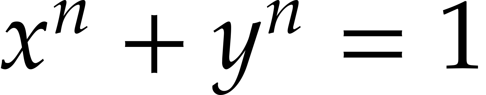, the equation comes out false”. That is a sentence with sense, and _it_ is confined to the finite.

### [49r\[2\]](https://cdn.wittgensteinnachlass.com/2000px/webp/Ts-208/49r.webp)

It is hard to free oneself entirely from the extensional conception: One keeps thinking: “Yes, but there must be an internal relation between x³ + y³ and z³, since the extension, if only I knew it, would have to constitute the result of such a relation”. Something like: “It must be that either _essentially all n_ have the property or not, since _all n_ do have the property or not, even if I cannot know it.”

### [49r\[3\]](https://cdn.wittgensteinnachlass.com/2000px/webp/Ts-208/49r.webp)

In teaching someone to take a step, one thereby gives him the possibility of walking any distance.

### [49r\[4\]](https://cdn.wittgensteinnachlass.com/2000px/webp/Ts-208/49r.webp)

Is it possible, then, to show that the basic rules are relevant to a proposition (i.e. prove it or its opposite) without actually carrying them through as far as the proposition itself? That is, do we know it only once we get there, or is it possible to know it earlier? And does the possibility of checking 36 × 47 = 128 prove this? It obviously makes sense to say: “I know how to check that” even before one has checked it.

### [48v\[2\]](https://cdn.wittgensteinnachlass.com/2000px/webp/Ts-208/48v.webp)

What does the proof of the provability of 36 × 47 = 128 consist in?

What am I prepared to accept as such a proof?

Presumably the induction that shows me one turn of the spiral.

What is the proof that in carrying out the division 1 : 3 = I will eventually reach the number 0˙33333 if this proof does not consist in the calculation itself? For mind: in the end the completed proof must after all also be accepted as proof that it can be carried out.

### [49r\[5\]](https://cdn.wittgensteinnachlass.com/2000px/webp/Ts-208/49r.webp)

One might also ask: How does that process go when we still have no idea how to prove a certain proposition and yet ask: “Can it be proved, or not” and look out for a proof of it? When we “try to prove it”, what are we doing? Is it essentially a search without any internal system, and so really _no search_, or can there be some plan? The answer to this question gives us a clue as to whether the proposition that is still unproved – or still unprovable – is senseless or not. For in a very significant sense every proposition that has sense must, by its sense, instruct us how to satisfy ourselves whether it is true or false. “Every proposition says what is the case if it is true.” And in a mathematical proposition this “what is the case” must relate to the way it is proved. By contrast, one cannot search in a logically planned way for the _sense_ one does not know. The sense would have to be revealed to one, as it were, and from outside at that – since it cannot be gleaned from the propositional sign alone – unlike the truth, which the proposition itself teaches us to look for and compare with it.

### [49r\[6\]](https://cdn.wittgensteinnachlass.com/2000px/webp/Ts-208/49r.webp)

This amounts to asking: Does the general mathematical proposition determine something, leaving only the Yes or No open? (Namely, precisely a sense).

### [49r\[7\]](https://cdn.wittgensteinnachlass.com/2000px/webp/Ts-208/49r.webp)

Where one can ask, one can also search, and where one cannot search, one cannot ask either. And of course one cannot answer either.

### [49r\[8\]](https://cdn.wittgensteinnachlass.com/2000px/webp/Ts-208/49r.webp)

My explanation must not do away with the mathematical problem. That is, it is not the case that a mathematical proposition is certain to have sense only once it (or its opposite) has been proved. (For in that case its opposite would never have sense (Weyl)) on the other hand, it might be that certain apparent problems lose the character of a problem – of a question to be answered Yes or No.

### [50r\[1\]](https://cdn.wittgensteinnachlass.com/2000px/webp/Ts-208/50r.webp)

Is it the case that I need a fresh intuition at each step of a proof? This is connected with the question of the individuality of numbers. It would go something like this: Given a certain general rule, in which, then, a variable occurs, I must recognize afresh every time that this rule can be applied _here_. No act of foresight can spare me this act of _insight_. For as a matter of fact the form to which the rule is applied is different at each step.

### [50r\[2\]](https://cdn.wittgensteinnachlass.com/2000px/webp/Ts-208/50r.webp)

The proof of relevance would be a proof that did not yet yield the proposition. – – – And that is precisely what might make such a proof possible. It would not climb the ladder, for _to do that one must_ take every step; it would only show that the ladder leads in this direction. That is: there is no substitute for going through every step, and whatever is equivalent to that must again have the same multiplicity. (In logic there is no substitute.) Nor is the arrow a substitute for going through all the steps to the specified destination. This too is connected with the impossibility of a hierarchy of proofs.

### [50r\[3\]](https://cdn.wittgensteinnachlass.com/2000px/webp/Ts-208/50r.webp)

Would not the idea of a hierarchy imply that a proof must precede the mere posing of the question, namely the proof of sense? But then, I say, the proof of sense must be of a radically different nature from the proof of truth, or else this proof in turn presupposes another and we get into an endless regress.

### [50r\[4\]](https://cdn.wittgensteinnachlass.com/2000px/webp/Ts-208/50r.webp)

Does the question of relevance have sense? If so, then one must always be able to say whether the basic laws are relevant to this proposition or not, and then it must always be possible to decide this question. But if this question can be decided, a question of the _first_ type has thereby already been decided. And if it cannot be decided, then it is altogether senseless.

### [50r\[5\]](https://cdn.wittgensteinnachlass.com/2000px/webp/Ts-208/50r.webp)

What prompts us, apart from Fermat’s alleged proof, to concern ourselves with the formula 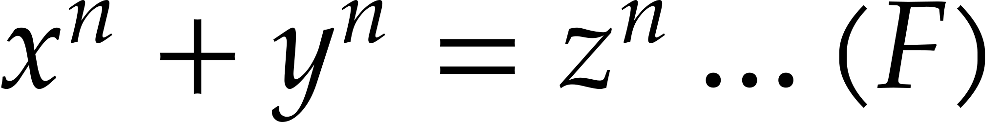 is the fact that one has never come across cardinal numbers satisfying the equation; but that gives the general proposition _no_ support (probability) whatsoever and is therefore no good reason to concern oneself with this formula.

### [50r\[6\]](https://cdn.wittgensteinnachlass.com/2000px/webp/Ts-208/50r.webp)

I said: Where one cannot search, one cannot ask either, and that means: Where there is no logical method of finding, the question cannot have sense either.

### [50r\[7\]](https://cdn.wittgensteinnachlass.com/2000px/webp/Ts-208/50r.webp)

Only where there is a method of solution is there a problem (that is, of course, not “only where the solution has been found is there a problem”). (This, again, only fixes the grammar of the word “problem”.)

### [50r\[8\]](https://cdn.wittgensteinnachlass.com/2000px/webp/Ts-208/50r.webp)

That is, where the solution can be expected only from some sort of revelation, there is no problem either. No question corresponds to a revelation.

### [50r\[9\]](https://cdn.wittgensteinnachlass.com/2000px/webp/Ts-208/50r.webp)

It is as if one wanted to ask about the experiences of a sense one does not yet have. Giving us a new sense is what I would call revelation.

### [51r\[1\]](https://cdn.wittgensteinnachlass.com/2000px/webp/Ts-208/51r.webp)

Nor can one _search_ for a new sense (sense perception) (grammar of the word “search”).

### [50v\[1\]](https://cdn.wittgensteinnachlass.com/2000px/webp/Ts-208/50v.webp)

How is 25 × 25 = 625 proved? How is its opposite proved? – This proposition can be checked according to a definite system. Am I now to imagine a similar check in the case of Fermat’s proposition?

### [50v\[2\]](https://cdn.wittgensteinnachlass.com/2000px/webp/Ts-208/50v.webp)

All this is connected with Dirichlet’s conception of a function, which treats the law as merely an incidental means of generating a correspondence.

### [50v\[3\]](https://cdn.wittgensteinnachlass.com/2000px/webp/Ts-208/50v.webp)

“N told me a number”

We say that the opposite of Fermat’s proposition can be proved by finding a particular triple of numbers. But the proposition itself can be proved not by failing to find such a triple but by a proof we do not know.

### [51r\[2\]](https://cdn.wittgensteinnachlass.com/2000px/webp/Ts-208/51r.webp)

The question comes up again: In what respect can one _assert_ a mathematical proposition? For _this_ would mean nothing: that I can assert it only when it is correct. – Rather, I must be able to assert it on the strength of its sense, not on the strength of its truth. It seems clear to me, as I have already said, that I can assert the general proposition just as much or as little as the equation 3 × 3 = 9 or even 3 × 3 = 11.

### [51r\[3\]](https://cdn.wittgensteinnachlass.com/2000px/webp/Ts-208/51r.webp)

It is almost incredible how completely a problem is blocked off for miles by the erroneous ways of speaking that generation after generation sets up all around it, so that it becomes almost impossible to get to it.

### [51r\[4\]](https://cdn.wittgensteinnachlass.com/2000px/webp/Ts-208/51r.webp)

What makes understanding difficult is the mistaken conception that the _general_ method of solution is merely an – incidental – aid to obtaining numbers that satisfy the equation. Whereas it in itself sheds light on the essence (the nature) of the equation. It is – again – not an incidental aid to finding an _extension_, but an end in itself.

### [51r\[5\]](https://cdn.wittgensteinnachlass.com/2000px/webp/Ts-208/51r.webp)

What questions can one ask about a form, e.g. Fx = Gx? – Is Fx = Gx (x as a general constant) or not? Do the rules lead to a solution of the equation x ‒ 1 = 0 (x as an unknown) or not? Do the rules prohibit the form Fx = Gx (x taken as an empty place) or not? _None_ of these cases may be open to empirical, that is, extensional checking.

### [51r\[6\]](https://cdn.wittgensteinnachlass.com/2000px/webp/Ts-208/51r.webp)

Not the last two either, for I see, for instance, that “x² = 4” is permitted from 7² = 4 no less than from 2² = 4, and 2² ≠ ‒ 4 shows me that x² = ‒ 4 is prohibited no differently from 8² ≠ ‒ 4. That is, here again it is only the rule that I see in the individual case.

### [51r\[7\]](https://cdn.wittgensteinnachlass.com/2000px/webp/Ts-208/51r.webp)

The question “Is the equation satisfied by any numbers” has no sense, just as the sentence “it is satisfied by numbers” has none, and of course neither does the assertion “it is satisfied by all numbers – or by no number”. (How do you find the answer? Then I shall know what the question meant.)

### [51r\[8\]](https://cdn.wittgensteinnachlass.com/2000px/webp/Ts-208/51r.webp)

The important thing is that even when I am given 3² + 4² = 5², I must _not_ say “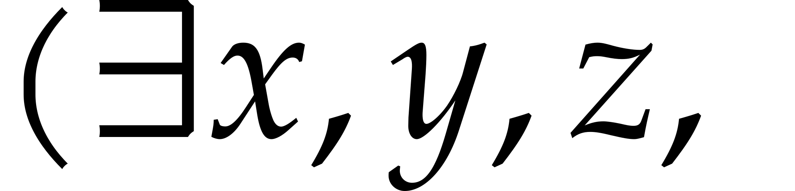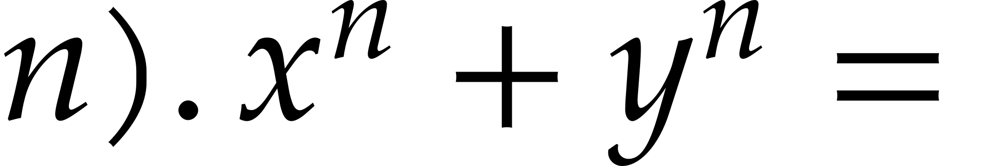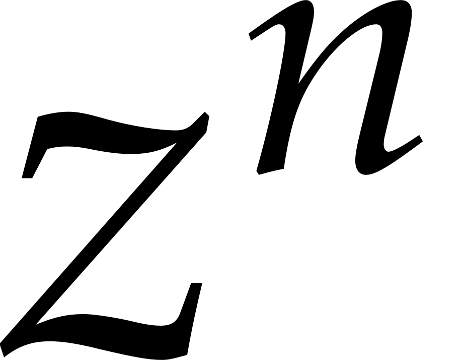”, for extensionally it means nothing and intensionally it is not thereby proved. Rather, I may then simply utter the first equation and no more.

### [51r\[9\]](https://cdn.wittgensteinnachlass.com/2000px/webp/Ts-208/51r.webp)

Clearly I can write down the general sentence (with the general constants) only where it is analogous to the sentence 25 × 25 = 625, and that is where I know the rules of calculation for a and b just as I know the rules of calculation for 6, 2, and 5. This illustrates exactly what it means for a and b to be constants here. Constant forms, namely.

### [51r\[10\]](https://cdn.wittgensteinnachlass.com/2000px/webp/Ts-208/51r.webp),[52r\[1\]](https://cdn.wittgensteinnachlass.com/2000px/webp/Ts-208/52r.webp)

Is it like this: I cannot apply the word “yields” as long as I know no method of solution, because _yields_ means a structure that I cannot designate without knowing it. Because the structure must be _represented_. I do not know the grammar of the word yields.

### [52r\[2\]](https://cdn.wittgensteinnachlass.com/2000px/webp/Ts-208/52r.webp)

Every proposition is an instruction for a verification.

### [52r\[3\]](https://cdn.wittgensteinnachlass.com/2000px/webp/Ts-208/52r.webp)

If I understand the word “yields” in an essentially intensional way, then the sentence “the equation G yields the solution a” means nothing as long as the word “yields” does not stand for a definite method. For that is precisely what I want to designate.

### [52r\[4\]](https://cdn.wittgensteinnachlass.com/2000px/webp/Ts-208/52r.webp)

What I have here is nothing but the old case: I cannot say that 2 complexes stand in a relation without depicting the relation logically.

### [52r\[5\]](https://cdn.wittgensteinnachlass.com/2000px/webp/Ts-208/52r.webp)

“The equation yields a” means that if I transform the equation according to certain rules, I obtain a, just as the equation 25 × 25 = 620 says that I obtain 620 if I apply the rules of multiplication to 25 × 25. But these rules must already be given to me before the word “yields” has meaning and before the question whether the equation yields a has sense.

### [52r\[6\]](https://cdn.wittgensteinnachlass.com/2000px/webp/Ts-208/52r.webp)

Fermat’s proposition thus has no _sense_ as long as I cannot _search_ for a solution of the equation in cardinal numbers. And “searching” must always mean: searching systematically. It is not searching if I wander about in infinite space looking for a gold ring.

### [52r\[7\]](https://cdn.wittgensteinnachlass.com/2000px/webp/Ts-208/52r.webp)

Our difficulty is largely due to the mistaken conception of the variable, namely the conception that it _stands for_ _numbers_ (the extensional conception), whereas it stands for nothing, but is what it is. If it stood for numbers, then of course only 5³ + 7³ = 9³ would need to have sense, and the sense of the general propositions about the form F would follow from that. But since the variable is autonomous, a proposition containing it has sense only when it can be checked according to its own principles, as a numerical equation can be checked according to its own. The word “variable” is to be replaced by the word “number-form”. And this form is just as constant as the number 4.

### [52r\[8\]](https://cdn.wittgensteinnachlass.com/2000px/webp/Ts-208/52r.webp)

So it is not enough to say p is provable; it must be: provable according to a definite system.

### [52r\[9\]](https://cdn.wittgensteinnachlass.com/2000px/webp/Ts-208/52r.webp)

And what the proposition asserts is not that p is provable according to the system S, but that it is provable according to _its_ system, the system of p. That p belongs to the system S cannot be asserted; it must show itself.

### [52r\[10\]](https://cdn.wittgensteinnachlass.com/2000px/webp/Ts-208/52r.webp),[52v\[1\]](https://cdn.wittgensteinnachlass.com/2000px/webp/Ts-208/52v.webp)

One cannot say p belongs to the system S; one cannot ask which system p belongs to; one cannot search for the system of p. To understand p is to understand its system. If p seemingly passes from one system to another, then in reality p has changed its sense.

### [53r\[1\]](https://cdn.wittgensteinnachlass.com/2000px/webp/Ts-208/53r.webp)

What is the series of divisions with compasses & straightedge? What is the series of binomial coefficients?

### [53r\[2\]](https://cdn.wittgensteinnachlass.com/2000px/webp/Ts-208/53r.webp)

I hardly need say that where the law of excluded middle does not hold, no other proposition of logic holds either, because there we are not dealing with propositions of mathematics. (By contrast, Weyl and Brouwer)

### [53r\[3\]](https://cdn.wittgensteinnachlass.com/2000px/webp/Ts-208/53r.webp)

Would not the paradox follow from all this that in mathematics there are no difficult problems, because what is difficult is not a problem? But it is not quite like that: the difficult problems in mathematics are those for whose solution we do not yet possess a _written_ system. The mathematician who is searching then has a system in some mental symbols, mental images, “in his head” and tries to get it down on paper. Once he has done that, the rest is easy. But if he has _no_ system, either in written or in unwritten symbols, then he cannot _search_ for a solution either, but at most grope about. – Now of course one can also find something by groping about aimlessly. But then one has not searched for it, and the procedure, viewed logically, was synthetic; whereas searching is an analytic process.

### [53r\[4\]](https://cdn.wittgensteinnachlass.com/2000px/webp/Ts-208/53r.webp)

What one can get hold of is a problem.

### [53r\[5\]](https://cdn.wittgensteinnachlass.com/2000px/webp/Ts-208/53r.webp)

Only where there can be a problem can something be asserted! (that is an explanation of the word “assert”)

### [53r\[6\]](https://cdn.wittgensteinnachlass.com/2000px/webp/Ts-208/53r.webp)

If I know the rules of elementary trigonometry, I can check the proposition sin 2x = 2sin x. cos x but not the proposition 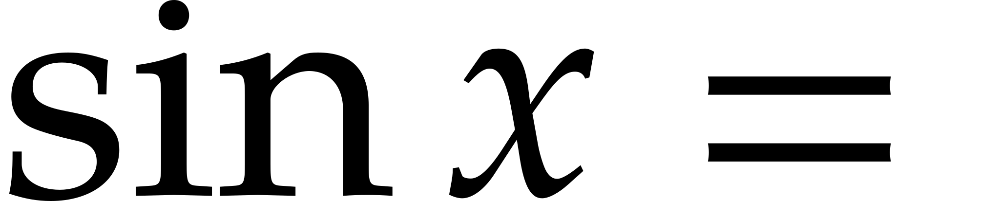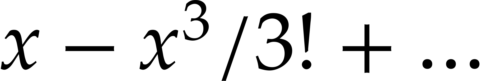. But this means that the sine of elementary trigonometry and that of higher trigonometry are _different_ concepts. There is, of course, a good reason for giving them the same name: the second concept includes the multiplicity of the first; but for the system of elementary trigonometry the second proposition has _no_ sense, and the question whether sin x = x ‒ etc. is of course senseless here too.

### [53r\[7\]](https://cdn.wittgensteinnachlass.com/2000px/webp/Ts-208/53r.webp)

The two propositions stand, as it were, on 2 different planes. On the first I can move as far as I like; I shall never reach the proposition of higher trigonometry.

### [53r\[8\]](https://cdn.wittgensteinnachlass.com/2000px/webp/Ts-208/53r.webp)

Now is it a proper question whether the trisection of the angle is possible? And what kind of proposition is it that trisection is not possible with compasses and straightedge, and what kind of proof does it have?

### [53r\[9\]](https://cdn.wittgensteinnachlass.com/2000px/webp/Ts-208/53r.webp)

One might say: Since it is not possible, one could never have searched for it either.

### [53r\[10\]](https://cdn.wittgensteinnachlass.com/2000px/webp/Ts-208/53r.webp)

As long as I do not _see_ the larger system that encompasses both, I cannot try to solve the higher problem.

### [53r\[11\]](https://cdn.wittgensteinnachlass.com/2000px/webp/Ts-208/53r.webp)

I can ask whether the angle can be trisected with straightedge and compasses only when I see the system “compasses and straightedge” embedded in a larger one in which the problem can be solved; or rather, in which the problem is a problem, in which this question has sense.

### [53v\[2\]](https://cdn.wittgensteinnachlass.com/2000px/webp/Ts-208/53v.webp)

Then I can also say: I can only ask whether the division 2 : 3 can be carried out in the system of cardinal numbers once I embed that system in a larger one, etc. There is a question about the possibility of division into 3 only in a system in which one can speak of both possibility and impossibility.

### [52v\[3\]](https://cdn.wittgensteinnachlass.com/2000px/webp/Ts-208/52v.webp)

What I mean is: in the smaller system I do not yet have any expression at all for “division into 3”, precisely because it is _impossible_ (for its impossibility consists in its being nonsensical to talk about division into 3 in this language).

### [52v\[4\]](https://cdn.wittgensteinnachlass.com/2000px/webp/Ts-208/52v.webp),[53v\[1\]](https://cdn.wittgensteinnachlass.com/2000px/webp/Ts-208/53v.webp),[53r\[2\]](https://cdn.wittgensteinnachlass.com/2000px/webp/Ts-208/53r.webp)

Here again it is worth noting what we call a proof, namely the proof of the impossibility of division into 3. What kind of _sentence_ is “division into 3 with compasses & straightedge is impossible”? Presumably the same kind as: In the _series_ of angle divisions F(n) there is no F(3), just as in the series of combination numbers there is no 4. But what kind of sentence is _this_?

The same kind as the sentence: In the series of cardinal numbers ½ does not occur. This is evidently a (rather superfluous) rule of a game, rather like this one: There is no king in draughts. No piece that one calls a “king”. And the question whether trisection is possible is then the question whether there is a trisection in the game, whether there is a piece in draughts that is called a king & plays perhaps a similar role to the king in chess. This question could, of course, be answered simply by a stipulation, but it would not set a problem, a task of calculation. It would thus have a different sense from one whose answer was: I shall work out whether there is such a thing. (For instance, I shall work out whether there is a number among 1, 7, 18, 25, that is divisible by 3.) Now is the question of the possibility of dividing the ∢ into 3 a question of this kind? Yes, in the case in which one has a general system in the calculus for calculating, say, whether division into n is possible.

Why does one call _this_ proof the proof of _this_ sentence? The sentence is not a name, after all; it always belongs to a system of language: If I can say “there is a division into 3”, I can say “there is a division into 4”, etc. etc. And if B is a proof of the first sentence (a part of its syntax), then there must be corresponding proofs for the other sentences of the system of sentences, for otherwise they do not belong to the same system.

### [54r\[1\]](https://cdn.wittgensteinnachlass.com/2000px/webp/Ts-208/54r.webp)

This also shows itself in the fact that one _must_ step outside the Euclidean system to prove the impossibility.

### [54r\[2\]](https://cdn.wittgensteinnachlass.com/2000px/webp/Ts-208/54r.webp)

A system is, so to speak, a world.

### [54r\[3\]](https://cdn.wittgensteinnachlass.com/2000px/webp/Ts-208/54r.webp)

So one cannot look for a system. But one can look for the expression for a system that is given to me in unwritten symbols.

### [54r\[4\]](https://cdn.wittgensteinnachlass.com/2000px/webp/Ts-208/54r.webp)

A pupil who had the tools of elementary trigonometry at his disposal and was asked to check the equation sin x = x would simply not find there what he needs to carry out this task. If the teacher nevertheless expects him to solve it, he assumes that the multiplicity of syntax presupposed by this solution is somehow present in another form in the pupil’s head. And in such a way that the pupil sees the symbolism of elementary trigonometry as a part of that unwritten symbolism and now translates the rest from unwritten into written symbolism.

### [54r\[5\]](https://cdn.wittgensteinnachlass.com/2000px/webp/Ts-208/54r.webp)

The system of rules that determine a calculus thereby also determines the “meaning” of its signs. To put it more accurately: The form and the syntactic rules are equivalent. So if I change the rules – if I seemingly supplement them, for instance – I change the form, the meaning.

### [54r\[6\]](https://cdn.wittgensteinnachlass.com/2000px/webp/Ts-208/54r.webp)

I cannot draw the limits of my world, but I can draw limits within my world. I cannot ask whether the sentence p belongs to the system S, but I can ask whether it belongs to the part s of S. So I can assign the problem of trisecting the angle its place in the larger system, but I cannot ask within the Euclidean system whether it is soluble. In what _language_ am I supposed to ask that? In the Euclidean language? – And just as little can I ask in the Euclidean language about the possibility of bisecting the angle in the Euclidean system. For in this language that would amount to a question about possibility as such, and that question is always nonsense.

### [54r\[7\]](https://cdn.wittgensteinnachlass.com/2000px/webp/Ts-208/54r.webp)

(But there is nothing here that we would be entitled to call a hierarchy of types.)

### [54r\[8\]](https://cdn.wittgensteinnachlass.com/2000px/webp/Ts-208/54r.webp)

In mathematics one cannot speak about systems in general, but only _in_ systems. They are precisely what one cannot speak about. And hence also what one cannot look for.

### [54r\[9\]](https://cdn.wittgensteinnachlass.com/2000px/webp/Ts-208/54r.webp)

The pupil who does not have the apparatus for answering the second question not only cannot answer it, but cannot understand it either. (This would be rather like the task the prince in the fairy tale sets the smith, to bring him a “Klamank”.)

### [54r\[10\]](https://cdn.wittgensteinnachlass.com/2000px/webp/Ts-208/54r.webp)

_Every_ legitimate proposition of mathematics must, like the proposition 12 × 13 = 137, set a ladder against its problem – which I can then climb if I want to. This holds of propositions of every kind of generality. (N.B. There is no ladder with “infinitely many” rungs.)

### [55r\[1\]](https://cdn.wittgensteinnachlass.com/2000px/webp/Ts-208/55r.webp)

One cannot assert that there is a process for arriving at the solution. For if there were no such process, the equation would be nonsensical as a general proposition. One can assert anything that can be checked by the act itself.

### [55r\[2\]](https://cdn.wittgensteinnachlass.com/2000px/webp/Ts-208/55r.webp)

It is the _possibility_ of checking that is at issue.

### [55r\[3\]](https://cdn.wittgensteinnachlass.com/2000px/webp/Ts-208/55r.webp)

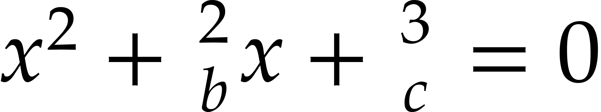, 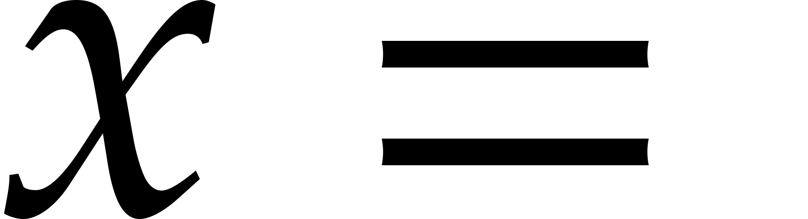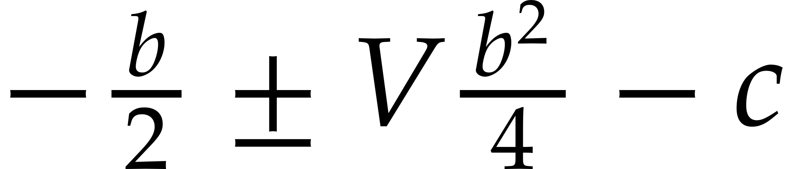 The two equations, written in this way, evidently give the _full_ answer to the question expressed in the first.

### [55r\[4\]](https://cdn.wittgensteinnachlass.com/2000px/webp/Ts-208/55r.webp)

If in logic a question can be answered 1.) generally and 2.) in the particular case, then the particular answer must always prove to be a special case of the general one; or, to put it differently: The general case must always already contain the particular as a possibility. One instance of this is the calculation of the limit with d and n, which must contain the number system of the particular calculation. It must be possible to translate the general and the particular form into one another in a definite way.

### [55r\[5\]](https://cdn.wittgensteinnachlass.com/2000px/webp/Ts-208/55r.webp)

If I write (∃x),x² = 2x and do not understand (∃x) extensionally, then all it can assert is: “If I apply the rules for solving it, I arrive at a definite number, as opposed to the case in which I arrive at an identity or a forbidden equation”.

### [55r\[6\]](https://cdn.wittgensteinnachlass.com/2000px/webp/Ts-208/55r.webp)

How does the purely technical verification of (x) : x² = 2x․⊃․x = 0․⌵․x = 2 go? I work out x from one equation, substitute the value everywhere, and must then obtain a true proposition.

### [55r\[7\]](https://cdn.wittgensteinnachlass.com/2000px/webp/Ts-208/55r.webp)

Does the mere transformation of “x² = 2x” then yield the sentence “x = 0․⌵․x = 2”?

### [55r\[8\]](https://cdn.wittgensteinnachlass.com/2000px/webp/Ts-208/55r.webp)

Does “x² = + 4” give “x = + 2․⌵․x = ‒ 2”? I.e. are the truth-functions necessary? Or again: Does transformation according to the rules yield the two equations joined together as “x = + 2․⌵․x = ‒ 2”?

### [55r\[9\]](https://cdn.wittgensteinnachlass.com/2000px/webp/Ts-208/55r.webp)

But what is the “(x)” doing in “(x):x² = 2x:⊃:x = 0․⌵․x = 2”? (It would be ridiculous to take it extensionally) Is it a general constant? That the proposition one gets by working it out is true can again be shown purely technically by rules of substitution. So here too x is a general constant.

### [55r\[10\]](https://cdn.wittgensteinnachlass.com/2000px/webp/Ts-208/55r.webp)

But what is the verification of (∃x).x² = 2x? I mean the specific verification of this proposition, as opposed to the verification of “(x):x² = 2x:⊃:x = 2․⌵․x = 0”. For must not the other proposition – i.e. the other sense – also be verified _differently_? The more general one, say, more generally.

### [55r\[11\]](https://cdn.wittgensteinnachlass.com/2000px/webp/Ts-208/55r.webp),[56r\[1\]](https://cdn.wittgensteinnachlass.com/2000px/webp/Ts-208/56r.webp)

I could sum up equations with numbers and equations with letters as follows: Transforming the left-hand side according to the rules yields the right-hand side, or it does not. But for this the two sides of the equation (N.B. the _general_ one) must be, so to speak, _commensurable_.

### [56r\[2\]](https://cdn.wittgensteinnachlass.com/2000px/webp/Ts-208/56r.webp)

From the fact that the numerical equation F(5) = G(3) has commensurable sides, it does not follow that F(a) = G(b) must have commensurable sides. For different rules of calculation apply to a and b than to 3 and 5.

### [56r\[3\]](https://cdn.wittgensteinnachlass.com/2000px/webp/Ts-208/56r.webp)

Philosophers and psychologists classify clouds according to their shape.

### [56r\[4\]](https://cdn.wittgensteinnachlass.com/2000px/webp/Ts-208/56r.webp)

A mathematical proposition always says what its proof proves. I.e. it never says more than its proof proves.

### [56r\[5\]](https://cdn.wittgensteinnachlass.com/2000px/webp/Ts-208/56r.webp)

If I had a method for separating equations that have a solution from those that do not, then the expression “(∃x).x² = 2x” would have sense with reference to that method.

### [56r\[6\]](https://cdn.wittgensteinnachlass.com/2000px/webp/Ts-208/56r.webp)

I can ask “what solution does the equation x² = 2x have”, but I cannot ask “does it have a solution”. For what would it look like if it did not have one? Only when I know what is the case if a proposition is false does it have a sense. – But what if that other case were, say, that of the equation “(∃x).x² ‒ 2x ‒ (x ‒ 2) = 0”? Then the proposition (∃x).x² = 2x would indeed have sense, and its proof would be that the rules do not allow the sides to be cancelled against each other. To the question “is there a solution to the equation 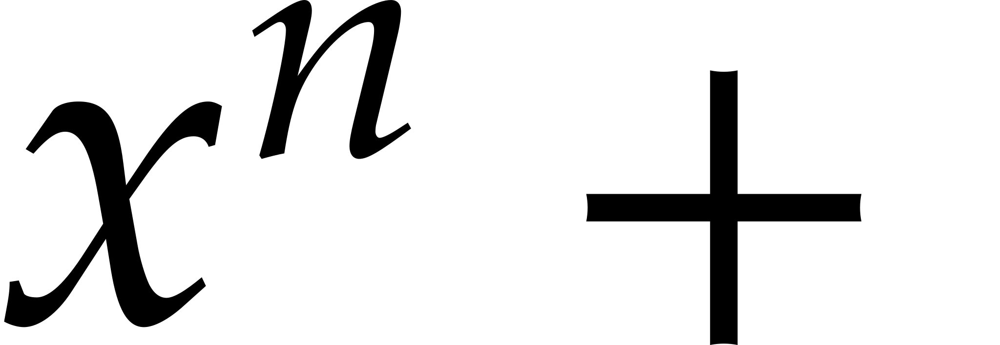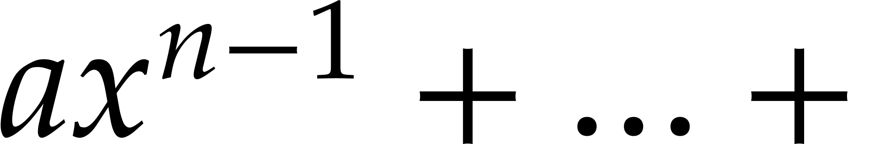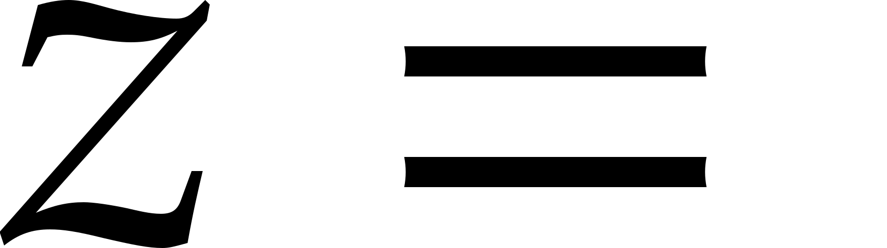?” one can always reply with the question “as opposed to what?”.

### [56r\[7\]](https://cdn.wittgensteinnachlass.com/2000px/webp/Ts-208/56r.webp)

25 × 25 = 625 What does the system that shows me commensurability consist in here? Presumably in the fact that multiplying two numbers written in this form according to the rule always gives me a number in the same form, and that a rule decides, for two numerals of this form, whether they designate the same number or different numbers.

### [56r\[8\]](https://cdn.wittgensteinnachlass.com/2000px/webp/Ts-208/56r.webp)

One could also characterize this conception as follows: It is impossible to discover rules of a new kind that apply to a form we know. If they are new rules, it is not the old form. The structure of rules must be _complete_ if we want to work with a concept at all. – _One cannot make discoveries in syntax._ – For it is the group of rules that _determines_ the sense of our signs, and any change (e.g. supplementation) of the rules means a change of sense. Just as one cannot change the marks of a concept without changing _it_. (Frege).

### [56r\[9\]](https://cdn.wittgensteinnachlass.com/2000px/webp/Ts-208/56r.webp)

A system is a series of forms, and the iterations that successively generate its members are described in the rules themselves.

### [56r\[10\]](https://cdn.wittgensteinnachlass.com/2000px/webp/Ts-208/56r.webp),[57r\[1\]](https://cdn.wittgensteinnachlass.com/2000px/webp/Ts-208/57r.webp)

The opposite of “it is necessary that p hold for all numbers” is indeed “it is not necessary that …” and not “it is necessary that not …”. But now one thinks: If it is not _necessary_ that it hold for all numbers, it is possible all the same. But this is where the error lies, for one does not see that one has slipped into the extensional conception: The sentence “it is possible – even if not necessary – that p hold for all numbers” is nonsensical. For “_necessary_” and “_all_” belong together in mathematics (so long as one does not replace this way of speaking altogether with a less misleading one.)

### [57r\[2\]](https://cdn.wittgensteinnachlass.com/2000px/webp/Ts-208/57r.webp)

What can (x).x² ≠ ‒ 1 mean? Surely it cannot say that all squares are unequal to ‒ 1.

### [57r\[3\]](https://cdn.wittgensteinnachlass.com/2000px/webp/Ts-208/57r.webp)

One could also ask: How am I to express the _description_ “the solution of the equation x² = 2x” in mathematical symbols?

### [57r\[4\]](https://cdn.wittgensteinnachlass.com/2000px/webp/Ts-208/57r.webp)

My difficulty is this: When I solve equations according to the rules in the domain of real numbers, rational numbers, or integers, in certain cases I arrive at apparent nonsense. Now if this happens; am I to say that this proves that the original equation was nonsensical? So that only after I had finished applying the rules could I see whether it was nonsensical or had sense?! Should one not rather put it like this: The result of the apparently nonsensical equation does show something about the general form and does indeed connect the forbidden equation with ones that have a normal solution. The solution always shows how far the abnormal solution is from the normal one. If, e.g., 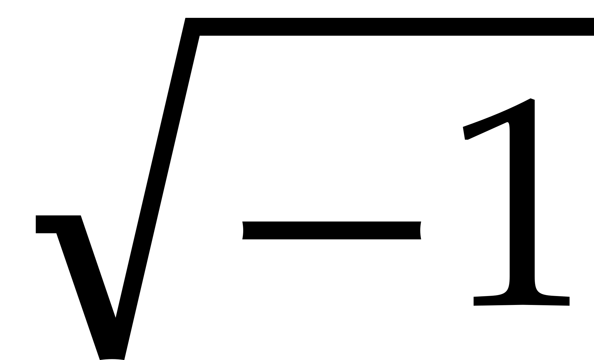 is the result, I know that  ÷ 1 would already be a normal root. The continuity, the connection with the normal solution, is not broken. Would that mean that the concept of imaginary numbers is already presupposed in the concept of real numbers as we represent it by our symbolism and its rules? That would be rather like saying of the straight line g that it falls short of intersecting the circle by a, instead of simply saying that it does not intersect it. One could say “it fails to intersect it by a certain amount” and would thereby represent its continuity with normal intersection. “It misses it by a definite amount”.

### [57r\[5\]](https://cdn.wittgensteinnachlass.com/2000px/webp/Ts-208/57r.webp)

There is no number outside a system.

### [57r\[6\]](https://cdn.wittgensteinnachlass.com/2000px/webp/Ts-208/57r.webp)

“a + (b + c) = (a + b) + c” …A(c) can be regarded as a fundamental rule of a system; as such one can only prescribe it, not _assert_ or deny it (so no law of excluded middle). Yet it seems that I can also regard the proposition as the result of a proof. Has this proof answered a question, and which one? Has it proved an assertion true and hence its opposite false? But now it seems that I cannot prove the proposition at all in the sense in which it is a fundamental rule of a system. Rather, I prove something _about_ it.

### [57r\[7\]](https://cdn.wittgensteinnachlass.com/2000px/webp/Ts-208/57r.webp)

And indeed, all I _prove_ from A(c) is A(c + 1), and this, to be sure, is of great importance for the application of the proposition. But the proof does not encompass the application either.

### [57r\[8\]](https://cdn.wittgensteinnachlass.com/2000px/webp/Ts-208/57r.webp),[58r\[1\]](https://cdn.wittgensteinnachlass.com/2000px/webp/Ts-208/58r.webp)

Ramsey thought that what I call recognizing the system is nothing more than the – perhaps unconscious – application of a general mathematical proposition. Thus, if I know that the question whether sin 3x = 5 cos x is correct is decidable, on Ramsey’s account I infer this merely from the law for sin x + y etc. But that is not true: I infer it from the fact that there is such a law, not from what it says.

### [58r\[2\]](https://cdn.wittgensteinnachlass.com/2000px/webp/Ts-208/58r.webp)

We must not confuse the infinite possibility of application with what is actually proved. The infinite possibility of application is _not_ proved!

### [58r\[3\]](https://cdn.wittgensteinnachlass.com/2000px/webp/Ts-208/58r.webp)

What is striking about proof by recursion is above all that what it purports to prove is not what comes out of it.

### [58r\[4\]](https://cdn.wittgensteinnachlass.com/2000px/webp/Ts-208/58r.webp)

The proof shows that from the form 1) “A(c)”, by means of the rule 2) “A(1)”, the form “A(c + 1)” follows. Or, what amounts to the same thing, the form “a + (b + (c + 1))” can be transformed into “(a + b) + (c + 1)” with the help of rules 1) and 2).

That is the whole reality of the proof. Everything else and the whole usual interpretation lie in the possibility of its application. And the usual error, in confusing the extension of its application with what it actually contains.

### [58r\[5\]](https://cdn.wittgensteinnachlass.com/2000px/webp/Ts-208/58r.webp)

Of course I cannot deny a definition. It is a rule I can proceed by.

### [58r\[6\]](https://cdn.wittgensteinnachlass.com/2000px/webp/Ts-208/58r.webp)

I cannot negate the fundamental rules of a system – except as a consequence of those very rules.

### [58r\[7\]](https://cdn.wittgensteinnachlass.com/2000px/webp/Ts-208/58r.webp)

Cardinal numbers are a form given in reality by things, just as rational numbers are given by extensions, etc. I mean, by real forms. So complex numbers are given by real multiplicities. (The symbols are real, after all.)

### [58r\[8\]](https://cdn.wittgensteinnachlass.com/2000px/webp/Ts-208/58r.webp)

Can one regard the commutative law as a definition? I think so, because order plays no role in _working out_ the sum. We cannot, e.g., add up 5 + 6 and then 6 + 5 and then see whether the same thing comes out. It is different with the associative law, on the other hand.

### [58r\[9\]](https://cdn.wittgensteinnachlass.com/2000px/webp/Ts-208/58r.webp)

The “c” in Skolem’s proof has as yet no meaning _in_ the proof; it stands for 1 or whatever else may emerge from the proof, and _after_ the proof we are entitled to take it as any number. But surely it must already have meant something in the proof. If 1, why did we not write “1” instead of “c”? And if something else, what?

### [58r\[10\]](https://cdn.wittgensteinnachlass.com/2000px/webp/Ts-208/58r.webp),[58v\[1\]](https://cdn.wittgensteinnachlass.com/2000px/webp/Ts-208/58v.webp)

What should interest us in the proof is not its concluding proposition at all, but that it follows from rules 1) and 2), and further that this proposition contains rule 1) as a special case.

### [59r\[1\]](https://cdn.wittgensteinnachlass.com/2000px/webp/Ts-208/59r.webp)

Now suppose I want to apply the proposition to 5, 6, 7; the proof tells me that I am certainly entitled to do so. For if I write these numerals in the form ((1 + 1) + 1) etc., I can recognize that the proposition is a member of that series of propositions which the last proposition in Skolem’s chain of proof represents for me. This recognition, again, is not something that can be proved, but is intuitive.

### [59r\[2\]](https://cdn.wittgensteinnachlass.com/2000px/webp/Ts-208/59r.webp)

“Every symbol is what it is and not another symbol”.

### [59r\[3\]](https://cdn.wittgensteinnachlass.com/2000px/webp/Ts-208/59r.webp)

Can there be no proof that merely shows that every multiplication in the decimal system according to the rules must yield a number in the decimal system? (So that recognizing the same system would after all rest on recognizing the truth of a mathematical proposition.)

### [59r\[4\]](https://cdn.wittgensteinnachlass.com/2000px/webp/Ts-208/59r.webp)

It would have to be analogous to a proof that adding forms ((1 + 1) + 1) etc. always produces numerals of this form again. Now can one prove that? The proof evidently lies in the rule for adding such expressions, i.e. in the definition and in nothing else. After all, to the question this proof is supposed to answer one could also say: Well, what _is_ the addition supposed to yield?

### [59r\[5\]](https://cdn.wittgensteinnachlass.com/2000px/webp/Ts-208/59r.webp)

A recursive proof is only a general instruction directing one to any particular proof. A signpost that directs all propositions of a certain form home along a certain path. It says to the proposition ↖2 + (3 + 4) = (2 + 3) + 4: “Go in _this_ direction (follow this spiral) and you’ll get home.”

### [59r\[6\]](https://cdn.wittgensteinnachlass.com/2000px/webp/Ts-208/59r.webp)

In what sense, then, can one call such an instruction for proofs the proof of a general proposition? (Is that not like asking “in what sense can one call a signpost a path”?) Yet it does justify applying A(c) to numbers. Must there not, after all, be a legitimate transition from the proof schema to this expression?

### [59r\[7\]](https://cdn.wittgensteinnachlass.com/2000px/webp/Ts-208/59r.webp)

I know a proof with endless possibility, which, e.g., starts with “A(1)” and goes on through “A(2)” etc. etc. The recursive proof is the general form of progression in this series. But it must itself prove something, after all, for it actually saves me the proof of each proposition of the form “A(7)”. But how could it have proved this proposition? Evidently it points along that series of proofs.

### [59r\[8\]](https://cdn.wittgensteinnachlass.com/2000px/webp/Ts-208/59r.webp)

a + (b + (x + d)) = (a + (b + x)) + d = ((a + b) + x) + d = (a + b) + (x + d)

a + (b + ((x + d) + d)) = (a + (b + (x + d))) + d = ((a + b) + (x + d)) + d = (a + b) + ((x + d) + d)

This is a piece of the spiral taken from the middle. x keeps the place open for what only comes into being as the spiral is developed.

### [58v\[2\]](https://cdn.wittgensteinnachlass.com/2000px/webp/Ts-208/58v.webp)

The general proof proves A(7) only in so far as, put together with A(7), it is its proof. A(7) simply had to be added & the rest is only what the proof of A(7) has in common with that of A(6) etc.

### [59r\[9\]](https://cdn.wittgensteinnachlass.com/2000px/webp/Ts-208/59r.webp),[60r\[1\]](https://cdn.wittgensteinnachlass.com/2000px/webp/Ts-208/60r.webp)

When I look at this series, I may be struck by its kinship with the definition A(1); by the fact that, if I substitute “1” for “c” and “1” for “d”, the two systems become the same.

### [60r\[2\]](https://cdn.wittgensteinnachlass.com/2000px/webp/Ts-208/60r.webp)

In any case, in the proof what is to be proved is not the end of the _chain of equations_.

### [60r\[3\]](https://cdn.wittgensteinnachlass.com/2000px/webp/Ts-208/60r.webp)

The proof shows the spiral form of the law. But not by yielding it as the result of the chain of inferences.

### [60r\[4\]](https://cdn.wittgensteinnachlass.com/2000px/webp/Ts-208/60r.webp)

We can also quite well imagine the proof carried out in an informal manner with 1, and with perhaps a few dots after it to indicate what we are to look at. It would not be essentially less rigorous (for here what is different about the proof becomes still clearer). Let us imagine it like that. _How_ does it then justify the proposition A(c)?

### [60r\[5\]](https://cdn.wittgensteinnachlass.com/2000px/webp/Ts-208/60r.webp)

If one regards the proof as being of the same kind as the derivation of (x + y)² = x² + 2xy + y², then it proves the proposition “A(c + 1)” (on the assumption of “A(c)”, i.e. the very proposition I wanted to prove). And it justifies – on this assumption – special cases such as 3 + (5 + (4 + 1)) = (3 + 5) + (4 + 1). It too has a generality, but not the one we want. This generality is not confined to the letters, however; it lies just as much in definite numbers, and consists in the fact that one can repeat the proof.

### [60r\[6\]](https://cdn.wittgensteinnachlass.com/2000px/webp/Ts-208/60r.webp)

But how can I indicate by the sign “F(a)” what I see in the transition from F(1) to F(2)? (Namely the possibility of repetition.)

### [60r\[7\]](https://cdn.wittgensteinnachlass.com/2000px/webp/Ts-208/60r.webp)

Nor can I prove that a + (b + 1) = (a + b) + 1 is a special case of a + (b + c) = (a + b) + c; I have to see it. [No rule can help me here either, for once again I have to know what counts as a special case of the general rule]

### [60r\[8\]](https://cdn.wittgensteinnachlass.com/2000px/webp/Ts-208/60r.webp)

That is the unbridgeable gap between rule and application, or between law and special case.

### [60r\[9\]](https://cdn.wittgensteinnachlass.com/2000px/webp/Ts-208/60r.webp)

A(c) is a definition, a rule for algebraic calculation. It is _chosen_ so that this calculation accords with numerical calculation. It permits the same transition in algebraic calculation as holds for cardinal numbers, as the recursive proof shows. So A(c) is not the result of this proof, but runs, as it were, parallel to it. What we take from that proof cannot be represented in a sentence at all, and for that very reason it cannot, of course, be denied either.

### [61r\[1\]](https://cdn.wittgensteinnachlass.com/2000px/webp/Ts-208/61r.webp)

But what about a definition like A(1). This is not meant as a rule for algebraic calculation, but as an aid to explaining arithmetical expressions. It represents an _operation_ that I _can_ apply to any pair of numbers whatsoever.

### [61r\[2\]](https://cdn.wittgensteinnachlass.com/2000px/webp/Ts-208/61r.webp)

The correct expression of the associative law is not a sentence but precisely its “proof”, which, to be sure, does not assert the law but shows it. And here it becomes clear that one cannot deny this law, since it does not occur in the form of a sentence at all. One could of course deny the individual equations in the proof, but that would not deny the law. The law _escapes_ affirmation and denial.

### [61r\[3\]](https://cdn.wittgensteinnachlass.com/2000px/webp/Ts-208/61r.webp)

If the equation x² + 2x + 2 = 0 yields x = ‒ 1 ±  according to the rules of algebra, that is quite all right as long as we do not want the rules for x to accord with the rules for the real numbers. In that case the result of the algebraic calculation means that the equation has no solution.

### [61r\[4\]](https://cdn.wittgensteinnachlass.com/2000px/webp/Ts-208/61r.webp)

If the proof that every equation has a root is a recursive proof, then that means that the fundamental theorem of algebra is not a mathematical _proposition_ proper.

### [61r\[5\]](https://cdn.wittgensteinnachlass.com/2000px/webp/Ts-208/61r.webp)

To know that one can prove something is to have proved it.

### [61r\[6\]](https://cdn.wittgensteinnachlass.com/2000px/webp/Ts-208/61r.webp)

7 + (8 + 9) = (7 + 8) + 9 How do I know that this is so without having proved it separately? And do I know it _just as well_ as if I had derived it in full? Yes! – Then it really has been proved. And in that case it cannot be proved any _better_, say by carrying the derivation right through to this proposition itself. So after going through one turn of the spiral I must be able to say “stop! I don’t need any more, I can already see how it goes on”, and any further ascent would then have to be simply superfluous and not make the matter any clearer after all. So if I draw all the turns of the spiral up to my point, I cannot see any better that it leads there than if I draw just _one_ turn. But is that so? I believe it is. It is just that both show the same thing in different forms. I can, so to speak, follow the fully drawn spiral unthinkingly and arrive at my point, whereas I have to interpret the _one_ turn I have drawn in a particular way to gather from it that, if extended, it leads to point A. That is: I can gather the same thing from the proof for 6 + (7 + 8) = (6 + 7) + 8 worked out in full as from the one that describes only one “turn”, only in a different way. And in any case the _one_ turn _together with the forms of the numbers_ in the given equation is a complete proof of that equation. It is as if I said: “You want to get to point A? Yes, _that_ point you can reach with _this_ spiral.”

### [61r\[7\]](https://cdn.wittgensteinnachlass.com/2000px/webp/Ts-208/61r.webp)

Let us not forget that physical language, too, describes only the primary world, not some hypothetical world. The hypothesis is merely an assumption about the most practical way of representing it.

### [62r\[1\]](https://cdn.wittgensteinnachlass.com/2000px/webp/Ts-208/62r.webp)

Suppose I had so good a memory that I could remember all my sense impressions. Then there is nothing to prevent me from describing them. That would be the description of a life. And why should I not be able to leave everything hypothetical out of this description?

### [62r\[2\]](https://cdn.wittgensteinnachlass.com/2000px/webp/Ts-208/62r.webp)

I could, for example, represent the visual images in three dimensions, perhaps on a reduced scale, with plaster figures that I would model only to the extent that I had actually seen them, marking the rest as inessential by a particular colouring or way of modelling it, say.

### [62r\[3\]](https://cdn.wittgensteinnachlass.com/2000px/webp/Ts-208/62r.webp)

So far everything would go perfectly well. But what about the time I need for this representation? I assume that I could “write” this language – produce the representation – as fast as my memory runs. But suppose I then read through the description again: is it not now hypothetical after all?

### [62r\[4\]](https://cdn.wittgensteinnachlass.com/2000px/webp/Ts-208/62r.webp)

Let us imagine a representation of this sort: the bodies I seem to see are moved by a mechanism in such a way that they would have to give two eyes set at a particular place in the model the visual images to be represented. The visual image described is then determined by the position of the eyes in the model and by the position and movement of the bodies. One could imagine operating the mechanism by turning a crank, for instance, and thereby “reading off” the description.

### [61v\[1\]](https://cdn.wittgensteinnachlass.com/2000px/webp/Ts-208/61v.webp)

Let us imagine the following representation of our immediate sense experience: instead of describing it in words, we construct a model that reproduces it. As an approximation we could also imagine representing it in an animated film. We then read the description by projecting it onto the screen for ourselves.

### [62r\[5\]](https://cdn.wittgensteinnachlass.com/2000px/webp/Ts-208/62r.webp)

Is it not clear that this would be the most immediate description imaginable? That is, that anything purporting to be still more immediate would have to cease to be a description?

### [62r\[6\]](https://cdn.wittgensteinnachlass.com/2000px/webp/Ts-208/62r.webp)

What would come out then, instead of a description, would be that inarticulate sound with which some authors would like to begin philosophy. (“I consciously have something, knowing of my knowledge”). One simply cannot begin before the beginning.

### [62r\[7\]](https://cdn.wittgensteinnachlass.com/2000px/webp/Ts-208/62r.webp)

Language itself belongs to the second system. When I describe a language, what I am describing is essentially something physical. But how can a physical language describe the phenomenon?

### [62r\[8\]](https://cdn.wittgensteinnachlass.com/2000px/webp/Ts-208/62r.webp)

Is it not like this: the phenomenon (specious present) contains time, but is not in time? Its form is time, but it has no place in time.

### [62r\[9\]](https://cdn.wittgensteinnachlass.com/2000px/webp/Ts-208/62r.webp)

Whereas language unfolds in time.

### [62r\[10\]](https://cdn.wittgensteinnachlass.com/2000px/webp/Ts-208/62r.webp)

What we understand by the word “language” unfolds in homogeneous physical time. (As the comparison with a mechanism makes perfectly clear.)

### [63r\[1\]](https://cdn.wittgensteinnachlass.com/2000px/webp/Ts-208/63r.webp)

Only what corresponds to this mechanism in the primary world could be the primary language.

### [63r\[2\]](https://cdn.wittgensteinnachlass.com/2000px/webp/Ts-208/63r.webp)

Suppose the world consisted of an unchanging visual field; would it not then be possible to describe it? For example: in the centre of a red visual field there is a blue circular patch. Although here too what goes on when the sentence is read cannot be described in the sentence. But what importance can this description of the present phenomenon have? It seems as though occupying ourselves with this question were downright childish and we had got into a dead end. And yet it is a significant dead end, for everyone is tempted to go down it, as if that were where the ultimate solution to the philosophical problem was to be sought. It is as if, with phenomenological language, I were entering an enchanted swamp where everything one can grasp vanishes.

### [63r\[3\]](https://cdn.wittgensteinnachlass.com/2000px/webp/Ts-208/63r.webp)

On the other hand it is clear that we need a way of expressing ourselves in which we can represent the phenomena of visual space in isolation, as such. “I see a lamp standing on the table”, as it has to be understood in our ordinary language, says more than the description of visual space. A correct description would indeed be: “It seems to me as if I saw a lamp standing on a table” But this form of expression is misleading, because it makes it appear that nothing real is being described, but rather something that is by its nature unclear. Whereas all that “it seems” says is that something is being described as a special case of a general rule, and the only uncertainty is whether further events will admit of description as special cases of the same rule. There seems to be a sine curve on the film, of which we see separate stretches. That is, what we see can be described by means of a sine curve on the film and certain interruptions of the beam of light. A concentric circle seems to have been drawn around the circle K, and a, b, c, d, e, f seem to have been drawn as tangents to it.

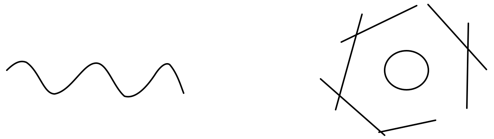

### [63r\[4\]](https://cdn.wittgensteinnachlass.com/2000px/webp/Ts-208/63r.webp)

It might, for example, on some occasion be practical to give my hands and other people’s hands proper names, so as not always to have to speak, when talking about them, of their relation to a person, which is inessential to the hands themselves, and because the ordinary way of speaking might give the impression that the relation to the owner of a hand is something that lies in the nature of the hand itself.

### [63r\[5\]](https://cdn.wittgensteinnachlass.com/2000px/webp/Ts-208/63r.webp)

Visual space is essentially without an owner.

### [63r\[6\]](https://cdn.wittgensteinnachlass.com/2000px/webp/Ts-208/63r.webp),[63v\[1\]](https://cdn.wittgensteinnachlass.com/2000px/webp/Ts-208/63v.webp),[63v\[2\]](https://cdn.wittgensteinnachlass.com/2000px/webp/Ts-208/63v.webp),[64r\[1\]](https://cdn.wittgensteinnachlass.com/2000px/webp/Ts-208/64r.webp)

Suppose now that I always see a particular object along with all the others in visual space – namely my nose. Another person naturally does not see this object in the same way. Does that not mean, after all, that the visual space I am talking about _belongs to me_? That it is therefore subjective. No. It has merely been conceived subjectively here and set in opposition to an objective space, which, however, is only a construction with visual space as its basis. In the – secondary – language of “objective” – physical – space, visual space is called subjective, or rather, what corresponds directly to visual space in that language is called subjective. As if one were to say: in the language of the real numbers, what corresponds directly in their realm to the cardinal numbers is called the “positive integers”.

### [63v\[2\]](https://cdn.wittgensteinnachlass.com/2000px/webp/Ts-208/63v.webp)

Let us imagine that we usually saw lengths divided into equal parts by tick marks & then used the words greater & lesser length in two senses.

### [64r\[2\]](https://cdn.wittgensteinnachlass.com/2000px/webp/Ts-208/64r.webp)

In the model described earlier, the two eyes that see the objects, or their location, need not be indicated. That is just _one_ way of representing it. It works just as well, for example, if the part of the objects that is “seen” is marked with paint. Of course, one can always determine the position of two eyes from the boundaries of the painted area, but that corresponds only to translating one way of expressing oneself into another.

### [64r\[3\]](https://cdn.wittgensteinnachlass.com/2000px/webp/Ts-208/64r.webp)

The essential thing is that the representation of visual space represents an object and contains no hint of a subject.

### [64r\[4\]](https://cdn.wittgensteinnachlass.com/2000px/webp/Ts-208/64r.webp)

Suppose every part of my body could be removed except for one eyeball; it would be fixed somewhere so that it could not move, and would retain the ability to see. How would the world appear to me? I could not perceive any part of myself, and assuming that my eyeball was transparent to me, I could not see myself in a mirror either. Now one question is: could I locate myself by means of my visual image? To locate myself here means, of course, only to establish a particular structure of visual space.

### [64r\[5\]](https://cdn.wittgensteinnachlass.com/2000px/webp/Ts-208/64r.webp)

Now does anything compel me to interpret the tree I see through my window as larger than the window? If I have a sense of how far away the objects in front of my eye are, then that is a warranted interpretation. But even then it is a representation in a space other than visual space, for what corresponds to the tree in visual space is clearly smaller than what corresponds to the window. Or must I say: yes, that simply depends on how one applies the words “larger” and “smaller”.

### [64r\[6\]](https://cdn.wittgensteinnachlass.com/2000px/webp/Ts-208/64r.webp)

And that is how it is: I can use the words “larger” and “smaller” in both ways in visual space. And in one sense the visual tree is smaller than the visual window, in the other it is larger.

### [64r\[7\]](https://cdn.wittgensteinnachlass.com/2000px/webp/Ts-208/64r.webp),[64v\[1\]](https://cdn.wittgensteinnachlass.com/2000px/webp/Ts-208/64v.webp)

Suppose my eyeball were fixed here behind the window, so that I would see most of what I see through the window. Then this window could take over the role of a part of my body. What is close to the window is close to me. (I assume that I see three-dimensionally with one eye). I also assume that I can see my eyeball in the mirror and that I perceive similar eyeballs, say, on the trees outside. Now how can I recognize, or come to assume, that I see the world through the pupil of my eyeball? Surely in much the same way as I come to assume that I see it through the window, or through a hole in a board just in front of my eye, say.

### [64v\[2\]](https://cdn.wittgensteinnachlass.com/2000px/webp/Ts-208/64v.webp)

In which visual space is there any such incompleteness that I could say: I do not yet see the whole space; I must turn round. Visual space is complete.

### [65r\[1\]](https://cdn.wittgensteinnachlass.com/2000px/webp/Ts-208/65r.webp)

Indeed, if my eye sat freely at the tip of a branch, one could make its position quite clear to me by bringing a ring closer and closer until at last I saw everything through it. Indeed, one could also bring up what used to surround my eye: the cheekbone arch, nose, etc., and I would know where everything belongs.

### [65r\[2\]](https://cdn.wittgensteinnachlass.com/2000px/webp/Ts-208/65r.webp)

But does all this mean that the visual image does, after all, essentially contain or presuppose a subject? Or is it not rather that those experiments give me only purely geometrical information. That is, information that once again concerns only the object. Objective information about reality.

### [65r\[3\]](https://cdn.wittgensteinnachlass.com/2000px/webp/Ts-208/65r.webp)

In visual space there is not one eye that belongs to me and other eyes that belong to others. Only the space itself is asymmetrical; the objects in it are on an equal footing. In physical space, however, this is represented by singling out one of the eyes that occupy positions of equal standing and calling it _my_ eye.

### [65r\[4\]](https://cdn.wittgensteinnachlass.com/2000px/webp/Ts-208/65r.webp)

I want to know what is going on behind me and turn round. If I were prevented from doing so, would I not still have the image of space extending all around me? Certainly. And the image that I get to see the objects that are now behind me by turning round. _So_ it is the possibility of turning round that gives me that image of space. The resulting space around me is thus a mixture of visual space and _space of muscular feeling_.

### [65r\[5\]](https://cdn.wittgensteinnachlass.com/2000px/webp/Ts-208/65r.webp)

Without the feeling of being able to “turn round”, my image of space would be _essentially_ different.

### [65r\[6\]](https://cdn.wittgensteinnachlass.com/2000px/webp/Ts-208/65r.webp)

Thus the freely mounted, immobile eye would have no image of a space surrounding it.

### [65r\[7\]](https://cdn.wittgensteinnachlass.com/2000px/webp/Ts-208/65r.webp)

Immediate experience cannot contain a contradiction. If it is beyond all saying and gainsaying, then no need for explanation can arise either, no feeling that it must be possible to explain what happens because otherwise something would not be right.

### [65r\[8\]](https://cdn.wittgensteinnachlass.com/2000px/webp/Ts-208/65r.webp)

What happens, then, when one closes one’s eyes: one does not stop seeing, after all. But what one sees here surely contains no relation to an eye. And it is the same with a dream image. But even in normal seeing it is clear that the exceptional position of my body in visual space derives only from other feelings localized in my body and not from anything purely visual.

### [65r\[9\]](https://cdn.wittgensteinnachlass.com/2000px/webp/Ts-208/65r.webp)

With our language we are, so to speak, not in the realm of the projected image, but in the realm of the film. And if I want to make music to accompany what goes on on the screen, what produces the music must in turn take place in the sphere of the film.

### [66r\[1\]](https://cdn.wittgensteinnachlass.com/2000px/webp/Ts-208/66r.webp)

The very word “visual space” is unsuitable for our purpose, for it contains an allusion to a sense organ, which is no more essential to the space than belonging to a particular person is essential to a book; and it could be very misleading if our language were so arranged that we could not designate a book in it except by its relation to an owner. It could lead to the view that a book can exist only in relation to a person.

### [66r\[2\]](https://cdn.wittgensteinnachlass.com/2000px/webp/Ts-208/66r.webp)

Now if phenomenological language isolates visual space and what goes on in it from everything else, what does it do with time? Is the time of “visual” phenomena the time of our ordinary physical way of speaking?

### [66r\[3\]](https://cdn.wittgensteinnachlass.com/2000px/webp/Ts-208/66r.webp)

It is clear that we can recognize intervals of time as equal. For example, I could imagine what goes on in visual space being accompanied by the ticking of a metronome or by a light flashing at equal intervals. For simplicity’s sake, I imagine the changes in my visual space occurring in jerks and, say, coinciding with the beats of the metronome. I can then give a description of what goes on (in which the beats are designated by numbers).

### [66r\[4\]](https://cdn.wittgensteinnachlass.com/2000px/webp/Ts-208/66r.webp)

Suppose this description is a prediction and is now to be verified. Say I know it by heart and now compare it with what actually happens. Here everything hypothetical has been avoided except what lies in the assumption that the description is given to me independently of whatever part of it is present to me at that moment. The whole thing is a talking film, and the spoken word that goes along with what happens on the screen is just as fleeting as those events, and is not the same thing as the sound strip. The sound strip does not accompany the action on the screen.

### [66r\[5\]](https://cdn.wittgensteinnachlass.com/2000px/webp/Ts-208/66r.webp)

Now does it make sense to say that a goblin might after all have deceived me, and that what I took for the description was not the description at all but a mistake of memory? No, that cannot make sense. A mistake that _cannot_ in principle be discovered is not a mistake. And this means nothing other than that in this case the time of my memory is precisely the time I am describing. It is not the same as time as ordinarily conceived: for that there are all sorts of sources, such as other people’s accounts etc. But here too the point is to isolate the one time.

### [66r\[6\]](https://cdn.wittgensteinnachlass.com/2000px/webp/Ts-208/66r.webp)

If a black, a red and a yellow liquid flow through three tubes, one through each, and come together at one point to form a brown liquid, the resulting liquid then has a state of flow of its own. But all I want to say is that each of the single-coloured liquids has a state of flow too, and I want to examine it where the three have not yet flowed together.

### [66r\[7\]](https://cdn.wittgensteinnachlass.com/2000px/webp/Ts-208/66r.webp)

Of course, the word “present” is out of place here too. For in what sense can one say that reality is present? Surely only if one embeds it, once again, in a time foreign to it. In and of itself it is not present. On the contrary, it contains a time.

### [67r\[1\]](https://cdn.wittgensteinnachlass.com/2000px/webp/Ts-208/67r.webp)

It is clear that in the theory of cardinal numbers as Frege and Russell develop it, one can replace all functions from the outset with pseudo-functions such as “x = a․⌵․x = b․⌵․x = c etc.” For one cannot do without these in that theory anyway. They actually represent extensions, as it were “magazines” or “fillings” that one slips into the sentence at the right place when one needs the extension in it. The proposition 2 + 2 = 4 holds for this filling.

### [67r\[2\]](https://cdn.wittgensteinnachlass.com/2000px/webp/Ts-208/67r.webp)

When I write the sentence “(∃x,y,z)․F( ) & (∃x,y).G( ) & Ind.⊃․(∃x,y,z,u,v)․ .F( ) ․⌵․G( )”, to write out the extension of the bracket on the right correctly I have to write it in two parts that correspond 1-1 to the two extensions on the left. So here (and of course it is the same in the simpler case) I first get the sentence (∃3x).Fx․ & ․(∃2x). Gx & Ind.⊃․(∃3 + 2 x).Fx․⌵․Gx.

### [67r\[3\]](https://cdn.wittgensteinnachlass.com/2000px/webp/Ts-208/67r.webp)

(∃2x). Fx & (∃2x). Gx & Ind.⊃․(∃4x). Fx⌵.Gx …A This sentence does not – of course – say that 2 + 2 = 4; rather, the fact that the expression is a tautology shows it. F and G must be unintegrated variables.

### [67r\[4\]](https://cdn.wittgensteinnachlass.com/2000px/webp/Ts-208/67r.webp)

If I have two objects, then of course I can bring them under one heading, at least hypothetically, but what is characteristic of the extension of a concept is the class, and the concept that embraces it was only a makeshift, an excuse.

### [67r\[5\]](https://cdn.wittgensteinnachlass.com/2000px/webp/Ts-208/67r.webp)

If there is a mistake in sentence A, I can find and correct it only by comparing the extensions in the brackets. Or I add the two numbers on the left and write the result in the bracket on the right. In any case I have to write down the sum somehow.

### [67r\[6\]](https://cdn.wittgensteinnachlass.com/2000px/webp/Ts-208/67r.webp)

In our ordinary language, admittedly, every specification of number is a statement about a concept, i.e. about a predicate, but I believe that all sorts of different logical structures disguise themselves in this predicate form, and that only an artificial mode of representation can make it look as if we were dealing with concepts here.

### [67r\[7\]](https://cdn.wittgensteinnachlass.com/2000px/webp/Ts-208/67r.webp)

Not even a certain generality is essential to a specification of number. If, for instance, I say “I see 3 circles of equal size arranged at equal intervals”. If I give a correct description of the visual field in which there are 3 red circles on a blue background, the expression “(∃x,y,z):x is circular and red and y is circular and red etc. etc.” will certainly not occur in it.

### [67r\[8\]](https://cdn.wittgensteinnachlass.com/2000px/webp/Ts-208/67r.webp)

What is characteristic is that in the sentential form F(n) I must be able to substitute one number after another for _n_, and each time the sentence must acquire a sense completely determined by this substitution alone.

### [67r\[9\]](https://cdn.wittgensteinnachlass.com/2000px/webp/Ts-208/67r.webp),[68r\[1\]](https://cdn.wittgensteinnachlass.com/2000px/webp/Ts-208/68r.webp)

Of course one could write it like this: There are 3 circles that have the property of being red. But here the distinction comes to light between objects in the improper sense, patches of colour in the visual field, sounds, etc., and the elements of cognition, objects proper. It is striking that the sentence about the 3 circles does not have the generality, or indeterminacy, of a sentence of the form (∃x,y,z)․Fx & Fy & Fz. For in this case one can say: I do know that 3 things have the property F, but I do not know _which_ ones. In the case of the three circles one cannot say that. “There are now 3 red circles of such-and-such a size and in such-and-such positions in a visual field” completely determines the fact, and it would be nonsensical to say that I do not yet know _which_ circles they are.

### [68r\[2\]](https://cdn.wittgensteinnachlass.com/2000px/webp/Ts-208/68r.webp)

Let us think of “objects” such as: a lightning strike, the simultaneous occurrence of two events, the points of intersection of a straight line with a circle, etc. The 3 circles in the visual field are an example for all these cases.

### [68r\[3\]](https://cdn.wittgensteinnachlass.com/2000px/webp/Ts-208/68r.webp)

One can of course take the subject–predicate form, or, what amounts to the same thing, the argument–function form, as a norm of representation; and then it is indeed important and characteristic that whenever we apply numbers, the number can be represented as a property of a predicate. Only we must be clear that what we are dealing with now is not objects and concepts as the results of a decomposition, but norms into which we have forced the sentence. And it is significant, of course, that it could be made to conform to this norm. But forcing something into a norm is the opposite of analysis. Just as, to study the natural growth of an apple tree, one does not look at an espaliered tree, except to see how _this_ tree behaves under _this_ constraint.

### [68r\[4\]](https://cdn.wittgensteinnachlass.com/2000px/webp/Ts-208/68r.webp)

That would mean that Frege’s theory of number would be applicable as long as we did not intend to analyse the sentences. This theory explains the concept of number as it figures in the form of expression of ordinary language. Frege would indeed have said (I recall a conversation) that the coincidence of a lunar eclipse and a court hearing was an object. And what objection is there to that? Only that we are then using the word “object” ambiguously and so confusing the results of logical analysis.

### [68r\[5\]](https://cdn.wittgensteinnachlass.com/2000px/webp/Ts-208/68r.webp)

Russell’s theory of addition is this: If two objects fall under one concept and two other objects under another concept, then in consequence 4 objects fall under the sum of the two concepts. Here I say: “Then 2 + 2 objects fall under the sum of the concepts”. And 2 + 2 is 4, or 4 equals 2 + 2, whether or not I am dealing with the sum of two concepts. I mean: 4 objects already contain within themselves the possibility of being separated into 2 and 2, whether or not that separation is effected by the boundaries of certain concepts.

### [68r\[6\]](https://cdn.wittgensteinnachlass.com/2000px/webp/Ts-208/68r.webp)

I see 3 circles in definite positions; I close my eyes, open them again and see 3 circles of the same size as before in different positions. Does it make sense to ask whether they are the same ones, and which is which? Certainly not. But now, _while_ I see them, I can identify them. (Even if they move before my eyes, I can identify the circles in new positions with those in their earlier positions.) If I give them proper names and close my eyes and open them again and see that the circles are in the same positions, I can give each its name again. (One can carry through the same train of thought if they have changed places by moving.) In any case I am always naming (directly or indirectly) a _place_.

### [69r\[1\]](https://cdn.wittgensteinnachlass.com/2000px/webp/Ts-208/69r.webp)

If I say “there are 4 people in this room”, a disjunction does seem to enter in, since it is not said _which_ people. But that is quite inessential. We could imagine that all people were alike apart from the place where they are (so that what we were dealing with in their case was humanity at a particular point in space), and then all indeterminacy would disappear.

### [69r\[2\]](https://cdn.wittgensteinnachlass.com/2000px/webp/Ts-208/69r.webp)

Of the things a, b, c, d, 3 have the property F. That can be expressed by the disjunction. Evidently another case where a specification of number does not refer to a concept (although one can make it look as though it does by means of the “ = ”.)

### [69r\[3\]](https://cdn.wittgensteinnachlass.com/2000px/webp/Ts-208/69r.webp)

If I say: If there are 4 apples on the table, then there are 2 + 2 apples on it, this means only that with the 4 apples the possibility of grouping them into two and two is already given, and I need not wait for them actually to be grouped by means of a concept. This “_possibility_” concerns the sense, not the truth, of a sentence. 2 + 2 = 4 can mean “wherever I have 4 objects, there is the possibility of grouping them into two and two”.

### [69r\[4\]](https://cdn.wittgensteinnachlass.com/2000px/webp/Ts-208/69r.webp)

If one writes (∃∣∣∣∣∣) etc. & (∃∣∣∣∣∣∣∣) etc. ․⊃․ (∃∣∣∣∣∣∣∣∣∣∣∣∣) etc., one may wonder how I got the number sign in the bracket on the right, if one does not know that it was arrived at by adding the two number signs on the left. I believe this makes it clear that this expression represents only an application of 5 + 7 = 12, not the equation itself.

### [69r\[5\]](https://cdn.wittgensteinnachlass.com/2000px/webp/Ts-208/69r.webp)

If one asks: But what, then, does “5 + 7 = 12” mean – what sense or purpose is left for this expression – the answer is: This equation is a rule for signs that specifies which sign results when one applies a particular operation (addition) to 2 other particular signs. The content of 5 + 7 = 12 is (if one did not know it) exactly what gives children trouble when they learn this sentence in arithmetic lessons.

### [69r\[6\]](https://cdn.wittgensteinnachlass.com/2000px/webp/Ts-208/69r.webp)

One can disregard the particular character of sentence A altogether and attend simply to the relation, the relationship, between the number signs in it. This shows that this relationship holds independently of this sentence. That is, independently of the other features of its structure that make it a tautology.

### [69r\[7\]](https://cdn.wittgensteinnachlass.com/2000px/webp/Ts-208/69r.webp)

For when I consider it as a tautology I am, after all, perceiving only properties of its structure, and I can now perceive the addition theorem _in_ them without attending to other characteristics essential to the sentence.

### [69r\[8\]](https://cdn.wittgensteinnachlass.com/2000px/webp/Ts-208/69r.webp),[70r\[1\]](https://cdn.wittgensteinnachlass.com/2000px/webp/Ts-208/70r.webp)

So the addition theorem can be discerned in it (among other things), not _through_ it. This consideration would of course be nonsensical if what was at issue here were the _sense_ of a sentence rather than the structural workings of a tautology.

### [70r\[2\]](https://cdn.wittgensteinnachlass.com/2000px/webp/Ts-208/70r.webp)

One might reply: What I perceive in the sign A and call the relationship between the number signs is again nothing but the grouping together of extensions of concepts: I combine the first 5 strokes in the bracket on the right, which stand in a 1-1 relation to the 5 in one bracket on the left, and the next 7 strokes in the bracket on the right, which stand in a 1-1 relation to the 7 in the other bracket on the left, into 12 strokes that do either the one or the other. But even if I went through this process of thought, the fundamental insight would still be that the 5 strokes and the 7 combine to make _exactly_ 12 (thus giving, for instance, the same structure as 4 and 4 and 4). – What teaches us this is always just insight into the internal relationship between the structures, not any sentence or consideration of logic. And for this insight everything about the tautology apart from the number structures is incidental; these alone matter for the arithmetical sentence. (Everything else belongs to the _application_ of the arithmetical sentence.)

### [70r\[3\]](https://cdn.wittgensteinnachlass.com/2000px/webp/Ts-208/70r.webp)

So what I mean to say is: the arithmetical part is not what prompts us to put 5 and 7 together, but the process and what comes out of it.

### [70r\[4\]](https://cdn.wittgensteinnachlass.com/2000px/webp/Ts-208/70r.webp)

Suppose I wrote down sentence A but put the wrong number of strokes in the bracket on the right: one could and would discover this mistake only by comparing the structures, not by applying logical theorems.

### [70r\[5\]](https://cdn.wittgensteinnachlass.com/2000px/webp/Ts-208/70r.webp)

Indeed, if one asks: How do you know that this particular number of strokes in the bracket on the right is the correct one, I can justify it only by comparing the structures.

### [70r\[6\]](https://cdn.wittgensteinnachlass.com/2000px/webp/Ts-208/70r.webp)

It would turn out, then, that what Frege called the “peppernut standpoint” in arithmetic could after all be justified.

### [70r\[7\]](https://cdn.wittgensteinnachlass.com/2000px/webp/Ts-208/70r.webp)

And now too – I believe – the relationship between the extensional conception of classes and the conception of number as a feature of a logical structure becomes clear: An extension is a characterization of the sense of a sentence.

### [70r\[8\]](https://cdn.wittgensteinnachlass.com/2000px/webp/Ts-208/70r.webp)

Now if the transition in A were the only application of this arithmetical schema, could one not, or would one not have to, replace it, or define it, by the tautology itself?

### [70r\[9\]](https://cdn.wittgensteinnachlass.com/2000px/webp/Ts-208/70r.webp)

I.e.: What if A were the most general form of application of the arithmetical schema?

### [70r\[10\]](https://cdn.wittgensteinnachlass.com/2000px/webp/Ts-208/70r.webp),[70v\[1\]](https://cdn.wittgensteinnachlass.com/2000px/webp/Ts-208/70v.webp)

If A were the only application of the schema – that is, _essentially_ the only one – then the schema could, of its own accord, mean nothing other than the tautology itself.

### [71r\[1\]](https://cdn.wittgensteinnachlass.com/2000px/webp/Ts-208/71r.webp)

Or: then the schema itself would have to be the tautology, and the tautology nothing other than the schema.

### [71r\[2\]](https://cdn.wittgensteinnachlass.com/2000px/webp/Ts-208/71r.webp)

Then one could no longer say that A was an application of the schema; rather, A would be the schema, only, as it were, not the tool alone but the tool with its handle, without which it cannot be used anyway.

### [71r\[3\]](https://cdn.wittgensteinnachlass.com/2000px/webp/Ts-208/71r.webp)

What A contains apart from the schema can then be only what is necessary for the application of the arithmetical schema. But nothing at all is necessary, for we can perfectly well understand and apply arithmetical sentences without any addition to them. Above all, though, this does not require the formation of a tautology, as we can see very well in that tautology itself, for otherwise, to recognize it as a tautology, we would have to recognize yet another as a tautology, and so on.

### [70v\[2\]](https://cdn.wittgensteinnachlass.com/2000px/webp/Ts-208/70v.webp)

That we can carry out the calculus with strokes without a tautology shows that we do not need tautologies for it. Everything that does not belong to the numerical calculus is incidental.

### [70v\[3\]](https://cdn.wittgensteinnachlass.com/2000px/webp/Ts-208/70v.webp)

3 + 2 = 5 must be part of the calculus of the tautology too.

### [71r\[4\]](https://cdn.wittgensteinnachlass.com/2000px/webp/Ts-208/71r.webp)

Arithmetical sentences, like multiplication tables and the like, or like definitions that do not have whole sentences on either side, are for _application_ to sentences. And there is nothing else I can apply them to anyway. (So I do not first need any description of their application.]

### [71r\[5\]](https://cdn.wittgensteinnachlass.com/2000px/webp/Ts-208/71r.webp)

No investigation of concepts, only direct insight into the numerical calculus, can show that 3 + 2 = 5. This is what makes us balk at the assumption that A could be the sentence 3 + 2 = 5. For what enables us to recognize this expression as a tautology cannot itself result from a consideration of concepts, but must be immediately visible.

### [71r\[6\]](https://cdn.wittgensteinnachlass.com/2000px/webp/Ts-208/71r.webp)

And when we say that numbers are structures, we mean that they must always be of the same kind as what we use to represent them.

### [71r\[7\]](https://cdn.wittgensteinnachlass.com/2000px/webp/Ts-208/71r.webp)

I mean: Numbers are what I represent in my language by means of the number schemata. I.e. I take the number schemata of language (so to speak) as what is familiar to me, and say: Numbers are what these represent. This corresponds to what I meant at the time when I said: Numbers enter logic with the calculus.

### [70v\[4\]](https://cdn.wittgensteinnachlass.com/2000px/webp/Ts-208/70v.webp)

Instead of a definition of number, what I am concerned with is the grammar of number words.

### [71r\[8\]](https://cdn.wittgensteinnachlass.com/2000px/webp/Ts-208/71r.webp),[71v\[1\]](https://cdn.wittgensteinnachlass.com/2000px/webp/Ts-208/71v.webp)

Where there is any need at all for an explanation of a phenomenon of measurement in visual space, i.e. the possibility of an explanation, there it can also be given, then, and without contradictions.

### [71v\[2\]](https://cdn.wittgensteinnachlass.com/2000px/webp/Ts-208/71v.webp)

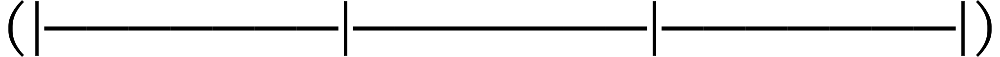

Do infinitely many sentences follow here from one sentence?

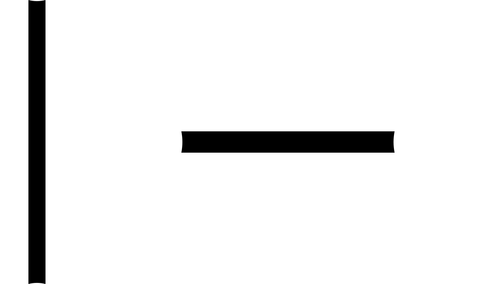

### [72r\[1\]](https://cdn.wittgensteinnachlass.com/2000px/webp/Ts-208/72r.webp)

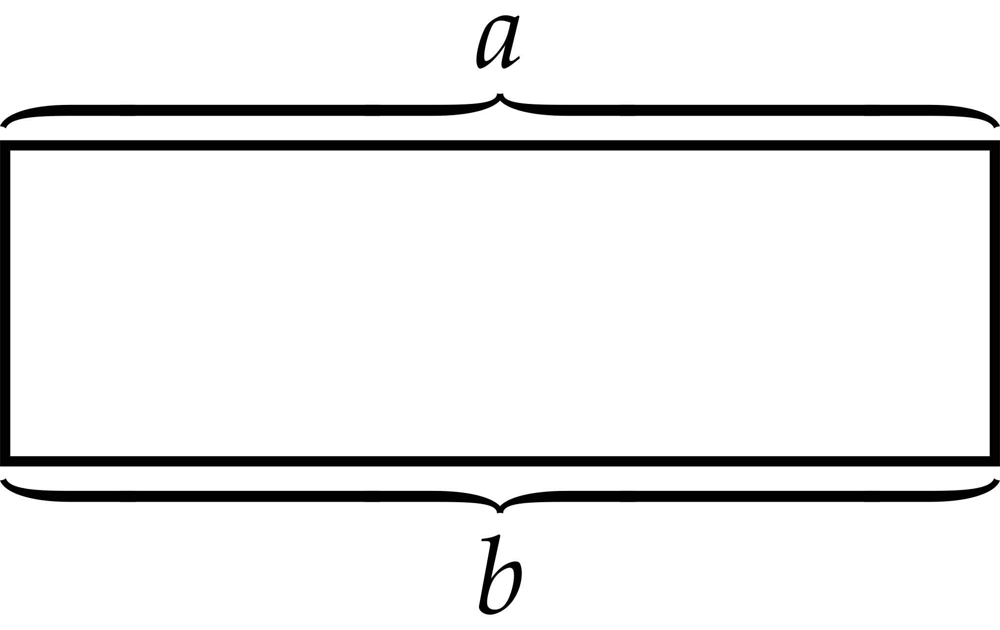

Does “b is white” follow from “a is white”? No, for “b is white” has sense only if b is given by colour boundaries.

### [72r\[2\]](https://cdn.wittgensteinnachlass.com/2000px/webp/Ts-208/72r.webp)

What if one applies a yardstick _temporarily_ to an object in visual space? Is it measured even when the yardstick is not there? Yes, if the identity of what is measured with what is not measured can be established with any sense at all.

### [72r\[3\]](https://cdn.wittgensteinnachlass.com/2000px/webp/Ts-208/72r.webp)

_If_ I can say: “_This_ segment I _did_ measure and it was three times as long as _that_ one”, then it makes sense and is correct to say that the segments still stand in the same ratio to one another now.

### [72r\[4\]](https://cdn.wittgensteinnachlass.com/2000px/webp/Ts-208/72r.webp)

A❘

B❘

C❘

C❘

B❘

A❘ From “CC between BB” follows “CC between AA”, but only if the division is actually given by colour boundaries.

### [72r\[5\]](https://cdn.wittgensteinnachlass.com/2000px/webp/Ts-208/72r.webp)

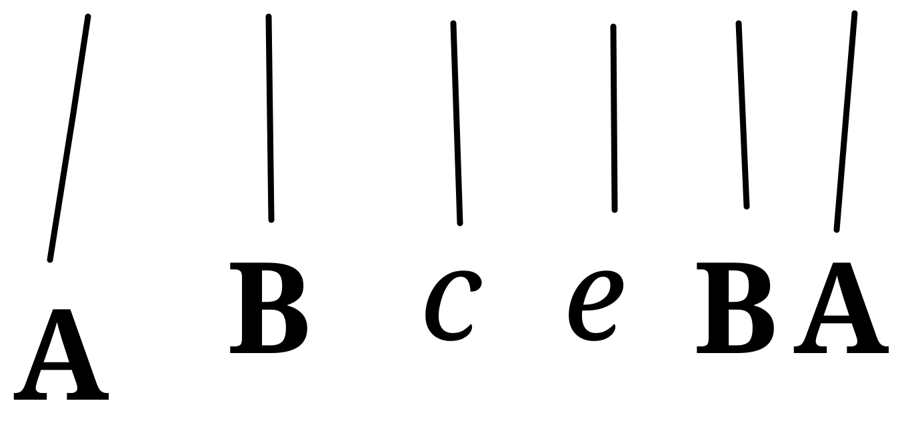

It is evidently possible for the segments a and b to appear equally long to me, and for the pieces c and d also to appear equally long to me, but for counting them to show that I have 25 c and 24 d. Here we have the question: How can that be possible? Is it right to say here: That is just how it is, and all we see is that visual space does not follow the rules of – say – Euclidean space. That would mean that the question “how can that be possible” was nonsensical and hence unwarranted. So there would be nothing paradoxical in this at all; we would simply have to accept it. – But is it _conceivable_ that a should appear equal to b and the c’s equal to the d’s, and that there should be unequal, _surveyable_ numbers of c’s and d’s? Or am I now to say that even in visual space something can after all _appear_ otherwise than it _is_? Certainly not! Or that n times a segment and n + 1 times the same segment can simply yield the same thing in visual space? No, not that either! Unless there is no sense at all in saying of segments in _visual space_ that they _are_ equal. So that it would make sense to speak of an “appearing” even for visual space alone, and this expression would not concern only the relation between two independent experiences. So that there would be an _absolute_ appearing. And so perhaps also an _absolute_ blurriness, or an _absolute_ lack of clarity. (Whereas my view is that something can be blurry or unclear only in comparison with something we set up as the goal of clarity; that is, relatively.)

### [72r\[6\]](https://cdn.wittgensteinnachlass.com/2000px/webp/Ts-208/72r.webp),[72v\[1\]](https://cdn.wittgensteinnachlass.com/2000px/webp/Ts-208/72v.webp),[72v\[2\]](https://cdn.wittgensteinnachlass.com/2000px/webp/Ts-208/72v.webp),[73r\[1\]](https://cdn.wittgensteinnachlass.com/2000px/webp/Ts-208/73r.webp)

But then – in the first case – if I cannot grasp the number “at a glance”, can I not go wrong in determining it? Or: do a and b then consist of a number of parts at all – in the ordinary sense – if I do not _see_ this number in a and b? For it seems to me that I am indeed not entitled either, for instance, to _infer_ that there must be the same number of c’s and d’s. Not even if counting really does give the same number! I mean: not even if it _never_ happens that, with a and b equal, etc., counting gives different results. (This shows, incidentally, _how_ hard it is to describe what is actually seen.) But suppose we were entitled to speak of a number of parts – mind, always within what is purely seen – even if we do not see the number immediately; then the question would arise: Can I be certain that what I count really is the number I see, or rather, the number whose visual result I see. Could I be certain that the number of parts does not at some moment change from 24 to 25 without my perceiving it? What would verify that??

### [73r\[2\]](https://cdn.wittgensteinnachlass.com/2000px/webp/Ts-208/73r.webp)

If I see a = b and c = d and someone else counts the parts and finds the same number, I will certainly not feel that this contradicts what I see. But I also know that I can see the same thing when there are 25 c in a and 24 d in b. From this I can infer that I do not notice one part more or less, and so cannot notice when the number of parts in b changes between 24 and 25.

### [73r\[3\]](https://cdn.wittgensteinnachlass.com/2000px/webp/Ts-208/73r.webp)

But if one cannot say that there is a definite number of parts in a and b, how am I to describe the visual image? What emerges here – I believe – is that the visual image is much more complicated than it seems at first sight. What makes it so much more complicated is, for instance, the factor produced by the movement of the eye. If, for instance, I were to describe what is seen at a glance by means of a painted picture rather than by means of word-language, I would have to refrain from actually painting all the parts c and d. Instead, in some places I would have to paint something “blurry”, a grey patch, say.

### [73r\[4\]](https://cdn.wittgensteinnachlass.com/2000px/webp/Ts-208/73r.webp)

“Blurry” and “unclear” are relative expressions. If it often does not seem so, that is because we are still too little aware of the actual character of the given phenomena, because we imagine them to be more primitive than they are. Thus it is possible, for instance, that no picture in colour, of whatever kind, can correctly represent the impression of “blurriness”. But it does not follow from this that the visual image is in itself blurry and therefore cannot be represented by any determinate picture, of whatever kind. It would only indicate that – through the movement of the eyes, say – a factor enters into the visual field which the painted picture indeed cannot reproduce, but which is in itself as “determinate” as any other. One could then say that what is actually given is still indeterminate or blurry relative to the painted picture, but only because we then arbitrarily set up the painted picture as the standard for what is given, which has a greater multiplicity than the pictorial representation.

### [72v\[2\]](https://cdn.wittgensteinnachlass.com/2000px/webp/Ts-208/72v.webp)

What are “blurry” & “determinate” supposed to mean here?

### [73r\[5\]](https://cdn.wittgensteinnachlass.com/2000px/webp/Ts-208/73r.webp)

If we really _saw_ 24 and 25 parts in a and b, then we could not see a and b as equal. If this is false, then the following must be possible. It would have to be possible to distinguish immediately between the cases where a and b are both equal to 24 and where a is 24 and b is 25, but it would be possible to distinguish only the numbers of parts, not the resulting length of a and b.

### [73r\[6\]](https://cdn.wittgensteinnachlass.com/2000px/webp/Ts-208/73r.webp)

One could also put it more simply like this: It would then have to be possible to see immediately that one segment consists of 24 parts, the other of 25 parts of the same size, without its being possible to distinguish between the resulting lengths. – I believe that the word “equal” has a meaning in visual space too that makes this a contradiction.

### [73r\[7\]](https://cdn.wittgensteinnachlass.com/2000px/webp/Ts-208/73r.webp),[73v\[1\]](https://cdn.wittgensteinnachlass.com/2000px/webp/Ts-208/73v.webp),[73v\[2\]](https://cdn.wittgensteinnachlass.com/2000px/webp/Ts-208/73v.webp),[73v\[3\]](https://cdn.wittgensteinnachlass.com/2000px/webp/Ts-208/73v.webp),[74r\[1\]](https://cdn.wittgensteinnachlass.com/2000px/webp/Ts-208/74r.webp)

Do I recognize 2 segments of visual space as equal by not recognizing them as unequal? That is a very far-reaching question. Could I not have two impressions in succession: in one, a segment visibly divided into 5 parts, and the other time, a segment divided in the same way into 6 parts, and yet be unable to say that I saw the parts or the whole segments as being of different lengths? If I were asked, “Were the segments of different lengths or of equal length?”, I could not answer, “I saw them as being of different lengths”, for I was not, so to speak, “struck” by any difference in length. And yet I could not – I believe – say that I saw them as being of equal length. On the other hand, I could not say either: “I don’t know whether they were of equal or different lengths” (unless my memory had failed me), for that means nothing so long as I am speaking only of what is immediately given.

### [73v\[2\]](https://cdn.wittgensteinnachlass.com/2000px/webp/Ts-208/73v.webp)

If we confuse the meaning of the word “equal” for the … if we confuse the equality in the visual field with the equality of two segments in Euclidean space & in general the meanings of words for visual space with the meanings of the same words for Euclidean space, we arrive at contradictions & are then tempted to believe that we have to give explanations about our experience in order to avoid these contradictions,

### [74r\[2\]](https://cdn.wittgensteinnachlass.com/2000px/webp/Ts-208/74r.webp)

What matters is to explain certain contradictions when we apply the methods of inference of Euclidean space to visual space. I mean: it is possible to follow a construction (and thus a chain of inferences) in visual space, all of whose steps (transitions) we can understand, but whose result contradicts our geometrical concepts.

### [74r\[3\]](https://cdn.wittgensteinnachlass.com/2000px/webp/Ts-208/74r.webp)

Now I believe that this always comes from our being able to see the construction only link by link, and not as one. The explanation, then, would be that there is no visual construction at all composed of these individual visual pieces. It would be rather as if I showed someone a small patch of the surface of a large sphere and asked him whether he accepted the great circle visible on it as a straight line, and once he had done so I turned the sphere and showed him that he would come back to the same place on the circle. But in this way I have not proved to him, say, that a straight line in visual space loops back on itself.

### [74r\[4\]](https://cdn.wittgensteinnachlass.com/2000px/webp/Ts-208/74r.webp)

The explanation, then, would be this: these are visual _pieces_, but they do not fit together into a visual whole, or at any rate not into the whole whose final result I think I see at the end.

### [74r\[5\]](https://cdn.wittgensteinnachlass.com/2000px/webp/Ts-208/74r.webp)

The simplest construction of this kind would be the upper one of two segments of equal length, on one of which a piece can be marked off n times and on the other n + 1 times. The steps of the construction would be to proceed from one piece to the next and ascertain the equality of these pieces. Here one might explain that in proceeding in this way I am not really examining the original visual image with its segments of equal length. Rather, something else presents itself for examination in its place, and this then leads to the startling result.

### [74r\[6\]](https://cdn.wittgensteinnachlass.com/2000px/webp/Ts-208/74r.webp)

But there is an objection to this explanation. One might say: While you were checking the individual pieces, after all, we didn’t cover up any part of the construction. So you could see whether in the meantime anything in the rest had changed or shifted. If nothing did, then surely you could see that everything was above board.

### [74r\[7\]](https://cdn.wittgensteinnachlass.com/2000px/webp/Ts-208/74r.webp)

It makes sense to speak of divisibility in visual space, for in a description it must be possible to replace an undivided piece with a divided one. And then, in light of what I set out earlier, it is clear what the infinite divisibility of this space means.

### [73v\[1\]](https://cdn.wittgensteinnachlass.com/2000px/webp/Ts-208/73v.webp)

To say that visual space is infinitely divisible means only: it sets no visible limit to division. If, for example, I see a segment in it.

### [74v\[1\]](https://cdn.wittgensteinnachlass.com/2000px/webp/Ts-208/74v.webp),[74v\[2\]](https://cdn.wittgensteinnachlass.com/2000px/webp/Ts-208/74v.webp)

The solution to all the difficulties in this long chapter is that the term “irrational number” has a great many different meanings. Of course one _can_ call π' a number, – if one accepts that it cannot be compared with π etc. etc.

### [75r\[1\]](https://cdn.wittgensteinnachlass.com/2000px/webp/Ts-208/75r.webp)

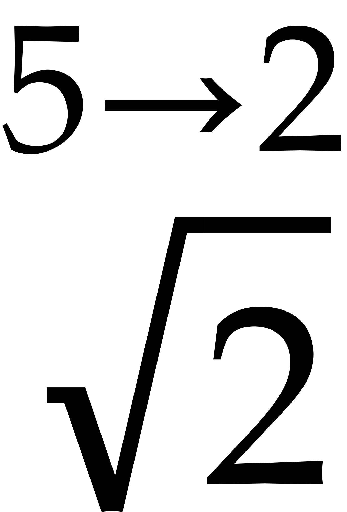

One would like to say: the individual digits are always only the results, the bark of the fully grown tree. What matters, or what something new can still grow from, is inside the trunk, where the forces of growth are. A change on the outside does not change the tree at all. To change it one must go into the still living trunk.

### [75r\[2\]](https://cdn.wittgensteinnachlass.com/2000px/webp/Ts-208/75r.webp)

So it is as if the digits were dead excretions of the living being that is the root. As when a snail secretes lime in the course of living and goes on building its shell.

### [75r\[3\]](https://cdn.wittgensteinnachlass.com/2000px/webp/Ts-208/75r.webp)

The rules for the digits must be there first; then – for example – a root finds expression in them. But this expression in the form of a sequence of digits is significant only because it is the expression of a real number. If one changes it afterwards, one has merely disrupted the expression, not obtained a new number.

### [75r\[4\]](https://cdn.wittgensteinnachlass.com/2000px/webp/Ts-208/75r.webp)

The rules for the digits belong at the beginning, as preparation for the expression. For building the system in which the law lives itself out.

### [75r\[5\]](https://cdn.wittgensteinnachlass.com/2000px/webp/Ts-208/75r.webp)

So I would say: if √'2 is anything at all, then it is the same as √2, only a different expression; the expression in another system.

### [75r\[6\]](https://cdn.wittgensteinnachlass.com/2000px/webp/Ts-208/75r.webp)

Then one could also put it quite naïvely like this: I understand what  means, but not √2', since √2 has no digit positions at all, so I cannot replace any with others.

### [75r\[7\]](https://cdn.wittgensteinnachlass.com/2000px/webp/Ts-208/75r.webp)

What about ⅐ (5→3)? Of course  is not an infinite extension but again an infinite rule with which an extension can be formed. But it is the sort of rule that can, so to speak, digest the “(5→3)”.

### [75r\[8\]](https://cdn.wittgensteinnachlass.com/2000px/webp/Ts-208/75r.webp)

The addition “ 1→5” reaches, so to speak, into the very heart of the law 0,1010010001 … The law speaks of a 1, and that is replaced by 5.

### [75r\[9\]](https://cdn.wittgensteinnachlass.com/2000px/webp/Ts-208/75r.webp)

The rule √2' works perfectly well for someone actually expanding the root. And the argument for this number is always that anyone who expands it understands exactly what to write. But that is no argument for √2' being a real number. The instruction to string digits together is quite unambiguous; but that does not yet give a real number. (Rather, something that bears a certain resemblance to a real number!)

### [75r\[10\]](https://cdn.wittgensteinnachlass.com/2000px/webp/Ts-208/75r.webp)

Might one put it this way: √2' does not measure until it is in a system. Surely that is why it is not a real number as √2, for example, is

### [75r\[11\]](https://cdn.wittgensteinnachlass.com/2000px/webp/Ts-208/75r.webp)

It is as if one needed a person to carry out the rule √2'. As it were: to be a matter of arithmetic, the rule must understand _itself_. The rule √2' does not do that; it is composed of two heterogeneous constituents. The person who applies it brings these constituents together.

### [76r\[1\]](https://cdn.wittgensteinnachlass.com/2000px/webp/Ts-208/76r.webp)

Does that mean that the rule √2' lacks something, namely the connection between the system of the root and the system of the sequence of digits?

### [76r\[2\]](https://cdn.wittgensteinnachlass.com/2000px/webp/Ts-208/76r.webp)

One would no sooner say of the rule √2' that it was a limit towards which the values of the series tend than one would say this of the instruction to throw dice.

### [76r\[3\]](https://cdn.wittgensteinnachlass.com/2000px/webp/Ts-208/76r.webp)

How far must one expand √2 to know it to some extent? That of course means nothing. So we know it already, without expanding it at all. But then √2' means nothing at all.

### [76r\[4\]](https://cdn.wittgensteinnachlass.com/2000px/webp/Ts-208/76r.webp)

The idea of √2 is this: we are looking for a rational number that gives 2 when multiplied by itself. There is no such number. But there are some that come close to 2 in this way, and always some that come closer to 2. There is a procedure that allows me to come ever closer to 2 without limit. This procedure is something too. And I call it a real number. It expresses itself by yielding decimal places of a decimal fraction that lie ever further to the right.

### [76r\[5\]](https://cdn.wittgensteinnachlass.com/2000px/webp/Ts-208/76r.webp)

Only what can be foreseen in the sequence of digits is essential to the real number.

### [76r\[6\]](https://cdn.wittgensteinnachlass.com/2000px/webp/Ts-208/76r.webp)

That one can apply the law is also true of the law for obtaining the digits by throwing dice.

### [76r\[7\]](https://cdn.wittgensteinnachlass.com/2000px/webp/Ts-208/76r.webp)

And what distinguishes π' from that can only be its arithmetical determinacy. But does that not consist in our knowing that there must be a law according to which the digits 7 occur in π, even if we do not yet know this law?

### [76r\[8\]](https://cdn.wittgensteinnachlass.com/2000px/webp/Ts-208/76r.webp)

So one could also put it this way: π' alludes to a law that is not yet known. (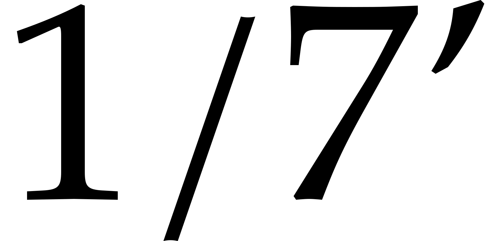 does not).

### [76r\[9\]](https://cdn.wittgensteinnachlass.com/2000px/webp/Ts-208/76r.webp)

But could one not say: π' contains the description of a law. Namely, “the law according to which 7 occurs in the expansion of π”. Or would this allusion make sense only if we knew how to obtain this law? (Solution of a mathematical problem).

### [76r\[10\]](https://cdn.wittgensteinnachlass.com/2000px/webp/Ts-208/76r.webp)

Then I simply cannot, ex confesso, read this law out of the instruction, and so the law is contained in it in a language I cannot read. In this sense, then, I do not understand π' either.

### [76r\[11\]](https://cdn.wittgensteinnachlass.com/2000px/webp/Ts-208/76r.webp),[77r\[1\]](https://cdn.wittgensteinnachlass.com/2000px/webp/Ts-208/77r.webp)

But what about the solvability of the problem of finding this law? Is it not a problem only insofar as the method of solving it is _known_? And if it is known, that is _how_ π' gets its sense, and if it is unknown, we cannot speak of the law that we do not yet know, and π' loses all sense. For if there is no law, π' becomes analogous to the instruction for throwing dice.

### [77r\[2\]](https://cdn.wittgensteinnachlass.com/2000px/webp/Ts-208/77r.webp)

The real number lives in the substrate of the operations from which it is born.

### [77r\[3\]](https://cdn.wittgensteinnachlass.com/2000px/webp/Ts-208/77r.webp)

One could also say: “√2” means the method by which an x² is made to approximate to 2.

### [77r\[4\]](https://cdn.wittgensteinnachlass.com/2000px/webp/Ts-208/77r.webp)

Only a path approaches a destination; places do not. And only a law approaches a value.

### [77r\[5\]](https://cdn.wittgensteinnachlass.com/2000px/webp/Ts-208/77r.webp)

We call the approximation of x² to 2 the approximation of x to √2.

### [77r\[6\]](https://cdn.wittgensteinnachlass.com/2000px/webp/Ts-208/77r.webp)

Replacing 7 with 3 – in π, say – has no general arithmetical significance.

### [77r\[7\]](https://cdn.wittgensteinnachlass.com/2000px/webp/Ts-208/77r.webp)

But it is, after all, an arithmetical mechanism that generates π'. – And I could only say: “But I don’t understand it”.

### [77r\[8\]](https://cdn.wittgensteinnachlass.com/2000px/webp/Ts-208/77r.webp)

When I say “arithmetical mechanism”, I mean: the occurrence of 7 in π depends only on the essence of π and of the decimal system.

### [77r\[9\]](https://cdn.wittgensteinnachlass.com/2000px/webp/Ts-208/77r.webp)

Suppose someone invented a new arithmetical operation which was ordinary multiplication, with just the difference that he put a 3 in the product in place of each 7. Then this operation × ' too would have something about it that was not understood, as long as the occurrence of 7 in the product was not understood in general through a law.

### [77r\[10\]](https://cdn.wittgensteinnachlass.com/2000px/webp/Ts-208/77r.webp)

It is as if I were to follow a path made up of individual stretches which are indeed connected, but whose directions in relation to one another were hidden from me.

### [77r\[11\]](https://cdn.wittgensteinnachlass.com/2000px/webp/Ts-208/77r.webp)

What would be strange here is precisely that my symbolism expressed something that I do not understand. (But there is no such thing.)

### [77r\[12\]](https://cdn.wittgensteinnachlass.com/2000px/webp/Ts-208/77r.webp)

Even if I did not already know the rule for forming √2 and imagined √2' as the primary instruction, I would still ask: What is the point of this curious ceremony of replacing 7 with 3? Is 7 perhaps taboo, so that one may not write it down? For replacing 7 with 3 adds nothing at all to the law and is not an arithmetical operation in this system at all.

### [77r\[13\]](https://cdn.wittgensteinnachlass.com/2000px/webp/Ts-208/77r.webp),[77v\[1\]](https://cdn.wittgensteinnachlass.com/2000px/webp/Ts-208/77v.webp),[77v\[2\]](https://cdn.wittgensteinnachlass.com/2000px/webp/Ts-208/77v.webp),[78r\[1\]](https://cdn.wittgensteinnachlass.com/2000px/webp/Ts-208/78r.webp)

Geometrically speaking: it is not enough that one – supposedly – determines the point more and more precisely by shrinking the region in which it lies; one must be able to construct _it_. Continued throws of the dice do indeed restrict the possible whereabouts of the point without limit, but they do not determine a point. After _every_ throw the point is still infinitely indeterminate.

### [78r\[2\]](https://cdn.wittgensteinnachlass.com/2000px/webp/Ts-208/78r.webp)

Of course, even in the ordinary process of extracting a root, the rules of the multiplication table that happen to fit have to be applied time and again, and one has not foreseen their application either. But the principle of √2 says nothing about them or their application either.

### [78r\[3\]](https://cdn.wittgensteinnachlass.com/2000px/webp/Ts-208/78r.webp)

(Only that for which I have defined “greater”, “smaller”, etc. is a number). A number must measure. And not merely in the sense that the values of its expansion must measure. For one cannot speak of _all_ the values, and it goes without saying that rational numbers (which I have formed according to some instruction or other) measure.

### [78r\[4\]](https://cdn.wittgensteinnachlass.com/2000px/webp/Ts-208/78r.webp)

What I mean might be put this way: for a real number a construction must be conceivable, not merely an approximation. – The construction corresponds to the unity of the law.

### [78r\[5\]](https://cdn.wittgensteinnachlass.com/2000px/webp/Ts-208/78r.webp)

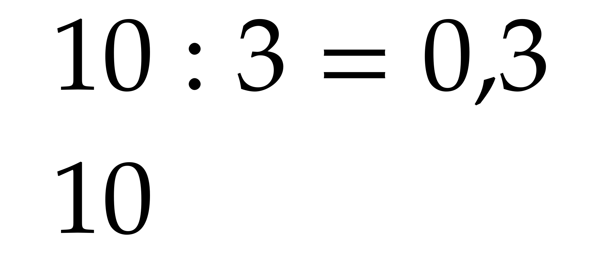 That the circle closes is what I actually see and express by 3̇. 3̇ does not mean “nothing but 3s come up”, but “a 3 must come up again and again”.

### [77v\[2\]](https://cdn.wittgensteinnachlass.com/2000px/webp/Ts-208/77v.webp)

Projection of the endlessness of a circle into the endlessness of the straight line.

### [78r\[6\]](https://cdn.wittgensteinnachlass.com/2000px/webp/Ts-208/78r.webp)

But doesn’t π' have a definite place in the number series? Of course I could say that it has only a definite interval; I cannot specify its exact place. But can I specify the place of e any differently? The lack of a construction! Even if I cannot construct e graphically, the law itself is apparently a construction in another space, in which e can after all be determined exactly, i.e. can be determined.

### [78r\[7\]](https://cdn.wittgensteinnachlass.com/2000px/webp/Ts-208/78r.webp)

A real number _yields_ extensions; it is not an extension. A real number is: an arithmetical law which yields the digits of a decimal fraction endlessly. This law has its place in arithmetical space. Or one could also say: in algebraic space. Whereas π' does not use the arithmetical mode of expression and so assigns the law no place in this space. What is missing, as it were, is the living arithmetical being that produces these excretions. The incomparability of the magnitudes of π and π' is connected with this homeless condition of π'.

### [78r\[8\]](https://cdn.wittgensteinnachlass.com/2000px/webp/Ts-208/78r.webp)

One cannot say: two real numbers are identical if they agree in every place. One cannot say: they are different if they fail to agree at one place in their expansions. Nor can one say that one is greater than the other if its digit at the first place of disagreement is greater than the corresponding digit of the other.

### [79r\[1\]](https://cdn.wittgensteinnachlass.com/2000px/webp/Ts-208/79r.webp)

Certainly, if a and b first fail to agree at the fourth place, one can say that they are therefore unequal. This fourth place belongs to the two numbers; but not the indeterminate nth place in the endless progression.

### [79r\[2\]](https://cdn.wittgensteinnachlass.com/2000px/webp/Ts-208/79r.webp)

One can therefore presumably recognize, from the fact that π and e differ at the _first_ place, that they are different. But one cannot say that they would be equal if all their digits were equal.

### [79r\[3\]](https://cdn.wittgensteinnachlass.com/2000px/webp/Ts-208/79r.webp)

If the extensions of two laws agree for the time being and I cannot compare the laws as such, then the numbers defined, if I am entitled to speak of such numbers, are incomparable, and the question of which is greater, or whether they are equal, is nonsensical. Indeed, an equation that sets the two equal must be nonsensical! And that gives one pause. And it is true: we cannot mean anything by setting them equal if there is no internal connection between them; if they belong to different systems. (And the extension cannot help us.)

### [79r\[4\]](https://cdn.wittgensteinnachlass.com/2000px/webp/Ts-208/79r.webp)

But are these really two _numbers_ that cannot be compared with one another? Doesn’t that contradict the simple conception of the number line?

### [79r\[5\]](https://cdn.wittgensteinnachlass.com/2000px/webp/Ts-208/79r.webp)

But could one not also turn it round and regard π' as the original, and thus as the point assumed first, and then be in doubt about the warrant for π? As far as their extensions go, they are of course on an equal footing. But not otherwise.

### [79r\[6\]](https://cdn.wittgensteinnachlass.com/2000px/webp/Ts-208/79r.webp)

Is the operation × ' on an equal footing with ×? If things are as they seem to me, namely, that an operation like × ' is not on an equal footing with the arithmetical operations, then the objection one must make to π' is clear. I do not know the laws that × ' obeys. I do not know, for example, under what conditions a × ' b = a × b. This ignorance of the laws seems to be the decisive thing. It makes it impossible, for example, ever to _apply_ × '.

### [79r\[7\]](https://cdn.wittgensteinnachlass.com/2000px/webp/Ts-208/79r.webp)

Isn’t it like this: as long as one calculates with strokes, one cannot carry out an operation without understanding it, and if I were able to translate × ' into an operation that no longer presupposes the decimal system in any way and works with strokes, then × ' would be an operation that was understood and stood on an equal footing with the other arithmetical operations.

### [79r\[8\]](https://cdn.wittgensteinnachlass.com/2000px/webp/Ts-208/79r.webp)

It is clear that if I could apply × ', all doubts about its warrant would be removed. For the possibility of application is the real criterion of arithmetical reality.

### [80r\[1\]](https://cdn.wittgensteinnachlass.com/2000px/webp/Ts-208/80r.webp)

The expansion of π is at once an expression of the essence of π _and of the essence of the decimal system_.

### [80r\[2\]](https://cdn.wittgensteinnachlass.com/2000px/webp/Ts-208/80r.webp)

Arithmetical operations use the decimal system only as a means to an end; the rules of operation are thus such that they can be translated into the language of any other number system and have none of these systems as their _object_. The expansion of π is indeed an expression both of the essence of π and of decimal notation, but our interest ordinarily lies exclusively in what is essential to π, and we pay no attention to the other thing. It is a servant whom we regard only as a tool and not as a being with rights of his own. But if we now regard him as part of society, society has thereby changed.

### [80r\[3\]](https://cdn.wittgensteinnachlass.com/2000px/webp/Ts-208/80r.webp)

A general rule of operation gets its generality from the generality of the change it brings about in the numbers. That is why × ' will not do as a general rule of operation: the result of a × ' b does not depend solely on the essence of the numbers a and b; the decimal system also comes into play. Of course it would not matter if this system were built into the operation as a further constant 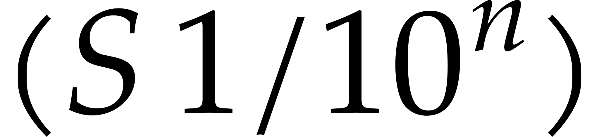 and presumably an operation can be found which corresponds to × ' and then has not only a and b but also the decimal system as its _object_. This operation will be written in a number system which withdraws in its capacity as servant and _of which_ the operation says nothing.

### [80r\[4\]](https://cdn.wittgensteinnachlass.com/2000px/webp/Ts-208/80r.webp)

In just the same way π' makes the decimal system its object (or would have to make it its object if it were correct), so it is no longer enough that one can apply the rule in forming the extension. For this application is no longer the criterion that the rule is in order: the rule is not the expression of the arithmetical law at all, but merely makes an external alteration to the language.

### [80r\[5\]](https://cdn.wittgensteinnachlass.com/2000px/webp/Ts-208/80r.webp)

So if it is no longer to be a servant, it must formally sit down at table with the others and must therefore stop serving, for it cannot do both at once.

### [80r\[6\]](https://cdn.wittgensteinnachlass.com/2000px/webp/Ts-208/80r.webp)

It is like this: the number π is represented in the decimal system. One cannot produce a modification of this law by taking the specific expression in the decimal system as one’s point of departure. What one affects in this way is not the law at all, but its contingent expression. This influence does not reach through to the law at all. It stands apart from it, on the other side. It is as if one wanted to influence a living being by acting on a secretion it has already secreted.

### [80r\[7\]](https://cdn.wittgensteinnachlass.com/2000px/webp/Ts-208/80r.webp)

But what about a law S [1 10 p] (where p runs through the series of prime numbers), or the case where p runs through the series of integers except those for which Fermat’s theorem does not hold? – Do these instructions determine real numbers?

### [81r\[1\]](https://cdn.wittgensteinnachlass.com/2000px/webp/Ts-208/81r.webp)

The number must measure in and of itself. That seems to me, as it were, its office. If it does not do so, if it leaves that to the rational numbers, then we do not need it.

### [81r\[2\]](https://cdn.wittgensteinnachlass.com/2000px/webp/Ts-208/81r.webp)

The _subsequent_ proof of convergence cannot justify treating it as a number. The number would have to be sought where the convergence _shows itself_. But the proof makes something else of it.

### [81r\[3\]](https://cdn.wittgensteinnachlass.com/2000px/webp/Ts-208/81r.webp)

I want to show that whatever I append after the hundredths can never increase the number by even one hundredth. For that I would need 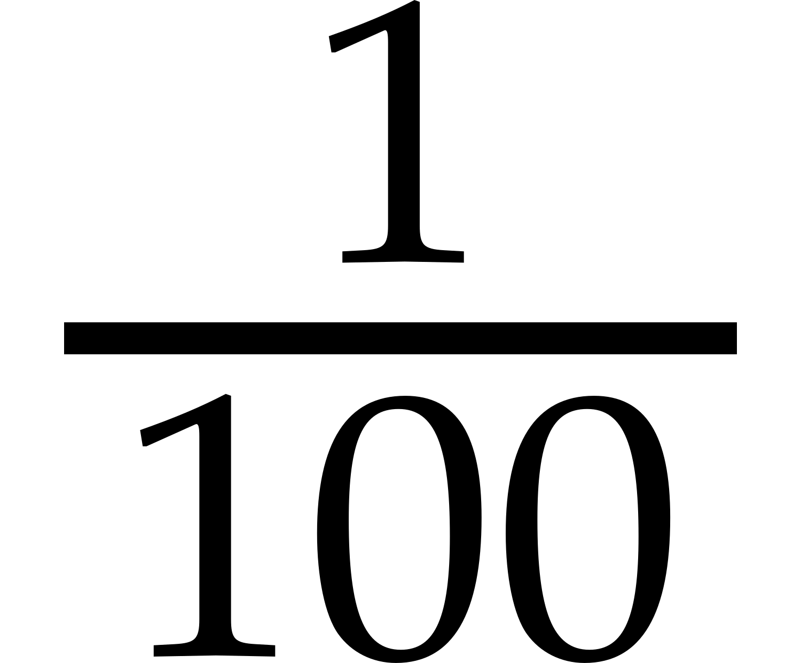 and the most I can write after them is , so we are still short by 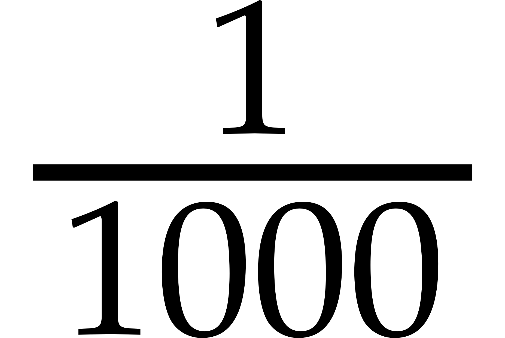, but the most I can write after the thousandths is , so we are still short by 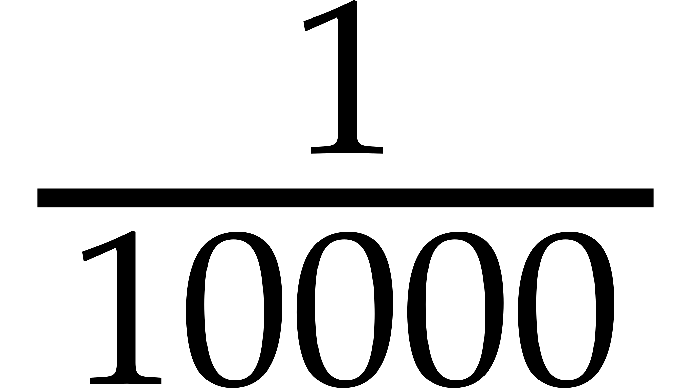, but the most etc. So there is _always_ something still missing. And that is the proof by induction (spiral movement), in that we _see_ that it always goes on like this.

### [81r\[4\]](https://cdn.wittgensteinnachlass.com/2000px/webp/Ts-208/81r.webp)

What we _see_ is an induction.

### [81r\[5\]](https://cdn.wittgensteinnachlass.com/2000px/webp/Ts-208/81r.webp)

I believe it will become clear that one takes this spiral to be a point on the number line. One could say: _No_ interval I could set down as equivalent to it would be small enough.

### [81r\[6\]](https://cdn.wittgensteinnachlass.com/2000px/webp/Ts-208/81r.webp)

The nesting is a process of induction, and as such one can take it to be a point.

### [81r\[7\]](https://cdn.wittgensteinnachlass.com/2000px/webp/Ts-208/81r.webp)

For from now on the spiral must be left to itself. There must be no further problem: What will become of it, I wonder.

### [81r\[8\]](https://cdn.wittgensteinnachlass.com/2000px/webp/Ts-208/81r.webp)

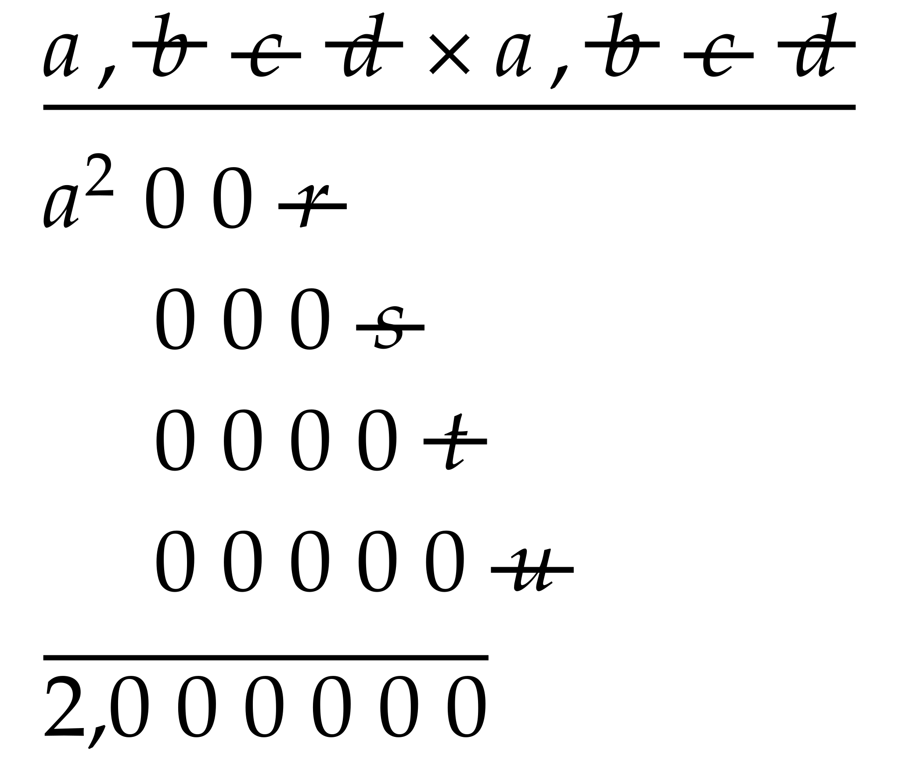

If I do not know whether the root comes out exactly, a process whose length can be foreseen will nevertheless show me whether it does.

### [81r\[9\]](https://cdn.wittgensteinnachlass.com/2000px/webp/Ts-208/81r.webp)

The very essence of a real number must be induction. What I must see in a real number, its sign, is the induction. – The _so_ of which one can say “and so on”.

### [81r\[10\]](https://cdn.wittgensteinnachlass.com/2000px/webp/Ts-208/81r.webp)

It would follow from all this that in the case of a real number one cannot speak of _greater_ and _smaller_ without further ado – i.e. without giving a definite stage of its expansion.

### [81r\[11\]](https://cdn.wittgensteinnachlass.com/2000px/webp/Ts-208/81r.webp),[82r\[1\]](https://cdn.wittgensteinnachlass.com/2000px/webp/Ts-208/82r.webp)

That has to do with the fact that there is no uniform notation for real numbers, in contrast to rational numbers. As long as one believes in the infinite extension, one can say: _The_ sign for a real number is an infinite decimal fraction. But we can no longer say that.

### [82r\[2\]](https://cdn.wittgensteinnachlass.com/2000px/webp/Ts-208/82r.webp)

Is it possible to prove that a is greater than b without being able to prove at which place the difference will come to light? I do not believe so.

### [82r\[3\]](https://cdn.wittgensteinnachlass.com/2000px/webp/Ts-208/82r.webp)

What relation does the proof that a is greater than b have to the difference that shows itself in the extensions?

### [82r\[4\]](https://cdn.wittgensteinnachlass.com/2000px/webp/Ts-208/82r.webp)

Can one compare the positions of the spirals without speaking of individual turns?

### [82r\[5\]](https://cdn.wittgensteinnachlass.com/2000px/webp/Ts-208/82r.webp)

Once its law is given, the spiral automatically runs towards a goal. But is that true? It runs on automatically. But does it run towards a goal? If it runs towards a goal, that goal must lie within it; and it must be equivalent to the goal. But then it would have to be comparable with every other goal. If the law is not itself the goal, the development cannot give the law that goal.

### [82r\[6\]](https://cdn.wittgensteinnachlass.com/2000px/webp/Ts-208/82r.webp)

It would have been a good question for the Scholastics: “Can God know all the digits of π?” The answer in all such cases is: The question is senseless.

### [82r\[7\]](https://cdn.wittgensteinnachlass.com/2000px/webp/Ts-208/82r.webp)

I say: The so-called “Fermat’s theorem” is not a _proposition_. (Not even in the sense of arithmetic.) Rather, what would correspond to it is a proof by induction. But if there is a number F 0,11000 etc. and that proof succeeds, then surely this would prove that F = 0,11, and that surely is a proposition! Or: It is a proposition if the law F is a number.

### [82r\[8\]](https://cdn.wittgensteinnachlass.com/2000px/webp/Ts-208/82r.webp)

A proof proves what it proves, and nothing more.

### [82r\[9\]](https://cdn.wittgensteinnachlass.com/2000px/webp/Ts-208/82r.webp)

The number F wants to use the spiral 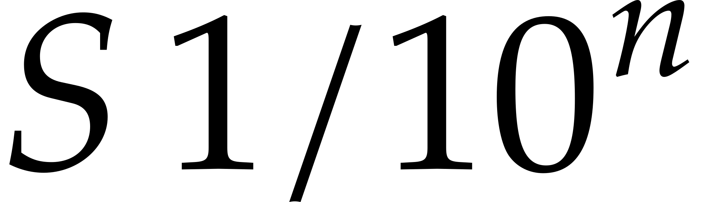 and then select turns of this spiral according to a principle. But this principle does not belong to the spiral. If I imagine the windings of the spiral 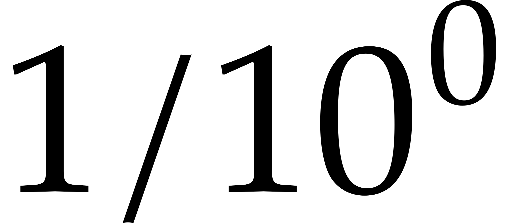,  + , etc. written down, then F makes a remark on each winding, endorsing it or crossing it out; and in doing so makes a selection _whose law we do not know_.

### [82r\[10\]](https://cdn.wittgensteinnachlass.com/2000px/webp/Ts-208/82r.webp)

This also gives rise to the paradox that it becomes nonsensical to ask whether F = 0,11. For the assumption of F rests after all on the assumption of a law, an infinite law, according to which the numbers in Fermat’s formula behave. – But what does the infinity of the law mean to us? Only the induction. And where does that lie here? In the infinite possibilities for the exponent n in , hence in the infinite possibility of making trials. But that is worth no more to us than the infinite possibility of throwing dice, since we know no law to which the _results_ of these trials correspond.

### [83r\[1\]](https://cdn.wittgensteinnachlass.com/2000px/webp/Ts-208/83r.webp)

One might of course say: Is it any different with π? There too I know no law that the digits of the expansion follow – just as here. But that is not how things are: In the case of π I do not know a law for the sequence of digits, because this is an expression of the interference between the law of π and decimal notation; but I am able to represent the law of π so that it is freed of everything inessential to it and is known to me _through and through_. (The law is _the_ winding of the spiral and this winding _must_ be _completely_ known to me, and nothing more.)

### [83r\[2\]](https://cdn.wittgensteinnachlass.com/2000px/webp/Ts-208/83r.webp)

If the law, the winding of the spiral, is a number, then it must be comparable with all the others in respect of its position (on the number line). After all, I determine the position by nothing other than the law.

### [83r\[3\]](https://cdn.wittgensteinnachlass.com/2000px/webp/Ts-208/83r.webp)

Only what I see is a law; not what I _describe_. I believe that this alone keeps me from expressing more in my sign than I can understand.

### [83r\[4\]](https://cdn.wittgensteinnachlass.com/2000px/webp/Ts-208/83r.webp)

Here we keep encountering something one might call an “arithmetical experiment”. What comes out is indeed determined by what is given, but I cannot recognize _how_ it is determined by it. (Rather like the occurrence of 7 in π, for instance.) In the same way, the prime numbers come out of the method for looking for them as results of an experiment. I can indeed satisfy myself that 7 is a prime number, but I do not see the connection between it and the condition to which it corresponds. – I have merely found it and not produced it. I look for it, but I do not produce it. I no doubt see a law in the instruction that teaches me how to find the prime numbers, but not in the numbers that come out of it. So it is not as in , , , etc., where I see a law _in the numbers_.

### [83r\[5\]](https://cdn.wittgensteinnachlass.com/2000px/webp/Ts-208/83r.webp)

I must be able to write out part of the series in such a way that one _recognizes_ the law. I.e. what is written out must contain no _description_; everything must be represented.

### [83r\[6\]](https://cdn.wittgensteinnachlass.com/2000px/webp/Ts-208/83r.webp)

The approximations must themselves form a _manifest_ series. I.e. the approximations themselves must proceed according to a law.

### [83r\[7\]](https://cdn.wittgensteinnachlass.com/2000px/webp/Ts-208/83r.webp)

Can one really say that if I did not know the geometrical representation of π and √2, these numbers would be known to me only approximately? Certainly not.

### [83r\[8\]](https://cdn.wittgensteinnachlass.com/2000px/webp/Ts-208/83r.webp),[83v\[1\]](https://cdn.wittgensteinnachlass.com/2000px/webp/Ts-208/83v.webp),[83v\[2\]](https://cdn.wittgensteinnachlass.com/2000px/webp/Ts-208/83v.webp),[84r\[1\]](https://cdn.wittgensteinnachlass.com/2000px/webp/Ts-208/84r.webp)

So an equation between real numbers stands to its proof as an algebraic equation stands to the proof by induction to which it corresponds. But what is the relation of an algebraic equation to “its” proof by induction? In the proof there is something to be seen, and this is taken as given in the algebraic proposition; i.e. the proposition is chosen to take account of what is given in arithmetic. For this to be possible there must be an unambiguous symbolic correspondence between proof and proposition.

### [84r\[2\]](https://cdn.wittgensteinnachlass.com/2000px/webp/Ts-208/84r.webp)

That is connected with the question whether one can negate 2 = 2 as one can 2 × 35 = 70, and why one cannot negate a definition.

### [84r\[3\]](https://cdn.wittgensteinnachlass.com/2000px/webp/Ts-208/84r.webp)

The algebraic proposition acquires arithmetical meaning only when we substitute digits for the letters in it, and even then it never acquires more than _particular_ arithmetical meaning. Its generality lies not in the proposition itself but in the possibility of applying it correctly. And for that it must refer us back to the induction each time. I.e. it does not say its generality, it does not speak it out; rather, its generality shows itself in the formal relation to the substitution, which proves to be a term of the induction series.

### [83v\[2\]](https://cdn.wittgensteinnachlass.com/2000px/webp/Ts-208/83v.webp)

What I am resisting here is the view that the infinite series of numbers is something given to us, about which there are only particular numerical propositions & also general propositions about all the numbers in the series. So that the arithmetical calculus would not be complete if it did not also contain the general propositions about cardinal numbers, namely general equations of the kind a + (b + c) = (a + b) + c. Whereas even  belongs to a different calculus from 1 : 3 = 0˙3.

### [84r\[4\]](https://cdn.wittgensteinnachlass.com/2000px/webp/Ts-208/84r.webp)

_Generality_ in arithmetic is represented by induction. Induction is the expression of arithmetical generality.

### [84r\[5\]](https://cdn.wittgensteinnachlass.com/2000px/webp/Ts-208/84r.webp)

If, as with √3 and √2, I can see that one number is greater than the other, then I must also be able to specify the stage of the expansion at which this finds expression.

### [84r\[6\]](https://cdn.wittgensteinnachlass.com/2000px/webp/Ts-208/84r.webp)

Children no doubt learn 2 × 2 = 4 at school, but not 2 = 2.

### [84r\[7\]](https://cdn.wittgensteinnachlass.com/2000px/webp/Ts-208/84r.webp)

There are only _particular_ arithmetical equations. Generality in arithmetic is expressed not by an equation but by an inductive relation between equations.

### [84r\[8\]](https://cdn.wittgensteinnachlass.com/2000px/webp/Ts-208/84r.webp)

Must not every meaningful equation presuppose an arbitrary convention?

### [84r\[9\]](https://cdn.wittgensteinnachlass.com/2000px/webp/Ts-208/84r.webp)

So does it make no sense to say that  even when Fermat’s theorem has been proved? (If I were to read about it in the newspaper, say)

### [84r\[10\]](https://cdn.wittgensteinnachlass.com/2000px/webp/Ts-208/84r.webp)

Does not the equation  also refer to an induction?

### [84r\[11\]](https://cdn.wittgensteinnachlass.com/2000px/webp/Ts-208/84r.webp)

It seems a good rule that I should call something a number if it can be compared with any rational number whatever. I.e. if it can be established whether it is greater than, smaller than or equal to a rational number.

### [84r\[12\]](https://cdn.wittgensteinnachlass.com/2000px/webp/Ts-208/84r.webp)

That is to say, it makes sense by analogy to call a construction a number if it stands in relations to the rational numbers that are analogous to (of the same multiplicity as) the relations of being greater than, smaller than and equal to.

### [85r\[1\]](https://cdn.wittgensteinnachlass.com/2000px/webp/Ts-208/85r.webp)

I am not _able_ to compare F with , so it is not a number.

### [85r\[2\]](https://cdn.wittgensteinnachlass.com/2000px/webp/Ts-208/85r.webp)

For this shows that F is not a spiral at all. The point of the spiral is that I must be able to go past any given point with it, above or below.

### [85r\[3\]](https://cdn.wittgensteinnachlass.com/2000px/webp/Ts-208/85r.webp)

If the real number is a rational number a, then comparing its law with a must yield that result. That is, the law must be such that, as it were, it snaps into the rational number when it reaches the corresponding place (of this number).

### [85r\[4\]](https://cdn.wittgensteinnachlass.com/2000px/webp/Ts-208/85r.webp)

It would not do, for example, if one could not be sure whether  really terminates at 5 (or whether there might still be something to follow).

### [85r\[5\]](https://cdn.wittgensteinnachlass.com/2000px/webp/Ts-208/85r.webp)

One could also put it this way: The law must be such that any rational number can be substituted into it and tried.

### [85r\[6\]](https://cdn.wittgensteinnachlass.com/2000px/webp/Ts-208/85r.webp)

But what then of the number P = 0,1110101 etc.? Suppose someone claimed it would become periodic and at some point it did look as though it would; then I would have to be able to try the assumed number directly in the law, just as I can see directly by multiplication whether 1,414 is √2. But this is not possible.

### [85r\[7\]](https://cdn.wittgensteinnachlass.com/2000px/webp/Ts-208/85r.webp)

What is characteristic of the arithmetical experiment is that something about it is opaque.

### [85r\[8\]](https://cdn.wittgensteinnachlass.com/2000px/webp/Ts-208/85r.webp)

How do I ascertain whether e is greater than, smaller than or equal to a given number? If the given number is a terminating decimal fraction, the matter is clear enough, but what about one that is periodic in the decimal system and with which the expansion of e agrees for the time being? Are these not the fundamental questions that have to be answered in defining a real number?

### [85r\[9\]](https://cdn.wittgensteinnachlass.com/2000px/webp/Ts-208/85r.webp)

The proof that shows that something has the properties required of a number must _show_ this number. I.e. it is precisely what brings the number to view.

### [85r\[10\]](https://cdn.wittgensteinnachlass.com/2000px/webp/Ts-208/85r.webp),[86r\[1\]](https://cdn.wittgensteinnachlass.com/2000px/webp/Ts-208/86r.webp)

Is not F also an infinite narrowing of an interval? How can I know that, or whether, the spiral will not contract into this point? In the case of √2 I know. Can I now call such a spiral a number too? A spiral that, for all I know, may stop at a rational point. But that cannot be it either: It is the lack of a _method_ of comparison with the rational numbers. For working out the extension is no such method, since I can never know whether or when it will lead to a decision. Carrying on with the expansion indefinitely is not a method, even if doing so leads to a result of the comparison. On the other hand, squaring a and seeing whether the square is greater or smaller than 2 is a method.

### [86r\[2\]](https://cdn.wittgensteinnachlass.com/2000px/webp/Ts-208/86r.webp)

Could one say: The _general method_ of comparison with the rational numbers is the real number.

### [86r\[3\]](https://cdn.wittgensteinnachlass.com/2000px/webp/Ts-208/86r.webp)

The question must make sense: “Can this number be π?”

### [86r\[4\]](https://cdn.wittgensteinnachlass.com/2000px/webp/Ts-208/86r.webp)

F is not the interval , for I can reach a certain decision even within this interval, but it is not a number in this interval, for we cannot make the decisions that would be needed for that. Could one say, then: F is no doubt an arithmetical construction, only not a number (nor an interval). I.e. I cannot compare F with a point, nor with a line segment. Is there a geometrical construction to which it corresponds? The law, i.e. the method of comparison, says only that it will yield either the answers “smaller, greater or equal” or “greater” (but not equal). It is much the same if I walk in a dark room and say: I can only ascertain whether it is lower than I am or the same height – or – higher. And here one could say: So you cannot ascertain a height; what is it, then, that you can ascertain. The comparison is imperfect only because, if I do bump my head, I can after all determine the height, whereas in the case of F I cannot in principle ask “is it this point”. I know no method of determining whether it is this point, so it is not a point. If the question of comparing F with a rational number makes no sense because all the expansion has still not given us the answer, then this question makes no sense before one has tried at random to settle the matter by means of the extension either. If it makes no sense now to ask “is F = 0,11”, then it made no sense before one had examined 100 places of the extension, nor, therefore, before one had examined even _one_. But then in this case it would make no sense at all to ask whether the number is equal to _any_ rational number. That is, as long as one has no method that settles it unconditionally.

### [86r\[5\]](https://cdn.wittgensteinnachlass.com/2000px/webp/Ts-208/86r.webp)

 The given rational number is either equal to, smaller than or greater than the interval calculated so far. In the first case the point forms the lower bound of the interval, in the second it lies below the interval, in the third above it. In none of these cases is there any talk of comparing the positions of two points.

### [86r\[6\]](https://cdn.wittgensteinnachlass.com/2000px/webp/Ts-208/86r.webp)

 is not a result of 1 : 3 in the same sense as, say, 0,25 is of 1 : 4; it points to a different arithmetical fact.

### [86r\[7\]](https://cdn.wittgensteinnachlass.com/2000px/webp/Ts-208/86r.webp)

Suppose the division kept yielding the same digit 3, but one did not see in the division any necessity for it to do so; would it then make sense to conjecture that the result would be ? I.e. does  not designate just an induction that has been seen and not – an extension.

### [87r\[1\]](https://cdn.wittgensteinnachlass.com/2000px/webp/Ts-208/87r.webp)

In mathematics one can ask a question (or make a conjecture) only where the answer is “I have to calculate it”. But cannot I say that in the case of  too, even though the result is not an extension but the emergence of that inductive relation? But to do that we must have a clear conception of this inductive relation if we are to expect it. I.e. here too we cannot just make conjectures or form expectations at random.

### [87r\[2\]](https://cdn.wittgensteinnachlass.com/2000px/webp/Ts-208/87r.webp)

What the “mathematical question” has in common with a question proper is precisely that it can be answered.

### [87r\[3\]](https://cdn.wittgensteinnachlass.com/2000px/webp/Ts-208/87r.webp)

If the  in  points to a definite method, then  in connection with F means nothing, since there is no method here.

### [87r\[4\]](https://cdn.wittgensteinnachlass.com/2000px/webp/Ts-208/87r.webp)

A law I do not know is no law.

### [87r\[5\]](https://cdn.wittgensteinnachlass.com/2000px/webp/Ts-208/87r.webp)

There is a law there already (and hence an arithmetical interest too), but it does not apply directly to the number. The number is, as it were, a by-product of the law that does not itself follow a law. As if someone were walking along a road with a law-governed stride and were now to roll dice at every step and, depending on how they fell, stick a stake into the ground or not; then these stakes would not stand in accordance with a law. Or rather, the law in accordance with which they would stand would be only that of the striding, and no other.

### [87r\[6\]](https://cdn.wittgensteinnachlass.com/2000px/webp/Ts-208/87r.webp)

Examining the numbers for F follows a law, but the results do not. Thus in a certain sense the law of the number  corresponds to the law-governed character of this search. But everything else is chance. Chance of the same kind – and in the very same sense – as the fact that there is a 4 in the third place of π. (For that too is _not_ chance in another sense.)

### [87r\[7\]](https://cdn.wittgensteinnachlass.com/2000px/webp/Ts-208/87r.webp)

We cannot express a law we do not know. Hence no understood _whole_ can come from contributions that are not understood.

### [87r\[8\]](https://cdn.wittgensteinnachlass.com/2000px/webp/Ts-208/87r.webp)

The number as the result of an arithmetical experiment, and thus the experiment as the _description_ of a number, is an absurdity. The experiment would be the description, not the _representation_, of a number.

### [87r\[9\]](https://cdn.wittgensteinnachlass.com/2000px/webp/Ts-208/87r.webp)

In the case of the person who strides regularly and drives in stakes without rules as he goes, it is still the striding that is regular.

### [87r\[10\]](https://cdn.wittgensteinnachlass.com/2000px/webp/Ts-208/87r.webp)

It is true that the possibility of expansion in the decimal system follows immediately from the essence of the real number, since the successive stages of this expansion are an expression (a formulation) of the contracting interval. But the decimal expansion is not in general the essential (visible) expression of this process. (That is, there is no real number without an expansion, but there is indeed an expansion without a real number.)

### [88r\[1\]](https://cdn.wittgensteinnachlass.com/2000px/webp/Ts-208/88r.webp)

That is, there is always an expansion of the real number that is the _essential_ expression of its law. This expression _shows_ the numbers approaching one another without limit.

### [88r\[2\]](https://cdn.wittgensteinnachlass.com/2000px/webp/Ts-208/88r.webp)

“The process would determine a number only when it came to an end, but since it goes on to infinity and never finishes, it determines _no_ number.” The process must look infinitely far ahead, otherwise it determines no number. There must be no “I don’t know yet”, for there is no _yet_ in the infinite.

### [88r\[3\]](https://cdn.wittgensteinnachlass.com/2000px/webp/Ts-208/88r.webp)

Every rational number must stand in a visible relation to the law that is a number.

### [88r\[4\]](https://cdn.wittgensteinnachlass.com/2000px/webp/Ts-208/88r.webp)

The expansion proper is precisely the method of comparison with the rational numbers. The expansion proper of the number is the one that allows direct comparison with the rational numbers. If one brings a rational number near the law, the law must react to it in a definite way. It must answer the question “is it _that_ one”. I should like to put it this way: the expansion proper is what comparison with a rational number elicits from the law. The contraction of the interval serves the comparison, after all, by making every number come to lie to the right or to the left. That works only if comparison with a given rational number forces the law to speak out in relation to that number.

### [87v\[1\]](https://cdn.wittgensteinnachlass.com/2000px/webp/Ts-208/87v.webp)

If m² = 2m² is to hold, m would have to be even, since squaring an odd number does not give an even one. So n is odd. So  takes the forms:

, ,  so  takes the forms , ,  none of these expressions can equal 2.

### [87v\[2\]](https://cdn.wittgensteinnachlass.com/2000px/webp/Ts-208/87v.webp)

 so m² must be even.

### [88r\[5\]](https://cdn.wittgensteinnachlass.com/2000px/webp/Ts-208/88r.webp)

It is not the case that x¹ + y¹ = z¹, x² + y² = z² etc. are merely other forms of designation for numbers which, in this form, stand in a visibly law-governed relation, even if the decimal expressions obtained from them do not. It is not like the case of ½, ½ + ½,  etc. Where one sees the law that one does not see in the decimal expansion. For the expressions ½, etc. are already numbers, and only the connection between these expressions and the decimal fractions is a matter of chance. But the expressions  are not numbers and are connected with numbers at all only by chance.

### [88r\[6\]](https://cdn.wittgensteinnachlass.com/2000px/webp/Ts-208/88r.webp)

What is at issue here is the difference between an arithmetical operation that yields a number for us and a process, not understood arithmetically, that yields digits for us.

### [88r\[7\]](https://cdn.wittgensteinnachlass.com/2000px/webp/Ts-208/88r.webp)

How about an operation: xχy, one forms the product of x and y; if it is greater than 100, the result is the greater of the two numbers, otherwise the result is zero. The operation is not arithmetically intelligible.

### [88r\[8\]](https://cdn.wittgensteinnachlass.com/2000px/webp/Ts-208/88r.webp)

Is an arithmetical experiment still possible where there is a definition by recursion? I think evidently not; because recursion makes every stage arithmetically intelligible.

### [89r\[1\]](https://cdn.wittgensteinnachlass.com/2000px/webp/Ts-208/89r.webp)

And the recursion goes back not to a generality again but to a particular arithmetical case. The recursive definition provides understanding by building on a particular case that presupposes no generality.

### [89r\[2\]](https://cdn.wittgensteinnachlass.com/2000px/webp/Ts-208/89r.webp)

In the case of χ, F, P, I can indeed explain recursively the rule for examining the numbers, but not the result of the examination. I cannot build up the result. How, then, do I know that there is an a for which ? Because I can _construct_ an a for which a² = 1,999_. How do I know that there is an a for which a² = 1,999_?

### [89r\[3\]](https://cdn.wittgensteinnachlass.com/2000px/webp/Ts-208/89r.webp)

If we want to see what has been proved, we must look at nothing but the proof.

### [89r\[4\]](https://cdn.wittgensteinnachlass.com/2000px/webp/Ts-208/89r.webp)

If I say that  approaches 2 and therefore reaches the numbers 1,9, 1,99, 1,999 _at some point_, this is nonsensical if I cannot specify within how many steps these values will be reached, for “_at some point_” means nothing.

### [89r\[5\]](https://cdn.wittgensteinnachlass.com/2000px/webp/Ts-208/89r.webp)

 This can follow only by induction.    a between 0 and 9

### [89r\[6\]](https://cdn.wittgensteinnachlass.com/2000px/webp/Ts-208/89r.webp)

After how many steps does a decimal place stop changing?

The effect of the addition always breaks against the 8. The remainder of a column can never have an effect beyond the next column.

### [89r\[7\]](https://cdn.wittgensteinnachlass.com/2000px/webp/Ts-208/89r.webp)

How many zeros can occur in succession in e? If the nth decimal place stops changing after n + r steps and is preceded by a 0, that 0 must stop changing at the same time as the nth place, for another digit can become a zero only if the next place is still changing too. Thus the number of zeros is bounded.

### [89r\[8\]](https://cdn.wittgensteinnachlass.com/2000px/webp/Ts-208/89r.webp)

One can and must show that the decimal places stop changing after a _definite_ number of steps.

### [90r\[1\]](https://cdn.wittgensteinnachlass.com/2000px/webp/Ts-208/90r.webp)

One must always be able to determine the order of magnitude. Suppose there is nothing to rule out (in my notation) a hundred threes in a row at a particular place in e; there is something to rule out 10¹⁰⁰ threes occurring in a row. Much must remain open in the decimal system that is determinate in the binary system.

### [90r\[2\]](https://cdn.wittgensteinnachlass.com/2000px/webp/Ts-208/90r.webp)

It is necessary to be able to say not only whether a given rational number is the real number, but also how close it can possibly come to it. That is, it is not enough to be able to say that the spiral does not pass through this point but passes below it; we must also know limits within which its distance from the point lies. We must know an order of magnitude for the distance.

### [90r\[3\]](https://cdn.wittgensteinnachlass.com/2000px/webp/Ts-208/90r.webp)

The expansion in the decimal system does not give me that, since I cannot know how many nines, for example, will follow a place that has been worked out.

### [90r\[4\]](https://cdn.wittgensteinnachlass.com/2000px/webp/Ts-208/90r.webp)

The question “is e ” is nonsensical, for it asks not about an extension but about a law, namely an induction of which, however, we have no conception here. In the case of division one can ask this question; only because we know the form of induction that we call 3̇.

### [90r\[5\]](https://cdn.wittgensteinnachlass.com/2000px/webp/Ts-208/90r.webp)

The question “do the decimal places of e stop changing at some point” and the answer “they stop changing at some point” are both nonsense. The question is: After how many steps must the places stop changing.

### [90r\[6\]](https://cdn.wittgensteinnachlass.com/2000px/webp/Ts-208/90r.webp)

Can one say: “e is not this number” means nothing; rather, one must say that it is at least this interval away from it. I believe that is how it is. But that would mean that the question could not be answered at all without at the same time giving some idea of the distance.

### [90r\[7\]](https://cdn.wittgensteinnachlass.com/2000px/webp/Ts-208/90r.webp)

I cannot deny the _generality_ of general arithmetical propositions.

### [90r\[8\]](https://cdn.wittgensteinnachlass.com/2000px/webp/Ts-208/90r.webp)

Is it not that alone that I cannot reflect in the algebraic sentence?

### [90r\[9\]](https://cdn.wittgensteinnachlass.com/2000px/webp/Ts-208/90r.webp)

An equation can be proved only by reducing it to equations. The last equations in this process are definitions. If an equation cannot be reduced to other equations, it is a definition. An induction cannot justify an equation. Hence, for example, the introduction of the notation 3̇ cannot relate to the induction of which it seems to be the sign. It must be similar to the relation of “A(c)” to its proof by induction. Or rather, it presumably relates to the mere facts of the induction, but not to the generality that is its proper sense.

### [90r\[10\]](https://cdn.wittgensteinnachlass.com/2000px/webp/Ts-208/90r.webp)

By means of equations I cannot rise above equations, I cannot get out of equations. That is one of my fundamental thoughts, which it is exceedingly difficult to grasp fully.

### [93r\[1\]](https://cdn.wittgensteinnachlass.com/2000px/webp/Ts-208/93r.webp)

One can search only in a _space_. For only in space does one have a relation to the there where one is not.

### [93r\[2\]](https://cdn.wittgensteinnachlass.com/2000px/webp/Ts-208/93r.webp)

I have always said: one cannot speak of _all_ numbers because there are no such things as _all_ numbers. But that is only the expression of a feeling. What one ought really to say is “of _all_ numbers there _is_ never any talk in arithmetic, and if one speaks that way all the same, one is, so to speak, making something up – something nonsensical – and adding it to the arithmetical facts”. (What one makes up and adds to _logic_ must of course be _nonsensical_).

### [93r\[3\]](https://cdn.wittgensteinnachlass.com/2000px/webp/Ts-208/93r.webp)

To understand the sense of a proposition is to know how to settle whether it is true or false.

### [93r\[4\]](https://cdn.wittgensteinnachlass.com/2000px/webp/Ts-208/93r.webp)

The essence of what we call the will is directly connected with the continuity of what is given.

### [93r\[5\]](https://cdn.wittgensteinnachlass.com/2000px/webp/Ts-208/93r.webp)

One must find one’s way from where one is to where the decision lies.

### [93r\[6\]](https://cdn.wittgensteinnachlass.com/2000px/webp/Ts-208/93r.webp)

One cannot search in the wrong way; one _cannot_ search for a visual impression with the sense of touch.

### [93r\[7\]](https://cdn.wittgensteinnachlass.com/2000px/webp/Ts-208/93r.webp)

One cannot compare a picture with reality if one cannot apply it to reality as a yardstick. One must be able to lay the sentence against reality. Reality as seen takes the place of the picture.

### [93r\[8\]](https://cdn.wittgensteinnachlass.com/2000px/webp/Ts-208/93r.webp)

If I am to establish whether 2 points are a certain distance apart, I must look at the distance they _are_ apart.

### [93r\[9\]](https://cdn.wittgensteinnachlass.com/2000px/webp/Ts-208/93r.webp)

The worst philosophical errors always arise when one wants to apply our ordinary – physical – language in the domain of what is immediately given. If, for example, one asks “does the box still exist when I am not looking at it”, the only correct answer would be “certainly, if nobody has carried it off or destroyed it”. Of course the philosopher would not be satisfied with this answer, but it would quite rightly reduce his way of putting the question ad absurdum.

### [93r\[10\]](https://cdn.wittgensteinnachlass.com/2000px/webp/Ts-208/93r.webp)

All our forms of speech are taken from normal physical language and cannot be used in epistemology or phenomenology without casting a misleading light on the object.

### [93r\[11\]](https://cdn.wittgensteinnachlass.com/2000px/webp/Ts-208/93r.webp)

The mere turn of phrase “I perceive x” is already taken from the physical mode of expression, and x is meant here to be a physical object – a body, for example. It is already wrong to use this way of speaking in phenomenology, where x must then mean a datum. For now neither “I” nor “perceive” can have the same sense as above.

### [94r\[1\]](https://cdn.wittgensteinnachlass.com/2000px/webp/Ts-208/94r.webp)

If, for example, one says that one never sees a real circle, but only approximate circles, this has a good, unobjectionable sense if it means that one can still discover inaccuracies in a body that looks circular by measuring it precisely or by looking at it through a magnifying glass. But we lose this sense as soon as we put what is immediately given, the patch, or whatever one wants to call it, in place of the circular body.

### [94r\[2\]](https://cdn.wittgensteinnachlass.com/2000px/webp/Ts-208/94r.webp)

_If_ a circle is at all what we see – see, in the same sense in which we see the blue patch – then we must be able to see _it_, and not merely something like it.

### [94r\[3\]](https://cdn.wittgensteinnachlass.com/2000px/webp/Ts-208/94r.webp)

If I cannot see an exact circle, then, in this sense, I cannot see an approximate one either. – Rather, the Euclidean circle then – like the approximate Euclidean circle too – is not in this sense an object of my perception at all, but perhaps merely a different logical construction, obtainable from the objects of a space quite different from immediate visual space. But this mode of expression too is misleading, and one must say instead that we see the Euclidean circle in another sense. That between the Euclidean circle and what is perceived there is, then, a different kind of projection from the one that one would naïvely assume.

### [94r\[4\]](https://cdn.wittgensteinnachlass.com/2000px/webp/Ts-208/94r.webp)

If I say that one cannot distinguish a 1000-gon from a circle, then the 1000-gon must here be given to me by its construction, by how it came into being. For how else would I know that it is “actually” a 1000-gon and _not_ a circle.

### [94r\[5\]](https://cdn.wittgensteinnachlass.com/2000px/webp/Ts-208/94r.webp)

There is no measurement in visual space.

### [94r\[6\]](https://cdn.wittgensteinnachlass.com/2000px/webp/Ts-208/94r.webp)

In visual space, for example, one could perfectly well define: “straight is what is not curved” and “a circle is a line of constant curvature”.

### [94r\[7\]](https://cdn.wittgensteinnachlass.com/2000px/webp/Ts-208/94r.webp)

We would need new concepts and we keep taking those of physical language. The word “exactness” is one of those questionable expressions. In ordinary language it relates to a _comparison_, and there it is quite intelligible. Where there is a certain degree of inexactness, there _can_ also be complete exactness. But what is it supposed to mean if I say that I can never see an exact circle and I now use this word not relatively but absolutely?

### [94r\[8\]](https://cdn.wittgensteinnachlass.com/2000px/webp/Ts-208/94r.webp)

The words “I see” in “I see a patch” and “I see a line” thus have different meanings.

### [94r\[9\]](https://cdn.wittgensteinnachlass.com/2000px/webp/Ts-208/94r.webp)

Suppose I have to say “I never see a perfectly sharp line”; then the question is: “Is a sharp one conceivable?” If it is correct to say “I see no sharp line”, then a sharp line _is_ conceivable. If it makes sense to say “I never see an exact circle”, then this means: An exact circle is conceivable in visual space. If an exact circle is inconceivable in the visual field, then the sentence “I never see an exact circle in the visual field” must be of the same kind as the sentence “I never see high C in the visual field”.

### [111r\[1\]](https://cdn.wittgensteinnachlass.com/2000px/webp/Ts-208/111r.webp)

The contradiction of the Cretan liar could also be produced by writing down the sentence: “This sentence is false.” The demonstrative pronoun here plays the role of “I” in “I am lying”. The fundamental mistake, as in the earlier philosophy of logic, is to suppose that a word can, as it were, allude to its object (point to it from a distance) without having to stand for it.

### [111r\[2\]](https://cdn.wittgensteinnachlass.com/2000px/webp/Ts-208/111r.webp)

A sentence that deals with all sentences, or all functions, is an impossibility from the outset: what such a sentence would be meant to express would have to be shown by an induction. (For example, that _all_ sentences  say the same thing.) This induction is not itself a sentence, and therefore a vicious circle is ruled out.

### [111r\[3\]](https://cdn.wittgensteinnachlass.com/2000px/webp/Ts-208/111r.webp)

It is certainly conceivable that someone who throws dice every day should throw nothing but ones for – say – a week, not because the dice are faulty, but simply because the movement of his hand, the position of the die in the cup and the friction against the tabletop come together in such a way that this is always the result. The man has examined the die and has also found that it gives the normal results when others throw it. Has he now grounds for thinking that there is a law of nature at work here that makes him always throw ones; has he grounds for believing that this is now going to continue; or has he grounds for assuming that this regularity cannot last much longer? Has he, then, grounds for giving up the game, since it has turned out that he can throw only ones, or for going on playing, since it is now all the more likely that he will throw a higher number? In reality he will refuse to recognize it as a law of nature that he can throw only ones. At the very least, this will have to go on for a long time before he considers that possibility. But why? I believe it is because so much previous experience in life speaks against such a law of nature, and all of it has, so to speak, to be overcome before we accept an entirely new way of looking at things.

### [111r\[0\]](https://cdn.wittgensteinnachlass.com/2000px/webp/Ts-208/111r.webp),[112r\[1\]](https://cdn.wittgensteinnachlass.com/2000px/webp/Ts-208/112r.webp)

By application I mean what makes combinations of sounds or strokes on paper etc. into a language at all. In the sense in which it is the application that makes a stick marked with strokes into a _yardstick_. The _laying_ of language against reality.

### [112r\[2\]](https://cdn.wittgensteinnachlass.com/2000px/webp/Ts-208/112r.webp)

We are tempted to say: Only the experience of the present moment has reality. And the first reply must be: As opposed to what? Is this supposed to mean that I did not get up this morning? (For then there would be cause for concern.) But that is not what we mean. Does it mean that an event I do not remember at this moment did not take place? Not that either. That proposition, that only present experience has reality, seems to contain the ultimate consequence of solipsism. And in a sense it does; only it can no more say anything than solipsism can. – For what belongs to the essence of the world simply cannot be _said_, and philosophy, if it could say anything, would have to describe the essence of the world. But the essence of language is a picture of the essence of the world, and philosophy, as the custodian of grammar, can indeed grasp the essence of the world, only not in sentences of language but in rules for that language which exclude nonsensical combinations of signs.

### [112r\[3\]](https://cdn.wittgensteinnachlass.com/2000px/webp/Ts-208/112r.webp)

If one says that only _present experience_ has reality, then the word “present” must already be superfluous here, as the word “I” is in other combinations. For it cannot mean _present_ as opposed to past and future. – Something else must be meant by the word, something that is not _in_ a space but is itself a space. I.e. not adjacent to (and hence demarcable from) anything else. So, something that language cannot legitimately single out.

### [112r\[4\]](https://cdn.wittgensteinnachlass.com/2000px/webp/Ts-208/112r.webp)

The present we are talking about here is not the frame of the film strip that is now in the lens of the projector, as opposed to the frames before and after it, which have not yet been there or have been there earlier; rather, it is the picture on the screen, which would wrongly be called present, because present is not used here in contrast to past and future. It is thus a meaningless epithet.

### [112r\[5\]](https://cdn.wittgensteinnachlass.com/2000px/webp/Ts-208/112r.webp)

There are, of course, very interesting, quite general propositions of great importance, propositions which do, then, describe an actual experience, one that might have been otherwise but happens to be _this way_. E.g. that I have only _one_ body. That my sensation never extends beyond this body (except in cases where someone has had a limb, e.g. an arm, amputated and yet feels pain in his fingers). These are remarkable and interesting facts. But what one says in saying that I cannot remember the future does not belong to this category. For that means nothing and, like its opposite, is something unthinkable. That whenever I am awake I see out of my _eyes_, on the other hand, is a remarkable and interesting fact. It is also important that my visual image is undergoing change almost incessantly. “I” evidently means my body, for _I_ am in this room; and “I” is essentially something that is in a place, and in a place in the same space as the other bodies.

### [112r\[6\]](https://cdn.wittgensteinnachlass.com/2000px/webp/Ts-208/112r.webp),[113r\[1\]](https://cdn.wittgensteinnachlass.com/2000px/webp/Ts-208/113r.webp)

“Realism”, “idealism”, etc. are metaphysical names from the outset. Skolem[unreadable] I.e. they indicate that their adherents believe they can say something definite about the essence of the world.

### [113r\[2\]](https://cdn.wittgensteinnachlass.com/2000px/webp/Ts-208/113r.webp)

Anyone who wants to dispute the proposition that only present experience is real (which is just as wrong as asserting it) might ask whether a sentence such as “Julius Caesar crossed the Alps” describes only the present state of mind of the person who is concerned with the matter. And the answer is, of course: No. It describes an event that we believe took place about 2000 years ago. That is, if the word “describes” is understood as it is, for instance, in the sentence: “the sentence ‘I am writing’ _describes_ what I am doing at present”. The name Julius Caesar designates a person. But what does all that say? I seem to be trying to dodge the real philosophical answer! Sentences about people, i.e. sentences containing personal names, can be verified in very different ways. Surely the sentence about Caesar says precisely what I believe when I believe it. And if I want to know what I believe, the best thing is to ask _why_ I believe it. For the answer to this why will at first invoke various causal connections, i.e. connections that an earlier experience has shown to hold, but eventually the grounds for my believing something become the object of my belief. – That it is conceivable that Caesar’s body might yet be found is directly connected with the sense of the sentence about Caesar. But so is the possibility of finding a document from which it emerges that such a man never lived and that his existence was invented for certain purposes. So the sentences about Julius Caesar must have a sense such that this is possible. If I utter the sentence: I see a red patch moving across a green one, the possibilities that arise in the case of “Caesar crossed the Alps” do not arise here, and that is what I mean when I say that the sentence about Caesar has sense in a more indirect way than the first one.

### [113r\[3\]](https://cdn.wittgensteinnachlass.com/2000px/webp/Ts-208/113r.webp)

Everything that, if it happened, would rightly strengthen a belief logically determines the nature of that belief. I.e. it shows something about the logical essence of that belief.

### [113r\[4\]](https://cdn.wittgensteinnachlass.com/2000px/webp/Ts-208/113r.webp)

The sentence about Julius Caesar is a framework (like the one about any other person) that allows the most varied verifications, though not all those it allows in the case of other people, e.g. people who are alive.

### [113r\[5\]](https://cdn.wittgensteinnachlass.com/2000px/webp/Ts-208/113r.webp)

Isn’t all I mean that there is no further link between the sentence and its verification that mediates this verification?

### [113r\[6\]](https://cdn.wittgensteinnachlass.com/2000px/webp/Ts-208/113r.webp)

Our ordinary language too must make provision for all cases of uncertainty, and if we have any philosophical objection to it, it can only be on the grounds that in certain cases it gives rise to misinterpretations.

### [113r\[7\]](https://cdn.wittgensteinnachlass.com/2000px/webp/Ts-208/113r.webp)

One of the most misleading modes of representation in our language is the use of the word “I”, especially where it uses the word to represent immediate experience, as in “I see a red patch”. Now it would be instructive to replace this way of expressing oneself with another in which immediate experience was not represented with the help of the personal pronoun – because one could see from this that the former representation is not essential to the facts. Not that the representation would in any sense be more correct than the old one, but it would serve simply to show clearly what is logically essential to the representation.

### [113v\[1\]](https://cdn.wittgensteinnachlass.com/2000px/webp/Ts-208/113v.webp)

### [114r\[1\]](https://cdn.wittgensteinnachlass.com/2000px/webp/Ts-208/114r.webp)

Can we imagine an experience of my body in which it sometimes looks like someone else’s when he has toothache, but I feel no toothache? I could describe this experience in the words Ludwig Wittgenstein has toothache, as opposed to “I have toothache”. One could adopt the following representation: If I, L.W., have toothache, this is expressed by the sentence “there is toothache”. But if what is now expressed by the sentence “A has toothache” is the case, one says: “A behaves like L.W. when there is toothache.” Analogously, one says “it thinks” and “A behaves like L.W. when it thinks”. (One could imagine an Oriental despotism whose language is so formed that the despot is its centre and his name stands in place of L.W.) It is clear that, as regards its unambiguity and intelligibility, this way of expressing oneself is on a par with ours. But it is equally clear that this language can have anyone at all as its centre. Now, of all the languages that have different people as their centre and all of which I understand, the one that has me as its centre has a special position. It is particularly adequate. How can I express that? I.e. how can I correctly represent its advantage in words? It is not possible. For if I do it in the language that has me as its centre, then it is no wonder that the description of this language in its own terms occupies an exceptional position; and in the mode of expression of another language my language has no special position at all. – The special position lies in the application, and if I describe this application, the special position is again not expressed, because the description depends on the language in which it is given. And which description means what I have in mind depends in turn on its application. Only the application really distinguishes between the languages, but apart from it all the languages are on a par. – All these languages represent just one single, incomparable thing and _can_ represent nothing else. (The two ways of looking at it must lead to the same thing: the one, that what is represented is not one among several, that it admits of no contrast; the other, that I cannot put the advantage of _my_ language into words.) Can one do that in the case of grammatical investigations too?

### [114r\[2\]](https://cdn.wittgensteinnachlass.com/2000px/webp/Ts-208/114r.webp)

The mathematical question must be as exact as the mathematical proposition.

### [114r\[3\]](https://cdn.wittgensteinnachlass.com/2000px/webp/Ts-208/114r.webp)

If I want to know what “” means, then a relevant question is: “How can I know that?” For the proof comes in answer to this “how”, and I know no more than it shows.

### [114r\[4\]](https://cdn.wittgensteinnachlass.com/2000px/webp/Ts-208/114r.webp)

It is clear that every multiplication in the decimal system has a solution and that one can therefore prove any arithmetical equation of the form a × b = c, or prove its opposite. Now what does a proof of this provability look like? Evidently it is nothing more than a clarification of the symbolism and the exhibition of an induction that shows what kind of propositions the ladder leads to.

### [114r\[5\]](https://cdn.wittgensteinnachlass.com/2000px/webp/Ts-208/114r.webp)

Suppose now that I have 2 systems. One cannot ask for a system that encompasses them both, for not only can I not look for this system _now_, but if ever a system turns up that encompasses two systems analogous to the original ones, I see that I could never have looked for it.

### [114r\[6\]](https://cdn.wittgensteinnachlass.com/2000px/webp/Ts-208/114r.webp)

(In mathematics there is only black and white, and not the grey that can still turn into one or the other.)

### [114r\[7\]](https://cdn.wittgensteinnachlass.com/2000px/webp/Ts-208/114r.webp)

One can only look within a system: so there is necessarily something one _cannot_ look for.

### [115r\[1\]](https://cdn.wittgensteinnachlass.com/2000px/webp/Ts-208/115r.webp)

What kind of discovery, for example, is Scheffer’s discovery that all truth-functions can be reduced to p❘q? Or the discovery of the method for extracting the cube root? What is it like when one has to apply a trick in mathematics? (As when solving an equation or integrating.) Here it is as when untying a knot. I can try one way or another at random, and the knot may become more tightly entangled, or it may come undone. (At any rate, every operation is a permitted operation and leads somewhere.)

### [115r\[2\]](https://cdn.wittgensteinnachlass.com/2000px/webp/Ts-208/115r.webp)

I want to say that finding a system for solving problems that one previously could solve only individually by separate methods is not merely discovering a more convenient vehicle, but discovering something quite new that one did not have at all before. The unified method is not just the method of producing an object that is the same however it was produced. The method is not a vehicle that takes us to a place that is really our goal, however we get there. I.e.: I believe that in mathematics one cannot find a _route_ that is not itself a goal. One cannot say: I already had all these results, and now I merely find a better route that leads to them all. Rather, this route is a new place that one did not have before. The new route constitutes a new system.

### [115r\[3\]](https://cdn.wittgensteinnachlass.com/2000px/webp/Ts-208/115r.webp)

Doesn’t this amount to saying that in mathematics one cannot learn anything new about an object, because it is then a new object?

### [115r\[4\]](https://cdn.wittgensteinnachlass.com/2000px/webp/Ts-208/115r.webp)

This also amounts to this: If I hear a proposition of, say, number theory, but do not know its proof, then I do not understand the proposition either. This sounds very paradoxical. So I do not understand – this is what it means – the proposition that there are infinitely many prime numbers until I know its so-called proof. In coming to know the proof, then, I come to know something _quite new_, not just the route to a goal I already know. But then it is incomprehensible that, when the proof is supplied, I should grant that it is the proof of precisely _this_ proposition, or the induction meant by this proposition.

### [115r\[5\]](https://cdn.wittgensteinnachlass.com/2000px/webp/Ts-208/115r.webp)

I want to say that a mathematical sentence is not the prose but the exact expression.

### [115r\[6\]](https://cdn.wittgensteinnachlass.com/2000px/webp/Ts-208/115r.webp)

There cannot be two independent proofs of a mathematical proposition.

### [115r\[7\]](https://cdn.wittgensteinnachlass.com/2000px/webp/Ts-208/115r.webp)

Untying knots in mathematics: Can one _try_ to untie a knot that is one day proved impossible to untie? The cubic equation was solved; the trisection of the angle with straightedge and compass _could_ not succeed; both were attempted long before one knew the solution to the one problem and the insolubility of the other.

### [115r\[8\]](https://cdn.wittgensteinnachlass.com/2000px/webp/Ts-208/115r.webp),[116r\[1\]](https://cdn.wittgensteinnachlass.com/2000px/webp/Ts-208/116r.webp)

Let us imagine an apparent knot that in reality consists of many pieces of thread that loop back on themselves and perhaps some that do not form closed loops. Now I set someone the task of untying the knot. If he clearly sees how the pieces of string run, he will say that this is not a knot and that there is therefore nothing to untie. If he sees only a tangle of strings, he may try to undo it by pulling at various ends at random, or actually carry out certain transformations because he does see certain parts of the knot clearly, even if he does not see its whole structure.

### [116r\[2\]](https://cdn.wittgensteinnachlass.com/2000px/webp/Ts-208/116r.webp)

Now I would say that one can speak of a genuine attempt to untie it only _insofar_ as the structure of the knot is seen clearly. Insofar as it is not seen clearly, it is all groping in the dark, for what looks like a knot to me may not be a knot at all; the best proof that I really had no method for looking for a solution. This process is not comparable to what happens when, e.g., I look methodically for an object in a room and thereby find out that it is not in the room at all. For here I am looking for a possible state of affairs and not an impossible one.

### [116r\[3\]](https://cdn.wittgensteinnachlass.com/2000px/webp/Ts-208/116r.webp)

But now I want to say that the simile of the knot is imperfect, since I can have a knot and get to know it better and better, whereas what I want to say is that in mathematics I cannot get to know something already given to me in my sign better and better, but am always getting to know and designating something _new_. I do not see how the signs we ourselves made in order to express certain things should set us problems.

### [116r\[4\]](https://cdn.wittgensteinnachlass.com/2000px/webp/Ts-208/116r.webp)

It is more as if a knot or tangle were shown to us bit by bit and we kept making pictures of it insofar as we could see it. We have no idea of what has not yet been revealed to us of the knot, and cannot conjecture about it in any way (by, for example, subjecting the pictures of the known part to an investigation).

### [116r\[5\]](https://cdn.wittgensteinnachlass.com/2000px/webp/Ts-208/116r.webp)

What was it that one found when one found that there are infinitely many prime numbers? What was it that one found when one saw that there are infinitely many cardinal numbers? – Isn’t it quite analogous to the realization – if it is one – that Euclidean space is infinite, after we have long since formed sentences about the objects in that space? What does an investigation of space mean? – For every mathematical investigation is, as it were, an investigation of space. That one can investigate the _things_ in space is clear, but space! (Geometry and grammar always correspond to each other.) Let us remember that in mathematics the signs themselves _make_ mathematics, not describe mathematics. After all, mathematical signs are like the beads of an abacus. And the beads are in space, and an investigation of the abacus is an investigation of space.

### [116r\[6\]](https://cdn.wittgensteinnachlass.com/2000px/webp/Ts-208/116r.webp)

What was not foreseen was not foreseeable; for one did not have the system in which it could have been foreseen. (And would have been foreseen.)

### [116r\[7\]](https://cdn.wittgensteinnachlass.com/2000px/webp/Ts-208/116r.webp)

One cannot write mathematics but can only make it. (That is precisely why in mathematics one cannot “cuddle up” to the signs.)

### [117r\[1\]](https://cdn.wittgensteinnachlass.com/2000px/webp/Ts-208/117r.webp)

Suppose I wanted to construct a regular pentagon but did not know how, and tried this and that until I finally hit on the right construction by chance: don’t we really have here the case of the knot untied by trial and error? No, for if I do not understand this construction, it is not yet the construction of a pentagon for me at all. I can indeed write down the solution to the quadratic equation by chance, but I cannot understand it by chance. The way I arrived at it then disappears in what I understand. I then understand what I understand. I.e. chance can concern only something external, as when one says, for instance, “I found that out after drinking strong coffee”. The coffee is no longer contained in what I discovered.

### [117r\[2\]](https://cdn.wittgensteinnachlass.com/2000px/webp/Ts-208/117r.webp)

The discovery of the connection between two systems was not in _one_ space with those two systems, and had it been in the same space, it would not have been a discovery (but the solution to a school exercise).

### [117r\[3\]](https://cdn.wittgensteinnachlass.com/2000px/webp/Ts-208/117r.webp)

Where a connection is now known that was not known before, there was not previously a gap, something incomplete that has now been filled in! – (One could not say then “I know the thing this far; from here on it is no longer known to me”.) So I have said: Mathematics has no gaps. This contradicts the usual view.

### [117r\[4\]](https://cdn.wittgensteinnachlass.com/2000px/webp/Ts-208/117r.webp)

In mathematics there is no “not yet” and no “until further notice” (except in the trivial sense that one has not yet multiplied 1000-digit numbers together).

### [117r\[5\]](https://cdn.wittgensteinnachlass.com/2000px/webp/Ts-208/117r.webp)

Induction has something in common with the multiplicity of a (finite, of course) class. On the other hand, it is not a class after all, and so one calls it an infinite class. – If, for example, I say “if I know one turn, I know the whole spiral”, what this really means is: If I know the law of the spiral, this is in many respects analogous to the case in which I know a totality of turns. – A “finite” totality, of course, since there is no other kind –. Now one cannot say: Yes, it is in many respects analogous to a finite totality, but not quite analogous, whereas it is entirely analogous to an infinite one. All we can say is that induction does not behave _quite_ like a totality.

### [117r\[6\]](https://cdn.wittgensteinnachlass.com/2000px/webp/Ts-208/117r.webp)

Mathematics cannot be incomplete; just as a _sense_ cannot be incomplete. What I can understand, I must understand completely. This is connected with the fact that my language is in order as it stands and that logical analysis need not add anything to the existing sense of my sentences in order to arrive at complete clarity. So that after analysis even the most seemingly unclear sentence retains its original content untouched, and only its grammar is clarified.

### [117r\[7\]](https://cdn.wittgensteinnachlass.com/2000px/webp/Ts-208/117r.webp)

But must it not be a question whether or not there is a finite number of primes in all, once one has arrived at this concept at all? For it does seem that, given the concept of a prime number, I can immediately ask “how many prime numbers are there?” Just as, given the concept “person in this room”, I can straightforwardly frame the question “how many people are in this room?”

### [118r\[1\]](https://cdn.wittgensteinnachlass.com/2000px/webp/Ts-208/118r.webp)

If this analogy misleads me, it can only be because the “concept of a prime number” is given to me in a quite different way from a concept proper. For what, after all, is the rigorous expression for the sentence “7 is a prime number”? It is plainly just that dividing 7 by smaller numbers leaves a remainder. There can be no other expression for it, since we cannot describe mathematics, but can only do it. (And that alone does away with any “set theory”.)

### [118r\[2\]](https://cdn.wittgensteinnachlass.com/2000px/webp/Ts-208/118r.webp)

So once I can write down the general form of a prime number, that is, an expression containing anything analogous to the “number of primes” at all, there is no longer any question of “how many” primes there are, and before that I cannot ask the question either. For I cannot ask “does the series of primes come to an end _at some point_”, nor can I ask “does a prime _ever_ occur after 7”.

### [118r\[3\]](https://cdn.wittgensteinnachlass.com/2000px/webp/Ts-208/118r.webp)

For since we could have the word prime number in ordinary language even before there was a rigorous expression that, as it were, allows a number to be specified, one could already mistakenly frame the question of how many primes there were. This makes it look as if the problem had already existed and had now been solved. The word-language seemed to allow the question just as before, and this gave the impression that there had been a genuine problem and that a genuine solution had been found. In the exact language, by contrast, one originally had nothing whose number one could ask for, and later had an expression from which one could read off the multiplicity directly.

### [118r\[4\]](https://cdn.wittgensteinnachlass.com/2000px/webp/Ts-208/118r.webp)

What I mean to say, then, is this: Only in our word-language (which here leads to a misunderstanding of logical form) are there “as yet unsolved” problems in mathematics, and the problem of the finite “solvability of all mathematical questions”.

### [118r\[5\]](https://cdn.wittgensteinnachlass.com/2000px/webp/Ts-208/118r.webp)

It seems to me that the idea of consistency in the axioms of mathematics, which so haunts mathematicians’ minds nowadays, rests on a misunderstanding.

### [118r\[6\]](https://cdn.wittgensteinnachlass.com/2000px/webp/Ts-208/118r.webp)

This is connected with their not taking the mathematical axioms for what they are, namely sentences of syntax.

### [118r\[7\]](https://cdn.wittgensteinnachlass.com/2000px/webp/Ts-208/118r.webp)

There is no question of provability, and in *that* respect no proof of provability either. The so-called proof of provability is an induction, and coming to know that induction is coming to know a new system.

### [118r\[8\]](https://cdn.wittgensteinnachlass.com/2000px/webp/Ts-208/118r.webp)

A proof of consistency cannot be essential to the application of the axioms.

### [118r\[9\]](https://cdn.wittgensteinnachlass.com/2000px/webp/Ts-208/118r.webp)

There are postulates only for the way we express things. The “axioms” are postulates governing the way we express things.

### [136r\[1\]](https://cdn.wittgensteinnachlass.com/2000px/webp/Ts-208/136r.webp)

Perhaps one must say that the expression “interpretation of symbols” is misleading, and that one should say “the use of symbols” instead. For “interpretation” sounds as if one were to assign the colour red to the word “red” (when the colour is not there at all), and so on. And the question arises again: What is the connection between sign and world? Could I look for something if there were no space in which to look for it?! Where does the sign make contact with the world?

### [136r\[2\]](https://cdn.wittgensteinnachlass.com/2000px/webp/Ts-208/136r.webp)

Looking for something is certainly an expression of expectation. That is: _How_ one looks somehow expresses what one expects.

### [136r\[3\]](https://cdn.wittgensteinnachlass.com/2000px/webp/Ts-208/136r.webp)

The idea, then, would be that what expectation has in common with reality is that it relates to another point _in the same_ space. (Space understood in a quite general sense.)

### [136r\[4\]](https://cdn.wittgensteinnachlass.com/2000px/webp/Ts-208/136r.webp)

I see a spot moving closer and closer to the place where I expect it.

### [136r\[5\]](https://cdn.wittgensteinnachlass.com/2000px/webp/Ts-208/136r.webp)

If I say “I remember a colour” – say, the colour of a particular book – one might take this as proof that I would be able to mix that colour again, or to recognize it, or to say of other colours that they are more or less far from the remembered one.

### [136r\[6\]](https://cdn.wittgensteinnachlass.com/2000px/webp/Ts-208/136r.webp)

Expectation, so to speak, gets a measuring rod ready with which the event is measured when it occurs, in such a way that it can be measured with it in any case, whether or not it coincides with the expected mark on the scale. It is rather as if I estimated someone’s height by eye and said “I think he’ll be 170 cm tall” and proceeded to hold a measuring rod up to him. Even if I do not know how tall he is, I do know that his height is measured with a measuring rod and not with a weighing scale.

### [136r\[7\]](https://cdn.wittgensteinnachlass.com/2000px/webp/Ts-208/136r.webp)

If I expect to see red, I _get_ myself _ready_ for red.

### [136r\[8\]](https://cdn.wittgensteinnachlass.com/2000px/webp/Ts-208/136r.webp)

I can get a box ready for a piece of wood that I am to receive and that is meant to fit inside it, because the piece of wood, whatever it may be like, must have volume.

### [136r\[9\]](https://cdn.wittgensteinnachlass.com/2000px/webp/Ts-208/136r.webp)

If the act of expectation were not linked to reality, one could expect nonsense.

### [136r\[10\]](https://cdn.wittgensteinnachlass.com/2000px/webp/Ts-208/136r.webp)

The expectation of p and the occurrence of p correspond roughly to the mould and the solid form of a body. Here p corresponds to the shape of the volume, and the different ways in which this shape is given correspond to the difference between expectation and occurrence.

### [136r\[11\]](https://cdn.wittgensteinnachlass.com/2000px/webp/Ts-208/136r.webp)

If I say “I can draw that for you at any moment”, this presupposes that I _am_ in the same space in which that activity takes place.

### [136r\[12\]](https://cdn.wittgensteinnachlass.com/2000px/webp/Ts-208/136r.webp),[137r\[1\]](https://cdn.wittgensteinnachlass.com/2000px/webp/Ts-208/144r.webp)

Our expectation anticipates the event. In this sense it makes a model of the event. But we can only make a model of a fact in _the_ world we live in. That is, the model must by its very nature bear a relation to the world we live in, whether it is right or wrong.

### [144r\[1\]](https://cdn.wittgensteinnachlass.com/2000px/webp/Ts-208/144r.webp)

That is: For me, only two things are involved in the fact that a thought is true, namely the thought and the fact; for Russell, by contrast, there are three, namely the thought, the fact and a third event which, when it occurs, is what constitutes recognition. This third event, as it were the satisfaction of hunger (the other two being the hunger and the eating of a particular food), this third event might, for example, be the onset of a feeling of pleasure. It makes no difference here what we describe this third event as; that is immaterial to the essence of the theory.

### [144r\[3\]](https://cdn.wittgensteinnachlass.com/2000px/webp/Ts-208/144r.webp)

The causal connection between language and action is an external relation, whereas we need an internal relation.

### [144r\[4\]](https://cdn.wittgensteinnachlass.com/2000px/webp/Ts-208/144r.webp)

I think Russell’s theory would amount to this: If I give someone an order and what he does in response gives me pleasure, he has carried out the order. (If I wanted to eat an apple and someone dealt me a blow to the stomach so that I no longer felt like eating, then that blow was what I originally wished for.)

### [144r\[5\]](https://cdn.wittgensteinnachlass.com/2000px/webp/Ts-208/144r.webp)

The difficulty with representation here is that if one makes false assumptions about how language works, and tries to represent something with language working in that way, the result is not something false but nonsense.

### [144r\[6\]](https://cdn.wittgensteinnachlass.com/2000px/webp/Ts-208/144r.webp)

Thus on Russell’s theory I could of course not express at all that the order has been carried out _if_ what happens gives me pleasure, because I must recognize the pleasure too, and for that a further phenomenon must occur, which in turn I cannot describe in advance.

### [144r\[7\]](https://cdn.wittgensteinnachlass.com/2000px/webp/Ts-208/144r.webp)

Now if one says: Pictures do occur, but they are not the rule; how odd, though, if they are there on some occasion and a conflict arises between the two criteria of truth and falsity. In whose favour should it be decided?

### [144r\[8\]](https://cdn.wittgensteinnachlass.com/2000px/webp/Ts-208/144r.webp)

There would then of course be no difference between an order and its counter-order, since both could be obeyed in the same way.

### [144r\[9\]](https://cdn.wittgensteinnachlass.com/2000px/webp/Ts-208/144r.webp)

If, in first learning the language, connections are, as it were, established between language and actions – the connections, that is, between the levers and the machine – the question is, can these connections perhaps snap? If not, then I must accept every action as the right one; if so, what criterion do I have for saying that the connection has snapped? For what means do I have of _comparing_ the original agreement with the subsequent action?

### [144r\[10\]](https://cdn.wittgensteinnachlass.com/2000px/webp/Ts-208/144r.webp)

It is the comparing that does not occur in Russell’s theory. And comparing does not consist in experiencing, when the representation is brought face to face with what it represents, a phenomenon that – as I said – was itself not describable in advance.

### [144r\[11\]](https://cdn.wittgensteinnachlass.com/2000px/webp/Ts-208/144r.webp)

(Whether the sentence is true or false is decided by experience, but its sense is not.)

### [144r\[12\]](https://cdn.wittgensteinnachlass.com/2000px/webp/Ts-208/144r.webp)

How is the picture meant? The intention never lies in the picture itself, for whatever the picture is like, it can always be meant in different ways. But this does not mean that how the picture is meant will only show itself once a particular reaction has occurred, for the intention already finds expression in how I compare the picture with reality _now_.
