# Ts-210

### [1\[1\]](https://cdn.wittgensteinnachlass.com/2000px/webp/Ts-210/1.webp)

What the series of cardinal numbers relates to is never objects, in the sense of elements of _knowledge_, but formations, spatial and temporal, such as the strokes on my paper that represent them.

### [1\[2\]](https://cdn.wittgensteinnachlass.com/2000px/webp/Ts-210/1.webp)

If one says that the spot A is somewhere between the bounds B and C, is it not evidently possible to describe or depict a number of positions of A between B and C so that I see the succession of all these positions as a continuous transition? And then is not the disjunction of all these N positions precisely the proposition that A is somewhere between B and C? But what about these N pictures? It is clear that a picture and the one immediately after it must not be visually distinguishable, otherwise the transition is visually discontinuous.

### [1\[3\]](https://cdn.wittgensteinnachlass.com/2000px/webp/Ts-210/1.webp)

Our notation or way of expressing ourselves also expresses which similarities – and which differences – we want to have particularly emphasized. Thus at one time one calls everything that has a structure similar to that of space ‘spaces’, and always wants to point out the similarity. Then again one wants only to shun this analogy, because it leads to confusions, and to emphasize the differences between the ‘spaces’, and now one calls the earlier way of expressing oneself misleading and oneself uses another that is just as misleading – that is, if one does not _fully_ understand it.

### [1\[4\]](https://cdn.wittgensteinnachlass.com/2000px/webp/Ts-210/1.webp),[2\[1\]](https://cdn.wittgensteinnachlass.com/2000px/webp/Ts-210/2.webp)

The smallest visible difference would be one that carried _within itself_ the criterion of being the smallest. For in the case of the patch A between B and C, we distinguish some positions and do _not_ distinguish others. But what we would need would be, so to speak, an infinitesimal difference, that is, a difference that carried within itself its being the smallest.

### [2\[2\]](https://cdn.wittgensteinnachlass.com/2000px/webp/Ts-210/2.webp)

Space evidently does _not_ consist of _discrete_ parts. For otherwise one would have to be able to say straight away which ones. But space is evidently homogeneous.

### [2\[3\]](https://cdn.wittgensteinnachlass.com/2000px/webp/Ts-210/2.webp)

“Go straight ahead and your hand will come up against something before you reach the other wall.” Those general sentences are of this kind. “Look along the table and you will see a line.” One gives, as it were, a method, but I would not call it “general”, because it does not in any sense relate to a totality. Indeed, this is particularly clear when one makes a movement. If I say “wipe the table”, I do not mean “wipe every point on the table”.

### [2\[4\]](https://cdn.wittgensteinnachlass.com/2000px/webp/Ts-210/2.webp)

One is inclined to think that it is not a generality at all, but something like a particular symptom of a generality. Rather as if I were to say: “If you see my window lit up, I am at home.” There is then a generality in the fact that I can be anywhere in my room; but the lit window does not have the multiplicity of a generality, and hence does not relate to a totality either, but to the substratum that can serve as the substratum of a totality.

### [2\[5\]](https://cdn.wittgensteinnachlass.com/2000px/webp/Ts-210/2.webp)

Logic must foresee the possibility, whatever kind it is (that is to say, there is no logical surprise). And in space this very possibility does not consist of a number of discrete possibilities.

### [3\[1\]](https://cdn.wittgensteinnachlass.com/2000px/webp/Ts-210/3.webp)

Space is, so to speak, _one_ possibility. It does not consist of several possibilities.

### [3\[2\]](https://cdn.wittgensteinnachlass.com/2000px/webp/Ts-210/3.webp)

So if I hear that the book is lying – somewhere – on the table, and then find it in a particular position, I cannot be surprised and say “ah, I didn’t know there was such a position”, and yet I had not foreseen this particular position, i.e. considered it in advance as a particular possibility.

### [3\[3\]](https://cdn.wittgensteinnachlass.com/2000px/webp/Ts-210/3.webp)

But now what is the difference between the case “the book is lying somewhere on the table” and _the one_ “the event will occur sometime in the future”? Evidently this: in the one case we know a sure method of verifying whether the book is lying on the table; in the other there is no analogous method. If, say, a certain event were to occur at one of the infinitely many bisections of a line segment, or rather, if it were to occur when we cut the segment at _one_ point (with no further specification) and stay at that point for a minute, then this specification is just as senseless as the one about the infinite future.

### [3\[4\]](https://cdn.wittgensteinnachlass.com/2000px/webp/Ts-210/3.webp)

If someone were to object to a Euclidean demonstration with straightedge and compasses, “yes, I can see that it holds in this case, but the question is whether it holds in all other cases”, we should have to answer him: “but it does not hold in _this_ case at all.” – And it would be, as already said, just as if someone were to say of the demonstration that p⊃q . & . p.⊃.q is tautological, “yes, it certainly holds for the letters p and q, but does it hold generally?”.

### [4\[1\]](https://cdn.wittgensteinnachlass.com/2000px/webp/Ts-210/4.webp)

One always wants to say here, “it _does_ not _depend_ on the letters, or on the exact shape of the triangle”. But what does that mean? What does it mean to “disregard everything inessential”?

### [4\[2\]](https://cdn.wittgensteinnachlass.com/2000px/webp/Ts-210/4.webp)

In the demonstration – for example – that vertically opposite angles are equal, one could imagine the figure in continual motion, with the two straight lines opening and closing like scissors, and one could carry out the demonstration on this moving figure just as well as on the stationary one. Incidentally, I do not mean by this that the figure moving in this way is the general sign.

### [4\[3\]](https://cdn.wittgensteinnachlass.com/2000px/webp/Ts-210/4.webp)

If one says to someone who has not yet tried it “try to move your ears”, he will first move something near his ears that he has moved before, and then either his ears will suddenly move or they will not. Now one could say of this process: he is trying to move his ears. But if this can be called an attempt, it is one in quite a different sense from the attempt to move our ears (or hands) when we no doubt know how it is done but someone is holding them, so that we can move them only with difficulty or not at all. An attempt in the first sense corresponds to an attempt “to solve a mathematical problem” for which there is no method. One can always make an effort to deal with the apparent problem. If one says to me “try to move the jug there at the other end of the room by sheer will”, I shall look at it and make some odd movements with my facial muscles; so even in this case there seems to be such a thing as trying.

### [4\[4\]](https://cdn.wittgensteinnachlass.com/2000px/webp/Ts-210/4.webp),[5\[1\]](https://cdn.wittgensteinnachlass.com/2000px/webp/Ts-210/5.webp)

Suppose someone had not actually proved Pythagoras’s theorem but had been led to “conjecture” it by measuring the legs and hypotenuses of right-angled triangles. And now suppose he finds the proof and says that he has now proved what he conjectured before: at least this one question is surely curious: At what point in the proof does what he previously found confirmed by the individual experiments actually emerge? For the proof is quite different in nature from the earlier method. – Where do these methods meet, given that they are supposed to yield the same thing in some sense? That is: If the proof and the experiments are only different views of the same thing (the same generality). (I said “from the same source only one thing flows” and one might say it would be too damn _strange_ for the same thing to flow from _such_ different sources. The thought that the same thing can flow from different sources is so familiar to us from physics, i.e. from hypotheses. There we always infer diseases from symptoms and know that the most diverse symptoms can be symptoms of the same thing.)

### [5\[2\]](https://cdn.wittgensteinnachlass.com/2000px/webp/Ts-210/5.webp)

How could one conjecture, on the basis of the statistics, _what_ the proof then showed?

### [5\[3\]](https://cdn.wittgensteinnachlass.com/2000px/webp/Ts-210/5.webp)

The proof of Pythagoras’s theorem is a general proof and not a proof of generality.

### [5\[4\]](https://cdn.wittgensteinnachlass.com/2000px/webp/Ts-210/5.webp)

If there were a conjecture that the proposition would be true in _all_ cases, then what was thus conjectured could never be proved, but only confirmed by infinite experience.

### [5\[5\]](https://cdn.wittgensteinnachlass.com/2000px/webp/Ts-210/5.webp),[6\[1\]](https://cdn.wittgensteinnachlass.com/2000px/webp/Ts-210/6.webp)

Let us think of what it means to _look_ for something in one’s memory. Here there is certainly _something like_ looking in the proper sense. But trying to produce a phenomenon does not mean _looking_ for it. Suppose I feel my hand for a painful spot: then presumably I am looking in tactile space, but not in pain-space. That is, what I may find is really a spot and not the pain. That is, even if experience has shown that pressing produces a pain, pressing is still not looking for a pain. Any more than turning an electrostatic machine is looking for a spark.

### [6\[2\]](https://cdn.wittgensteinnachlass.com/2000px/webp/Ts-210/6.webp)

Where in the proof is the very generality that the earlier experiments made probable supposed to emerge?

### [6\[3\]](https://cdn.wittgensteinnachlass.com/2000px/webp/Ts-210/6.webp)

I had conjectured the generality without conjecturing the proof (I assume), and now the proof proves _precisely_ the generality I conjectured!?

### [6\[4\]](https://cdn.wittgensteinnachlass.com/2000px/webp/Ts-210/6.webp)

What does this mean: _Every_ triangle has a base and a vertex, so in _every_ triangle one can draw a line through the vertex parallel to the base, and so on? Here we have the generality of grammar.

### [6\[5\]](https://cdn.wittgensteinnachlass.com/2000px/webp/Ts-210/6.webp)

In some sense the generality of a rule lies only in its application. Or rather, in its applicability. In the possibility of its application, for each individual application is non-general.

### [6\[6\]](https://cdn.wittgensteinnachlass.com/2000px/webp/Ts-210/6.webp)

Indeed, we speak of the circle, its diameter, etc., etc., as of a concept whose properties we describe, regardless of which objects fall under this concept. – But in this connection ‘circle’ is not a predicate at all in the original sense. And, more generally, geometry is where concepts from the most diverse fields are mixed together.

### [7\[1\]](https://cdn.wittgensteinnachlass.com/2000px/webp/Ts-210/7.webp)

The generality of geometry seems again and again to be this: that a concept is being talked about and we do not concern ourselves with the objects that fall under this concept. But of course it cannot be like that; rather, here – as so often – we are following a false analogy.

### [7\[2\]](https://cdn.wittgensteinnachlass.com/2000px/webp/Ts-210/7.webp)

What kind of thing is a general instruction for a certain Euclidean construction? It has its effect, fulfils its purpose, only when one applies it, and then it places itself, as it were, at one’s disposal, in that the variables in it now take on values.

### [7\[3\]](https://cdn.wittgensteinnachlass.com/2000px/webp/Ts-210/7.webp)

One could put the question this way: Is a general geometrical proposition perhaps infinitely complex, since infinitely many special applications follow from it? – Well, it obviously is not. I always want to say: the generality of geometry is only possible because it does not consist of propositions.

### [7\[4\]](https://cdn.wittgensteinnachlass.com/2000px/webp/Ts-210/7.webp)

One cannot call a bread knife general on the grounds that small and large pieces can be cut with it.

### [7\[5\]](https://cdn.wittgensteinnachlass.com/2000px/webp/Ts-210/7.webp)

“If you want to bisect a line segment, take it in the compasses, etc.” And now one draws a figure in which all this has actually been carried out on _one_ line segment, and assumes that the other person will now be able to carry it out accordingly on any line segment whatever. The rule of course presupposes the infinite possibility of space, but not “an infinite number” of possibilities.

### [7\[6\]](https://cdn.wittgensteinnachlass.com/2000px/webp/Ts-210/7.webp),[8\[1\]](https://cdn.wittgensteinnachlass.com/2000px/webp/Ts-210/8.webp)

Let us imagine a person who uses such a general prescription. He looks at the prescription, then at his paper: I am to take the line segment in the compasses, – now describe a circle, – etc., etc. But the prescription says nothing at all about _this_ line segment. But that is how the person who applies it takes it.

### [8\[2\]](https://cdn.wittgensteinnachlass.com/2000px/webp/Ts-210/8.webp)

To the prescription for bisection there corresponds a device for bisection, and in this one part might be, say, an adjustable slide that would adapt itself to the line segment to be divided. Here we would have the analogue of the generality of the bread knife.

### [8\[3\]](https://cdn.wittgensteinnachlass.com/2000px/webp/Ts-210/8.webp)

Can one perhaps take the drawing  as _one_ position of a movable mechanism which would, so to speak, be the real construction of the proof? (One imagines, say, a crank at A and AB and AC as elastic strings.) (Can one speak of an extensible proof?)

### [8\[4\]](https://cdn.wittgensteinnachlass.com/2000px/webp/Ts-210/8.webp)

Could one say: the figure can be viewed through certain kinds of distorting mirrors and, seen through them, retains its probative force. It is understood from the outset in such a way that it can be viewed through _all these_ distorting mirrors. Only what is common to all these images and embodied by the figure is the real symbol.

### [8\[5\]](https://cdn.wittgensteinnachlass.com/2000px/webp/Ts-210/8.webp)

Now of course one could – wrongly – take the figure as the concept and its various images as the objects falling under it.

### [8\[6\]](https://cdn.wittgensteinnachlass.com/2000px/webp/Ts-210/8.webp)

The proof cannot prophesy anything. I.e. it cannot prophesy anything real.

### [8\[7\]](https://cdn.wittgensteinnachlass.com/2000px/webp/Ts-210/8.webp)

(We often recognize in the most distorted shadow the figure that casts it.)

### [9\[1\]](https://cdn.wittgensteinnachlass.com/2000px/webp/Ts-210/9.webp)

The figure is a sign, and neither what is designated nor an inexact picture of what is designated.

### [9\[2\]](https://cdn.wittgensteinnachlass.com/2000px/webp/Ts-210/9.webp)

(It is hard not to exaggerate in philosophy.)

### [9\[3\]](https://cdn.wittgensteinnachlass.com/2000px/webp/Ts-210/9.webp)

We could very well know the cardinal numbers but not zero, and have no means of finding it; there would be no gap in our system corresponding to it, but rather we would have a different system.

### [9\[4\]](https://cdn.wittgensteinnachlass.com/2000px/webp/Ts-210/9.webp)

What does the generality of a geometrical proof consist in? The general effect of a figure? which radiates out into space. This seeing that it is not the particular figure that matters at all.

### [9\[5\]](https://cdn.wittgensteinnachlass.com/2000px/webp/Ts-210/9.webp)

One might think that the general validity of the figure can be justified by sentences like: Every such triangle must surely have equal sides, because they are the radii of a circle, and therefore these angles must be equal in each one, etc., etc. But that really is _no_ justification. For what do words like “_every_”, etc., mean here? It only looks as though we are dealing with logical inferences here. (Then there follows, again and again, the thought – which, admittedly, I have never regarded as a solution but always as a mere appearance – that the proof is not about a central angle, a circle, etc., at all, but about circularity, the concept of a central angle, etc. Admittedly there is some truth even in this appearance.)

### [9\[6\]](https://cdn.wittgensteinnachlass.com/2000px/webp/Ts-210/9.webp)

(I would say that the alchemists were not _looking_ for the art of making gold.)

### [10\[1\]](https://cdn.wittgensteinnachlass.com/2000px/webp/Ts-210/10.webp)

(The generality in question enters, of course, already into the definition of the circle as the locus of all points etc.)

### [10\[2\]](https://cdn.wittgensteinnachlass.com/2000px/webp/Ts-210/10.webp)

This must of course be a matter of the definition of a variable for which a certain range of values is determined, but certainly not as a class of values. – So if I began the supposed chain of inference with the proposition “all radii of a circle are equally long”, that would already be wrong, i.e. a nonsensical beginning. If I define the circle, say, by the equation r = constant, then the infinite possibility of the r’s according to the position of the radius must of course be contained in the meaning of this definition; not in the form of a class of possible values, but rather, if it is a matter of a numerical geometry, through the law of the formation of rational numbers, and, insofar as it is a matter of a visual geometry, through the infinite visible possibility attaching to every radius.

### [10\[3\]](https://cdn.wittgensteinnachlass.com/2000px/webp/Ts-210/10.webp)

I once said earlier that one could also imagine a Euclidean demonstration carried out on a moving figure. But what is essential is not that it moves, but that it is movable. (i.e. variable). I.e. I must see in it the representative of the infinite spatial possibility.

### [10\[4\]](https://cdn.wittgensteinnachlass.com/2000px/webp/Ts-210/10.webp)

If I know a mathematical proposition and a proof of it, and later I get to know yet another proof of this proposition, then I have thereby got to know a new system.

### [10\[5\]](https://cdn.wittgensteinnachlass.com/2000px/webp/Ts-210/10.webp),[11\[1\]](https://cdn.wittgensteinnachlass.com/2000px/webp/Ts-210/11.webp)

Suppose someone were examining even numbers to see whether Goldbach’s theorem holds for them. He would now express the conjecture – and it can be expressed – that if he continues with this investigation he will not, as long as he lives, come across a contradicting case. Suppose a proof of the theorem were now found – does it then prove the man’s conjecture too? How is that possible?

### [11\[2\]](https://cdn.wittgensteinnachlass.com/2000px/webp/Ts-210/11.webp)

Can one answer: All that the proof of Goldbach’s proposition will prophesy is that this result will be correct, not that it will come out. (But the first ‘will’ here is nonsensical, for verbs in mathematics have no future.)

### [11\[3\]](https://cdn.wittgensteinnachlass.com/2000px/webp/Ts-210/11.webp)

Someone says to me: “I have worked out expressions of the form (a + b) + c and a + (b + c) and found that they yield the same result”, and I answer: “you will always find that, _provided, that is, that you calculate correctly_.” But this qualifying clause takes away any character of prediction from the answer.

### [11\[4\]](https://cdn.wittgensteinnachlass.com/2000px/webp/Ts-210/11.webp)

Can someone _believe_ that 25 × 25 = 625? What does it mean to believe that?

### [11\[5\]](https://cdn.wittgensteinnachlass.com/2000px/webp/Ts-210/11.webp)

Could one say that arithmetical or geometrical problems always look as though they concerned objects in space, or can mistakenly be understood that way, whereas they concern space itself?

### [11\[6\]](https://cdn.wittgensteinnachlass.com/2000px/webp/Ts-210/11.webp)

Thus one believes that the problem of trisecting the angle relates to the actual trisection of a particular angle, or even of all angles. Whereas it is _not_ a problem, and what one calls the solution to the problem is a demonstration _of_ space.

### [12\[1\]](https://cdn.wittgensteinnachlass.com/2000px/webp/Ts-210/12.webp)

Is it not like this: To believe that Goldbach’s proposition will always hold, ad inf. – is nonsensical; to believe that it will hold 10,000 times is on the same level as believing that it will hold once, and that is on the same level as believing that 25 × 25 will yield 625.

### [12\[2\]](https://cdn.wittgensteinnachlass.com/2000px/webp/Ts-210/12.webp)

Strange as it sounds, it is possible to know the primes up to – say – 7 and thus to possess a finite system of prime numbers. What we call the recognition that there are infinitely many prime numbers is in truth the recognition of a new system, on an equal footing with the other.

### [12\[3\]](https://cdn.wittgensteinnachlass.com/2000px/webp/Ts-210/12.webp)

(Whatever I write, it is fragments, but someone who understands will derive a coherent picture of the world from them.)

### [12\[4\]](https://cdn.wittgensteinnachlass.com/2000px/webp/Ts-210/12.webp)

One can believe that 25 × 25 = 625 only insofar as one can also believe that 25 × 25 = 620. And it is of course impossible to form a picture of this state of affairs – or of that one.

### [12\[5\]](https://cdn.wittgensteinnachlass.com/2000px/webp/Ts-210/12.webp)

If savage peoples have a number system in which 5 is followed by an expression analogous to our “many”, and if, when specifying a number, they point first to the fingers of one hand and then to their hair, these people have just as complete a number system as we do.

### [12\[6\]](https://cdn.wittgensteinnachlass.com/2000px/webp/Ts-210/12.webp)

To ask whether it would be conceivable for other people to have a space that ends at the walls of this room is nonsense, because this question, and every _such_ question, already contains a particular spatial conception of the wall.

### [12\[7\]](https://cdn.wittgensteinnachlass.com/2000px/webp/Ts-210/12.webp),[13\[1\]](https://cdn.wittgensteinnachlass.com/2000px/webp/Ts-210/13.webp)

I can ask these questions in _no_ language, because each already presupposes a particular spatial conception.

### [13\[2\]](https://cdn.wittgensteinnachlass.com/2000px/webp/Ts-210/13.webp)

The domain of a variable must be determined by the grammar. That is, it must be determined entirely by the signs and the rules for signs. However much one leaves open about the application of the system of signs, it must be self-contained.

### [13\[3\]](https://cdn.wittgensteinnachlass.com/2000px/webp/Ts-210/13.webp)

One could say that the domain of generality must be determined insofar as one must be able to decide in each individual case whether it is _such a case_ or not. But this does not mean that I must then be in a position to make the decision owing to some particular disposition of my mind or to particular external circumstances; rather, the _capacity_ we are speaking of here is a logical possibility. It must be clear _now_, as I utter the general proposition, what is to count as a particular case of this generality; the space of generality must be seen.

### [13\[4\]](https://cdn.wittgensteinnachlass.com/2000px/webp/Ts-210/13.webp)

The generality one means is often one that corresponds to the indeterminacy of the kind of chess pieces. When one gives the rules of chess, nothing at all is said about what kind of pieces are used to play the game, and the most diverse kinds are conceivable here, from wooden pieces on a board to written signs on paper. And it is important to see that neither kind is primary. For chess might just as well have been invented in written signs in the first place.

### [13\[5\]](https://cdn.wittgensteinnachlass.com/2000px/webp/Ts-210/13.webp),[14\[1\]](https://cdn.wittgensteinnachlass.com/2000px/webp/Ts-210/14.webp)

What kind of discovery is it that non-p & non-p = non-p, that non-p is a special case of non-p & non-q? Is there not, in the same sense, a discovery that non-non-p = p, etc.? I discover a “connection”.

### [14\[2\]](https://cdn.wittgensteinnachlass.com/2000px/webp/Ts-210/14.webp)

Scheffer’s discovery is of course not the discovery of the definition non-p & non-q = p ❘ q. Russell could very well have had this definition without thereby possessing Scheffer’s system, and on the other hand Scheffer could have established his system even without this definition. His system is wholly contained in the sign “non-p & non-p” for “non-p” and “non-(non-p & non-q) & non-(non-p & non-q) ” for “p⌵q”, and “p ❘ q” of course merely permits an _abbreviation_. Indeed, one can say that someone could very well have known the sign “non-(non-p & non-q) & non-(non-p & non-q) ” for “p⌵q” without recognizing the system p ❘ q ․ ❘ ․ p ❘ q in it. Indeed, it therefore seems, _absurd as it sounds_, that one could know the definition p ❘ q ․ ❘ ․ p ❘ q = p⌵q without realizing that in “|” and “․|․” one has the same operation before one.

### [14\[3\]](https://cdn.wittgensteinnachlass.com/2000px/webp/Ts-210/14.webp)

I call space what one can be _certain_ of while looking for something.

### [14\[4\]](https://cdn.wittgensteinnachlass.com/2000px/webp/Ts-210/14.webp)

If we make the matter clearer still by assuming Frege’s two primitive signs “non” and “ & ”, the discovery still stands even if the definitions are written non-p & non-p = non-p and non-(non-p & non-p) & non(non-q & non-q) = p & q . Here apparently nothing at all has changed in the primitive signs.

### [14\[5\]](https://cdn.wittgensteinnachlass.com/2000px/webp/Ts-210/14.webp),[15\[1\]](https://cdn.wittgensteinnachlass.com/2000px/webp/Ts-210/15.webp)

One could imagine someone being shown these definitions and asking “what is gained by that, then?”; because he did not see the new system in them. One could also imagine that someone had already written out the whole of Frege’s or Russell’s logic in this system and yet, like Frege, called “non” and “ & ” his primitive signs because he did not see the other system in his sentences.

### [15\[2\]](https://cdn.wittgensteinnachlass.com/2000px/webp/Ts-210/15.webp)

If someone then came along and gave the definition non- p & non- q = p ❘ q, he would admittedly have introduced only an abbreviation that was in itself inessential, but it would be the expression of a discovery in the sense that it _emphasizes_ a particular new aspect. (Russell rightly pointed out that the meaning of definitions often rests on this emphasis.)

### [15\[3\]](https://cdn.wittgensteinnachlass.com/2000px/webp/Ts-210/15.webp)

(Almost as the form of name Mrs. John Robinson emphasizes a particular relation between husband and wife.)

### [15\[4\]](https://cdn.wittgensteinnachlass.com/2000px/webp/Ts-210/15.webp)

There is a difference between looking at the steam engine as the machine par excellence (as one once did) and looking at it as _one_ machine – among many others. – And one sees a different system according as one can regard 12 strokes only as the system III III

III III (and so knows them only as that system) or sees this system as one of the many possible ones.

### [15\[5\]](https://cdn.wittgensteinnachlass.com/2000px/webp/Ts-210/15.webp)

One can no more “round out” mathematics than one can say “let us round out the four primary colours to five or ten”, or “let us round out the eight notes of an octave to ten”.

### [16\[1\]](https://cdn.wittgensteinnachlass.com/2000px/webp/Ts-210/16.webp)

I use the word “space” for the possibility of movement.

### [16\[2\]](https://cdn.wittgensteinnachlass.com/2000px/webp/Ts-210/16.webp)

I once said in a discussion that two systems of signs were the same space if they could be translated into one another. But what about, say, two systems of tautologies, one written in Frege’s manner with “non” and “ & ”, the other in the system non-x & non-y? These two can, of course, be translated into one another, but only once one _sees the second in the first_. One could perhaps apply this to the solution of any algebraic problem. E.g. the way to solve an equation x² + ax + b = 0 can already be seen in it – one could imagine all the transformations projected into it. – But that means that the solution can be seen in it; – if one sees it in the equation, however, one sees _something different_ from what one sees when one does not see the solution in it.

### [16\[3\]](https://cdn.wittgensteinnachlass.com/2000px/webp/Ts-210/16.webp)

One could also express my opinion in these words: one cannot discover a connection between parts of mathematics or logic that was already there unbeknown to one. Rather, if one did not yet know the connection, it was not there. And the system in which it is there is a new system.

### [16\[4\]](https://cdn.wittgensteinnachlass.com/2000px/webp/Ts-210/16.webp),[17\[1\]](https://cdn.wittgensteinnachlass.com/2000px/webp/Ts-210/17.webp)

One could put it like this: If I am looking for something – I mean, the North Pole, or a house in London – I can describe what I am looking for _completely_ before I have found it (or found that it is not there), and this description will in any case be logically impeccable. Whereas in the case of “_looking_” in mathematics, where it does not take place _within_ a system, I cannot describe what I am looking for, or can do so only in appearance; for if I could describe it in every detail, I would already _have_ it, and before it is _completely_ described I cannot be sure whether _what_ I am looking for is logically impeccable, and hence can be described at all; that is, this imperfect description leaves out precisely what would be necessary for something to be looked for. So it is only a sham description of “what is being looked for”. Here one is easily misled by the legitimacy of an imperfect description when one is looking for an actual object, and here again a lack of clarity about the concepts ‘description’ and ‘object’ comes into play. If one says ‘I am going to the North Pole and expect to find a flag there’, on Russell’s view that would mean: I expect to find something (an X) that is a flag – say, of such-and-such a colour and size. And it then seems as if the expectation (the search) here too concerns only a _description_ and not the object itself, which I know directly (knowledge by acquaintance) only when I have it before me (whereas previously I am acquainted with it only indirectly). But that is nonsense. Whatever I can perceive there – insofar as it is a confirmation of my expectation – I can describe beforehand. And “describe” here does not mean stating something about it, but expressing it. I.e.: I must _be able_ to describe what I am looking for _completely_.

### [17\[2\]](https://cdn.wittgensteinnachlass.com/2000px/webp/Ts-210/17.webp),[18\[1\]](https://cdn.wittgensteinnachlass.com/2000px/webp/Ts-210/18.webp)

The question is: Can one say that mathematics today has, as it were, jagged – or frayed – edges and that it will therefore be possible to round it out? I believe one can no more say the former than one can say that reality is _shaggy_ because there are 4 primary colours, 7 notes in an octave, 3 dimensions in visual space, etc.

### [18\[2\]](https://cdn.wittgensteinnachlass.com/2000px/webp/Ts-210/18.webp)

The solution of the equation x² + ax + b = 0 is discovered by finding a particular aspect of this equation.

### [18\[3\]](https://cdn.wittgensteinnachlass.com/2000px/webp/Ts-210/18.webp)

When one proves solvability, the concept ‘solution’ must be present somehow in the proof. (_Something_ in the mechanism of the proof must correspond to this concept.) But this concept is not to be represented by an external description, but simply to be actually exhibited.

### [18\[4\]](https://cdn.wittgensteinnachlass.com/2000px/webp/Ts-210/18.webp)

Where the new connection was found, one had not previously seen a gap. And where one did think one saw a gap, one was mistaken.

### [18\[5\]](https://cdn.wittgensteinnachlass.com/2000px/webp/Ts-210/18.webp)

(I keep fighting – whether successfully, I do not know – against the tendency in my own mind to set up (to construct) rules in philosophy, to make assumptions (hypotheses), instead of just seeing what is there.)

### [18\[6\]](https://cdn.wittgensteinnachlass.com/2000px/webp/Ts-210/18.webp)

(It is extremely taxing to strain one’s eyes and see the physiognomy of a thought in the distance, through a fog.)

### [18\[7\]](https://cdn.wittgensteinnachlass.com/2000px/webp/Ts-210/18.webp)

One could also call what is possible _before_ all new discoveries and inventions philosophy.

### [18\[8\]](https://cdn.wittgensteinnachlass.com/2000px/webp/Ts-210/18.webp),[19\[1\]](https://cdn.wittgensteinnachlass.com/2000px/webp/Ts-210/19.webp)

This must also have to do with the fact that I cannot give any explanations of the variable “sentence”. It is clear that this logical concept, this variable, must be of the same order as the concept “reality” or “world”.

### [19\[2\]](https://cdn.wittgensteinnachlass.com/2000px/webp/Ts-210/19.webp)

The generality of variables in logic is the generality of demonstration. It consists in this: the fact that p ⊃ p is a tautology is _demonstrated with general validity_ using an arbitrarily chosen _particular_ case. I.e., from the demonstration in the particular case I actually see (however it was meant) everything I need in logic. I.e., the demonstration acquires its generality not by being meant that way but by actually demonstrating generally (i.e. with general validity). I.e., the generality here consists in the generality of the application. And this is there, so to speak, whether one wants it or not, simply by virtue of the internal relation of the individual case to the paradigm. – One could then say that a demonstration demonstrates as generally as it can be applied. I.e., it demonstrates generally by virtue of the space in which it is.

### [19\[3\]](https://cdn.wittgensteinnachlass.com/2000px/webp/Ts-210/19.webp)

It is clear that the discovery of Scheffer’s system in non-p & non-p = non-p and non (non-p & non-p) & non (non-q & non-q) = p & q corresponds to the discovery that 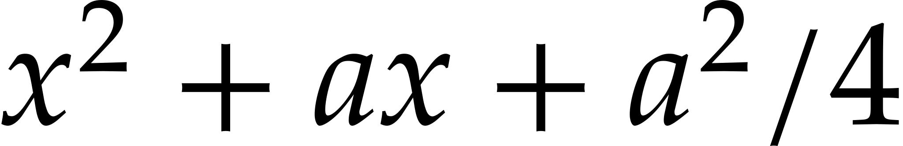 is a special case of a² + 2ab + b².

### [19\[4\]](https://cdn.wittgensteinnachlass.com/2000px/webp/Ts-210/19.webp)

One sees that something can be viewed in this way only once it is viewed in this way. One sees that an aspect is possible only once it is there.

### [19\[5\]](https://cdn.wittgensteinnachlass.com/2000px/webp/Ts-210/19.webp),[20\[1\]](https://cdn.wittgensteinnachlass.com/2000px/webp/Ts-210/20.webp)

One could construct a trigonometry on the model of elementary trigonometry, but independently of the image of triangles, – a trigonometry that knew nothing of the trigonometric series but had only the multiplicity of elementary trigonometry.

### [20\[2\]](https://cdn.wittgensteinnachlass.com/2000px/webp/Ts-210/20.webp)

The Dirichletian conception of the function is only possible where it does not want to express an infinite law through a list, because there is no infinite list.

### [20\[3\]](https://cdn.wittgensteinnachlass.com/2000px/webp/Ts-210/20.webp)

If human warfare were more like chess than it actually is, one could try to represent a battle on the chessboard and solve mathematical problems concerning the possibilities of the battle on the chessboard. Only mathematical problems, of course, for one could not use the chess pieces to conduct experiments on how the battle unfolds, since they behave differently from human beings. Thus if one solved the problem of, say, checkmating the other player in N moves from a particular position, that would be the solution of a mathematical problem of warfare.

### [20\[4\]](https://cdn.wittgensteinnachlass.com/2000px/webp/Ts-210/20.webp)

There is nothing general in the demonstration; it is entirely particular. But the possibility of applying it is general.

### [20\[5\]](https://cdn.wittgensteinnachlass.com/2000px/webp/Ts-210/20.webp)

The possibility of application radiates through the space and strikes the body that one brings into this space. One could call the rays of light general, because they illuminate any body whatsoever that gets in their way. But it would be absurd to call the source of light general.

### [20\[6\]](https://cdn.wittgensteinnachlass.com/2000px/webp/Ts-210/20.webp),[21\[1\]](https://cdn.wittgensteinnachlass.com/2000px/webp/Ts-210/21.webp)

If the reason for believing something were not a verification but an external relation, one would have to ask further “and why is _that_ a reason for _this_ belief in particular”. And so it would go on. (E.g. “why do we take memory as a reason for believing that something happened in the past”.)

### [21\[2\]](https://cdn.wittgensteinnachlass.com/2000px/webp/Ts-210/21.webp)

The generality of the interpretation of a demonstration consists in this – and only in this – that we are interested in the internal relations of the demonstration and not in the physical process (the experiment) in it.

### [21\[3\]](https://cdn.wittgensteinnachlass.com/2000px/webp/Ts-210/21.webp)

The kind of number one uses where it _makes sense_ to go on counting indefinitely differs from the kind one uses where that is _not possible_.

### [21\[4\]](https://cdn.wittgensteinnachlass.com/2000px/webp/Ts-210/21.webp)

I can say “_Those_ are 3 circles” only if “those” has a meaning that does not already predetermine the 3 circles.

### [21\[5\]](https://cdn.wittgensteinnachlass.com/2000px/webp/Ts-210/21.webp)

The generality of a demonstration is the scope of its effect.

### [21\[6\]](https://cdn.wittgensteinnachlass.com/2000px/webp/Ts-210/21.webp),[22\[1\]](https://cdn.wittgensteinnachlass.com/2000px/webp/Ts-210/22.webp)

A demonstration demonstrates everything that it demonstrates. Its scope does not depend on how it is _meant_, but _only_ on the demonstration itself. Just as a searchlight sends its light as far as it sends it, however far we mean to send it. That is the difference between the demonstration and a sentence. For in the demonstration nothing is said; rather, something is shown. And so the scope of its application depends on it and its space, but not on us. For one might say: the demonstration is not general at all, but entirely particular. But it does demonstrate something, and that holds as generally as it holds. (The good thing is precisely that wherever else allusions and hints may count, in the demonstration only what is there counts. In this respect it is like an experiment.) Euclid, for example, gives instructions for bisecting a line segment by demonstrating the method (_on an example_). Now, these instructions hold as far as one can apply them. And if one could not apply them in a given case, it would do them no good to have been meant for that case.

### [22\[2\]](https://cdn.wittgensteinnachlass.com/2000px/webp/Ts-210/22.webp)

The generality of the demonstration is only the space around this demonstration. Application to a particular case is a new body in this space.

### [22\[3\]](https://cdn.wittgensteinnachlass.com/2000px/webp/Ts-210/22.webp)

There is a difference between a system _resting_ on first principles and its merely being developed from them as a starting point. There is a difference between its resting on its lowest walls like a house and its _floating_ freely in space like, say, a celestial body, with our merely having started building at the bottom, though we could have done so somewhere else.

### [22\[4\]](https://cdn.wittgensteinnachlass.com/2000px/webp/Ts-210/22.webp)

Logic and mathematics do not _rest_ on axioms, any more than a group rests on the elements and operations that define it. _Here lies the mistake_ in taking the obviousness, the self-evidence, of the fundamental laws as a criterion of correctness in logic. A foundation that stands on nothing is a poor foundation.

### [23\[1\]](https://cdn.wittgensteinnachlass.com/2000px/webp/Ts-210/23.webp)

It makes sense to say of two points that they are connected by a straight line. But does that mean “it makes sense to say of two things that are points etc.”? –

### [23\[2\]](https://cdn.wittgensteinnachlass.com/2000px/webp/Ts-210/23.webp)

How then do I know that a sign “A” designates a point? Perhaps by seeing that “A” may be combined in a particular way with other signs. But how do I know that these other signs designate straight lines etc.? Through the fact that they may be combined with “A”? Surely they cannot determine each other’s meaning. The grammatical system (game) is simply autonomous, and its application is not _given_ in it.

### [23\[3\]](https://cdn.wittgensteinnachlass.com/2000px/webp/Ts-210/23.webp)

Geometry understood otherwise than as pure grammar must be applied, and then there must be real points and straight lines etc.; the proposition that a straight line connects two points must then indeed have a real sense.

### [23\[4\]](https://cdn.wittgensteinnachlass.com/2000px/webp/Ts-210/23.webp)

And then the geometrical proposition does not say “all pairs of points _are_ connected by a straight line,” but “_can_ be connected by a straight line.” And here one then needs the words “_any two_ points” and not “_all_ pairs of points,” and thereby indicates the difference from another kind of generality.

### [23\[5\]](https://cdn.wittgensteinnachlass.com/2000px/webp/Ts-210/23.webp),[24\[1\]](https://cdn.wittgensteinnachlass.com/2000px/webp/Ts-210/24.webp)

Grammar cannot _state_ its rules generally at a venture (i.e. leave them open).

### [24\[2\]](https://cdn.wittgensteinnachlass.com/2000px/webp/Ts-210/24.webp)

Let us imagine a game of draughts in which it would be permissible to use a board of any size, by which I mean a board with any number of squares (thus 64, 81, 100, etc.). This does not of course mean “it is permissible to use a board with infinitely many squares”. We could hardly call this an infinite game.

### [24\[3\]](https://cdn.wittgensteinnachlass.com/2000px/webp/Ts-210/24.webp)

Possibility always corresponds to a permission in the grammatical rules of the game. What one calls infinite possibility corresponds to something one might call infinite permission. And that is of course not permission to do something infinite.

### [24\[4\]](https://cdn.wittgensteinnachlass.com/2000px/webp/Ts-210/24.webp)

The infinite possibility of forming names lies not only in the infinite possibility of signs of the form x', x'', x''' etc., but also, for example, in the infinite possibility space affords for altering the shape of the sign.

### [24\[5\]](https://cdn.wittgensteinnachlass.com/2000px/webp/Ts-210/24.webp)

Different kinds of chess piece, such as bishops, knights, etc., correspond to different parts of speech.

### [24\[6\]](https://cdn.wittgensteinnachlass.com/2000px/webp/Ts-210/24.webp),[25\[1\]](https://cdn.wittgensteinnachlass.com/2000px/webp/Ts-210/25.webp)

Here I come to that method of explaining signs which Frege made such fun of. For one could explain the words “knight”, “bishop”, etc. by giving the rules governing these pieces.

### [25\[2\]](https://cdn.wittgensteinnachlass.com/2000px/webp/Ts-210/25.webp)

Exactly the same applies in every geometry to the expressions “point” and “straight line”, etc. What a point is and what a straight line is can be seen only from the places the two occupy in the system of rules. Let us imagine, for example, a system of letters such that all permitted signs are groups of 3 letters, arranged so that a letter which may occupy an outer position may not occupy the middle position and vice versa. This rule would distinguish between two “parts of speech”, and we could express this by using capital letters for the outer members and lower-case letters for the inner ones. – On the other hand, however, the distinction between two parts of speech makes no sense at all if they are _not_ syntactically distinguished in the way described above, that is, if they could not be recognized as different even without the different kinds of designation, simply by the rules that apply to them. (Two knights might look nothing like one another and still be identifiable as such, if one knows the rules of the game that apply to them.) Directly connected with this is the fact that introducing new generic names into the philosophy of logic does not get us a hair’s breadth further as long as the syntactic rules that make the difference are not given.

### [25\[3\]](https://cdn.wittgensteinnachlass.com/2000px/webp/Ts-210/25.webp)

If I have counted a class of actual things and now see the 1-to-1 correspondence of another class with it, I can indeed infer that the other class too will have the number arrived at in the first count; but this is a hypothesis, just as the result of the first count is.

### [26\[1\]](https://cdn.wittgensteinnachlass.com/2000px/webp/Ts-210/26.webp)

I can see the equality in number in the correspondence, but I cannot infer it from the correspondence.

### [26\[2\]](https://cdn.wittgensteinnachlass.com/2000px/webp/Ts-210/26.webp)

There are no two parts of speech that I can treat grammatically (_exactly_) alike, but _which_ are nevertheless two parts of speech. Rather, the rules governing them constitute the parts of speech: The same rules, the same part of speech. This is connected with the fact that if one sign behaves exactly like another, the two are the same sign.

### [26\[3\]](https://cdn.wittgensteinnachlass.com/2000px/webp/Ts-210/26.webp)

Dirichlet’s explanation of the function is the first step in set theory. But the truth is that a function one defines by a table and one one defines by an infinite process yield essentially _different things_, for an infinite table, like an infinite list, is an absurdity.

### [26\[4\]](https://cdn.wittgensteinnachlass.com/2000px/webp/Ts-210/26.webp)

“Is it conceivable that 2 things have all their properties in common?” If it is not conceivable, then the opposite is not conceivable either.

### [26\[5\]](https://cdn.wittgensteinnachlass.com/2000px/webp/Ts-210/26.webp),[27\[1\]](https://cdn.wittgensteinnachlass.com/2000px/webp/Ts-210/27.webp)

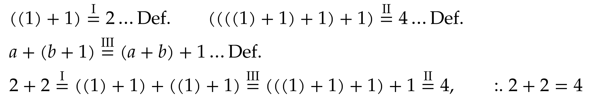

What makes 2 + 2 = 4 meaningful, that is, what makes 2 + 2 = 4 right and 2 + 2 = 5 wrong, rather than two equally legitimate stipulations, is the provability of 2 + 2 = 4, and that alone. That is, that ((1) + 1) + ((1) + 1) = (((1) + 1) + 1) + 1 belongs to the general system a + (b + 1) = (a + b) + 1.

### [27\[2\]](https://cdn.wittgensteinnachlass.com/2000px/webp/Ts-210/27.webp)

Without this provability, 2 + 2 = 4 would be an arbitrary rule for signs, and there would be no question of its being right or wrong. Demonstrability makes the equation something that can be compared with a proposition.

### [27\[3\]](https://cdn.wittgensteinnachlass.com/2000px/webp/Ts-210/27.webp)

To call “a + (b + 1) = (a + b) + 1” a definition is already a mistake, strictly speaking, for it is a rule for signs of quite a different kind from, e.g., (1) + 1 = 2.

### [27\[4\]](https://cdn.wittgensteinnachlass.com/2000px/webp/Ts-210/27.webp)

One might now ask: What meaning does 2 + 2 = 4 have? Is it not a rule for signs? If so, it is arbitrary. The answer is that the meaning of 2 + 2 = 4 lies not in itself but in its provability, that is, in its relation to other rules for signs, and thus in _its_ belonging to a system. I.e. that proof shows internal relations between 2 and 4 (just) as the proof that p⊃q & p ․⊃․ q is a tautology shows internal relations between p⊃q ∙ p and q.

### [27\[5\]](https://cdn.wittgensteinnachlass.com/2000px/webp/Ts-210/27.webp)

If “a + (b + 1) = (a + b) + 1” is the general rule, then I can replace 2 + 2 with 4; that lies in the logical structure of the world.

### [28\[1\]](https://cdn.wittgensteinnachlass.com/2000px/webp/Ts-210/28.webp)

The word “number” is nothing unless the variable number form (expressed in grammatical rules) stands behind it.

### [28\[2\]](https://cdn.wittgensteinnachlass.com/2000px/webp/Ts-210/28.webp)

An equation acquires mathematical meaning only in a calculus.

### [28\[3\]](https://cdn.wittgensteinnachlass.com/2000px/webp/Ts-210/28.webp)

Thus “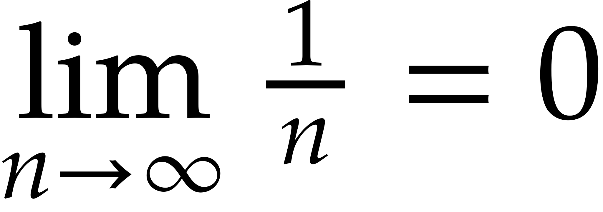” is an arbitrary substitution rule as long as the expression “lim etc.” does not occur in a calculus of limits. The connection of this calculus with the inductive properties of , for example, consists in the fact that the calculus permits the same transitions from equation to equation as are possible from one process of induction to another.

### [28\[4\]](https://cdn.wittgensteinnachlass.com/2000px/webp/Ts-210/28.webp)

0,000

0,100

0,010

0,110

0,001

0,101

0,011

0,111

etc. I understand the rule by which this is formed; but how can I put it in exact form? Since I understand it, it must be possible to put it in exact form. For that I need the general form of a term, and this form must be correlated with that of the first such term in such a way that one can see how the first term is a case of the general term. And it must also be shown how the successor of the general term is a general term.

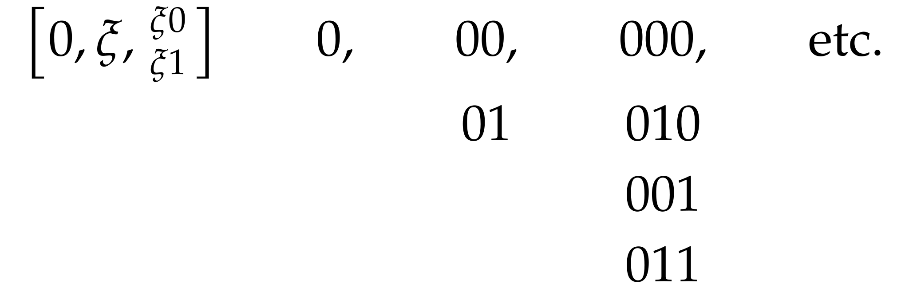

But this sign must be accompanied by a description or instructions for its use, and the difficulty is precisely to give this in exact, i.e. presumably unambiguous, form.

### [29\[1\]](https://cdn.wittgensteinnachlass.com/2000px/webp/Ts-210/29.webp)

If I did not understand all those rules of induction, I could not calculate with decimals. But it is very difficult to state them exactly. – Or it presupposes a complicated technique. What kind of technique this would have to be to meet stringent requirements, and whether there is any such thing here as “*non*-rigorous”, I do not know. I am almost inclined to think that if one just sees the internal relation between the terms of the series of forms, everything is in order, and that there is no method at all of forcing someone, so to speak, to see the internal relation. It may also be that one must first see it in particular cases and can then build the expressions for other series of forms on this seeing.

### [29\[2\]](https://cdn.wittgensteinnachlass.com/2000px/webp/Ts-210/29.webp)

The concept “irrational number” is a dangerous pseudo-concept.

### [29\[3\]](https://cdn.wittgensteinnachlass.com/2000px/webp/Ts-210/29.webp)

A cut is a _principle_ of division into greater and less.

### [29\[4\]](https://cdn.wittgensteinnachlass.com/2000px/webp/Ts-210/29.webp)

More precisely, an irrational number requires a _different_ definition of “greater” and “less” from that required by a rational number. All the artifices used in introducing irrational numbers are meant to conceal this novelty. I.e., the introduction of √2 is the introduction of a new mathematical world, and it is always supposed to look as though it had somehow already been contained in the earlier one.

### [29\[5\]](https://cdn.wittgensteinnachlass.com/2000px/webp/Ts-210/29.webp)

“non-p” simply excludes p. What is then the case _instead of_ p follows from the nature of _what is excluded_.

### [30\[1\]](https://cdn.wittgensteinnachlass.com/2000px/webp/Ts-210/30.webp)

On the question of the existence of sense-data. One _says_ that if something seems red, then _something_ must have _been_ red; if something _seemed_ to last a short time, then _something_ must have lasted a short time; etc. For one might ask: If something seemed red, how do we know that it seemed specifically _red_? Is it a matter of an empirical correlation between this appearance and this reality? If something “seemed to have the property φ”, how do we know that it seemed to have _this_ property – – –. What kind of connexion is there between ‘it seems so’ and ‘it is so’. To begin with, the appearance can be right or wrong. – An appearance is also in one sense connected with reality _empirically_. One says “this seems to be typhoid”, and that means that these symptoms are empirically connected with those phenomena. If I say “this seems to be red” and then “yes, it really is red”, I have used a test for the second decision that _was independent of the first appearance_. If something _seemed_ red, then there was this appearance. And even if nothing in this appearance _is_ red in the same sense in which that other thing would be red if the appearance were right, there was nevertheless something in the appearance _corresponding_ to being red. – If it seems as though a physical object were brown and round, something need not therefore be brown and round in the physical sense, of course, but something corresponding is the case. But in what respect can one speak of something corresponding? – – –

### [30\[2\]](https://cdn.wittgensteinnachlass.com/2000px/webp/Ts-210/30.webp)

“Sentence” is just as general as, for example, “event”. How can one delimit “an event” against what is not an event? But “experiment” is just as general too, though it may seem _more specific_ at first glance.

### [31\[1\]](https://cdn.wittgensteinnachlass.com/2000px/webp/Ts-210/31.webp)

Of course one cannot say either that ‘sentence’ is what one can predicate ‘true’ and ‘false’ of, for that would determine something only if those words were meant in a particular way, but they can be so meant only in context. And precisely in the context of a sentence. All one can do here, as in all these cases, is to specify the grammatical game, give its rules and leave it at that. What is at issue here is the rules for “⌵”, “non”, etc.

### [31\[2\]](https://cdn.wittgensteinnachlass.com/2000px/webp/Ts-210/31.webp)

“Then an event occurred …”: this does not mean “an event” as opposed to something else.

### [31\[3\]](https://cdn.wittgensteinnachlass.com/2000px/webp/Ts-210/31.webp)

In set theory one ought to distinguish what is calculus from what aspires to be _doctrine_ (and of course cannot be). So one must separate the rules of the game from inessential statements about the chess pieces.

### [31\[4\]](https://cdn.wittgensteinnachlass.com/2000px/webp/Ts-210/31.webp),[32\[1\]](https://cdn.wittgensteinnachlass.com/2000px/webp/Ts-210/32.webp)

It is always, and rightly, highly suspicious when proofs in mathematics are carried out more generally than their known application warrants. Here one invariably encounters the error of seeing general concepts and particular cases in mathematics. In set theory we encounter this suspicious generality at every turn. One is always tempted to say: “Let us get to the point!” Those general considerations only ever have sense if one has a particular field of application in view. There is, after all, no generality in mathematics whose application to particular cases cannot already be foreseen. One therefore always feels that the general considerations of set theory (if one does not regard them as a calculus) are idle talk, and is quite astonished when shown an application of these considerations. One feels that something here is not quite above board.

### [32\[2\]](https://cdn.wittgensteinnachlass.com/2000px/webp/Ts-210/32.webp)

Given all I have already said about it, it may sound trivial if I now say that the flaw in the set-theoretic approach lies, time and again, in treating laws and enumerations (lists) as essentially one and in stringing them together; where one does not suffice, the other fills the gap. (This is what Dirichlet’s conception of functions does.)

### [32\[3\]](https://cdn.wittgensteinnachlass.com/2000px/webp/Ts-210/32.webp)

If one applies my consideration to Cantor’s diagonal procedure, the result is:

An infinite set of decimal fractions:

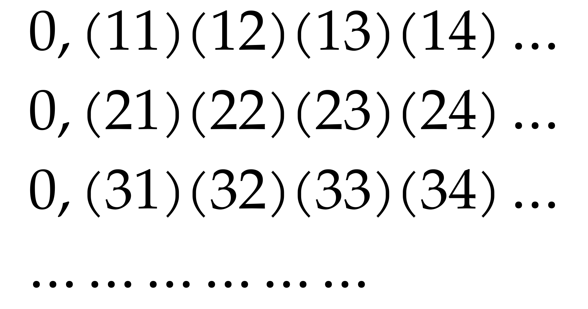

…

– – –

– – –

can only mean a law according to which laws are formed, and that really means a function of two variables. F(x,y) is the general form of these decimal fractions. F(x,n) is the nth of them and F(m,n) is its mth digit. The decimal fraction taken along the diagonal is F(x,x), and when altered it reads, say, F(x,x) + 1. And now a proof by induction shows that F(x,x) + 1 has a different expansion from any F(x,y). But where is the higher infinite here? (Or even the “actually infinite”.)

### [32\[4\]](https://cdn.wittgensteinnachlass.com/2000px/webp/Ts-210/32.webp),[33\[1\]](https://cdn.wittgensteinnachlass.com/2000px/webp/Ts-210/33.webp)

Here again the difficulty lies in the formation of mathematical pseudo-concepts. If one says, e.g.: one can arrange the cardinal numbers in a sequence in order of magnitude, but not the rational numbers, this contains the unconscious presupposition that the concept of arranging in order of magnitude does after all have a sense for _the rational numbers_, and that, when tried, this way of arranging them proves impossible (which presupposes that the _attempt_ is conceivable). – So one thinks it is possible to try to arrange _the real numbers_ (as if this were a concept like, say, ‘apples on this table’) in a sequence, and that it then proves impossible to do.

### [33\[2\]](https://cdn.wittgensteinnachlass.com/2000px/webp/Ts-210/33.webp)

When the calculus of sets models its way of speaking as closely as possible on that of the calculus of cardinal numbers, that is no doubt instructive in some respects, because it points to certain formal similarities, but it is also misleading if, as it were, the calculus still calls something a knife when it no longer has either handle or blade. (Lichtenberg).

### [33\[3\]](https://cdn.wittgensteinnachlass.com/2000px/webp/Ts-210/33.webp)

One can set against a recurring decimal, which is after all a law, only non-periodic laws, not non-periodic _extensions_.

### [33\[4\]](https://cdn.wittgensteinnachlass.com/2000px/webp/Ts-210/33.webp)

How does one prove that 2 × 2 is not 5? Is it a different proof from the proof that 2 × 2 = 4? For since the sense of the mathematical proposition lies in its provability and in the way it is to be proved, the sense of the negative proposition must also be found in this way.

### [33\[5\]](https://cdn.wittgensteinnachlass.com/2000px/webp/Ts-210/33.webp)

((I see indistinctly a connexion between the problem of solipsism or idealism and that of a sentence’s mode of designation. Is the I perhaps replaced in these cases by the sentence, and the relation of the I to reality by the relation between sentence and reality?))

### [34\[1\]](https://cdn.wittgensteinnachlass.com/2000px/webp/Ts-210/34.webp)

If I say to someone “take three steps” and he understands the order, then he can explain it to me, say, by means of a drawing. He says: If here is the path and A the beginning, then you want me to get to B, then to C and D; or something of the sort. And here it is clear that in a certain sense he has only given expression to something that he already knew earlier – when he heard and understood the order. He could now go on like this and explain the order still more closely, say by a more elaborate diagram, and yet he would always only be producing what was already clear to him earlier. He is only translating from one language into another. And if he now finally carried out the order, as a sign that he has understood it – would he not again merely be translating?

### [34\[2\]](https://cdn.wittgensteinnachlass.com/2000px/webp/Ts-210/34.webp)

There must be a continuity between the order and its execution. The execution must, so to speak, be only the end surface of the order (of the order-body).

### [34\[3\]](https://cdn.wittgensteinnachlass.com/2000px/webp/Ts-210/34.webp)

In order to make the essence of understanding clear to myself, I always think of a figure and a projection that one makes of it. The method of projection can only be _fixed_ by the comparison of the picture with the reality that is simply there.

### [34\[4\]](https://cdn.wittgensteinnachlass.com/2000px/webp/Ts-210/34.webp)

But then it seems as if one had to compare the proposition with reality _in a particular sense_ – that is, not just compare. As if, then, in certain cases reality had, as it were, to feel a reproach through the comparison. If something approaches a _goal_, then what I mean lies here in the word “goal” (the intention.)

### [35\[1\]](https://cdn.wittgensteinnachlass.com/2000px/webp/Ts-210/35.webp)

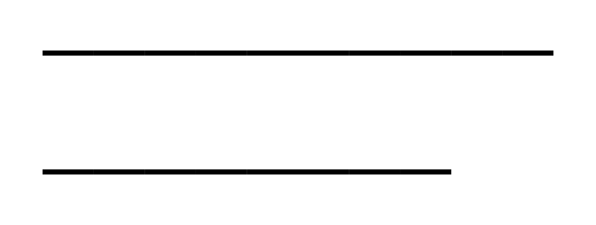 Everyone sees that the upper line segment is longer and the lower one shorter; but no one sees in this that the lower segment _ought to be or become_ as long as the upper one. And how can a picture, of whatever kind, express that?

### [35\[2\]](https://cdn.wittgensteinnachlass.com/2000px/webp/Ts-210/35.webp)

That is, the sentence (order) is not simply placed alongside reality, but is compared with it with a _particular_ _tendency_. But where does this tendency lie?

### [35\[3\]](https://cdn.wittgensteinnachlass.com/2000px/webp/Ts-210/35.webp)

The sentence, the order, as it were continues reality by taking up where reality leaves off and representing a change. It is as if one had a doll representing my body in its present position, and now made on it – in effigie – the changes intended for my body.

### [35\[4\]](https://cdn.wittgensteinnachlass.com/2000px/webp/Ts-210/35.webp)

So the problem would again be what the nature of the relation of standing in for something is, when one says, for instance, “this figure is to be you etc. etc.”.

### [35\[5\]](https://cdn.wittgensteinnachlass.com/2000px/webp/Ts-210/35.webp)

What does it mean to say: I can imagine that the spot A moves to the place B? Light must be shed on the strange illusion to which one is subject, that in the sentence the objects do what the sentence says.

### [35\[6\]](https://cdn.wittgensteinnachlass.com/2000px/webp/Ts-210/35.webp),[36\[1\]](https://cdn.wittgensteinnachlass.com/2000px/webp/Ts-210/36.webp)

It is as if a shadow of the execution already lay in the order. But a shadow of just _this_ execution. _You_ go to such-and-such a place in the order. – But otherwise it would simply be a _different_ order.

### [36\[2\]](https://cdn.wittgensteinnachlass.com/2000px/webp/Ts-210/36.webp)

(I know that I must drink in logical poison in order to be able to overcome it. So now I keep telling myself that the fact must after all already lie in the order, in the sentence, although I know that it does not lie in it; but this _appearance_ must be tackled.)

### [36\[3\]](https://cdn.wittgensteinnachlass.com/2000px/webp/Ts-210/36.webp)

Underlying all my considerations is the insight that thought has an internal connexion with the world and not an external one. That one thus _means_ what one says. But does that not mean only that in language one cannot move outside language, or in thought outside thought?

### [36\[4\]](https://cdn.wittgensteinnachlass.com/2000px/webp/Ts-210/36.webp)

In language everything is _settled_.

### [36\[5\]](https://cdn.wittgensteinnachlass.com/2000px/webp/Ts-210/36.webp)

When one says “I thought you would come today and have already made preparations”, there is some continuity between these preparations and the thought. When I push a chair over to someone _so that_ he will sit down, here too the thought and the action form a chain.

### [36\[6\]](https://cdn.wittgensteinnachlass.com/2000px/webp/Ts-210/36.webp)

The thought “that this is how things stand” (p) is made true by the fact that this is how things stand (p). That the connexion between thought and world cannot be represented in this way (for this representation says nothing at all) must be the answer to my problems.

### [37\[1\]](https://cdn.wittgensteinnachlass.com/2000px/webp/Ts-210/37.webp)

Nor is it, of course, that whatever verifies – satisfies – the thought “that p is the case” is simply called p. As if one were to say: I feel like having an apple and whatever satisfies this desire I shall simply call an apple.

### [37\[2\]](https://cdn.wittgensteinnachlass.com/2000px/webp/Ts-210/37.webp)

For I am now _speaking_ of the satisfaction of the thought (the expectation) before the thought is satisfied.

### [37\[3\]](https://cdn.wittgensteinnachlass.com/2000px/webp/Ts-210/37.webp)

For one might think: how does this work? The thought and the fact are different; yet we call the thought: the _one_, namely that the fact is the case; or the fact: the one that makes the thought true. Is the one, then, a description made with the aid of the other? Is the thought _described_ by means of the fact that makes it true, and thus described in terms of an external property, as when I say of someone that he is my uncle? Or is the fact described in just this way by means of the thought?

### [37\[4\]](https://cdn.wittgensteinnachlass.com/2000px/webp/Ts-210/37.webp)

If one explains the expression “the thought that … is the case” as a _description_, that again explains nothing, because the question arises: how is such a description possible? It in turn presupposes the essence of thought, for it contains a reference to a fact that has not occurred, which is precisely what was problematic.

### [37\[5\]](https://cdn.wittgensteinnachlass.com/2000px/webp/Ts-210/37.webp),[38\[1\]](https://cdn.wittgensteinnachlass.com/2000px/webp/Ts-210/38.webp)

My view is that thought is essentially what is expressed by the sentence, where ‘expressed’ does not mean ‘brought on’. A cold is brought on by a cold bath, but not expressed by the cold bath. I mean that thought is wholly _measure_, like a yardstick; i.e. everything about the yardstick is inessential except the measure of length.

### [38\[2\]](https://cdn.wittgensteinnachlass.com/2000px/webp/Ts-210/38.webp)

The thought is a symbol.

### [38\[3\]](https://cdn.wittgensteinnachlass.com/2000px/webp/Ts-210/38.webp)

The present thought contains _all_ the reality that is presently there. (And it _cannot_ have more, after all.)

### [38\[4\]](https://cdn.wittgensteinnachlass.com/2000px/webp/Ts-210/38.webp)

It is very remarkable that the explanations in a book on differential calculus contain set-theoretical expressions and symbols which disappear entirely in the calculus. This is reminiscent of the first explanations in textbooks of physics, in which there is talk of the law of causality and the like, which, once we get down to business, is no longer mentioned.

### [38\[5\]](https://cdn.wittgensteinnachlass.com/2000px/webp/Ts-210/38.webp)

To compare the symbol – I mean what is used as a symbol – with reality is simple. The difficulty consists in comparing it, together with the symbolizing relation, as a thought with reality.

### [38\[6\]](https://cdn.wittgensteinnachlass.com/2000px/webp/Ts-210/38.webp)

“I am glad that you are coming” does not mean, I am glad because you are coming. In that case it would be a conjecture that _that_ is why I am in such a good mood.)

### [39\[1\]](https://cdn.wittgensteinnachlass.com/2000px/webp/Ts-210/39.webp)

If I say: the words do not ‘mean’ anything at all, I merely want to produce a particular effect with them, then the question is: what does it mean to produce _a particular effect_; that is precisely the application of language that I do not understand.

### [39\[2\]](https://cdn.wittgensteinnachlass.com/2000px/webp/Ts-210/39.webp)

For it is the intention that one wants to explain, and one cannot explain it by means of itself.

### [39\[3\]](https://cdn.wittgensteinnachlass.com/2000px/webp/Ts-210/39.webp)

“A sentence does not mean, does not say, anything at all; it merely brings something about; like a railway signal, for example, which one could also replace with an automatic device.”

### [39\[4\]](https://cdn.wittgensteinnachlass.com/2000px/webp/Ts-210/39.webp)

One can imagine that something is the case which is not: very remarkable! For it is not remarkable that the mental image does not agree with reality, but it is remarkable that it represents it even then.

### [39\[5\]](https://cdn.wittgensteinnachlass.com/2000px/webp/Ts-210/39.webp)

Thought is a piece of reality. And how can a piece of reality occupy an essentially exceptional position. Except in a relation to itself. Likewise, that one could think about everything, but not about thinking.

### [39\[6\]](https://cdn.wittgensteinnachlass.com/2000px/webp/Ts-210/39.webp)

Why does my thought seem to me such an exceptional piece of reality? Surely not because I know it “from within”; that means nothing. Rather, apparently, it is because I settle everything in thought, and about thinking, in turn, I could only _think_.

### [40\[1\]](https://cdn.wittgensteinnachlass.com/2000px/webp/Ts-210/40.webp)

If someone believes he has found the solution to the ‘problem of life’ and wanted to say to himself that now everything is quite easy, to refute himself he need only remember that there was a time when this ‘solution’ had not been found; but even at _that_ time one had to be able to live, and in the light of that time the solution he has found seems like a mere accident. And so it is with us in logic. If there were a ‘solution’ to the logical (philosophical) problems, we would only have to remind ourselves that they were once unsolved (and even then one had to be able to live and think) – – –

### [40\[2\]](https://cdn.wittgensteinnachlass.com/2000px/webp/Ts-210/40.webp)

There is an essential difference between propositions like “that is a lion”, “the sun is larger than the earth”, which all contain a “this”, “now”, “here” and thus connect directly with reality, and propositions like “human beings have two hands”, etc. For if there happened to be no human beings around me, how would I check this proposition?

### [40\[3\]](https://cdn.wittgensteinnachlass.com/2000px/webp/Ts-210/40.webp)

What is essential about thought is that it does not serve as a means to an end, as an instrument one could replace with another, but as something incomparable, autonomous. That is why a prosthesis for thought is inconceivable. But does that mean anything? I can indeed replace the stomach with a prosthesis, but not the stomach pains. And can one not say the same of a stomach pain as of thought?

### [40\[4\]](https://cdn.wittgensteinnachlass.com/2000px/webp/Ts-210/40.webp)

Negation too contains a kind of generality. But of course affirmation must contain it too and merely make a different use of it.

### [41\[1\]](https://cdn.wittgensteinnachlass.com/2000px/webp/Ts-210/41.webp)

If someone gives me a complicated order in a sign language, – at first I do not understand it, then suddenly I understand: “ah, _that_ is what he wants”, what have I grasped (got hold of). Perhaps a mental image of an action; but that too would be merely a sign if I could not use it. Or I have no mental image, but signs of a system that I can already use.

### [41\[2\]](https://cdn.wittgensteinnachlass.com/2000px/webp/Ts-210/41.webp)

One does not have the thought and, _alongside_ it, language. – So it is not as though one had signs for the other person but a silent thought for oneself.

### [41\[3\]](https://cdn.wittgensteinnachlass.com/2000px/webp/Ts-210/41.webp)

Thought is _always_ a construction.

### [41\[4\]](https://cdn.wittgensteinnachlass.com/2000px/webp/Ts-210/41.webp)

Negation must be part of the construction.

For example, in every symbolism it must be the case that non-non-p = p.

### [41\[5\]](https://cdn.wittgensteinnachlass.com/2000px/webp/Ts-210/41.webp)

One might put it this way: there is nothing private about _thought_. – Anyone can look into it.

### [41\[6\]](https://cdn.wittgensteinnachlass.com/2000px/webp/Ts-210/41.webp)

One does not have the expression in signs and, alongside it, the (as it were obscure) thought for oneself. It would then be altogether too strange that one should be able to render the thought in words.

### [41\[7\]](https://cdn.wittgensteinnachlass.com/2000px/webp/Ts-210/41.webp)

That is: if the thought were not already articulated, how could its expression in language articulate it? But the articulated thought is in all essentials a sentence.

### [41\[8\]](https://cdn.wittgensteinnachlass.com/2000px/webp/Ts-210/41.webp)

Non-p excludes p; what it then _allows_ depends on the nature of p.

### [42\[1\]](https://cdn.wittgensteinnachlass.com/2000px/webp/Ts-210/42.webp)

One can negate only a _sentence_, – so if one uses a sign with the same formal rules as the negation sign in connexion with equations, there will certainly be a temptation to call it negation, but there is no question here of negation in the first sense.

### [42\[2\]](https://cdn.wittgensteinnachlass.com/2000px/webp/Ts-210/42.webp)

In mathematics _everything_ is algorithm, _nothing_ meaning; even where it seems otherwise because we seem to be speaking _in words about_ mathematical things. Rather, what we do in that case is form an algorithm with those words.

### [42\[3\]](https://cdn.wittgensteinnachlass.com/2000px/webp/Ts-210/42.webp)

The only proof that two proofs prove the same thing is that they can be transformed into one another.

### [42\[4\]](https://cdn.wittgensteinnachlass.com/2000px/webp/Ts-210/42.webp)

A proof proves only what it proves; i.e. no interpretation can get more out of it than what is written in the proof itself.

### [42\[5\]](https://cdn.wittgensteinnachlass.com/2000px/webp/Ts-210/42.webp)

Two proofs that prove the same thing must, after all, meet. Like two paths leading to the same place. Let us follow them and see how they meet.

### [42\[6\]](https://cdn.wittgensteinnachlass.com/2000px/webp/Ts-210/42.webp)

Can one derive from the inequality:

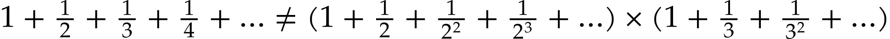 a number n that is in any case still missing from the combinations on the right-hand side? Euler’s proof that “there are infinitely many primes” is supposed to be an existence proof, after all, and how is that possible without construction?

### [42\[7\]](https://cdn.wittgensteinnachlass.com/2000px/webp/Ts-210/42.webp),[43\[1\]](https://cdn.wittgensteinnachlass.com/2000px/webp/Ts-210/43.webp),[44\[1\]](https://cdn.wittgensteinnachlass.com/2000px/webp/Ts-210/44.webp)

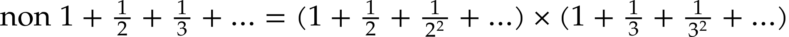 the argument runs as follows: The product on the right is a series of fractions  in whose denominators all the combinations 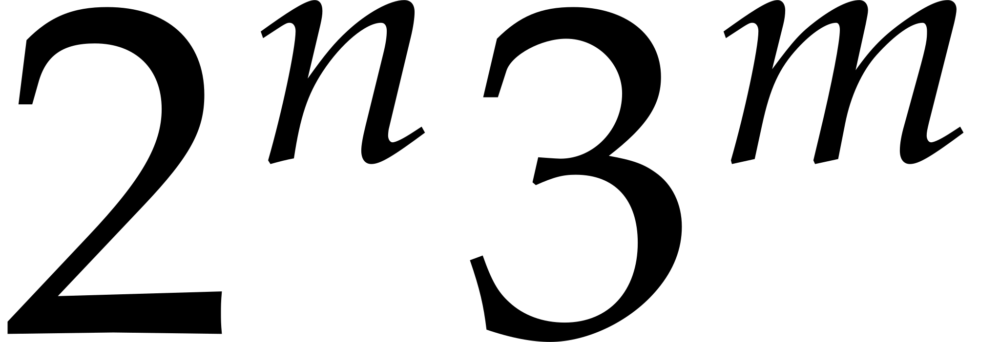 occur; if those were all the numbers, this series would have to be the same as 1 + ½ + ⅓ … and then the sums too would have to be equal. But the one on the left is infinite and the one on the right only a finite number 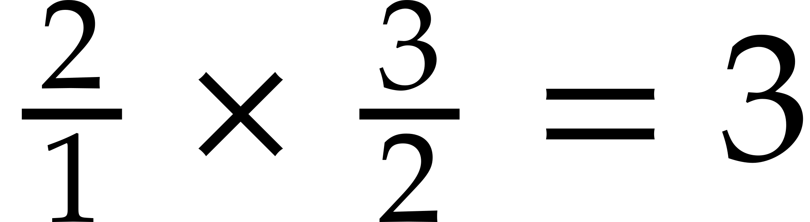, so infinitely many fractions are missing from the series on the right, i.e. _there are_ fractions in the series on the right that do not occur in the one on the left. And now the question is: is this argument correct? If we were dealing with finite series here, everything would be _clear_. For then one could find out from the method of summation just which terms of the series on the left are missing from the series on the right. One might now ask: how is it that the series on the right yields infinity, what must it contain besides the terms of the one on the left for this to happen? Indeed, the question is: does an equation like the one above, 1 + ½ + ⅓ + … = 3, make any sense at all? After all, I cannot find out from it _which_ terms on the left are extra. How do we know that all the terms on the right also occur on the left-hand side? In the case of finite series, I can say so only when I have checked this term by term; – and then I see at the same time which ones are left over. – What we lack here is the connection between the result of the sum and the terms, the only connection that could _provide_ the proof. – Everything becomes clearest if one imagines working it out with a finite equation: 1 + ½ + ⅓ + ¼ + ⅕ + ⅙ ≠ (1 + ½) × (1 + ⅓) = 1 + ½ + ⅓ + ⅙ Here again we have the remarkable thing that one might call a proof by circumstantial evidence in mathematics – which is never admissible. Or, a _symptom_-based proof. The result of the summation is a symptom (or is taken as one) of there being terms on the right that are missing on the left. The connection between the symptom and what one wants to prove is a _loose_ one. That is, a bridge has not been built, but one is content to _see_ the other shore. All the terms on the right-hand side occur on the left-hand side, but the sum on the left yields infinity and the one on the right only a finite value – _so there must be_ … but in mathematics nothing _must_ be, except what _is_. The bridge must be built. In mathematics there is no symptom; there can be one only in the psychological sense for the mathematician. One might also put it this way: in mathematics nothing can be inferred that cannot be _seen_.

### [44\[2\]](https://cdn.wittgensteinnachlass.com/2000px/webp/Ts-210/44.webp)

The whole looseness of that argument is presumably due to confusing the sum with the limit of the sum. One can see this clearly: _however far_ one extends the series on the right, one can always extend the one on the left far enough to include all the terms on the right. (It still remains _open_ whether it then contains any other terms as well.)

### [44\[3\]](https://cdn.wittgensteinnachlass.com/2000px/webp/Ts-210/44.webp)

One might also ask: If you had only this proof, what could you venture on the strength of it? Suppose we had found the primes up to N: could we now, on the strength of it, go on searching indefinitely for another prime – since the proof guarantees that we shall find one? That is surely nonsense. – For “if only we search long enough” means nothing at all. (This applies to existence proofs in general.)

### [44\[4\]](https://cdn.wittgensteinnachlass.com/2000px/webp/Ts-210/44.webp),[45\[1\]](https://cdn.wittgensteinnachlass.com/2000px/webp/Ts-210/45.webp)

Could I add further primes on the left on the strength of this proof? Certainly not, for I have no idea how to find any, and that means: I have no concept of a prime at all; the proof has given me none. I could only add arbitrary numbers (or series, as the case may be). The question is whether adding the proof of unique factorization makes our proof conclusive.

### [45\[2\]](https://cdn.wittgensteinnachlass.com/2000px/webp/Ts-210/45.webp)

(Mathematics is dressed in false interpretations.)

### [45\[3\]](https://cdn.wittgensteinnachlass.com/2000px/webp/Ts-210/45.webp)

(“There _must_ be another _prime_ to come”, means nothing in mathematics. This is directly connected with there being “nothing more general or more specific in logic”.)

### [45\[4\]](https://cdn.wittgensteinnachlass.com/2000px/webp/Ts-210/45.webp)

If the numbers were all combinations of 2 and 3, then 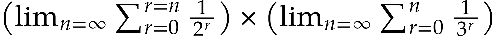 would have to yield 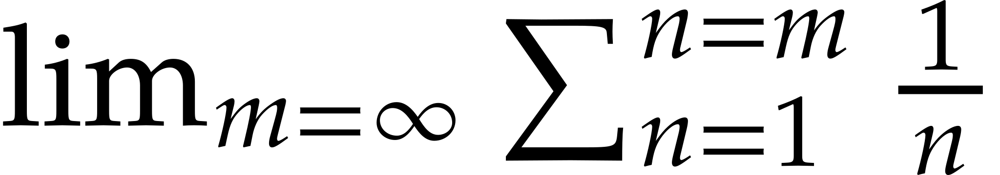, – but it does not … What follows from this? (Law of excluded middle) Nothing follows from this except that the limits of the sums are different; hence nothing (_new_)). But one could now investigate why this is so. In doing so one may come across numbers that cannot be represented by 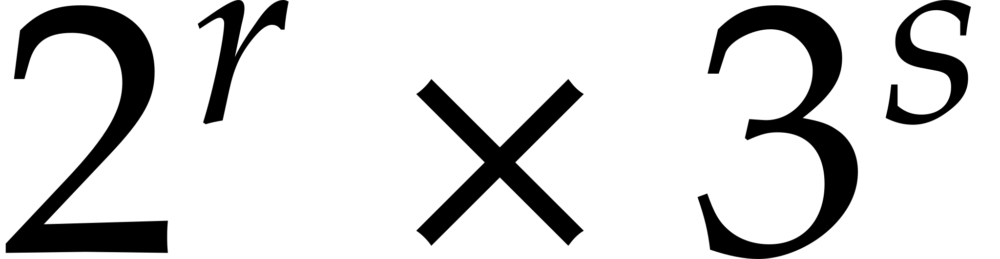, hence larger primes, but one will never see that _no_ number of such fundamental numbers suffices to represent all numbers.

### [45\[5\]](https://cdn.wittgensteinnachlass.com/2000px/webp/Ts-210/45.webp),[46\[1\]](https://cdn.wittgensteinnachlass.com/2000px/webp/Ts-210/46.webp)

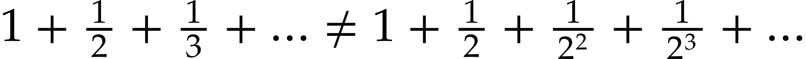 However many terms of the form 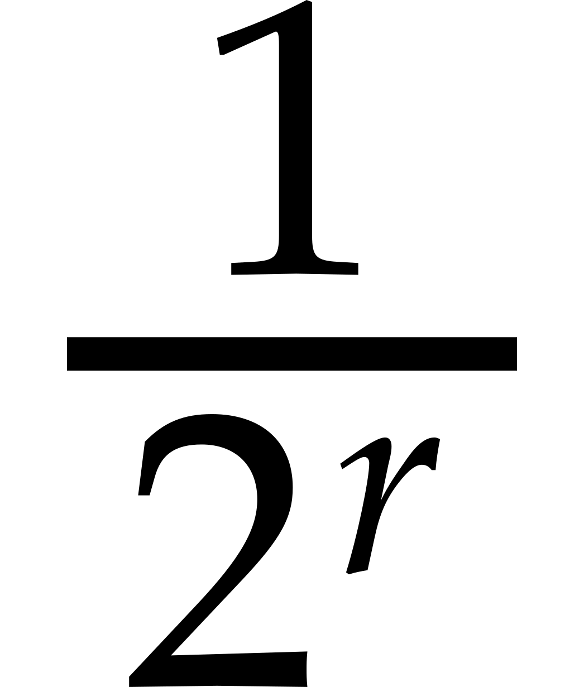 I take together, they never yield more than 2, whereas the first four terms of the series on the left already yield more than 2. (So the proof must already lie _in this_.) And this is indeed where it lies, along with the construction of a number that is not a power of 2, for the rule now is: find the segment of the series that in any case exceeds 2; it must contain a number that is not a power of 2.

### [46\[2\]](https://cdn.wittgensteinnachlass.com/2000px/webp/Ts-210/46.webp)

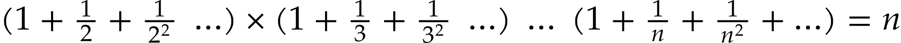. If I now extend the sum 1 + ½ + ⅓ + … until it exceeds n, then this portion must contain a term that cannot be found in the series on the right, for if the series on the right contained all these terms, then it would have to yield a greater sum, not a smaller one.

### [46\[3\]](https://cdn.wittgensteinnachlass.com/2000px/webp/Ts-210/46.webp)

Now what if one existence proof shows that a number with the _desired_ property occurs in a particular interval, but another shows that one must be found in a smaller interval? Do these two then prove the same thing, namely existence? No.

### [46\[4\]](https://cdn.wittgensteinnachlass.com/2000px/webp/Ts-210/46.webp),[47\[1\]](https://cdn.wittgensteinnachlass.com/2000px/webp/Ts-210/47.webp)

The condition under which a part of the series 1 + ½ + ⅓ + …, say 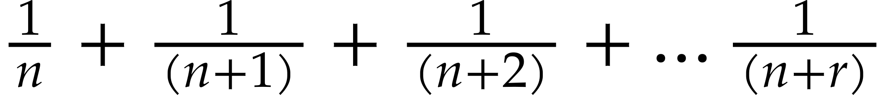, becomes equal to or greater than 1 is as follows:

We want:

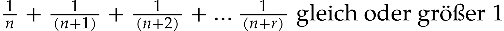.

Let us transform the left-hand side into:

[ ( 1

\+ n (n + 1) +

n (n + 2) +

… +

n (n + r) )

n] =

= [( 1 +

(1 ‒ 1 n + 1 ) +

(1 ‒ 2 n + 2 ) + …

(1 ‒ n ‒ 1 n + (n ‒ 1) ) +

n 2n +

n 2n + 1 +

+

n 2n + 2

+

… + n n + r )

n] ⇒ [( n ‒

1 2 n ∙ (n ‒ 1) ∙ 1 n + 1 + (r ‒ n + 1) n n + r

)

n] =

= 1 ‒ 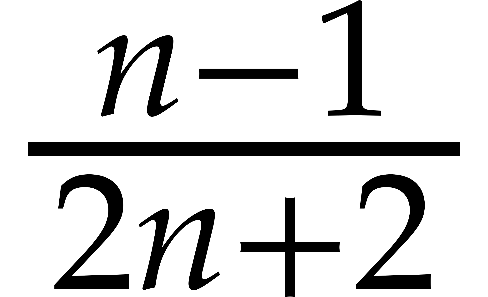 + 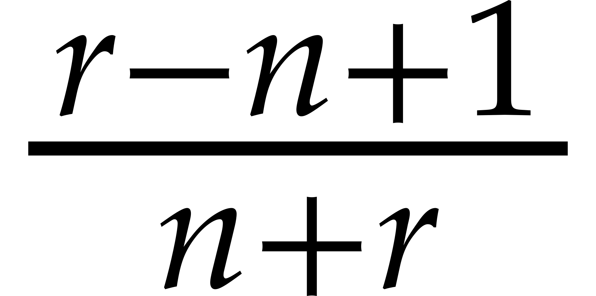 equal to or greater than 1

Hence: 2nr + 2r ‒ 2n² ‒ 2n + 2n + 2 ‒ n² ‒ nr + n + r = or greater than 0

nr + 3r ‒ 3n² + 2 + n = or greater than 0

r = or greater than 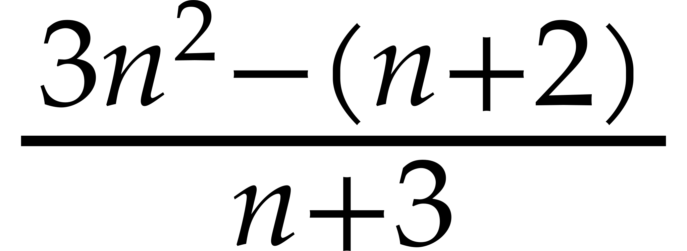 | less than 3n ‒ 1. Thus a sufficient condition for 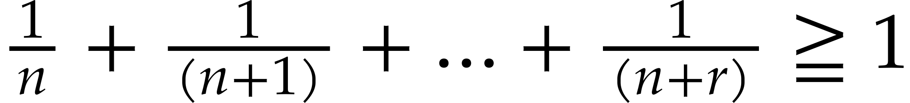 is that r ≧ 3n ‒ 1. If I now imagine such segments, each equal to or greater than 1, laid end to end from the beginning of the series 1 + ½ + ⅓ + …, then the first of these segments runs from

1 to 3, the second from

4 to 15, the third from

16 to 63, the mth up to 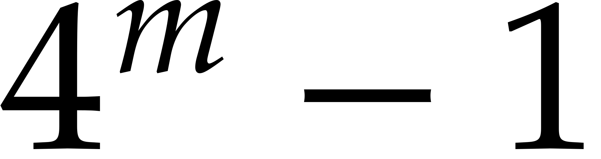. The sum 1 + ½ + ⅓ + …, extended to the 4mth term, therefore certainly exceeds m. Thus

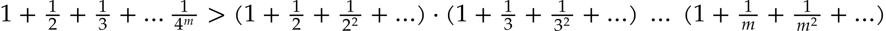 Thus among the first 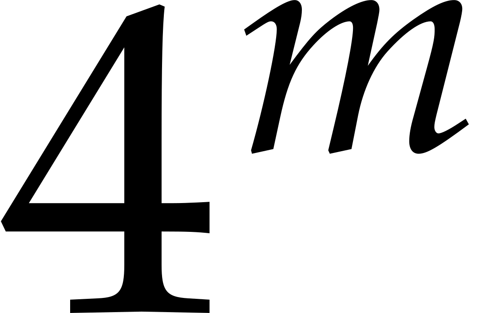 integers there must be at least one that is not divisible by any of the first m numbers.

### [47\[2\]](https://cdn.wittgensteinnachlass.com/2000px/webp/Ts-210/47.webp)

I can describe an apparatus in which a bolt engages in a notch of a wheel when the wheel is in a particular position. Can one say the sentence is built in such a way that, if reality is _so_, reality snaps into place? So I would have to be able to describe the thought and then the reality, which is built in such a way that it _agrees_ with it. But that means nothing at all

### [47\[3\]](https://cdn.wittgensteinnachlass.com/2000px/webp/Ts-210/47.webp)

Nor can one say “that even the most vivid image does not, after all, come up to reality”, for then it would after all be conceivable that it did come up to it – even if that never happened –.

### [48\[1\]](https://cdn.wittgensteinnachlass.com/2000px/webp/Ts-210/48.webp)

It is always as if the expectation (the thought) were a yardstick that had the height, which is all that matters about it, _in common_ with the object to be measured. Or as when one says: describe a hollow cylinder and a solid cylinder that fit together exactly. In so far as they fit together, they have a shape _in common_. And so to that extent the description describes _the same thing_.

### [48\[2\]](https://cdn.wittgensteinnachlass.com/2000px/webp/Ts-210/48.webp)

The expectation and the fact that satisfies the expectation evidently fit together somehow. One should now describe an expectation and a fact that fit together, so that one can see in what this agreement consists. One immediately thinks of the fitting of a solid form into a corresponding hollow form. But if one now wants to describe the two here, one sees that, as far as they fit, one description applies to both.

### [48\[3\]](https://cdn.wittgensteinnachlass.com/2000px/webp/Ts-210/48.webp)

For it seems as if what is added to the expectation when it is fulfilled is only the reality that is added to the possibility, so to speak – something amorphous – a coefficient – and nothing that was not already prefigured in the expectation. After all, the solid form too differs from the hollow form only by an index, by something amorphous.

### [48\[4\]](https://cdn.wittgensteinnachlass.com/2000px/webp/Ts-210/48.webp)

‘I expect him to come, and he comes.’ One would like to say: the expectation could not, after all, reproduce any more of him than what then satisfied it in (_the event_). But of course that is not right either. For it is not as if the event consisted, as it were, of qualities, some of which the expectation of the event already had and some of which it did not yet have.

### [49\[1\]](https://cdn.wittgensteinnachlass.com/2000px/webp/Ts-210/49.webp)

What is remarkable is expressed by saying that if this is the patch I expected, it does not differ from the one I expected. If one _then_ asks: “How does the patch differ from the one you expected, given that the actual patch was not there in your expectation, for otherwise you could no longer have expected it?”, the answer is nonetheless: the patch _is_ the one I expected.

### [49\[2\]](https://cdn.wittgensteinnachlass.com/2000px/webp/Ts-210/49.webp)

The expectation that the expectation that p will occur will be satisfied is the expectation that p will occur. The thought of the content of the thought p is the thought p.

### [49\[3\]](https://cdn.wittgensteinnachlass.com/2000px/webp/Ts-210/49.webp)

It is – I believe – important to recognize that if, for instance, I believe someone will come to see me, my persisting state has nothing to do with the person in question and the other elements of the thought, i.e. it does not _contain_ them. But the same holds for expectation, wish, etc. etc. If I am expecting someone, I do not think all that time that he will come, or anything of the sort. Indeed, even when I am actually thinking it, this process is not an amorphous one, like that of pain, for instance, but consists only in my saying, say, the sentence “he will come” right now. One cannot _amorphously_ see that something is the case, believe that something is the case, wish, fear, think, etc.

### [49\[4\]](https://cdn.wittgensteinnachlass.com/2000px/webp/Ts-210/49.webp)

The amorphous is what is not a symbol and to which the considerations of the causal theory of meaning and of Behaviourism apply.

### [50\[1\]](https://cdn.wittgensteinnachlass.com/2000px/webp/Ts-210/50.webp)

Thought, insofar as one can speak of it at all, must be something altogether commonplace. (One is in the habit of thinking of it as something ethereal, _as yet_ unexplored; as if it were something of which we know only the outside, but whose essence is still unexplored, somewhat like that of our brain.)

### [50\[2\]](https://cdn.wittgensteinnachlass.com/2000px/webp/Ts-210/50.webp)

But thought has only an outside and no inside. And to analyse it is not to penetrate it.

### [50\[3\]](https://cdn.wittgensteinnachlass.com/2000px/webp/Ts-210/50.webp)

An amorphous thought is as unthinkable as an amorphous game of chess.

### [50\[4\]](https://cdn.wittgensteinnachlass.com/2000px/webp/Ts-210/50.webp)

What makes a thought a thought for us cannot be anything _human_, anything that would have to do with the structure and nature of human beings, but something – purely logical – that subsists independently of the natural history of a living being.

### [50\[5\]](https://cdn.wittgensteinnachlass.com/2000px/webp/Ts-210/50.webp)

A prosthesis for thought is not possible because for us thought is nothing human. We could regard the calculating machine as a prosthesis in place of our 10 fingers, but the _calculation_ is nothing specifically human and there is _no substitute_ for it.

### [50\[6\]](https://cdn.wittgensteinnachlass.com/2000px/webp/Ts-210/50.webp),[51\[1\]](https://cdn.wittgensteinnachlass.com/2000px/webp/Ts-210/51.webp)

If I dreamt today that N came to visit me and N now actually visits me, that does not make that dream *fanta*sy an expectation, nor does it make the fact that N visited me a fulfilment of the expectation. The intention is missing. But can the intention be an external relation? Since it is the intention that makes this process a picture and thereby makes it something that is borne out or not borne out, and since that constitutes the very essence of intention, the intention cannot be a relation of the picture to something else.

### [51\[2\]](https://cdn.wittgensteinnachlass.com/2000px/webp/Ts-210/51.webp)

– I simply cannot speak without already meaning it somehow. That is why the act of meaning something must, so to speak, drop out of consideration. For if I want to say how something is meant, then I myself mean that in some way too.

### [51\[3\]](https://cdn.wittgensteinnachlass.com/2000px/webp/Ts-210/51.webp)

I cannot get outside meaning something, and that is why I cannot say how something is meant. But then the word ‘meaning’ itself must be senseless; that is how it must turn out.

### [51\[4\]](https://cdn.wittgensteinnachlass.com/2000px/webp/Ts-210/51.webp)

In the expectation _everything_ is ready for the event to occur.

### [51\[5\]](https://cdn.wittgensteinnachlass.com/2000px/webp/Ts-210/51.webp)

Of the graduation marks on the yardstick, only the points they have in common with the body to be measured count.

### [51\[6\]](https://cdn.wittgensteinnachlass.com/2000px/webp/Ts-210/51.webp)

_Everything_ must be ready; that is what the unambiguity of the expectation consists in. Or what it _really_ consists in is that one cannot even _talk_ about it.

### [51\[7\]](https://cdn.wittgensteinnachlass.com/2000px/webp/Ts-210/51.webp)

In the _same_ sense in which it is now 1 m high, it will later be 1,5 m high.

### [51\[8\]](https://cdn.wittgensteinnachlass.com/2000px/webp/Ts-210/51.webp)

One can explain what is meant by the sign only by using signs, that is, by adding further signs to the first sign. These signs in turn can only be explained by signs, etc. So insofar as that is not an explanation of the intention, there is none (that is, no explanation, but no intention either.)

### [52\[1\]](https://cdn.wittgensteinnachlass.com/2000px/webp/Ts-210/52.webp)

Certainly, if one wants to explain to someone how something was meant, one must use words, – which are themselves meant in some way. Thus one adds the scale to the map, but now the whole thing is one single sign …

### [52\[2\]](https://cdn.wittgensteinnachlass.com/2000px/webp/Ts-210/52.webp)

What is characteristic of thought, what makes it so unique for us, is that in thinking we do not have the feeling of an interpretation.

### [52\[3\]](https://cdn.wittgensteinnachlass.com/2000px/webp/Ts-210/52.webp)

Yes, it is evident that the expectation is concerned with the very same thing – the same reality – as the fact that fulfils it, and that is what makes it real for us.

### [52\[4\]](https://cdn.wittgensteinnachlass.com/2000px/webp/Ts-210/52.webp)

We look expectantly towards the very same, actual, door through which the person we are expecting is to enter.

### [52\[5\]](https://cdn.wittgensteinnachlass.com/2000px/webp/Ts-210/52.webp)

(One always forgets how simple and natural everything is.)

### [52\[6\]](https://cdn.wittgensteinnachlass.com/2000px/webp/Ts-210/52.webp)

(We are occupied with questions of various kinds, such as “What is the specific gravity of this body”, “Will it stay fine today”, “Who will come in through the door next”, etc. But among our questions there are some of a special kind. Here we have a different experience. The questions seem more fundamental than the others. And now I say: when we have this experience, we have reached the boundary of language.)

### [52\[7\]](https://cdn.wittgensteinnachlass.com/2000px/webp/Ts-210/52.webp),[53\[1\]](https://cdn.wittgensteinnachlass.com/2000px/webp/Ts-210/53.webp)

One could say that the expectation is not a picture; it only makes use of a picture. I expect, for example, that my clock will now point to 7, and I express this through a picture of the position of the hands. I can now compare this picture with the actual position; but not the expectation. That has simply come true or not come true; whereas one cannot say of the drawing that it has come true. For that requires an _interpretation_ of the drawing first.

### [53\[2\]](https://cdn.wittgensteinnachlass.com/2000px/webp/Ts-210/53.webp)

I have predicted something, it now happens, and now I simply say “_it_ has happened”, and that already describes the state of affairs completely. Even now, then, it is described only to the extent that one could describe it before it came about.

### [53\[3\]](https://cdn.wittgensteinnachlass.com/2000px/webp/Ts-210/53.webp)

If I can simply say “it has happened”, then _on the other hand_ I cannot describe what a state of affairs must be like in order to satisfy a particular expectation.

### [53\[4\]](https://cdn.wittgensteinnachlass.com/2000px/webp/Ts-210/53.webp)

An expectation does not stand to its satisfaction as hunger does to its satisfaction. I can quite well describe the hunger and what satisfies it, and say that it satisfies it.

### [53\[5\]](https://cdn.wittgensteinnachlass.com/2000px/webp/Ts-210/53.webp)

Does an imagined tone differ from the same tone actually heard in its timbre, perhaps?!

### [53\[6\]](https://cdn.wittgensteinnachlass.com/2000px/webp/Ts-210/53.webp)

The difficulty is to understand that the fact is _wholly_ prefigured in the expectation.

### [53\[7\]](https://cdn.wittgensteinnachlass.com/2000px/webp/Ts-210/53.webp)

It is as if the thought were a shadow of the _event_; but in such a way that the question whether this event really is the one whose shadow we have before us is nonsensical. That is, the relation between shadow and fact cannot be an external one.

### [53\[8\]](https://cdn.wittgensteinnachlass.com/2000px/webp/Ts-210/53.webp),[54\[1\]](https://cdn.wittgensteinnachlass.com/2000px/webp/Ts-210/54.webp)

And must this not be a false representation? For can there be, in the world of facts, facts that are shadows of the others? Certainly not. But I myself say that the “shadow” is not something that is connected with the fact in an external way, and that means that there is a _logical_ error in this comparison.

### [54\[2\]](https://cdn.wittgensteinnachlass.com/2000px/webp/Ts-210/54.webp)

If I say “b is not as long as a”, this seems to presuppose that shadow of the fact that b is as long as a. But if I say “b is smaller than a”, this seems not to presuppose this shadow, and yet it too says what the first sentence says.

### [54\[3\]](https://cdn.wittgensteinnachlass.com/2000px/webp/Ts-210/54.webp)

So one could say: “b is as long as a” makes sense because b is shorter than a. (Or: “this book is blue” makes sense because in reality it is red.)

### [54\[4\]](https://cdn.wittgensteinnachlass.com/2000px/webp/Ts-210/54.webp)

(It is a method of philosophy, one not permitted in the sciences, to assume the most favourable case. Most similar to this method is that in mathematics of assuming an extreme case in which the thing _does at any rate_ occur. Argument a fortiori.)

### [54\[5\]](https://cdn.wittgensteinnachlass.com/2000px/webp/Ts-210/54.webp)

Imagine that one gives someone the order to carry out a particular action, say to trace a line with the pencil. The matter becomes clearer if one imagines the order given by signs to someone who does not know our word-language. One will then demonstrate the action and now give him the pencil, perhaps guide his hand a little way (or something of the sort). That will be the order. Now of course one will say: that is merely the expression of the order and not what we really mean; what we mean is: … and now we shall give _other signs_ for “what is meant”. – But what if one now carried out the order and pointed to the execution as a subsequent explanation of the order? Or in that case is the fulfilment, too, only a sign?

### [55\[1\]](https://cdn.wittgensteinnachlass.com/2000px/webp/Ts-210/55.webp)

When one considers the example of the command communicated by gestures, one always wants, _on the one hand_, to say: “Yes, this example is simply imperfect, the language of gestures too crude, so it cannot express the intended sense completely” – but in fact it is as good as any other conceivable language, and fulfils its purpose as completely as can be conceived. (It is one of the most important insights that there is no improving logic.)

### [55\[2\]](https://cdn.wittgensteinnachlass.com/2000px/webp/Ts-210/55.webp)

It is quite trivial to say that, in expecting a patch, I must be able to distinguish the expectation of a circular one from that of an elliptical one, and that in general there must be as many differences in the expectation as there are in the fulfilments of the expectation. (Hunger and the apple that satisfies it do not have the same multiplicity.)

### [55\[3\]](https://cdn.wittgensteinnachlass.com/2000px/webp/Ts-210/55.webp)

What does “using something as a picture” consist in? If, for example, I copy a model in a drawing, does it make no difference whether I draw something like the model intentionally or unintentionally? And if I now go wrong in drawing it, does that cancel the intention to copy the model? – And yet this intention can consist only in its yielding, together with the completed drawing, an exact picture of the model, or really, the model itself. The intention must supplement the execution so as to make up the model. But is it not then the case that eagerness or reluctance must supplement the execution or non-execution so as to make up an understanding of the order?

### [56\[1\]](https://cdn.wittgensteinnachlass.com/2000px/webp/Ts-210/56.webp)

 The orthogonal projection of s onto b already marks off the piece s' on b. That is not of course to say that this piece now has a special colour on b, and so is also bounded by the colour. The projection of the black circle in the upper plane onto the lower one already bounds a circle on the latter; but that does not yet make it a coloured circle. (In this sentence there is something right and something wrong.)

### [56\[2\]](https://cdn.wittgensteinnachlass.com/2000px/webp/Ts-210/56.webp)

Now if I expect that a circle will appear on the lower plane, of which it is said that it is the orthogonal projection of the upper one and of the same colour, then I would be giving nothing more than a method of projection. The method of projection I may know from other structures. But I know it, after all, only in such a way that one figure is the orthogonal projection of another; and surely not in such a way that no figure is the projection of a figure. I resolve to judge the phenomena on the lower plane in a particular way. Then the projection must already be _contained_ in this _resolve_.

### [56\[3\]](https://cdn.wittgensteinnachlass.com/2000px/webp/Ts-210/56.webp),[57\[1\]](https://cdn.wittgensteinnachlass.com/2000px/webp/Ts-210/57.webp)

What does it mean _to examine whether_ a line segment is the orthogonal projection of another?

---

It can only mean drawing precisely the lines that one draws in such a case. – But what about the _investigation_ of whether the lower colour is the same as the upper one. Or can one say: there too I adjust myself in a particular way, just as, say, I draw lines in order to be able to establish whether the lower figure is the projection of the upper one. I believe that is how it is. That is all an adjusting, but more than that I cannot now do. And this adjusting is not an adjusting to something else, i.e. not with reference to something that is not yet there, but it is autonomous, so to speak the setting up of a yardstick, whatever may happen.

### [57\[2\]](https://cdn.wittgensteinnachlass.com/2000px/webp/Ts-210/57.webp)

(The solution of the riddle must lie in the way in which the phenomenon is described when it comes.)

### [57\[3\]](https://cdn.wittgensteinnachlass.com/2000px/webp/Ts-210/57.webp)

It is uncommonly difficult to reach the real location of the difficulty with words.

### [57\[4\]](https://cdn.wittgensteinnachlass.com/2000px/webp/Ts-210/57.webp)

Let us think of the setting as done by a pointer, like the yellow pointer on an aneroid barometer, and, say, such a barometer and a clock. On both dials I set the free pointer, and thereby express the expectation that when the clock hand gets to a'  the other one will stand at a. (There is no doubt that this is a complete expression of the expectation, of the thought.) If the clock now stops, say, so that its hand does not reach a', then the whole thing does not count, and likewise if, say, the pointer of the barometer suddenly vanished. Then there would simply be no sign there. But if it is there, then the barometer has, so to speak, no other choice than to stand at a or not to stand at a, and then the thought has been verified or it has been falsified.

### [57\[5\]](https://cdn.wittgensteinnachlass.com/2000px/webp/Ts-210/57.webp)

But where in this propositional sign do we have words, or something that corresponds to words? Obviously a' “means” the clock hand and a the barometer pointer.

### [57\[6\]](https://cdn.wittgensteinnachlass.com/2000px/webp/Ts-210/57.webp)

I remain within the signs until, in their _application_, I step out of them.

### [57\[7\]](https://cdn.wittgensteinnachlass.com/2000px/webp/Ts-210/57.webp),[58\[1\]](https://cdn.wittgensteinnachlass.com/2000px/webp/Ts-210/58.webp)

Then my behaviour, my action, displays the logical kinship with the signs that such a sign displays with its translation.

### [58\[2\]](https://cdn.wittgensteinnachlass.com/2000px/webp/Ts-210/58.webp)

What I always want to say is that the thought is nothing human. That it is also not a particular feeling, which one can only feel, but not, say, also look at. One cannot, e.g., as it were place toothache outside oneself and look at it. (Of course one cannot say that one knows toothache from inside by feeling it, and cannot view it from outside. For toothache has no inside and outside.)

### [58\[3\]](https://cdn.wittgensteinnachlass.com/2000px/webp/Ts-210/58.webp)

The view common today is that thinking – carried out by the head or the mind – is a privilege precisely of the head or the mind (as, say, natural digestion is of the stomach). And so it is, too, when considered as a process of natural history, just as digestion in this sense is peculiar to the stomach, – but considered from the chemist’s standpoint, digestion is a process that does not belong to the animal stomach and is quite independent of where it actually takes place. – In the same way the logician is not dealing with a specifically human process.

### [58\[4\]](https://cdn.wittgensteinnachlass.com/2000px/webp/Ts-210/58.webp)

Logic is a geometry of thinking.

### [58\[5\]](https://cdn.wittgensteinnachlass.com/2000px/webp/Ts-210/58.webp),[59\[1\]](https://cdn.wittgensteinnachlass.com/2000px/webp/Ts-210/59.webp)

Of course one could say that the clock and the barometer with the adjustable pointers are only the expression of a thought, but not the thought itself; but then they are surely parts, instruments, of a thought, and whatever the thought itself is, it is a different process from the one that verifies it, and it has only as much in common with this process as those devices of the clock and the barometer have. – That is why one can – and must – ﹖in logic﹖ also operate with the “expression” of thoughts and pay no attention to the other thing.

### [59\[2\]](https://cdn.wittgensteinnachlass.com/2000px/webp/Ts-210/59.webp)

One could, however, say (and in a certain sense rightly) that that clock and barometer do not yet contain anything of the expectation, that one would need a further picture for that, namely another clock and barometer that, so to speak, demonstrate the process one expects from the first ones. But now one would need a further _pair_ of clocks etc. to demonstrate in turn the connection between those clocks and barometers, etc., etc.

### [59\[3\]](https://cdn.wittgensteinnachlass.com/2000px/webp/Ts-210/59.webp)

The same thing happens in the case of the two planes, when I expect here to see on the lower one a spot that is the perpendicular projection _of the upper spot_. Here I can also represent the method of projection, say by putting a glass cylinder between the planes. But this has brought me no closer to the expectation, or to the thought.

### [59\[4\]](https://cdn.wittgensteinnachlass.com/2000px/webp/Ts-210/59.webp)

The thought is that in accordance with which one would have to be able to produce the fact, just as the command is that in accordance with which one can carry out the action. Suppose the command were to produce a circle on the lower plane like the one above. In what respect, then, does the command determine how it is carried out? To what extent can one, leaving aside the reaction of the person giving the command, _recognize_ merely by comparing the command with its execution that the command was carried out correctly? And insofar as one can, one is simply comparing two different processes and can at most infer from the difference in multiplicity that an error has been made; but in no other way.

### [59\[5\]](https://cdn.wittgensteinnachlass.com/2000px/webp/Ts-210/59.webp),[60\[1\]](https://cdn.wittgensteinnachlass.com/2000px/webp/Ts-210/60.webp)

Once again: what is the criterion for the command’s having been carried out correctly? What is the criterion, that is, for the person giving the command as well? How can _he_ know that the command was not carried out correctly? Suppose he is satisfied with the execution and now says: “but I won’t let this satisfaction deceive me, for I know that what happened was not after all what I wanted”. He must then remember, in some sense, how he meant the command – – –

### [60\[2\]](https://cdn.wittgensteinnachlass.com/2000px/webp/Ts-210/60.webp)

Suppose the expectation consisted in one’s hallucinating the spot one expects; but one somehow needs a certain amount of force for this, and from the expenditure of force one can tell – it is, so to speak, a measure of this – how far the actual state still is from the expected one; until, say, the expectation is fulfilled and one no longer needs any force to see what was expected. It would then be something like this: I expect a body I am carrying in my hand to begin to float freely, and from the weight I have to bear, and from the decrease in that weight, I feel how far I am from the fulfilment of my expectation. But the force I need to sustain the hallucination or to carry the body is a third thing, not the pure measure of the distance between the actual and the expected state.

### [60\[3\]](https://cdn.wittgensteinnachlass.com/2000px/webp/Ts-210/60.webp)

If he says that he did not mean the command _that way_, then there must be a way in his language of describing the process that actually took place and, in contrast to it, the process he wished for. – – –

### [60\[4\]](https://cdn.wittgensteinnachlass.com/2000px/webp/Ts-210/60.webp)

I mean: If he does not agree with the way the command was carried out, then he must be able to say where the error lies. But if he can say this at all, i.e. make it intelligible to me, then in his description he must refer to the way _I_ understand him. He simply has to give me signs again. – – –

### [60\[5\]](https://cdn.wittgensteinnachlass.com/2000px/webp/Ts-210/60.webp)

“I didn’t mean it that way” is always followed by the question “how, then?”, and the answer to that is further signs from the old system of signs.

### [61\[1\]](https://cdn.wittgensteinnachlass.com/2000px/webp/Ts-210/61.webp)

Isn’t what I want to say by this: One cannot change the way the _language_ is understood by means of signs, but can only go on speaking in the language.

### [61\[2\]](https://cdn.wittgensteinnachlass.com/2000px/webp/Ts-210/61.webp)

What I mean must be what I can say.

### [61\[3\]](https://cdn.wittgensteinnachlass.com/2000px/webp/Ts-210/61.webp)

The answer to the question “what do you mean” must be: p; and not “I mean what I mean by “p””.

### [61\[4\]](https://cdn.wittgensteinnachlass.com/2000px/webp/Ts-210/61.webp)

That is, the opinion, insofar as it cannot be explained, is nothing. (And the opinion is the sense of the sentence.)

### [61\[5\]](https://cdn.wittgensteinnachlass.com/2000px/webp/Ts-210/61.webp)

The _mental image_ of the expected black spot is also only a sign, for it is not the expected black spot.

### [61\[6\]](https://cdn.wittgensteinnachlass.com/2000px/webp/Ts-210/61.webp)

And one cannot compare in imagination the mental image of the black spot with the black spot that is not there.

### [61\[7\]](https://cdn.wittgensteinnachlass.com/2000px/webp/Ts-210/61.webp)

The results of philosophy are the discovery of some simple nonsense, and the bumps that the intellect has acquired while running up against _the limit_ of language. They, the bumps, let us _understand_ the value of that discovery.

### [61\[8\]](https://cdn.wittgensteinnachlass.com/2000px/webp/Ts-210/61.webp)

One cannot say that the meaning of the word “red” depends on there being something red somewhere, even if I do not have it in front of me now. For if, then, I have no evidence for the existence of such a red object, then perhaps it (_simply_) does not exist, and in that case the word has no meaning either.

### [61\[9\]](https://cdn.wittgensteinnachlass.com/2000px/webp/Ts-210/61.webp)

(What I am doing is not so much looking to discover a new truth as doing exercises in thinking, i.e. practising a particular movement of thought, just as one does trunk exercises in order eventually to be able to execute a certain difficult movement.)

### [62a\[1\]](https://cdn.wittgensteinnachlass.com/2000px/webp/Ts-210/62a.webp)

If I assign another picture to the sentence, the expression of the expectation, as an explanation of its sense, I can never assign it until it is there. If I now say “I know what that means, I can draw it for you”, this _ability_ means nothing other than that a representation is already there ‘in my head’. For the question would arise: is this ability to be understood in such a way that it is _proved_ only by actually doing it? Then the “I can” was only a conjecture. Or is it a certainty, so that it cannot be refuted even by my being prevented from doing it? Then the ability must already have had the multiplicity of the performance, and that means that a picture is already there, along with the attitude towards it that constitutes the intention to reproduce it in a particular way.

---

For the wish or will to do something is, after all, of the same kind as expectation, belief, etc.

### [62a\[2\]](https://cdn.wittgensteinnachlass.com/2000px/webp/Ts-210/62a.webp)

In the case of a wish it is particularly clear; for it is clear that if I wish to raise my arm, I have not thereby raised it in any way. On the other hand, the elements of what is wished for must be present in the wish if it is to be this wish. For if it is doubtful whether a wish will be fulfilled, it cannot be doubtful which wish it is, i.e. what is wished for.

### [62a\[3\]](https://cdn.wittgensteinnachlass.com/2000px/webp/Ts-210/62a.webp)

Yes and no must be a peculiarity of our world, which I therefore cannot represent as a peculiarity. For when I say “… the event can now only happen or not happen”, I am not saying anything at all.

### [62a\[4\]](https://cdn.wittgensteinnachlass.com/2000px/webp/Ts-210/62a.webp)

“That is supposed to be _him_” (this picture represents _him_) – there lies the whole problem of representation.

### [62a\[5\]](https://cdn.wittgensteinnachlass.com/2000px/webp/Ts-210/62a.webp),[62b\[1\]](https://cdn.wittgensteinnachlass.com/2000px/webp/Ts-210/62b.webp)

Yet it is possible to give a general rule of translation _before_ the translation is carried out. And this rule seems to represent a method of projection, i.e. to give the projecting relation before both terms of that relation are present. How is that possible? Being able to project, being able to draw something, etc., also consists in knowing this method of projection. But how can one teach someone a method of projection? Surely only by showing him _projections_. And what of the instruction to make a projection when one says “draw such and such lines etc.”? Here a picture is made in language of the lines, but therefore also of what is projected. If, e.g., one wants to show someone by means of a picture how to project the line segment a perpendicularly onto b, and one draws a representative a' of a and draws the corresponding lines, then in doing so one also draws the projection of a' onto b'.

### [62b\[2\]](https://cdn.wittgensteinnachlass.com/2000px/webp/Ts-210/62b.webp)

Without altering the matter in the least, one could imagine everything greatly simplified. The command, expectation, etc. would always be to retrace, with a thicker line, a thin line that the command (the expectation, etc.) draws. The reality of the thin _picture_ is _then_ the possibility of the thick line.

### [62b\[3\]](https://cdn.wittgensteinnachlass.com/2000px/webp/Ts-210/62b.webp),[63\[1\]](https://cdn.wittgensteinnachlass.com/2000px/webp/Ts-210/63.webp)

But if I want in this way to replace the mental image that is in play in expectation etc. with a picture that is actually seen, something like the following happens: I was to draw a thick black line and have drawn a thin one as a picture. But the mental image goes further and says it already knows, too, that the line is to be thick. So I draw a thick line, but a somewhat paler one, yet the mental image says it already knows, too, that it is to be black, not grey. (But if I draw the thick black line, it is no longer a picture.)

### [63\[2\]](https://cdn.wittgensteinnachlass.com/2000px/webp/Ts-210/63.webp)

So the mental image cannot be replaced by a picture that is seen. – Or should I say that it is only where one is actually thinking with the mental image that it cannot be replaced! – Is it like this: _the_ picture that is the picture of the thought is the one that is used in a particular way. – One cannot then say of the picture that another picture comes closer to the thought (or to “what is meant”). I.e.: the picture used in a particular way is the thought, the expectation, is what is meant. This picture cannot be replaced by another, and the other will strike us as, so to speak, foreign, something standing outside. – This picture, the one “thought”, can be a “mental image”, but also a written picture or a sound-picture. This is what happens when one asks someone “what do you mean by this drawing” and he says “I mean that …” and then says it in words, thereby expressing what he means better to himself than by means of the other picture.

### [63\[3\]](https://cdn.wittgensteinnachlass.com/2000px/webp/Ts-210/63.webp)

I think one can reply to the causal theory of meaning simply by saying that if someone is pushed and falls over, we do not _call_ the falling over the ‘meaning’ of the push.

### [63\[4\]](https://cdn.wittgensteinnachlass.com/2000px/webp/Ts-210/63.webp)

Attending to the picture seems like mere play if it is not _concerned_ with the reality that interests us. If I hope that he will come in through the door, then I am attending to _this_ door, say, to the floor he will step on. And the rest of what the imagination does is not play but a kind of preparation, an activity (a piece of work, so to speak) that bears within it the form of the picture. Rather as if (only not necessarily so explicit) I meant to lay a carpet along his path and set out a chair in a particular place.

### [64\[1\]](https://cdn.wittgensteinnachlass.com/2000px/webp/Ts-210/64.webp)

Thinking makes plans. It draws plans of a simple or very complicated kind. But now one says: surely that is not everything, one surely wants something with these plans, surely they mean something, i.e. they are _surely_ drawn with an intention. Yes, but here there are two possibilities: either this intention is a feeling or something of the sort, in which case it does not interest us, or else it is part of the _matter_, in which case it belongs to the _picture_. Logic is always objective.

### [64\[2\]](https://cdn.wittgensteinnachlass.com/2000px/webp/Ts-210/64.webp)

If the order consists, e.g., in taking a certain route, then I can express it with the help of a map (a plan). The order can also say to go one route _or_ the other, and perhaps _not_ to go certain routes. That will then also find its expression in the picture, say by the excluded routes being crossed out. The picture could also mean that one may walk _anywhere_ between the two lines, except over the hatched area.

### [64\[3\]](https://cdn.wittgensteinnachlass.com/2000px/webp/Ts-210/64.webp)

Now if a route between two places is actually blocked off and several others are left open, are a negation and a disjunction already contained in these facts?

### [64\[4\]](https://cdn.wittgensteinnachlass.com/2000px/webp/Ts-210/64.webp)

But what about when I interpret an order in a particular way and act contrary to it? What makes it the case that my action is not my interpretation of the order but an acting-against? Is my earlier view not overturned by this? I can say: if the agent did not say so, one could never know that it is an acting-against. And if he now says so, we understand it only through our interpretation of negation.

### [65\[1\]](https://cdn.wittgensteinnachlass.com/2000px/webp/Ts-210/65.webp)

One would think that if I can act contrary to the order _as I understand it,_ then my action must directly conflict with the expression of my conception. – Or is it only the interpretation of my action that contradicts the interpretation of the order (on the same level, so to speak)?

### [65\[2\]](https://cdn.wittgensteinnachlass.com/2000px/webp/Ts-210/65.webp)

Disjunction, negation etc. seem to lie in the setting in relation to a picture. They correspond to the electrical circuit by which, _say_, a bell is connected with switches.

### [65\[3\]](https://cdn.wittgensteinnachlass.com/2000px/webp/Ts-210/65.webp)

Let us imagine the following settings: 

1\) The bell rings only when I align pointer a with pointer b; 2) only when I align a with b does the bell fail to ring; 3) the bell rings only when a is aligned either with b or also with c; 4) the bell rings in all other pointer positions of a, except when it is aligned with b or c; 5) the bell rings only when both b and c are aligned with a; 6) the bell rings only when b is aligned with a but c is not aligned with a; etc. The bell signal means assent (or also the reverse). One could also fit such a circuit to the model of the permitted or forbidden routes. This model would then be the expression of an order. But could one rightly call it a picture?

### [65\[4\]](https://cdn.wittgensteinnachlass.com/2000px/webp/Ts-210/65.webp)

An opinion (i.e. a sense) that one cannot explain does not interest us, for one cannot act contrary to it either.

### [65\[5\]](https://cdn.wittgensteinnachlass.com/2000px/webp/Ts-210/65.webp)

If the interpretation is a picture, then two opposite interpretations are opposite pictures.

### [65\[6\]](https://cdn.wittgensteinnachlass.com/2000px/webp/Ts-210/65.webp),[66\[1\]](https://cdn.wittgensteinnachlass.com/2000px/webp/Ts-210/66.webp)

In truth, however, what is forbidden must always be described in the prohibition. If a movement is forbidden, then it is _precisely_ this movement that must be described, that is, precisely what _is to be_ excluded; and the description of what is permitted will (be able to) replace the prohibition only if this description _also describes_ what is excluded.

### [66\[2\]](https://cdn.wittgensteinnachlass.com/2000px/webp/Ts-210/66.webp)

(I am always looking for the point at which one can say “yes, that is just how our world is”. – Philosophy wants to describe the _essence_ of the world, but when it looks for it, looks for sentences that describe it, at the decisive moment it arrives not at _philosophical_ sentences but at the limit of language.)

### [66\[3\]](https://cdn.wittgensteinnachlass.com/2000px/webp/Ts-210/66.webp)

(In philosophy one must always, as it were, pretend to be more stupid than one is, so as not to pass over any difficulty.)

### [66\[4\]](https://cdn.wittgensteinnachlass.com/2000px/webp/Ts-210/66.webp)

Is there a proof that someone has understood an order and knowingly acts contrary to it? – I ask someone “have you understood the order”, he says yes, gives me “samples” of his understanding and then acts contrary to the order. Now can’t the samples be interpreted in such a way that the order was obeyed as it was understood? Doesn’t one infer here, from something amorphous, e.g. the facial expression, which interpretation is to be _made_? (Somewhere in these questions there is a place for Behaviourism. Perhaps only insofar as one looks at _everything_ from outside.)

### [66\[5\]](https://cdn.wittgensteinnachlass.com/2000px/webp/Ts-210/66.webp),[67\[1\]](https://cdn.wittgensteinnachlass.com/2000px/webp/Ts-210/67.webp)

What is the difference between: wishing for something to happen and wishing for _that same thing not_ to happen. If one wanted to represent it in a picture, one would do something with the picture of the action: cross it out, frame it in a particular way, and the like. But this seems to us a _crude_ method of expression; yet I believe that _every_ method must be essentially like this; in word-language I put the sign “not” in the sentence. As I said, this seems a clumsy expedient, and one might think that in _thinking_ it does happen differently. But I believe that in thinking, expecting, wishing, it happens in just the same way. Otherwise the discrepancy between thinking and speaking – in which, after all, we think – would be intolerable.

### [67\[2\]](https://cdn.wittgensteinnachlass.com/2000px/webp/Ts-210/67.webp)

Once again: the expression of negation that we use when we employ any sort of _language_ seems _primitive_ to us; as though there were a more correct one that is unavailable to me only under the crude conditions of this language.

### [67\[3\]](https://cdn.wittgensteinnachlass.com/2000px/webp/Ts-210/67.webp)

We have encountered before this primitiveness of the form of expression that struck us in the case of negation; if, for example, one wants to make someone understand that he is to take a certain route, one can draw the route for him, and do so with any degree of precision one likes. But the indication meant to make him understand that _he_ is to take the route is again of the primitive sort that one would like to improve.

### [67\[4\]](https://cdn.wittgensteinnachlass.com/2000px/webp/Ts-210/67.webp),[68\[1\]](https://cdn.wittgensteinnachlass.com/2000px/webp/Ts-210/68.webp)

What is the difference between involuntarily copying a drawing – where, say, I watch the pencil doing the copying and keep discovering that it moves the way the lines of that drawing run – and deliberately copying it, where I _trace_ the drawing? Here I let the original guide my hand, _as it were_. – And what is it like when, say, I really am led somewhere by the hand? I walk, then, and adjust my steps so that a certain tension in my hand or arm does not arise (or is at least repeatedly relieved). But is this tension a picture of the discrepancy between the movements of the person leading me and my own? Is it not merely a matter of experience that a certain movement removes the sensation of pressure? Now what about someone who lets himself be _guided_ by a command? Is not acting in accordance with it, or even following it by interpreting it, quite different from comparing a command with a completed action or a finished interpretation?

### [68\[2\]](https://cdn.wittgensteinnachlass.com/2000px/webp/Ts-210/68.webp)

In thinking I incorporate a picture into my life, so to speak.

### [68\[3\]](https://cdn.wittgensteinnachlass.com/2000px/webp/Ts-210/68.webp)

The picture I incorporate into my life is what is thought; every other picture appears to us as something external.

### [68\[4\]](https://cdn.wittgensteinnachlass.com/2000px/webp/Ts-210/68.webp)

It might be said: How can I expect the event, when it is not even there yet?

### [68\[5\]](https://cdn.wittgensteinnachlass.com/2000px/webp/Ts-210/68.webp)

And “That is what I expected” really means that _that_ is what I expected, and _not_ that I expected something exactly like it (or similar to it).

### [68\[6\]](https://cdn.wittgensteinnachlass.com/2000px/webp/Ts-210/68.webp)

How can one be prepared for something to happen? I should like to say: only through language being prepared in any event, since either p will happen or it will not. That is a factual, logical property of language.

### [68\[7\]](https://cdn.wittgensteinnachlass.com/2000px/webp/Ts-210/68.webp)

All my reflections are always directed towards showing that it is no _help_ to _conceive_ of thinking as hallucinating. I.e. it is _superfluous_, but the difficulty remains. For a hallucination cannot bridge the gulf between picture and reality either; _no_ picture can, and the one can do so no more than the other.

### [68\[8\]](https://cdn.wittgensteinnachlass.com/2000px/webp/Ts-210/68.webp)

All right, I say: when I take out my watch, it will now present me with either _this_ picture of the position of the hands, or not. But how can I express that I am deciding in favour of one of these assumptions? Every thought is the expression of a thought.

### [69\[1\]](https://cdn.wittgensteinnachlass.com/2000px/webp/Ts-210/69.webp)

One can adjust a backrest to the measurement of a body, have it ready. The measurement it is set to is indeed implicit in this setting, but not in any way that a particular body has that measurement. Above all, no assumption is implicit in it as to whether the body has that measurement or not.

### [69\[2\]](https://cdn.wittgensteinnachlass.com/2000px/webp/Ts-210/69.webp)

(It does no harm at all to talk nonsense in philosophy, if only one goes deeply enough into the nonsense.)

### [69\[3\]](https://cdn.wittgensteinnachlass.com/2000px/webp/Ts-210/69.webp)

(If I am boarded up, I am boarded up for many, and if I fling open the gate, then I fling it open for many.)

### [69\[4\]](https://cdn.wittgensteinnachlass.com/2000px/webp/Ts-210/69.webp)

It is remarkable, incidentally, that when we think that it is probably 3 o’clock now, we (_usually_) imagine the position of the hands with no precision, or do not imagine it at all, but have the picture in language, as it were, in a toolbox from which we know we can take out and use the tool at any time, if we _should_ need it. – This toolbox seems to me to be grammar with its rules.

### [69\[5\]](https://cdn.wittgensteinnachlass.com/2000px/webp/Ts-210/69.webp)

Can one say: Thought is an instrument of action?

### [69\[6\]](https://cdn.wittgensteinnachlass.com/2000px/webp/Ts-210/69.webp)

It is as if I were getting tools ready for future use in the toolbox of language. After all, a tool is also a likeness of its purpose.

### [69\[7\]](https://cdn.wittgensteinnachlass.com/2000px/webp/Ts-210/69.webp)

(A step is needed here similar to the one in the theory of relativity.)

### [69\[8\]](https://cdn.wittgensteinnachlass.com/2000px/webp/Ts-210/69.webp),[70\[1\]](https://cdn.wittgensteinnachlass.com/2000px/webp/Ts-210/70.webp)

Can one say that expectation is a preparatory, expectant, action? – Someone throws me a ball; I stretch out my hands and position them to catch it. But suppose I had been pretending: I had expected him not to throw it, but wanted to act as if I expected him to. What then does my expecting him not to throw it consist in, if my action expresses the opposite expectation? Surely this expectation, too, would have to consist in something I did. So in some way I was, after all, not prepared for the ball to come.

### [70\[2\]](https://cdn.wittgensteinnachlass.com/2000px/webp/Ts-210/70.webp)

I am prepared to see a red patch – this preparation is something _practical_, so to speak, rather like when I prepare my muscles to hold a weight. (And I should like to say: in the language that is the expression of that preparation, I cannot go beyond the possibilities of this preparation.)

### [70\[3\]](https://cdn.wittgensteinnachlass.com/2000px/webp/Ts-210/70.webp)

If the preparation for eating an apple consists in my secreting saliva, then in the language of the salivary glands getting the apple simply means satisfaction, _justification_ of the secretion of saliva. What I mean by this is: in the language of the salivary glands there is then no ‘round’ or ‘sweet’ or ‘soft’, but only what _they_ grasp of the apple.

### [70\[4\]](https://cdn.wittgensteinnachlass.com/2000px/webp/Ts-210/70.webp)

My whole thought is always that if someone could see the expectation, he would have to see from it what was expected.

### [70\[5\]](https://cdn.wittgensteinnachlass.com/2000px/webp/Ts-210/70.webp)

The preparation is, as it were, itself the language and cannot go beyond itself. (It is in this “inability to go beyond itself” that the similarity between my considerations and _those_ of the theory of relativity lies.)

### [70\[6\]](https://cdn.wittgensteinnachlass.com/2000px/webp/Ts-210/70.webp)

If I said earlier that what matters is whether _this_ picture is expected, i.e. whether it is this very picture that we “employ” (“use”), I could now say that what matters is whether _this_ very picture is _our_ language.

### [70\[7\]](https://cdn.wittgensteinnachlass.com/2000px/webp/Ts-210/70.webp)

Language as the _expression_ of the expectation is what has been prepared.

### [71\[1\]](https://cdn.wittgensteinnachlass.com/2000px/webp/Ts-210/71.webp)

Language can only say: I used the sentence “p” earlier in preparation, and I use the sentence “p” again in the description.

### [71\[2\]](https://cdn.wittgensteinnachlass.com/2000px/webp/Ts-210/71.webp)

The remarkable thing about this case is that in the expectation the event is _fully_ prefigured, so that when it occurs one need only say _yes_ to the expectation. That one can say, _that_ is what I expected, and that there is nothing at all surprising about what is _real_. – And the _explanation_ always seems to be that language can grasp no more of reality than it already expresses in the expectation. That is, language sees no more of reality than it (_itself_) understands, and it has already said that in the expectation. For language did not describe the expectation, it expressed it. It did not first describe the expectation and then a fact that somehow fits the expectation (as if one were to describe a table and then a vase that fits it.) Rather, it _was_ the expectation (for the expression of the thought is the thought; the thought is the expression of the thought) and is now fulfilled.

### [71\[3\]](https://cdn.wittgensteinnachlass.com/2000px/webp/Ts-210/71.webp)

After all, language has already said in the expectation everything it could say. It did not describe the state of being attuned, but attuned _itself_. And then again it does not describe the state of fulfilment but says yes to its own attunement.

### [71\[4\]](https://cdn.wittgensteinnachlass.com/2000px/webp/Ts-210/71.webp),[72\[1\]](https://cdn.wittgensteinnachlass.com/2000px/webp/Ts-210/72.webp)

I had been afraid of something, say, afraid that a certain person would come towards me with a certain facial expression; now he comes; I can then perceive features that my fear had not foreseen, and other features that I had imagined somewhat differently. He is not wearing the suit I expected, he comes faster than I had expected, his face is somewhat milder than would correspond to my expectation. – So I compare what comes towards me with what was given to me in the expectation. _Not all_ the details that reality has were in my expectation, and _some_ were _different_. (To that extent the expectation is a picture.)

### [72\[2\]](https://cdn.wittgensteinnachlass.com/2000px/webp/Ts-210/72.webp)

I have the feeling that only the attitude we take towards the picture can make it real for us, i.e. can connect it with reality like a joining plate, as it were, that provides the transition from the picture to reality, holding the two in the right position relative to each other by virtue of their both meaning the same thing to that attitude. Fear connects the picture with the horrors of reality.

### [72\[3\]](https://cdn.wittgensteinnachlass.com/2000px/webp/Ts-210/72.webp)

Nothing is in itself a preparation for something else.

### [72\[4\]](https://cdn.wittgensteinnachlass.com/2000px/webp/Ts-210/72.webp),[73\[1\]](https://cdn.wittgensteinnachlass.com/2000px/webp/Ts-210/73.webp)

The portrait is only a picture resembling N (or not even that), but it has nothing in it (however close the likeness) that would make it a portrait of _this_ person, i.e. the intended portrait. (Indeed, the picture that is a deceptively close likeness of one person may in reality be a poor portrait of another.) A picture is _meant_ as a portrait, and even if it and its object could exist quite independently of a person, it can only be _meant_ as a portrait by a person. That is, it makes no difference at all to the picture and its likeness whether anyone has painted it, seen it, or found it to be a likeness; but if one calls it a portrait, there must be someone who means it as a portrait. This is directly connected with what I said earlier about acting in accordance with a command and interpreting a sign. (This meaning it as such is the attitude I spoke of above.)

### [73\[2\]](https://cdn.wittgensteinnachlass.com/2000px/webp/Ts-210/73.webp)

Now, one can still ask: “How does it show that he means the picture as a portrait of N?” – “Well, by his saying so.” – “But then how does it show that he means _that_ by what he says?” – “It doesn’t show at all!”

### [73\[3\]](https://cdn.wittgensteinnachlass.com/2000px/webp/Ts-210/73.webp)

This is connected with the question: Can the discrepancy between a picture and an object be unpleasant to me in such a way that the unpleasant sensation is not connected with the discrepancy _causally_, that is, as a matter of experience, but rather _contains_ the discrepancy, so that from an analysis of this sensation one could ascertain its cause – or better, its basis? Or is this sensation to be regarded, so to speak, as a pointer whose deflection is interpreted as a measure of the tension between picture and object?

### [73\[4\]](https://cdn.wittgensteinnachlass.com/2000px/webp/Ts-210/73.webp)

No examination of the picture can ever establish whose portrait it is (i.e. what it is _supposed_ to depict).

### [73\[5\]](https://cdn.wittgensteinnachlass.com/2000px/webp/Ts-210/73.webp)

I believe it is like this: The question how something is meant – talk of an opinion, a sense – has sense only in so far as _the question_ can be answered. But it can only be answered through language.

### [73\[6\]](https://cdn.wittgensteinnachlass.com/2000px/webp/Ts-210/73.webp)

Can I expect without language? But if not, how do _I_ know what sense _the sentence_ has for me – if this question means anything at all?

### [73\[7\]](https://cdn.wittgensteinnachlass.com/2000px/webp/Ts-210/73.webp),[74\[1\]](https://cdn.wittgensteinnachlass.com/2000px/webp/Ts-210/74.webp)

I call what can be expressed through a language thinking. Then it must be translated into this language from _another_. What I mean is: all thinking must then take place in signs.

### [74\[2\]](https://cdn.wittgensteinnachlass.com/2000px/webp/Ts-210/74.webp)

But if one says “how am I supposed to know what he means, I only see his signs”, I _say_: “how is _he_ supposed to know what he means, he too has only his signs”.

### [74\[3\]](https://cdn.wittgensteinnachlass.com/2000px/webp/Ts-210/74.webp)

One can explain language only through language, so one cannot explain _language_.

### [74\[4\]](https://cdn.wittgensteinnachlass.com/2000px/webp/Ts-210/74.webp)

The aim of philosophy is to put up a wall where language stops anyway.

### [74\[5\]](https://cdn.wittgensteinnachlass.com/2000px/webp/Ts-210/74.webp)

One can also put it this way: if one always expresses oneself within a system of language and thus explains what a sentence means only by means of sentences belonging to that system, then in the end opinion drops out of language altogether, and thus out of consideration, and what remains is language, the only thing we can consider.

### [74\[6\]](https://cdn.wittgensteinnachlass.com/2000px/webp/Ts-210/74.webp)

(When one is talking to someone about a time division, it often happens that one takes out one’s watch, not to see what time it is, but to be able to form images of the division being thought about.)

### [74\[7\]](https://cdn.wittgensteinnachlass.com/2000px/webp/Ts-210/74.webp)

One might say: in response to the statement “this sentence has sense” one cannot, in any essential way, ask “which one?” Just as in response to the sentence “these words are a sentence” one cannot ask “which one?”

### [74\[8\]](https://cdn.wittgensteinnachlass.com/2000px/webp/Ts-210/74.webp)

Could one say: I interpret this sentence means: I trace it out in some form. I interpret it when in some form I _act in accordance with it_.

### [74\[9\]](https://cdn.wittgensteinnachlass.com/2000px/webp/Ts-210/74.webp),[75\[1\]](https://cdn.wittgensteinnachlass.com/2000px/webp/Ts-210/75.webp)

I believe it was not right to say “the sentence must be composite”; rather, it can in fact also be non-composite, at least in the literal sense; – its “composition” really consists in its being a special case of a general rule for the formation of signs. For one can, it is true, regard “ambulo” as composed of the root syllable and the ending, but what if this form were formed merely by the root syllable alone?

### [75\[2\]](https://cdn.wittgensteinnachlass.com/2000px/webp/Ts-210/75.webp)

Just as in a certain way one cannot talk about the sense of a sentence, so too one cannot talk about the expression of a thought, wish, command, etc., for to the question “which wish is expressed by this sentence”, only an expression of the wish can come as the answer. The same also holds of the expression “this sentence communicates something (definite) to me”.

### [75\[3\]](https://cdn.wittgensteinnachlass.com/2000px/webp/Ts-210/75.webp)

_And here one must_ – I believe – say that negation, disjunction, etc., are just as “primitive” in thought as in our sign-language. For how could one think negation _in_ it, if it were like an ill-fitting garment of negation? Or – one would expect – one would surely have to feel how the form of expression pinches one everywhere (as it were like a hard shoe that does not really fit).

### [75\[4\]](https://cdn.wittgensteinnachlass.com/2000px/webp/Ts-210/75.webp)

Is there an existence proof for prime numbers, and one that proves the existence of infinitely many prime numbers? And in what relation do these stand to each other?

### [75\[5\]](https://cdn.wittgensteinnachlass.com/2000px/webp/Ts-210/75.webp)

Through the _method of multiplying_ (say in the decimal system, but it does not matter in which system) the existence of products, of divisible numbers, is proved.

### [75\[6\]](https://cdn.wittgensteinnachlass.com/2000px/webp/Ts-210/75.webp),[76\[1\]](https://cdn.wittgensteinnachlass.com/2000px/webp/Ts-210/76.webp)

If n and m are relatively prime and n is the larger and 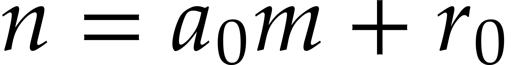, then the cases can occur that

etc.

### [76\[2\]](https://cdn.wittgensteinnachlass.com/2000px/webp/Ts-210/76.webp),[77\[1\]](https://cdn.wittgensteinnachlass.com/2000px/webp/Ts-210/77.webp)

If one now puts n together to form 1n, 2n, 3n etc., one sees that, compared with a multiple of m, a remainder is left over until one gets to m ∙ n, no matter where the Euclidean algorithm ends (i.e. whichever of the formulae is applicable to m). In the first case, e.g., if :

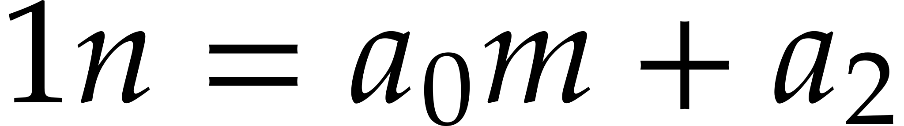

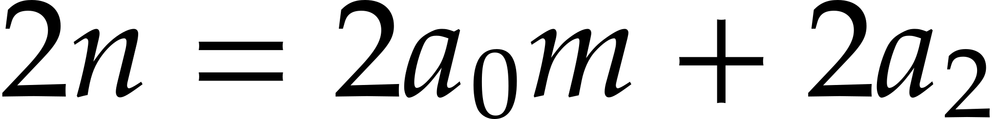

…

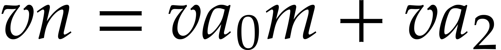 the remainder 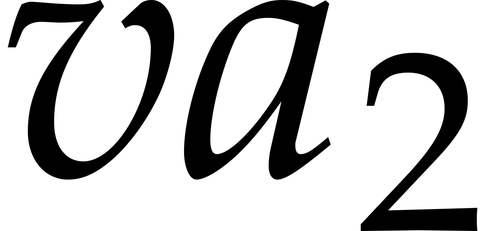 in any case remains smaller than m until 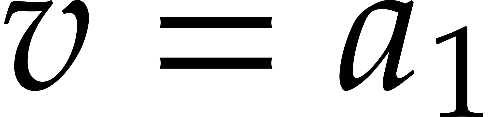; then 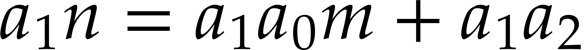. The remainder is still smaller than m; but now we get 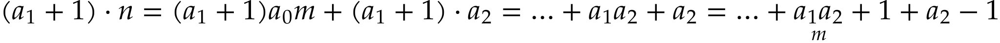. 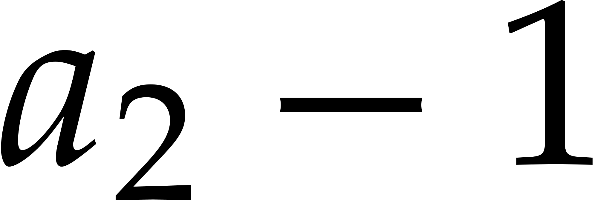 is in any case smaller than m, and the remainder vanishes only if 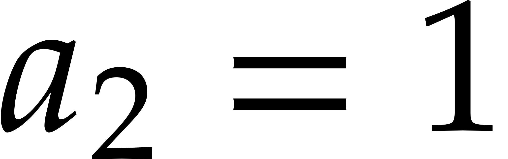. But then 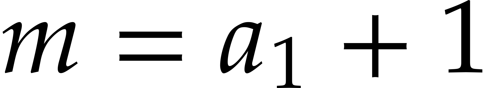, and so the factor is 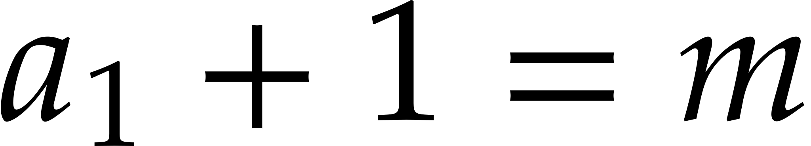. But if 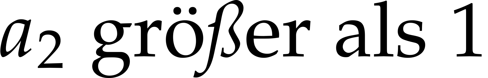, the process continues, and there now follow

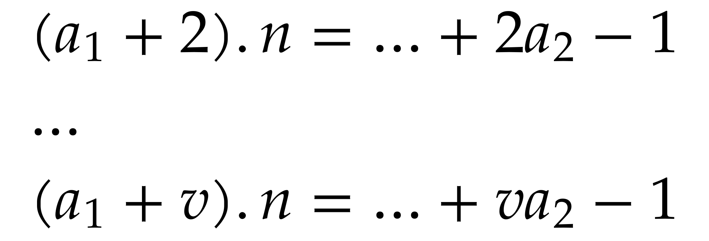.

This remainder is certainly smaller than m up to

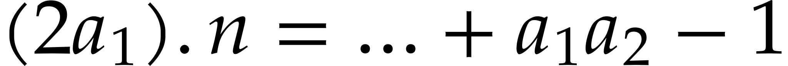 and is still smaller here. But

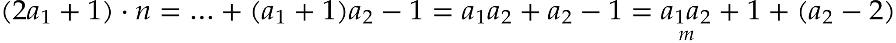

and here the  process again leaves no remainder only if 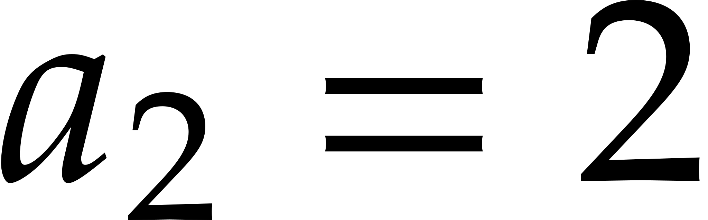, but then 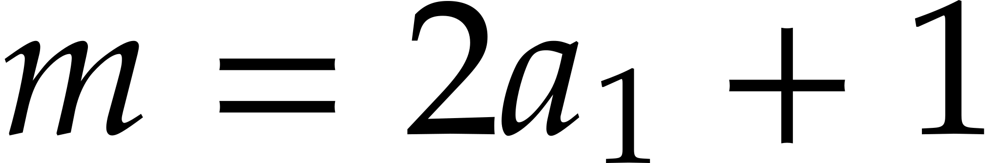, so m is again equal to the factor multiplying n. – It goes on in the same way up to

 and

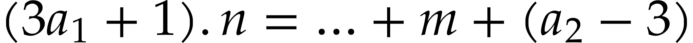 and so on until

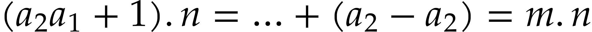.

It goes similarly if 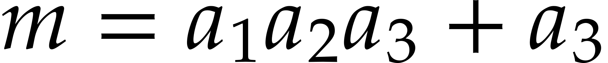, etc. etc.

### [77\[2\]](https://cdn.wittgensteinnachlass.com/2000px/webp/Ts-210/77.webp)

If one has understood the law for forming a series “intuitively”, e.g. the series of the m’s, so that one is thus able to form any 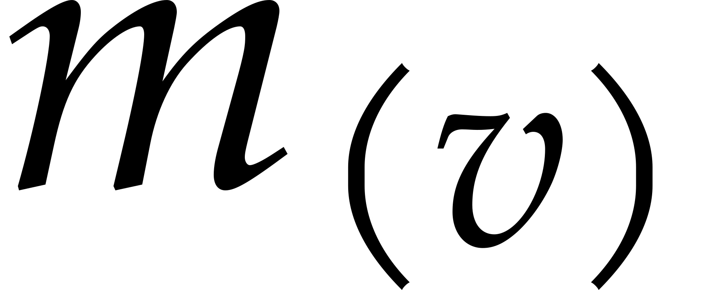, then one has understood the law of formation _completely_, that is, as well as _any_ algebraic representation, say, could enable one to understand it. That is, one cannot come to understand it any better through such a representation. And so this representation is not any _more rigorous_ _in that respect_ either. Though of course it may be easier to remember.

### [78\[1\]](https://cdn.wittgensteinnachlass.com/2000px/webp/Ts-210/78.webp)

If one considers that the equation 2 + 2 = 4 is a proof of the sentence “there are even numbers”, then one can see how loosely the word “proof” is used here. Is the sentence “there are even numbers” supposed to follow from the equation 2 + 2 = 4?! – And what is the proof of the existence of prime numbers? – The method of decomposition into prime factors. But in this method, _nothing is said at all_, not even about “prime numbers”.

### [78\[2\]](https://cdn.wittgensteinnachlass.com/2000px/webp/Ts-210/78.webp)

25 + 46 ≠ 78 is a correct inequality. It is confirmed when one forms the sum 25 + 46 = 71. One could represent the inequality by an inductive disjunction

25 + 46 = 1 ․ ⌵ ․ 25 + 46 = 2 ․ ⌵ ․ – – – ․ ⌵ ․ 25 + 46 = 77 ․ ⌵ ․ 25 + 46 = 79 ․ ⌵ ․ – – –

### [78\[3\]](https://cdn.wittgensteinnachlass.com/2000px/webp/Ts-210/78.webp)

Once the natural sequence of numerals has been set out, this is a correct proof of 3 + 4 = 7:

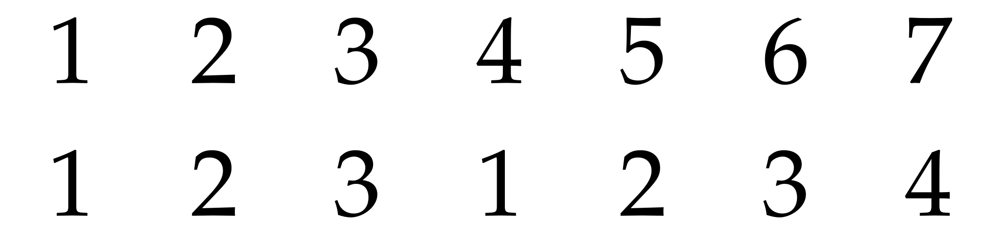.

For _if_ the natural sequence of numerals and the manner of pairing them are fixed, then where, for instance, the “4” in the lower row falls is merely an _arithmetical_ matter.

### [78\[4\]](https://cdn.wittgensteinnachlass.com/2000px/webp/Ts-210/78.webp)

A proof in mathematics is general if it is generally applicable. No other generality can be demanded in the name of rigour. _Every_ proof relies on _particular_ signs, on a particular notation. It is only that one kind _of generality_ may appear more elegant than another.

### [79\[1\]](https://cdn.wittgensteinnachlass.com/2000px/webp/Ts-210/79.webp)

(The elegance of a mathematical proof can have only this one point: to make certain analogies stand out particularly strongly when that is what is wanted; otherwise it springs from dull-wittedness and has only one effect: to conceal what should be clear and evident. The dull-witted pursuit of elegance is a chief reason why mathematicians do not understand their own operations, or this lack of understanding and that pursuit spring from a common source.)

### [79\[2\]](https://cdn.wittgensteinnachlass.com/2000px/webp/Ts-210/79.webp)

What distinguishes an equation (or inequality) from a sentence is its provability. A sentence cannot be proved – in that sense – for if it is shown to follow from other sentences, it has not thereby been proved. But the equation does not hold on condition that certain premises are true, and its derivation from apparent premises is therefore _quite_ inessential. What it follows from, rather, are _stipulations of the sign-language_, thus conditions of sense, not of truth.

### [79\[3\]](https://cdn.wittgensteinnachlass.com/2000px/webp/Ts-210/79.webp)

Nothing is more fatal to _philosophical_ understanding than the conception of proof and experience as two different, and hence comparable after all, methods of verification.

### [79\[4\]](https://cdn.wittgensteinnachlass.com/2000px/webp/Ts-210/79.webp)

An inequality is just as much a syntactical rule as an equation. The analogy between truth-functions in connection with equations and truth-functions of sentences is complete – i.e. the rules that apply are the same in both cases – except that equations are not sentences. (In truth-functions applied to hypotheses, after all, we have a further example of _such analogies_.)

### [80\[1\]](https://cdn.wittgensteinnachlass.com/2000px/webp/Ts-210/80.webp)

But to what extent can one call the picture

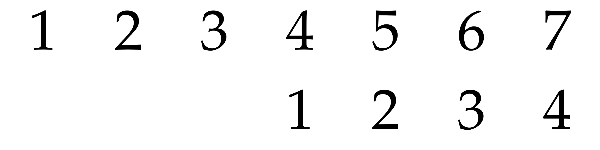

the proof of 3 + 4 = 7? (Since the formula does not in any sense follow from the picture.) Obviously only by virtue of a general rule that connects equations with such pictures. For if I set up the equation 2 + 5 = 9, one can say “we shall see straight away whether that is so”, and now one carries out the _corresponding calculus_ and sees whether the equation is correct (and exactly the same naturally holds of the inequalities). But the corresponding calculus corresponds only on the basis of a general rule.

### [80\[2\]](https://cdn.wittgensteinnachlass.com/2000px/webp/Ts-210/80.webp)

In the addition schema above, the numerals are _ordinal numerals_. So they simply designate a particular place, the so-and-so-many-th place. One could make this clearer by writing: 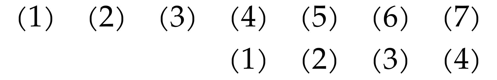. It is clear that with this algorithm one can also multiply, subtract and divide, and that everything has full rigour. (Incidentally, this method of calculation is of course that of the slide rule.)

### [80\[3\]](https://cdn.wittgensteinnachlass.com/2000px/webp/Ts-210/80.webp)

The word “Inn” over the gate of a house indicates that there is an inn _there_. It must be the special case of a general rule that is present, if we are to understand the word as a communication, that is, as a sentence. This shows us _to what extent_ “compositeness” is a characteristic of the sentence.

### [81\[1\]](https://cdn.wittgensteinnachlass.com/2000px/webp/Ts-210/81.webp)

“2 + 2 ≠ 5” is a rule for signs, and from this one can already see how negation here means something different, since _in any case_ there is no question of truth and falsity in a stipulation. I once said that negation in 2 + 2 ≠ 5 could not have the meaning of the negation of a sentence, because what is negated, 2 + 2 = 5, could not be a picture of a logical state of affairs that does not obtain. But affirmation and negation are on the _same_ level, and if one could affirm 2 + 2 = 4, then one can also negate it, and then one can also affirm 2 + 2 = 5. In truth, I believe, 2 + 2 = 5 is a rule for signs like any other, neither correct nor false; it is merely incompatible with our general rule of _representation_ and, if that rule is accepted, false only in _this sense_. – That is why it is not a picture either – of how things would be if 2 + 2 = 5. (Only) the proof gives the picture of the logical state of affairs – but not the picture either, rather the thing itself.

### [81\[2\]](https://cdn.wittgensteinnachlass.com/2000px/webp/Ts-210/81.webp)

By way of proof, _we direct attention_ to a picture, but the proof is not yet understood; suddenly one says: “now I _see_ it”. Only now has one seen _what_ mattered. (See p|p․|․q|q etc.)

### [81\[3\]](https://cdn.wittgensteinnachlass.com/2000px/webp/Ts-210/81.webp)

Is it not clear: the sentences of pure mathematics can only be _applied_ as rules for signs. (Only conditions of sense.)

### [81\[4\]](https://cdn.wittgensteinnachlass.com/2000px/webp/Ts-210/81.webp),[82\[1\]](https://cdn.wittgensteinnachlass.com/2000px/webp/Ts-210/82.webp)

3 + 4 < 9 is not a communication either – as it would be, for instance, to say that a certain line segment is longer than 9 metres (that a house is higher than 9 m). – Given what we understand by “3”, “4” and “9”, it is _self-evident_ (i.e. provable). But in saying this we are still looking at it in the same way as at the case of the house, only perhaps there it is a matter of something less self-evident. But that case cannot be compared at all with that of the sentence. – When I said at first “it is self-evident”, _that means_ that what is at issue here is not a sentence but a rule for signs, which, _incidentally_, follows from a general rule. Again and again we are drawn to compare “3 + 4 kl 9 with a sentence such as “if one lays these two rods end to end, they still don’t reach up to there”. And that applies even in the case of the line segments a, b, c. But this sentence about the line segments a, b, c is precisely not the arithmetical one.

The latter is, rather, either the expression of a purely arbitrary choice – that we have put the sign “9” so far along the top row – or, if this is taken as given, self-evident. If “3 + 4 kl 9” were not an arbitrary stipulation or the consequence of a stipulation, it would be no concern of arithmetic. – The reason one sometimes wants to call it a tautology (which it is not in my sense) is precisely that one wants to say “yes, if you stipulate that, then of course it is self-evident”. (I am writing paraphrases of logical insights.))

### [82\[2\]](https://cdn.wittgensteinnachlass.com/2000px/webp/Ts-210/82.webp),[83\[1\]](https://cdn.wittgensteinnachlass.com/2000px/webp/Ts-210/83.webp)

For the arithmetical sentence does not say that in _some_ row of numerals one does not reach the sign “9” by laying 123 and 1234 end to end; rather, it stands for this not happening in the row

1 2 3 4 5 6 7 8 9. This row is presupposed in the arithmetical sentence, and the sentence is therefore not a description of this row from outside. – One could also put it like this: This is a sentence: “rod a and rod b laid end to end are shorter than rod c; or rod a is 3 m long, b 4 m and c 9 m.” But I cannot say that the length of the longer rod is longer than that of the shorter. – These lengths are something I state of the rods, rightly or wrongly, in order to show that they, the rods, stand in certain relations to one another, but for that the sense of these statements of length must _already_ be fixed and cannot be left to be _asserted as well_ in a sentence. Or: The statement that a is 3 m long, b 4 m, c 9 m _is_ precisely the one by which I show that c is longer than a and b together. A sentence saying that 3 m + 4 m is less than 9 m would correspond to a sentence saying that longer is longer than shorter. (Or “large > small”.) Such an expression would correspond rather to what has to be stipulated before anything can be said at all. “3 + 4 kl 9” is itself also part of the “game” and is a position of the pieces that can only accord with the general rules or not. Longer and shorter are an external property of the rods, but an _internal_ one of the lengths. (To express them by a sentence would be rather like trying to state the meaning of a word by a sentence in which the word occurs.)

### [83\[2\]](https://cdn.wittgensteinnachlass.com/2000px/webp/Ts-210/83.webp),[84\[1\]](https://cdn.wittgensteinnachlass.com/2000px/webp/Ts-210/84.webp),[85\[1\]](https://cdn.wittgensteinnachlass.com/2000px/webp/Ts-210/85.webp)

Suppose that pulling the brake lever sometimes slows the machine down and sometimes does not. From that alone it does not follow that it was intended as a brake lever. Now if a certain person were to get annoyed whenever the lever failed to act as a brake –. That would still not show what I want to show. Indeed, one could then say that the lever sometimes operates the brake and sometimes the annoyance. – For how is it expressed that _what_ annoys the person is that the lever failed to operate the brake? (For this _being annoyed about something_ is apparently of exactly the same kind as: fearing something, wishing for something, expecting something, etc.) For “being annoyed about something” is not related to what one is annoyed about as an effect is to its cause, that is, as stomach pains are to the food that upset one’s stomach. One can be in doubt about what upset one’s stomach, and the food that may be the cause does not enter into the stomach pains as a constituent of those pains; by contrast, in a certain sense, one cannot be in doubt about what one is annoyed about, what one is afraid of, what one believes. (One does not say “I don’t know, – today I believe, but I don’t know what I believe in”!) – And here, of course, we have the old problem: the thought that such and such is the case does not presuppose that it is the case. But on the other hand, something of the fact must surely be presupposed by the thought itself. “I cannot think that something is red if red does not exist at all”. The answer is that the thoughts must be in the same space as what is in doubt, though in a different place; that the present reality against which the yardstick of thought is set – rather than guaranteeing the sense – constitutes it. The sense can no more need to be guaranteed first than it can be proved after the event that π is not rational; for without sense there is no thought. – In this and only in this consists the (pre-established) harmony between world and thought. But intention is of exactly the same kind as – for example – annoyance. And here it somehow seems as if one could never recognize the intention as an _intention_ when looking at it from outside; as if one had to intend it oneself in order to understand it as an opinion. But that would mean not regarding it as a phenomenon, not as a fact! This is of course the previous problem again, for the point is that one must be able to tell by looking at the thought (regarded as an independent fact) that it is the thought that such and such is the case. If one cannot tell this by looking at it (any more than one can tell from stomach pains where they come from), then it is of no logical interest, or rather, then there is no logic. – This also amounts to saying that one must be able to compare the thought with reality directly, and that one cannot first need experience to establish that this reality corresponds to this thought. (That is also why thoughts differ according to their content, but stomach pains do not differ according to what brought them about.) My view seems nonsensical if one puts it _like this_: one is supposed to be able to see what someone is thinking about if one opens up his head; how is that possible? The objects he is thinking about are not in his head at all (any more than they are in his thoughts)! _For_ one must understand thoughts, intentions (etc.) as such when looking at them from outside, _without_ being instructed about the meaning of _anything_. For the relation of meaning is then itself seen as a phenomenon (and I cannot then have to point in turn to a meaning of the phenomenon, since this very signifying is itself included in the phenomena.)

### [85\[2\]](https://cdn.wittgensteinnachlass.com/2000px/webp/Ts-210/85.webp),[86\[1\]](https://cdn.wittgensteinnachlass.com/2000px/webp/Ts-210/86.webp)

So when one looks at the thought, there can no longer be any question of understanding, for if one sees it, one must recognize it as the thought with this content; there is nothing to interpret. – But that is how it really is when we think: there is no interpreting. – And one could say: the thinker _actually_ looks at the thought from outside and not from inside; everything one sees, one sees from outside; i.e. everything one experiences is a phenomenon.

### [86\[2\]](https://cdn.wittgensteinnachlass.com/2000px/webp/Ts-210/86.webp)

Language is _understood_, thought is _not_. (Understanding language is thinking, but the understanding of language is not itself understood in turn.) –

### [86\[3\]](https://cdn.wittgensteinnachlass.com/2000px/webp/Ts-210/86.webp)

The causal explanation of meaning and understanding goes essentially like this: to understand a command means that one would carry it out if a certain bolt were drawn back. – Suppose someone were commanded to raise an arm, and one said: to understand the command means to raise the arm. That is clear, even if it goes against our linguistic usage (we call that “obeying the command”). But now one says: To understand the command means either to raise the arm or, failing that, to do some other specific thing – say, to raise the leg. But this is not “understanding” in the first sense, for the command was not “to raise the arm or the leg”. So the command refers (as before) to an action that did _not_ take place. In other words, the distinction between understanding and obeying the command remains. And further: a command that is not understood is not a command at all. – This understanding of the command cannot be just any action (say, raising one’s foot); rather, the action must contain the essence of the command itself.
