# Ts-211

35 published remarks, PG II, GB I

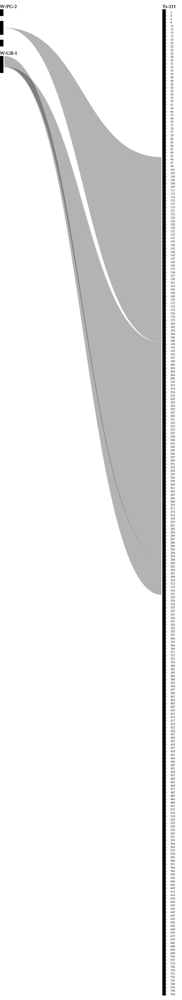

### [1\[1\]](https://cdn.wittgensteinnachlass.com/2000px/webp/Ts-211/1.webp)

Historical drama; can one call it false? “No, it is not meant as historical writing, after all”. What does this _way of meaning it_ consist in?

### [1\[2\]](https://cdn.wittgensteinnachlass.com/2000px/webp/Ts-211/1.webp)

Let us imagine someone who had written a historical work in due form, but _meant_ it not as a historical work but as a fictitious historical work. What would it mean to take this work now one way, now another? What does this way of taking it consist in? Surely in something _outside_ the work. In an _addition_ to the work, as it were. Or doesn’t it consist rather in a particular use or effect of the work, in an impression it makes on me? For an addition of signs can itself be taken in one way or another.

### [1\[3\]](https://cdn.wittgensteinnachlass.com/2000px/webp/Ts-211/1.webp)

We tend to count every phenomenon (only) as a symptom of the way something is taken or meant, but not as that itself.

### [1\[4\]](https://cdn.wittgensteinnachlass.com/2000px/webp/Ts-211/1.webp)

How language moves away from the description of verification. One has to discover again that one measures time with a clock. – And one does not even realize in doing so that one has made a grammatical discovery.

### [1\[5\]](https://cdn.wittgensteinnachlass.com/2000px/webp/Ts-211/1.webp)

A way of taking something is _one_ as opposed to another.

### [1\[6\]](https://cdn.wittgensteinnachlass.com/2000px/webp/Ts-211/1.webp)

“p is the case”. “It is _true_ that p is the case”. “It really is true that p is the case”. If nothing is added to the multiplicity, what is added is meaningless, pointless. So the addition that expresses a way of taking something must not be of this kind.

### [2\[1\]](https://cdn.wittgensteinnachlass.com/2000px/webp/Ts-211/2.webp)

What is the difference between the actual application of a sentence and an imitated, simulated application?

### [2\[2\]](https://cdn.wittgensteinnachlass.com/2000px/webp/Ts-211/2.webp)

Can one speak of a “description” and an “expression” of the way something is taken?

### [2\[3\]](https://cdn.wittgensteinnachlass.com/2000px/webp/Ts-211/2.webp)

“Did you mean that seriously or as a joke?” – “Meaning it seriously” does not consist in silently adding something to the spoken sentence, say the words “I mean it seriously”. Of the _whole_ sentence, the spoken sentence together with the words added in thought, one could again ask: how was it meant? But one cannot ask that of seriousness or joking. So the way one means it (the way one takes it) in this sense is a particular experience that goes hand in hand with the signs of the sentence, but does not change the sense of the sentence, whether the experience is one way or another.

### [2\[4\]](https://cdn.wittgensteinnachlass.com/2000px/webp/Ts-211/2.webp)

If sense were not determined by signs and rules, there would be no communication and nothing we could call language.

### [2\[5\]](https://cdn.wittgensteinnachlass.com/2000px/webp/Ts-211/2.webp)

“I said ‘she isn’t at home’, but _as I said it_ I knew she was at home”. How does this knowledge go together in time with saying the sentence? Like a continuous accompaniment, a pedal point, to a theme? Did you know it at every instant, and does knowing take no time? A false picture misleads us.

### [2\[6\]](https://cdn.wittgensteinnachlass.com/2000px/webp/Ts-211/2.webp),[3\[1\]](https://cdn.wittgensteinnachlass.com/2000px/webp/Ts-211/3.webp)

This way of considering things, which keeps recurring, derives its importance from the fact that it makes us aware of a false conception we have of the immediate.

### [3\[2\]](https://cdn.wittgensteinnachlass.com/2000px/webp/Ts-211/3.webp)

It does, of course, make sense to say: “while I was telling him that, I knew (_the whole time_) that it wasn’t true”, just as it does to say “while I was telling it, I believed it too”. Only the two occurrences are very complicated and look very simple; i.e. each of the two sentences can describe many different processes. Rather as when I say “I spent half an hour changing my clothes”, and the most varied activities, one after another, correspond to this sentence.

### [3\[3\]](https://cdn.wittgensteinnachlass.com/2000px/webp/Ts-211/3.webp)

For we labour under the error that believing, meaning, knowing, wishing, looking for, thinking, etc. are _states_, and that therefore something of a different kind must be hidden behind the symbolic processes in thinking, something that contains the sense of a sentence, as it were, in amorphous form, i.e. intuitively, like the seeing of an unchanging picture, not discursively, and hence not in a way comparable to an activity (such as washing).

### [3\[4\]](https://cdn.wittgensteinnachlass.com/2000px/webp/Ts-211/3.webp)

For we must give up the view that, in order to speak of the immediate, we would have to speak of the state at a moment in time. This view is expressed when one says: “all that is given to us is the visual image and the data of the other senses, as well as memory, in the present instant”. That is nonsense; for what does one mean by the “present instant”? Rather, this conception is already based on a physical picture, namely that of the stream of experiences, which I now cut across _at one point_. Here there is a tendency and an error similar to those found in idealism (or solipsism).

### [4\[1\]](https://cdn.wittgensteinnachlass.com/2000px/webp/Ts-211/4.webp)

But where does this tendency to want to get “to the immediate” come from? Does it not spring from the need to want to understand the verification of the sentence, which is entirely obscured by our language?

### [4\[2\]](https://cdn.wittgensteinnachlass.com/2000px/webp/Ts-211/4.webp)

Intuitive thinking would be like a game of chess reduced to the form of a lasting, unchanging state (equally unthinkable).

### [4\[3\]](https://cdn.wittgensteinnachlass.com/2000px/webp/Ts-211/4.webp)

The question “how did you mean that?” can be answered in several ways:

“I meant it seriously (as a joke).”

“What I wanted to say by that was that ‥‥ (a sentence follows).”

“I just wanted to take you in.”

### [4\[4\]](https://cdn.wittgensteinnachlass.com/2000px/webp/Ts-211/4.webp)

What _happens_ when one utters a sentence and only wants to take the other person in? One speaks, smiles, watches the other person, feels a tension. But the amorphous way of meaning it is nowhere to be found. One imagines it, as it were, as the contents of a crucible on which the sentence is inscribed.

### [4\[5\]](https://cdn.wittgensteinnachlass.com/2000px/webp/Ts-211/4.webp)

“Content of the sentence.”

### [4\[6\]](https://cdn.wittgensteinnachlass.com/2000px/webp/Ts-211/4.webp),[5\[1\]](https://cdn.wittgensteinnachlass.com/2000px/webp/Ts-211/5.webp)

It bothers us, _as it were_, that the thought of a sentence is not fully present at any moment. Here we see that we are comparing the thought to a thing we produce and never possess as a whole; rather, scarcely does one part come into being before another disappears. *T*hat has _in a way_ something unsatisfying about it, because – again misled by an explanation – we expect something different.

### [5\[2\]](https://cdn.wittgensteinnachlass.com/2000px/webp/Ts-211/5.webp)

In the living use of language, of course, we feel no such dissatisfaction; we feel it only when we want to apply a particular picture to the _processes_. But it is hard to say which picture that is.

### [5\[3\]](https://cdn.wittgensteinnachlass.com/2000px/webp/Ts-211/5.webp)

(When methodology speaks of _measurement_, it does not tell us, say, what material would be most advantageous for making the yardstick in order to obtain such and such a result; even though that too belongs to the method of measuring. Rather, this investigation is concerned only with the circumstances under which we say that a length, a current strength, (etc.) has been measured. It seeks to tabulate the familiar methods we already use, in order thereby to fix the meaning of the words “length”, “current strength”, etc.)

### [5\[4\]](https://cdn.wittgensteinnachlass.com/2000px/webp/Ts-211/5.webp)

The moment in time that I say is the present containing everything that is given to me itself belongs to physical time.

### [5\[5\]](https://cdn.wittgensteinnachlass.com/2000px/webp/Ts-211/5.webp)

For how is such a moment determined? By the stroke of a bell, say? And can I really describe the whole experience simultaneous with this stroke? If one thinks of trying, one realizes at once that what we are talking about is a fiction.

### [5\[6\]](https://cdn.wittgensteinnachlass.com/2000px/webp/Ts-211/5.webp),[6\[1\]](https://cdn.wittgensteinnachlass.com/2000px/webp/Ts-211/6.webp)

We picture _the process of experiencing_ as a strip of film, _so that_ one can say: this frame, and no other, is in front of the lens at this instant.

### [6\[2\]](https://cdn.wittgensteinnachlass.com/2000px/webp/Ts-211/6.webp)

But only in the film can one speak of a picture present at this moment; not when one passes from physical space _and its time_ to visual space _and its time_.

### [6\[3\]](https://cdn.wittgensteinnachlass.com/2000px/webp/Ts-211/6.webp)

It is much stranger than one probably thinks that one came upon the concept of a ray of light within the domain of _ordinary_ language.

### [6\[4\]](https://cdn.wittgensteinnachlass.com/2000px/webp/Ts-211/6.webp)

It would hardly have happened if one did not sometimes see “rays of light” in the dust in the air.

### [6\[5\]](https://cdn.wittgensteinnachlass.com/2000px/webp/Ts-211/6.webp)

And the assumption of a speed of light is connected with this.

### [6\[6\]](https://cdn.wittgensteinnachlass.com/2000px/webp/Ts-211/6.webp)

“One has called what a cm³ of water weighs ‘1 gram’”. – “Yes, but what does it weigh?” (“Meaning of a word”).

### [6\[7\]](https://cdn.wittgensteinnachlass.com/2000px/webp/Ts-211/6.webp)

If the picture is meant to depict Napoleon’s coronation, one would not have to write that underneath it if it were contained in the picture. If, that is, it too were described in the mere description of the picture. And one might now draw a sharp distinction between thought and picture by saying that the description of the _thought_, unlike that of the mere picture, must also contain a description of the reality to which the thought refers. But there is an error here.

### [7\[1\]](https://cdn.wittgensteinnachlass.com/2000px/webp/Ts-211/7.webp)

Doesn’t the difference arise from the fact that the painted picture is not in itself part of a much more comprehensive picture – a language? By giving it a caption we incorporate the picture into the more comprehensive one. Could we not do this just as effectively by incorporating it into a series of painted pictures?

### [7\[2\]](https://cdn.wittgensteinnachlass.com/2000px/webp/Ts-211/7.webp)

What is characteristic of language is that all explanations can be given in advance. I.e. it must have been possible to foresee them all, and none needs to be given ad hoc. (And this is what seems to constitute its pictorial character.)

### [7\[3\]](https://cdn.wittgensteinnachlass.com/2000px/webp/Ts-211/7.webp)

I could present my problem like this: if I wanted to investigate whether Napoleon’s coronation took place in such and such a way, I could use the picture, rather than a description, as a documentary record. And then the question arises: is the whole comparison of the record with reality of the same kind as the comparison of reality with the picture, or is there also something else involved, of a different kind?

### [7\[4\]](https://cdn.wittgensteinnachlass.com/2000px/webp/Ts-211/7.webp)

But what is one to compare reality with, if not with the sentence? And what else is one to do but compare it with the sentence?

### [7\[5\]](https://cdn.wittgensteinnachlass.com/2000px/webp/Ts-211/7.webp)

Or should I say: As long as one does not compare the picture with anything, one _can_ compare it with anything. But when we think, we are already comparing the picture with reality, for we know, for example, that Napoleon is not here now, but Mr N.N. is.

### [7\[6\]](https://cdn.wittgensteinnachlass.com/2000px/webp/Ts-211/7.webp)

That is connected with the problem of _here_ and _now_.

### [8\[1\]](https://cdn.wittgensteinnachlass.com/2000px/webp/Ts-211/8.webp)

(The capacity for philosophy consists in the capacity to receive a strong and lasting impression from a fact of grammar.)

### [8\[2\]](https://cdn.wittgensteinnachlass.com/2000px/webp/Ts-211/8.webp)

In a certain sense the meaning of the words “here”, “now” (etc.) is the only one I cannot fix in advance. But that is of course a _misleading_ way of putting it: the meaning _can_ be fixed and is fixed when the rules for these words are fixed, and that can be done before the words are applied in a particular case; for why else use _one_ word in different cases.

### [8\[3\]](https://cdn.wittgensteinnachlass.com/2000px/webp/Ts-211/8.webp)

The words “here”, “now”, etc. designate the origin of a coordinate system: like the letter “O”, but they do not describe its position relative to the objects in space.

### [8\[4\]](https://cdn.wittgensteinnachlass.com/2000px/webp/Ts-211/8.webp)

To understand the meaning of a word is to know, to understand, its use.

### [8\[5\]](https://cdn.wittgensteinnachlass.com/2000px/webp/Ts-211/8.webp),[9\[1\]](https://cdn.wittgensteinnachlass.com/2000px/webp/Ts-211/9.webp)

Can a logical product be hidden in a sentence? And if so, how does one find out, and what methods do we have for bringing to light what is hidden in the sentence? If we have no reliable methods yet (_of finding it_,) then neither can we speak of something being hidden or possibly being hidden. And if we have a method for looking for it, then – the logical product, for example, can be hidden in the sentence only in the way that divisibility by 3 is hidden in the number 753 as long as I have not yet applied the criterion, I have not yet applied the criterion, or that √7 is hidden as long as I have not yet calculated it. For finding the hidden logical product is a mathematical task.

### [9\[2\]](https://cdn.wittgensteinnachlass.com/2000px/webp/Ts-211/9.webp)

The fictitious portrait. In a book, an illustration with the caption: Baron Münchhausen.

### [9\[3\]](https://cdn.wittgensteinnachlass.com/2000px/webp/Ts-211/9.webp)

“However, such annoyances tend to stimulate the powers of thought”. How does a thought help one overcome an annoyance?

### [9\[4\]](https://cdn.wittgensteinnachlass.com/2000px/webp/Ts-211/9.webp)

So an elementary proposition is one that does not present itself as a truth-function of other propositions in the calculus as I am now using it.

### [9\[5\]](https://cdn.wittgensteinnachlass.com/2000px/webp/Ts-211/9.webp)

We can shed light on our way of talking about words by looking at what Socrates says in the “Cratylus”. Cratylus: “It is by far and without question better, Socrates, to represent what one wants to represent by means of something similar than by means of the first thing that comes to hand.” – Socrates: “Well said, …”.

### [9\[6\]](https://cdn.wittgensteinnachlass.com/2000px/webp/Ts-211/9.webp)

Connection between word and thing established by the explanation. What sort of connection is that, what kind? What kinds of connection are there? A connection may work or not work: application to the connection established by the explanation of a word.

### [9\[7\]](https://cdn.wittgensteinnachlass.com/2000px/webp/Ts-211/9.webp),[10\[1\]](https://cdn.wittgensteinnachlass.com/2000px/webp/Ts-211/10.webp)

Socrates to Theaetetus: “And he who imagines, should he not imagine something?” Th.: “Necessarily.” Soc.: “And he who imagines something, nothing real?” Th.: “So it seems.”

### [10\[2\]](https://cdn.wittgensteinnachlass.com/2000px/webp/Ts-211/10.webp)

What does it mean to form a mental image that does not correspond to reality?

### [10\[3\]](https://cdn.wittgensteinnachlass.com/2000px/webp/Ts-211/10.webp)

How infinitely simple this problem is! And how strange that one _can want to regard it_ as a problem at all.

### [10\[4\]](https://cdn.wittgensteinnachlass.com/2000px/webp/Ts-211/10.webp)

I try to do something, but I cannot. – But what does it mean to “not be able to try to do something”?

### [10\[5\]](https://cdn.wittgensteinnachlass.com/2000px/webp/Ts-211/10.webp)

“We cannot _even try_ to imagine a round square.”

### [10\[6\]](https://cdn.wittgensteinnachlass.com/2000px/webp/Ts-211/10.webp)

One should compare imagining with painting a picture. So he paints a picture of the person as that person is not in reality. Very simple. But why do we call it a picture of this person? For if it is not that, then (of course) it is not wrong. – We call it that because he himself has written it above the picture. So he has done nothing more than paint that picture and write that name above it. And presumably that is what he did in his imagination too.

### [10\[7\]](https://cdn.wittgensteinnachlass.com/2000px/webp/Ts-211/10.webp)

Plato calls hope a form of speech. (Philebus)

### [10\[8\]](https://cdn.wittgensteinnachlass.com/2000px/webp/Ts-211/10.webp),[11\[1\]](https://cdn.wittgensteinnachlass.com/2000px/webp/Ts-211/11.webp)

When Augustine speaks of learning language, he speaks exclusively of how we give things names, or understand the names of things. Here, then, naming seems to be the foundation and the be-all and end-all of language. (And what Augustine says is important to us because it is the view of a man who thinks clearly by nature and who, being far removed from us in time, certainly does not belong to our particular circle of thought.) This conception of the foundation of language is evidently equivalent to the one that takes the form of explanation “this is ‥․” to be fundamental. – Augustine does not speak of a difference between words, so by “names” he evidently means words such as “tree”, “table”, “bread”, and certainly the proper names of people, but then presumably also “eat”, “go”, “here”, “there”; in short, all words. But he is certainly thinking _in the first instance of nouns_, and of the others as something that will sort itself out. (And Plato says that the sentence consists of nouns and verbs.) They _simply_ describe the game as simpler than it is. But this game presumably does occur in reality. Suppose, for example, that I want to build a house out of building stones that someone else is to hand me. We could first reach an agreement by my pointing to one stone and saying “this is a pillar”, then pointing to another and saying “this is a cube”, – “this is a slab” and so on. And now the application would consist in calling out those words “pillar”, “slab”, etc. in the order in which I need them. And quite similar, of course, are the agreement

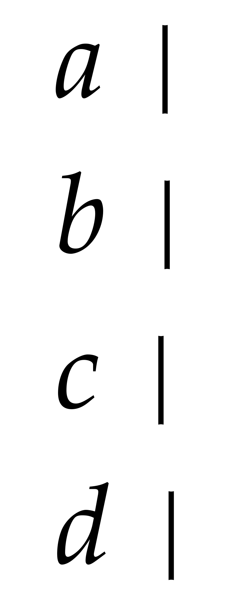

and, say, one that would work with colours.

### [11\[2\]](https://cdn.wittgensteinnachlass.com/2000px/webp/Ts-211/11.webp)

What I mean by this is: Augustine really does describe a calculus; only not everything we call language is this calculus.

### [11\[3\]](https://cdn.wittgensteinnachlass.com/2000px/webp/Ts-211/11.webp)

(And _that_ is what one must say in a great many cases in which the question is: is this representation useful, or useless? The answer then is: “yes, useful; but only _for that_, not for the whole area you purported to represent”.)

### [12\[1\]](https://cdn.wittgensteinnachlass.com/2000px/webp/Ts-211/12.webp)

So it is as if someone explained: “playing consists in moving things on a surface in accordance with certain rules ‥‥” and we replied: You are certainly thinking of board games, and your description does apply to them. But those are not the only games. So you can correct your explanation by expressly restricting it to those games. (So one could say that Augustine represents the learning of language too simply; but also: he represents something simpler.)

### [12\[2\]](https://cdn.wittgensteinnachlass.com/2000px/webp/Ts-211/12.webp)

(Someone who describes chess more simply – with simpler rules – than it is nevertheless describes a game, but a different one.)

### [12\[3\]](https://cdn.wittgensteinnachlass.com/2000px/webp/Ts-211/12.webp)

What I really meant to say was: The way Augustine describes the learning of language can show us where this conception comes from _in the first place_. (From what primitive _view_.)

One could compare it with the case of a script in which letters were used to designate sounds, but also, say, to indicate the strength and weakness of pronunciation and as punctuation marks. If we then take this script as a language for describing the sound image, one could imagine someone describing the script as if each letter simply corresponded to a sound and as if the letters did not also have quite different functions. – And such a – too simple – description of the script is exactly what Augustine’s description of language resembles.

### [12\[4\]](https://cdn.wittgensteinnachlass.com/2000px/webp/Ts-211/12.webp),[13\[1\]](https://cdn.wittgensteinnachlass.com/2000px/webp/Ts-211/13.webp)

One can, for example, speak – in a way others understand – of _combinations of colours with shapes_ (say, of the colours red and blue with the shapes square and circle), just as one can speak of combinations of different shapes or bodies. And here we have the root of the misleading expression that a fact is a complex of objects. Thus here a person’s being ill is _compared_ with the putting together of two things, one of which is the person, while the other represents the illness. And all I can say is: let us beware of this simile, or of forgetting that it is a simile. Or one must say that it is with the word “combination”, or “complex”, here as it is with the word “number”, which is also used in different – more or less logically similar – ways _(or, if one likes_, meanings).

### [13\[2\]](https://cdn.wittgensteinnachlass.com/2000px/webp/Ts-211/13.webp)

To philosophize is to reject false arguments.

### [13\[3\]](https://cdn.wittgensteinnachlass.com/2000px/webp/Ts-211/13.webp)

Socrates: So if one imagines what is not, does one imagine nothing? – Theaetetus: So it seems. – S.: But if one imagines nothing, surely one does not imagine at all? – Th.: Apparently, as we see. If we substitute, say, “cut up” for “imagine” in this argument and the preceding one, it amounts to a rule for the use of this word. One is not to say: “I cut up something that does not exist”.

### [13\[4\]](https://cdn.wittgensteinnachlass.com/2000px/webp/Ts-211/13.webp),[14\[1\]](https://cdn.wittgensteinnachlass.com/2000px/webp/Ts-211/14.webp)

I can imagine a deer in this meadow that is not there, but I cannot kill one that is not there. – And to imagine a deer that is not there means to imagine that a deer is there, although none is there. But to kill a deer does not mean: to kill that a deer is there (so: different grammatical rules). If, however, someone says: “in order for me to imagine a deer, there must surely be such a deer in some sense”, the answer is: no, there need not _be_ such a deer in any sense for that. And if the reply were: But surely there must be, for example, the colour brown for me to be able to imagine it, then one should say: “‘There is such a colour as brown’ means nothing at all, except perhaps that it _occurs_ here or there as the colouring of an object (patch), and this is not necessary for me to be able to imagine a brown deer.”

### [14\[2\]](https://cdn.wittgensteinnachlass.com/2000px/webp/Ts-211/14.webp)

“The sound seems to me to come from _there_”. – “From exactly which direction?”

### [14\[3\]](https://cdn.wittgensteinnachlass.com/2000px/webp/Ts-211/14.webp)

Euclidean heap and heap in the visual field.

### [14\[4\]](https://cdn.wittgensteinnachlass.com/2000px/webp/Ts-211/14.webp)

“He came from _roughly_ there”. “The brightest point on the horizon is roughly _there_”. “Make the board roughly 2 m long”. To be able to say that, must I know limits that determine the latitude for this length? Obviously not. Is it not enough, for example, to say: “a latitude of ± 1 cm is certainly allowed; ± 2 cm would already be too much”? – Surely it is also essential to the sense of my sentence that I am unable to give the latitude “exact” limits. Isn’t this plainly because the space I am working in here has a different metric from Euclidean space? For if one tried to determine the latitude exactly by experiment, changing the length, approaching the limits of the latitude and asking each time whether this length was still acceptable or no longer so, after a few steps of narrowing it down one would arrive at contradictions: on one occasion a point would still be said to lie within the limits, on another a point further inside would be declared inadmissible; both, perhaps, with the comment that the judgements were no longer (_quite_) certain.

### [15\[1\]](https://cdn.wittgensteinnachlass.com/2000px/webp/Ts-211/15.webp)

Isn’t it like the way one weighs things at the butcher’s, say, only to the nearest decagram, although that, on the other hand, is arbitrary and determined only by the customary brass weights? Here it is enough to know: it weighs no more than 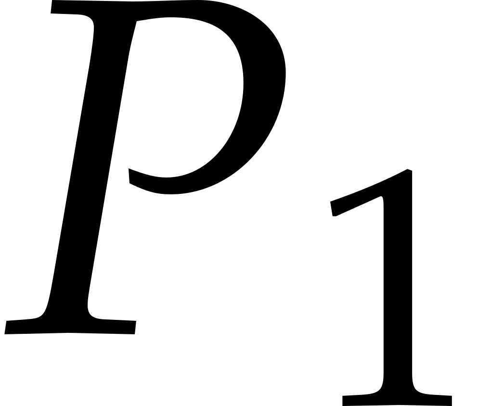 and no less than 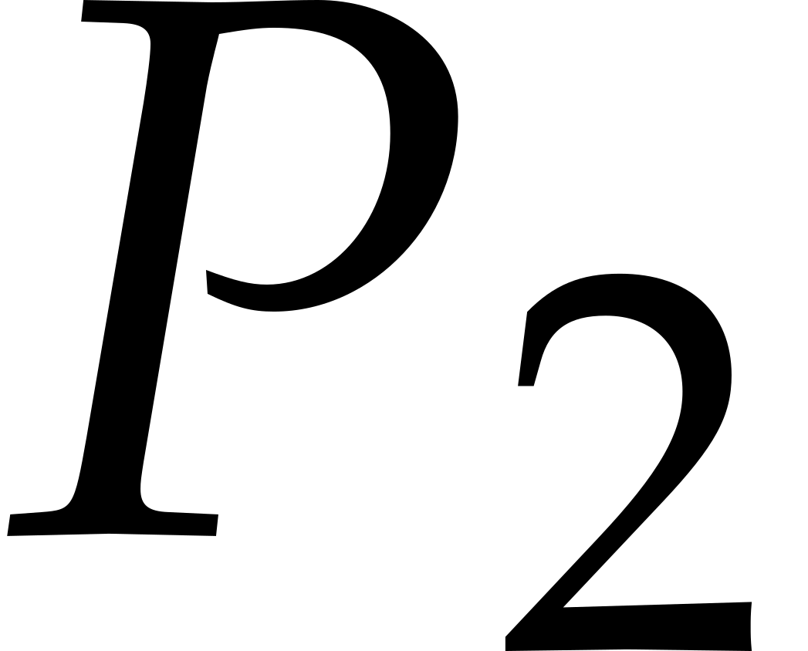. One could say: in principle, stating the weight here consists not in specifying a number but in specifying an interval, and the intervals form a discontinuous series.

### [15\[2\]](https://cdn.wittgensteinnachlass.com/2000px/webp/Ts-211/15.webp)

One could surely say: “in any case, keep _within_ ± 1 cm”, thereby setting an arbitrary limit. – If it were then said: “all right, but that isn’t the actual limit of the permissible latitude; what is it, then?”, the answer might be “I don’t know of one; I only know that ± 2 cm would already be too much”.

### [15\[3\]](https://cdn.wittgensteinnachlass.com/2000px/webp/Ts-211/15.webp)

Now even if there were no wavering in the experiment to determine the limits for as long as we actually go on with it, we must nevertheless stop at some point, and the result will always be only that a certain length is still permissible and another is already impermissible. Here again the false conception of the infinite leads us astray when we imagine the process of this investigation completed and then speak of a boundary point, as if there were a law here, a geometrical construction, to which the boundary point corresponded.

### [15\[4\]](https://cdn.wittgensteinnachlass.com/2000px/webp/Ts-211/15.webp)

“Make me a heap of sand here”. – “All right, he’ll surely still call that a heap”. I could carry out the command, so it was in order. But what about this command: “Make me the smallest heap you would still call a heap”? I would say: that is nonsense; I can only fix a provisional upper and lower limit.

### [16\[1\]](https://cdn.wittgensteinnachlass.com/2000px/webp/Ts-211/16.webp)

But that too does not capture exactly how things really stand. Rather, the uncertainty seems usually to be of the same kind as that involved in specifying the highest point of a curve. We are simply not in Euclidean space, and there is no highest point in the Euclidean sense. The answer will be: “the highest point is roughly _there_”, and the grammar of the word “roughly” – in this context – _then_ belongs to the geometry of our space.

### [16\[2\]](https://cdn.wittgensteinnachlass.com/2000px/webp/Ts-211/16.webp)

“I was of the opinion that Napoleon had been crowned in 1805”. – “Were you of that opinion continuously the whole time?”

### [16\[3\]](https://cdn.wittgensteinnachlass.com/2000px/webp/Ts-211/16.webp)

But what has your opinion got to do with Napoleon? What connection is there between your opinion and Napoleon? The connection may, for example, consist in the occurrence of the word “Napoleon” in the expression of my opinion, plus the connection this word has with its bearer. For instance, that he signed himself that way, was addressed that way, etc. etc.

### [16\[4\]](https://cdn.wittgensteinnachlass.com/2000px/webp/Ts-211/16.webp),[17\[1\]](https://cdn.wittgensteinnachlass.com/2000px/webp/Ts-211/17.webp)

“But with the word ‘Napoleon’ you are surely designating this very person while you are uttering it”. – “How, in your opinion, does this act of designation take place, then? Instantaneously? Or does it take time?” – “Yes, but if one asks you ‘did you (_just_) now mean the man who won the battle of Austerlitz?’, you will surely say ‘yes’. So you meant this man _when you uttered the sentence in which his name occurs_!” – Granted, but only in much the same sense in which I also knew at the time that 2 + 2 = 4. That is, not as if a particular _process had taken place_ at that time which we could call this ‘meaning’; even if perhaps the utterance was accompanied by certain images that are characteristic of this opinion and might have been different if the word ‘Napoleon’ had had a different _meaning_. Rather, the answer “yes, I meant the victor of Austerlitz” is a further step in the calculus. What is misleading about this step is the past tense, which seems to give a description of what had gone on “inside me” while the sentence was being uttered. In reality the past tense merely refers back to the sentence uttered earlier.

### [17\[2\]](https://cdn.wittgensteinnachlass.com/2000px/webp/Ts-211/17.webp)

How thought is related to speech is something one can best understand by considering whether, for instance, the understanding (the thought) of a calculation (a multiplication, _say_) goes on as a separate process alongside the actual calculation.

### [17\[3\]](https://cdn.wittgensteinnachlass.com/2000px/webp/Ts-211/17.webp)

If one takes understanding, knowing, etc., to be a _state_, then only hypothetically, in the sense of a mental disposition on the same footing as a physiological disposition.

### [17\[4\]](https://cdn.wittgensteinnachlass.com/2000px/webp/Ts-211/17.webp)

“Were you thinking, then, when you said the sentence, that Napoleon ‥‥‥” – “I was only thinking what I said”.

### [17\[5\]](https://cdn.wittgensteinnachlass.com/2000px/webp/Ts-211/17.webp)

In Plato I do not find, in response to a question like “what is knowledge”, the provisional answer: Let us first look at how this word is used.

### [17\[6\]](https://cdn.wittgensteinnachlass.com/2000px/webp/Ts-211/17.webp)

Knowing something is akin to having a slip of paper in my desk drawer with it written down on it.

### [17\[7\]](https://cdn.wittgensteinnachlass.com/2000px/webp/Ts-211/17.webp)

When I say: “the present situation enters into my thoughts”, this does not mean: the situation insofar as I can describe it. For insofar as I can describe it, I can paint it.

### [18\[1\]](https://cdn.wittgensteinnachlass.com/2000px/webp/Ts-211/18.webp)

Here and now are geometrical concepts, like, for example, the centre of my visual field.

### [18\[2\]](https://cdn.wittgensteinnachlass.com/2000px/webp/Ts-211/18.webp)

Here and Now have no greater multiplicity than they seem to have. The great danger is to assume that they do. Replace them with whatever expression you like, it is always only _one_ word – and so one is as good as another.

### [18\[3\]](https://cdn.wittgensteinnachlass.com/2000px/webp/Ts-211/18.webp)

“I am here now”: In what situation does this make sense, and in what situation does it not?

### [18\[4\]](https://cdn.wittgensteinnachlass.com/2000px/webp/Ts-211/18.webp)

Let us imagine a letter dated: “Here, now”. But I think this shows what these words mean; they stand for the _preprinted_ “Place ‥‥, date ‥‥”.

### [18\[5\]](https://cdn.wittgensteinnachlass.com/2000px/webp/Ts-211/18.webp)

Difference between legend and fairy tale, fairy tales (and other works of fiction) cut off from the now and the here.

### [18\[6\]](https://cdn.wittgensteinnachlass.com/2000px/webp/Ts-211/18.webp)

But it is an important proposition in the grammar of the word “here” that it makes no sense to write “here” where a location is to be specified; that I should therefore not attach to an object a little sign bearing the inscription “This object is always to be used here and nowhere else”.

### [18\[7\]](https://cdn.wittgensteinnachlass.com/2000px/webp/Ts-211/18.webp)

Of course, with regard to the words “now” and “here” etc. I can only do what I do in other cases, namely describe their use. And this description must be general, i.e. given in advance, _before_ any use.

### [18\[8\]](https://cdn.wittgensteinnachlass.com/2000px/webp/Ts-211/18.webp),[19\[1\]](https://cdn.wittgensteinnachlass.com/2000px/webp/Ts-211/19.webp)

Is a space conceivable that contains only the rational points, all of them, but not the irrational ones? Would this structure perhaps be too imprecise for our space? Because we could then (_always_) reach the irrational points only approximately? So our net would not be fine enough? No. What we would lack is the laws, not the extensions.

### [19\[2\]](https://cdn.wittgensteinnachlass.com/2000px/webp/Ts-211/19.webp)

Is a space conceivable that contains only the rational points, all of them, but not the irrational ones? And that means only: are the irrational numbers not predetermined by the rational ones? No more so than chess is predetermined by draughts. The irrational numbers do not fill a gap left open by the rational ones.

### [19\[3\]](https://cdn.wittgensteinnachlass.com/2000px/webp/Ts-211/19.webp)

The patch of a single colour in the coloured plane is not composed of smaller parts, except in the way that ten, say, is composed of a thousand hundredths.

### [19\[4\]](https://cdn.wittgensteinnachlass.com/2000px/webp/Ts-211/19.webp)

The smallest visible piece is a piece of the physical surface, not of the visual field. The experiment that determines what is smallest and still visible establishes a relation between _two_ appearances.

### [19\[5\]](https://cdn.wittgensteinnachlass.com/2000px/webp/Ts-211/19.webp)

The experiment does not investigate visual space, and one cannot investigate visual space. Cannot penetrate deeper into it.

### [19\[6\]](https://cdn.wittgensteinnachlass.com/2000px/webp/Ts-211/19.webp)

(If one wanted to describe what is plain to see, one could not “investigate what is plain to see”.)

### [19\[7\]](https://cdn.wittgensteinnachlass.com/2000px/webp/Ts-211/19.webp),[20\[1\]](https://cdn.wittgensteinnachlass.com/2000px/webp/Ts-211/20.webp)

One might believe that the visual field is composed of minima visibilia; of nothing but little squares, say, that one sees as indivisible patches. Nonsense. The visual field is not composite if we do not see its composition. For by _the word_ “composition” we have in mind, after all, the composition of a larger patch out of smaller ones. It is misleading to speak of the smallest visible parts of the visual field; are there then parts of the visual field that we no longer see? And if we call the image of a fixed star that, for example, it could only mean that it makes no sense here to speak of ‘smaller’, not that in fact no patch in the visual field is smaller. So the superlative “the smallest…” is wrongly applied.

### [20\[2\]](https://cdn.wittgensteinnachlass.com/2000px/webp/Ts-211/20.webp)

It seems that one cannot see a patch of a single colour as composite unless one imagines it as _not_ of a single colour. The mental image of a dividing line makes the patch multicoloured, for the dividing line must be a different colour from the rest of the patch. [Omission 1]

### [20\[3\]](https://cdn.wittgensteinnachlass.com/2000px/webp/Ts-211/20.webp)

“An object cannot, in a certain sense, be described” (also in Plato: “it cannot be described, but only named”). By “object” one means here “meaning of a word that cannot be defined any further”, and by “meaning” or “explanation” one really means: definition. For of course there is no denying that the object can be ‘described from outside’, that properties, for example, can be ascribed to it.

### [20\[4\]](https://cdn.wittgensteinnachlass.com/2000px/webp/Ts-211/20.webp)

So when we consider a sentence like the one above, we think of a calculus with indefinable – or, more correctly, undefined – signs, the names, and say of them that they cannot be explained.

### [20\[5\]](https://cdn.wittgensteinnachlass.com/2000px/webp/Ts-211/20.webp),[21\[1\]](https://cdn.wittgensteinnachlass.com/2000px/webp/Ts-211/21.webp)

Does the proposition that the circle lies between the two straight lines follow from the proposition that it lies just _here_? – But how is this here determined? From the words “the circle lies here” the first (_proposition_) of course does not follow. A picture goes with the ‘here’. So does the proposition “the circle lies between the straight lines a and b” follow from the proposition “the circle lies _like this_ in relation to the straight lines a and b: ∣ o ∣”? The circle might now be hidden, say, so that one cannot know whether it lies between the straight lines a and b (which are visible), and I know that I must remove _what is hiding it_ to see whether the proposition is true.

### [21\[2\]](https://cdn.wittgensteinnachlass.com/2000px/webp/Ts-211/21.webp)

p & q = p means “q follows from p”.

### [21\[3\]](https://cdn.wittgensteinnachlass.com/2000px/webp/Ts-211/21.webp)

How is the extension of the concept “lying between” determined? After all, which possibilities belong to this concept is supposed to be fixed in advance. It can be no surprise, as I say, that I call _that_ “lying between” too. Or: how can the rules for the expression “lying between” be given, seeing that I cannot enumerate the cases of lying between? Of course, that very point must be characteristic of the meaning of this expression.

### [21\[4\]](https://cdn.wittgensteinnachlass.com/2000px/webp/Ts-211/21.webp)

Nor, after all, would we try to explain the expression to someone by pointing to _all the particular cases_, but by pointing to one such case (or a few) and indicating somehow that the particular case does not matter.

### [21\[5\]](https://cdn.wittgensteinnachlass.com/2000px/webp/Ts-211/21.webp)

Enumerating positions is not only unnecessary; here such _an enumeration_ is out of the question in principle.

### [21\[6\]](https://cdn.wittgensteinnachlass.com/2000px/webp/Ts-211/21.webp)

But how, then, does implication fit into the rules for truth-functions? Or is this achieved by a _stipulated_ rule of the form p & q = p?

### [22\[1\]](https://cdn.wittgensteinnachlass.com/2000px/webp/Ts-211/22.webp)

So I shall have a general sign of the form “∣ o ∣” which stands to the one used earlier as x² + x stands to 4,3² + 4,3. And these two signs must be outwardly distinguishable and different rules must hold for them (as for “x” and “4”). – But one rule must say that 4, or any other number, may take the place of x.

### [22\[2\]](https://cdn.wittgensteinnachlass.com/2000px/webp/Ts-211/22.webp)

And now one could ask: how is one to express that any number whatsoever may stand in place of “x”, since that itself would already require a variable of this kind?

### [22\[3\]](https://cdn.wittgensteinnachlass.com/2000px/webp/Ts-211/22.webp)

p ⌵ q = q means “q follows from p”. This follows from p & q = p, for p ⌵ q is in general equal to (p & q) ⌵ (p & non-q) ⌵ (non-p & q). But if q follows from p, this becomes equal to p ⌵ Cont ⌵ (non-p & q) = p ⌵ (non-p & q) = q.

### [22\[4\]](https://cdn.wittgensteinnachlass.com/2000px/webp/Ts-211/22.webp)

To say “the circle lies either between the two straight lines or _here_” (where this ‘here’ is a place between the lines) evidently amounts merely to saying “the circle lies between the two straight lines”, and the addition “or here” appears superfluous. One will say: the ‘here’ is already included in the ‘somewhere’. But that is curious, because it is not mentioned (_in it_).

### [22\[5\]](https://cdn.wittgensteinnachlass.com/2000px/webp/Ts-211/22.webp)

A particular difficulty lies in the words’ not seeming to say what the thought grasps, or: when the words do not say what the thought seems to grasp.

### [22\[6\]](https://cdn.wittgensteinnachlass.com/2000px/webp/Ts-211/22.webp)

As when we say “this proposition holds for all numbers” and believe that we have grasped all the numbers in the thought as though we had them all in a box like apples.

### [23\[1\]](https://cdn.wittgensteinnachlass.com/2000px/webp/Ts-211/23.webp)

One can no doubt lay down a rule for the use of the variable, and it is no pleonasm that in doing so we use precisely this kind of variable. For if we did not need it, the variable would after all be defined by the rules. And we are not assuming that it can be defined, or: that it must be defined (for the definitions do come to an end somewhere).

### [23\[2\]](https://cdn.wittgensteinnachlass.com/2000px/webp/Ts-211/23.webp)

That means (only) that – e.g. – the variable “x²” is not an abbreviation (say, for a logical sum), and that in our thought, too, there is only a sign of this multiplicity.

### [23\[3\]](https://cdn.wittgensteinnachlass.com/2000px/webp/Ts-211/23.webp)

But now one could ask: How can I (now) know in advance from which propositions this general proposition follows? If I cannot specify those propositions.

### [23\[4\]](https://cdn.wittgensteinnachlass.com/2000px/webp/Ts-211/23.webp)

But can one say: “one cannot say from which propositions this proposition follows”? That sounds like: one does not know. But of course it is not like that. And I can after all state propositions, and state them in advance, from which it follows. – “Only not _all_ of them”. – But that is just what means nothing.

### [23\[5\]](https://cdn.wittgensteinnachlass.com/2000px/webp/Ts-211/23.webp)

There are just the general proposition and particular propositions (not: the particular propositions). But the general proposition does not enumerate particular propositions. But what, then, characterizes it as general, and what shows that it does not simply encompass those particular propositions of which we speak in _this_ particular case?

### [23\[6\]](https://cdn.wittgensteinnachlass.com/2000px/webp/Ts-211/23.webp)

It cannot be characterized by its special cases; for however many one enumerates, it could always be confused with the product of the _cases_ cited. Its generality thus lies in a property (a grammatical property) of the variable.

### [24\[1\]](https://cdn.wittgensteinnachlass.com/2000px/webp/Ts-211/24.webp)

How one can regard the drawing ∣ o ∣ as a representation of the “general case”. As it were, not in metric space, but in such a way that the distances from the circle to the straight lines _make no difference at all_. One then sees the picture as a _case_ belonging to a different system from the one it belongs to when one sees it as a representation of a particular position of the circle between the straight lines. Or rather: it is then part of a different calculus. Different rules hold for the variable than for its particular value.

### [24\[2\]](https://cdn.wittgensteinnachlass.com/2000px/webp/Ts-211/24.webp)

But what does the infinite possibility of _assigning a value to a_ variable consist in, for example? How can one go by a rule such as “no number may be put in this place”? The generality of such a prescription must be of the kind found in hypothetical generality (all men are mortal).

### [24\[3\]](https://cdn.wittgensteinnachlass.com/2000px/webp/Ts-211/24.webp)

It does not seem to me that a generality could go beyond a definite enumeration by means of a kind of shadowy enumeration.

### [24\[4\]](https://cdn.wittgensteinnachlass.com/2000px/webp/Ts-211/24.webp)

For suppose I had enumerated 7 cases and said “but their logical sum is not the general proposition”; that is not enough, and I want to say in addition that no other _number_ of cases yields the general proposition either. But in this addition I now seem once again to be _carrying out_ an enumeration, albeit not actually, but in a shadowy sort of way. But that is not how it is, for the words that occur in the addition are quite different from the number words.

### [24\[5\]](https://cdn.wittgensteinnachlass.com/2000px/webp/Ts-211/24.webp)

“But how am I to forbid _a_ number word from being substituted at such and such a place? After all, I cannot foresee which number word someone will want to substitute, _so as to forbid it_.” – You can forbid it when it comes up. – But then we are already speaking, generally, of the concept of number!

### [25\[1\]](https://cdn.wittgensteinnachlass.com/2000px/webp/Ts-211/25.webp)

I should have to say: The numerical variable is a sign akin to the numeral (in virtue of the rules that hold for it – rather as the bishop is more akin to the queen than to the knight). And what we mean when we say that one is a special case of the other must also lie in the kinship of the rules.

### [25\[2\]](https://cdn.wittgensteinnachlass.com/2000px/webp/Ts-211/25.webp)

But there is no such thing as an enumeration that is nevertheless not an enumeration. A generality that enumerates in a hazy sort of way, but not actually and up to a definite _limit_.

### [25\[3\]](https://cdn.wittgensteinnachlass.com/2000px/webp/Ts-211/25.webp)

The dots in “1 + 1 + 1 + 1…” are likewise just the four dots. A sign for which it must be possible to specify certain rules. (Namely the same ones as for the sign “etc. ad inf.”) This sign does imitate an enumeration in a certain way, but it is not an enumeration. And that presumably means that the rules that hold for it agree up to a point with those that hold for an enumeration, but do not agree entirely.

### [25\[4\]](https://cdn.wittgensteinnachlass.com/2000px/webp/Ts-211/25.webp)

There is nothing midway between a definite enumeration and the variable.

### [25\[5\]](https://cdn.wittgensteinnachlass.com/2000px/webp/Ts-211/25.webp)

I once said that there could not be numbers _and_ the concept of number. And that is right if it means that the variable does not stand to a number as the concept apple stands to an apple (or the concept sword to Nothung). On the other hand, _the numerical variable is not a numeral_.

### [26\[1\]](https://cdn.wittgensteinnachlass.com/2000px/webp/Ts-211/26.webp)

But I also wanted to say that the concept of number could not be (_given_) independently of the numbers, and that is not true. Rather, the numerical variable is independent of individual numbers in the sense that there is indeed a calculus with a class of our numerals and without the general numerical variable. Of course, not all the rules that hold for our numerals then hold for this numeral, but they still correspond to our numeral as the pieces in draughts correspond to those in losing draughts.

### [26\[2\]](https://cdn.wittgensteinnachlass.com/2000px/webp/Ts-211/26.webp)

But what makes a sign an expression of infinity? What gives it the peculiar character of what we call infinite? I believe it is rather like the sign for an enormous number. For what is characteristic of the infinite, as one conceives it in this way, is its enormous magnitude.

### [26\[3\]](https://cdn.wittgensteinnachlass.com/2000px/webp/Ts-211/26.webp)

If one asks, say, “is this the last rule in the series, then”, the answer would be: of course not. – One can also say: none will be the last. – But here one is already using a variable, for no logical product corresponds to “none”.

### [26\[4\]](https://cdn.wittgensteinnachlass.com/2000px/webp/Ts-211/26.webp)

Should I say, then: none is the last, – or: It is senseless to speak of a “last” one, and the word “none” is not _permitted_ in this context either?

### [26\[5\]](https://cdn.wittgensteinnachlass.com/2000px/webp/Ts-211/26.webp)

If, for instance, we give the rules for division or multiplication, they already contain the ‘infinite generality’. That is, the absence of a limit and the ‘etc.’. (And in this way one can satisfy oneself that everything is in order.)

### [26\[6\]](https://cdn.wittgensteinnachlass.com/2000px/webp/Ts-211/26.webp),[27\[1\]](https://cdn.wittgensteinnachlass.com/2000px/webp/Ts-211/27.webp)

Even the child at school learns the rules of calculation with this infinite generality. We show the child a few multiplications and require the child then to carry out others with larger numbers unaided.

### [27\[2\]](https://cdn.wittgensteinnachlass.com/2000px/webp/Ts-211/27.webp)

Of course one has written down only the numbers up to a certain highest one – say 10¹⁰. Now what does the _possibility_ of writing down numbers one has not yet written down consist in? How strange this feeling as though they were somehow all there already! (Frege said that in a certain sense a construction line is there even before it is drawn.)

### [27\[3\]](https://cdn.wittgensteinnachlass.com/2000px/webp/Ts-211/27.webp)

Here the difficulty is to resist the thought that possibility is a kind of shadowy existence.

### [27\[4\]](https://cdn.wittgensteinnachlass.com/2000px/webp/Ts-211/27.webp)

In the rules for the variable _a_ there can occur a variable _b_ as well as particular numerals; but no totality of numbers either.

### [27\[5\]](https://cdn.wittgensteinnachlass.com/2000px/webp/Ts-211/27.webp)

But now it seems as if something were thereby being _denied away_ (_out of logic_). Perhaps precisely the generality; or what the dots indicate. The unfinished (loose, extensible) character of the series. And of course we must not and cannot deny anything away. So where does this indeterminacy find expression? Perhaps like this: when we list numbers that we may substitute for the variable _a_, we do not say of any of them that it is the last, or the highest.

### [27\[6\]](https://cdn.wittgensteinnachlass.com/2000px/webp/Ts-211/27.webp)

But now if, after an explanation of a method of calculation, someone were to ask us: “and is 103 the last sign I can use, then?” what should we answer? “No, it is not the last”, or “there is no last one”? – But must I not ask him in return: “And if it is not the last, what would come next?” And if he then says “104”, I should have to say: Quite right, you can continue the series yourself.

### [28\[1\]](https://cdn.wittgensteinnachlass.com/2000px/webp/Ts-211/28.webp)

I cannot speak of an end to possibility at all.

### [28\[2\]](https://cdn.wittgensteinnachlass.com/2000px/webp/Ts-211/28.webp)

(It is only chatter that one must guard against in philosophy. But a rule that can be applied in practice is always in order.)

### [28\[3\]](https://cdn.wittgensteinnachlass.com/2000px/webp/Ts-211/28.webp)

It is clear that one can follow a rule of the kind [a, x, x + 1]; I mean, without already being able to write down the series in advance, but by actually going by the formation rule. It is then just as if I began a series with, say, the number 1 and said: “now add 7 to it, multiply by 5 and take the square root, and apply this composite operation to the result over and over again”. (That would be the rule 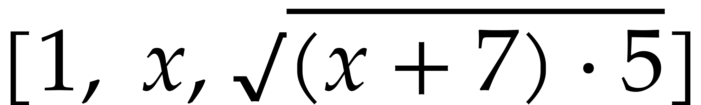.)

### [28\[4\]](https://cdn.wittgensteinnachlass.com/2000px/webp/Ts-211/28.webp)

(But what does someone who understands this rule do? Does he perhaps already apply it to all numbers in a shadowy sort of way? –)

### [28\[5\]](https://cdn.wittgensteinnachlass.com/2000px/webp/Ts-211/28.webp)

Now, to apply the rule three times in succession, say, there is no need for a further rule governing this application (establishing the connection between the first rule and the number 3). Rather, it is precisely our leaving the space for application open that is our sign for endless generality.

### [28\[6\]](https://cdn.wittgensteinnachlass.com/2000px/webp/Ts-211/28.webp)

After all, the word “etc.” is nothing other than the _word “etc.”,_ (i.e. again a sign of the calculus, which can do no more than have meaning through the rules that _hold_ for it. Which can _say_ no more than it shows.) That is, there is no secret power in the word “etc.” by virtue of which the series is now continued without being continued.

### [29\[1\]](https://cdn.wittgensteinnachlass.com/2000px/webp/Ts-211/29.webp)

Probably not, one will say, but it does have the meaning of _infinite continuation_.

### [29\[2\]](https://cdn.wittgensteinnachlass.com/2000px/webp/Ts-211/29.webp)

“Can one imagine an empty space?” (Curiously enough, this question belongs here.)

### [29\[3\]](https://cdn.wittgensteinnachlass.com/2000px/webp/Ts-211/29.webp)

It is one of the most deeply rooted errors of philosophy: possibility as a shadow of reality. But on the other hand it cannot be an error and it is not one if one calls the proposition this shadow.

### [29\[4\]](https://cdn.wittgensteinnachlass.com/2000px/webp/Ts-211/29.webp)

To _explain_ the infinite possibility, it must be enough to point to the features of the sign that lead us to the _assumption_ of this infinite possibility, or rather: from which we discern this infinite possibility. That is (_only_) to say that what is actually there in the sign must suffice, and that the possibilities of the sign, which could in turn show themselves only in a description of signs, must not come into consideration. So everything must already be contained in the sign “[1, x, x + 1]” – the expression of the formation rule. I must not use the infinite possibility to introduce a mythical element into _logic_ again. If one describes the process of division , which yields the quotient 0,3 and the remainder 1, then the infinite possibility of continuing with the same result every time must already lie in this description, for nothing else is given to us when we see “that it must always go on like this”. And when we “see the infinite possibility of continuing”, we surely cannot see anything that is not described when we describe the very sign we see.

### [30\[1\]](https://cdn.wittgensteinnachlass.com/2000px/webp/Ts-211/30.webp)

The danger here, of course, is again that of falling into a _positivism_, namely one that deserves a name of its own and therefore must be, _of course, an_ error. For we must have no tendency at all, no particular conception of things, but must acknowledge everything anyone has ever said about them, except in so far as he himself had a particular conception or theory.

### [30\[2\]](https://cdn.wittgensteinnachlass.com/2000px/webp/Ts-211/30.webp)

For the sign “etc.”, or a corresponding sign, is presumably essential for the designation of endlessness. Through the rules that hold for such a sign, of course. That is, we can no doubt distinguish the segment of a series “1, 1 + 1, 1 + 1 + 1” from the series “1, 1 + 1, 1 + 1 + 1, u.s.w.”. And the last sign and its use are just as essential to the calculus as _any one of the preceding signs_.

### [30\[3\]](https://cdn.wittgensteinnachlass.com/2000px/webp/Ts-211/30.webp)

Now what troubles me is that “etc.” apparently has to occur in the rules for the sign “etc.” too. E.g. 1, 1 + 1, u.s.w. = 1, 1 + 1, 1 + 1 + 1, u.s.w. etc.

### [30\[4\]](https://cdn.wittgensteinnachlass.com/2000px/webp/Ts-211/30.webp)

But do we not have here the old insight that we can describe language only from the outside? That we must therefore not expect a description of language to take us to depths other _than those language itself reveals_: For we describe language by means of language.

### [30\[5\]](https://cdn.wittgensteinnachlass.com/2000px/webp/Ts-211/30.webp)

We could say: There is really no reason to fear that we use the word “etc.” in a way that goes beyond the finite.

### [30\[6\]](https://cdn.wittgensteinnachlass.com/2000px/webp/Ts-211/30.webp),[31\[1\]](https://cdn.wittgensteinnachlass.com/2000px/webp/Ts-211/31.webp)

Besides, the part of the grammar of “etc.” that is characteristic of it cannot consist in rules for combining “etc.” with individual numerals (not: “_the_ individual numerals”) – for these rules in turn give an arbitrary segment of a series – but in rules for combining “etc.” with “etc.”.

### [31\[2\]](https://cdn.wittgensteinnachlass.com/2000px/webp/Ts-211/31.webp)

But here I have already used the word “arbitrary”, and how is it expressed that a _specified_ part of the series is arbitrary?

### [31\[3\]](https://cdn.wittgensteinnachlass.com/2000px/webp/Ts-211/31.webp)

The sign “1, 1 + 1, 1 + 1 + 1, ‥‥” cannot _in essentials_ be any clearer than “[1, x, x + 1]”. (This is very important.)

### [31\[4\]](https://cdn.wittgensteinnachlass.com/2000px/webp/Ts-211/31.webp)

What does someone see who recognizes in  that it now goes on repeating in this way? Can one not see this division without seeing that?

### [31\[5\]](https://cdn.wittgensteinnachlass.com/2000px/webp/Ts-211/31.webp)

Of the sign 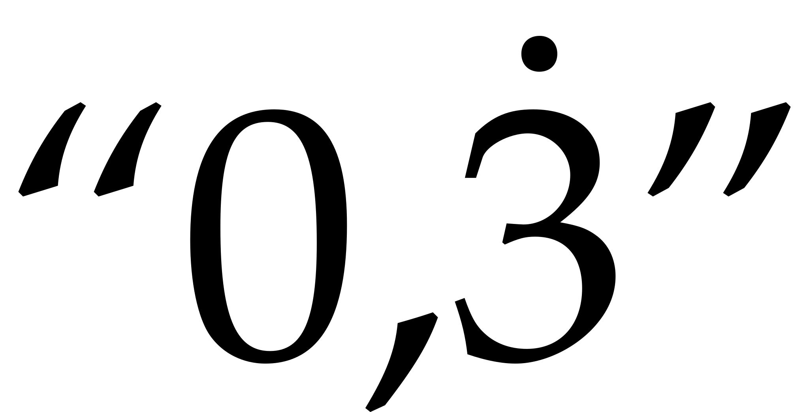 one can say: _it is not an abbreviation._

### [31\[6\]](https://cdn.wittgensteinnachlass.com/2000px/webp/Ts-211/31.webp)

I would once have said of the division: “I simply see something definite _in it_ when I recognize the periodicity”. – Must I not now say that it belongs to a different system in this case from the one it belongs to when I do not recognize the periodicity?

### [31\[7\]](https://cdn.wittgensteinnachlass.com/2000px/webp/Ts-211/31.webp)

It is clear, incidentally, that there is no _more exact_ proof of the periodicity of this division than the segment worked out above. What I see in this division enables me, for example, to write down the four-digit result 0,3333 on request, without further calculation. And this is what the other way of using this sign consists in.

### [31a\[1\]](https://cdn.wittgensteinnachlass.com/2000px/webp/Ts-211/31a.webp)

It is as if we were to discover, on certain solids lying in front of us, faces _by_ which they can be joined in a row. Or rather, as if we were to discover that they can be joined in a row by such-and-such faces, which we already knew before. This is the way many games or riddles are solved.

### [31a\[2\]](https://cdn.wittgensteinnachlass.com/2000px/webp/Ts-211/31a.webp)

Whoever discovers periodicity invents a new calculus. The question is, how does the calculus with periodic division differ from the calculus that knows nothing of periodicity?

### [31a\[3\]](https://cdn.wittgensteinnachlass.com/2000px/webp/Ts-211/31a.webp)

(We could have _carried on_ a calculus with cubes without ever thinking of joining them one after another to form prisms.)

### [31a\[4\]](https://cdn.wittgensteinnachlass.com/2000px/webp/Ts-211/31a.webp)

What is it that makes me know that the definition “a + ((b) + 1) = (a + b) + 1 Def” can be applied recursively to all numbers? Or: How does the periodicity of this division show itself?

### [31a\[5\]](https://cdn.wittgensteinnachlass.com/2000px/webp/Ts-211/31a.webp)

I could say, incidentally, that the sign “1, 1 + 1, 1 + 1 + 1, u.s.w.” differs from the sign “1, 1 + 1, 1 + 1 + 1” in its application. That they belong to different calculi.

### [31a\[6\]](https://cdn.wittgensteinnachlass.com/2000px/webp/Ts-211/31a.webp)

The difficulty begins as soon as I am to say that signs of the form “1, (1) + 1, ((1) + 1) + 1, u.s.w. _are allowed_ in place of the letters. (The arbitrary length of the enumeration is already awkward.)

### [31a\[7\]](https://cdn.wittgensteinnachlass.com/2000px/webp/Ts-211/31a.webp)

It must be possible to replace this enumeration with “[1, x, (x) + 1]”.

### [32\[1\]](https://cdn.wittgensteinnachlass.com/2000px/webp/Ts-211/32.webp)

But on the other hand it must also be clear that “1, (1) + 1, ((1) + 1) + 1, u.s.w. _is not an abbreviation_.

### [32\[2\]](https://cdn.wittgensteinnachlass.com/2000px/webp/Ts-211/32.webp)

Rather, it too must be the complete sign of a calculus. That is, one must be able to work with it just as exactly as with any other.

### [32\[3\]](https://cdn.wittgensteinnachlass.com/2000px/webp/Ts-211/32.webp)

But now one might ask: How is it that someone who applies the general rule to a _further_ number is following only _this_ rule? That no further rule was needed to allow him to apply the general one to this case too; and yet this case was not mentioned in the (_general_) rule.

### [32\[4\]](https://cdn.wittgensteinnachlass.com/2000px/webp/Ts-211/32.webp)

So what surprises us is that we cannot bridge this gulf between the individual numbers and the general proposition.

### [32\[5\]](https://cdn.wittgensteinnachlass.com/2000px/webp/Ts-211/32.webp)

“How do you know he is in the room?” – “Because I put him in there and there is nowhere he can get out.” – So your knowledge of the general fact that he is somewhere in the room is also of the same multiplicity as this ground. Drawn roughly like this:

 So the picture of the general state of affairs would also be ∣ o ∣. And this sign would merely be used differently from when it indicates a particular position. Incidentally, we have the same thing when we give a proof in geometry by means of a drawing and draw _one_ (general) triangle. Different rules then hold for the use of the general triangle _from those for the use of the particular one_. (One says: “the size of this triangle does not matter here”.)

### [33\[1\]](https://cdn.wittgensteinnachlass.com/2000px/webp/Ts-211/33.webp)

When the intuitionists speak of “basic intuition”, – is this a psychological process? And how does it get into mathematics, then? Or is what they mean, after all, merely a primitive sign (in Frege’s sense); a component of a calculus?

### [33\[2\]](https://cdn.wittgensteinnachlass.com/2000px/webp/Ts-211/33.webp)

It is presumably characteristic of the general ∣ o ∣ that ∣o∣ = ∣o∣, but one cannot _explain_ the general sign by enumerating such equations, since again one cannot enumerate _all_ of them. (That is why I said earlier that “etc.” must be _characterized_ by its possible combinations with itself, not with _its_ particular cases.)

### [33\[3\]](https://cdn.wittgensteinnachlass.com/2000px/webp/Ts-211/33.webp)

It is as if there were a general _conception_ of the sign (say, of a triangle in a geometrical construction, etc.).

### [33\[4\]](https://cdn.wittgensteinnachlass.com/2000px/webp/Ts-211/33.webp)

There is a relation “between” for which one cannot speak of a particular place. Which thus has, as it were, all the features of the spatial “between” except those that relate to definite positions. That is, there is a calculus with a relation that one could call “between”, but in which there would be no question of (a) generality. On the other hand, however, this is the calculus for the notation for generality of spatial position. But how does it acquire the character of generality if it does not acquire it through its relations to particular cases? – But what does this character of generality consist in? Are we not dealing here again with a false comparison?

### [33\[5\]](https://cdn.wittgensteinnachlass.com/2000px/webp/Ts-211/33.webp)

Generality is as ambiguous as the subject–predicate form.

### [34\[1\]](https://cdn.wittgensteinnachlass.com/2000px/webp/Ts-211/34.webp)

All that one really needs to know in philosophy is that every difference in the use of a word is a logical difference, and that we are thus dealing with different forms (whose _grammatical kinship_ is at most indicated by the same word).

### [34\[2\]](https://cdn.wittgensteinnachlass.com/2000px/webp/Ts-211/34.webp)

That is, one must simply not pass over a difference in forms – as one might well pass over a difference between suits if, say, it is very slight. In a certain sense there are no ‘slight differences’ for us – that is, in grammar. And in any case the word difference means something quite different from what it means where the difference is between two things.

### [34\[3\]](https://cdn.wittgensteinnachlass.com/2000px/webp/Ts-211/34.webp)

What does the character of generality of the general calculus consist in? For I want it to deal with the particular cases generally and not to be something altogether detached, as it were, from the particular cases. (As is also indicated in the notation “1, 1 + 1, 1 + 1 + 1, u.s.w.”.) Where is the _kinship_ between generality and the particular? It must evidently be expressed in the notation. (And that is why the general numerical form “[1, x, (x) + 1]” also contains the sign “1”.)

### [34\[4\]](https://cdn.wittgensteinnachlass.com/2000px/webp/Ts-211/34.webp)

I want to say: the general picture ∣ o ∣ has a different metric from the particular one.

### [34\[5\]](https://cdn.wittgensteinnachlass.com/2000px/webp/Ts-211/34.webp),[35\[1\]](https://cdn.wittgensteinnachlass.com/2000px/webp/Ts-211/35.webp)

The possibility of listing still further numbers. The difficulty seems to us to be that the numbers I have actually listed are by no means essential and nothing indicates that they are an _arbitrary_ collection: _the ones among all the numbers that happen to have been written down._ (As if I had all the pieces of a game in a box and, on the table beside it, a chance selection from the box. Or as if some of the digits had been _traced over_ in ink, while all of them had, as it were, already been faintly drawn in.) But that apart from the ones we happen to have used, we have only the general form. Incidentally, do we not have here – odd as it sounds – the difference between numerals and numbers?

### [35\[2\]](https://cdn.wittgensteinnachlass.com/2000px/webp/Ts-211/35.webp)

In the general sign “❘ ⚬ ❘” distances play as little part as they do in the sign “aRb”.

### [35\[3\]](https://cdn.wittgensteinnachlass.com/2000px/webp/Ts-211/35.webp)

Consider that a logical sum of, say, a hundred summands might follow from the general proposition, even though we certainly did not think of them when we uttered the general proposition. Can we nonetheless say that it follows from it?

### [35\[4\]](https://cdn.wittgensteinnachlass.com/2000px/webp/Ts-211/35.webp)

The notation for generality in our ordinary language captures the logical form much more superficially still than I formerly believed. In just this respect it is comparable to the subject–predicate form.

### [35\[5\]](https://cdn.wittgensteinnachlass.com/2000px/webp/Ts-211/35.webp)

Let us take the particular cases of the general state of affairs in which the cross is between the boundary marks:

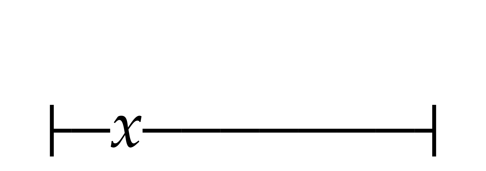  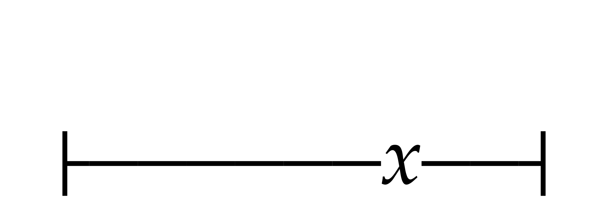. Each of these cases, for example, has a _particular_ individuality. Does this individuality enter in any way into the sense of the general sentence? Evidently not.

### [36\[1\]](https://cdn.wittgensteinnachlass.com/2000px/webp/Ts-211/36.webp)

“The cross lies on the straight line _like this_: 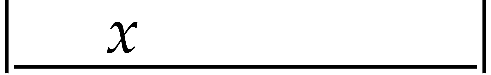” – “It _therefore_ lies between the marks ‥․.” “It is 16½˚ here”. – “So at any rate it is more than 15˚.” If, incidentally, one is surprised that this sentence follows from that one, although one was not thinking of this one at all when thinking of that one, one need only recall that p⌵q follows from p, and I certainly do not think of all sentences p⌵x when I think of p.

### [36\[2\]](https://cdn.wittgensteinnachlass.com/2000px/webp/Ts-211/36.webp)

The whole idea that when one thinks a sentence from which another follows one must think the latter rests on a false, psychologizing conception. After all, we have only to attend to what lies in the signs and (_their_) rules.

### [36\[3\]](https://cdn.wittgensteinnachlass.com/2000px/webp/Ts-211/36.webp)

By contrast, it is a _real difficulty_ that following always seems to be bound to the calculus of truth-functions.

### [36\[4\]](https://cdn.wittgensteinnachlass.com/2000px/webp/Ts-211/36.webp),[37\[1\]](https://cdn.wittgensteinnachlass.com/2000px/webp/Ts-211/37.webp)

Do I want to say that following must always result from the agreement of the truth-possibilities?

(∃x)․fx⌵fa = (∃x)․fx, (∃x)․fx & fa = fa. How do I know that? (For I have, so to speak, proved what is above.) One might be inclined to say: “I simply understand ‘(∃x).fx’”. (A splendid example of what ‘understand’ means.) But I could just as well ask “how do I know that (∃x).fx follows from fa” and answer: “because I understand ‘(∃x).fx’”. But how do I really know that it follows? – _Because I calculate in this way._ How do I know that (∃x).fx follows from fa? Do I see, as it were, behind the sign “(∃x).fx”, and see the sense that stands behind it, and see from that that it follows from fa? Is _that_ understanding? No, that equation is part of the understanding (which thus lies spread out before me). For the assumption of an understanding that is originally _graspable_ _at a stroke_ and can _only then_ be spread out in this way is mistaken. If I say “I know that (∃x).fx follows because I understand it”, that would mean that in understanding it I see something _other_ than the given sign, as it were a _definition_ of the sign from which its following emerges.

### [37\[2\]](https://cdn.wittgensteinnachlass.com/2000px/webp/Ts-211/37.webp)

Mathematics consists of calculations.

### [37\[3\]](https://cdn.wittgensteinnachlass.com/2000px/webp/Ts-211/37.webp)

My conception of the general proposition was, after all, that (∃x).fx is a logical sum and that it is just that its summands are not enumerated _here_, though they could be enumerated (namely from the dictionary and grammar of the language). For if they could not be enumerated, it would not after all be a logical sum. (Perhaps a law for forming logical sums.)

### [37\[4\]](https://cdn.wittgensteinnachlass.com/2000px/webp/Ts-211/37.webp),[38\[1\]](https://cdn.wittgensteinnachlass.com/2000px/webp/Ts-211/38.webp)

Number is by no means a “fundamental mathematical concept”. There are so many calculi in which there is no mention of numbers. And as far as arithmetic is concerned, what we are still willing to call numbers is more or less arbitrary. Beyond that, the calculus of, for example, cardinal numbers is to be described, i.e. its rules are to be stated, and with that the foundations of arithmetic are given.

### [38\[2\]](https://cdn.wittgensteinnachlass.com/2000px/webp/Ts-211/38.webp)

Teach it to us, and you have provided a justification.

### [38\[3\]](https://cdn.wittgensteinnachlass.com/2000px/webp/Ts-211/38.webp)

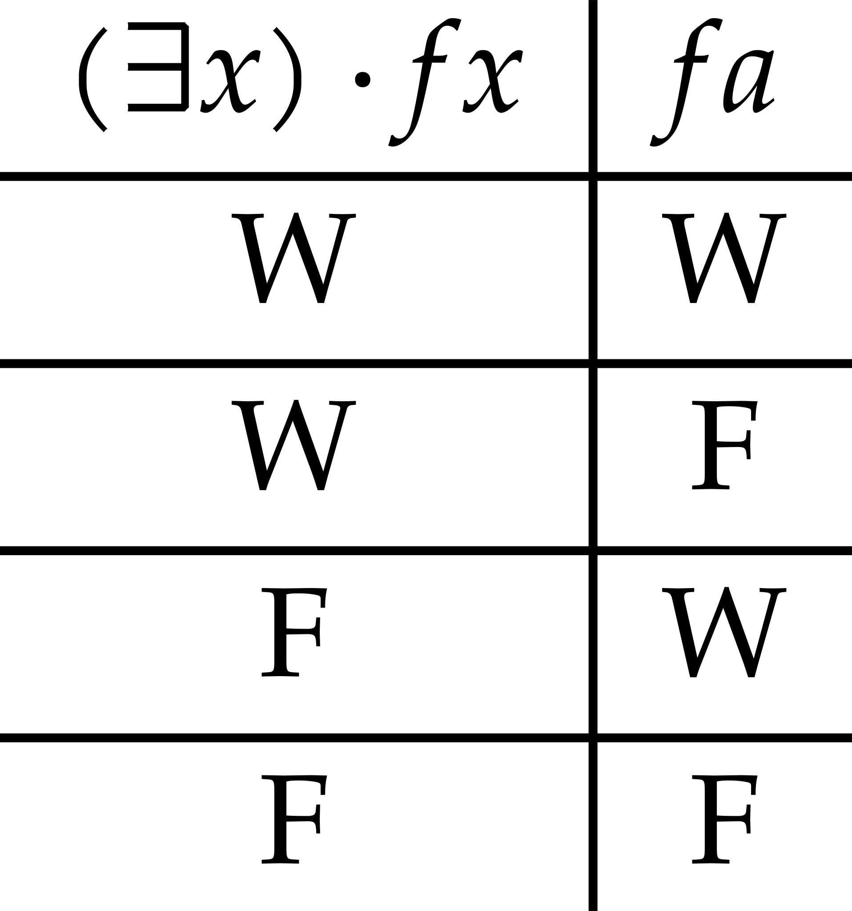

But, I thought, mustn’t (∃x)․fx be a truth-function of fa, then, for that to be possible? For this dependence to be possible?

### [38\[4\]](https://cdn.wittgensteinnachlass.com/2000px/webp/Ts-211/38.webp)

But doesn’t (∃x)․fx⌵fa = (∃x)․fx say precisely that fa is already contained in (∃x)․fx? Doesn’t it show the dependence of fa on (∃x)․fx? No, unless (∃x)․fx is _defined_ as a logical sum (with fa as a summand). – If that is so, then (∃x)․fx is (_nothing but_) an abbreviation.

### [38\[5\]](https://cdn.wittgensteinnachlass.com/2000px/webp/Ts-211/38.webp)

There is no hidden connection in logic.

### [38\[6\]](https://cdn.wittgensteinnachlass.com/2000px/webp/Ts-211/38.webp)

(One of the greatest obstacles to philosophy is the expectation of new, deep insights.)

### [38\[7\]](https://cdn.wittgensteinnachlass.com/2000px/webp/Ts-211/38.webp)

Isn’t the dependence, rather, established and laid down by the equation? For there simply is no hidden dependence.

### [38\[8\]](https://cdn.wittgensteinnachlass.com/2000px/webp/Ts-211/38.webp)

(∃x)․ fx & non-fa, (∃x)․fx & non-fa & non-fb & non-fc

“The cross is somewhere between the strokes, except in position a.” One might now ask: do such repeated subtractions of possibilities eventually produce a contradiction?

### [38\[9\]](https://cdn.wittgensteinnachlass.com/2000px/webp/Ts-211/38.webp),[39\[1\]](https://cdn.wittgensteinnachlass.com/2000px/webp/Ts-211/39.webp)

Suppose I gave a disjunction of so many positions that it would be impossible for me to recognize a position as different from all those given; would the disjunction _now_ be the general proposition (∃x)․fx? Would it not be pedantic, so to speak, still to refuse to recognize the disjunction as the general proposition? Or is there an essential difference, and might the disjunction bear no resemblance at all to the general proposition?

### [39\[2\]](https://cdn.wittgensteinnachlass.com/2000px/webp/Ts-211/39.webp)

What strikes us is that one sentence is so complicated, the other so simple. Or is the simple one just a shorthand for the more complicated one?

### [39\[3\]](https://cdn.wittgensteinnachlass.com/2000px/webp/Ts-211/39.webp)

But ‘lying between the line segments, or walls’ seems to us to be something simple, of which the various positions (whether the visual appearances, or the positions established by measurement) are quite independent. That is, when we speak of the individual (seen) positions, we seem to be speaking of something quite different from what is spoken of in the general sentence.

### [39\[4\]](https://cdn.wittgensteinnachlass.com/2000px/webp/Ts-211/39.webp)

Our designation of generality belongs to one calculus, and that disjunction exists in another. When we say that the cross lies between these marks, we have no disjunction ready to take the place of the general sentence.

### [39\[5\]](https://cdn.wittgensteinnachlass.com/2000px/webp/Ts-211/39.webp)

But is there any objection in principle to a generality that appears as _generality_, for which, therefore, (∃x)․fx & fa = fa, and which is nevertheless not a truth-function of a given number of propositions?

### [39\[6\]](https://cdn.wittgensteinnachlass.com/2000px/webp/Ts-211/39.webp)

Or: Is it possible for (∃x)․fx & fa = fa without (∃x)․fx being a truth-function of fa?

### [40\[1\]](https://cdn.wittgensteinnachlass.com/2000px/webp/Ts-211/40.webp)

(It cannot be a truth-function of fa without one knowing it.) Surely I can have a calculus in which there is only one a-b-a, one b-a-a and one a-a-b – 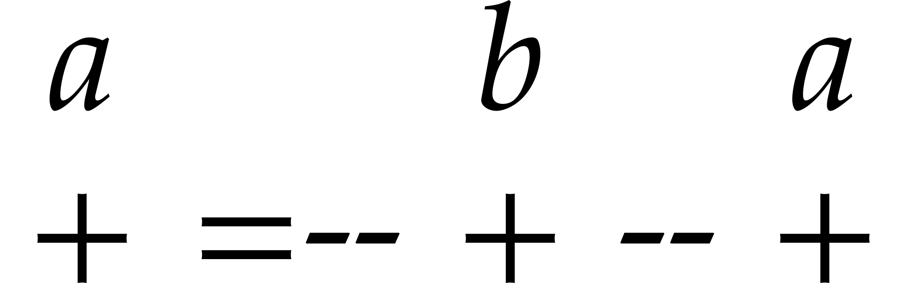 – but on the other hand also one in which 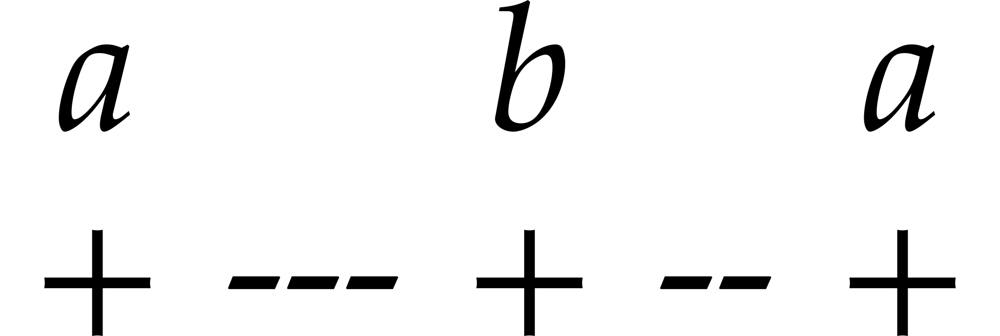 means one definite position, and 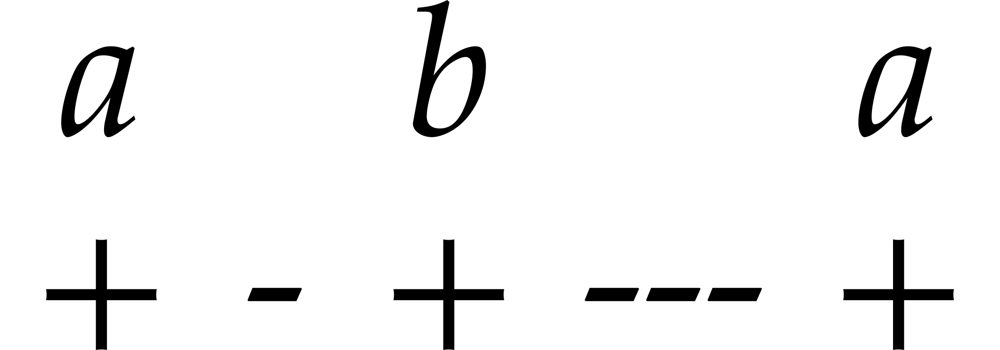 another, etc. And why should I not now combine the two so that one can always take a sign  or  etc. in both ways, so that “a-b-a” then follows from 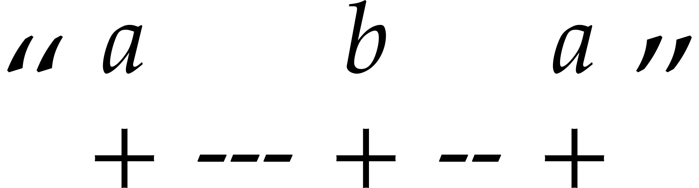, etc.?

### [40\[2\]](https://cdn.wittgensteinnachlass.com/2000px/webp/Ts-211/40.webp)

But can I specify the rules of following in this case? For how do I know that it is from fa that (∃x)․fx follows? After all, I cannot specify _all_ the propositions from which it follows. – But that is not necessary at all; if (∃x)․fx follows from fa, then _that_ at any rate could be known before any particular experience, and it was possible to specify it in the grammar. – But then is the grammar not incapable of completion in this sense, since new signs of the form fx can always be used? – Those that are used are used, and I can always make provision for them in the grammar.

### [40\[3\]](https://cdn.wittgensteinnachlass.com/2000px/webp/Ts-211/40.webp)

I said “it was possible to know before any experience that (∃x)․fx follows from fa and to specify it in the grammar”. But it should have been: ‘(∃x)․fx follows from fa’ is not a proposition (empirical proposition) of the language to which ‘ (∃x)․fx’ and ‘fa’ belong, but a rule laid down in its grammar.

### [40\[4\]](https://cdn.wittgensteinnachlass.com/2000px/webp/Ts-211/40.webp)

I consider language and grammar from the point of view of the calculus, that is, of operating according to fixed rules.

### [41\[1\]](https://cdn.wittgensteinnachlass.com/2000px/webp/Ts-211/41.webp)

All that matters is that we cannot say (here) that we found out through experience that there is also this case of grammar. For we would have to describe it in this statement (statement), and although it is only now that I see that the description is true, I would have had to understand it even before this experience.

### [41\[2\]](https://cdn.wittgensteinnachlass.com/2000px/webp/Ts-211/41.webp)

It is the old question: to what extent can one speak now of an experience one is not having now? What I cannot foresee, I cannot foresee. And what I can speak of now, I can speak of now independently of what I can _not_ speak of now. Logic is always complete.

### [41\[3\]](https://cdn.wittgensteinnachlass.com/2000px/webp/Ts-211/41.webp)

“How can I know all that will follow?” – What I can know then, I can know now too.

### [41\[4\]](https://cdn.wittgensteinnachlass.com/2000px/webp/Ts-211/41.webp)

But are there actually general rules of grammar, rather than just rules about general signs? What, for instance, would be a general and a particular rule in chess (or in another game)? Every rule, after all, is general. Yet the rule that p⌵q follows from p has a different kind of generality from the rule that every sentence of the form p, non-non-p, ‥‥ follows from p & q. But isn’t the generality of the rule for the knight’s move different from that of a rule for the beginning of a game?

### [41\[5\]](https://cdn.wittgensteinnachlass.com/2000px/webp/Ts-211/41.webp)

Does the word “rule” have several senses at all? And are we therefore not to speak of rules in general, any more than of languages in general? But only of rules in particular cases.

### [42\[1\]](https://cdn.wittgensteinnachlass.com/2000px/webp/Ts-211/42.webp)

(Socrates asks what knowledge is and is not satisfied with a list of things one knows. But we do not concern ourselves much with this general concept and are glad if we understand shoemaking, geometry, etc.)

### [42\[2\]](https://cdn.wittgensteinnachlass.com/2000px/webp/Ts-211/42.webp)

But doesn’t this consideration also apply to the concept of following?

### [42\[3\]](https://cdn.wittgensteinnachlass.com/2000px/webp/Ts-211/42.webp)

We do not believe that the only person who understands a game is one who can give a definition of the concept ‘game’.

### [42\[4\]](https://cdn.wittgensteinnachlass.com/2000px/webp/Ts-211/42.webp)

(I am making things easier and easier for myself in philosophy. But the difficulty is in making things easier for oneself and yet remaining exact.)

### [42\[5\]](https://cdn.wittgensteinnachlass.com/2000px/webp/Ts-211/42.webp)

One cannot get behind the rules, because there is no ‘behind’.

### [42\[6\]](https://cdn.wittgensteinnachlass.com/2000px/webp/Ts-211/42.webp)

fE & fa = fa Can one say: this is possible only if fE follows from fa; or must one say: this stipulates that fE follows from fa?

### [42\[7\]](https://cdn.wittgensteinnachlass.com/2000px/webp/Ts-211/42.webp)

If the former, then it must follow by virtue of the structure, for instance by fE being so determined by a definition that it has the _corresponding_ structure. But can its following really emerge, as it were, from the visible structure of the signs, as physical behaviour emerges from a physical property, or does it not rather always require such _stipulations_ as the equation fE & fa = fa? Can one tell by looking at p⌵q that it follows from p, or even by looking at the rules Russell gives for the truth-functions?

### [42a\[1\]](https://cdn.wittgensteinnachlass.com/2000px/webp/Ts-211/42a.webp)

And why should the rule fE & fa = fa be derived from another rule rather than be the primary rule?

### [42a\[2\]](https://cdn.wittgensteinnachlass.com/2000px/webp/Ts-211/42a.webp)

For what is “fE must surely contain fa in some way” supposed to mean? It simply does not contain it, in so far as we can work with fE without mentioning fa. It does, though, in so far as the rule fE & fa = fa holds.

### [42a\[3\]](https://cdn.wittgensteinnachlass.com/2000px/webp/Ts-211/42a.webp)

For the _opinion_ is that fE & fa = fa can hold only by virtue of a definition of fE.

### [42a\[4\]](https://cdn.wittgensteinnachlass.com/2000px/webp/Ts-211/42a.webp)

And that – I think – because otherwise it falsely appears as if a further stipulation about fE were being made after it _had_ already been introduced into the language. In fact, however, no stipulation is left to future experience.

### [42a\[5\]](https://cdn.wittgensteinnachlass.com/2000px/webp/Ts-211/42a.webp)

And of course defining fE from ‘all the individual cases’ is _just as_ impossible as listing _all_ the rules of the form fE & fx = fx.

### [42a\[6\]](https://cdn.wittgensteinnachlass.com/2000px/webp/Ts-211/42a.webp)

Indeed, the individual equations fE & fx = fx are precisely an expression of this impossibility.

### [42a\[7\]](https://cdn.wittgensteinnachlass.com/2000px/webp/Ts-211/42a.webp),[43\[1\]](https://cdn.wittgensteinnachlass.com/2000px/webp/Ts-211/43.webp)

But how is it expressed in our rules that the cases fx dealt with are not an _essentially closed_ class? – Presumably only through the generality of the general rule. – That they do not have _the same_ meaning for the calculus as a closed group of primitive signs (say, the names of the 6 primary colours). How else than through the rules laid down for them? – If in a game, say, I am allowed to borrow pieces of a certain kind in any number, while others are present in a fixed number, or if the game is unlimited in time but limited in space, then we presumably have the same case. And the difference between the one kind of piece and the other must be laid down by the rules of the game. Of one kind it might say: you can take as many pieces of this kind as you like. – And I must not look for another, more exact expression of the rule.

### [43\[2\]](https://cdn.wittgensteinnachlass.com/2000px/webp/Ts-211/43.webp)

That is, the expression for the unboundedness of the individual cases dealt with will (_of course_) be a general expression and cannot be any other kind of expression, not one in which the other individual cases, not dealt with, occur in a shadowy way.

### [43\[3\]](https://cdn.wittgensteinnachlass.com/2000px/webp/Ts-211/43.webp)

It is clear that I do not recognize any logical sum as a definition of the sentence “the cross lies between the strokes”. And surely that says it all.

### [43\[4\]](https://cdn.wittgensteinnachlass.com/2000px/webp/Ts-211/43.webp)

If one is asked “But is it certain, then, that no calculus other than this one is used?” one must say: If that means “Don’t we use other calculi in our _actual_ language as well?”, I can only answer “I don’t know of any others (at present)” (just as if someone asked “Are those all the calculi of (present-day) mathematics?”, I might say “I don’t recall any others, but I can perhaps check the books more carefully”). But the question cannot mean “Can no other calculus be used?” For how would I answer this question? A calculus exists in virtue of one’s describing it.

### [43\[5\]](https://cdn.wittgensteinnachlass.com/2000px/webp/Ts-211/43.webp)

Can one say: ‘calculus’ is not a mathematical concept?

### [44\[1\]](https://cdn.wittgensteinnachlass.com/2000px/webp/Ts-211/44.webp)

Plato: “– How? he said, could it really be of no use? For if prudence is indeed the knowledge of knowledge, & presides over other forms of knowledge, then it must also preside over this knowledge which is concerned with the good, & must therefore be useful to us. – Does it also make us healthy, I said, rather than medicine? And so with the other arts; does it not perform their functions, & not rather each of them its own? Or have we not long since agreed that it is only the knowledge of knowledge & ignorance, & not of any other matter? – No doubt. – Then it will not make us healthy? – Presumably not. – Because health belongs to another art? – Yes. – Therefore, it will not bring us any benefit either, my friend. For this task too has now been assigned to another art. – Of course. – How, then, can prudence be useful, if it brings us no benefit at all?”

### [44\[2\]](https://cdn.wittgensteinnachlass.com/2000px/webp/Ts-211/44.webp)

It is clear that the question “what is a calculus” is of exactly the same kind as “what is a game” or “what is a rule”.

### [44\[3\]](https://cdn.wittgensteinnachlass.com/2000px/webp/Ts-211/44.webp)

It is clear that we can teach someone to play chess. And the question is: Does he understand it any the less for not having learnt ‘what a game is’? Or does that make no difference at all?

### [44\[4\]](https://cdn.wittgensteinnachlass.com/2000px/webp/Ts-211/44.webp),[45\[1\]](https://cdn.wittgensteinnachlass.com/2000px/webp/Ts-211/45.webp)

What does “indefinable” mean? This word is evidently misleading, for it _gives_ the impression that we might try something _here_ which would then prove impossible to carry out. As though the indefinable were something that could not be defined any further, as a weight that is too heavy cannot be lifted. We might say: “What do you mean, ‘indefinable’?! Can we even _try_ to define it?”

### [45\[2\]](https://cdn.wittgensteinnachlass.com/2000px/webp/Ts-211/45.webp)

Now one might of course say: a definition is arbitrary, that is, however I define a word, that is how it is defined. But one can reply: what matters is to define it in accordance with what we mean by the word. So that, on being given the definition of the word “table”, for example, we say: yes, that is what I mean by the word. – But was it the definition that led you to mean that by the word, or do you want to say that this is what you have always meant? And if the latter, then you have always meant _what_ the definition says (as opposed to something else it might say). That is: the definition is also a description of what you meant before. So you already had a translation of this definition; it merely said aloud, so to speak, what you already knew in silence. So in substance it did not analyse anything either.

### [45\[3\]](https://cdn.wittgensteinnachlass.com/2000px/webp/Ts-211/45.webp)

Someone who points out that a word has been used in two different meanings, or that when we use _this_ expression we have _this_ picture in mind, and who in general ascertains (tabulates) the rules according to which words are used, is under no obligation at all to give an explanation (definition) of the word “rule” (or “word”, “language”, “sentence”, etc.).

### [45\[4\]](https://cdn.wittgensteinnachlass.com/2000px/webp/Ts-211/45.webp)

I said above “calculus is not a mathematical concept”; that is, the word ‘calculus’ is not a _chess piece_ of mathematics. It need not occur in mathematics. – And if it is used in a calculus all the same, that calculus is not thereby a metacalculus. Rather, _this word_ is then once again only a chess piece like all the others.

### [46\[1\]](https://cdn.wittgensteinnachlass.com/2000px/webp/Ts-211/46.webp)

Thus I am allowed to use the word ‘rule’ without necessarily first tabulating the rules about this word. And these rules are not meta-rules.

### [46\[2\]](https://cdn.wittgensteinnachlass.com/2000px/webp/Ts-211/46.webp)

The word “rule” need not be used in the explanation of a game (nor, of course, need an equivalent word).

### [46\[3\]](https://cdn.wittgensteinnachlass.com/2000px/webp/Ts-211/46.webp),[47\[1\]](https://cdn.wittgensteinnachlass.com/2000px/webp/Ts-211/47.webp)

And how, then, do we use the word ‘rule’ (when, for instance, we talk about games)? In contrast to what? We say, for example, “that follows from this rule”, but then we could surely quote the rule of the game and so replace the word “rule”. Or we speak of “all the rules of the game” and must then either have listed them (in which case we are (again) back to the first case), or we speak of the rules as a group whose members are generated in a particular way from given _basic positions_, and then the word “rule” stands for the expression of _these_ basic positions and operations. Or we say “_This_ is a rule, _that_ isn’t”, when, say, the second is just a single word or a configuration of the pieces. (Or: “no, that too is a rule under the new agreement”.) If, for instance, we had to write out the list of rules of the game, something like this might be said, and then it would mean: _This_ goes in, _that_ doesn’t. But not by virtue of a particular property (namely, that of being a rule), as when one wants to pack nothing but apples into a crate and says “no, that doesn’t go in, that’s a pear”. Yes, but surely we call some things “games” and others not, and some things “rules” and others not! But drawing a boundary between everything we call a game and everything else is _never_ what matters. For us, games are _the_ games we have heard of, the ones we can list, and perhaps a few more newly devised by analogy with others; and if someone were to write a book about games, he would not really need the word “game” even in the title: the title could be a list of the names of the individual games. And if asked: But what is it that all these things have in common, _on account of which_ you group them together? he could say: I can’t specify it in one sentence, but you can see plenty of analogies. Besides, the question is idle, since I can again proceed by analogy in imperceptible steps and arrive at constructions that no one in ordinary life would still call a “game”, so that what one chose to call a “game” would once again be arbitrary. So I call what is on this list a “game”, as well as whatever is similar to these games to a certain degree (which I have not specified more precisely). Beyond that I reserve the right to decide in each new case whether or not to count something among the games.

### [47\[2\]](https://cdn.wittgensteinnachlass.com/2000px/webp/Ts-211/47.webp),[48\[1\]](https://cdn.wittgensteinnachlass.com/2000px/webp/Ts-211/48.webp)

Now the same applies to the concept of a rule. Only in quite particular cases are we concerned with distinguishing rules from something that is not a rule, and in all these cases it is easy to give a criterion for the distinction. That is, we use the word “rule” in contrast to “word”, “configuration of the pieces” and a few other things, and these boundaries are clearly drawn. On the other hand, it is idle to draw boundaries where we do not need them. Isn’t it the same here as with the concept ‘plant’? We use this word in a definite sense, but in the case of single-celled organisms the question of whether one should call them animals or plants remained open for a time, and one could also construct as many other borderline cases as one liked in which it would still have to be decided whether something still fell under the concept of a plant. But does that make the meaning of the word “plant” vague in all other cases, so that one could say that we use the word without understanding it? Indeed, would a definition that delimited the concept on _different_ sides make the meaning of the word clearer to us in all sentences, so that we would also understand all the sentences in which it occurs better? Evidently not.

### [48\[2\]](https://cdn.wittgensteinnachlass.com/2000px/webp/Ts-211/48.webp)

What does it mean to know what a plant is? What does it mean to know it and not be able to say it? “You know it and can speak Greek, so surely you must be able to say it.” The idleness of a definition, say, of the concept of a plant. But isn’t a definition a requirement of exactness? “The ground was completely covered with plants”: we don’t mean bacilli by that. Indeed, we may be thinking of green plants of a certain order of size. If someone told us we didn’t know what we were saying as long as we hadn’t given a definition of a plant, we would rightly think him mad. Indeed, even with such a definition we would be no better able to make ourselves understood in ordinary cases. Indeed, it even seems that we would communicate less well in a certain sense, because in this case it is precisely what is undefined that seems to belong to our language.

### [48\[3\]](https://cdn.wittgensteinnachlass.com/2000px/webp/Ts-211/48.webp)

Imagine replacing the words “grasses” and “herbs” with definitions in the sentence from a story “the ground was completely covered with grasses and herbs”. Clearly these definitions must be long and complicated expressions; and now the question is whether we really meant by the sentence what is now said in the incomparably more complicated one. We would say – I think – that we hadn’t thought of all that at all.

### [48\[4\]](https://cdn.wittgensteinnachlass.com/2000px/webp/Ts-211/48.webp),[49\[1\]](https://cdn.wittgensteinnachlass.com/2000px/webp/Ts-211/49.webp)

But can one apply the idea of a calculus to such a language? And isn’t that like wanting to speak of boundaries between colours in a picture in which all the patches of colour run into one another? Or is it like this: imagine a game, say tennis, in whose rules nothing is said about the height a ball must not exceed in flight. And suppose someone said: But the game isn’t governed by rules at all, for if someone throws the ball so high that it doesn’t fall back to earth, or so far that it flies around the earth, we don’t know whether this ball is to count as ‘out’ or ‘in’. One would answer him – I think – that if such a case arose, one would give rules for it; for now there is no need. Couldn’t we, more generally, imagine a game with an incomplete list of rules, in which we had agreed to supplement the rules later as needed, provided that no future rule would be allowed to contradict any of the rules already laid down? (Just as in tennis nothing is laid down about how long one’s strides may be when running, but this could still be laid down if necessary.) Think of the rules about jumping over pieces in a board game and of the particular cases that arise when the piece to be jumped over is at the edge of the board or immediately next to another piece.

### [49\[2\]](https://cdn.wittgensteinnachlass.com/2000px/webp/Ts-211/49.webp)

Still, grammatical rules can be given for the use of the word “plant”, and so we can answer questions of the kind “does it follow from _this_ state of affairs that there’s a plant there”. But we are not equipped to answer other such questions and can reply: Such a case has never arisen and it would be idle for us to make provision for it. (If, say, someone succeeded in producing a living being half by mechanical and half by organic means, and the question were then asked: does this still count as an animal or a plant.)

### [49\[3\]](https://cdn.wittgensteinnachlass.com/2000px/webp/Ts-211/49.webp),[50\[1\]](https://cdn.wittgensteinnachlass.com/2000px/webp/Ts-211/50.webp)

Suppose, for instance, that in a shooting competition no provision had been made for certain borderline cases as to whether a shot like this should still count as hitting the bull’s-eye (_or not_). But now suppose that no such shot is fired in our competition; could one still say that the whole awarding of prizes was invalid because no provision had been made for this case?

### [50\[2\]](https://cdn.wittgensteinnachlass.com/2000px/webp/Ts-211/50.webp)

Now let us imagine the list of regulations for this shooting, and suppose that it makes no mention at all of those borderline cases. (That would be rather like someone proceeding only by the rules of cardinal arithmetic in calculating lengths.) Can one now say that the list of rules is essentially incomplete? For if a shot hits the boundary between black and white, the judge will surely have to decide one way or another: he will then be able either to say that this shot does not count, or to count it as hitting the black, and so on. If he wants to apply the given schema, he will have to apply it _somehow_. I mean: he will only be able either to apply the rules as they stand or to apply other rules. One could also put it like this: these rules are really made for a different game, namely one in which there are indeed only the two possibilities of hitting entirely inside and entirely outside the circle. So if I apply the same rules to target shooting, I must project its possibilities into the multiplicity of _these_ rules in a different way.

### [50\[3\]](https://cdn.wittgensteinnachlass.com/2000px/webp/Ts-211/50.webp)

(Our task is only to be just. I.e., we have only to point out and resolve the injustices of philosophy, not to set up new parties – and creeds.)

### [50\[4\]](https://cdn.wittgensteinnachlass.com/2000px/webp/Ts-211/50.webp)

What is hidden must be capable of being found. (Hidden contradiction.)

### [51\[1\]](https://cdn.wittgensteinnachlass.com/2000px/webp/Ts-211/51.webp)

What is hidden must be capable of being described in full even before it has been found, as though it had (already) been found.

### [51\[2\]](https://cdn.wittgensteinnachlass.com/2000px/webp/Ts-211/51.webp)

If one says that the object is so well hidden that it is impossible to find it, that makes good sense, and the impossibility here is of course not logical; i.e. it makes _sense_ to speak of finding the object and also to describe the finding; and we are denying only that _that_ will happen.

### [51\[3\]](https://cdn.wittgensteinnachlass.com/2000px/webp/Ts-211/51.webp)

I do undertake to draw up the list of rules of our language: what am I to do now in a case like that of the concept “plant”? Am I to say that no rule has been laid down for such and such a case? Certainly, if that is how things stand. But then am I to say that there is no list of rules of our language and that the whole undertaking of drawing one up is nonsense? – But it is clear that it is not nonsensical, for we do lay down rules successfully, and we need only refrain from laying down dogmas. (What is the essence of a dogma? Doesn’t it consist in asserting propositions of natural necessity about all possible rules?)

### [51\[4\]](https://cdn.wittgensteinnachlass.com/2000px/webp/Ts-211/51.webp),[52\[1\]](https://cdn.wittgensteinnachlass.com/2000px/webp/Ts-211/52.webp)

“I know what a plant is, but I can’t say”. Does this knowledge have the multiplicity of a sentence that just hasn’t been uttered? _So that_, if the sentence were uttered, I would recognize it as the expression of my knowledge? – Isn’t it rather true that any exact definition would have to be rejected as an expression of our understanding? I.e., wouldn’t we have to say of such a definition that it determines a concept akin to ours, but not our concept itself. And that the affinity is something like that between two pictures, one consisting of patches of colour with blurred boundaries, the other of patches similarly shaped and distributed, but with sharp boundaries. The affinity would then be as undeniable as the difference.

### [52\[2\]](https://cdn.wittgensteinnachlass.com/2000px/webp/Ts-211/52.webp)

The question now is: can you speak of patches in the first picture too? Certainly, only in a different but related sense.

### [52\[3\]](https://cdn.wittgensteinnachlass.com/2000px/webp/Ts-211/52.webp)

That is: the blurred boundaries belong to my concept of a plant as it now is, i.e. as I use this word now, and it characterizes this concept that I say, for instance: I have made no stipulation as to whether this thing is to be called a plant or not.

### [52\[4\]](https://cdn.wittgensteinnachlass.com/2000px/webp/Ts-211/52.webp)

But it seems to me that there is also a misuse of the word “blurred” here, namely in a case where no “sharp” is conceivable. – As though one took this concept from the coloured Euclidean plane and applied it to visual space. –

### [52\[5\]](https://cdn.wittgensteinnachlass.com/2000px/webp/Ts-211/52.webp)

Experience (the concept of experience) seems (to us) to be bounded by complete darkness. But black too is a colour, and if a colour is demarcated from black, it is by a colour boundary like any other.

### [52\[6\]](https://cdn.wittgensteinnachlass.com/2000px/webp/Ts-211/52.webp),[53\[1\]](https://cdn.wittgensteinnachlass.com/2000px/webp/Ts-211/53.webp)

The concept ‘plant’ is rather like that of being egg-shaped as we understand it in everyday life. The boundaries of this concept are not sharply determined, and we would not, for instance, accept an Easter egg of this shape  as such, and yet we could not say at what ratio of length to width something begins to be an Easter egg. Indeed, if someone were to specify such a ratio, _whatever it might be_, we could not recognize it as correctly delimiting our concept. Instead we would have to say either: no, I don’t call that an Easter egg, it’s too slender, or too fat, etc., or: yes, that _too_ is an Easter egg, but it’s not exactly the borderline case. There simply is no such case in our calculus, and anyone who introduces a borderline case introduces a different calculus.

### [53\[2\]](https://cdn.wittgensteinnachlass.com/2000px/webp/Ts-211/53.webp)

But is there perhaps some vagueness in the rules of this calculus? And is such vagueness conceivable at all? Or is this once again one of the senseless questions about all _possible_ calculi?

### [53\[3\]](https://cdn.wittgensteinnachlass.com/2000px/webp/Ts-211/53.webp),[54\[1\]](https://cdn.wittgensteinnachlass.com/2000px/webp/Ts-211/54.webp)

Let us imagine explaining the concept of a plant. We show someone several objects and say, these are plants. Then he in turn points to a further object and says “is that a plant too” and we reply “yes, that too”, and so on. I would once have said that he had now seen the concept ‘plant’ – that certain something in common – in what was shown, and that he sees the examples used in the explanation differently when he sees this very concept in them than when, say, he takes them to represent only this particular shape and colour. (Just as I also said that in the variable, if he understands it as such, he sees something that he does not see in the sign for the particular case.) But the idea of ‘seeing in it’ is taken from the case where, for example, I see the figure !!!!∣∣∣∣ ‘phrased’ in different ways. But then I really do see different figures, in a different sense, and what they have in common, apart from their similarity, is that they are caused by the same physical image. But this explanation cannot simply be applied to the case of understanding the variable or the examples of the concept ‘plant’. For supposing we really had seen something different in them than in plants shown merely for their own sake, the question is: can this or any other image warrant our using them as variables? So I could have shown someone the plants by way of explanation and given him a potion to make him see the examples in the particular way. (Just as it might be possible for someone under the influence of alcohol always to see a group !!!!∣∣∣∣ as !!!∣∣∣!∣.) And that would give an unambiguous explanation of the concept, and whoever understood it would have received _this_ image from the specimens shown and the accompanying gestures. But that is not how it is. – It may well be possible that someone who, for example, sees the sign !!!!!!∣∣∣∣∣∣ as a numeral for 6 sees it differently (sees something different in it) from someone who takes it only as a sign for “some”, because he will not direct his attention to the same thing; but what matters then is the system of rules that hold for these signs, and understanding will not essentially be a matter of seeing the sign in a certain way.

### [54\[2\]](https://cdn.wittgensteinnachlass.com/2000px/webp/Ts-211/54.webp)

So it would be possible to say ‘now I no longer see this as a rose, but only as a plant’! Or: “Now I see it only as a rose, no longer as _this_ rose”. “I now see the spot only as being in the square, no longer in a particular position”.

### [54\[3\]](https://cdn.wittgensteinnachlass.com/2000px/webp/Ts-211/54.webp)

It is precisely the mental process of understanding that does not interest us at all. (Any more than the mental process of intuition.)

### [54\[4\]](https://cdn.wittgensteinnachlass.com/2000px/webp/Ts-211/54.webp),[55\[1\]](https://cdn.wittgensteinnachlass.com/2000px/webp/Ts-211/55.webp)

“Surely there is no doubt at all that someone who understands the examples as arbitrary cases illustrating the concept understands something different from someone who takes them as a _definitely bounded_ enumeration”. Quite right, but then _what_ does the first understand that the second does not? Well, he sees only _examples_ in the things shown, which are meant only to _bring out_ certain features, but he does not think that I am otherwise showing him these things for their own sake. –

### [55\[2\]](https://cdn.wittgensteinnachlass.com/2000px/webp/Ts-211/55.webp)

I should like to call one _enumeration_ ‘logically bounded’, the other ‘not logically bounded’.

### [55\[3\]](https://cdn.wittgensteinnachlass.com/2000px/webp/Ts-211/55.webp)

Yes, but is it really the case that he now sees only these features in the things? In a leaf, say, only what all leaves have in common? It would be as if he saw everything else “in blank”. A blank form, as it were, with the essential features printed on it in advance. (But the function “f (‥․)” is just such a form.)

### [55\[4\]](https://cdn.wittgensteinnachlass.com/2000px/webp/Ts-211/55.webp)

But what sort of process is it when someone shows me several different things as examples of a concept, to lead me to see what they have in common; and when I then look for it and really do see it? He can also _draw my attention_ to what they have in common. – But does he thereby bring it about that I _see_ the object differently? Perhaps he does, for I can in any case look _particularly_ at one of its parts, whereas otherwise I might have seen them all equally clearly. But this seeing is not understanding the concept. For we do not see something with an _empty_ argument place.

### [55\[5\]](https://cdn.wittgensteinnachlass.com/2000px/webp/Ts-211/55.webp)

“Pick out from these penholders the ones shaped _like this_”. ‒ ‒ “I did not know whether you counted this one too”.

### [55\[6\]](https://cdn.wittgensteinnachlass.com/2000px/webp/Ts-211/55.webp),[56\[1\]](https://cdn.wittgensteinnachlass.com/2000px/webp/Ts-211/56.webp)

One might also ask: does someone who takes the sign “!!!∣∣∣ ‥‥” as a sign for the concept of number (as opposed to “!!!∣∣∣”, which is meant to designate 3) see that first group of strokes differently from the second? But even if he sees it differently – more blurred, as it were, perhaps – does he thereby _see_ what is essential to the concept of number? Would that not mean that he would then actually have to be unable to distinguish “!!!∣∣∣ ‥‥” from “!!!!∣∣∣∣ ‥‥”? (If I had given him (that is), say, the potion that makes him see the _concept_.)

### [56\[2\]](https://cdn.wittgensteinnachlass.com/2000px/webp/Ts-211/56.webp)

For when I say: by showing us several examples he brings it about that we see what they have in common and disregard the rest, what this really means is that the rest recedes into the background, thus becoming paler, as it were (and why should it not then disappear altogether), and only “what they have in common”, say the egg shape, remains in the foreground. But that is not how it is. Besides, the several examples would be only a technical aid, and once I had seen what I was meant to see, I could see it in _one_ example as well. (Just as ‘(∃x)fx’ too contains only _one_ example.)

### [56\[3\]](https://cdn.wittgensteinnachlass.com/2000px/webp/Ts-211/56.webp)

So it is the rules that hold for the example that make it an example. –

### [56\[4\]](https://cdn.wittgensteinnachlass.com/2000px/webp/Ts-211/56.webp),[57\[1\]](https://cdn.wittgensteinnachlass.com/2000px/webp/Ts-211/57.webp)

But nowadays, at any rate, the mere word for the concept, without an illustration, is enough for someone to make himself understood by me (and the history of the understanding does not interest us), e.g. when someone says to me “shape an egg”; and surely I do not want to say that I see the concept of an egg before my mind’s eye when I understand this command (and the word “egg”). When we apply the concept ‘egg’ or ‘plant’, surely we do not first have a general image in mind, nor, on hearing the word “plant”, an image of the particular object I then call a plant. Rather, I make the application spontaneously, so to speak. Nevertheless there is an application of which I would say: no, that is not what I meant by ‘plant’; or on the other hand “yes, I meant that too”. But does that mean that I had these images in mind and expressly rejected and admitted them in my mind? – And yet it looks that way when I say: “yes, I meant all of that and that and that, but not _that_”. But one might ask: well, did you foresee all these cases? and the answer would then be “yes”, or “no, but I thought it should be something between this shape and that one”, or something of the sort. Most of the time, though, I drew no boundaries at all at that moment, and they emerge only by the indirect route of reflection. For example, I say “bring me another flower about this size” and he brings one and I say: yes, that is the sort I meant. I may then remember an image I had in mind, but it does not follow from this that the flower brought to me is also admissible. Rather, this is where I apply that very image. And this application had not been anticipated.

### [57\[2\]](https://cdn.wittgensteinnachlass.com/2000px/webp/Ts-211/57.webp)

Anyone who was asked to paint the visual field and seriously tried to do so would soon see that it is impossible.

### [57\[3\]](https://cdn.wittgensteinnachlass.com/2000px/webp/Ts-211/57.webp),[58\[1\]](https://cdn.wittgensteinnachlass.com/2000px/webp/Ts-211/58.webp)

There is one thing I always want to say to explain the difference between the _cases_ adduced as examples of a concept and those that form a definite closed group in the grammar. If one first explains “a, b, c, d are books. – Now bring me a book” and he brings one different from all those shown, it may nevertheless be declared that he has acted quite correctly according to the rule laid down. But if one had said “a, b, c, d are my books. – Bring me one of my books”, it would have been wrong to bring a _fifth_ at all, and the reply would have been: but I told you that a, b, c, d are my books. In the first case someone who brings an object other than those named in the rule does not act contrary to the rule; in the second case he would thereby be acting contrary to it. But if you named only a, b, c, d in the command, yet regarded the action f(e) as complying with it, does that not mean that by F(a, b, c, d ‥․) you meant F(a, b, c, d, e) after all? Or how do these commands differ if the very same action complies with them? – Yes, but f(g) would also have accorded with the command, not only f(e). – Fine, then what you meant by the first command was: F(a, b, c, d, e, g), and so on. Whatever you bring me, I could have included it in a disjunction. So if we _construct_ a disjunction of all the _cases_ we actually _use_, how would it differ syntactically from the general proposition? For we must not now say: in that the general proposition is also _made true_ by r (which is not in the disjunction). For this does not distinguish the general proposition from a disjunction that contains r. (And so any other similar answer is impossible too.) It will, however, make sense to say: F(a, b, c, d, e) is the disjunction of all the cases we actually use, but _other cases_ too (none is mentioned, of course) make the general proposition “F(a, b, c, d, ‥․)” true. Whereas of course one cannot substitute the general proposition for F(a, b, c, d, e) here.

### [58\[2\]](https://cdn.wittgensteinnachlass.com/2000px/webp/Ts-211/58.webp)

Incidentally, what is important here is precisely that the parenthesis in the preceding remark, “and so any other similar answer is impossible too”, is nonsense, because one can indeed give different particular cases as examples of a generality, but not different variables, since the variables r, s, t did not differ in meaning.

### [59\[1\]](https://cdn.wittgensteinnachlass.com/2000px/webp/Ts-211/59.webp),[60\[1\]](https://cdn.wittgensteinnachlass.com/2000px/webp/Ts-211/60.webp)

May I not say: someone who does f(d) in response to the command “F(a, b, c ‥․)” acts on the command in a different way from someone who does f(d) in response to “F(a, b, c, d”? – For the point is not that in a calculus “F(a, b, c, ‥․)” can mean “F(a, b, c, d)” (i.e. is so defined in the rules), but that in _our_ calculus it is not so defined. – But now one might ask: does it not amount to this definition if I stipulate that f(d) is to satisfy F(a, b, c, ‥․) and likewise F(a, b, c, d)? For I could after all have foreseen that the command would be obeyed by doing f(d), and stipulated (_in advance_) that f(d) satisfies F(a, b, c ‥․); and does that not amount to a definition of F(a, b, c ‥․)? The process would then be to put in place of the general proposition F(E) first F(E)⌵f(a), then F(E)⌵f(a)⌵f(b), then F(E)⌵f(a)⌵f(b)⌵ f(c), and so on until finally F(E) was superfluous. But we refuse to recognize a disjunction as a substitute for the general proposition. (There is, of course, an empirically determined disjunction of physical objects between which we can no longer perceive a difference.) So we never reach the point where we can leave F(E) out of the disjunction. One could not then, of course, say that in doing f(d) we obey F(E) differently from the way we obey a disjunction in which f(d) occurs, for F(E) = F(E)⌵f(d). Someone given the command “fetch me any plant, or this one” (of which he is given a picture) will calmly put the picture aside and say to himself “since any plant will do, this picture is no concern of mine”. By contrast, we must not simply put the picture aside if it was given to us with five others and the command was to bring one of these six plants. (So what matters is _which_ disjunction the particular command occurs in.) And one will act differently on the command “f(a)⌵f(b) ⌵ f(c)” than on the command “f(E)” ( = f(E)⌵f(c)) even if one does f(c) each time. – The picture f(c) goes under in f(E). (And it is no help to us to be sitting in a boat if we and the boat are both under water and sinking.) One would like to say (to us): if you do f(e) in response to the command “f(E)”, then f(c) could also have been expressly permitted, and how would the general command then have differed from a disjunction? – But in the disjunction with the general proposition you could not have _relied_ on that permission at all.

### [60\[2\]](https://cdn.wittgensteinnachlass.com/2000px/webp/Ts-211/60.webp)

Is it then the case that the command “bring me a flower” can never be replaced by a command of the form “bring me a or b or c”, but must always be “bring me a or b or c, _or another flower_”? But why does the general proposition make itself out to be so indefinite when I could, after all, have described in advance every case that actually occurs? But there is presumably a most complete enumeration I can give – complete in some sense, say an enumeration of all the particular cases I have come across – and even after it, “or another” will retain its sense. But even this does not yet seem to me to get at the most important point in this _matter_. Because what matters, I believe, is not really the infinity of the possibilities but a kind of indefiniteness. Indeed, if asked how many possible ways there were for a circle in the visual field to lie within a particular quadrilateral, I could neither name a finite number nor say there were infinitely many (as in the Euclidean plane). Rather, though we never reach an end here, the series is not endless in the sense of [1, x, x + 1]. Rather, no end we reach is essentially the end. That is, I could always say: I do not see why these should be all the possibilities. – And presumably that means it is senseless to speak of “all the possibilities”. So the concepts ‘plant’ and ‘egg’ are _quite untouched_ by the enumeration.

### [61\[1\]](https://cdn.wittgensteinnachlass.com/2000px/webp/Ts-211/61.webp)

If fa were to go under in fE because the latter was already a disjunction, a disjunction of the form fE⌵fa⌵fb⌵fc would be equal to fa⌵fb⌵fc. But in fact it lies in the nature of Fe that this does not happen. Even if we say we could always have foreseen the particular way of obeying the command, fa, as a possibility, in reality we never did. – But even if I foresee the possibility fa and expressly include it in my command, it is lost beside the general proposition, precisely because it is from the general proposition that I see that this particular case is permitted, and not simply from the fact that it is laid down in the command as permitted. For if the general proposition is there, adding the particular case is of no further use to me (i.e. it does not make the command more explicit). For it is only from the general proposition that I derive the justification for putting this particular case beside it. One might think, you see, and this is what my whole argument is aimed at, that adding the particular case does away with the – as it were blurred – generality of the proposition. One might say: “now we no longer need it, since we have the definite case here”. Yes, but if I grant that I take the particular case and _put it here_ because it accords with the general proposition! Or that I recognize, after all, that fa is a particular case of fE! For now I cannot say: that just proves that fE is a disjunction of which fa is one term. For if that is so, it must be possible to specify this disjunction. fE must then be defined as a disjunction. Such a definition could readily be given, but it would not correspond to the use of fE we have in mind. Not that the disjunction always leaves something out; rather, it does not touch what is essential to generality at all; indeed, if one adds it to the general proposition, it derives its justification from that proposition in the first place.

### [62\[1\]](https://cdn.wittgensteinnachlass.com/2000px/webp/Ts-211/62.webp)

First I give the command fE; he obeys the command and does fa. Now I think I could have given him the command “fE⌵fa” straight away. (For I already knew that doing fa was obeying the command fE, and commanding him to do fE⌵fa amounted to the same thing.) And in obeying he would then have acted on the disjunction “do something or fa”. And if he obeys the command by doing fa, is it not immaterial what stands in disjunction with fa? If he does fa in any case, the command has been obeyed, whatever the alternative. I should also like to say: in grammar nothing comes afterwards, there is no determination _after_ another, but everything is there at once. To that extent I cannot say (either) that I first gave the command fE and only then realized that fa is a case of fE; in any case, though, my command was and remained fE, and I added fa _knowing_ that fa accords with fE. And this determination that fa accords with fE presupposes the sense of the proposition fE, if it is retained as independent at all and not declared to be replaceable by a disjunction. And my remark “in any case, though, my command was and remained fE and so on” meant only that I had _not_ in fact _replaced_ the general command with a disjunction.

### [62\[2\]](https://cdn.wittgensteinnachlass.com/2000px/webp/Ts-211/62.webp),[63\[1\]](https://cdn.wittgensteinnachlass.com/2000px/webp/Ts-211/63.webp)

Now one can imagine that I give a command p⌵fa and the other person does not clearly understand the first part of the command, but does understand that the command runs “‥‥⌵fa”. He could then do fa and say “I know for certain that I have obeyed the command, even though I did not understand the first part”. That is how I imagine it when I say that the other alternative does not matter. But then he has not obeyed the command _given_, but taken it as “fa∣”. One might ask: has someone who does fa in response to the command “fE⌵fa” obeyed the command because (i.e. insofar as) the command is of the form x⌵fa, or because fE⌵fa = fE? Whoever understands fE, and so knows that fE⌵fa = fE, obeys fE by doing fa even if I write it as “fE⌵fa”, because he sees _all the same_ that fa is a case of fE. – And now one can object to us: if he sees that fa is a case of fE, that surely means that fa is contained disjunctively in fE, and therefore that fE is defined _with the help_ of fa! And – he must now go on to say – the remaining parts of the disjunction are no concern of mine if the terms I see are all _I need just now_. “In explaining ‘that fa is a case of fE’ you have said no more than that fa occurs in fE, along with other terms.” – But that is precisely what we do not mean. And it is not as if by our determination we had _incompletely defined_ fE. For then a complete definition would be _possible_. And it would be the disjunction after which the appended “⌵fE” would be, as it were, ridiculous, since only the cases _mentioned_ would be of any account to us. But as we understand fE, the determination that fa is a case of fE is not an imperfect definition, but no definition of fE at all. So I come no closer to the sense of fE by enlarging the disjunction of cases; the disjunction of cases ⌵fE is indeed equal to fE, but is never equal to the disjunction of cases; it is a quite different proposition.

### [63\[2\]](https://cdn.wittgensteinnachlass.com/2000px/webp/Ts-211/63.webp)

There is no roundabout route by which what is said about an _enumeration_ of individual cases can yield the explanation of generality.

### [63\[3\]](https://cdn.wittgensteinnachlass.com/2000px/webp/Ts-211/63.webp)

Instead of “Portrait of Mr N.N.”, the inscription on the picture could also read: “a man like this can now be seen in such-and-such a place”. And here one would see more clearly how the caption relates to now and here.

### [64\[1\]](https://cdn.wittgensteinnachlass.com/2000px/webp/Ts-211/64.webp)

The painting depicting Napoleon’s coronation would, without the caption, correspond exactly to a fictional description.

### [64\[2\]](https://cdn.wittgensteinnachlass.com/2000px/webp/Ts-211/64.webp)

“I imagine the _sun_” is picture and caption.

### [64\[3\]](https://cdn.wittgensteinnachlass.com/2000px/webp/Ts-211/64.webp)

I go by his _words and gestures_. The gestures must serve as the basis of the calculus, however that calculus may be worked out.

### [64\[4\]](https://cdn.wittgensteinnachlass.com/2000px/webp/Ts-211/64.webp)

Now is not my expression, that the sentence is a picture, a skewed expression that carries a certain analogy too far?

### [64\[5\]](https://cdn.wittgensteinnachlass.com/2000px/webp/Ts-211/64.webp)

It is not true that what I say holds (or would hold) only for an “ideal language”; but one can say that we construct an ideal language into which, however, everything that can be said in the other languages can be translated.

### [64\[6\]](https://cdn.wittgensteinnachlass.com/2000px/webp/Ts-211/64.webp)

What, then, is the “present situation”? Well, that such-and-such is the case. _Not_: “that such-and-such is _now_ the case”.

### [64\[7\]](https://cdn.wittgensteinnachlass.com/2000px/webp/Ts-211/64.webp)

“Now” is a word. What do I need this word for? ‘Now’ – as opposed to what? – As opposed to ‘in an hour’, ‘5 minutes ago’, etc. etc. “Now” does not designate a system, but belongs to a system. “Now” does not designate a system, but belongs to a system. It does not work by magic; any more than any other word does.

### [64\[8\]](https://cdn.wittgensteinnachlass.com/2000px/webp/Ts-211/64.webp),[65\[1\]](https://cdn.wittgensteinnachlass.com/2000px/webp/Ts-211/65.webp)

If language can be compared to money, which does not matter in and of itself but has meaning only indirectly, because one can use it to buy objects that have meaning for us, then one can say that here, in the use of the words “I”, “here”, “now”, etc., barter enters into monetary trade.

### [65\[2\]](https://cdn.wittgensteinnachlass.com/2000px/webp/Ts-211/65.webp)

It is clear that someone who makes a plan makes a picture. But there is something else: namely, when he makes orientation marks on the plan and on reality.

### [65\[3\]](https://cdn.wittgensteinnachlass.com/2000px/webp/Ts-211/65.webp)

Explanation of language, e.g. of the plan, by demonstrating its use in a particular case: but this demonstration interests us not insofar as it is the cause of correct imitation, but insofar as it can be interpreted (afterwards) as an _explanation_.

### [65\[4\]](https://cdn.wittgensteinnachlass.com/2000px/webp/Ts-211/65.webp)

What is “particular” is the event. The event described by the words “it rained today” and the next day by “it rained yesterday”.

### [65\[5\]](https://cdn.wittgensteinnachlass.com/2000px/webp/Ts-211/65.webp)

(Apparent consistency when someone promises today “I shall visit you tomorrow” and repeats this promise word for word the next day.)

### [65\[6\]](https://cdn.wittgensteinnachlass.com/2000px/webp/Ts-211/65.webp)

Picture and reality must form _one_ system. Just as the result of the calculation and all the rest of the calculation must.

### [65\[7\]](https://cdn.wittgensteinnachlass.com/2000px/webp/Ts-211/65.webp)

When we demonstrate a mapping, it is no concern of ours whether this demonstration has the effect of being correctly imitated; all that interests us is what happens _if_ the example is correctly understood.

### [66\[1\]](https://cdn.wittgensteinnachlass.com/2000px/webp/Ts-211/66.webp)

What interests us is only the _exact_ relation of the example to following.

### [66\[2\]](https://cdn.wittgensteinnachlass.com/2000px/webp/Ts-211/66.webp)

Philosophy deals with calculi in the same sense in which it deals with thoughts (or with sentences and languages). But if it dealt essentially with the concept of a calculus, that is, with the concept of a calculus prior to all calculi, there would be a metaphilosophy. And there is no such thing. (One could present everything we have to say in such a way that this would appear as a guiding thought.)

### [66\[3\]](https://cdn.wittgensteinnachlass.com/2000px/webp/Ts-211/66.webp)

One calculates again from the example.

### [66\[4\]](https://cdn.wittgensteinnachlass.com/2000px/webp/Ts-211/66.webp)

Examples are proper signs, not waste, not a means of influencing someone.

### [66\[5\]](https://cdn.wittgensteinnachlass.com/2000px/webp/Ts-211/66.webp)

For all that interests us is the geometry of the mechanism. (that is to say, the grammar of its description.)

### [66\[6\]](https://cdn.wittgensteinnachlass.com/2000px/webp/Ts-211/66.webp)

Meaning is a stipulation, not experience. And so not causality.

### [66\[7\]](https://cdn.wittgensteinnachlass.com/2000px/webp/Ts-211/66.webp)

What is exact is the internal relation.

### [66\[8\]](https://cdn.wittgensteinnachlass.com/2000px/webp/Ts-211/66.webp)

The sign, insofar as it suggests and thus insofar as it has an effect, does not interest us at all. It interests us only as a move in a game: [here the sentential sign is meant] an _element_ in a system that is self-*standing*.

### [67\[1\]](https://cdn.wittgensteinnachlass.com/2000px/webp/Ts-211/67.webp)

The difference between kinds of words is always like the difference between game pieces, or like the even greater difference between a game piece and the chessboard.

### [67\[2\]](https://cdn.wittgensteinnachlass.com/2000px/webp/Ts-211/67.webp)

The name “Napoleon” has sense only as a sign in a calculus (like every name). The system here, for example, is that this name could stand above various pictures and does stand above one.

### [67\[3\]](https://cdn.wittgensteinnachlass.com/2000px/webp/Ts-211/67.webp)

One finds out through experience what the sign suggests. It is experience that teaches us which signs are most seldom misunderstood.

### [67\[4\]](https://cdn.wittgensteinnachlass.com/2000px/webp/Ts-211/67.webp)

It must be clear to us that the connection of our thought with Napoleon can be _made_ only through Napoleon himself and not through any picture (mental image, etc.), however close the likeness. On the other hand, however, for us Napoleon is no less contained in it in his absence than in his presence.

### [67\[5\]](https://cdn.wittgensteinnachlass.com/2000px/webp/Ts-211/67.webp)

“But the thought of Napoleon must surely have something to do with Napoleon”. Certainly, and it must contain that whose existence is not in doubt.

### [67\[6\]](https://cdn.wittgensteinnachlass.com/2000px/webp/Ts-211/67.webp)

And _that_ whose existence is not in doubt must correspond to the words.

### [67\[7\]](https://cdn.wittgensteinnachlass.com/2000px/webp/Ts-211/67.webp)

Anyone who calls green an object must say that this object occurs in the symbolism. For otherwise the sense of the symbolism, and hence its being a symbolism, would not be assured.

### [68\[1\]](https://cdn.wittgensteinnachlass.com/2000px/webp/Ts-211/68.webp)

That of course overturns the whole concept of an object! And rightly so. ‘Object’ must not stand for red, left, much, etc., but only for the red patch, the table, etc. If one does not want to deal with these things, it is probably better not to use the word “object”.

### [68\[2\]](https://cdn.wittgensteinnachlass.com/2000px/webp/Ts-211/68.webp)

The awkwardness with which the sign, like a mute person, tries to make itself understood through all sorts of suggestive gestures disappears when we recognize that what is essential to the sign is the system to which it belongs, and the rest of its content drops away.

### [68\[3\]](https://cdn.wittgensteinnachlass.com/2000px/webp/Ts-211/68.webp)

Thinking is making plans. When you make plans, you make _one_ plan as distinct from other plans.

### [68\[4\]](https://cdn.wittgensteinnachlass.com/2000px/webp/Ts-211/68.webp)

You make this one as distinct from others. And that is how the sign, the mental image, characterizes the plan. In contrast, namely, to other signs and mental images.

### [68\[5\]](https://cdn.wittgensteinnachlass.com/2000px/webp/Ts-211/68.webp)

We are not in the realm of explanations, and every explanation sounds trivial _to_ us.

### [68\[6\]](https://cdn.wittgensteinnachlass.com/2000px/webp/Ts-211/68.webp)

But giving up explanation makes it so hard to grasp what thought really accomplishes.

### [68\[7\]](https://cdn.wittgensteinnachlass.com/2000px/webp/Ts-211/68.webp)

One can say: It calculates on the basis of _what is given_ and ends in an action.

### [68\[8\]](https://cdn.wittgensteinnachlass.com/2000px/webp/Ts-211/68.webp),[69\[1\]](https://cdn.wittgensteinnachlass.com/2000px/webp/Ts-211/69.webp)

Calculating the wall thickness of a boiler and making it in accordance with _that_ calculation is a clear example of thinking.

### [69\[2\]](https://cdn.wittgensteinnachlass.com/2000px/webp/Ts-211/69.webp)

The step that leads from the calculation on paper to the action is still a step in the calculation.

### [69\[3\]](https://cdn.wittgensteinnachlass.com/2000px/webp/Ts-211/69.webp)

When one says “it must be essential to mathematics that it can be applied”, one means that this _applicability_ is not that of a piece of wood of which I say “I shall be able to use that for such and such”.

### [69\[4\]](https://cdn.wittgensteinnachlass.com/2000px/webp/Ts-211/69.webp)

If thinking were not in a certain sense mechanical – proceeding of necessity – it would be of no use.

### [69\[5\]](https://cdn.wittgensteinnachlass.com/2000px/webp/Ts-211/69.webp)

“The plan consists in my seeing myself do such-and-such.” But how do I know it is _me_? – Well, it is not me that I see, but a picture, say. But why do I call it _my_ picture? Not because it looks like me, for instance. “How do I know it is me?”: this is a good example of a misplaced question. For the question makes sense when, for example, it is put this way: How do I know that it is me I see there in the mirror? And then the answer gives features by which I can be recognized. –

### [69\[6\]](https://cdn.wittgensteinnachlass.com/2000px/webp/Ts-211/69.webp)

Would that not mean: The bearer of the name is not its meaning?

### [69\[7\]](https://cdn.wittgensteinnachlass.com/2000px/webp/Ts-211/69.webp)

But is not N the bearer of the name “N”? And is not N the meaning of “N”?

### [70\[1\]](https://cdn.wittgensteinnachlass.com/2000px/webp/Ts-211/70.webp)

Is not “N is dead” the same sentence as “the bearer of the name ‘N’ is dead”?

### [70\[2\]](https://cdn.wittgensteinnachlass.com/2000px/webp/Ts-211/70.webp)

But is it not nonsense to say that N is the meaning of the name “N”? That would presumably mean that I could substitute the words “the meaning of ‘N’” for the word “N” in my language. And that at any rate goes quite against the normal use of this expression.

### [70\[3\]](https://cdn.wittgensteinnachlass.com/2000px/webp/Ts-211/70.webp)

One can say that the words “the bearer of the name ‘N’” have the same meaning as the name “N” – so they can be substituted for one another.

### [70\[4\]](https://cdn.wittgensteinnachlass.com/2000px/webp/Ts-211/70.webp)

But does it not come to the same thing to say “two names have _one_ bearer” and “two names have one and the same meaning”? (Morning Star, Evening Star, Venus.)

### [70\[5\]](https://cdn.wittgensteinnachlass.com/2000px/webp/Ts-211/70.webp)

If by the sentence “‘a’ and ‘b’ have the same bearer” what is meant is that “the bearer of ‘a’” means the same as “the bearer of ‘b’”, then all is in order, because that means the same as a = b. But if by the bearer of ‘a’ we mean, say, the person who can be established to have been christened ‘a’; or the person who wears the little plaque with the name ‘a’ round his neck; etc., then it does not follow at all that I mean this person by ‘a’, and that the names that have the same bearer mean the same thing.

### [70\[6\]](https://cdn.wittgensteinnachlass.com/2000px/webp/Ts-211/70.webp),[71\[1\]](https://cdn.wittgensteinnachlass.com/2000px/webp/Ts-211/71.webp)

The question “How do I know that is me?” or, more correctly, “‥‥ that that stands for _me_” is nonsense, for its standing for me is a stipulation of my (_own_). Indeed, I might just as well ask: “How do I know that the word ‘I’ stands for me?”, for my figure in the picture was only another word ‘I’.

### [71\[2\]](https://cdn.wittgensteinnachlass.com/2000px/webp/Ts-211/71.webp)

One could, however, ask “What has the name ‘a’ got to do with this person?” And the answer would be: Well, that _is_ a.

### [71\[3\]](https://cdn.wittgensteinnachlass.com/2000px/webp/Ts-211/71.webp)

But do we not point to the object for which the name stands in order to explain the meaning? Yes; but this object is not the meaning, although the meaning is determined by pointing to this object.

### [71\[4\]](https://cdn.wittgensteinnachlass.com/2000px/webp/Ts-211/71.webp)

“This figure in the picture is me” is a convention.

### [71\[5\]](https://cdn.wittgensteinnachlass.com/2000px/webp/Ts-211/71.webp)

Yes, but _what_ do we agree on? What relation do we establish between the sign and me? Well, _only_ the one that holds, say, through pointing with the hand or hanging a little label round someone’s neck. For this relation is significant only through the system to which it belongs.

### [71\[6\]](https://cdn.wittgensteinnachlass.com/2000px/webp/Ts-211/71.webp)

It is of the greatest importance that for any calculus of logic we always think of an example to which the calculus is actually applied, and not of examples of which we say that they are not really the ideal ones, but that we do not yet have those. That is the sign of a quite mistaken conception. If I can use the calculus at all, then that is also the ideal use and _the_ use _we are concerned with_. For on the one hand one is reluctant to acknowledge the example as the real one, because one detects in it a further complication that the calculus does not address; on the other hand it is, after all, the prototype of the calculus, and the calculus is drawn from it, and one cannot wait for a dreamt-of application. So one must admit to oneself what the actual prototype of the calculus is.

### [71\[7\]](https://cdn.wittgensteinnachlass.com/2000px/webp/Ts-211/71.webp),[72\[1\]](https://cdn.wittgensteinnachlass.com/2000px/webp/Ts-211/72.webp)

But this is no admission – as if one had made a mistake in drawing the calculus from *there*; the mistake lies rather in applying it now in some hazy fashion, or in promising an application.

### [72\[2\]](https://cdn.wittgensteinnachlass.com/2000px/webp/Ts-211/72.webp),[73\[1\]](https://cdn.wittgensteinnachlass.com/2000px/webp/Ts-211/73.webp)

(Thus Spengler might be better understood if he said: I _compare_ different cultural periods to the lives of families; within a family there is a family resemblance, while there is also a similarity between members of different families; the family resemblance differs from the other similarity in such-and-such a way, etc. What I mean is: the object of comparison, the object from which this way of looking at things is drawn, must be specified for us, so that injustices do not keep _seeping into_ the discussion. For then everything that is true of the prototype _of the inquiry_ is, nolens volens, also asserted of the object to which we apply the inquiry; and it is asserted that “it _must always_ ‥‥”. Now this comes of wanting to give the features of the prototype a foothold in the inquiry. But since one conflates prototype and object, one has to ascribe dogmatically to the object what need only characterize the prototype. On the other hand, one thinks that the inquiry lacks the generality one wants to give it if it really holds only for the one case. But the prototype is precisely to be presented as such; so that it characterizes the whole inquiry, determines its form. It thus stands at the head and is generally valid because it determines the form of the inquiry, not because everything that holds only of it is asserted of all the objects of the inquiry. Thus, with all exaggerated, dogmatizing assertions one would always like to ask: What then is really true in this? Or again: In which case does this actually hold? Someone who dogmatizes in this way does not know how to give his proposition its proper place. (It is as if I wanted someone to be chairman at a meeting but did not know how to give him the right position, the right standing. For he cannot speak in place of each of the members, he cannot sit on all the chairs; only on _one_, but on the one at the head.) What I am saying here is really what Boltzmann says about the place of the mechanical model, for example in the theory of electricity.)

### [73\[2\]](https://cdn.wittgensteinnachlass.com/2000px/webp/Ts-211/73.webp)

The correlation of object and name is none other than the one produced by the words “that is ‥‥” or by a table, etc. It is a part of the symbolism. It is therefore nonsense to say that the relation between name and object is a psychological one.

### [73\[3\]](https://cdn.wittgensteinnachlass.com/2000px/webp/Ts-211/73.webp)

Thinking is a continuous calculation.

### [73\[4\]](https://cdn.wittgensteinnachlass.com/2000px/webp/Ts-211/73.webp)

So if I point to a patch and say “that is red” by way of explanation of a word, I ought not to have said “that is the meaning of the word ‘red’”.

### [73\[5\]](https://cdn.wittgensteinnachlass.com/2000px/webp/Ts-211/73.webp)

That the fire will burn me if I put my hand in it: that is certainty. That is, there I see what certainty means. (Not only what the word “certainty” means, but also what certainty is all about.)

### [73\[6\]](https://cdn.wittgensteinnachlass.com/2000px/webp/Ts-211/73.webp)

That the number series is infinite must surely be a _stipulation_, not the statement of a fact.

### [74\[1\]](https://cdn.wittgensteinnachlass.com/2000px/webp/Ts-211/74.webp)

I was right, of course, that infinite possibility (e.g. infinite divisibility) belongs to quite a different grammatical category from finite possibility (the possibility of dividing into 3 parts). But this does not yet _determine_ the grammar of the word “infinite”.

### [74\[2\]](https://cdn.wittgensteinnachlass.com/2000px/webp/Ts-211/74.webp)

If, for example, I say “I call everything that results from 1 by the continued addition of 1 ‘cardinal numbers’”, the word “continued” does not stand for a hazy continuation of 1, 1 + 1, 1 + 1 + 1; rather, the sign “1, 1 + 1, 1 + 1 + 1, ‥‥” too is to be taken quite exactly; as distinct from “1, 1 + 1, 1 + 1 + 1”, it is subject to other definite rules and is not a substitute for a series “that cannot be written down”.

### [74\[3\]](https://cdn.wittgensteinnachlass.com/2000px/webp/Ts-211/74.webp)

That is: one also _calculates_ with the sign “1, 1 + 1, 1 + 1 + 1, ‥‥” as with (the) numerals, only according to different rules.

### [74\[4\]](https://cdn.wittgensteinnachlass.com/2000px/webp/Ts-211/74.webp)

But what is it, then, that one imagines? What mistake is one making? What does one take the sign “1, 1 + 1, ‥‥” for? That is: where does what one thinks one sees in this sign _actually_ occur? Perhaps when I say “he counted 1, 2, 3, 4 and so on up to 1000”? where it would also be possible actually to write down all the numbers.

### [74\[5\]](https://cdn.wittgensteinnachlass.com/2000px/webp/Ts-211/74.webp),[75\[1\]](https://cdn.wittgensteinnachlass.com/2000px/webp/Ts-211/75.webp)

What does one _see_ “1, 1 + 1, 1 + 1 + 1, ‥‥” as, then? As an inexact form of expression. The little dots are like further numerals, only blurred. As if one stopped writing down numerals because one cannot write them all down anyway, but as if they were indeed there, so to speak, in a box. Or perhaps as when I sing only the first notes of a tune distinctly and merely hint at the rest and let it trail off into nothing. (Or when, in writing a word, one writes only a few letters distinctly and ends with an unarticulated stroke.) _Where a ‘distinct’ would then correspond to the ‘indistinct’._

### [75\[2\]](https://cdn.wittgensteinnachlass.com/2000px/webp/Ts-211/75.webp)

There is also the question where exactly the concept of number (or the concept of cardinal number) is indispensable. Number, in contrast to what?

[1, x, x + 1] presumably in contrast to [5, x √x] etc. – For if I actually introduce such a sign (as “[1, x, x + 1]”) – and do not just drag it around as a luxury, then I must also do something with it, i.e. use it in a calculus, and then it loses its supremacy and enters a system of signs on a par with it.

### [75\[3\]](https://cdn.wittgensteinnachlass.com/2000px/webp/Ts-211/75.webp)

One might say: but surely ‘cardinal number’ contrasts with ‘rational number’, ‘real number’, etc. But this difference is a difference in the rules (in the rules of the games that hold for them) – not one of position on the chessboard – not a difference for which one needs different words _on a par_ in the same calculus.

### [75\[4\]](https://cdn.wittgensteinnachlass.com/2000px/webp/Ts-211/75.webp)

We do not say that if f(1) holds and f(c + 1) follows from f(c), the proposition f(x) is _therefore_ true for all cardinal numbers; rather: “the proposition f(x) holds for all cardinal numbers” _means_ “it holds for x = 1 and f(c + 1) follows from f(c)”. And here the connection with generality in finite domains is quite clear, for in a finite domain that very thing would indeed be the proof that f(x) holds for all values of x, and _that very thing_ is why we say in the arithmetical case too that f(x) holds for all numbers.

### [75\[5\]](https://cdn.wittgensteinnachlass.com/2000px/webp/Ts-211/75.webp),[76\[1\]](https://cdn.wittgensteinnachlass.com/2000px/webp/Ts-211/76.webp)

But how do I know that 28 + (45 + 17) = (28 + 45) + 17 without having proved it? How can a general proof give me a particular proof? For I could give the particular proof, after all, and how do the two proofs meet, and what if they don’t agree?

### [76\[2\]](https://cdn.wittgensteinnachlass.com/2000px/webp/Ts-211/76.webp)

And if one now asks: well, _can_ the particular proof yield anything other than 28 + (45 + 17) = (28 + 45) + 17, then I would have to answer: of course it can yield something else (if what it yields is an independent fact), but if it yields something else, I shall say: I have made a mistake in the calculation.

### [76\[3\]](https://cdn.wittgensteinnachlass.com/2000px/webp/Ts-211/76.webp)

But surely we would say: the general proof already shows that nothing else can come out.

### [76\[4\]](https://cdn.wittgensteinnachlass.com/2000px/webp/Ts-211/76.webp)

Here we come back to the case of the spiral, of which we say that, if it continues in the same way, it always cuts off the same segment a on the straight line, and so reaches A in three further turns. I could construct this point by extending the spiral as far as A, but also by simply marking off a three times on the straight line. –

### [76\[5\]](https://cdn.wittgensteinnachlass.com/2000px/webp/Ts-211/76.webp)

But surely things are just the same with a general geometrical proof; for example, that the angle in a semicircle is a right angle.  I then take the proposition as proved for another case B as well; but I could also prove it explicitly for this case.

### [76\[6\]](https://cdn.wittgensteinnachlass.com/2000px/webp/Ts-211/76.webp),[77\[1\]](https://cdn.wittgensteinnachlass.com/2000px/webp/Ts-211/77.webp)

First it is necessary to see clearly that we are not proving any fact. For because things are so in the one case – how can I know that they are so in the _other_? And there is no such thing as ‘having to be so’. If it is not so, there is nothing one can do about it. Only what depends on us can we _determine_ in advance. One would probably like to say: The same construction is a proof of the geometrical proposition for the particular triangle; but we can also mean it generally; or: from it we can also see that what holds for this triangle must hold for every other one as well. – But what do this “meaning” and this “seeing” consist in? The psychological processes are not our concern. “The triangle here simply stands for _any_ triangle”. But what does this “standing for something” consist in? Once again, all we are concerned with is the _expression_ of that ‘conception’, i.e. the expression of _what_ we conceive or see, and the expression of the triangle’s standing only for itself or for all triangles. The calculus must be established (again).

### [77\[2\]](https://cdn.wittgensteinnachlass.com/2000px/webp/Ts-211/77.webp)

What interests us is not mental processes, but symbolic ones.

### [77\[3\]](https://cdn.wittgensteinnachlass.com/2000px/webp/Ts-211/77.webp)

So the proof cannot prophesy anything.

### [77\[4\]](https://cdn.wittgensteinnachlass.com/2000px/webp/Ts-211/77.webp)

Is the proof, carried out for A, also the proof for B? so that it makes no difference at all in which triangle it is drawn. And so that, if it were drawn in both triangles, only _the same_ proof would be repeated. So that the sign of the proof – the proof as a sign – could consist just as well of the construction in A and the triangle B as of this triangle and a construction in it.

### [77\[5\]](https://cdn.wittgensteinnachlass.com/2000px/webp/Ts-211/77.webp)

[1,23,42,55,6Incomplete representation; see the facsimile as well as the figure's original manuscript source. A more satisfactory representation will be added later.(x + y)² = .... = x² + 2xy + y²]

### [77\[6\]](https://cdn.wittgensteinnachlass.com/2000px/webp/Ts-211/77.webp),[78\[1\]](https://cdn.wittgensteinnachlass.com/2000px/webp/Ts-211/78.webp)

The sign of the proof that (3 + 4)² = 3² + 2 ∙ 3 ∙ 4 + 4² would then, in one language, consist in:

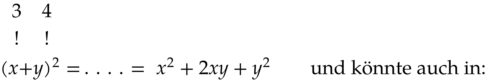

It could also consist in:

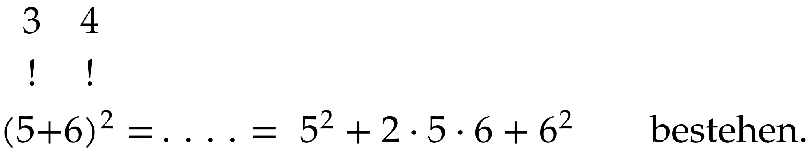

### [78\[2\]](https://cdn.wittgensteinnachlass.com/2000px/webp/Ts-211/78.webp)

That is, the proof carried out with 28, 45 and 17 must not give me any greater certainty than the ‘general’ one. Or else the two must be entirely independent. But not then _independent_ proofs _of the same thing_, for that is nonsense. (They are, after all, connected by having the same end.)

### [78\[3\]](https://cdn.wittgensteinnachlass.com/2000px/webp/Ts-211/78.webp)

_How_ does the general proof by induction make me certain that the particular one will yield that result?

### [78\[4\]](https://cdn.wittgensteinnachlass.com/2000px/webp/Ts-211/78.webp)

(Just do not despise the simple calculi that every child and every merchant’s wife uses.)

### [78\[5\]](https://cdn.wittgensteinnachlass.com/2000px/webp/Ts-211/78.webp)

This too must be a perfectly rigorous

proof of the associative law.

### [78\[6\]](https://cdn.wittgensteinnachlass.com/2000px/webp/Ts-211/78.webp)

And here one can clearly distinguish the two cases we spoke of in the geometrical proof. For the figure can count as a general proof, and also as a proof only of 6 + (4 + 3) = (6 + 4) + 3, and I can write down the proof of 3 + (7 + 2) = (3 + 7) + 2 like this: I have carried out the proof only above (drawn the construction).

### [78\[7\]](https://cdn.wittgensteinnachlass.com/2000px/webp/Ts-211/78.webp),[79\[1\]](https://cdn.wittgensteinnachlass.com/2000px/webp/Ts-211/79.webp)

One calculus is not more rigorous than another! One only has to know the limits of each. One can call a calculus lacking in rigour only insofar as its rules are not _clearly_ formulated.

### [79\[2\]](https://cdn.wittgensteinnachlass.com/2000px/webp/Ts-211/79.webp)

One says “this proposition has been proved for all cardinal numbers”. But just look at how the concept of cardinal number enters the proof. Only in so far as the proof speaks of 1 and the operation x + 1 – but not in contrast to something that would correspond to the rational numbers. So if one describes the proof in prose with the aid of the concept-word ‘cardinal number’, we can presumably see that _no concept corresponds_ to this word.

### [79\[3\]](https://cdn.wittgensteinnachlass.com/2000px/webp/Ts-211/79.webp)

I _could_ draw the same construction above as below. But does that suffice as a proof?! Yes, for the proof now consists in the description of what I could draw. And the description of a proof is (also) the proof, after all. – And now I must go through the sign 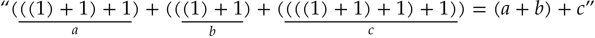 step by step to make sure that it is built according to this plan. The plan for which the general proof holds.

### [79\[4\]](https://cdn.wittgensteinnachlass.com/2000px/webp/Ts-211/79.webp)

Must I not also speak here of a _system_ of proofs?

### [79\[5\]](https://cdn.wittgensteinnachlass.com/2000px/webp/Ts-211/79.webp)

How does the proof ‘carried out’ relate to the general one, _apparently merely indicated?_ Or: Do they belong to different systems of symbols? Otherwise, surely, whatever the first contains over and above the second must be superfluous.

### [79\[6\]](https://cdn.wittgensteinnachlass.com/2000px/webp/Ts-211/79.webp),[80\[1\]](https://cdn.wittgensteinnachlass.com/2000px/webp/Ts-211/80.webp)

Incidentally, one can adopt the convention of indicating an expression of the form ((((1) + 1) + 1) + 1) (the cardinal-number form) merely by the number of opening brackets ((((, since everything else is given by them. And now one can write it !!!!∣∣∣∣. (A detour.)

### [80\[2\]](https://cdn.wittgensteinnachlass.com/2000px/webp/Ts-211/80.webp)

What is seen in the sign 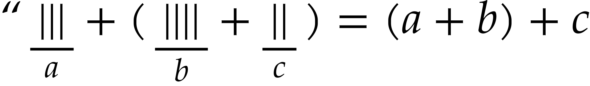 ” is precisely what is proved by the general proof.

### [80\[3\]](https://cdn.wittgensteinnachlass.com/2000px/webp/Ts-211/80.webp)

(One must think one’s way into the mistakes. “Let him make the right impression on you ‥․.”)

### [80\[4\]](https://cdn.wittgensteinnachlass.com/2000px/webp/Ts-211/80.webp)

(Duration of a tone and duration of an acoustic vibration.)

### [80\[5\]](https://cdn.wittgensteinnachlass.com/2000px/webp/Ts-211/80.webp)

Critique of my previously expounded conception of proof by induction. A proof is a proof of a (particular) proposition if it is so according to a rule by which this proposition is assigned to this proof. I.e., the proposition must belong to a system of propositions and the proof to a system of proofs. And every proposition of mathematics must belong to a calculus of mathematics. (And cannot sit enthroned in solitude, as it were not mingling with other propositions.) So the proposition “every equation of the nth degree has n solutions” is a proposition of mathematics only insofar as it corresponds to a system of propositions and its proof to a corresponding system of proofs. For what good reason have I to assign _this_ prose sentence to this chain of equations etc. (the so-called proof)? It must after all follow from the proof – according to a rule – which proposition it proves.

### [80\[6\]](https://cdn.wittgensteinnachlass.com/2000px/webp/Ts-211/80.webp),[81\[1\]](https://cdn.wittgensteinnachlass.com/2000px/webp/Ts-211/81.webp)

But now it is of the nature of _what we call a proposition_ that it must be possible to negate it. And the negation of the proved proposition must also be connected with the proof, in such a way that it can be shown under what other, opposite conditions it would have resulted.

### [81\[2\]](https://cdn.wittgensteinnachlass.com/2000px/webp/Ts-211/81.webp)

One would like to regard the proof by induction as, as it were, an indirect proof of general validity. (But in logic there is no more there than we see.)

### [81\[3\]](https://cdn.wittgensteinnachlass.com/2000px/webp/Ts-211/81.webp)

(“sweeping statements” get one nowhere in philosophy; rather, everything must be represented as it is.)

### [81\[4\]](https://cdn.wittgensteinnachlass.com/2000px/webp/Ts-211/81.webp)

Does the visual field have a centre? – It makes sense to put a little cross in a picture, say, and to say: look at the cross; you will see the rest as well, but the cross will then be at the centre of the visual field.

### [81\[5\]](https://cdn.wittgensteinnachlass.com/2000px/webp/Ts-211/81.webp)

All considerations can be pursued in a much more homely way than I pursued them in the past. And that is why no new words need be used in philosophy either; the old, ordinary words of the language suffice.

### [81\[6\]](https://cdn.wittgensteinnachlass.com/2000px/webp/Ts-211/81.webp)

“Is that a proof of this proposition?” Is it _used_ as a proof? If so, why should I not call it a proof? Every multiplication is a proof. It settles that 16 × 25 is 400 and no other number, and actually is used as a proof of that.

### [81\[7\]](https://cdn.wittgensteinnachlass.com/2000px/webp/Ts-211/81.webp)

In Euclidean proof it is not the figure alone that matters, but also the order of the operations of construction, and one could imagine the proof being carried out by means of a series of figures (the course of the proof).

### [82\[1\]](https://cdn.wittgensteinnachlass.com/2000px/webp/Ts-211/82.webp)

One hears the _remark_ again and again that philosophy makes no real progress, that the same philosophical problems that already occupied the Greeks still occupy us. But those who _say_ this don’t understand why it is so. The reason is that our language has stayed the same and keeps seducing us into asking the same questions. As long as there is a verb ‘to be’ that seems to function like ‘to eat’ and ‘to drink’, as long as there are adjectives ‘identical’, ‘true’, ‘false’, ‘possible’, as long as there is talk of a flow of time and an extension of space, etc., etc., people will keep coming up against the same _enigmatic difficulties_ and staring at something that no explanation seems able to remove. And this, incidentally, satisfies a longing for the otherworldly, for in believing that they see the “limit of human understanding”, they naturally believe they can see beyond it.

### [82\[2\]](https://cdn.wittgensteinnachlass.com/2000px/webp/Ts-211/82.webp)

I read: “‥‥ philosophers are no nearer to the meaning of ‘Reality’ than Plato got, ‥‥”. What a strange situation. How odd, then, that Plato could get as far as he did at all! Or that we could then get no further! Was it because Plato was _so_ clever?

### [82\[3\]](https://cdn.wittgensteinnachlass.com/2000px/webp/Ts-211/82.webp)

Is not the chief danger that the prose expression of the result of a mathematical _operation_ makes us think there is a calculus where there is none? By seeming, in its outward form, to belong to a system that simply does not exist here.

### [82\[4\]](https://cdn.wittgensteinnachlass.com/2000px/webp/Ts-211/82.webp),[83\[1\]](https://cdn.wittgensteinnachlass.com/2000px/webp/Ts-211/83.webp)

If the proof by induction is a proof of a + (b + c) = (a + b) + c, then one must be able to say: the _calculation yields_ the result that a + (b + c) = (a + b) + c (_and no other result_). For then the method of calculation must first be known (in general), and just as we can work out _on that basis_ 25 × 16, so too can we work out a + (b + c). _So first_ a general rule for working out all such problems is taught, and then the particular calculation is carried out. – But what is the general method of calculation here? It must rest on general rules for signs (– such as the associative law, for example –).

### [83\[2\]](https://cdn.wittgensteinnachlass.com/2000px/webp/Ts-211/83.webp)

Now is this proof of the associative law, perhaps, the proof that a + (b + c) = (a + b) + c and not (a + 2b) + c?

### [83\[3\]](https://cdn.wittgensteinnachlass.com/2000px/webp/Ts-211/83.webp)

When one introduces irrational numbers, one always acts as if one had now discovered something new (say, new points between the old ones). Whereas it is not a matter of a new discovery, but of a new construction (which one can then call a “number”, or not).

### [83\[4\]](https://cdn.wittgensteinnachlass.com/2000px/webp/Ts-211/83.webp)

Suppose we were to call the proposition that 7 is not divisible by any smaller number except 1 “the law of the sacred number” and were to express it in the words “7 is the sacred number”. Then we would have a case similar to that of the “fundamental theorem of algebra” and other ‘propositions’ that really name an individual calculation, which we call the proof of the proposition.

### [83\[5\]](https://cdn.wittgensteinnachlass.com/2000px/webp/Ts-211/83.webp)

Only for _such_ a ‘proposition of mathematics’ are there different independent proofs. For the mutually independent calculations are arbitrarily given the same name.

### [83\[6\]](https://cdn.wittgensteinnachlass.com/2000px/webp/Ts-211/83.webp),[84\[1\]](https://cdn.wittgensteinnachlass.com/2000px/webp/Ts-211/84.webp)

I do not need to _assert_ that one must be able to construct the n roots of an equation of the nth degree; I say only that the proposition ‘this equation has n roots’ _means something different_ when I have proved it by counting the constructed roots and when I have proved it in some other way. But if I find a formula for the roots of an equation, I have constructed a new calculus, not filled a gap in an old one.

### [84\[2\]](https://cdn.wittgensteinnachlass.com/2000px/webp/Ts-211/84.webp)

It is therefore nonsense to say that the proposition is not proved until one exhibits such a construction. For then we have constructed something new, and what we now understand by the fundamental theorem of algebra is just what the present ‘proof’ shows us.

### [84\[3\]](https://cdn.wittgensteinnachlass.com/2000px/webp/Ts-211/84.webp)

It is nonsense to fear that algebra might thus be deprived of this support.

### [84\[4\]](https://cdn.wittgensteinnachlass.com/2000px/webp/Ts-211/84.webp)

“I foresaw that” – how is that possible, when after all it did not happen then (and may never have happened)?!

### [84\[5\]](https://cdn.wittgensteinnachlass.com/2000px/webp/Ts-211/84.webp)

What does a person think for? What is the use of it? What does he _calculate_ steam boilers for, instead of leaving it to chance how thick he makes their walls? It is, after all, only an empirical fact that boilers calculated in this way do not explode as often. But just as he would do anything rather than put his hand in the fire that burnt him before, so he will do anything rather than not calculate the boiler. Since, however, we are not interested in causes, we can only say: people do indeed think: they proceed, for example, in this way when they build a steam boiler. Can’t a boiler built this way explode? Oh yes. –

### [84\[6\]](https://cdn.wittgensteinnachlass.com/2000px/webp/Ts-211/84.webp)

Augustine: “_When_ do I measure a period of time?” Similar to my question: _When can_ I play chess?

### [85\[1\]](https://cdn.wittgensteinnachlass.com/2000px/webp/Ts-211/85.webp)

I. 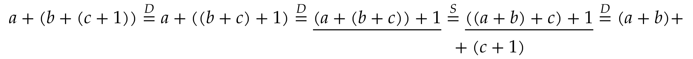 II. a + (b + c) = (a + b) + c

If we call I the proof of II, what is the general principle of this proof? For it is no use saying that I proves II, since this gives me no more than I and II; unless I now (also) learn a general rule of which the inference from I to II is only an example.

### [85\[2\]](https://cdn.wittgensteinnachlass.com/2000px/webp/Ts-211/85.webp)

A curious expression: “I _managed_ to prove that”. (That is what no one would say in the case of 25 × 16 = 400.)

### [85\[3\]](https://cdn.wittgensteinnachlass.com/2000px/webp/Ts-211/85.webp)

The system of the proof above is this:

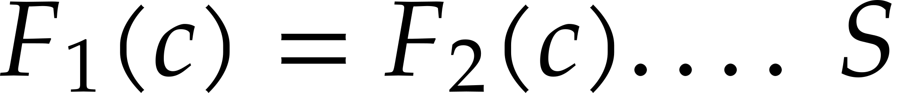 is to be proved. 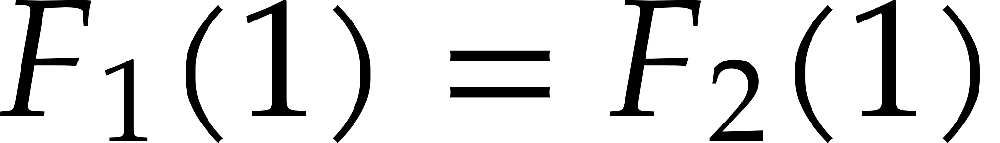 is an accepted rule. If it follows from this and the other rules already accepted that on the one hand 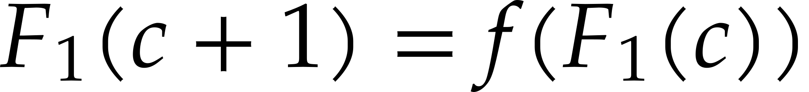,

and on the other , then S counts as proved.

### [85\[4\]](https://cdn.wittgensteinnachlass.com/2000px/webp/Ts-211/85.webp),[86\[1\]](https://cdn.wittgensteinnachlass.com/2000px/webp/Ts-211/86.webp)

Now is I a proof of 5 + (2 + 7) = (5 + 2) + 7? It is a proof of !!!!!∣∣∣∣∣

\+ (!!∣∣ + !!!!!!!∣∣∣∣∣∣∣)

=

(!!!!!∣∣∣∣∣ + !!∣∣) + !!!!!!!∣∣∣∣∣∣∣. For if we began to transform the expression on the left according to the definition a + (b + 1) = (a + b) + 1, as in the proof, we would soon see that each transformation brought us closer to the right-hand side, and we could stop after the first step and see (just what we see in the proof by induction) that the right-hand side must result after !!!!!!!∣∣∣∣∣∣∣ operations. And we see this no more clearly if we go through all these operations. And if we then did not reach the _foreseen_ goal, we would say that we had made a mistake in the calculation. Thus the general proof is a proof of 5 + (2 + 7) = (5 + 2) + 7 _if_ we represent (conceive of) this equation as a case of the proof, and in conceiving of it this way we supply the necessary multiplicity of the proof for the particular case. (Is it not like the way I can represent five men by “MMMMM”, but also by “M !!!!!∣∣∣∣∣”.) So insofar as the proof can be applied to numbers with which we calculate, we can call it general (like, say, a hat that every member of the family can use).

### [86\[2\]](https://cdn.wittgensteinnachlass.com/2000px/webp/Ts-211/86.webp)

(In the sense in which we speak of possible and actually drawn straight lines, we could also speak of possible and actually represented numbers.)

### [86\[3\]](https://cdn.wittgensteinnachlass.com/2000px/webp/Ts-211/86.webp)

But what about the other proof of 25 + (8 + 71) = (25 + 8) + 71, which works out the right-hand and the left-hand sides according to the rules of 1 + 1 and finds them equal? For 25 + 8 = 33 can be proved, and if I could not prove it, the only justification I could give would be to appeal to what I had learnt: if there is a 5 above and an 8 below, you must write a 3 under the line and carry 1. But it would be compatible with this rule for one to be allowed to write, say, 5 + 5 = 8, if the whole system by which we add is not known. I.e., the proposition 25 + (8 + 71) = (25 + 8) + 71 is proved only once we have reduced everything to the addition of ones, and then its proof is equivalent to that of !!!!∣∣∣∣ + (!!∣∣ + !!!∣∣∣)

=

(!!!!∣∣∣∣ + !!∣∣) + !!!∣∣∣.

### [86\[4\]](https://cdn.wittgensteinnachlass.com/2000px/webp/Ts-211/86.webp)

If one looks at Skolem’s recursive proofs as it were from above, they appear (to us) as chains of equations whose transitions are permitted according to certain rules and which have a particular structural feature: certain high points by which they can be assigned to particular equations.

### [87\[1\]](https://cdn.wittgensteinnachlass.com/2000px/webp/Ts-211/87.webp)

One could also put it this way: Skolem _succeeds_ in proving all these propositions; but he does not give us _one_ system in which we can derive all the propositions to be proved by means of _one_ rule. Rather, we must learn afresh each time how to derive a further proposition – unlike someone who has learnt to multiply and can solve any multiplication problem without further ado.

### [87\[2\]](https://cdn.wittgensteinnachlass.com/2000px/webp/Ts-211/87.webp)

(It does not matter at all that what is proved does not stand at the end of the chain of equations. The proof might be compared to a proof that 25 × 16 = 400: We assume this and then divide 4000 by 16, then by 25, and if the result is 10, the assumption was correct.)

### [87\[3\]](https://cdn.wittgensteinnachlass.com/2000px/webp/Ts-211/87.webp)

The question is, how does the calculus go on once the fundamental laws have been proved by induction?

### [87\[4\]](https://cdn.wittgensteinnachlass.com/2000px/webp/Ts-211/87.webp)

“Rigorous” means: clear.

### [87\[5\]](https://cdn.wittgensteinnachlass.com/2000px/webp/Ts-211/87.webp)

Two proofs of “the same proposition” can be independent of one another only if they never reach _that_ proposition. (For otherwise they communicate with one another.) That is, if they are not, strictly speaking, proofs of this proposition.

### [87\[6\]](https://cdn.wittgensteinnachlass.com/2000px/webp/Ts-211/87.webp)

In mathematics there are, after all, very different things that are all called proofs, and these differences are _logical_. So the things called ‘proof’ have no more to do with one another than the things called ‘_number_’.

### [87\[7\]](https://cdn.wittgensteinnachlass.com/2000px/webp/Ts-211/87.webp),[88\[1\]](https://cdn.wittgensteinnachlass.com/2000px/webp/Ts-211/88.webp)

One calls it a problem when one is asked “how much is 25 × 16”, but one also calls this a problem: what is S sin²x dx? One takes the first to be much easier than the second, to be sure, but does not see that they are ‘problems’ in different senses. The difference is _of course_ not psychological; and the question is not whether the pupil can solve the problem, but whether the calculus can solve it, or which calculus can solve it.

### [88\[2\]](https://cdn.wittgensteinnachlass.com/2000px/webp/Ts-211/88.webp)

The differences I can draw attention to are just the sort that every schoolboy no doubt knows. But later one looks down on these differences, as one does on the Russian abacus (and on proof by drawing in geometry), and regards them as inessential, like the difference between finite and infinite, rather than as essential and fundamental.

### [88\[3\]](https://cdn.wittgensteinnachlass.com/2000px/webp/Ts-211/88.webp)

It does not matter whether _one knows a rule_ by which one can certainly solve S sin²x.dx; what is of interest is whether the _calculus_ we have before us (which he happens to be using) contains such a rule. What interests us is not whether the pupil can do it, but whether the calculus can, and _how_ _it_ does it.

### [88\[4\]](https://cdn.wittgensteinnachlass.com/2000px/webp/Ts-211/88.webp)

Now in the case of 25 × 16 = 370, the calculus we use prescribes every step for checking this equation.

### [88\[5\]](https://cdn.wittgensteinnachlass.com/2000px/webp/Ts-211/88.webp),[89\[1\]](https://cdn.wittgensteinnachlass.com/2000px/webp/Ts-211/89.webp)

When Frege speaks against the formal conception of arithmetic, he always says _as it were_: these petty explanations concerning the symbols are superfluous if we understand them. And understanding consists, as it were, in seeing a picture from which all the rules then follow (thereby becoming intelligible). But Frege does not see that this picture is itself only a sign in turn, or a calculus that explains the written calculus to us. But understanding in general is (_always_) like the understanding we acquire of a calculus when we learn how it arose, or learn about its practical application. And of course there too we again merely become familiar with one symbolism, and one that is more surveyable to us, in place of one that is unfamiliar to us. (Understanding here means having a clear view of the whole.)

### [89\[2\]](https://cdn.wittgensteinnachlass.com/2000px/webp/Ts-211/89.webp)

Thinking something over. I am thinking over whether to go to the cinema now. I picture how the evening’s time would be divided up. I could quite well represent it graphically too. But _what_ do I do this _for_?? After all, I’m not carrying out a “thought experiment”!

### [89\[3\]](https://cdn.wittgensteinnachlass.com/2000px/webp/Ts-211/89.webp)

False ideas about how language works: Dr Broad, who said that the statement that something _will_ happen is not a proposition. What is one thereby denying of this statement? Anything other than that it _describes_ something present or past? – Magic with words. A statement like Broad’s strikes me as like an attempt to bring about a chemical change by magic; by letting the substances know, as it were, what they are supposed to do (as if one wanted to turn iron into gold by taking hold of a piece of iron with the right hand and at the same time a piece of gold with the left).

### [89\[4\]](https://cdn.wittgensteinnachlass.com/2000px/webp/Ts-211/89.webp)

Here we also come to the question: to what extent does thinking help one find the truth? (Johnson)

### [89\[5\]](https://cdn.wittgensteinnachlass.com/2000px/webp/Ts-211/89.webp)

“I picture it to myself”.

### [89\[6\]](https://cdn.wittgensteinnachlass.com/2000px/webp/Ts-211/89.webp)

In a certain sense thinking merely brings things together.

### [89\[7\]](https://cdn.wittgensteinnachlass.com/2000px/webp/Ts-211/89.webp),[90\[1\]](https://cdn.wittgensteinnachlass.com/2000px/webp/Ts-211/90.webp)

“The sentence is a picture”. A picture of what? Can one say: “Of the fact that makes it true if it is true, and of the fact that makes it false if it is false. In the first case it is a correct picture, in the second an incorrect one”? For it is not a picture of how things would be if ‥‥․ . That means nothing. Then it would at most be a picture of the sentence, or of another picture of how things would be if ‥‥․ .

### [90\[2\]](https://cdn.wittgensteinnachlass.com/2000px/webp/Ts-211/90.webp)

If by picture one means a correct or incorrect representation of reality, then one must know of which reality, or of which part of reality; i.e., one must have a _means_ of comparing the sentence with reality in a particular way. I can represent this room correctly or incorrectly, but to find out whether it is correct or not, I must know that this room is meant.

### [90\[3\]](https://cdn.wittgensteinnachlass.com/2000px/webp/Ts-211/90.webp)

Let us think of a cipher: suppose we are given a sentence in the cipher and also the key; then of course, in a certain _respect_, we are given everything for understanding the cipher. And yet, if asked “do you understand this sentence in the cipher?”, I might answer: No, I must first decipher it; and only once I had translated it into German, for example, would I say “now I understand it”. Is this because at first glance I could not even have said whether the expression in cipher was a sentence at all and not just words strung together nonsensically?

### [90\[4\]](https://cdn.wittgensteinnachlass.com/2000px/webp/Ts-211/90.webp)

If one were to ask here: “At what moment in the translation (from the cipher into German) do I understand the sentence?”, one would gain an insight into the essence of understanding.

### [90\[5\]](https://cdn.wittgensteinnachlass.com/2000px/webp/Ts-211/90.webp),[91\[1\]](https://cdn.wittgensteinnachlass.com/2000px/webp/Ts-211/91.webp)

We all understand what it means to look up in a calendar which day of the week we are free. The picture we see is, say, 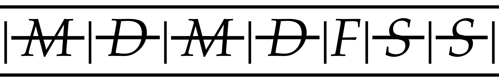 and we now say that we are free only on Friday, and act accordingly. But _in doing so_ it is hard to say what actually happens here and what warrant we have for acting in accordance with the picture. What happens when I think over a chess move? In this case I can make the moves in advance and so draw up the most direct picture of what will happen.

### [91\[2\]](https://cdn.wittgensteinnachlass.com/2000px/webp/Ts-211/91.webp)

“How many dots must one put in a row to indicate the ‘etc.’?” Doesn’t _one_ do it?

### [91\[3\]](https://cdn.wittgensteinnachlass.com/2000px/webp/Ts-211/91.webp)

Can one say of the number series that it has no end? “But what would it be like if it were otherwise?” But can I not say of chess that the series of chess pieces has an end, and that in another game it has no end? if one were permitted to occupy arbitrarily many squares with pieces, in accordance with a rule.

### [91\[4\]](https://cdn.wittgensteinnachlass.com/2000px/webp/Ts-211/91.webp)

(What I do with the signs is, for the mathematician, a messing around ‥‥ [and was so for Ramsey], and rightly so, for he wants to make progress, whereas I linger _undisturbed_ over a few signs and two steps of the calculus.)

### [91\[5\]](https://cdn.wittgensteinnachlass.com/2000px/webp/Ts-211/91.webp),[92\[1\]](https://cdn.wittgensteinnachlass.com/2000px/webp/Ts-211/92.webp)

### [PG II](/w-pg-2/#ts-211-92.2) [92\[2\]](https://cdn.wittgensteinnachlass.com/2000px/webp/Ts-211/92.webp)

A step-by-step examination of these proofs would be very instructive. The first transition in I a + (b + (c + 1)) = a + ((b + c) + 1), if it is to proceed according to R, shows that the variables in R are meant differently from those in the equations of I, for otherwise R would allow only a + (b + 1) to be replaced by (a + b) + 1, but not b + (c + 1) by (b + c) + 1. The other transitions in this proof show the same thing. Now if I said that the two lines of the proof entitle me to infer the rule a + (b + c) = (a + b) + c, that would mean nothing at all unless I had drawn the inference according to a previously established rule. But this rule could presumably only be:

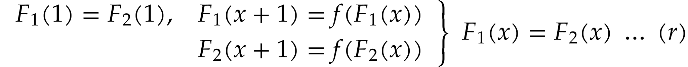

But this rule is vague with respect to F1, F2 and f.

### [92\[3\]](https://cdn.wittgensteinnachlass.com/2000px/webp/Ts-211/92.webp)

But one thing about this rule seems remarkable: it is possible to understand it as an instruction without seeing that the series 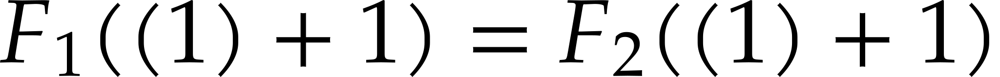, 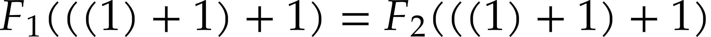, etc. follows from it.

### [92\[4\]](https://cdn.wittgensteinnachlass.com/2000px/webp/Ts-211/92.webp),[93\[1\]](https://cdn.wittgensteinnachlass.com/2000px/webp/Ts-211/93.webp)

Of course I can apply the general rule for proof by induction only if I discover the substitution that makes it applicable. So it would be possible for someone to see the equations

(a + 1) + 1 = (a + 1) + 1

1 + (a + 1) = (1 + a) + 1 without the substitution 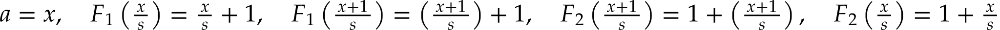

occurring to him.

### [93\[2\]](https://cdn.wittgensteinnachlass.com/2000px/webp/Ts-211/93.webp)

Incidentally, if I say that I _understand_ the equations as a special case of that rule, the understanding must surely be what shows itself in the explanation of the relation between the rule and the equations, i.e. what we express by the substitutions. If I do not regard these as an expression of what I understand, then there is none; but then there is no sense in speaking of understanding either, in saying that I understand something definite. For it makes sense to speak of understanding only where we understand _one thing_ as opposed to another. And it is precisely _this_ that signs express. Indeed, seeing the internal relation can itself only be seeing something that can be described, of which one can say “I see that this is how things stand”, and thus really something of the nature of signs of correlation (such as connecting lines, brackets, substitutions, etc.). And everything else can lie only in the application of the sign of the general rule in a particular case.

### [93\[3\]](https://cdn.wittgensteinnachlass.com/2000px/webp/Ts-211/93.webp)

Can one now say that we have calculated I, II, and III from R? No. – But from R and r?

### [93\[4\]](https://cdn.wittgensteinnachlass.com/2000px/webp/Ts-211/93.webp),[94\[1\]](https://cdn.wittgensteinnachlass.com/2000px/webp/Ts-211/94.webp)

We could now also write down the _above_ proofs differently, namely as equations between particular numbers which _function_ as examples. Such a proof is much like the proof of a geometrical proposition about the triangle by means of a construction in _one triangle_. (But still only similar, hence logically related, but not quite the same.) The following proof then corresponds to proposition I: 5 + (4 + 3) = 5 + (4 + (2 + 1)) = 5 + ((4 + 2) + 1) = (5 + (4 + 2)) + 1 = (5 + (4 + (1 + 1))) + 1 = ((5 + 4) + 2) + 1 = (5 + 4) + 3 ‥‥․ (A)

### [94\[2\]](https://cdn.wittgensteinnachlass.com/2000px/webp/Ts-211/94.webp)

On the one hand this is the proof of 5 + (4 + 3) = (5 + 4) + 3; on the other hand one can _let it count_ as a proof of 5 + (4 + 4) = (5 + 4) + 4 etc. etc., i.e. _use_ it as one. If I now say: A is the proof of the proposition a + (b + c) = (a + b) + c, then what is peculiar about the transition from proof to proposition would stand out much more clearly. And what would be the rule by which this transition is _warranted_?

### [94\[3\]](https://cdn.wittgensteinnachlass.com/2000px/webp/Ts-211/94.webp)

A sentence (like) “there is no last cardinal number” rightly _offends_ against the naive – and correct – sense. If I ask “who was the last man in the procession” and the answer is “there is no last one”, my thinking becomes confused; what does “there is no last one” mean? Well, if the question had been “who was the standard-bearer”, I would have understood the answer “there is no standard-bearer”. And it is on such an answer, after all, that the _senseless_ one is modelled. For we rightly feel that where one can speak of a last one, there cannot be ‘no last one’. But this of course means that the sentence “there is no last one” ought properly to read: it makes no sense to speak of a “last cardinal number”, this expression is illicitly formed.

### [95\[1\]](https://cdn.wittgensteinnachlass.com/2000px/webp/Ts-211/95.webp)

Is not our principle to use no _concept_ where none is needed? – I.e. to show the cases in which the concept-word in fact stands for a list.

### [95\[2\]](https://cdn.wittgensteinnachlass.com/2000px/webp/Ts-211/95.webp)

What I say about understanding a sentence _comes down to this_: if, from the _sphere of operation_ of language, we consider, say, the phenomenon of a command and its being obeyed (_in and of itself_), even together with all the mental phenomena that accompany it and that we might wish to call understanding the command, the essence of language would not find expression in these phenomena.

### [95\[3\]](https://cdn.wittgensteinnachlass.com/2000px/webp/Ts-211/95.webp)

Must I say that the transitions in proof A are made according to the rule a + (b + 1) = (a + b) + 1? – And to what extent do they proceed according to such a rule in letters?

### [95\[4\]](https://cdn.wittgensteinnachlass.com/2000px/webp/Ts-211/95.webp),[96\[1\]](https://cdn.wittgensteinnachlass.com/2000px/webp/Ts-211/96.webp)

The first transition is made according to the rule 3 = 2 + 1, the second according to the rule 4 + (2 + 1) = (4 + 2) + 1, the third according to the rule 5 + ((4 + 2) + 1) = (5 + (4 + 2)) + 1, etc. These rules do, admittedly, have a feature in common, and it is summed up in a + (b + 1) = (a + b) + 1. But since we now want to work not with letters but with numerical *examples*, we might (_perhaps_) want to say that the rule we proceed by is 5 + (3 + 1) = (5 + 3) + 1. But here (5 + 3) is unintelligible to us, since we want to reduce everything to the addition of ones. And so the example of the rule must read: 5 + 3 = 5 + (2 + 1) = (5 + 2) + 1 = (5 + ((1) + 1)) + 1 = (((5 + 1) + 1) + 1) or: 5 + (((1) + 1) + 1) = (5 + ((1) + 1)) + 1 = ((5 + 1) + 1) + 1 ‥‥ (P) This rule explains adding on a number as successively adding on as many ones as the number contains. All the transitions in A proceed according to this rule P, and one could bring them all into the form of P by, for instance,

writing, instead of 4 + (2 + 1) = (4 + 2) + 1: 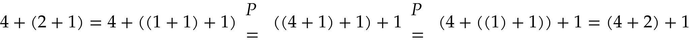. Incidentally, one can see from this that in P I should not have written “5 + (((1) + 1) + 1) = (5 + ((1) + 1)) + 1) = etc.” but gone straight to: 5 + (((1) + 1) + 1) = ((5 + 1) + 1) + 1, for inserting the second term would again be made only in accordance with a rule that is justified only by the final result of the chain of equations.

### [96\[2\]](https://cdn.wittgensteinnachlass.com/2000px/webp/Ts-211/96.webp)

Incidentally, if 3, for instance, is defined as ((1) + 1) + 1, how does this sign differ from 2 + 1? For if there is no difference, then in this symbolism there is none between ((5 + 1) + 1) + 1 and 8 either. But what I want to show is that 8 then consists of 5 and 3. ‒ ‒

### [96\[3\]](https://cdn.wittgensteinnachlass.com/2000px/webp/Ts-211/96.webp)

Definitions merely introduce convenient abbreviations, but we could manage without them too. But what about recursive definitions?

### [96\[4\]](https://cdn.wittgensteinnachlass.com/2000px/webp/Ts-211/96.webp)

One can call two different things an application of the rule a + (b + 1) = (a + b) + 1: 4 + (2 + 1) = (4 + 2) + 1 is an application in one sense, in the other: 4 + (2 + 1) = ((4 + 1) + 1) + 1 = (4 + 2) + 1.

### [96\[5\]](https://cdn.wittgensteinnachlass.com/2000px/webp/Ts-211/96.webp),[96\[1\]](https://cdn.wittgensteinnachlass.com/2000px/webp/Ts-211/96.webp)

The result of calculation A is 5 + (4 + 3) = (5 + 4) + 3, but it also has a result in another sense. Can one express this by the equation a + (b + c) = (a + b) + c, as one can express the first by 5 + (4 + 3) = (5 + 4) + 3?

### [97\[2\]](https://cdn.wittgensteinnachlass.com/2000px/webp/Ts-211/97.webp)

(It is almost unbelievable that the analysis of so simple a thing should be so difficult.)

### [97\[3\]](https://cdn.wittgensteinnachlass.com/2000px/webp/Ts-211/97.webp)

What is characteristic of a proof such as that of (a + b)․(a + b) = a.a + b.b + 2.a.b is that the letters are not broken up as the digits are in a calculation (in which the sign 5 disappears and a 4 and a 1 turn up in its place).

### [97\[4\]](https://cdn.wittgensteinnachlass.com/2000px/webp/Ts-211/97.webp)

(The infinite difficulty is the “consideration from all sides” of the calculus.)

### [97\[5\]](https://cdn.wittgensteinnachlass.com/2000px/webp/Ts-211/97.webp)

When I say that a + (b + c) = (a + b) + c comes out of proof A, do I already have in advance a concept of what I would regard as the proof of this formula?

### [97\[6\]](https://cdn.wittgensteinnachlass.com/2000px/webp/Ts-211/97.webp),[98\[1\]](https://cdn.wittgensteinnachlass.com/2000px/webp/Ts-211/98.webp)

“Every existence proof must contain a construction of what it proves to exist”. One can only say “I call only a proof that contains such a construction an ‘existence proof’”. The mistake is to think one has a clear _concept_ of an existence proof. One thinks one can prove a certain something, existence, so that one is then convinced of it _independently of the proof_. (The idea of a proof independent of other proofs – and therefore presumably also of what is proved!) In reality, existence is what one proves by _what_ one calls an “existence proof”. When the intuitionists and others talk about it, _they say_: “This state of affairs, existence, can only be proved this way, not that way”. And they do not see that they have thereby simply defined what _they_ call existence. For it is not at all like saying: “one can prove that there is a man in the room only by looking in, not by listening at the door”.

### [98\[2\]](https://cdn.wittgensteinnachlass.com/2000px/webp/Ts-211/98.webp)

We have no concept of existence independent of our concept of an existence proof.

### [98\[3\]](https://cdn.wittgensteinnachlass.com/2000px/webp/Ts-211/98.webp)

I can work out 17 + 28 by rules; I need not give 17 + 28 = 45 (s) as a rule. So if the transition from f(17 + 28) to f(45) occurs in a proof, I need not say that it is made according to rule s, but according to other rules of the 1 + 1 tables.

### [98\[4\]](https://cdn.wittgensteinnachlass.com/2000px/webp/Ts-211/98.webp)

But how does this stand in the (((1) + 1) + 1) notation? Can I say that I can work out, e.g., 2 + 3 in it? And according to what rule? It would go like this: [(1) + 1] + [((1) + 1) + 1] = (([(1) + 1] + 1) + 1) + 1 = [((((1) + 1) + 1) + 1) + 1]‥ (t)

### [98\[5\]](https://cdn.wittgensteinnachlass.com/2000px/webp/Ts-211/98.webp)

When the numbers were written in the decimal system, there were rules, namely those for adding any two numbers from 0 to 9, and these, suitably applied, were enough for me to add any numbers. Now what rule corresponds to these elementary rules? Obviously, in a calculation like t we need to remember fewer rules than in 17 + 28. Indeed, probably only _one_ general rule and none at all of the kind 3 + 2 = 5. On the contrary, we now seem to be able to _derive_, to calculate, how much 3 + 2 is.

### [98\[6\]](https://cdn.wittgensteinnachlass.com/2000px/webp/Ts-211/98.webp),[99\[1\]](https://cdn.wittgensteinnachlass.com/2000px/webp/Ts-211/99.webp)

Incidentally, there is a certain difficulty here with the number signs (1), ((1) + 1), etc.: namely that beyond a certain length we can no longer distinguish them without counting the strokes, that is, without translating the signs into _other_ signs. One cannot distinguish “!!!!!!!!!!∣∣∣∣∣∣∣∣∣∣” and “!!!!!!!!!!!∣∣∣∣∣∣∣∣∣∣∣” in the same sense – so they are not different signs in the same sense – as “10” and “11”. Incidentally, of course the same thing would also happen in the decimal system (think of the numbers 1111111111 and 11111111111), but that is not without significance. –

### [99\[2\]](https://cdn.wittgensteinnachlass.com/2000px/webp/Ts-211/99.webp)

Did we work out 45 in s in the same sense as we worked out the result in t?

### [99\[3\]](https://cdn.wittgensteinnachlass.com/2000px/webp/Ts-211/99.webp)

It might be easier to see in a different symbolism. I write [without further explanation]: 1, 2, 3, 4, 5, 6, 7, 8, etc. [(1) + 2] + [((1) + 2) + 3] = ((([(1) + 2] + 1) + 1) + 1) = [((((1) + 2) + 3) + 4) + 5]

One could also have carried out the calculation like this in that case: The problem is 2 + 3 = ? and one writes 1, 2, 3, 4, 5, 6, 7 1, 2; 1, 2, 3

This is how children actually calculate when they “count out”. (And this calculus must be as good as any other.)

### [99\[4\]](https://cdn.wittgensteinnachlass.com/2000px/webp/Ts-211/99.webp),[100\[1\]](https://cdn.wittgensteinnachlass.com/2000px/webp/Ts-211/100.webp)

Let us imagine that someone gave us a calculation to do in stroke notation, say: !!!!!!!!!!!∣∣∣∣∣∣∣∣∣∣∣ + !!!!!!!!!!∣∣∣∣∣∣∣∣∣∣ and while we were calculating he amused himself by rubbing out and adding strokes without our noticing. He would then keep telling us “the calculation is wrong, you see” and we would go through it again and again, being made fools of all the while. – Indeed, strictly speaking, without the concept of a criterion of the correctness of the calculation. – Here one might raise questions such as: Is it then only _very_ _probable_ that 464 + 272 = 736? And is 2 + 3 = 5 therefore not also only very probable? And what is the objective truth that this probability approaches? I.e., how do we get a concept of 2 + 3 really _being_ a certain number, apart from what it _seems_ to us to be? –

### [100\[2\]](https://cdn.wittgensteinnachlass.com/2000px/webp/Ts-211/100.webp)

For if one were to ask: what is the criterion, in stroke notation, for our having the same number sign before us twice? – The answer might be: “if it looks the same both times”, or “if it contains the same number of strokes both times”. Or should it be: if a one-to-one correspondence etc. is possible?

### [100\[3\]](https://cdn.wittgensteinnachlass.com/2000px/webp/Ts-211/100.webp)

One could also ask: is “!!∣∣!!!∣∣∣” a proof of 2 + 3 = 5, or does it only show, so to speak, that 2 + 3 is 2 + 3? But surely I can say !!!!!∣∣∣∣∣ = 5, !!∣∣ = 2, !!!∣∣∣ = 3; now I make the (geometrical) construction !!!∣∣∣!!∣∣ and thus show that 2 + 3 = 5.

### [100\[4\]](https://cdn.wittgensteinnachlass.com/2000px/webp/Ts-211/100.webp)

Or should we make the addition theorem read as follows:

a + (b + 1) = (a + 1) + b, and thus add like this:

((1) + 1) + (((1) + 1) + 1) = (((1) + 1) + 1) + ((1) + 1) = ((((1) + 1) + 1) + 1) + (1) = (((((1) + 1) + 1) + 1) + 1)?

### [100\[5\]](https://cdn.wittgensteinnachlass.com/2000px/webp/Ts-211/100.webp)

It is clear, incidentally, that the problem whether 5 + (4 + 3) = (5 + 4) + 3 can be solved _like this_:

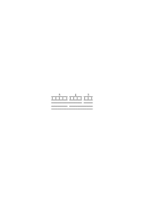

for this construction has exactly the multiplicity of any other proof of this proposition.

### [101\[1\]](https://cdn.wittgensteinnachlass.com/2000px/webp/Ts-211/101.webp)

If I name the number after its last letter, this proves that (E + D) + C = E + (D + C) = L. This form of proof is good because it clearly shows that the result really is calculated, and because one can also read the general proof off it.

### [101\[2\]](https://cdn.wittgensteinnachlass.com/2000px/webp/Ts-211/101.webp)

A good admonition here – strange as it sounds – is: do not do philosophy here, but mathematics.

### [101\[3\]](https://cdn.wittgensteinnachlass.com/2000px/webp/Ts-211/101.webp)

What a geometrical sentence means, what generality it has, must all become apparent when we see how it is applied. For even if there were something incomprehensible that someone _meant by it_, that would not help him, since he can apply it only quite openly and in a way anyone can understand. If, say, someone also imagines something mystical in connection with the king in chess, that does not concern us, for he can move it only on the 8 × 8 squares of the chessboard.

### [101\[4\]](https://cdn.wittgensteinnachlass.com/2000px/webp/Ts-211/101.webp)

Surely a + (b + 1) = (a + b) + 1 can only be an _abbreviation_ of the proof by induction.

### [101\[5\]](https://cdn.wittgensteinnachlass.com/2000px/webp/Ts-211/101.webp)

For if need be, we would have to be able to calculate with the proofs by induction alone as units.

### [101\[6\]](https://cdn.wittgensteinnachlass.com/2000px/webp/Ts-211/101.webp)

Whatever the rule a + (b + 1) = (a + b) + 1 justifies, the proof by induction can justify too.

### [102\[1\]](https://cdn.wittgensteinnachlass.com/2000px/webp/Ts-211/102.webp)

One cannot specify a calculation as the proof of a proposition.

### [102\[2\]](https://cdn.wittgensteinnachlass.com/2000px/webp/Ts-211/102.webp)

I want to say: _Must_ one call this calculation the proof of proposition I? I.e., will no other relation do?

### [102\[3\]](https://cdn.wittgensteinnachlass.com/2000px/webp/Ts-211/102.webp)

Even on the customary _interpretation_, the proof by induction does not purport to prove I, but only to prove that this proposition holds for all numbers.

### [102\[4\]](https://cdn.wittgensteinnachlass.com/2000px/webp/Ts-211/102.webp)

The proof by induction seems to be _one_ unit, not to consist of the individual transitions as its units.

### [102\[5\]](https://cdn.wittgensteinnachlass.com/2000px/webp/Ts-211/102.webp)

Thus, for instance, the result of the division 1:3 calculated to two places is 0,33, but in this division one also sees the periodicity, and that is not _a_ result in the same sense as the quotient 0,33.

### [102\[6\]](https://cdn.wittgensteinnachlass.com/2000px/webp/Ts-211/102.webp)

We could quite well call the proof by induction a periodic calculation.

### [102\[7\]](https://cdn.wittgensteinnachlass.com/2000px/webp/Ts-211/102.webp)

And its result I would then be analogous to 0,3̇, whereas the end of the chain of inferences would be analogous to 0,33.

### [102\[8\]](https://cdn.wittgensteinnachlass.com/2000px/webp/Ts-211/102.webp)

I should like to say: surely I could not set out to find the periodicity in the calculation. – Unless I already _have one_ and a method for generating others with its aid.

### [102\[9\]](https://cdn.wittgensteinnachlass.com/2000px/webp/Ts-211/102.webp),[103\[1\]](https://cdn.wittgensteinnachlass.com/2000px/webp/Ts-211/103.webp)

One can regard the calculation as an ornament. A figure in the plane can fit with another, or it may not; it can be combined with others in various ways. If the figure is also coloured, then there is also a fitting in relation to the colour. (Colour is just another dimension.)

### [103\[2\]](https://cdn.wittgensteinnachlass.com/2000px/webp/Ts-211/103.webp)

To regard calculation as ornament is also formalism, but of a good kind.

### [103\[3\]](https://cdn.wittgensteinnachlass.com/2000px/webp/Ts-211/103.webp)

When I compared the sentence to a yardstick, strictly speaking I merely took a sentence that describes the length of an object with the aid of a yardstick as an example _for all sentences_.

### [103\[4\]](https://cdn.wittgensteinnachlass.com/2000px/webp/Ts-211/103.webp)

The proposition proved is produced according to plan; the periodicity was not produced _according to plan_.

### [103\[5\]](https://cdn.wittgensteinnachlass.com/2000px/webp/Ts-211/103.webp)

In the division 1:3,  does not come out as opposed, say, to 0,3, but as opposed to another _period_.

### [103\[6\]](https://cdn.wittgensteinnachlass.com/2000px/webp/Ts-211/103.webp),[104\[1\]](https://cdn.wittgensteinnachlass.com/2000px/webp/Ts-211/104.webp)

Under what circumstances, then, would it be true that a + (b + c) = (a + 2b) + c rather than (a + b) + c? Under these conditions:

1\) a + (b + 1) = (a + 2b) + 1

2\) a + (b + (c + 1)) = [a + (b + c)] + 1

3\) (a + 2b) + (c + 1) = [a + (2b + c)] + 1

But why should 1) not hold? May I not stipulate it arbitrarily? (I should like to say: One can only say: a + (b + c) = (a + b) + c stands to its induction as a + b = b + a stands to its own.)

### [104\[2\]](https://cdn.wittgensteinnachlass.com/2000px/webp/Ts-211/104.webp)

Is the main point that

a + (b + (c + 1)) = [a + (b + c)] + 1 and

(a + b) + (c + 1) = [(a + b) + c] + 1 do not make up the proof on their own, but only together with a + (b + 1) = (a + b) + 1?

### [104\[3\]](https://cdn.wittgensteinnachlass.com/2000px/webp/Ts-211/104.webp)

So that for this reason alone one cannot say that I now follows (merely) from R.

### [104\[4\]](https://cdn.wittgensteinnachlass.com/2000px/webp/Ts-211/104.webp)

Is it not the case that all thinking about reality is based on induction?

### [104\[5\]](https://cdn.wittgensteinnachlass.com/2000px/webp/Ts-211/104.webp)

Learning philosophy _really_ is a recollection. We recall that we really have used the words in this way.

### [104\[6\]](https://cdn.wittgensteinnachlass.com/2000px/webp/Ts-211/104.webp)

From expectation to fulfilment is a step in a calculation. Indeed, the calculation

stands to its result 625 in exactly the same relation as expectation to fulfilment.

### [104\[7\]](https://cdn.wittgensteinnachlass.com/2000px/webp/Ts-211/104.webp)

And to the extent – and only to the extent – that this calculation is a picture of the result, the expectation too is a picture of the fulfilment.

### [104\[8\]](https://cdn.wittgensteinnachlass.com/2000px/webp/Ts-211/104.webp)

And to the extent that the result is determined by the calculation, the fulfilment is determined by the expectation.

### [104\[9\]](https://cdn.wittgensteinnachlass.com/2000px/webp/Ts-211/104.webp),[105\[1\]](https://cdn.wittgensteinnachlass.com/2000px/webp/Ts-211/105.webp)

We expect something and act on the expectation. Must the expectation come true? No. But why do we act on the expectation? Because we are driven to do so, just as we are driven to get out of the way of a car, to sit down when we are tired and to jump up when we have sat on a thorn.

### [105\[2\]](https://cdn.wittgensteinnachlass.com/2000px/webp/Ts-211/105.webp)

I put my hand on the hotplate, feel unbearable heat and quickly pull my hand away: Was it not possible that the heat of the plate would have _ceased_ the next moment? Could I have known? And was it not possible that my very movement exposed me to pain? So in a sense it is not a good justification to say: “I pulled my hand away because the plate was too hot”! –

### [105\[3\]](https://cdn.wittgensteinnachlass.com/2000px/webp/Ts-211/105.webp)

Now if one asked: Are you sure you did it _for that reason_? Would one not swear that one did it for that reason alone? And yet is it not experience?

### [105\[4\]](https://cdn.wittgensteinnachlass.com/2000px/webp/Ts-211/105.webp)

“I couldn’t bear it any more _(any longer)_”. “I can’t bear it any more; I must pull my hand away”. But what does this pulling away consist in, if not in wishing that the hand would pull away while it actually does pull away? If it does not pull away, there is nothing we can do either. At any rate, ‘wanting to pull it away’ is an experience we can wish for but cannot bring about. Think of the experience of drawing a square with its diagonals by looking in the mirror.

### [105\[5\]](https://cdn.wittgensteinnachlass.com/2000px/webp/Ts-211/105.webp),[106\[1\]](https://cdn.wittgensteinnachlass.com/2000px/webp/Ts-211/106.webp)

When I say that I can wish for the experience of wanting, but cannot bring it about, I am back to a kind of nonsense very characteristic of epistemology. For in the sense in which I can bring anything about at all (say, stomach pains by overeating), I can also bring about wanting. (In this sense I bring about wanting to swim by jumping into deep water.) Presumably what I meant to say was: I could not want to want; i.e. it makes no sense to speak of wanting-to-want. And my mistaken expression arose because one wants to think of wanting as a direct non-causal bringing about. And this in turn rests on a _false_ analogy, say, that the causal nexus is formed by a series of cogwheels (the series can fail if the mechanism is _disrupted_), whereas the nexus of the will corresponds, say, to that between what is inner and what is outer, or to that between the movement of the physical body and the movement of its appearance.

### [106\[2\]](https://cdn.wittgensteinnachlass.com/2000px/webp/Ts-211/106.webp)

What is a sentence? What defines this concept? – How is this word (“sentence”) used in non-philosophical language? Sentence, in contrast to what?

### [106\[3\]](https://cdn.wittgensteinnachlass.com/2000px/webp/Ts-211/106.webp)

I know a sentence when I see one.

### [106\[4\]](https://cdn.wittgensteinnachlass.com/2000px/webp/Ts-211/106.webp)

This question is fundamental: Suppose we have a new experience, say we become acquainted with a new taste or a new stimulus to the skin; how do I know that what describes this experience is a sentence? Or, why should I call it a sentence? Presumably with the same warrant as I had for speaking of a new experience. For experience and sentence are equivalent. But why did I use the word experience, in contrast to what?

### [106\[5\]](https://cdn.wittgensteinnachlass.com/2000px/webp/Ts-211/106.webp),[107\[1\]](https://cdn.wittgensteinnachlass.com/2000px/webp/Ts-211/107.webp)

Have I already characterized what happened to some extent by saying it was an experience? Apparently _not at all_. And yet it seems as if I had _already_ done so, as if I had already said something _about it_: “that it was an experience”. Our _whole_ problem lies in this false appearance. For what holds of the predicate “experience” holds of the predicate “sentence”.

### [107\[2\]](https://cdn.wittgensteinnachlass.com/2000px/webp/Ts-211/107.webp)

The word “sentence” and the word “experience” already have a determinate grammar.

### [107\[3\]](https://cdn.wittgensteinnachlass.com/2000px/webp/Ts-211/107.webp)

That is to say, their grammar must be determined in advance and does not depend on any future event.

### [107\[4\]](https://cdn.wittgensteinnachlass.com/2000px/webp/Ts-211/107.webp)

Here, too, the nonsense in the “experimental theory of meaning” is _made explicit_. For meaning is laid down in grammar.

### [107\[5\]](https://cdn.wittgensteinnachlass.com/2000px/webp/Ts-211/107.webp)

How does the grammar of the word “sentence” relate to the grammar of sentences?

### [107\[6\]](https://cdn.wittgensteinnachlass.com/2000px/webp/Ts-211/107.webp)

“Sentence” is evidently the heading of the grammar of sentences. In one sense, though, it is also the heading of grammar as a whole, and thus equivalent to the words “grammar” and “language”.

### [107\[7\]](https://cdn.wittgensteinnachlass.com/2000px/webp/Ts-211/107.webp)

This is also what is meant by saying that there are surprises in the world but not in grammar.

### [107\[8\]](https://cdn.wittgensteinnachlass.com/2000px/webp/Ts-211/107.webp)

Boundary that grammar draws _visibly **in**_ language, and representation of a journey on the globe on the one hand, and on its projection in two circles in the plane on the other.

### [108\[1\]](https://cdn.wittgensteinnachlass.com/2000px/webp/Ts-211/108.webp)

What seems to make our question even harder is that the words “world” and “reality” are also equivalents of the word “sentence”.

### [108\[2\]](https://cdn.wittgensteinnachlass.com/2000px/webp/Ts-211/108.webp)

But it is ridiculous to want to delimit the world, or reality. What is one to set it against? And so it is with the _meaning of the word_ “fact”. But then one does not use these words as concept-*words* either.

### [108\[3\]](https://cdn.wittgensteinnachlass.com/2000px/webp/Ts-211/108.webp)

We are only concerned with what can be said. We have to do only with what can be said. That is to say: Fortunately we need not admit to any disappointments; there is nothing we try to do but cannot carry out.

### [108\[4\]](https://cdn.wittgensteinnachlass.com/2000px/webp/Ts-211/108.webp)

Something is a sentence only in a language.

### [108\[5\]](https://cdn.wittgensteinnachlass.com/2000px/webp/Ts-211/108.webp)

Now if I say: but language can expand, after all, the answer is: Certainly, but if this word “expand” has a sense here, then I must already know _now_ what I mean by it, must be able to say how I imagine such an expansion. And what I cannot think now, I cannot express now, nor even hint at.

### [108\[6\]](https://cdn.wittgensteinnachlass.com/2000px/webp/Ts-211/108.webp)

And the word “now” here means: “in _this_ calculus”, or: “when the words are used with _these_ grammatical rules”.

### [108\[7\]](https://cdn.wittgensteinnachlass.com/2000px/webp/Ts-211/108.webp),[109\[1\]](https://cdn.wittgensteinnachlass.com/2000px/webp/Ts-211/109.webp)

Here we have _this_ nagging problem: how it is possible even to think of the existence of things when we always see only mental images – their likenesses.

### [109\[2\]](https://cdn.wittgensteinnachlass.com/2000px/webp/Ts-211/109.webp)

Here belongs the old question: “but how, then, did I arrive at this concept at all” (say, that of objects outside me). (It is a good thing to be able to look at such a question from a distance as an old movement of thought, without being entangled in it.) It is quite right to imagine this question followed by: “surely I couldn’t transcend my own thinking”, “surely I couldn’t meaningfully transcend what has sense for me”. It is the feeling that I cannot come by some back way (on the sly) to think something that I am really barred from thinking. That there are no back ways here by which I could get further than by the direct route.

### [109\[3\]](https://cdn.wittgensteinnachlass.com/2000px/webp/Ts-211/109.webp)

Of course we are dealing once again with a _false analogy_: It makes _perfectly good_ sense to say “I know that he is in this room because I can hear him, even though I cannot go in and see him”.

### [109\[4\]](https://cdn.wittgensteinnachlass.com/2000px/webp/Ts-211/109.webp)

If I accept “things are thus and so” as the general sentential form, then I must count 2 + 2 = 4 among the sentences, for it is grammatically correct to say: “things are such that 2 + 2 equals 4”. Further rules are needed to exclude the sentences of arithmetic.

### [109\[5\]](https://cdn.wittgensteinnachlass.com/2000px/webp/Ts-211/109.webp)

Is it a kind of contamination of the sense that we express it in a particular language, with its contingencies, rather than, as it were, disembodied and pure? No, for it is essential that I understand the idea of translation from one language into another.

### [109\[6\]](https://cdn.wittgensteinnachlass.com/2000px/webp/Ts-211/109.webp),[110\[1\]](https://cdn.wittgensteinnachlass.com/2000px/webp/Ts-211/110.webp)

(Kleist once wrote that what the poet would like best would be to convey thoughts _in themselves_ without words. (What a strange admission.

### [110\[2\]](https://cdn.wittgensteinnachlass.com/2000px/webp/Ts-211/110.webp)

Is it that, after all, I am not really playing the game of chess itself, since the pieces could be different?!

### [110\[3\]](https://cdn.wittgensteinnachlass.com/2000px/webp/Ts-211/110.webp)

Since the sense of a sentence is fixed entirely in language, and it is the sense that matters, every language is equally good. But the sense is what sentences that are mutually translat*able* have in common. Yet sentences can be translated into one another only within their languages. For if, for example, I translate one word into another, I make a rule for all the combinations in which the word occurs.

### [110\[4\]](https://cdn.wittgensteinnachlass.com/2000px/webp/Ts-211/110.webp)

Now what does it mean to understand the idea of translation or translatability?

### [110\[5\]](https://cdn.wittgensteinnachlass.com/2000px/webp/Ts-211/110.webp)

Here, incidentally, lies the difference between the philological and the philosophical way of looking at things.

### [110\[6\]](https://cdn.wittgensteinnachlass.com/2000px/webp/Ts-211/110.webp)

Surely it cannot mean: to know every possible translation, and thus all possible equivalent languages!

### [110\[7\]](https://cdn.wittgensteinnachlass.com/2000px/webp/Ts-211/110.webp),[111\[1\]](https://cdn.wittgensteinnachlass.com/2000px/webp/Ts-211/111.webp)

Rather, translations stand to a language as the various views or projections stand to the solid of which they are projections. If the solid is given – say, by an equation with respect to a coordinate system, then its equations with respect to every other coordinate system are given as well, since the other coordinate system, being in the same space as the first, can only be described in terms of the first. So the transformation rule is _already_ given by the description of the second coordinate system in the language of the first.

### [111\[2\]](https://cdn.wittgensteinnachlass.com/2000px/webp/Ts-211/111.webp)

“2 + 2 = 4”, “the rose is red”, etc. Why should I not write: ‘2 + 2 = 4’, ‘the rose = red’. If it works with ‘is’, then it works with ‘ = ’ too. Certainly, but what characterizes the logical form is precisely the _stipulation_ that the sign ‘ = ’ _may_ not be used in the second combination.

### [111\[3\]](https://cdn.wittgensteinnachlass.com/2000px/webp/Ts-211/111.webp)

To grasp the meaning of the sign ‘is’ correctly even without this transfer is to perform no incorrect operations in the particular case; for example, not to substitute the words ‘the rose’ for ‘red’.

### [111\[4\]](https://cdn.wittgensteinnachlass.com/2000px/webp/Ts-211/111.webp)

The question of extending grammar is not a serious objection to what I am saying, for I must have known what I mean by this extension within the unextended grammar. But one might ask whether grammar is complete at all; or whether we can say that we know all the rules governing the application of a word. Is that supposed to mean that in every particular case I know, or can know, whether the word has been applied in accordance with the rule or not.

### [111\[5\]](https://cdn.wittgensteinnachlass.com/2000px/webp/Ts-211/111.webp)

This is one of the many places where one is tempted to say more than is clear and necessary. That is, one is tempted to make an assumption.

### [111\[6\]](https://cdn.wittgensteinnachlass.com/2000px/webp/Ts-211/111.webp)

Can one say: “I mean something by these words”, that is, they are part of a calculation.

### [111\[7\]](https://cdn.wittgensteinnachlass.com/2000px/webp/Ts-211/111.webp),[112\[1\]](https://cdn.wittgensteinnachlass.com/2000px/webp/Ts-211/112.webp)

Searching does not stand to finding as hunger stands to the satisfaction of hunger.

### [112\[2\]](https://cdn.wittgensteinnachlass.com/2000px/webp/Ts-211/112.webp)

Can I say: Language interests me only in so far as it is a calculus.

### [112\[3\]](https://cdn.wittgensteinnachlass.com/2000px/webp/Ts-211/112.webp)

The grammatical rules do not hold “only in a vacuum”.

### [112\[4\]](https://cdn.wittgensteinnachlass.com/2000px/webp/Ts-211/112.webp)

Philosophy purely descriptive, and what it describes is language. I.e.: it gives no grounds.

### [112\[5\]](https://cdn.wittgensteinnachlass.com/2000px/webp/Ts-211/112.webp)

The most difficult problem seems to be the _contrast_, the relation, between operating with language in time and grasping the sentence in an instant.

### [112\[6\]](https://cdn.wittgensteinnachlass.com/2000px/webp/Ts-211/112.webp)

But _when_ do we grasp or understand the sentence?! _After_ we have uttered it? – And if while we are uttering it: is the understanding an articulated process, like the forming of the sentence, or an inarticulate one? And if it is articulated: must it not be connected projectively with the other process? For otherwise its articulation would be independent of the first.

### [112\[7\]](https://cdn.wittgensteinnachlass.com/2000px/webp/Ts-211/112.webp)

One might ask: How long does it take to understand a sentence. And if one understands it for an hour, does one keep starting afresh?

### [112\[8\]](https://cdn.wittgensteinnachlass.com/2000px/webp/Ts-211/112.webp)

The ringing of the bell; the sign that something has been found.

### [112\[9\]](https://cdn.wittgensteinnachlass.com/2000px/webp/Ts-211/112.webp),[113\[1\]](https://cdn.wittgensteinnachlass.com/2000px/webp/Ts-211/113.webp)

The bridge _can_ only be crossed when we get there, _not before_. (What is meant is the bridge between sign and reality.)

### [113\[2\]](https://cdn.wittgensteinnachlass.com/2000px/webp/Ts-211/113.webp)

If understanding is not the grasping of the sentence, it can also take place afterwards (and why not beforehand too).

### [113\[3\]](https://cdn.wittgensteinnachlass.com/2000px/webp/Ts-211/113.webp)

Understanding, as it is usually conceived, is a vague process – we are interested only in what is exact. But not because we are interested only in the “ideal” of a language, “which reality merely approaches”, but because only in this way can we grasp what is expressed in every language.

### [113\[4\]](https://cdn.wittgensteinnachlass.com/2000px/webp/Ts-211/113.webp)

But what did I say in saying “that I am interested only in what is exact”? What, then, is the inexact? What is the vague that I exclude?

### [113\[5\]](https://cdn.wittgensteinnachlass.com/2000px/webp/Ts-211/113.webp)

Why do I say: the feelings, moods, etc. that accompany a sentence, or follow it, or precede it, do not interest me? Because it is only the symbolic structure that interests me.

### [113\[6\]](https://cdn.wittgensteinnachlass.com/2000px/webp/Ts-211/113.webp)

Does the vague not consist in its not belonging to the symbol, in its being able to vary even when the symbol is the same? No, it is something else again: As if my only task were to say something clearly and not to hint at anything.

### [113\[7\]](https://cdn.wittgensteinnachlass.com/2000px/webp/Ts-211/113.webp)

Should I say: the exactness consists in our not being concerned with what is doubtful?

### [113\[8\]](https://cdn.wittgensteinnachlass.com/2000px/webp/Ts-211/113.webp)

Frege on psychological logic. His remarks _all_ concern the inexactness of the psychological way of looking at things as opposed to the logical one.

### [114\[1\]](https://cdn.wittgensteinnachlass.com/2000px/webp/Ts-211/114.webp)

Can I say that I am interested only in the _content_ of the sentence? And the content of the sentence is in it.

### [114\[2\]](https://cdn.wittgensteinnachlass.com/2000px/webp/Ts-211/114.webp)

The sentence has its content as a member of the calculus.

### [114\[3\]](https://cdn.wittgensteinnachlass.com/2000px/webp/Ts-211/114.webp)

Is “understanding a sentence”, then, of the same kind as “having _mastery_ of a calculus”? Like, then: being able to multiply? I believe it is.

### [114\[4\]](https://cdn.wittgensteinnachlass.com/2000px/webp/Ts-211/114.webp)

For is not the test of understanding always a matter of going on from the sentence?!

### [114\[5\]](https://cdn.wittgensteinnachlass.com/2000px/webp/Ts-211/114.webp)

And the response to the question “what does ‘understanding a sentence’ mean” must be: What is the test of understanding?

### [114\[6\]](https://cdn.wittgensteinnachlass.com/2000px/webp/Ts-211/114.webp)

In asking about the general sentential form, we bear in mind that although ordinary language has a certain sentence rhythm, not everything with this rhythm is a sentence. I.e. something can _sound like a sentence_ and not be one. – Hence the idea of a ‘_sentence_’ with sense and of a nonsensical one.

### [114\[7\]](https://cdn.wittgensteinnachlass.com/2000px/webp/Ts-211/114.webp)

On the other hand, this rhythm is of course not essential. The expression “sugar table” does not _sound_ like a sentence, but it can quite well replace the sentence “there is sugar on the table”. And not as if we had to supply something missing in our minds; rather, what matters, again, is simply the system to which the expression “sugar table” belongs.

### [114\[8\]](https://cdn.wittgensteinnachlass.com/2000px/webp/Ts-211/114.webp)

The question, then, is whether, apart from this misleading sentence sound, we have a general concept of the sentence. (I am speaking now of what _is held together_ by ‘ & ’, ‘⌵’, ‘⊃’.)

### [115\[1\]](https://cdn.wittgensteinnachlass.com/2000px/webp/Ts-211/115.webp)

What, then, do I distinguish a sentence from? Or what do I want to distinguish it from? From parts of a sentence within its grammatical system (as an equation is distinguished from the equals sign), or (from) _everything_ we do not call a sentence, such as this armchair, my watch, etc. etc.? For the fact that there are written or spoken forms that are especially like sentences need not really concern us.

### [115\[2\]](https://cdn.wittgensteinnachlass.com/2000px/webp/Ts-211/115.webp)

Or we must say: One can speak of the _concept of a sentence_ only within a grammatical system.

### [115\[3\]](https://cdn.wittgensteinnachlass.com/2000px/webp/Ts-211/115.webp)

It is with the word “sentence” as with the word “object” and others: they are admissible only when applied within a limited sphere, and there they are natural. If the sphere is to be extended so as to make the concept a philosophical one, the meaning of the words evaporates and they are empty shadows. We must give them up there and go back to using them within their narrow bounds.

### [115\[4\]](https://cdn.wittgensteinnachlass.com/2000px/webp/Ts-211/115.webp)

But now one would like to say: “A sentence is anything by which I mean something”. And if asked “what does it mean to mean ‘something’”, I would have to give examples. Now these examples do have a domain over which _they_ can be _extended_, but they take me no _further_. Just as in logic I cannot generalize at random. But the point here is not about types; it is that the generalization itself is something determinate, namely a sign with grammatical rules determined in advance. That is, the indeterminacy of generality is not a logical indeterminacy. As if we now had not only freedom in logical space but also freedom to extend or alter that space.

### [115\[5\]](https://cdn.wittgensteinnachlass.com/2000px/webp/Ts-211/115.webp),[116\[1\]](https://cdn.wittgensteinnachlass.com/2000px/webp/Ts-211/116.webp)

So not just freedom of movement, but an indeterminacy of the geometry.

### [116\[2\]](https://cdn.wittgensteinnachlass.com/2000px/webp/Ts-211/116.webp)

No sign leads us beyond itself; and no argument does either.

### [116\[3\]](https://cdn.wittgensteinnachlass.com/2000px/webp/Ts-211/116.webp)

If we say that a sentence is any sign by which we mean something, one might ask: what do we mean, and _when_ do we mean it? While we are giving the sign? etc., etc. And here it becomes clear again that this act of meaning, if it is to be relevant, must belong to the process involving the symbol. Unless by ‘meaning’ one understood a process that had particular significance for us by virtue of its psychological or physiological character. It might be, for example, that we would say that an order had sense for us only if it produced certain muscular contractions in us, or again, if we had translated it into a language of muscular contractions. It would be as if one were to say: The sentence has sense if it acquires significance for life.

### [116\[4\]](https://cdn.wittgensteinnachlass.com/2000px/webp/Ts-211/116.webp)

If I ask “what is the general form of the sentence”, the question in reply may be: “_have_ we a general concept of the sentence, then, that we now want to formulate precisely?” – As in: Have we a general concept of reality?

### [116\[5\]](https://cdn.wittgensteinnachlass.com/2000px/webp/Ts-211/116.webp)

The question may also be put this way: What happens when a new sentence is taken into the language: What is the criterion for its being a sentence? Or, if being taken into the language stamps it as a sentence, what does this admission consist in? Or: what is language?

### [116\[6\]](https://cdn.wittgensteinnachlass.com/2000px/webp/Ts-211/116.webp),[117\[1\]](https://cdn.wittgensteinnachlass.com/2000px/webp/Ts-211/117.webp)

Now it seems obvious here that one distinguishes giving signs _from other activities_. A person sleeps, eats, drinks, gives signs, etc.

### [117\[2\]](https://cdn.wittgensteinnachlass.com/2000px/webp/Ts-211/117.webp)

Giving signs = using a language.

### [117\[3\]](https://cdn.wittgensteinnachlass.com/2000px/webp/Ts-211/117.webp)

So the word “language” will not occur in grammar.

### [117\[4\]](https://cdn.wittgensteinnachlass.com/2000px/webp/Ts-211/117.webp)

‘Language’ as opposed to sport, yes, – but grammar has nothing to do with that.

### [117\[5\]](https://cdn.wittgensteinnachlass.com/2000px/webp/Ts-211/117.webp)

If one said: language is anything by means of which one can communicate, then one must ask: But what does ‘communicating’ consist in? In answer I could describe a real or fictitious case of communication between people or other living beings. In this description fictitious causal connections would then play a part. But if the concept of language is determined by such connections, it does not interest us. But apart from those empirical regularities _of events we then have_ only an _arbitrary_ calculus left. – But what is essential to a calculus?

### [117\[6\]](https://cdn.wittgensteinnachlass.com/2000px/webp/Ts-211/117.webp)

‘Language’ and ‘living being’. The concept of a living being has the same indeterminacy as that of language.

### [117\[7\]](https://cdn.wittgensteinnachlass.com/2000px/webp/Ts-211/117.webp)

“Is this sentence not _perhaps_ a logical product of several sentences?” How would that emerge?

### [117\[8\]](https://cdn.wittgensteinnachlass.com/2000px/webp/Ts-211/117.webp)

We adhere to the words.

### [117\[9\]](https://cdn.wittgensteinnachlass.com/2000px/webp/Ts-211/117.webp),[118\[1\]](https://cdn.wittgensteinnachlass.com/2000px/webp/Ts-211/118.webp)

When we read an explanation, for instance, of logical consequence, we adhere to what He writes. We adhere to the words; to the signs.

### [118\[2\]](https://cdn.wittgensteinnachlass.com/2000px/webp/Ts-211/118.webp)

Infinity is not a magnitude, but looks like a magnitude. (That is our difficulty.)

### [118\[3\]](https://cdn.wittgensteinnachlass.com/2000px/webp/Ts-211/118.webp)

All I can do in language is say _something_: say _the one_. (Say the one within the space of what I could have said.)

### [118\[4\]](https://cdn.wittgensteinnachlass.com/2000px/webp/Ts-211/118.webp)

If a sentence were not _one_ possible way of binding things together among others, it would have no function. That is: if a sentence were not the result of a decision, it would have nothing to say.

### [118\[5\]](https://cdn.wittgensteinnachlass.com/2000px/webp/Ts-211/118.webp)

The proof of the consistency of the axioms, over which mathematicians are making such a stir today. I have the feeling: if there were a contradiction in the axioms of a system, it would not be such a great disaster at all. Nothing easier than to remove it.

### [118\[6\]](https://cdn.wittgensteinnachlass.com/2000px/webp/Ts-211/118.webp),[119\[1\]](https://cdn.wittgensteinnachlass.com/2000px/webp/Ts-211/119.webp)

We say: for us there is no essential distinction between outer and inner processes. (Every process is in a certain sense an outer process.) We will examine thinking from the standpoint that it could also be carried out by a machine. But here we are looking at it in an entirely wrong way. We regard thinking as a process like writing or weaving, as though it were the production of a product, the thought, just as weaving is the production of a fabric, etc. And then of course one can say that it must be possible in essence to conceive of this process of production as carried out by a machine too. But here our conception is quite wrong. Thinking interests us only in so far as we are immediately conscious of it, in so far as it is immediately given to us. It is a process only in what is immediately given. For us there is no question at all of a product and something that produces it.

### [119\[2\]](https://cdn.wittgensteinnachlass.com/2000px/webp/Ts-211/119.webp)

Even calling thinking an ‘activity’ is in a way misleading. We say: speaking is an activity of our mouth. For we see our mouth moving when we speak, and feel it, etc. In the same sense, one cannot say that thinking is an activity of our brain. And can one say that thinking is an activity of the mouth or larynx or hands (for instance, when we think as we write)? To say that thinking is simply an activity of the mind as speaking is of the mouth is a travesty (_of the truth_). We are simply using a picture when we speak of the activity of the mind.

### [119\[3\]](https://cdn.wittgensteinnachlass.com/2000px/webp/Ts-211/119.webp)

Thinking is not to be compared with the activity of a mechanism, an activity we see from the outside but whose interior we would have to see in order to understand it.

### [119\[4\]](https://cdn.wittgensteinnachlass.com/2000px/webp/Ts-211/119.webp)

For whatever in thinking we were not conscious of would not belong to it.

### [119\[5\]](https://cdn.wittgensteinnachlass.com/2000px/webp/Ts-211/119.webp)

Thinking is not a matter of something being digested in an enclosed space.

### [120\[1\]](https://cdn.wittgensteinnachlass.com/2000px/webp/Ts-211/120.webp)

Thinking is altogether comparable to drawing pictures. But one can also say: thinking is not comparable (essentially) to any process, and what seems to be an *object* of comparison is really an example.

### [120\[2\]](https://cdn.wittgensteinnachlass.com/2000px/webp/Ts-211/120.webp)

The process of translation – say, of playing from a score – is described by the words: he, the one translating, goes by the notes. Now is that the actual, purely factual description of the process, or has a picture (simile) already been introduced into it (a sort of anthropomorphism)?

### [120\[3\]](https://cdn.wittgensteinnachlass.com/2000px/webp/Ts-211/120.webp)

‘He goes by the notes’ does not, above all, mean that he plays “correctly”. It does, however, describe his intention.

### [120\[4\]](https://cdn.wittgensteinnachlass.com/2000px/webp/Ts-211/120.webp)

To say “He intends to play _this_ piece” (while one points to the score) makes no sense at all unless a rule of projection is presupposed. For otherwise every sequence of tones, or none, is _this piece_.

### [120\[5\]](https://cdn.wittgensteinnachlass.com/2000px/webp/Ts-211/120.webp)

Someone who reads makes what they read off depend on what is written there. But the dependence can be expressed only by a rule.

### [120\[6\]](https://cdn.wittgensteinnachlass.com/2000px/webp/Ts-211/120.webp)

What, after all, would a general rule have to express at all, if not that?

### [120\[9\]](https://cdn.wittgensteinnachlass.com/2000px/webp/Ts-211/120.webp),[121\[1\]](https://cdn.wittgensteinnachlass.com/2000px/webp/Ts-211/121.webp)

In so far as he does not make what he does depend on what is written there, (to that extent) he is not reading; even if what is written there prompts him to do what he does.

### [121\[2\]](https://cdn.wittgensteinnachlass.com/2000px/webp/Ts-211/121.webp)

The intention must be such that its expression makes it possible to check whether it was carried out. So it must be possible to derive (as it were, to calculate) the correct execution from the model and the expression of the intention.

### [121\[3\]](https://cdn.wittgensteinnachlass.com/2000px/webp/Ts-211/121.webp)

If I describe something, I must read the description off what is to be described.

### [121\[4\]](https://cdn.wittgensteinnachlass.com/2000px/webp/Ts-211/121.webp)

If one says that sense-data are “private”, that no one else can see, hear or feel my sense-data, and does not mean by this a fact of our experience, then this would have to be a philosophical proposition. But there is no such proposition, and what is meant is expressed in a person’s not entering into the description of sense-data.

### [121\[5\]](https://cdn.wittgensteinnachlass.com/2000px/webp/Ts-211/121.webp)

For if someone else _can_ not have my toothache, then _I_ cannot have it either – in this sense.

### [121\[6\]](https://cdn.wittgensteinnachlass.com/2000px/webp/Ts-211/121.webp)

In the sense in which it is not permissible to say that the other person has these pains, it is not permissible to say that I have them either.

### [121\[7\]](https://cdn.wittgensteinnachlass.com/2000px/webp/Ts-211/121.webp)

What is essentially private, or seems to be, has no owner.

### [121\[8\]](https://cdn.wittgensteinnachlass.com/2000px/webp/Ts-211/121.webp)

What is it supposed to mean: he has _these_ pains? except that he has _such_ pains: i.e. pains of such an intensity, kind, etc. But only in that sense can I too have “*th*ese pains”.

### [122\[1\]](https://cdn.wittgensteinnachlass.com/2000px/webp/Ts-211/122.webp)

That is to say, the subject–object form is not applicable here. The subject–object form relates to the body and the things around it that act on it.

### [122\[2\]](https://cdn.wittgensteinnachlass.com/2000px/webp/Ts-211/122.webp)

This seems to be an objection to the description of what is immediately experienced: “for whom am I describing it?” But what if I make a drawing of it? And description must always be a drawing from something. And so far as any person comes into consideration for understanding it, my own person and the other person are on the same footing. After all, it is just as it is with toothache. Describing is making a copy, and I do not necessarily have to make a copy _for_ anyone.

### [122\[3\]](https://cdn.wittgensteinnachlass.com/2000px/webp/Ts-211/122.webp)

If I make myself understood to another person by means of language, what is at issue here must be understanding in the sense of Behaviourism. That he has understood me is a hypothesis, just as that I have understood him is.

### [122\[4\]](https://cdn.wittgensteinnachlass.com/2000px/webp/Ts-211/122.webp)

In the non-hypothetical description of what is seen or heard – these words designate grammatical forms here – the I does not appear; there is no talk here of subject and object.

### [122\[5\]](https://cdn.wittgensteinnachlass.com/2000px/webp/Ts-211/122.webp),[123\[1\]](https://cdn.wittgensteinnachlass.com/2000px/webp/Ts-211/123.webp)

“For whom would I describe my immediate experience? Not for myself, for I already have it; and not for anyone else, for he could never get it from the description?” – He can get it from the description to just the same extent, and with just the same limitations, as from a painted picture. After all, the agreements about language were made with the help of painted pictures (or what amounts to the same thing). And by our ordinary way of speaking, he does get something from a painted picture. And to ask whether he gets the same thing as we see is nonsense; just as much nonsense as asking whether my memory might not be deceiving me when it tells me that this is the colour I saw in this picture a minute ago.

### [123\[2\]](https://cdn.wittgensteinnachlass.com/2000px/webp/Ts-211/123.webp)

It is misleading, precisely, to say “memory tells me that this is the same colour, etc.” In so far as it tells me something, it can also deceive me (that is, tell me something false). When I describe the immediately given past, I describe my memory, not something that this memory indicates. (Something of which this memory would be a symptom.)

### [123\[3\]](https://cdn.wittgensteinnachlass.com/2000px/webp/Ts-211/123.webp)

And here “memory”, like “sight” and “hearing” earlier, does not designate a mental faculty either, but a particular part of the logical structure of our world.

### [123\[4\]](https://cdn.wittgensteinnachlass.com/2000px/webp/Ts-211/123.webp)

Is mathematics about signs? No more than chess is about wooden pieces. When we talk about the sense of mathematical sentences, or about what they are about, we are using a false picture. For here too it is as though inessential, arbitrary signs had what is essential – namely the sense – in common.

### [123\[5\]](https://cdn.wittgensteinnachlass.com/2000px/webp/Ts-211/123.webp)

Because mathematics is a calculus and hence is essentially not about anything, there is no metamathematics.

### [123\[6\]](https://cdn.wittgensteinnachlass.com/2000px/webp/Ts-211/123.webp),[124\[1\]](https://cdn.wittgensteinnachlass.com/2000px/webp/Ts-211/124.webp)

One can never express anything but what is inessential. If, for example, I wanted to begin philosophy with the sentence that we use a language to represent facts, this would again be inessential; but what is essential, that such a language _can_ be used, cannot be said.

### [124\[2\]](https://cdn.wittgensteinnachlass.com/2000px/webp/Ts-211/124.webp)

Something tells me: really, a contradiction in the axioms of a system should do no harm until it comes to light. One imagines a hidden contradiction as a hidden illness that does harm although (and perhaps precisely because) it does not show itself clearly to us. But two rules of a game that contradict one another in a particular case are perfectly in order until that case arises, and only then does a further rule become necessary to decide between them.

### [124\[3\]](https://cdn.wittgensteinnachlass.com/2000px/webp/Ts-211/124.webp)

Logic, too, is not mathematics, i.e. even operations of the logical calculus cannot bring to light essential truths _about_ mathematics. See in this connection the “decision problem” and the like in modern mathematical logic.

### [124\[4\]](https://cdn.wittgensteinnachlass.com/2000px/webp/Ts-211/124.webp)

The thinker is _very_ like the draughtsman. Who wants to draw all the connections as they are.

### [124\[5\]](https://cdn.wittgensteinnachlass.com/2000px/webp/Ts-211/124.webp)

Leave grammar as it is.

### [124\[6\]](https://cdn.wittgensteinnachlass.com/2000px/webp/Ts-211/124.webp)

But what about this: I go this way to get there; I turn on the tap to get water, I beckon so that someone will come to me and finally I communicate my wish to him so that he will fulfil it!

### [124\[7\]](https://cdn.wittgensteinnachlass.com/2000px/webp/Ts-211/124.webp),[125\[1\]](https://cdn.wittgensteinnachlass.com/2000px/webp/Ts-211/125.webp)

But what goes on when I turn on the tap _so that_ water will flow out? What happens is that I turn on the tap, and then water comes out, or does not. So what happens is that I turn on the tap. – What follows the words “so that”, the intention, is not contained in that. If it is present, it must be expressed, and it can already be expressed by turning on the tap only if that act is part of a language.

### [125\[2\]](https://cdn.wittgensteinnachlass.com/2000px/webp/Ts-211/125.webp)

I look for my pencil; then the intention of searching is not expressed in the movements of the search.

### [125\[3\]](https://cdn.wittgensteinnachlass.com/2000px/webp/Ts-211/125.webp)

There is in any case a particular experience: wanting to communicate something to someone. If one restricts the meaning of the word “language” to _this communication_, the word is perhaps clearly delimited, but _on the other hand_ one sees here the indeterminacy in the concept ‘language’.

### [125\[4\]](https://cdn.wittgensteinnachlass.com/2000px/webp/Ts-211/125.webp)

If I look for something, it is essential that I must be able to describe the finding just as fully (whether or not it occurs (_ever in that way_)) before the object is found. Now apply that to the search for the solution to a mathematical problem.

### [125\[5\]](https://cdn.wittgensteinnachlass.com/2000px/webp/Ts-211/125.webp)

One of the most dangerous ideas is, curiously, that we think with our head, or in our head.

### [125\[6\]](https://cdn.wittgensteinnachlass.com/2000px/webp/Ts-211/125.webp)

The idea of a process in the head, in that completely enclosed space, _lends thinking_ an occult character.

### [125\[7\]](https://cdn.wittgensteinnachlass.com/2000px/webp/Ts-211/125.webp)

It is often said that the new religion brands the gods of the old one as devils. But in reality they have _(by then) probably_ already become devils.

### [125\[8\]](https://cdn.wittgensteinnachlass.com/2000px/webp/Ts-211/125.webp),[126\[1\]](https://cdn.wittgensteinnachlass.com/2000px/webp/Ts-211/126.webp)

But why do I rack my brains over the concept of ‘language’ instead of using language?! This brain-racking is justified only if we _have_ a general concept.

### [126\[2\]](https://cdn.wittgensteinnachlass.com/2000px/webp/Ts-211/126.webp),[127\[1\]](https://cdn.wittgensteinnachlass.com/2000px/webp/Ts-211/127.webp)

“This landscape makes me melancholy”. How do you know it is the landscape? Is that a hypothesis – just as you only _believe_ that that food caused the stomach pains – or does it belong to _immediate_ experience? Would it then be refuted if, transported to a different landscape, you remained melancholy; or is it not open to refutation by a future experience, because it describes the present one? Indeed, how did you come by the thought that it is the landscape that brings on this mood? Or is it not a matter at all of a state it brings about in me, but, _perhaps_, of the picture of the landscape _being_ melancholy? (This is directly connected with the problem: motive and cause.) “That is a dreadful sight”. – “How do you know that _it_ is dreadful?” “I tremble because I see it”. You cannot know _that_. Perhaps you would have trembled anyway. How does the fear relate to the sight? Or to the dreadful image? Or should I perhaps say: “to be afraid of this image” _means_ to have it and to be afraid? But if one has several images while one is afraid (sees or hears several things), is there any doubt as to what is dreadful? Or is it from experience that one knows what (out of all these things) one is afraid of? On the other hand, can one not separate the sight and the fear, and so say that the “sight in itself” is not dreadful? – I would also like to say “being afraid is an engagement with the sight”. Can I say that it is a very complicated process into which the image enters at characteristic points? Let us think of a dreadful face. What role does the sight play in the process of fear?

### [127\[2\]](https://cdn.wittgensteinnachlass.com/2000px/webp/Ts-211/127.webp)

I want to say: fear does not _accompany_ the sight. Rather, what is dreadful and the fear have the structure of the face. Imagine that in our _agitation_ we follow the features of a face with our eyes. Tracing them, as it were, trembling. So that the oscillations of fear would be superimposed on the lines of the face.

### [127\[3\]](https://cdn.wittgensteinnachlass.com/2000px/webp/Ts-211/127.webp)

Consider the remarkable method of projection by which the drawing  is projected into a human face.

### [127\[4\]](https://cdn.wittgensteinnachlass.com/2000px/webp/Ts-211/127.webp)

Music seems to some to be a primitive art, with its few notes and rhythms. But only its surface is simple, while the body that makes the interpretation of this manifest content possible possesses all the infinite complexity that we find hinted at in the outward appearance of the other arts and that music leaves unspoken. In a certain sense it is the most sophisticated of all the arts.

### [127\[5\]](https://cdn.wittgensteinnachlass.com/2000px/webp/Ts-211/127.webp)

No calculus can settle a philosophical problem. A calculus cannot give us any fundamental insights into mathematics.

### [127\[6\]](https://cdn.wittgensteinnachlass.com/2000px/webp/Ts-211/127.webp)

So there can be no “leading problems” of mathematical logic either, for these would be problems whose solution would at last entitle us to do arithmetic as we do.

### [128\[1\]](https://cdn.wittgensteinnachlass.com/2000px/webp/Ts-211/128.webp)

And for that we cannot wait for the stroke of luck of a mathematical problem being solved.

### [128\[2\]](https://cdn.wittgensteinnachlass.com/2000px/webp/Ts-211/128.webp)

Understanding a sentence can only be the condition for our being able to apply it. That is, it can be nothing but this condition and it must be the condition for its application.

### [128\[3\]](https://cdn.wittgensteinnachlass.com/2000px/webp/Ts-211/128.webp)

The symbol contains everything needed for understanding it, and what it does not contain is quite irrelevant to the matter. So knowledge of the symbol must not only be sufficient; any _further_ knowledge must not even be of help, but – as I said – quite irrelevant.

### [128\[4\]](https://cdn.wittgensteinnachlass.com/2000px/webp/Ts-211/128.webp)

Understanding a command can only be the condition for my being able to carry it out. No more and no less. If understanding the command does not help me carry it out, then it does not interest me at all.

### [128\[5\]](https://cdn.wittgensteinnachlass.com/2000px/webp/Ts-211/128.webp)

To understand a sentence means to understand a language.

### [128\[6\]](https://cdn.wittgensteinnachlass.com/2000px/webp/Ts-211/128.webp)

We cannot speak of an understanding that we have essentially no means of bringing about.

### [128\[7\]](https://cdn.wittgensteinnachlass.com/2000px/webp/Ts-211/128.webp)

The philosopher strives to find the redeeming word, that is, the word that finally allows us to grasp what has all along weighed on our consciousness without our being able to grasp it.

### [128\[8\]](https://cdn.wittgensteinnachlass.com/2000px/webp/Ts-211/128.webp),[129\[1\]](https://cdn.wittgensteinnachlass.com/2000px/webp/Ts-211/129.webp)

No psychological process can symbolize better than signs written on paper. Nor can the psychological process do more than the written signs on paper. For again and again one faces _that_ temptation to try to explain a symbolic _process_ by a special mental process, as though the mind could do much more in this matter than the sign.

### [129\[2\]](https://cdn.wittgensteinnachlass.com/2000px/webp/Ts-211/129.webp)

Here we are misled by the false analogy with a mechanism that works by other means and can therefore explain particular movements. As when we say: this movement cannot be explained by the meshing of cogwheels alone.

### [129\[3\]](https://cdn.wittgensteinnachlass.com/2000px/webp/Ts-211/129.webp)

What somehow belongs here is this: that it is not self-evident that the sign can be _replaced_ by its explanation. Rather, it is a remarkable, important insight into the nature of _this_ (_kind of_) explanation to see that it can be so replaced.

### [129\[4\]](https://cdn.wittgensteinnachlass.com/2000px/webp/Ts-211/129.webp)

The description of what is mental would itself, after all, have to be usable as a symbol in turn.

### [129\[5\]](https://cdn.wittgensteinnachlass.com/2000px/webp/Ts-211/129.webp)

If we express the disposition to translate a sign “a a d d d c b a” by means of the rule

by means of

itself, then there cannot be essentially more to that disposition than there is to the expression of the rule in signs.

### [129\[6\]](https://cdn.wittgensteinnachlass.com/2000px/webp/Ts-211/129.webp)

That is, this disposition differs, for example, from the disposition to translate the sentence according to

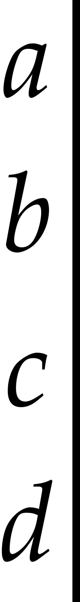

as the first sign for the rule differs from the second.

### [129\[7\]](https://cdn.wittgensteinnachlass.com/2000px/webp/Ts-211/129.webp),[130\[1\]](https://cdn.wittgensteinnachlass.com/2000px/webp/Ts-211/130.webp)

If I translate the sentence “a a d d d b c” according to

into , I follow the rule in the

same sense as when I translate

1, 2, 3, 4 according to ‘x…x²’ into

1 4 9 16.

### [130\[2\]](https://cdn.wittgensteinnachlass.com/2000px/webp/Ts-211/130.webp)

In the particular case, of course, the rule does not occur with its generality emphasized, just as f(x) does not occur in f(a) as something general.

### [130\[3\]](https://cdn.wittgensteinnachlass.com/2000px/webp/Ts-211/130.webp)

Now if I translate as above, the way I translate consists in the way I arrived at the result of the translation. It is undeniable, after all, that I can get from 1, 2, 3, 4 to 1, 4, 9, 16 in different ways, and I can assert no more than that. Now if I describe a state of affairs in words, say the shape and colour of a patch, I do not indeed consult any rule of translation, but I do arrive at the words of the description in a quite definite way, different from simply making whatever sounds, or even letting myself be led to such sounds by association. If, for example, I describe a patch in certain words, it is surely conceivable that I use words for this that I have never heard and never used. At least one could imagine a case in which the people around me (who might be with me all the time) have never heard these words and (so) do not understand me either; but in which I imagine (as they would put it) that this is what the things are called. In that case I have thereby invented a language. For, as I understand it, that is what the things are called if I imagine that that is what they are called.

### [130\[4\]](https://cdn.wittgensteinnachlass.com/2000px/webp/Ts-211/130.webp)

To understand a sentence means to understand a language; to speak a sentence means to speak a language.

### [130\[5\]](https://cdn.wittgensteinnachlass.com/2000px/webp/Ts-211/130.webp),[131\[1\]](https://cdn.wittgensteinnachlass.com/2000px/webp/Ts-211/131.webp)

There is, after all, a difference between my writing down the second sign under the influence, in some way, of the first, and my reading it off from the _first_ sign. And causal influence is not a conscious process. But now if I am annoyed _because_ someone comes in through the door, can I be mistaken about the connection here, or do I _experience_ it as I experience the annoyance? In a certain sense I can be mistaken, for I can say to myself “I don’t know why his coming annoys me so much today”. That is, the cause of my annoyance is open to dispute. – On the other hand, there is no disputing that the thought of his coming is – as one says – tinged with displeasure. But what about this case: I see the man and at the sight of him hatred of him wells up in me against him. – Could one ask: how do I know that it is _him_ I hate, that _he_ is the cause of my hatred? And how do I know that the sight of him rekindles this hatred? As to the first question: – ‘I hate him’ does not mean ‘I hate and he is the cause of my hatred’. Rather, he, or the visual image of him – etc. – occurs in my hatred, is a constituent of my hatred. (Here too a stand-in will not do, for what guarantees to me that what it stands for exists?) In the second case the man’s appearance _does_ directly _occur_ in my hatred, or, if it does not, then his appearance really is only the hypothetical cause of my feeling and I can be mistaken in thinking that _it_ is what gives rise to the feeling.

### [131\[2\]](https://cdn.wittgensteinnachlass.com/2000px/webp/Ts-211/131.webp)

It must be exactly the same with acting _according to_ an expression in signs. The expression in signs must be involved in this process, whereas it is not involved if it is _merely_ the cause of my action.

### [131\[3\]](https://cdn.wittgensteinnachlass.com/2000px/webp/Ts-211/131.webp)

And so it is: I derive my action from it.

### [131\[4\]](https://cdn.wittgensteinnachlass.com/2000px/webp/Ts-211/131.webp),[132\[1\]](https://cdn.wittgensteinnachlass.com/2000px/webp/Ts-211/132.webp)

Now if I say that I derive my action from the expression in signs _in a certain way_, then this way can be contained in the actual process only as a function f(x) is contained in f(a).

### [132\[2\]](https://cdn.wittgensteinnachlass.com/2000px/webp/Ts-211/132.webp)

If the sentence “I hate him” is understood like this: I hate and he is the cause; then the question is possible “are you sure it is _him_ you hate, might it not be someone or something else” and that is patent nonsense.

### [132\[3\]](https://cdn.wittgensteinnachlass.com/2000px/webp/Ts-211/132.webp)

Incidentally, the only proof that an analysis is wrong is that it leads to patent nonsense; that is, to an expression that patently violates the grammar corresponding to normal application.

### [132\[4\]](https://cdn.wittgensteinnachlass.com/2000px/webp/Ts-211/132.webp)

If I am thinking of him: what conditions must be fulfilled for that to be the case? What non-hypothetical conditions? If I am expecting him – for example – must he exist now, must I have a memory-image of him? Must I have seen him at some time? And in what sense? Whatever need not be the case we rule out, and what must be the case constitutes the existence of the thought.

### [132\[5\]](https://cdn.wittgensteinnachlass.com/2000px/webp/Ts-211/132.webp)

If I produce a sequence of sounds and then say that I read this sentence, there can be no doubt whether I really read this sentence or whether my sequence of sounds was caused in some other way. That is, my having read this sentence says nothing at all about what caused the sequence of sounds to come about.

### [132\[6\]](https://cdn.wittgensteinnachlass.com/2000px/webp/Ts-211/132.webp)

It can never be essential for us that a phenomenon takes place in the mind and not on paper, visible to someone else.

### [132\[7\]](https://cdn.wittgensteinnachlass.com/2000px/webp/Ts-211/132.webp),[133\[1\]](https://cdn.wittgensteinnachlass.com/2000px/webp/Ts-211/133.webp)

One can say that whether I am reading or merely making sounds while a text is before my eyes cannot be settled by observation from outside. But reading cannot be essentially an _inner_ affair. Deriving the translation from the sign, if it is a process at all, must also be capable of being a visible process. Thus one must also be able to take as such, for example, the process that takes place on paper when the terms of the series 1, 4, 9, 16 (as a translation of 1, 2, 3, 4) appear worked out by means of the equations 1 × 1 = 1, 2 × 2 = 4, 3 × 3 = 9, etc.

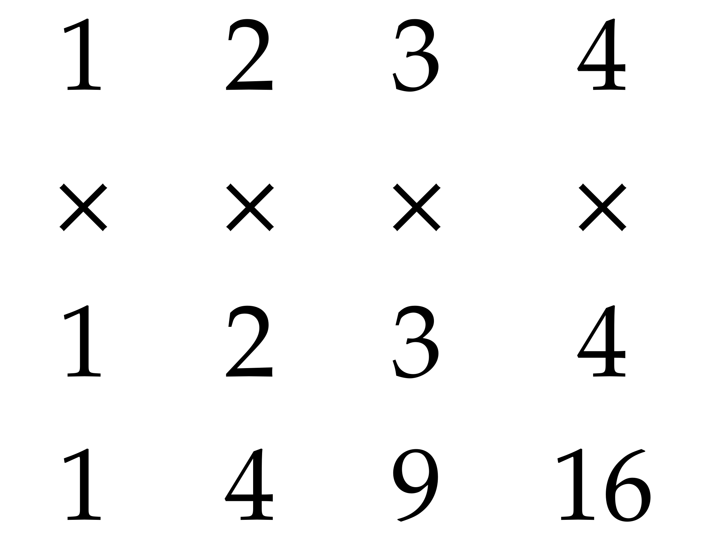

From the standpoint of Behaviourism one could then say: If a person writes that down, then he has obtained the bottom row by calculation, but if he merely writes down the bottom row, then he has not. But if he were now to write:

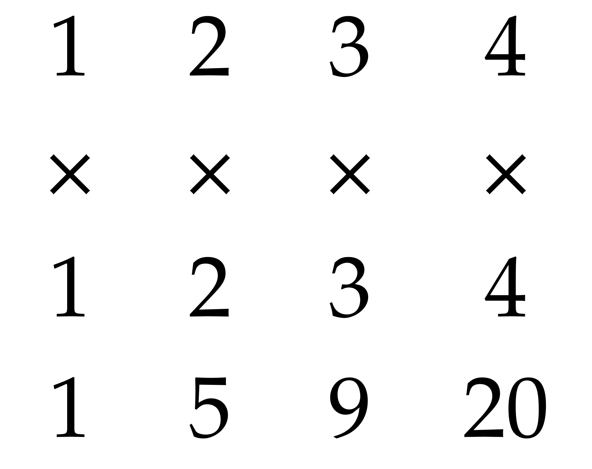

then we would say that he had calculated incorrectly, because 2 × 2 is not 5, etc.

### [133\[2\]](https://cdn.wittgensteinnachlass.com/2000px/webp/Ts-211/133.webp)

Of course one could just as well write 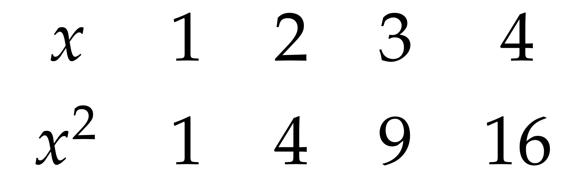 and this representation is entirely equivalent to the first, or indeed to any other, provided a rule is laid down that distinguishes it from another representation.

### [133\[3\]](https://cdn.wittgensteinnachlass.com/2000px/webp/Ts-211/133.webp)

The feeling one has with any such representation, that it is crude (clumsy), is misleading, for we are tempted to look for a “better” representation. But there is no such thing. One is as good as another so long as the multiplicity is right; i.e. so long as to every difference in what is represented there corresponds a difference in the representation.

### [133\[4\]](https://cdn.wittgensteinnachlass.com/2000px/webp/Ts-211/133.webp),[134\[1\]](https://cdn.wittgensteinnachlass.com/2000px/webp/Ts-211/134.webp)

But then the thought as a mental process can do no more than this “crude” sign either.

### [134\[2\]](https://cdn.wittgensteinnachlass.com/2000px/webp/Ts-211/134.webp)

One cannot ask: What kind of processes are mental processes, that they can be true and false when non-mental ones cannot? For if the “mental” ones can, the others must be able to as well; and conversely. For if processes in the mind can do it, their description must be able to do it too. For it must show itself in their description how it is possible.

### [134\[3\]](https://cdn.wittgensteinnachlass.com/2000px/webp/Ts-211/134.webp)

When one says that thought is an activity of the psyche, or an activity of the mind, one thinks of the mind as a murky, gaseous entity in which things can happen that cannot happen outside. And of which one _can_ expect things that are otherwise impossible. The doctrine of thought deals, as it were, with the organic part, as opposed to the inorganic part, the sign. It is as if the thought were the organic part of the symbol, the sign the inorganic part. And that organic part can accomplish _things_ that the inorganic part could not. As if something essential still took place _behind_ the expression, something that cannot be expressed – that can perhaps only be pointed to – something that takes place in this cloud (the mind) and makes the thought a thought in the first place. Here we are thinking of a process analogous to digestion, and _the idea_ is that chemical changes take place inside the body other than those we can produce outside it, that the organic part of digestion _has_ a different chemistry from that of anything we could do to the food outside the body.

### [135\[1\]](https://cdn.wittgensteinnachlass.com/2000px/webp/Ts-211/135.webp)

Or: As if the thought consisted, _as it were_, of an inorganic part (the sign) and an organic part, say the interpretation, which would be essentially mental.

### [135\[2\]](https://cdn.wittgensteinnachlass.com/2000px/webp/Ts-211/135.webp)

Of course one cannot say: The proposition is what is true or false. (As if that still ruled something out.)

### [135\[3\]](https://cdn.wittgensteinnachlass.com/2000px/webp/Ts-211/135.webp)

The intention, insofar as it concerns us, cannot be anything essentially mental.

### [135\[4\]](https://cdn.wittgensteinnachlass.com/2000px/webp/Ts-211/135.webp)

Since a machinery of the mind is of no concern to us, we must also be able to construct a mechanical human being that must be able to do everything that is essential for us.

### [135\[5\]](https://cdn.wittgensteinnachlass.com/2000px/webp/Ts-211/135.webp)

“After all, a sign is always there for a living being, so that must be something essential to a sign”. Certainly: a chair too is only ever there for a person, but it can be described without our talking about its purpose. A sign has a purpose only in human society, but this purpose is of no concern to us at all. Indeed, in the end we state no properties of signs at all – for these do not interest us – but only the (_general_) rules of their use. Anyone describing chess neither specifies properties of the chess pieces nor talks about the usefulness and use of chess.

### [135\[6\]](https://cdn.wittgensteinnachlass.com/2000px/webp/Ts-211/135.webp),[136\[1\]](https://cdn.wittgensteinnachlass.com/2000px/webp/Ts-211/136.webp)

If thought were, so to speak, a private amusement and had nothing to do with the outside world, it would be of no interest to us at all (like, say, the feelings one has with an upset stomach). What we want to know is: What does thought have to do with what happens outside thought? For that is the only source of its meaning, I mean its importance. What does what I think have to do with what is the case?

### [136\[2\]](https://cdn.wittgensteinnachlass.com/2000px/webp/Ts-211/136.webp)

“What makes the thought true cannot be determined in advance, because otherwise it would already be there.” – “But what it is like if the thought is true is determined in advance”. – “But surely there would need to be nothing more than the fact, the verification itself. This ‘the proposition says what is the case if it is true’ says nothing, for p itself shows that p is the case if etc. That is, only p could be given in answer to the question ‘what would be the case if ‥‥?’ So that is a mere tautology.” – The difficulty lies in the concept of determining.

### [136\[3\]](https://cdn.wittgensteinnachlass.com/2000px/webp/Ts-211/136.webp)

What the proposition would really have to determine would be, _as it were_, that p or non-p must be the case, but that is only apparently a determination; in reality it determines nothing at all. And if I said that it restricts the truth to yes and no, that means that it fixes nothing, nothing that can be said.

### [136\[4\]](https://cdn.wittgensteinnachlass.com/2000px/webp/Ts-211/136.webp)

I said that the sentence was like a yardstick laid against reality: but the yardstick, like all correct similes for the sentence, is a special case of a sentence. And it too determines nothing as long as one does not measure with it. But measuring is comparing (and must mean translating).

### [136\[5\]](https://cdn.wittgensteinnachlass.com/2000px/webp/Ts-211/136.webp),[137\[1\]](https://cdn.wittgensteinnachlass.com/2000px/webp/Ts-211/137.webp)

One wants to say: place the yardstick against a body; it does not say that the body is this long. Rather, it is in itself as it were dead and does none of what the thought does. It is as if we had imagined that the essential thing about a living person was the outward shape, and had now made a wooden block of this shape and were looking with disappointment at the dead block, which bears no likeness to _life_ either.

### [137\[2\]](https://cdn.wittgensteinnachlass.com/2000px/webp/Ts-211/137.webp)

If understanding was a necessary preparation for obeying, then it must have added something to the sign; but something that in any case was not the execution.

### [137\[3\]](https://cdn.wittgensteinnachlass.com/2000px/webp/Ts-211/137.webp)

Can one, then, and in what sense can one, derive the execution from the sign plus the understanding (that is, the interpretation) before it _takes place_? After all, all one derives is a description of the execution, and even this description was not there until one had derived _it_.

### [137\[4\]](https://cdn.wittgensteinnachlass.com/2000px/webp/Ts-211/137.webp)

It is only when we carry out the command that we derive its _execution_ from it.

### [137\[5\]](https://cdn.wittgensteinnachlass.com/2000px/webp/Ts-211/137.webp)

But now one might ask: Why do I call just the one translation of the symbol its execution, and not the other _translations_ as well? Well, one could also take one of the other translations as the execution of the command, and if the person giving the command does not regard this as the translation he wants, then he must add a further explanation to the command, that is, _alter and extend_ the command _itself._

### [137\[6\]](https://cdn.wittgensteinnachlass.com/2000px/webp/Ts-211/137.webp)

All one knows in advance is that whatever one derives from this command will have been derived from it.

### [137\[7\]](https://cdn.wittgensteinnachlass.com/2000px/webp/Ts-211/137.webp),[138\[1\]](https://cdn.wittgensteinnachlass.com/2000px/webp/Ts-211/138.webp)

When I say “surely the proposition determines in advance what will make it true”: Certainly, the proposition ‘p’ determines that p must be the case for it to be true; but that is all one can say about it.

### [138\[2\]](https://cdn.wittgensteinnachlass.com/2000px/webp/Ts-211/138.webp)

If one were to say that the person receiving the order receives in addition to the words mental images that are similar to the execution of the order (whereas the words are said not to be), then I go even further and assume that the order is given by our making the other person perform now, through mechanical influence (say, by guiding his hand), the movements that he is to perform in, say, 5 minutes; and presumably I can come no closer to the execution of the order in the expression of the order. Then we have replaced the similarity of the mental image with a much greater (_similarity_). And the path from the symbol to reality seems to have been greatly shortened here. (Likewise, to describe what position I was in on such and such an occasion, I could assume that position.) This also shows that the occurrence of images of fantasy is quite inessential to thought.

### [138\[3\]](https://cdn.wittgensteinnachlass.com/2000px/webp/Ts-211/138.webp)

(With some problems one must first become familiar by making a run at them countless times. One then comes to know the taste of the problem.)

### [138\[4\]](https://cdn.wittgensteinnachlass.com/2000px/webp/Ts-211/138.webp)

Here I come up against the uniqueness of a fact, and that is connected with _the sense of the sentence_ “Everything flows”.

### [138\[5\]](https://cdn.wittgensteinnachlass.com/2000px/webp/Ts-211/138.webp),[139\[1\]](https://cdn.wittgensteinnachlass.com/2000px/webp/Ts-211/139.webp)

If someone misunderstands the command and takes a translation that we regard only as a picture of its execution for the execution itself, his translation would still correspond to a command in our language, and indeed to one that would look very much like ours. The command to carry out a particular movement, for example, and the command merely to draw this movement have the description of this movement in common. But they also differ from one another, and only thereby can the one command one thing and the other command another.

### [139\[2\]](https://cdn.wittgensteinnachlass.com/2000px/webp/Ts-211/139.webp)

The command can determine its execution only insofar as one can derive the execution from it. –

### [139\[3\]](https://cdn.wittgensteinnachlass.com/2000px/webp/Ts-211/139.webp)

‘That it determines its execution’ can mean only this: that one can derive the execution from it.

### [139\[4\]](https://cdn.wittgensteinnachlass.com/2000px/webp/Ts-211/139.webp)

The command 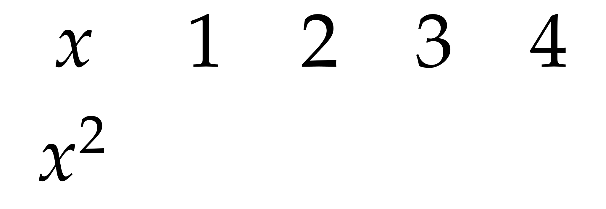 seems incomplete to us. It seems to us as if something that is not said were only hinted at.

### [139\[5\]](https://cdn.wittgensteinnachlass.com/2000px/webp/Ts-211/139.webp)

But something is only hinted at in so far as a system is not explicitly laid down, or is imperfectly laid down. We want to say that it is imperfectly hinted at to us, or that the sign merely _suggests_ indistinctly what we are to do. It is supposed to be indistinct in something like the sense in which a sign reading “Keep Left” becomes clearer when there is also an arrow pointing in that direction.

### [139\[6\]](https://cdn.wittgensteinnachlass.com/2000px/webp/Ts-211/139.webp)

But for us the command that is unambiguous is clear; and there is none clearer.

### [139\[7\]](https://cdn.wittgensteinnachlass.com/2000px/webp/Ts-211/139.webp)

It can become unambiguous, however, only if a distinction is made in the system of commands whose absence is precisely what gives rise to the ambiguity. (If, then, the system is given the right multiplicity.)

### [140\[1\]](https://cdn.wittgensteinnachlass.com/2000px/webp/Ts-211/140.webp)

I could also say: It seems to us as though, when we understand the order –  for example – we add something that fills the gap. So that we can answer someone who says (to us) “but you do understand it”: Yes, but only because I add something else: namely the interpretation.

### [140\[2\]](https://cdn.wittgensteinnachlass.com/2000px/webp/Ts-211/140.webp)

Now one would, of course, have to say in reply: But what prompts you to give precisely _this_ interpretation? If it is the order, then it was already unambiguous, since it was only this interpretation that it _commanded._ Or did you add the interpretation arbitrarily – in that case you did not understand the order either, but only what you made of it (on your own initiative).

### [140\[3\]](https://cdn.wittgensteinnachlass.com/2000px/webp/Ts-211/140.webp)

(My method is in a certain sense a psychological one.)

### [140\[4\]](https://cdn.wittgensteinnachlass.com/2000px/webp/Ts-211/140.webp)

Knowing what the _sentence says_ can only mean: being able to answer the question “what does it _say_?”.

### [140\[5\]](https://cdn.wittgensteinnachlass.com/2000px/webp/Ts-211/140.webp)

Understanding the sense of a sentence can only mean: being able to answer the question “what is its sense?”

### [140\[6\]](https://cdn.wittgensteinnachlass.com/2000px/webp/Ts-211/140.webp)

For if “have sense” is used here intransitively, so that one cannot distinguish _the_ sense of one sentence from that of another, then having sense is a matter that accompanies the use of the sentence and does not interest us.

### [140\[7\]](https://cdn.wittgensteinnachlass.com/2000px/webp/Ts-211/140.webp)

But if I say: ‘I derive my action from the order with the help of a rule’, that makes sense only if I can ask: With the help of _which_ rule? And the answer to this question must be an expression of the rule. (For here again, of course, it can only be a matter of _one_ rule as opposed to another.)

### [141\[1\]](https://cdn.wittgensteinnachlass.com/2000px/webp/Ts-211/141.webp)

But how does the rule come into acting according to the rule?

### [141\[2\]](https://cdn.wittgensteinnachlass.com/2000px/webp/Ts-211/141.webp)

Not necessarily in such a way that my action corresponds to the rule. But part of the whole process of derivation must correspond to the rule: it must be our intention to follow the rule. – And one might say that this consists precisely in our intention following the rule.

### [141\[3\]](https://cdn.wittgensteinnachlass.com/2000px/webp/Ts-211/141.webp)

But what is the connection between the use of language and the rules of grammar? Am I to say that the rules of grammar are the rules according to which (i.e. in accordance with which) the speech of a group of people actually proceeds.

### [141\[4\]](https://cdn.wittgensteinnachlass.com/2000px/webp/Ts-211/141.webp)

Does ‘following the rules of grammar’ mean, in any sense, thinking of these rules while speaking? No. – Does it mean always speaking in accordance with certain rules? No. – It means following rules. – But surely anyone who does anything does that: for there is bound to be a rule to which what he does corresponds.

### [141\[5\]](https://cdn.wittgensteinnachlass.com/2000px/webp/Ts-211/141.webp)

One would like to say: “one need only _mean_ something by what one says, and then everything essential is given”. And so I regard ‘meaning something’ and ‘following a rule’ as having the same meaning.

### [141\[6\]](https://cdn.wittgensteinnachlass.com/2000px/webp/Ts-211/141.webp)

Is grammar merely a description of how language is actually handled? So that its sentences could really be understood as sentences of a natural science? But then this is not the descriptive science of thinking, but of speaking.

### [141\[7\]](https://cdn.wittgensteinnachlass.com/2000px/webp/Ts-211/141.webp),[142\[1\]](https://cdn.wittgensteinnachlass.com/2000px/webp/Ts-211/142.webp)

After all, the rules of chess could also be understood as sentences from the natural history of human beings. (Just as the games of animals are described in books of natural history.)

### [142\[2\]](https://cdn.wittgensteinnachlass.com/2000px/webp/Ts-211/142.webp)

“But surely I do mean something by these words”. Certainly: in contrast to the case where I mean nothing, where I might string syllables together for the sake of their funny sound. What I _really_ want to say is that ‘I mean something by the words’ just means: I do distinguish this case from that of senseless _babbling_ etc. And that much is granted. But that does not yet give us any particular theory of meaning something.

### [142\[3\]](https://cdn.wittgensteinnachlass.com/2000px/webp/Ts-211/142.webp)

And so it goes in all such cases. Suppose someone says: “but I really do mean that the other person has toothache; not that he merely behaves that way”. One must always answer: “Certainly” and concede that we too have to make this distinction.

### [142\[4\]](https://cdn.wittgensteinnachlass.com/2000px/webp/Ts-211/142.webp)

The process of ‘following a rule’ must be described by a rule. One might say that it is so called because it must be described by a rule.

### [142\[5\]](https://cdn.wittgensteinnachlass.com/2000px/webp/Ts-211/142.webp)

Or again: One could _derive_ a grammar from any sentence that makes sense.

### [142\[6\]](https://cdn.wittgensteinnachlass.com/2000px/webp/Ts-211/142.webp),[143\[1\]](https://cdn.wittgensteinnachlass.com/2000px/webp/Ts-211/143.webp)

I must be able to extract a rule from the process of _transforming_ 1, 2, 3, 4 into 1, 4, 9, 16. – What does that mean? Surely that I must be able to derive an expression of a rule from the process; i.e. _one_ expression as opposed to another. I.e. that in a _system_ of rules I must be able to pick out _one_ as the one that fits.

### [143\[2\]](https://cdn.wittgensteinnachlass.com/2000px/webp/Ts-211/143.webp)

If, for example, I say: “I believe he will come” – where do I get these words. Why do I choose _them_. Is there something there before this expression that I depict.

### [143\[3\]](https://cdn.wittgensteinnachlass.com/2000px/webp/Ts-211/143.webp)

Admittedly, I am not explicitly conscious of grammatical rules when I use language, but I am conscious that I am not inventing language ad hoc. And if I did invent it, it would be _of no use_ if I did not want to go by the rules I had invented _again_.

### [143\[4\]](https://cdn.wittgensteinnachlass.com/2000px/webp/Ts-211/143.webp)

That is, language functions as language only by virtue of the rules we follow in using it. (Just as a game functions as a game only by virtue of rules.)

### [143\[5\]](https://cdn.wittgensteinnachlass.com/2000px/webp/Ts-211/143.webp)

And that is so whether I speak to myself or to others. For I communicate nothing even to myself if I associate groups of sounds ad hoc with just any facts.

### [143\[6\]](https://cdn.wittgensteinnachlass.com/2000px/webp/Ts-211/143.webp)

When I speak to myself, I must play on an already existing keyboard of language.

### [143\[7\]](https://cdn.wittgensteinnachlass.com/2000px/webp/Ts-211/143.webp)

When I use a word in the language, it is either because I want to strike it as an already familiar note, or _inasmuch as_ I want to stipulate that I will use the word this way in future.

### [143\[8\]](https://cdn.wittgensteinnachlass.com/2000px/webp/Ts-211/143.webp),[144\[1\]](https://cdn.wittgensteinnachlass.com/2000px/webp/Ts-211/144.webp)

‘I understand these words’ (which I may be saying to myself), ‘I mean something by them’, ‘they have a sense’ must always mean the same as: ‘they are not sounds invented ad hoc, but signs taken from a system’.

### [144\[2\]](https://cdn.wittgensteinnachlass.com/2000px/webp/Ts-211/144.webp)

_Roughly_, as the graduation marks on a measuring rod are such only if they form a system.

### [144\[3\]](https://cdn.wittgensteinnachlass.com/2000px/webp/Ts-211/144.webp)

We use language only for the sake of its consequences.

### [144\[4\]](https://cdn.wittgensteinnachlass.com/2000px/webp/Ts-211/144.webp)

One can say: “given the way I use the word ‘green’, I cannot say of it ‥‥․ .”

### [144\[5\]](https://cdn.wittgensteinnachlass.com/2000px/webp/Ts-211/144.webp)

_Understanding_ what the other person says can only be described as following a rule given in advance.

### [144\[6\]](https://cdn.wittgensteinnachlass.com/2000px/webp/Ts-211/144.webp)

For when we obey a command, we do not interpret the words arbitrarily. That is, once again, we must recognize the distinction between ‘obeying a command’ and ‘arbitrarily assigning an action’.

### [144\[7\]](https://cdn.wittgensteinnachlass.com/2000px/webp/Ts-211/144.webp)

And the justification of a way of acting _as obedience to an order_ would always be: “that’s how I learnt it.”

### [144\[8\]](https://cdn.wittgensteinnachlass.com/2000px/webp/Ts-211/144.webp)

But how does a justification like this work: “I was told that _that_ was a chair” or “‥‥ that that was red”, etc. Or again “I was told that when it says ‘do p and q’, I am to do it _like this_” (where I demonstrate the activity).

### [145\[1\]](https://cdn.wittgensteinnachlass.com/2000px/webp/Ts-211/145.webp)

These are misunderstandings that can be cleared up: “Is _that_ an orange? I thought _that_ was one”. Can one say: “Is that red? I thought that was a chair”. But couldn’t one imagine (if, say, one doesn’t know German) that “rot” means loud (i.e. is used the way “laut” is actually used). But how would this misunderstanding be cleared up? Perhaps like this: “rot is a colour, not a degree of loudness”? – One could of course give such an explanation, but it would be intelligible only to someone who already knows their way around the grammar completely.

### [145\[2\]](https://cdn.wittgensteinnachlass.com/2000px/webp/Ts-211/145.webp)

The sentence “is that red? I thought that was a chair” makes sense only if the word “that” is used in the same sense both times, and then I must take either “red” as a noun or “a chair” as an adjective.

### [145\[3\]](https://cdn.wittgensteinnachlass.com/2000px/webp/Ts-211/145.webp)

The justification can be understood only if it is given in a language that exists independently of the misunderstanding.

### [145\[4\]](https://cdn.wittgensteinnachlass.com/2000px/webp/Ts-211/145.webp)

One can clear up a misunderstanding only if the clarification is understood.

### [145\[5\]](https://cdn.wittgensteinnachlass.com/2000px/webp/Ts-211/145.webp)

In the explanation “_that_ is a chair, not _that_”, the two words “that” and the accompanying gestures must be understood and are then fully fledged signs. The explanation can then also be given like this: “_that_ is called ‘chair’, not _that_”, and this is a sentence like, for example, “the chair is blue, not red”. – But of course what is explained here is not language, but _a_ language (with the help of another that already exists).

### [145\[6\]](https://cdn.wittgensteinnachlass.com/2000px/webp/Ts-211/145.webp)

Is it like this: grammar has language only as a phenomenon extended in time.

### [146\[1\]](https://cdn.wittgensteinnachlass.com/2000px/webp/Ts-211/146.webp)

But surely the sentence is something extended in space or time, or in space and time.

### [146\[2\]](https://cdn.wittgensteinnachlass.com/2000px/webp/Ts-211/146.webp)

Uttering a sentence would not be a portrayal if I did not choose my words from a system, so that one can say that I choose _them_ rather than others. But if the words do not belong to a grammatical system, they are all of equal value, and so it would then make no difference which I chose; indeed – one might say – as words they would (_then_) not differ from one another at all. One must choose the words as one chooses the lines with which one depicts a body.

### [146\[3\]](https://cdn.wittgensteinnachlass.com/2000px/webp/Ts-211/146.webp)

Someone who learns musical notation does not learn every piece of music, but the notes and rules, and only thereby is musical notation of use to him. But not, perhaps, because only then is it economical, but because otherwise it is not a notation.

### [146\[4\]](https://cdn.wittgensteinnachlass.com/2000px/webp/Ts-211/146.webp)

If one had taught a dog to follow combinations of the signs a, b, c, d (where a = 🖵, b = 🖵, c = 🖵, d = 🖵), it might do so mechanically, but if I now want to know which sign I must give it to make it run along a particular path made up of straight segments, I must derive the sign from that path according to the rule.

### [146\[5\]](https://cdn.wittgensteinnachlass.com/2000px/webp/Ts-211/146.webp)

The written record of the rule helps me only insofar as it reminds me of this rule rather than others, prevents me from thinking, for example, that a means , etc.

### [146\[6\]](https://cdn.wittgensteinnachlass.com/2000px/webp/Ts-211/146.webp),[147\[1\]](https://cdn.wittgensteinnachlass.com/2000px/webp/Ts-211/147.webp)

If I say I am following a rule, then it must make sense to ask in reply: Which rule? And the answer is the expression of a rule (like the one above). But no more than that can be given in answer, and so the question cannot ask for anything beyond what this expression answers. But where does the dissatisfaction come from? What is it that we would like to say _and_ that cannot be said?

### [147\[2\]](https://cdn.wittgensteinnachlass.com/2000px/webp/Ts-211/147.webp)

If, following the rules, I write “a” instead of “”, it is as if a causal connection were at play here that was not hypothetical but immediately *ex*perienced. (Of course nothing of the kind is the case.)

### [147\[3\]](https://cdn.wittgensteinnachlass.com/2000px/webp/Ts-211/147.webp)

One thing is clear: if I have followed the rule (_correctly_), the result will stand in an internal relation to the model and the expression of the rule, which I cannot express except by reproducing those three complexes, because (odd as it sounds) this reproduction alone already determines everything.

### [147\[4\]](https://cdn.wittgensteinnachlass.com/2000px/webp/Ts-211/147.webp)

“Seeing the internal relation” can of course mean nothing other than seeing the complexes that stand in it. One might object that one can also see the complexes without noticing the internal relation. But then one simply sees something different from what one sees ‘when it strikes one’. But the relation that strikes one can only be something that can be described, and the internal relation can only be described by describing the complexes.

### [147\[5\]](https://cdn.wittgensteinnachlass.com/2000px/webp/Ts-211/147.webp)

(Again and again the move in thought that Freud makes, for example, when he says he will call the manifest dream what is recounted as such after waking.)

### [148\[1\]](https://cdn.wittgensteinnachlass.com/2000px/webp/Ts-211/148.webp)

If I say that, in copying a model, I go by it _according to_ a rule, what I mean is: in contrast to the case in which I do not go by a model according to a rule. Then this feature of copying can only be an external one, like any other that distinguishes one process from another.

### [148\[2\]](https://cdn.wittgensteinnachlass.com/2000px/webp/Ts-211/148.webp)

Strictly speaking, the words “according to a rule” are superfluous. Everything lies in the words “_going_ by a model”. The rule merely describes _one_ way of going by something as opposed to another. – The words are superfluous because one can only go by something according to a rule.

### [148\[3\]](https://cdn.wittgensteinnachlass.com/2000px/webp/Ts-211/148.webp)

That is, depicting can differ from another process only as one process differs from another, and _that means_ that this difference cannot have logical significance.

### [148\[4\]](https://cdn.wittgensteinnachlass.com/2000px/webp/Ts-211/148.webp)

Just as I said once before: Intention too can only be a phenomenon like any other, if I may speak of it at all.

### [148\[5\]](https://cdn.wittgensteinnachlass.com/2000px/webp/Ts-211/148.webp)

So choosing the strokes in copying from a model is indeed a different process from, say, merely drawing these strokes when I am “not following the model”, but the difference is an external, describable one, like the difference between the groups of signs 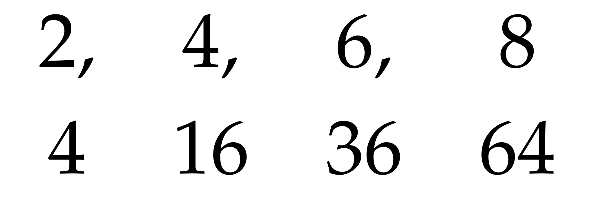 and 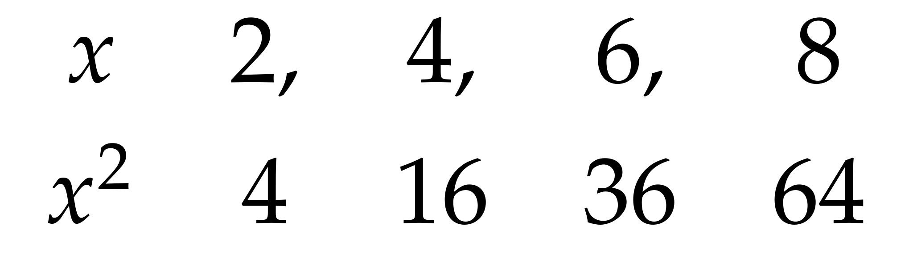, and is on the same level as that difference.

### [148\[6\]](https://cdn.wittgensteinnachlass.com/2000px/webp/Ts-211/148.webp),[149\[1\]](https://cdn.wittgensteinnachlass.com/2000px/webp/Ts-211/149.webp)

And so it is with choosing the words when I describe something in words: this process differs from that of arbitrarily assigning words, but only in _just_ the way (_externally_) that the two signs in the preceding sentence differ.

### [149\[2\]](https://cdn.wittgensteinnachlass.com/2000px/webp/Ts-211/149.webp)

Not only are we not conscious of the grammatical rules when speaking, but if we were, it would not help, would not make anything clearer.

### [149\[3\]](https://cdn.wittgensteinnachlass.com/2000px/webp/Ts-211/149.webp)

Being conscious of the rules can surely only mean _having before us_ an expression of the rule.

### [149\[4\]](https://cdn.wittgensteinnachlass.com/2000px/webp/Ts-211/149.webp)

What is not needed in logic does not _help_ either. What is not needed is superfluous.

### [149\[5\]](https://cdn.wittgensteinnachlass.com/2000px/webp/Ts-211/149.webp)

Indeed, even if we were always conscious of the grammatical rules while speaking, that would not help my case to its feet.

### [149\[6\]](https://cdn.wittgensteinnachlass.com/2000px/webp/Ts-211/149.webp)

Language as a whole cannot be misunderstood. For otherwise there would in principle be no explanation for this misunderstanding. That is just to say that the whole of language must speak for itself.

### [149\[7\]](https://cdn.wittgensteinnachlass.com/2000px/webp/Ts-211/149.webp)

We find out why we use one word – and not another – at this point when we ask someone: why do you use the word A here? The answer _will_ be: such and such is called A. And that is a rule of grammar which determines the word’s position in the language. And (as a sign that this really is a matter of grammar) if A had been the word “and”, there would be nothing further one could do but give the rules for “and”.

### [150\[1\]](https://cdn.wittgensteinnachlass.com/2000px/webp/Ts-211/150.webp)

An explanation such as “_that_ is red” or “_that_ is sweet” also belongs to grammar (for it only explains signs by means of signs). And what this explanation leaves us with besides the word “red” is not arbitrary in the same sense as the spoken or written form “red”. For the images of a red and a green patch form a system, whereas the mere words ‘red’ and ‘green’ do not.

### [150\[2\]](https://cdn.wittgensteinnachlass.com/2000px/webp/Ts-211/150.webp)

What does the mental image of my walk have in common with it (the _walk_)? Just what is expressed by my calling the one ‘my walk’ and the other ‘the mental image of it’.

### [150\[3\]](https://cdn.wittgensteinnachlass.com/2000px/webp/Ts-211/150.webp)

What does it mean when one says: “I cannot imagine the opposite of that” or “what would it be like if it were different”; e.g. if someone has said that my mental images are private, or that only I myself can know whether I feel pain, and the like.

### [150\[4\]](https://cdn.wittgensteinnachlass.com/2000px/webp/Ts-211/150.webp)

If I cannot imagine what it would be like if it were different, then I cannot imagine how it can be _like this_ either. For “I cannot imagine” does not mean here what it means in the sentence “I cannot imagine a skull”. I do not mean to point to a lack of powers of imagination.

### [150\[5\]](https://cdn.wittgensteinnachlass.com/2000px/webp/Ts-211/150.webp)

The mental image here supplies us with the language that in any case has the right multiplicity. _The language with the simpler grammar._

### [150\[6\]](https://cdn.wittgensteinnachlass.com/2000px/webp/Ts-211/150.webp)

The justification in reply to the question “why do you use the word ‘blue’ here?”: “because this colour is called ‘blue’”, corresponds exactly to the answer to the question “why do you read (the sound) a here”: “because the sign is read as an a-sound”. In both cases I appeal to a rule.

### [151\[1\]](https://cdn.wittgensteinnachlass.com/2000px/webp/Ts-211/151.webp)

What does proceeding according to a rule consist in? – Can one ask that? – Presumably it means that one obeys the general order contained in the rule. I proceed according to a rule means: I proceed in such a way that what comes out, ‥‥ . That what comes out satisfies this rule. To proceed according to the rule means to proceed _like this_, and the ‘like this’ must contain the rule.

### [151\[2\]](https://cdn.wittgensteinnachlass.com/2000px/webp/Ts-211/151.webp)

If the rule says “where you see a , write a ‘c’”, then what I am to do is given by that, as far as it can be given at all.

### [151\[3\]](https://cdn.wittgensteinnachlass.com/2000px/webp/Ts-211/151.webp)

For nothing can be determined more fully than by an exact description. For to determine can only _mean_ to describe it. And that is very important. For this seems to be the simple answer to our long-standing _difficulties_.

### [151\[4\]](https://cdn.wittgensteinnachlass.com/2000px/webp/Ts-211/151.webp)

All difficulty in philosophy can only rest on misunderstandings. A discovery is never needed, can never be needed to resolve it. It is a misunderstanding and can only be resolved as such. I.e. without force. For the door opens and everything (about _it_) is in order; you need only understand the lock and move it in the _right_ way.

### [151\[5\]](https://cdn.wittgensteinnachlass.com/2000px/webp/Ts-211/151.webp),[152\[1\]](https://cdn.wittgensteinnachlass.com/2000px/webp/Ts-211/152.webp)

An action is not determined if the description still leaves something open (so that one can say “I do not yet know whether ‥‥”), which the description can therefore _determine_. If the description is complete, the action is determined. And that means that only _one_ action can correspond to the description. (This is the only way we can use _the word_.) (Let us recall the argument about “toothache”.)

### [152\[2\]](https://cdn.wittgensteinnachlass.com/2000px/webp/Ts-211/152.webp)

Here too is the connection with the question: “when the other person sees blue, does he really see the same colour as I do?” Of course, he sees blue! That is precisely the same colour. – _I.e._, the question whether the colour he sees as blue is the same is nonsensical if it is _assumed_ that we are entitled to call what he sees and what I see ‘blue’. If it can be established in the ordinary sense – i.e. by the ordinary method – that he does not see the same colour, then I cannot say that we both see blue. And if it can be established that we both see blue, then “we both see the same colour”, for this sentence refers only to these tests.

### [152\[3\]](https://cdn.wittgensteinnachlass.com/2000px/webp/Ts-211/152.webp)

And that is how things stand with the question: “is what I now call ‘yellow’ certainly the same colour as what I used to call ‘yellow’?” – Certainly, for it is yellow. – But how do you know that? – Because I remember. – But can memory not deceive? – No. Not when its datum is precisely what I go by. (Incidentally, I do not know whether it still makes sense to say “because I remember”; couldn’t I just as well answer “because I know”?) There is no test to establish that _that_ is blue (i.e. that I call _this_ colour blue.)

### [152\[4\]](https://cdn.wittgensteinnachlass.com/2000px/webp/Ts-211/152.webp)

We ask: “how can a sentence determine a state of affairs?” But does it make sense to say: “a sentence determines a state of affairs”?

### [152\[5\]](https://cdn.wittgensteinnachlass.com/2000px/webp/Ts-211/152.webp),[153\[1\]](https://cdn.wittgensteinnachlass.com/2000px/webp/Ts-211/153.webp)

Isn’t this the sense of the simile of the sewing machine: If what is at issue is the causal explanation of the mechanism, the question “how does the sewing machine do that” makes sense. But if that is not what is meant, then the answer lies in the description of _**what** it does_.

### [153\[2\]](https://cdn.wittgensteinnachlass.com/2000px/webp/Ts-211/153.webp)

Solipsism might be refuted by the fact that the word “I” has no central position in grammar, but is a word like any other.

### [153\[3\]](https://cdn.wittgensteinnachlass.com/2000px/webp/Ts-211/153.webp)

If there were essentially subject and object in the world, then the word ‘I’ would have to stand opposed to the other words in a unique way.

### [153\[4\]](https://cdn.wittgensteinnachlass.com/2000px/webp/Ts-211/153.webp)

In language, as in visual space, there is no metaphysical subject.

### [153\[5\]](https://cdn.wittgensteinnachlass.com/2000px/webp/Ts-211/153.webp)

One can only _use_ the words “to be certain that” _before_ a hypothesis. It means nothing to say “I am certain that I have toothache”, except in a sense in which it is after all possible to doubt whether it is toothache. But can’t I say: I am certain that I shall soon see a light? (Or: “that I shall soon get toothache”.)

### [153\[6\]](https://cdn.wittgensteinnachlass.com/2000px/webp/Ts-211/153.webp)

What does it mean to be certain that one will have toothache? (If one _cannot_ be certain, then grammar does not allow the word “certain” to be used in this connection.)

### [153\[7\]](https://cdn.wittgensteinnachlass.com/2000px/webp/Ts-211/153.webp)

One cannot say of a proposition “in the narrower sense” that the truth of another confirms it – without proving it.

### [153\[8\]](https://cdn.wittgensteinnachlass.com/2000px/webp/Ts-211/153.webp),[154\[1\]](https://cdn.wittgensteinnachlass.com/2000px/webp/Ts-211/154.webp)

One says: “When I say that I see an armchair there, I say more than I know for certain.” And then what one usually says is: “But there is _one_ thing I do know for certain.” But when one tries to say what that is, one finds oneself in some difficulty. “I see something _brown_ – that is certain”; what one _really_ means to say by this is that the brown colour is seen, and is not perhaps merely surmised (as, for instance, when I surmise it from certain other indications). And one does also simply say: “I _see_ something brown.”

### [154\[2\]](https://cdn.wittgensteinnachlass.com/2000px/webp/Ts-211/154.webp)

If I am told: “Look through this telescope and draw what you see for me”, then what I draw is the expression of a proposition, not of a hypothesis.

### [154\[3\]](https://cdn.wittgensteinnachlass.com/2000px/webp/Ts-211/154.webp)

Is it not clear that it is only for lack of corresponding conventions if I can render in words what I – for example – represent in a drawing?

### [154\[4\]](https://cdn.wittgensteinnachlass.com/2000px/webp/Ts-211/154.webp)

When I say “there is an armchair here”, by this – as one says – “more” is meant than a description of what I perceive. And this can only mean that this proposition does not _have to be true_, even if the description of what is seen is correct. Under what circumstances, then, will I say that the proposition was not true? Clearly: when certain other propositions that were included in the first are not true. But it is not as if the first had been a logical product.

### [154\[5\]](https://cdn.wittgensteinnachlass.com/2000px/webp/Ts-211/154.webp),[155\[1\]](https://cdn.wittgensteinnachlass.com/2000px/webp/Ts-211/155.webp)

If one asks “How does thought manage to represent?” the answer could be: “Don’t you (_really_) know? You can see it, after all, when you think”. Nothing is hidden, after all. How does the sentence do that? – Don’t you know? Nothing is concealed, after all.

### [155\[2\]](https://cdn.wittgensteinnachlass.com/2000px/webp/Ts-211/155.webp)

That ‘everything flows’ seems to prevent us from expressing the truth, for it is as if we could not grasp it because it slips away from _us_.

### [155\[3\]](https://cdn.wittgensteinnachlass.com/2000px/webp/Ts-211/155.webp)

But it simply does not prevent us from expressing it. – We know what it means to want to capture something that is fleeing in a description. It happens, for example, when we forget one thing while trying to describe another. But that is not what is at issue here. And that is how the expression “to flee” is to be used.

### [155\[4\]](https://cdn.wittgensteinnachlass.com/2000px/webp/Ts-211/155.webp)

We bring words back from their metaphysical use to their proper use in language. (The man who said that one cannot step twice into the same river said something false; one can step twice into the same river.) And this is what the solution to all philosophical difficulties looks like. The answers to them, if they are right, must be _homely_ and _ordinary_. But one must look at them in the right spirit; _then it doesn’t matter_.

### [155\[5\]](https://cdn.wittgensteinnachlass.com/2000px/webp/Ts-211/155.webp)

But to the answer “You know how the sentence does it, after all, there’s nothing hidden”, one would like to say: “Yes, but it all flows past so quickly, and I’d like to see it, as it were, spread out more widely”.

### [155\[6\]](https://cdn.wittgensteinnachlass.com/2000px/webp/Ts-211/155.webp)

But here too we are mistaken. For nothing happens _in the process_ that we miss because of the speed.

### [156\[1\]](https://cdn.wittgensteinnachlass.com/2000px/webp/Ts-211/156.webp)

Why can’t we imagine a machine with a memory? It has often been said that memory consists in events leaving traces in which certain processes must then take place. As when water makes itself a bed and the water that follows must flow in that bed; the one process wears a track for the next. But if this happens in a machine, as it actually does, no one says the machine has a memory, or that it has remembered the first process.

### [156\[2\]](https://cdn.wittgensteinnachlass.com/2000px/webp/Ts-211/156.webp)

Now this is just like saying that a machine can’t think, or can’t be in pain. And what matters here is what one understands by “being in pain”: It is clear that I can imagine a machine that behaves exactly as a person in pain does (in every detail). Or rather: I can call the other person a machine in pain, i.e. the other _body_. And likewise, of course, my body. In contrast, the phenomenon of pain, as it _occurs_ when ‘I am in pain’, has nothing at all to do with my body, i.e. with the experiences I sum up as the existence of my body. (I can have toothache without teeth.) And here there is no place for the machine at all. – It is clear that the machine can take the place only of a physical body. And in the sense in _which_ one can say of _such a body_ that it “is” in pain, one can say it of a machine too. Or again, we can compare the _bodies_ we say are in pain to machines and call them machines too.

### [156\[3\]](https://cdn.wittgensteinnachlass.com/2000px/webp/Ts-211/156.webp)

And it is exactly the same with thinking and memory.

### [156\[4\]](https://cdn.wittgensteinnachlass.com/2000px/webp/Ts-211/156.webp),[157\[1\]](https://cdn.wittgensteinnachlass.com/2000px/webp/Ts-211/157.webp)

It seems to us – as I said – that we are in the same position with a thought as with a landscape we have seen and are to describe, but cannot remember accurately enough to describe how all its parts fit together. In the same way, we believe that we cannot describe thinking afterwards because by then we have lost _all_ the many _finer_ processes. We would like to see this delicate interlacing under a magnifying glass, so to speak.

### [157\[2\]](https://cdn.wittgensteinnachlass.com/2000px/webp/Ts-211/157.webp)

(One must treat an unhatched thought gently to keep it alive. One must not demand anything of it yet, and must bed it in the soft medium of continuing uncertainty. Once it has fledged, it leaves this nest of its own accord.)

### [157\[3\]](https://cdn.wittgensteinnachlass.com/2000px/webp/Ts-211/157.webp),[158\[1\]](https://cdn.wittgensteinnachlass.com/2000px/webp/Ts-211/158.webp)

There are problems I will never reach, which do not lie in my line or in my world. Problems in the world of Western thought that Beethoven (and perhaps in part Goethe) reached and wrestled with, but that no philosopher ever tackled. (Perhaps Nietzsche passed by them.) And perhaps they are lost to Western philosophy; i.e. there will be no one who experiences the course of this culture as an epic, and so can describe it. Or rather, it simply is no longer an epic, – or at any rate is one only for someone who looks at it from outside, and perhaps Beethoven did this by looking ahead (as Spengler once suggests). One could say that a civilisation must have its epic poet _in advance_. Just as one can only foresee one’s own death and describe it in anticipation, not report on it as a contemporary. So one could say: If you want to see the epic of a whole culture written, you must look for it among the works of that culture’s greatest figures, thus at a time when the end of that culture could only have been *fore*seen, for later there is no one left to _describe_ it. And so it is no wonder if it is written only in the obscure language of foreboding, and intelligible to very few.

### [158\[2\]](https://cdn.wittgensteinnachlass.com/2000px/webp/Ts-211/158.webp)

But I never get to these problems at all. “When I have done with the world”, I will have created an amorphous (transparent) mass, and the world with all its multiplicity is left to one side like an uninteresting junk room. Or perhaps more accurately: the whole result of the (_whole_) work is the leaving-aside of the world. (The throwing of the whole world into the junk room.)

### [158\[3\]](https://cdn.wittgensteinnachlass.com/2000px/webp/Ts-211/158.webp)

There is nothing tragic in this world (mine), and hence none of all that is infinite which brings forth the tragic (as its result). Everything is soluble in ether, so to speak; there are no hard points. That is to say, harshness and conflict become not something glorious but a _fault_.

### [158\[4\]](https://cdn.wittgensteinnachlass.com/2000px/webp/Ts-211/158.webp)

The conflict is resolved rather as the tension in a spring disappears when one melts it (or dissolves it in acid). In _this_ solution there are no tensions left.

### [158\[5\]](https://cdn.wittgensteinnachlass.com/2000px/webp/Ts-211/158.webp)

Most of what presents itself to me as a form of thought full of intimations I cannot express at all, and perhaps my power of expression is flagging more and more.

### [158\[6\]](https://cdn.wittgensteinnachlass.com/2000px/webp/Ts-211/158.webp),[159\[1\]](https://cdn.wittgensteinnachlass.com/2000px/webp/Ts-211/159.webp)

The philosopher strives to find the redeeming word, that is, the word that finally allows us to grasp what has all along weighed on our consciousness without our being able to grasp it. (It is as if one had a hair on one’s tongue; one feels it but cannot grasp it and therefore cannot get rid of it.)

### [159\[2\]](https://cdn.wittgensteinnachlass.com/2000px/webp/Ts-211/159.webp)

The philosopher gives us the word with which one can express the matter and render it harmless.

### [159\[3\]](https://cdn.wittgensteinnachlass.com/2000px/webp/Ts-211/159.webp)

Just as Frege substituted new words for the signs “greater”, “less”, “+”, “ ‒ ”, etc. in Cantor’s purported definition in order to show that there was no real definition, so throughout mathematics one could substitute entirely new, hitherto meaningless expressions for the familiar words, especially for the word “infinite” and its relatives, to see what the calculus actually accomplishes with these signs and what it does not. If the opinion were widespread that chess tells us something about kings and rooks, I would propose giving the pieces new shapes and different names, to make it easier to see that everything belonging to the game of chess must lie in _its_ rules.

### [159\[4\]](https://cdn.wittgensteinnachlass.com/2000px/webp/Ts-211/159.webp)

To someone who says “but there really is a table here” one must reply: “Of course there is a real table here – as opposed to an imitation”. But if he were to go on to say that mental images are only pictures of things, I should have to contradict (_him_) and say that the comparison of a mental image with a picture of the body is quite misleading, since it is essential to a picture that it can be compared with its object.

### [159\[5\]](https://cdn.wittgensteinnachlass.com/2000px/webp/Ts-211/159.webp),[160\[1\]](https://cdn.wittgensteinnachlass.com/2000px/webp/Ts-211/160.webp)

But if someone says “mental images are the only real things”, I must say that I do not understand the word “real” here and do not know what property one is actually ascribing to mental images with it and – perhaps – denying to bodies. For I cannot see how it can make sense to ascribe a property to mental images and physical bodies – whether truly or falsely.

### [160\[2\]](https://cdn.wittgensteinnachlass.com/2000px/webp/Ts-211/160.webp)

When one says that ‘everything flows’, we feel that we are prevented from holding on to what is real, to reality proper. The process on the screen slips away from us precisely because it is a process. But we do describe something; and is that another process? Clearly, the description is connected with the very picture on the screen. There must be a false picture underlying our feeling of helplessness. For whatever we want to be able to describe, we can describe.

### [160\[3\]](https://cdn.wittgensteinnachlass.com/2000px/webp/Ts-211/160.webp)

Isn’t this false picture that of a strip of pictures running past so fast that we have no time to take in a picture?

### [160\[4\]](https://cdn.wittgensteinnachlass.com/2000px/webp/Ts-211/160.webp)

For in that case we would be inclined to run after the picture. But there is nothing analogous to that in the course of a process.

### [160\[5\]](https://cdn.wittgensteinnachlass.com/2000px/webp/Ts-211/160.webp)

If the saying that one cannot step into the same river twice (only) means that in the meantime different water has _come_ to take the place of the old, still, one can see the same green patch twice, and here there is nothing analogous to the flowing away of the water.

### [160\[6\]](https://cdn.wittgensteinnachlass.com/2000px/webp/Ts-211/160.webp)

The simile of the flow of time is of course misleading and, if we hold on to it, is bound to _lead_ us into _difficulties_.

### [161\[1\]](https://cdn.wittgensteinnachlass.com/2000px/webp/Ts-211/161.webp)

The expression “something goes on in our mind” is meant, I think, to suggest that it cannot be located in physical space. One doesn’t say of stomach pains that they go on in our mind, even though the physical stomach, after all, is not the immediate site of the pains.

### [161\[2\]](https://cdn.wittgensteinnachlass.com/2000px/webp/Ts-211/161.webp)

“Thinking goes on in the head” really means nothing more than that our head has something to do with thinking. To be sure, one also says: “I think with my pen on paper”, and this specification of place is at least as good as the first.

### [161\[3\]](https://cdn.wittgensteinnachlass.com/2000px/webp/Ts-211/161.webp)

When we ask “Where does thinking go on”, what always lies behind this is the idea of a mechanical process going on in an enclosed space, very like the process in a calculating machine.

### [161\[4\]](https://cdn.wittgensteinnachlass.com/2000px/webp/Ts-211/161.webp)

If “understanding a sentence” means, in a certain sense, acting on it, then understanding cannot be the condition for our acting on it.

### [161\[5\]](https://cdn.wittgensteinnachlass.com/2000px/webp/Ts-211/161.webp)

One can, I think, compare understanding a description with drawing a picture from that description. (And here again the simile is a particular case of what it is a simile for.) And in many cases it would also be taken as _the proof_ of understanding.

### [161\[6\]](https://cdn.wittgensteinnachlass.com/2000px/webp/Ts-211/161.webp),[162\[1\]](https://cdn.wittgensteinnachlass.com/2000px/webp/Ts-211/162.webp)

What does it mean to understand a painting? There, too, there is understanding and not understanding. And here, too, ‘understand’ and ‘not understand’ can mean different things. – We can imagine a picture that is meant to represent an arrangement of objects in three-dimensional space, but in part of the picture we are unable to see bodies in space and see only the painted surface of the picture. We can then say that we do not understand _these_ parts of the picture. It may be that the objects in space that are depicted are familiar to us, i.e. are shapes we know from looking at bodies, but the picture may also depict shapes we have never seen. And here again there is the case where something looks – for example – like a bird, but not like one of a kind I know, or else where a configuration in space is depicted the like of which I have never seen. In this last case too one can speak of not understanding the picture, but in a different sense from the first case.

### [162\[2\]](https://cdn.wittgensteinnachlass.com/2000px/webp/Ts-211/162.webp)

One could say – by analogy with earlier explanations – that to understand the picture is to be able to reproduce it in three dimensions. But what does “to be able to” mean? If it does not mean actually reproducing the picture in this way, then this reproduction is not needed for understanding, and what is essential must be the other thing that makes me say I am _able_ to _represent_ the picture in three dimensions.

### [162\[3\]](https://cdn.wittgensteinnachlass.com/2000px/webp/Ts-211/162.webp)

But one more thing: Suppose the picture depicted people, but was small, and the people in it were about an inch tall. Now suppose there were people of that height; then we would recognize _them_ in the picture and it would make quite a different impression on us, even though the illusion of three-dimensional objects would be exactly the same. And yet _the actual_ impression, as it stands, is independent of my actually having seen people of the usual size at some time and never having seen dwarfs, even though this is the cause of the impression.

### [162\[4\]](https://cdn.wittgensteinnachlass.com/2000px/webp/Ts-211/162.webp),[163\[1\]](https://cdn.wittgensteinnachlass.com/2000px/webp/Ts-211/163.webp)

This seeing of the painted people as people (as opposed to dwarfs, say) is quite _analogous to_ seeing the picture as a three-dimensional _configuration_. We cannot say here that we always see the same thing and afterwards take it now as one thing and now as another; rather, we see something different each time.

### [163\[2\]](https://cdn.wittgensteinnachlass.com/2000px/webp/Ts-211/163.webp)

And so too when we read a sentence with understanding and without understanding. (Remember what it is like when one reads a sentence with the wrong stress, and therefore does not understand it, and then realizes how it is to be read.)

### [163\[3\]](https://cdn.wittgensteinnachlass.com/2000px/webp/Ts-211/163.webp)

I understand this picture perfectly, I could model it in clay. – I understand this description perfectly, I could make a drawing from it.

### [163\[4\]](https://cdn.wittgensteinnachlass.com/2000px/webp/Ts-211/163.webp)

Understanding the picture has to do only with the picture. Understanding the sentence only with the sentence.

### [163\[5\]](https://cdn.wittgensteinnachlass.com/2000px/webp/Ts-211/163.webp)

To understand the sentence-sign is to obtain through it a datum which, since it is not the state of affairs represented, can still be called the sentence.

### [163\[6\]](https://cdn.wittgensteinnachlass.com/2000px/webp/Ts-211/163.webp)

If the ostensive definition communicates understanding to us, then henceforth something different from what happened before must happen on hearing the word that has been explained. (When we hear it in a sentence.)

### [163\[7\]](https://cdn.wittgensteinnachlass.com/2000px/webp/Ts-211/163.webp),[164\[1\]](https://cdn.wittgensteinnachlass.com/2000px/webp/Ts-211/164.webp)

I say “Pick out all the blue balls”; but he does not know what “blue” means. Now I point and say “This is blue”. Now he understands me and can follow my command. I enable him to follow the command. But what happens now when he hears this command in future? Is it necessary that he remember that _explanation_, i.e. that one occasion of explanation? Is it necessary that the mental image of the blue object, or of a blue object, come before his mind? All of this seems _not_ to be necessary, though it may happen. And yet the word “blue” now has a different aspect for him than it did before it was explained to him. It gains depth, as it were. He now sees something different in it.

### [164\[2\]](https://cdn.wittgensteinnachlass.com/2000px/webp/Ts-211/164.webp)

But in certain cases one could go so far as to lay it down as a condition of understanding that one must be able to draw the sense of the sentence. – But suppose I ask: How do you know that you can draw the sense? (Unless it means that you _have_ drawn it.)

### [164\[3\]](https://cdn.wittgensteinnachlass.com/2000px/webp/Ts-211/164.webp)

Let us think of understanding a story told in pictures. Here, incidentally, the criterion of understanding is taken to be that we can tell the story in words from the pictures.

### [164\[4\]](https://cdn.wittgensteinnachlass.com/2000px/webp/Ts-211/164.webp)

What effect, then, did the ostensive explanation have? Did it have only an automatic effect, so to speak? But that is to ask: is it now needed again and again, or did it have a causal effect like that of an inoculation, say, which has _changed_ us once and for all, or at least for the time being?

### [164\[5\]](https://cdn.wittgensteinnachlass.com/2000px/webp/Ts-211/164.webp)

Isn’t it the case that, in so far as the definition has given us understanding once and for all, it has changed our language and therefore comes into consideration only as the history of our understanding, or: that for this reason it does _not_ come into consideration for us.

### [164\[6\]](https://cdn.wittgensteinnachlass.com/2000px/webp/Ts-211/164.webp),[165\[1\]](https://cdn.wittgensteinnachlass.com/2000px/webp/Ts-211/165.webp)

The definition comes into consideration for us only where it is used again.

### [165\[2\]](https://cdn.wittgensteinnachlass.com/2000px/webp/Ts-211/165.webp)

I could say figuratively: in my _mind_ I find the word “red” as the label of a red mental image. (Bergson)

### [165\[3\]](https://cdn.wittgensteinnachlass.com/2000px/webp/Ts-211/165.webp)

If I understand the signs “non” and “ & ”, I can explain p ❘ q by non-p & non-q = p ❘ q Def. But I can get so far in using the form x ❘ y that I no longer need to translate it into non-x & non-y in order to understand it, and then the definition has become obsolete, and this shows that it would not have been strictly necessary in the first place; for all that was needed was to know the grammatical rules for ‘x ❘ y’.

### [165\[4\]](https://cdn.wittgensteinnachlass.com/2000px/webp/Ts-211/165.webp)

An explanation cannot act at a distance. I mean: it works only where it is applied. If it also has some other “effect”, it does not have it as an explanation.

### [165\[5\]](https://cdn.wittgensteinnachlass.com/2000px/webp/Ts-211/165.webp)

Understanding _the sentence_ cannot (essentially) lie in reproducing it in another language. What is at issue is rather the “possibility” of this reproduction, and that must lie in how one sees the sentence itself. Just as the possibility of reproducing the painting in three dimensions lies in seeing it in three dimensions.

### [165\[6\]](https://cdn.wittgensteinnachlass.com/2000px/webp/Ts-211/165.webp)

If understanding consists in _being able_ to reproduce the sentence, there are two cases here: First, that I can be mistaken about this, as when I say I can lift 50 kg and the attempt shows that I can’t. Or second, that the sentence “I can ‥․” is the description of an immediate experience; so that even if I am prevented from carrying it out for “external reasons”, this does not count against the truth of the statement.

### [166\[1\]](https://cdn.wittgensteinnachlass.com/2000px/webp/Ts-211/166.webp)

“I can draw that if nothing prevents me”: what an odd qualification. Doesn’t that mean: I can if I can? For it is not of the same kind as: “I can do this work if I don’t fall ill”. For here I have ruled out only an external cause, and if that is the only one I have ruled out, then the sentence means: I will do the work if I don’t fall ill. In the earlier sentence, however, I have predicted nothing at all and allowed every obstacle to count as such (for I cannot _know_ anything in advance, after all).

### [166\[2\]](https://cdn.wittgensteinnachlass.com/2000px/webp/Ts-211/166.webp)

We say to someone “_That_ is green; don’t forget it!” Now the word “green” occurs and he wants to act on it. And now he tries to remember which colour was called “green”. But what does this search consist in? Looking up what was called green? He presses a certain button, say, and what pops out is what he is looking for (if anything pops out).

### [166\[3\]](https://cdn.wittgensteinnachlass.com/2000px/webp/Ts-211/166.webp)

So one could also put it this way: He depends on whether something reports itself – in a particular way – when he hears the word “green”.

### [166\[4\]](https://cdn.wittgensteinnachlass.com/2000px/webp/Ts-211/166.webp)

If ‘understanding’ already means translating, then one need not understand in order to be able to translate.

### [166\[5\]](https://cdn.wittgensteinnachlass.com/2000px/webp/Ts-211/166.webp)

And here a way out suggests itself to us which is no way out at all, namely: that the first translation, the one that constitutes understanding, is automatic, whereas the one that follows understanding is _voluntary_. (_But_ every such false way out is interesting, for it would not suggest itself to us if there were not something right about it.)

### [166\[6\]](https://cdn.wittgensteinnachlass.com/2000px/webp/Ts-211/166.webp),[167\[1\]](https://cdn.wittgensteinnachlass.com/2000px/webp/Ts-211/167.webp)

If understanding does not mean translating, then it means seeing the sign in the space of its grammatical rules.

### [167\[2\]](https://cdn.wittgensteinnachlass.com/2000px/webp/Ts-211/167.webp)

One can do philosophy no greater favour than to paraphrase the ordinary, mistaken view and set it out clearly.

### [167\[3\]](https://cdn.wittgensteinnachlass.com/2000px/webp/Ts-211/167.webp)

Chess is certainly characterized solely and entirely by its rules (its list of rules). It is equally clear that someone who is playing a game of chess and now makes a move is doing something different from someone who cannot play chess (i.e. doesn’t know the game) and now picks up a piece and happens to move it in accordance with the rule. On the other hand, it is just as clear that the difference does not consist in the first person in some form saying the rules of chess to himself or going over them. – Now if I say: his being able to play chess consists in his knowing the rules, is this knowledge of the rules contained in every move in some form? In a certain sense, it seems, yes! For otherwise it would take a future experience to show whether he really is playing chess, i.e. “he is playing chess” would then be a hypothesis, _which_ for that very reason could only be confirmed by experience, but not proved. On the other hand, in a certain sense there seems to be no room for doubt that I am playing chess, and so in this sense it must lie in what is now taking place as I make my move. It must therefore lie in my seeing this move differently (compare ) from someone who is not playing.

### [167\[4\]](https://cdn.wittgensteinnachlass.com/2000px/webp/Ts-211/167.webp)

If asked what I mean by “and” in the sentence “give me the bread _and_ the butter”, I would answer with a gesture, and this gesture would illustrate the meaning. Just as the little green sample illustrates “green” and as the W-F-notation illustrates “and”, “not”, etc.

### [168\[1\]](https://cdn.wittgensteinnachlass.com/2000px/webp/Ts-211/168.webp)

That is, there is a sense in which the sentence “I am playing chess” is a hypothesis, and another in which it is not.

### [168\[2\]](https://cdn.wittgensteinnachlass.com/2000px/webp/Ts-211/168.webp)

For one could now say: If such complicated processes play a part in understanding the word “and”, and understanding is something essential _for us_, how is it that these processes are never mentioned in symbolic logic? How is it that they are never mentioned in logic, nor need be?

### [168\[3\]](https://cdn.wittgensteinnachlass.com/2000px/webp/Ts-211/168.webp)

Understanding is not only brought about by the explanations, but must (_also_) itself have the same multiplicity as these explanations.

### [168\[4\]](https://cdn.wittgensteinnachlass.com/2000px/webp/Ts-211/168.webp)

That is, we can again take the system of explanations as the understanding.

### [168\[5\]](https://cdn.wittgensteinnachlass.com/2000px/webp/Ts-211/168.webp)

Remember how hard it is for children to believe (_or to see_) that a word really has two quite different meanings.

### [168\[6\]](https://cdn.wittgensteinnachlass.com/2000px/webp/Ts-211/168.webp)

For us, an unarticulated understanding is no understanding. Whatever accompanies the sentence in an unarticulated way does not interest us.

### [168\[7\]](https://cdn.wittgensteinnachlass.com/2000px/webp/Ts-211/168.webp)

There is a view that a person can, as it were, show only imperfectly whether he has understood.

### [168\[8\]](https://cdn.wittgensteinnachlass.com/2000px/webp/Ts-211/168.webp)

That, as it were, he can only ever point to it from a distance, even approach it, but can never touch it with his hand. And that the final thing always remains unsaid.

### [169\[1\]](https://cdn.wittgensteinnachlass.com/2000px/webp/Ts-211/169.webp)

One wants to say: He understands it fully, to be sure, but cannot show it fully, since otherwise he would already have to do what may only be done in obeying the command. So he cannot show that he understands fully. That is, he always knows more than he can show. But that is not how it is. He knows no more than he can show. And he knows only what he can show.

### [169\[2\]](https://cdn.wittgensteinnachlass.com/2000px/webp/Ts-211/169.webp)

One would like to say: in his understanding he is _at_ the fact, but the explanation can never contain the execution. But the understanding does not contain the execution, but is only the symbol that is translated in the execution.

### [169\[3\]](https://cdn.wittgensteinnachlass.com/2000px/webp/Ts-211/169.webp)

Our question should not have been “What does it mean to understand a sentence”, but “What does it mean to understand it _in this way_”. For the explanation corresponds to _this_ understanding (this interpretation) and not to understanding _as such_.

### [169\[4\]](https://cdn.wittgensteinnachlass.com/2000px/webp/Ts-211/169.webp)

When I say that all understanding corresponds to an explanation and that there is no understanding that could not be explained, by ‘understanding’ I mean understanding in this way (as opposed to understanding differently). But I do not mean understanding as such (as opposed to not understanding, i.e. ‘not taking it as a sentence’). No explanation, however, corresponds to _that_.

### [169\[5\]](https://cdn.wittgensteinnachlass.com/2000px/webp/Ts-211/169.webp)

But what, then, does it mean to understand a sentence at all (_as such_)?

### [169\[6\]](https://cdn.wittgensteinnachlass.com/2000px/webp/Ts-211/169.webp)

The understanding that an explanation cannot provide cannot be provided by language.

### [170\[1\]](https://cdn.wittgensteinnachlass.com/2000px/webp/Ts-211/170.webp)

But if there were an explanation of this understanding (i.e. of the process of this understanding), there would also have to be instruction in it. (An explanation in the first sense, then.)

### [170\[2\]](https://cdn.wittgensteinnachlass.com/2000px/webp/Ts-211/170.webp)

We have said: understanding corresponds to the explanation; but insofar as it does not correspond to the explanation, it is unarticulated and is therefore no concern of ours; or it is articulated and corresponds to the sentence itself whose understanding we wanted to _describe_.

### [170\[3\]](https://cdn.wittgensteinnachlass.com/2000px/webp/Ts-211/170.webp)

The question at issue is really this: Are the processes that occur in understanding (thinking) described when I say that they are certain mental images, etc.; or is there, besides these mental images, _whatever kind they may be_, something further of a _different_ kind, which one would have to call the interpretation?

### [170\[4\]](https://cdn.wittgensteinnachlass.com/2000px/webp/Ts-211/170.webp)

But then I would have to say: Thinking is not a self-contained fact of any kind whatsoever. For ‘kind’ here must mean logical kind.

### [170\[5\]](https://cdn.wittgensteinnachlass.com/2000px/webp/Ts-211/170.webp)

I say: Understanding consists in my having a particular _experience_. ‒ ‒ But for this experience to be the understanding _of that_ – _which I understand_ – _is_ for this experience to be a part of my _language_.

### [170\[6\]](https://cdn.wittgensteinnachlass.com/2000px/webp/Ts-211/170.webp)

A sentence’s being a sentence consists not in my meaning _that_ by it, but in my _expressing it by means of the sentence_; that I mean _that_ by it must be apparent from _it_.

### [170\[7\]](https://cdn.wittgensteinnachlass.com/2000px/webp/Ts-211/170.webp),[171\[1\]](https://cdn.wittgensteinnachlass.com/2000px/webp/Ts-211/171.webp)

(Here we now seem to come up against something transcendent. And we are inclined towards a particularly intense introspection.)

### [171\[2\]](https://cdn.wittgensteinnachlass.com/2000px/webp/Ts-211/171.webp)

Could we call something ‘language’ if it were not actually applied? Could one speak of language if no language had ever been spoken? (Is language a concept like ‘centaur’, which exists even if there has never been such a creature?)

### [171\[3\]](https://cdn.wittgensteinnachlass.com/2000px/webp/Ts-211/171.webp)

Language can be described only by means of language; therein lies the solution to the riddle.

### [171\[4\]](https://cdn.wittgensteinnachlass.com/2000px/webp/Ts-211/171.webp)

The limit of language shows itself in the impossibility of describing the fact that corresponds to a sentence (is its translation) without simply repeating the sentence.

### [171\[5\]](https://cdn.wittgensteinnachlass.com/2000px/webp/Ts-211/171.webp)

(We are dealing here with Kant’s solution to the problem of philosophy.)

### [171\[6\]](https://cdn.wittgensteinnachlass.com/2000px/webp/Ts-211/171.webp)

One could also put an essential question like this: If I tell someone “paint this circle red”, how does he get from the word ‘red’ which colour he is to use?

### [171\[7\]](https://cdn.wittgensteinnachlass.com/2000px/webp/Ts-211/171.webp)

How is he to know which colour to choose when he hears the word ‘red’? – Very simple: he should take the colour whose image comes to mind on _hearing the word_. – But how is he to know what the ‘colour’ is ‘whose image comes to mind’? Does this require a further criterion? And so on.

### [171\[8\]](https://cdn.wittgensteinnachlass.com/2000px/webp/Ts-211/171.webp),[172\[1\]](https://cdn.wittgensteinnachlass.com/2000px/webp/Ts-211/172.webp)

How does he know which colour to choose at the word ‘red’? – Because it has been explained to him. And insofar as this explanation functions as an explanation, it has the multiplicity of the understanding.

### [172\[2\]](https://cdn.wittgensteinnachlass.com/2000px/webp/Ts-211/172.webp)

There is no criterion, no symptom, of this colour being red.

### [172\[3\]](https://cdn.wittgensteinnachlass.com/2000px/webp/Ts-211/172.webp)

The sentence, when I understand it, gains depth for me.

### [172\[4\]](https://cdn.wittgensteinnachlass.com/2000px/webp/Ts-211/172.webp)

When I say “draw a circle on the wall”, I point away from myself towards the wall, and is that not the model for that outward-pointing of the sentence?

### [172\[5\]](https://cdn.wittgensteinnachlass.com/2000px/webp/Ts-211/172.webp)

One might say (something like) this: I’m not just saying “draw a circle”; I do wish _the other person_ to do something. (Certainly!) And this doing is surely different from the saying, and is just what lies outside, what I am pointing to.

### [172\[6\]](https://cdn.wittgensteinnachlass.com/2000px/webp/Ts-211/172.webp)

Every symbol as such seems to leave something open.

### [172\[7\]](https://cdn.wittgensteinnachlass.com/2000px/webp/Ts-211/172.webp)

In what sense can one call the wish ‘unsatisfied’? What is the prototype of dissatisfaction? Is it the empty cavity (_into which something fits_)? And would one say that an empty space is unsatisfied? Wouldn’t _that_ also be a metaphor? Isn’t it a certain feeling that we call dissatisfaction? Hunger, for example. But hunger does not contain the picture of its satisfaction. Is our prototype of dissatisfaction, then, perhaps the empty stomach _and_ the hunger?

### [172\[8\]](https://cdn.wittgensteinnachlass.com/2000px/webp/Ts-211/172.webp)

I could imagine this: When I am hungry, I open my mouth, and the open mouth is now (_as it were_) a symbol of dissatisfaction. – But why is neither it alone nor the hunger alone unsatisfied?

### [173\[1\]](https://cdn.wittgensteinnachlass.com/2000px/webp/Ts-211/173.webp)

Again: The open mouth is unsatisfied only as part of a language. Or should I say: Only as part of a system that also contains the satisfaction.

### [173\[2\]](https://cdn.wittgensteinnachlass.com/2000px/webp/Ts-211/173.webp)

The hollow form is unsatisfied only in the system in which the corresponding solid form also occurs.

### [173\[3\]](https://cdn.wittgensteinnachlass.com/2000px/webp/Ts-211/173.webp)

That is, one cannot use the word “unsatisfied” of a fact as such. But in a system it can help describe a fact. I could stipulate, for instance, that I _will_ call the hollow cylinder ‘the unsatisfied cylinder’ and the corresponding solid cylinder _its_ satisfaction; and that such a notation is _possible_ is, of course, characteristic of the system. That one can say, then: “He said ‘p is the case’ and _so_ it was”.

### [173\[4\]](https://cdn.wittgensteinnachlass.com/2000px/webp/Ts-211/173.webp)

But one cannot say that the wish ‘may p be the case’ is satisfied by the fact p. For if the first p already has a sense, then it already says this itself; but if it has none as yet, then _the first_ was not yet a wish, and the sentence amounts to an explanation of a sign, which, incidentally, here explains a sign by means of itself, and so does not explain it.

### [173\[5\]](https://cdn.wittgensteinnachlass.com/2000px/webp/Ts-211/173.webp)

Legitimate use of the word ‘language’: It means either the empirical fact that human beings speak (on a par with the fact that dogs bark), or it means an established system _of communication_ in the expressions “the English language”, “German language”, “language of Negroes”, etc. ‘Language’ as a logical concept could only be equivalent to ‘sentence’, and would then be a heading for a part of grammar.

### [174\[1\]](https://cdn.wittgensteinnachlass.com/2000px/webp/Ts-211/174.webp)

When I say “language is unique”, that just means that ‘language’ is not a word here, i.e. it cannot be applied in this way.

### [174\[2\]](https://cdn.wittgensteinnachlass.com/2000px/webp/Ts-211/174.webp)

What I can show as proof of my understanding can also express my understanding completely.

### [174\[3\]](https://cdn.wittgensteinnachlass.com/2000px/webp/Ts-211/174.webp)

One sees this clearly, I believe, when one repeats a command, perhaps in a different form, to show that one has understood it.

### [174\[4\]](https://cdn.wittgensteinnachlass.com/2000px/webp/Ts-211/174.webp)

When one reflects on the problem of understanding, one always thinks that merely getting hold of a mental image (or the like) cannot be enough in understanding. But how is one to want more?!

### [174\[5\]](https://cdn.wittgensteinnachlass.com/2000px/webp/Ts-211/174.webp)

What satisfies one, to be sure, is not the mental image itself, but its position in relation to us.

### [174\[6\]](https://cdn.wittgensteinnachlass.com/2000px/webp/Ts-211/174.webp)

The picture that comes with understanding must be part of a picture-language.

### [174\[7\]](https://cdn.wittgensteinnachlass.com/2000px/webp/Ts-211/174.webp)

I explain a plan to someone and how he is to go, and, pointing to a place on the plan, I say: “Here we are; you go ‥‥”. Now he sees the map differently.

### [174\[8\]](https://cdn.wittgensteinnachlass.com/2000px/webp/Ts-211/174.webp)

Can I say that the play has its own time, which is not a segment of historical time? I.e., I can speak of earlier and later in it, but the question makes _no sense_ whether the events occurred, say, before or after Caesar’s death.

### [174\[9\]](https://cdn.wittgensteinnachlass.com/2000px/webp/Ts-211/174.webp),[175\[1\]](https://cdn.wittgensteinnachlass.com/2000px/webp/Ts-211/175.webp)

Someone who understands the instruction ‘go there’ must in doing so understand his present position. I mean, he must see his present position and the relation between the two positions.

### [175\[2\]](https://cdn.wittgensteinnachlass.com/2000px/webp/Ts-211/175.webp)

If I have lost my bearings while blindfolded and am then told: go to such and such a place, this command has no sense for me.

### [175\[3\]](https://cdn.wittgensteinnachlass.com/2000px/webp/Ts-211/175.webp)

Is there not a space “of familiar objects”? So that if everything around us were continually moving – if _all_ shapes were continually dissolving like wisps of fog – we would be in a different kind of physical space?

### [175\[4\]](https://cdn.wittgensteinnachlass.com/2000px/webp/Ts-211/175.webp)

(The map can guide me only if I am on the map too.)

### [175\[5\]](https://cdn.wittgensteinnachlass.com/2000px/webp/Ts-211/175.webp)

But however that may be, – whoever explains the plan gives further signs. And whoever understands it apprehends them.

### [175\[6\]](https://cdn.wittgensteinnachlass.com/2000px/webp/Ts-211/175.webp)

The understanding of the command can have no other relation to its execution than one fact has to a completely different one.

### [175\[7\]](https://cdn.wittgensteinnachlass.com/2000px/webp/Ts-211/175.webp)

“5 minutes ago I wanted to do the same thing as I have just done”. What I did then is precisely what is called “_wanting_ to do what I have just done”.

### [175\[8\]](https://cdn.wittgensteinnachlass.com/2000px/webp/Ts-211/175.webp)

That is how language is used.

### [175\[9\]](https://cdn.wittgensteinnachlass.com/2000px/webp/Ts-211/175.webp)

One feels like asking: What an extraordinary process wanting must be, for me to be able to want _that_ which I will only do in 5 minutes?!

### [175\[10\]](https://cdn.wittgensteinnachlass.com/2000px/webp/Ts-211/175.webp),[176\[1\]](https://cdn.wittgensteinnachlass.com/2000px/webp/Ts-211/176.webp)

The answer: If that seems odd to you, you are comparing it with something it cannot be compared with. – With this, for instance: How can I shake hands now with the man who will not come in for another 5 minutes? (Or even: How can I shake hands with someone who may not exist at all?)

### [176\[2\]](https://cdn.wittgensteinnachlass.com/2000px/webp/Ts-211/176.webp)

The ‘foreshadowing’ of the fact evidently consists in our being able to think now that _what_ _will_ only happen later will happen. Or, as it is misleadingly put: in our being able to think of _what_ _will_ only happen later.

### [176\[3\]](https://cdn.wittgensteinnachlass.com/2000px/webp/Ts-211/176.webp)

“The command anticipates the execution”. In what respect, then, does it anticipate it? By commanding _what_ is later carried out (or not carried out). Or: What we mean when we say that the command anticipates the _execution_ is _the same_ as what is expressed by saying that the command commands what later happens. But to be precise: “happens, or does not happen”. And that says nothing. (The command can only _show_ its essence.)

### [176\[4\]](https://cdn.wittgensteinnachlass.com/2000px/webp/Ts-211/176.webp)

I say: There is nothing red around me here, but if there were something red here, I _could_ recognize it. – Here I am evidently making a statement about the present state, since it does not depend on further experience whether I was right to say that I can recognize red. On the contrary, it cannot be confirmed by any further experience at all.

### [176\[5\]](https://cdn.wittgensteinnachlass.com/2000px/webp/Ts-211/176.webp)

Nor can one say: If there is nothing red around you now, the sentence that says so has sense only if you have seen something red at some time. The history of my concepts is not what matters. If it makes sense to use the word ‘red’, then it makes sense; i.e. if I can use it according to certain rules, then I may use it.

### [177\[1\]](https://cdn.wittgensteinnachlass.com/2000px/webp/Ts-211/177.webp)

But even if my wish does not determine what will be the case, it does, so to speak, determine the theme of a fact, whether or not that fact fulfils the wish.

### [177\[2\]](https://cdn.wittgensteinnachlass.com/2000px/webp/Ts-211/177.webp)

Now, must it know anything in advance in order to do that? No. p․⌵․non-p really says _nothing_.

### [177\[3\]](https://cdn.wittgensteinnachlass.com/2000px/webp/Ts-211/177.webp)

What surprises us – so to speak – is not that someone knows the future but – that he can prophesy at all (correctly or incorrectly).

### [177\[4\]](https://cdn.wittgensteinnachlass.com/2000px/webp/Ts-211/177.webp)

It is as if the mere prophecy (whether right or wrong) already anticipated a shadow of the future. – Whereas it does not know anything about the future, and cannot know less than nothing.

### [177\[5\]](https://cdn.wittgensteinnachlass.com/2000px/webp/Ts-211/177.webp)

(It always seems to me as if I could show that the word “thought” is used incorrectly when I say that the thought is unsatisfied. That in that case this word represents, as it were, a function. That if I call the thought unsatisfied, I must use the word, so to speak, as a function in a sentence in which it is satisfied together with something else. I then want to say that the word is used not absolutely but relatively.)

### [177\[6\]](https://cdn.wittgensteinnachlass.com/2000px/webp/Ts-211/177.webp)

_The gesture_ can express the wish. But whether it expresses it depends on whether _we_ have expressed it by that means, i.e. whether we have established that as language. The cross in my calendar _can_ express that I am to give a lecture today, if I assign it that role. A single arbitrary association of this sign with my lecture does not make it that expression.

### [178\[1\]](https://cdn.wittgensteinnachlass.com/2000px/webp/Ts-211/178.webp)

The place of _the_ word in _the_ language is its meaning.

### [178\[2\]](https://cdn.wittgensteinnachlass.com/2000px/webp/Ts-211/178.webp)

One cannot replace the wish with something else that is not a wish; and then wonder that it is not a wish.

### [178\[3\]](https://cdn.wittgensteinnachlass.com/2000px/webp/Ts-211/178.webp)

If I were to ask: what does it consist in to wish the table were this high, and were now to give an answer; say, that it consists in holding one’s hand above the table, etc. etc., then, after all, I have replaced what I wanted to “explain” with something else. And how is this other thing, whose expression exists in the language _alongside_ what is to be explained, supposed to explain the wishing?

### [178\[4\]](https://cdn.wittgensteinnachlass.com/2000px/webp/Ts-211/178.webp)

For ‘to explain’ here again cannot mean: to bring to light what is hidden – since nothing is hidden here.

### [178\[5\]](https://cdn.wittgensteinnachlass.com/2000px/webp/Ts-211/178.webp)

Again, one can only make explicit the grammar of the word ‘wish’. (And likewise that of the word “think”, etc.)

### [178\[6\]](https://cdn.wittgensteinnachlass.com/2000px/webp/Ts-211/178.webp)

An arrow points in a particular direction, and then again it does not.

### [178\[7\]](https://cdn.wittgensteinnachlass.com/2000px/webp/Ts-211/178.webp)

One cannot intentionally or unintentionally translate anything with intention.

### [178\[8\]](https://cdn.wittgensteinnachlass.com/2000px/webp/Ts-211/178.webp)

If language rests on an agreement, then this agreement must in turn have been made by means of signs, hence language, and therefore the (_whole_) language does not rest on agreement.

### [178\[9\]](https://cdn.wittgensteinnachlass.com/2000px/webp/Ts-211/178.webp),[179\[1\]](https://cdn.wittgensteinnachlass.com/2000px/webp/Ts-211/179.webp)

(For) it seems that the word ‘wish’, ‘thought’, etc. is only sometimes used to designate a process, a fact, but is sometimes used differently, as it were as an incomplete symbol supplemented by another.

### [179\[2\]](https://cdn.wittgensteinnachlass.com/2000px/webp/Ts-211/179.webp)

Holding my hand above the table, I say, “I wish this table were this high”. Now the curious thing is this: the hand above the table in and of itself expresses nothing at all. That is, it is a hand above a table, but not a symbol (just as the arrow that is supposed, say, to show which way to walk expresses nothing in itself).

### [179\[3\]](https://cdn.wittgensteinnachlass.com/2000px/webp/Ts-211/179.webp)

 in contrast to  is a different sign from  in contrast to .

### [179\[4\]](https://cdn.wittgensteinnachlass.com/2000px/webp/Ts-211/179.webp)

The grammatical rule also describes the understanding.

### [179\[5\]](https://cdn.wittgensteinnachlass.com/2000px/webp/Ts-211/179.webp)

For the question is: would he still have used this word if other rules had applied to it?

### [179\[6\]](https://cdn.wittgensteinnachlass.com/2000px/webp/Ts-211/179.webp)

And will he say that he understood the signs in this way if I change the grammatical rules?

### [179\[7\]](https://cdn.wittgensteinnachlass.com/2000px/webp/Ts-211/179.webp)

The chess piece is not the little block of wood, but the intersection of certain rules. Hence the rules are not about wood or ivory. Any more than the laws of Euclidean geometry are about graphite on paper.

### [179\[8\]](https://cdn.wittgensteinnachlass.com/2000px/webp/Ts-211/179.webp)

Nor, in the same way, are grammatical rules about ink.

### [179\[9\]](https://cdn.wittgensteinnachlass.com/2000px/webp/Ts-211/179.webp)

“Go this way  not that way ” has sense only if it is the direction that is essential to the arrow here, and not, say, just its length.

### [179\[10\]](https://cdn.wittgensteinnachlass.com/2000px/webp/Ts-211/179.webp)

It would be nonsensical to find fault with the map of the Underground by saying that it should be like this: , not like this: 

### [180\[1\]](https://cdn.wittgensteinnachlass.com/2000px/webp/Ts-211/180.webp)

Can’t I say: I mean the negation which, when doubled, yields an affirmation?

### [180\[2\]](https://cdn.wittgensteinnachlass.com/2000px/webp/Ts-211/180.webp)

Wouldn’t that be like saying: I mean the straight line, two of which intersect at a point.

### [180\[3\]](https://cdn.wittgensteinnachlass.com/2000px/webp/Ts-211/180.webp)

That is: When you spoke of red, did you mean that of which one can say that it is bright, but not green, even if you didn’t think of this rule or make use of it? – Did you use the ‘non’ for which non-non-non-p = non-p holds? Even if you didn’t use this rule? Is it perhaps a hypothesis that it was _that_ non? Can there be doubt as to whether it was the same one, and can its being the same one be confirmed by experience?

### [180\[4\]](https://cdn.wittgensteinnachlass.com/2000px/webp/Ts-211/180.webp)

The geometry of our visual space is given to us, i.e. no investigation of hitherto hidden facts is needed to find it. The investigation is no investigation in the sense of a physical or psychological _investigation_. And yet one can say that we do not yet know this geometry.

### [180\[5\]](https://cdn.wittgensteinnachlass.com/2000px/webp/Ts-211/180.webp)

One can say that this geometry lies open before us (like everything logical – in contrast to the _practical_ geometry of physical space).

### [180\[6\]](https://cdn.wittgensteinnachlass.com/2000px/webp/Ts-211/180.webp)

If the essential use of the symbol is to be translated, then there can be no essential understanding of the symbol that does not take place with a view to the translation.

### [180\[7\]](https://cdn.wittgensteinnachlass.com/2000px/webp/Ts-211/180.webp)

But what does it mean to say “with a view” to the translation if it has not been made?

### [181\[1\]](https://cdn.wittgensteinnachlass.com/2000px/webp/Ts-211/181.webp)

And if we say that understanding the command is a different translation from obeying it, then what use is this (_other_) translation to us?

### [181\[2\]](https://cdn.wittgensteinnachlass.com/2000px/webp/Ts-211/181.webp)

The element of stress in word-language does not concern us at all in itself, but that it _can_ be used to make the sense clear is very important to us.

### [181\[3\]](https://cdn.wittgensteinnachlass.com/2000px/webp/Ts-211/181.webp)

What does it mean to understand that something is a command, even if one does not yet understand the command itself? (“He means: I should do something, but I do not know what he wishes”.)

### [181\[4\]](https://cdn.wittgensteinnachlass.com/2000px/webp/Ts-211/181.webp)

After all, I understand a command as a command, i.e. I do not just see a configuration in it, but the configuration has – so to speak – an influence on me. I react to a command (even before I obey it) differently from the way I react to a communication or a question, for example.

### [181\[5\]](https://cdn.wittgensteinnachlass.com/2000px/webp/Ts-211/181.webp)

There cannot be a _necessary_ intermediate stage between taking in an order and obeying it.

### [181\[6\]](https://cdn.wittgensteinnachlass.com/2000px/webp/Ts-211/181.webp)

Someone says something to me; now, however he means it, _I_ take it as a command, though without carrying it out yet. How the other person means it is in any case always quite immaterial to us. After all, all I am given are his words and possibly his gestures and his facial expression, which are all on a par. – I.e., I must interpret them _all_.

### [181\[7\]](https://cdn.wittgensteinnachlass.com/2000px/webp/Ts-211/181.webp)

Interpreting. – Do we interpret anything, then, when someone gives us a command? We apprehend what we see: or: we see what we see.

### [182\[1\]](https://cdn.wittgensteinnachlass.com/2000px/webp/Ts-211/182.webp)

Unless, after all, we apply “interpret” only to the words and say: we interpret them with the aid of his gesture, which then means only that we perceive the words and the gesture.

### [182\[2\]](https://cdn.wittgensteinnachlass.com/2000px/webp/Ts-211/182.webp)

If someone asks me: ‘what time is it’, then no work of interpretation goes on in me. Rather, I react immediately to what I see and hear.

### [182\[3\]](https://cdn.wittgensteinnachlass.com/2000px/webp/Ts-211/182.webp)

Philosophy is set down not in sentences but in a language.

### [182\[4\]](https://cdn.wittgensteinnachlass.com/2000px/webp/Ts-211/182.webp)

I interpret the words; no doubt; but do I also interpret the facial expressions? Do I, for example, _interpret_ a facial expression as threatening? or friendly? –

### [182\[5\]](https://cdn.wittgensteinnachlass.com/2000px/webp/Ts-211/182.webp)

If I were now to _press the earlier objection here and say:_ It is not enough that I perceive the threatening face as a configuration; I must first interpret it. Someone draws a knife and I say: “I understand this as a threat”.

### [182\[6\]](https://cdn.wittgensteinnachlass.com/2000px/webp/Ts-211/182.webp)

The subject enters into understanding, in the primary sense, no more than it enters into seeing the sign.

### [182\[7\]](https://cdn.wittgensteinnachlass.com/2000px/webp/Ts-211/182.webp)

I see a German inscription and a Chinese one. – Is the Chinese one perhaps unsuitable for communicating something? – I say that I have not learnt Chinese. But the learning of the language, as mere cause, as history, falls outside the _present_. All that matters are its effects, and these are phenomena that simply do not occur when I see the Chinese writing. (Why they do not occur is quite immaterial.)

### [183\[1\]](https://cdn.wittgensteinnachlass.com/2000px/webp/Ts-211/183.webp)

The learning of a language is not _contained_ in its _use_. (Just as the cause is not contained in its effect.)

### [183\[2\]](https://cdn.wittgensteinnachlass.com/2000px/webp/Ts-211/183.webp)

Laying down a rule is the prehistory of _acting according to this rule_. It falls outside the latter, but the rule does not: it is embodied in the following of it (in that the following is described by the expression of the rule).

### [183\[3\]](https://cdn.wittgensteinnachlass.com/2000px/webp/Ts-211/183.webp)

I can _stipulate_ the rule myself and teach myself a language. I go for a walk and say to myself: Wherever I come across a tree, let that be my sign to turn left at the next crossroads, and now I let the trees guide me in this way (take their position as _a_ command).

### [183\[4\]](https://cdn.wittgensteinnachlass.com/2000px/webp/Ts-211/183.webp)

_Forming_ the resolution belongs to the history of its execution, whereas the _resolution itself_ is contained in its execution.

### [183\[5\]](https://cdn.wittgensteinnachlass.com/2000px/webp/Ts-211/183.webp)

“The hand points that way”. But in what sense does it point that way? Simply because it tapers in one direction? (Does a nail point into the wall?) That is, does it come to the same thing to say “it points etc.” or “it tapers in this direction”?

### [183\[6\]](https://cdn.wittgensteinnachlass.com/2000px/webp/Ts-211/183.webp)

“Stepping onto this bridge is dangerous” does not point to the danger of stepping onto the bridge. And insofar as it points to the bridge, the bridge is part of the symbol.

### [183\[7\]](https://cdn.wittgensteinnachlass.com/2000px/webp/Ts-211/183.webp)

What does the question mean: Is that the same ‘non’ for which the rule non-non-non-p = non-p holds?

### [184\[1\]](https://cdn.wittgensteinnachlass.com/2000px/webp/Ts-211/184.webp)

“Do you mean the ‘non’ in such a way that I can infer non-non-non-p from non-p?”

### [184\[2\]](https://cdn.wittgensteinnachlass.com/2000px/webp/Ts-211/184.webp)

Just as laws become interesting only when there is a tendency to break them, so _certain_ grammatical rules become interesting only when philosophers would like to break them.

### [184\[3\]](https://cdn.wittgensteinnachlass.com/2000px/webp/Ts-211/184.webp)

Could we use the same word for ‘blue’, ‘red’, ‘green’ as we use for ‘ = ’ and ‘’, even if there were a risk of confusion but still the _possibility_ of distinguishing?

### [184\[4\]](https://cdn.wittgensteinnachlass.com/2000px/webp/Ts-211/184.webp)

One can learn in two ways that the German word ‘ist’ and the English word ‘is’ mean the same thing. Either I have learnt one language independently of the other and learn the other with the aid of (by translation from) the first, so that I learn from the dictionary that ‘is’ means ‘ist’. Or I have learnt both languages independently of one another, in the way one learns one’s own mother tongue in childhood, and then discover that ‘is’ and ‘ist’ correspond to one another.

### [184\[5\]](https://cdn.wittgensteinnachlass.com/2000px/webp/Ts-211/184.webp)

One says to the child: “no, no more lumps of sugar!” and takes the lump away from the child. That is how _the child_ learns the meaning of the word ‘no’ in ‘no more’. If one had given the child a lump of sugar with the same words, the child would have learnt to understand the word differently.

### [184\[6\]](https://cdn.wittgensteinnachlass.com/2000px/webp/Ts-211/184.webp)

The rule describes its application.

### [184\[7\]](https://cdn.wittgensteinnachlass.com/2000px/webp/Ts-211/184.webp),[185\[1\]](https://cdn.wittgensteinnachlass.com/2000px/webp/Ts-211/185.webp)

Is it, then, arbitrary what interpretation we give to the words that are said to us? Does not the experience of interpretation come with the experience of hearing the signs when we ‘understand other people’s language’?

### [185\[2\]](https://cdn.wittgensteinnachlass.com/2000px/webp/Ts-211/185.webp)

Insofar, then, as one can describe understanding as a process, it is a phenomenon, like the seeing of the sign itself. But the question then is: where do we (now) find that something pointing out from itself into space which the symbol seems to be?

### [185\[3\]](https://cdn.wittgensteinnachlass.com/2000px/webp/Ts-211/185.webp)

For all signs, and what they bring with them, seem to us to be essentially of the same kind. It is what it is, but it is not a symbol.

### [185\[4\]](https://cdn.wittgensteinnachlass.com/2000px/webp/Ts-211/185.webp)

I can see things as a symbol only if I look at them from a different standpoint.

### [185\[5\]](https://cdn.wittgensteinnachlass.com/2000px/webp/Ts-211/185.webp),[186\[1\]](https://cdn.wittgensteinnachlass.com/2000px/webp/Ts-211/186.webp)

If, for example, I say  represents a hand, or: I understand it as a hand, then I am saying something about the impression the sign _makes_. Yet it is not a hand, nor is an actual hand involved, and if I say that it reminds me of a hand, that means it calls up mental images in me in which no hand occurs. So does that mean that I could have described these mental images etc. differently, without mentioning the hand, and that the allusion to the hand was superfluous? But that is obviously the same question as this: If I imagine a red patch on the wall that is not there, something does happen in which nothing actually red, and in any case no red patch on this wall, plays a part, for there is none there: Can I not, then, describe what happens in _this imagining_ without mentioning the objects that are not involved in the fact, or at least mention them only as part of an indirect description of the object that is really at issue. – But of course that is not how it is. And this account only shows what the mistaken train of thought that we are tempted to _follow_ consists in.

### [186\[2\]](https://cdn.wittgensteinnachlass.com/2000px/webp/Ts-211/186.webp)

If I say: I imagine a red patch on this wall, then that is indeed the description of a process, of a fact, independent of that other fact which the sentence “there is a red patch on this wall” describes; but I cannot describe _this_ fact except by means of the expressions ‘red’ and ‘patch’ etc., indeed only in this combination (in a language, that is, in which the fact that there is a red patch on the wall is described in these words).

### [186\[3\]](https://cdn.wittgensteinnachlass.com/2000px/webp/Ts-211/186.webp)

And if I am surprised at _that_, then I must be surprised at every linguistic expression.

### [186\[4\]](https://cdn.wittgensteinnachlass.com/2000px/webp/Ts-211/186.webp)

Here, I think, one sees what ‘misunderstanding our logic of language’ means.

### [186\[5\]](https://cdn.wittgensteinnachlass.com/2000px/webp/Ts-211/186.webp)

We have been led astray by false analogies and cannot extricate ourselves from this entanglement. That is the morbus philosophicus.

### [186\[6\]](https://cdn.wittgensteinnachlass.com/2000px/webp/Ts-211/186.webp)

I.e., there is _simply_ no more reason to be surprised at the expression “I imagine a red patch on the wall” (or, I wish for one etc.) than at the expression ‘there is a red patch on the wall’ and at its similarity to the sentence ‘there is no red patch on the table’. The occurrence of the word ‘red’ does not mean that something is red, and having the word ‘red’ in common does not mean that two objects have the colour in common (it can mean the opposite, as in the sentences “A is red” and “B is not red”).

### [186\[7\]](https://cdn.wittgensteinnachlass.com/2000px/webp/Ts-211/186.webp),[187\[1\]](https://cdn.wittgensteinnachlass.com/2000px/webp/Ts-211/187.webp)

We could imagine a Martian who only gradually learnt, on Earth, to understand the human facial expression as such and who learns to feel a threatening expression as such only after certain experiences. Until then he would have looked at this shape of a face as we _look at_ the shape of a stone.

### [187\[2\]](https://cdn.wittgensteinnachlass.com/2000px/webp/Ts-211/187.webp)

Can I not say it this way: he only _learns_ to understand the commanding gesture in a certain sentential form.

### [187\[3\]](https://cdn.wittgensteinnachlass.com/2000px/webp/Ts-211/187.webp)

When someone says something to me and I understand it, this happens to me just as my hearing what he says does.

### [187\[4\]](https://cdn.wittgensteinnachlass.com/2000px/webp/Ts-211/187.webp)

Can one compare the process of understanding an order with the process of obeying it, in order to show that _this_ way of obeying it really corresponds to _this_ understanding, this construal? and in what respect they agree?

### [187\[5\]](https://cdn.wittgensteinnachlass.com/2000px/webp/Ts-211/187.webp)

How does language describe the process of understanding the sentence ‘p’. Can it do so otherwise than by the sentence that I understand ‘p’? And can it describe obedience to the order ‘q’ otherwise than by saying that I obey ‘q’? For everything about these processes that is not yet described in this way is inessential and can be one way or another.

### [187\[6\]](https://cdn.wittgensteinnachlass.com/2000px/webp/Ts-211/187.webp)

To understand a sentence means to see it as a sentence, and obeying it can have no description other than the sentence itself.

### [187\[7\]](https://cdn.wittgensteinnachlass.com/2000px/webp/Ts-211/187.webp),[188\[1\]](https://cdn.wittgensteinnachlass.com/2000px/webp/Ts-211/188.webp)

Drury once told me that he had considered how it was impossible to remember the state before one _learnt_ language. – One might of course have memory-images from that time, but one cannot remember feeling the lack of language, since one cannot have a concept of language before one speaks, and of course not afterwards either, because there is no such concept. Nor can one remember the need for linguistic expression, for where that exists, there is already a language in which one thinks.

### [188\[2\]](https://cdn.wittgensteinnachlass.com/2000px/webp/Ts-211/188.webp)

Can one command someone to understand a sentence?

### [188\[3\]](https://cdn.wittgensteinnachlass.com/2000px/webp/Ts-211/188.webp)

On hearing a word I cannot call the explanation of that word to mind; it comes, or it does not.

### [188\[4\]](https://cdn.wittgensteinnachlass.com/2000px/webp/Ts-211/188.webp)

Since everything lies open to view, there is nothing to explain either. For whatever may not lie open to view does not interest us.

### [188\[5\]](https://cdn.wittgensteinnachlass.com/2000px/webp/Ts-211/188.webp)

The answer to the question _asking for an explanation_ of negation really is: don’t you understand it? Well, if you understand it, _what is there still to explain,_ what is there left for an explanation to do?

### [188\[6\]](https://cdn.wittgensteinnachlass.com/2000px/webp/Ts-211/188.webp)

But we do distinguish language from what is not language. We see strokes and say that we understand them, and others, and say that they mean nothing (or nothing to us). This surely characterizes a general experience, which we could call “understanding something as language” – quite apart from _what_ we read out of the given configuration.

### [188\[7\]](https://cdn.wittgensteinnachlass.com/2000px/webp/Ts-211/188.webp)

We distinguish writing from what is not writing. What does it mean to see something as writing? Does it mean to act in accordance with it?

### [188\[8\]](https://cdn.wittgensteinnachlass.com/2000px/webp/Ts-211/188.webp),[189\[1\]](https://cdn.wittgensteinnachlass.com/2000px/webp/Ts-211/189.webp)

Now if I act in accordance with it – do I choose the way in which I act in accordance with it? No, for otherwise I would not be acting in accordance with the sign, at least in this respect. But what if I do choose the way of interpreting it? (Throwing dice)

### [189\[2\]](https://cdn.wittgensteinnachlass.com/2000px/webp/Ts-211/189.webp)

Suppose I let myself be guided (as I described above) by the trees along my walk: This surely presupposes that I lay down a rule and act in accordance with that _stipulation_, i.e. it would make no sense to say that _I am guided_ by the trees if I meant to determine the way of interpreting them afresh in each individual case; i.e. in this case it would not be an interpretation at all, but a _quite superfluous_ assignment. It cannot be: Here is a tree, so I want to go left here this time, but rather: Here is a tree, so I must go etc. here. The ‘so’ in the first _sentence_ makes no sense, and here it must simply be ‘and’. But in the interpretation it makes sense. And the ‘so’ is of course not causal, and we cannot ask “are you sure that you must go left _for that reason_?”

### [189\[3\]](https://cdn.wittgensteinnachlass.com/2000px/webp/Ts-211/189.webp)

But that is wrong after all. It is true that ‘_so_’ belongs to interpretation and not ‘_and_’. But I might say that it was not necessary to make a stipulation, i.e. to state the general rule beforehand (that is history), but it was necessary to follow a stipulation. And I might say that it is not enough to follow a rule, for that happens whatever I do; rather, I must follow a stipulation; that is a different process.

### [189\[4\]](https://cdn.wittgensteinnachlass.com/2000px/webp/Ts-211/189.webp)

Now I might also say “_so_, according to my stipulation, I must go left”. But what is remarkable here is that I do not then go on to say: “and this stipulation is to be interpreted in this way according to that other one”, and it would be nonsensical to do so, for this regress is endless.

### [189\[5\]](https://cdn.wittgensteinnachlass.com/2000px/webp/Ts-211/189.webp),[190\[1\]](https://cdn.wittgensteinnachlass.com/2000px/webp/Ts-211/190.webp)

But I want to say that this process can differ only outwardly from an action that is not guided by a stipulation. As different as two kinds of behaviour can be (or two groups of signs on the board).

### [190\[2\]](https://cdn.wittgensteinnachlass.com/2000px/webp/Ts-211/190.webp)

‘Following the stipulation’ must be a process from which one can read off the expression of the rule. It does not, then, consist in several processes, intentions, following a rule, for then this rule would be an empirical proposition again and of course would not be unambiguously determined by the processes. And I must be able to read the rule _unambiguously_ off the process. Otherwise it might not have to be contained in the description of the process either.

### [190\[3\]](https://cdn.wittgensteinnachlass.com/2000px/webp/Ts-211/190.webp)

Someone who _now_ writes out the general rule he recognizes writes down more than he sees.

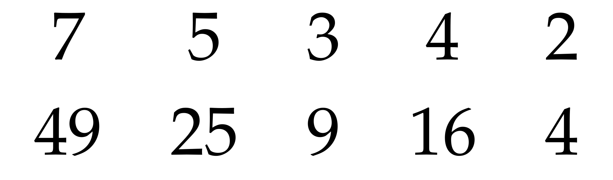

Behaviourist interpretation:

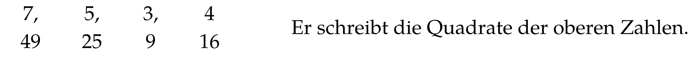

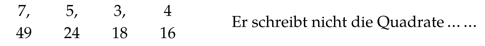

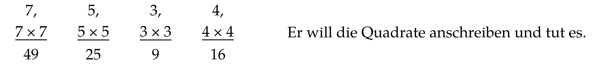

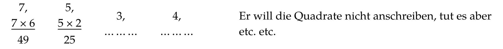

### [190\[4\]](https://cdn.wittgensteinnachlass.com/2000px/webp/Ts-211/190.webp)

The process of learning of course has something in common with the application of language. What the expression of the general rule has in common with its application.

### [191\[1\]](https://cdn.wittgensteinnachlass.com/2000px/webp/Ts-211/191.webp)

The order is the description of its execution.

### [191\[2\]](https://cdn.wittgensteinnachlass.com/2000px/webp/Ts-211/191.webp)

Do we not have here the essence of the motive as opposed to the cause? Obviously we do. When I obey the order, it becomes the motive for my way of acting.

### [191\[3\]](https://cdn.wittgensteinnachlass.com/2000px/webp/Ts-211/191.webp)

And the motive is not hypothetical. I cannot be mistaken about the motive; it is contained in my action, but its cause is not contained in it in this way.

### [191\[4\]](https://cdn.wittgensteinnachlass.com/2000px/webp/Ts-211/191.webp)

(Ogden and Richards’ and Russell’s theory of meaning thus rests on a confusion, or identification, of motive and cause.)

### [191\[5\]](https://cdn.wittgensteinnachlass.com/2000px/webp/Ts-211/191.webp)

Obeying the order consists in my doing something – – But can I also say ‘in my doing what it orders’? Is there a criterion for this being the action that obeys it?

### [191\[6\]](https://cdn.wittgensteinnachlass.com/2000px/webp/Ts-211/191.webp)

There is no criterion for this being the action that obeys the order.

### [191\[7\]](https://cdn.wittgensteinnachlass.com/2000px/webp/Ts-211/191.webp)

This must of course mean “we cannot speak of such a criterion”.

### [191\[8\]](https://cdn.wittgensteinnachlass.com/2000px/webp/Ts-211/191.webp),[192\[1\]](https://cdn.wittgensteinnachlass.com/2000px/webp/Ts-211/192.webp)

What we want, presumably, is to make clear the grammar of the expression “the order is obeyed”. “Yes, but how do I know, then, that I have obeyed the order?” ‒ ‒ (I cannot find the central grammatical error on which all these problems rest.) It is of course the same question as this: How do I know that this sentence describes this fact? And I always want to answer: “because, after all, I read it off this fact”. And: “surely I must know how I came by it”.

### [192\[2\]](https://cdn.wittgensteinnachlass.com/2000px/webp/Ts-211/192.webp)

If I could give a criterion, I must give it in language, and then I would have to be able to recognize it from the linguistic expression; but to recognize it I would in turn need the criterion itself.

### [192\[3\]](https://cdn.wittgensteinnachlass.com/2000px/webp/Ts-211/192.webp)

If I can choose words so that they fit the fact – in some sense or other – then I must already have had a concept of this fitting. And now the problem starts all over again, for how do I know that this state of affairs corresponds to the concept of fitting?

### [192\[4\]](https://cdn.wittgensteinnachlass.com/2000px/webp/Ts-211/192.webp)

But why, then, do I describe the fact in just _this way_? What made you say _these_ words?

### [192\[5\]](https://cdn.wittgensteinnachlass.com/2000px/webp/Ts-211/192.webp)

And if I were now to say: “all that happens is just that I look at these objects and then use these words”, the answer would be: “so describing consists in nothing more, and is it always a description if someone ‥‥‥?” And to that I would have to say: “No. It’s just that I can’t describe the process differently, or at least not with a different multiplicity, except by saying: ‘I describe what I see’; and that is _why_ no further explanation is possible, because my sentence already has the _right_ multiplicity.”

### [192\[6\]](https://cdn.wittgensteinnachlass.com/2000px/webp/Ts-211/192.webp)

I could also ask it this way: Why do you ask for explanations? When these are given, you will be at an end again. They cannot take you any further than you are now.

### [192\[7\]](https://cdn.wittgensteinnachlass.com/2000px/webp/Ts-211/192.webp)

In the end we have to use language without explanation.

### [193\[1\]](https://cdn.wittgensteinnachlass.com/2000px/webp/Ts-211/193.webp)

Explaining sewing or smoking as opposed to explaining translating. In the former case the explanation always gives a description other than that of what is immediately perceived. The person had a concept of sewing or smoking before it was explained to him. And after the explanation he knows _more_ about it than before. But the explanation of thinking that we demand is _supposed_ not to tell us more about it than we know. That is why he can ask for an explanation of smoking. And the answer cannot be the description of what he understands by “smoking”, but the description of a different process.

### [193\[2\]](https://cdn.wittgensteinnachlass.com/2000px/webp/Ts-211/193.webp)

(I can never say: “for these reasons it _must_ be _this way_”. For what is not manifest _does not exist for me._)

### [193\[3\]](https://cdn.wittgensteinnachlass.com/2000px/webp/Ts-211/193.webp)

The trivial thing I have to say is that, in answer to the sentence “I don’t just _say_ that, I mean something by it” and the question “what?”, there _stands_ a further sentence, in signs of some sort.

### [193\[4\]](https://cdn.wittgensteinnachlass.com/2000px/webp/Ts-211/193.webp)

(I can only hand over the keys; each person must unlock for himself.)

### [193\[5\]](https://cdn.wittgensteinnachlass.com/2000px/webp/Ts-211/193.webp)

But surely I can also ask: What does a sunset look like? Even if I disregard everything hypothetical. And in this way I can of course describe thinking too, for I can describe speaking too, after all.

### [193\[6\]](https://cdn.wittgensteinnachlass.com/2000px/webp/Ts-211/193.webp),[194\[1\]](https://cdn.wittgensteinnachlass.com/2000px/webp/Ts-211/194.webp)

“I don’t just say that, I also mean something by it”. – If one considers what happens within us when we _mean_ words (and not just say them), it seems as if something is then coupled with these words, whereas otherwise they run empty. – As if they, as it were, intervened in us.

### [194\[2\]](https://cdn.wittgensteinnachlass.com/2000px/webp/Ts-211/194.webp)

No one can teach us to know our visual space better. But we can learn to survey its representation in language.

### [194\[3\]](https://cdn.wittgensteinnachlass.com/2000px/webp/Ts-211/194.webp)

If I am right, then philosophical problems, unlike all others, really must admit of solutions that leave nothing over.

### [194\[4\]](https://cdn.wittgensteinnachlass.com/2000px/webp/Ts-211/194.webp)

When I say: Here we are at the limit of language, it always seems as though resignation were called for here, whereas on the contrary one is fully satisfied, since _no_ question remains.

### [194\[5\]](https://cdn.wittgensteinnachlass.com/2000px/webp/Ts-211/194.webp)

The problems are dissolved in the literal sense – like a lump of sugar in water.

### [194\[6\]](https://cdn.wittgensteinnachlass.com/2000px/webp/Ts-211/194.webp)

The ‘explanation of thinking’ would have to be able to explain what thinking is to someone who does not know.

So it would also have to be able to show someone who had not done it before how to do it. And all this by means of thought.

### [194\[7\]](https://cdn.wittgensteinnachlass.com/2000px/webp/Ts-211/194.webp)

In so far as every activity (writing, speaking, sewing, smoking) can be described and taught, thinking is not an activity. No more than getting annoyed is, which is just as little amenable to being taught. (My remark about ‘no subject in thinking’. No activity without an agent.)

### [194\[8\]](https://cdn.wittgensteinnachlass.com/2000px/webp/Ts-211/194.webp)

*O*ur interest in what is psychological about thinking is cancelled by the fact that we are interested only in the relation of thinking to itself, and what is psychological thereby drops out, cancels itself out.

### [195\[1\]](https://cdn.wittgensteinnachlass.com/2000px/webp/Ts-211/195.webp)

But now if I _consider_ the word “is”: How can I distinguish two different ways of applying it here if I look only at the grammatical rules? For these are precisely what allow _the use_ of the word in the contexts “the rose is red” and “twice two is four”. From _these_ rules I do not see that we are dealing with two different words. – But I see it, for instance, if I try to put “is equal to” in place of “is” in both sentences (or the expression “has the property”). But here again only because I know the rule for the expression “is equal to”, that it must not be inserted in “the rose ‥․ rot”.

### [195\[2\]](https://cdn.wittgensteinnachlass.com/2000px/webp/Ts-211/195.webp)

More generally: what do the grammatical rules apply to when they apply to the word “is”? To the sound that I utter then and there? To what all “is”-sounds have in common? They apply to “is” when it is used in this sense. – “If you apply it _like that_, then you are simply not using it in _this_ sense”.

### [195\[3\]](https://cdn.wittgensteinnachlass.com/2000px/webp/Ts-211/195.webp)

For the question is: is everything I am doing here not mythology? Am I not inventing something to add to what is manifest? That is, when I speak of the process that goes on in understanding (uttering or hearing with understanding) the sentence.

### [195\[4\]](https://cdn.wittgensteinnachlass.com/2000px/webp/Ts-211/195.webp)

I.e., could I not regard language as a social institution subject to certain rules because it would not be effective otherwise. But this is the point: I cannot say the latter; even in this way I cannot give a justification for the rules. I could only describe language as a game that people play.

### [196\[1\]](https://cdn.wittgensteinnachlass.com/2000px/webp/Ts-211/196.webp)

If I refuse to use a word, e.g. the word ‘is equal to’, in two contexts, the reason is what we describe in the words “the word has a different meaning in the two cases”.

### [196\[2\]](https://cdn.wittgensteinnachlass.com/2000px/webp/Ts-211/196.webp)

But can I now describe what the grammatical rules say about a word in another way as well, namely by describing the process that takes place when we understand the word?

### [196\[3\]](https://cdn.wittgensteinnachlass.com/2000px/webp/Ts-211/196.webp)

So if grammar is – for instance – the geometry of negation, can I replace it with a description of what, so to speak, stands behind the word ‘not’ when it is used?

### [196\[4\]](https://cdn.wittgensteinnachlass.com/2000px/webp/Ts-211/196.webp)

But such a description would, as I said, be a substitute for the word ‘not’, rather like 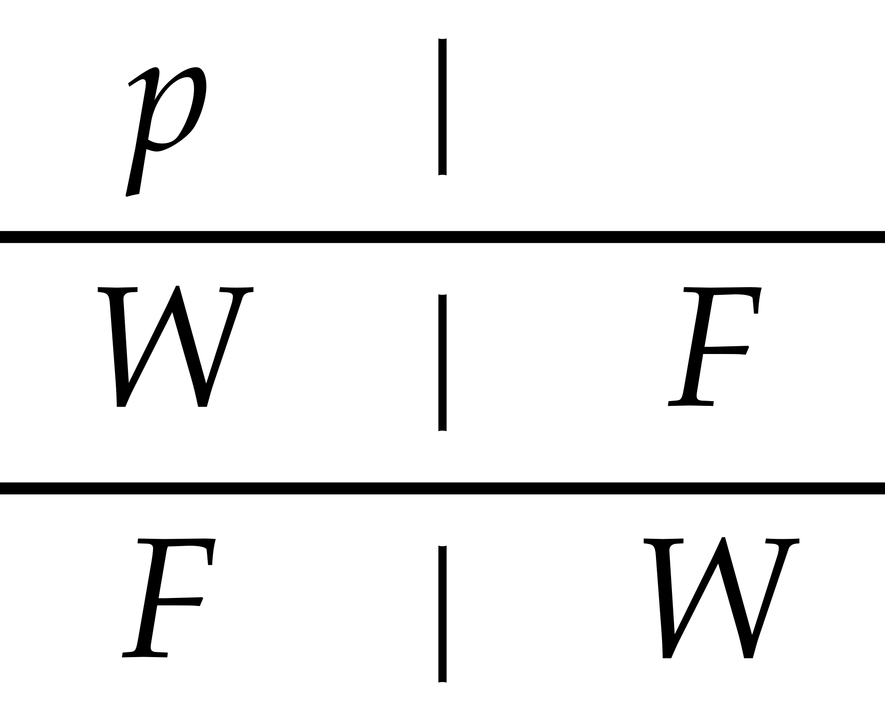 and could not replace the grammar.

### [196\[5\]](https://cdn.wittgensteinnachlass.com/2000px/webp/Ts-211/196.webp)

In my representation, after all, the grammatical rules seemed to be the laying out of what I experience all at once in using the word. So to speak, (_only_) consequences, manifestations, of the properties that I _experience_ all at once in understanding. This must of course be nonsense.

### [196\[6\]](https://cdn.wittgensteinnachlass.com/2000px/webp/Ts-211/196.webp)

One would go so far as to say: negation has the property of yielding an affirmation when doubled. (Rather like: iron has the property of yielding iron sulphate with sulphuric acid.) Whereas the rule does not further _describe,_ but rather constitutes, negation.

### [196\[7\]](https://cdn.wittgensteinnachlass.com/2000px/webp/Ts-211/196.webp),[197\[1\]](https://cdn.wittgensteinnachlass.com/2000px/webp/Ts-211/197.webp)

By using this word in accordance with this rule, substituting that for it, etc., we show how we mean it.

### [197\[2\]](https://cdn.wittgensteinnachlass.com/2000px/webp/Ts-211/197.webp)

The word ‘not’ in the grammatical rule has no meaning, otherwise _that_ could not be said of it.

### [197\[3\]](https://cdn.wittgensteinnachlass.com/2000px/webp/Ts-211/197.webp)

Negation has no property other than, for instance, that of yielding truth in certain sentences. And likewise a circle has the property of being situated here or there, of having this colour, of _actually_ being intersected by a straight line; but not what geometry seems to ascribe to it. (Namely, being able to have these properties.)

### [197\[4\]](https://cdn.wittgensteinnachlass.com/2000px/webp/Ts-211/197.webp)

What does it mean to say: “This paper is not black, and ‘not’ is used here in the sense that a triple negation yields a negation”? How, then, did that show itself in the use? Or: “This paper is not black, and two of these negations give an affirmation”. Can I say that? Or: “This book is red and the rose is red and the two words ‘red’ have the same meaning”. (This sentence is of the same kind as the two above.) What kind of sentence is that, then? a grammatical one? Does it say anything about the book and the rose? If the addition is not needed for understanding the first sentence, it is nonsense, and if it is needed, then the first part was not yet a sentence; and the same holds in the cases above.

### [197\[5\]](https://cdn.wittgensteinnachlass.com/2000px/webp/Ts-211/197.webp)

“That 3 negations again yield a negation must surely already lie in the one negation that I am now using”. But am I not already interpreting again here? (I.e. am I not about to invent a mythology?)

### [198\[1\]](https://cdn.wittgensteinnachlass.com/2000px/webp/Ts-211/198.webp)

But are the grammatical rules not just rules for passing from one sentence to another?

### [198\[2\]](https://cdn.wittgensteinnachlass.com/2000px/webp/Ts-211/198.webp)

In what respect can one say: “this rule applies to _this_ negation”?

### [198\[3\]](https://cdn.wittgensteinnachlass.com/2000px/webp/Ts-211/198.webp)

Does it mean anything to say that three _such_ negations yield a negation? (It always reminds one of “three such horses can move this carriage”.) But, as I said, that logical sentence is not about negation at all (only sentences like: it is not raining are about negation) but only about the word ‘not’, and it is a rule about replacing one sign with another.

### [198\[4\]](https://cdn.wittgensteinnachlass.com/2000px/webp/Ts-211/198.webp)

But can we not see the warrant for this rule if we understand negation? Is it not a consequence of the essence of negation? It is not a consequence, but an expression of this essence.

### [198\[5\]](https://cdn.wittgensteinnachlass.com/2000px/webp/Ts-211/198.webp)

What we see when we see that a double negation etc. ‥‥․, must be of the same kind as what we perceive in the sign

.

### [198\[6\]](https://cdn.wittgensteinnachlass.com/2000px/webp/Ts-211/198.webp)

When I see a three-dimensional configuration, say a cube, I see in a certain sense the possibility of adding cubes of the same size to this cube in three directions. Geometry then tells me that I _can_ do this. If I see a square, I do not see this possibility etc.

### [198\[7\]](https://cdn.wittgensteinnachlass.com/2000px/webp/Ts-211/198.webp)

(The perspective drawing of a cube and of such groups of cubes is a splendid example of how one can map three-dimensional space onto the plane.)

### [199\[1\]](https://cdn.wittgensteinnachlass.com/2000px/webp/Ts-211/199.webp)

But geometry speaks of cubes just as little as logic speaks of negation. (One might perhaps object here that geometry deals with the concept of the cube and logic with the concept of negation. But there are no such concepts.)

### [199\[2\]](https://cdn.wittgensteinnachlass.com/2000px/webp/Ts-211/199.webp)

A cube – I mean what is essential to the cube – is not something one can describe. But can I not describe how one makes a box, for example? and is a description of the cube not thereby _given_? What is essential to the cube is not described thereby; rather, it lies in the possibility of this description, i.e. in its being a description; not in its being correct.

### [199\[3\]](https://cdn.wittgensteinnachlass.com/2000px/webp/Ts-211/199.webp)

But surely I can say: “I see the figure as 3-dimensional”. But this sentence corresponds to the description of a box. It describes a particular cube, not the cubical form. Of course I can define the word “cubical form”. I.e. give signs that _can_ replace it.

### [199\[4\]](https://cdn.wittgensteinnachlass.com/2000px/webp/Ts-211/199.webp)

One cannot describe a geometrical figure. Nor does the equation describe it; rather, it stands for it by virtue of the rules that apply to the equation.

### [199\[5\]](https://cdn.wittgensteinnachlass.com/2000px/webp/Ts-211/199.webp)

And have we not applied the word “figure” here as we have so often applied the word “thought” or “symbol” in our investigations? The kind of application of this word of which I said that in such a case it did not mean a phenomenon but was, as it were, an incomplete _sign_ and corresponded precisely to a _function._

### [199\[6\]](https://cdn.wittgensteinnachlass.com/2000px/webp/Ts-211/199.webp),[200\[1\]](https://cdn.wittgensteinnachlass.com/2000px/webp/Ts-211/200.webp)

Nor can one say that the cubical form has the property of having all its faces equal. A wooden block, by contrast, does have this property. (Nor can one say that “the number one has the property of yielding two when added to itself”.)

### [200\[2\]](https://cdn.wittgensteinnachlass.com/2000px/webp/Ts-211/200.webp)

I did say: It seemed as though the grammatical rules were the ‘consequences in time’ of what we perceive in an instant when we understand a negation. And so as though there were two representations of the essence of negation: the act (say, the mental act) of negation itself, and its reflection in the system of grammar.

### [200\[3\]](https://cdn.wittgensteinnachlass.com/2000px/webp/Ts-211/200.webp)

One is tempted to say: surely the shape of a cube is represented both by the grammar of the word “cube” and by a cube .

### [200\[4\]](https://cdn.wittgensteinnachlass.com/2000px/webp/Ts-211/200.webp)

In “non-p & (non-non-p = p)” the second part can only be a rule of the game.

### [200\[5\]](https://cdn.wittgensteinnachlass.com/2000px/webp/Ts-211/200.webp)

It looks as though one could _infer_ from the meaning of negation that p is what non-non-p _means._

### [200\[6\]](https://cdn.wittgensteinnachlass.com/2000px/webp/Ts-211/200.webp)

As though the rules for the negation sign _followed_ from the nature of negation. So that, in a certain sense, negation would be there first and the rules of grammar would come afterwards.

### [200\[7\]](https://cdn.wittgensteinnachlass.com/2000px/webp/Ts-211/200.webp),[201\[1\]](https://cdn.wittgensteinnachlass.com/2000px/webp/Ts-211/201.webp)

So it is as though the essence of negation had a twofold expression in language: what I see when I understand negation, and the consequences of this essence in grammar. On the other hand, it is clear that if the rules arise from the essence of negation, they do not follow (_as_) from a rule, a sentence. And if they did, that very sentence would be the actual rule that mattered to us.

### [201\[2\]](https://cdn.wittgensteinnachlass.com/2000px/webp/Ts-211/201.webp)

So what I want to say is: the rules do not _follow_ from the essence of negation, but express it.

### [201\[3\]](https://cdn.wittgensteinnachlass.com/2000px/webp/Ts-211/201.webp)

(I can, _so to speak_, read the rules for negation off negation itself. But this seems precisely to say that they are already written down somewhere else, namely in negation. What I read them off must have the same multiplicity as they themselves have.)

### [201\[4\]](https://cdn.wittgensteinnachlass.com/2000px/webp/Ts-211/201.webp)

Is this not like the way I can read geometrical propositions off a figure?

### [201\[5\]](https://cdn.wittgensteinnachlass.com/2000px/webp/Ts-211/201.webp)

Instead of considering negation, I could consider an arrow and say, for example: if I turn it twice through 180˚, it points in the same direction again; a sentence which corresponds to non-non-p = p. Now what about the representation of the essence of this arrow by language? Surely that sentence must be derived directly from this essence and thus represent it. Or take the case of a square and a rectangle, and the sentences that the square can be made to coincide with itself by a quarter-turn; the rectangle, however, only by a half-turn. Evidently I read them off the square and the rectangle. But what kind of sentences are these anyway? If they were about particular square or rectangular _pieces_, they would be hypotheses. Here, however, they are geometrical propositions.

### [202\[1\]](https://cdn.wittgensteinnachlass.com/2000px/webp/Ts-211/202.webp)

To say that a quarter-turn makes a square coincide with itself plainly means nothing other than: the square is symmetrical about two axes perpendicular to one another, and this in turn means that it makes sense to speak of two perpendicular axes, whether they are there or not. This is a sentence of grammar.

### [202\[2\]](https://cdn.wittgensteinnachlass.com/2000px/webp/Ts-211/202.webp)

The difficulty again is that it seems as though a sentence containing, for example, the word ‘square’ already contained the shadow of another sentence with this word. – Namely, the very _possibility_ of forming that other sentence, which, as I said, lies in the _sense of the word_ ‘square’.

### [202\[3\]](https://cdn.wittgensteinnachlass.com/2000px/webp/Ts-211/202.webp)

And yet one can only say that the other sentence is not uttered along with this one, not even in shadowy form. (And may never be uttered.)

### [202\[4\]](https://cdn.wittgensteinnachlass.com/2000px/webp/Ts-211/202.webp)

But surely it has already been uttered when I say “_it_ can be uttered”.

### [202\[5\]](https://cdn.wittgensteinnachlass.com/2000px/webp/Ts-211/202.webp)

Grammar says, for example: this is how the word ‘square’ is used. But surely that must already lie in the _one_ use of this word! But what does it mean to say: it _must_ lie in it? Does it mean anything other than that I must be able to state the rules for the word even after this one use? That I can say: “No, that is not how I _used_ it, not in the sense in which I could say ‥‥‥ but in the sense ‥‥‥”.

### [202\[6\]](https://cdn.wittgensteinnachlass.com/2000px/webp/Ts-211/202.webp),[203\[1\]](https://cdn.wittgensteinnachlass.com/2000px/webp/Ts-211/203.webp)

One could also _put_ my problem like this: “How can that explanation (which I once learnt) refer to _this_ word (which I just uttered)?”

### [203\[2\]](https://cdn.wittgensteinnachlass.com/2000px/webp/Ts-211/203.webp)

Let us remember that one need never utter the rules of grammar and can still use the language. (Human language certainly existed before anyone uttered grammatical rules, and a child learns the language without such rules, and savages have no grammar. That does not mean, of course, that their language follows no grammatical rules; they simply do not utter these rules.)

### [203\[3\]](https://cdn.wittgensteinnachlass.com/2000px/webp/Ts-211/203.webp)

That a word has meaning only in a sentence means nothing other than that it has its function only in a sentence. On its own it may well evoke a mental image, but this is not its meaning, nor is it the function of a word to call up a particular mental image.

### [203\[4\]](https://cdn.wittgensteinnachlass.com/2000px/webp/Ts-211/203.webp)

It might now be objected that I could interchange the meanings of, for example, the words ‘blue’ and ‘red’, and that this would make sentences that were formerly true now false (and vice versa), but would not make any sentence that formerly had sense now nonsensical (and vice versa). That is true. But it leaves out of account that sentences such as “that has this colour” also belong to our language, and that grammar must then tell me that this sentence means the same as “that is red”.

### [203\[5\]](https://cdn.wittgensteinnachlass.com/2000px/webp/Ts-211/203.webp)

The question is simply: What kind of sentence is this: “the word ‘is’ in ‘the rose is red’ is the same as in ‘the book is red’, but not the same as in ‘twice two is four’”? One cannot answer that it means different rules apply to the two words, for that is to go round in a circle. But it does mean that the word in its different combinations can be replaced by two _signs_ which cannot be substituted for one another. If, on the other hand, I replace the word in the first two sentences by two different words, I can substitute them for one another.

### [204\[1\]](https://cdn.wittgensteinnachlass.com/2000px/webp/Ts-211/204.webp)

Now I could ask again: are these rules only a _consequence_ of what _comes first_: that in the one case the two words ‘is’ have the same meaning, and in the other case they do not? Or is this rule precisely the linguistic expression of the fact that the words mean the same thing?

### [204\[2\]](https://cdn.wittgensteinnachlass.com/2000px/webp/Ts-211/204.webp)

I want to compare it to the word ‘is’ having a different word-body behind it. To its being the same face both times, but belonging to a different body, as when I see a triangle in the foreground which in one case is the end face of a prism, in the other of a tetrahedron.

### [204\[3\]](https://cdn.wittgensteinnachlass.com/2000px/webp/Ts-211/204.webp)

Or let us imagine this case: we have glass cubes, each with one face coloured red. If we place them in a row, only one quite particular arrangement of red squares can arise in space, determined by the cubical form of the bodies. Now I could _state_ the rule according to which red squares can be arranged here without even mentioning the cubes, yet the essence of the cubical form would already be settled by it. Not, of course, that we have cubes made of glass, but certainly the geometry of the cube.

### [204\[4\]](https://cdn.wittgensteinnachlass.com/2000px/webp/Ts-211/204.webp)

But when we _see_ such a cube, are all the laws of possible arrangement truly already given _thereby_?! That is, the whole geometry? Can I read the geometry of the cube off a cube?

### [204\[5\]](https://cdn.wittgensteinnachlass.com/2000px/webp/Ts-211/204.webp)

The cube is then a notation of the rule. And if we had found such a rule, we really could not notate it better than by means of a drawing of a cube (and the fact that a drawing suffices here is again immensely important).

### [205\[1\]](https://cdn.wittgensteinnachlass.com/2000px/webp/Ts-211/205.webp)

And now the question is: how far can the cube or the drawing (for the two come to the same thing here) serve as a notation for the geometrical rules?

### [205\[2\]](https://cdn.wittgensteinnachlass.com/2000px/webp/Ts-211/205.webp)

But even then, only in so far as it belongs to a system: that is, the cube with its one red end face will notate something different from a pyramid with a square red base, etc. I.e., it will notate that feature of the rules in which, for example, the cube differs from the pyramid.

### [205\[3\]](https://cdn.wittgensteinnachlass.com/2000px/webp/Ts-211/205.webp)

And this brings me back to the point that every explanation of a sign ought to be able to serve in place of the sign. I.e., if I build up a sign, as it were, by means of explanations, then the building up must be equivalent to the result of building it up. (Since it is never a matter of (_different_) attributes.)

### [205\[4\]](https://cdn.wittgensteinnachlass.com/2000px/webp/Ts-211/205.webp)

“It already lies in the act of negation that, when doubled, it cancels itself out”. What already ‘lies in it’ can only ever be _expressed_ by a rule, because one cannot express it in so far as it lies in it, but only _in detachment._ That is why ‘non’ in “non-non-p = p” is not a negation.

### [205\[5\]](https://cdn.wittgensteinnachlass.com/2000px/webp/Ts-211/205.webp)

The only correlate, in language, to a natural necessity is an arbitrary rule. It is the only thing that can be extracted from this necessity into sentences.

### [205\[6\]](https://cdn.wittgensteinnachlass.com/2000px/webp/Ts-211/205.webp),[206\[1\]](https://cdn.wittgensteinnachlass.com/2000px/webp/Ts-211/206.webp)

“Surely I don’t merely say these words; I also mean something by them”. If, for example, I say “You may not come in”, the natural act to accompany these words is to stand in front of the door and hold it shut. But it would not so _obviously_ be natural for me to open it for him as I said these words. These words, as they are understood here, evidently have something to do with that act. The act is, so to speak, an illustration of them – it would have to be possible to take it as language. On the other hand, it is also the act that, _apart_ from any symbolism, I _by my very nature want to perform_.

### [206\[2\]](https://cdn.wittgensteinnachlass.com/2000px/webp/Ts-211/206.webp)

The grammatical rule mirrors in language the way we follow the negation.

### [206\[3\]](https://cdn.wittgensteinnachlass.com/2000px/webp/Ts-211/206.webp)

The way I carry out an order presumably shows how I understand it. But the link between carrying it out and the order is the invisible (glass) body of the symbol, which is made visible in the rules of language.

### [206\[4\]](https://cdn.wittgensteinnachlass.com/2000px/webp/Ts-211/206.webp)

Every sign of negation is equivalent to every other, for “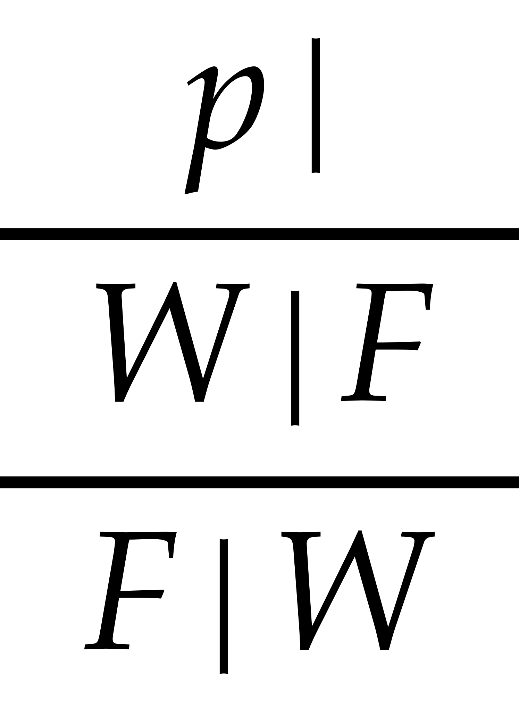” is just as much a complex of strokes as the word “not”, and it becomes negation only through the way it ‘_works_’. But what is meant here is not its effect in the psychological sense (so the word ‘effect’ is not used causally), but the _form of its effect_.

### [206\[5\]](https://cdn.wittgensteinnachlass.com/2000px/webp/Ts-211/206.webp)

I would like to say: the sign works only dynamically, not statically. Thought is dynamic.

### [206\[6\]](https://cdn.wittgensteinnachlass.com/2000px/webp/Ts-211/206.webp)

If I translate negation, surely I must make use of its geometrical properties.

### [206\[7\]](https://cdn.wittgensteinnachlass.com/2000px/webp/Ts-211/206.webp),[207\[1\]](https://cdn.wittgensteinnachlass.com/2000px/webp/Ts-211/207.webp)

Anyone who reads and understands a sentence sees the words in different ways, although their appearance and sound do not differ in kind. We quite forgot that ‘not’ and ‘table’ and ‘green’, considered as sounds or written forms, do not differ essentially from one another, and see this clearly only in a language foreign to us.

### [207\[2\]](https://cdn.wittgensteinnachlass.com/2000px/webp/Ts-211/207.webp)

The words evidently have quite different functions in the sentence. And these functions _seem_ to be _ex-_ expressed in the rules that apply to the words.

### [207\[3\]](https://cdn.wittgensteinnachlass.com/2000px/webp/Ts-211/207.webp)

One need only think what it means for a word to _refer_ to this part of the sentence!

### [207\[4\]](https://cdn.wittgensteinnachlass.com/2000px/webp/Ts-211/207.webp)

(When reading scrawled handwriting, one can recognize what it means to see something in the given picture. Think of puzzle pictures. A complex of strokes is _suddenly_ recognized and seen as an upside-down picture of a man.)

### [207\[5\]](https://cdn.wittgensteinnachlass.com/2000px/webp/Ts-211/207.webp)

When one reads a clock, one sees a _complex_ of strokes, patches, etc., but in a quite particular way if one wants to _take_ it as a clock and its hands.

### [207\[6\]](https://cdn.wittgensteinnachlass.com/2000px/webp/Ts-211/207.webp)

The ‘Not’ makes a gesture of warding off.

### [207\[7\]](https://cdn.wittgensteinnachlass.com/2000px/webp/Ts-211/207.webp)

(Every ethical justification of an action must appeal to the man to whom I justify it.)

### [207\[8\]](https://cdn.wittgensteinnachlass.com/2000px/webp/Ts-211/207.webp),[208\[1\]](https://cdn.wittgensteinnachlass.com/2000px/webp/Ts-211/208.webp)

Understanding negation is seeing its gesture of warding off.

### [208\[2\]](https://cdn.wittgensteinnachlass.com/2000px/webp/Ts-211/208.webp)

Or: Understanding negation is the same as understanding a gesture of warding off. And what I said above about ‘static’ and ‘dynamic’ applies in full to this gesture too.

### [208\[3\]](https://cdn.wittgensteinnachlass.com/2000px/webp/Ts-211/208.webp)

We can say: I can imagine perceiving this gesture and not feeling it to be ‘warding off’. For the mere outstretched hand and the body leaning back are no more warding anything off than an armchair or a water jug. I should like to say: it is the effect of the movement on me that makes it a warding off. But it is not the effect, for I would not _know_ its cause, and I would not call a medicine that had the same effect (whatever it might be) a warding off. It is, as I put it earlier, ‘the way I see this movement’. But that would again be static. I think it is that something definite in me is guided by this movement. But what in this assertion is mere hypothesis (mythology)?

### [208\[4\]](https://cdn.wittgensteinnachlass.com/2000px/webp/Ts-211/208.webp)

And now I want to say: it is not because of the particular movement that it is not in and of itself a gesture of warding off; rather, a movement is in itself no gesture at all. Nor, of course, is it because it is not a resting attitude but a movement, for the movement is in itself, in my sense, just as ‘static’ as the resting position.

### [209\[1\]](https://cdn.wittgensteinnachlass.com/2000px/webp/Ts-211/209.webp)

Gesture-language is a _language_ and we have not – in the ordinary sense – learnt it. That is: it was not (_intentionally,_) deliberately taught to us. And yet we have learnt it. –

### [209\[2\]](https://cdn.wittgensteinnachlass.com/2000px/webp/Ts-211/209.webp)

We understand Chinese gestures as little as we understand Chinese sentences.

### [209\[3\]](https://cdn.wittgensteinnachlass.com/2000px/webp/Ts-211/209.webp)

One could imagine learning a language by analogy with hunting the thimble, where the desired movement is brought about by “hot, hot”, “cold, cold”. One could imagine that instead of using these words the teacher elicits pleasant and unpleasant sensations in some way (by facial expressions, say), and that the learner is then brought to perform, on command, _the_ movement which is regularly accompanied by the pleasant sensation (or leads to it). We could imagine him being trained in this way to react to certain signs in a particular way. (And this is how training really takes place.)

### [209\[4\]](https://cdn.wittgensteinnachlass.com/2000px/webp/Ts-211/209.webp)

Now if we had learnt to follow the signs in this way, things would stand as follows: we would observe that in response to certain movements and words of the other person we make certain movements reflexively, and would explain this after the event by saying that these movements had once helped us to obtain pleasant sensations. This explanation would stand to our actions as the Darwinian explanation of frowning – in terms of a certain benefit it is supposed to have brought our animal ancestors – stands to the act of frowning, which now has no relation to that purpose. The explanation would be hypothetical and would concern the cause of the action, not the motive.

### [210\[1\]](https://cdn.wittgensteinnachlass.com/2000px/webp/Ts-211/210.webp)

It is very strange: we would like to explain understanding a gesture by translating it into words, and understanding words by means of gestures corresponding to them.

### [210\[2\]](https://cdn.wittgensteinnachlass.com/2000px/webp/Ts-211/210.webp)

And indeed we do explain words by a gesture and a gesture by words.

### [210\[3\]](https://cdn.wittgensteinnachlass.com/2000px/webp/Ts-211/210.webp)

Depicting (imitating) essentially involves a certain readiness – receptiveness, a readiness to let oneself be guided, to follow the model, to be the function for which the model _will be_ the argument. And indeed the expression of this is that I am, as it were, x² or ( )², and if the model is now 5, the result is 5² “of itself”. (Keeping oneself undetermined for the model, _and_ letting oneself be determined by it.)

### [210\[4\]](https://cdn.wittgensteinnachlass.com/2000px/webp/Ts-211/210.webp)

Now if I was x² and along comes 5, it would _now_ have to follow from that alone that I become 5². And in one sense this is the case and in another it is not. It is not the case in this sense: that I cannot show an action to be the carrying out of an order by comparing the action with the order. And it is the case in the sense in which I can justify the action by checking it against the order.

### [210\[5\]](https://cdn.wittgensteinnachlass.com/2000px/webp/Ts-211/210.webp),[211\[1\]](https://cdn.wittgensteinnachlass.com/2000px/webp/Ts-211/211.webp)

I am x², now along comes 5 and I become 5². Now I can justify 5² by means of 5 and x² in one sense, but not in another. And I should like to say: in so far as I cannot justify it, there is no sense in using the word “justify”.

### [211\[2\]](https://cdn.wittgensteinnachlass.com/2000px/webp/Ts-211/211.webp)

I can justify 5² by means of x² if in doing so I contrast x² with x³ or some other sign in the system.

### [211\[3\]](https://cdn.wittgensteinnachlass.com/2000px/webp/Ts-211/211.webp)

The difficulty is evidently not to try to justify what _admits_ of no justification.

### [211\[4\]](https://cdn.wittgensteinnachlass.com/2000px/webp/Ts-211/211.webp)

If one asks: “why are you writing 5²?” and I answer “it says right there that I am to square it”, then that is a justification – and a _full_ one –. To demand a justification in a sense in which this is not one is senseless.

### [211\[5\]](https://cdn.wittgensteinnachlass.com/2000px/webp/Ts-211/211.webp)

Suppose I had given someone all sorts of explanations of what the order “square these numbers” _means._ (And all these explanations, after all, are signs.) Suppose he then squares them, and now I ask him “why do you do _that_ in response to this explanation?” Then it would make no sense to answer me: “But you told me: (the explanations are repeated)”. But no other kind of answer to this question is possible either, and the question simply _means_ nothing. To make sense it would have to go: “Why do you do _that_ and not this other thing in response to these explanations (after all, I told you ‥‥․)”.

### [211\[6\]](https://cdn.wittgensteinnachlass.com/2000px/webp/Ts-211/211.webp)

Now suppose one were to ask: How long before the application of the rule must the disposition “x²” have lasted? A second, or two? This question naturally sounds like a parody, and rightly so. We feel that this cannot matter at all. But this kind of question keeps _coming_ _up_.

### [211\[7\]](https://cdn.wittgensteinnachlass.com/2000px/webp/Ts-211/211.webp),[212\[1\]](https://cdn.wittgensteinnachlass.com/2000px/webp/Ts-211/212.webp)

“The way” I follow the rule, if this word is to have any sense at all, must be what is expressed by a further rule about the application of the first. If there is no such further rule, there is no _way_ of applying the first, but only its application. It is a way in contrast to another way.

### [212\[2\]](https://cdn.wittgensteinnachlass.com/2000px/webp/Ts-211/212.webp)

Why should I repeat the rule to myself before doing the squaring? For if I am _able_ to repeat it, I can just as well apply it straight away. Repeating the wording of the general rule would make sense only if I wanted to _highlight_ _it_ as against other rules. For the general sign of the rule does not work by magic, but has sense only in so far as it points to a place in a system.

### [212\[3\]](https://cdn.wittgensteinnachlass.com/2000px/webp/Ts-211/212.webp)

Could one then say: in order to be understood, the sign must enter as an argument into a function which characterizes precisely the space in which the sign then indicates the place as opposed to other places?

### [212\[4\]](https://cdn.wittgensteinnachlass.com/2000px/webp/Ts-211/212.webp)

That is why the sign cannot exist without grammar.

### [212\[5\]](https://cdn.wittgensteinnachlass.com/2000px/webp/Ts-211/212.webp)

That is, I cannot understand a gesture either unless I see it as a possibility in a particular space. And so there is also a grammar of gestures (namely their geometry).

### [212\[6\]](https://cdn.wittgensteinnachlass.com/2000px/webp/Ts-211/212.webp)

If I am to understand the gesture of the clock hand, I must take it as the one value of a particular variable. Grammar tells me the possible positions of the clock hand, i.e., _gives me this_ variable.

### [212\[7\]](https://cdn.wittgensteinnachlass.com/2000px/webp/Ts-211/212.webp)

(Now, I think, we also see why the thought seemed to us in a certain sense to need supplementing, to be incomplete.)

### [213\[1\]](https://cdn.wittgensteinnachlass.com/2000px/webp/Ts-211/213.webp)

One can add an explanation to a sign, say to an arrow intended to indicate a particular direction: as opposed to  or . And although this is not an exhaustive grammar, it does show that we can thereby hint at an explanation; that what is _hinted at_ in this explanation is somewhere understood along with the rest in the understanding.

### [213\[2\]](https://cdn.wittgensteinnachlass.com/2000px/webp/Ts-211/213.webp)

Depicting the segment a consists not in my putting the equally long a' beside it, but in a yielding a' when it is put into the general disposition. The general disposition is described by my saying: if a _had been_ twice as long, I _would have_ made a' twice as long too. etc.

### [213\[3\]](https://cdn.wittgensteinnachlass.com/2000px/webp/Ts-211/213.webp)

If one asks: “Why then must language have grammar? surely this must have something to do with its application”. Then I would have to say: Yes, for how else should I describe something, assign a sentence to a fact, if I could not choose what fits in a particular system, or – what comes to the same thing – choose _according to_ a particular system. _Otherwise_ the assignment would be arbitrary. And conversely, how should I follow a sign, assign a movement, an action, to it, if not according to a system.

### [213\[4\]](https://cdn.wittgensteinnachlass.com/2000px/webp/Ts-211/213.webp),[214\[1\]](https://cdn.wittgensteinnachlass.com/2000px/webp/Ts-211/214.webp)

If I follow the arrow  in moving the point P from A to B, then what happens here is described only by my describing the system of arrows to which this one belongs. – Now I might well say: Is that enough? Must I not also give the rule according to which the translation takes place, for instance here, that I am to move parallel to the arrow? But I can imagine this rule of translation appended to the arrow in the form of, say, the sign “!!∣∣” (as opposed, say, to “├–”); but then the sign “!!∣∣” would be on no different level from “!∣” and now I could still only describe the system to which this sign belongs, unless I want to add further signs to those above ad infinitum, _and hence fruitlessly_.

### [214\[2\]](https://cdn.wittgensteinnachlass.com/2000px/webp/Ts-211/214.webp)

The expression “in agreement with” (the arrow, for example) has no sense unless it refers to a system to which the arrow belongs.

### [214\[3\]](https://cdn.wittgensteinnachlass.com/2000px/webp/Ts-211/214.webp)

Let us imagine that chess had been invented not as a board game, but as a game to be played with digits and letters on paper, and in such a way that no one playing it had imagined a square with 64 squares, etc. But now suppose someone had discovered that this game corresponded exactly to one that could be played on a board in such and such a way. This invention would have made the game much easier to play (people who would formerly have found it too difficult could now play it). But it is clear that this new illustration of the rules of the game would only be a new, more readily surveyable symbolism, which, incidentally, would stand on the same footing as what was written. Now compare this with the talk about how physics today no longer works with mechanical models, but “only with symbols”.

### [214\[4\]](https://cdn.wittgensteinnachlass.com/2000px/webp/Ts-211/214.webp),[215\[1\]](https://cdn.wittgensteinnachlass.com/2000px/webp/Ts-211/215.webp)

If one asked: But would it not after all be possible to give an account of what happens in squaring 5 in 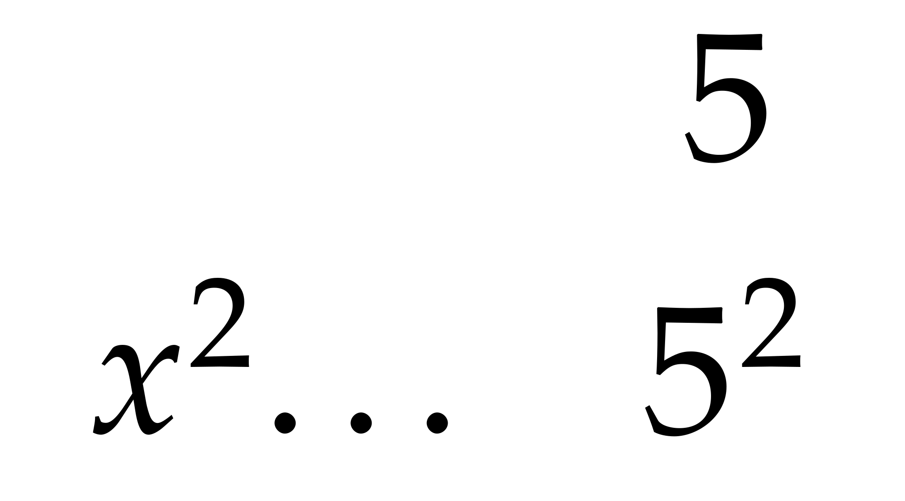 simply by saying that, influenced by the sign ‘x²’, I wrote ‘5²’ under ‘5’; then I must ask: but how do I know that it happened under the influence of ‘x²’? That is, after all, only a hypothesis, and one that cannot interest me at all here. So all I can say is that ‘x²’ was there _and_ that I wrote ‘5²’ under the ‘5’! And now it is clear that all I want to explain is precisely the “_because of that_”.

### [215\[2\]](https://cdn.wittgensteinnachlass.com/2000px/webp/Ts-211/215.webp)

Here we keep running into the awkward question whether the writing of ‘5²’ (for example) might not have taken place more or less (or entirely) automatically, and feel that this might be the case and that it is no concern of ours at all. That here we are on quite _irrelevant ground_ where we do not belong.

### [215\[3\]](https://cdn.wittgensteinnachlass.com/2000px/webp/Ts-211/215.webp)

For we should like to say: Insofar as the writing takes place automatically, it is no concern of ours, and no interpretation of a sign has taken place. – Only when I justify what I write down by means of a sign does this justification point to what is expressed in the rule of grammar.

### [215\[4\]](https://cdn.wittgensteinnachlass.com/2000px/webp/Ts-211/215.webp)

That is to say: Whenever I write x _because_ y is written here, this Because presupposes a rule.

### [215\[5\]](https://cdn.wittgensteinnachlass.com/2000px/webp/Ts-211/215.webp)

“I write ‘5²’ because it says ‘x²’ here”. But what if I said: “I write ‘+’ because it says ‘A’ here”? One would ask: Do you write ‘ + ’ wherever it says ‘A’? That is, one would ask for a general rule. And otherwise the ‘because’ in the last sentence would make no sense.

### [215\[6\]](https://cdn.wittgensteinnachlass.com/2000px/webp/Ts-211/215.webp)

Let us return to the clock hand: certainly we do not imagine the hand in different positions when we read off its present position (nor would that help us). And perhaps, when we say “it is 5 o’clock, I must go”, we say this and go automatically. But, like the drunk, I might just as well have looked at the matchbox and said “Thursday, I must go then”. And as far as cause and effect are concerned, I see no difference between the two cases.

### [215\[7\]](https://cdn.wittgensteinnachlass.com/2000px/webp/Ts-211/215.webp),[216\[1\]](https://cdn.wittgensteinnachlass.com/2000px/webp/Ts-211/216.webp)

So if someone says “5, – I must write ‘5²’ here”, it must be possible to write in addition: “because I must square every number _that comes my way_”, and this addition must add nothing to the fact.

### [216\[2\]](https://cdn.wittgensteinnachlass.com/2000px/webp/Ts-211/216.webp)

There can be no discussion about whether these rules or others are the correct ones for the word ‘not’. For the word does not yet have a meaning without these rules, and if we change the rules, it now has a different meaning (or none), and then we can just as well change the word too. These rules are therefore arbitrary, because it is the rules that make the sign in the first place.

### [216\[3\]](https://cdn.wittgensteinnachlass.com/2000px/webp/Ts-211/216.webp)

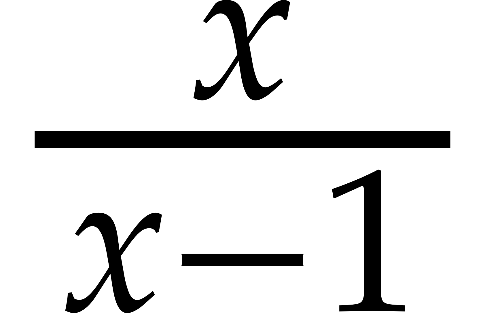 | [5 5 4]

I obtained 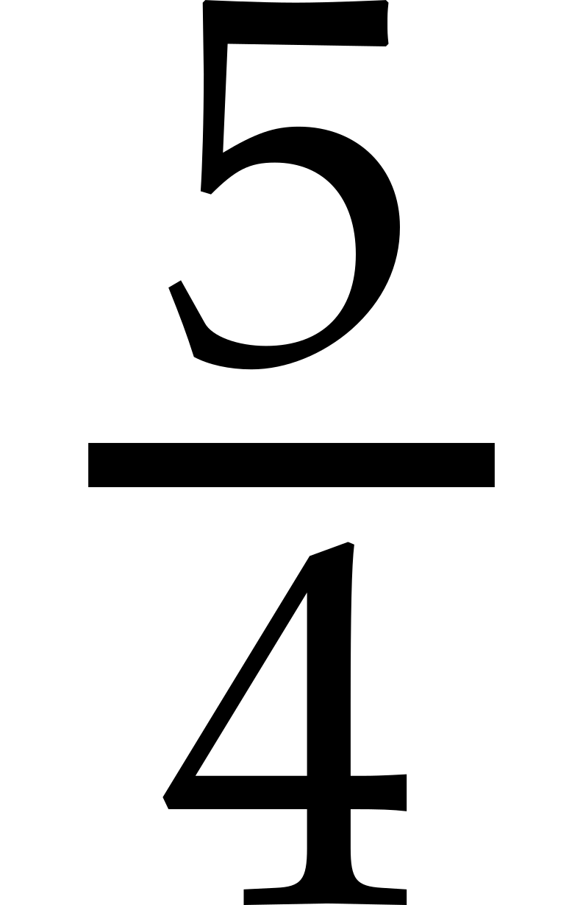 by means of the expression  in a certain

way. This way is what remains constant in

the cases 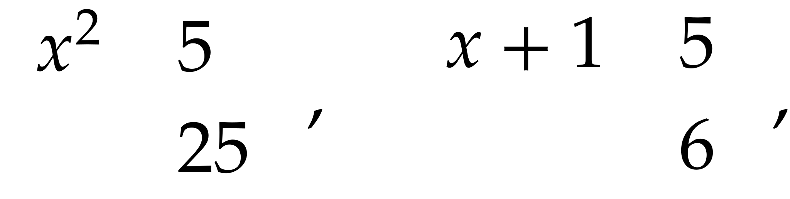 etc., and is thus given by the system of signs f(x). This way can be expressed by saying: in the expression f(x) I substitute 5 for x (substitute the number I am given). Does that not already determine the grammar of the sign “”, etc.?

### [216\[4\]](https://cdn.wittgensteinnachlass.com/2000px/webp/Ts-211/216.webp)

I use the sign “” to get from 5 to .

### [216\[5\]](https://cdn.wittgensteinnachlass.com/2000px/webp/Ts-211/216.webp)

The justification that I write ‘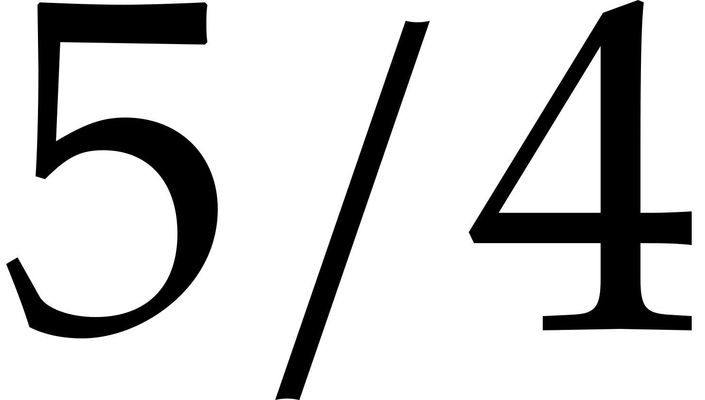’ _because_ it says ‘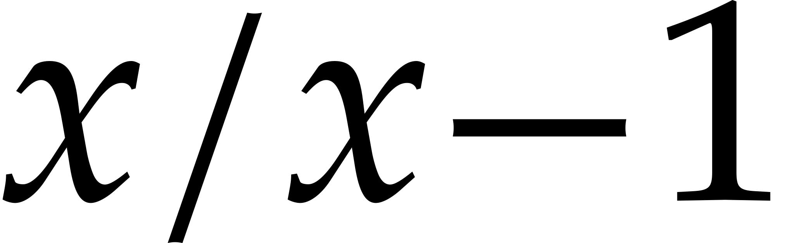’ there, of course, says nothing other than: “I _obtained_  _from_ ”. And here one can ask: “how?” and the answer must be a rule that does not relate only to the sign ‘’, for one would not need this sign if it stood alone. That a sign can guide me _in this way_ presupposes that it could also have guided me differently.

### [217\[1\]](https://cdn.wittgensteinnachlass.com/2000px/webp/Ts-211/217.webp)

One has to know what to look at in the sign. For instance: which numeral the hand is pointing to, not how long it is.

### [217\[2\]](https://cdn.wittgensteinnachlass.com/2000px/webp/Ts-211/217.webp)

“Go in the direction the pointer is pointing in”. “Go as many metres per second as the arrow is cm long”. “Take as many steps as I draw arrows”. “Copy this arrow”.

The same arrow can stand for each of these commands. – – –

### [217\[3\]](https://cdn.wittgensteinnachlass.com/2000px/webp/Ts-211/217.webp)

Is it like this: does taking the order as the motive for my action amount to knowing, while one acts, that one is thereby following the order or acting contrary to it?

### [217\[4\]](https://cdn.wittgensteinnachlass.com/2000px/webp/Ts-211/217.webp)

Someone shows me a clock for the first time and wants me to take it as my guide. I then ask: what should I pay attention to in this thing? And he says: to the position of the hands.

### [217\[5\]](https://cdn.wittgensteinnachlass.com/2000px/webp/Ts-211/217.webp)

“Follow the direction of the arrow”, that gives the whole grammar of the arrow. The word ‘direction’ is the variable that represents the space.

### [217\[6\]](https://cdn.wittgensteinnachlass.com/2000px/webp/Ts-211/217.webp)

“I must pay attention to the length”, “I must pay attention to the direction”, that already means: to the length as opposed to other things, etc.

### [217\[7\]](https://cdn.wittgensteinnachlass.com/2000px/webp/Ts-211/217.webp)

Now can one also _pay attention_ to the direction of the arrow without following that direction? (For this amounts to asking: can one understand without translating?)

### [217\[8\]](https://cdn.wittgensteinnachlass.com/2000px/webp/Ts-211/217.webp)

“Follow the arrow” makes no sense at all unless it is an abbreviation of a particular explanation (_out of_ several possible ones).

### [218\[1\]](https://cdn.wittgensteinnachlass.com/2000px/webp/Ts-211/218.webp)

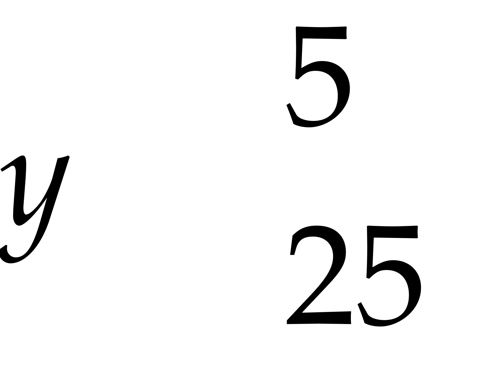 Why do you write 25? – Because it says ‘y’ there. – Well, is that the signal for 25? –

No, but I wrote ‘25’ because it says ‘y’ there. – Well, how do you know that is why you wrote it?

### [218\[2\]](https://cdn.wittgensteinnachlass.com/2000px/webp/Ts-211/218.webp)

But what does it mean? I am going to the door _because_ the order was “go to the door”? And how does this sentence compare with: I am going to the door although the order was “go to the door”. Or: I am going to the door, but not because the order was “go ‥․”, but ‥‥․. Or: I am _not_ going to the door because the order was “go to the door”.

### [218\[3\]](https://cdn.wittgensteinnachlass.com/2000px/webp/Ts-211/218.webp)

“I wish for his wish to be fulfilled”. By this I mean not only: I wish for what he wishes for; but also, I wish for his satisfaction.

### [218\[4\]](https://cdn.wittgensteinnachlass.com/2000px/webp/Ts-211/218.webp)

“How can the word ‘not’ negate?” Well, apart from negation by means of a sign, do we still have a concept of negation? Still, something comes to mind, such as: an obstacle, a gesture of warding off, exclusion. But all of that (_is_) always embodied in a sign, after all.

### [218\[5\]](https://cdn.wittgensteinnachlass.com/2000px/webp/Ts-211/218.webp)

How am I to take the clock as my guide? How can I take this picture  as my _guide_? (Just as with any other.)

### [218\[6\]](https://cdn.wittgensteinnachlass.com/2000px/webp/Ts-211/218.webp)

The position of the hands could of course also be explained to me as an independent signal, by my being told: “Keep looking at the clock from time to time, and when it looks like this, then ‥‥․”. That would be like: If you hear a trumpet signal, then ‥‥‥

### [219\[1\]](https://cdn.wittgensteinnachlass.com/2000px/webp/Ts-211/219.webp)

Incidentally, this means that I need not speak of a _general_ rule for a sign, for the rule can be: “If you hear ringing in half an hour, then ‥‥․” and apply only on this occasion. To be sure, there is a generality here too, since I have to take the exact time of the signal as my guide. But even that can be dispensed with if it says: “If it rings in exactly half an hour, then come; if it does not ring at that time, then do not”.

### [219\[2\]](https://cdn.wittgensteinnachlass.com/2000px/webp/Ts-211/219.webp)

If someone asks “how can the word ‘not’ negate”, one could ask in reply: How can the arrow  indicate a time (and it can, if we see it as the hour hand of a clock). But how can the expression “7 o’clock” indicate a (_time_)? And the sign ‘7’ (like all the digits from 0 to 9) is just such a signal, _about which one_ can wonder that it designates a number.

### [219\[3\]](https://cdn.wittgensteinnachlass.com/2000px/webp/Ts-211/219.webp)

“I must go now”. – “Why?” – “Because the arrow points in this direction”. – “(_So_) does the arrow show you the direction _in which_ you have to go?” – “No, it shows that it is 7 o’clock, and at 7 o’clock I must go”.

### [219\[4\]](https://cdn.wittgensteinnachlass.com/2000px/webp/Ts-211/219.webp)

And what I want to say is that originally, when I said “I must go now because the arrow points _like this_”, I took it as my guide in the one sense and not in the other. So this explanation (that the arrow indicates the time to me and not the direction of movement) is a description of the earlier process and not of a new fact that might, say, be causally connected with the first.

### [219\[5\]](https://cdn.wittgensteinnachlass.com/2000px/webp/Ts-211/219.webp),[220\[1\]](https://cdn.wittgensteinnachlass.com/2000px/webp/Ts-211/220.webp)

Could I simply put it like this: The meaning of a word plays a part in its application, and the grammatical rules describe its meaning. One could agree, for example, always to put ‘not’ in place of ‘nicht’ in German, and in turn to put ‘nicht’ in place of ‘rot’. So the word ‘nicht’ would remain in the language, and yet one could now say that ‘not’ is used _in the same way_ as ‘nicht’ used to be, and that ‘nicht’ is now used _differently_ from before.

### [220\[2\]](https://cdn.wittgensteinnachlass.com/2000px/webp/Ts-211/220.webp)

There is another temptation, to suppose that when a word is uttered, if it is used (thought) with meaning, a very complicated process must take place, lasting about as long as the utterance of the word and going on very rapidly. This is – of course – no more the case than that in reading the clock one somehow carries out in thought a more complicated _process_ than the one _given_ by the position of the hands. After all, such a complicated process would not help us at all. Why on earth should the process have to be more complicated?! No. The hand, seen in this space, is not more complicated; and ‘not’ _seen_ as negation is not _more complicated_. The rules do not describe a complicated process that takes place behind the sign.

### [220\[3\]](https://cdn.wittgensteinnachlass.com/2000px/webp/Ts-211/220.webp)

Is everything I am entitled to say said by this: One cannot say of grammatical rules that they are an arrangement to enable language to serve its purpose. As one says, for instance: if the steam engine had no valve gear, the piston could not move back and forth as it should. As though one could also imagine a language without grammar.

### [220\[4\]](https://cdn.wittgensteinnachlass.com/2000px/webp/Ts-211/220.webp),[221\[1\]](https://cdn.wittgensteinnachlass.com/2000px/webp/Ts-211/221.webp)

Grammatical rules, as they stand, are rules for the use of words. If we break them, we can still use the words with sense all the same. What would grammatical rules be for, then? To make the use of language uniform as a whole? (for aesthetic reasons, perhaps?) To make the use of language as a social institution possible? like traffic regulations, then, so that no collision occurs? (But what do we care if there is one?) The collision that must not occur must be unable to occur! I.e. without grammar it is not a bad language, but no language at all.

### [221\[2\]](https://cdn.wittgensteinnachlass.com/2000px/webp/Ts-211/221.webp)

But again, the _necessity_ of grammar cannot be stated; only grammar itself can (_be described_). It is simply not comparable to a set of traffic regulations.

### [221\[3\]](https://cdn.wittgensteinnachlass.com/2000px/webp/Ts-211/221.webp)

On the other hand, one must after all say that the grammar of a language as _a generally recognized institution is_ a set of traffic regulations. For using the word “table” _always_ in this way is not essential to language _as such_, but is, as it were, merely a practical arrangement.

### [221\[4\]](https://cdn.wittgensteinnachlass.com/2000px/webp/Ts-211/221.webp)

But how can one describe what is essential to language “as such”? It too is given in that institution, namely in the very fact that it _can_ be _used_. And also in the fact that I can change the grammar.

### [221\[5\]](https://cdn.wittgensteinnachlass.com/2000px/webp/Ts-211/221.webp)

One could also ask the question this way: is the whole sentence merely an unarticulated sign, in which I recognize similarities to other sentences only afterwards?

### [221\[6\]](https://cdn.wittgensteinnachlass.com/2000px/webp/Ts-211/221.webp)

Indeed, one could put our question in a very elementary form: why is a language with only one word not possible, given that a word does sometimes have several meanings (_in one language_)? (Why not all of them, then?)

### [222\[1\]](https://cdn.wittgensteinnachlass.com/2000px/webp/Ts-211/222.webp)

Is there such a thing as a complete grammar of the word ‘not’, for example?

### [222\[2\]](https://cdn.wittgensteinnachlass.com/2000px/webp/Ts-211/222.webp)

One thing one can certainly say is that in this language this combination is not a sentence. And that (_nevertheless_) no sense is lost thereby. And that should be enough.

### [222\[3\]](https://cdn.wittgensteinnachlass.com/2000px/webp/Ts-211/222.webp)

Now I should like to say: And the words alone determine the sense of the sentence. But what does that really mean? Given that the words have no meaning outside the sentence. I should like to say: To understand the sentence, no further agreement is needed beyond the agreements concerning the words. That is to say, to understand the sentence we only learn to understand words. But it is already in sentences that we learn to understand the words.

### [222\[4\]](https://cdn.wittgensteinnachlass.com/2000px/webp/Ts-211/222.webp)

The ‘agreement’ as the history of the meaning of a word is of no interest to us. But it seems to me to enter into the function of a word in a logical sense. In something like this way: when one understands a word, one can always think of an agreement as underlying this understanding.

### [222\[5\]](https://cdn.wittgensteinnachlass.com/2000px/webp/Ts-211/222.webp)

The word ‘Teekanne’ has a meaning, certainly, in contrast to the word ‘Abracadabra’, namely in the German language. But of course we could give the latter a meaning too; that would be an act quite analogous to my hanging a little sign inscribed ‘Teekanne’ on a teapot. But what have I here other than a teapot with a sign on which strokes are painted? So, again, nothing of logical interest. Stipulating the meaning of a word can never be of an (_essentially_) different kind.

### [222\[6\]](https://cdn.wittgensteinnachlass.com/2000px/webp/Ts-211/222.webp),[223\[1\]](https://cdn.wittgensteinnachlass.com/2000px/webp/Ts-211/223.webp)

 So does it make no sense to say that the arrow is meant as pointing to B? And that of course means something. Namely, something like: “Take note of where the tail end of the arrow points”.

### [223\[2\]](https://cdn.wittgensteinnachlass.com/2000px/webp/Ts-211/223.webp)

(The person who looks in the mirror to see himself wink; and what he actually sees. Unsuitable physical theories.)

### [223\[3\]](https://cdn.wittgensteinnachlass.com/2000px/webp/Ts-211/223.webp)

It is not the other _positions_ that come into consideration, but only the space (the possibility of those positions). But this space surely cannot be described: I mean, not in the sign itself. It _can_ only be described in the grammar, outside the sentence.

### [223\[4\]](https://cdn.wittgensteinnachlass.com/2000px/webp/Ts-211/223.webp)

After all, non²-p = p is not a description of negation given after the fact. One of which one might ask whether it _was_ already correct before. That is the temptation, to look at it that way.

### [223\[5\]](https://cdn.wittgensteinnachlass.com/2000px/webp/Ts-211/223.webp)

“I use the word ‘non’ in such a way that non³-p = non-p”, “I mean ‘rotation through 180˚’ in the sense that three such rotations do the same as one”. Now how is the essence of a half-turn related to this rule? (Incidentally, in exactly the same way as the essence of negation is related to _that_ one.) The rule seems like a mirror image of the essence in language. (Like a definition.)

### [223\[6\]](https://cdn.wittgensteinnachlass.com/2000px/webp/Ts-211/223.webp)

“If you mean _that_ by it, then this rule applies”; – if you mean _what_ by it? No, the rule can only be an expression of what is meant.

### [223\[7\]](https://cdn.wittgensteinnachlass.com/2000px/webp/Ts-211/223.webp)

Quite right: as I remarked once before, I read the rule off from negation, as I read off a proposition of geometry from a figure.

### [224\[1\]](https://cdn.wittgensteinnachlass.com/2000px/webp/Ts-211/224.webp)

All problems vanish in the _world of the imagination_, where there is neither cause nor effect. We are not in the realm of explanations.

### [224\[2\]](https://cdn.wittgensteinnachlass.com/2000px/webp/Ts-211/224.webp)

Taking a sign as one’s guide means that the sign, inserted into a variable arrangement, yields the way of acting.

### [224\[3\]](https://cdn.wittgensteinnachlass.com/2000px/webp/Ts-211/224.webp)

We find the meaning of a word within us, just as if it were given to us in an explanatory table (the legend of a map).

### [224\[4\]](https://cdn.wittgensteinnachlass.com/2000px/webp/Ts-211/224.webp)

The word with its meaning, that is what I call a “symbol”.

### [224\[5\]](https://cdn.wittgensteinnachlass.com/2000px/webp/Ts-211/224.webp)

“Double negation yields an affirmation” sounds like: carbon and oxygen yield carbon dioxide. But in reality double negation _yields_ nothing; it _is_ something.

### [224\[6\]](https://cdn.wittgensteinnachlass.com/2000px/webp/Ts-211/224.webp)

“Someone who understands negation knows that double negation ‥‥․”

### [224\[7\]](https://cdn.wittgensteinnachlass.com/2000px/webp/Ts-211/224.webp)

Here something misleads us into thinking there is a fact. As though we saw a result _of the logical_ process. Whereas the result is only that of the physical process.

### [224\[8\]](https://cdn.wittgensteinnachlass.com/2000px/webp/Ts-211/224.webp)

One can describe a circular region divided by diameters into 8 congruent parts, but it is senseless to say this of an elliptical region. And that is what geometry says _in this respect_ about the circular and elliptical regions.

### [224\[9\]](https://cdn.wittgensteinnachlass.com/2000px/webp/Ts-211/224.webp),[225\[1\]](https://cdn.wittgensteinnachlass.com/2000px/webp/Ts-211/225.webp)

The child too _learns_ one language only by means of another. It learns word-language by means of gesture-language. But adults must either take the child’s understanding of the latter for granted or wait for it to emerge. No one thinks of teaching the child gesture-language. No one could think of doing so.

### [225\[2\]](https://cdn.wittgensteinnachlass.com/2000px/webp/Ts-211/225.webp)

I compare one course of a line with another, say, and say: yes, _it agrees_. What does that mean? The agreement, of course, does not lie in the two courses of the lines. And it never lies in two facts at all. Of no fact can one say that it agrees with another (of course, not with a mental fact either). It is not, as one might suppose, a peculiarity of certain mental processes that something can agree with them. (When I say that “one fact cannot agree with another”, this of course means that it makes no _sense_ to say such a thing.)

### [225\[3\]](https://cdn.wittgensteinnachlass.com/2000px/webp/Ts-211/225.webp)

I could express my view by saying that in the sentence “go there” the words, too, have only the same function as the movement of the hand.

### [225\[4\]](https://cdn.wittgensteinnachlass.com/2000px/webp/Ts-211/225.webp)

In what sense does one say that one knows the meaning of the word A before one has even followed the order in which it occurs? And to what extent can one say that one has learnt the meaning by following the order? Can the two meanings contradict one another?

### [225\[5\]](https://cdn.wittgensteinnachlass.com/2000px/webp/Ts-211/225.webp)

The fundamental expressed grammatically: What about the sentence “one cannot step into the same river twice”?

### [225\[6\]](https://cdn.wittgensteinnachlass.com/2000px/webp/Ts-211/225.webp),[226\[1\]](https://cdn.wittgensteinnachlass.com/2000px/webp/Ts-211/226.webp)

I wish to be given an apple. In what sense can I say that even before the fulfilment of the wish I know the meaning of the word “apple”? How, then, is knowledge of the meaning manifested? i.e., what is understood by it? Evidently, understanding the word is given by an explanation of the word; the explanation is not the fulfilment of the wish.

### [226\[2\]](https://cdn.wittgensteinnachlass.com/2000px/webp/Ts-211/226.webp)

One thing, incidentally: If the sentence “I can draw him if you give me a pencil” (_as a proof of understanding_) is certain and is not first proved by the deed, then it is also made true by a fact quite independent of that deed, and the sentence is then correct even if the drawing is _not_ done when the occasion arises. (But then that sentence loses some of its significance for us.) If that sentence is certain and is not ‘first’ proved by the deed, then it is not proved by the deed at all, nor is its opposite proved by the _opposite_ deed; i.e., it is simply independent of _this_ deed.

### [226\[3\]](https://cdn.wittgensteinnachlass.com/2000px/webp/Ts-211/226.webp)

Imagine the standpoint of an investigator: he finds that in the language of the Earth there is a sign that is used according to such and such rules (say, those of negation), and asks himself: What can they use it for? But the answer would be: _Whenever_ a sign with these rules can be used.

### [226\[4\]](https://cdn.wittgensteinnachlass.com/2000px/webp/Ts-211/226.webp)

We can say, in the old way of speaking: the essential thing about a word is its meaning.

### [226\[5\]](https://cdn.wittgensteinnachlass.com/2000px/webp/Ts-211/226.webp)

It really is “the meaning of meaning” that we are investigating: namely, the grammar of the word “meaning”.

### [226\[6\]](https://cdn.wittgensteinnachlass.com/2000px/webp/Ts-211/226.webp),[227\[1\]](https://cdn.wittgensteinnachlass.com/2000px/webp/Ts-211/227.webp)

We say: the essential thing about a word is its meaning; we can replace the word with another word that has the same meaning. In this way, a place for the word is fixed, as it were, and one can put one word in place of the other, if one puts it in the same place.

### [227\[2\]](https://cdn.wittgensteinnachlass.com/2000px/webp/Ts-211/227.webp)

How do I know that two words have the same meaning? Surely either because it is said that A = B, or because both are explained in the same way. But that means that both replace the same sign (A = C and B = C). One might think, however, that there is a kind of explanation (as it were, through application) that would not consist in replacing one sign with another! As when, for instance, one teaches a child negation by preventing it from doing certain things. Do we not thereby prompt the child to attach a sense to words without our replacing them with another sign, and thus without expressing this sense in another way? Do we not, as it were, prompt the child to do something privately, something to which no outward expression is given, or to which the outward expression bears only the relation of an indication, _a signal_? The meaning could not be put into words; one could only point to it _from afar_. But then what sense does it make at all to speak of this meaning?

### [227\[3\]](https://cdn.wittgensteinnachlass.com/2000px/webp/Ts-211/227.webp)

Let us imagine an absent-minded person who, on the command “right turn”, had turned to the left and then, touching his forehead, said “oh, I see – ‘right turn’!” and turned right.

### [227\[4\]](https://cdn.wittgensteinnachlass.com/2000px/webp/Ts-211/227.webp)

What kind of investigation is ours? Do I examine the cases I cite as examples to see how probable they are? or whether they are _actual_? No, I cite only what is possible, so I give grammatical examples.

### [227\[5\]](https://cdn.wittgensteinnachlass.com/2000px/webp/Ts-211/227.webp),[228\[1\]](https://cdn.wittgensteinnachlass.com/2000px/webp/Ts-211/228.webp)

The investigation of whether the meaning of a sign is its effect is also a grammatical investigation.

### [228\[2\]](https://cdn.wittgensteinnachlass.com/2000px/webp/Ts-211/228.webp)

Can one say:  is derived from  only in so far as one can justify it by means of the latter?

### [228\[3\]](https://cdn.wittgensteinnachlass.com/2000px/webp/Ts-211/228.webp)

Certainly, I _justify_ my action by means of the paradigm.

### [228\[4\]](https://cdn.wittgensteinnachlass.com/2000px/webp/Ts-211/228.webp)

The phenomenon of justification.  I justify the result 3² by means of x². This is what every justification looks like.

### [228\[5\]](https://cdn.wittgensteinnachlass.com/2000px/webp/Ts-211/228.webp)

In a certain sense that takes us no further. But it cannot take us _further_ anyway, that is, to a foundation.

### [228\[6\]](https://cdn.wittgensteinnachlass.com/2000px/webp/Ts-211/228.webp)

The problem also manifests itself in the question: How does a misunderstanding show itself? For that is the same as _the problem_: How does it become apparent that I have understood correctly? And that is: How can I explain the meaning? The question now is: Can a misunderstanding manifest itself in one person denying what the other affirms?

### [228\[7\]](https://cdn.wittgensteinnachlass.com/2000px/webp/Ts-211/228.webp)

No, for this, as it stands, is a difference of opinion and can be maintained as such. Until we _assume_ that the other person is right ‥‥‥

### [228\[8\]](https://cdn.wittgensteinnachlass.com/2000px/webp/Ts-211/228.webp),[229\[1\]](https://cdn.wittgensteinnachlass.com/2000px/webp/Ts-211/229.webp)

So if, to explain the word “lilac”, I point to a patch and say “this patch is lilac”, can this explanation function in two ways?: on the one hand as a definition that uses the patch as a sign and on the other hand as an elucidation? And how would the latter work? I would have to assume that the other person is telling the truth and sees the same thing as I do. The case that actually occurs is this: A tells B in my presence that a certain object is lilac. I hear this, have also seen the object, and think to myself: “now I do know what ‘lilac’ means”. That is, I have drawn an explanation of a word from those sentences. I could say: If what A tells B is the truth, then the word ‘lilac’ must have _this_ meaning. So I can also assume this meaning as a kind of hypothesis and say: if I understand the word _this way_, A is right.

### [229\[2\]](https://cdn.wittgensteinnachlass.com/2000px/webp/Ts-211/229.webp)

One says: “yes, if the word means _that_, then the sentence is true”.

### [229\[3\]](https://cdn.wittgensteinnachlass.com/2000px/webp/Ts-211/229.webp)

But this “that” must surely be expressed somehow.

### [229\[4\]](https://cdn.wittgensteinnachlass.com/2000px/webp/Ts-211/229.webp)

Suppose the explanation of meaning was only a _hint_: couldn’t one then say: Yes, if this hint is understood _this way_, then the word in this combination yields a true sentence etc.. But then this “this way” must be expressed.

### [229\[5\]](https://cdn.wittgensteinnachlass.com/2000px/webp/Ts-211/229.webp)

One could also ask this: Is the explanation something exact, or need it not be anything exact?

### [229\[6\]](https://cdn.wittgensteinnachlass.com/2000px/webp/Ts-211/229.webp),[230\[1\]](https://cdn.wittgensteinnachlass.com/2000px/webp/Ts-211/230.webp)

“In 5 minutes a black patch will appear here”. “In 5 minutes a black  will appear here”. “Do you understand that?” A § is this: ” that too must be meant in a particular way. That is, the explanation of the sign must itself be meant _in such and such a way_. How could one uncover a misunderstanding here? (Verification of understanding.) Could one say: If no misunderstanding can be established, then there is no difference in meaning either. The patch  as a sign in place of the word “patch” has its own grammar too, and indeed a different one from the grammar it has as a sign of, say, this particular shape. But how is that grammar present to us when we give the explanation of the sign?

### [230\[2\]](https://cdn.wittgensteinnachlass.com/2000px/webp/Ts-211/230.webp)

The problem is not “how can I understand it _this way_” but “how can I understand it in any way at all, so to speak, all at once”.

### [230\[3\]](https://cdn.wittgensteinnachlass.com/2000px/webp/Ts-211/230.webp)

Strange as it sounds: the words ‘line’, ‘surface’, ‘point’ are _as_ different as a line, a surface and a point.

### [230\[4\]](https://cdn.wittgensteinnachlass.com/2000px/webp/Ts-211/230.webp)

“I meant something specific by it when I said ‥‥․”. – “When did you mean it and how long did it take? And did you mean something different by each word or the same thing throughout the entire sentence?” One can see clearly: there is a lack of clarity here in the use of the word “mean”.

### [230\[5\]](https://cdn.wittgensteinnachlass.com/2000px/webp/Ts-211/230.webp)

Incidentally, how odd that, if one means something by every word – every German word, say – a combination of such words can be nonsense!

### [230\[6\]](https://cdn.wittgensteinnachlass.com/2000px/webp/Ts-211/230.webp),[231\[1\]](https://cdn.wittgensteinnachlass.com/2000px/webp/Ts-211/231.webp)

Recognition: “I saw this man yesterday”. – “How do you know that?” – “I remember his face”. – “How do you know _that_?” This question is now senseless. The recognition of the man was hypothetical, the remembering was not. But as something non-hypothetical it does not vouch for anything else either, only for itself.

### [231\[2\]](https://cdn.wittgensteinnachlass.com/2000px/webp/Ts-211/231.webp)

Does the explanation of the word give me the meaning, or does it merely help me arrive at the meaning? So that this meaning would not be contained in the explanation, but would merely be brought about by it from outside, as an illness is brought about by something one eats.

### [231\[3\]](https://cdn.wittgensteinnachlass.com/2000px/webp/Ts-211/231.webp)

To say that the sentence is a picture brings out certain features in the grammar of the word “sentence”.

### [231\[4\]](https://cdn.wittgensteinnachlass.com/2000px/webp/Ts-211/231.webp)

Where do the old philosophical problems get their meaning from?

### [231\[5\]](https://cdn.wittgensteinnachlass.com/2000px/webp/Ts-211/231.webp)

The proposition of identity, for example, seemed to have a fundamental significance. But the proposition that this “proposition” is nonsense has taken over that significance.

### [231\[6\]](https://cdn.wittgensteinnachlass.com/2000px/webp/Ts-211/231.webp)

How then do the rules of language differ from those of behaviour? If one cannot specify any goal that would not be attained if these rules were different.

### [231\[7\]](https://cdn.wittgensteinnachlass.com/2000px/webp/Ts-211/231.webp)

Whence the meaning of language? Can one really say: Without language we could not communicate with one another. No, that is not like: without a telephone we could not talk from America to Europe. (Unless by “telephone” we mean any device which etc. etc..)

### [231\[8\]](https://cdn.wittgensteinnachlass.com/2000px/webp/Ts-211/231.webp),[232\[1\]](https://cdn.wittgensteinnachlass.com/2000px/webp/Ts-211/232.webp)

But we can say: Without language we could not influence people. Or, could not comfort them. Or we could not build houses and machines without a language.

### [232\[2\]](https://cdn.wittgensteinnachlass.com/2000px/webp/Ts-211/232.webp)

It is also _correct_ to say that without the use of their mouths or hands people cannot communicate.

### [232\[3\]](https://cdn.wittgensteinnachlass.com/2000px/webp/Ts-211/232.webp)

The paradox, surely, is that the arbitrary rule has an importance for us. Whereas ordinarily it is precisely what is arbitrary that does not interest us. (E.g. rules of a game.)

### [232\[4\]](https://cdn.wittgensteinnachlass.com/2000px/webp/Ts-211/232.webp)

The solution can come only when one gives up the resistance of the wrong method.

### [232\[5\]](https://cdn.wittgensteinnachlass.com/2000px/webp/Ts-211/232.webp)

Talk of grammatical rules being arbitrary must be misleading too. What does it mean to say: “they cannot be justified”? And what does it mean to say that the rules of a game are arbitrary, and which rules are not? They cannot be arbitrary in the sense in which one says this of rules that might be other than arbitrary.

### [232\[6\]](https://cdn.wittgensteinnachlass.com/2000px/webp/Ts-211/232.webp)

One would say: The rules by which the dimensions of a steam boiler are determined are not arbitrary, unlike those governing the colour it is painted.

### [232\[7\]](https://cdn.wittgensteinnachlass.com/2000px/webp/Ts-211/232.webp)

In what sense can I say that the sentence is a picture? When I think about it, I want to say: it must be a picture so that it can show me what to do, so that I can take it as my guide. But, comes the answer, then you only want to say that you take the sentence as your guide in the same sense in which you take a picture as your guide.

### [233\[1\]](https://cdn.wittgensteinnachlass.com/2000px/webp/Ts-211/233.webp)

Is every picture a sentence? And what does it mean to say, for instance, that every picture can be used as a sentence?

### [233\[2\]](https://cdn.wittgensteinnachlass.com/2000px/webp/Ts-211/233.webp)

I can translate the description of the garden into a painted picture, and the picture into a description.

### [233\[3\]](https://cdn.wittgensteinnachlass.com/2000px/webp/Ts-211/233.webp)

“One cannot say what a word means”.

### [233\[4\]](https://cdn.wittgensteinnachlass.com/2000px/webp/Ts-211/233.webp)

I can describe the whole language in advance; indeed, in a certain sense I can also utter it.

### [233\[5\]](https://cdn.wittgensteinnachlass.com/2000px/webp/Ts-211/233.webp)

Can I be guided better by a red tablet in the sentence than by the word “red”?

### [233\[6\]](https://cdn.wittgensteinnachlass.com/2000px/webp/Ts-211/233.webp)

“Yes, but the word ‘red’ once had to be explained to me with the help of such a tablet”. Perhaps, but the red tablet is precisely what is not given to me now. Indeed, you have quite forgotten how you actually learnt the meaning of the word “red”, and you use it and it serves you as well as the red tablet (indeed, better).

### [233\[7\]](https://cdn.wittgensteinnachlass.com/2000px/webp/Ts-211/233.webp)

So one would think that one can mean exactly the same thing by the word, and just as well, as by the tablet.

### [233\[8\]](https://cdn.wittgensteinnachlass.com/2000px/webp/Ts-211/233.webp)

But that is not to say that the language of gestures which makes use of the red object is not more natural to us as human beings.

### [233\[9\]](https://cdn.wittgensteinnachlass.com/2000px/webp/Ts-211/233.webp)

Can I not mean the same thing by “red” as by the red tablet, and can I not also mean something different by the red tablet from what I now mean by “red”?!

### [234\[1\]](https://cdn.wittgensteinnachlass.com/2000px/webp/Ts-211/234.webp)

What about the blind man; can a part of _language_ not be explained to him? Or rather, not be _described_ to him?

### [234\[2\]](https://cdn.wittgensteinnachlass.com/2000px/webp/Ts-211/234.webp)

If the word ‘red’ is as good as the red tablet, one would think that a blind man could learn the language just as well as a sighted person.

### [234\[3\]](https://cdn.wittgensteinnachlass.com/2000px/webp/Ts-211/234.webp)

Couldn’t I, for example, assume that he sees something red if I hit him on the head? Assuming that, he is still blind for _practical life_. That is, he does not react like a normal person. But if someone were blind in his eyes, but behaved in such a way that we would have to say that he sees with his palms (this behaviour is easy to imagine), then we would treat him as someone who can see, and we would also consider it possible here to explain the word ‘red’ with the tablet.

### [234\[4\]](https://cdn.wittgensteinnachlass.com/2000px/webp/Ts-211/234.webp)

But suppose _I_ were blind. But how does that help? I can of course assume that I no longer see with my eyes. But here I am in the realm of facts (not of grammar).

### [234\[5\]](https://cdn.wittgensteinnachlass.com/2000px/webp/Ts-211/234.webp)

Or must I not now say: The language of gestures does not exist for the blind man, and it is an essential part of our language? No, for this can only mean that my gestures do not bring it about that he sees gestures. But perhaps it could be done in an entirely different way.

### [234\[6\]](https://cdn.wittgensteinnachlass.com/2000px/webp/Ts-211/234.webp),[235\[1\]](https://cdn.wittgensteinnachlass.com/2000px/webp/Ts-211/235.webp)

Is the situation of someone born blind essentially different from that of someone who has gone blind? I can surely imagine that someone born blind also has a visual inner life, and if someone asks for an explanation of this, I will say that he inherited the impressions. (Of course that is quite immaterial.) Only, despite this assumption, he is blind for all practical purposes. And all I want to show by this is that what is at issue here is not a difference in grammar, and thus in what is essential to the world, but facts.

### [235\[2\]](https://cdn.wittgensteinnachlass.com/2000px/webp/Ts-211/235.webp)

_I_ could not give the blind man the ostensive explanation “this is red”. But he could give it to himself in his imagination. But that would make no difference for _practical_ purposes.

### [235\[3\]](https://cdn.wittgensteinnachlass.com/2000px/webp/Ts-211/235.webp)

After all, in geometry too we use letters to designate lines and points, as well as surfaces and solids.

### [235\[4\]](https://cdn.wittgensteinnachlass.com/2000px/webp/Ts-211/235.webp)

To say that a word has meaning only in the context of a sentence is to say that words which we say have meaning in our language yield _no_ sense in certain combinations. That is, the result is no less nonsensical than an arbitrary combination of strings of sounds which we do not say have meaning.

### [235\[5\]](https://cdn.wittgensteinnachlass.com/2000px/webp/Ts-211/235.webp)

Can one speak of an understanding for which there is no exact criterion? Or of a distinction in understanding, or in meaning, for which there is no such criterion? That is, of a difference in meaning that is not given by the difference between two explanations? But that means: not ultimately by the difference between two signs. Or, what would be even stranger: Is there _one_ difference in meaning that can be explained, and another that does not come to light in an explanation?

### [236\[1\]](https://cdn.wittgensteinnachlass.com/2000px/webp/Ts-211/236.webp)

Experience is not something that one can demarcate, by specifying its characteristics, from something else that is not experience; rather, it is a logical form.

### [236\[2\]](https://cdn.wittgensteinnachlass.com/2000px/webp/Ts-211/236.webp)

If one imagines giving names by labelling objects, one could not label a colour (attach a tablet to it) in the same sense as one could label, say, a person or a circular shape.

### [236\[3\]](https://cdn.wittgensteinnachlass.com/2000px/webp/Ts-211/236.webp)

I can obviously express an expectation at one time in the words “I expect a red circle”, and at another time, in place of the last words, by means of the coloured image of a red circle. But in this expression there are not two things corresponding to the two words “red” and “circle”. Thus the expression of the second language is of _an entirely different kind_.

### [236\[4\]](https://cdn.wittgensteinnachlass.com/2000px/webp/Ts-211/236.webp)

Does that not show that the explanations “this is red”, “this is a circle” are not yet all there is, but that there is also such an explanation as “this is a red circle”?

### [236\[5\]](https://cdn.wittgensteinnachlass.com/2000px/webp/Ts-211/236.webp)

Besides this, there would also be a language in which ‘red circle’ would be expressed by placing a circle and a red patch next to each other.

### [236\[6\]](https://cdn.wittgensteinnachlass.com/2000px/webp/Ts-211/236.webp)

Even if I now have two signs at my disposal, the expression “red circle” and the coloured picture, or the mental image, of the red circle, the question would still be: how, then, is one word assigned to the colour and the other to the shape? For one seems to be able to say that one word directs attention to the colour, the other to the shape. But what does that mean? How can one translate these words into this picture?

### [237\[1\]](https://cdn.wittgensteinnachlass.com/2000px/webp/Ts-211/237.webp)

Or again: If the word ‘red’ brings a colour to mind, then it must surely be connected with a shape; how, then, can I abstract from the shape?

### [237\[2\]](https://cdn.wittgensteinnachlass.com/2000px/webp/Ts-211/237.webp)

The important question here is never: how does he know what he is to abstract from? but: how is that possible at all? or: what does it mean?

### [237\[3\]](https://cdn.wittgensteinnachlass.com/2000px/webp/Ts-211/237.webp)

Perhaps it will become clearer if one compares _the_ two languages: in one, a red tablet and one with a circle on it (say, a black one on a white background) replace the words “red circle”; and in the other, a red circle is painted instead. How does the translation proceed here? He looks, for example, first at the red tablet and chooses a red pencil, then at the circle, and now draws a circle with this pencil. For example, one would first learn that the first tablet always determines the choice of pencil, the second, what we are supposed to draw with it. The two tablets thus belong to different parts of speech (say, a noun and a verb). But in the second language, there would be nothing that one could call two words _here_.

### [237\[4\]](https://cdn.wittgensteinnachlass.com/2000px/webp/Ts-211/237.webp)

Suppose the order is: “Imagine a red circle”. And I do so. How could I follow the words in this way? Surely that is a sign that we can obey words even without mental images.

### [237\[5\]](https://cdn.wittgensteinnachlass.com/2000px/webp/Ts-211/237.webp)

Our greatest difficulty is to take the world as it is.

### [237\[6\]](https://cdn.wittgensteinnachlass.com/2000px/webp/Ts-211/237.webp)

How can I _justify_ forming this mental image in response to these words?

### [238\[1\]](https://cdn.wittgensteinnachlass.com/2000px/webp/Ts-211/238.webp)

Or: Where does justification end? For where it ends, we too leave off considering the matter.

### [238\[2\]](https://cdn.wittgensteinnachlass.com/2000px/webp/Ts-211/238.webp)

How could one use the sound ‘a’ to justify the written sign “A”, or to show that “E” would be wrong!

### [238\[3\]](https://cdn.wittgensteinnachlass.com/2000px/webp/Ts-211/238.webp)

“But you did not _follow_ the order at all. I said ‘write a’ and you wrote ‘A’. Where is the following here?” To this I would have to reply: “No; there was a connection between the words and what I wrote”.

### [238\[4\]](https://cdn.wittgensteinnachlass.com/2000px/webp/Ts-211/238.webp)

The “causal connection” is not a primary connection, so it makes no sense to feel it either (or anything of the sort).

### [238\[5\]](https://cdn.wittgensteinnachlass.com/2000px/webp/Ts-211/238.webp)

I say: “what I imagined was not arbitrary (and causal dependence is not dependence), but is determined by a word”.

### [238\[6\]](https://cdn.wittgensteinnachlass.com/2000px/webp/Ts-211/238.webp)

This dependence must be describable: Because you said _that_, I imagined _that_. That means only that the dependence _consists_ in what is described there.

### [238\[7\]](https://cdn.wittgensteinnachlass.com/2000px/webp/Ts-211/238.webp)

Again and again the mistake one is in danger of making is the one expressed in the question “do two people really see the same colour when they speak of red”. (Here one does not consider the criterion of sameness.)

### [238\[8\]](https://cdn.wittgensteinnachlass.com/2000px/webp/Ts-211/238.webp),[239\[1\]](https://cdn.wittgensteinnachlass.com/2000px/webp/Ts-211/239.webp)

The justification must always look like this: You said this ‥‥․ and I did that ‥‥․ And if one asks further, explanations of words must follow. And if one asks “why did you write A when I said ‘write a capital A’?”, then by way of justification one can only appeal to something like a table. A justification cannot look any different.

### [239\[2\]](https://cdn.wittgensteinnachlass.com/2000px/webp/Ts-211/239.webp)

The purpose of grammar is only the purpose of language. The purpose of grammar is the purpose of language.

### [239\[3\]](https://cdn.wittgensteinnachlass.com/2000px/webp/Ts-211/239.webp)

The importance of grammar is the importance of language.

### [239\[4\]](https://cdn.wittgensteinnachlass.com/2000px/webp/Ts-211/239.webp)

Let us think of the witty meaning we _give_ to Lewis Carroll’s grammatical games. – – –

### [239\[5\]](https://cdn.wittgensteinnachlass.com/2000px/webp/Ts-211/239.webp)

I might ask: Why do I find a grammatical joke in a certain sense deep? (And that is of course philosophical depth.)

### [239\[6\]](https://cdn.wittgensteinnachlass.com/2000px/webp/Ts-211/239.webp)

The words someone says on a given occasion are not arbitrary in so far as it is precisely _these_ words that mean what he wants to say in the language he wants (or has) to speak; i.e. in so far as these grammatical rules apply to precisely those words. But what he means, i.e. the grammatical rules, are not arbitrary in so far as he believes this is the only way to achieve a particular purpose.

### [239\[7\]](https://cdn.wittgensteinnachlass.com/2000px/webp/Ts-211/239.webp)

One might also call a word, e.g. ‘red’, important in so far as it is used often and for important purposes, in contrast to, say, the word ‘pipe-lid’. And the grammar of the word ‘red’ is then important because it describes the meaning of the word ‘red’.

### [239\[8\]](https://cdn.wittgensteinnachlass.com/2000px/webp/Ts-211/239.webp),[240\[1\]](https://cdn.wittgensteinnachlass.com/2000px/webp/Ts-211/240.webp)

Inventing a _language_. In contrast to inventing a machine.)

### [240\[2\]](https://cdn.wittgensteinnachlass.com/2000px/webp/Ts-211/240.webp)

Suppose: in the Egyptian records there is repeated mention of a colour said to be particularly splendid. We do not know which colour it was. We can only surmise from hints that it must have been a particular brownish red. But one day a brownish-red slab is found, preserved in a special way (by excluding air etc. etc.), and beneath it that name for the colour. Now it is said: now we know what colour it was. (And all the Cambridge aesthetes will wear ties like that.)

### [240\[3\]](https://cdn.wittgensteinnachlass.com/2000px/webp/Ts-211/240.webp)

For us there is no connection that can be described, only the one that shows itself.

### [240\[4\]](https://cdn.wittgensteinnachlass.com/2000px/webp/Ts-211/240.webp)

How am I to know that I have used a word twice with the same meaning? Can I set down the meaning? Or: only in so far as I can set it down can I speak of _it_.

### [240\[5\]](https://cdn.wittgensteinnachlass.com/2000px/webp/Ts-211/240.webp)

What we call meaning must be connected with the primitive language of gestures (of pointing).

### [240\[6\]](https://cdn.wittgensteinnachlass.com/2000px/webp/Ts-211/240.webp)

In what respect can this ostensive explanation now clash with the rules of use?

### [240\[7\]](https://cdn.wittgensteinnachlass.com/2000px/webp/Ts-211/240.webp)

For strictly speaking rules must not clash unless they contradict one another. For otherwise they determine a meaning, and are not accountable to one in such a way that they could contradict it.

### [240\[8\]](https://cdn.wittgensteinnachlass.com/2000px/webp/Ts-211/240.webp),[241\[1\]](https://cdn.wittgensteinnachlass.com/2000px/webp/Ts-211/241.webp)

If someone speaks of an ideal language, one would have to ask: ‘ideal’ in what respect?

### [241\[2\]](https://cdn.wittgensteinnachlass.com/2000px/webp/Ts-211/241.webp)

One cannot learn a language unless one already understands one.

### [241\[3\]](https://cdn.wittgensteinnachlass.com/2000px/webp/Ts-211/241.webp)

Whether someone who says a German sentence to me really means it as I understand it is only a hypothesis. All that is certain is that I interpret it _this way_.

### [241\[4\]](https://cdn.wittgensteinnachlass.com/2000px/webp/Ts-211/241.webp)

But what does it mean to interpret it _this way_? How does this interpretation differ from another? Presumably by the explanation I can give of it. If, for example, I say “in this sense the sentence is made true by _this_ fact, in that sense by that one”, then by pointing to this fact and that I have once again made use of a sign. So in the end it is the _signs_ that must differ.

### [241\[5\]](https://cdn.wittgensteinnachlass.com/2000px/webp/Ts-211/241.webp)

Example: One must read some sentences more than once in order to understand them as sentences.

### [241\[6\]](https://cdn.wittgensteinnachlass.com/2000px/webp/Ts-211/241.webp)

Can one understand anything other than a sentence? Or: Is it not a sentence until one understands it? Thus: Can one understand something otherwise than _as a sentence_?

### [241\[7\]](https://cdn.wittgensteinnachlass.com/2000px/webp/Ts-211/241.webp)

One could talk of “experiencing a sentence”. Can this experience be written down?

### [241\[8\]](https://cdn.wittgensteinnachlass.com/2000px/webp/Ts-211/241.webp)

When I hear or utter a German sentence, what matters is not that I am well acquainted with German, nor does the history of that acquaintance matter. But what is essential to the particular experience is _this_: I experience a fact as a sentence.

### [242\[1\]](https://cdn.wittgensteinnachlass.com/2000px/webp/Ts-211/242.webp)

Here it is important that in a certain sense there is no half-sentence. That is, what applies to the word applies to the half-sentence: it has sense only in the context of the sentence.

### [242\[2\]](https://cdn.wittgensteinnachlass.com/2000px/webp/Ts-211/242.webp)

But understanding only begins with the sentence.

### [242\[3\]](https://cdn.wittgensteinnachlass.com/2000px/webp/Ts-211/242.webp)

One cannot say “this structure is still missing something that would make it a sentence”. Rather, it is missing something that would make it _this_ sentence.

### [242\[4\]](https://cdn.wittgensteinnachlass.com/2000px/webp/Ts-211/242.webp)

The Russians who say “he good” instead of “he is good” lose nothing, nor do they supply a verb in their minds.

### [242\[5\]](https://cdn.wittgensteinnachlass.com/2000px/webp/Ts-211/242.webp)

It is no more possible to characterize the complete sentence than the complete fact.

### [242\[6\]](https://cdn.wittgensteinnachlass.com/2000px/webp/Ts-211/242.webp)

Philosophy must not interfere with the actual use of language in any way; in the end, then, it can only describe it.

### [242\[7\]](https://cdn.wittgensteinnachlass.com/2000px/webp/Ts-211/242.webp)

For it cannot justify it either.

### [242\[8\]](https://cdn.wittgensteinnachlass.com/2000px/webp/Ts-211/242.webp)

It leaves everything as it is. It also leaves mathematics as it is (as it is now) and no mathematical discovery can advance it. A “leading problem of mathematical logic” (Ramsey) is a problem of mathematics _like any other_.

### [242\[9\]](https://cdn.wittgensteinnachlass.com/2000px/webp/Ts-211/242.webp),[243\[1\]](https://cdn.wittgensteinnachlass.com/2000px/webp/Ts-211/243.webp)

Just as there is no metaphysics, so there is no metalogic. The word “understanding”, the expression “understanding a sentence”, is not metalogical either, but an expression like _any_ other in language.

### [243\[2\]](https://cdn.wittgensteinnachlass.com/2000px/webp/Ts-211/243.webp)

As I have often said, philosophy does not lead me to renounce anything, since I do not refrain from saying something, but give up a certain combination of words as senseless. In another sense, however, philosophy does require resignation, but of feeling, not of the intellect. And perhaps that is what makes it so difficult for many. It can be hard not to use an expression, just as it is hard to hold back tears or an outburst of anger.

### [243\[3\]](https://cdn.wittgensteinnachlass.com/2000px/webp/Ts-211/243.webp)

“To understand a sentence is to know what it says”. “To understand the gesture is to know what it means” (“to know what he means”). That would have to mean “to know that it means this and not that”. But then this understanding would have to have the multiplicity of a sentence.

### [243\[4\]](https://cdn.wittgensteinnachlass.com/2000px/webp/Ts-211/243.webp)

Now the question is: must I really understand the sign in such a sense in order to be able, say, to act on it? – If someone says: “certainly! otherwise I would not know what I have to do”, I would reply: “But there is no transition from knowing to doing. And no justification in principle of _this_: that it was _that_ which corresponded to the order”.

### [243\[5\]](https://cdn.wittgensteinnachlass.com/2000px/webp/Ts-211/243.webp)

One should note in this sentence the expression “to be _able_ to act” and the word “what” in “_what_ I have to do”.

### [243\[6\]](https://cdn.wittgensteinnachlass.com/2000px/webp/Ts-211/243.webp),[244\[1\]](https://cdn.wittgensteinnachlass.com/2000px/webp/Ts-211/244.webp)

So what does the sentence “I must understand the order before I can act on it” mean? For this sentence naturally has a sense. But again, certainly not a metalogical one.

### [244\[2\]](https://cdn.wittgensteinnachlass.com/2000px/webp/Ts-211/244.webp)

“But surely I must understand an order to be able to act on it”. Here the ‘must’ is suspicious. If this really is a must – I mean – if it is a logical must, then what we have here is a grammatical remark.

### [244\[3\]](https://cdn.wittgensteinnachlass.com/2000px/webp/Ts-211/244.webp)

One might also ask: How long before obeying the order must you understand it, then?

### [244\[4\]](https://cdn.wittgensteinnachlass.com/2000px/webp/Ts-211/244.webp)

What if one said: “I cannot carry out the order unless I interpret it”? – That means nothing, for carrying it out is an interpretation.

### [244\[5\]](https://cdn.wittgensteinnachlass.com/2000px/webp/Ts-211/244.webp)

“I cannot carry out the order because I do not understand what you mean. – Yes, now I understand you”. What went on when I suddenly understood the other person? I could of course be mistaken, and that I understood the other person was a hypothesis. But an interpretation suddenly occurred to me that struck me as convincing. But was this interpretation anything other than a sentence of a language?

### [244\[6\]](https://cdn.wittgensteinnachlass.com/2000px/webp/Ts-211/244.webp)

Before this understanding, I might also have had several interpretations floating before me, one of which I _finally_ decide on. But the interpretations’ floating before me was the floating before me of expressions.

### [244\[7\]](https://cdn.wittgensteinnachlass.com/2000px/webp/Ts-211/244.webp)

Instead of the play of mental images, we could always suppose that physical pictures were produced – with a pencil on paper, say – so that no “private” language would arise.

### [244\[8\]](https://cdn.wittgensteinnachlass.com/2000px/webp/Ts-211/244.webp),[245\[1\]](https://cdn.wittgensteinnachlass.com/2000px/webp/Ts-211/245.webp)

When I rectify a philosophical error and say that one has always imagined it this way, but it is not like that, I always point to an analogy that one has been guided by, and show that this analogy does not _fit_.

### [245\[2\]](https://cdn.wittgensteinnachlass.com/2000px/webp/Ts-211/245.webp)

The idea one has of understanding is something like this: in understanding, one gets from the sign closer to the verifying fact, perhaps by imagining it. And even if one gets no closer in any essential sense, i.e. logically, there is still something right about the idea that understanding consists in imagining the fact. The language of imagination is primitive in the same sense as the language of gestures.

### [245\[3\]](https://cdn.wittgensteinnachlass.com/2000px/webp/Ts-211/245.webp)

Therefore, there is also some truth to the idea that unimaginability is a criterion of nonsensicality.

### [245\[4\]](https://cdn.wittgensteinnachlass.com/2000px/webp/Ts-211/245.webp)

Why do we feel that the investigation of grammar is fundamental?

### [245\[5\]](https://cdn.wittgensteinnachlass.com/2000px/webp/Ts-211/245.webp)

The word “fundamental” cannot mean anything metalogical or philosophical either, if it has any meaning at all.

### [245\[6\]](https://cdn.wittgensteinnachlass.com/2000px/webp/Ts-211/245.webp)

The investigation of grammar is fundamental in the same sense in which we can call language fundamental – call it, say, its own foundation.

### [245\[7\]](https://cdn.wittgensteinnachlass.com/2000px/webp/Ts-211/245.webp),[246\[1\]](https://cdn.wittgensteinnachlass.com/2000px/webp/Ts-211/246.webp)

After all, our grammatical investigation differs from that of a scholar of English or German, etc.; we are interested, for example, in translation from one language into other languages. More generally, we are interested in rules that the philologist does not consider at all. So we can no doubt draw attention to this difference.

### [246\[2\]](https://cdn.wittgensteinnachlass.com/2000px/webp/Ts-211/246.webp)

On the other hand, it would be misleading to say that we deal with what is essential in grammar (and he, with what is accidental).

### [246\[3\]](https://cdn.wittgensteinnachlass.com/2000px/webp/Ts-211/246.webp)

“But that is only an outward distinction”. I think there is no other.

### [246\[4\]](https://cdn.wittgensteinnachlass.com/2000px/webp/Ts-211/246.webp)

We might rather say that what we call grammar is something different from what he calls grammar. Just as we distinguish parts of speech where for him there is no distinction (_to be found_).

### [246\[5\]](https://cdn.wittgensteinnachlass.com/2000px/webp/Ts-211/246.webp)

What does someone who constructs (invents) a new language do? By what principle does he proceed? For this principle is the concept of ‘language’.

### [246\[6\]](https://cdn.wittgensteinnachlass.com/2000px/webp/Ts-211/246.webp)

To invent a language does not mean inventing a device for a particular purpose on the basis of laws of nature (or in _accordance_ with them). As in the invention of the petrol engine or the sewing machine, for instance. The invention of a game is not an invention in _this_ sense either, but it is comparable to the invention of a language.

### [246\[7\]](https://cdn.wittgensteinnachlass.com/2000px/webp/Ts-211/246.webp)

I would not need to say that I am only describing the grammar of the word “language” further by bringing it into connection with the grammar of the word “invention”.

### [246\[8\]](https://cdn.wittgensteinnachlass.com/2000px/webp/Ts-211/246.webp),[247\[1\]](https://cdn.wittgensteinnachlass.com/2000px/webp/Ts-211/247.webp)

Speaking in passing, in the old conception – say, that of the (great) Western philosophers – there were two kinds of problem in the scientific sense: essential, great, universal problems, and inessential, as it were accidental ones. Our conception, by contrast, is that there is no _great_, essential problem in the scientific sense.

### [247\[2\]](https://cdn.wittgensteinnachlass.com/2000px/webp/Ts-211/247.webp)

To invent a language is to construct a language. To lay down its rules. To write its grammar.

### [247\[3\]](https://cdn.wittgensteinnachlass.com/2000px/webp/Ts-211/247.webp)

Does every invented language extend the concept of language?

### [247\[4\]](https://cdn.wittgensteinnachlass.com/2000px/webp/Ts-211/247.webp)

What holds for the word “language” must also hold for the expression “system of rules”. And so for the word “calculus” too.

### [247\[5\]](https://cdn.wittgensteinnachlass.com/2000px/webp/Ts-211/247.webp)

Incidentally, is it not remarkable that mathematicians always work with pen on paper? And why, for example, never with continuous transitions of colour? (But compare a geometrical construction that has been drawn. Here we have a continuous transition from one point in space to another.)

### [247\[6\]](https://cdn.wittgensteinnachlass.com/2000px/webp/Ts-211/247.webp)

How did I come to the concept of ‘language’? Only through the languages that I have learned. But they have led me in a certain sense beyond themselves, because I would now be able to construct a new language, e.g. to invent words. So this method of construction also belongs to the concept of language. But only if I define it in this way.

### [247\[7\]](https://cdn.wittgensteinnachlass.com/2000px/webp/Ts-211/247.webp)

The concept of communicating something to one another. If, for example, I say: I shall call any system of signs that people agree on among themselves in order to communicate with one another ‘language’, one might already ask: And what do you include under the concept of ‘sign’?

### [247\[8\]](https://cdn.wittgensteinnachlass.com/2000px/webp/Ts-211/247.webp)

Time and again my “and so on” has a limit.

### [248\[1\]](https://cdn.wittgensteinnachlass.com/2000px/webp/Ts-211/248.webp)

What do I call “action”, what “sense perception”?

### [248\[2\]](https://cdn.wittgensteinnachlass.com/2000px/webp/Ts-211/248.webp)

The words “world”, “experience”, “language”, “sentence”, “calculus”, “mathematics” can all serve only to mark trivial distinctions, like “eating”, “resting”, etc.

### [248\[3\]](https://cdn.wittgensteinnachlass.com/2000px/webp/Ts-211/248.webp)

For even if such a word were the title of our grammar – say, the word “grammar” – this title would have only to distinguish this book from other books.

### [248\[4\]](https://cdn.wittgensteinnachlass.com/2000px/webp/Ts-211/248.webp)

There are no general discussions of the world and language.

### [248\[5\]](https://cdn.wittgensteinnachlass.com/2000px/webp/Ts-211/248.webp)

That the order is a picture means that what I have to do must be clear from the order. Or let us put it this way: it must be clear from the order, in so far as it can be clear from anything at all. (This is of course all a false representation. One cannot say that what I have to do must be clear from the order, for that would mean: the order must be clear from the order.) For suppose it could be clearer from a picture: then someone would have to be able to do something that would go against the order in words, but not against the picture that expresses this order – only more clearly. But it would have to be possible to derive the picture from the order in words, or at least to show by comparison that both order the same thing.

### [248\[6\]](https://cdn.wittgensteinnachlass.com/2000px/webp/Ts-211/248.webp),[249\[1\]](https://cdn.wittgensteinnachlass.com/2000px/webp/Ts-211/249.webp)

The action can be determined by the order _just_ as well as it can be described afterwards. I.e., in so far as it can be described at all, in so far as we can (therefore) talk about it (can distinguish it from other actions), to that extent it can also be determined in advance by language (the order).

### [249\[2\]](https://cdn.wittgensteinnachlass.com/2000px/webp/Ts-211/249.webp)

(Here, of course, I mislead with the words “in so far as it can at all, etc.” For that would mean that one could distinguish a degree of description that can still be attained from one that can no longer be attained; that one could speak of a degree of description that one could get to, as opposed to something that could no longer be described. As though in the end the action had of course not been quite described after all.)

### [249\[3\]](https://cdn.wittgensteinnachlass.com/2000px/webp/Ts-211/249.webp)

In so far as the fact can determine the words of the description, words can determine the fact.

### [249\[4\]](https://cdn.wittgensteinnachlass.com/2000px/webp/Ts-211/249.webp)

I say a sentence, “I see a black circle”; but surely the words are not what matters; so let us say “a b c d e” instead. But now I cannot simply connect this sign with the sense given above (unless I take “a b c d e” as _one_ word and take this word as an abbreviation of the sentence above). And yet this difficulty is strange. I could put it this way: I am not used to saying ‘a’ instead of ‘I’ and ‘b’ instead of ‘see’, and ‘c’ instead of ‘a’, etc. But I do not mean by this that, if I were used to it, I would immediately associate the word ‘a’ with the word ‘I’; rather, I mean that I am not used to using ‘a’ in place of ‘I’ – with the meaning of ‘I’.

### [249\[5\]](https://cdn.wittgensteinnachlass.com/2000px/webp/Ts-211/249.webp)

I hold my cheek, and someone asks why I am doing it and I reply: “Toothache”. This plainly means the same as “I have toothache”, but I neither picture the missing words in my mind nor feel their absence in any way. So it is also possible for me to utter the words “I have toothache” in _the_ sense in which I would utter just the last word, or as if the three were just _one_ word.

### [250\[1\]](https://cdn.wittgensteinnachlass.com/2000px/webp/Ts-211/250.webp)

And yet something is still unclear, as can be seen, for instance, in the threefold use of the word ‘is’. For what does it mean to say that in the sentence ‘the rose is red’ the word ‘is’ has a different meaning from the one it has in ‘twice two is four’? If one says this means that different rules hold for these two words, one must first say that here we have only _one_ word. But to say that in one case _these_ rules hold for it and in the other case those do is nonsense. And that in turn is connected with the question: how are we conscious of all the rules when we use a word with a particular meaning, even though the rules constitute the meaning?

### [250\[2\]](https://cdn.wittgensteinnachlass.com/2000px/webp/Ts-211/250.webp)

One could imagine a language in which the meanings of words alternate according to certain rules, for example: in the morning, the word A means this, in the afternoon it means that. Or a language in which the words change daily, with each day every letter of the previous day being replaced by the next in the alphabet (and z by a).

### [250\[3\]](https://cdn.wittgensteinnachlass.com/2000px/webp/Ts-211/250.webp)

It is said that the soul _leaves_ the body. But then, to strip it of every similarity to the body and so that one does not for a moment think that some kind of gaseous thing is meant, it is said that the soul is incorporeal, non-spatial; but with the word “leaves” one has already said everything. Show me _how_ you use the word “psychical”, and I will see whether the soul is “incorporeal”, and what you understand by “spirit”.

### [250\[4\]](https://cdn.wittgensteinnachlass.com/2000px/webp/Ts-211/250.webp)

I want to say: nothing shows our kinship with those savages better than the fact that Frazer has ready to hand a word as familiar to him and to us as “ghost” or “shade” to describe the views of these people.

### [251\[1\]](https://cdn.wittgensteinnachlass.com/2000px/webp/Ts-211/251.webp)

(That is quite different from his describing the savages, say, as imagining that their heads fall off when they have slain an enemy. Here there would be nothing superstitious or magical about _our description_.)

### [251\[2\]](https://cdn.wittgensteinnachlass.com/2000px/webp/Ts-211/251.webp)

Indeed, this peculiarity does not concern just the expressions “ghost” and “shade”, and far too little is made of the fact that we count the words “soul” and “mind” (“spirit”) as part of our own cultivated vocabulary. _By contrast_ it is a _trifle_ that we do not believe our soul eats and drinks.

### [251\[3\]](https://cdn.wittgensteinnachlass.com/2000px/webp/Ts-211/251.webp)

A whole mythology is laid down in our language.

### [251\[4\]](https://cdn.wittgensteinnachlass.com/2000px/webp/Ts-211/251.webp)

Driving out death or killing death; but on the other hand death is represented as a skeleton, and so is itself in a certain sense dead. “As dead as death”. ‘Nothing is as dead as death; nothing as beautiful as beauty itself’. The picture in terms of which one imagines reality here is that beauty, death, etc. are the pure (concentrated) substance, whereas in a beautiful object the substance is present as an admixture. – And don’t I recognize here my own reflections on ‘object’ and ‘complex’?

### [251\[5\]](https://cdn.wittgensteinnachlass.com/2000px/webp/Ts-211/251.webp)

The primitive forms of our language: noun, adjective and verb show the simple picture _to_ whose form _it_ seeks to make everything conform.

### [251\[6\]](https://cdn.wittgensteinnachlass.com/2000px/webp/Ts-211/251.webp)

But if the general concept of language thus dissolves, so to speak, doesn’t philosophy dissolve too? No, for its task is not to create a new language but to clean up the one we have.

### [252\[1\]](https://cdn.wittgensteinnachlass.com/2000px/webp/Ts-211/252.webp)

But now one might say: “You give us rules for the use of sentences; but how are we to recognize that something is a sentence?”

### [252\[2\]](https://cdn.wittgensteinnachlass.com/2000px/webp/Ts-211/252.webp)

I should not have said that natural necessity is characteristically expressed by an arbitrary rule. Rather: what is naturally necessary is not expressed, as what is necessary is, by a necessary proposition, but is characteristically expressed by a rule that simply describes what is the case.

### [252\[3\]](https://cdn.wittgensteinnachlass.com/2000px/webp/Ts-211/252.webp)

I want to say: the whole of grammar must be taken as an arrangement of external rules, including all the rules for substitution, for example, and what is essential must be seen only in the application of this whole structure.

### [252\[4\]](https://cdn.wittgensteinnachlass.com/2000px/webp/Ts-211/252.webp)

A grammatical rule is to forbid something, for example, say, putting the word ‘A’ in place of the word ‘B’. But how can it (_then_) forbid putting the ‘is’ from “twice two is four” in place of the word ‘is’ in “the rose is red”? That is nonsense.

### [252\[5\]](https://cdn.wittgensteinnachlass.com/2000px/webp/Ts-211/252.webp)

It comes from the pernicious idea that behind the word there is an invisible trail of rules, so that it would make sense to speak of _two_ words that look alike. What we have is _one_ word that can be replaced by two words that must not be substituted for each other.

### [252\[6\]](https://cdn.wittgensteinnachlass.com/2000px/webp/Ts-211/252.webp)

Imagine the absurd rule: there is _one_ word ‘A’ that I may substitute as an argument in f(x) and one that I may not substitute.

### [252\[7\]](https://cdn.wittgensteinnachlass.com/2000px/webp/Ts-211/252.webp),[253\[1\]](https://cdn.wittgensteinnachlass.com/2000px/webp/Ts-211/253.webp)

Language must be taken and considered as an institution in its entirety.

### [253\[2\]](https://cdn.wittgensteinnachlass.com/2000px/webp/Ts-211/253.webp)

Imagine a diary kept with signals. Say, the page divided into sections, one for each hour, and now ‘A’ means I am sleeping, ‘B’ I am getting up, ‘C’ I am writing, etc..

### [253\[3\]](https://cdn.wittgensteinnachlass.com/2000px/webp/Ts-211/253.webp)

Must not the rule of the language – that this sign means _this_, then – be laid down somewhere? Must not the mere fact that it _can_ be laid down say everything? Of course, too: I cannot do _more_ than lay down the rule.

### [253\[4\]](https://cdn.wittgensteinnachlass.com/2000px/webp/Ts-211/253.webp)

And why should I not call ‘A’ standing on this line a picture of my going to bed then? Of course, I cannot demand that it reproduce the multiplicity contained in those words. After all, the act of going to bed was not determined by that either.

### [253\[5\]](https://cdn.wittgensteinnachlass.com/2000px/webp/Ts-211/253.webp)

How can I check that what I call ‘A’ is always the same. Unless, for instance, I bring in a memory-image. But that then belongs to the sign.

### [253\[6\]](https://cdn.wittgensteinnachlass.com/2000px/webp/Ts-211/253.webp)

And if I describe it only in the language of signals, then all I know is that A differs from B, and nothing else.

### [253\[7\]](https://cdn.wittgensteinnachlass.com/2000px/webp/Ts-211/253.webp)

If, for example, someone asked: how do you know that you are doing the same thing now as you did an hour ago, and I replied: well, I’ve written it down; there’s an ‘A’ here!

### [254\[1\]](https://cdn.wittgensteinnachlass.com/2000px/webp/Ts-211/254.webp)

So if I express myself in _this_ language, I shall always mean the same thing by ‘B’. It must make sense to say that I do the same thing both times when I obey the command ‘B’ (or that I did the same thing when I did what I designated by ‘B’).

### [254\[2\]](https://cdn.wittgensteinnachlass.com/2000px/webp/Ts-211/254.webp)

Is

“”

a picture of A C C B?

### [254\[3\]](https://cdn.wittgensteinnachlass.com/2000px/webp/Ts-211/254.webp)

Let us remember that a drawn picture, too, is a picture only by virtue of a method of projection.

### [254\[4\]](https://cdn.wittgensteinnachlass.com/2000px/webp/Ts-211/254.webp)

Remember: if you project something complex into something simple in a system of projection, the complex nature of what is projected will nevertheless come to light in the further application of the rule of projection.

### [254\[5\]](https://cdn.wittgensteinnachlass.com/2000px/webp/Ts-211/254.webp)

No logical connection between things can escape language if it is to be able to describe all relations.

### [254\[6\]](https://cdn.wittgensteinnachlass.com/2000px/webp/Ts-211/254.webp)

If one asks: “Is the sentence ‘leave the room’ really a picture of this action?”, I can ask in return: is this stroke a picture of this book? And yet it may very well be; it all depends on the method of projection. It must be very complicated if the stroke really is to be a picture of the book, and that will show up elsewhere; very simple relations will then have very complicated projections.

### [254\[8\]](https://cdn.wittgensteinnachlass.com/2000px/webp/Ts-211/254.webp),[255\[1\]](https://cdn.wittgensteinnachlass.com/2000px/webp/Ts-211/255.webp)

How, then, does blue differ from red? Surely we do not mean that one has these properties and the other those. Incidentally, among the properties of blue and red are that this body (or place) is blue and that that one is red.

### [255\[2\]](https://cdn.wittgensteinnachlass.com/2000px/webp/Ts-211/255.webp)

To the question “What difference is there between blue and red?” one would like to answer: one is blue, the other red. But of course that means nothing, and what one is really thinking of here is the difference between the surfaces or places that have these colours. _For otherwise_ the question has no sense _at all_.

### [255\[3\]](https://cdn.wittgensteinnachlass.com/2000px/webp/Ts-211/255.webp)

So what I am saying amounts to this: one cannot describe red. But can one not represent it in a painting by painting something red?

### [255\[4\]](https://cdn.wittgensteinnachlass.com/2000px/webp/Ts-211/255.webp)

No, that is not a painterly representation of the meaning of the word ‘red’ (there is no _such thing_). The portrait of red.

### [255\[5\]](https://cdn.wittgensteinnachlass.com/2000px/webp/Ts-211/255.webp)

But in any case, surely it is no accident that, to explain the meaning of the word ‘red’, one _quite naturally_ points to a red object!

### [255\[6\]](https://cdn.wittgensteinnachlass.com/2000px/webp/Ts-211/255.webp)

(What is natural about it is represented in this sentence by the two _occurrences_ of the word ‘red’.)

### [255\[7\]](https://cdn.wittgensteinnachlass.com/2000px/webp/Ts-211/255.webp)

How far does the ostensive explanation “_that_ is ‘red’” help one to understand the word?

### [255\[8\]](https://cdn.wittgensteinnachlass.com/2000px/webp/Ts-211/255.webp)

(It does not _‘help’_ at all, but simply _is_ one of the symbolic rules for the use of the word ‘red’.)

### [255\[9\]](https://cdn.wittgensteinnachlass.com/2000px/webp/Ts-211/255.webp)

Must it not be _like this_, if I am right: it must be clear from the description of the language what meaning each word has?

### [256\[1\]](https://cdn.wittgensteinnachlass.com/2000px/webp/Ts-211/256.webp)

(And here the expression “if I am right” is incorrect; for if I am really doing philosophy, I must not have to be right. For it is philosophy only when I say nothing but what is self-evident.)

### [256\[2\]](https://cdn.wittgensteinnachlass.com/2000px/webp/Ts-211/256.webp)

I.e. the picture of the picture must itself be a picture _in the first sense_.

### [256\[3\]](https://cdn.wittgensteinnachlass.com/2000px/webp/Ts-211/256.webp)

I.e.: the picture of the picture must be able to replace it.

### [256\[4\]](https://cdn.wittgensteinnachlass.com/2000px/webp/Ts-211/256.webp)

If the description of language gives its meaning at the same time, then one can call language a picture of the world.

### [256\[5\]](https://cdn.wittgensteinnachlass.com/2000px/webp/Ts-211/256.webp)

The description of language must do the same work as language.

### [256\[6\]](https://cdn.wittgensteinnachlass.com/2000px/webp/Ts-211/256.webp)

For then I really can see from the sentence, the description, how things stand.

### [256\[7\]](https://cdn.wittgensteinnachlass.com/2000px/webp/Ts-211/256.webp)

(But only _that_ is called “description”, and only that is called “seeing how things stand”!)

### [256\[8\]](https://cdn.wittgensteinnachlass.com/2000px/webp/Ts-211/256.webp)

(And it is nothing else that we are all saying by this: that we see from the description how things actually stand.)

### [256\[9\]](https://cdn.wittgensteinnachlass.com/2000px/webp/Ts-211/256.webp)

Suppose we leave out the translation into the language of gestures; does it then become apparent in the application (I mean, in the grammatical rules of application) that this translation is possible?

### [257\[1\]](https://cdn.wittgensteinnachlass.com/2000px/webp/Ts-211/257.webp)

And can it become apparent only that it is _possible_, or also that it is necessary? If it is _necessary_, that means that the language using the little red tablet is in some sense necessary, and not on an equal footing with the word-language.

### [257\[2\]](https://cdn.wittgensteinnachlass.com/2000px/webp/Ts-211/257.webp)

But how could that be? For then the ostensive explanations would be superfluous; but that already means that they are implicitly contained in the others. How can a rule of a game be superfluous _if_ it is to be _that_ very game, the one that is characterized by _this_ rule too?

### [257\[3\]](https://cdn.wittgensteinnachlass.com/2000px/webp/Ts-211/257.webp)

The mistake here, time and again, is that I forget that it takes _all_ the rules to characterize the game, the language, and that these rules are not accountable to a reality that could serve as a check on them and thereby allow one to doubt whether a rule was necessary or correct. (Compare the problem of the consistency of non-Euclidean geometry.)

### [257\[4\]](https://cdn.wittgensteinnachlass.com/2000px/webp/Ts-211/257.webp)

Grammar is not accountable to any reality.

### [257\[5\]](https://cdn.wittgensteinnachlass.com/2000px/webp/Ts-211/257.webp)

(Grammar is not answerable to reality.)

### [257\[6\]](https://cdn.wittgensteinnachlass.com/2000px/webp/Ts-211/257.webp)

I can call a light red ‘A’ and a dark one ‘B’, but it will be apparent in the grammar of these words that they mean things that are related in the same sense in which light red and dark red are related. It will be possible to say, for example, that the colour of a patch is A and then grows darker and darker until it becomes B.

### [257\[7\]](https://cdn.wittgensteinnachlass.com/2000px/webp/Ts-211/257.webp),[258\[1\]](https://cdn.wittgensteinnachlass.com/2000px/webp/Ts-211/258.webp)

(A simile belongs to our _structure_; but we cannot draw any consequences from it either; it does not lead us beyond itself, but must stand as a simile. We cannot draw any inferences from it. So, when we compare a sentence with a picture (where, of course, what we understand by ‘picture’ must already be fixed in us) or when I compare the application of language with that of, say, the calculus of multiplication. Philosophy simply lays everything out and explains nothing and infers nothing.)

### [258\[2\]](https://cdn.wittgensteinnachlass.com/2000px/webp/Ts-211/258.webp)

But where does the certainty come from that it must become apparent? Here I lack an expression.

### [258\[3\]](https://cdn.wittgensteinnachlass.com/2000px/webp/Ts-211/258.webp)

For only what becomes apparent in the application is the meaning! On the other hand, if one says “it must become apparent in the application that the word has _this_ meaning”, that is misleading. _Which_ meaning, then? – And the expression that answers _this question_ must contain the application that shows the meaning.

### [258\[4\]](https://cdn.wittgensteinnachlass.com/2000px/webp/Ts-211/258.webp)

The explanation of the word-meaning is the explanation of the application of the word.

### [258\[5\]](https://cdn.wittgensteinnachlass.com/2000px/webp/Ts-211/258.webp)

To say that the word “red”, with all the prescriptions that apply to it, might mean what the word “blue” actually means, and thus that the meaning is not fixed by these rules, makes sense only if I can express the two possible meanings and then say which is the one I have _specified_.

### [258\[6\]](https://cdn.wittgensteinnachlass.com/2000px/webp/Ts-211/258.webp)

(But this last statement is _precisely_ the rule that was previously missing and that makes the meaning unambiguous.)

### [258\[7\]](https://cdn.wittgensteinnachlass.com/2000px/webp/Ts-211/258.webp),[259\[1\]](https://cdn.wittgensteinnachlass.com/2000px/webp/Ts-211/259.webp)

What if a language consisted entirely of simple and independent signals?! Imagine this case: suppose it is a matter of describing a surface on which all sorts of figures can appear in black and white. Would it now be possible to designate all possible figures by independent symbols? (I am assuming here that I want to talk about only, say, 10000 figures.) If I am right, the whole of geometry must reappear in the rules for the use of these 10000 signals. (Just as arithmetic would if instead of 10 independent numerals we used a trillion.)

### [259\[2\]](https://cdn.wittgensteinnachlass.com/2000px/webp/Ts-211/259.webp)

To express a dependence, a dependence is needed.

### [259\[3\]](https://cdn.wittgensteinnachlass.com/2000px/webp/Ts-211/259.webp)

If one says that surely it must be apparent in the rules for the application of two words if they designate things that have an internal kinship, one makes the mistake here of forgetting that I can speak of this kinship of meaning only if it shows up in the explanation of the meaning – in the ostensive explanation, say. So if, for instance, I say “‘A’ means _this_ colour, ‘B’ _this_ one”, then whatever kinship there is in the meanings I have put into the explanation.

### [259\[4\]](https://cdn.wittgensteinnachlass.com/2000px/webp/Ts-211/259.webp)

The application of language goes beyond language, but interpretation does not. Interpretation still takes place at the general level, in preparation for any application. It takes place within _grammar_ and not in the use of language.

### [259\[5\]](https://cdn.wittgensteinnachlass.com/2000px/webp/Ts-211/259.webp)

The application of language goes beyond language, but interpretation does not. Interpretation still takes place at the general level, in preparation for any application. It takes place within _grammar_ and not in the use of language.

### [259\[6\]](https://cdn.wittgensteinnachlass.com/2000px/webp/Ts-211/259.webp)

We are speaking of the spatial and temporal _phenomenon_ of language. Not of some absurdity outside space and time. But we speak of language as we do of the pieces in a game of chess, by tabulating rules for them, not by describing their physical properties.

### [259\[7\]](https://cdn.wittgensteinnachlass.com/2000px/webp/Ts-211/259.webp),[260\[1\]](https://cdn.wittgensteinnachlass.com/2000px/webp/Ts-211/260.webp)

Nor can we attain any greater _generality_ in philosophy than in what we say in life and in science (I.e. here too we leave everything as it is.)

### [260\[2\]](https://cdn.wittgensteinnachlass.com/2000px/webp/Ts-211/260.webp)

Thus a sensational definition of number is no business of philosophy.

### [260\[3\]](https://cdn.wittgensteinnachlass.com/2000px/webp/Ts-211/260.webp)

Philosophy has to do with existing languages and is not to pretend that it must deal with an abstract language.

### [260\[4\]](https://cdn.wittgensteinnachlass.com/2000px/webp/Ts-211/260.webp)

Surely I can quite plainly let myself be guided by colour, and in a way in which I cannot let myself be guided by words, because I do not have words for all the shades.

### [260\[5\]](https://cdn.wittgensteinnachlass.com/2000px/webp/Ts-211/260.webp)

Whatever incidental things go on in uttering the sentence, I must then be able to act in accordance with it. And in doing so the meaning of the words will show itself; but not as if it only then came to light in the action. For it comes to light only in the action that corresponds to the sentence. And whether it corresponds to it can in turn be decided only on the basis of the meaning of the words. Rather, the word-meaning shows itself in _deciding whether_ the action corresponds to the sentence. I.e., the meaning shows itself in collating the fact against the sentence. But this collation is independent of whether the sentence is correct or not.

### [260\[6\]](https://cdn.wittgensteinnachlass.com/2000px/webp/Ts-211/260.webp)

Insofar as the meaning of the words _comes to light_ in the fact (action), it (_already_) comes to light in the description of the fact. (So it is determined entirely within language.) (In what could have been foreseen; what one could already _speak_ of before the fact occurred.)

### [260\[7\]](https://cdn.wittgensteinnachlass.com/2000px/webp/Ts-211/260.webp)

“Bedeutung” comes from “deuten”.

### [261\[1\]](https://cdn.wittgensteinnachlass.com/2000px/webp/Ts-211/261.webp)

But this collation, like the concept of meaning, is a remnant of a primitive conception.

### [261\[2\]](https://cdn.wittgensteinnachlass.com/2000px/webp/Ts-211/261.webp)

If, for example, I collate the actual seating arrangement at a table with a written list, it makes good sense to point to a particular person as I read each name. But if I were to compare the description of a picture with the picture itself, and the description, besides listing the people, also said that N is kissing M, I would not know what to point to as the correlate of the word ‘kiss’. Or if it said, for example, “A is bigger than B”, what am I to point to at the word ‘bigger’? – Quite clearly I cannot point to anything corresponding to this word in the sense in which I point, say, to the person A in the picture.

### [261\[3\]](https://cdn.wittgensteinnachlass.com/2000px/webp/Ts-211/261.webp)

The word “a certain” and its grammar. An example of how one piles up words to secure a meaning, instead of attending to the rules of the game. (As though one wanted to paint a real face on the king in chess to ensure that it had the right effect.)

### [261\[4\]](https://cdn.wittgensteinnachlass.com/2000px/webp/Ts-211/261.webp)

There is, of course, such an act as “directing attention to the size of the people”, or to what they are doing, and in this sense one can also collate the kissing and the relative sizes. This shows how the general concept of meaning could arise. Something analogous happens here to what happens when the pigment takes the place of the colour.

### [261\[5\]](https://cdn.wittgensteinnachlass.com/2000px/webp/Ts-211/261.webp)

German, like every language, not only lays down forms of language but also says what they are to mean, fixes their meaning.

### [261\[7\]](https://cdn.wittgensteinnachlass.com/2000px/webp/Ts-211/261.webp)

What a sentence is is determined by grammar. I.e. within grammar. (That was also what my “general sentential form” was aimed at.)

### [262\[1\]](https://cdn.wittgensteinnachlass.com/2000px/webp/Ts-211/262.webp)

“I can apply the word ‘yellow’” – is that on a different level from “I can play chess”, or “I can use the king in chess”?

### [262\[2\]](https://cdn.wittgensteinnachlass.com/2000px/webp/Ts-211/262.webp)

Let us think again of the intention to play chess. I sit down and say “now let’s play chess”. In a certain sense, in saying this I have resolved to follow the rules of chess. But have I run through all these rules in my mind? No. – For example, I did not think of the rule for castling. But now it comes to castling. Why do I recognize this rule as a rule of chess? Because it is in the chess book? No. After all, I could imagine that when I go to look it up, it is not in any book. – Because I had resolved to follow it? No, for I had not thought of it. So it is decided in another way whether a rule belongs to chess, and thus whether I have followed my resolution or not.

### [262\[3\]](https://cdn.wittgensteinnachlass.com/2000px/webp/Ts-211/262.webp)

The rules of chess are also part of the grammar of the word “chess”.

### [262\[4\]](https://cdn.wittgensteinnachlass.com/2000px/webp/Ts-211/262.webp)

Now if I say: chess consists _in the_ rules, where are these rules to be found? I do not, after all, recognize the authority of chess books, since I think it _possible_ that they do not contain the rules I mean. And my resolution becomes a different one if I resolve to follow whatever rules I find in a particular book.

### [262\[5\]](https://cdn.wittgensteinnachlass.com/2000px/webp/Ts-211/262.webp)

Now can one say, perhaps, that my intention is to do what I find at a particular place in my memory?

### [263\[1\]](https://cdn.wittgensteinnachlass.com/2000px/webp/Ts-211/263.webp)

That is, a particular criterion is _given_ in the intention, by which it is then decided whether something accords with a rule of chess. (As it were, the _concept_ of a rule of chess.)

### [263\[2\]](https://cdn.wittgensteinnachlass.com/2000px/webp/Ts-211/263.webp)

So if I say that I understand the word “yellow”, here too it is _only later_ that I shall decide whether this use accords with the original meaning or not. For here too I cannot go by a list of rules. For who knows what I shall find in it.

### [263\[3\]](https://cdn.wittgensteinnachlass.com/2000px/webp/Ts-211/263.webp)

I can do nothing but set down rules in a _book_.

### [263\[4\]](https://cdn.wittgensteinnachlass.com/2000px/webp/Ts-211/263.webp)

And that shows the relation my activity bears to what is immediate.

### [263\[5\]](https://cdn.wittgensteinnachlass.com/2000px/webp/Ts-211/263.webp)

If, _for example_, I say that these rules hold for negation, then it must make no sense to ask: How do you know that you are still speaking of the same thing (negation in the same sense)? For _in this sense_ the rules constitute negation, just as the rules of chess constitute chess.

### [263\[6\]](https://cdn.wittgensteinnachlass.com/2000px/webp/Ts-211/263.webp)

When I speak of ‘the meaning’ of the word “chess” (or “yellow”), rather than (_merely_) using the word, I presuppose a list of rules. If I write a book about a language, it must contain the rules, or mesh with other books that contain them. (I mean “mesh” as one cogwheel meshes with another.)

### [263\[7\]](https://cdn.wittgensteinnachlass.com/2000px/webp/Ts-211/263.webp)

No more scruples about language are justified than a chess player has about the game of chess, namely none.

### [264\[1\]](https://cdn.wittgensteinnachlass.com/2000px/webp/Ts-211/264.webp)

Can one have an intention without expressing it? Can one have the intention of playing chess (in the sense in which one says apodictically “I intended to play chess; _surely I must_ _know that_”), without an expression of that intention? – Couldn’t one ask here: How do you know that what you had was _this_ intention? Is the intention to play chess perhaps like a fondness for the game, or for a person. There too one might ask: Do you have this fondness all the time or etc. and the answer is that “having a fondness” includes certain actions, thoughts and feelings and excludes others.

### [264\[2\]](https://cdn.wittgensteinnachlass.com/2000px/webp/Ts-211/264.webp)

Mustn’t I say: “I know that I had the intention, _because_ I thought to myself ‘now I finally get to play chess’” or etc. etc.

### [264\[3\]](https://cdn.wittgensteinnachlass.com/2000px/webp/Ts-211/264.webp)

It would also be entirely consistent with the intention in this sense for me to discover, on making the first move, that I had forgotten all the rules of chess, and in such a way that I couldn’t say, for instance, “yes, when I had the intention I still knew them”.

### [264\[4\]](https://cdn.wittgensteinnachlass.com/2000px/webp/Ts-211/264.webp)

It would be important to express in general terms the mistake I tend to make in all these considerations. The false analogy from which it springs.

### [264\[5\]](https://cdn.wittgensteinnachlass.com/2000px/webp/Ts-211/264.webp)

After all, one of the most important tasks is to express every false line of thought in such a characteristic way that the reader says “Yes, that is exactly what I meant”. To trace the physiognomy of every error.

### [265\[1\]](https://cdn.wittgensteinnachlass.com/2000px/webp/Ts-211/265.webp)

And after all, we can only show someone else his error if he recognizes that this really is the expression of his feeling.

### [265\[2\]](https://cdn.wittgensteinnachlass.com/2000px/webp/Ts-211/265.webp)

That is, only if he recognizes it as such _is_ it the right expression. (Psychoanalysis.)

### [265\[3\]](https://cdn.wittgensteinnachlass.com/2000px/webp/Ts-211/265.webp)

I think that mistake lies in the idea that the meaning of a word is a mental image that accompanies the word. And this conception in turn has to do with the conception of being conscious. Of what I always called “the primary”.

### [265\[4\]](https://cdn.wittgensteinnachlass.com/2000px/webp/Ts-211/265.webp)

For when I speak about language – word, sentence etc. – I must speak the language of everyday life. – But is there any other?

### [265\[5\]](https://cdn.wittgensteinnachlass.com/2000px/webp/Ts-211/265.webp)

Is this language perhaps too crude, too material, for what we want to say? And can there be another? And how strange, then, that we can still do something with our own.

### [265\[6\]](https://cdn.wittgensteinnachlass.com/2000px/webp/Ts-211/265.webp)

Surely it is clear that any language that does the same thing would have to be the same language. So that our ordinary language is no worse than any other.

### [265\[7\]](https://cdn.wittgensteinnachlass.com/2000px/webp/Ts-211/265.webp)

That in explaining language (in our sense) I already have to use the full language (not some preparatory, provisional one) already shows that I can say only external things about language.

### [266\[1\]](https://cdn.wittgensteinnachlass.com/2000px/webp/Ts-211/266.webp)

Yes, but how can these explanations then satisfy us? – Well, your questions too were already formulated in this language; they had to be expressed in this language if anything was to be asked!

### [266\[2\]](https://cdn.wittgensteinnachlass.com/2000px/webp/Ts-211/266.webp)

And your scruples are misunderstandings.

### [266\[3\]](https://cdn.wittgensteinnachlass.com/2000px/webp/Ts-211/266.webp)

Your questions refer to words, so I must talk about words.

### [266\[4\]](https://cdn.wittgensteinnachlass.com/2000px/webp/Ts-211/266.webp)

One says: Surely it is not the word that matters, but its meaning, and one always thinks of the meaning as if it were a thing of the same kind as the word, though different from it. Here is the word, here the meaning. (The money, and the cow one can buy with it. But on the other hand: The money, and its use.)

### [266\[5\]](https://cdn.wittgensteinnachlass.com/2000px/webp/Ts-211/266.webp)

What the other person recognizes as the source of his thought is the analogy I offer him.

### [266\[6\]](https://cdn.wittgensteinnachlass.com/2000px/webp/Ts-211/266.webp)

When I said that the rules of the game enter into the grammar of the word “chess”, I could instead have said: the word “chess” is defined with the help of the rules. Its meaning explained by these rules.

### [266\[7\]](https://cdn.wittgensteinnachlass.com/2000px/webp/Ts-211/266.webp)

But for someone who has forgotten the rules of the game, chess cannot be defined in this way, but, say, as the board game with these pieces. – But is that true? Surely if I remind him of the rules, he will recognize them as the rules of the game he meant.

### [267\[1\]](https://cdn.wittgensteinnachlass.com/2000px/webp/Ts-211/267.webp)

The player who intended to play chess already had that intention in saying to himself, for instance, “now let’s play chess”. What I want to say is that the word “chess” too is (_only_) a piece in a calculus. When the calculus is described, we have to tabulate the rules, but when it is applied, we proceed now according to one rule, now according to another; we may or may not have their expression in mind as we do so.

### [267\[2\]](https://cdn.wittgensteinnachlass.com/2000px/webp/Ts-211/267.webp)

Must someone who uses the word “chess” have a definition of the word in mind? Certainly not. – It is only when asked what he understands by “chess” that he will give one. This definition is itself a particular step in _his_ calculus.

### [267\[3\]](https://cdn.wittgensteinnachlass.com/2000px/webp/Ts-211/267.webp)

But suppose I now asked him: When you uttered the word, what did you mean by it? If he answers: “I meant the game we’ve played so often etc., etc.”, I know that he did not in any way have this explanation in mind when he used the word, and that his reply does not answer my question in _the_ sense of telling me what, as it were, “went on in him” when he said that word.

### [267\[4\]](https://cdn.wittgensteinnachlass.com/2000px/webp/Ts-211/267.webp)

For the question is precisely whether by the “meaning in which one uses a word” we are to understand a process that we experience when speaking or hearing the word.

### [267\[5\]](https://cdn.wittgensteinnachlass.com/2000px/webp/Ts-211/267.webp),[268\[1\]](https://cdn.wittgensteinnachlass.com/2000px/webp/Ts-211/268.webp)

The source of the error seems to be the idea of a _thought_ _that accompanies the sentence_. Or that precedes its expression. A verbal expression can of course be preceded by another expression, but the difference between those two expressions – or thoughts – is not at issue for us. And the thought can be thought directly in its verbal form.

### [268\[2\]](https://cdn.wittgensteinnachlass.com/2000px/webp/Ts-211/268.webp)

“He said these words, but wasn’t thinking anything at all as he said them.” – “Yes, I was thinking something as I said them”. – “And what, precisely?” – “Well, what I said”.

### [268\[3\]](https://cdn.wittgensteinnachlass.com/2000px/webp/Ts-211/268.webp)

But one must beware of calling the mental images that accompany a word incidental accompaniments – waste products, so to speak. They can be quite essential and important, but they are _of interest_ to us only insofar as they are in turn elements of a calculus, and thus symbols. And as such they are _on an equal footing_ with words, but are not “the meanings” of the words.

### [268\[4\]](https://cdn.wittgensteinnachlass.com/2000px/webp/Ts-211/268.webp)

“Surely this word has a quite definite meaning”. Well, how is it (_quite_) definite?

### [268\[5\]](https://cdn.wittgensteinnachlass.com/2000px/webp/Ts-211/268.webp)

No reason can be given why one should think. Unless it is a reason of the kind for which one should eat.

### [268\[6\]](https://cdn.wittgensteinnachlass.com/2000px/webp/Ts-211/268.webp)

One can justify a thought on the basis of other thoughts, but not thinking itself. That, I believe, is what makes our investigation purely descriptive.

### [268\[7\]](https://cdn.wittgensteinnachlass.com/2000px/webp/Ts-211/268.webp)

I believe that if someone says “surely I know what the word ‘yellow’ means”, he _calls up_ a mental image, or he means nothing at all. Or else he means it just as one does when one says: “I can play chess, but not draughts”.

### [269\[1\]](https://cdn.wittgensteinnachlass.com/2000px/webp/Ts-211/269.webp)

What if one asked: When _can_ you play chess? Always? Or while you are saying so? But throughout the whole sentence? – And how strange that knowing how to play chess takes so little time and a game of chess so much longer!

### [269\[2\]](https://cdn.wittgensteinnachlass.com/2000px/webp/Ts-211/269.webp)

Now if “understanding the word ‘yellow’” means being able to apply it, the same question _remains_: When _can_ you apply it? Are you talking about a disposition? Is it a conjecture?

### [269\[3\]](https://cdn.wittgensteinnachlass.com/2000px/webp/Ts-211/269.webp)

Do you know the alphabet? Are you sure? – Yes! – Is that compatible with your trying to recite it and getting stuck? – _Yes_! Surely this is the same case as: “Can you raise your arm?” In what case would I have to say no, or doubt it? Such cases are easy to imagine. We take, say, a twitch of the muscles or a slight movement of the arm as confirmation that we can raise our arm. Or the required movement itself, performed now, as a criterion that I _can_ perform it again a moment later.

### [269\[4\]](https://cdn.wittgensteinnachlass.com/2000px/webp/Ts-211/269.webp)

Being able and understanding are apparently described as a state, like toothache, and that is the false analogy I am labouring under.

### [269\[5\]](https://cdn.wittgensteinnachlass.com/2000px/webp/Ts-211/269.webp),[270\[1\]](https://cdn.wittgensteinnachlass.com/2000px/webp/Ts-211/270.webp)

The use of the words “fact” and “deed”. – “That was a noble deed”. – “But that never happened”. – It is tempting to want to use the word “deed” in such a way that it corresponds only to the _true_ sentence. So one does not then speak of a deed that was never done. But surely the sentence “that was a noble deed” must retain its sense even if I am mistaken in thinking that what I call the deed happened. And that already contains everything important, and I can only stipulate that I shall use the words “deed”, “fact”, (and perhaps “event” too) only in a sentence which, taken as a whole, asserts that this fact obtains.

### [270\[2\]](https://cdn.wittgensteinnachlass.com/2000px/webp/Ts-211/270.webp)

(p & q) ⌵ (p & non-q) ⌵ (non-p & q) ⌵ (non-p & non-q): This becomes my tautology, and then I would say only that every “proposition of logic” can be brought into this form according to certain rules. But that amounts to saying that it can be derived from it; and here we would have arrived at Russell’s manner of demonstration, and all we add is that this initial form is not itself an independent proposition and that this and all other “laws of logic” have the property p & Log = p, p ⌵ Log = Log.

### [270\[3\]](https://cdn.wittgensteinnachlass.com/2000px/webp/Ts-211/270.webp)

Absurd questions such as “how long does it take one to _be able_ to play chess” are on the one hand absurd because it would be nonsense to ask “how long does it take one to have toothache”, but on the other hand they seem to have some justification because they carry the duration from the question “how long does a game of chess last” over into the question about the ability.

### [270\[4\]](https://cdn.wittgensteinnachlass.com/2000px/webp/Ts-211/270.webp)

It would be better to drop the restriction on the use of these words, since it only misleads, and simply to say “this deed was not done”, “this fact does not obtain”, “this event did not occur”.

### [270\[5\]](https://cdn.wittgensteinnachlass.com/2000px/webp/Ts-211/270.webp)

_Specifying_ how a sentence is verified is a contribution to its grammar.

### [270\[6\]](https://cdn.wittgensteinnachlass.com/2000px/webp/Ts-211/270.webp),[271\[1\]](https://cdn.wittgensteinnachlass.com/2000px/webp/Ts-211/271.webp)

So (in logic) we are not concerned with understanding the sentence; for we ourselves must understand it for it to be a sentence for us.

### [271\[2\]](https://cdn.wittgensteinnachlass.com/2000px/webp/Ts-211/271.webp)

It would also be strange if science and mathematics used sentences but did not speak of understanding them.

### [271\[3\]](https://cdn.wittgensteinnachlass.com/2000px/webp/Ts-211/271.webp)

One sees the essential thing in understanding, the incidental thing in the sign. – But then, what is the sign for at all? – Merely to make oneself understood by others? But how is that possible at all. – Here the sign is _treated_ as a kind of medicine that is supposed to produce in the other person the same stomach pains that I have.

### [271\[4\]](https://cdn.wittgensteinnachlass.com/2000px/webp/Ts-211/271.webp)

In what respect is a red panel a better sign for red than the word ‘red’? (Just try saying that without the word “red” in the first two places!)

### [271\[5\]](https://cdn.wittgensteinnachlass.com/2000px/webp/Ts-211/271.webp)

Or: does it mean anything to say that the word ‘red’, to be a usable sign, needs a supplement – say, in memory? I.e., in what respect is it not a sign on its own, and are we not mistaken in thinking that something more is needed to produce this sign?

### [271\[6\]](https://cdn.wittgensteinnachlass.com/2000px/webp/Ts-211/271.webp)

(The word ‘red’ is a piece in a calculus, and the red tile is one too.)

### [271\[7\]](https://cdn.wittgensteinnachlass.com/2000px/webp/Ts-211/271.webp)

I should like to say that the step we take in fulfilling the sign can _also_ only be described, not designated.

### [271\[8\]](https://cdn.wittgensteinnachlass.com/2000px/webp/Ts-211/271.webp)

Or do I want to say: identification is possible only through a description?

### [272\[1\]](https://cdn.wittgensteinnachlass.com/2000px/webp/Ts-211/272.webp)

What is true in idealism is really that the sense of a sentence derives entirely from its verification.

### [272\[2\]](https://cdn.wittgensteinnachlass.com/2000px/webp/Ts-211/272.webp)

When idealism says that the tree is only my mental image, it must be pointed out to it that the expression “this tree” does not have the same meaning as “my mental image of this tree”. If idealism says that my mental image alone exists (has reality), not the tree, it misuses the word “exist” or “have reality”. 1.) For here you seem to be saying that the mental image has a property the tree does not have. But how do you know that? Have you examined all mental images and trees with this in mind. Or is this an a priori proposition? Then it is to be put in the form of a grammatical rule that says that one may say something specific with sense about the mental image but not about the tree. 2.) But what is it supposed to mean to ascribe reality to a mental image? In accordance with linguistic usage, _at most_ that this mental image is present. In another sense, of course, we also say of a tree that it exists (has reality), as opposed, for instance, to the case where it has already been cut down. And all that remains is that the word “tree”, in the meaning in which one can say “the tree is being cut down and burnt”, belongs to a different grammatical category from the expression “my mental image of the tree”, in, say, the sentence: “My mental image of the tree is growing less and less distinct”. But if realism says that mental images are after all “only the subjective pictures of things”, then it must be said that this rests on a _false analogy_ between the mental image of a thing and the picture of the thing. Simply because it is no doubt possible to see a thing _and_ its picture (side by side, for instance), but not a thing and the mental image of it. What is at issue is the grammar of the word ‘mental image’ as opposed to the grammar of ‘things’.

### [273\[1\]](https://cdn.wittgensteinnachlass.com/2000px/webp/Ts-211/273.webp)

Yes, what fulfils a sentence can be set down _in language_ only by means of a sentence. And if it is set down by means of a painted or sculpted image, then this image is a sentence.

### [273\[2\]](https://cdn.wittgensteinnachlass.com/2000px/webp/Ts-211/273.webp)

(I mean that I cannot complain that this sign does not have the requisite multiplicity, either, except in a language that has it.)

### [273\[3\]](https://cdn.wittgensteinnachlass.com/2000px/webp/Ts-211/273.webp)

If I describe an experience with the words “there is a blue kettle in front of me”, is there some further justification for these words besides the experience described in them, such as the memory that I have always used the word ‘blue’ for this colour, etc.?

### [273\[4\]](https://cdn.wittgensteinnachlass.com/2000px/webp/Ts-211/273.webp)

Or conversely: What, apart from the command, justifies the action that follows it?

### [273\[5\]](https://cdn.wittgensteinnachlass.com/2000px/webp/Ts-211/273.webp)

If I tell someone “when I ring, come to me”, then at first, when he hears the bell ring, he will translate this order (the ringing) into words for himself and obey only the order as translated. After a while, however, he will translate the ringing into action without the intervention of other signs. And so, if I say “point to a red patch”, he obeys this order without an imagined picture of a red patch first appearing to him as a sign for ‘red’.

### [273\[6\]](https://cdn.wittgensteinnachlass.com/2000px/webp/Ts-211/273.webp)

When he rings, I come to him without first imagining a picture of my movements that I (_then_) act on.

### [273\[7\]](https://cdn.wittgensteinnachlass.com/2000px/webp/Ts-211/273.webp),[274\[1\]](https://cdn.wittgensteinnachlass.com/2000px/webp/Ts-211/274.webp)

Now if he rings today, I can (but need not) remember that he did so yesterday too, and that I went to him yesterday too. (Just as I could remember having done something else in response to the ringing yesterday.) And then this memory would also be a sign I can follow. – The command could also be: do today what you did yesterday in response to the ringing. And now I can act in accordance with the memory-image; but now it makes no sense to ask for a further instruction as to how I am to act in accordance with this image. And that is really what I want to say.

### [274\[2\]](https://cdn.wittgensteinnachlass.com/2000px/webp/Ts-211/274.webp)

When I say that every picture still needs an interpretation, ‘interpretation’ means translation into a further picture, or into action. But how does that agree with the assertion that the command determines how it is obeyed – isn’t this contradicted by saying that the command _still_ has to be interpreted (even if it were given in the form of a model of the action)? No; the action is determined by the command only insofar as it can be derived from it, as 5² from x², x = 5.

### [274\[3\]](https://cdn.wittgensteinnachlass.com/2000px/webp/Ts-211/274.webp)

You get your knowledge of what you have to do from the command. And yet the command gives you only itself, and its _effect_ is immaterial.

### [274\[4\]](https://cdn.wittgensteinnachlass.com/2000px/webp/Ts-211/274.webp)

The command tells me what I have to do; it can communicate this to me only in itself. I.e., it must contain within itself everything we mean by this communication. I know what I have to do does not, after all, mean that it gets done.

### [274\[5\]](https://cdn.wittgensteinnachlass.com/2000px/webp/Ts-211/274.webp),[275\[1\]](https://cdn.wittgensteinnachlass.com/2000px/webp/Ts-211/275.webp)

This only becomes strange when the command is, say, a bell signal. – For in what sense does this sign communicate to me what I have to do, apart from my simply doing it _and_ the sign having been there – –. For it is not a matter of experience showing that I invariably do it when the sign is given, either.

### [275\[2\]](https://cdn.wittgensteinnachlass.com/2000px/webp/Ts-211/275.webp)

That is why it _makes no sense_ just like that to say: “I must go because the bell rang”. Something else has to be given as well.

### [275\[3\]](https://cdn.wittgensteinnachlass.com/2000px/webp/Ts-211/275.webp)

Normal – abnormal: We lay down the norm and then regard it as something given a priori. It is a given form of representation.

### [275\[4\]](https://cdn.wittgensteinnachlass.com/2000px/webp/Ts-211/275.webp)

This other thing is, or is connected with, my having resolved – for example – to act in this way at the bell signal. But in the resolution itself it did not come about that I acted in that way either, and even if I performed an action of the same kind, I was still not carrying out my resolution, and my action was a further symbol. I mean: I keep speaking here of “this action” (or say that I resolved to act _“in this way”_), but in doing so I can at most give a picture of it.

### [275\[5\]](https://cdn.wittgensteinnachlass.com/2000px/webp/Ts-211/275.webp),[276\[1\]](https://cdn.wittgensteinnachlass.com/2000px/webp/Ts-211/276.webp)

(But this too is misleadingly expressed. “Only a picture of it”? Only a picture of _what_? – Here again we see the matter as though the fact were a thing, say a person, who can be here, which corresponds to the fact’s obtaining, or can be absent, though still existing, and this is supposed to correspond to the fact’s not obtaining. For when I say: here too I have _only_ a picture of it, not the fact itself, this of course presupposes that it makes sense to say that I have the fact itself before me as opposed to a mere picture. But this could only mean that it is now taking place, and it is already conceded that this is not the case. The false comparison makes it seem that I could perceive the fact even if it has not (_yet_) come about, just as I can see a person even if he is not in the room with me. And that the fact obtains in some sense (is intact) even if it has not come about, just as a person exists in his own right even if he is not here.)

### [276\[2\]](https://cdn.wittgensteinnachlass.com/2000px/webp/Ts-211/276.webp)

That is, the intention could consist either in words or in images of the imagination, or again in my actually performing an action _like_ the one I intended.

### [276\[3\]](https://cdn.wittgensteinnachlass.com/2000px/webp/Ts-211/276.webp)

How, then, does forming the intention to perform this action differ from forming the intention to perform another?

### [276\[4\]](https://cdn.wittgensteinnachlass.com/2000px/webp/Ts-211/276.webp)

Now if I act in the same way again at a further stroke of the bell, this repetition is not hypothetical; rather, I repeat the action _consciously_. That is, I go by my memory.

### [276\[5\]](https://cdn.wittgensteinnachlass.com/2000px/webp/Ts-211/276.webp)

Whenever I speak of the fulfilment of a sentence, I speak of it in general terms. I describe it in some form or other. Indeed, this generality already lies in my being able to give the description in advance, and in any case independently of whether the fact comes about.

### [276\[6\]](https://cdn.wittgensteinnachlass.com/2000px/webp/Ts-211/276.webp)

(These sentences display serious grammatical ailments.)

### [276\[7\]](https://cdn.wittgensteinnachlass.com/2000px/webp/Ts-211/276.webp),[277\[1\]](https://cdn.wittgensteinnachlass.com/2000px/webp/Ts-211/277.webp)

When I say I speak of the fulfilment of the sentence _in general terms_, I mean that I speak in words that are not _made_ for this _particular_ occasion.

### [277\[2\]](https://cdn.wittgensteinnachlass.com/2000px/webp/Ts-211/277.webp)

Everything is of course already expressed in the words “I describe the fact”. And all I can do is keep false interpretations away _from this sentence_. Rule out false comparisons that force themselves upon us.

### [277\[3\]](https://cdn.wittgensteinnachlass.com/2000px/webp/Ts-211/277.webp)

The sentences above, for example, are only of use because they show the ailments in our way of looking at things, and in so far as they give clear expression to them. The cure, however, consists in pointing out the misleading picture that leads to these sentences.

### [277\[4\]](https://cdn.wittgensteinnachlass.com/2000px/webp/Ts-211/277.webp)

When one says that the fact is described “in a general way”, we mentally contrast this way with another. (But we take this contrast, of course, from somewhere else.) We imagine that at the fulfilment something new comes into being and what was not there before is now there. That is to say, we think of an object or complex that we can now point to, or that can now represent itself, whereas the description was only its picture. As if I had painted _in advance_ the apple that will grow on this branch, and now the apple itself comes along. One could then say that the description of the apple was general, i.e. that it was made with words, colours, etc., that were there before the apple and were not there especially for it. Old junk, as it were, compared with the actual apple. Forerunners that all have to abdicate when the one expected (_himself_) comes.

### [277\[5\]](https://cdn.wittgensteinnachlass.com/2000px/webp/Ts-211/277.webp)

But _the one expected_ is not the fulfilment; rather: that he has come.

### [278\[1\]](https://cdn.wittgensteinnachlass.com/2000px/webp/Ts-211/278.webp)

This mistake is deeply rooted in our language: we say “I expect him” and “I expect his coming” and “I expect that he will come”.

### [278\[2\]](https://cdn.wittgensteinnachlass.com/2000px/webp/Ts-211/278.webp)

To say that the fact is described in general terms is to say that it is put together out of old components. _It_ is described: that is as if it were given to us in some other way apart from the description.

### [278\[3\]](https://cdn.wittgensteinnachlass.com/2000px/webp/Ts-211/278.webp)

Here the fact is put on a par with a house or some _other_ complex.

### [278\[4\]](https://cdn.wittgensteinnachlass.com/2000px/webp/Ts-211/278.webp)

Once more the comparison: the person enters – the fact enters: As if the fact were already formed in advance outside the door of reality and were now to enter into it when it enters.

### [278\[5\]](https://cdn.wittgensteinnachlass.com/2000px/webp/Ts-211/278.webp)

A complex is not the same as a fact. For I say of a complex, for example, that it moves from one place to another, but I do not say this of a fact. But that this complex is now there is a fact.

### [278\[6\]](https://cdn.wittgensteinnachlass.com/2000px/webp/Ts-211/278.webp)

In German one can also say “in this room the three vases form an ornament” or (albeit somewhat stiltedly) “in this room the fact obtains that ‥‥․”, and this means the same as: the ornament (the complex) of the three vases is in this room.

### [278\[7\]](https://cdn.wittgensteinnachlass.com/2000px/webp/Ts-211/278.webp)

“If a complex of spheres lies in this room” means the same as “if spheres stand in this room in some arrangement or other”.

### [279\[1\]](https://cdn.wittgensteinnachlass.com/2000px/webp/Ts-211/279.webp)

“This complex of buildings is being demolished” means the same as “the buildings that stand together in this way are being demolished”.

### [279\[2\]](https://cdn.wittgensteinnachlass.com/2000px/webp/Ts-211/279.webp)

I call the flower, the house and the constellation complexes, namely complexes of bricks, of leaves, of stars, etc. Of course, that this constellation is here can be described by a sentence in which only its stars are spoken of and neither the word ‘constellation’ nor its name occurs.

### [279\[3\]](https://cdn.wittgensteinnachlass.com/2000px/webp/Ts-211/279.webp)

But that is also all one can say about the relation between complex and fact. And a complex is a spatial object consisting of spatial objects. (The concept ‘spatial’ can be extended somewhat.)

### [279\[4\]](https://cdn.wittgensteinnachlass.com/2000px/webp/Ts-211/279.webp)

A complex consists of its parts, the things of the same kind that form it. (This is of course a sentence of grammar about the words ‘complex’, ‘part’ and ‘consist’.)

### [279\[5\]](https://cdn.wittgensteinnachlass.com/2000px/webp/Ts-211/279.webp)

To say that a red circle _consists of_ redness and circularity, or that it is a complex made up of these constituents, is a misuse of these words and is misleading. (Frege knew this.) It is just as misleading to say that the fact that this circle is red (that I am tired) is a complex made up of the constituents circle and redness (of me and tiredness).

### [279\[6\]](https://cdn.wittgensteinnachlass.com/2000px/webp/Ts-211/279.webp)

Nor is the house a complex made up of the bricks and their spatial relations. That is, this too goes against the correct use of the words.

### [279\[7\]](https://cdn.wittgensteinnachlass.com/2000px/webp/Ts-211/279.webp),[280\[1\]](https://cdn.wittgensteinnachlass.com/2000px/webp/Ts-211/280.webp)

Now one can indeed point to a configuration and say: this configuration consists entirely of _objects_ I already know; but one cannot ‘point to a fact’ and say it.

### [280\[2\]](https://cdn.wittgensteinnachlass.com/2000px/webp/Ts-211/280.webp)

I cannot point to something with my finger and say: “look at this fact”. For the other person would then rightly ask “which fact?” and the answer would have to be a sentence that _states_ the fact, not a remark such as “well, _this_ one here”, as one might answer the question “which flower do you mean?”

### [280\[3\]](https://cdn.wittgensteinnachlass.com/2000px/webp/Ts-211/280.webp)

The expression “to describe a fact” or “the description of a fact” for the statement that asserts that the fact obtains is also _misleading_, because it sounds like “to describe the animal I saw”.

### [280\[4\]](https://cdn.wittgensteinnachlass.com/2000px/webp/Ts-211/280.webp)

Of course one also says “to point to a fact”, but this always means “to point to the fact that ‥‥”. By contrast, “to point at a flower” (or “to point to a flower”) does not mean pointing to the fact that this blossom is on this stalk; for this blossom and this stalk need not be spoken of at all.

### [280\[5\]](https://cdn.wittgensteinnachlass.com/2000px/webp/Ts-211/280.webp)

Nor can it mean pointing to the fact that this flower is there.

### [280\[6\]](https://cdn.wittgensteinnachlass.com/2000px/webp/Ts-211/280.webp)

To point to a fact is to assert, to state something. ‘To point to a flower’ does not mean this.

### [280\[7\]](https://cdn.wittgensteinnachlass.com/2000px/webp/Ts-211/280.webp)

The chain too consists (only) of its links, not of them and their spatial relations.

### [280\[8\]](https://cdn.wittgensteinnachlass.com/2000px/webp/Ts-211/280.webp),[281\[1\]](https://cdn.wittgensteinnachlass.com/2000px/webp/Ts-211/281.webp)

The fact that these links are connected in this way does not _consist_ of anything at all.

### [281\[2\]](https://cdn.wittgensteinnachlass.com/2000px/webp/Ts-211/281.webp)

The root of this confusion is the confusing use of the word “object”.

### [281\[3\]](https://cdn.wittgensteinnachlass.com/2000px/webp/Ts-211/281.webp)

The part smaller than the whole. Applied to fact and constituent, that would yield an absurdity.

### [281\[4\]](https://cdn.wittgensteinnachlass.com/2000px/webp/Ts-211/281.webp)

In logic, one cannot extend generality any further than our logical foresight allows. Or rather: than our logical vision allows.

### [281\[5\]](https://cdn.wittgensteinnachlass.com/2000px/webp/Ts-211/281.webp)

One can only seemingly “go beyond every possible experience”; yes, _this word_ also only seems to have sense, because it is formed by analogy with expressions that have sense.

### [281\[6\]](https://cdn.wittgensteinnachlass.com/2000px/webp/Ts-211/281.webp)

The “philosophy of ‘as if’” is based _itself_ on this confusion between simile and reality.

### [281\[7\]](https://cdn.wittgensteinnachlass.com/2000px/webp/Ts-211/281.webp)

In the old rites we have the use of a highly developed language of gestures. And when I read Frazer, at every turn I want to say: all these processes, these changes of meaning, are still there before us in our word-language. If what is hiding in the last sheaf is called the ‘corn-wolf’, but so are the sheaf itself and the man who binds it, then we recognize in this a linguistic process well known to us.

### [GB I](/w-gb-1/#ts-211-281.8+282.1) [281\[8\]](https://cdn.wittgensteinnachlass.com/2000px/webp/Ts-211/281.webp),[282\[1\]](https://cdn.wittgensteinnachlass.com/2000px/webp/Ts-211/282.webp)

The concept of a surveyable representation is of fundamental importance to us. It designates our form of representation, the way we see things. (A kind of ‘world-view’, such as apparently typifies our time. Spengler.)

### [GB I](/w-gb-1/#ts-211-282.2) [282\[2\]](https://cdn.wittgensteinnachlass.com/2000px/webp/Ts-211/282.webp)

This surveyable representation conveys the understanding that consists precisely in our “seeing the connections”. Hence the importance of the _intermediate links_.

### [282\[3\]](https://cdn.wittgensteinnachlass.com/2000px/webp/Ts-211/282.webp)

The hypothesis can be understood in such a way that it does not go beyond experience, that is, that it is not the expression of an expectation of future experience. Thus the sentence “there seems to be a lamp standing on the table in front of me” may do nothing more than describe my experience (or, as one says, immediate experience).

### [282\[4\]](https://cdn.wittgensteinnachlass.com/2000px/webp/Ts-211/282.webp)

What about the accuracy of this description. Is it right to say: My visual image is so complicated that it is impossible to describe it completely? This is a very fundamental question.

### [282\[5\]](https://cdn.wittgensteinnachlass.com/2000px/webp/Ts-211/282.webp)

For that seems to say that one could say of Something that it cannot be described, or not with the means now available, or (_at any rate_) that one does not know how to describe it. (The question, the problem, in mathematics.) How then is the It that I do not know how to describe given? – My visual image is not a painted picture, or the portion of nature that I see, such that I could examine it more closely. – Is this It already articulated, the difficulty being merely to represent it in words, or is it still to await its articulation?

### [282\[6\]](https://cdn.wittgensteinnachlass.com/2000px/webp/Ts-211/282.webp),[283\[1\]](https://cdn.wittgensteinnachlass.com/2000px/webp/Ts-211/283.webp)

“The flower was a reddish yellow, but I cannot describe it more precisely (or, not more precisely in words)”. What does that mean? “I see it before me and could paint it”. When one says that one could not describe this colour more precisely in words, one (_always_) thinks of a possibility of such a description (of course, for otherwise the words “precise description” would have no sense), and one has in mind the case of a measurement that was not carried out for lack of adequate means.

### [283\[2\]](https://cdn.wittgensteinnachlass.com/2000px/webp/Ts-211/283.webp)

I have nothing to hand that is this colour or a similar one.

### [283\[3\]](https://cdn.wittgensteinnachlass.com/2000px/webp/Ts-211/283.webp)

The very foundations of a person’s inquiry do not strike him at all. Unless _this_ has struck him at some point. (Frazer, etc., etc.) And that means: the most striking (strongest) thing does not strike him.

### [283\[4\]](https://cdn.wittgensteinnachlass.com/2000px/webp/Ts-211/283.webp)

If one wanted to put forward _theses_ in philosophy, they could never come up for discussion, because everyone would agree with them.

### [283\[5\]](https://cdn.wittgensteinnachlass.com/2000px/webp/Ts-211/283.webp)

When one says that one cannot describe the visual image completely, one means that one cannot give a description from which one could reproduce this visual image exactly for oneself.

### [283\[6\]](https://cdn.wittgensteinnachlass.com/2000px/webp/Ts-211/283.webp)

But what does “exact reproduction” mean here? This _itself_ is in turn based on a false picture.

### [283\[7\]](https://cdn.wittgensteinnachlass.com/2000px/webp/Ts-211/283.webp)

What is the criterion of exact reproduction?

### [283\[8\]](https://cdn.wittgensteinnachlass.com/2000px/webp/Ts-211/283.webp),[284\[1\]](https://cdn.wittgensteinnachlass.com/2000px/webp/Ts-211/284.webp)

We cannot speak of the visual image any _further_ than our language _now_ reaches. Nor can we _mean_ (think) any more than our language says. (_Not mean more than we can say._)

### [284\[2\]](https://cdn.wittgensteinnachlass.com/2000px/webp/Ts-211/284.webp)

One of the most dangerous comparisons is that of the visual field with a painted surface (or, what comes to the same thing, a coloured three-dimensional model).

### [284\[3\]](https://cdn.wittgensteinnachlass.com/2000px/webp/Ts-211/284.webp)

Connected with this is the following: Could I then recognize the visual image “in every detail”? Or rather, does this question have any sense at all?

### [284\[4\]](https://cdn.wittgensteinnachlass.com/2000px/webp/Ts-211/284.webp)

For a painted picture or a model still strikes us as the least objectionable representation of the visual image. But the fact that the question of “recognizing it in every detail” is senseless already shows _how inadequate_ picture and model are.

### [284\[5\]](https://cdn.wittgensteinnachlass.com/2000px/webp/Ts-211/284.webp)

One says “the man nourishes me” of the man who gives me food, but also “the food nourishes me”.

### [284\[6\]](https://cdn.wittgensteinnachlass.com/2000px/webp/Ts-211/284.webp)

“I said ‘leave the room’ and he left the room”. “I said ‘leave the room’ and he slowly left the room”. “I said ‘leave the room’ and he jumped out of the window”. A justification is possible here even where the description of the action is not the one given by the command.

### [284\[7\]](https://cdn.wittgensteinnachlass.com/2000px/webp/Ts-211/284.webp)

I can certainly say: “Do now what, as you remember it, you did at this time yesterday”. And if he remembers, he can follow his memory. But if he does not remember, the order has no sense for him.

### [284\[8\]](https://cdn.wittgensteinnachlass.com/2000px/webp/Ts-211/284.webp),[285\[1\]](https://cdn.wittgensteinnachlass.com/2000px/webp/Ts-211/285.webp)

Would this order then be like this one: “Do what is written on the slip of paper in this drawer”. If there is no slip in the drawer, this is not an order.

### [285\[2\]](https://cdn.wittgensteinnachlass.com/2000px/webp/Ts-211/285.webp)

Isn’t it like this: if I set the signal for an activity, I must have been _able_ to form the intention of using this signal _in this way_. But in doing so I must already have connected it with another symbolism.

### [285\[3\]](https://cdn.wittgensteinnachlass.com/2000px/webp/Ts-211/285.webp)

But even if I formed this intention by saying that this signal means _this_ while carrying out a certain activity, the memory of this activity must later work together with the sign.

### [285\[4\]](https://cdn.wittgensteinnachlass.com/2000px/webp/Ts-211/285.webp)

I can forget which colour a word designates and also what a particular colour is called (say, in English).

### [285\[5\]](https://cdn.wittgensteinnachlass.com/2000px/webp/Ts-211/285.webp)

I am asked to imagine the colour orange and have forgotten what “orange” means. What happens here? And what happens when I remember it again? The question, that is, is this: what does my being able to comply with the request to imagine the colour A depend on?

### [285\[6\]](https://cdn.wittgensteinnachlass.com/2000px/webp/Ts-211/285.webp)

One more question: Can one speak of different interpretations of the memory-image? In what sense can one not?

### [285\[7\]](https://cdn.wittgensteinnachlass.com/2000px/webp/Ts-211/285.webp)

If the word ‘red’, in order to have meaning, must call up a mental image which is what really counts as the picture, why should it not suffice for the word, when confronted with an actual colour, to elicit a particular feeling, say one of satisfaction?

### [285\[8\]](https://cdn.wittgensteinnachlass.com/2000px/webp/Ts-211/285.webp),[286\[1\]](https://cdn.wittgensteinnachlass.com/2000px/webp/Ts-211/286.webp)

Didn’t I say that the justification must always be of the form:  black ‥‥‥; so: make a black circle ‥‥‥

### [286\[2\]](https://cdn.wittgensteinnachlass.com/2000px/webp/Ts-211/286.webp)

Could the justification go like this: “You said ‘bring something red’, and in response to that this here gave me a feeling of satisfaction, so I brought it”?

### [286\[3\]](https://cdn.wittgensteinnachlass.com/2000px/webp/Ts-211/286.webp)

Would one not have to answer: But I didn’t tell you to bring me whatever would give you such a feeling in response to your words!

### [286\[4\]](https://cdn.wittgensteinnachlass.com/2000px/webp/Ts-211/286.webp)

But would this objection also hold if I had answered: “You did say I should bring something red, and then I remembered that you had previously called _this_ ‘red’”. I think the objection would not hold here.

### [286\[5\]](https://cdn.wittgensteinnachlass.com/2000px/webp/Ts-211/286.webp)

In any case I could appeal, by way of justification, to a table of colours with their names.

### [286\[6\]](https://cdn.wittgensteinnachlass.com/2000px/webp/Ts-211/286.webp)

But it might also be that I go against such a table and appeal to my memory (or is it something else?).

### [286\[7\]](https://cdn.wittgensteinnachlass.com/2000px/webp/Ts-211/286.webp)

Does this mean, then, that in my memory I have, as it were, another table that says something different?! And what justifies the choice between the two?

### [286\[8\]](https://cdn.wittgensteinnachlass.com/2000px/webp/Ts-211/286.webp)

If I tell someone “paint the green of your room door from memory”, that determines what he is to do no more unambiguously than the order “paint the green you see on this board”.

### [286\[9\]](https://cdn.wittgensteinnachlass.com/2000px/webp/Ts-211/286.webp),[287\[1\]](https://cdn.wittgensteinnachlass.com/2000px/webp/Ts-211/287.webp)

If what matters for the meaning of the word “red” is the image my memory automatically reproduces at the sound of this word, then I must rely on this reproduction just as if it were determined that I would establish the meaning by looking it up in a book, in which case I would be putting myself, as it were, entirely at the mercy of that book.

### [287\[2\]](https://cdn.wittgensteinnachlass.com/2000px/webp/Ts-211/287.webp)

But that would mean: the meaning of the word is what occurs to me in a particular way in connection with it.

### [287\[3\]](https://cdn.wittgensteinnachlass.com/2000px/webp/Ts-211/287.webp)

I am at the mercy of memory.

### [287\[4\]](https://cdn.wittgensteinnachlass.com/2000px/webp/Ts-211/287.webp)

In a certain sense, “to recognize a colour” means nothing. And yet I can say: “Where can I have seen this green before”, or “this combination of colours”.

### [287\[5\]](https://cdn.wittgensteinnachlass.com/2000px/webp/Ts-211/287.webp)

I should like to say: only what can be described can be recognized.

### [287\[6\]](https://cdn.wittgensteinnachlass.com/2000px/webp/Ts-211/287.webp)

And now “green” _seems_ to be the description of a _colour_!

### [287\[7\]](https://cdn.wittgensteinnachlass.com/2000px/webp/Ts-211/287.webp)

Surely it is not impossible for one person to look for the yellow flower using an image in his imagination just as another does using the little coloured card, or a third, in some sense, using an image of a reaction that what he is looking for is supposed to elicit (bell). But whatever he sets out with (whatever paradigm he uses), nothing compels him to accept as what he was looking for the thing he actually accepts in the end, and the justification he then gives for the _result_ in words or other signs is once again a justification only in relation to another description in the same language.

### [287\[8\]](https://cdn.wittgensteinnachlass.com/2000px/webp/Ts-211/287.webp),[288\[1\]](https://cdn.wittgensteinnachlass.com/2000px/webp/Ts-211/288.webp)

The difficulty is to stop asking ‘why’ (I mean, to refrain from asking this question).

### [288\[2\]](https://cdn.wittgensteinnachlass.com/2000px/webp/Ts-211/288.webp)

There is clearly a difference between my saying “this strip is white” and my saying “I shall call the colour of this strip ‘A’”.

### [288\[3\]](https://cdn.wittgensteinnachlass.com/2000px/webp/Ts-211/288.webp)

An ‘interpretation’ is presumably something that is given in words! It is _this_ interpretation as opposed to another (which is worded differently). – So if one says “every sentence requires a further interpretation”, that would mean: no sentence can be understood without an addition, – which is nonsense. – But if one says that every sentence admits of a further interpretation, this means that every sign can, by further additions, be incorporated into systems of still greater multiplicity. And this, if it were anything at all, would be a mathematical proposition; but as it stands it is, I think, vague and meaningless.

### [288\[4\]](https://cdn.wittgensteinnachlass.com/2000px/webp/Ts-211/288.webp)

We can imagine someone taking the meanings of the colour names from a table in which they stand next to the corresponding colours, until, as one says, he _has the table in his head_.

### [288\[5\]](https://cdn.wittgensteinnachlass.com/2000px/webp/Ts-211/288.webp)

Presumably that means that something has now taken the place of this table.

### [288\[6\]](https://cdn.wittgensteinnachlass.com/2000px/webp/Ts-211/288.webp)

Could not the objection I made earlier to the use of such a table be made to any calculation?

### [288\[7\]](https://cdn.wittgensteinnachlass.com/2000px/webp/Ts-211/288.webp)

What about the two sentences: “this leaf is red” and “this leaf has the colour that is called ‘rot’ in German”? Do they both say the _same thing_?

### [288\[8\]](https://cdn.wittgensteinnachlass.com/2000px/webp/Ts-211/288.webp)

Doesn’t that depend on what the criterion is for a colour being called ‘rot’ in German?

### [289\[1\]](https://cdn.wittgensteinnachlass.com/2000px/webp/Ts-211/289.webp)

Can one also say, instead of “fetch me a yellow flower”: “fetch me a flower whose colour you call ‘yellow’”?

### [289\[2\]](https://cdn.wittgensteinnachlass.com/2000px/webp/Ts-211/289.webp)

Is the wording of the description derived only from what is described, or from this and a table, or something analogous to it.

### [289\[3\]](https://cdn.wittgensteinnachlass.com/2000px/webp/Ts-211/289.webp)

You command me “bring me a yellow flower”; I bring one and you ask: “why did you bring me one like that?” Then this question makes sense only if it can be completed with “and not one of this (other) kind”. I.e. the question already belongs to a system; and the answer must refer to the same system.

### [289\[4\]](https://cdn.wittgensteinnachlass.com/2000px/webp/Ts-211/289.webp)

In reply to the question “why do you do _that_ at my command?” one can ask: “what?” Now it would be absurd to ask “why do you bring me a yellow flower when I commanded you to bring me a yellow flower”. One might rather ask “why do you bring a red flower when I said you should bring a yellow one” or “why do you bring a dark yellow one in response to the command ‘bring a yellow one’?”

### [289\[5\]](https://cdn.wittgensteinnachlass.com/2000px/webp/Ts-211/289.webp)

How can one derive the action from the command “fetch a yellow flower”? – How can one derive the sign “5” from the sign “2 + 3”?

### [289\[6\]](https://cdn.wittgensteinnachlass.com/2000px/webp/Ts-211/289.webp)

What, then, about the designation of a quite particular shade of yellow. Here it does seem clear that the word-language is not sufficient to describe every such shade, although it can say a reddish or greenish yellow, and so on? On the other hand: Give this shade a name and it is on the same footing, in no different position from the word “yellow” or “red”.

### [290\[1\]](https://cdn.wittgensteinnachlass.com/2000px/webp/Ts-211/290.webp)

Is it not conceivable, then, that a grammatical system has two (or more) applications in reality.

### [290\[2\]](https://cdn.wittgensteinnachlass.com/2000px/webp/Ts-211/290.webp)

Yes, but if we can say this at all, we must also be able to distinguish the two applications by a description.

### [290\[3\]](https://cdn.wittgensteinnachlass.com/2000px/webp/Ts-211/290.webp)

If we think of two applications of the grammatical schema for colours, we can describe them. But what is essential about this description is that it describes only a new multiplicity of signs and does not connect with reality in any sense in which the sign would be more than a sign. But where does the concept of such a sense come from (_at all_)? Where does the idea come from that we could leave the domain of signs?

### [290\[4\]](https://cdn.wittgensteinnachlass.com/2000px/webp/Ts-211/290.webp)

Doesn’t this come from our being, as I should like to say, _quite_ familiar with certain signs? Apart from the languages we speak fluently, many gestures are familiar to us in this sense. But what does this familiarity consist in? I beckon to someone and he comes to me. But suppose he did not understand this language so readily, yet after some thought interpreted it (_correctly_); then he would have translated it in his thoughts into a language in which he is fluent.

### [290\[5\]](https://cdn.wittgensteinnachlass.com/2000px/webp/Ts-211/290.webp)

Isn’t the reason why we think that with an ostensive explanation we are leaving the domain of language, of the system of signs, that we confuse this stepping outside the *written* sign with an application of language, say a description of what I see.

### [290\[6\]](https://cdn.wittgensteinnachlass.com/2000px/webp/Ts-211/290.webp),[291\[1\]](https://cdn.wittgensteinnachlass.com/2000px/webp/Ts-211/291.webp)

One might want to ask: But is it an accident that in order to explain signs, and thus to complete the system of signs, I have to step outside written or spoken signs? Isn’t that precisely how I enter the domain in which what is to be described then takes place? But then it is strange that I can do anything at all with the written sign. – One then takes it (say) that the written signs merely stand in for the things one points to. – But how strange _that such a substitution is possible_. And the most important thing now would be to understand how written signs _can_ stand in for other things. What property must they have to enable them to stand in for these things. For I can’t say: I drink water instead of milk and eat wood instead of bread, by letting water stand in for milk and wood for bread. Of course, I can after all say that the definiendum stands for the definiens; and here the latter stands behind the former, as the electorate stands behind its representative. And in this sense one can also say that the sign explained in the ostensive definition can stand for the pointing gesture, since one really could put the latter in place of the former in a language of gestures. But this is still a substitution in the sense of a definition, for a language of gestures is a language like any other. And that is perhaps the _gist of this consideration_. I should like to say: It is just as far from an order in a language of gestures to its being carried out as it is from the same order in a word-language.

### [291\[2\]](https://cdn.wittgensteinnachlass.com/2000px/webp/Ts-211/291.webp)

For ostensive explanations too have to be given once and for all.

### [291\[3\]](https://cdn.wittgensteinnachlass.com/2000px/webp/Ts-211/291.webp)

That is, they too belong to the basic stock of explanations that prepare the calculus, not to its application ad hoc.

### [291\[4\]](https://cdn.wittgensteinnachlass.com/2000px/webp/Ts-211/291.webp),[292\[1\]](https://cdn.wittgensteinnachlass.com/2000px/webp/Ts-211/292.webp)

For this is how I see a language: one learns it (its grammar, its dictionary); and then speaks it. Or: there is a course of instruction dealing with it, and courses of instruction in which it is spoken.

### [292\[2\]](https://cdn.wittgensteinnachlass.com/2000px/webp/Ts-211/292.webp)

The ostensive explanations could all be given in the grammar book. They all belong to grammar.

### [292\[3\]](https://cdn.wittgensteinnachlass.com/2000px/webp/Ts-211/292.webp)

Using a wire to look for a short circuit; one has found it when the bell rings. But am I thereby also looking for something that is the same as the idea of the bell ringing? etc., etc.

### [292\[4\]](https://cdn.wittgensteinnachlass.com/2000px/webp/Ts-211/292.webp)

I can say, after all: “mix colours to match the ones I paint for you”, but not: “mix colours according to the words I call out to you” – if these words are not already known to me. – I can likewise say “draw the curves I draw for you”; but only in certain cases: “draw the curves I call out to you”. But isn’t that the case we would have if we designated various complicated truth-functions on the one hand by new names and on the other by the T-F notation?

### [292\[5\]](https://cdn.wittgensteinnachlass.com/2000px/webp/Ts-211/292.webp)

“Mix colours according to the words I say to you” of course comes to the same thing as: “Mix a colour according to the word ‘A’”.

### [292\[6\]](https://cdn.wittgensteinnachlass.com/2000px/webp/Ts-211/292.webp)

That means, after all, a colour that can be justified by the word ‘A’. But in what respect can a colour be justified by a _colour_?

### [292\[7\]](https://cdn.wittgensteinnachlass.com/2000px/webp/Ts-211/292.webp)

We are struggling with language.

### [293\[1\]](https://cdn.wittgensteinnachlass.com/2000px/webp/Ts-211/293.webp)

The whole problem of the meaning of words is opened up by my looking for A before I have found him. – What is to be said about this is that I can look for him even if in a certain sense he does not exist. If we say that a picture is needed for this, that in some sense we must carry a picture of him around with us, I say: perhaps; but what sense does it make to say that it is a picture of _him_. That too, then, makes sense only if I have another picture of him, corresponding to the word “him”.

### [293\[2\]](https://cdn.wittgensteinnachlass.com/2000px/webp/Ts-211/293.webp)

One might say: If I speak of the sun, I must have a picture of the sun in me. – But how can one say that it is a picture of the sun. Here the sun is surely mentioned again, in contrast to its picture. And for me to be able to say “this is a picture of the sun”, I would have to have another picture of the sun, and so on.

### [293\[3\]](https://cdn.wittgensteinnachlass.com/2000px/webp/Ts-211/293.webp)

To say that the memory is a picture of what was the case makes sense only if I can set what was the case alongside this picture and, say, compare the two. This is indeed possible if by what was the case one means what is hypothetical, but not if one means precisely what is given in the memory.

### [293\[4\]](https://cdn.wittgensteinnachlass.com/2000px/webp/Ts-211/293.webp)

How strange, I can look for it when it is not there, but I cannot point to it when it is not there. That is really the problem of looking for something, and it shows the misleading comparison. One might want to say: surely it must also be there when I look for it. – Then it must also be there when I do not find it, and also when it does not exist.

### [293\[5\]](https://cdn.wittgensteinnachlass.com/2000px/webp/Ts-211/293.webp),[294\[1\]](https://cdn.wittgensteinnachlass.com/2000px/webp/Ts-211/294.webp)

Looking for _it_ (say, my stick) is a way of looking and differs from looking for something else in what one does (says, thinks) while looking, not in what one finds.

### [294\[2\]](https://cdn.wittgensteinnachlass.com/2000px/webp/Ts-211/294.webp)

And if I carry a picture or a mental image with me while looking, well and good. And if I say that the picture is a picture of what I am looking for, that only says what place the picture occupies in the process of looking. And if I find it and say “there it is! _that’s_ what I was looking for”, the last words are not an explanation of the words designating the object I was looking for (say, the words “my stick”), which could only now be given, once it has been found. – Just as one does not know what one wishes for any better, or have any better way of explaining it, after the fulfilment of the wish than before.

### [294\[3\]](https://cdn.wittgensteinnachlass.com/2000px/webp/Ts-211/294.webp)

One cannot hang the thief before one has him, but one can already look for him.

### [294\[4\]](https://cdn.wittgensteinnachlass.com/2000px/webp/Ts-211/294.webp)

“You were looking for _that_ man (pointing to him)? How was that possible? He wasn’t even there!”

### [294\[5\]](https://cdn.wittgensteinnachlass.com/2000px/webp/Ts-211/294.webp)

“I’m looking for my stick. – There it is!” The latter is not an explanation of the expression “my stick” that would be essential to understanding the first sentence and that I _therefore_ could not have given before my stick was found. Rather, the sentence “there it is”, if it is not a repetition of the explanation of the words that was possible (_also_) earlier, must be a new synthetic proposition.

### [294\[6\]](https://cdn.wittgensteinnachlass.com/2000px/webp/Ts-211/294.webp)

The problem corresponds to a confusion of a word or expression with the sentence that asserts the existence, the presence, of the object.

### [294\[7\]](https://cdn.wittgensteinnachlass.com/2000px/webp/Ts-211/294.webp)

“_Him_ did you look for? You couldn’t even know if he was there!” (Compare, on the other hand, the search for the trisection of the angle.)

### [295\[1\]](https://cdn.wittgensteinnachlass.com/2000px/webp/Ts-211/295.webp)

Here, too, we have the confusion between the meaning and the bearer of a word. For the object I point at when I say “_that one_” is the bearer of the name, not its meaning.

### [295\[2\]](https://cdn.wittgensteinnachlass.com/2000px/webp/Ts-211/295.webp)

In short: I am looking for the bearer of the name, not its meaning. But on the other hand: I look for and hang the bearer of the name.

### [295\[3\]](https://cdn.wittgensteinnachlass.com/2000px/webp/Ts-211/295.webp)

One can say of the bearer of the name that he (_exists or_) does not exist, and this is, of course, not an activity, although one could mistake it for one and say that surely he must be there when he does not exist (and this has certainly been written by a philosopher once before.)

### [295\[4\]](https://cdn.wittgensteinnachlass.com/2000px/webp/Ts-211/295.webp)

(“I’m looking for him.” – What does he look like.” – “I don’t know but (_I’m sure_) I’ll recognize him when I see him.”)

### [295\[5\]](https://cdn.wittgensteinnachlass.com/2000px/webp/Ts-211/295.webp)

One could only say: If he speaks of the sun, he must see a visual image (or a configuration of such and such a character – round, yellow, etc.) before him. Not that this is true, but it makes sense, and the image is then part of the sign.

### [295\[6\]](https://cdn.wittgensteinnachlass.com/2000px/webp/Ts-211/295.webp)

I go looking for the yellow flower. Even if I have a picture in mind as I go, do I need it when I see the yellow flower – or another one? – And if I say “as soon as I see a yellow flower, something in my memory clicks into place, as it were”: can I foresee, expect, this clicking into place any more readily than the yellow flower? I don’t see why. That is, if in a particular case I really do expect not the yellow flower but some other (indirect) criterion, this is in any case no explanation of expecting.

### [296\[1\]](https://cdn.wittgensteinnachlass.com/2000px/webp/Ts-211/296.webp)

But doesn’t a phenomenon of assent (or satisfaction) always go _hand in hand_ with the occurrence of what is expected? Then I ask: Is this phenomenon something other than the occurrence of what is expected? If so, then I don’t know whether such a distinct phenomenon always accompanies fulfilment. – Or is it the same thing as fulfilment? If I say: The person whose expectation is fulfilled doesn’t _have_ to say “yes, that’s it” (or something of the sort), one may reply: “certainly, but surely he must _know_ that the expectation is fulfilled”. – Yes, insofar as knowing is part of the expectation’s being fulfilled. In this sense: if he didn’t know it, it wouldn’t be fulfilled. – “True, but when someone’s expectation is fulfilled, _then_ surely there is always a release of tension!” – _How do you know that_? –

### [296\[2\]](https://cdn.wittgensteinnachlass.com/2000px/webp/Ts-211/296.webp)

It is perhaps most instructive to think that when we use a yellow tile to look for the flower, the relation of sameness of colour is in any case not present to us in a further picture. Rather, we are quite content with the one.

### [296\[3\]](https://cdn.wittgensteinnachlass.com/2000px/webp/Ts-211/296.webp)

(Just as we would not think for a moment of teaching a child the language of gestures.)

### [296\[4\]](https://cdn.wittgensteinnachlass.com/2000px/webp/Ts-211/296.webp),[297\[1\]](https://cdn.wittgensteinnachlass.com/2000px/webp/Ts-211/297.webp)

Of course we could imagine that the person who gives me the yellow tile to look for the flower were at the same time to explain the word “same” to me, by pointing to patches of the same colour. Indeed, that he gave me two tiles of the same colour to take with me as a reminder of this explanation, or else the sentence “look for a flower of the same colour as this tile” on a slip of paper. And the words “of the same colour” would then correspond to the two tiles of the same colour. But: he had thus explained his first instruction to me, and this explanation itself _consisted of_ signs, just like the instruction, and these signs could therefore be explained further. Every explanation joins the existing signs as a sign and thus yields a _different_ system (a different multiplicity). (_No_ explanation, therefore, is absolutely essential, makes the sign into a sign; and _none_ is essentially the last.)

### [297\[2\]](https://cdn.wittgensteinnachlass.com/2000px/webp/Ts-211/297.webp)

Thus I can explain the meaning of the signs , ,  by means of the table ; but I can in turn explain this table by writing it like this  and setting it against another one: 

### [297\[3\]](https://cdn.wittgensteinnachlass.com/2000px/webp/Ts-211/297.webp)

But could the first explanation have been left out as well? Certainly, if the signs , , ,  had (say) originally been taught to us in the same way as the words “Kirche”, “Haus”, “Stadt”. But surely these had to be explained to us! – Insofar as they were ‘explained’ to us at all, it was by means of a language of gestures that was not explained to us. – But could this language of gestures have been explained? – Certainly; for example, by means of a word-language.

### [297\[4\]](https://cdn.wittgensteinnachlass.com/2000px/webp/Ts-211/297.webp)

Of course one can say: in reality that same tile is not decisive either, because memory is used as a check on the tile. But first, this is not true when we are to go by a quite definite shade of colour (then we often trust the tile and not our memory), and second: what of the relation between what memory gives and what I recognize in reality as corresponding to it? Do I carry around a picture of this relation?

### [297\[5\]](https://cdn.wittgensteinnachlass.com/2000px/webp/Ts-211/297.webp),[298\[1\]](https://cdn.wittgensteinnachlass.com/2000px/webp/Ts-211/298.webp)

The word “given”. One can get up to a lot of mischief with it. “Only the mental images of the tree are given to me, not the tree itself”. “What I expect is given to me only through its description”. “That is given to me only in a description”. – “What?!” This is directly connected with the conception in the last sentence. For I want to ask: How, then, is “what in reality corresponds to the memory” given to me? Memory is itself a language.

### [298\[2\]](https://cdn.wittgensteinnachlass.com/2000px/webp/Ts-211/298.webp)

The question “how, then, is that given to me” makes sense when it asks about the verification of a sentence in order to make its sense clear. For example, we can say that the length of this body is given to us by the result of a measurement with a yardstick – not by judging by eye. The answer to the question “how is _it_ given to me” is thus meant to make the meaning of “it” clearer, and is therefore a grammatical explanation. (As one could have foreseen, the question surely cannot be settled by an experiment.)

### [298\[3\]](https://cdn.wittgensteinnachlass.com/2000px/webp/Ts-211/298.webp)

Earlier I set “what memory gives me” against “what I recognize as corresponding to it in reality”. But these can only be two symbols, and _ones_ that can be translated into one another, if they have anything to do with one another at all. Or is it the memory (or expectation) and the fulfilment of the expectation?

### [298\[4\]](https://cdn.wittgensteinnachlass.com/2000px/webp/Ts-211/298.webp)

What I wanted to say above was that memory, even when used as a check on the tile, is in the same position as the tile. That is, even here one could speak of an interpretation (of that relation “of what is given in memory to ‥‥”) and ask whether an expression of this interpretation would have to be given to the person who is to look for something by relying on memory.

### [298\[5\]](https://cdn.wittgensteinnachlass.com/2000px/webp/Ts-211/298.webp),[299\[1\]](https://cdn.wittgensteinnachlass.com/2000px/webp/Ts-211/299.webp)

Could I assert that my memory always darkens a little? In any case I could say: “choose the colour you remember” and also “choose a slightly darker colour than the one you remember”. Of course one can speak of something darkening only by comparison with something, and it is not enough to say “well, with the colour as it really was”, because here the particular kind of verification, i.e., the (_particular_) grammar of the words “as it was”, has not yet been fixed, so that these words (_therefore_) still have more than one meaning.

### [299\[2\]](https://cdn.wittgensteinnachlass.com/2000px/webp/Ts-211/299.webp)

But the question is: If the colour of the tile changes relative to my memory (a bold expression), must one in any sense unconditionally give preference to the interpretation that the tile has changed and I must therefore go by my memory? Obviously not. Besides, the ‘interpretation’ that the tile and not the memory-image has changed amounts to nothing but an explanation of the words “change” and “stay the same”.

### [299\[3\]](https://cdn.wittgensteinnachlass.com/2000px/webp/Ts-211/299.webp)

(Above a piece of music, the composer has written  = 88, but in order to play it correctly today, it must be played at  = 94; which is _the tempo intended by the composer._)

### [299\[4\]](https://cdn.wittgensteinnachlass.com/2000px/webp/Ts-211/299.webp)

One could also put it this way: If my intention is to paint (or find) something darker or lighter than what the tile shows me, the relation of what is found to the sample is _no less direct_ than that of sameness of colour. Or: if the instruction is “bring me a flower darker than this tile”, then the tile plays no other role in the search (is not applied any more indirectly) than in the case previously considered.

### [299\[5\]](https://cdn.wittgensteinnachlass.com/2000px/webp/Ts-211/299.webp),[300\[1\]](https://cdn.wittgensteinnachlass.com/2000px/webp/Ts-211/300.webp)

And this also shows that the memory is still open to interpretation. For if I say “the flower is to have the same colour as the colour you remember”, the word “same” already shows where the interpretation can begin. (And I could lay down a language in which leaving out any such qualification, thus “the flower is to be the colour of the tile”, means precisely what the sentence with the qualification “darker than” now says.)

### [300\[2\]](https://cdn.wittgensteinnachlass.com/2000px/webp/Ts-211/300.webp)

All explanation seems to come to an end here. Of course, we are not in the domain of explanations at all.

### [300\[3\]](https://cdn.wittgensteinnachlass.com/2000px/webp/Ts-211/300.webp)

In a game of hide-and-seek I expect to find the thimble. When I find it, I give a sign of satisfaction, or at least I feel (_a_) satisfaction. I may have expected this phenomenon too (or not), but this expectation is not the expectation of finding the thimble. I can have both expectations, and they are clearly quite distinct.

### [300\[4\]](https://cdn.wittgensteinnachlass.com/2000px/webp/Ts-211/300.webp)

I expect to find a yellow flower, and a picture of a yellow flower floats before me. Couldn’t a picture of a red one float before me as I expect this – that is, of a non-yellow flower?

### [300\[5\]](https://cdn.wittgensteinnachlass.com/2000px/webp/Ts-211/300.webp),[301\[1\]](https://cdn.wittgensteinnachlass.com/2000px/webp/Ts-211/301.webp)

It is not that we feel a dissatisfaction that is then _removed_ by finding the thimble, and then say: “so that phenomenon was the expectation of the thimble”. No, the first phenomenon is the expectation of the thimble just as surely as the second is the finding of the thimble. The word “thimble” belongs to the description of the first just as necessarily as to the description of the second. Only let us not confuse “the meaning of the word ‘thimble’” (the place of this word in grammatical space) with the fact that a thimble is here.

### [301\[2\]](https://cdn.wittgensteinnachlass.com/2000px/webp/Ts-211/301.webp)

The thought that it is (only) finding that shows us what we expected means judging the process as one would judge, for instance, the _symptoms of expectation_ in another person. I see him, say, pacing restlessly up and down; someone comes in through the door and he becomes calm and shows signs of satisfaction; and now I say: “he apparently expected this person”.

### [301\[3\]](https://cdn.wittgensteinnachlass.com/2000px/webp/Ts-211/301.webp)

The ‘symptoms of expectation’ are not the expression of the expectation. And to believe that only after finding do I know what I was looking for (only after fulfilment what I wished for) amounts to a nonsensical “behaviourism”.

### [301\[4\]](https://cdn.wittgensteinnachlass.com/2000px/webp/Ts-211/301.webp)

“I wish I had a yellow flower.” – Yes, I’ll go and look for a yellow flower for you. Here, I’ve found one.” – Does the meaning of “yellow flower” belong to the last sentence any more than to the preceding two?

### [301\[5\]](https://cdn.wittgensteinnachlass.com/2000px/webp/Ts-211/301.webp)

What does looking for a yellow flower consist in? Well, I walk about, look at the flowers and – if I see a yellow flower, I pick it, say.

### [301\[6\]](https://cdn.wittgensteinnachlass.com/2000px/webp/Ts-211/301.webp)

We have put ourselves outside (_the domain of_) all explanation.

### [301\[7\]](https://cdn.wittgensteinnachlass.com/2000px/webp/Ts-211/301.webp)

We can only describe, since causal connections, i.e. the actual sequence of events, do not interest us (since in this respect we are prepared to believe anything). And the connections that then remain are formal ones, which cannot be described but are expressed in grammar.

### [302\[1\]](https://cdn.wittgensteinnachlass.com/2000px/webp/Ts-211/302.webp)

What does wishing for a yellow flower consist in? Essentially in missing a yellow flower in what one sees. And so also in recognizing what is expressed in the sentence “I see no yellow flower now”.

### [302\[2\]](https://cdn.wittgensteinnachlass.com/2000px/webp/Ts-211/302.webp)

This sentence arose from the view that the use of the expression “yellow flower” with sense does not presuppose seeing a yellow flower, but does presuppose the presence of colour space. What I mean is: if I talk about a yellow flower, I need not see one, to be sure, but I must see _something_, and the word “yellow flower” has meaning, as it were, only in accord with or in contrast to what I see. Its meaning would, as it were, be determined solely from what I see: either as what I see, or as what lies at such and such a distance away from it in such and such a direction. Here, though, I do not mean direction or distance in the ordinary spatial sense; one might mean the direction from red to blue and the distance in colour from red to a particular bluish red. – But even so my conception is not right. It is true that the sentence “I wish for a yellow flower” presupposes visual space, namely only insofar as it presupposes that in our language the sentence “I see a yellow flower now” and its opposite must have sense. Indeed, it must also make sense, or rather, it does also make sense, to say “the yellow I wish for is greener than the one I see”. But on the other hand, the grammatical place of the word “yellow flower” is not determined by specifying a measure relative to what I now see. Though, insofar as one can speak of any such distance and direction at all, this distance and direction must be given in grammatical space by the description of the present visual image and of what is wished for.

### [302\[3\]](https://cdn.wittgensteinnachlass.com/2000px/webp/Ts-211/302.webp)

The meaning of the word “yellow” is not the existence of a yellow patch: that is what I would like to say about the word “meaning”.

### [303\[1\]](https://cdn.wittgensteinnachlass.com/2000px/webp/Ts-211/303.webp)

As for the explanation of the arrow, it is clear that one can say: “This arrow does not mean that you are to go there (pointing with the hand), but that way.” – And of course I would understand this explanation. – One would (_however_) have to write that alongside it”.

### [303\[2\]](https://cdn.wittgensteinnachlass.com/2000px/webp/Ts-211/303.webp)

Immediate experience (sense-datum) is either a concept with a trivial demarcation or a form.

### [303\[3\]](https://cdn.wittgensteinnachlass.com/2000px/webp/Ts-211/303.webp)

What I want to say is: one cannot interpret language as a whole. An interpretation is always only _one_ in contrast to _another_. It attaches itself to the sign and incorporates it into a further system.

### [303\[4\]](https://cdn.wittgensteinnachlass.com/2000px/webp/Ts-211/303.webp)

Now, is it _necessary_, in order to interpret, to explain the word ‘yellow’, to point to a yellow object? Could one not, for example, point to a blue one with the words “that is yellow”, point to a green one and say “that is red”, and so on, always giving the name of the complementary colour? It is clear enough that this would _give rise to_ a misunderstanding, but wouldn’t this explanation be in the same position as, say, this one: someone points a finger in one direction and says that is ‘red’, and thereby _explains_ the colour of the object lying in the opposite direction. This explanation too would give rise to misunderstandings, but it would be as unobjectionable as the hand of a clock that points to 6 in this way.

### [303\[5\]](https://cdn.wittgensteinnachlass.com/2000px/webp/Ts-211/303.webp)

It is therefore correct to say: “I remember _**that**_”, meaning what I see here of myself. The image is then in a certain sense present and past.

### [304\[1\]](https://cdn.wittgensteinnachlass.com/2000px/webp/Ts-211/304.webp)

So the process of comparing a picture with reality is not essential to remembering.

### [304\[2\]](https://cdn.wittgensteinnachlass.com/2000px/webp/Ts-211/304.webp)

If one says to me “bring a yellow flower” and I imagine fetching a yellow flower, I have proved that I have understood the order. But equally if I were to paint a picture of the _process_. – Why? Presumably because what I do must be described using words from the order. Or should I say that I have actually carried out a related order (related to _the first_).

### [304\[3\]](https://cdn.wittgensteinnachlass.com/2000px/webp/Ts-211/304.webp)

Why does one take it as proof that a sentence has sense that I can imagine what it says? Because I would have to describe this image with a sentence related to the first. After all, I have thereby merely repeated the sentence in a primitive symbolism.

### [304\[4\]](https://cdn.wittgensteinnachlass.com/2000px/webp/Ts-211/304.webp)

But does it follow that there is no difference between one picture and another? One symbol and another?

### [304\[5\]](https://cdn.wittgensteinnachlass.com/2000px/webp/Ts-211/304.webp)

“I imagine what it will be like” (when the chair has been painted white) – how can I imagine it, then, when it is not so?! Is imagination a kind of magic? No, the description of the mental image is not (after all) the same as the description of the expected event.

### [304\[6\]](https://cdn.wittgensteinnachlass.com/2000px/webp/Ts-211/304.webp)

How can one calculate that 3 + 2 = 5?! when after all ‘5’ has no internal relation to ‘3 + 2’? The only way to do it is one that establishes this relation.

### [304\[7\]](https://cdn.wittgensteinnachlass.com/2000px/webp/Ts-211/304.webp),[305\[1\]](https://cdn.wittgensteinnachlass.com/2000px/webp/Ts-211/305.webp)

The sentence is as similar to the fact as the sign ‘5’ is to the sign ‘3 + 2’. And the painted picture is as similar to the fact as ‘!!!!!∣∣∣∣∣’ is to the sign ‘!!∣∣ + !!!∣∣∣’.

### [305\[2\]](https://cdn.wittgensteinnachlass.com/2000px/webp/Ts-211/305.webp)

When one says: I imagine the sun moving across the sky; surely the mental image is not described by saying that “the sun is moving across the sky”! Now, on the one hand I could ask: Isn’t what you see before you a yellow disc in motion? But not specifically the sun. – On the other hand, when I say “I imagine the sun moving in this way”, that is not the same as coming to see such a picture (in a film, for example). Indeed, it would make sense to ask of this picture: “Does that represent the sun?”

### [305\[3\]](https://cdn.wittgensteinnachlass.com/2000px/webp/Ts-211/305.webp)

On imagining as proof of sense: If it makes sense to say “I can imagine that p is the case”, then it also makes sense to say “p is the case”.

### [305\[4\]](https://cdn.wittgensteinnachlass.com/2000px/webp/Ts-211/305.webp),[306\[1\]](https://cdn.wittgensteinnachlass.com/2000px/webp/Ts-211/306.webp)

What does it mean, then, to “discover that a sentence has sense”? Or let us ask it this way: How can one substantiate the claim that a sentence is nonsensical (say, “this body is extended”) by saying: “I cannot imagine what it would be like if it were otherwise”? For can I even try to imagine it? Does it not mean: To say that I imagine it is senseless? How then does this recasting of one piece of nonsense into another help me? – And why does one say precisely: “I cannot imagine what it would be like if it were _otherwise_”? and not – which after all comes to the same thing – “I cannot imagine what that would be like”? One seems to acknowledge in the nonsensical sentence something like a tautology, as distinct from a contradiction. But that too is wrong. – One says, as it were: “Yes, it is extended, but how could it be otherwise? So why say it”. It is the same tendency that leads us to reply to the sentence “this rod has a definite length” not with “Nonsense!” but with: “Of course!” But what is the reason (for) this tendency? It might also be described thus: when we hear the two sentences “this rod has a length” and its negation “this rod has no length”, we are biased and incline towards the first sentence (instead of declaring both nonsense). But the reason for _this_ is a confusion: We see the first sentence as verified (and the second as falsified) by “the rod being 4 m long”. And one will say: “and surely 4 m is a length” and forget that what one has here is a sentence of grammar.

### [306\[2\]](https://cdn.wittgensteinnachlass.com/2000px/webp/Ts-211/306.webp)

When one sometimes says that one could not see what is light if one did not see what is dark, this is not a sentence of physics or psychology – for _here_ it isn’t true, and I can very well see an entirely white surface with nothing dark alongside it – but what it must mean is: it makes no sense in our language to speak of lightness if it does not make sense to speak of something dark.

### [306\[3\]](https://cdn.wittgensteinnachlass.com/2000px/webp/Ts-211/306.webp)

What does it mean, then, to “discover that a sentence has no sense”? And what does this mean: “if I mean something by it, surely it must have sense”? “If I mean something by it ‥‥” – if I mean _what_ by it?!

### [306\[4\]](https://cdn.wittgensteinnachlass.com/2000px/webp/Ts-211/306.webp),[307\[1\]](https://cdn.wittgensteinnachlass.com/2000px/webp/Ts-211/307.webp)

What does it mean: “If I can imagine something in connection with it, surely it must have sense”? If I can imagine _what_ in connection with it? What I say? – That means nothing. – And ‘Something’? That would mean: if I can use the words in this way, then they have sense. Or rather: if I use them to calculate, then they have sense.

### [307\[2\]](https://cdn.wittgensteinnachlass.com/2000px/webp/Ts-211/307.webp)

(No one understands philosophy: either one does not understand what is written, or one understands it: but not that it is philosophy.)

### [307\[3\]](https://cdn.wittgensteinnachlass.com/2000px/webp/Ts-211/307.webp)

“You made a movement with your hand; did you mean something by it? – I thought you meant that I should come to you”. The question is whether one may ask “_what_ did you mean”. The answer to this question (however) is a sentence. Whereas if one may not ask the question that way, then meaning is – so to speak – amorphous. And “I mean something by the sentence” then has the same _form_ as “the sentence is useful”, or “this sentence has an effect on my life”.

### [307\[4\]](https://cdn.wittgensteinnachlass.com/2000px/webp/Ts-211/307.webp)

Now if one asks “did you mean something by this movement of your hand”, the answer may be “no, I didn’t mean anything by it at all”, or “yes, I meant something”. And in that case one will ask “what?” and the answer will be words, say.

### [307\[5\]](https://cdn.wittgensteinnachlass.com/2000px/webp/Ts-211/307.webp)

But could one answer: “I meant something by this movement that I can express only through this movement”?

### [307\[6\]](https://cdn.wittgensteinnachlass.com/2000px/webp/Ts-211/307.webp)

I seem to want to say: understanding means only grasping (receiving) a particular kind (of) sign.

### [307\[7\]](https://cdn.wittgensteinnachlass.com/2000px/webp/Ts-211/307.webp),[308\[1\]](https://cdn.wittgensteinnachlass.com/2000px/webp/Ts-211/308.webp)

“No, I didn’t mean anything by this movement. I made it quite involuntarily”. Or alternatively: “Yes, I meant something, I wanted you to come”. But then this wanting the other person to come was a separate process. That is to say, I have now translated the whole process into the sentence “I wanted you to come”. But then it was, after all, only a sign again.

### [308\[2\]](https://cdn.wittgensteinnachlass.com/2000px/webp/Ts-211/308.webp)

The answer to the question “what do you mean” would have to be an explanation of the _system of signs_ to which the given sign belongs. – And that is all that the answer “I mean that you are to come” does, for the sign has now been translated into a sentence of a language familiar to us. And a language is intelligible to us only because we know it, know its system. For all that any explanation can do is teach us the language.

### [308\[3\]](https://cdn.wittgensteinnachlass.com/2000px/webp/Ts-211/308.webp)

But this last sentence is to be taken with caution. For can one say that we understand the language of gestures because we know its system? Yes and no.

### [308\[4\]](https://cdn.wittgensteinnachlass.com/2000px/webp/Ts-211/308.webp)

It might also go like this: after the answer “yes, I meant something by the movement” and the question “what?” comes the answer: “You know what I mean, you understand me”. And this answer shows the essence of understanding most clearly, for if the other person now understands all at once what was meant, he now sees _one thing_ in the sign as opposed to others. If he now interprets it, he interprets it _this way_ as opposed to another way.

### [308\[5\]](https://cdn.wittgensteinnachlass.com/2000px/webp/Ts-211/308.webp)

The explanation “Didn’t you understand me, then? I pointed at _him_” explains a system, for it explains from what point of view I ought to have taken the sign. “Just look who he is pointing at!”

### [308\[6\]](https://cdn.wittgensteinnachlass.com/2000px/webp/Ts-211/308.webp),[309\[1\]](https://cdn.wittgensteinnachlass.com/2000px/webp/Ts-211/309.webp)

Now I am always prone to the mistake of believing that a system could exist outside its expression, in the grammar, say.

### [309\[2\]](https://cdn.wittgensteinnachlass.com/2000px/webp/Ts-211/309.webp)

“Now I see it: he keeps pointing at the people going past over there”. He has understood a system: like someone to whom I show the numerals 1, 4, 9, 16 and who says “now I understand the system, now I can write on by myself”. But what happened to this person when he suddenly understood the system? Is it anything other than that the variable “x²”, or an _analogous_ sign, occurred to him?

### [309\[3\]](https://cdn.wittgensteinnachlass.com/2000px/webp/Ts-211/309.webp)

One may say: quite right, the form x² occurred to him, but as opposed to x³ or . But what does “as opposed to ‥‥” mean here? This contrast may be set out in a book, or may _come to light_ through a further step. In short, the development of the system takes place in time (and in the space of the book).

### [309\[4\]](https://cdn.wittgensteinnachlass.com/2000px/webp/Ts-211/309.webp)

What underlies the ability in “now I can write on by myself” is likewise only the occurrence to him of the expression for the variable (thus of a _sign_, again only a piece in the calculus, which itself unfolds only in time) and perhaps the calculation “in his head” of a few further numbers.

### [309\[5\]](https://cdn.wittgensteinnachlass.com/2000px/webp/Ts-211/309.webp)

Understanding is not a matter of an act of grasping the grammar instantaneously, so to speak non-discursively. As if one could, as it were, swallow it all at once.

### [309\[6\]](https://cdn.wittgensteinnachlass.com/2000px/webp/Ts-211/309.webp),[310\[1\]](https://cdn.wittgensteinnachlass.com/2000px/webp/Ts-211/310.webp)

So what the person does who suddenly interprets the other’s movement (I am not saying “interprets it correctly”) is a step in a calculus. He _does_ roughly what he _says_ when he gives expression to his understanding. – And that is, after all, always our _principle of knowledge_ –. And when I say “what he does is a step in a calculus”, that means I already know this calculus; in the sense in which I know German, or the multiplication tables. And I do not have these in me as if the whole of German grammar and the equations of the multiplication tables had been compressed into something that, that _one_ _could grasp_ all at once, as a whole.

### [310\[2\]](https://cdn.wittgensteinnachlass.com/2000px/webp/Ts-211/310.webp)

So I conceive of understanding, in some sense, in behaviourist terms.

### [310\[3\]](https://cdn.wittgensteinnachlass.com/2000px/webp/Ts-211/310.webp)

I call only that for which a grammar can be written ‘language’.

### [310\[4\]](https://cdn.wittgensteinnachlass.com/2000px/webp/Ts-211/310.webp)

‘Calculus’ only what a list of rules can be drawn up for.

### [310\[5\]](https://cdn.wittgensteinnachlass.com/2000px/webp/Ts-211/310.webp)

Certainly, the process of “now I understand ‥‥!” is a quite _specific_ one, but it _is_ also a quite _specific_ process when we _come upon a familiar calculus_, when we “know how to go on”. But this knowing how to go on is also _discursive_ (_not intuitive_). (And what I wrote down a long time ago comes out precisely here: that we must talk “about books” and things of that sort, not about some linguistic cloud-cuckoo-land.)

### [310\[6\]](https://cdn.wittgensteinnachlass.com/2000px/webp/Ts-211/310.webp)

The behaviouristic feature of my conception consists only in my making no distinction between ‘outside’ and ‘inside’. Because psychology is no concern of mine.

### [310\[7\]](https://cdn.wittgensteinnachlass.com/2000px/webp/Ts-211/310.webp),[311\[1\]](https://cdn.wittgensteinnachlass.com/2000px/webp/Ts-211/311.webp)

“Is the mental image only the mental image, or is the mental image of something in reality?” “Is the mental image only the mental image, or is the mental image related to reality?” “Is the mental image only the mental image, or is it an image of something in reality?” And one could also grasp the relation of the mental image to the painted picture by starting from this question.

### [311\[2\]](https://cdn.wittgensteinnachlass.com/2000px/webp/Ts-211/311.webp)

But the question could not be: “Is the mental image always an image of something that exists in reality” – for plainly it is not always that –; it would have to be: does the mental image always refer to reality, truly or falsely? – For that is something one cannot say of a painted picture. –

### [311\[3\]](https://cdn.wittgensteinnachlass.com/2000px/webp/Ts-211/311.webp)

But why then shouldn’t one say that a mental image is an image of a dream?

### [311\[4\]](https://cdn.wittgensteinnachlass.com/2000px/webp/Ts-211/311.webp)

Are not the mental image and reality related as a plane picture is to three-dimensional space? in which there _can_ always be something of which the plane picture is the projection? (Presumably, then, as language is to reality in space.)

### [311\[5\]](https://cdn.wittgensteinnachlass.com/2000px/webp/Ts-211/311.webp)

‥‥ quia plus loquitur inquisitio quam inventio ‥‥ (Augustine)

### [311\[6\]](https://cdn.wittgensteinnachlass.com/2000px/webp/Ts-211/311.webp)

Manifestissima et usitatissima sunt, et eadem rursus nimis latent, et nova est inventio eorum. (Augustine)

### [311\[7\]](https://cdn.wittgensteinnachlass.com/2000px/webp/Ts-211/311.webp)

If one says that mental images are private, one is again misled by an analogy.

### [311\[8\]](https://cdn.wittgensteinnachlass.com/2000px/webp/Ts-211/311.webp),[312\[1\]](https://cdn.wittgensteinnachlass.com/2000px/webp/Ts-211/312.webp)

Could I paint that things are so if it made no sense to say “things are so”? But this expression “paint that things are so” is itself problematic. It already imports an interpretation into the picture.

### [312\[2\]](https://cdn.wittgensteinnachlass.com/2000px/webp/Ts-211/312.webp)

One will say: the painter of the “Malheurs de Chasse” _did not mean_ that things really happen like that; but had he meant his pictures didactically (to show how things happen), he would have been wrong.

### [312\[3\]](https://cdn.wittgensteinnachlass.com/2000px/webp/Ts-211/312.webp)

But the same holds for tales, Baron Münchhausen’s, for example. In _the_ sense in which one can say of them that they are not true, one can indeed also say it of any picture that is not meant to depict a historical event.

### [312\[4\]](https://cdn.wittgensteinnachlass.com/2000px/webp/Ts-211/312.webp)

On the other hand, one cannot say that those tales are untrue _insofar as_ they do not point to a method of verification at all. (Just like a genre painting.)

### [GB I](/w-gb-1/#ts-211-313.1) [313\[1\]](https://cdn.wittgensteinnachlass.com/2000px/webp/Ts-211/313.webp)

One must start with the error and lead it over into the truth. That is, one must uncover the source of the error, otherwise hearing the truth is of no use to us. It cannot get in while something else occupies its place. (To convince someone of the truth it is not enough to state the truth; one must find the _way_ from error to truth.)

### [GB I](/w-gb-1/#ts-211-313.2) [313\[2\]](https://cdn.wittgensteinnachlass.com/2000px/webp/Ts-211/313.webp)

I must keep plunging into the water of doubt.

### [GB I](/w-gb-1/#ts-211-313.3) [313\[3\]](https://cdn.wittgensteinnachlass.com/2000px/webp/Ts-211/313.webp)

Frazer’s representation of people’s magical and religious views is _unsatisfactory_: it makes these views appear as _errors_. So was Augustine in error when he invokes God on every page of the Confessiones? But – one may say – if he was not in error, then surely the Buddhist saint was – or whoever it might be – whose religion gives expression to quite different views. But _none_ of them was in error, except where he put forward a theory.

### [GB I](/w-gb-1/#ts-211-313.4+314.1) [313\[4\]](https://cdn.wittgensteinnachlass.com/2000px/webp/Ts-211/313.webp),[314\[1\]](https://cdn.wittgensteinnachlass.com/2000px/webp/Ts-211/314.webp)

The very idea of wanting to explain the custom – the killing of the priest-king, for example – seems to me misguided. All Frazer does is make it plausible to people who think much as he does. It is very remarkable that in the end all these customs are represented, so to speak, as acts of stupidity. But it will never be plausible that people do all these things out of sheer stupidity. If he explains to us, for example, that the king must be killed in his prime because, according to the views of the savages, his soul would not otherwise be kept fresh, then all one can say is: where that custom and this view go together, the custom does not spring from the view; rather, they are both there. It can happen, and often happens nowadays, that someone gives up a custom after recognizing an error on which that custom was based. But this is the case only where it is enough to draw someone’s attention to his error to dissuade him from his way of acting. But that is not the case with the religious custom of a people, and _that_ is why there is _no_ question of an error.

### [GB I](/w-gb-1/#ts-211-314.2) [314\[2\]](https://cdn.wittgensteinnachlass.com/2000px/webp/Ts-211/314.webp)

Frazer says that it is very difficult to discover the error in magic – and that is why it persists for so long – because, for instance, an incantation meant to bring rain is sure to appear effective sooner or later. But then it is remarkable that people do not realize sooner that it rains sooner or later anyway.

### [GB I](/w-gb-1/#ts-211-314.3) [314\[3\]](https://cdn.wittgensteinnachlass.com/2000px/webp/Ts-211/314.webp)

I believe that the undertaking of an explanation is misguided for this reason alone: one need only put together correctly what one _knows_, and add nothing, and the satisfaction sought through the explanation comes of its own accord. And it is not the explanation at all that satisfies here. When Frazer begins by telling us the story of the King of the Wood at Nemi, he does so in a tone which shows that he feels, and wants us to feel, that something remarkable and terrible is happening here. But the question “why does this happen?” is really answered thus: Because it is terrible. That is, the very thing that strikes us as terrible, grand, eerie, tragic, etc., as anything but trivial and meaningless, in this occurrence – _that_ is what brought this _occurrence_ into being.

### [GB I](/w-gb-1/#ts-211-315.1) [315\[1\]](https://cdn.wittgensteinnachlass.com/2000px/webp/Ts-211/315.webp)

Here one can only _describe_ and say: this is what human life is like.

### [GB I](/w-gb-1/#ts-211-315.2) [315\[2\]](https://cdn.wittgensteinnachlass.com/2000px/webp/Ts-211/315.webp)

The explanation is too uncertain compared with the impression that what is described makes on us.

### [GB I](/w-gb-1/#ts-211-315.3) [315\[3\]](https://cdn.wittgensteinnachlass.com/2000px/webp/Ts-211/315.webp)

Every explanation is, after all, a hypothesis.

### [GB I](/w-gb-1/#ts-211-315.4) [315\[4\]](https://cdn.wittgensteinnachlass.com/2000px/webp/Ts-211/315.webp)

But a hypothetical explanation will be of little help to someone troubled by love, say. – It will not put his mind at rest.

### [GB I](/w-gb-1/#ts-211-315.5) [315\[5\]](https://cdn.wittgensteinnachlass.com/2000px/webp/Ts-211/315.webp)

The throng of thoughts that cannot get out because they all want to push to the front and so get wedged in the exit.

### [GB I](/w-gb-1/#ts-211-315.6) [315\[6\]](https://cdn.wittgensteinnachlass.com/2000px/webp/Ts-211/315.webp)

If one sets the phrase “the majesty of death” alongside that tale of the priest-king of Nemi, one sees that the two are one. The life of the priest-king represents what is meant by that phrase.

### [GB I](/w-gb-1/#ts-211-315.7) [315\[7\]](https://cdn.wittgensteinnachlass.com/2000px/webp/Ts-211/315.webp)

Someone who is moved by the majesty of death can give expression to this through such a life. – This too is of course no explanation, but merely substitutes one symbol for another. Or: one ceremony for another.

### [GB I](/w-gb-1/#ts-211-315.8) [315\[8\]](https://cdn.wittgensteinnachlass.com/2000px/webp/Ts-211/315.webp)

No _opinion_ underlies a religious symbol. And error corresponds only to opinion.

### [GB I](/w-gb-1/#ts-211-315.9) [315\[9\]](https://cdn.wittgensteinnachlass.com/2000px/webp/Ts-211/315.webp)

One would like to say: Such and such an occurrence took place; laugh if you can.

### [GB I](/w-gb-1/#ts-211-316.1) [316\[1\]](https://cdn.wittgensteinnachlass.com/2000px/webp/Ts-211/316.webp)

The religious actions, or the religious life, of the priest-king are no different in kind from any genuinely religious action _today_, say a confession of sins. This too can be “_explained_” and cannot be explained.

### [GB I](/w-gb-1/#ts-211-316.2) [316\[2\]](https://cdn.wittgensteinnachlass.com/2000px/webp/Ts-211/316.webp)

Burning in effigie. Kissing the picture of one’s beloved. This is _of course not_ based on a belief in a particular effect on the object that the picture represents. It aims at satisfaction and attains it too. Or rather, it _aims_ at nothing at all; we simply act this way and then feel satisfied.

### [GB I](/w-gb-1/#ts-211-316.3) [316\[3\]](https://cdn.wittgensteinnachlass.com/2000px/webp/Ts-211/316.webp)

One could also kiss the name of one’s beloved, and here it would be clear that the name stood in for her.

### [GB I](/w-gb-1/#ts-211-316.4) [316\[4\]](https://cdn.wittgensteinnachlass.com/2000px/webp/Ts-211/316.webp)

The same savage who pierces the picture of his enemy, apparently in order to kill him, actually builds his hut of wood and skilfully carves his arrow, not in effigie.

### [GB I](/w-gb-1/#ts-211-316.5) [316\[5\]](https://cdn.wittgensteinnachlass.com/2000px/webp/Ts-211/316.webp)

The idea that one can beckon an inanimate object towards oneself as one beckons a person. Here the principle is that of personification.

### [GB I](/w-gb-1/#ts-211-316.6) [316\[6\]](https://cdn.wittgensteinnachlass.com/2000px/webp/Ts-211/316.webp)

And magic is always based on the idea of symbolism and language.

### [GB I](/w-gb-1/#ts-211-316.7+317.1+318.1+319.1) [316\[7\]](https://cdn.wittgensteinnachlass.com/2000px/webp/Ts-211/316.webp),[317\[1\]](https://cdn.wittgensteinnachlass.com/2000px/webp/Ts-211/317.webp),[318\[1\]](https://cdn.wittgensteinnachlass.com/2000px/webp/Ts-211/318.webp),[319\[1\]](https://cdn.wittgensteinnachlass.com/2000px/webp/Ts-211/319.webp)

The representation of a wish is, eo ipso, the representation of its fulfilment. But magic gives a wish representation; it expresses a wish. Baptism as washing. – An error arises only when magic is interpreted scientifically. If the adoption of a child takes place by the mother drawing it through her clothes, it is surely crazy to believe that there is an _error_ here and that she believes she has given birth to the child. One must distinguish from magical operations those that rest on a false, too simple conception of things and processes. When one says, for instance, that the illness moves from one part of the body to another, or makes arrangements to draw the illness off, as if it were a liquid or a thermal state. In that case one forms a false picture, which here means an inaccurate one. What narrowness of mental life in Frazer! Hence: how impossible for him to comprehend any life other than the English life of his time! Frazer cannot imagine a priest who is not at bottom an English Parson of our time, with all his stupidity and insipidity. Why should a person’s name not be sacred to him? After all, it is on the one hand the most important instrument he is given, and on the other like a *piece* of jewellery hung round his neck at birth. How misleading Frazer’s explanations are can be seen, I believe, from the fact that one could quite well invent primitive customs oneself and it would have to be a coincidence if they were not actually found somewhere. That is, the principle according to which these customs are ordered is much more general than Frazer’s explanation makes it out to be, and is present in our own minds, so that we could think up all the possibilities ourselves. – We can well imagine, for instance, that the king of a tribe is kept out of everyone’s sight, but also that every man of the tribe is to see him. The latter will surely not be allowed to happen in some more or less haphazard way; rather, he will be _shown_ to the people. Perhaps no one will be permitted to touch him, but perhaps everyone will _have to_ touch him. Let us remember that after Schubert’s death his brother cut up Schubert’s scores into small pieces and gave his favourite pupils pieces of a few bars each. This action, as a sign of piety, is _just as_ intelligible to us as the other, that of keeping the scores untouched and inaccessible to anyone. And had Schubert’s brother burnt the scores, that too would be intelligible as a sign of piety. The ceremonial (hot or cold), as opposed to the _haphazard_ (lukewarm), characterizes piety. Indeed, Frazer’s explanations would not be explanations at all if they did not ultimately appeal to an inclination in ourselves. Eating and drinking involve dangers, not only for the savage but also for us; nothing is more natural than that one should want to protect oneself against _these_; and now we could think up such precautions ourselves. – But by what principle do we think them up? Evidently by reducing all dangers in form to a few very simple ones that are immediately apparent to people. Thus by the same principle by which the uneducated among us say that the illness moves from the head into the chest, etc., etc.. In these simple pictures personification will of course play a large part, for we know that people (and so spirits) can be dangerous to people. That a person’s shadow, which looks like a person, or his reflection, that rain, thunderstorms, the phases of the moon, the changes of season, the similarities and differences among animals and between animals and human beings, the phenomena of death, birth and sexual life, in short everything that a person perceives around him year in, year out, interwoven in the most various ways, will _figure_ in his thinking (his philosophy) and his customs, goes without saying, or rather is what we really know and what is interesting.

### [GB I](/w-gb-1/#ts-211-319.2+320.1) [319\[2\]](https://cdn.wittgensteinnachlass.com/2000px/webp/Ts-211/319.webp),[320\[1\]](https://cdn.wittgensteinnachlass.com/2000px/webp/Ts-211/320.webp)

How could fire, or the similarity of fire to the sun, have failed to make an impression on the awakening human mind? But not, perhaps, “because it cannot explain it to itself” (the stupid superstition of our time) – for does an “explanation” make it less impressive? – The magic in “Alice in Wonderland” of drying oneself by having the driest thing there is read aloud. In the magical cure of an illness one _intimates_ to it that it should leave the patient. After a description of such a magical cure one always wants to say: If the illness does not understand _that_, then I do not know _how_ one is to tell it. Nothing is so difficult as doing justice to the facts. I do not mean that it must be _fire_ in particular that makes an impression on everyone. Fire no more than any other phenomenon, and one phenomenon makes an impression on one person, another on another. For no phenomenon is in itself particularly mysterious, but any may become so for us, and what is characteristic of the awakening human mind is precisely that a phenomenon becomes significant for it. One might almost say that the human being is a ceremonial animal. That is probably partly false and partly nonsensical, but there is also something right about it. That is, one might begin a book on anthropology like this: If one looks at the life and behaviour of human beings on earth, one sees that besides the actions one might call animal, the taking of nourishment, etc., etc., etc., they also perform actions of quite a different character, which one might call ritual actions. But now it is nonsense to go on to say that what is characteristic of _these_ actions is that they spring from mistaken views about the physics of things. (This is what Frazer does when he says that magic is essentially false physics, or false medicine, technique, etc..) Rather, what is characteristic of ritual action is not a view or an opinion at all, whether right or wrong, although an opinion – a belief – may itself also be ritual, may belong to the rite.

### [GB I](/w-gb-1/#ts-211-320.2) [320\[2\]](https://cdn.wittgensteinnachlass.com/2000px/webp/Ts-211/320.webp)

If one takes it for granted that human beings delight in their imagination, one should consider that this imagination is not like a painted picture or a sculpted model, but a complicated structure made up of heterogeneous components: words and pictures. One will then no longer contrast operating with written and spoken signs with operating with “mental images” of events.

### [GB I](/w-gb-1/#ts-211-320.3) [320\[3\]](https://cdn.wittgensteinnachlass.com/2000px/webp/Ts-211/320.webp)

We must plough through the whole of language.

### [GB I](/w-gb-1/#ts-211-320.4+321.1) [320\[4\]](https://cdn.wittgensteinnachlass.com/2000px/webp/Ts-211/320.webp),[321\[1\]](https://cdn.wittgensteinnachlass.com/2000px/webp/Ts-211/321.webp)

Frazer: “‥‥․ That these observances are dictated by fear of the ghost of the slain seems certain; ‥‥” But why does Frazer use the word “ghost”? So he understands this superstition very well, since he explains it to us with a superstitious word familiar to him. Or rather, he could have seen from this that there is something in us too that speaks for those ways of acting of the savages. – If I, who do not believe that there are anywhere human-superhuman beings that one can call gods – if I say: “I fear the vengeance of the gods”, that shows that I (_can_) mean something by it, or can give expression to a feeling that has nothing to do with that belief.

### [GB I](/w-gb-1/#ts-211-321.2) [321\[2\]](https://cdn.wittgensteinnachlass.com/2000px/webp/Ts-211/321.webp)

Frazer would be capable of believing that a savage dies because of an error. Primary-school readers say that Attila undertook his great campaigns because he believed he possessed the sword of the god of thunder.

### [GB I](/w-gb-1/#ts-211-321.3) [321\[3\]](https://cdn.wittgensteinnachlass.com/2000px/webp/Ts-211/321.webp)

Frazer is much more of a savage than most of his savages, for they will not be so far from understanding a spiritual matter as an Englishman of the twentieth century. _His_ explanations of primitive customs are much cruder than the sense of these customs themselves.

### [GB I](/w-gb-1/#ts-211-321.4) [321\[4\]](https://cdn.wittgensteinnachlass.com/2000px/webp/Ts-211/321.webp)

Historical explanation, explanation as a hypothesis of development, is only _one_ way of bringing the data together – of giving a synopsis of them. It is just as possible to see the data in their relation to one another and bring them together in a general picture without doing so in the form of a hypothesis about their development over time.

### [GB I](/w-gb-1/#ts-211-321.5) [321\[5\]](https://cdn.wittgensteinnachlass.com/2000px/webp/Ts-211/321.webp)

Identification of one’s own gods with gods of other peoples. One convinces oneself that the names have the same meaning.

### [GB I](/w-gb-1/#ts-211-321.6) [321\[6\]](https://cdn.wittgensteinnachlass.com/2000px/webp/Ts-211/321.webp)

“And so the chorus points to a secret law” is what one would like to say of Frazer’s collection of facts. Now I _can_ express this law, this idea, by a hypothesis of development, or again, by analogy with the schema of a plant, by the schema of a religious ceremony, or else by grouping the factual material alone in a “_surveyable_” representation.

### [GB I](/w-gb-1/#ts-211-322.2) [322\[2\]](https://cdn.wittgensteinnachlass.com/2000px/webp/Ts-211/322.webp)

In this case, however, a hypothetical intermediate link is meant to do nothing but draw attention to the similarity, the connection, among the _facts_. As if one _wanted_ to illustrate an internal relation between the circular form and the ellipse by gradually transforming an ellipse into a circle; _but not in order to assert that a certain ellipse actually, historically, arose from a circle_ (hypothesis of development), but only to sharpen our eye for a formal connection. Yet I can also see the hypothesis of development as nothing more than a way of clothing a formal connection.

### [323\[1\]](https://cdn.wittgensteinnachlass.com/2000px/webp/Ts-211/323.webp)

Is the mechanism of “non-p” explained by saying: ‘non-p’ is true if ‘p’ is not true? What kind of sentence is this “explanation” supposed to be? It is surely not a grammatical rule. Is it not very characteristic that the explanation, expressed as it is in the W-F notation, simply forms part of the sign and becomes merely a point of purchase for grammatical rules – rules of the game? The “W” and “F” were meant to serve a certain purpose, but it is thwarted by the fact that now everything once again forms part of the sign after all. “W-F” is now only an allusion and nothing more. And only an allusion to another _notation_, not to an explanation. – It is self-evident, after all: there cannot be an explanation of the notation _and_ the notation. For the explanation _immediately_ becomes notation and cannot contain any more than the notation does. For if I explain “‘non-p’ is true if ‘p’ is not true”, that presupposes that I understand what it means for ‘p’ not to be true. But then I have done nothing other than define:

non-p = ‘p’ is false.

For what is essential is that the sign “p” on the right-hand side of the definition cannot be left out, or replaced by another (unless, again, by a definition). So long as that is not possible, one can and must also take the right-hand side as a function of p, namely: ‘( )’ is false, or, as Russell would write: ‘x̂’ is false. This is also connected with the fact that the ink-stroke is not _false_. (Neither is the picture, unless it is taken as a portrait.)

### [324\[1\]](https://cdn.wittgensteinnachlass.com/2000px/webp/Ts-211/324.webp)

Now the ‘p’ on the right-hand side need not be an allusion to p _taken as a sentence_, and is not the name of the ink-stroke “p”. So even if I give the written mark “p” the name A and accordingly write: non-p = A is false, this has a sense, i.e. the right-hand side can be understood, only if A stands for us as a _sentential sign_. But then nothing has been gained; at any rate, no _explanation_ of negation.

### [324\[2\]](https://cdn.wittgensteinnachlass.com/2000px/webp/Ts-211/324.webp)

And the same must be the case when one explains that “(x)․fx” is true if  is true for all substitutions. Here too one must already understand the logical mechanism of generalization. Nor is it as if one started off with no idea and generalization were only then _set to work_ by the explanation. As when one puts a wheel into a machine and only then does it work (or the machine is initially there in two separate parts, and only when they are put together does it function as _this_ machine).

### [324\[3\]](https://cdn.wittgensteinnachlass.com/2000px/webp/Ts-211/324.webp),[325\[1\]](https://cdn.wittgensteinnachlass.com/2000px/webp/Ts-211/325.webp)

When one considers general sentences of the kind “the circle is inside the square”, it keeps seeming as though giving the position within the square were _not a more precise specification_ of the statement that the circle lies _inside the square_ (at least not as far as visual space is concerned), but rather as though “inside the square” were a complete specification which in itself could not be _described_ any more precisely. Just as specifying the colour does not make a specification of a material’s hardness any more precise. – Now that is of course not how the specifications concerning the circle are related, and yet there is a reason for the feeling.

### [325\[2\]](https://cdn.wittgensteinnachlass.com/2000px/webp/Ts-211/325.webp)

What multiplicity of possible special cases the general sentence provides for must lie in the grammatical rules for its terms. What does not lie in the rules is not foreseen.

### [325\[3\]](https://cdn.wittgensteinnachlass.com/2000px/webp/Ts-211/325.webp)

 All these distributions could be different distorted pictures of the same state of affairs. (One should imagine that the two white strips and the black strip in the middle can be stretched.)

### [325\[4\]](https://cdn.wittgensteinnachlass.com/2000px/webp/Ts-211/325.webp)

Is it impossible for infinitely many sentences to follow from one sentence, – in the sense, that is, that new sentences could always be formed from the one according to a rule ad infinitum?

### [325\[5\]](https://cdn.wittgensteinnachlass.com/2000px/webp/Ts-211/325.webp),[326\[1\]](https://cdn.wittgensteinnachlass.com/2000px/webp/Ts-211/326.webp)

Suppose we wrote out the first thousand sentences of this _series_ in conjunction. Would not the sense of this product have to come closer to the sense of the original sentence than that of the product of the first hundred sentences? Would one not get a closer and closer approximation to the first sentence the further one extended the product, and would that not show that it is not possible for infinitely many other sentences to follow from that sentence, since I am already unable to understand the product of 10¹⁰ terms and yet have understood the sentence to which the product of 10¹⁰⁰ terms comes even closer than that of 10¹⁰ terms?

### [326\[2\]](https://cdn.wittgensteinnachlass.com/2000px/webp/Ts-211/326.webp)

Presumably one thinks of the general sentence as an abbreviated way of expressing the product. But what is there to abbreviate in the product? After all, it contains nothing superfluous.

### [326\[3\]](https://cdn.wittgensteinnachlass.com/2000px/webp/Ts-211/326.webp)

If p follows from q, then q & p = q.

### [326\[4\]](https://cdn.wittgensteinnachlass.com/2000px/webp/Ts-211/326.webp)

 Now what about the sentence: “the surface is white from A to B”? Surely it follows from it that it is also white from A' to B'. It need not be a matter of white that is seen; and in any case the inference from the first sentence to the second is _made_ again and again. Someone says to me, “I’ve coated the surface with it from A to B”, and I reply, “so at any rate it is coated with it from A' to B'”. But if F(A'B') follows from that F(AB), then A' and B' must _already_ be spoken of in F(AB). – “A'”, “B'” must therefore be symbols that can be constructed from “A” and “B”, as, for instance, the subdivisions of a scale can be constructed from its endpoints.

### [326\[5\]](https://cdn.wittgensteinnachlass.com/2000px/webp/Ts-211/326.webp),[327\[1\]](https://cdn.wittgensteinnachlass.com/2000px/webp/Ts-211/327.webp)

Is a, then, spoken of in (x)․fx, since fa follows from (x)․fx? In the sense of the general sentence whose verification consists in an enumeration, yes.

### [327\[2\]](https://cdn.wittgensteinnachlass.com/2000px/webp/Ts-211/327.webp)

Is it not rather the case that from the sentence “the strip from A to B is white” there follows “the strip A'B' is white”, if the marks A' and B' had actually been drawn in the strip AB? Only the possibility of this kind of _figure_ is infinite.

### [327\[3\]](https://cdn.wittgensteinnachlass.com/2000px/webp/Ts-211/327.webp)

“What follows from a thought must be thought along with it. For there is nothing about a thought that we do not know while we are thinking it. It is not a machine whose examination can bring unsuspected things to light, or a machine that can do something one does not _at first_ see it can do. That is, _logically_ it does not work as a machine at all. As a thought, it contains no more than was put into it. As a machine, i.e. causally, it might be capable of anything; logically it yields only what we _meant by it_.” When I say that the quadrilateral is all white, I am not thinking of ten smaller rectangles within it that are white; and I cannot think of “_all_” the rectangles or patches within it. Likewise, in the sentence “he is in the room”, I am not thinking of a hundred possible positions he could occupy, and certainly not of _all_ of them.

### [327\[4\]](https://cdn.wittgensteinnachlass.com/2000px/webp/Ts-211/327.webp),[328\[1\]](https://cdn.wittgensteinnachlass.com/2000px/webp/Ts-211/328.webp)

“Wherever within this circle you hit the target, you’ve won”. “I think you will hit the target somewhere within this circle”. As for the first sentence, one might ask: how do you know? Have you tried _all_ the possible spots? And the answer would then have to be: this is not a proposition at all, but a general _stipulation_.

### [328\[2\]](https://cdn.wittgensteinnachlass.com/2000px/webp/Ts-211/328.webp),[329\[1\]](https://cdn.wittgensteinnachlass.com/2000px/webp/Ts-211/329.webp)

At first sight there are two kinds of deduction: in one, what the conclusion is about is mentioned in the premise; in the other it is not. The inference from p & q to q is of the first kind. Of the other kind is the inference: the whole rod is white, so the middle third is white too. This conclusion speaks of boundaries that were not mentioned in the first sentence. (That is suspicious.) Or if I say, “wherever within this circle you hit the target, you will win the prize” and then “you hit it here, so ‥‥”, this spot was not foreseen in the first sentence. The target with the shot hole stands in a definite internal relation to the target as I saw it before, and the fact that the hole here falls under the general possibility that was foreseen _consists_ in this. But the hole itself was not foreseen and did not occur in the first picture. Or at any rate it did not have to occur in it. For even supposing I had thought of a thousand definite possibilities in doing so, it might at least have happened that the one that later came about was left out. And if foreseeing this possibility had been essential, overlooking this one possibility would have given the premise the wrong sense and the conclusion would now not follow from it. On the other hand, nothing is _added_ to the sentence “wherever within this circle you hit, ‥‥” if one says: “wherever within this circle you hit, and if in particular you hit the black dot, ‥‥”. But if the black dot was already there when one uttered the first sentence, then of course it too was meant; if it was not there, then its presence has changed the sense of the sentence.

### [329\[2\]](https://cdn.wittgensteinnachlass.com/2000px/webp/Ts-211/329.webp)

“The whole is white; consequently a part characterized by such a boundary line is white too”. “The whole was white, so that part of it _was_ white too, even if I did not at the time perceive it as bounded within the whole.” – Did the rectangle, then, have no right and left halves before I perceived them _as such_? And yet one must say that.

### [329\[3\]](https://cdn.wittgensteinnachlass.com/2000px/webp/Ts-211/329.webp)

Nor does the inference go like this: “wherever the shot hits the target, you’ve won. You hit *there* on the target, so you’ve won the prize”. For where is this _there_? How is it marked apart from the shot, by a circle perhaps? And was the circle already on the target before? If not, the target has changed; but if it had already been there, it would have been provided for as a possible place to hit. Rather, it must go: “you hit the target, so ‥‥”.

### [329\[4\]](https://cdn.wittgensteinnachlass.com/2000px/webp/Ts-211/329.webp)

Does it make sense, then, to say: “but if one hits the target, one must hit it _somewhere_”? Or also: “wherever he hits the surface, it will not be a surprise of the kind that would make one say, for instance, ‘I didn’t expect that; I didn’t even know there was such a place’”. But that means, surely, that there can be no geometrical surprise.

### [329\[5\]](https://cdn.wittgensteinnachlass.com/2000px/webp/Ts-211/329.webp),[330\[1\]](https://cdn.wittgensteinnachlass.com/2000px/webp/Ts-211/330.webp)

The spot on the target need not be indicated by a mark, a circle, on the target. For there is in any case the description “nearer the centre”, “nearer the edge”, “at the top right” etc. However the target is hit, such a description _must_ always be possible. (But there are not “infinitely many” of these descriptions either.)

### [330\[2\]](https://cdn.wittgensteinnachlass.com/2000px/webp/Ts-211/330.webp)

If one needs an example of infinitely many sentences following from _one_, perhaps the simplest would be that from “a is red” there follows the negation of all sentences that ascribe a different colour to a. These negative sentences are certainly not thought along with the one sentence. One could of course say: after all, we do not distinguish infinitely many shades of colour; but the question is: does the number of shades we distinguish have anything at all to do with the _complexity_ of that _first_ sentence; is it more or less complex depending on whether we distinguish more or fewer shades? Would one not have to put it like this: A sentence follows from _it_ only once that sentence is there. Only when we have formed ten sentences that follow from the first do ten sentences follow from it.

### [330\[3\]](https://cdn.wittgensteinnachlass.com/2000px/webp/Ts-211/330.webp)

But what is it supposed to mean, then, to say that if one sentence follows from another, the first must be thought along with the second, when in the sentence “I am 170 cm tall” one does not have to think along with it even a single one of the negative specifications of length that follow from it?

### [330\[4\]](https://cdn.wittgensteinnachlass.com/2000px/webp/Ts-211/330.webp),[331\[1\]](https://cdn.wittgensteinnachlass.com/2000px/webp/Ts-211/331.webp)

I want to say that one sentence follows from another only when it is confronted with it. That “and so on ad infinitum” refers only to the possibility of forming sentences that follow from the first, but does not yield any number of such sentences. Could I therefore simply say: The _reason_ infinitely many sentences do not follow from one sentence is that it is impossible to write down infinitely many sentences (i.e. it is nonsense to say that).

### [331\[2\]](https://cdn.wittgensteinnachlass.com/2000px/webp/Ts-211/331.webp)

“If from  (a has the colour ) there follows , then the possibility of the second sentence must already have been foreseen in the grammar of the first (how else could we call  and  colours?).” “If the second sentence had, so to speak, come as a surprise to the first, it could never follow from it”. “The first sentence must acknowledge the other as its consequence. Or rather, _one_ grammar must then unite them both, and it must be the same as before the inference.” (It is hard here not to tell fairy tales about what goes on in the symbolism, just as elsewhere it is hard not to tell fairy tales about what goes on psychologically. For everything is simple and familiar to everyone (and there is nothing new to invent). That is really what is outrageous about logic: that its extraordinary difficulty is due to there being nothing to construct, _but rather_ everything being already there and known.)

### [331\[3\]](https://cdn.wittgensteinnachlass.com/2000px/webp/Ts-211/331.webp),[332\[1\]](https://cdn.wittgensteinnachlass.com/2000px/webp/Ts-211/332.webp)

“Any sentence that p does not recognize as its consequence is not its consequence.” That is, it must also emerge from the complete grammar of the sentence p which sentence follows from it; and if a new sentence were now found that follows from p, the sentence of p would thereby be changed. “If, for example, ‘a is not red’ follows from ‘a is green’, then ‘a is green’ must acknowledge the second expression as its kin.”

### [332\[2\]](https://cdn.wittgensteinnachlass.com/2000px/webp/Ts-211/332.webp)

Grammar is not infinitely complicated because it allows the endless formation of numerals.

### [332\[3\]](https://cdn.wittgensteinnachlass.com/2000px/webp/Ts-211/332.webp)

Is it not simply this: It must _emerge_ from the grammar of the sentence – and from that alone – whether a sentence follows from it. No insight into a new sense can yield this; – only insight into the old sense can. – It is not possible to form a new sentence that follows from that sentence and that one could not have formed (albeit without knowing whether it was true or false) when that sentence was formed. If one discovered a new sense and this were to follow from that first sentence, then that sentence would not have changed its sense.

### [332\[4\]](https://cdn.wittgensteinnachlass.com/2000px/webp/Ts-211/332.webp)

Consider: what reason does one have for calling a _new_ phenomenon a _colour_ if it does not fit into the colour scheme we have had up to now?

### [332\[5\]](https://cdn.wittgensteinnachlass.com/2000px/webp/Ts-211/332.webp)

I would like to say: the _old_ logic has much more convention and physics in it than one believed. If the noun is the name of a _body_, the verb serves, say, to designate a movement, and the adjective to designate a property of a body, then one can presumably see how much this logic presupposes and can assume that these original presuppositions (_also_) reach still deeper into the application of these words, into the logic of the sentences.

### [333\[1\]](https://cdn.wittgensteinnachlass.com/2000px/webp/Ts-211/333.webp)

One might think it advantageous in logic to take as examples sentences that are as “definite” as possible. But in fact a sentence like “this suit is a little too big for me” or “I look like my father” must serve us just as well. – Examples fail to serve us only when they belong to a different _kind_ of sentence from the one we want to consider. Vague sentences, then, would not serve us if we took them to be a distinct logical kind of sentence and did not wish to consider them at the moment.

### [333\[2\]](https://cdn.wittgensteinnachlass.com/2000px/webp/Ts-211/333.webp)

Aristotelian logic is a game that _can_ be applied to sentences.

### [333\[3\]](https://cdn.wittgensteinnachlass.com/2000px/webp/Ts-211/333.webp)

It is always facets of the hypothesis that are verified.

### [333\[4\]](https://cdn.wittgensteinnachlass.com/2000px/webp/Ts-211/333.webp)

Now is it not perhaps the case that _what_ the hypothesis explains can itself only be expressed by a hypothesis in turn? That is, of course: are there primary propositions at all; propositions, that is, which are conclusively verifiable and are not the facets of a hypothesis? (This is rather as if one were to ask “are there surfaces that are not the surfaces of bodies?”)

### [333\[5\]](https://cdn.wittgensteinnachlass.com/2000px/webp/Ts-211/333.webp)

In any case there can be no difference between a hypothesis used as the expression of an immediate experience and a proposition in the narrower sense.

### [334\[1\]](https://cdn.wittgensteinnachlass.com/2000px/webp/Ts-211/334.webp)

There is a difference between a sentence like “there is a sphere lying here in front of me” and “it looks as if there were a sphere lying in front of me”. – This also shows itself in the following way: one can say “there seems to be a sphere lying in front of me”, but it is senseless to say: “it looks as if there seemed to be a sphere lying here”. Just as one can say “there is probably a sphere lying here”, but not “there probably seems to be a sphere lying here”. In such a case one would say: “surely you must know whether it _seems_ so”.

### [334\[2\]](https://cdn.wittgensteinnachlass.com/2000px/webp/Ts-211/334.webp)

It is probably also nonsense to say that the agreement (or disagreement) between sentence and world is arbitrarily _created_ by a correlation. For how is this correlation to be expressed? It consists in the sentence “p” saying that _just this_ is the case. But how is this “just this” expressed? If by another sentence, we gain nothing by it; but if by reality, then _it_ must already be conceived in a particular way – articulated. That is: one cannot point to a sentence and to a reality and say: “_this_ corresponds to _that_”. Rather, what corresponds to the sentence is again only what is already articulated.

### [334\[3\]](https://cdn.wittgensteinnachlass.com/2000px/webp/Ts-211/334.webp),[335\[1\]](https://cdn.wittgensteinnachlass.com/2000px/webp/Ts-211/335.webp)

Now what about the general rule that makes, say, the word “Inn” on a building into a _sentence_? This much is clear: we understand this word when it occurs in an (ordinary) sentence; if, on the other hand, I write it by itself on a slip of paper, it says nothing, and on seeing it one might ask: well, what about it? It is then just a single wheel which we recognize as part of a mechanism, but which here, disconnected from everything else, serves no purpose. That word on the building, by contrast, serves the purpose of a communication. Now what is it connected with? – One might say that what is characteristic of a sign is that it must be possible to learn it from the _outset_, as the engine driver learns the railway signals. What he learns there is precisely the “general rule”. What I mean, then, is that _in doing so_ he learns not only words of a language, but also a grammar. If, for example, “halt” were one of these words, it would not suffice by itself, for a rule is needed to know _which_ train is to halt. The ship’s signal “Stop” is also a one-word sentence; where is the _sentential context_ here? Or should I put it this way: the word “Stop” has sense only has sense only aboard ship, not when, say, I write it by itself on a slip of paper; if, on the other hand, no other word could replace it in its place, it would again be senseless.

### [335\[2\]](https://cdn.wittgensteinnachlass.com/2000px/webp/Ts-211/335.webp)

If the word had sense outside all context, it would suffice for it to occur in the dictionary; i.e. it would not need to be mentioned anywhere else. It would suffice, so to speak, for one to know it once and for all. (One might then say “what is this word doing there? I know it already anyway”.) – But this word is supposed to be capable of being true and false: in that case, it could only be one or the other once and for all; it would then have to be, _so to speak_, of the same nature as the proposition 2 + 2 = 4.

### [335\[3\]](https://cdn.wittgensteinnachlass.com/2000px/webp/Ts-211/335.webp)

There is nothing hypothetical in what connects the proposition with the given fact.

### [335\[4\]](https://cdn.wittgensteinnachlass.com/2000px/webp/Ts-211/335.webp),[336\[1\]](https://cdn.wittgensteinnachlass.com/2000px/webp/Ts-211/336.webp)

It is surely clear that reality – I mean immediate experience – answers a hypothesis sometimes with yes, sometimes with no; (though here “yes” and “no” express only confirmation and _lack of confirmation_) and that one can give expression to this affirmation and negation.

### [336\[2\]](https://cdn.wittgensteinnachlass.com/2000px/webp/Ts-211/336.webp)

The hypothesis becomes a proposition when it is brought up against reality with _that_ facet.

### [336\[3\]](https://cdn.wittgensteinnachlass.com/2000px/webp/Ts-211/336.webp)

What about the sentences that occur in works of fiction. Surely there can be no talk of verification here, and yet these sentences have sense. They stand in the same relation to sentences for which there is verification as a genre painting does to a portrait. And this simile may well capture the matter _completely_.

### [336\[4\]](https://cdn.wittgensteinnachlass.com/2000px/webp/Ts-211/336.webp)

Do these sentences perhaps correspond to what Frege and Meinong called “assumptions”?

### [336\[5\]](https://cdn.wittgensteinnachlass.com/2000px/webp/Ts-211/336.webp)

For in those _invented_ sentences the words surely have meaning just as they do in the others; “red”, “blue”, “right”, “left”, “head”, “foot” mean the same as they do elsewhere. That is, there is a connection with reality. In _one_ sense at least; – but the connection with the now and here is missing. (But let us remember how the meaning of a word is fixed.)

### [336\[6\]](https://cdn.wittgensteinnachlass.com/2000px/webp/Ts-211/336.webp),[337\[1\]](https://cdn.wittgensteinnachlass.com/2000px/webp/Ts-211/337.webp)

If I look at a picture, it tells me something, even if I do not for a moment believe (imagine) that the people are real, or that there were real people of whom this is a picture on a smaller scale. But “it tells me something” here can only mean that it brings about a certain attitude _in me_.

### [337\[2\]](https://cdn.wittgensteinnachlass.com/2000px/webp/Ts-211/337.webp)

Nor is my attitude towards the picture a hypothetical one, as though I were to say to myself, “if there were such people, then ‥‥”

### [337\[3\]](https://cdn.wittgensteinnachlass.com/2000px/webp/Ts-211/337.webp)

If the sentence is a picture, it cannot be what one means by it that first makes it one. What one means by it only makes it a portrait.

### [337\[4\]](https://cdn.wittgensteinnachlass.com/2000px/webp/Ts-211/337.webp)

That language produces a picture is already shown by the fact that pictures – in the ordinary sense of the word – fit into it _naturally_. An illustration in a book is not foreign to the book, but joins it as one kind of aid joins another of a related kind, – as a reamer joins a drill, for instance. (If a person’s ugliness repels one, it can _likewise_ repel one in a picture, in a painted picture, but also in a description, in words.)

### [337\[5\]](https://cdn.wittgensteinnachlass.com/2000px/webp/Ts-211/337.webp)

Agreement between thought and reality. Like everything metaphysical, the (pre-established) harmony between thought and reality is _to be found_ in the grammar of language.

### [337\[6\]](https://cdn.wittgensteinnachlass.com/2000px/webp/Ts-211/337.webp),[338\[1\]](https://cdn.wittgensteinnachlass.com/2000px/webp/Ts-211/338.webp)

Whether the body I see is a sphere may be doubtful, but that from here, say, it seems to be a sphere cannot be doubtful. – The mechanism of the hypothesis would not work if the appearance too were still doubtful; if, that is, not even one facet of the hypothesis were verified beyond doubt. If there were doubt here, what could remove it? If this connection too were loose, there would also be no confirmation of a hypothesis; the hypothesis would then hang entirely in mid-air and would be pointless (and thus senseless).

### [338\[2\]](https://cdn.wittgensteinnachlass.com/2000px/webp/Ts-211/338.webp),[339\[1\]](https://cdn.wittgensteinnachlass.com/2000px/webp/Ts-211/339.webp)

It is an _immensely_ important point that, when using language, I do not remember how I learned it. I say “here I see a black sphere”. I do not know how I learned “black” and “sphere”. My application of the words is independent of this _learning_. It is as if I had coined the words myself. And now the old question comes up again: If the grammar that deals with the words is essential to _their meaning_, must I have all the grammatical rules that deal with a word in my head for it to mean anything to me? Or is it here as in the mechanism: the wheel that stands still, or that is turning, the wheel in one position, does not know, as it were, what further movement is permitted to it, the piston does not know what law is prescribed for its movement; and yet the wheel and the piston operate only through that constraint. Should I therefore say: The grammatical rules operate in time? (Like that guide.) So: The word “sphere” operates only in the way it is applied. And one could imagine the strange question: “how then can I know _straight away_ what I mean by ‘sphere’, when surely I cannot have the whole way it is applied in my head _all at once_?” And if someone asks me “do you see a black sphere there”, surely I must have this application of the word before my eyes to be able to understand him and answer him. Now it is strange that I feel as if I carried the grammatical rules around with me in some way when I use the word. Just as I am not surprised that the wheel can only turn, and take in its freedom of movement, as it were, at a glance. In the same way, I should like to say, I already know in some sense that behind the hemisphere I see there is a second of the same size and not, say, a point; I know that the sphere also appears as a circle when seen from the side, etc., etc. Or at least I can derive it for myself from what I carry around with me. In more difficult cases, inference does in fact proceed in time in such a way that I have to look at the rules, look up the premises, and thus use the apparatus of language like a machine.

### [339\[2\]](https://cdn.wittgensteinnachlass.com/2000px/webp/Ts-211/339.webp)

And isn’t it similar with chess: in some sense one can say that I know the rules of chess (have them in my head) the whole time I am playing. But isn’t this “having them in my head” really just a hypothesis? Do I not have them in my head only insofar as I apply them in each particular case? – Certainly, this knowing is merely the hypothetical reservoir from which the water we actually see flows.

### [340\[1\]](https://cdn.wittgensteinnachlass.com/2000px/webp/Ts-211/340.webp)

(The choice of our words is so important because what matters is to capture the physiognomy of the thing _exactly_, because only a thought aimed with precision can lead onto the right track. The carriage must be set on the rail with hair’s-breadth precision if it is to roll on properly.)

### [340\[2\]](https://cdn.wittgensteinnachlass.com/2000px/webp/Ts-211/340.webp)

The question immediately related to ours is the question of the sense of the statement “I _can_ play chess”? “I know how a pawn is allowed to move”. “I know how the word ‘sphere’ may be used”.

### [340\[3\]](https://cdn.wittgensteinnachlass.com/2000px/webp/Ts-211/340.webp),[341\[1\]](https://cdn.wittgensteinnachlass.com/2000px/webp/Ts-211/341.webp)

If I say “I can lift this weight”, one can answer: “that will become clear when you try”; and if I then fail, one can say “see, you couldn’t”; and I cannot answer “yes I could, when I said it; it was only when it came to lifting it that I couldn’t”. That is: being able to do this is not an experience. Whether one can do it _will be shown by experience_. It is different when I say “I understand this command”; this is, or seems to be, an experience. “I must know whether I understand it (_now_)” – but not: I must know whether I can lift the weight _now_. – Where does the sentence “I can play chess” stand in this respect? Is this something that will become clear, or can one say, “when I asserted it I could play chess, it’s only now that I can’t”. (I am leaving aside here the case where, at the time one _asserted it_, one had a particular rule in mind that one then forgot. For in general, when I say I can play chess, I am not thinking of any of the rules at that moment.) Isn’t what justifies me simply that I remember having played chess before? And perhaps that, when asked, I can run through the rules in my mind as a test?

### [341\[2\]](https://cdn.wittgensteinnachlass.com/2000px/webp/Ts-211/341.webp)

Isn’t it the same with the use of the word “sphere”? I use the word instinctively. But when asked to account for whether I understand it, I call up certain mental images, as if to test myself. (It cannot matter whether language is used instinctively or semi-instinctively. We are here in the swamp of differences of degree, not on the firm ground of logic.)

### [341\[3\]](https://cdn.wittgensteinnachlass.com/2000px/webp/Ts-211/341.webp)

If I say “look, there’s a sphere”, or “there’s a cone”, what I see (a circle) can fit either, and when I say “yes, I see it”, I nevertheless distinguish between the two hypotheses. Just as in chess I distinguish between a pawn and the king, even if the current move is one that both could make, and even if a king piece were to function as a pawn. The word “sphere” is _familiar_ to me and stands for something in me; that is, it brings me into a certain position relative to it (as a magnet brings a needle into alignment with it).

### [341\[4\]](https://cdn.wittgensteinnachlass.com/2000px/webp/Ts-211/341.webp),[342\[1\]](https://cdn.wittgensteinnachlass.com/2000px/webp/Ts-211/342.webp)

This “taking in the way it operates” in the case of a wheel – isn’t it there when we associate a mental image with a word? Does that same indeterminacy attach to the mental image that, say, the word “red” evokes in us, so that it needs, as it were, written rules to give it a _determinate_ degree of freedom?

### [342\[2\]](https://cdn.wittgensteinnachlass.com/2000px/webp/Ts-211/342.webp)

At any rate, written rules do not make language any less immediate, for otherwise written rules – the long chains of inference in mathematics – could not fit into our language without a _break_.

### [342\[3\]](https://cdn.wittgensteinnachlass.com/2000px/webp/Ts-211/342.webp)

This much is clear: grammar is the life of the sentence-sign.

### [342\[4\]](https://cdn.wittgensteinnachlass.com/2000px/webp/Ts-211/342.webp)

How do I know _all_ that the concept ‘sphere’ entails – when I use the word “sphere” and surely must know what I mean by it? What happens is this: for some of the consequences I have to turn to geometry (that is, grammar), and others are clear in the mental image _itself_.

### [342\[5\]](https://cdn.wittgensteinnachlass.com/2000px/webp/Ts-211/342.webp),[343\[1\]](https://cdn.wittgensteinnachlass.com/2000px/webp/Ts-211/343.webp)

One might ask: How do I manage to use a word correctly every time, do I always look it up in the grammar? No, the fact that I mean something – what I mean – stops me from talking nonsense; – but what do I mean? I say: I talk about dividing an apple, but not about dividing the colour red, because with “dividing an apple” I can think of something, imagine something, want something; with the expression “dividing a colour” I cannot. And is it perhaps just that one has not yet observed any effect on other people in the case of this word?!

### [343\[2\]](https://cdn.wittgensteinnachlass.com/2000px/webp/Ts-211/343.webp)

“How do I know that I cannot divide red?” – The question itself means nothing. I should like to say: I have to _begin_ with the distinction between sense and nonsense. Nothing is possible before it.

### [343\[3\]](https://cdn.wittgensteinnachlass.com/2000px/webp/Ts-211/343.webp)

What I am saying really comes down to this: speaking and thinking are not one and the same. On the other hand, what I understand by thinking here cannot essentially be a human process, because that is not what interests me here.

### [343\[4\]](https://cdn.wittgensteinnachlass.com/2000px/webp/Ts-211/343.webp)

It seems as if one could say something like: Word-language allows nonsensical _expressions_, but the language of imagination does not allow nonsensical images. (Of course, as it stands, that cannot mean anything.)

### [343\[5\]](https://cdn.wittgensteinnachlass.com/2000px/webp/Ts-211/343.webp),[344\[1\]](https://cdn.wittgensteinnachlass.com/2000px/webp/Ts-211/344.webp)

If I decided (_in my thoughts_) to say a new word instead of “red”, how would it show that this word stood in the place of “red”? What determines the place of a word? Suppose, for example, that I wanted to replace all the words of my language with others at once: how could _I_ know which word stands in the place of _which earlier one_. Is it then the mental images that remain and hold the word’s place? So that there is, as it were, a hook on a mental image, and if I hang a word on _that_, its place is thereby assigned to it? I cannot believe it. I cannot imagine that mental images have a different place in thinking from words.

### [344\[2\]](https://cdn.wittgensteinnachlass.com/2000px/webp/Ts-211/344.webp)

One can understand the word “exist” in such a way that the expression “red exists” means: there is a thing that is red (this is a sentence or a hypothesis), or one can understand it as meaning that the sentence “a is red” has sense.

### [344\[3\]](https://cdn.wittgensteinnachlass.com/2000px/webp/Ts-211/344.webp)

The question “have I seen this colour before” is nonsensical if I ask it in a primary sense and do not acknowledge memory as the _sole_ judge. The following is connected with this: If I expect to see a colour and one appears and I say “that is the one I expected”: Can one ask “how do you know that, after all the colour was not there when you expected it”? In the primary sense, recognition is not the symptom of sameness but the origin of the concept of sameness. And this goes for recognition in remembering as well as in expecting.

### [344\[4\]](https://cdn.wittgensteinnachlass.com/2000px/webp/Ts-211/344.webp),[345\[1\]](https://cdn.wittgensteinnachlass.com/2000px/webp/Ts-211/345.webp)

Can one really _compare_ the expectation with the fact that has come about? After all, one says that the fact agrees or does not agree with the expectation; but this agreement does not concern properties of the expectation (of the process of expecting) and properties of the event; _rather_, the agreement is expressed by an agreement of signs.

### [345\[2\]](https://cdn.wittgensteinnachlass.com/2000px/webp/Ts-211/345.webp)

But it is not as if I said: “I feel like having an apple, so whatever satisfies this desire I will call an apple”. (A sleeping draught, for instance, would count too.)

### [345\[3\]](https://cdn.wittgensteinnachlass.com/2000px/webp/Ts-211/345.webp)

I look for a book and say that it is red; in giving it this name I express recognition (_in language_), so recognition is not expressible by a sentence.

### [345\[4\]](https://cdn.wittgensteinnachlass.com/2000px/webp/Ts-211/345.webp)

What I expect is not similar to what fulfils the expectation; rather, it _is what_ fulfils the expectation. That is how it goes in language: I expect it and _it_ happens.

### [345\[5\]](https://cdn.wittgensteinnachlass.com/2000px/webp/Ts-211/345.webp)

It also makes sense to say that what happened was not what I expected but something similar; in contrast, however, to the case in which _the very thing_ that was expected happens. And this shows what kind of misuse of _language_ we are led into here.

### [345\[6\]](https://cdn.wittgensteinnachlass.com/2000px/webp/Ts-211/345.webp),[356\[1\]](https://cdn.wittgensteinnachlass.com/2000px/webp/Ts-211/356.webp)

Suppose one now said: the red you imagine is surely not the same (the same thing) as what you actually see in front of you – how then can you say ‘that is the same as what I imagined’? – Does that not merely show that what I call “this red” is precisely what my mental image and reality have in common? For imagining red is of course different from seeing red, but that is why the one is called “imagining a red patch” and the other “seeing a red patch”. Yet the same word “red” occurs in both (different) expressions, and so this word must designate only what belongs to _both_ processes. Is it not the same, _then_, in the sentences “there is a red patch here” and “there is no red patch here”? The word “red” occurs in both, _so_ this word cannot mean the presence of something red. – (The sentence “that is red” is only _one_ application of the word “red”, on an equal footing with all the others, such as the sentence “that is not red”.) (The word “red” – like every word – has a function only in the context of a sentence. And does the misunderstanding consist in believing that one can already see the sense of a sentence in the word alone?)

### [346\[2\]](https://cdn.wittgensteinnachlass.com/2000px/webp/Ts-211/346.webp)

If one says that I could not use the word “red” meaningfully if I had _never_ seen anything red, that is nonsense if what is meant here is the physical process of seeing. In some sense one could say: the word “red” would have no sense for me if I did not remember having seen red before; but here too I need not remember a particular occasion when I saw something red, and so all that would remain is that I must be able to imagine red.

### [346\[3\]](https://cdn.wittgensteinnachlass.com/2000px/webp/Ts-211/346.webp),[347\[1\]](https://cdn.wittgensteinnachlass.com/2000px/webp/Ts-211/347.webp)

How strange it would be to say: an event looks different when it happens than when it does not happen. Or “A red patch looks different when it is there than when it is not there, but language abstracts from this _difference_, for it speaks of a red patch whether it is there or not”.

### [347\[2\]](https://cdn.wittgensteinnachlass.com/2000px/webp/Ts-211/347.webp)

How does the red of a patch we see in front of us differ from that of _this patch_ when we _merely_ imagine it? – But how do we know that it is the red of _this_ patch if it differs (_from the former_)? – How do we know that it is the same red if it is different? – This gibberish shows that we have a misuse of language here.

### [347\[3\]](https://cdn.wittgensteinnachlass.com/2000px/webp/Ts-211/347.webp)

How is it possible that I expect, and what I expect comes? How could I expect it, since it was not there? Reality is not a property that what is expected still lacks and that is then added when it happens. – Nor is it like daylight, which only then gives things _their_ colour, when they are already there in the dark, as it were colourless. How could I expect _it_, and then _it_ actually comes; – as if the expectation were an unlit transparency and with its fulfilment the light behind it were lit. – But every such simile is false, because it presents reality as a describable addition to the expectation; which is nonsensical. (At bottom this is the same nonsense as _representing_ the imagined colour as _dull_ in comparison with the actual one.)

### [347\[4\]](https://cdn.wittgensteinnachlass.com/2000px/webp/Ts-211/347.webp),[348\[1\]](https://cdn.wittgensteinnachlass.com/2000px/webp/Ts-211/348.webp)

So, I should like to say, you can see from these examples how language actually works. – But that too misrepresents the matter, for it then seems that one imagined the function of language differently (could imagine it differently) and now has to resign oneself. But it is right to say: So you see how the words are actually used.

### [348\[2\]](https://cdn.wittgensteinnachlass.com/2000px/webp/Ts-211/348.webp)

The whole answer to my problem lies in the fact that I cannot ask: “how do you know that this really is _what_ you expected”. – For one can neither tell from a third thing (a feeling of satisfaction) (otherwise it would have to be determined in advance by a rule that whenever this feeling occurs, ‥‥․ But that in turn presupposes the possibility of an _assumption_). Nor does it _explain_ anything if I say that I recognize what I expected. That is just an additional word which does not help us.

### [348\[3\]](https://cdn.wittgensteinnachlass.com/2000px/webp/Ts-211/348.webp)

For if one could answer this question (if the question had a sense), the answer would contain a description of thought and reality, and of the condition of their agreement.

### [348\[4\]](https://cdn.wittgensteinnachlass.com/2000px/webp/Ts-211/348.webp),[349\[1\]](https://cdn.wittgensteinnachlass.com/2000px/webp/Ts-211/349.webp)

Is there a difference between imagining a memory-image and imagining an expectation-image? After all, I can, for example, expect to see the colour I remember seeing in such-and-such a place. For example, I remember seeing someone in a particular position today and can now imagine that tomorrow he will appear again in that position in such-and-such a place. Does the mental image then change its character when I pass from remembering to expecting?

### [349\[2\]](https://cdn.wittgensteinnachlass.com/2000px/webp/Ts-211/349.webp)

The “yes” (or “no”), or the description of the event, _interprets_ the event as the fulfilment of the expectation.

### [349\[3\]](https://cdn.wittgensteinnachlass.com/2000px/webp/Ts-211/349.webp)

_In language_, expectation and event touch each other.

### [349\[4\]](https://cdn.wittgensteinnachlass.com/2000px/webp/Ts-211/349.webp)

It is as if the description put marks on the event which then come into contact with those of the expectation.

### [349\[5\]](https://cdn.wittgensteinnachlass.com/2000px/webp/Ts-211/349.webp)

“I expect a shot”. The shot is fired. What, you expected that; so was this racket somehow already in your expectation? Or does your expectation agree with what happened only in some other respect; was this noise not contained in your expectation, but added merely as an accident when the expectation was fulfilled? But no, if the noise had not occurred, my expectation would not have been fulfilled; the noise fulfilled it, it did not come _in addition_ to the fulfilment, like a second guest joining the one I was expecting.

### [349\[6\]](https://cdn.wittgensteinnachlass.com/2000px/webp/Ts-211/349.webp),[350\[1\]](https://cdn.wittgensteinnachlass.com/2000px/webp/Ts-211/350.webp)

Was whatever in the event was not also in the expectation an accident, an addition made by _fate_? But what was _then not_ an addition, was there anything of the shot already in my expectation? And what was an addition, for did I not expect the whole shot?

### [350\[2\]](https://cdn.wittgensteinnachlass.com/2000px/webp/Ts-211/350.webp)

To be able to form a sentence in a language, it is not enough to learn the sequence of sounds and to know that it stands, say, next to a particular picture in a primer. For that does not enable me to portray the fact in that language. Indeed, if I happened to forget the whole of German, but on a particular occasion nevertheless recalled the combination of sounds that one uses in this case, I would, _in this case_, not _understand_ that combination of sounds.

### [350\[3\]](https://cdn.wittgensteinnachlass.com/2000px/webp/Ts-211/350.webp)

If one asks someone “how do you know that this description reproduces what you see”, he might answer “I mean this by these words”. But what is this “_this_” if it is not in turn articulated (_itself_), and so already language? So “I mean this” is no answer at all. The answer is an explanation of the meaning of the words.

### [350\[4\]](https://cdn.wittgensteinnachlass.com/2000px/webp/Ts-211/350.webp)

If I form the description according to rules, which is also possible, then I translate it as one translates one language from another. And of course I can do this with a grammar and a dictionary and justify it in this way. – But then the transposition is from something articulated into something articulated. And if I justify it by appealing to the grammar and the dictionary, I do nothing but establish a relation between reality and the description (a projective relation), but there is no question here of the intention of my description. (I.e. I can only check the likeness of the picture, nothing further.)

### [351\[1\]](https://cdn.wittgensteinnachlass.com/2000px/webp/Ts-211/351.webp)

How can one learn the truth through thinking? How one learns to see a face better by drawing it.

### [351\[2\]](https://cdn.wittgensteinnachlass.com/2000px/webp/Ts-211/351.webp)

Suppose I am expecting someone: I look at the clock, then out of the window, put something in order in my room, look out again, etc. I could call this activity expecting. Now am I thinking the whole time I am doing this? (That is, is this activity essentially an activity of thinking, or is it accompanied by one?) Certainly not the latter. And if I call those activities thinking, what would be the words in which this thought would be expressed? – But thoughts, no doubt, will also occur to me while I wait. I shall _say_ to myself: “perhaps he has been held up at home”, and so on; perhaps also the articulated expectation “if only he would come”. In all those expectant actions there is nothing that interests us (the fulfilment of expectation in this sense is nothing other than the satisfaction of a hunger). We are interested only in the picture made for a purpose. – The _articulated_ thought.

### [351\[3\]](https://cdn.wittgensteinnachlass.com/2000px/webp/Ts-211/351.webp)

I make a plan not only to make myself understandable to others, but also to become clear about the matter myself. (That is, language is only a means of communication.)

### [351\[4\]](https://cdn.wittgensteinnachlass.com/2000px/webp/Ts-211/351.webp)

The use of the plan is a _translation_ into our actions. A transposition into our actions. (It is clear that causal connections are seen here, but it would be odd to _pass them off_ as the essence of a plan.)

### [352\[1\]](https://cdn.wittgensteinnachlass.com/2000px/webp/Ts-211/352.webp)

If I say “the sense of a sentence is determined by how it is to be verified”, what must I then say about the sense of the sentence that says that this sentence is supposed to be the translation of that object? How, then, is that to be verified?

### [352\[2\]](https://cdn.wittgensteinnachlass.com/2000px/webp/Ts-211/352.webp)

Language cannot express what belongs to the essence of the sentence, if only because it would be the same for every sentence; and a sign that had to occur in every sentence would, logically, be a mere bit of play. After all, the signs of the sentence are not _talismans_ or magical signs supposed to _produce_ a particular impression on the observer. If there were philosophical signs in the sentence, their effect would have to be _immediate_ in just this way.

### [352\[3\]](https://cdn.wittgensteinnachlass.com/2000px/webp/Ts-211/352.webp)

Insofar as every sentence is a plan and one cannot explain a plan by means of a plan, one cannot explain a plan by means of a sentence. Every explanation by means of a sentence provides – as I said – a new plan and never the essence of the plan.

### [352\[4\]](https://cdn.wittgensteinnachlass.com/2000px/webp/Ts-211/352.webp)

Following a plan is essentially the same activity as checking a projection (translation) according to a particular rule.

### [352\[5\]](https://cdn.wittgensteinnachlass.com/2000px/webp/Ts-211/352.webp)

The sentence is put in the position of a judge, and we feel answerable to it.

### [353\[1\]](https://cdn.wittgensteinnachlass.com/2000px/webp/Ts-211/353.webp)

The plan I have drawn in order to go by it later is not for me just any drawing on a piece of paper. How does it differ for me from _any_ scrap of paper? By a relation to something else. But since the event of which it is the plan _need not have_ taken place, the plan cannot point to it, but only to objects that are there whether or not this event takes place. Objects that allow it to have its sense, not ones that make it true. But these objects together with the drawing do not make a plan either, for the outward relation essential to it is directed precisely towards the contingent, the indeterminate. The plan can (_therefore_) only stretch out its feelers as far as the point where the event occurs or does not occur. And it is this _demanding_ reaching out that we understand in the plan as a plan. What is demanding about it is that the plan is not complete (not a fact); for if it is a complete complex, it ceases to point outwards. The plan, as a plan, is something unsatisfied. (Like the wish, the expectation, the conjecture, etc.) Sometimes I would like to describe my feeling towards the plan as an innervation. But the innervation itself is not unsatisfied either, not in need of supplementation.

### [353\[2\]](https://cdn.wittgensteinnachlass.com/2000px/webp/Ts-211/353.webp),[354\[1\]](https://cdn.wittgensteinnachlass.com/2000px/webp/Ts-211/354.webp)

When one maps a _set of facts_ according to a rule, _it_ is the _original_ for the mapping. I need no further original to show me how the mapping is to proceed, and thus how to use the first original, for otherwise I would also need an original to show me how to apply the second, and so on ad infinitum. That is, a further original is no use to me; at some point I have to act without an original after all.

### [354\[2\]](https://cdn.wittgensteinnachlass.com/2000px/webp/Ts-211/354.webp)

‘p’ is true = p. One uses the word “true” in contexts such as “what he says is true”, but that says the same thing as “he says ‘p’ and p is the case”.

### [354\[3\]](https://cdn.wittgensteinnachlass.com/2000px/webp/Ts-211/354.webp)

Negation _combines_ with the negated plan, and the negated plan does not occur as a plan in the new plan: that is, if I believe non-p, I do not thereby also believe p just because “p” occurs in “non-p”.

### [354\[4\]](https://cdn.wittgensteinnachlass.com/2000px/webp/Ts-211/354.webp)

It would be characteristic of a certain erroneous conception if a philosopher believed that he had to have a sentence printed in red ink, since only then would it fully express what the author wants to say. (Here we would have the magical conception of signs instead of the logical one.) (The magical sign would act like a drug, and the causal theory would be _right_ for the drug.)

### [354\[5\]](https://cdn.wittgensteinnachlass.com/2000px/webp/Ts-211/354.webp)

p occurs in non-p in the same sense as non-p occurs in p.

### [354\[6\]](https://cdn.wittgensteinnachlass.com/2000px/webp/Ts-211/354.webp),[355\[1\]](https://cdn.wittgensteinnachlass.com/2000px/webp/Ts-211/355.webp)

The words “occur” etc. are, of course, indeterminate, like all such prose. Only the grammatical rules, which in the end must show what is meant, are exact and unambiguous and indisputable.

### [355\[2\]](https://cdn.wittgensteinnachlass.com/2000px/webp/Ts-211/355.webp)

I draw a plan (of how I want to go) and add the sign of negation; but that is no use as long as one does not know that it is the sign of negation. But how does one know it, then? _Perhaps_ by being told? But how are we told? All that can happen here is that one sign is substituted for another. For an explanation of negation would _only be another_ sign for it.

### [355\[3\]](https://cdn.wittgensteinnachlass.com/2000px/webp/Ts-211/355.webp)

“Just as I can give a body by means of its different views and it is equivalent to them, so the nature of negation reveals itself in the various grammatically permitted applications of the negation sign.”

### [355\[4\]](https://cdn.wittgensteinnachlass.com/2000px/webp/Ts-211/355.webp)

“What good does it do to have just a hook in front of the sentence p as the sign of negation? I still have to think the _whole_ negation.”

### [355\[5\]](https://cdn.wittgensteinnachlass.com/2000px/webp/Ts-211/355.webp)

A method of projection may project a point into a circle, but the complexity of this method of projection will become apparent when one goes through all the forms that it transforms into one another. If, for example, I say “I am not going this way”, that is consistent with my going any of those other ways (and my going one way is not compatible with my going another), and this is how what ‘not’ means becomes apparent.

### [356\[1\]](https://cdn.wittgensteinnachlass.com/2000px/webp/Ts-211/356.webp)

The sign “non” indicates that you are to take what follows negatively. _It indicates_ means that this is not the final linguistic expression. That this is not the picture of the thought. That there is more to negation than that.

### [356\[2\]](https://cdn.wittgensteinnachlass.com/2000px/webp/Ts-211/356.webp)

The explanation of a sign is _itself another_ sign. For it could consist only in representing the thought more precisely than that sign does.

### [356\[3\]](https://cdn.wittgensteinnachlass.com/2000px/webp/Ts-211/356.webp)

Let us imagine a plan for a route drawn and crossed out with a line meant to indicate that this plan is not to be carried out. Many lines are drawn on the plan, but the one that crosses it out has a completely different function from the others.

### [356\[4\]](https://cdn.wittgensteinnachlass.com/2000px/webp/Ts-211/356.webp)

The sign has only one purpose, to communicate something to us; an explanation of the sign can therefore only make this communication clearer, and so is itself only a sign in place of the first. An explanation of the sign of negation must therefore itself be no more than a grammatical analysis of negation.

### [356\[5\]](https://cdn.wittgensteinnachlass.com/2000px/webp/Ts-211/356.webp)

If an explanation that did not belong to grammar could say something essential about negation, then this very essential thing would have to be missing from our use of the sign. – What pertains to the matter would then not suffice, and what does not pertain to it would contain what is needed for understanding.

### [357\[1\]](https://cdn.wittgensteinnachlass.com/2000px/webp/Ts-211/357.webp)

Comparison of the different kinds of lines on a map with the kinds of words in a sentence. Someone who has not been taught sees a mass of lines and does not know that they have very different meanings.

### [357\[2\]](https://cdn.wittgensteinnachlass.com/2000px/webp/Ts-211/357.webp)

I say that negation is only a prompt to do something much more complex; but what? If the question cannot be answered (and replacing one symbol of negation with another is no answer), it is nonsensical, and so is that first sentence. It is as if the sign of negation prompted us to do something; but what that is is apparently not said. It is as if it only needed to be hinted at, as if we already knew it. As if an explanation were now unnecessary, since we know the thing anyway. Now one could say that the explanation lies in extenso in all the applications, in the grammatical rules.

### [357\[3\]](https://cdn.wittgensteinnachlass.com/2000px/webp/Ts-211/357.webp)

If there were a more explicit way of expressing negation, it would still have to be possible to map it into the other, and so it could not be of a different multiplicity. Unless there were _a domain, a complex_ that was always considered only as a whole, so that we never went beyond a mere hint. But this contradicts the assumption that an analysis (an explanation) is possible, for it would have to penetrate into the interior of this complex.

### [357\[4\]](https://cdn.wittgensteinnachlass.com/2000px/webp/Ts-211/357.webp)

– – – That is, there must be nothing that language merely hints at but thought spells out. For thought is itself only language in application.

### [358\[1\]](https://cdn.wittgensteinnachlass.com/2000px/webp/Ts-211/358.webp)

Language and thought are not related as a signal is to the execution _of the command signalled_. For in that case there is also a more detailed explanation to which the signal refers (as if by definition). Whereas in the case of language and thought the detailed explanation _itself belongs to language_. So that wherever there is any spelling out at all, it itself belongs to language; and where there is none in language, there can be no talk of any at all, and hence none of a _signal_ either.

### [358\[2\]](https://cdn.wittgensteinnachlass.com/2000px/webp/Ts-211/358.webp)

Thought is not a secret – and hazy – process of which we see only hints in language, as if the negation were a blow and the thought that followed it were _like_ a vague pain, brought on by the blow but entirely different from it.

### [358\[3\]](https://cdn.wittgensteinnachlass.com/2000px/webp/Ts-211/358.webp)

But now the question would be: how does the distinctive feature of negation that we are familiar with show itself in the rules that govern the negation sign? That a drawn plan of a path is a picture of the path, for example, we understand at once; where the line on the drawing bends to the left, the path too bends to the left, etc., etc. But we do not see that the sign “not” excludes the plan. We see it more readily if we draw a line around something excluded, fence it off, as it were. But then one could take the “non” as a signboard saying “forbidden path”. But of course that still does not get us to understand it as a picture.

### [358\[4\]](https://cdn.wittgensteinnachlass.com/2000px/webp/Ts-211/358.webp),[359\[1\]](https://cdn.wittgensteinnachlass.com/2000px/webp/Ts-211/359.webp)

But what about this thought: if “non-p” is to be a picture, would not the best way to represent what it means be for what would represent that p is the case _not_ to be the case in the sign? But it is clear that such a symbolism does not work. It is no explanation of this to say (as I once did) that such a negative symbolism would work, only it cannot be used because one cannot tell from it _what_ is negated. If it does not communicate to us what is needed, then it simply is not a symbolism of negation. And then it lacks something essential. After all, there is a reason why in certain cases negative symbolism works and, for example, no answer is also an answer. In those cases the sense of silence is unambiguously determined.

### [359\[2\]](https://cdn.wittgensteinnachlass.com/2000px/webp/Ts-211/359.webp)

A picture meant to show how things are not gives a different kind of portrait from one that shows how things are.

### [359\[3\]](https://cdn.wittgensteinnachlass.com/2000px/webp/Ts-211/359.webp)

The question would be: can a portrait of the negative kind ever portray the same thing as one of the positive kind; that is, be made true or false by the same state of affairs?

### [359\[4\]](https://cdn.wittgensteinnachlass.com/2000px/webp/Ts-211/359.webp)

To specify that something is not red is to give a different kind of colour specification from specifying that it is red (or blue). That is, it is not a colour specification in the same sense.

### [359\[5\]](https://cdn.wittgensteinnachlass.com/2000px/webp/Ts-211/359.webp)

_By contrast_, the negation of a sentence _can_ be a specification of the same kind as the negated sentence.

### [360\[1\]](https://cdn.wittgensteinnachlass.com/2000px/webp/Ts-211/360.webp)

I can draw a picture of two people fencing with each other; but surely not of two people not fencing with each other (that is, not a picture that represents just this). “They are not fencing with each other” does not mean that there is no mention of their fencing with each other; rather, it _is_ mentioned and is (merely) excluded. The fencing is here, as it were, thrown away. But could one not then represent the state in such a way that the fencing has simply been thrown away, and so is not there? One could, no doubt, but then one must represent the actual state in some general way (if, that is, one does not want to represent a particular positive state), so that the fencing and only that is excluded, and then it is after all once again determined by what is represented. If I want to say “he is not in this circle”, I can of course represent this by showing him somewhere outside, but then the circle occurs in the representation after all. In the negative sentence I need the intact picture of the positive sentence.

### [360\[2\]](https://cdn.wittgensteinnachlass.com/2000px/webp/Ts-211/360.webp)

“A surface seen as undivided has no parts”. But let us imagine a graduated scale laid against the surface, so that, say, we had before us first the picture , then the picture  and then; then from the fact that the first strip is white throughout it does not at all follow that in the second and third everything but the graduation marks is white.

### [360\[3\]](https://cdn.wittgensteinnachlass.com/2000px/webp/Ts-211/360.webp),[361\[1\]](https://cdn.wittgensteinnachlass.com/2000px/webp/Ts-211/361.webp)

The usual conception of the example of _painting_ is characterized by its making no difference whether we imagine the marks A' and B' to be present already when the rod is painted, or whether we mark off the segment A'B' on it only later. – If the marks A' and B' are already _here_ from the outset, then that second sentence does indeed follow from the first (then the _compositeness_ is plainly already present in the first sentence); but then only as many sentences follow from the first as correspond to its _compositeness_ (hence never infinitely many).

### [361\[2\]](https://cdn.wittgensteinnachlass.com/2000px/webp/Ts-211/361.webp)

When I say “there is a black circle in the square”, it always seems to me as if I again had something simple before me. As if I need not think of different possible positions or sizes of the circle. And yet one can say: if there is a circle in the square, it must be somewhere and of some size. But there can certainly be no question of my thinking in advance of _all_ the possible positions and sizes. – Rather, in the first sentence I seem to catch them, so to speak, through a sieve, so that “circle within the square” seems to correspond to _one_ impression for which the _where_ etc. does not yet come into consideration at all, as if it were (despite all appearances) something connected with that first _state of affairs_ only physically, not logically. The expression “sieve” comes from this: if, for instance, I look at a landscape through a glass that lets through only differences of darkness and brightness, but not differences of colour, one can call such a glass a sieve. Now if one imagines looking at the square through a glass that lets through only the difference “circle in the square, or not in the square”, but not a difference in the position or size of the circle, we could speak of a sieve here too.

### [362\[1\]](https://cdn.wittgensteinnachlass.com/2000px/webp/Ts-211/362.webp)

We must know what _explanation_ means. There is a constant danger of wanting to use this word in logic in a sense taken from physics.

### [362\[2\]](https://cdn.wittgensteinnachlass.com/2000px/webp/Ts-211/362.webp)

When I say the spot lies in the square, I know – and must know – that there are different possible positions for it. But also that I could not give a definite number for all such positions. I do not know in advance how many positions “I could distinguish”. – And an experiment on this does not teach me what I want to know here either. The obscurity surrounding the possibilities of position etc. is the _present_ logical situation. Just as dim lighting is also a particular kind of lighting.

### [362\[3\]](https://cdn.wittgensteinnachlass.com/2000px/webp/Ts-211/362.webp)

It is important that I could not paint the state of affairs “the circle is somewhere in the square” without painting a particular case, which, however, is not what I mean here.

### [362\[4\]](https://cdn.wittgensteinnachlass.com/2000px/webp/Ts-211/362.webp)

It is always as if one could not fully survey a logical form, since one does not know how many, or which, possible positions there are for the spot in the quadrilateral. On the other hand, one does know, since none of them surprises one when it occurs. But that would be so with everything one sees. If I see a rare flower the like of which I have never seen, I am not surprised by its _possibility_, and yet I am surprised because I have never imagined anything like it.

### [363\[1\]](https://cdn.wittgensteinnachlass.com/2000px/webp/Ts-211/363.webp)

One could say that a sentence is always a sieve (which sorts, lets one thing through and holds another back). And then the general sentence is one too.

### [363\[2\]](https://cdn.wittgensteinnachlass.com/2000px/webp/Ts-211/363.webp)

In what sense does the general thought here foresee every particular case? I say: I cannot learn a new possibility through experience.

### [363\[3\]](https://cdn.wittgensteinnachlass.com/2000px/webp/Ts-211/363.webp)

I want to say that in the sentence “a circle lies in the square” there is no question at all of the particular position. I do not then see the position in the picture; I disregard it. As if, say, the distances from the sides of the square could stretch and their lengths did not count. Indeed, can’t the spot actually move about within the quadrilateral? Isn’t that just a special case of _its_ being in the quadrilateral? Then it would not, after all, be the case that the spot must lie at a particular place in the quadrilateral if it is in it at all.

### [363\[4\]](https://cdn.wittgensteinnachlass.com/2000px/webp/Ts-211/363.webp)

I want to say that there seems to be a relation of the spot to the boundary that is independent of the distance. – As if I were using a geometry in which there is no distance, but there is an inside and an outside. Seen in this way, the pictures  and  are indeed the same too.

### [363\[5\]](https://cdn.wittgensteinnachlass.com/2000px/webp/Ts-211/363.webp),[364\[1\]](https://cdn.wittgensteinnachlass.com/2000px/webp/Ts-211/364.webp)

The sentence “the spot is in the square” as it were _itself_ merely keeps the spot within the square, that is, it restricts the spot’s freedom only in this way and gives it full freedom within the square. The sentence then _forms_ a frame that restricts the spot’s freedom and leaves it free inside, that is, _has nothing to do_ with its position. – But for this the sentence (as it were a box in which the spot is shut up) must have the logical nature of this frame, and it does, for I could explain the sentence to someone and then set out those possibilities, regardless of whether such a sentence is true or not, hence independently _of a fact_.

### [364\[2\]](https://cdn.wittgensteinnachlass.com/2000px/webp/Ts-211/364.webp)

Of course, “position of the circle in this square” is not a concept with the particular position an object falling under it. As though objects might be found which one ascertains are (also) positions of the circle in the square, but of which one previously knew nothing.

### [364\[3\]](https://cdn.wittgensteinnachlass.com/2000px/webp/Ts-211/364.webp)

The central position of the circle and other distinguished positions are, incidentally, entirely analogous to the primary colours in the colour scale. (This simile could usefully be taken further.)

### [364\[4\]](https://cdn.wittgensteinnachlass.com/2000px/webp/Ts-211/364.webp),[365\[1\]](https://cdn.wittgensteinnachlass.com/2000px/webp/Ts-211/365.webp)

If grammar lay before us in the form of a book, it would not consist of a series of articles merely set side by side, but would exhibit a different structure. And in this structure one would – if I am right – also have to see the difference between the phenomenological and the non-phenomenological. There would, for example, be a chapter on colours, in which the use of colour words would be regulated; but what grammar would say about the words “not”, “or”, etc. (the “logical constants”) would not be comparable to that. For example, it would follow from the rules that these latter words were to be applied in every sentence (but not the colour words). And this “every” would not have the character of empirical generality, but of the _unappealable_ generality of a supreme rule of the game. It seems to me rather like the way one can presumably play chess (or at least continue playing it) without certain pieces, but never without the chessboard.

### [365\[2\]](https://cdn.wittgensteinnachlass.com/2000px/webp/Ts-211/365.webp)

(A fashionable bit of foolishness in popular physics today is to say that the space occupied by, say, an iron cube is not, as the layperson believes, wholly or almost wholly filled with matter, but is on the contrary nearly empty, since the electrons are tiny compared with the distances between them. In truth, however, the layperson’s view would of course be justified _however small_ one takes the electrons to be, for what corresponds in the physical hypothesis to the space’s being filled with matter in the ordinary sense, its being filled as a matter of experience, is not its being filled with electron mass at all, but _the frequency_ of the electrons.)

### [365\[3\]](https://cdn.wittgensteinnachlass.com/2000px/webp/Ts-211/365.webp)

The best simile for any hypothesis, and itself an example, is a solid body with its views from different points in space, constructed according to a definite rule.

### [365\[4\]](https://cdn.wittgensteinnachlass.com/2000px/webp/Ts-211/365.webp),[366\[1\]](https://cdn.wittgensteinnachlass.com/2000px/webp/Ts-211/366.webp)

One gives no thought at all to how remarkable three-dimensional seeing is. How strange a picture, a photograph, would look, for instance, if we were able to see it as a distribution of grey, white and black patches on a flat surface. What we see would then strike us as quite senseless. Likewise if we could see in two dimensions with one eye. It is not at all clear, for example, what happens when we see objects _more three-dimensionally_ with two eyes than with one. For they look three-dimensional even when seen with one eye. And the difference between relief and sculpture in the round is not a fitting analogy either.

### [366\[2\]](https://cdn.wittgensteinnachlass.com/2000px/webp/Ts-211/366.webp)

“True” and “false” are in fact only words in a particular notation for the truth-function.

### [366\[3\]](https://cdn.wittgensteinnachlass.com/2000px/webp/Ts-211/366.webp)

Negation and disjunction, we want to say, have to do with the essence of the proposition, whereas time does not, but has to do with its content. But how can grammar show that one thing has to do with the essence of the proposition and another does not, if they are both equally general? Or should I say that time is less general, since mathematical propositions can be negated and disjoined but are not temporal? There is presumably a connection, even if presenting the matter in this form is misleading.

### [366\[4\]](https://cdn.wittgensteinnachlass.com/2000px/webp/Ts-211/366.webp)

It seems to me as if the present, as it appears in the sentence “the sky is blue” (when this sentence is meant non-hypothetically), were not a form of time. As though, then, the present in _this_ sense were non-temporal.

### [366\[5\]](https://cdn.wittgensteinnachlass.com/2000px/webp/Ts-211/366.webp),[367\[1\]](https://cdn.wittgensteinnachlass.com/2000px/webp/Ts-211/367.webp)

How does grammar distinguish between sentential form and content? For this is supposed to be a grammatical distinction. How could one describe it if grammar does not show it? What are we to make of the schema “Things are thus and so”? One could say that “Things are” is the _handle_ the truth-functions take hold of. “Things are”, then, is only an expression in a notation for the truth-functions. “Things are”, then, is only an expression in a notation for the truth-functions. An expression that shows us which part of grammar comes into operation here.

### [367\[2\]](https://cdn.wittgensteinnachlass.com/2000px/webp/Ts-211/367.webp)

Grammar is the set of ledgers of language; from them everything must be discernible that concerns not feelings but facts.

### [367\[3\]](https://cdn.wittgensteinnachlass.com/2000px/webp/Ts-211/367.webp)

What I really want to say, then, is: There is no such thing as grammar and, on top of that, interpretation of the signs. Rather, insofar as there can be any talk of an interpretation, that is, of an explanation of the signs, grammar itself must provide it. For I need only ask: Is the interpretation to be given by means of sentences? And how _should_ these sentences relate to the language they create?

### [367\[4\]](https://cdn.wittgensteinnachlass.com/2000px/webp/Ts-211/367.webp)

These two kinds of generality would be as strange as if, of two rules of a game that both apply equally without exception, one were called the more fundamental. As though one could _ask_ whether the king or the chessboard was more essential to chess. Which of the two was more essential, which more accidental.

### [368\[1\]](https://cdn.wittgensteinnachlass.com/2000px/webp/Ts-211/368.webp)

How is one to put correctly into words what I clearly feel to be the difference between the logic of content and formal logic in the sentence? (These are still not the right expressions.) The difference between the logic of content and the logic of sentential form in general. One seems colourful, as it were, the other _dull_. One deals with what the picture represents, the other is, like the frame of the picture, a characteristic of pictorial form.

### [368\[2\]](https://cdn.wittgensteinnachlass.com/2000px/webp/Ts-211/368.webp)

For it is as if one could say that although time has nothing to do with the essence _of the sentence_, it nevertheless occurs in _every_ sentence. And again one must ask: what kind of generality is this? How can I know that time occurs in every sentence unless it belongs to the essence of the sentence? I would like to answer _that_ by saying: it belongs to the essence of reality, not to the essence of the sentence (that is, of representation by means of sentences).

### [368\[3\]](https://cdn.wittgensteinnachlass.com/2000px/webp/Ts-211/368.webp)

But now it is curious that the time I am talking about here is not time in the physical sense. What is at issue here is not a measurement of time. And it is suspicious that something that has nothing to do with such a measurement should play a _similar_ role in sentences to the role physical time plays in the hypotheses of physics.

### [368\[4\]](https://cdn.wittgensteinnachlass.com/2000px/webp/Ts-211/368.webp)

It is also incomprehensible that time, if it is supposed to lie in the _essence_ of reality, should not evidently belong to the essence of the sentence.

### [369\[1\]](https://cdn.wittgensteinnachlass.com/2000px/webp/Ts-211/369.webp)

At the very least, a question seems warranted: if I had written out the grammar and the various chapters, on colour words, etc., etc., were set down one after another, like rules for all the pieces in chess, how would I know that these were now _all_ the chapters? And if the chapters that are there all share a common feature, then _here apparently_ we are dealing with a logical generality, but not an essential, i.e. foreseeable, generality. But surely one cannot say that the fact that chess is played with 16 pieces is less essential to it than the fact that it is played on a chessboard.

### [369\[2\]](https://cdn.wittgensteinnachlass.com/2000px/webp/Ts-211/369.webp)

How is the temporality of facts revealed, how is it expressed, except in the requirement that certain _expressions_ occur in _our_ sentences? That is: How is the temporality of facts expressed, if not grammatically?

### [369\[3\]](https://cdn.wittgensteinnachlass.com/2000px/webp/Ts-211/369.webp)

Language cannot be taught by means of an explanation.

### [369\[4\]](https://cdn.wittgensteinnachlass.com/2000px/webp/Ts-211/369.webp)

Since time and truth-functions taste so different, and since they reveal their essence solely and entirely in grammar, grammar must explain the difference in taste. One tastes of content, the other of form of representation. They taste as different as the plan and the line drawn through the plan.

### [369\[5\]](https://cdn.wittgensteinnachlass.com/2000px/webp/Ts-211/369.webp),[370\[1\]](https://cdn.wittgensteinnachlass.com/2000px/webp/Ts-211/370.webp)

When one says that a proposition is anything that can be true or false, that means _the same_ as: a proposition is anything that can be negated.

### [370\[2\]](https://cdn.wittgensteinnachlass.com/2000px/webp/Ts-211/370.webp)

When we speak of what is essential to sentential form _as such_, we mean the truth-functions.

### [370\[3\]](https://cdn.wittgensteinnachlass.com/2000px/webp/Ts-211/370.webp)

When I say “I am going there now”, the symbol contains a number of things that are not in the sign alone. The sentence, if I come across it somewhere, say, written in an unknown hand, says nothing at all; the word “I”, the word “now” and “there” are meaningless on their own without the presence of the person speaking, the present situation and the direction indicated in space.

### [370\[4\]](https://cdn.wittgensteinnachlass.com/2000px/webp/Ts-211/370.webp)

“Now”, “earlier”, “here”, “there”, “I”, “you”, “this” are words of this kind for making a connection with reality. “But the reality that in this way belongs to the symbol comes under the rule of grammar”.

### [370\[5\]](https://cdn.wittgensteinnachlass.com/2000px/webp/Ts-211/370.webp)

If I say that a sentence of, say, set theory is in order but must be given a new interpretation, that means only that this part of set theory is left intact in itself but must be put into a different grammatical setting.

### [370\[6\]](https://cdn.wittgensteinnachlass.com/2000px/webp/Ts-211/370.webp),[371\[1\]](https://cdn.wittgensteinnachlass.com/2000px/webp/Ts-211/371.webp)

Now one might ask: Is the compass rose still part of the map? Or rather: is the rule according to which the compass rose is applied still part of the map? And it is clear that I can replace this rule with another rule for orientation, in which there is no mention of the compass rose, but instead, say, of a path on the map and of what corresponds to it in the area.

### [371\[2\]](https://cdn.wittgensteinnachlass.com/2000px/webp/Ts-211/371.webp)

If (in a sentence “I want you to go there”) the speaker, the person addressed and the arrow pointing in the direction belong to the symbolism, then at any rate they play quite a different role in it from that of the words.

### [371\[3\]](https://cdn.wittgensteinnachlass.com/2000px/webp/Ts-211/371.webp)

But if grammar is to encompass the whole symbolism, how does it show that the words “I”, “you”, “this”, etc. need to be supplemented by _objects of reality_?

### [371\[4\]](https://cdn.wittgensteinnachlass.com/2000px/webp/Ts-211/371.webp)

For it is _grammar_ that must say that that sentence says nothing without such a supplement. If it is to be the complete ledger of language (as I intend it to be).

### [371\[5\]](https://cdn.wittgensteinnachlass.com/2000px/webp/Ts-211/371.webp)

I always want to show that everything that is “business” in logic must be stated in grammar. Just as, for instance, the course of a business must be able to be read off _in full_ from its ledgers. So that one must be able to point to the ledgers and say: Here! This is where everything must show up; and what does not show up here does not count. For in the end everything essential must _take place_ here. In other words, all actual business must be transacted in grammar.

### [371\[6\]](https://cdn.wittgensteinnachlass.com/2000px/webp/Ts-211/371.webp),[372\[1\]](https://cdn.wittgensteinnachlass.com/2000px/webp/Ts-211/372.webp)

“For children to understand the arithmetic of primary school, they would have to be significant philosophers; failing that, they need practice.”

### [372\[2\]](https://cdn.wittgensteinnachlass.com/2000px/webp/Ts-211/372.webp)

How does grammar explain the word “now”? Presumably by the rules it gives for its use. The same goes for the word “I”.

### [372\[3\]](https://cdn.wittgensteinnachlass.com/2000px/webp/Ts-211/372.webp)

Grammar explains the meaning of words to the extent that it can be explained. And it can be explained to the extent that there is a question to be asked about it, and one can ask about it to the extent that it can be explained.

### [372\[4\]](https://cdn.wittgensteinnachlass.com/2000px/webp/Ts-211/372.webp)

Meaning can only be what we explain in the _explanation_ of a word.

### [372\[5\]](https://cdn.wittgensteinnachlass.com/2000px/webp/Ts-211/372.webp)

I could imagine someone pointing to the current position of the hands of a clock in order to explain the word “now”. Just as, to explain the expression “in five minutes”, he can point to the numeral on the clock where the hand will be in five minutes. Clearly all that this does is to incorporate the clock into our language of signs.

### [372\[6\]](https://cdn.wittgensteinnachlass.com/2000px/webp/Ts-211/372.webp),[373\[1\]](https://cdn.wittgensteinnachlass.com/2000px/webp/Ts-211/373.webp)

The word “now” works, as it were, like the strike of a timepiece. It indicates a time by sounding. One can, indeed, actually replace it with another time signal. When one says, for example: do that when I clap my hands. The clap is then a time signal, just as the arrow is a sign of direction when I say “go there”.

### [373\[2\]](https://cdn.wittgensteinnachlass.com/2000px/webp/Ts-211/373.webp)

If, for example, I am told what someone else said yesterday: “such-and-such happens today”, then I must understand that the sentence, when I hear it, cannot be verified in the way it was to be verified when it was originally uttered. Grammar tells me: if I said yesterday “it happens today”, that amounts to the same as saying today “it happened yesterday”.

### [373\[3\]](https://cdn.wittgensteinnachlass.com/2000px/webp/Ts-211/373.webp)

The only thing that does not belong to grammar is what makes _a sentence_ true or false. That alone is not the concern of grammar. All the conditions for comparing the sentence with _reality_ belong to it. That is, all the conditions of understanding. (All the conditions of sense.)

### [373\[4\]](https://cdn.wittgensteinnachlass.com/2000px/webp/Ts-211/373.webp)

Now if one says “this person is called N”, grammar must tell us that this _sequence of words_ has no sense unless it is supplemented by an act of pointing.

### [373\[5\]](https://cdn.wittgensteinnachlass.com/2000px/webp/Ts-211/373.webp)

Isn’t this too a sentence: I point first to one circle, then to another, and say as I do so “‥‥ greater than ‥‥”? And aren’t the very objects that I translate into names in the ostensive explanation functioning here as signs? In this sense I could also point to the places on a clock face where the hands now stand and say “he is coming ‥‥” and mean “he is coming now”.

### [374\[1\]](https://cdn.wittgensteinnachlass.com/2000px/webp/Ts-211/374.webp)

What does the explanation of a sign look like? Surely this would have to be an extraordinarily important form for language, whether _this device is_ a sentence or not.

### [374\[2\]](https://cdn.wittgensteinnachlass.com/2000px/webp/Ts-211/374.webp)

Think of collating the sentence by means of reality. Here reality is compared with the sentence step by step, rendered in the sentence.

### [374\[3\]](https://cdn.wittgensteinnachlass.com/2000px/webp/Ts-211/374.webp)

But let us imagine a language in which I express “A is greater than B” not only like this: “ is greater than ”, but in which I also make a gesture in place of the word “greater”, a gesture which shows the meaning of the word. – Now how could I explain such a language? (How could I explain the signs of such a language?)

### [374\[4\]](https://cdn.wittgensteinnachlass.com/2000px/webp/Ts-211/374.webp)

I believe that if there is an explanation of the meaning of a word, then this explanation must be able to take the place of the word. One could imagine the words of the sentence “A eats two apples” being explained by gestures; in answer to the question “who is A” I point to a person and say “this person is called A”; in answer to the question “what is ‘eating’” one demonstrates it and says “this is called ‘eating’”, and similarly for the words “two” and “apples”. And now one could utter the sentence in a language of pictures and gestures. But would we thereby have put things in place of signs? After all, one sometimes uses such a language of gestures to communicate with people whose language one does not understand.

### [374\[5\]](https://cdn.wittgensteinnachlass.com/2000px/webp/Ts-211/374.webp)

Let us not forget: the sentence “this is called A”, together with the pointing gesture, must also be understood.

### [375\[1\]](https://cdn.wittgensteinnachlass.com/2000px/webp/Ts-211/375.webp)

The question to which this sentence is an answer cannot be asked unless one _already_ understands the essence, the method, of the language.

### [375\[2\]](https://cdn.wittgensteinnachlass.com/2000px/webp/Ts-211/375.webp)

The explanations should really run: “this colour is called ‘red’”, “this person is called ‘Paul’”, “this activity is called ‘eating’” (instead of “this is called ‘red’”, “this is called ‘person’”, etc.); and if these sentences are to have sense, the expressions “this colour”, “this activity”, etc., must already be understood and could, as I said, be used (with the pointing _hand_) in place of the names.

### [375\[3\]](https://cdn.wittgensteinnachlass.com/2000px/webp/Ts-211/375.webp)

I should like to say: if understanding the language is possible without _continually_ understanding explanations at the same time, then the explanation plays only a historical part (hence only a hypothetical, inessential part) in the understanding of the language. If the explanation is needed, then only its result matters after all, and if that result is not related to the explanation as a mathematical proposition is to its proof, so that it cannot stand without the explanation, then the explanation is not an _essential_ aid to understanding.

### [375\[4\]](https://cdn.wittgensteinnachlass.com/2000px/webp/Ts-211/375.webp),[376\[1\]](https://cdn.wittgensteinnachlass.com/2000px/webp/Ts-211/376.webp)

But if this explanation is essential to understanding, how can I then use and understand the word “red” in the absence of the explanation, in the absence of anything red, for example? For the understanding must be complete in itself. And independent of how it was originally arrived at. For “red” occurs in the sentence “this is not red” just as it does in the sentence “this is red”; and why can one show what the word means only where something _has_ the colour, and not where something does not have the colour?

### [376\[2\]](https://cdn.wittgensteinnachlass.com/2000px/webp/Ts-211/376.webp)

But suppose I say to someone “this mixture of red and yellow is called ‘orange’” (showing him the colour as I do so): doesn’t he then take away with him, so to speak, from this explanation knowledge of a meaning which is now the meaning of the word ‘orange’ whenever he uses the word? Yes, – but against this stands the fact that all _instances of the occurrence_ of “orange” may now disappear and yet the word retains its meaning for him – so the only essential thing in the connexion (between object and word) _made_ by the explanation must be what remains even when we do not actually see anything orange. What remains is, roughly speaking, a mental image. What enables me to compare a colour I actually see with orange – to say that it is more yellowish, more reddish, etc., than orange. It would also be possible for me to forget the meaning of the word again. On the other hand, whatever is essential in that connexion is part of what constitutes the symbol.

### [376\[3\]](https://cdn.wittgensteinnachlass.com/2000px/webp/Ts-211/376.webp)

What I mean, then, is this: the mental image that is _necessary_ (, _essential_,) to the use of the sign belongs to the symbol.

### [376\[4\]](https://cdn.wittgensteinnachlass.com/2000px/webp/Ts-211/376.webp)

If the explanation of the sign gives us the condition for using the sign with sense (and if it does not, it is irrelevant), only then does it give us the symbol.

### [377\[1\]](https://cdn.wittgensteinnachlass.com/2000px/webp/Ts-211/377.webp)

Ordinary language says “there is a red circle in this quadrilateral”; Russell’s notation says “there is an object that is a red circle in this quadrilateral”. This form of expression is _evidently_ formed on the model: “there is a substance that glows in the dark”, “there is a circle in this quadrilateral that is red”. – Perhaps the very expression “there is” is misleading. “There is” really means something like “one can find”, or “among these circles there is one ‥‥”. So if one comes as close as possible to Russell’s way of expressing it and says “there is a place in this quadrilateral where there is a red circle”, what that really means is that among these places there is one at which etc.

### [377\[2\]](https://cdn.wittgensteinnachlass.com/2000px/webp/Ts-211/377.webp)

(The most difficult standpoint in logic is that of common sense. For it demands the whole truth in justification of its opinion and does not help us out with the slightest concession or construction.)

### [377\[3\]](https://cdn.wittgensteinnachlass.com/2000px/webp/Ts-211/377.webp)

The _right_ expression of this kind of generality is thus the one in ordinary language, “there is a circle in the quadrilateral”, which simply leaves the position of the circle _open_ (leaves it _undecided_). (“Undecided” is an apt expression, because the decision is simply _missing_.)

### [377\[4\]](https://cdn.wittgensteinnachlass.com/2000px/webp/Ts-211/377.webp),[378\[1\]](https://cdn.wittgensteinnachlass.com/2000px/webp/Ts-211/378.webp)

That tautology and contradiction say nothing does not follow from the W-F schema, but must be stipulated. And the schemata merely simplify the form of the general stipulation.

### [378\[2\]](https://cdn.wittgensteinnachlass.com/2000px/webp/Ts-211/378.webp)

The explanation one receives when one asks about the essence of the proposition: that a proposition is anything that can be true or false – is not altogether wrong. It is the form of the truth-function (in whatever form of notation it is expressed) that constitutes the logical essence of the proposition.

### [378\[3\]](https://cdn.wittgensteinnachlass.com/2000px/webp/Ts-211/378.webp)

“Wherever the spot is in the quadrilateral ‥‥” means “if it is in the quadrilateral ‥‥” and here only the freedom (lack of constraint) within the quadrilateral is _meant_, not a multitude of positions.

### [378\[4\]](https://cdn.wittgensteinnachlass.com/2000px/webp/Ts-211/378.webp)

There is, of course, a logical similarity (_formal analogy_) between this freedom and the totality of possibilities, which is why one often uses the same words in both cases (“all”, “every”, etc.).

### [378\[5\]](https://cdn.wittgensteinnachlass.com/2000px/webp/Ts-211/378.webp)

The formation of word-signs is only preliminary. That is, it is worthless in itself and its purpose is the subsequent formation of a combination. Let us imagine someone saying “this little piece of wood is to be A, this one is to be B”. Then we would ask: what about them, then; why have you represented A and B by the pieces of wood? For surely this can only be a preparation for your wanting to say something about them. As I said: the propositional sign does not represent. – It depicts.

### [378\[6\]](https://cdn.wittgensteinnachlass.com/2000px/webp/Ts-211/378.webp),[379\[1\]](https://cdn.wittgensteinnachlass.com/2000px/webp/Ts-211/379.webp)

If the sentence were simple, what am I to do with it? Suppose I wanted to communicate something to someone: a. But for him to understand it, I would have to explain the sign “a” to him; yet then he would already know everything I could tell him with “a”. It must be one thing to learn the language and another to receive a communication in the language. But here, if the sentence were simple, it would be _one and the same thing_. But then there would be no need for language at all.

### [379\[2\]](https://cdn.wittgensteinnachlass.com/2000px/webp/Ts-211/379.webp)

For if I give someone a sign, he does not understand it. It has to be explained to him. But why give it to him at all, then? (It is different when one explains it for future use.)

### [379\[3\]](https://cdn.wittgensteinnachlass.com/2000px/webp/Ts-211/379.webp)

The distinction between something general that one could know and the particular that one does not, however, know; or between the description of an object, which one knows, and the object, which one has not seen, is also something carried over from the physical description of the world into logic. The idea that our reason can recognize questions but not their answers belongs here too.

### [379\[4\]](https://cdn.wittgensteinnachlass.com/2000px/webp/Ts-211/379.webp)

Remark “Read ‥‥”. Explanation of the pronunciation of signs by means of the pronunciation of others. But not an explanation of pronouncing signs in general, hence of the relation between signs and pronunciation in general.

### [380\[1\]](https://cdn.wittgensteinnachlass.com/2000px/webp/Ts-211/380.webp)

If I say “A has a grey hat” and am asked “who is A” and answer “this is A”, I thereby make the person A a symbol in my sentence, or at least it is _possible_ for me to make him a constituent of my symbol; but that does not _have_ to happen, and the name can stand for a description – which retains its sense even if the object A is destroyed. But it is strange and runs counter to a feeling that, when we use the name “A”, we are not conscious on one occasion of the fact that “A” stands for a description, and on another that it has meaning only in conjunction with the body A. Does this problem also arise when, for example, it is a matter of explaining a colour name? If, say, I say “this cloth is mauve” and, in answer to the question “what does ‘mauve’ mean”, point to an object of this colour. One might say as one does so “remember, this is mauve”, and have in mind a quite definite sort of _effect_ of this pointing.

### [380\[2\]](https://cdn.wittgensteinnachlass.com/2000px/webp/Ts-211/380.webp)

Now if the person in question forgets (as can happen) which colour one designated in this way, but does not forget that on a certain occasion the meaning of the word “mauve” was explained to him, and now the word comes up again and all he knows is that it is the colour spoken of on that occasion: does the word now have a different meaning for him from the one it had when he knew what mauve looked like? I believe it does.

### [380\[3\]](https://cdn.wittgensteinnachlass.com/2000px/webp/Ts-211/380.webp),[381\[1\]](https://cdn.wittgensteinnachlass.com/2000px/webp/Ts-211/381.webp)

But it is just the same when I get to know a person A and forget what he looks like and later hear him spoken of. And one can give sentences that are senseless to me if no visual memory-image corresponds to the name “A”.

### [381\[2\]](https://cdn.wittgensteinnachlass.com/2000px/webp/Ts-211/381.webp)

But couldn’t I also call up in someone the false memory of having seen something red, or indeed the mental image of red, without his ever having seen red?

### [381\[3\]](https://cdn.wittgensteinnachlass.com/2000px/webp/Ts-211/381.webp)

Suppose this is my dictionary, and I use it to translate the sentence bdca into fhge. Now I have shown, in the _ordinary_ sense, that I understand the use of the dictionary and can say that I can translate the sentence cdab in the same way, if I want to. – So if the sentence cdab is a command to write down the corresponding sentence in the second language, I understand this command much as I understand the command to take !!!!!!∣∣∣∣∣∣ steps, if I have been shown how the corresponding commands with the numbers !∣, II!!∣∣, !!!∣∣∣, are executed. One can say outright: “I have now shown you what f(!∣), f(!!∣∣), f(!!!∣∣∣), mean; now you will understand what f(!!!!!!∣∣∣∣∣∣) means.” That is, one counts on his having retained something – as it were an impression – from the demonstration of how f(!∣), f(!!∣∣), etc., are executed, and on his now _applying_ what he retained to f(!!!!!!∣∣∣∣∣∣).

### [381\[4\]](https://cdn.wittgensteinnachlass.com/2000px/webp/Ts-211/381.webp)

But of course this cannot be any different from when, for example, I say “I want to paint this patch red”, have an image of the colour and now “_know_” how this image is to be translated into reality.

### [381\[5\]](https://cdn.wittgensteinnachlass.com/2000px/webp/Ts-211/381.webp),[382\[1\]](https://cdn.wittgensteinnachlass.com/2000px/webp/Ts-211/382.webp)

Yes, the whole problem is already contained in this: What does it mean to know what the patch would look like if it corresponded to my image?

### [382\[2\]](https://cdn.wittgensteinnachlass.com/2000px/webp/Ts-211/382.webp)

What does it mean to understand a general rule? One can see the numbers !!∣∣, !!!!∣∣∣∣, !!!!!!∣∣∣∣∣∣, without understanding a general rule for their formation, and one can derive a general rule from them. The command can indeed run: !!∣∣, !!!!∣∣∣∣, !!!!!!∣∣∣∣∣∣, – continue this series.

### [382\[3\]](https://cdn.wittgensteinnachlass.com/2000px/webp/Ts-211/382.webp)

If I say I expect a red circle here, surely I expect something quite definite; this blue circle then surely cannot satisfy my expectation just as well. Of course not, but I did not say that either, and we have not thereby _got as far as_ settling what we expect, but have merely rejected a translation.

### [382\[4\]](https://cdn.wittgensteinnachlass.com/2000px/webp/Ts-211/382.webp)

Now if one asks: Is the fact, then, determined by the expectation as to yes and no, or not, i.e. is it determined in what sense the expectation will be answered by an event – whatever event occurs – then one must answer: _yes_! It would be indeterminate, for instance, if there were a disjunction in the expression of the expectation.

### [382\[5\]](https://cdn.wittgensteinnachlass.com/2000px/webp/Ts-211/382.webp),[383\[1\]](https://cdn.wittgensteinnachlass.com/2000px/webp/Ts-211/383.webp)

The apparent indeterminacy I spoke of is no more present than the one some people talk about, which is supposed to arise from our not being able to know whether two people see the same colour if they cannot know whether two people see the same colour when they look at the same object. That is nonsense, for we understand something quite different by seeing different colours, and in this sense there are criteria for whether the two see the same colour or different colours.

### [383\[2\]](https://cdn.wittgensteinnachlass.com/2000px/webp/Ts-211/383.webp)

The expression of the expectation is the expectation.

### [383\[3\]](https://cdn.wittgensteinnachlass.com/2000px/webp/Ts-211/383.webp)

“My expectation is made in such a way that whatever comes, it must agree with it, or not.”

### [383\[4\]](https://cdn.wittgensteinnachlass.com/2000px/webp/Ts-211/383.webp)

When I walk, the individual step does not contain the destination that the _walking_ will bring me to. If I reach the destination, each step was a step towards it.

### [383\[5\]](https://cdn.wittgensteinnachlass.com/2000px/webp/Ts-211/383.webp)

In the fact of understanding, understanding (whatever it is) must find expression. In the process of understanding (whatever process that may be), understanding must be _expressed_.

### [383\[6\]](https://cdn.wittgensteinnachlass.com/2000px/webp/Ts-211/383.webp)

One is tempted (by the false grammar) to ask: how does one think the sentence p, how does one expect that such and such will happen (how does one do it). And this false question probably contains the whole difficulty in nuce.

### [383\[7\]](https://cdn.wittgensteinnachlass.com/2000px/webp/Ts-211/383.webp)

The something we expect always appears to us as, say, the person who is to come in through the door, not as the event of his coming that is to take place.

### [384\[1\]](https://cdn.wittgensteinnachlass.com/2000px/webp/Ts-211/384.webp)

In a certain sense one can say: a propositional sign has sense only in the system of a language. That is, a sentence can be understood only as part of a system. One cannot understand a sentence detached from a language.

### [384\[2\]](https://cdn.wittgensteinnachlass.com/2000px/webp/Ts-211/384.webp)

Can one say: to understand what the sentence “a red circle will appear here” says is to be able to translate the present state into the _same_ language (to be able to describe the present state in the _same_ language)?

### [384\[3\]](https://cdn.wittgensteinnachlass.com/2000px/webp/Ts-211/384.webp)

Reading thoughts can consist only in interpreting signs, that is, simply in reading (only perhaps _different_ signs). Or else it consists in thoughts coming to one when one holds another person’s hand (or is in contact with them in some other way), thoughts which, on subsequent questioning, turn out to be the other person’s thoughts too. But here there is no reading at all; one would be entitled only to the _hypothesis_ that two people under certain circumstances were thinking the same thing.

### [384\[4\]](https://cdn.wittgensteinnachlass.com/2000px/webp/Ts-211/384.webp)

Is thinking an instantaneous process or perhaps an enduring state of which the words, the sentence, are only a clumsy rendering (so that one might say, as of the impression made by a landscape: words simply cannot render that)? The thought takes as long as its expression. Because the expression is the thought.

### [384\[5\]](https://cdn.wittgensteinnachlass.com/2000px/webp/Ts-211/384.webp),[385\[1\]](https://cdn.wittgensteinnachlass.com/2000px/webp/Ts-211/385.webp)

I once read that a French politician had said that the French language is distinguished by the fact that the words of a sentence in French follow the order in which one actually thinks. – When logicians describe the psychological operation that they take to be the thinking and interpretation of sentences, it is always a marvel how anything as definite as a judgement is supposed to be able to emerge from such vague processes.

### [385\[2\]](https://cdn.wittgensteinnachlass.com/2000px/webp/Ts-211/385.webp)

No one would ask whether the multiplication of two numbers (carried out, say, in the usual way) runs parallel to the thought. Because everyone regards multiplication as an instrument. Whereas one does not regard the thought as an instrument.

### [385\[3\]](https://cdn.wittgensteinnachlass.com/2000px/webp/Ts-211/385.webp)

Isn’t understanding a sentence analogous to understanding a chess move as such? Someone who knows nothing of chess and sees someone make a move will not understand it, i.e. will not understand it as a move in a game. And following the game with understanding is different from merely seeing it.

### [385\[4\]](https://cdn.wittgensteinnachlass.com/2000px/webp/Ts-211/385.webp)

But what is it, then, that always gives us the feeling that understanding a sentence is _understanding_ something that lies outside it, and not the world outside the sign as it is, but the world as the sign – as it were – wishes it to be?

### [385\[5\]](https://cdn.wittgensteinnachlass.com/2000px/webp/Ts-211/385.webp)

How can I resolve to follow a general rule? Is it not only in so far as I can express the rule?

### [386\[1\]](https://cdn.wittgensteinnachlass.com/2000px/webp/Ts-211/386.webp)

I can resolve to follow _one_ rule and not another. Then both must be expressed.

### [386\[2\]](https://cdn.wittgensteinnachlass.com/2000px/webp/Ts-211/386.webp)

Of course one can help one’s memory with a note, but one cannot save the interpretation of the note for later.

### [386\[3\]](https://cdn.wittgensteinnachlass.com/2000px/webp/Ts-211/386.webp)

The rules of chess distinguish chess from a game that has different rules in the same language.

### [386\[4\]](https://cdn.wittgensteinnachlass.com/2000px/webp/Ts-211/386.webp)

Each sentence of a language has sense only in contrast to other combinations of words in the same language.

### [386\[5\]](https://cdn.wittgensteinnachlass.com/2000px/webp/Ts-211/386.webp)

One might ask the question this way: Is being able to play chess an enduring – as it were amorphous – state of mind, rather like toothache?

### [386\[6\]](https://cdn.wittgensteinnachlass.com/2000px/webp/Ts-211/386.webp)

The understanding of language – of the game, as it were – seems to be like a background against which the individual sentence first acquires meaning.

### [386\[7\]](https://cdn.wittgensteinnachlass.com/2000px/webp/Ts-211/386.webp)

Only the general rule reveals the degree of freedom, the mobility of the mechanism. The picture of the mechanism in one of its positions contains nothing _of this_.

### [386\[8\]](https://cdn.wittgensteinnachlass.com/2000px/webp/Ts-211/386.webp),[387\[1\]](https://cdn.wittgensteinnachlass.com/2000px/webp/Ts-211/387.webp)

Should I now say that the degree of freedom of the mechanism can reveal itself only over time? But how can I ever know, then, that it _cannot_ make certain movements (and that it can make certain movements that it just hasn’t made yet)? Surely the answer to that is: the degree of freedom of the mechanism can be _described_. Granted, but then nothing more is given than what this description gives. (And the description itself is only a position of a mechanism!)

### [387\[2\]](https://cdn.wittgensteinnachlass.com/2000px/webp/Ts-211/387.webp)

Understanding as a _disposition_ of the mind or of the brain is not our concern.

### [387\[3\]](https://cdn.wittgensteinnachlass.com/2000px/webp/Ts-211/387.webp)

Surely the expression of understanding the rules of chess is reciting those rules in some form or other. But that is only an expression of knowledge of _these_ rules as opposed to others which could have been recited in this language.

### [387\[4\]](https://cdn.wittgensteinnachlass.com/2000px/webp/Ts-211/387.webp)

But one can ask: is understanding not something different from the expression of understanding? Is it not the case that the expression of understanding is an imperfect expression? That presumably means an expression that leaves out something essentially inexpressible. For otherwise I could indeed find a better one. So the expression would be a perfect _expression_. – – –

### [387\[5\]](https://cdn.wittgensteinnachlass.com/2000px/webp/Ts-211/387.webp)

I say “that is exactly how I imagined it”. And someone replies, say, “that is impossible, for the one was a mental image and the other is not; and did you perhaps take your mental image for reality?”

### [388\[1\]](https://cdn.wittgensteinnachlass.com/2000px/webp/Ts-211/388.webp)

If one can replace the process of letting mental images pass before one in thinking with another process, say writing signs (or some other process) that serves the same purpose, then the procession of mental images has thereby become a matter of indifference to us. All that interests us about a thought is its use.

### [388\[2\]](https://cdn.wittgensteinnachlass.com/2000px/webp/Ts-211/388.webp)

In an onomatopoeic word, the sound is part of the symbol. It is as if one were to write the word “red” in red ink and the word “green” in green ink.

### [388\[3\]](https://cdn.wittgensteinnachlass.com/2000px/webp/Ts-211/388.webp)

How is a plan used? for that is the only question that concerns us here and whose answer can show what understanding the plan consists in, so far as it is of interest to us.

### [388\[4\]](https://cdn.wittgensteinnachlass.com/2000px/webp/Ts-211/388.webp)

There are some sentences one can understand only in connection with others. If, for example, I read somewhere “after he had said that, he left her, as on the previous day”. If one asks me whether I understand this sentence, it would not be easy to answer. It is a German sentence and in that respect I understand it. I knew how one _could_ use this sentence, say; I could invent a context for it myself. And yet I do not understand it _as_ I would if I had read the book up to this point.

### [388\[5\]](https://cdn.wittgensteinnachlass.com/2000px/webp/Ts-211/388.webp),[389\[1\]](https://cdn.wittgensteinnachlass.com/2000px/webp/Ts-211/389.webp)

One can compare philosophical problems to safe locks which are opened by setting a particular word or number, so that no force can open the door until precisely that word has been hit upon, and once it has been hit upon any child can open it.

### [389\[2\]](https://cdn.wittgensteinnachlass.com/2000px/webp/Ts-211/389.webp),[399\[1\]](https://cdn.wittgensteinnachlass.com/2000px/webp/Ts-211/399.webp)

If I were asked “can you recite the alphabet”, I would answer: yes. – “Are you sure” – “Yes”. But if I then got stuck while reciting it and did not know how to go on, I could not say: “when I said I can recite it, I could; it is only now that I cannot.” – Now there is nevertheless a case in which I would say “yes, when I said I could recite it, I could”, namely if I had recited it to myself “in my mind” at the time. I would also offer this as proof. But this means that reciting it in one’s mind contains the ability to recite it for real – as we understand the word ability here. (It cannot be that this recitation in one’s mind is only a _symptom_ of the ability to recite it for real, for then the assumption of this ability would again be merely a hypothesis.) On the other hand, the ability proved by reciting it in one’s mind does not extend to actually producing the sounds in speaking aloud. I.e., if my tongue or my breath failed me in doing so, I could not say that I could have done that too at the time. That means – I believe – that after all I have proved only my ability to do what I actually did. _Being able_ to do something has precisely that shadowy character, that is, it appears as a shadow of the actual doing, just as the sense of the sentence appears as a shadow of its verification; or the understanding of a command as a shadow of its execution. The command “casts its shadow before it, as it were”, or, in the command, the deed casts its shadow before it. – But this shadow, _whatever_ it may be, is what it is, and not the event. It is complete in itself and points no further than it itself reaches.

### [390\[2\]](https://cdn.wittgensteinnachlass.com/2000px/webp/Ts-211/390.webp)

The idea that one language, unlike another, can have a word order that corresponds to the order of thinking comes from the view that thinking goes on separately from the expression of thoughts. So it is an essentially different process. On this view one might, of course, say: The essential properties of the negation sign do, of course, reveal themselves only _little by little_ in use, but I _think_ the negation all at once. The sign “not” merely points to the thought “not”. It just gives me a nudge so that I think the right thing. (It is only a signal.)

### [390\[3\]](https://cdn.wittgensteinnachlass.com/2000px/webp/Ts-211/390.webp)

But what I said above comes out as something like: to be able to do one thing is to do another. But what relation must there be between the two?

### [390\[4\]](https://cdn.wittgensteinnachlass.com/2000px/webp/Ts-211/390.webp)

If one asks: what makes the shadow of this event the shadow of _this_ event in particular, or: what makes this shadow the shadow of this event, one can, for example, point to similarities between the shadow and the event that link the two. But in the case of thought and fact this will not do. For all that makes the fact a verification of the thought is that one has taken it as such, that one has translated the thought into the fact. For before it happened one could not translate the thought into it.

### [391\[1\]](https://cdn.wittgensteinnachlass.com/2000px/webp/Ts-211/391.webp)

And if one translates the thought, or rather the expression of the thought, into the deed, then the expression plus the method of projection, i.e. the thought, _does_ reach as far as the fact and touches it as a yardstick touches the object.

### [391\[2\]](https://cdn.wittgensteinnachlass.com/2000px/webp/Ts-211/391.webp)

One could conceive of a negative portrait, that is, one that is _meant_ to represent how Mr. N. does _not_ look (which would therefore be a bad portrait if it resembled Mr. N.).

### [391\[3\]](https://cdn.wittgensteinnachlass.com/2000px/webp/Ts-211/391.webp)

“How do you know that you are expecting a red patch?” – But one might just as well ask, “how do you know that that _is_ a red patch?” How do you know that what you did really was to recite the alphabet in your head? – But how do you know that what you are reciting really _is_ the alphabet? This is of course the same question as: How do you know that what you call red is really the same as what the other person calls red. And the one question is just as nonsensical as the other.

### [391\[4\]](https://cdn.wittgensteinnachlass.com/2000px/webp/Ts-211/391.webp)

One should really speak of recognition only where, in addition to the recognition, there is a criterion for my having recognized it correctly.

### [391\[5\]](https://cdn.wittgensteinnachlass.com/2000px/webp/Ts-211/391.webp),[392\[1\]](https://cdn.wittgensteinnachlass.com/2000px/webp/Ts-211/392.webp)

(Someone whom one shows a photograph of A and asks, don’t you think the photograph looks like him, might say: Not a bit; it doesn’t look like him at all; the paper is rectangular and very thin and he isn’t ‥‥

### [392\[2\]](https://cdn.wittgensteinnachlass.com/2000px/webp/Ts-211/392.webp)

When I say that the symbol is what produces this effect, the question is just how I can speak of this effect when it is not (yet) there at all. And how I know that it _is the one I_ _meant_ when it occurs.

### [392\[3\]](https://cdn.wittgensteinnachlass.com/2000px/webp/Ts-211/392.webp)

It is therefore no explanation to say: very simple, we compare the _fact_ with our memory-image, – because comparing presupposes a particular method of comparison, which is not given.

### [392\[4\]](https://cdn.wittgensteinnachlass.com/2000px/webp/Ts-211/392.webp)

Has someone shown me the mental image of the colour blue and said that this is it?

### [392\[5\]](https://cdn.wittgensteinnachlass.com/2000px/webp/Ts-211/392.webp)

Frege’s assertion sign is in place if all it is to mark is the beginning of the sentence. One could say “the beginning of the assertion”, as opposed to the sentences that may occur in the assertion. The assertion sign then serves the same purpose as the full stop at the end of the preceding sentence. With “⊢p”, then, “I think p” means _only_ the sign “p”.

### [392\[6\]](https://cdn.wittgensteinnachlass.com/2000px/webp/Ts-211/392.webp),[393\[1\]](https://cdn.wittgensteinnachlass.com/2000px/webp/Ts-211/393.webp)

In ordinary life, when I give someone a command, it is _quite enough_ for me to give them signs. And I would never say: these are just words, and I must get behind the words. Similarly, if I had asked someone something and they give me an answer (that is, signs), I am satisfied – that was just what I expected – and do not object: that is merely an answer. It is clear that nothing else could have been expected and that the answer presupposes the use of language. Like everything that is to be said.

### [393\[2\]](https://cdn.wittgensteinnachlass.com/2000px/webp/Ts-211/393.webp)

The analysis of a sentence is possible only by means of _definitions_; but these only lead us back from one sentence-sign to another. So if one asks, what does the expectation have in common with the fact that fulfils it, it must be something that shows itself in an expression of the expectation; for if it is something that is not contained in this expression but is stated of the expectation, then the same must hold of the fulfilment; and in that case I expect not only what is said in the so-called expression of the expectation but something else besides. For if I could make that statement about what was expected, then it also made sense to make the opposite (_statement_), and then it would be possible for what the expression of the expectation says to happen and yet for the expectation not to be fulfilled. But in that case the expression of the expectation was not complete.

### [393\[3\]](https://cdn.wittgensteinnachlass.com/2000px/webp/Ts-211/393.webp)

Whatever I may say about the fulfilment of the expectation, insofar as what I say is supposed to make it the fulfilment of this expectation, counts as part of the expectation, changes the _expression_ of the expectation. I.e. the expression of the expectation is the _complete_ expression of the expectation. And beyond that expression, nothing logically essential to the expectation can be said about it (only things psychological and physiological). I should have said “which is essential to it” – – –

### [394\[1\]](https://cdn.wittgensteinnachlass.com/2000px/webp/Ts-211/394.webp)

I can make no statement about a thought that describes it more precisely than its expression does.

### [394\[2\]](https://cdn.wittgensteinnachlass.com/2000px/webp/Ts-211/394.webp)

To say “yes, the demonstration of this Euclidean proposition with compasses and straightedge does convince me in this case, but how do I know that it also holds in all other cases” is exactly as if one were to say “yes, now at four o’clock the proposition holds, but how do I know whether it holds at every other time”. Anyone who said that would thereby show that they had quite misunderstood the demonstration, its nature. Perhaps they took it for an experiment, in which case the second objection is indeed (as) valid as the first.

### [394\[3\]](https://cdn.wittgensteinnachlass.com/2000px/webp/Ts-211/394.webp)

The scapegoat on which one lays one’s sin and which runs off into the wilderness with it, – a false picture, like those that cause philosophical errors.

### [394\[4\]](https://cdn.wittgensteinnachlass.com/2000px/webp/Ts-211/394.webp)

We ask: What is a thought, what kind of thing must something be to be able to perform the function of thought? And this question is entirely analogous to: What is a sewing machine, or how does it work? “How does it do that?” But the answer could be: Look at the stitch; everything _essential_ to the sewing machine can be seen in it; everything else can be one way or another.

### [394\[5\]](https://cdn.wittgensteinnachlass.com/2000px/webp/Ts-211/394.webp)

We ask what thought must be like to fulfil its _purpose_; but what is its _purpose_? If it does not lie in the thought itself (i.e. if the purpose is not to be (that) which the thought is), it lies in its _effect_, but that does not interest us.

### [395\[1\]](https://cdn.wittgensteinnachlass.com/2000px/webp/Ts-211/395.webp)

What kind of movement _must_ the sewing hand and needle make for this stitch to result? – One can change everything – i.e. it is inessential – except what is essential to the stitch itself. What the stitch must have in common with that whole apparatus. The _logical_ explanation of the sewing machine could therefore do nothing but describe the stitch.

### [395\[3\]](https://cdn.wittgensteinnachlass.com/2000px/webp/Ts-211/395.webp)

How does thought work, how does it employ its expression?” – that is analogous to _the question_: “how does the loom work, how does it employ the cards?”

### [395\[4\]](https://cdn.wittgensteinnachlass.com/2000px/webp/Ts-211/395.webp)

The feeling is that the sentence “I believe that p is the case” does not describe the process of believing (that all we are given of the loom is the cards and everything else is merely hinted at). That one could replace the description “I believe p” with a description of a mechanism in which p, i.e. _now_ the sequence of words “p”, like the cards in the loom, would occur as only _one_ component. But here is the mistake: whatever this description contained would be worthless to us, except for the sentence p itself _with its grammar_. The grammar is the actual mechanism in which the sentence is embedded.

### [395\[5\]](https://cdn.wittgensteinnachlass.com/2000px/webp/Ts-211/395.webp),[396\[1\]](https://cdn.wittgensteinnachlass.com/2000px/webp/Ts-211/396.webp)

One may have the feeling: surely the ‘p’ in the sentence “I believe that p is the case” cannot mean the same as in the assertion “p”, since the fact that p is the case is not contained in the fact of believing that p is the case. But “p” is also composite in the first sentence and is not a name.

### [396\[2\]](https://cdn.wittgensteinnachlass.com/2000px/webp/Ts-211/396.webp)

One has the feeling that in the sentence “I expect that he is coming” I use the words “he is coming” in a different way from the way I use them in the assertion “he is coming”. – But if that were so, I could never know whether the fact satisfies that expectation.

### [396\[3\]](https://cdn.wittgensteinnachlass.com/2000px/webp/Ts-211/396.webp)

But now one could ask: What does it look like when he comes? – “The door opens and a man comes in who ‥‥”. What does it look like when I expect that he is coming? – “I walk up and down, look at the clock, ‥‥”. – But the one process bears not the slightest similarity to the other! How can one then use the same words to describe them? But I could also walk up and down without expecting him to come, and look at the clock too, etc.; so that is not what is characteristic of expecting that he is coming. What is characteristic is given precisely by these words alone. And “he” means the same as in the assertion “he is coming” and “is coming” means the same as in the assertion, and putting them together does not mean anything different.

### [396\[4\]](https://cdn.wittgensteinnachlass.com/2000px/webp/Ts-211/396.webp),[397\[1\]](https://cdn.wittgensteinnachlass.com/2000px/webp/Ts-211/397.webp)

“‘The mental image associated with the word red is certainly the one that corresponds to the fact that something is red – not the one that corresponds to the fact that something is blue, and thus _not red_. Instead of explaining the word by saying “that  is red”, I should say “this is what it looks like when something is red”. Indeed, the mental image red is the mental image of something’s being red. And that is the basis of the confusion of word and sentence that I spoke of earlier.’”

### [397\[2\]](https://cdn.wittgensteinnachlass.com/2000px/webp/Ts-211/397.webp)

The process of thinking traces reality.

### [397\[3\]](https://cdn.wittgensteinnachlass.com/2000px/webp/Ts-211/397.webp)

That the word is not a sentence, that the sentence – as I said – must be composite, means nothing other than that the sentence must be part of a grammatical system (mechanism).

### [397\[4\]](https://cdn.wittgensteinnachlass.com/2000px/webp/Ts-211/397.webp)

Is “to see the sentence in a system” not a misleading expression? – Can it have any meaning other than seeing the position of the mechanism as _one_ in a system of positions?

### [397\[5\]](https://cdn.wittgensteinnachlass.com/2000px/webp/Ts-211/397.webp)

What does it mean to perceive a law in a series of phenomena?

### [397\[6\]](https://cdn.wittgensteinnachlass.com/2000px/webp/Ts-211/397.webp)

Of course, the sign for a system designates it only in contrast to other systems and itself presupposes a system. (An internal relation that obtains only if its terms are there.)

### [397\[7\]](https://cdn.wittgensteinnachlass.com/2000px/webp/Ts-211/397.webp)

Thinking as a whole _and_ its application proceed automatically, so to speak. – However many intermediate stages I put between the thought and its application, each intermediate stage follows the preceding one – and the application follows the last – without an intervening link. And here we have the same case as when we try to bridge the gap between decision and deed by inserting intermediate links.

### [398\[1\]](https://cdn.wittgensteinnachlass.com/2000px/webp/Ts-211/398.webp)

The connection of our main problem with the epistemological problem of willing occurred to me some time ago. When such a persistent problem arises in psychology, it is never a question about actual experience (such an experience is always much more well-behaved), but a logical, and therefore actually grammatical, problem.

### [398\[2\]](https://cdn.wittgensteinnachlass.com/2000px/webp/Ts-211/398.webp)

Why grammatical problems are so stubborn and seemingly impossible to root out – because they are _connected_ with the oldest habits of thought, i.e. with the oldest pictures imprinted in our language itself.

### [398\[3\]](https://cdn.wittgensteinnachlass.com/2000px/webp/Ts-211/398.webp)

I have a particular mental image, – and then someone comes in through the door: But why do I now call the mental image I had “the (_mental image_) that this person will come in through the door”? But that is just how we use language.

### [398\[4\]](https://cdn.wittgensteinnachlass.com/2000px/webp/Ts-211/398.webp)

Every description of the expectation that is relevant to us is a description of what is expected.

### [398\[5\]](https://cdn.wittgensteinnachlass.com/2000px/webp/Ts-211/398.webp)

But, one will say, that I use language in this way is not enough; I must be entitled to use it in this way. – But the use of language cannot be justified. For to justify it would be to justify it by means of sentences.

### [398\[6\]](https://cdn.wittgensteinnachlass.com/2000px/webp/Ts-211/398.webp),[399\[1\]](https://cdn.wittgensteinnachlass.com/2000px/webp/Ts-211/399.webp)

But where then does the need for justification come from? the dissatisfaction? In any case it is the _same_ misunderstanding of our logic of language that _gives us the feeling_ that “p․⌵․non-p” does (still) say something, that it does not fill the whole of logical space, or that if it does, one can still demarcate this space from something outside it. Indeed, the expression “the whole of” in the preceding sentence already contains the same misunderstanding.

### [399\[2\]](https://cdn.wittgensteinnachlass.com/2000px/webp/Ts-211/399.webp)

And here, I believe, a principal source of misunderstanding is that the “occurrence of red” in two states of affairs as a constituent common to both has a double sense. In the one case it means that something _is red_ in each – i.e. has the property of being red. In the other it is not a matter of having a colour in common (which would of course be expressed by specifying a colour). What they have in common here is precisely the harmony between world and thought, which cannot be described.

### [399\[3\]](https://cdn.wittgensteinnachlass.com/2000px/webp/Ts-211/399.webp)

If one uses a sentence, it must already _function_ in some way. That is, one does not use it to assign a noise to a fact.

### [399\[4\]](https://cdn.wittgensteinnachlass.com/2000px/webp/Ts-211/399.webp)

Someone says “this flower has four leaves”; I go over and say “yes”. To compare the statement with reality, I had to count the leaves, direct my attention to them in a _particular_ way. And that is what interpreting the sentence in accordance with the grammatical rules consisted in. I had to articulate reality in order to compare it with the sentence. This articulation finds clear expression in the collation of reality with the sentence.

### [400\[1\]](https://cdn.wittgensteinnachlass.com/2000px/webp/Ts-211/400.webp)

It would not count as portraying a state of affairs if, say, I scribbled arbitrary lines on paper and said “there is surely a method of projection that projects this state of affairs into this drawing.

### [400\[2\]](https://cdn.wittgensteinnachlass.com/2000px/webp/Ts-211/400.webp)

Yes, here too (in portraying) I feel bound even at the first stroke – i.e. it is not arbitrary. In any case, the _picture_ begins only where the obligation begins.

### [400\[3\]](https://cdn.wittgensteinnachlass.com/2000px/webp/Ts-211/400.webp)

When I intentionally copy a certain shape, the process of copying – I mean, the whole mental process – has this shape in common with reality at a particular point. It is a facet of the process of copying. A facet that lies against the object copied and coincides with it there.

### [400\[4\]](https://cdn.wittgensteinnachlass.com/2000px/webp/Ts-211/400.webp)

One might then say: Even if my pencil misses the original, the intention always hits it.

### [400\[5\]](https://cdn.wittgensteinnachlass.com/2000px/webp/Ts-211/400.webp)

Thus I might say that the body of the describing, if I say, for example, “here is a red circle”, has one of its facets lying against what is described. By my having portrayed, traced, the fact with these words. I.e. the action of tracing has one quite _particular_ facet lying against the original. (It has this facet in common with the original – or again, the original forms this facet.)

### [401\[1\]](https://cdn.wittgensteinnachlass.com/2000px/webp/Ts-211/401.webp)

The sentence “I expect a red patch here” evidently depicts something of the present state and something else besides.

### [401\[2\]](https://cdn.wittgensteinnachlass.com/2000px/webp/Ts-211/401.webp)

But does one also copy something when one expresses an expectation?

### [401\[3\]](https://cdn.wittgensteinnachlass.com/2000px/webp/Ts-211/401.webp)

What if I describe a memory? – Is it not _essentially_ different from describing an expectation?

### [401\[4\]](https://cdn.wittgensteinnachlass.com/2000px/webp/Ts-211/401.webp)

But what if I say: “Imagine a room ‥‥” and then describe a room and, say, something happening in it. Such a sentence stands in the same relation to an assertion as a picture in general does to a portrait. Now if, for example, I look at a Dutch genre painting, I do not take the people painted in it to be real people; on the other hand, their likeness to people is essential to understanding the picture.

### [401\[5\]](https://cdn.wittgensteinnachlass.com/2000px/webp/Ts-211/401.webp)

I can translate that description of a room into a drawing. And that is essential to it. I can form a mental image from a description (i.e. by following a description). In that case I evidently translate the description into the mental image just as I _could_ transpose reality into the description.

### [402\[1\]](https://cdn.wittgensteinnachlass.com/2000px/webp/Ts-211/402.webp)

Let us imagine the simple case in which someone intentionally copies a line segment at a scale of 1 : 1. Is the understanding of how to copy any line segment at a scale of 1 : 1 already contained in the process of copying? That is, is the way in which my pencil is guided by the line segment precisely this general law? I held my pencil, as it were, without presupposing anything at all, and it was guided _only_ by the length of the original. I would then say: Had the original been longer, I would have gone further with my pencil, and had it been shorter, not as far. But was the spirit expressed here already contained, as it were, in the copying of the one line?

### [402\[2\]](https://cdn.wittgensteinnachlass.com/2000px/webp/Ts-211/402.webp)

I can resolve: I will walk until I find him (say, I want to meet someone in a street). And now I walk along the street and meet him at a particular point and stop. Was the following of the general rule I had set myself contained in the process of walking, or in some other simultaneous process? Or was the process merely _in accordance_ with this rule, but also with other, _opposing_ rules? But if I could resolve to follow the general rule, then holding fast to this resolution already contained what made the walking a following of just that one general rule. In the resolution the length of the distance is _deliberately_ left open. This is what I previously wanted to indicate with the word “presuppositionless”.

### [402\[3\]](https://cdn.wittgensteinnachlass.com/2000px/webp/Ts-211/402.webp),[403\[1\]](https://cdn.wittgensteinnachlass.com/2000px/webp/Ts-211/403.webp)

But that can only mean: there is a difference between one resolution and the other. I could also have resolved to walk 1 km, and that happened to be the distance I had to walk to meet that person. (Here the word “ground” is explained too.) Must this resolving consist in my uttering a sentence, the resolution, _before_ carrying out _my action_?

### [403\[2\]](https://cdn.wittgensteinnachlass.com/2000px/webp/Ts-211/403.webp)

For example, I might want to draw a line so that it is parallel to an original which, incidentally, is a parabola. But I do not want to draw a parabola; I draw one only “_incidental_” when I _move_ parallel to the _original_. But I might also have wanted to draw a parabola that then happened to be parallel to that original. The whole process, however, would have been different in each of the two cases.

### [403\[3\]](https://cdn.wittgensteinnachlass.com/2000px/webp/Ts-211/403.webp)

Our language keeps tying new knots in thinking. And philosophy never finishes untying them.

### [403\[4\]](https://cdn.wittgensteinnachlass.com/2000px/webp/Ts-211/403.webp)

Intending is a human, mental process.

### [403\[5\]](https://cdn.wittgensteinnachlass.com/2000px/webp/Ts-211/403.webp)

 I give someone the order to draw a line from A parallel to a. He tries (intends) to do it, but the result is that the line is parallel to b. Was the process of copying then the same as if he had intended to draw parallel to b and had carried out his intention? Evidently I think not. He let himself be guided by the line a.

### [404\[1\]](https://cdn.wittgensteinnachlass.com/2000px/webp/Ts-211/404.webp)

If the general law of mapping is expressed in the activity of mapping, then it must lie in a feature of this activity, and the general law must be a necessary part of the description of the process.

### [404\[2\]](https://cdn.wittgensteinnachlass.com/2000px/webp/Ts-211/404.webp)

I.e., the general law of mapping must be part of the _particular_ description of _this_ process of mapping.

### [404\[3\]](https://cdn.wittgensteinnachlass.com/2000px/webp/Ts-211/404.webp)

The generality must consist in one’s leaving something open. And this leaving open is _expressed_ in my saying: I let my pencil be guided only by the line; _however_ it goes, I follow it.

### [404\[4\]](https://cdn.wittgensteinnachlass.com/2000px/webp/Ts-211/404.webp)

The question now is: if I have (now) copied an original in this way, is it then possible to describe the process of copying as it actually was, correctly, according to another general rule as well? Or can I _reject_ such a description with the words: “no, I really let myself be guided only by _this_ (_general_) rule (and not by that other one which _in this case_ would indeed have given the same result as well)”.

### [404\[5\]](https://cdn.wittgensteinnachlass.com/2000px/webp/Ts-211/404.webp),[405\[1\]](https://cdn.wittgensteinnachlass.com/2000px/webp/Ts-211/405.webp)

A mechanism is not the expression of a general rule, even if its movements have been found in experience to accord with a definite rule. Unless I rule out the case of its failing to work by stipulating: however it moves, it is by definition in accordance with the rule.

### [405\[2\]](https://cdn.wittgensteinnachlass.com/2000px/webp/Ts-211/405.webp)

One might imagine the meaning of “red” being fixed in an archive, like the standard metre, in the form of a small plaque of the colour in question. (In the case of the standard metre too, _something_ must be 1 m long.)

### [405\[3\]](https://cdn.wittgensteinnachlass.com/2000px/webp/Ts-211/405.webp)

When philosophers use a word and inquire into its meaning, one must always ask oneself: is this word ever actually used in that way in the language that created it? One will usually find that it is not, and that the word is being used contrary to its normal grammar. (“knowledge”, “being”, “thing”)

### [405\[4\]](https://cdn.wittgensteinnachlass.com/2000px/webp/Ts-211/405.webp)

Perhaps the real difficulty is this: I explain the word “red” by pointing to something red and saying “that is red”, yet this red thing later disappears from my view. And now apparently _something_ _else_ takes its place (the memory, or whatever one _may_ call it).

### [405\[5\]](https://cdn.wittgensteinnachlass.com/2000px/webp/Ts-211/405.webp)

“So this is the _way_ this word is used!” But how do I retain this _way_ in memory?

### [405\[6\]](https://cdn.wittgensteinnachlass.com/2000px/webp/Ts-211/405.webp),[406\[1\]](https://cdn.wittgensteinnachlass.com/2000px/webp/Ts-211/406.webp)

The explanation of a sign must of course be able to remove every difference of opinion about its meaning. I.e., it must express all contrasts of meaning. And now the question is: is there then still a question to be decided?

### [406\[2\]](https://cdn.wittgensteinnachlass.com/2000px/webp/Ts-211/406.webp)

The explanation of the symbol must bear the entire responsibility for its application.

### [406\[3\]](https://cdn.wittgensteinnachlass.com/2000px/webp/Ts-211/406.webp)

E.g. a, b, c, d stand for movements, namely a = , b = , c = , d = . So, for example, bccbda means the path  Now, isn’t the sentence “bccbda” similar to that path? Clearly it is, in a way. (Isn’t it exactly the similarity between a photograph and the object photographed?)

### [406\[4\]](https://cdn.wittgensteinnachlass.com/2000px/webp/Ts-211/406.webp)

Can one “_leave open_” something in an essentially different sense from that in which one leaves a pair of brackets empty?

### [406\[5\]](https://cdn.wittgensteinnachlass.com/2000px/webp/Ts-211/406.webp)

I let myself be guided by language (_the original_), but for that I must hand it the reins in a certain way. Only then can it guide me.

### [406\[6\]](https://cdn.wittgensteinnachlass.com/2000px/webp/Ts-211/406.webp)

It is not the _notation_ that leads us to play the piano at all, but it does lead us to play _in the way_ (_we do_). I.e., it is not the _system_ of signals that gets us to entrust ourselves to it; rather, we entrust ourselves to it and are then guided in accordance with it.

### [406\[7\]](https://cdn.wittgensteinnachlass.com/2000px/webp/Ts-211/406.webp)

That is how we entrust ourselves to language too.

### [407\[1\]](https://cdn.wittgensteinnachlass.com/2000px/webp/Ts-211/407.webp)

“Which tone will you play?” – “I will go by which note is written there”.

### [407\[2\]](https://cdn.wittgensteinnachlass.com/2000px/webp/Ts-211/407.webp)

My thought is that it must be possible to read off the so-called general rule from the individual case of going by something. So this general rule is not a hypothesis that can be determined with greater certainty by more individual cases; on the contrary, it must already be possible to say of a second individual case that it is not formed according to the same rule as the first.

### [407\[3\]](https://cdn.wittgensteinnachlass.com/2000px/webp/Ts-211/407.webp)

When I count a number of strokes on a sheet of paper, I let myself be guided by their number. And here, in the decimal system, where there are say fewer than ten strokes, we have a case in which we are _guided_ to formally independent signs, the words 1, 2, 3, and so on. But are we not dealing here with a mistaken use of the analogy of guidance?

### [407\[4\]](https://cdn.wittgensteinnachlass.com/2000px/webp/Ts-211/407.webp)

If I take the order – say, the _notation_ – as a picture of its execution, then the occurrence of the sign  is _in any case_ no picture of the activity I carry out in following the ; rather, the occurrence of this sign becomes pictorial only through my repeating the same activity wherever it occurs.

### [407\[5\]](https://cdn.wittgensteinnachlass.com/2000px/webp/Ts-211/407.webp),[408\[1\]](https://cdn.wittgensteinnachlass.com/2000px/webp/Ts-211/408.webp)

It is only the intention that reaches as far as the model. And this is expressed by the fact that the expression of the intention contains the description of the model and the expression of the rule of projection. What I actually play does not matter; experience will tell, and the description of what was played need have nothing in common with the description of the notation. If, on the other hand, I want to describe my intention, I must say that I intend to map this notation onto sounds in this way. And only this can express that the intention reaches as far as the original and contains a general rule.

### [408\[2\]](https://cdn.wittgensteinnachlass.com/2000px/webp/Ts-211/408.webp)

To be guided by the original means nothing other than to have the intention of mapping the original in this way. The only description of this intention is its expression.

### [408\[3\]](https://cdn.wittgensteinnachlass.com/2000px/webp/Ts-211/408.webp)

If I _made_ a device that could play from a score, and so responded to the notation by pressing the corresponding keys of a keyboard, and if this device had always worked flawlessly up to now, neither it nor its way of working would be the expression of a general rule. Furthermore, however it works, its functioning is in itself neither right nor wrong; that is, it neither corresponds nor fails to correspond to the score. No mechanism of any kind can establish such a rule. One can only say: so far the mechanism works in accordance with this rule (which of course means it also works _in accordance_ with other rules). The functioning of the device up to the present moment would rule out certain rules for describing it, but would never determine a rule unambiguously.

### [409\[1\]](https://cdn.wittgensteinnachlass.com/2000px/webp/Ts-211/409.webp)

The expression “psychischer Vorgang”, “mental process”, is responsible for much confusion. When we say that thought and intention are mental processes, what we imagine is something similar or analogous to what we imagine on hearing the expression chemical process or physiological process. – And in so far as that is right, we are not dealing with thought and intention.

### [409\[2\]](https://cdn.wittgensteinnachlass.com/2000px/webp/Ts-211/409.webp)

Intention, as I understand _the word_, is not a mental machine that can do what a machine made of wood and iron cannot do. Rather, I do not use the word at all to designate a kind of mechanism. Is it the _form_ of a mechanism? The relation of a particular process to _language_?

### [409\[3\]](https://cdn.wittgensteinnachlass.com/2000px/webp/Ts-211/409.webp)

“When one copies, that is, when one maps in general, letting oneself be guided by an original, what is characteristic is that I become conscious only of the original, not of the mode of projection. I am conscious that the original guides me now this way, now that, but I take the _how_ of this transfer for granted, so to speak; I do not otherwise notice it. And that is because I do not compare it with another. I follow the rule of projection, but I do not express it, and it drops out of consideration, so to speak, because it is not compared with anything. If I describe it, that presupposes that I compare it with other rules.”

### [409\[4\]](https://cdn.wittgensteinnachlass.com/2000px/webp/Ts-211/409.webp),[410\[1\]](https://cdn.wittgensteinnachlass.com/2000px/webp/Ts-211/410.webp)

“Yes, in a certain sense all that happens in reproducing the original is that this original passes before us and we match it more or less well. That is, it is the end of the copying machine that runs along our original that we observe; we take the whole rest of the machine as given. So to speak, we notice only what changes, not what stays the same. We have made allowance for the mode of mapping by means of a setting (_which stays the same_) (once and for all). – And all we _feel_ is the model.”

### [410\[2\]](https://cdn.wittgensteinnachlass.com/2000px/webp/Ts-211/410.webp)

“That is why, when we sing or play wrongly from a score – different as this mapping is in kind from its model – we feel it as an offence against the _model_.”

### [410\[3\]](https://cdn.wittgensteinnachlass.com/2000px/webp/Ts-211/410.webp)

“The whole connection between tone and note must be given. Their connection must be something one can feel. But what connects this tone with this note is the general rule. – What makes it possible for me to feel a tone as an offence against this note. This means of course that something must reach from the tone to the note; for how else could the tone offend against it? (as it were, strike against it). The connection is evidently expressed by the fact that from the position of the note I must be able to calculate, to obtain, the position of the tone.”

### [410\[4\]](https://cdn.wittgensteinnachlass.com/2000px/webp/Ts-211/410.webp)

“If, in constructing the series 1, 2, 5, 26, 677, I go by the rule

then of course I must interpret this rule in doing so. One might think that the fact that I actually obtained 677 by calculating (26 × 26) + 1 expresses the law by which the series is generated; but that is not true, for what matters is that this 26 is the 26 of the preceding term. I had to _go by_ this term (and not just happen to perform the calculation with 26).”

### [411\[1\]](https://cdn.wittgensteinnachlass.com/2000px/webp/Ts-211/411.webp)

“It is important that I can understand (see) a rule of projection without having it before me in a general notation. I can gather a general rule from the series  – of course any number of other ones too, _but still one definite rule as well_, and that means that for me this series was somehow the expression of this one rule.”

### [411\[2\]](https://cdn.wittgensteinnachlass.com/2000px/webp/Ts-211/411.webp)

Surely what I want to designate is something that  have in common. But I cannot possibly write down what they have in common separately from the series. For what is at issue here is not a component.

### [411\[3\]](https://cdn.wittgensteinnachlass.com/2000px/webp/Ts-211/411.webp)

We can, no doubt, use a machine to illustrate the co-ordination of two processes, the mapping of the one onto the other, but only the machine _as it is meant to work_, that is, the machine understood in a quite definite way as an expression, and thus as part of language.

### [411\[4\]](https://cdn.wittgensteinnachlass.com/2000px/webp/Ts-211/411.webp)

Only in this sense does the pianola, for example, map the perforated script on the roll onto the sequence of tones. Or the pattern loom the language of the punched cards onto the pattern of the woven fabric.

### [411\[5\]](https://cdn.wittgensteinnachlass.com/2000px/webp/Ts-211/411.webp)

By understanding I mean a correlate of explanation, _not_ (of) the exertion of an influence – a medical one, say. So by “misunderstanding” I essentially mean something that can be eliminated by explanation. I do not call another kind of disagreement a “misunderstanding”.

### [412\[1\]](https://cdn.wittgensteinnachlass.com/2000px/webp/Ts-211/412.webp)

It is nonsensical to say “I see the things in visual space”. As opposed to what? Is it conceivable that I hear them, or that someone else sees them?

### [412\[2\]](https://cdn.wittgensteinnachlass.com/2000px/webp/Ts-211/412.webp)

That is why I cannot say either that the object in my visual space is the cause of my seeing it. (That is also why it is nonsense to say: out of the primordial nebula there evolved the suns, planets, the simplest living beings and finally a being so organized that it can see all these things and reflect on them. Unless by these reflections one means the (purely) physical manifestations, in the sense of Behaviourism. In this sense one can also say of a photographic camera that it perceives something.)

### [412\[3\]](https://cdn.wittgensteinnachlass.com/2000px/webp/Ts-211/412.webp)

If one was asked: what is the difference between a tone and a colour, and the answer were “we hear tones, whereas we see colours”, then this is only a hypothesis justified by experience, if saying it is to make any sense at all. And in this sense it is conceivable that one day I shall perceive tones with my eyes, that is, see them, and hear colours. What is essential to tones and colours is evidently shown in the grammar of the words for tones and colours.

### [413\[1\]](https://cdn.wittgensteinnachlass.com/2000px/webp/Ts-211/413.webp)

What is one denying mathematics when one says it is only a game (or: it is a game)?

### [413\[2\]](https://cdn.wittgensteinnachlass.com/2000px/webp/Ts-211/413.webp)

A game, as opposed to what? – What is one attributing to mathematics when one says that its sentences have sense?

### [413\[3\]](https://cdn.wittgensteinnachlass.com/2000px/webp/Ts-211/413.webp)

The sense outside the sentence. And what does that have to do with us? Where does it show itself and what can we do with it? (The question “what is the sense of this sentence?” is answered by a sentence. (“But surely the mathematical sentence expresses a thought”. – What thought? –)

### [413\[4\]](https://cdn.wittgensteinnachlass.com/2000px/webp/Ts-211/413.webp)

Can it be expressed by another sentence? or only by _this_ sentence? – Or not at all? In _this_ case it is no concern of ours.

### [413\[5\]](https://cdn.wittgensteinnachlass.com/2000px/webp/Ts-211/413.webp)

Does one perhaps want to make a distinction from other formations, hypotheses, etc., by means of mathematical sentences? One is right to do so, and there is, of course, no doubt that this distinction exists.

### [413\[6\]](https://cdn.wittgensteinnachlass.com/2000px/webp/Ts-211/413.webp)

If one means that mathematics is played like chess, or a game of patience, and that there is such a thing as winning or as the game coming out, then that is plainly incorrect.

### [414\[1\]](https://cdn.wittgensteinnachlass.com/2000px/webp/Ts-211/414.webp)

If one says that the mental processes that accompany the use of mathematical symbols are different from those that accompany playing chess, I do not know what to say about that.

### [414\[2\]](https://cdn.wittgensteinnachlass.com/2000px/webp/Ts-211/414.webp)

In chess, too, there are some configurations that are impossible even though each piece occupies a position permitted to it. (For example, when the pawns are still in their starting positions and a bishop is already out.) But one could imagine a game in which the number of moves from the start of the game was recorded, and then _there would be a case_ in which this configuration could not occur after n moves, and yet one cannot tell straight off by looking at the configuration whether it is possible after the nth move or not.

### [414\[3\]](https://cdn.wittgensteinnachlass.com/2000px/webp/Ts-211/414.webp)

The actions in the game must correspond to the actions in calculating. (I mean: this is what the correspondence must consist in, or, this is how the two must be matched with one another.)

### [414\[4\]](https://cdn.wittgensteinnachlass.com/2000px/webp/Ts-211/414.webp)

Which equation, say, of the form

abc… × cde… = ghi…

is right, and which is wrong?

### [414\[5\]](https://cdn.wittgensteinnachlass.com/2000px/webp/Ts-211/414.webp),[415\[1\]](https://cdn.wittgensteinnachlass.com/2000px/webp/Ts-211/415.webp)

Indeed, can one say of the written sign (_at all_) that it is right (or wrong)? For that is connected with the sense of the answer: “the equation one can generate according to the rules is right”, as opposed to _this one_: “the equation one has generated according to the rules is right”.

### [415\[2\]](https://cdn.wittgensteinnachlass.com/2000px/webp/Ts-211/415.webp)

It is clear that the position (equation) is right or wrong only in the system in which it can be generated.

### [415\[3\]](https://cdn.wittgensteinnachlass.com/2000px/webp/Ts-211/415.webp)

“One must not use a system of axioms before its consistency has been demonstrated”. “There must be no contradictions in the rules of a game”. Why not? “Because then one would not know how to play”? But how does it come about that one reacts to the contradiction with doubt? One does not react to the contradiction at all. One could only say: If that is really what is meant (if the contradiction is _meant_ to be here), then I don’t understand it. _Or_: I haven’t learnt it. I don’t understand the signs. I haven’t learnt what I am to do in response, whether it is an order at all; etc..

### [415\[4\]](https://cdn.wittgensteinnachlass.com/2000px/webp/Ts-211/415.webp)

What if, for example, one wanted to add the equation 2 × 2 = 5 to the usual _axioms_ of arithmetic? That would of course mean that the equals sign had now changed its meaning, i.e., that different rules would now hold for the equals sign.

### [415\[5\]](https://cdn.wittgensteinnachlass.com/2000px/webp/Ts-211/415.webp)

Hilbert puts forward the rules of a particular calculus as rules of a metamathematics.

### [415\[6\]](https://cdn.wittgensteinnachlass.com/2000px/webp/Ts-211/415.webp),[416\[1\]](https://cdn.wittgensteinnachlass.com/2000px/webp/Ts-211/416.webp)

Now if I said: “so I cannot use it as a substitution sign”; that would mean that _its_ grammar no longer accords with that of the word “substitute” (“substitution sign”, etc.). For the word “can” in this sentence does not indicate a physical (physiological, _psychological_) possibility.

### [416\[2\]](https://cdn.wittgensteinnachlass.com/2000px/webp/Ts-211/416.webp)

“The rules must not contradict one another”, that is like: “negation must not yield a negation when doubled”. For it is part of the grammar of the word “rule” that “p & non-p” (if “p” is a rule) is not a rule.

### [416\[3\]](https://cdn.wittgensteinnachlass.com/2000px/webp/Ts-211/416.webp)

That is, one could _also_ say: the rules can contradict one another if different rules hold for the word “rule” – if the word “rule” has a different meaning.

### [416\[4\]](https://cdn.wittgensteinnachlass.com/2000px/webp/Ts-211/416.webp)

Here too we cannot give a justification (except (_say_) biologically or historically) and (_can_) only describe how the word “rule” is used.

### [416\[5\]](https://cdn.wittgensteinnachlass.com/2000px/webp/Ts-211/416.webp)

It cannot be shown, proved, that one _can_ use certain rules as rules of this action. Except by showing that the grammar of the _designation_ of the action accords with that of those rules.

### [417\[1\]](https://cdn.wittgensteinnachlass.com/2000px/webp/Ts-211/417.webp)

On the problem of the “heap of sand”: here, as in similar cases, one could imagine an official concept, say: a heap is anything larger than half a m³. But this would still not be the concept we ordinarily use. There is no boundary for that concept (and if we lay one down, we change the concept); there are only cases that we count as falling within the extension of the concept and cases that we no longer count as falling within its extension.

### [417\[2\]](https://cdn.wittgensteinnachlass.com/2000px/webp/Ts-211/417.webp)

(Full stop at the end of the sentence. Feeling of incompleteness when it is missing.)

### [417\[3\]](https://cdn.wittgensteinnachlass.com/2000px/webp/Ts-211/417.webp)

One _usually_ says that recursive proofs _prove_ that algebraic equations hold for all cardinal numbers; but what matters here for the moment is not whether this expression is well or ill chosen, but only whether it has the same meaning in all cases.

### [417\[4\]](https://cdn.wittgensteinnachlass.com/2000px/webp/Ts-211/417.webp)

Extending a concept of number, the concept ‘all’, etc., strikes us as (_quite_) harmless; but it is not if we forget that we have actually changed our concept.

### [417\[5\]](https://cdn.wittgensteinnachlass.com/2000px/webp/Ts-211/417.webp),[418\[1\]](https://cdn.wittgensteinnachlass.com/2000px/webp/Ts-211/418.webp)

And isn’t it clear, then, that recursive proofs do in fact show _the same thing_ for all the equations “proved”?

### [418\[2\]](https://cdn.wittgensteinnachlass.com/2000px/webp/Ts-211/418.webp)

And that surely means that the same (internal) relation always obtains between the recursive proof and the proposition it proves?

### [418\[3\]](https://cdn.wittgensteinnachlass.com/2000px/webp/Ts-211/418.webp)

It is quite clear, incidentally, that there must be such a recursive, or rather iterative, “proof”. (One that enables us to see that “it must go like this with all numbers”.) I.e. it seems clear to _me_ that there must be such a proof and that I could make the correctness of these propositions for the cardinal numbers intelligible to someone else by a process of iteration.

### [418\[4\]](https://cdn.wittgensteinnachlass.com/2000px/webp/Ts-211/418.webp)

I.e.: I want to show someone that the distributive law really lies in the nature of number; won’t I then try to show by a process of iteration that the law holds and must go on holding?

### [418\[5\]](https://cdn.wittgensteinnachlass.com/2000px/webp/Ts-211/418.webp)

And in what sense can one not call _this_ procedure the proof of the (_distributive_) law?

### [418\[6\]](https://cdn.wittgensteinnachlass.com/2000px/webp/Ts-211/418.webp),[419\[1\]](https://cdn.wittgensteinnachlass.com/2000px/webp/Ts-211/419.webp)

And this concept of ‘making intelligible’ can really help us here. For one could say: the criterion of whether something is a proof of a proposition is whether one can make it intelligible by that means. (Of course, this is again only a matter of extending our grammatical considerations about the word “proof”; not of taking a psychological interest in the process of making intelligible.)

### [419\[2\]](https://cdn.wittgensteinnachlass.com/2000px/webp/Ts-211/419.webp)

“This proposition is proved for all numbers by the recursive procedure”. That is the expression that is so thoroughly misleading. It sounds as though a proposition stating that such and such holds for all cardinal numbers were here established as true by some route, and _as though_ this route were one in a space of conceivable routes. Whereas in _reality_ the recursion shows only itself, as does the periodicity.

### [419\[3\]](https://cdn.wittgensteinnachlass.com/2000px/webp/Ts-211/419.webp)

Is the question then not: Can one verify 4 + (2 + 3) = (4 + 2) + 3 by calculation? If so, then one could give a proof of this particular numerical proposition, and it is clear that a “possibility of continuing” a series of such proofs will then present itself.

### [419\[4\]](https://cdn.wittgensteinnachlass.com/2000px/webp/Ts-211/419.webp)

The problem of distinguishing 1 + 1 + 1 + 1 + 1 + 1 + 1 and 1 + 1 + 1 + 1 + 1 + 1 + 1 + 1 is much more important than it seems at first sight. What is at issue is the difference between physical and visual number.

### [419\[5\]](https://cdn.wittgensteinnachlass.com/2000px/webp/Ts-211/419.webp),[420\[1\]](https://cdn.wittgensteinnachlass.com/2000px/webp/Ts-211/420.webp)

So what we have here is not a case in which a group of fundamental laws is proved from one with fewer members, while everything further on in the proofs remains the same. (Just as in a system of fundamental concepts nothing in the subsequent development is changed by reducing the number of fundamental concepts by means of definitions.) (Incidentally, what a suspicious analogy between “fundamental laws” and “fundamental concepts”!)

### [420\[2\]](https://cdn.wittgensteinnachlass.com/2000px/webp/Ts-211/420.webp)

It is as if things stood like this: ordinarily the proof of an _old_ fundamental law (_simply_) extends the system of proofs backwards. But proofs by recursion do not extend the system of algebraic proofs (with the old fundamental laws) backwards; they are a new system which only seems to run parallel to the first.

### [420\[3\]](https://cdn.wittgensteinnachlass.com/2000px/webp/Ts-211/420.webp),[421\[1\]](https://cdn.wittgensteinnachlass.com/2000px/webp/Ts-211/421.webp)

I spoke earlier of connecting lines, underlinings, etc. to show the corresponding, homologous parts of the equations in a recursive proof. In the proof

for example, the 1 marked i corresponds not to the m but to the c of the next equation; m, however, corresponds not to k but to p; and h not to k but to c + k, etc.

Or in:

m does not correspond to h, nor n to i; rather, m corresponds to v and n to k; and k does not correspond to p, but p corresponds to u and v to r and k to q and q to s, but not to u, etc.

### [421\[2\]](https://cdn.wittgensteinnachlass.com/2000px/webp/Ts-211/421.webp)

It is a curious remark that the inductive proofs of the fundamental rules must still display their irreducibility (independence). What if one said that in the case of ordinary proofs (or definitions), that is, in the case where the fundamental rules are reduced further, where a new affinity between them is found (or constructed)?

### [421\[3\]](https://cdn.wittgensteinnachlass.com/2000px/webp/Ts-211/421.webp)

(All philosophy can do is destroy idols. And that means not creating a new one (say: the absence of idols).)

### [421\[4\]](https://cdn.wittgensteinnachlass.com/2000px/webp/Ts-211/421.webp)

If I am right that proofs by recursion leave irreducibility intact, then that is (presumably) all that was meant to be said against the concept of a recursive “proof”.

### [421\[5\]](https://cdn.wittgensteinnachlass.com/2000px/webp/Ts-211/421.webp)

(The style of my sentences is extraordinarily strongly influenced by Frege. And if I wanted to, I could probably point out this influence where no one would see it at first glance.)

### [421\[6\]](https://cdn.wittgensteinnachlass.com/2000px/webp/Ts-211/421.webp),[422\[1\]](https://cdn.wittgensteinnachlass.com/2000px/webp/Ts-211/422.webp)

The reason why all philosophies of mathematics go wrong is that in logic one cannot justify general dicta by examples, as one can in natural history. Instead, each particular case has the greatest possible significance, and on the other hand it exhausts everything, and one cannot draw a general conclusion from it (hence _no_ conclusion).

### [422\[2\]](https://cdn.wittgensteinnachlass.com/2000px/webp/Ts-211/422.webp)

What, then, do we need the commutative law for? Surely not in order to be able to write down the equation 4 + 6 = 6 + 4, for _this equation_ is justified by its own particular proof. And of course the proof of the commutative law can also be used as its proof, but in that case it is (here) a particular (_arithmetical_) proof. So I need the law in order to operate with letters in accordance with it. And proof by induction cannot give me that entitlement.

### [422\[3\]](https://cdn.wittgensteinnachlass.com/2000px/webp/Ts-211/422.webp)

But one thing is clear: if proof by recursion gives us the right to calculate algebraically, so does the arithmetical proof.

### [422\[4\]](https://cdn.wittgensteinnachlass.com/2000px/webp/Ts-211/422.webp)

Can one try to beat the wrong time to a tune? Or: how does trying in this case compare with trying to lift a weight that is too heavy for us?

### [422\[5\]](https://cdn.wittgensteinnachlass.com/2000px/webp/Ts-211/422.webp),[423\[1\]](https://cdn.wittgensteinnachlass.com/2000px/webp/Ts-211/423.webp)

(I have never read an observation about the fact that if one closes one eye and “sees only with one eye”, one does not see the darkness (blackness) at the same time with the closed eye.)

### [423\[2\]](https://cdn.wittgensteinnachlass.com/2000px/webp/Ts-211/423.webp)

How is a chess exercise (a chess problem) related to a game of chess? – For it is clear that a chess exercise corresponds to an exercise in calculation, is an exercise in calculation.

### [423\[3\]](https://cdn.wittgensteinnachlass.com/2000px/webp/Ts-211/423.webp)

An arithmetical picture would be, for example, the following: We write down a four-digit number at random, say 7368; one is to get close to this number by multiplying the numbers 7, 3, 6 and 8 together in any order. The players calculate with pencil and paper, and whoever comes closest to the number 7368 in the fewest operations wins. (Incidentally, a great many mathematical puzzles can be turned into games of this sort.)

### [423\[4\]](https://cdn.wittgensteinnachlass.com/2000px/webp/Ts-211/423.webp)

Suppose someone had been taught arithmetic only for use in an arithmetical game. Would he have learnt anything different from someone who learns arithmetic for normal use? And if he now multiplies 21 by 8 in the game and gets 168, is he doing something different from someone who wanted to find out what 21 × 8 is?

### [423\[5\]](https://cdn.wittgensteinnachlass.com/2000px/webp/Ts-211/423.webp)

One will say: One of them wanted to find a truth, after all, whereas the other wanted nothing of the kind.

### [423\[6\]](https://cdn.wittgensteinnachlass.com/2000px/webp/Ts-211/423.webp),[424\[1\]](https://cdn.wittgensteinnachlass.com/2000px/webp/Ts-211/424.webp)

Now one might want to compare this case, say, with that of a game of tennis, in which the player makes a particular movement, the ball then travels in a particular way, and one can take this stroke as an experiment by which one has learnt a particular truth, or else as a move in the game with the sole aim of winning it. But this comparison would not be right, for we do not see the chess move as an experiment (though we could do that _too_), but as an action in a calculation.

### [424\[2\]](https://cdn.wittgensteinnachlass.com/2000px/webp/Ts-211/424.webp)

Someone might perhaps say: In the arithmetical game we shall indeed multiply , but the equation 21 × 8 = 168 will not occur in the game. But is that not a superficial difference? And why should we not also multiply (and certainly divide) in such a way that the equation is written down as such? So one can only object that in the game the equation is not a proposition. But what does that mean? What, then, makes it a proposition? What still has to be added for it to become a proposition? – Is it not a question of the application of the equation (or of the multiplication)? – And presumably it is mathematics when it is used to pass from one proposition to another. And so the distinguishing feature between mathematics and a game would be tied to the concept of a proposition (not of a ‘mathematical proposition’), and hence loses its immediate relevance for us.

### [424\[3\]](https://cdn.wittgensteinnachlass.com/2000px/webp/Ts-211/424.webp),[425\[1\]](https://cdn.wittgensteinnachlass.com/2000px/webp/Ts-211/425.webp)

But one might say that the real difference is that there is no place for affirmation and negation in the game. One multiplies in it, for example, and 21 × 8 = 148 would be an incorrect move, but “non (21 × 8 = 148)”, which is a correct arithmetical proposition, would have no place in our game.

### [425\[2\]](https://cdn.wittgensteinnachlass.com/2000px/webp/Ts-211/425.webp)

(Here one might recall that at primary school one never works with inequalities; the child is required only to carry out the multiplication correctly and never – or very rarely – to state an inequality.)

### [425\[3\]](https://cdn.wittgensteinnachlass.com/2000px/webp/Ts-211/425.webp)

When I work out 21 × 8 in our game, and when I do so in order to solve a practical problem, at any rate the act of calculation is the same in both cases (and room could be made for inequalities in a game too). On the other hand, the rest of my behaviour with respect to the calculation is certainly different in the two cases. Now the question is: can one say of the person who has arrived at the position “21 × 8 = 168” in the game that he has found out that 21 × 8 is 168? And what is he lacking for that? I think nothing is lacking, unless it is an application of the calculation.

### [425\[4\]](https://cdn.wittgensteinnachlass.com/2000px/webp/Ts-211/425.webp)

To call arithmetic a game is just as wrong as to call moving chess pieces about (in accordance with the rules of chess) a game; for that can also be a calculation.

### [425\[5\]](https://cdn.wittgensteinnachlass.com/2000px/webp/Ts-211/425.webp),[426\[1\]](https://cdn.wittgensteinnachlass.com/2000px/webp/Ts-211/426.webp)

So one would have to say: No, the word “arithmetic” is not the name of a game. (This is, of course, a triviality again.) – But the meaning of the word “arithmetic” can be explained by the relation of arithmetic to an arithmetical game, or also by the relation of a chess problem to the game of chess. Here, however, it is _essential_ to recognize that this relation is not that of a tennis problem to the game of tennis. By “tennis problem” I mean, for example, the task of returning a ball in a particular direction under given circumstances. (A clearer case, perhaps, would be a billiards problem.) The billiards problem is not a mathematical problem (though mathematics can be applied in solving it). The billiards problem is a problem in physics and hence a “problem” in the sense of physics; the chess problem is a mathematical problem and hence a “problem” in a different (the mathematical) sense.

### [426\[2\]](https://cdn.wittgensteinnachlass.com/2000px/webp/Ts-211/426.webp)

In the struggle between “formalism” and “contentual mathematics”, – what does each side actually assert? This dispute is so like the one between realism and idealism! In this, for example: that it will soon be (have become) obsolete and that both sides, contrary to their daily practice, make unjust assertions.

### [426\[3\]](https://cdn.wittgensteinnachlass.com/2000px/webp/Ts-211/426.webp)

Arithmetic _is_ not a game; it would never have occurred to anyone to list arithmetic among the games people play.

### [426\[4\]](https://cdn.wittgensteinnachlass.com/2000px/webp/Ts-211/426.webp)

What, then, does winning and losing a game consist in (or a game of patience coming out)? Obviously not in the configuration that produces a win, for example. Who wins has to be determined by a separate rule. (“Draughts” and “losing draughts” differ only in this rule.)

### [427\[1\]](https://cdn.wittgensteinnachlass.com/2000px/webp/Ts-211/427.webp)

Does the rule that says “whoever gets his pieces into the other player’s territory first has won” state anything? How could that be verified? How do I know whether someone has won? By the fact that he is pleased, perhaps? Presumably this rule says: You must try to get your pieces as quickly as possible etc. In this form the rule already connects the game with life. And one could imagine that in a primary school where playing chess was a compulsory subject, the teacher’s reaction to a pupil’s playing badly would be the same as to an exercise in calculation done incorrectly.

### [427\[2\]](https://cdn.wittgensteinnachlass.com/2000px/webp/Ts-211/427.webp)

I am almost inclined to say: In a game there is (_admittedly_) no “true” and “false”, but then in arithmetic there is no “winning” and “losing”.

### [427\[3\]](https://cdn.wittgensteinnachlass.com/2000px/webp/Ts-211/427.webp)

I once said that it was conceivable for wars to be fought out on a sort of large chessboard according to the rules of chess. But: if it really did go solely by the rules of chess, then one would not need a battlefield for this war; it could be played on an ordinary board. And then it would (of course) not be a war in the _ordinary_ sense. But one could also imagine a battle governed by the rules of chess. In such a way, for example, that the “bishop” would be allowed to fight the “queen” only if his position relative to her would allow him to “take” her in chess.

### [427\[4\]](https://cdn.wittgensteinnachlass.com/2000px/webp/Ts-211/427.webp),[428\[1\]](https://cdn.wittgensteinnachlass.com/2000px/webp/Ts-211/428.webp)

Could one imagine a game of chess being played, i.e., imagine all the particular actions being carried out, but _in a different setting_, so that this proceeding would not now be called an instance of playing a game? Certainly, it could, after all, be a _problem_ that the two of them are solving together. (And it is easy, in light of the foregoing, to construct a case in which such a problem would be useful.)

### [428\[2\]](https://cdn.wittgensteinnachlass.com/2000px/webp/Ts-211/428.webp)

The rule about winning and losing really only distinguishes two poles. What (then) becomes of the person who wins (or loses) is really no concern of the rule’s. Whether, for example, the loser then has to pay something. (And it seems to us, after all, that the situation is similar with “correct” and “incorrect” in calculation.)

### [428\[3\]](https://cdn.wittgensteinnachlass.com/2000px/webp/Ts-211/428.webp)

The confusion _in the conception_ of the “actual infinite” comes from the unclear concept of an irrational number. That is, it comes from calling the most logically diverse constructions “irrational number” without clearly delimiting the concept. The illusion that one has a fixed concept arises from believing that in signs of the kind “0, abcd… ad inf.” one has a _standard_ to which they (the irrational numbers) must in any case conform.

### [428\[4\]](https://cdn.wittgensteinnachlass.com/2000px/webp/Ts-211/428.webp),[429\[1\]](https://cdn.wittgensteinnachlass.com/2000px/webp/Ts-211/429.webp)

What happened in the dispute over the nature of definition happens time and again in logic. If one says that definition has to do only with signs and merely replaces a complicated sign with a simpler one, people object and say that definition does not _only_ do that, or that there are, after all, different kinds of definition and the interesting and important one is not the (_pure_) “verbal definition”. For they believe that one deprives definition of its meaning, its importance, if one presents it as a mere rule of substitution that deals with signs. Whereas the _meaning_ of definition lies in its application, in its importance in life, as it were. And that is just what is going on (_today_) in the dispute between formalism, intuitionism, etc. People find it impossible to distinguish the importance of a _thing_, its consequences, its application, from the thing itself; the description of a thing from the description of its importance.

### [429\[2\]](https://cdn.wittgensteinnachlass.com/2000px/webp/Ts-211/429.webp)

Time and again we hear (in this way) that the mathematician works by instinct (_or, say_, that he does not _proceed_ mechanically in the manner of a chess player), but we do not learn what this is supposed to have to do with the nature of mathematics. And if such a mental phenomenon plays a role in mathematics, how far we can speak exactly about mathematics at all, and how far we can do so only with the kind of indeterminacy with which we have to speak about instincts, etc.

### [429\[3\]](https://cdn.wittgensteinnachlass.com/2000px/webp/Ts-211/429.webp)

Time and again I want to say: _I_ check the mathematicians’ _ledgers_; the mental processes of the proprietors, important though they are, do not concern me.

### [429\[4\]](https://cdn.wittgensteinnachlass.com/2000px/webp/Ts-211/429.webp)

People are caught in the net of language and do not know it.

### [430\[1\]](https://cdn.wittgensteinnachlass.com/2000px/webp/Ts-211/430.webp)

Or again: proof by recursion is – evidently – essentially concerned with numbers. But what have they to do with me if I want to operate purely algebraically? Or: proof by recursion is of use only if I want to use it to justify a transition in a numerical calculation.

### [430\[2\]](https://cdn.wittgensteinnachlass.com/2000px/webp/Ts-211/430.webp)

But one could now ask: So do we need _(**both**:) not only_ proof by induction _but also_ the associative law, since the latter cannot justify transitions in numerical calculation, and the former cannot justify transformations in algebra?

### [430\[3\]](https://cdn.wittgensteinnachlass.com/2000px/webp/Ts-211/430.webp)

Well, did one (then) accept the associative law – say – before Skolem’s proofs without being able to _justify_ the corresponding transition in a numerical calculation by calculation? I.e.: Was one previously unable to work out 5 + (4 + 3) = (5 + 4) + 3, and did one instead _regard it as an axiom_?

### [430\[4\]](https://cdn.wittgensteinnachlass.com/2000px/webp/Ts-211/430.webp)

Mathematicians go astray only when they want to speak about calculi in general. And that is because they then forget the particular stipulations that serve as foundations for each particular calculus.

### [430\[5\]](https://cdn.wittgensteinnachlass.com/2000px/webp/Ts-211/430.webp),[431\[1\]](https://cdn.wittgensteinnachlass.com/2000px/webp/Ts-211/431.webp)

On the indirect proof that a straight line has only _one_ continuation beyond a point: We assumed that a straight line could have two continuations. – If we assume this, the assumption must have a sense –. But what does it mean to assume this? It does not mean making an assumption that is false as a matter of natural history, such as that a lion has two tails. – It does not mean assuming something that _runs counter_ to the statement of a fact. Rather, it means adopting a rule; and there is nothing further to be said against it, except perhaps that it contradicts another and that I therefore drop it. Now if a straight line that forks is drawn in the proof, that must not be absurd in and of itself, and all I can say is: I don’t call that a straight line.

### [431\[2\]](https://cdn.wittgensteinnachlass.com/2000px/webp/Ts-211/431.webp)

If a contradiction is found later, then the rules were not yet clear and unambiguous before. So the contradiction does no harm, for it can then be removed by stating a rule.

### [431\[3\]](https://cdn.wittgensteinnachlass.com/2000px/webp/Ts-211/431.webp)

In a completely clarified system there is no hidden contradiction, for there the rule by which a contradiction is to be found must be given. The contradiction can be hidden only in the sense that it is concealed, as it were, in the “jumble” of the rules, in the disordered part of the grammar; but that does no harm, since it can be removed by putting the grammar in order.

### [431\[4\]](https://cdn.wittgensteinnachlass.com/2000px/webp/Ts-211/431.webp)

Why must rules not contradict one another? Because otherwise they would not be rules.

### [432\[1\]](https://cdn.wittgensteinnachlass.com/2000px/webp/Ts-211/432.webp)

At the very least I must say that whatever objection applies to proof B also applies, for example, to the proof of the formula  etc. Here too, I would then have to say, I am only adopting an algebraic rule in agreement with the inductions of arithmetic.

### [432\[2\]](https://cdn.wittgensteinnachlass.com/2000px/webp/Ts-211/432.webp)

f(n) & (a + b) = f(n + 1)

f(1) = a + b

thus: f(1) & (a + b) = (a + b)² = f(2)

thus: f(2) & (a + b) = (a + b)³ = f(3) etc.

So far it is clear. But now: “_thus_ ”! Has a further inference been drawn here? Is there still something to state here?

### [432\[3\]](https://cdn.wittgensteinnachlass.com/2000px/webp/Ts-211/432.webp)

But if someone showed me the formula , I would ask: how did one arrive at it? And the answer would surely be the group

f(n) & (a + b) = f(n + 1)

f(1) = a + b .

So isn’t it a proof of the algebraic proposition? – Or does it rather answer the question “what does the algebraic proposition mean”?

### [432\[4\]](https://cdn.wittgensteinnachlass.com/2000px/webp/Ts-211/432.webp)

What I want to say is: here everything has already been dealt with by the induction.

### [432\[5\]](https://cdn.wittgensteinnachlass.com/2000px/webp/Ts-211/432.webp),[433\[1\]](https://cdn.wittgensteinnachlass.com/2000px/webp/Ts-211/433.webp)

As I practise philosophy, its whole task is to shape the expression so that certain uneasinesses disappear.

### [433\[2\]](https://cdn.wittgensteinnachlass.com/2000px/webp/Ts-211/433.webp)

If I say that periodic numerical calculation proves the proposition that entitles me to make those transitions, how would that proposition have gone if one had assumed it as an axiom and not proved it? How would the proposition have gone in accordance with which I would have set down 5 + (7 + 9) = (5 + 7) + 9 without being able to prove it? Surely it is evident that there never was such a proposition.

### [433\[3\]](https://cdn.wittgensteinnachlass.com/2000px/webp/Ts-211/433.webp)

Work in philosophy is – as work in architecture often is – really more a matter of working on oneself. On one’s own conception. On how one sees things. (And on what one demands of them.)

### [433\[4\]](https://cdn.wittgensteinnachlass.com/2000px/webp/Ts-211/433.webp)

A philosophical problem is always of the form: “I simply don’t know my way around”.

### [433\[5\]](https://cdn.wittgensteinnachlass.com/2000px/webp/Ts-211/433.webp),[434\[1\]](https://cdn.wittgensteinnachlass.com/2000px/webp/Ts-211/434.webp)

What about a calculation like: (5 + 3)² = (5 + 3)(5 + 3) = 5(5 + 3) + 3(5 + 3) = 5 × 5 + 5 × 3 + 3 × 5 + 3 × 3 = 5² + 2 × 5 × 3 + 3²…R) from which we can also read off a general rule for squaring a binomial? We can construe this calculation arithmetically and algebraically, so to speak. And this difference in construal would come to light, for example, if the example had been  and we then had to distinguish, on the algebraic construal, the 2 in the k positions from the 2 in position i, whereas on the arithmetical construal they would not be distinguished. We are simply – I think – working with a different calculus in each case.

### [434\[2\]](https://cdn.wittgensteinnachlass.com/2000px/webp/Ts-211/434.webp)

On the one construal, for instance, the calculation _above_ would be a proof of (7 + 8)² = 7² + 2 × 7 × 8 + 8²; on the other it would not.

### [434\[3\]](https://cdn.wittgensteinnachlass.com/2000px/webp/Ts-211/434.webp)

In order to ‘prove A’ I must first – as one would say – direct my attention to something quite specific. (As in the division ).

### [434\[4\]](https://cdn.wittgensteinnachlass.com/2000px/webp/Ts-211/434.webp)

(And α, so to speak, had as yet no inkling at all of what I then see.)

### [434\[5\]](https://cdn.wittgensteinnachlass.com/2000px/webp/Ts-211/434.webp)

The relation here between generality and proof of generality is like that between existence and proof of existence.

### [434\[6\]](https://cdn.wittgensteinnachlass.com/2000px/webp/Ts-211/434.webp)

To the question “is 5 × 4 = 20?” one could reply: “let us see whether it agrees with the basic rules of arithmetic”; and correspondingly I could say: let us see whether A agrees with the basic rules. But with which ones? Well, presumably with Alpha.

### [434\[7\]](https://cdn.wittgensteinnachlass.com/2000px/webp/Ts-211/434.webp)

But between α and A lies precisely the need to stipulate what we are to call “agreement” here.

### [435\[1\]](https://cdn.wittgensteinnachlass.com/2000px/webp/Ts-211/435.webp)

“Does the procession have an end” could also mean: does it form a closed loop? And now one might say “there, you see that you can perfectly well imagine such a case, where something has no end; why then couldn’t there be other such cases?” – But the answer is: The “cases” in this sense of the word are grammatical cases, and it is they that determine the sense of the question in the first place. The question “why couldn’t there be other cases as well” is formed on the analogy of _this_ one: “Why couldn’t there be other cases of minerals that glow in the dark”, but here it is a matter of cases in which a statement is true, there of cases that determine the sense of a sentence.

### [435\[2\]](https://cdn.wittgensteinnachlass.com/2000px/webp/Ts-211/435.webp)

I.e. between α and A lies the gulf between arithmetic and algebra, and if B is to count as a proof of A, this (gulf) must be bridged by a stipulation.

### [435\[3\]](https://cdn.wittgensteinnachlass.com/2000px/webp/Ts-211/435.webp)

Now it is quite clear that we make use of such an idea of agreement if, for example, we simply work out a numerical example quickly to check the correctness of an algebraic proposition. And in this sense I could, for example, calculate

and say: “yes, it’s right, a × b = b × a” – if I imagine that I had forgotten it.

### [436\[1\]](https://cdn.wittgensteinnachlass.com/2000px/webp/Ts-211/436.webp)

We could work through an example to make sure that (a + b)² is equal to a² + b² + 2ab and not to a² + b² + 3ab – if, say, we had forgotten; but we could not check in this sense whether the formula holds _generally_. Of course one can make _that_ check too, and I could look in the calculation (5 + 3)² = … = 5² + 2 × 5 × 3 + 3² to see whether the 2 in the second term is a general feature of the equation or one that depends on the particular numbers in the example.

### [436\[2\]](https://cdn.wittgensteinnachlass.com/2000px/webp/Ts-211/436.webp)

It is strange that I wrote ‘visual space does not have the form ’ and not ‘that it has the form ’, and it is very telling that I wrote the first.

### [436\[3\]](https://cdn.wittgensteinnachlass.com/2000px/webp/Ts-211/436.webp)

I make (5 + 2)² = 5² + 2 × 2 × 5 + 2² into a different sign by writing:

and thereby “indicating which features of the right-hand side derive from the particular numbers on the left”, etc.

### [436\[4\]](https://cdn.wittgensteinnachlass.com/2000px/webp/Ts-211/436.webp)

(I now recognize the importance of this process of establishing correspondences. It is the expression of a new way of looking at the calculation and hence _the_ way of looking at a new calculation.)

### [436\[5\]](https://cdn.wittgensteinnachlass.com/2000px/webp/Ts-211/436.webp),[437\[1\]](https://cdn.wittgensteinnachlass.com/2000px/webp/Ts-211/437.webp)

“You say ‘where there is a question, there is also a way of answering it’, but surely there are questions in mathematics that we see no way of answering”. – Quite right, and all that follows is that in this case we use the word ‘question’ in a different sense from the case above. And perhaps I should have said “there are two different forms here and I would like to use the word ‘question’ only for the first”. But this last point is incidental. What matters is that we are dealing with two different forms here. (And that you do not know your way around the grammar of the word ‘kind’ if you now want to say that they are simply two different _kinds_ of questions.)

### [437\[2\]](https://cdn.wittgensteinnachlass.com/2000px/webp/Ts-211/437.webp)

Could one also put it like this: in arithmetic the associative law is not used at all; there we work (only) with particular numerical calculations. And algebra, even if it makes use of arithmetical _notation_, is a quite different calculus and cannot be derived from the arithmetical one.

### [437\[3\]](https://cdn.wittgensteinnachlass.com/2000px/webp/Ts-211/437.webp)

The philosopher really only notes down what the mathematician says in passing now and then about his _activity_.

### [437\[4\]](https://cdn.wittgensteinnachlass.com/2000px/webp/Ts-211/437.webp)

The philosopher easily finds himself in the position of an inept manager who, instead of doing _his own_ work and simply seeing to it that his employees do theirs properly, takes their work off their hands and so one day finds himself overburdened with other people’s work, while the employees look on and criticize him. He is especially inclined to saddle himself with the mathematician’s work.

### [438\[1\]](https://cdn.wittgensteinnachlass.com/2000px/webp/Ts-211/438.webp)

There is no such thing as a logical fiction and that is why one cannot work with logical fictions and must work out every example in full.

### [438\[2\]](https://cdn.wittgensteinnachlass.com/2000px/webp/Ts-211/438.webp)

In mathematics there can be only mathematical difficulties, not philosophical ones.

### [438\[3\]](https://cdn.wittgensteinnachlass.com/2000px/webp/Ts-211/438.webp)

Once α, β, γ have been proved, the general calculus has yet to be invented.

### [438\[4\]](https://cdn.wittgensteinnachlass.com/2000px/webp/Ts-211/438.webp)

It seems perfectly natural to us to write “a + (b + c) = (a + b) + c” on the strength of the inductive series; because we do not see that in doing so we are beginning a wholly new calculus. (A child just learning to calculate would see more clearly than we do in this respect.)

### [438\[5\]](https://cdn.wittgensteinnachlass.com/2000px/webp/Ts-211/438.webp)

“The rational points lie close together on the number line”: a misleading picture.

### [438\[6\]](https://cdn.wittgensteinnachlass.com/2000px/webp/Ts-211/438.webp)

The proposition that A holds for all cardinal numbers is really the complex B. And its proof, the proof of β and γ. But this also shows that this proposition is a proposition in a different sense from an equation, and its proof is the proof of a proposition in a different sense. Do not forget here that we do not first have the concept of a proposition, then know that equations are mathematical propositions, and then discover that there are other kinds of mathematical proposition!

### [439\[1\]](https://cdn.wittgensteinnachlass.com/2000px/webp/Ts-211/439.webp)

“The transition is justified” means in one case that it can be carried out according to certain given forms. In the other case the justification would be that the transition proceeds according to paradigms that themselves satisfy a certain condition.

### [439\[2\]](https://cdn.wittgensteinnachlass.com/2000px/webp/Ts-211/439.webp)

One is to imagine that a board game were given rules that consisted entirely of words without “r”, and that I were to call a rule justified if it contains no “r”. Now suppose someone said that he had laid down just _one_ rule for such-and-such a game, namely that the moves must correspond to rules that contain no “r”. – Is that a rule of the game (in the first sense)? Is not the game still played according to those rules, which merely all have to correspond to that first rule?

### [439\[3\]](https://cdn.wittgensteinnachlass.com/2000px/webp/Ts-211/439.webp)

Someone carries out the construction of B before me and then says that A has been proved. I ask: “How so? – all I see is that you have made a construction around A with the help of ”. Now he says: “Yes, but if that is possible, then I simply say that A has been proved”. I reply: “All you have shown me by that is what new sense you attach to the word ‘prove’”.

### [439\[4\]](https://cdn.wittgensteinnachlass.com/2000px/webp/Ts-211/439.webp)

In one sense it means that you have constructed the paradigm by means of α in such-and-such a way, in the other, as before, that an equation corresponds to the paradigm.

### [439\[5\]](https://cdn.wittgensteinnachlass.com/2000px/webp/Ts-211/439.webp),[440\[1\]](https://cdn.wittgensteinnachlass.com/2000px/webp/Ts-211/440.webp)

When we ask “is this a proof or not?”, we are moving within the forms of word-language. Now of course there is nothing to object to if someone says: If the terms of the transition stand in a construction of such-and-such a kind, then I say that the legitimacy of the transition has been proved.

### [440\[2\]](https://cdn.wittgensteinnachlass.com/2000px/webp/Ts-211/440.webp)

What is it in me that resists conceiving of B as a proof of A? First I discover that nowhere in my calculation do I need the proposition about “all cardinal numbers”. I constructed the complex B with the help of r and then went over to equation A; there was no talk of “all cardinal numbers” in the process. (This sentence accompanies the calculation in word-language, and this can do nothing but confuse me _here_.) But not only does this general proposition drop out altogether; no other takes its place.

### [440\[3\]](https://cdn.wittgensteinnachlass.com/2000px/webp/Ts-211/440.webp)

So the proposition asserting generality drops out, “nothing is _proved_”, “nothing _follows_”. “Yes, but equation A follows; it now takes the place of the general proposition”. – Yes, but how does it follow? Evidently I am using “follows” here in a sense quite different from the normal one, since that from which A follows is not a proposition. That is also why we feel that the word “follow” is not being applied correctly.

### [440\[4\]](https://cdn.wittgensteinnachlass.com/2000px/webp/Ts-211/440.webp)

When one says “it follows from the complex B that a + (b + c) = (a + b) + c”, one feels dizzy. One feels that one has somehow talked nonsense, even though on the face of it what one says sounds right.

### [440\[5\]](https://cdn.wittgensteinnachlass.com/2000px/webp/Ts-211/440.webp)

To say that an equation follows already means something (has its own definite grammar).

### [441\[1\]](https://cdn.wittgensteinnachlass.com/2000px/webp/Ts-211/441.webp)

But when I hear “A follows from B”, I want to ask: “_what_ follows?” That a + (b + c) equals (a + b) + c is, after all, a stipulation if it does not follow from an equation in the _normal_ way.

### [441\[2\]](https://cdn.wittgensteinnachlass.com/2000px/webp/Ts-211/441.webp)

We cannot get our concept of following to fit A and B.

### [441\[3\]](https://cdn.wittgensteinnachlass.com/2000px/webp/Ts-211/441.webp)

“I shall prove to you that a + (b + n) = (a + b) + n”. No one now expects to see the complex B. One expects to hear another rule about a, b and n, which mediates the transition from one side to the other. If I am given B and the schema R instead, I cannot call that a proof, precisely because I understand something different by proof. Indeed, I might then say: “Oh, so that is what you call ‘proof’; I had imagined ‥‥”.

### [441\[4\]](https://cdn.wittgensteinnachlass.com/2000px/webp/Ts-211/441.webp)

The proof of 17 + (18 + 5) = (17 + 18) + 5 is indeed carried out according to the schema B and this numerical proposition is of the form A. Or again: B is the proof of the numerical proposition; but for that very reason not of A.

### [441\[5\]](https://cdn.wittgensteinnachlass.com/2000px/webp/Ts-211/441.webp),[442\[1\]](https://cdn.wittgensteinnachlass.com/2000px/webp/Ts-211/442.webp)

“I shall derive , ,  for you from the _one_ proposition”. – Naturally one thinks here of a derivation of the kind carried out _with the help_ of these propositions. – One thinks that some sort of smaller chain links will be provided, with which we can replace all these large ones. And there we do have a definite picture; and we are offered something quite different. The equation is put together by the inductive proof, as it were, crosswise rather than lengthwise.

### [442\[2\]](https://cdn.wittgensteinnachlass.com/2000px/webp/Ts-211/442.webp)

Now when we carry out the derivation, we finally reach the point where the construction of B is complete. But here it now says “so this equation holds”. Yet here these words mean something different from what they mean when we ordinarily infer an equation from equations. The words “the equation follows from it” already have a meaning. And here an equation is indeed constructed, but according to a different principle.

### [442\[3\]](https://cdn.wittgensteinnachlass.com/2000px/webp/Ts-211/442.webp)

When I say “the equation follows from the complex”, an equation here ‘follows’ from something that is not an equation at all.

### [442\[4\]](https://cdn.wittgensteinnachlass.com/2000px/webp/Ts-211/442.webp)

One cannot say: if the equation follows from B, then it still follows from a proposition, namely from u & v & w; for what matters is _how_ I obtain A from this proposition; whether by a rule of following. What the affinity of the equation to the proposition u & v & w is. (The rule that leads to A in this case makes, as it were, a cross-section through u & v & w; it takes the proposition differently from the way a rule of following would.)

### [442\[5\]](https://cdn.wittgensteinnachlass.com/2000px/webp/Ts-211/442.webp)

If we were promised a derivation of A from u and now see the transition from B to A, we want to say: “oh, that is not what was meant”. As if someone had promised to give me something as a present and now says: there, now I give you my time.

### [443\[1\]](https://cdn.wittgensteinnachlass.com/2000px/webp/Ts-211/443.webp)

The fact that the transition from B to A is not a case of following also contains what I meant when I said that it is not the logical product u & v & w that expresses generality.

### [443\[2\]](https://cdn.wittgensteinnachlass.com/2000px/webp/Ts-211/443.webp)

The highlighting is done by means of the schema R and could look like this:

[f1 (1)a + (b + 1)] = [f2 (1)(a + b) + 1]

[f1 (c + 1)a + (b + (c + 1))] = [f1 (c) + 1[a + (b + c)] + 1]

[f2 (c + 1)(a + b) + (c + 1)] = [f2 (c) + 1[(a + b) + c] + 1]

But of course it would also have sufficed (i.e. it would have been a symbol of the same multiplicity) to write B and alongside it:

, .

(And here again one must _bear in mind_ that _every_ symbol – however explicit – _can_ be misunderstood. –)

### [443\[3\]](https://cdn.wittgensteinnachlass.com/2000px/webp/Ts-211/443.webp)

The first person, say, to draw attention to the fact that B can be seen this way introduces a new sign; whether he combines the highlighting with B or instead writes the schema R beside it. For _then_ it is R that is the new sign. Or, if one likes, B together with R.

### [443\[4\]](https://cdn.wittgensteinnachlass.com/2000px/webp/Ts-211/443.webp),[444\[1\]](https://cdn.wittgensteinnachlass.com/2000px/webp/Ts-211/444.webp)

Whoever discovers that a proposition p follows from one of the form q⊃p & q constructs a new sign, the sign of this rule. (I am assuming here that a calculus with p, q, ⊃, & , had already been used before, and that this rule is now added, thereby creating a new calculus.)

### [444\[2\]](https://cdn.wittgensteinnachlass.com/2000px/webp/Ts-211/444.webp)

One might say, for instance: here the lower equation was used as a + b = b + a; and analogously: here B was used as A, but B was read, as it were, crosswise. Or: B was used as A, but the new equation is put together from u & v & w in such a way that, in now reading A out of B, one does not read u & v & w in that kind of abbreviated form in which one has the premiss before one in the conclusion.

### [444\[3\]](https://cdn.wittgensteinnachlass.com/2000px/webp/Ts-211/444.webp)

Now what does it mean to say: “I draw your attention to the fact that the same argument occurs here in both function signs (perhaps you did not notice it)”? Does this mean that he had not understood the sentence? And yet there was something he did not notice that belonged essentially to the sentence; not (as) if he had failed to notice an external property of the sentence. (Here one sees again what kind of thing it is that one calls “understanding a sentence”.)

### [444\[4\]](https://cdn.wittgensteinnachlass.com/2000px/webp/Ts-211/444.webp)

Suppose we were to read the sentences of a book backwards, the words in reverse order; could we not still understand the sentence? And wouldn’t it now sound quite unlike a sentence?

### [444\[5\]](https://cdn.wittgensteinnachlass.com/2000px/webp/Ts-211/444.webp),[446\[1\]](https://cdn.wittgensteinnachlass.com/2000px/webp/Ts-211/446.webp)

The picture of going through lengthways and crossways is of course again a _logical_ picture and therefore a quite exact expression of a grammatical relation. So one cannot say of it: “this is a mere simile; who knows how things stand in reality”.

### [445\[2\]](https://cdn.wittgensteinnachlass.com/2000px/webp/Ts-211/445.webp)

If I said that the new sign with the emphases must after all be derived from the old one without the emphases, that says nothing, since I can consider the sign with the emphases apart from how it came about. It then presents itself to me (Frege) as three equations, i.e. as the figure of three equations with certain underlinings etc. That this figure is quite analogous to that of the three equations without the underlinings is indeed significant, just as it is significant that the cardinal number 1 and the rational number 1 are subject to analogous rules, but it does not prevent us from having a different sign here.

### [445\[3\]](https://cdn.wittgensteinnachlass.com/2000px/webp/Ts-211/445.webp)

I am now doing something quite new with this sign.

### [445\[4\]](https://cdn.wittgensteinnachlass.com/2000px/webp/Ts-211/445.webp)

Is it not here as in the case I once supposed, in which Frege and Russell’s calculus of truth-functions had been _carried on_ with the combination non-p & non-q of the signs “non” and “ & ” without anyone noticing, and Scheffer, instead of giving a new definition, had now merely drawn attention to a peculiarity of the signs already in use?

### [446\[1\]](https://cdn.wittgensteinnachlass.com/2000px/webp/Ts-211/446.webp)

One could have gone on dividing without ever noticing the periodicity. Once one has seen it, one has seen something new.

### [446\[2\]](https://cdn.wittgensteinnachlass.com/2000px/webp/Ts-211/446.webp)

But could one not then extend this and say: “I could have multiplied numbers by one another without ever noticing the special case in which I multiply a number by itself, and so x² is not simply x ∙ x”. One could call the creation of the sign “x²” the expression of having noticed this special case. Or, one could (always) have multiplied a by b and divided by c without noticing that one can also write “(a∙b)/c” as “a∙(b/c)” and that this is analogous to a ∙ b. And further: this is surely the case of the savage who does not yet see the analogy between !!!!!∣∣∣∣∣ and !!!!!!∣∣∣∣∣∣, or the one between !!∣∣ and !!!!!∣∣∣∣∣.

### [446\[3\]](https://cdn.wittgensteinnachlass.com/2000px/webp/Ts-211/446.webp)

A sentence based on an incorrect calculation (such as “he divided the 3 m long board into 4 parts of 1 m each”) has no sense, and this sheds light on the sense of the expressions “to have sense” and “to mean something by the sentence”.

### [446\[4\]](https://cdn.wittgensteinnachlass.com/2000px/webp/Ts-211/446.webp),[447\[1\]](https://cdn.wittgensteinnachlass.com/2000px/webp/Ts-211/447.webp)

It makes sense to say: I distribute many among many. But the sentence “I could not distribute the many nuts among the many people” cannot mean that it was logically impossible. Nor can one say: “in some cases it is possible to distribute many among many and in some it is not”; for then I ask: in _which_ cases is this possible and in which impossible? and that could no longer be answered in the many-system.

### [447\[2\]](https://cdn.wittgensteinnachlass.com/2000px/webp/Ts-211/447.webp)

In the notation “x²” the possibility of replacing one of the x’s with another number really does disappear. Indeed, two stages in the discovery (or construction) of x² would be conceivable. One might, for instance, first put “” instead of “x²”, before being struck by the existence of the system x ∙ x, x ∙ x ∙ x, etc., and only then hit upon it. Something similar has happened countless times in mathematics. (Liebig did not yet denote an oxide in such a way that the oxygen _in it_ appeared as an element on an equal footing with the oxidized element. And, strange as it sounds, even with all the data known to us today, one could give oxygen such an exceptional position by means of a tremendously artificial interpretation – i.e. a grammatical construction; of course only in the _form of representation.)_

### [447\[3\]](https://cdn.wittgensteinnachlass.com/2000px/webp/Ts-211/447.webp)

and in general:

### [447\[4\]](https://cdn.wittgensteinnachlass.com/2000px/webp/Ts-211/447.webp)

With the definitions x ∙ x = x², x ∙ x ∙ x = x³ only the signs “x²” and “x³” come into the world (and thus far it was not yet necessary to write numerals as exponents).

### [448\[1\]](https://cdn.wittgensteinnachlass.com/2000px/webp/Ts-211/448.webp)

One could see the definition U without knowing _why_ I _define_ it this way. One could _see_ the definition without understanding its point. – But this point is precisely something new, something not yet contained in it as a special replacement rule.

### [448\[2\]](https://cdn.wittgensteinnachlass.com/2000px/webp/Ts-211/448.webp)

Nor, of course, is “I” an equality sign in the sense in which such signs occur in u, v and w. But one can easily show that I has certain formal properties in common with =.

### [448\[3\]](https://cdn.wittgensteinnachlass.com/2000px/webp/Ts-211/448.webp)

The process of generalization creates a new system of signs.

### [448\[4\]](https://cdn.wittgensteinnachlass.com/2000px/webp/Ts-211/448.webp)

The fact that one says “_the correctness_ of the equation has been proved” already shows that not every derivation is a proof.

### [448\[5\]](https://cdn.wittgensteinnachlass.com/2000px/webp/Ts-211/448.webp)

The real discovery is the one that makes me capable of stopping philosophizing whenever I want. The one that brings philosophy to rest, so that it is no longer tormented by questions that call _philosophy itself_ into question. Instead, a method is now demonstrated through examples, and one can stop the series of these examples.

### [449\[1\]](https://cdn.wittgensteinnachlass.com/2000px/webp/Ts-211/449.webp)

But it would be more correct to say: problems are solved (disquiet dispelled), not _one_ problem.

### [449\[2\]](https://cdn.wittgensteinnachlass.com/2000px/webp/Ts-211/449.webp)

It is a very important observation that c in A is not the same variable as the c in v and w. So I have not written down the proof quite correctly, and in a respect that is very important for us. In A we could put, _say_, n in place of c, whereas the c’s in v and w are identical. But there is also this to ask: can I now derive from A that i + (k + m) = (i + k) + m? and, if so, why not straight from B? So are a and b in A not identical with a and b in u, v and w either?

### [449\[3\]](https://cdn.wittgensteinnachlass.com/2000px/webp/Ts-211/449.webp)

As for the irrational numbers, my investigation says only that it is wrong (or misleading) to speak of irrational numbers in such a way as to contrast them, as a kind of number, with the cardinal and rational numbers, because what one actually calls “irrational numbers” are different kinds of number, – as different from one another as the rational numbers are from each of these kinds.

### [449\[4\]](https://cdn.wittgensteinnachlass.com/2000px/webp/Ts-211/449.webp)

The question about verification is only another form of the question “what do you mean by that?”.

### [449\[5\]](https://cdn.wittgensteinnachlass.com/2000px/webp/Ts-211/449.webp),[550\[1\]](https://cdn.wittgensteinnachlass.com/2000px/webp/Ts-211/550.webp)

It is not only highly significant that one can see the group !!!!!∣∣∣∣∣ in a variety of ways (in a variety of groupings), but (still) much more _remarkable_ that one can do so at will. That is, that there is a quite definite process of _getting_ a particular “conception” on command; and that – correspondingly – there is also a quite definite process of trying in vain. Thus on command one can see the figure in such a way that one vertical stroke or another  becomes the nose, this or that stroke the mouth, and in certain circumstances one can try one or the other in vain.

### [450\[2\]](https://cdn.wittgensteinnachlass.com/2000px/webp/Ts-211/450.webp)

The essential point here is that this attempt has the character of an attempt to lift a weight by hand; not the character of an attempt in which one does various things, tries out various means, in order, for example, to lift a weight. In the two cases the word “attempt” has quite different meanings. (A grammatical fact with extraordinarily far-reaching consequences.)

### [450\[3\]](https://cdn.wittgensteinnachlass.com/2000px/webp/Ts-211/450.webp)

Does what I have written above mean anything other than that the appearance of an algebraic proof of A arises because we think we find the same variables a, b, c in the equations A as in u, v, w, and therefore take A to be the result of a transformation of _those_ equations? (Whereas in reality I give the written sign “u v w” a quite new interpretation, which involves c in v and w not being used as a variable in the same way as a and b. So the fact that c does not occur in A is an expression of this different interpretation of B.)

### [450\[4\]](https://cdn.wittgensteinnachlass.com/2000px/webp/Ts-211/450.webp),[451\[1\]](https://cdn.wittgensteinnachlass.com/2000px/webp/Ts-211/451.webp)

If prizes are offered for solving – say – Fermat’s problem, then _one might object to me_: How can you maintain that there is no such problem? If prizes are offered for the solution, then presumably the problem must exist. I would have to say: Certainly; it is just that those who talk about it misunderstand the grammar of the expression “mathematical problem” and of the word “solution”. The prize is really offered for the solution to a task in natural science; (_as it were_) for the _outward aspect_ of the solution (that is why one speaks, for example, of a Riemann _hypothesis_). The conditions of the task are external; and when the task is solved, what has happened corresponds to the task as set in the way that the solution to a task in physics corresponds to that task.

### [451\[2\]](https://cdn.wittgensteinnachlass.com/2000px/webp/Ts-211/451.webp)

If the task were to find a construction of the regular pentagon, the construction as specified in this task is characterized by the physical feature that it is actually to yield _a measurement-defined_ regular pentagon. For we do not yet have the concept of _constructive division into five_ (or of the _constructive pentagon_) at all.

### [451\[3\]](https://cdn.wittgensteinnachlass.com/2000px/webp/Ts-211/451.webp)

Likewise in Fermat’s theorem we have an empirical formation that we interpret as a _hypothesis_, and hence – of course – not as the end of a construction. So the task in a certain sense asks for something other than what the solution gives.

### [451\[4\]](https://cdn.wittgensteinnachlass.com/2000px/webp/Ts-211/451.webp)

Of course the proof of the contrary of Fermat’s theorem, for example, also stands in the same relation to the task as the proof of the theorem. (Proof of the impossibility of a construction.)

### [451\[5\]](https://cdn.wittgensteinnachlass.com/2000px/webp/Ts-211/451.webp)

(The philosopher exaggerates, writes, as it were, in his helplessness, as long as he has not yet discovered the core of the confusion.)

### [452\[1\]](https://cdn.wittgensteinnachlass.com/2000px/webp/Ts-211/452.webp)

I say that (a + b)² = etc. is proved with the help of , , etc. because the transitions from (a + b)² to a² + 2ab + b² are all of the form , or , etc. In this sense, in III the transition from (b + 1) + a to (b + a) + 1 is also made according to , but not the transition from a + n to n + a!

### [452\[2\]](https://cdn.wittgensteinnachlass.com/2000px/webp/Ts-211/452.webp)

Someone shows me the complexes B and I say “those are not proofs of the equations A”. Now he says: “But you do not yet see the system according to which these complexes are formed”, and shows it to me. How could that make the Bs into proofs? –

### [452\[3\]](https://cdn.wittgensteinnachlass.com/2000px/webp/Ts-211/452.webp)

Through this insight I ascend to a different, so to speak higher, level; whereas the _proof_ would have had to be carried out on the lower one.

### [452\[4\]](https://cdn.wittgensteinnachlass.com/2000px/webp/Ts-211/452.webp)

Only a particular transition from equations to an equation is a proof of the _latter_. This transition has not been made here, and nothing else can have any influence on language (any more).

### [452\[5\]](https://cdn.wittgensteinnachlass.com/2000px/webp/Ts-211/452.webp)

But can I not say that, if I have proved this about A, I have thereby proved A? And where then did the illusion that I had thereby proved it come from in the first place? for this illusion must have a deeper ground.

### [453\[1\]](https://cdn.wittgensteinnachlass.com/2000px/webp/Ts-211/453.webp)

Well, if it is an illusion, then at any rate it came from our way of putting it in word-language: “this proposition holds for _all_ numbers”; for on _this conception_ the algebraic proposition was after all just another way of writing this sentence (_of word-language_). And this way of putting it led one to confuse the case of _all_ numbers with the case of ‘all the people in this room’. (Whereas, to distinguish the cases, we ask: How does one verify the one and how the other.)

### [453\[2\]](https://cdn.wittgensteinnachlass.com/2000px/webp/Ts-211/453.webp)

If I imagine the functions , , F to be exactly _defined_ and now write down the schema of the proof by induction, –

even then I cannot say that the transition between  and  was made on the basis of r (if the transition in u, v, w was made according to r – in special cases r = u). It is still made in accordance with equation A, and I could say that it corresponds to the complex B only if I took that complex as another sign in place of equation A.

### [453\[3\]](https://cdn.wittgensteinnachlass.com/2000px/webp/Ts-211/453.webp)

For the schema of the transition had to contain u, v and w.

### [453\[4\]](https://cdn.wittgensteinnachlass.com/2000px/webp/Ts-211/453.webp),[454\[1\]](https://cdn.wittgensteinnachlass.com/2000px/webp/Ts-211/454.webp)

In fact R is not the schema of the proof by induction ; that schema is much more complicated, since it must contain the schema .

### [454\[2\]](https://cdn.wittgensteinnachlass.com/2000px/webp/Ts-211/454.webp)

It is inadvisable to call something ‘proof’ only when the usual grammar of the word ‘proof’ does not accord with the grammar of the object under consideration.

### [454\[3\]](https://cdn.wittgensteinnachlass.com/2000px/webp/Ts-211/454.webp)

In the end, the deep disquiet stems from a small but plainly visible feature of the inherited expression.

### [454\[4\]](https://cdn.wittgensteinnachlass.com/2000px/webp/Ts-211/454.webp)

(Philosophers are often like little children who first scribble some arbitrary lines on a piece of paper with their pencil and then ask the grown-up “what is that?” – What happened was this: the grown-up had often drawn something for the child and said: “that is a man”, “that is a house”, etc. And now the child draws lines too and asks: what, then, is _that_?)

### [454\[5\]](https://cdn.wittgensteinnachlass.com/2000px/webp/Ts-211/454.webp)

It would be wrong – according to the rules assumed – to use the equality sign _like this_:

D … [(a + b)² = a ∙ (a + b) + b ∙ (a + b) = … = a² + 2ab + b²] ․ = . [(a + b)² = a² + 2ab + b²]

if this is meant to say that the left-hand side is the proof of the right-hand side. But could one not imagine this equation being taken as a definition? If, e.g., it had always been the practice to write down the whole chain instead of the right-hand side, and one now introduced the abbreviation.

### [455\[1\]](https://cdn.wittgensteinnachlass.com/2000px/webp/Ts-211/455.webp)

Of course D _can_ be taken as a definition! For the sign on the left is actually used, and why should one not abbreviate it according to this convention? It is just that one then uses this or that differently from what is now customary.

### [455\[2\]](https://cdn.wittgensteinnachlass.com/2000px/webp/Ts-211/455.webp)

It has never been sufficiently emphasized that _quite different_ kinds of rules for signs are written in the form of an equation.

### [455\[3\]](https://cdn.wittgensteinnachlass.com/2000px/webp/Ts-211/455.webp)

The ‘definition’ x ∙ x = x² can be taken as merely permitting one to put the sign “x²” in place of the sign “x ∙ x”, and thus as analogous to the definition 1 + 1 = 2; but it can also be taken (and this is how it actually is taken) as permitting one to put a² in place of a ∙ a, and (a + b)² in place of (a + b) ∙ (a + b); and also in such a way that any number at all can take the place of x.

### [455\[4\]](https://cdn.wittgensteinnachlass.com/2000px/webp/Ts-211/455.webp),[456\[1\]](https://cdn.wittgensteinnachlass.com/2000px/webp/Ts-211/456.webp)

What does it mean to say that R justifies the transition A? Presumably it means that I have decided to admit into my calculus only those transitions to which a schema B corresponds, whose propositions u, v, w are in turn to be derivable according to r. (And of course that would mean nothing other than that I admitted only the transitions , , etc., and that schemata B corresponded to them.) ((It would be more correct to write “and schemata of the form R correspond to them”. What I meant by the final clause in parentheses was that the appearance of generality – I mean, the generality of the concept of the method of induction – is _unnecessary_, for in the end it comes down simply to the fact that the particular _constructions_ , , etc. were _constructed_ around the sides of the equations , , etc. Or: it is a luxury to go on to recognize what these constructions have in common; all that matters is _these_ constructions (_themselves_). For all that is there are _these_ proofs. And the concept under which the proofs fall is superfluous, for we have never done anything with it. Just as the concept of a chair is superfluous if I only want to say – pointing at the objects – “put this and this and this in my room” (although the three objects are chairs). (And if these objects are not suitable for sitting on, pointing out a similarity between them will not change that.) But that means nothing other than that the individual proof needs us to recognize it as such (if ‘proof’ is to mean what it means); if it lacks this recognition, no discovery of an analogy with other such formations can _give_ it that recognition. And the appearance of proof arises from the fact that u, v, w and A are equations, and that a general rule can be given according to which one can form A from B (and in this sense derive it). One can become aware of this _general rule_ _afterwards_. (But does this make one aware _of the fact_ that the Bs are in fact proofs of the As after all?) One becomes aware of a rule with which one could have begun and by means of which, together with u, one could have constructed , , etc. But no one would have called them a proof in this _game_.

### [456\[2\]](https://cdn.wittgensteinnachlass.com/2000px/webp/Ts-211/456.webp)

Where does this conflict come from: “That’s no proof!” – “But that is a proof!”?

### [457\[1\]](https://cdn.wittgensteinnachlass.com/2000px/webp/Ts-211/457.webp)

One could say: It is no doubt true that in the proof of B I trace the outlines of the equation A by means of u, but not in the way that I call “proving A by means of u”.

### [457\[2\]](https://cdn.wittgensteinnachlass.com/2000px/webp/Ts-211/457.webp)

The difficulty to be overcome in this consideration is that of regarding the proof by induction _naively_, so to speak, as something new.

### [457\[3\]](https://cdn.wittgensteinnachlass.com/2000px/webp/Ts-211/457.webp)

So if we said above that we can begin with R, then beginning with R in this way is in a certain sense _humbug_. It is not like beginning a calculation by working out 526 × 718. For here this formulation of the problem is the starting point of a path. Whereas there I leave R behind at once and have to begin somewhere else. And once I have constructed a complex of the form R, it again makes no difference whether I set myself that aim _externally_ beforehand, because this intention was no help to me mathematically (_speaking_), i.e. in the calculus. So what remains is the fact that I now have a complex of the form R before me.

### [457\[4\]](https://cdn.wittgensteinnachlass.com/2000px/webp/Ts-211/457.webp),[458\[1\]](https://cdn.wittgensteinnachlass.com/2000px/webp/Ts-211/458.webp)

We could imagine knowing only the proof  and then saying: All we have is this construction. There is no talk at all of an analogy between this construction and others, or of a general principle for carrying out these constructions. – Now when I see B and A like this, I have to ask: but why do you call that a proof of  in particular? – (I am not yet asking: why do you call it a _proof_ of A). What has this complex to do with ? In reply he has to draw my attention to the relation between A and B that is expressed in V.

### [458\[2\]](https://cdn.wittgensteinnachlass.com/2000px/webp/Ts-211/458.webp)

Someone shows us  and explains to us the connection with , i.e., that the right-hand side of A was obtained in such-and-such a way, etc. etc.. We understand him; and he asks us (now): is that, then, a proof of A? We would answer: certainly _not_! Had we then understood everything there was to understand about this proof? Yes. Had we also seen the general form of the connection between B and A? Yes! And we could also conclude from this that in this way one can construct a B from any A _and hence also, conversely, A from B_.

### [458\[3\]](https://cdn.wittgensteinnachlass.com/2000px/webp/Ts-211/458.webp)

This proof is built according to a definite plan (according to which other proofs are also built). But this plan cannot make the proof a proof. For here and now we have only the one embodiment of this plan, and can disregard the plan as a general concept (altogether). The proof must speak for itself and the plan is only embodied in it, not itself a constituent of the proof. (That is what I wanted to say all along.) So it is no use to me if someone draws my attention to the similarities between proofs in order to convince me that they are proofs.

### [458\[4\]](https://cdn.wittgensteinnachlass.com/2000px/webp/Ts-211/458.webp),[459\[1\]](https://cdn.wittgensteinnachlass.com/2000px/webp/Ts-211/459.webp)

If I said: “Whether p follows from q must be evident from p and q alone”, what I would have to say is: that p follows from q is a stipulation that determines the sense of p and q; not something that is true when asserted of the sense of these two. Hence one (_certainly_) can state the rules of inference, but in doing so one states rules for the use of the written signs, rules which determine their sense in the first place; which means nothing other than that these rules are to be laid down arbitrarily; i.e. not read off from reality, as a description is. For when I say the rules are arbitrary, I mean that they are not determined by reality in the way a description of that reality is. And that means: it is nonsense to say of them that they accord with reality, accord; that the rule for the words “blue” and “red”, say, accords with the facts concerning these colours etc..

### [459\[2\]](https://cdn.wittgensteinnachlass.com/2000px/webp/Ts-211/459.webp),[460\[1\]](https://cdn.wittgensteinnachlass.com/2000px/webp/Ts-211/460.webp)

Now when I said earlier “that’s no proof”, I meant ‘proof’ in a sense already fixed, in which it can be seen from A and B alone. For in this sense I can say: I understand perfectly well what B does and how it is related to A. Any further instruction is superfluous and _that_ is not a proof. In this sense I am dealing with B and A alone; I see nothing apart from them and nothing else concerns me. In doing so I see the relation according to rule V perfectly well, but for me it is quite out of the question as an _aid to construction_. If someone told me, while I was considering B and A, that one could also have constructed B from A (or conversely) according to a rule, I could only tell him “don’t bother me with inessentials”. For that is self-evident, and I see at once that it does not make B a proof of A. For the existence of such a general rule could only show that B is the proof _of A and of no other proposition_, if it were a proof at all. I.e., the fact that the connection between B and A accords with a rule cannot show that B is a _proof_ of A. And any such connection could be used to construct B from A (and conversely).

### [460\[2\]](https://cdn.wittgensteinnachlass.com/2000px/webp/Ts-211/460.webp)

So if I said “R isn’t used in the construction at all, so we have nothing to do with it”, what I should have said was: I am dealing with A and B alone. It is enough for me to set A and B against each other and then ask “is B a proof of A”; and so I do not need to construct A from B according to a rule fixed beforehand, but need only set the individual As – however many there are – alongside the individual Bs. I do not need a rule of construction; and that is true. I do not need a rule of construction set up beforehand (from which I would only then have obtained the As).

### [460\[3\]](https://cdn.wittgensteinnachlass.com/2000px/webp/Ts-211/460.webp)

I mean: In Skolem’s calculus we do not _need_ this concept, the list _is enough_. We lose nothing if, instead of saying “we have proved the fundamental laws A”, we merely show that constructions – analogous in a certain respect – can be assigned to them.

### [460\[4\]](https://cdn.wittgensteinnachlass.com/2000px/webp/Ts-211/460.webp)

The concept of generality (_and of recursion_) used in these proofs is no more general than it can be seen to be directly from the proofs themselves.

### [460\[5\]](https://cdn.wittgensteinnachlass.com/2000px/webp/Ts-211/460.webp),[461\[1\]](https://cdn.wittgensteinnachlass.com/2000px/webp/Ts-211/461.webp)

The brace in R, which holds u, v, and w together, can mean nothing more than that we regard the transition in A (or one of the form A) as warranted when the terms (sides) of the transition stand in a relation to one another characterized by the schema B. B then takes the place of A. And just as we said before: the transition is permitted in my calculus if it corresponds to one of the A, so we can now say: it is permitted if it corresponds to one of the B. But we would not yet have gained any simplification, any reduction, by this.

### [461\[2\]](https://cdn.wittgensteinnachlass.com/2000px/webp/Ts-211/461.webp)

The inductive proof does not break down the transition in A. Isn’t that what makes me resist calling it a proof? Why I am tempted to say that in no case – that is, even if one constructs A by means of R and u – can it do more than _show_ something _about_ the transition.

### [461\[3\]](https://cdn.wittgensteinnachlass.com/2000px/webp/Ts-211/461.webp)

If one imagines a mechanism composed of cogwheels, and the cogwheels themselves composed entirely of identical wedge-shaped pieces and a ring apiece to hold them together as a wheel, then in a certain sense the cogwheels would still be the units of the mechanism.

### [461\[4\]](https://cdn.wittgensteinnachlass.com/2000px/webp/Ts-211/461.webp)

It is like this: If a barrel consists of staves and heads, it is still only all these together in this (_particular_) combination (as a complex) that hold the liquid and form new units as containers.

### [461\[5\]](https://cdn.wittgensteinnachlass.com/2000px/webp/Ts-211/461.webp),[462\[1\]](https://cdn.wittgensteinnachlass.com/2000px/webp/Ts-211/462.webp)

The calculus of equations is given. In this calculus ‘proof’ has a fixed meaning. If I now call the inductive _calculation_ a proof too, this proof still does not spare me the task of checking whether the transitions in the chain of equations have been made according to _these_ particular rules (or paradigms). If they have, I say that the last equation in the chain has been proved; or again, that the chain of equations is correct.

### [462\[2\]](https://cdn.wittgensteinnachlass.com/2000px/webp/Ts-211/462.webp)

Let us imagine a chain: it consists of links, and it is possible to replace (each) such link with two smaller ones. The connection the chain makes can then be made entirely by the smaller links instead of the large ones. But one could also imagine that each link in the chain consisted of – say – two half-ring-shaped parts that would together form the link but could not be used individually as links. There would then be quite a difference in sense between saying, on the one hand: the connection made by the large links can be made entirely by small links; – and on the other: this connection can be made entirely by halves of large links. What is the difference?

### [462\[3\]](https://cdn.wittgensteinnachlass.com/2000px/webp/Ts-211/462.webp)

One proof replaces a chain with large links by a chain with small links; the other shows how the (_old_) large links can be put together out of several components.

### [462\[4\]](https://cdn.wittgensteinnachlass.com/2000px/webp/Ts-211/462.webp)

The similarity as well as the difference between the two cases is plain to see.

### [462\[5\]](https://cdn.wittgensteinnachlass.com/2000px/webp/Ts-211/462.webp)

The comparison of the proof with the chain is of course a _logical_ comparison and thus a perfectly exact expression of what it illustrates.

### [463\[1\]](https://cdn.wittgensteinnachlass.com/2000px/webp/Ts-211/463.webp)

Let us imagine that we check the calculation (a + b)³ = … in the first way, and at the first transition he says: “Yes, this transition is made (_presumably_) according to a․(b + c) = ab + ac, but is that actually correct?” And suppose we then showed him the derivation of this equation in the inductive sense. –

### [463\[2\]](https://cdn.wittgensteinnachlass.com/2000px/webp/Ts-211/463.webp)

In one sense, the question “is the equation G correct?” means: can it be derived according to the paradigms? – In the other case it means: can the equations u, v, w be derived according to the paradigm (or paradigms)? – And here we have put the two meanings of the question (or of the word ‘proof’) on _one_ level (expressed them in _one_ system) and can now compare them (and see that they are not one and the same).

### [463\[3\]](https://cdn.wittgensteinnachlass.com/2000px/webp/Ts-211/463.webp)

More precisely, this new proof does not do what one might suppose it does, namely, put the calculus on a _smaller_ basis – as happens, for example, when we replace p⌵q and non-p with p ❘ q, or reduce the number of axioms. For if one now says that one has derived all the fundamental equations A from r alone, the word “derived” here means something (_quite_) different. (What this promise leads one to expect is the replacement of the large links by smaller ones, not by two half-links.) And in one sense these derivations have left everything as it was. For a link of the old calculus essentially remains a link in the new one. The old structure is _not_ dismantled. So that one must say that the old course of the proof remains intact. And irreducibility in the _old_ sense remains too.

### [464\[1\]](https://cdn.wittgensteinnachlass.com/2000px/webp/Ts-211/464.webp)

Nor can one therefore say that Skolem put the algebraic system on a smaller basis, for he ‘gave it a foundation’ in a sense other than _the algebraic one_.

### [464\[2\]](https://cdn.wittgensteinnachlass.com/2000px/webp/Ts-211/464.webp)

“I know that there is a solution to this problem, although I do not yet have the solution”. – In what symbolism do I _know_ it?

### [464\[3\]](https://cdn.wittgensteinnachlass.com/2000px/webp/Ts-211/464.webp)

 “I know that there must be a law here”. Is this knowledge a shapeless feeling accompanying the utterance of the sentence? Then it does not interest us. And if it is a symbolic process – well, then the task is to _express_ it in a _clear_ symbolism.

### [464\[4\]](https://cdn.wittgensteinnachlass.com/2000px/webp/Ts-211/464.webp)

Lichtenberg: “All our philosophy is a correction of linguistic usage, hence the correction of a philosophy, and the most general one at that.”

### [464\[5\]](https://cdn.wittgensteinnachlass.com/2000px/webp/Ts-211/464.webp)

Do the inductive proofs show a connection among the A by means of u, and is this not the sign that we are after all dealing with proofs here? – What is shown is not _the_ connection that breaking down the transitions A into transitions r would establish. And _a_ connection among the A is visible even before any proof.

### [464\[6\]](https://cdn.wittgensteinnachlass.com/2000px/webp/Ts-211/464.webp),[465\[1\]](https://cdn.wittgensteinnachlass.com/2000px/webp/Ts-211/465.webp)

The unrest in philosophy comes from the fact that philosophers look at philosophy the wrong way, that they see it the wrong way, namely as if it were divided into (infinite) longitudinal strips, instead of (finite) transverse strips. This change in perspective is the _greatest_ difficulty. They want, then, as it were, to grasp the infinite strip, and complain that it is not possible piece by piece. Of course not, if one understands a piece as an endless longitudinal strip. But it would be possible if one saw a transverse strip as a piece. – But then we will never be finished with our work! Of course not, because it has no end, after all.

### [465\[2\]](https://cdn.wittgensteinnachlass.com/2000px/webp/Ts-211/465.webp)

(The philosopher is not a citizen of a community of thought. That is what makes him a philosopher.)

### [465\[3\]](https://cdn.wittgensteinnachlass.com/2000px/webp/Ts-211/465.webp)

The explanation of the word could also run: I call the colour of this spot ‘red’.

### [465\[4\]](https://cdn.wittgensteinnachlass.com/2000px/webp/Ts-211/465.webp)

But that would only make sense if colour stood in contrast to something else, say to shape. I could _therefore_ explain: the colour of this patch is called “red”, the shape “circle”. And here the words “colour” and “shape” stand for kinds of application (grammatical rules) and are in reality kinds of words, like “adjective”, “noun”. One could perfectly well introduce the words “colour word”, “shape word”, “sound word” alongside these words in (ordinary) grammar. (But let no one object: “why not also ‘tree word’, ‘book word’”!)

### [465\[5\]](https://cdn.wittgensteinnachlass.com/2000px/webp/Ts-211/465.webp),[466\[1\]](https://cdn.wittgensteinnachlass.com/2000px/webp/Ts-211/466.webp)

If I say “I call the colour of this thing ‘blue’”, then the words “the colour of this thing” must already be a designation of the colour and be able to serve as such. These words present the child for baptism.

### [466\[2\]](https://cdn.wittgensteinnachlass.com/2000px/webp/Ts-211/466.webp)

Which is the ‘_real position_’ of the body I see under water, what is the ‘_real colour_’ of the table? Here it is precisely the question about verification that makes the sense _of the words_ clear.

### [466\[3\]](https://cdn.wittgensteinnachlass.com/2000px/webp/Ts-211/466.webp)

What strikes a false note in the question whether it is not the case that there _must_ be primary signs (pointing gestures), whereas our language could get by without the others (words), is that one expects to obtain an _explanation_ of the existing language rather than a mere description.

### [466\[4\]](https://cdn.wittgensteinnachlass.com/2000px/webp/Ts-211/466.webp)

(Instead of turbulent conjectures and explanations, we want to give calm _accounts_ of linguistic facts.)

### [466\[5\]](https://cdn.wittgensteinnachlass.com/2000px/webp/Ts-211/466.webp)

It is not the colour red that takes the place of the word “red”, but the gesture that points to a red object, or the little red plaque.

### [466\[6\]](https://cdn.wittgensteinnachlass.com/2000px/webp/Ts-211/466.webp),[467\[1\]](https://cdn.wittgensteinnachlass.com/2000px/webp/Ts-211/467.webp),[468\[1\]](https://cdn.wittgensteinnachlass.com/2000px/webp/Ts-211/468.webp)

But now I say: “It rightly counts as a criterion of understanding the word ‘rot’ that someone can _pick out_ a red object on command from objects of other colours; whereas translating the word ‘rot’ correctly into English or French is no proof of understanding. So the little red plaque is a primary sign for ‘rot’, whereas any word is a secondary sign.” ((But this only shows what I mean by “understanding the word ‘rot’”. And what does “it _rightly_ counts ‥‥” mean? Does it mean: If someone picks out a red object on command etc. etc., then experience shows that he has also understood the word ‘rot’. As one might say that certain pains would rightly count as a symptom of such-and-such a disease? Of course that isn’t what is meant. So presumably it means that the ability to pick out red objects is the specific test of what we call understanding the word ‘rot’. Then this _specification_ determines what we _mean_ by this understanding. But then there is still the question: if we regarded translating into English etc. as a criterion, wouldn’t it also be the criterion of what we call understanding the word? Now there is the case in which we say: I don’t know what the word “rot” means, I only know that it means the same as the English ‘red’. It is like this when I have seen the two words on the same line in a dictionary, and this is the verification of the sentence and its sense. If I then say “I don’t know what the word “rot” means”, this sentence refers to a possible way of explaining that meaning, and if asked “how do you imagine you could find out what the word means”, I could give examples of such explanations (which would _shed light_ on the meaning of the word “meaning”). These examples would then either be of the sort where a word one understands – the German one, say – is _put_ in place of the word one doesn’t understand, or the explanation would be of the sort “_this_ colour is called ‘violet’”. In the first case, a criterion for me that he understands the word ‘rouge’ would be that he says it corresponds to the German ‘rot’. “Yes”, one will say, “but only because you already know what the German ‘rot’ means”. – But that applies just as much to the ostensive definition. Pointing to the little red plaque is also a _sign_ of understanding only because it is assumed that he understands the meaning of _this_ sign, which amounts to saying that he uses the sign in a particular way. – So there is presumably a case in which someone says “I know this word means the same as that one, but I don’t know what it means (they mean)”. If you want to understand the first part of this sentence, ask yourself: “how could he know it?” – if you want to understand the second part, ask: “how can he find out what the word means?” – Furthermore, replacing one word with another, or with a pointing gesture, is an explanation of meaning only insofar as we can say that we know the meaning of the definiens. Finally, the meaning of a word might also be determined by its being the sign for such-and-such words (whose meaning we need not know). It would then be, say, a designation for the sounds of the words ‘rouge’ and ‘red’, or a concept-word under whose concept all the words would fall that corresponded to the word ‘rouge’ _according to the dictionaries of certain languages_.

### [468\[2\]](https://cdn.wittgensteinnachlass.com/2000px/webp/Ts-211/468.webp),[469\[1\]](https://cdn.wittgensteinnachlass.com/2000px/webp/Ts-211/469.webp),[470\[1\]](https://cdn.wittgensteinnachlass.com/2000px/webp/Ts-211/470.webp)

What, then, is the criterion of our understanding: pointing out the little red plaque when asked “which of these little plaques is red”, – or repeating the ostensive definition “that is ‘red’”? ((Isn’t the second a (kind of) rehearsal for the first? What if the first task had run: point to the little red plaque with the words “I call this colour ‘red’”? – Compare the two tasks: “which colour do we call ‘red’?” and “which is the little red plaque”. The first of these tasks does not run “which of these colours _do you call_ ‘red’?” for then he could point to any colour at all, and what was required of him would not be to perform a task in the first sense, but to make an arbitrary stipulation. As the task is set, I require the other person to act in accordance with a stipulation. But there is a difference between the rehearsal (dress rehearsal) of the desired action and the action itself. We can imagine someone pointing to a little green plaque in answer to the question “which colour do we call ‘red’”, and our being quite satisfied with that (and perhaps saying “I know he means the right thing”). If, on the other hand, we require him to carry out the order “point to the little red plaque” and he points to the green one, then we do not say “it’s all right, because he means the right thing”, but reject his performance as incorrect. And it is always much the same when on the one hand we ask for tests of understanding an order (dress rehearsals of its execution) and on the other hand for its execution itself. But what I have just said is also somewhat misleading. For what is the criterion that someone who wants to _show_ his understanding in an unusual way (as above) “means the right thing”? Surely only an action of which one does not then say again – as if to excuse it – “he means the right thing”. So, for instance, carrying out the order correctly. In logic we can always think behaviouristically, since the distinction between what is outer and what is inner does not concern us. But what I said above is also misleading because, if pointing to a little green plaque (in answer to the question “which colour do we call ‘red’”) satisfies me, I must have a reason for being satisfied. I.e.: because not just any answer could have satisfied me, and so I am satisfied in the same sense as when an order is carried out correctly. For I must have had my reasons for saying “he does mean the right thing”. – Back to the two tasks: We regard the successful performance of both as a sign of understanding. If we hear someone use the word ‘red’ and doubt whether he understands it, we can test him by asking “which colour do we call ‘red’”. On the other hand: if we had given someone the ostensive explanation “this colour is called ‘red’” and now wanted to see whether he had understood this explanation correctly, we would not require him to repeat it, but would, for example, give him the task of picking out the red things from among _a number of_ things. In each case what we call ‘understanding’ is determined precisely by what we regard as a test of understanding (determined by the tasks we set to test understanding).

### [470\[2\]](https://cdn.wittgensteinnachlass.com/2000px/webp/Ts-211/470.webp),[471\[1\]](https://cdn.wittgensteinnachlass.com/2000px/webp/Ts-211/471.webp)

Understanding a sentence of word-language is much more akin to understanding a musical theme (or piece of music) than one supposes. That is, understanding the linguistic sentence is closer than one thinks to what one usually calls understanding musical expression. – Why do I whistle it just _so_? Why do I make the rhythm of dynamics and tempo conform to just this particular _ideal_? I would like to say: “because I know what it all means” – but what does it mean? – I wouldn’t know how to say, except by translating it into a process with the same rhythm. I could only say: this is how this piece of music dwells in me, this is the place this schema occupies in my mind. As if someone gave me a garment and I put it on _my_ body, and it thereby took on a quite particular shape, stretching here and drawing in there, and only thereby and _in this way_ acquired meaning for me. This is the shape this theme takes on as a garment for _my_ mind. – Yes, one sometimes says: “One could also play it at _this_ tempo, but then it means something quite different”. And faced with the question “what does it mean, then?” one would be back in the old predicament. But one could say: now it serves as a headscarf, now as a neckerchief (now I put it on this way, now that way). ((But of course the part of the mind that I dress in the melody is (only) a fiction, an addition that makes it easier to describe the garment and presumably also to describe its application. But the cloth of such-and-such a cut, in this position and with this _extension_ in space and with these effects, is and remains all there is.

### [471\[2\]](https://cdn.wittgensteinnachlass.com/2000px/webp/Ts-211/471.webp)

Even if we understand that the expression “that is red” can have two quite different functions: as an ostensive definition on the one hand (“I call the colour of this patch ‘red’”), and as a statement that this patch is red, – the formal kinship of the two signs remains remarkable. (It is precisely this kinship that gives rise to their frequent confusion.)

### [471\[3\]](https://cdn.wittgensteinnachlass.com/2000px/webp/Ts-211/471.webp)

I cannot point to the meaning of a word. (At most I can point to the bearer of a name.) What stands on the left-hand side of the equals sign in an ostensive definition (when the word is on the right) is not the meaning of the word (that would mean nothing).

### [471\[4\]](https://cdn.wittgensteinnachlass.com/2000px/webp/Ts-211/471.webp)

 “This book has the colour that is called ‘red’.” “The colour this book has is called ‘red’.” This is how the two sentences sound most alike; but obviously we could also give one of these sentences the sense of the other. But in one case we stipulate the use of the word, thus _announcing_ a grammatical rule; in the other we _make_ an assertion that can be confirmed or refuted by experience.

### [472\[1\]](https://cdn.wittgensteinnachlass.com/2000px/webp/Ts-211/472.webp)

In one case, we make a move in an existing game, in the other, we set a rule of the game. One could also consider the making of a move with a game piece in these two _ways_: as a paradigm for future moves, and as a move of the game.

### [472\[2\]](https://cdn.wittgensteinnachlass.com/2000px/webp/Ts-211/472.webp)

(A curious analogy might arise from the fact that the eyepiece of even the most enormous telescope must be no bigger than our eye.)

### [472\[3\]](https://cdn.wittgensteinnachlass.com/2000px/webp/Ts-211/472.webp)

What if I lay down a notation for myself; if, for example, I want to give certain shades of colour names for my own use. I might do it by means of a table (it always comes down to _something of the sort_). And surely I won’t write the name next to the wrong colour (the colour I don’t want to give it to). But why not? Why shouldn’t ‘red’ stand opposite the little green plaque and ‘green’ opposite the red one, etc.? – Yes, but then surely we must at least know that ‘red’ doesn’t mean the plaque opposite. – But what does it mean to “know that”, apart from, say, imagining another table alongside the written one, in which the arrangement has been put right. – “Yes, but _this_ plaque is red, not _this_ one!” – Certainly; and that doesn’t change however I arrange the plaques and words; and of course it would be wrong to point to the green plaque and say “this one is red”. But that isn’t a definition either, it’s a statement. – Very well, but then surely the usual arrangement (in which the little red plaque stands opposite the word ‘red’) occupies a quite special place among all the possible arrangements. –

### [473\[1\]](https://cdn.wittgensteinnachlass.com/2000px/webp/Ts-211/473.webp),[474\[1\]](https://cdn.wittgensteinnachlass.com/2000px/webp/Ts-211/474.webp),[475\[1\]](https://cdn.wittgensteinnachlass.com/2000px/webp/Ts-211/475.webp)

((There are in any case two different cases here: The table with green opposite ‘red’ etc. can be used as we usually use the table in its usual arrangement. We might, then, see the person using it look from the word ‘red’, not to the plaque opposite, but to the red one diagonally below it (though we wouldn’t have to see him look either), and find that he then inserts the little red plaque in place of the word ‘red’ in an expression. We would then say that the table is merely arranged differently (according to a different spatial schema), but that it connects the signs in the same way as the familiar one. – But it might also be that the person using the table looks horizontally from one side to the other and then replaces the word ‘red’ in certain sentences with a little green plaque; but in response to the order “give me the red book” he brings not a green one, but quite correctly the red one (i.e. the one we too call ‘red’). Now he has used the table differently from the first person, but still in such a way that ‘red’ had the same meaning for him as for us. (Incidentally, the _activity_ of _looking things up_ in the table is an essential part of a table.) Now it is obviously the second case that interests us, and the question is: can a little green plaque serve as a _sample_ of the colour red? And it is clear here that this is not possible (_in **one** sense_). I can imagine an agreement whereby someone to whom I show a green plaque and say, paint me this colour, paints me a red; if I say the same thing and show him blue, he is to paint yellow and so on, always the complementary colour; and so I can also imagine someone interpreting my order this way without a prior agreement. I can further imagine that the agreement had been “on the order ‘paint me this colour’, always paint a more yellowish one than the one I show you”; and again I can imagine the interpretation without an agreement. But can one say that someone copies a little red plaque exactly by painting a certain shade of green (or a different red from that of the plaque), and does so in the way he can copy a drawn figure differently and exactly according to different methods of projection? – Is the comparison between colours and shapes right here, then, and can a little green plaque stand on the one hand as the name of a shade of red and on the other as a sample of this shade? just as a circle can be used as the name of a certain ellipse, but also as its sample. – So can one speak in both cases of different methods of projection, or is there only _one_ such method for copying a colour: painting the same colour? We mean this question in such a way that it isn’t answered in the negative by showing us how, by means of a particular colour wheel and the stipulation of an angle, one can pass from one shade to any other. This, I think, shows in what respect the little red plaque opposite the word ‘red’ is in a different position from the green one. Incidentally, what we have said here about colours applies to the shapes of figures too, when the copying is done by eye and not by means of measuring instruments. – But now let us after all imagine someone who claimed “he could copy shades of red in green” and who, on seeing the little red plaque, really did mix a shade of green with all the (_outward_) signs of exact copying, and so on for all the shades of red shown to him. For us he would be on the same footing as someone who mixed colours in the same way (by listening closely) according to violin notes. In _that_ case we would say: “I don’t know _how_ he does it”; but not in the sense that we don’t understand the hidden processes in his brain or his muscles; rather, we don’t understand what it means to say “this shade is a copy of this violin note”. Unless all that is meant is that a particular person is known from experience to associate a particular shade with a particular sound (claims to see it, paints it, etc.). The difference between this association and copying, even if I myself know both procedures, is that for an associated shape it makes no sense to speak of methods of projection, and that I can say of the associated shade “this colour (or this sound) now puts me in mind of this colour; 5 minutes ago it was a different one”. etc.. Nor could we tell anyone “you haven’t associated correctly”, though we could say “you haven’t copied correctly”. And there is only one copy of a colour – as I use the word; and it makes no sense to speak (here) of different methods of projection.

### [475\[2\]](https://cdn.wittgensteinnachlass.com/2000px/webp/Ts-211/475.webp),[476\[1\]](https://cdn.wittgensteinnachlass.com/2000px/webp/Ts-211/476.webp),[477\[1\]](https://cdn.wittgensteinnachlass.com/2000px/webp/Ts-211/477.webp)

One could imagine that pointing to a little green plaque when I want the other person to fetch a red thing had originally been agreed upon as a kind of thieves’ cant, but had then _become customary_ with me. Perhaps at first after this agreement I would have imagined a little red plaque on seeing the green one (a red _image_ would have appeared before my mind’s eye – _which means the same thing_), but later this would no more happen than, say, on hearing the word ‘red’, and I would now carry out the order directly in response to the green sign. But if this happens, does it make any difference to the use of the green sign that I once imagined something red _with its help_ before bringing the red object? All that is merely history. ((Is this meant to say that an explanation, a table, can first be used in such a way that one “looks it up”; that one then looks it up, as it were, in one’s head, i.e. calls it before one’s mind’s eye (or something of the sort); and that finally one works without this table, as though it had never been there. In this last case, then, one is playing a different game. For it is not as though that table were still there in the background and one could always fall back on it; it has dropped out of our game, and when I ‘fall back’ on it, I do what someone who has gone blind does when he falls back, say, on his sense of touch. An explanation is the _drawing up_ of a table, and it becomes history when I no longer use the table. I must distinguish between the cases: when on one occasion I follow a table, and on another I act in accordance with the table (the rule that the table expresses) without using the table. – The rule that we learnt and that thereby led us to act in such and such a way now is, as the cause of our way of acting, history and of no interest (_to us_). But insofar as it is a general description of our way of acting, it is a hypothesis. It is the hypothesis that these two people sitting at the chessboard will act in such and such a way (an infringement of the rules of the game also falls under the hypothesis, for it then says something about how the two will behave when they notice the infringement). But the players can also use the rule by looking up what to do in each particular case; here the rule enters into the move itself and does not stand in the same relation to it as a hypothesis to its confirmation. “But here there is a difficulty. For the player who plays without using a list of the rules, indeed, even if he had never seen one, could nevertheless draw up a list of the rules if asked, not – behaviouristically – by establishing through repeated observation how he acted in this case and that, but by saying, as he is about to make a move: ‘in this case _one moves like this_’.” – But if that is so, it only shows that he will state a rule under certain circumstances, not that he made explicit use of it in making the move. That he would draw up a list of the rules if asked is a hypothesis, and if one supposes that there is a disposition, a capacity, to draw up a list of the rules, then it is a psychological disposition on a par with a physiological one. If this disposition is said to characterize the process of playing the game, it characterizes it as a psychological or physiological process, which it actually is. (In the study of symbolism there is no foreground and background, no visible sign accompanied by an invisible capacity or understanding. But can’t the green sign take the place of the word ‘red’ in several ways? In one case as a word, in another as a sign coloured in the complementary colour? In the latter case there is of course a similarity to copying the colour by a different method of projection (the coloured sign is now a kind of sample).

### [477\[2\]](https://cdn.wittgensteinnachlass.com/2000px/webp/Ts-211/477.webp),[478\[1\]](https://cdn.wittgensteinnachlass.com/2000px/webp/Ts-211/478.webp)

\+ The question is: If this rule by its very nature applies only to the colours (or words) blue, red, green, yellow, isn’t it identical with the rule that stipulates the green sign as the word for “red” and conversely, etc.? For a rule which by its logical nature is equivalent to a logical product is nothing other than that logical product. (For one can’t say: here is the green sign; now fetch me a thing of the complementary colour, _whatever that may be_. That is, “the complementary colour of red” is not a description of green.) The stipulation that the complementary colour is to be taken as the meaning of the little plaque is then like a cross-line in a table;

a cross-line drawn in the grammar of colours. It would be different if the rule (R) ran: the little plaque always means a shade somewhat darker than its own. One need only attend again to the difference in sense between projecting colours and projecting shapes (and in the latter case, again, to the difference between depiction by visual criteria _and_ transfer with measuring instruments). To copy according to rule R is to ‘copy’ in a different sense from that in which producing the same shade is so called. So it isn’t a matter of two methods of projection comparable, say, to parallel and central projection, by which I can project one geometrical figure into another with compasses and straightedge. (The metric of shades of colour.) If I take this into account, then in the altered sense of the word “sample” (corresponding to the altered sense of the word “copy”) I can take the lighter plaque as the sample of the darker _object_.

### [478\[2\]](https://cdn.wittgensteinnachlass.com/2000px/webp/Ts-211/478.webp),[479\[1\]](https://cdn.wittgensteinnachlass.com/2000px/webp/Ts-211/479.webp)

The original question was: Couldn’t we point to a little green plaque just as well as to a red one in giving an ostensive explanation of ‘red’? for if this definition merely puts one sign in place of another, surely it should come to the same thing. – If the explanation merely puts one word in place of another, it makes no difference. But if the explanation connects the word with a sample, then it does matter which plaque the sign is connected with (remember again that one colour cannot serve as a sample of another in the same sense as it can serve as a sample of itself). “But then there are arbitrary signs and signs that are not arbitrary!” – But just think of communication by means of maps and drawings on the one hand, and sentences on the other: the sentences are no more arbitrary than the drawings. But the words are arbitrary. (Compare the mapping | = o, – = x.) But is a word really used as a word if I use it only in conjunction with a table that makes the transition to samples? So isn’t it wrong to say that a sentence is a picture if I only put together a picture by following it and the table? But in that case aren’t the sentence and the table together a picture after all? So not adbcb alone, then, but this sign together with

But it is obvious that adbcb too can be called a picture of . Yes, but isn’t the sign adbcb after all a more arbitrary picture of  than this sign is of the execution of the movement? There is something arbitrary about this transfer too (the method of projection), and how am I to determine which is more arbitrary? So I compare the stipulation of word-meaning by an ostensive definition to the stipulation of a method of projection for depicting spatial figures. That is of course no more than a comparison. A perfectly good comparison, but it doesn’t relieve us of the need to investigate how words work, separately from the case of spatial projection. We can certainly say – that is, it accords entirely with linguistic usage – that we communicate by means of signs, whether we use words or samples; but a sample is not a word, and the game of going by words is different from that of (going) by samples. (Words are not essential to language.) But might one perhaps say that samples are essential to it? (Samples are essential to the use of samples, words to the use of words.) What words do, samples _cannot_ do, or can do only apparently, namely when used as words. I could of course stipulate – contrary to ordinary usage – that language is only what begins and ends with the use of samples, but even then one would still have to operate with words in this language.

### [479\[2\]](https://cdn.wittgensteinnachlass.com/2000px/webp/Ts-211/479.webp),[480\[1\]](https://cdn.wittgensteinnachlass.com/2000px/webp/Ts-211/480.webp),[481\[1\]](https://cdn.wittgensteinnachlass.com/2000px/webp/Ts-211/481.webp)

The question originally was: Must a _red_ tile stand for ‘red’, or does this merely make the transition easy (more natural) for us, just as it is easier to find one’s way about in a table arranged according to the usual schema than in one arranged according to a more complicated schema? And it is clear that a green tile can stand for the word “red” just as well as a blue one. It is also clear that a green one cannot serve as a sample of a shade of red in the same sense as a tile of that shade. – The question now is: If it is only a matter of designating the colours red, green, blue, yellow, does the red tile stand in a different relation to ‘red’ from the one it stands in to ‘green’, etc.? That is, does the tile in this case come into consideration as a sample at all, or only as a word? So that it then makes no difference which tile designates red? – Yes, but surely we must have a way of fixing the meaning that ‘red’ actually has, as opposed to some other meaning. – One thing is clear: if the tiles do not function as samples, there is no reason why I should assign the word ‘red’ to a coloured tile rather than to a particular drawing or a sound; and that is to say: if the tiles do not function as samples of any kind, they function simply as words. Can I say, then: if a green tile can designate red, it can do so only in the same way as the a on the violin? But one has a feeling that this is not so; as if there were a method of projection here (only not as convenient as the one that projects red into red) that projects red into green. If that is so, we must know what this method of projection yields when applied to a _different argument_ (for a method of projection is essentially a variable). Well, here of course we think of the rule for replacing a colour by its complement. – But does copying come into consideration at all when words are defined? That is, must not everything by which a word is defined be, eo ipso, a word, function as a word, even if it is a coloured tile (and could therefore function differently as well)? Is it not the case, then, that the colour samples, as soon as they define words, are words? – But it is clear that in the sample catalogue we can quite well go from the numbers to the sample and then use it as a sample too. Even though it is true that we need not use it as a sample, but can also use it as a word (two different games). – But if the number of samples is _fixed_ from the outset – is there then room for copying? Well, even then I can copy the colour of the sign. (But what matters to me, for example, is not the exact shade at all, but only whether it is a shade in the neighbourhood of red, blue, etc. But I can also copy in such a way that only the neighbourhood of the _given_ colour is preserved.) So if my system of signs consists only of the words “red”, “blue”, “green”, “yellow” and four corresponding coloured tiles – is an explanation (table) that assigns the red tile to the word “blue” on the same footing as one that connects it with “red”? If I stipulate that the blue tile is to mean red, and so on round the circle of primary colours, it follows that the red tile means yellow, the yellow one green, the green one blue, and this case is similar to that of designation by the complementary colour. It is clear that with the help of such a rule I can construct a table (without yet stepping outside grammar, hence before any application of the language), by first connecting “red” with the blue tile and then connecting that tile with the red one, etc. And that is to say that the one designation is just as good as the other, and in this grammatical system is the same designation. By stipulating that the red tile is to designate blue, and so on round the circle, I have in fact specified a method of projection based on the internal relations of the colours (like representation by complementary colours). Specifying this method of projection makes the designation of red by means of the blue tile equivalent to its designation by means of the red one. So the green tile can become a sample for red in the system of complementary colours (compare also the photographic negative and positive). What is characteristic of these methods of projection is that they lead to a table (in contrast to spatial methods of projection). Hence all the rules of this table are equivalent. In this system, then, the designation of red by the red tile is merely a convenience. But not when it is a matter of producing the “exact” shade. In so far as the colours stand in internal relations to one another, one can also pass naturally from one to another; I mean, make a transition within the grammar of colours itself, as opposed, for example, to a geometrical transition onto a particular painted colour circle.

### [482\[1\]](https://cdn.wittgensteinnachlass.com/2000px/webp/Ts-211/482.webp)

The word in quotation marks is a sample.

### [482\[2\]](https://cdn.wittgensteinnachlass.com/2000px/webp/Ts-211/482.webp)

The difficulty we have in speaking about visual space without a subject and about “_my_ toothache and _his_” is one of setting the language straight so that it fits the facts properly.

### [482\[3\]](https://cdn.wittgensteinnachlass.com/2000px/webp/Ts-211/482.webp)

““But when I point to a red object and say “one calls this colour ‘red’”, surely I am not merely giving one sign in place of another! And what would be the use of this substitution?”” – I give him a sign whose use he knows in place of one whose use he did not know, and thereby teach him the use of the latter. ((The explanation that I teach the use of a sign by defining it by means of one whose use I know – or by means of a particular combination of such signs – also describes the case of explaining a Spanish word hitherto unintelligible to me by means of the word ‘red’. Here I give one word in place of another; in the _earlier_ case I give a sample in place of a word.

### [482\[4\]](https://cdn.wittgensteinnachlass.com/2000px/webp/Ts-211/482.webp)

When I say “one calls this colour ‘sepia’”, I have not yet used the word ‘sepia’ in this sentence. (Not even – as someone might think – to say that the colour of the spot pointed to is sepia.) If I now use the word in future, I could always use _the gesture_ by which I explained it then in place of the word.

### [482\[5\]](https://cdn.wittgensteinnachlass.com/2000px/webp/Ts-211/482.webp),[483\[1\]](https://cdn.wittgensteinnachlass.com/2000px/webp/Ts-211/483.webp)

Would this gesture, then, in every case be more immediate (or easier) to understand than the word? So that one could not be mistaken about the meaning of the sign used (no doubt about its interpretation would be possible), whereas the word would first need an explanation? So that “bring me a yellow flower” would have to fall back on an explanation of the word “yellow”, but the command “bring me a flower like this” (as one points to a yellow tile) would admit of no further explanation? Let us think here of the commands “bring me two apples” and “bring me !!∣∣ apples”, for the word ‘red’ stands in a similar relation to the red tile. ((What was not clear here was the difference between sample and word and between their uses. The same sample and the same word can be put to different uses; this sample can be used in different ways as a sample, this word in different ways as a word. To that extent sample and word are similar to one another, but their use is nonetheless different.

### [483\[2\]](https://cdn.wittgensteinnachlass.com/2000px/webp/Ts-211/483.webp),[484\[1\]](https://cdn.wittgensteinnachlass.com/2000px/webp/Ts-211/484.webp),[485\[1\]](https://cdn.wittgensteinnachlass.com/2000px/webp/Ts-211/485.webp)

“But surely it means something that, in explaining a name, I point to its very bearer.” Pointing is presumably something that is geometrically determined. The arrow P points to A and not to B. But I could  quite well point to A and say “this point is called ‘B’”, and the other person could still understand me correctly and, if I say, for example, “wipe out B”, wipe out B and not A. – Of course, but then he simply had to _understand_ my explanation differently from the way it is normally understood. – But what sort of symbolic process is understanding? So _did_ he absolutely have to imagine the hand pointing towards B on hearing my words? Or at least glance towards B? But even if he did that during the explanation, how does it help him when he is now to use the sign “B”? – But one thing is clear: if I want to introduce Mr N. to you (so that you understand the name “N” in future), I can presumably point to Mr M. (if, say, there is already an agreement about the pointing), but Mr N. must in any case be present. – But the agreement is now only part of the history of my understanding and so is irrelevant, and secondly, Mr N. need not be present and the introduction could still be understood in the same way as it would be if he were here. – But there you use precisely the words “be understood in the same way”! So you admit that in introducing the absent N. by pointing to M. something different (a different complementary process in me) must take place from what takes place in (during) the introduction of N. when he is present. That is, a complementary process (say, a supplementary imaginary arrow) is supposed to be necessary when we do not point to N. himself. – No, I do not admit that: this understanding need not _manifest itself_ in such a process; it must manifest itself in the application of the word “N”. So if I ask the other person “did you understand me”, that can manifest itself in his further explanations and actions. Just as I can understand the word “red” in a sentence without hallucinating anything red in the process. ((Here again, sample and word. The gesture of pointing to M. could certainly take the place of the name N.; then this gesture is another word. But that is not how it is actually used, for otherwise a whistle, say, would do just as well. We make quite a different use of the introduction of N.: it is essentially pointing in space, and the use we make of the pointing hand is to follow it in space. (Hence it is of course also correct that we need not necessarily follow an arrow in the direction from tail to tip, nor indeed necessarily in this direction or the opposite one.) The pointing hand (or the arrow) is used not as a word but as a sample (and as such is of course _also_ open to various interpretations). When I said “what use is glancing towards B to me in the explanation of the name ‘B’”, I might just as well have said: what use is this explanation to me? For in any case _the explanation_ becomes a different one if I look towards B while it is given in the way described earlier. And this explanation is after all only a table, and if I use it in future I must repeat the process (of looking towards B). That is how one uses an explanation. It is of course possible that, in accordance with the code of a thieves’ language, when saying “this is Mr N.” I point not to him but, say, to the man beside him, or to the man at the other end of the room, etc. etc., but here too the way this explanation is used is clear. And of course I can also point to M. and say by way of explanation “this is Mr N.”, when Mr N. is not present at all. But then anyone will ask: why do you do that at all? And the answer will then be an explanation of something like the following kind: we agreed that I would point to a man who wears just the sort of suits Mr N. wears; or I would point to a man who stands in the same direction from us as N., or something of the kind. In short, the introduction of N. will then function differently from the way it does in the normal case and so will be an introduction in a different sense. And this holds both when I work with this introduction in my memory as with a table that I _consult_, and when the explanation serves thereafter only as a description of the use of the word “N.” and is not looked up. Let us imagine the following: pointing to M. (in the sense described above), I say “this is N., now go and kill him”. Whereupon the other person, correctly, does not kill M., but goes to the house in the direction indicated and kills N. In doing so he could have recalled (looked up) the wording of the agreement. But this need not have happened: instead, he carried out the command as if this were the ordinary way of giving it; in that case, of course, the explanation dropped out as an aid, as part of the calculus. Nevertheless it still gives the grammar of his language by connecting it with ours. –

### [485\[2\]](https://cdn.wittgensteinnachlass.com/2000px/webp/Ts-211/485.webp),[486\[1\]](https://cdn.wittgensteinnachlass.com/2000px/webp/Ts-211/486.webp),[487\[1\]](https://cdn.wittgensteinnachlass.com/2000px/webp/Ts-211/487.webp)

When I learnt to read, I was shown the letters and they were pronounced for me at the same time. I do not call this explanation to mind when I read today; but it (its wording) is now a description of what actually happens when I read. Of course, it stands to reality only as a hypothesis does. And further, one will find that I answer the question “why do you pronounce this word like that” with an explanation of that form; though it still remains the case that, when I read the word, this reason was not present, say, as a _symbolic act_. Incidentally, this applies to everything I said at the time about the motive for an action. If I had given the other person the command and nodded to him as I said “you know what I mean”, these words would obviously make sense only as a reminder of the translation of the command into ordinary language given in the agreement. If I give someone who understands German the command “go to bed” in quite ordinary circumstances, I will not nod to him and say “you know what I mean”; and if I did, he would merely repeat the wording of my command – perhaps in an astonished tone – to reduce my remark “you know etc.” ad absurdum. For the correct answer to this remark is always the translation of the given command into _another_ language. – Now, when an earlier reply ran “then he simply had to understand my explanation differently”, that was correct even if the process (in) the explanation – on the _receiving side_ too – was exactly the same whether the explanation was meant one way or the other. For however I construe the word “understanding”, that is, whatever I regard as the criterion of understanding, the translation from his language into mine will have to show that the explanation “this point is called ‘B’” with the gesture of pointing to A means the same in his language of gestures as the same words with the gesture of pointing to B mean in my language. The explanation is after all the translation from one language into the other, and why should he need this translation (even if he once needed it), why should the language (originally) explained not be his language? But the explanation remains in force as a rule for translating from the one language into the other.

### [487\[2\]](https://cdn.wittgensteinnachlass.com/2000px/webp/Ts-211/487.webp)

It is in human nature to understand pointing with the finger _in this way_.

### [487\[3\]](https://cdn.wittgensteinnachlass.com/2000px/webp/Ts-211/487.webp),[488\[1\]](https://cdn.wittgensteinnachlass.com/2000px/webp/Ts-211/488.webp)

Now of course I grant that, without having agreed on a code beforehand, I would cause a misunderstanding if I pointed to point A and said that this point is called ‘B’. Just as, if I want to show someone the way, I point my finger in the direction he is to go, not in the opposite direction. But this way of pointing, too, could be understood correctly, without this understanding supplementing the given sign with a further one. It is in human nature to understand pointing with the finger _in this way_. And so the human language of gestures is primary in a psychological sense. ((The difficulty is to see the grammar of the word “mean” clearly. But the only way to do this is by answering the question “what is the criterion for our meaning something _this way_?” and asking what kind of expression this “_this way_” stands for. The answer to the question “how is that meant?” establishes the connection between two linguistic expressions. So the question, too, asks about this connection. The use of the nouns “sense”, “meaning”, “construal” and other words misleads us into believing that this sense, etc. stands in the same relation to the sign as the word, the name, does to the thing that is its bearer. So that one could say: “‘the arrow has a quite definite meaning.’ is meant in a quite definite way that I have to express by a sign again only for want of anything better”. What is meant, the intention, would be, as it were, its soul, which I would much prefer to show directly, but to which, unfortunately, I can only point indirectly through its body. – If I say: “I mean this arrow in such a way that one follows it by moving in the direction from tail to tip”, I give a definition (I put one sign in place of another), whereas it seems as though I had, so to speak, filled out what the arrow states. I have replaced the arrow with a new sign that we can use instead of the arrow. – _Can use_ –. Whereas it _seems_ as though the arrow itself were essentially incomplete, in need of supplementation, and as though I had now given it what it needed. As when one recognizes a description of an object as imperfect and completes it. As though the arrow had begun the description and we had completed it with the sentence. – Or again: If as above I say “I mean this arrow in such a way that ‥‥․”, it gives the impression that only now have I described what really matters, _what is meant_; as though the arrow were, so to speak, only the musical instrument, and what is meant were the music, or better: the arrow were the sign – that is, in this case – the cause of the inner, mental process and only the words of the explanation were the description of this process. What haunts us here is the conception of the sentence as the sign of the thought; and of the thought as a process in the mind, or in the head.

### [488\[2\]](https://cdn.wittgensteinnachlass.com/2000px/webp/Ts-211/488.webp)

Words are discontinuous; word-language is a depiction by means of discontinuous signs. This is one of the most important points of view from which one must consider it. But digits are words too, after all, and we have the decimal system.

### [489\[1\]](https://cdn.wittgensteinnachlass.com/2000px/webp/Ts-211/489.webp)

When we carry out a geometrical proof with compasses and straightedge, we use a symbolism with continuous symbols.

### [489\[2\]](https://cdn.wittgensteinnachlass.com/2000px/webp/Ts-211/489.webp)

Don’t forget here either that word-language is only _one_ among many possible languages, and that there are transitions from it to the others. Examine the map to see what in it corresponds to _the expression_ in word-language.

### [489\[3\]](https://cdn.wittgensteinnachlass.com/2000px/webp/Ts-211/489.webp),[490\[1\]](https://cdn.wittgensteinnachlass.com/2000px/webp/Ts-211/490.webp),[491\[1\]](https://cdn.wittgensteinnachlass.com/2000px/webp/Ts-211/491.webp)

If one says “N. does not exist”, this can mean various things. It can also mean that a man who bore this name in his lifetime did not exist, or did not exist at a certain time, in a certain country; but also that later historians invented the character we call by that name (say, “Moses”), that such and such events never took place and that their hero therefore never lived. I.e.: no one was called Moses and performed these deeds; or: the thing that was introduced to you as Mr N was a dummy; etc. Suppose someone told us he had seen Moses in the street. We would then ask him: “what do you mean, you saw him? How did you know it was him?” and now the other person might say: “he told me”, or “he looked the way I picture Moses”, or “he had such and such features”, etc. I presumably want to say what Russell expresses by saying that the name Moses can be defined by different descriptions (“the man who was called ‘Moses’ and lived at this time in this place”, or “the man – whatever he was called at the time – who led the Israelites through the wilderness”, or “the man who as a small child was fished out of the Nile by the king’s daughter”, etc. etc.). And depending on whether we adopt one definition or another, the sentence “Moses existed” takes on a different sense, and so does every other sentence about Moses. Whenever someone told us “N does not exist”, one would also ask: “what do you mean? do you mean to say that ‥‥․, or that ‥‥․etc.?” – Now if I say: “N has died”, things usually stand with “N” _roughly_ as follows: I believe that a man N lived: whom I 1.) saw in such and such a place, who 2.) looks such and such a way, 3.) did such and such things and 4.) goes by the name “N” in civil life. Asked what I mean by “N”, I would list all these things, or some of them, and different ones on different occasions. My definition of “N” would thus be: the man of whom all this is true. But if some of it now turned out to be false, – would the sentence “N has died” then have to be regarded as false? even if only something perhaps quite incidental that I believed about the man were not true; – and where does _what is of primary importance_ begin? This comes to saying that in a certain sense we use the name “N” without a fixed meaning, or: that we are prepared to change the rules of the game as needed (make the rules as we go along). This recalls what I once wrote about the use of concept-words, e.g. the word “leaf” or “plant”. – And here I recall that Ramsey once stressed that logic was a “normative science”. If one means by this that it sets up an ideal which reality only approximates, then it must be said that this “ideal” interests us only as an instrument for describing reality approximately. It is possible, to be sure, to describe a calculus exactly for the purpose of roughly characterizing a group of other calculi. If, for instance, someone wanted to know what a board game is, I could explain by describing draughts to him exactly and then saying: you see, this is roughly how every board game _works_. – Now wasn’t it a mistake on my part (for so it seems to me now) to assume that anyone who uses language always plays _a particular game_? For wasn’t that the sense of my remark that everything about a sentence – however roughly it may be expressed – ‘is in order’? But didn’t I want to say that everything must be in order if someone says a sentence and applies it? But there is nothing either in order or out of order about that, – it would be in order if one could say: this man too is playing a game according to a particular, fixed list of rules. And doesn’t that in turn presuppose that this whole list of rules is somehow already present in each individual move of the game? Isn’t it rather the case that, although for each action one could draw up a list of rules to which that action corresponds, we would then in certain cases have to describe the use of language as a continual changing of the game (of the list of rules) (as if someone began a game of draughts and halfway through started playing losing draughts). And that we must therefore say that we consider language _under the form_ of a game, of acting according to a list of rules.

### [491\[2\]](https://cdn.wittgensteinnachlass.com/2000px/webp/Ts-211/491.webp),[492\[1\]](https://cdn.wittgensteinnachlass.com/2000px/webp/Ts-211/492.webp)

For I specified two ways of establishing the rule he acts by. One, the hypothetical way, consisted in observing his actions, and the rule was then of the kind found among the propositions of natural science. The other was to ask the other person what rule he was proceeding by. But what if the first way yields no clear result and the question brings no rule to light, as happens in the case of “N has died”. For if we ask the man _who said that_ “what is N?”, he will indeed explain ‘N’ by giving a description, but will be ready to retract and modify that description if we _refute_ one or another of his sentences. How, then, am I to determine the rule he is playing by? he doesn’t know it himself. I could determine a rule only on the basis of whatever answer he happens to give on this occasion to the question “who is N”. Doesn’t the analogy between language and games shed some light on this? We can perfectly well imagine people amusing themselves in a meadow by playing with a ball; starting various existing games _one after another_, not playing them to the end, and perhaps even throwing the ball, catching it, dropping it, etc., without any plan in between. Now someone said: the whole time the people are playing a ball game, and therefore follow certain rules with every throw. – But – one will object – the person who said the sentence “N has died” surely did not string words together without any plan (and that is what his ‘having meant something by his words’ consists in). – But one can presumably say: he says the sentence without a plan, as is shown precisely by the uncertainty described. Of course, the sentence is taken from somewhere and, if one likes, he too is now playing a game with very primitive rules; for it remains true that to the question “who is N” I got _an answer_, or a series of answers that were not entirely without rules. – We can say: Let us investigate language for its rules. If here and there it has no rules, then _that_ is the result of our investigation.

### [492\[2\]](https://cdn.wittgensteinnachlass.com/2000px/webp/Ts-211/492.webp),[493\[1\]](https://cdn.wittgensteinnachlass.com/2000px/webp/Ts-211/493.webp),[494\[1\]](https://cdn.wittgensteinnachlass.com/2000px/webp/Ts-211/494.webp)

But if the name can lose its bearer, or the bearer may never have existed, then one had to allow for that from the outset in using the name. That had to lie in its meaning. ((Unless we have changed this meaning, or unless the word had no _definite_ meaning; for what is the meaning if he cannot specify it? Well, we will be able to describe his actual behaviour as “wavering between several meanings”. It is presumably essential that I can ask him: what did you actually mean. And in reply he will _tell me many things_, and might, for instance, turn to me to set up for him the list of rules that suits his purpose. In the course of our conversation we will then often find the turn of phrase “So what you really wanted to say was ‥‥․” (and this in turn can be completely misunderstood – it is not a description of the speaker’s state of mind at the time; as if “what he wanted to say” had been expressed somewhere in his mind). But there is a danger here: it then (_easily_) seems as though we end up with something we can no longer express at all in our ordinary language. But that is the surest sign (_of this_) that we have gone astray; stepped out of our game. – What does one mean by “all the rules of tennis”? All the rules that are in a particular book, or all those the player has in his head, or all those ever stated, or even: all those that can be given?! – So we had better not speak so vaguely of ‘all the rules’, but only of particular rules, or all the rules on a list, etc. And the same holds for the rules for the use of a word. If someone asks me something, for instance, then in answering him I want to know whether this answer counts in his game as an answer to his question; whether in his game this sentence follows from that one. It is enough for us that there is a question: “what do you mean by that?” and that in answer to this question the sign _given first_ is replaced by a new one. – The objection to this is that _one_ explanation is no help to me if it is not the last, and it never is the last. I can, to be sure, explain: by ‘Moses’ I mean the man, if there was such a man, who led the Israelites out of Egypt, whatever he may have been called at the time and whatever else he may or may not have done –, but now similar questions arise about the words of _this_ sentence (what do you call “Egypt”? whom, “the Israelites”? etc.). Indeed, these questions would not come to an end even if we had arrived at words like ‘red’, ‘dark’, ‘sweet’. The mistake was just to say that for that reason one of these explanations is no help to me. On the contrary, it is just what I need, indeed all I can need, and all I can give. And if, on being given such an explanation, I say now “I know what you mean”, one cannot object that I can never understand it anyway; rather, his explanation has given me precisely what I call understanding; it has removed _the_ difficulty _I had_. What plagued us is, I think, fully expressed in the pseudo-problem: Surely chess is constituted by the totality of the rules of chess, – what then makes the shifting of a piece in the game a chess move, given that by no means all the rules of chess are involved in it.

### [494\[2\]](https://cdn.wittgensteinnachlass.com/2000px/webp/Ts-211/494.webp)

If one asks “what relation do names and things stand in”, the answer may be: in the relation of the house number to the house.

### [494\[3\]](https://cdn.wittgensteinnachlass.com/2000px/webp/Ts-211/494.webp),[495\[1\]](https://cdn.wittgensteinnachlass.com/2000px/webp/Ts-211/495.webp)

I tell someone about a Mr N; he studied with me; then went into such and such a business, etc. And now I show him a group of people and say: see whether one of these is Mr N. – Surely that is as senseless as the task of determining the captain’s age given the dimensions of the ship. No more and no less senseless. – Had I described N’s appearance, the request would not be absurd. ((It is, after all, like this: in the one case the request could have been: look at these people and say whether one of them studied with me and then went to America. In the other case: look at these people and say whether one of them is short and fat and has a red nose. So it comes to this, that the name N would have had a different meaning in each of the two cases (if the request had been “see whether one of them is N”). – But then the first request isn’t absurd either, for why shouldn’t there be something about someone from which one can see that he studied with me (from his age, say), etc. But do I say ‘see’ in a different sense? – But what does that mean? This sense can be expressed only by what one is to answer to the question “how can one see it from looking at him”; thus, for example, by the remark “from his age”. Which I did make, after all, in order to explain how the expression can be interpreted.

### [495\[2\]](https://cdn.wittgensteinnachlass.com/2000px/webp/Ts-211/495.webp)

If I say to someone “bring a red flower” and he brings one, and then I ask “why did you bring me one of this colour” – and he says “but this is red”: then this last is a sentence of grammar. It justifies an application of the word.

### [495\[3\]](https://cdn.wittgensteinnachlass.com/2000px/webp/Ts-211/495.webp)

If this sentence is missing, the grammar of the word (its meaning) is different.

### [495\[4\]](https://cdn.wittgensteinnachlass.com/2000px/webp/Ts-211/495.webp),[496\[1\]](https://cdn.wittgensteinnachlass.com/2000px/webp/Ts-211/496.webp)

He could have said two things: 1.) “I’m bringing it because it’s red (and you did ask for a red one)”, 2.) “I’m bringing it, for I call this colour ‘red’”. – Are these two defences _equivalent_? ((I could simply have asked: do “this thing is red” and “the colour of this thing is called ‘red’” mean the same thing. Here I could first ask: in what language is it called that? But it is surely an unambiguous description if I say: bring me a flower of the colour that is called ‘rot’ in German. The defence could also have been: “I’m bringing it because it’s red, for you do call this colour ‘red’”. “The colour of this flower is called ‘rot’ in German” is the same sentence as “the German sentence ‘diese Blume ist rot’ is true”.

### [496\[2\]](https://cdn.wittgensteinnachlass.com/2000px/webp/Ts-211/496.webp)

The savages have games (or that at least is what we call them) for which they have no written rules, no list of rules. Let us imagine _an investigator_ at work, travelling through these peoples’ countries and drawing up lists of rules for their games. That is the exact analogue of what the philosopher does.

### [496\[3\]](https://cdn.wittgensteinnachlass.com/2000px/webp/Ts-211/496.webp)

The primary definitions (or definitions by means of primary signs) are presumably the rules for the application of signs to things outside the world of written or spoken signs. For, practically speaking, there is evidently the world of books and speech, and on the other hand the world outside it. The primary rule is supposed, as it were, to establish the “connection of signs with life”. ((This evidently applies only to the world of word-language, not to the drawings in books. The _conception_ is this: When I copy the drawing , I can do so directly; but if I want to copy |–||–| in the way described earlier, this can be done only through the intervention of a table. But is it more a matter of course that the drawing should be copied in just _this_ way (the one I have assumed) than that |–||–| should be copied according to the rule | = o, – = x? Indeed, is it certain that I don’t change the rule for copying while copying the drawing; more certain than that I don’t change the rule while copying |–||–|? The two are, in that respect, on exactly the same level. Isn’t the striking difference here that between continuity and discontinuity?))

### [497\[1\]](https://cdn.wittgensteinnachlass.com/2000px/webp/Ts-211/497.webp)

In a certain sense one can never be cautious enough in dealing with philosophical errors; they preserve so much truth.

### [497\[2\]](https://cdn.wittgensteinnachlass.com/2000px/webp/Ts-211/497.webp)

When I say “the colour of _this_ object is called ‘violet’”, I must already have named the colour with the first words “the colour of this object”, I must already have _held_ it for christening, so that the act of naming can be what it is. For I could also say “the name of this colour (the colour of this thing) is for you to determine”, and the one who gives the name would then already have to know to whom he is giving it (in what place in the language he is putting it).

### [497\[3\]](https://cdn.wittgensteinnachlass.com/2000px/webp/Ts-211/497.webp)

“Now even if I say that the bearer of the name is not its meaning, the bearer still determines the meaning; and if I point to it and say ‘this is N’, then the meaning of ‘N’ is determined.” But here a correct understanding of the word ‘bearer’ in the particular case (colour, shape, tone, etc.) already determines the meaning except for one final determination.

### [497\[4\]](https://cdn.wittgensteinnachlass.com/2000px/webp/Ts-211/497.webp)

“But I meant _him_”. A strange process, this meaning! Can one mean someone even if he is in America and one is in Europe? And even if he is already dead?

### [497\[5\]](https://cdn.wittgensteinnachlass.com/2000px/webp/Ts-211/497.webp)

The meaning of the name is its position (I mean, its function) in the game.

### [497\[6\]](https://cdn.wittgensteinnachlass.com/2000px/webp/Ts-211/497.webp),[498\[1\]](https://cdn.wittgensteinnachlass.com/2000px/webp/Ts-211/498.webp)

“I don’t mean to insist that in the explanatory table the little red plaque should be horizontally opposite the word ‘red’, but surely there must be some law for reading the table. Otherwise the table loses its sense”. But is it without a law if the table is understood as the arrows indicate?  “But doesn’t the schema itself then have to be _given_ beforehand?” Only in so far as the schema  _is_ also given beforehand.

### [498\[2\]](https://cdn.wittgensteinnachlass.com/2000px/webp/Ts-211/498.webp)

““But isn’t at least a certain regularity in use required, then?! Would it do if we had to use a table according to this schema on one occasion and that schema on another? _How is one supposed to know_ how to use this table?”” – Well, how does one know _today_? Explanations of signs do come to an end at some point.

### [498\[3\]](https://cdn.wittgensteinnachlass.com/2000px/webp/Ts-211/498.webp)

There is a way of looking at electrical machines and devices (dynamos, radio stations etc. etc.) that, as it were, considers these objects as a distribution of copper, iron, rubber, etc., in space, without any preconceived understanding. And this way of looking at things could lead to some interesting results. It is quite analogous to considering a mathematical sentence as an ornament. – It is, of course, a perfectly rigorous and correct view; and what is characteristic and difficult about it is that it considers the object without any preconceived idea (as it were, from a Martian point of view), or perhaps more accurately: it destroys (upsets) the normal preconceived idea.

### [498\[4\]](https://cdn.wittgensteinnachlass.com/2000px/webp/Ts-211/498.webp),[499\[1\]](https://cdn.wittgensteinnachlass.com/2000px/webp/Ts-211/499.webp)

“It is not a sign, it is the object itself, – that receives the name. One appoints ‘red’ as the name of the colour, as one appoints one person to stand in for another.” But isn’t this naming in turn subject to interpretation – to application? Is naming anything other than attaching a name tag? And the purpose, after all, is to make a transition from (the) operations with the name to operations with the bearer of the name (tag). But the bearers of names, even if not (_themselves_) written or spoken signs, are, from our point of view, not essentially different from them. For the purpose and utility of the operations are no concern of ours, nor is it our concern whether we operate with bodies or letters.

### [499\[2\]](https://cdn.wittgensteinnachlass.com/2000px/webp/Ts-211/499.webp)

For now I could say: in every definition a thing is given a name, and what happens is that a name is hung on a sign. And if I write “1 + 1 = 2 Def”, or set ‘2’ opposite ‘1 + 1’ in the table, as I did above with ‘red’ and the little coloured plaque, I could ask all the questions about the former juxtaposition that I raised about the latter.

### [499\[3\]](https://cdn.wittgensteinnachlass.com/2000px/webp/Ts-211/499.webp)

Through Russell, but especially through Whitehead, a pseudo-exactness has entered philosophy, and that pseudo-exactness is the worst enemy of real exactness. At the root of this lies the mistake of thinking that a calculus can be the metamathematical foundation of mathematics.

### [499\[4\]](https://cdn.wittgensteinnachlass.com/2000px/webp/Ts-211/499.webp),[500\[1\]](https://cdn.wittgensteinnachlass.com/2000px/webp/Ts-211/500.webp)

Is pointing with the finger essential to our language? It is certainly a curious feature of our language that we explain words ostensively: this is a tree, this is a horse, this is green, etc. ((All over _the earth_ there are board games played with little blocks on squares. All over the earth there is a system of writing that consists of written signs on a surface.

### [500\[2\]](https://cdn.wittgensteinnachlass.com/2000px/webp/Ts-211/500.webp)

Isn’t it again as with paper money and goods? I can buy and sell money and buy and sell goods, etc. And as long as it is only a question of buying and selling, money and goods do not differ. Only in their _utility_ do they differ. And so I could call spoken and written signs ‘money’, and the bearers of names ‘goods’. (This simile too is, again, more than a simile.)

### [500\[3\]](https://cdn.wittgensteinnachlass.com/2000px/webp/Ts-211/500.webp)

“The piece of cake was meant for you”; how does that manifest itself, what is the verification of this sentence? That is how we shall find out what its sense is.

### [500\[4\]](https://cdn.wittgensteinnachlass.com/2000px/webp/Ts-211/500.webp)

So we must be able to see fully from the sample catalogue and its use what is at issue with primary and secondary signs, for the samples are evidently what one calls primary signs and the numbers the secondary ones.

### [500\[5\]](https://cdn.wittgensteinnachlass.com/2000px/webp/Ts-211/500.webp)

A language is what it is, and another language is not _this_ language. So I use the numbers in the sample catalogue differently from the words “red”, “blue”, etc.

### [500\[6\]](https://cdn.wittgensteinnachlass.com/2000px/webp/Ts-211/500.webp),[501\[1\]](https://cdn.wittgensteinnachlass.com/2000px/webp/Ts-211/501.webp)

Let us think of reading aloud from what is written (or writing down what one hears). We could of course imagine a kind of table that we could follow in doing this. But we follow no such table. No act of memory, nothing, mediates between the written sign and the sound.

### [501\[2\]](https://cdn.wittgensteinnachlass.com/2000px/webp/Ts-211/501.webp)

The point is, after all, that no preparation can take the place of the step in the calculus: it must always be made afresh. Or: the table is the table, but not the application of the table. That is, I must _take_ the step from the letter to the sound. It is not taken in the table. I take it (when I use the table) in the table. (I could say: I am not spared the leap, even if everything has been made ready for it.)

### [501\[3\]](https://cdn.wittgensteinnachlass.com/2000px/webp/Ts-211/501.webp)

Following the rows of the table (or the strokes of the equals sign), I make the leap I could have made without these aids. ((The table is therefore indeed senseless if it does not help me; if, that is, it is arranged in such a way that I cannot understand it (cannot find my way about in it). But whether I can understand it, i.e. whether I understand it, is something that can be decided only by experience. That is: _which_ schema (actually) makes the leap easier for _us_ is a matter of experience.

### [501\[4\]](https://cdn.wittgensteinnachlass.com/2000px/webp/Ts-211/501.webp),[502\[1\]](https://cdn.wittgensteinnachlass.com/2000px/webp/Ts-211/502.webp),[503\[1\]](https://cdn.wittgensteinnachlass.com/2000px/webp/Ts-211/503.webp),[503\[2\]](https://cdn.wittgensteinnachlass.com/2000px/webp/Ts-211/503.webp),[504\[1\]](https://cdn.wittgensteinnachlass.com/2000px/webp/Ts-211/504.webp),[505\[1\]](https://cdn.wittgensteinnachlass.com/2000px/webp/Ts-211/505.webp)

The definiendum is the name of the definiens. ((That is not true. For the definiendum _stands for_ the definiens, i.e. it is put in its place. But can one say that names stand in place of their bearers and that the bearers are then put back in place of the names? Well, a name can be used in this way; when, for instance, the seating arrangement at a table is indicated by place cards. And on the other hand I can use the defined sign as the name of the defining sign, by saying, for example, that I want to write “B” instead of “u & v & w”, which of course I could also have expressed by a definition u & v & w = B. So I say “write ‘B’ there”, “‘B’ is a long expression”, etc., and thus use it as the name of the sign “u & v & w”. But this use is already ambiguous, for in response to the first order the other person might quite well have put the letter ‘B’ there. (One usually says “the expression B” in that case.) We can […] the case where, in the strictest sense, one thing is used to stand for another in a representation; when, for instance, in describing an incident, we say “where I put this chair, he stood, and where I put the book, the revolver lay ‥‥․”. Or again “this chair is now _him_, ‥‥․”. Now is the number in the sample catalogue the name of the sample? – It can be used as the name of the sample, e.g. in the sentences: “№ 5 was torn up”, “I had № 5 in my hand”. But _otherwise_ the number designates not the sample but what it is a sample of. – On the other hand, one must say that the sentence “lead N out of the room and strike him dead” can be understood like this: Act with regard to N in accordance with what happens to his name in the sentence (and it does not matter here that of course the name ‘N’ in the sentence is not struck dead in place of N), but something happens to ‘N’ in the sentence, and something different from what happens in the sentence “shake hands with N”, – and I act accordingly. In one sense, then, names serve as substitutes, and definitions do put substitutes in place of signs. – If one is now told: give the weaver sample № 5 to copy (and this is, after all, the typical use of the number and the transition from the number to the sample), then the number can certainly be understood here as the name of the sample, and in any case it functions in just the same way (or can function in the same way) as the house number when I order someone to go into house № 5. – Is not the source of the confusion here the ambiguity of the word “stand for”? If there is mention of “100 crates of apples” in a fruit merchant’s account books, then in _one_ sense one cannot say that this expression stands for the crates, for otherwise they would have to be able to take the place of what stands for them, and what would they be doing there? (_They_ are, after all, the things that are to be sent off). ‘2’ is the _literal_ substitute for ‘1 + 1’, and stands for it in the various operations in the same way as the finger stands for the chess piece when I make the move with my finger (as it were provisionally) in order to picture to myself the consequences of a chess move. When one assigns a number in the margin of the page to mathematical expressions or equations so as to be able to refer to them briefly, one certainly gives the expression a name in this way; but is that really a definition? If so, would one not have to write the definition so that the defining expression is in quotation marks? Are the letters in the sentence “a a c c c b d d”, which is the description of the path of the line, names of the arrows in the table?  I could also have replaced the letters in the sentence with the arrows and written:  What I want to say, of course, is that the transition from the defined sign to the defining sign is made _simply_ by putting the defining sign at the place in the sentence where the defined sign stood; but that this is not the transition from the sentence in which the name occurs to what we do with the bearer of the name in response to this sentence. – But can one say that definition is after all a _very_ special kind of naming? One would first have to know what is given this name. Surely not the physical object that is the sign. For two tables with the same wording count as _one_ table for purposes of application, and on the other hand _this_ would mean that two objects received the same name. So it would presumably be the _form_ that receives the name. – The most important consideration is probably that even outside writing we need the kind of substitution in which one sign stands for another. Would it not also be a case of such substitution if we were to begin a game of chess, say, on the board, then continue it in written signs and finally make its last moves on the board again? – And is what stands for a piece here what we _could_ call the name of the piece in the sign-language? What I am aiming at is to see clearly what the similarity and difference are between the transition from the sign that stands for another to the sign it stands for, on the one hand, and the transition from deliberation to execution, on the other. The path traced in accordance with a a b b b c can quite well itself be merely a sign, and the execution of the order can consist in another movement, which in turn is derived from that path. And then it is of course clear that the transition from sign to act was of the same kind as the transition from sign to sign. Definition and naming assign a sign to something (in the first case, a sign to a sign). – But a _name_ is given to the thing so that I can speak of it. – That sounds as if the name were like a telescope and the previous sentence analogous to the sentence: a telescope is given to me so that I can see him. But “speaking of him” consists only in this: first it was said “he is called ‘N’”, and then the name ‘N’ is used in the language; and in the transition from language to actions, etc. – _All the same_, speaking of N is different from carrying out an operation with N. Indeed, it is also different from operating with an object that stands for N, but in whose place N could also be used. – But now if, for example, I want to see where in the room a table would best stand, and to this end I move about a box of roughly the same size: can I not say that I am _speaking_ here of the table, that I _mean_ the table, and that the box means the table? Is that not _the form_ of all deliberation?

### [505\[2\]](https://cdn.wittgensteinnachlass.com/2000px/webp/Ts-211/505.webp),[506\[1\]](https://cdn.wittgensteinnachlass.com/2000px/webp/Ts-211/506.webp),[507\[1\]](https://cdn.wittgensteinnachlass.com/2000px/webp/Ts-211/507.webp),[508\[1\]](https://cdn.wittgensteinnachlass.com/2000px/webp/Ts-211/508.webp)

I can certainly also say that in making the substitution _according to_ the definition I am guided by the sign; and likewise when I follow an order (when I follow an order in accordance with explanations of words). – If I write, as an abbreviation: Ludwig = L – then ‘L’ is merely the name of the same object as ‘Ludwig’, but not the name of the name ‘Ludwig’. The two have _one_ bearer, but the sign on the left is not the bearer of the one on the right. – Well, – but what if I now give the sign on the left a name, – how can that name be used, and can it not be used like ‘L’? Let us give it the name ‘A’. If I then say “point to A”, this means as much as “point to the word ‘Ludwig’”, or again “point to ‘Ludwig’”. So A = “Ludwig”. So A is not the same as L. I can also, however absurd it may sound, define N = N, and thus take N to stand for itself, – but does it thereby become a name in its own right? That is, really: I can put a thing in place of what stands for it and make the latter superfluous; but can I also put the thing in place of its name and make the name superfluous? Can one, then, use the sign N instead of the sign ‘N’ after all? Yes, that is possible, but then one uses the first sign in a different sense from the one in which it is used as a name for the person; i.e. the sentences in which the sign occurs would now have (_quite_) different consequences. (_I cannot find my way about_. And that is the formulation of every philosophical problem.) And indeed, chiefly not in the role that a substitute plays in a calculus. That is not really a case of standing for anything. What stands for a chess piece is itself a chess piece, and so, as such, does not stand for a particular little piece of wood. It would only stand for what is arbitrary. One might rather say that a game piece now takes up the office formerly held by another. And definition is like the transfer of an office from one sign to another. To transfer the office of a name is not to give the name a name. Both connect signs with one another, but in different ways. The left-hand side of the definition (_simply_) does not stand to the right-hand side as the bearer of a name stands to the name. That is, the transition from the name to the meaning must be of a different nature from that from the defining to the defined expression. But are not both transitions translations from one language into another? How is it that the former seems, as it were, not to be a transition within _one_ calculus? It is as if following an order did not draw a (_further_) _consequence_ from the order. – But what I want to say is: it is, after all, a transformation of this order. (Indeed, it could count as a further order, and in this transformation the object A does correspond to the sign ‘A’.) Or does the difference lie in this, that a person can take the place of the word ‘person’, but the person N cannot take the place of ‘N’? In the difference, then, between names of concepts and proper names? Is it not simply like this, then: the equals sign between two expressions means that the two have the same meaning, i.e. that the same grammatical rules apply to them. But one cannot say this of a name and what is named. Not even if both are signs. The relation of sameness of meaning is also symmetric and transitive, while that between a name and what is named is not. The person is not the name of his name (i.e. at any rate not _by virtue of_ this word being his name; although of course he _could_ be used as the name of his name). – When I give a thing a name, I am not thereby using the thing as a sign. – There are presumably cases where executing the order consists in the bearers taking the place of the names (in cases like that of the seating arrangement); but in one case A is substituted for B because the two signs have the same meaning, in the other because one is the name of the other and in this particular case that is the transition from sentence to action. – The _essential difference shows itself_ in the intransitivity of naming. Let us imagine a language in which a rhombus ⬫ means _what_ “square” means in ours; and suppose that in that language a square □ is the sign used in place of our word “rectangle”. This is not a projection that leads from the rhombus through the square to the rectangle. Rather, the process of naming ends with what is named. And the name of N’s name is no more (a) name of N than the woman who does my laundress’s washing thereby does my washing. I do, to be sure, determine the meaning of a word by explaining it as the name of an object, and also by explaining it as having the same meaning as another word. But didn’t I say that one can explain a sign only by means of another sign? And that is certainly so, inasmuch as the ostensive explanation “this is N” is a sign. But here the bearer of “N”, who is pointed to, also forms part of the sign. For:

_[This person did it] = [N did it]._

But then ‘N’ is the name of this person, not of the sign “this ”, of which this person is also a part. And the bearer plays a quite special role in the sign, different from that of another part of a sign. (A role not altogether unlike that of the sample.) This role is entirely different from that of a name having the same meaning as the bearer’s name. The object of the name is as different from another name with the same meaning as following an order is from an order with the same meaning as the first (and there is surely a difference there). What I want to say is: the ostensive explanation of a name differs from a definition like “1 + 1 = 2” not merely outwardly, in that one sign consists, say, in a gesture of my hand instead of in a sound or a written sign, but it differs from it _logically_; as the definition that assigns the word to the sample differs from the definition of one word by another. It is made use of in a different way. The sign “1 + 1” has a determinate meaning, i.e. certain rules apply to the sign, it may occur in certain combinations; by means of the definition I lay down the same rules for “2”; but I would lay down entirely different rules for “2” by declaring it to be the name of “1 + 1”. Thus in both cases I lay down grammatical rules – that is what they have in common – but the rules are quite different. For specifying an object as the bearer of the name determines the meaning of the name in a fundamentally different way from specifying, say, this very object as a sign with the same meaning (for I still have to specify rules for this sign too; in contrast to the _case of the bearer_). This does not change even when following the order consists in putting the objects in the places of the names. For then that is precisely what _following_ the order consists in, and putting in other objects that I might declare to have the same meaning as the name would _not_ be following it; nor would substituting the names of the original names for those names.

### [508\[2\]](https://cdn.wittgensteinnachlass.com/2000px/webp/Ts-211/508.webp),[509\[1\]](https://cdn.wittgensteinnachlass.com/2000px/webp/Ts-211/509.webp)

If, then, I define one name ostensively and a second by means of it, the second stands in a different relation to the first from the one in which it stands to the sign given in the ostensive definition. That is, the latter sign differs essentially in its use from the name, and hence the verbal definition and the ostensive definition are ‘definitions’ in different senses of the word. Now how does ostensive explanation work? It teaches the use of a sign; and the remarkable thing is only that it seems to teach its use even in cases where going back to the ostensive sign is not possible. But does this not happen by our, so to speak, transforming in a particular way the rules learnt in the ostensive definition? (If, for example, the man who was introduced to me is absent and I use his name all the same, its use having been explained to me by the introduction – ostensive explanation.) If I now use it, _in what respect am I making use of the explanation given by the introduction_? Evidently not in the way in which I could make use of it in the man’s presence. There is one game in which I can always give the ostensive sign in place of the name, and another in which that is no longer possible. And we need only hold fast to the fact that we are not interested in the explanation as a continuing _cause_ of our use of signs, but only insofar as we can make use of it in our calculus. One difficulty in explaining the use of ostensive definition is that we apply different criteria of identity (that is, use the word ‘identity’ in different ways), depending on whether a thing moves before our eyes or disappears from view and perhaps reappears. This is important, for in the second case the ostensive definition really only gives us a _sample_ and does no more than pointing to a picture does. This comes out in the fact that the ostensive explanation given is of no use if we have forgotten what the person who was pointed to looked like.

### [510\[1\]](https://cdn.wittgensteinnachlass.com/2000px/webp/Ts-211/510.webp)

Deal with the clear cases in philosophy, not the unclear ones. The latter will resolve themselves once the former have been resolved. The tendency to begin the investigation of a proposition where its application is quite hazy and uncertain (the law of identity is a good example), instead of setting these cases aside for the time being and tackling the proposition where we can talk about it with common sense, this tendency is characteristic of the unpromising method of most people who philosophize.

### [510\[2\]](https://cdn.wittgensteinnachlass.com/2000px/webp/Ts-211/510.webp)

It sounds laughably obvious when I say that someone who believes gestures to be the primary signs underlying all the others would be unable to replace the most ordinary sentence with gestures.

### [510\[3\]](https://cdn.wittgensteinnachlass.com/2000px/webp/Ts-211/510.webp),[511\[1\]](https://cdn.wittgensteinnachlass.com/2000px/webp/Ts-211/511.webp)

You say that pointing to a red object is the primary sign for ‘red’. But pointing to a red object is no more than the particular movement of the hand towards a red object, and as yet it is no sign at all. If you say you mean: pointing to the red object _understood as a sign_ – then I say: the understanding that concerns us is not a process that accompanies the pointing (a process in the brain, say), and if you do mean such a process, then this in turn is not in itself a sign. ((The idea that keeps recurring here is that the opinion, the interpretation, is a process that accompanies the pointing and, so to speak, gives it its soul (without which it would be dead). It seems especially so where a sign seems to sum up the whole grammar, so that we can derive it from the sign, _and it seems_ that it would be contained in the sign like a string of pearls in a box and all we would have to do is pull it out. (But it is precisely this picture that misleads us.) As though, then, understanding were an instantaneous grasp of something from which, later on, one merely draws the consequences; and in such a way that these consequences already exist in an ideal sense before they are drawn. As though, then, the cube – for example – already contained the whole geometry of the cube and all I had to do now was unfold it. But which cube? The cube we see, or an iron cube? Or is there an ideal cube? – What we evidently have in mind is the process of deriving propositions of geometry from a drawing, a mental image (or a model). But what role does the model play in this? Presumably that of the sign! Of the sign which has a particular mode of use and _designates only by virtue of this_. It is certainly interesting and curious how this sign is used, how, for example, we _bring in_ the drawing of the cube again and again with different additions each time. Sometimes the diagonals are drawn, sometimes cubes are set in a row, etc. etc. And it is this sign (_with the identity of a sign)_, that we take for that cube in which the geometrical laws already lie. (They lie in it just as little as the dispositions to be used in a certain way lie in the chess king.) The geometrical laws _constitute_ the concept of the cube (they give a constitution, a charter). What I once wrote about the “word-body” is the clear expression of the error under discussion.

### [511\[2\]](https://cdn.wittgensteinnachlass.com/2000px/webp/Ts-211/511.webp),[512\[1\]](https://cdn.wittgensteinnachlass.com/2000px/webp/Ts-211/512.webp)

(Tolstoi: the meaning (significance) of a subject lies in its being intelligible to everyone. – That is true and false. What makes the subject hard to understand – if it is significant, important – is not that understanding it would require some special instruction in abstruse matters, but the opposition between understanding the subject and what most people _want_ to see. This can make the very thing that lies closest to hand the hardest of all to understand. What has to be overcome is not a difficulty of the intellect, but of the will.)

### [512\[2\]](https://cdn.wittgensteinnachlass.com/2000px/webp/Ts-211/512.webp)

‘Primary’ ought really to mean: unmistakable.

### [512\[3\]](https://cdn.wittgensteinnachlass.com/2000px/webp/Ts-211/512.webp)

(There is no logic for a vacuum. In so far as there is no hypothesis in logic.

### [512\[4\]](https://cdn.wittgensteinnachlass.com/2000px/webp/Ts-211/512.webp)

What is essential is not that the sign for ‘black’ is black, or only where it is not used as a sign _like this word_. But if it is used as a model (for copying in paint), then it is nonsense to say that it stands for ‘black’ only if it is black. For in the system of colour models (samples) the black tile is not singled out at all; it is singled out only by my assigning the name “black” to the one tile (I do not say “to the black one”). ((It clarifies the situation if, in response to the assertion “the sample that corresponds to the word ‘black’ must be black”, one asks: “Why?” – And consider what the answer to this can be.

### [512\[5\]](https://cdn.wittgensteinnachlass.com/2000px/webp/Ts-211/512.webp),[513\[1\]](https://cdn.wittgensteinnachlass.com/2000px/webp/Ts-211/513.webp)

If there was a red flower there; why did he need to use the little red tile, the little picture, to look for the flower? For if he recognized the colour of the little picture as red, why not recognize the colour of the flower straight away? – Now one will say: he does not recognize the colour of the picture as red at all, since _this_ process is possible only with the coloured model. For recognizing the colour of this flower as red means nothing other than recognizing it as the same colour as the tile on which the word ‘red’ is written. – Certainly, in this sense one cannot then recognize the red model itself as red (it is so by definition). And this means: It is one game to go around with a tile, holding it against the objects and testing in this way whether the colours are the same; and another to act, without such a sample, on words in a word-language. Now one thinks: Yes, I understand the first game; it is quite simple: The first step is from a written word to the same written word on the sample; the second is the transition from the word on the sample tile to the colour on the _same_ tile; and the third, the comparison of colours. So we take each step in this calculus on a bridge. (We are guided, the step is mapped out in advance.) But here we are guided only in so far as we let ourselves be guided. In this way I _can_ call anything guidance, and _need_ not call anything guidance. – And in the end I do what I do and that is all. But a difference does remain: If I am asked “why do you call this particular colour ‘red’”, I would actually answer: because it is on the same tile as the word ‘red’. But if I were asked in the second game “why do you call this colour ‘red’”, there would be no answer and the question would have no sense. – But in the first game this question has no sense: “why do you call _the_ colour on the same tile as the word ‘red’ ‘red’”. That is just how I act (and one can no doubt give a cause for it, but not a reason). Consider above all: How does one know that the tile stays red? Does one need a picture for that in turn? and what about that picture? etc. By what does he recognize the model as a model?

### [513\[2\]](https://cdn.wittgensteinnachlass.com/2000px/webp/Ts-211/513.webp)

(A reason can be given only _within_ a game.)

### [514\[1\]](https://cdn.wittgensteinnachlass.com/2000px/webp/Ts-211/514.webp)

The chain of reasons comes to an end, namely the end in this game.

### [514\[2\]](https://cdn.wittgensteinnachlass.com/2000px/webp/Ts-211/514.webp),[515\[1\]](https://cdn.wittgensteinnachlass.com/2000px/webp/Ts-211/515.webp)

One can say: the rules of the game are the ones taught when the game is taught. – Now, for example, someone learning to read is actually taught: this is an a, this an e, etc.; so, one might say, these rules, this table, belong to the game. – But first: is the use of this table taught as well? and, on the other hand, _could_ it not be taught? And secondly, the game can _actually_ be played in two different ways. One can now ask: but is it still a game if someone sees the letters abbc and does _just anything_? And where does the game stop, and where does it begin? The answer is of course: it is a game if it proceeds according to a rule. But what still counts as a rule and what no longer does? I can give a rule only by giving its expression; for examples too, if they are to be examples, are an expression of the rule like any other. So if I say: I call it a game only if it takes place in accordance with a rule, and the rule is a table, then I cannot guarantee the way this table is used, for I can specify it only by means of a further table, or by means of examples. These examples take us no further than they themselves go, and the second table is in the same position as the first. I could also say: what is the game of chess (or what is there of the game of chess) other than lists of rules (spoken, written, etc.) and the description of a number of games of chess? Of course I am free (_accordingly_) to call only a thing with a definitely fixed outward appearance a ‘rule of a game’. And I can speak of primary and secondary signs – in _one_ particular game, one particular language. – In a sample catalogue I _can_ call the samples the primary signs and the numbers the secondary ones. But what is one to say in a case such as that of spoken and written letters? Which are the primary signs here, and which the secondary ones? The idea, after all, is this: a sign is secondary if, in order to follow it, I need a table connecting it with another (primary) sign, _through which_ alone I can follow the secondary sign. The table does not guarantee that all the transitions will be the same, for it does not force me to use it in the same way every time. It is there like a field with paths running through it, but I can also go straight across the field. I make the transition in the table afresh with each application. It is not, as it were, made once and for all in the table. (At most the table _tempts_ me to make it that way.) And so I do follow the secondary sign _directly_ when I go from that secondary sign to just _that point_ in the table.

### [515\[2\]](https://cdn.wittgensteinnachlass.com/2000px/webp/Ts-211/515.webp)

What, then, is the nature of my statement about the table: that it does not force me to use it in such-and-such a way? And: that the application is not anticipated by the rules (or the table)?

### [515\[3\]](https://cdn.wittgensteinnachlass.com/2000px/webp/Ts-211/515.webp),[516\[1\]](https://cdn.wittgensteinnachlass.com/2000px/webp/Ts-211/516.webp)

Where does the examination derive its importance from, since it seems only to destroy everything interesting, i.e. everything great and important? (All buildings, as it were, leaving only chunks of stone and rubble.)

### [516\[2\]](https://cdn.wittgensteinnachlass.com/2000px/webp/Ts-211/516.webp)

Where does the examination derive its importance from: the examination that draws our attention to the fact that one can use a table in more than _one_ way, that one can _devise_ a table as a guide to the use of a table, that one can also take an arrow as pointing in the direction from its tip to its tail, that I can use a model as a model in all sorts of ways?

### [516\[3\]](https://cdn.wittgensteinnachlass.com/2000px/webp/Ts-211/516.webp)

“Verifying by inspection” is a completely misleading expression. It says, namely, that first a process, the inspection, takes place, and that would be comparable to looking through a microscope, or to the process of turning one’s head _to see something_. And that then seeing necessarily takes place. One could speak of “seeing by turning” or “seeing by looking”. But then the turning (or looking) is a process external to seeing, which only interests us (_therefore_) in a practical way. What one wants to say is: “seeing by seeing”.

### [516\[4\]](https://cdn.wittgensteinnachlass.com/2000px/webp/Ts-211/516.webp)

Language has the same traps ready for everyone; the vast network of well-maintained false paths. And so we see one person after another take the same paths, and already know where he will turn off now, where he will go straight on without noticing the turning, etc., etc. So I ought to put up signs wherever false paths branch off, to help people past the dangerous points.

### [516\[5\]](https://cdn.wittgensteinnachlass.com/2000px/webp/Ts-211/516.webp),[517\[1\]](https://cdn.wittgensteinnachlass.com/2000px/webp/Ts-211/517.webp)

What Eddington says about ‘the direction of time’ and the law of entropy amounts to saying that time would reverse its direction if people one day began to walk backwards. One can of course call it that if one likes; one just has to be clear that this says nothing more than that people have changed the direction in which they walk.

### [517\[2\]](https://cdn.wittgensteinnachlass.com/2000px/webp/Ts-211/517.webp)

Let us examine language _for its rules_.

### [517\[3\]](https://cdn.wittgensteinnachlass.com/2000px/webp/Ts-211/517.webp)

If we find no rules somewhere, well, then _that_ is the result.

### [517\[4\]](https://cdn.wittgensteinnachlass.com/2000px/webp/Ts-211/517.webp)

If I said “I saw an armchair”, the sentence “there wasn’t one there” does not contradict it (in _one_ sense). For I would also _use_ the first sentence in describing a dream, and no one would then contradict me with the words of the second. But describing the dream in those words sheds light on the sense of the words “_I saw_”. In the sentence “but there wasn’t one there”, incidentally, the “there” can have different meanings.

### [517\[5\]](https://cdn.wittgensteinnachlass.com/2000px/webp/Ts-211/517.webp),[518\[1\]](https://cdn.wittgensteinnachlass.com/2000px/webp/Ts-211/518.webp)

(Most people, when they are to undertake a philosophical investigation, go about it like someone looking extremely nervously for an object in a drawer. He throws papers out of the drawer – what he is looking for may be among them – and leafs hastily and carelessly through the rest. Throws some back into the drawer, mixes them up with the others, etc. All one can say to him then is: Stop, if you search _like that_, I can’t help you look. First you must start going through things methodically, one after the other, with the utmost calm; then I am ready to look with you and to follow your lead _in the method_ too.

### [518\[2\]](https://cdn.wittgensteinnachlass.com/2000px/webp/Ts-211/518.webp)

The philosophically most important aspects of things are hidden by their simplicity and everyday character. (One cannot notice it because it is always (_plainly_) before one’s eyes.)

### [518\[3\]](https://cdn.wittgensteinnachlass.com/2000px/webp/Ts-211/518.webp)

(The real achievement of a Copernicus or a Darwin was not the discovery of a true theory, but of a fruitful new aspect.)

### [518\[4\]](https://cdn.wittgensteinnachlass.com/2000px/webp/Ts-211/518.webp)

The philosophical problem is a consciousness of the disorder in our concepts, and is to be removed by putting them in order.

### [518\[5\]](https://cdn.wittgensteinnachlass.com/2000px/webp/Ts-211/518.webp),[519\[1\]](https://cdn.wittgensteinnachlass.com/2000px/webp/Ts-211/519.webp)

Someone has heard that a ship’s anchor is raised by a steam engine. He thinks only of the one that drives the ship (and after which it is called a steamship) and cannot make sense of what he has heard. (Perhaps the difficulty only occurs to him later.) Now we tell him: No, it is not _this_ steam engine; besides it there are several others on board, and one of them raises the anchor. – Was his problem philosophical? Was it philosophical if he had heard of the existence of other steam engines on the ship, and only needed to be reminded of them? – I think his lack of clarity has two parts: what the person explaining communicates to him as a fact, the questioner might quite well have thought up for himself as a possibility, and he might have put his question in a definite form instead of merely admitting that he was unclear. He could have dispelled this part of the doubt himself, whereas reflection could not have acquainted him with the facts. Or: the uneasiness that arose from his not knowing the truth could not be removed by any arranging of his concepts. The other uneasiness and lack of clarity are marked by the words “something here doesn’t seem right to me”, and the solution by (_the words_): “Oh, I see, you don’t mean _that_ steam engine” or – in another case – “‥‥by steam engine you don’t just mean a reciprocating engine”.

### [519\[2\]](https://cdn.wittgensteinnachlass.com/2000px/webp/Ts-211/519.webp)

The work of the philosopher is a gathering of memories for a specific purpose.

### [519\[3\]](https://cdn.wittgensteinnachlass.com/2000px/webp/Ts-211/519.webp),[520\[1\]](https://cdn.wittgensteinnachlass.com/2000px/webp/Ts-211/520.webp)

A philosophical question is like a question about the constitution of a particular society. – It would be rather as if a society were to meet without clearly written rules, but with a need for them; indeed, with an instinct by which they observe certain rules at their meetings; only this is made harder by the fact that nothing _about this_ is clearly stated and no arrangements are made to make the rules plain. Thus they actually regard one of their number as president, but he does not sit at the head of the table, there is nothing to distinguish him, and this makes the proceedings more difficult. So we come along and establish a clear order: we seat the president in an easily recognizable place and his secretary beside him at a separate little table, and the remaining members, who have equal rights, in two rows on either side of the table, etc., etc.

### [520\[2\]](https://cdn.wittgensteinnachlass.com/2000px/webp/Ts-211/520.webp)

“But I did mean something when I said that!” Granted, – but how can we find out what it is? Only, presumably, by having him tell us. If we are not to take the rest of his behaviour as the criterion, then what he explains to us.

### [520\[3\]](https://cdn.wittgensteinnachlass.com/2000px/webp/Ts-211/520.webp),[521\[1\]](https://cdn.wittgensteinnachlass.com/2000px/webp/Ts-211/521.webp)

When one asks philosophy: “_what is_ – for example – substance?” one is asking for a rule. A general rule that _holds_ for the word “substance”, i.e. one by which I am resolved to play. – What I mean is: the question “what is ‥‥” does not relate to a particular – practical – case; rather, we ask it from our desks. Just recall the case of the law of identity to see that settling a philosophical difficulty is not a matter of stating new truths about the object of the investigation (identity). The difficulty is only to understand how laying down a rule helps us. Why it puts us at ease after we have been so _deeply_ troubled. What puts us at ease is evidently that we see a system that (_systematically_) excludes those constructions that have always troubled us, that we didn’t know what to do with and yet thought we had to respect. In this respect, isn’t laying down such a grammatical rule like discovering an explanation in physics? e.g. the Copernican system? There is a similarity. – The strange thing about philosophical uneasiness and its resolution, _it might seem_, is that it is like the _torment_ of the ascetic who stood there groaning as he held up a heavy ball, and whom a man released by saying to him: “let it drop”. One asks oneself: if these sentences trouble you and you didn’t know what to do with them, why didn’t you let them drop earlier, what stopped you? Well, I think it was the false system he thought he had to conform to; etc.

### [521\[2\]](https://cdn.wittgensteinnachlass.com/2000px/webp/Ts-211/521.webp)

““I once said that there was no extensive infinity. Ramsey replied: “Can one not imagine a person living for ever, i.e. simply never dying, and is that not extensive infinity?” – Surely I can imagine a wheel turning and _never_ stopping.”” What a strange argument: “I can imagine it”! Let us consider (for ourselves) what experience we would regard as confirmation or proof that the wheel will never stop turning. Let us compare this experience with the one that teaches us that the wheel turns for a day, a year, 10 years, and we will simply recognize the difference in grammar between the statements “‥‥ never stops” and “‥‥ stops in 100 years”. Think of the kind of evidence one might adduce for the assertion that two heavenly bodies revolve within one another without stopping. Think of the law of inertia, and of how it is confirmed.

### [521\[3\]](https://cdn.wittgensteinnachlass.com/2000px/webp/Ts-211/521.webp),[522\[1\]](https://cdn.wittgensteinnachlass.com/2000px/webp/Ts-211/522.webp)

““Suppose we walked out into Euclidean space along a straight line and encountered an iron sphere every 10 m ad inf..”” Again: What sort of experience would I regard as confirmation of this, and what sort, on the other hand, as confirmation that there are 10000 spheres in a row? – A confirmation of the first kind might be as follows: I observe the oscillating movement of a body. Experiments have taught me that this body is attracted by iron spheres according to a particular law; the assumption of 100 such spheres in a row in a particular position relative to the test body, given the assumption of that law of attraction, accounts approximately for the observed (or assumed) behaviour; but the more spheres we assume there are in the row, the more closely the calculated result corresponds to the observed one, ad inf.. It then makes sense to say that the experience confirms the assumption of an infinite row of spheres. But the sense of specifying a number differs from that of specifying an “infinite number” just as much as this experience differs from seeing a number of spheres.

### [522\[2\]](https://cdn.wittgensteinnachlass.com/2000px/webp/Ts-211/522.webp)

““The merely negative description of _not coming to an end_ cannot yield a positive infinity.”” In using the expression “positive infinity”, I was of course thinking of a countable ( = finite) collection of things (chairs in this room), and wanted to say that the presence of that colossal number of such things could not be inferred from what the not coming to an end indicates to us. “So here I make the strange mistake, in the form of my statement, of denying a fact instead of denying that a particular sentence has sense, or, more correctly, of showing that two statements that sound alike have different grammars.

### [522\[3\]](https://cdn.wittgensteinnachlass.com/2000px/webp/Ts-211/522.webp),[523\[1\]](https://cdn.wittgensteinnachlass.com/2000px/webp/Ts-211/523.webp)

““Suppose my visual image consisted of two red circles of equal size on a blue background: what is present here twice, and what once? (And what does this question mean at all?) – One might say: here we have _one_ colour, but two locations. But it was also said that red and circular were properties of two objects that one might call patches and that stand in certain spatial relations to each other.”” The explanation “there are two objects here – patches – which ‥‥” sounds like an explanation in physics. As when someone asks “what are those red circles I see over there” and I answer “those are two red lanterns, etc.”. But no explanation is called for here (wanting to relieve our dissatisfaction by means of an explanation is the mistake of metaphysics). What troubles us is the lack of clarity about the grammar of the sentence “I see two red circles on a blue background”; in particular, the relations to the grammar of sentences such as “there are two red balls on the table”; and again “in this picture I see two colours”. Of course, instead of the first sentence I can say: “I see two patches with the properties Red and Circular and in the spatial relation Side by Side” – and equally well: “I see the colour red at two circular locations side by side” – if I stipulate that these expressions are to mean the same as the sentence above. The grammar of the words “patch”, “location”, “colour”, etc. will then simply have to follow that (the _grammar_) of the words of the first sentence. The confusion arises here because we believe we have to decide whether an object (thing) – the patch – is present or not; as when one decides whether what I see (in the physical sense) is a coat of red paint or a reflection.

### [523\[2\]](https://cdn.wittgensteinnachlass.com/2000px/webp/Ts-211/523.webp)

We can speak of a place in the visual field in an absolute sense. Suppose that a red patch in the visual field disappears and reappears in entirely new surroundings: then it makes sense to say that it reappears in the same place or in a different place. (Would such a space be comparable to a surface whose curvature varied from point to point, so that we could specify each place on the surface as an absolute feature?)

### [523\[3\]](https://cdn.wittgensteinnachlass.com/2000px/webp/Ts-211/523.webp),[524\[1\]](https://cdn.wittgensteinnachlass.com/2000px/webp/Ts-211/524.webp)

Visual space is an oriented space in which there is an up and a down, a right and a left. And these determinations have nothing to do with the direction of gravity or with the right and left hands. They would retain their sense even if we spent our whole lives looking at the stars through a telescope. – Then our visual field would be dark, with a brighter circle and points of light in it. Suppose we had never seen our body, but had always seen only this image, so that we could not compare the position of a star with that of our head or our feet: what then shows me that my space has an up and a down etc., or simply that it is oriented? It makes sense to say that the whole constellation _rotates_ in a circle, although this does not change its position relative to anything in visual space. Or, to put it more accurately: I speak of a rotation in visual space even when no change of relative position takes place in it. This state of affairs is not explained away by saying: after all, the retina has an up, a down, etc., and so it is easy to understand that there should be something analogous in the visual field. Rather, that is merely a _representation_ of the state of affairs by way of the arrangements in the retina.

### [524\[2\]](https://cdn.wittgensteinnachlass.com/2000px/webp/Ts-211/524.webp)

One might think: in the visual field it is always as if, along with everything else, we saw an oriented coordinate cross by which we could fix all directions. – But that is not a correct representation either; for if we really saw such a cross (with arrows, say), we would be able to fix not only the directions of the objects relative to it, but also the position of the cross itself in space, as if with respect to an unseen coordinate system contained in the very nature of this space.

### [525\[1\]](https://cdn.wittgensteinnachlass.com/2000px/webp/Ts-211/525.webp)

I can see the figure  as a letter, as a sign for “less than”, or for “greater than”, even without seeing it together with my body. Perhaps one will say that I feel the position of my body without seeing it. Certainly, and my point is precisely that ‘the felt position’ is not ‘the seen position’; they therefore cannot be compared with one another, though they can be correlated. The words “up”, “down”, “right”, “left” have one meaning in visual space and another in felt space. But the term “felt space” is itself ambiguous. (Definitions of the words “up”, “down”, etc. by means of the tip of the letter “V” and of the signs for “less than” and “greater than” on the one hand, and by means of pains in the head and feet on the other; or by means of feelings of balance.)

### [525\[2\]](https://cdn.wittgensteinnachlass.com/2000px/webp/Ts-211/525.webp),[526\[1\]](https://cdn.wittgensteinnachlass.com/2000px/webp/Ts-211/526.webp)

“Is a square of a chessboard simpler than the whole chessboard?” That depends on how you use the word “simpler”. If you mean by it “consisting of a smaller number of parts”, then I say: If these parts are, say, the atoms of the chessboard, then the square is indeed simpler than the chessboard, – but if you are speaking of the visual chessboard, the squares do not consist of parts unless they in turn consist of smaller patches; and if you then call the patch that contains fewer patches the simpler one, the square is again simpler than the chessboard. “But is the uniformly coloured area simple?” – If “simple” means: not composed of patches of several colours, – yes! But can’t we say: what it is not _possible_ to divide is simple? – Cannot be divided _how_? With a knife? And with what knife? First describe to me the method of division that you apply unsuccessfully, and then I’ll know what you call “indivisible”. But perhaps you want to say: I call ‘indivisible’ not what one tries unsuccessfully to divide, but what it is senseless (impermissible) to say consists of parts. – Then ‘indivisible’ is a grammatical stipulation. A stipulation, that is, that you can make yourself and by which you fix the meaning, the use of other words. If, for instance, I say: a patch of a single colour is indivisible (simple), for if I divide it – e.g. – by a line, it is no longer of a single colour, – then I am stipulating the meaning in which I want to use the word “divide”. If it is now asked: “does the visual image consist of minima visibilia”, we ask in return: how are you using the expression “consist of ‥‥”? If in the sense in which a chessboard consists of black and white squares, – no! – For surely you did not mean to deny that we see patches of a single colour (I mean patches whose _appearance_ is of a single colour). But if you mean to say, perhaps, that a _physical_ patch (a _measurable_ patch in physical space) can be made smaller until we can no longer see it from a certain distance, that it can then be measured as it vanishes and, at that size, be called the smallest visible patch, then we agree.

### [526\[2\]](https://cdn.wittgensteinnachlass.com/2000px/webp/Ts-211/526.webp)

When we say in geometry that the regular hexagon consists of six equilateral triangles, this means that it makes sense to speak of a regular hexagon that consists of six equilateral triangles. If upon this it were asked “then is the hexagon simple or composite”, I should have to answer: Decide for yourself how you want to use the words “simple” and “composite”.

### [526\[3\]](https://cdn.wittgensteinnachlass.com/2000px/webp/Ts-211/526.webp),[527\[1\]](https://cdn.wittgensteinnachlass.com/2000px/webp/Ts-211/527.webp)

“Is distance already contained in the structure of visual space, or does it merely seem so to us because we associate certain appearances in the visual image with certain experiences of the sense of touch, and it is only these latter that concern distances?” Where do we get this supposition from? We seem to have come across something of the sort somewhere. Aren’t we thinking of the following case? I wouldn’t dislike this tune if I hadn’t first heard it in these unpleasant circumstances. But here there are two possibilities: either I dislike the tune as I dislike many others for which I wouldn’t give that reason, and it is merely a supposition that the cause of my dislike lies in that earlier experience. Or else, whenever I hear the tune, that experience comes to mind and makes hearing the tune unpleasant for me; then my statement is not a hypothesis about the cause of my dislike, but a description of the dislike itself. – So if the question is asked: “does it merely seem to us that one line segment in visual space itself is longer than another, and doesn’t ‘longer’ refer merely to an experience of the sense of touch that we associate with what we see”, – the answer is: Do you know anything of this association? Do you _describe_ your experience by referring to it, or do you merely suppose it to be the cause of your experience? – If the latter, then we can speak of distances in visual space without regard to the possible cause of our experience. In doing so one must _remember_ that statements about distances (that this segment is as long as that one, or longer than that one, etc.) have one sense when they refer to visual space, and another when they refer to Euclidean space.

### [527\[2\]](https://cdn.wittgensteinnachlass.com/2000px/webp/Ts-211/527.webp),[528\[1\]](https://cdn.wittgensteinnachlass.com/2000px/webp/Ts-211/528.webp),[529\[2\]](https://cdn.wittgensteinnachlass.com/2000px/webp/Ts-211/529.webp),[530\[1\]](https://cdn.wittgensteinnachlass.com/2000px/webp/Ts-211/530.webp),[531\[1\]](https://cdn.wittgensteinnachlass.com/2000px/webp/Ts-211/531.webp)

To say that the point B is not between A and C

(that the segment a is not shorter than c), but that it only appears so to us because of certain associations, sounds absurd and is absurd, because in our statement we are not concerned at all with possible causes of the appearance, but merely describe it as opposed to other appearances. If you say that the point B only _appears_ to you (_to lie_) between A and C, I reply: _that’s just what I’m saying_, only I use the expression “it lies between A and C” _for that_. And if you ask “doesn’t it merely seem so”, I reply: What method would you use to find the answer to your question? For then I shall understand what exactly your suspicion concerns. If you say: might there not after all be something on this table that I don’t see, I reply: How might we find it? Just try to describe to me an experience that _would make you say_: “there was something else there after all”. Describe to me the experience that would convince you that B does not lie between A and C after all, and I shall understand what kind of state of affairs the real one is, as opposed to the apparent one. But one thing is clear: the experience that teaches you this cannot change the one I describe with the words “B lies between A and C”. The objection, however, rests on a mistaken conception of logical analysis. What we are missing is not a closer look (at A, B and C, for instance) and the discovery of a process _behind_ the one ordinarily observed (that would be the investigation of a physical or psychological phenomenon), but clarity about the grammar of the description of the _old_ phenomenon. For if we looked more closely, we would simply see something _different_ and have gained nothing as far as our problem is concerned. It was _this_ experience, not another, that was to be described.

### [528\[2\]](https://cdn.wittgensteinnachlass.com/2000px/webp/Ts-211/528.webp),[529\[1\]](https://cdn.wittgensteinnachlass.com/2000px/webp/Ts-211/529.webp)

To say that this colour is now at a place is to describe that place _completely_. – Two colours, two vapour pressures, two velocities, two voltages cannot occupy one place at the same time. – A curious company that has come together here. And the ‘point’ I am speaking of has different meanings too. So if “f(x)” says that x is now at a certain place, then ‘f(a) & f(b)’ is a contradiction. But why do I call ‘f(a) & f(b)’ a contradiction, given that p & non-p is the form of a contradiction? Does it simply mean that the sign “fa & fb” is not a sentence, just as, say, “ffaa” is not? Our difficulty is just that we do have the feeling that there is a sense here, even if a degenerate one (Ramsey). That if I put “and” between two statements, a living creature must come into being and not something dead, as if I had written, say, “a & f”. This is a very curious and very deep-seated feeling. One would have to get clear about what the words “that there is a sense here” are meant to say. One could decide _like this_ whether “fa & fb” is nonsense, like “a & f”: Is p & non(fa & fb) = p, or is the left-hand side of this equation (and hence the equation) nonsense? – Can I not decide as I please? Can I write the rule that underlies all this _like this_: fa = (fa & non(fb))? i.e.: non-fb follows from fa. When I wrote the “Treatise” (and still later) I believed that fa = fa & non-fb would be possible only if fa were the logical product of some other sentence and non-fb – thus fa = p & non-fb – and I was of the opinion that fa (e.g. a specification of colour) could be resolved into such a product. I had no clear idea of how I thought such a resolution could be arrived at. Or rather: I was probably thinking of constructing a sign whose very make-up would express its correct grammatical use in every context (i.e. would make its rules quite simple and in a certain sense already embody them, as every _surveyable_ notation does); but I overlooked the fact that if this transformation of the sentence f(a) was to consist in replacing it with a logical product, then the factors of the product had to have an independent sense already known to us. When I then tried to carry out such an analysis of a colour specification, it became apparent what I had envisaged by analysis. I believed I could take the colour specification to be a logical product r & s & t ‥․ whose individual factors specified the ingredients (if there were several) of which the colour (color, not pigmentum) consists. It must then of course also be said that these are _all_ the ingredients, and this concluding remark S makes r & s & t & S contradict r & s & t & u & S. The colour specification would then read: “at this place there are now these colours (or: there is now this colour) _and no others_”. I.e.: the colour specification that in our ordinary way of speaking reads “this is red (or: it is red here)” would now have to read “there is red here and no other colour”; while the specification “there is red and blue here” was to mean that the colour at this place was a mixture of red and blue. Colour specifications would then take the following form: “this colour contains red”, “this colour contains _only_ red”, “this colour contains only red and blue”, etc. – But this does not give the right grammar: the presence of a red tinge without any other tinge would have to mean that the colour at this place was pure red; this seems nonsensical to us, and the error can be brought to light _like this_: it must lie in the nature (in the grammar) of this red tinge that there can be more or less of it; a reddish blue can be nearer or less near to pure red, and thus in this sense contain more or less red. So the sentence specifying that red is present here as an ingredient of a colour would somehow have to _name_ a quantity of red; but then this sentence must also have sense outside the logical product, and so it would have to make sense to say that this place is coloured pure red and _contains_ such and such a quantity of red; and that makes no sense. And what about the individual sentences that ascribe different quantities, or degrees, of red to a place? Let us call two such sentences  and ; are these to contradict each other? Suppose  is greater than ; then we might indeed stipulate that  is not to be a contradiction (as with the sentences “there are 4 apples in this basket” and “there are 3 apples in this basket”, when the “only” is missing), but then  and  must contradict each other; and hence, on my old view,  would have to be a product of  and another sentence. This other sentence would have to specify the quantity needed to get from  to , and so the same difficulty would arise for it. – The schema of ingredients does _not_ fit the case of colour mixture if by ‘colours’ one does not mean colouring matter. And even in this schema different specifications of the amount of an ingredient used are contradictory specifications; or, if I stipulate that p ( = I used 3 kg of salt) and q ( = I used 5 kg of salt) are not to contradict each other, then q and non-p still do. And it all comes down to this: the sentence “I used 2 kg of salt” does not mean “I used 1 kg of salt and I used 1 kg of salt”, so f(1 + 1) is not equal to f(1) & f(1).

### [531\[2\]](https://cdn.wittgensteinnachlass.com/2000px/webp/Ts-211/531.webp)

The sentence “there is room for only _one_ colour at a place at a time” is of course a grammatical sentence in disguise. Its negation is not a contradiction, but it _contradicts_ a rule of the grammar we have adopted.

### [532\[1\]](https://cdn.wittgensteinnachlass.com/2000px/webp/Ts-211/532.webp)

One can understand most of the riddles that the nature of time seems to pose for us by considering an analogy that in one form or another underlies the various mistaken conceptions: what goes on in the projector through which the film runs, on the one hand, and on the screen, on the other. If one says that the future is already preformed, this evidently means that the frames of the film strip corresponding to future events on the screen already exist. But there are no such frames for what I will do in an hour, and if there are, we must still not confuse the frames on the future part of the film strip with the future events on the screen. Only of the former can we say that they are preformed, i.e. already exist now. And let us bear in mind that the connection between events on the screen and what the film frames show is empirical; on the basis of the frames we cannot prophesy any event on the screen, but can only predict it hypothetically. Nor – and here lies another source of misunderstanding – can we say “it is now the case that this event will occur in an hour” or “at 5 o’clock it is the case that I will go for a walk at 7 o’clock.”

### [532\[2\]](https://cdn.wittgensteinnachlass.com/2000px/webp/Ts-211/532.webp),[533\[1\]](https://cdn.wittgensteinnachlass.com/2000px/webp/Ts-211/533.webp)

It makes sense to say of a colouring that it is not pure red but contains a yellowish or bluish, whitish or blackish tinge; and it makes sense to say that it contains none of these tinges but is pure red. In this sense one can speak of a pure blue, yellow, green, white, black, but not of a pure orange, grey, or reddish blue. (Of a ‘pure grey’, though, presumably one can, in so far as one means by it a non-greenish, non-yellowish, etc., white-black; and something similar holds for ‘pure orange’, etc.) I.e. the colour circle has four distinguished points. For it makes sense to say “this orange lies (not in the plane of the colour circle, but in _colour space_) nearer red than that one”; but to express the same thing we cannot say “this orange lies nearer blue-red than that one” or “this orange lies nearer blue than that one”. Orange has a relation to red and yellow that it does not have to a reddish blue and a greenish yellow.

### [533\[2\]](https://cdn.wittgensteinnachlass.com/2000px/webp/Ts-211/533.webp)

The colour top produces the colour mixture we are talking about here, but even it does not do so if I see it only at rest and then spinning rapidly. For it is conceivable that the top is half red and half yellow at rest and that it appears green (for whatever reason) when spinning rapidly. Rather, the colour top brings about the mixture only in so far as we can perceive it visually as such. Namely, when it gradually spins faster and faster and we _see_ red and yellow turn into orange. But in this we are not at the mercy of the colour top; rather, if through some unknown influence the colour of its disc were to turn whitish while the top spun faster and faster, we would not then say that the intermediate colour between red and yellow was a whitish orange. Any more than we would say 3 + 4 was 6 if, in putting 3 and 4 apples together, one disappeared in some unknown way and we had 6 apples before us. I am using the colour top here not for an experiment but for a calculation.

### [533\[3\]](https://cdn.wittgensteinnachlass.com/2000px/webp/Ts-211/533.webp),[534\[1\]](https://cdn.wittgensteinnachlass.com/2000px/webp/Ts-211/534.webp)

Is there a smallest visible colour difference? – What colours are meant here? Let us call the result of mixing pigments a colour: then I can perform the experiment, for example, of adding a small quantity of a yellow pigment to a quantity of a red one and testing whether I _see_ a difference in colour; if I do, I repeat the experiment with a smaller addition of the yellow pigment and keep going in this way until the addition no longer produces a visible difference; the smallest quantity that still produced a visible difference is what I call, with a certain factor of inaccuracy, the smallest visible difference. The essential thing (here) is that the difference was still there, and so was still established, when no difference was _seen_ any longer. What I established in this way was the smallest visible difference in the pigments. And I could similarly speak of a smallest visible difference between coloured lights, provided I have some means of distinguishing them other than sight. – It is different when one asks: “is there a smallest visible difference between the colours seen”. It would have to be the smallest in the sense in which zero is the smallest cardinal number. It would thus not be a difference that one could not subdivide any further because any attempt to subdivide it experimentally would always fail; rather, the impossibility of subdivision would be logical, which is to say that it would make no sense to speak of subdivision. The smallest visible difference in this sense would therefore be a colour difference of a different kind.

### [534\[2\]](https://cdn.wittgensteinnachlass.com/2000px/webp/Ts-211/534.webp),[535\[1\]](https://cdn.wittgensteinnachlass.com/2000px/webp/Ts-211/535.webp)

If one makes a black strip on a white ground thinner and thinner, one finally arrives at what I should like to call a visual stroke (as opposed to a visual line, the boundary between two colours). The stroke is not a strip, it has no width; i.e. when it is crossed by another stroke, we do not see the 4 corners at which the boundary lines of two strips intersect. It is nonsensical to speak of the optical subdivision of a stroke. What corresponds to it is the appearance of a fixed star, which stands in the same relation to the visual point, the intersection of two colour boundaries, as the stroke does to the colour boundary. So one might call the optical fixed star a Minimum visibile. But one cannot go on to say that the visual field consists of such parts! It would consist of them only if we saw them. The image of a nebula of fixed stars in a telescope consists of them in so far as we can distinguish them. For these two expressions mean just the same thing.

### [535\[2\]](https://cdn.wittgensteinnachlass.com/2000px/webp/Ts-211/535.webp)

If it is asked “is our visual field continuous or discontinuous”, one would first have to know what kind of continuity one is talking about. We call a colour transition continuous if we see no discontinuity in it.

### [535\[3\]](https://cdn.wittgensteinnachlass.com/2000px/webp/Ts-211/535.webp),[536\[1\]](https://cdn.wittgensteinnachlass.com/2000px/webp/Ts-211/536.webp)

“‘If remembering is not seeing into the past, how then do we know at all that it is to be interpreted with reference to the past? We might then remember an incident and be in doubt as to whether what we have in our memory-image is a picture of the past or of the future. Of course I can say: I don’t see the past, only a picture of the past. But how do I _know_ that it is a picture of the _past_ if this is not in the nature of the memory-image. Have we perhaps learnt from experience to interpret these pictures as pictures of the past? But what would “past” even mean here?’” The data of our memory are ordered; we call this order memory time, as opposed to physical time, the order of events in the physical world. Our feeling rightly rebels against the expression “seeing into the past”; for it gives us a picture –﹖ of someone seeing an event in the physical world that is not happening now at all but is already over. And the events we call “events in the physical world” and those we call “events in our memory” really are merely correlated with one another. For we speak of misremembering, and memory is only _one_ of the criteria for something’s having happened in the physical world.

### [536\[2\]](https://cdn.wittgensteinnachlass.com/2000px/webp/Ts-211/536.webp)

The time of recollection differs from physical time in being, among other things, a ray whose endpoint is the present. The difference between the time of recollection and physical time is of course a logical one. I.e.: the two orders could perfectly well be designated by quite different names, and they are both called “time” only because there is a certain grammatical affinity, just as between cardinal numbers and rational numbers; visual space, tactile space and physical space; shades of colour and tone colours, etc., etc.

### [536\[3\]](https://cdn.wittgensteinnachlass.com/2000px/webp/Ts-211/536.webp),[537\[1\]](https://cdn.wittgensteinnachlass.com/2000px/webp/Ts-211/537.webp)

(∃x)․fx & non(∃x,y)․fx & fy

(∃x,y)․fx & fy․ & ․non(∃x,y,z)․fx & fy & fz

(∃x,y,z)․fx & fy & fz․ & ․non(∃x,y,z,u)․fx & fy & fz & fu

“‘Now how would one have to go about writing the general form of such sentences? The question clearly makes good sense. For if I write down only a few such sentences as examples, one understands what is supposed to be _essential_ about them.’” Well then, the series of examples is already a notation; for understanding this series consists in using this symbol and in distinguishing it from others in the same system, e.g. from:

(∃x)․fx

(∃x,y,z)․fx & fy & fz

(∃x,y,z,u,v)․fx & fy & fz & fu & fv. But why should we not write the general term of the first series _like this_: ?

Is this notation inexact? The notation itself is not meant to picture anything; what matters is only the rules of its use, the system in which it is used. The scruples attaching to it stem from a line of thought concerned with the number of primitive signs in the calculus of ‘Principia Mathematica’.

### [537\[2\]](https://cdn.wittgensteinnachlass.com/2000px/webp/Ts-211/537.webp),[538\[1\]](https://cdn.wittgensteinnachlass.com/2000px/webp/Ts-211/538.webp)

Does number have anything essentially to do with a concept? I think this comes down to asking whether it makes sense to speak of a number of objects that have not been brought under a concept. Does it make sense, for example, to say “a, b and c are three objects”? – There is, to be sure, a feeling that tells us: Why talk of concepts? The number depends only on the _extension_ of the concept, after all, and once that has been determined the concept can leave the stage, so to speak. The concept is _only a method_ for determining an extension, but the extension stands on its own and is in its nature independent of the concept; for it does not matter which concept we used to determine the extension. That is the argument for the extensional view. Against this one can first say: If the concept is really only an aid to arriving at the extension, then the concept has no place in arithmetic; one must then simply separate the class entirely from the concept contingently associated with it. In the opposite case, however, the extension independent of the concept is a mere chimera, and then it is better not to speak of it at all, but only of the concept. The sign for the extension of a concept is a list. One could say – in passing – that number is the external property of a concept and the internal property of its extension (the list of objects that fall under it). Number is the schema of the extension of a concept. I.e.: the statement of number is, as Frege said, a statement about a concept (a predicate). It does not refer to the extension of a concept, i.e. to a list that may be the extension of a concept. But the statement of number about a concept is similar to the sentence stating that a particular list is the extension of this concept. Use is made of such a list when I say: “a, b, c, d fall under the concept F(x)”. “a, b, c, d” is the list. Of course the sentence says nothing other than Fa & Fb & Fc & Fd; but written with the help of the list it shows its affinity with “(∃x,y,z,u)․Fx & Fy & Fz & Fu”, which we can write for short as “(E∃!!!!∣∣∣∣ ∣∣∣∣x).F(x)”. Arithmetic is concerned with the schema !!!!∣∣∣∣ ∣∣∣∣. – But does arithmetic speak of strokes I make with a pencil on paper? – Arithmetic does not speak of the strokes, it _operates_ with them.

### [538\[2\]](https://cdn.wittgensteinnachlass.com/2000px/webp/Ts-211/538.webp),[539\[1\]](https://cdn.wittgensteinnachlass.com/2000px/webp/Ts-211/539.webp)

Ramsey once proposed expressing the proposition that infinitely many objects satisfy a function f(x) by negating all the propositions

non(∃x)․fx

(∃x)․fx & non(∃x,y)․fx & fy

(∃x,y)․fx & fy ․ & ․ non(∃x,y,z)․fx & fy & fz

_and so on_.

– But this negation would yield the series

(∃x)․fx

(∃x,y)․fx & fy

(∃x,y,z) etc. etc..

But this series in turn is quite superfluous: first, because the last proposition written down contains all those that precede it, and second, because that one is no use to us either, since it does not deal with an infinite number of objects. So the series really comes down to one sentence:

“(∃x,y,z… ad inf.)․fx & fy & fz… ad inf.”.

And we can do nothing at all with this sign if we do not know its grammar. But one thing is clear: what we have here is not a sign of the form “(∃x,y,z)․fx & fy & fz”; rather, it is a sign whose resemblance to _that_ one seems _designed_ to mislead us.

### [539\[2\]](https://cdn.wittgensteinnachlass.com/2000px/webp/Ts-211/539.webp)

“‘Time appears to us essentially as an _infinite_ possibility. And indeed, evidently, infinite according to what we know about its structure.’” I.e. infinite according to its grammar.

### [539\[3\]](https://cdn.wittgensteinnachlass.com/2000px/webp/Ts-211/539.webp)

How can I know that !!!!!!!!∣∣∣∣∣∣∣∣ ∣∣∣∣∣∣∣∣ and !!!!!!!!∣∣∣∣∣∣∣∣ ∣∣∣∣∣∣∣∣ are _the same_ sign? Surely it is not enough that they look _similar_. For it is not the approximate sameness of shape that may constitute the identity of the signs, but precisely the equality in number.

### [539\[4\]](https://cdn.wittgensteinnachlass.com/2000px/webp/Ts-211/539.webp)

Whether it makes sense to say “this part of a red area (which is not marked off by any visible boundary) is red” depends on whether there is such a thing as an absolute place. For if one can speak of an absolute place in visual space, then I can also ascribe a colour to this absolute place if its surroundings are uniformly coloured.

### [539\[5\]](https://cdn.wittgensteinnachlass.com/2000px/webp/Ts-211/539.webp),[540\[1\]](https://cdn.wittgensteinnachlass.com/2000px/webp/Ts-211/540.webp)

The idea of constructing elementary propositions (as Carnap, for example, has tried to do) rests on a mistaken conception of logical analysis. It takes the problem of this analysis to be that of finding a _theory_ of elementary propositions. It takes its cue from what happens in mechanics, for example, when a number of fundamental laws are found from which the whole system of propositions follows.

### [540\[2\]](https://cdn.wittgensteinnachlass.com/2000px/webp/Ts-211/540.webp)

My own conception was mistaken: Partly because I was not clear about the sense of the words “a logical product is _hidden_ in a sentence” (and similar words), secondly because I too thought that logical analysis had to bring hidden things to light (as chemical and physical analysis do).

### [540\[3\]](https://cdn.wittgensteinnachlass.com/2000px/webp/Ts-211/540.webp)

If, for example, I say that a patch is both light red and dark red at the same time, I am thinking that one shade covers the other. But does it then still make sense to say that the patch has the invisible, covered shade? Does it even make sense to say that a completely black surface is white, only one does not see the white because it is covered by the black? And why does the black cover the white and not the white the black? If a patch has a visible and an invisible colour, it has these colours, in any case, in quite different senses.

### [540\[4\]](https://cdn.wittgensteinnachlass.com/2000px/webp/Ts-211/540.webp),[541\[1\]](https://cdn.wittgensteinnachlass.com/2000px/webp/Ts-211/541.webp)

One can call the sentence “this place is now red” (or “this circle is now red”, etc.) an elementary proposition if what one means by this is that it neither is a truth-function of other propositions nor (is) defined as one. (Here I set aside combinations of the form p & (q․⌵․non-q) and analogous ones.) But “a is not now green” follows from “a is now red”, and so elementary propositions in this sense are not independent of one another, as are the elementary propositions in the calculus I described at the time, to which I assumed the whole use of sentences must be reducible; – misled by a mistaken conception of this “reducing” .

### [541\[2\]](https://cdn.wittgensteinnachlass.com/2000px/webp/Ts-211/541.webp)

“Red and green cannot both fit in the same place at the same time” does not mean that they are in fact never together, but that it is nonsense to say they are in the same place at the same time, and hence also nonsense to say that they are never in the same place at the same time.

### [541\[3\]](https://cdn.wittgensteinnachlass.com/2000px/webp/Ts-211/541.webp)

A mixed colour, or better, an intermediate colour, between blue and red is such by virtue of an internal relation to the structures of blue and red. More accurately: what we call “an intermediate colour between blue and red” (or “blue-red”) is so called because of an affinity that shows itself in the grammar of the words “blue”, “red” and “blue-red”. (The sentence that speaks of an internal relation between the structures already springs from a mistaken conception; from _the one_ that sees in the concepts ‘red’, ‘blue’, etc., complex structures whose internal construction analysis must reveal.) But the affinity between the pure colours and their intermediate colour is of an _elementary_ kind, i.e. it does not consist in the sentence that ascribes the colour blue-red to an object being made up of the sentences that ascribe the colours red and blue to it. And so too the affinity between different degrees of a reddish blue, for example, is an elementary affinity.

### [541\[4\]](https://cdn.wittgensteinnachlass.com/2000px/webp/Ts-211/541.webp),[542\[1\]](https://cdn.wittgensteinnachlass.com/2000px/webp/Ts-211/542.webp)

What is the difference between a statement of number about a concept and a statement of number that relates to a variable? The first is a sentence about the concept, the second a grammatical rule concerning the variable. But can I not determine a variable by saying that its values are to be all the objects that satisfy a certain function? – I do not thereby _determine_ the variable unless I _know_ which objects satisfy the function, i.e., unless these objects are also given to me in some other way (say, by a list); in which case specifying the function becomes superfluous. If we do not know whether an object satisfies the function, we do not know whether it is to be a value of the variable, and in this respect the grammar of the variable is simply not determined.

### [542\[2\]](https://cdn.wittgensteinnachlass.com/2000px/webp/Ts-211/542.webp)

Statements of number _in_ mathematics (e.g. “the equation x² = 1 has 2 roots”) are therefore of quite a different kind from statements of number outside mathematics (“there are 2 apples on the table”.)

### [542\[3\]](https://cdn.wittgensteinnachlass.com/2000px/webp/Ts-211/542.webp),[543\[1\]](https://cdn.wittgensteinnachlass.com/2000px/webp/Ts-211/543.webp)

(Suppose our task were to project figures of various shapes lying in a plane I onto a plane II. We could then specify a method of projection (say, orthogonal projection) and carry out the mapping by that method. We could then also readily infer the figures in I from the pictures in plane II. But we could also proceed as follows: we stipulate, say (perhaps because this representation is the most convenient for us), that the pictures in the second plane are all to be circles, – whatever the figures depicted in the first plane may be. I.e., different figures in the first plane are mapped onto the second by different methods of projection. To understand the circles in II as pictures of the figures in I, I shall then have to specify the method of projection for each circle; but the (_mere_) fact that a figure in II appears as a circle in I tells us nothing (_by itself_) about the _shape of the_ figure depicted. That the picture in II is a circle is, after all, the stipulated norm of the mapping. – The same thing happens when we map reality onto our language according to the subject–predicate norm. The subject–predicate schema serves as a projection of innumerable different logical forms.

### [543\[2\]](https://cdn.wittgensteinnachlass.com/2000px/webp/Ts-211/543.webp)

Frege’s “Concept and Object” is nothing other than subject and predicate.

### [543\[3\]](https://cdn.wittgensteinnachlass.com/2000px/webp/Ts-211/543.webp)

I said: “One difficulty with Frege’s theory is the generality of the words ‘concept’ and ‘object’. For since one can count tables, tones, vibrations and thoughts, it is difficult to bring them all under one heading.” – But what does it mean to say: “one _can_ count them”? Surely, that it _makes sense_ to count them. But if we know that, if we know _this_ grammatical rule, why do we need to rack our brains over the other grammatical rules if all we are concerned with is a justification of the application of cardinal arithmetic? It is not difficult “to bring them all under one heading”; rather, they have already been brought under one heading in so far as that is necessary _for this purpose_.

### [543\[4\]](https://cdn.wittgensteinnachlass.com/2000px/webp/Ts-211/543.webp),[544\[1\]](https://cdn.wittgensteinnachlass.com/2000px/webp/Ts-211/544.webp)

But arithmetic (as we all know very well) pays no attention at all to this application. Its applicability takes care of itself.

### [544\[2\]](https://cdn.wittgensteinnachlass.com/2000px/webp/Ts-211/544.webp)

So all the anxious searching for differences between subject–predicate forms, but also the construction of functions ‘in extension’ (Ramsey), is a waste of time as a justification of arithmetic.

### [544\[3\]](https://cdn.wittgensteinnachlass.com/2000px/webp/Ts-211/544.webp)

If Dirichlet’s conception of a function has a rigorous sense, it must be expressed in a _definition_ that declares the function sign and the table to have the same meaning.

### [544\[4\]](https://cdn.wittgensteinnachlass.com/2000px/webp/Ts-211/544.webp)

When people say that the sentence “it is probable that p will occur” says something about the event p, they forget that it remains probable even if the event p does _not_ occur.

### [544\[5\]](https://cdn.wittgensteinnachlass.com/2000px/webp/Ts-211/544.webp)

With the sentence “p will probably occur” we do indeed say something about the future, but not something “_about_ the event p”, as the grammatical form of the statement leads us to believe.

### [544\[6\]](https://cdn.wittgensteinnachlass.com/2000px/webp/Ts-211/544.webp)

When I ask for the grounds for an assertion, the answer to this question is not valid just for the person I ask and for _this_ particular action (the assertion), but is valid _generally_.

### [544\[7\]](https://cdn.wittgensteinnachlass.com/2000px/webp/Ts-211/544.webp),[545\[1\]](https://cdn.wittgensteinnachlass.com/2000px/webp/Ts-211/545.webp)

If I say: “the weather points to rain”, am I saying something about the future weather? No, but about the present weather, with the help of a law that connects the weather at one time with the weather at a _later_ time. This law must already be in place, and with its help we sum up certain statements about our experience. – But then one could make the same claim for historical statements too. Yet it was hasty, after all, to say that the sentence “the weather points to rain” says nothing about the future weather. That depends on what one understands by “saying something about something”. The sentence says precisely what its words say! The sentence “p will probably occur” says something about the future only in a sense in which its truth or falsity is entirely independent of what will happen in the future.

### [545\[2\]](https://cdn.wittgensteinnachlass.com/2000px/webp/Ts-211/545.webp)

 When we say, “the rifle is now aimed at the point P”, we say nothing about where the shot will hit. The point at which it is aimed is a _geometrical_ aid for specifying its direction. Of course, our use of this particular means is connected with certain experiences (parabolic trajectory, etc.), but these do not now enter into the description of the direction.

### [545\[3\]](https://cdn.wittgensteinnachlass.com/2000px/webp/Ts-211/545.webp),[546\[1\]](https://cdn.wittgensteinnachlass.com/2000px/webp/Ts-211/546.webp),[547\[1\]](https://cdn.wittgensteinnachlass.com/2000px/webp/Ts-211/547.webp)

Ramsey defines x = y as .

But according to the explanations he gives of his function sign “”, we have:

 is the statement “every proposition is equivalent to itself”,

 is the statement “every proposition is equivalent to every proposition”.

So his explanation has achieved nothing beyond what is laid down by the two definitions

x = x ≝ Tautologie

x = y ≝ Kontradiktion

(The word “Tautologie” can here be replaced by any tautology whatever, and the same applies to “Kontradiktion”.) So far nothing has been done except to give explanations of the two different sign forms x = x and x = y. These explanations can of course be replaced by two classes of explanations, e.g.:

But now Ramsey writes:

“(∃x,y)․ x ≠ y”, i.e. “(∃x,y)․ non(x = y)”, –

but he has no right at all to do so: for what does “x = y” mean in this sign? It is neither the sign “x = y” which I used in the definition above, nor, of course, the “x = x” in the preceding definition. So it is a sign as yet unexplained. Incidentally, to see how idle those definitions are, one should read them (as an unprejudiced reader would) as follows: I permit the sign “a = a” or “b = b”, etc. to be put in place of the sign “Taut.”, whose use we know; and the signs “a = b”, “a = c”, etc. in place of the sign “Cont.” (“non-Taut.”). From which it follows, incidentally, that

(a = b) = (c = d) = (a ≠ a) = etc.!

It presumably goes without saying that an equality sign defined in this way has nothing to do with the one we need to express a substitution rule. Now of course I can in turn explain “(∃x,y)․ x ≠ y”; say, as a ≠ a ․⌵․ a ≠ b ․⌵․ b ≠ c ․⌵․ a ≠ c; but this explanation is really humbug and I ought to write straight away (∃x,y)․ x ≠ y≝Taut.. (I.e. the sign on the left-hand side would be given to me as a new – unnecessary – sign for “Taut.”.) For we must not forget that on _that_ explanation “a = a”, “a = b”, etc. are independent signs and are connected only to the extent that the signs “Taut.” and “Cont.” are.

### [547\[2\]](https://cdn.wittgensteinnachlass.com/2000px/webp/Ts-211/547.webp),[548\[1\]](https://cdn.wittgensteinnachlass.com/2000px/webp/Ts-211/548.webp)

The question here is that of the usefulness of “extensional” functions, for Ramsey’s explanation of the equality sign is just such a specification by extension. What sort of thing is the extensional specification of a function? It is evidently a group of definitions. For example, the following: 

These definitions give us permission to put the signs “fa”, “fb”, “fc” in place of the familiar sentences “p”, “q”, “r”. To say that these three definitions specify the function f(x) says nothing at all, or says the same thing as the three definitions. For the signs “fa”, “fb”, “fc” are function and argument only in so far as the words “Ko(rb)”, “Ko(pf)” and “Ko(hl)” are too. (It makes no difference here whether or not the “arguments” “rb”, “pf”, “hl” are also used as words elsewhere.) (So it is hard to see what purpose the definitions can serve other than to mislead us.) The sign “(∃x)․fx” means nothing at all to begin with; for the rules for functions in the old sense of the word do not apply here. For those functions a definition fa = … would be nonsense. Unless an explicit explanation of the sign “(∃x)․fx” is given, it can only be understood as a rebus, in which the signs likewise have a kind of non-literal meaning. Each of the signs “a = a”, “a = c”, etc. in the definitions (a = a)․≝․Taut., etc. is a _word_. The ultimate purpose of introducing extensional functions, incidentally, was to analyse propositions about infinite extensions, and this purpose is defeated, since an extensional function is introduced by a list of definitions.

### [548\[2\]](https://cdn.wittgensteinnachlass.com/2000px/webp/Ts-211/548.webp)

If one wants to know what “2 + 2 = 4” means, one must ask how we (_obtain_) it, how we work it out. We then regard the process of calculation as what is essential, and this is the way of looking at it in ordinary life, at least as far as the numbers we need to work out are concerned. We must not be ashamed to take numbers and calculations in the way every shopkeeper’s everyday arithmetic takes them. Then we do not work out 2 + 2 = 4 at all, or indeed the rules of the elementary multiplication tables in general; instead we accept them – as axioms, so to speak – and calculate only _with their help_. But of course we could also work out 2 + 2 = 4, and children do in fact do so by counting off. Given the sequence of digits 1 2 3 4 5 6, the calculation is: .

### [548\[3\]](https://cdn.wittgensteinnachlass.com/2000px/webp/Ts-211/548.webp),[549\[1\]](https://cdn.wittgensteinnachlass.com/2000px/webp/Ts-211/549.webp)

The explanation of (∃x)․fx as a logical sum and of (x)․fx as a logical product cannot, of course, be maintained. It went together with a mistaken conception of logical analysis: I thought, for instance, that the logical product for a particular (x)․fx would turn up sooner or later. – It is of course right that (∃x)․fx somehow functions as a logical sum and (x)․fx as a product; indeed, in _one_ use of the words “all” and “some” my old explanation is right, namely – e.g. – in the case “all the primary colours are found in this picture” or “all the notes of the C major scale occur in this theme”. But in cases like “all human beings die before they reach the age of 200” my explanation does not hold. Now, that (∃x)․fx functions as a logical sum is expressed by its following from fa and from fa․⌵․fb, hence in the rules: (∃x)․fx ․ & ․ fa = fa and (∃x)․fx : & : fa․⌵․fb = fa․⌵․fb. From these rules Russell’s fundamental laws fx ․⊃․ (∃z)․fz and fx․⌵․fy :⊃: (∃z)․fz then follow as tautologies.

### [549\[2\]](https://cdn.wittgensteinnachlass.com/2000px/webp/Ts-211/549.webp)

The essence of a “logical law” is, after all, that its product with any proposition yields that proposition. And one could also begin Russell’s calculus with explanations of the sort: p⊃p ․ & ․ q = q p ․ & ․ p⌵ = p etc..

### [549\[3\]](https://cdn.wittgensteinnachlass.com/2000px/webp/Ts-211/549.webp)

For (∃x)․fx, etc. we also need the rules: (∃x). fx ⌵ Fx = (∃x)․fx ․⌵․ (∃x).Fx,

(∃x,y)․ fx & Fy ․⌵․ (∃x)․fx & Fx = (∃x)․fx ․ & ․ (∃x).Fx.

Every such rule is an expression of the analogy between (∃x)․fx and a logical sum.

### [549\[4\]](https://cdn.wittgensteinnachlass.com/2000px/webp/Ts-211/549.webp),[550\[1\]](https://cdn.wittgensteinnachlass.com/2000px/webp/Ts-211/550.webp)

_Definitions for abbreviation:_

(∃x). fx ․ & ․ non(∃x,y)․ fx & fy ․≝․ (εx). fx

(∃x,y)․ fx & fy ․ & ․ non(∃x,y,z)․ fx & fy & fz ≝ (εx,y)․ fx & fy

and so on.

(εx). fx ≝ (ε 1x)fx

(εx,y)․ fx & fy ․ = ․ (ε ∣∣x)fx ․ = ․ (ε 2x)fx and so on.

_One can show that_

(Е∣∣x)fx & (Е∣∣∣x)Fx & [non-( E ∃ x).

fx

& Fx Ind.] :⊃: (Е∣∣∣∣∣x)․fx ⌵ Fx is a tautology. Has one thereby demonstrated the arithmetical proposition 2 + 3 = 5? Of course not. Nor has one shown that

(éЕ!!∣∣x)fx

& (éЕ!!!∣∣∣x)Fx & Ind.

:C⊃: (éЕ !!∣∣ + !!!∣∣∣

x). fx & Fx is tautological, for our definitions have not _yet_ said anything at all about a sum “!!∣∣ + !!!∣∣∣ ∣∣ + ∣∣∣”. (For brevity I shall write the tautology in the form “éЕ!!∣∣ &

éЕ!!!∣∣∣ C⊃

éЕ!!!!!∣∣∣∣∣”.) Now if the question is how many strokes to the right of “⊃” will make the whole a tautology, given the left-hand side, one can find this number; one can also find that in the preceding case it is !!∣∣ + !!!∣∣∣ ∣∣ + ∣∣∣, but just as well that it is !∣ + !!!!∣∣∣∣ ∣ + ∣∣∣∣ or !∣ + !!!∣∣∣ + !∣ ∣ + ∣∣∣ + ∣, for it is all of these. But one can also find an induction which shows that – expressed algebraically –

Еn & Еm․⊃․Е(n + m) comes out tautological. Then I am entitled, for example, to regard

Е17 & Е28 ․⊃․ Е(17 + 28) as a tautology. But does that now give me the equation 17 + 28 = 45? Not at all! Rather, I still have to work this out for myself. It now also makes sense to write down Е2 & Е3 ⊃ Е5 as a tautology in accordance with this general rule; when I do not, (_so to speak_), yet know what 2 + 3 will come to; for 2 + 3 has sense only in so far as it still has to be worked out. Hence the equation !!∣∣ + !!!∣∣∣

= !!!!!∣∣∣∣∣ ∣∣ + ∣∣∣ =

∣∣∣∣∣ has a point only if the sign “!!!!!∣∣∣∣∣ ∣∣∣∣∣” is recognized in the same way as the sign “5”; that is, independently of the equation.

### [550\[2\]](https://cdn.wittgensteinnachlass.com/2000px/webp/Ts-211/550.webp),[551\[1\]](https://cdn.wittgensteinnachlass.com/2000px/webp/Ts-211/551.webp)

My standpoint differs from that of those who write today on the foundations of arithmetic in that I have no need to despise any particular calculus, for example that of the decimal system. For me one is as good as another. To think little of a particular calculus is like wanting to play chess without actual pieces on the grounds that playing with pieces would not be abstract enough, would be too particular. In so far as the pieces do _not_ matter, one set is simply as good as another. And in so far as one game does differ from another, one game is simply as good, i.e. as interesting, as another. But none is more sublime than any other.

### [551\[2\]](https://cdn.wittgensteinnachlass.com/2000px/webp/Ts-211/551.webp)

What is the proof of éЕ!!∣∣ &

éЕ!!!∣∣∣ C⊃

éЕ!!!!!∣∣∣∣∣ – the proof that expresses our knowledge that this is a correct logical proposition? It evidently makes use of the fact that one can treat (∃x) ‥‥ as a logical sum. We might translate from the symbolism  (“if there is a star in each square, there are two in the whole rectangle”) into Russell’s. And it is not as if, with the tautology in this notation, we were expressing an opinion that seems plausible to us and (that) the proof then confirms; rather, what seems plausible to us is that this expression is a tautology (a law of logic).

### [551\[3\]](https://cdn.wittgensteinnachlass.com/2000px/webp/Ts-211/551.webp)

When in logic one appears to consider several different universes (as Ramsey does), one is in fact considering different games. The explanation of a “universe” would, for example, in Ramsey’s case simply be the definition (∃x)․fx ≝ fa ⌵ fb ⌵ fc ⌵ fd.

### [551\[4\]](https://cdn.wittgensteinnachlass.com/2000px/webp/Ts-211/551.webp),[552\[1\]](https://cdn.wittgensteinnachlass.com/2000px/webp/Ts-211/552.webp)

Incidentally, one really could introduce a notation for (∃x)․fx in which one replaces it with a sign “fr ⌵ fs ⌵ ft ⌵ ‥‥” and could then calculate with it as with a logical sum; but provision would have to be made for rules by which I can always convert this notation back into that of “(∃x)․fx”, and which thus distinguish the sign “fa ⌵ fb ⌵ fc ⌵ ‥‥” from that of a logical sum. The sole purpose of this notation would be to make it easier in certain cases to calculate with (∃x)․fx.

### [552\[2\]](https://cdn.wittgensteinnachlass.com/2000px/webp/Ts-211/552.webp)

The sentence “the relation R connects two objects with one another”, if this is meant to say as much as “R is a two-place relation”, is a sentence of grammar.

### [552\[3\]](https://cdn.wittgensteinnachlass.com/2000px/webp/Ts-211/552.webp)

The equation 4 apples + 4 apples = 8 apples is a substitution rule that I use when I replace not the sign “4 + 4” by “8” but the sign “4 apples + 4 apples” by “8 apples”. But one must guard against thinking that “4 apples + 4 apples = 8 apples” is the concrete equation, whereas 4 + 4 = 8 is the abstract proposition, of which the first equation _is_ only a special application. So that the arithmetic of apples would indeed be much less general than general arithmetic proper, but would hold in its own limited domain (for apples). – But there is no “arithmetic of apples”, because the equation with the labelled numbers is not a proposition about apples. One can say that in this equation the word “apples” has no meaning. (As one can generally say of a sign in a rule for signs that helps determine its meaning.)

### [552\[4\]](https://cdn.wittgensteinnachlass.com/2000px/webp/Ts-211/552.webp),[553\[1\]](https://cdn.wittgensteinnachlass.com/2000px/webp/Ts-211/553.webp)

The numbers are not fundamental to mathematics, though I once believed they were.

### [553\[2\]](https://cdn.wittgensteinnachlass.com/2000px/webp/Ts-211/553.webp)

Zero is not one of the cardinal numbers, for “there is 1 person in the room” is compatible with “there are 2 people in the room” and that with “there are 3 people in the room” and so on; by contrast, the sentence “there are no (0) people in the room” is not compatible with the first sentence in the preceding series.

### [553\[3\]](https://cdn.wittgensteinnachlass.com/2000px/webp/Ts-211/553.webp),[554\[1\]](https://cdn.wittgensteinnachlass.com/2000px/webp/Ts-211/554.webp)

_The series of sentences_

(∃x):aRx & xRb (∃x,y):aRx & xRy & yRb (∃x,y,z):aRx & xRy & yRz & zRb and so forth

can quite well be expressed as follows:

“there is one link between a and b”

“there are two links between a and b”

and so on,

and one can write this, for example, as (∃1x).aRxRb, (∃2x). aRxRb, etc. But it is clear that the explanation above is needed in order to understand these expressions, since otherwise one might think, by analogy with (∃2x). fx = (∃x,y).fx & fy, that (∃2x). aRxRb has the same meaning as an expression

(∃x,y)․aRxRb & aRyRb. I could of course also write “(∃2x,y)․F(x,y)” instead of “(∃x,y)․F(x,y)”. But the question would now be: what am I then to understand by “(∃3x,y)․F(x,y)”? But here a rule can be given; and what we need is one that takes us as far as we like in the number series. E.g. the following:

(∃3 x,y)․F(x,y) = (∃x,y,z): F(x,y) & F(x,z) & F(y,z)

(∃4 x,y)․F(x,y) = (∃x,y,z,u): F(x,y) & F(x,z) & … the combinations of two elements follow. And so on. But one could also define it thus: (∃3 x,y)․F(x,y) = (∃x,y,z)․F(x,y) & F(y,x) & F(x,z) & F(z,x) & F(y,z) & F(z,y) and so forth. “(∃3x).F(x,y)” would correspond, say, to the sentence in word-language “F(x,y) is satisfied by 3 things”, and this sentence too would need an explanation to make it unambiguous. Am I now to say that the sign “3” has a different meaning in the different cases? Does the sign “3” not rather express what the different interpretations have in common? Why else would I have chosen it? After all, the same rules apply to the sign “3” in this use as in that. It is still to be replaced by 2 + 1; etc. Admittedly, however, a sentence modelled on

éЕ!!∣∣ &

éЕ!!!∣∣∣ C⊃

éЕ!!!!!∣∣∣∣∣ is now not a tautology. Two people who live at peace with one another and three more people who live at peace with one another do not make five people who live at peace with one another. But that does not mean that 2 + 3 is now not 5. It is just that addition cannot be applied in this way. In other words the signs of the form (∃1 x,y)․F(x,y), (∃2 x,y)․F(x,y), etc. have the multiplicity of the cardinal numbers, as do the signs (∃1x). fx, (∃2x). fx, etc. and also the signs (Е1x). fx, (Е2x). fx, etc.

### [554\[2\]](https://cdn.wittgensteinnachlass.com/2000px/webp/Ts-211/554.webp)

To say of a part of my visual field that it has no colour is nonsense; and so, of course, is saying that it has colour (or, a colour). It does, however, make sense to say that it has only _one_ colour (is monochrome, or _uniformly coloured_), that it has at least two colours, only two colours, etc. So in the sentence “this quadrilateral in my visual field has at least two colours” I cannot substitute “one” for “two”. Or again: “the quadrilateral has only one colour” does not mean – by analogy with (∃x). fx & non(∃x,y)․ fx & fy – “the quadrilateral has a colour, but not two colours”.

### [555\[1\]](https://cdn.wittgensteinnachlass.com/2000px/webp/Ts-211/555.webp)

I am speaking here of the case in which it is senseless to say that “the part of space has no colour”. Incidentally, if I count the uniformly coloured (monochrome) patches in the quadrilateral, it makes sense to say that there are none if the colour of the quadrilateral varies continuously. It then of course also makes sense to say that there is “one uniformly coloured patch or more” in the quadrilateral, and also that the quadrilateral has one colour but not two colours. – But I am now leaving aside this use of the sentence “the quadrilateral has no colour” and speaking of a system in which it goes without saying that a _surface_ has a colour, that is, properly put, in which this sentence is nonsense. When one says that the sentence goes without saying, what one really means is what is expressed by a grammatical rule describing the form of sentences about visual space, for example. Now if one starts giving the number of colours in the quadrilateral with the sentence “there is one colour in the quadrilateral”, then of course this must not be the sentence of grammar about the “colouredness” of space.

### [555\[3\]](https://cdn.wittgensteinnachlass.com/2000px/webp/Ts-211/555.webp),[556\[1\]](https://cdn.wittgensteinnachlass.com/2000px/webp/Ts-211/556.webp),[557\[1\]](https://cdn.wittgensteinnachlass.com/2000px/webp/Ts-211/557.webp)

What does one mean when one says “space is coloured”? (And, a very interesting question: what kind of question is this?) Well, one might look round for confirmation and look at the various colours around one and be inclined to say: wherever I look, there is a colour. _Or_: Everything is coloured, after all, everything has been painted, so to speak. Here one thinks of colours in contrast to a kind (of) colourlessness, which on closer inspection turns out to be colour again. Incidentally, when one looks round for confirmation, one looks above all at still, monochrome parts of space, and would rather not look at moving, indistinctly coloured ones (flowing water, shadows, etc.). If one then has to admit to oneself that one simply calls everything one sees colour, one now wants to say that being coloured is a property of space in and of itself (no longer of its parts). But this amounts to saying of the game of chess that it is the game of chess, and it can now only come down to a description of the game. And now we come to a description of sentences about space; but without (a) justification, and as though one had to bring them into agreement with another reality. To confirm the sentence “visual space is coloured” one looks round (_say_) and says: this here is black, and black is a colour; that is white, and white is a colour; etc. But one takes “black is a colour” in the same way as “iron is a metal” (or perhaps better “gypsum is a sulphur compound”). If I make it senseless to say that a part of visual space has no colour, then the (_question of the_) analysis of the statement of the number of colours in a part of visual space becomes very similar to that of the statement of the number of parts of, say, a quadrilateral which I divide by strokes into bounded areas. Here too I can regard it as senseless to say that the quadrilateral “consists of 0 parts”. One therefore cannot say that it consists “of one or more parts”, or that it “has at least _one_ part”. Let us imagine the special case of a quadrilateral divided by parallel strokes. That this case _is_ very _special_ does not bother (_us_), for we do not think a game any less remarkable because it has only a very limited application. Here I can either count the parts  in the usual way, in which case it means nothing to say that there are 0 parts. But I could also imagine a way of counting that takes the first part for granted, so to speak, and does not count it, or counts it as 0, and counts only the additional parts produced by division. On the other hand, one could imagine a custom according to which, say, soldiers drawn up in ranks are always counted by the number _of soldiers_ present over and above _one_ soldier (say, if the number of possible combinations of the flank man and another soldier in the rank is to be given). But there could also be a custom according to which the number of soldiers is always given as 1 more than the actual number. This might originally have been done to deceive a particular superior about the actual number, but then have become established as a way of counting soldiers. (The academic quarter-hour.) The number of different colours in a surface could also be given by the number of possible combinations in pairs. And then the only numbers that would come into consideration for this count would be the numbers , and it would then be as senseless to speak of 2 or 4 colours in a surface as it is now to speak of √2 or i colours. What I mean is that it is not the case that the cardinal numbers are essentially primary and the – let us call them – combination numbers 1, 3, 6, 10, etc. secondary. One could also construct an arithmetic of combination numbers, and it would be as self-contained as the arithmetic of cardinal numbers. But of course there can just as well be an arithmetic of the even numbers or of the numbers 1, 3, 4, 5, 6, 7 … Of course the decimal system is unsuited to writing these kinds of numbers.

### [557\[2\]](https://cdn.wittgensteinnachlass.com/2000px/webp/Ts-211/557.webp),[558\[1\]](https://cdn.wittgensteinnachlass.com/2000px/webp/Ts-211/558.webp),[559\[1\]](https://cdn.wittgensteinnachlass.com/2000px/webp/Ts-211/559.webp)

How then is one to understand the sentence “these hats are the same size”, or “these rods are the same length”, or “these spots are the same colour”? Should one write these in the form “(∃L)․La & Lb”? But if that is meant in the usual way, hence used with the usual rules, then it would surely make sense to write “(∃L)․La”, that is, “spot a has a colour”, “the rod has a length”. I can of course write “(∃L)․La & Lb” for “a and b are the same length”, so long as I know and bear in mind that “(∃L)․La” is senseless; but then the notation becomes misleading and confusing. (“To have a length”, “to have a father”.) – Here we have the case that we often express in ordinary language like this: “If a has length L, then b also has L”; but here the sentence “a has length L” would have no sense at all, or at any rate not as a statement about a; and the sentence is more correctly put “if we call the length of a ‘L’, then the length of b is also L”, and ‘L’ here is essentially a variable. The sentence, incidentally, has the form of an example, of a sentence that can serve as an example of the general sentence, and one might go on: “if, e.g., a is 5 m long, then b is also 5 m long, and so on”. – For saying “the rods a and b have the same length” says nothing at all about the length of either rod; for it does not say either “that each of them has a length”. The case therefore bears no resemblance at all to “A and B have the same father” and “the name of the father of A and B is ‘N’”, where I simply substitute the proper name for the general designation. But ‘5 m’ is not the name of the length _in question_, about which all that was said at first was that a and b both had it. When it is a matter of lengths in the visual field, we can indeed say that the two lengths are equal, but we cannot in general “name” them with a number. – The sentence “if L is the length of a, then b too has length L” merely sets down its form as one derived from the form of an example. And one could actually express the general sentence by _giving_ examples followed by an “and so on”. And it is a repetition of the same sentence when I say: “a and b are the same length; if the length of a is L, then the length of b is also L; if a is 5 m long, then b is also 5 m long; if a is 7 m, then b is 7 m, and so on”. The third version already shows that the “and” in the sentence does not stand between two forms, as in “(∃x). fx & Fx”, where one would also be entitled to write “(∃x). fx” and “(∃x).Fx”. Let us _also_ take as an example the sentence “there are as many apples in one box as in the other”. If one writes this sentence in the form “there is a number that is the number of apples in both boxes”, here too one cannot construct the form: “there is a number that is the number of apples in this box”, or “the apples in this box have a number”. If I write:  etc., then one could write the sentence “the number of apples in the two boxes is the same” as: “(∃n)․ fn & Fn”. But “(∃n)․ fn” would not be a sentence.

### [559\[2\]](https://cdn.wittgensteinnachlass.com/2000px/webp/Ts-211/559.webp)

Let us imagine a calculating machine that calculates with colours in a strip instead of beads. And whereas we now count the colours in a strip with beads on our abacus, or with our fingers, we would then count the beads on a rod, or the fingers on our hand, with colours in a strip. But how would this colour-calculating machine have to be constructed in order to work? We would need a sign for there being no beads on the rod. One must think of the abacus as a tool for practical use and as a means of language. And, just as one can represent 5, say, by the five fingers of one hand (one should think of a sign language), one would represent it by the strip with 5 colours. But for 0 I need a sign, otherwise I do not have the requisite multiplicity. Well, I can either stipulate that the colour black is to designate 0 (this is of course arbitrary and a monochrome red surface would do just as well); or the monochrome surface is to _designate_ 0, the two-coloured one 1, etc. It makes no difference which mode of designation I choose. And here one sees how the manifold of beads is projected onto the manifold of colours in a surface.

### [559\[3\]](https://cdn.wittgensteinnachlass.com/2000px/webp/Ts-211/559.webp),[560\[1\]](https://cdn.wittgensteinnachlass.com/2000px/webp/Ts-211/560.webp)

Let us imagine someone describing the shapes in this room by comparing them with flat-faced geometrical shapes. Are there only such shapes in this room? No. – Does someone who describes the shapes _from_ the point of view of flat-faced solids have to maintain that there are only shapes of that kind in the room? No again. Can one say that this is one-sided because he takes all the shapes without exception according to this schema? And should it make him doubt this way of seeing things if he notices that there are round solids too? No. It would also be misleading to call the flat-faced solid an “ideal” which reality only more or less approaches. But with reference to this way of representing things, one might call the geometry of flat-faced solids a normative science. (One that represents the means of representation; one that, as it were, calibrates the measuring glasses.)

### [560\[2\]](https://cdn.wittgensteinnachlass.com/2000px/webp/Ts-211/560.webp),[561\[1\]](https://cdn.wittgensteinnachlass.com/2000px/webp/Ts-211/561.webp)

Incidentally, one could get rid of the difficulty that “(∃n)․fn” is senseless by letting it mean that f has a number greater than 0. Which only shows that there was no _real_ difficulty here, or at least none that has now been removed. The real difficulty, that is, lies in the concept of ‘(∃n) ’ and, generally, of ‘(∃x)’. Originally this notation comes from the expression in our word-language: “there is a ‥‥ with such and such a property”. And what takes the place of the dots here is something like “book in my library”, or “thing (body) in this room”, “word in this letter”, etc. One is thinking here of objects one can go through _one by one_. By a process of sublimation so often _employed_, this form then became: “there is an object for which ‥‥”, and here too the objects of the world were originally conceived in strict analogy with the ‘objects’ in the room (namely the tables, chairs, books, etc.). Although it is quite clear that the grammar of this “(∃x).etc.” is in many cases quite different from what it is in the primitive case that serves as prototype. The discrepancy between the original picture and what the notation is now supposed to be applied to becomes particularly glaring when a sentence “there are only two circles in this quadrilateral” is rendered in the form “there is no object that has the property of being a circle in this quadrilateral but being neither circle a nor circle b”, or “there are not three objects that have the property of being a circle in this quadrilateral”. The sentence “there are only two things that are circles in this quadrilateral” (formed by analogy with the sentence “there are only two people who have climbed this mountain”) sounds crazy; and rightly so. That is, nothing is gained by forcing the sentence “there are two circles in this quadrilateral” into that form; rather, it merely helps us overlook the fact that we have not _clarified_ the grammar of this sentence. At the same time, however, Russell’s notation lends an appearance of exactness here which makes some people believe that the problems have been solved by putting the sentence into Russell’s form. (This is as dangerous as using the word “probable” without further investigation of how the word is used in this particular case. The word “probable” too is, for readily understandable reasons, associated with an idea of exactness.) In all the cases “one of the four legs of this table won’t hold”, “there are English people with black hair”, “there is a spot on this wall”, “the two pots weigh the same”, “there are equally many words on both pages” – Russell’s notation uses “(∃…)…”; and each time with a different grammar. So what I mean is that not much is gained by translating such a sentence from word-language into Russell’s notation.

### [561\[2\]](https://cdn.wittgensteinnachlass.com/2000px/webp/Ts-211/561.webp),[562\[1\]](https://cdn.wittgensteinnachlass.com/2000px/webp/Ts-211/562.webp)

If one wants to write the sentence “as many objects fall under f as under F” in a surveyable notation, one is above all tempted _to write_ it in the form “fn & Fn”. And further, one does not feel this to be a logical product of fn and Fn such that it would also make sense to write fn & F5 – rather, it is essential that the same letter follow ‘f’ and ‘F’, and fn & Fn is an abstraction from the logical products f4 & F4, f5 & F5, etc., not itself a logical product. (Thus fn would not follow from fn & Fn either. Rather, ‘fn & Fn’ stands in much the same relation to a logical product as the differential quotient does to a quotient.) It is no more a logical product than a photograph of a family group is a group of photographs. So the form “fn & Fn” can mislead us, and perhaps a notation of the kind “” would be preferable; but so would “(∃n)․ fn & Fn”, if the grammar of this sign is laid down. One can then stipulate: (∃n)․ fn = Taut., which amounts to (∃n)․ fn & p = p. Thus (∃n)․ fn ⌵ Fn = Taut., (∃n)․ fn ⊃ Fn = Taut., (∃n)․ fn ∣ Fn = Cont., etc.. f1 & F1 & (∃n)․ fn & Fn = f1 & (∃n)․ fn & Fn f2 & F2 & (∃n)․ fn & Fn = f2 & (∃n)․ fn & Fn etc. ad inf..

And in general the rules for calculating with (∃n)․ fn & Fn are to be derived from the fact that one can write: (∃n)․ fn & Fn = f0 & F0 ․⌵․ f1 & F1 ․⌵․ f2 & F2 and so on ad inf.. It is clear that this is not a logical sum, since “and so on ad inf.” is not a sentence. But the notation (∃n)․ fn & Fn is not unambiguous either; for one might wonder why one could not put Gn here instead of fn & Fn, and then “(∃n)․Gn” ought after all to say nothing. This naturally becomes clear when one goes back to the notation non(∃x). fx for f0, (∃x). fx & non(∃x,y)․ fx & fy for f1, etc., or to  for f0,  for f1, etc.. For then one must distinguish between  and . And if one goes over to (∃n)․ fn & Fn, this means  (which does not say nothing) and not , which says nothing.

### [563\[1\]](https://cdn.wittgensteinnachlass.com/2000px/webp/Ts-211/563.webp)

The words “equal in number”, “equal in length”, “the same colour”, etc. have similar but different grammars. – In all these cases it is natural to understand the sentence as an endless logical sum whose terms have the form fn & Fn. Moreover, each of these expressions has several different meanings, i.e., could itself in turn be replaced by several words with different grammars. For “equal in number” means something different when applied to strokes that are in visual space at the same time than when it refers to the apples in two boxes; and “the same length” as applied to visual space is different from “the same length” in Euclidean space; and the meaning of “the same colour” depends on the criterion we adopt for sameness of colour.

### [563\[2\]](https://cdn.wittgensteinnachlass.com/2000px/webp/Ts-211/563.webp)

When it is a matter of _spots_ in visual space that we see at the same time, the expression “the same length” has different meanings depending on whether the segments are immediately adjacent or some distance apart. In word-language one often gets round this by using the expression “it seems”.

### [563\[3\]](https://cdn.wittgensteinnachlass.com/2000px/webp/Ts-211/563.webp)

Equinumerosity, when it is a matter of a number of strokes “that one can take in at a glance”, is different from equinumerosity that can be established only by counting the strokes.  Different criteria of equinumerosity: I and II the number one recognizes immediately; III the criterion of correlation; IV here one has to count both classes; V one recognizes the same pattern. (These are of course not the only cases.)

### [564\[1\]](https://cdn.wittgensteinnachlass.com/2000px/webp/Ts-211/564.webp)

In the case of equality of length in Euclidean space one might say that it consists in both segments measuring the same number of cm, both 5 cm, both 10 cm, etc. But when it is a matter of equality of length between two segments in visual space, there is no one length L that they both have.

### [564\[2\]](https://cdn.wittgensteinnachlass.com/2000px/webp/Ts-211/564.webp)

One would like to say: two rods must always be either of equal length or of different lengths. But what does that mean? It is of course a rule for the way we express ourselves. “In the two boxes there must be either the same number of apples or different numbers.” Laying a yardstick along each of two segments is supposed to be the method by which I find out whether the two segments are of equal length: but are they of equal length when the two yardsticks are not in place? In this case we would say that we do not know whether the two are of equal or different lengths during that time. But one could also say that during that time they have no lengths, or perhaps no numerical lengths.

### [564\[3\]](https://cdn.wittgensteinnachlass.com/2000px/webp/Ts-211/564.webp)

Something similar, though not the same, applies to equality of number.

### [564\[4\]](https://cdn.wittgensteinnachlass.com/2000px/webp/Ts-211/564.webp)

Here we have the experience of seeing a number of points whose number we cannot see immediately, but which we can keep in view while counting them, so that it makes sense to say that they did not change during the count. On the other hand, there is also the case of a group of bodies or patches which we cannot keep in view while counting them, so that here the earlier criterion for the group’s not changing during the count is absent.

### [565\[1\]](https://cdn.wittgensteinnachlass.com/2000px/webp/Ts-211/565.webp)

If one sees a flickering with one’s eyes closed, countless points of light that appear and disappear – as one might describe it – it makes no sense here to speak of a ‘number’ of points seen at the same time. And one cannot say “there is always a definite number of points of light there, we just do not know what it is”; this would correspond to a rule applied where one can speak of checking that number.

### [565\[2\]](https://cdn.wittgensteinnachlass.com/2000px/webp/Ts-211/565.webp),[566\[1\]](https://cdn.wittgensteinnachlass.com/2000px/webp/Ts-211/566.webp)

Russell’s explanation of equinumerosity is inadequate for various reasons. But the truth is that in mathematics one does not need any such explanation of equinumerosity. Here everything is back to front. What tempts us to accept Russell’s, or Frege’s, explanation is the thought that two classes of objects (apples in two boxes) are equinumerous if one _could_ correlate them with one another 1 to 1. One thinks of the correlation as a check on equinumerosity. And here in one’s thinking one presumably makes a further distinction between correlation and connection by a relation; correlation then stands to connection as the “geometrical straight line” to a real one, a kind of ideal connection; a connection traced in advance, as it were, by logic, which reality can then trace over. It is possibility conceived as a shadowy reality. This in turn is connected with the conception of “(∃x). fx” as an expression of the possibility of fx. After all, “f and F are equinumerous” (I shall write this “S(f,F)”, or simply “S”) is supposed to follow from “f5 & F5”; but it does not follow from f5 & F5 that f and F are connected by a 1–1 relation R (I shall write this “Π(f,F)” or “Π”). One gets round this by saying that a relation of the kind “x = a & y = b ․⌵․ x = c & y = d ․⌵․ u.s.w.” then holds.

But, first, why not define S straight away as the holding of _such_ a relation? And if the answer is that this definition would not cover equinumerosity in the case of infinite numbers, then what must be said is that this comes down merely to a question of “elegance”, since in the end I would still have to resort to “extensional” relations for finite numbers. But these get us nowhere either: for to say that a relation – e.g. – of the form x = a & y = b ․⌵․ x = c & y = d holds between f and F says nothing other than (∃x,y)․ fx & fy ․ & ․ non(∃x,y,z)․ fx & fy & fz : & : : & : (∃x,y)․Fx & Fy ․ & ․ non(∃x,y,z)․ Fx & Fy & Fz.

(Which I write in the form

.

And to say that _one_ of the relations

x = a & y = b ; x = a & y = b ․⌵․ x = c & y = d ; etc. etc., holds between f and F means nothing other than that one of the facts f1 & F1 ; f2 & F2 ; etc. etc. obtains. Now one resorts to greater generality by saying that some 1–1 relation or other holds between f and F, and forgets that, to express this generality, one still has to lay down the rule by which “some relation or other” also includes relations of the form x = a & y = b etc. By saying more one does not get out of saying the _narrower_ thing that is supposed to be contained in what is more. (Logic cannot be cheated.)

### [566\[2\]](https://cdn.wittgensteinnachlass.com/2000px/webp/Ts-211/566.webp),[567\[1\]](https://cdn.wittgensteinnachlass.com/2000px/webp/Ts-211/567.webp)

So in the sense of S in which S follows from f5 & F5, it is not explained by Russell’s explanation. What one needs here, rather, is a series of explanations f0 & S = f0 & F0 = F0 & S f1 & S = f1 & F1 = F1 & S …A etc. ad inf.

Π, on the other hand, is used as a criterion of equinumerosity and can of course, _in a different sense of_ S, also be equated with S. (And then one can only say: If in your notation S = Π, then S means nothing other than Π.) It is not that Π follows from f5 & F5, but f5 & F5 does follow from Π & f5.

Π & f5 = Π & f5 & F5 = Π & F5

_etc._

So one can write: Π & f0 = Π & f0 & F0 = Π & f0 & S Π & f1 = Π & f1 & F1 = Π & f1 & S …B Π & f2 = Π & f2 & F2 = Π & f2 & S

_and so on ad inf.._

And this can be expressed by saying that equinumerosity follows from Π. And one can also give the rule Π & S = Π, which accords with the rules, or _the_ rule, B and rule A.

### [567\[2\]](https://cdn.wittgensteinnachlass.com/2000px/webp/Ts-211/567.webp)

If someone wanted to state “visual space is coloured”, we would be tempted to reply: “But we cannot imagine (think of) it any other way”. Or: “If it were not coloured, it would differ from visual space in the sense in which a sound differs from a colour”. But it would be more correct to say: it would then simply not be what we call “visual space”. Grammar also describes the application of language; what one might call the connection between language and reality. If this connection were not described, then on the one hand grammar would be incomplete, and on the other it could not be completed from what had been described. In the sense in which we cannot think of it any other way, “being coloured” is contained in the definition of the concept “visual space”, i.e. in the grammar of the word “visual space”.

### [567\[3\]](https://cdn.wittgensteinnachlass.com/2000px/webp/Ts-211/567.webp)

No rational reason can be given why we must think.

### [568\[1\]](https://cdn.wittgensteinnachlass.com/2000px/webp/Ts-211/568.webp)

One could just as well omit the rule “S follows from Π”, that is, Π & S = Π; rule B does the same job. If one writes S in the form f0 & F0 ․⌵․ f1 & F1 ․⌵․ f2 & F2 ․⌵․ ․⌵․…ad inf., one can easily derive Π & S = Π by means of grammatical rules that correspond to ordinary language. For (f0 & F0 ․⌵․ f1 & F1 etc. ad inf.) & Π = f0 & F0 & Π ․⌵․ f1 & F1 & Π ․⌵․ etc. ad inf. = f0 & Π ․⌵․ f1 & Π ․⌵․ f2 & Π ․⌵․ etc. ad inf. = Π & (f0 ⌵ f1 ⌵ f2 ⌵ etc. ad inf.) = Π. The sentence

“f0 ⌵ f1 ⌵ f2 ⌵ etc. ad inf.” must be treated as a tautology.

### [568\[2\]](https://cdn.wittgensteinnachlass.com/2000px/webp/Ts-211/568.webp)

 One can understand the concept of equinumerosity in such a way that it makes no sense to say of two groups of points that they are equinumerous or that they are not, unless they are two series, one of which is correlated 1–1 with at least part of the other. Between such series it is then possible to speak only of one-sided or mutual inclusion. And this really has as little to do with particular numbers as equality or inequality of length in visual space has to do with numerical measures. The connection with numbers _can_ be made, but need not be made. If the connection with the number series is made, the relation of mutual inclusion or equality of length between the series becomes the relation of equality of number. But now not only does F5 follow from Π & f5, but Π also follows from f5 & F5. That is, here S = Π.

### [568\[3\]](https://cdn.wittgensteinnachlass.com/2000px/webp/Ts-211/568.webp),[569\[1\]](https://cdn.wittgensteinnachlass.com/2000px/webp/Ts-211/569.webp)

The philosopher senses changes in the style of a derivation that the mathematician of today, with his blank expression, calmly passes by. – It is really a greater sensitivity that will distinguish the mathematician of the future from the mathematician of today; and _that_ will, as it were, prune mathematics, because one will then be more concerned with absolute clarity than with _some_ invention of new games.

### [569\[2\]](https://cdn.wittgensteinnachlass.com/2000px/webp/Ts-211/569.webp)

Rule and empirical proposition. Is a rule an empirical proposition – about the use of language, say? Is a rule of chess a proposition about how people have played it ever since chess was invented; i.e., say, about their having made moves with pieces shaped like this? For if one speaks of people having played chess in this way, then chess must be defined in such a way that it makes sense to say that it has been played differently. Otherwise the rules belong to the definition of chess. That someone plays in accordance with the rule ‥‥ is an empirical fact; or: “A plays in accordance with the rule ‥‥”, “most people play in accordance with the rule ‥‥”, “no one plays in accordance with the rule ‥‥” are empirical propositions. The rule is not an empirical proposition, but only part of such a proposition. The rule is the stipulation of the unit of measurement, and the empirical proposition says how long an object is. (And here one sees how logical similes work, for the stipulation of the unit of measurement really is a grammatical rule, and the specification of a length in that unit a sentence that makes use of the rule.)

### [569\[3\]](https://cdn.wittgensteinnachlass.com/2000px/webp/Ts-211/569.webp),[570\[1\]](https://cdn.wittgensteinnachlass.com/2000px/webp/Ts-211/570.webp)

Adding the rule to the sentence does not change the sense of the sentence. If the definition of the metre is the length of the Paris standard metre, then the sentence “this room is 4 m long” says the same as “this room is 4 m long, and 1 m = the length of the Paris standard metre”. The legend of a map is such an instruction for using – or understanding – a description. In any case this legend says nothing about the geography of the country. Any more than the sentence “1 m is the length of the standard metre in Paris” says anything about the length of an object.

### [570\[2\]](https://cdn.wittgensteinnachlass.com/2000px/webp/Ts-211/570.webp)

Teaching philosophy presents the same enormous difficulty that teaching geography would present if the pupil came with a host of false and far too simple ideas about the course and _interconnections_ of rivers and mountain ranges.

### [570\[3\]](https://cdn.wittgensteinnachlass.com/2000px/webp/Ts-211/570.webp)

Moreover, the rule must relate to its application in the description (of _reality_). For what sense is there in saying of a rod “that is the standard metre” if this statement does not relate to measurements with a metre rule? In that respect we could imagine the rule appended to every sentence. The rule is a kind of route marked out in advance; a path marked out in advance. One could imagine paths marked out in a wood so that people could communicate with one another about walks in the wood. But would not any system of coordinates serve this purpose just as well?

### [570\[4\]](https://cdn.wittgensteinnachlass.com/2000px/webp/Ts-211/570.webp),[571\[1\]](https://cdn.wittgensteinnachlass.com/2000px/webp/Ts-211/571.webp)

People are deeply embedded in philosophical, i.e. grammatical, confusions. And freeing them from these _presupposes_ tearing them out of the immensely varied connections in which they are caught. One has, so to speak, to regroup their entire language. – But this language arose as it did precisely because people had – and have – a tendency to think _this way_. So they can be torn out only if they live in instinctive revolt against language. Not if their every instinct is to live in _the_ herd that created this language as its _proper_ expression.

### [571\[2\]](https://cdn.wittgensteinnachlass.com/2000px/webp/Ts-211/571.webp)

I should like to call the rule an instrument.

### [571\[3\]](https://cdn.wittgensteinnachlass.com/2000px/webp/Ts-211/571.webp)

“To clarify the grammar” means to put it in the form of a game with rules.

### [571\[4\]](https://cdn.wittgensteinnachlass.com/2000px/webp/Ts-211/571.webp)

I want to describe the shape of a polygonal line to someone and first give the rule (of representation): a |b |c |d | | ↗ ↘ → ← The rule is one part of his apparatus; the particular sentence, say aacbdd – is another part. It is as though the latter were an insert and the rule a _basic component_ prepared for many cases. For can we not actually write instead of “aacbdd”

aacbdd and thus repeat the rule-part for every sentence of the system? And would there then still be the original rule in addition to these sentences?

### [571\[5\]](https://cdn.wittgensteinnachlass.com/2000px/webp/Ts-211/571.webp)

If a rule is a sentence, then presumably it is one about the words of the language. But what does such a sentence say about the words? That they are used in such and such a context? But by whom and when? Or that someone wishes them to be used in this way? And who? – Rather, the rule is part of all these statements.

### [572\[1\]](https://cdn.wittgensteinnachlass.com/2000px/webp/Ts-211/572.webp)

Is a grammatical rule like a law of the state? Is it not true of such a law that it makes no statement about what happens, nor does it say that someone wishes people to act in such and such a way? But _could_ a law not after all be written like this: “the king commands that ‥‥”; and might one also give a rule of grammar in this way? No. For then the rule, appended to the sentence to whose words it applies, could not yield that sentence.

### [572\[2\]](https://cdn.wittgensteinnachlass.com/2000px/webp/Ts-211/572.webp),[573\[1\]](https://cdn.wittgensteinnachlass.com/2000px/webp/Ts-211/573.webp)

The rule “keep left!” or simply an arrow. What if I painted an arrow on the wall of my room – would it too be the expression of a law, as the arrow in a railway station might well be? Making it a law _does_ require the rest of the apparatus, of which the arrow is only one part. (Sraffa) An engineer builds a bridge; to do so he consults several handbooks, technical and legal. From one he learns that the bridge would collapse if he made this part weaker than etc. etc.; from the others that he would be locked up if he wanted to build it in such and such a way. – Are not the two books on the same footing, then? – That depends on the role they play in his life. The legal handbook may simply be for him a book about the natural history of the people around him. Perhaps he also has to consult a book about the life of beavers to find out how to paint the bridge so that the beavers do not gnaw at it. – But is there not another way of regarding laws? Do we not even feel quite clearly that this is not how we regard them? – Is this not the same question as: – Is a contract merely a statement that it is advantageous for the parties to act in such and such a way? Do we not in some cases (though not in all) feel “bound by the contract” in a different way? – Can one then say: “Someone who feels bound by a contract or a law mistakenly imagines the law as a person (or God) who compels him by physical force”? – No; for if he acts as though someone were compelling him, his action is in any case real, and whatever mental images he may have in the process are not mistakes either; and he need not be mistaken about anything and can still act as he does and imagine whatever he happens to imagine. The words “the contract binds me” are indeed a figurative representation and hence, with the ordinary meaning of the word “bind”, a false sentence: but properly understood they are true (or can be) and distinguish one case from that in which the contract merely tells me what it is advantageous for me to do. And if one objects to the words “the contract (or the law) binds me”, one can say nothing against the words: “I _feel_ bound by the contract”.

### [573\[2\]](https://cdn.wittgensteinnachlass.com/2000px/webp/Ts-211/573.webp)

The sense of language is not determined by its purpose. Or: What one calls the sense, the meaning, in language is not its purpose.

### [573\[3\]](https://cdn.wittgensteinnachlass.com/2000px/webp/Ts-211/573.webp),[574\[1\]](https://cdn.wittgensteinnachlass.com/2000px/webp/Ts-211/574.webp)

The rule – as I understand it – is like a path in a garden. Or like the squares marked out on a chessboard, or the lines of a table. One would not say of these lines etc. that they communicate something to us (though they can be part of a communication, or even communications in their own right). I lay down a rule in an agreement with someone. In this agreement I might communicate the rule (of a future representation) to him. I might say to him: “the plan I am drawing you of my house is on a scale of 1:10”. That is really part of the description of the house. And when I write non-p & (non-non-p = p) this really is like adding the scale to the plan. I could also put it like this: I want to communicate only what the sentence of the language communicates; and the rule is nothing but an aid to _this_ communication (as I understand it, the rule). For this reason alone the rule must not itself be a communication; for otherwise the sense of the sentence would somehow also contain the sense of the communication about linguistic usage. We must remind ourselves how we actually talk about rules in philosophy, i.e. in clarifying grammatical questions; – so that we stay on solid ground and do not devise nebulous constructions. I give e.g. rules like: (∃x). fx:⌵:fa:⌵:fb = (∃x)․fx or non-non-p = p, or I say that it is senseless to speak of a “reddish green”, or of “blackish black”, or I say that “a = a” is senseless, or describe a notation that avoids this construction and “(∃x).x = x”, or say that it makes no sense to say that something “seems to seem red”, or that it makes sense to say that in visual space a curved line is made up of straight segments, or that it makes the same sense to say “the stone falls because it is attracted by the earth” and “the stone _must_ fall because it is … by the earth etc.”. I offer the person who is confused a rule and he accepts it. I could also say: I offer him a notation. Now what does such a notation look like? Well, in most cases I shall translate sentences of the old notation (say, word-language) into the corresponding sentences of the new notation; for instance by writing:

old: (∃x,y)․ f(x,y) … (∃x,y)․ f(x,y) & x ≠ y … | new: (∃x,y)․ f(x,y) :⌵: (∃x). f(x,x) (∃x,y)․ f(x,y)

_etc.._

### [575\[1\]](https://cdn.wittgensteinnachlass.com/2000px/webp/Ts-211/575.webp)

But in a certain sense the rule corresponds to what has been called an “assumption”. It is, as it were, a sentence-radical (chemically speaking). And it is characteristic of the kind of investigation we are engaged in that we are not interested in the sentences that are (or _can_ be) formed with this radical. The focus is on the rule; not on my offering it to someone, not on someone using it, etc. It could, I think, be compared to the plan of a house: I mean a drawing that can be used as the plan of a house, but to which no existing house corresponds, and of which it is not said that one is ever to correspond to it, etc.

### [575\[2\]](https://cdn.wittgensteinnachlass.com/2000px/webp/Ts-211/575.webp)

What is puzzling about the continuum, like what was puzzling about time for Augustine, is due to the fact that language misleads us into applying to it a picture that does not fit. Set theory retains the ill-fitting picture of the discontinuous, but says things that contradict this picture _while taking it as its starting point, with the idea_ of breaking with prejudices. Whereas in _reality_ one ought to point out that this picture simply does not fit, and that though one cannot stretch it without breaking it, one can use a new one that is in a certain sense similar to the old one.

### [575\[3\]](https://cdn.wittgensteinnachlass.com/2000px/webp/Ts-211/575.webp),[576\[1\]](https://cdn.wittgensteinnachlass.com/2000px/webp/Ts-211/576.webp)

The description of a new, perhaps more surveyable, notation (for surveyability is what matters to _us_) is then of the same kind as the description of one of those languages that children invent or learn from one another, in which e.g. each vowel of ordinary language is doubled and a b inserted between the two parts of the doubling. Here we have come very close to games. One can take such a description or list of rules as the definiens of the name of the language or game. Let us also think of the description of how to draw or construct some figure, say a star (an activity that also _plays a role_ in games). It goes something like this: “One draws a straight line from a point A to a point B, etc. etc.”. I could evidently also replace this description with a model, i.e. a drawing. What seems misleading here is a double sense of the word “description” when one speaks on one occasion of the description of an actual house or tree etc., _on another_ of the description of a shape, construction, etc., a notation, a game. What is meant by this, however, is precisely not a sentence saying that such a game is actually played somewhere or that such a notation is actually used; rather, the description takes the place of the words “such a game” and “such a notation” used here. Characteristically, the description of a notation often begins (one often begins it) with the words: “We _can_ also write it like this: ‥‥”. One might ask: “what kind of communication is ‘we can ‥‥’” etc.. One also writes, for instance: “our representation becomes more surveyable if instead of ‥‥ we write: ‥‥; and the rules give ‥‥”; and here the rules occur in a sentence.

### [576\[2\]](https://cdn.wittgensteinnachlass.com/2000px/webp/Ts-211/576.webp)

Let us imagine, say, a picture, depicting a boxer in a certain fighting stance. This picture can now be used to communicate to someone how he should stand, how he should hold himself; or, how he should not hold himself; or, how a certain man stood there and there; etc. etc. One could call this picture a sentence-radical.

### [576\[3\]](https://cdn.wittgensteinnachlass.com/2000px/webp/Ts-211/576.webp),[577\[1\]](https://cdn.wittgensteinnachlass.com/2000px/webp/Ts-211/577.webp)

‘Rule’ is a concept with blurred edges in the same sense as ‘leaf’ or ‘stalk’ or ‘table’, etc.

### [577\[2\]](https://cdn.wittgensteinnachlass.com/2000px/webp/Ts-211/577.webp)

In describing a notation, one says, for instance: “in this book I want to write ‘p ⌵ q’ instead of ‘p or q’”, and that is of course a complete sentence. But what I want to call a ‘rule’, and what is written, say, “p or q ․ = ․ p ⌵ q”, is not. – What I call a ‘rule’ is to contain nothing about a definite (or even indefinite) time or place of application, and is to refer to no definite (or indefinite) persons; it is to be only an instrument of representation. Now we say: “we use the words ‘red’ and ‘green’ in such a way that it counts as senseless (is contradictory) to say there is red and green in the same place at the same time”. And this is of course a sentence. An empirical proposition about our actual language.

### [577\[3\]](https://cdn.wittgensteinnachlass.com/2000px/webp/Ts-211/577.webp),[578\[1\]](https://cdn.wittgensteinnachlass.com/2000px/webp/Ts-211/578.webp)

Now what kind of rules are those that say that such and such combinations of words have no sense? Are they of the same kind as the _prescriptions_ that say, for instance, that it is not a position in chess if two pieces stand on the same square, or if a piece stands on the boundary between two squares, etc.? These sentences in turn are like certain actions, as when, for example, one cuts a chessboard out of a larger piece of squared paper. They draw a boundary. – What does it mean, then, to say: “this combination of words means nothing”. Of a name one can say “I have given this name to no one”, and giving a name is a definite action (hanging a little sign round someone’s neck). Think of the representation of a journey on the earth by a line in the projection of the two hemispheres, and suppose we say: a segment of the line that goes beyond the boundary circles of the projections on the plane of the drawing is senseless in this representation. One could also say: nothing has been settled about it.

### [578\[2\]](https://cdn.wittgensteinnachlass.com/2000px/webp/Ts-211/578.webp)

Anyone who objects to saying that the rules of grammar are rules of a game is right in the sense that what makes a game a game – competition between players, the aim of amusement and recreation, etc. – is absent from grammar. But no one will deny that studying the nature of the rules of a game must be useful for studying grammatical rules, since there is undoubtedly _some_ similarity. In general it is better to look at the rules of a game without having formed a judgement or prejudice about the analogy between grammar and games, guided only by the sure instinct that there is an affinity here. And here again one should simply report what one sees and not fear that one is thereby undermining an _important_ view, or for that matter wasting one’s time on something superfluous. What one sees above all is that the concept of a game, and with it that of a rule of a game, is one with blurred edges. Moreover, one sees something like the following if one looks at the rules of chess, for example: Here there are sentences that describe the moves of the individual pieces; more generally, rules about game-actions. But then there are also the sentences that describe the starting position and those that describe the chessboard.

### [578\[3\]](https://cdn.wittgensteinnachlass.com/2000px/webp/Ts-211/578.webp),[579\[1\]](https://cdn.wittgensteinnachlass.com/2000px/webp/Ts-211/579.webp)

A very interesting consideration about the place of the concept of number in logic is this: What becomes of the concept of number if a people have no number words but _always_ use an abacus instead, say, a Russian counting frame? (Nothing would be more interesting than to investigate these people’s arithmetic, and one would really understand that there is no difference here between 20 and 21.)

### [579\[2\]](https://cdn.wittgensteinnachlass.com/2000px/webp/Ts-211/579.webp),[580\[1\]](https://cdn.wittgensteinnachlass.com/2000px/webp/Ts-211/580.webp)

I assume that this house will not collapse in half an hour. When do I assume that? All the time? And what kind of activity is this assuming? Does assuming that not (once again) mean two things? In one case it denotes a hypothetical psychological disposition; in the other, the act of thinking, of expressing, _that sentence_. In the first sense, the criterion for my _making that assumption_ is what else I say, feel and do; in the other sense, it is that I utter a sentence which is in turn an element of a _calculation_. Now one says: But you must have a reason for assuming that, otherwise the assumption is unsupported and worthless (remember that though we stand on the earth, the earth in turn does not stand on anything; and children think it must fall if it is not supported). Well, I do have reasons for my assumption. They go something like this: that the house has already stood for years, but not so long that it could already be dilapidated, etc., etc. _What_ is a reason _for what_ (What counts as a reason for what) can be stated in advance and describes a calculus in which the one thing is a reason for the other. But if a reason is now to be given for this whole calculus, we see that there is none. But if one asks whether the calculus is therefore an arbitrary assumption, the answer is that it is no more so than fear of fire or of an angry person approaching us. If one now says: surely the rules of grammar by which we proceed and operate are not arbitrary; then one would have to ask in reply: Very well, then, why does a person think the way he does? Why does he go through these acts of thinking? (the question here is, of course, about the _reasons_, not causes). Well, reasons can be given within the calculus; and right at the end one is then tempted to say: “it is simply very likely that the thing will now behave as it has always behaved”, – or something of the sort. A turn of phrase which conceals the beginning of the _reasoning_ and plays a role _here_ similar to that of the Creator at the beginning of the world, who in reality explains nothing, to be sure, but is a beginning people can accept. What is so hard to see is that _as long as_ we are playing a true-or-false game, a change of grammar can only take us from one such _game_ to another, but not from something true to something false. And if, on the other hand, we step outside the domain of these games, we simply no longer call it grammar, and again we do not come into contradiction with reality.

### [580\[2\]](https://cdn.wittgensteinnachlass.com/2000px/webp/Ts-211/580.webp),[581\[1\]](https://cdn.wittgensteinnachlass.com/2000px/webp/Ts-211/581.webp)

Let us imagine the activity in a house, in a workshop. There is planing, sawing, painting, etc., etc.; and besides these there is an activity called ‘calculating’, which apparently differs from all the others, especially as far as the reason is concerned. We make a picture, say. The activity of calculating (drawing, etc.) connects parts of the other activity. He stops, calculates something, then measures and goes on working with the plane. He also stops sometimes to sharpen the blade of the plane; but is this activity analogous to the other, that of calculating? – “But surely you also believe that more boilers would explode if the boilers were not calculated”. “Yes, I believe it; – but what does that mean?” Does it follow that there will _be_ fewer? And what is the basis of this belief? If one now asks for the reason for an individual act of thinking (an act within a calculus), the answer one gets is an exposition of a system to which the act belongs.

### [581\[2\]](https://cdn.wittgensteinnachlass.com/2000px/webp/Ts-211/581.webp)

People who feel no need for transparency in their argumentation are lost to philosophy.

### [581\[3\]](https://cdn.wittgensteinnachlass.com/2000px/webp/Ts-211/581.webp),[582\[1\]](https://cdn.wittgensteinnachlass.com/2000px/webp/Ts-211/582.webp)

If one asks “why do you put eggs in this batter”, the answer might be “because it makes the cake taste better”. So one is told of an effect, and it is given as a reason. If I want to give a block of wood a particular shape, then the right blow is the one that produces that shape. – But I do not call an argument right because it has the desired consequences. On the contrary, I call the calculation wrong although the actions arising from the result have led to the desired end. (“I win the jackpot, and he wants to teach me a lesson!”) This shows that the justifications in the two cases are different, and so “justification” means different things in the two cases. In one case one can say: “Just wait, you’ll see that it comes out right (i.e. here: as desired)”; in the other this is no justification. Now when one speaks of the arbitrariness of grammatical rules, this can only mean that a justification that counts as such _within_ grammar does not count _for_ grammar. And if one compares calculation, not cooking, to a game, it is for just this reason. But this is also the reason why one would not call cooking a calculus. But what about tidying a room, or arranging a bookcase, – or knitting a particular pattern? These things are in some way closer to a game. I think the reason why one is not tempted to call cooking a game is this: there are of course rules for cooking too, but “cooking” does not essentially denote an activity carried out according to these rules, but an activity that has a particular result. It is a rule, for instance, that one boils eggs for 3 minutes to get soft-boiled eggs; but if for some reason the same result is achieved by boiling them for 5 minutes, one does not then say “that doesn’t count as ‘soft-boiling eggs’”. By contrast, “playing chess” does not mean the activity that has a particular result, but this expression means an activity carried out according to certain rules. The rules of cookery are related to the grammar of the word “cook” in a different way from that in which the rules of chess are related to the grammar of the expression “play chess” and the rules of multiplication to the grammar of the word “multiply”. The rules of grammar are arbitrary in the way (i.e. in the same sense) that the choice of a unit of measurement is arbitrary. But surely this can only mean that the choice is independent of the length of what is to be measured. And that the choice of one unit is not ‘true’ and that of another ‘false’ in the way that a statement of the length is true or false. Which of course is only a remark about the grammar of the word “unit of length”.

### [582\[2\]](https://cdn.wittgensteinnachlass.com/2000px/webp/Ts-211/582.webp),[583\[1\]](https://cdn.wittgensteinnachlass.com/2000px/webp/Ts-211/583.webp),[584\[1\]](https://cdn.wittgensteinnachlass.com/2000px/webp/Ts-211/584.webp)

One is tempted to justify the rules of grammar by sentences of the kind: “But there really are 4 primary colours”; and the statement that the rules of grammar are arbitrary is directed against the possibility of this justification, which is _built_ on the model of justifying a sentence by (the) reference to its verification. But can one not after all say in some sense that the grammar of colour words characterizes the world as it actually is? One would like to say: can I not really search in vain for a fifth primary colour? – (And if one can search, then finding is conceivable.) Does one not group the primary colours together because they have a similarity, or at least group the colours together, as opposed to e.g. shapes or tones, because they have a similarity? Or, when I present this division of the world as the correct one, do I already have a preconceived idea in my head as a paradigm? Of which I can then perhaps say only: “yes, that is the _way_ we look at things”, or “we simply want to make such a picture (_of reality_)”. For if I say: “the primary colours do have a certain similarity to one another” – where do I get the concept of this similarity? That is: do I have here a function “x similar to y” into which I can put the colours as arguments? Just as the concept “primary colour” is nothing other than “blue or red or green or yellow”, is not the concept of that similarity likewise given only by the four colours? Indeed, are they not the same! – Well, could one also group red, green and circular together? Why not?! The importance _in a game_ lies in our playing this game. In our performing _these_ actions. It does not lose its importance through not being in turn an action in another (higher-level) game. Why do I not call the rules of cooking arbitrary; and why am I tempted to call the rules of grammar arbitrary? Because cooking is defined by its purpose, whereas the use of language is not. That is why the use of language is autonomous in a certain sense in which cooking and washing are not. For someone who follows rules other than the right ones when cooking cooks badly; but someone who follows rules other than those of chess plays _a different game_, and someone who follows grammatical rules other than such and such rules does not thereby say anything false, but speaks of something else.

### [584\[2\]](https://cdn.wittgensteinnachlass.com/2000px/webp/Ts-211/584.webp)

The relation of the rules of a game to sentences. A rule stands to an empirical proposition much as a drawing with the characteristic features of a house plan stands to a description that makes use of such a drawing and says that a house like that exists in such-and-such a place. The respect one has for the rules of chess – for instance – comes from the fact that the games these rules characterize suit us in many respects. But suppose I invented a game which I called, say, “Abrakadabra” and gave this rule for it: “Put a fieldstone in a four-sided box, nail the box shut and throw another stone at it” – surely this construction, too, has a right to be called a rule. One will only ask: “what’s all this about? what are we supposed to do that for?” But the rules of chess give no answer to such questions either. In the case of the rule _just given_, though, the wording “put ‥‥ and throw” strikes one, specifically its imperative form; one wants to ask: why should I put ‥‥ etc., or in what circumstances? What must my purpose be for me to be supposed to do that? That is, the imperative seems nonsensical to us here. But it is no more so than in an ordinary rule of a game. It is just that _here_ one sees clearly that one is not dealing with a complete sentence. At most, with the definition of “Abrakadabra”; namely: “playing Abrakadabra” means putting a fieldstone in a box, etc..

### [584\[3\]](https://cdn.wittgensteinnachlass.com/2000px/webp/Ts-211/584.webp),[585\[1\]](https://cdn.wittgensteinnachlass.com/2000px/webp/Ts-211/585.webp)

Instead of just the drawing, which can serve to describe a particular house, one could also imagine an unapplied description of a household, say the schedule for a whole day, of which the plan would form a part. That would correspond roughly to the description of the chessboard and the pieces and the permitted moves, and there is something similar in grammar too.

### [585\[2\]](https://cdn.wittgensteinnachlass.com/2000px/webp/Ts-211/585.webp)

The schema: thing–property. One says: an action has a property! Such as that of speed; or that of goodness.

### [585\[3\]](https://cdn.wittgensteinnachlass.com/2000px/webp/Ts-211/585.webp)

The equation p & q = p really shows the connection between following and the truth-functions.

### [585\[4\]](https://cdn.wittgensteinnachlass.com/2000px/webp/Ts-211/585.webp)

“There _must_ be no contradiction in the rules” sounds like a prescription: “in a clock the hand must not sit loose on its shaft”. One then expects a justification: because otherwise ‥‥ . In the first case, however, the only justification would be: because otherwise it is not a list of rules. Once again, it is a case of grammatical _structure_, which cannot be justified logically.

### [585\[5\]](https://cdn.wittgensteinnachlass.com/2000px/webp/Ts-211/585.webp)

It makes no sense to speak of a black digon in the white circle; and this case is analogous to the following: it is senseless to say that the quadrilateral consists of 0 parts (no part). Here we have something like a lower limit to counting, before we even reach one.

### [585\[6\]](https://cdn.wittgensteinnachlass.com/2000px/webp/Ts-211/585.webp),[586\[1\]](https://cdn.wittgensteinnachlass.com/2000px/webp/Ts-211/586.webp)

 Is counting parts in I the same as counting points in IV? And what does the difference consist in? One can take counting parts in I to be counting quadrilaterals. But then one can also say “there is _no_ quadrilateral in this row”; and then one is not counting _parts_. What troubles us is the analogy between counting points and counting parts, and the breakdown of that analogy. There is something strange about counting the undivided surface as “one”; yet we find no difficulty in seeing the surface divided once as a picture of 2. One would much rather count “0, 2, 3, etc.” here. And this corresponds to the series of sentences: “the quadrilateral is undivided”, “the quadrilateral is divided into 2 parts”, etc..

### [586\[2\]](https://cdn.wittgensteinnachlass.com/2000px/webp/Ts-211/586.webp)

The most natural thing is to take the series of schemata  as

.

 And here one can now designate the first schema by ‘0’, the second by ‘1’, but the third by ‘3’, say, if one is thinking of all the possible differences, and the fourth by ‘6’. Or one calls the third schema ‘2’ (if one is concerned with only _one_ arrangement) and the fourth ‘3’.

### [586\[3\]](https://cdn.wittgensteinnachlass.com/2000px/webp/Ts-211/586.webp)

One can describe the _division into parts_ of the quadrilateral  by saying: it is divided into five parts, or: 4 parts have been cut off from it, or: it has the division schema ABCDE, or: one gets through all the parts by crossing 4 boundaries, or: the quadrilateral is divided (i.e. into 2 parts), one part is divided again and both parts of _this_ division are divided, – etc. I want to show that there is not just _one_ method of describing its _division into parts_.

### [587\[1\]](https://cdn.wittgensteinnachlass.com/2000px/webp/Ts-211/587.webp)

But perhaps one will refrain from designating the difference by a number at all, and stick entirely to the schemata A, AB, ABC, etc. Or write it this way too:

1, 12, 123, etc., or, what comes to the same thing: 0, 01, 012, etc.. These too can quite properly be called number signs.

### [587\[2\]](https://cdn.wittgensteinnachlass.com/2000px/webp/Ts-211/587.webp)

The schemata: A, AB, ABC, etc.; 1, 12, 123, etc.; !∣, !!∣∣ ∣∣, !!!∣∣∣, etc.; !∣.!∣ ∣․∣, !∣..!∣ ∣..∣, !∣...!∣ ∣...∣, etc.; 0, 1, 2, 3, etc.; 1, 2, 3, etc.; 1, 12, 121323, etc.; etc. – are all equally fundamental.

### [587\[3\]](https://cdn.wittgensteinnachlass.com/2000px/webp/Ts-211/587.webp)

One is now surprised that the number schema with which one counts soldiers in a barracks should not also apply to the parts of a quadrilateral. But the schema for the soldiers in the barracks is , that for the parts of the quadrilateral . Neither is primary in comparison with the other.

### [587\[4\]](https://cdn.wittgensteinnachlass.com/2000px/webp/Ts-211/587.webp)

I can compare the series of division schemata both with the series 1, 2, 3, etc. and with the series 0, 1, 2, 3, etc. If I count the parts, there is no 0 in my number series, for the series

begins with _one_ letter, whereas the series !∣ !∣ ∣∣, !∣.!∣ ∣․∣, !∣..!∣ ∣..∣, etc. does not begin with _one_ dot. On the other hand, I can represent all the facts of the division with this series too, only “I am not counting the parts then”.

### [587\[6\]](https://cdn.wittgensteinnachlass.com/2000px/webp/Ts-211/587.webp),[588\[1\]](https://cdn.wittgensteinnachlass.com/2000px/webp/Ts-211/588.webp)

Could one also set against the cardinal numbers a kind of number whose series would correspond to that of the cardinal numbers without the 5? Oh yes; only this kind of number would be of _no_ use for anything the cardinal numbers are useful for. And the 5 is not missing from these numbers like an apple that one has taken out of a box full of apples and can put back in; rather, the 5 is missing from the essence of these numbers; they do not _know_ the 5 (just as the cardinal numbers do not know the number ½). Thus these numbers (if one wants to call them that) would be applied in a case in which the cardinal numbers (with the 5) could not be applied with sense. (Doesn’t this show how nonsensical the talk of “basic intuition” is?)

### [588\[2\]](https://cdn.wittgensteinnachlass.com/2000px/webp/Ts-211/588.webp)

Rules of grammar that establish a “connection between language and reality”, and ones that do not. Of the first kind, say: “I call this colour ‘red’”, – of the second: “non-non-p = p”. But there is a misconception about this distinction: the distinction seems to be one of principle; and language seems to be essentially something that is given a structure and then fitted to reality.

### [588\[3\]](https://cdn.wittgensteinnachlass.com/2000px/webp/Ts-211/588.webp)

The philosophers who say: “after death a timeless state will set in”, or “with death a timeless state sets in”, and do not notice that they have said “after” and “with” and “sets in” in a temporal sense, and that the temporality lies in their grammar. –

### [588\[4\]](https://cdn.wittgensteinnachlass.com/2000px/webp/Ts-211/588.webp),[589\[1\]](https://cdn.wittgensteinnachlass.com/2000px/webp/Ts-211/589.webp)

Put incorrectly, but as one would put it at first, the problem runs: “why can one say ‘there are 2 colours on this surface’ and not ‘there is _one_ colour on this surface’?” Or: how must I express the grammatical rule so that I am no longer tempted to say something nonsensical, and it goes without saying for me? Where is the false thought, the false analogy, that leads me into using language incorrectly? How must I represent the grammar so that this temptation disappears? I believe that the representation by means of the series

and

clears up the confusion. Everything depends on whether I count with a number series that starts with 0 or with one that starts with 1. It is the same when I count the lengths of rods or the sizes of hats. If I count with tally strokes, I could _then_ write them like this: , to show that what matters is the *difference* in direction and that the single stroke corresponds to 0 (i.e. is the beginning).

### [589\[2\]](https://cdn.wittgensteinnachlass.com/2000px/webp/Ts-211/589.webp)

(The unsettling character of grammatical unclarity.)

### [589\[3\]](https://cdn.wittgensteinnachlass.com/2000px/webp/Ts-211/589.webp)

The sense of a sentence is not pneumatic, but is what one gets in reply when one asks for an explanation of the sense. And – or – one sense differs from another as the explanation of the one differs from the explanation of the other.

### [589\[4\]](https://cdn.wittgensteinnachlass.com/2000px/webp/Ts-211/589.webp)

The role the sentence plays in the calculus is its sense.

### [590\[1\]](https://cdn.wittgensteinnachlass.com/2000px/webp/Ts-211/590.webp)

The sense, then, does not lie _behind_ it (like the mental process of forming images, etc.).

### [590\[2\]](https://cdn.wittgensteinnachlass.com/2000px/webp/Ts-211/590.webp)

Which propositions follow from it, and which propositions it follows from, is what constitutes its sense. Hence the question of its verification is also a question of its sense.

### [590\[3\]](https://cdn.wittgensteinnachlass.com/2000px/webp/Ts-211/590.webp),[591\[1\]](https://cdn.wittgensteinnachlass.com/2000px/webp/Ts-211/591.webp)

Apply that to a sentence such as “there will never be people with 2 heads”. This sentence seems somehow to reach into the infinite, the unverifiable, and its sense to be independent of any verification. But if we want to investigate its sense, the question quite rightly arises: can we ever know the truth of such a sentence, and _how_ can we know it; and what grounds can we have for accepting or rejecting what the sentence says? Now one may say: what was asked for, after all, was its sense, not whether and how one can know it. But the answer to the question “how can one know this proposition?” is not a psychological one: it says which other proposition it follows from, and thus belongs to the grammar of the first. And the possible grounds for accepting the proposition are not personal matters but parts of the calculus to which the proposition belongs. If I ask: how _can_ I verify the sentence “someone is in the next room”, or how can I find out that someone is in the next room, then one answer would be: by going into the next room and seeing him. If one now asks “how _can_ I get into the next room if the door is locked”, this “can” is different from the first: the first question about possibility (logical possibility) was answered by an explanation about the calculus of sentences, namely that this sentence follows from that one; the second was a question about physical possibility and was answered by an empirical proposition: for example, that one could not break through the wall because it was too solid, but could open the door with a lockpick. Both questions, then, are questions about verification in a certain sense, but not in the same sense. And by confusing the first kind with the second, one comes to believe that the question about verification has no bearing on sense. The grounds for accepting a proposition are not to be confused with the causes of its _acceptance_. The former belong to the calculus of the proposition.

### [591\[2\]](https://cdn.wittgensteinnachlass.com/2000px/webp/Ts-211/591.webp)

The causes of our believing a sentence would certainly be irrelevant to the question of what it is that we believe, but not so the grounds, which are internally related to the sentence and tell us who it is.

### [591\[3\]](https://cdn.wittgensteinnachlass.com/2000px/webp/Ts-211/591.webp)

And the sense of the sentence is not something we investigate and which may in part be beyond investigation. So that later on we might yet discover that beings other than ourselves can know this sentence in a different way. So that it would remain _this_ sentence with _this_ sense, but this sense would have properties we do not now suspect. The sentence, or its sense, is not a pneumatic being that has a life of its own and now has adventures we need know nothing about. We would, as it were, have breathed spirit of our own spirit into it – its sense – but now it has a life of its own – like our child – and we can (_only_) investigate it and understand it more or less.

### [591\[4\]](https://cdn.wittgensteinnachlass.com/2000px/webp/Ts-211/591.webp),[592\[1\]](https://cdn.wittgensteinnachlass.com/2000px/webp/Ts-211/592.webp)

The instinct that leads one to ask: How can one know such a thing; what grounds can we have for assuming it; from what experiences would we derive such a sentence; etc., leads one aright.

### [592\[2\]](https://cdn.wittgensteinnachlass.com/2000px/webp/Ts-211/592.webp)

The sense is not a soul of the sentence. In so far as we are interested in it, it must allow itself to be measured out completely, and must _reveal_ itself entirely in signs.

### [592\[3\]](https://cdn.wittgensteinnachlass.com/2000px/webp/Ts-211/592.webp)

If one now asks: does it make sense to say “there will _never_ be such-and-such”? – Well, what evidence is there for it; and what follows from it? – For if there is no evidence for it – not that we have not yet been able to get any – but that none was _provided for_ in the calculus, – then that determines the character of this sentence. Just as the essence of a kind of number is determined by the fact that no comparison is possible between it and certain rational numbers.

### [592\[4\]](https://cdn.wittgensteinnachlass.com/2000px/webp/Ts-211/592.webp)

Incidentally: A number defined today in the way we have in mind by means of Fermat’s theorem is not changed by the discovery of a proof of this theorem, or of its contrary. For the calculus of this number knows nothing of this solution to the problem (and even then it will know nothing of it).

### [592\[5\]](https://cdn.wittgensteinnachlass.com/2000px/webp/Ts-211/592.webp),[593\[1\]](https://cdn.wittgensteinnachlass.com/2000px/webp/Ts-211/593.webp)

“I will never see a person with 2 heads”: one thinks that with this sentence one somehow reaches into infinity. As if one had at least laid a railway there, even if we have not yet travelled the whole route. The underlying idea is that, for example, the word “never” already brings infinity with it, since that is precisely its meaning. What matters is: What can I do with such a sentence; for the question “what does it mean?” is answered in turn by a sentence, and that takes me no further as long as the explanation tells me nothing about the moves I may make with the pieces. (As long as, so to speak, I only ever see the same configuration before me and no others that I can form from it.) So I hear, for example, that no experience can _prove_ this sentence, and that sets my mind at rest about its infinite meaning.

### [593\[2\]](https://cdn.wittgensteinnachlass.com/2000px/webp/Ts-211/593.webp)

Some philosophers (or whatever one may call them) suffer from what one might call “loss of problems”, “problem loss”. It then seems to them that everything is quite simple and that there are no longer any profound problems; the world becomes wide and flat and loses all depth; and what they write becomes infinitely shallow and trivial. Russell and H.G. Wells suffer from this affliction.

### [593\[3\]](https://cdn.wittgensteinnachlass.com/2000px/webp/Ts-211/593.webp)

It follows from no evidence that this sentence is true. – Yes, but surely I can _believe_ that _it is true_! But what does this mean: “believe that this is the case”? Does this belief perhaps reach into infinity; does it fly ahead of verification? – What does it mean to believe that? To say this sentence with certain feelings? Is it a particular kind of behaviour? For surely it cannot be anything else. – And then it interests us only in so far as it is a matter of calculating with the sentence.

### [593\[4\]](https://cdn.wittgensteinnachlass.com/2000px/webp/Ts-211/593.webp),[594\[1\]](https://cdn.wittgensteinnachlass.com/2000px/webp/Ts-211/594.webp)

There are as many different generalities as there are different *kinds* of number.

### [594\[2\]](https://cdn.wittgensteinnachlass.com/2000px/webp/Ts-211/594.webp)

That is why it is no use employing the word “all” for clarification when one does not yet know its grammar in _this_ case.

### [594\[3\]](https://cdn.wittgensteinnachlass.com/2000px/webp/Ts-211/594.webp)

This, for example, is a simple language-game: one says to a child (though it could also be an adult), while switching on the electric light in a room: “Light”, then, while switching it off: “Dark”; and one does this, say, several times, with emphasis and for _varying lengths of time_. Then, for instance, one goes into the next room, switches the light in the first room on and off from there and gets the child to communicate whether it is light or dark. Now am I to call “Light” and “Dark” ‘sentences’ here? Well, as I wish. – And what about ‘agreement with reality’?

### [594\[4\]](https://cdn.wittgensteinnachlass.com/2000px/webp/Ts-211/594.webp)

When I describe certain simple games, it is not in order to use them to build up, step by step, the actual processes of language – or of thought –, which only leads to injustices, – rather, I set out the games as such and let them cast their clarifying light on the particular problems.

### [594\[5\]](https://cdn.wittgensteinnachlass.com/2000px/webp/Ts-211/594.webp)

I have a picture with blurred colours and complicated transitions. I put alongside it a simple one, with clearly distinct colours, but related to the first. I do not say that the first is really the _second_; but I invite the other person to look at the simple one, and expect certain things that trouble him to _disappear_ as a result.

### [595\[1\]](https://cdn.wittgensteinnachlass.com/2000px/webp/Ts-211/595.webp)

(Is my way of thinking connected with the break-up of the large states into small independent ones, with the emergence of minorities?)

### [595\[2\]](https://cdn.wittgensteinnachlass.com/2000px/webp/Ts-211/595.webp)

One might say above: “the words ‘Light’, ‘Dark’ are meant here as sentences and are not simply words”. That is, they are not used here as we use them in ordinary language (although in fact we often speak _like this_ too). But if I suddenly utter the word “Light” in isolation, for no apparent reason, one will certainly say: “what does that mean? That isn’t a sentence” or: “You say ‘Light’; well, what’s that supposed to mean?” In this case the utterance of the word “Light” is, so to speak, still a (_complete_) move in the game, which we expect the other to play.

### [595\[3\]](https://cdn.wittgensteinnachlass.com/2000px/webp/Ts-211/595.webp)

Now how does “Light”, when it expresses a wish for light, differ from “Light” when it states that the room is light? In that we _mean_ it differently in each case? And what does that consist in? In particular processes that accompany the utterance, or in particular behaviour that precedes it, perhaps accompanies it, and follows it?

### [595\[4\]](https://cdn.wittgensteinnachlass.com/2000px/webp/Ts-211/595.webp)

When a man cries “Help!” as he is drowning, – is he stating the fact that he needs help? that without help he will drown? – By contrast there is the case in which one says, as if observing oneself, “I would now have (or: have) the wish for ‥‥”.

### [595\[5\]](https://cdn.wittgensteinnachlass.com/2000px/webp/Ts-211/595.webp),[596\[1\]](https://cdn.wittgensteinnachlass.com/2000px/webp/Ts-211/596.webp)

I say the word “Light!”, – the other person asks me: “what do you mean?” – and I say: “I meant that you should turn on the light”. – How was it when I _meant_ it? Did I utter the “complete sentence” inaudibly in my imagination, or the corresponding sentence in another language? (Yes, that _can_ happen or not.) The cases one _groups together_ under the expression “I meant” are _very diverse_.

### [596\[2\]](https://cdn.wittgensteinnachlass.com/2000px/webp/Ts-211/596.webp)

Now one can quite well suppose that ‘I meant you should turn on the light’ means that an imaginary picture of you doing this floated before me at the time, and just as well that the sentence means that the words of the complete sentence were present to my imagination at the time, or that one of these two things was the case; – I need only realize that in doing so I have laid down a stipulation about the words “I meant”, and a narrower one than corresponds to the actual general use of the expression.

### [596\[3\]](https://cdn.wittgensteinnachlass.com/2000px/webp/Ts-211/596.webp)

If meaning is to have any significance, any importance, for us, then a system of things meant must be correlated with the system of sentences, _whatever_ sort of processes the things meant are supposed to be.

### [596\[4\]](https://cdn.wittgensteinnachlass.com/2000px/webp/Ts-211/596.webp),[597\[1\]](https://cdn.wittgensteinnachlass.com/2000px/webp/Ts-211/597.webp)

Now in what respect does the word “Light” in the _above_ symbolism or game with signs agree with a reality, – or fail to agree with it? How do we use the word “agree” in general? – We say “the two clocks agree” when they show the same time, “the two measuring rods agree” when certain graduation marks coincide, “the two colours agree” when, say, we find their combination pleasing. We say “the two lengths agree” when they are equal, but also when they stand in a ratio we want. And to say that they “agree” then means nothing other than that they stand in this ratio – say 1 : 2. So in each case what is meant by “agreement” must first be laid down. – And so it is with the agreement of a specification of length with a length. If I say: “this rod is 2 m long”, I can, for example, explain how one uses this sentence to check the length of the rod with a measuring rod, or how, say, one uses this sentence to make a measuring strip for the rod. And I now say that the sentence agrees with reality if the measuring strip constructed in this way agrees with the rod. This construction of a measuring strip illustrates, incidentally, what I meant in the “Treatise” when I said that the sentence reaches right up to reality. – One might also make it clear as follows: if I want to check whether reality agrees with a sentence, I can do this by describing it and seeing whether I get the same sentence. Or: I can translate reality, according to grammatical rules, into the language of the sentence and then make the comparison in the land of language. Now when I explained to the other person: “Light” (by turning on the light), “Dark” (by turning it off), I could also have said, with exactly the same meaning: “this is ‘Light’” (while turning on the light) and “this is ‘Dark’” etc., and just as well: “this agrees with ‘Light’”, “this agrees with ‘Dark’”.

### [597\[2\]](https://cdn.wittgensteinnachlass.com/2000px/webp/Ts-211/597.webp),[598\[1\]](https://cdn.wittgensteinnachlass.com/2000px/webp/Ts-211/598.webp)

Once again, what matters is the grammar of the word “agreement”, its use. And here it is easy to confuse it with ‘similarity’, in the sense in which two people are similar if I can easily mistake them for one another. I really can also construct a hollow mould from the statement about the shape of a body, into which the body then fits, or does not fit, depending on whether the description was true or false, and the mould thus constructed still belongs, on this view, to language (which reaches right up to reality).

### [598\[2\]](https://cdn.wittgensteinnachlass.com/2000px/webp/Ts-211/598.webp)

But the mould does not pull a gloomy face either if the body does not fit into it.

### [598\[3\]](https://cdn.wittgensteinnachlass.com/2000px/webp/Ts-211/598.webp)

Assertion, assumption, question. One can make a move on a chessboard in a game of chess – but also by way of illustration while discussing a chess problem, or when teaching someone the game, – etc. One then also says, for instance: “Suppose I moved _like this_, ‥‥”. A move like that is similar to what is called an ‘assumption’ in language. I say, for example, “There’s a thief in the next room”, – the other person asks me “How do you know that?” and I reply: “Oh, I didn’t mean to say that there really is a thief in the next room, I was only considering it”. – Wouldn’t one want to ask: _What_ were you considering? How you would behave if there were a thief there, or what noise it would make, or what he would probably steal from you? Frege’s view could be put like this: the assumption (as he uses the word) is what the assertion that p is the case has in common with the question whether p is the case.

### [598\[4\]](https://cdn.wittgensteinnachlass.com/2000px/webp/Ts-211/598.webp)

Can one replace the question “is p the case” with the sentence “I should like to know whether p is the case”? (And what about _this_ question? – –)

### [599\[1\]](https://cdn.wittgensteinnachlass.com/2000px/webp/Ts-211/599.webp)

There are genuine assumptions, which we express precisely by sentences of the form “suppose p were (or: is) the case”. But we don’t call such sentences complete, and they _seem very similar_ to sentences of the form “if p is the case, ‥‥”.

### [599\[2\]](https://cdn.wittgensteinnachlass.com/2000px/webp/Ts-211/599.webp)

If I write the assertion that p is the case as “⊢p”, the question whether p is the case as “?p”, and the wish that p should be the case as “∣p”, then one cannot write “(⊢p) ⌵ (?q)”.

### [599\[3\]](https://cdn.wittgensteinnachlass.com/2000px/webp/Ts-211/599.webp)

And what kind of sentence is it when someone makes a note of a possible situation, say because of its oddity? Or: the telling of a joke?

### [599\[4\]](https://cdn.wittgensteinnachlass.com/2000px/webp/Ts-211/599.webp)

But is such an assumption _a part_ of an assertion? Isn’t that like saying that the question whether p is the case is part of the assertion that p is the case?

### [599\[5\]](https://cdn.wittgensteinnachlass.com/2000px/webp/Ts-211/599.webp)

But isn’t it striking that in our usual philosophical-grammatical problems we never have to deal with whether they concern assertions or questions? (For instance, in the problem of idealism and realism.)

### [599\[6\]](https://cdn.wittgensteinnachlass.com/2000px/webp/Ts-211/599.webp)

By the way, the difference between what one calls sentences of mathematics and empirical propositions becomes apparent when one considers whether it makes sense to say: “I wish that 2 × 2 were 5!”

### [599\[7\]](https://cdn.wittgensteinnachlass.com/2000px/webp/Ts-211/599.webp),[600\[1\]](https://cdn.wittgensteinnachlass.com/2000px/webp/Ts-211/600.webp)

And the fact that the problem _of_ assertion, question and assumption does not arise in other contexts presumably also has to do with the fact that to every question there corresponds an assertion and an assumption. And somehow the solution is that we are interested only in calculi, and that mental accompaniments which do not belong to the calculus do not concern us.

### [600\[2\]](https://cdn.wittgensteinnachlass.com/2000px/webp/Ts-211/600.webp)

When the expression “agreement with reality” is used, it is used not as a metalogical expression but as part of a calculus, as part of ordinary language. One might say: in the language-game “Light! – Dark!” the expression “agreement with reality” does not occur.

### [600\[3\]](https://cdn.wittgensteinnachlass.com/2000px/webp/Ts-211/600.webp)

If there were such a thing as an assumption in Frege’s sense, wouldn’t the assumption that p is the case have to be the same as the assumption that non-p is the case?

### [600\[4\]](https://cdn.wittgensteinnachlass.com/2000px/webp/Ts-211/600.webp)

In the sense in which the question “Is p the case?” is the same as “Is p not the case?”.

### [600\[5\]](https://cdn.wittgensteinnachlass.com/2000px/webp/Ts-211/600.webp)

It is senseless to say of a question that it is true or false; to put a “non” in front of it (that is, in front of the question as such); to say that it agrees (or does not agree) with reality.

### [600\[6\]](https://cdn.wittgensteinnachlass.com/2000px/webp/Ts-211/600.webp)

In the language-game “Light – Dark” no question occurs. – But we could play it with questions too.

### [601\[1\]](https://cdn.wittgensteinnachlass.com/2000px/webp/Ts-211/601.webp)

One of course has the right to use an assertion sign if one uses it in contrast to, say, a question mark. It is misleading only if one thinks that the assertion then consists of two acts, considering and asserting (assigning the truth value, or something of the sort), and that we perform these acts by following the written sentence, rather as we play the piano from a score. Now reading from a written or printed sentence, whether aloud or silently, can indeed be compared to playing the piano from a score and is quite analogous to it, but nothing we call thinking can. So if, for instance, there is an assertion sign in the written sentence, there will again be an assertion *sign* in the sentence as read (say, the stress or the intonation). But it is not as though the sign were present in the written sentence and the meaning in the sentence as thought. –

### [601\[2\]](https://cdn.wittgensteinnachlass.com/2000px/webp/Ts-211/601.webp)

A language (I mean _a way of speaking_) is conceivable in which there are no assertoric sentences, but only questions and affirmation and negation.

### [601\[3\]](https://cdn.wittgensteinnachlass.com/2000px/webp/Ts-211/601.webp)

What role do false sentences play in a language-game? I believe there are various cases. 1.) Someone is to observe the traffic lights at a junction and tell another person what colours they are showing. He makes a slip of the tongue and says the wrong colour. 2.) Meteorological observations are made, and a prediction about the weather for the next day is made from them according to certain rules. The prediction comes true, or it does not. In the first case, one can say that he is playing the game incorrectly; in the second, not –.

### [602\[1\]](https://cdn.wittgensteinnachlass.com/2000px/webp/Ts-211/602.webp)

One is here (_namely_) plagued by a question that is roughly as follows: Does verification still (also) belong to the language-game?

### [602\[2\]](https://cdn.wittgensteinnachlass.com/2000px/webp/Ts-211/602.webp)

Believing. Akin to this: expecting, hoping, fearing, wishing. But also: doubting, looking for, etc. One says: “From 5 to 6 o’clock I was expecting him”, “I hoped all day that he would come”, “in my youth I wished ‥‥”, etc. Hence the mistaken comparison with states that are amorphous in time (toothache, hearing a tone, etc., though these in turn differ from one another).

### [602\[3\]](https://cdn.wittgensteinnachlass.com/2000px/webp/Ts-211/602.webp)

Now what does “I believe he will come at 5 o’clock” mean? Or: “he believes N will come at 5 o’clock”? Well, how do I tell that he believes it? From his saying so? Or from the rest of his behaviour? Or from both? Depending on that, one can give the sentence “he believes ‥‥” different senses.

### [602\[4\]](https://cdn.wittgensteinnachlass.com/2000px/webp/Ts-211/602.webp)

Does it make sense to ask: “How do you know that you believe that”? And is the answer perhaps: “I recognize it through introspection”? In _some_ cases one will be able to say something of the sort, but not in others.

### [602\[5\]](https://cdn.wittgensteinnachlass.com/2000px/webp/Ts-211/602.webp)

It makes sense to ask: “Do I really love her? Am I not just imagining it?” And the process of introspection here is the _calling up_ of memories, the imagining of possible situations and of the feelings one would have, etc.

### [603\[1\]](https://cdn.wittgensteinnachlass.com/2000px/webp/Ts-211/603.webp)

What one calls introspection is a process of _looking_ as opposed to _seeing_.

### [603\[2\]](https://cdn.wittgensteinnachlass.com/2000px/webp/Ts-211/603.webp)

“How do I know that I believe it?”, “how do I know that I have toothache?”: in some respects these _cases_ are similar.

### [603\[3\]](https://cdn.wittgensteinnachlass.com/2000px/webp/Ts-211/603.webp)

Here one constructs on the pattern: “How do you know that someone is in the other room?” – “I heard him singing in there”. “I know that I have toothache because I feel it” is constructed on this pattern and means nothing. Rather: I have toothache = I feel toothache = I feel that I have toothache (a clumsy and misleading expression). “I know that I have toothache” says the same thing, only more clumsily still, unless “I have toothache” is understood as a hypothesis. As in the case: “I know that the pain comes from the bad tooth and not from neuralgia”. Let us also think of the question “how can you tell that you have toothache?”, or even: “how can you tell that you have terrible toothache?” (By contrast: “how can you tell that you’re going to get toothache”.)

### [603\[4\]](https://cdn.wittgensteinnachlass.com/2000px/webp/Ts-211/603.webp)

(The question belongs here: what sense does it make to speak of the verification of the sentence ‘I have toothache’? And here one sees clearly that the question “how is this sentence verified” changes its sense from one region of grammar to another.)

### [603\[5\]](https://cdn.wittgensteinnachlass.com/2000px/webp/Ts-211/603.webp),[604\[1\]](https://cdn.wittgensteinnachlass.com/2000px/webp/Ts-211/604.webp)

One might now take the matter this way (wrongly): The reason the question “how do you know that you have toothache” is not asked is that one learns this first-hand from the toothache (_itself_), whereas one learns that someone is in the other room at second hand, say, through a noise. I know the one by direct observation; I learn the other indirectly. Thus: “How do you know that you have toothache” – “I know it because I have it” – “You gather it from the fact that you have it; but don’t you then have to know already that you have it?”. – – The transition from the toothache to the statement “I have toothache” is simply quite different from the transition from the noise to the statement “there is someone in this room”. That is, the transitions belong to quite different language-games.

### [604\[2\]](https://cdn.wittgensteinnachlass.com/2000px/webp/Ts-211/604.webp)

Is the fact that I have toothache _a reason_ for assuming that I have toothache?

### [604\[3\]](https://cdn.wittgensteinnachlass.com/2000px/webp/Ts-211/604.webp)

(One can _confound_ (confound) philosophers by talking nonsense not only where they do too, but also by talking the sort of nonsense they shy away (or _would_ shy away) from uttering.)

### [604\[4\]](https://cdn.wittgensteinnachlass.com/2000px/webp/Ts-211/604.webp)

Does one infer a sentence from reality? For instance, “from the actual toothache, that one has toothache”? But that is just an incorrect way of putting it; it would have to be: one infers that one has toothache from the fact that one has toothache (obvious nonsense).

### [604\[5\]](https://cdn.wittgensteinnachlass.com/2000px/webp/Ts-211/604.webp),[605\[1\]](https://cdn.wittgensteinnachlass.com/2000px/webp/Ts-211/605.webp)

“Why do you believe that you will burn yourself on the hotplate?” – Do you have reasons for this belief, and do you need reasons? Do you always, as it were, have these reasons with you when you believe it? And do you always believe it – explicitly – when, say, you resist touching the hotplate? Does one mean the same thing by ‘reasons _for belief_’ as by ‘causes of belief’ (causes of the process of believing)?

### [605\[2\]](https://cdn.wittgensteinnachlass.com/2000px/webp/Ts-211/605.webp)

What reason do I have to assume that my finger will feel resistance when it touches the table? What reason to believe that this pencil cannot be pushed painlessly through my hand? If I ask this, a hundred reasons come forth, none of them willing to let the others get a word in. “After all, I have experienced it countless times myself; and I have heard of similar experiences just as often; if it were not so, then ‥‥․; etc.”.

### [605\[3\]](https://cdn.wittgensteinnachlass.com/2000px/webp/Ts-211/605.webp)

When I walk towards my door, do I explicitly believe that it will be possible to open it, – that there will be a room behind it and not an abyss, etc.? Let us substitute the expression of belief for belief. –

### [605\[4\]](https://cdn.wittgensteinnachlass.com/2000px/webp/Ts-211/605.webp)

What does it mean to believe something for a particular reason? If we substitute the expression of belief for belief, does it correspond to someone stating the reason before stating what it is a reason for?

### [605\[5\]](https://cdn.wittgensteinnachlass.com/2000px/webp/Ts-211/605.webp),[606\[1\]](https://cdn.wittgensteinnachlass.com/2000px/webp/Ts-211/606.webp)

“Did you believe it for these reasons?” is then a question like: “when you told me that 25 × 25 was 625, did you actually carry out the multiplication?”

### [606\[2\]](https://cdn.wittgensteinnachlass.com/2000px/webp/Ts-211/606.webp)

The question “why do you believe that” could _mean_: “what reasons do you derive it from now (or have you just derived it from)”; but also: “what reasons can you give me afterwards for this assumption”.

### [606\[3\]](https://cdn.wittgensteinnachlass.com/2000px/webp/Ts-211/606.webp)

I could, therefore, actually understand ‘grounds’ for an opinion as simply what the other person said to himself before coming to that opinion. The calculation that he actually carried out.

### [606\[4\]](https://cdn.wittgensteinnachlass.com/2000px/webp/Ts-211/606.webp)

If I ask someone: “Why do you believe that this arm movement will bring pain with it?”, and he answers: “Because it produced pain once and failed to produce it once”, then I shall say: “But that is no reason for your assumption”. Now what if he replies: “Oh yes it is! I have always made this assumption whenever I have had this experience”? – Surely we would say: “You seem to me to be giving the cause (the psychological cause) of your assumption, but not the reason”.

### [606\[5\]](https://cdn.wittgensteinnachlass.com/2000px/webp/Ts-211/606.webp)

“Why do you believe that will happen?” – “Because I have observed it twice”. Or: “Why do you believe that will happen?” – “Because I have observed it several times; and it evidently happens _like this_: ‥‥․” (there follows an account of a _comprehensive_ hypothesis). But this hypothesis, this overall picture, must be convincing to you. Here the chain of reasons does _not_ go any further. – (One might rather say that it closes.)

### [607\[1\]](https://cdn.wittgensteinnachlass.com/2000px/webp/Ts-211/607.webp)

One would like to say: We infer from past experience to future experience only if we understand the processes (are in possession of the correct hypothesis). If we assume the correct, actual mechanism between the two wheels we observe. But just consider: What is the criterion for our assumption’s being correct? – The picture and the data convince us and do not lead us any further – to other reasons.

### [607\[2\]](https://cdn.wittgensteinnachlass.com/2000px/webp/Ts-211/607.webp)

We say: “These reasons are convincing”; and what we are dealing with here is not premises from which what we were convinced of _follows_.

### [607\[3\]](https://cdn.wittgensteinnachlass.com/2000px/webp/Ts-211/607.webp)

If one says: “The given data are reasons for believing that p will happen in so far as this follows from the data together with the assumed law of nature”, – then this amounts precisely to saying that what is believed does _not_ follow from the data, but amounts instead to a new assumption.

### [607\[4\]](https://cdn.wittgensteinnachlass.com/2000px/webp/Ts-211/607.webp)

If one now asks: But how _can_ past experience be a reason for the assumption that such and such will happen later, – then the answer is: what general concept do we have of the ground for such an assumption? We simply call this kind of statement about the past a reason for the assumption that it will happen in the future. – And if one is surprised that we play such a language-game, then I refer to the _effect_ of a past experience (that a burned child fears the fire).

### [608\[1\]](https://cdn.wittgensteinnachlass.com/2000px/webp/Ts-211/608.webp)

Whoever says that he cannot be convinced by statements about the past that something will happen in the future must mean something different by the word “convince” from what we mean. – One could ask him: What do you want to hear, then? What sort of statements do you call reasons for believing that? What do you call “convincing”? What kind of “convincing” do you expect. – If _those_ are not reasons, what are reasons, then? – If you say that those are not reasons, surely you must be able to say what would have to be the case for us to be able to rightly say that there are reasons for our belief. ‘No reasons’ –: as opposed to what?

### [608\[2\]](https://cdn.wittgensteinnachlass.com/2000px/webp/Ts-211/608.webp)

For, mark well: reasons here are not sentences from which what is believed _follows_.

### [608\[3\]](https://cdn.wittgensteinnachlass.com/2000px/webp/Ts-211/608.webp)

But not as if one could say: Less is enough for believing than for knowing. – For what is at issue here is not an approximation to logical consequence.

### [608\[4\]](https://cdn.wittgensteinnachlass.com/2000px/webp/Ts-211/608.webp)

We are misled by the expression: “This is a good reason for our assumption, because it makes the occurrence of the event probable”. Here it is as if we had now said something further about the reason, something that justifies taking it as a basis; whereas, with the sentence that this reason makes the occurrence probable, nothing is said except that this reason corresponds to the particular standard for a good reason – but the standard is not justified!

### [609\[1\]](https://cdn.wittgensteinnachlass.com/2000px/webp/Ts-211/609.webp)

A good reason is one that looks like _that_.

### [609\[2\]](https://cdn.wittgensteinnachlass.com/2000px/webp/Ts-211/609.webp)

“This is a good reason, because it makes the occurrence probable” strikes us as being like: “This is a good blow, because it puts the opponent out of action”.

### [609\[3\]](https://cdn.wittgensteinnachlass.com/2000px/webp/Ts-211/609.webp)

One would like to say: “it is a good reason only because it _actually_ makes the occurrence likely”. Because it, as it were, actually has an influence on the event, thus, quasi, an empirical one.

### [609\[4\]](https://cdn.wittgensteinnachlass.com/2000px/webp/Ts-211/609.webp)

“Why do you assume that he will be in a better mood just because I tell you that he has eaten? Is that a reason?” – “That is a good reason, because experience shows that eating has an influence on his mood”. And one could also put it this way: “Eating really makes it more probable that he will be in a good mood”. But if one were to ask: “And is all that you adduce from past experience a good reason to assume that things will go that way this time too”, then I cannot now say: yes, because that makes it probable that the assumption will come true. Above, I justified my reason by appeal to the standard for a good reason; but now I cannot justify the standard.

### [609\[5\]](https://cdn.wittgensteinnachlass.com/2000px/webp/Ts-211/609.webp)

When one says “the fear is justified”, it is not in turn justified that we regard this as a good reason for fear. Or rather: here there can be no question of a further justification.

### [610\[1\]](https://cdn.wittgensteinnachlass.com/2000px/webp/Ts-211/610.webp)

“How do you know that that is really the reason why you believe it?” – (that) is as if I asked: “How do you know that _that_ is what you believe”. For he is not giving the cause of a belief, which he could only surmise, but describing a _process of operations_ that lead to what is believed (and may have led to it). A process that by its nature belongs with that of believing. – The difference between the question about the cause and the (_question_) about the reason for the belief is rather like the difference between the question “What is the physical cause of your being here” and the question “Which way did you come”. – And here one can see very clearly how specifying a cause can also be understood as specifying a route, but in an entirely different sense.

### [610\[2\]](https://cdn.wittgensteinnachlass.com/2000px/webp/Ts-211/610.webp),[611\[1\]](https://cdn.wittgensteinnachlass.com/2000px/webp/Ts-211/611.webp)

“One can only surmise the cause of a phenomenon” (not _know_ it). – That must be a sentence of grammar. The point is not that, ‘with the best will in the world’, we cannot know the cause. In this respect the sentence is like: “We cannot reach an end in the series of numbers, however far we count”. That is to say: there can be no question of an “end of the series of numbers”; and this is – misleadingly – dressed up in the simile of someone who cannot reach the end because the way is so long. – Thus there is a sense in which I can say: “I can only surmise the cause of this phenomenon”, i.e. I have not yet managed to ‘establish’ it (in the ordinary sense). In contrast, then, to the case in which I have managed to do so and therefore know the cause. – But if I now say, as a metaphysical sentence, “I can only ever surmise _the_ cause”, this means: in the case of a cause I always want to speak only of ‘surmising’ and not of ‘knowing’, so as to distinguish cases with different grammars from one another. (So it is as if I said: in an equation I want to use the sign “ = ” and not the word “is”.) Thus what _is wrong_ with our first example is the word “only”, though of course it belongs entirely to the simile already implicit in the use of the word “can”.

### [611\[2\]](https://cdn.wittgensteinnachlass.com/2000px/webp/Ts-211/611.webp)

“How do you know that this was your motive for doing it?” – “I remember doing it for that reason”. – “_What_ do you remember? Did you say it to yourself at the time; or do you remember the mood you were in; or that you had trouble suppressing an expression of your feeling?” And if, say, one only managed with difficulty to suppress an expression of one’s feeling, – what was that like? Had one quietly said it to oneself at the time? etc. etc.

### [611\[3\]](https://cdn.wittgensteinnachlass.com/2000px/webp/Ts-211/611.webp)

A motive is not a cause ‘seen from within’! The simile of ‘inside and outside’ is here – as so often – utterly misleading. – It is taken from the _idea_ of a soul (a living being) in the head (imagined as a hollow space). But in the simile this idea is mixed with other, incompatible ones, like the metaphors in the sentence: “the tooth of time, which heals all wounds, etc.”.

### [611\[4\]](https://cdn.wittgensteinnachlass.com/2000px/webp/Ts-211/611.webp)

The process of coming to know something in a scientific investigation (in experimental physics, say) is admittedly not the same as that of coming to know something in life outside the laboratory; but it is a _similar_ process and, set alongside the other, can shed light on it.

### [611\[5\]](https://cdn.wittgensteinnachlass.com/2000px/webp/Ts-211/611.webp),[612\[1\]](https://cdn.wittgensteinnachlass.com/2000px/webp/Ts-211/612.webp)

When asked about the reasons for an assumption, one _recollects_ these reasons. Is the same thing happening here as when one thinks about the causes of an event?

### [612\[2\]](https://cdn.wittgensteinnachlass.com/2000px/webp/Ts-211/612.webp)

How can one make preparations to receive something that may exist, – in the sense in which Russell and Ramsey (_always_) wanted to do so? One prepares logic, for instance, for the existence of many-place relations, or for the existence of an infinite number of objects. –

### [612\[3\]](https://cdn.wittgensteinnachlass.com/2000px/webp/Ts-211/612.webp)

Now one can indeed make provision for the existence of a thing: I make a little box, for example, to put jewellery in that may be made one day. – But here I can say what must be the case, – what case it is that I am making provision for. I can describe this case just as well now as after it has already arisen; and even if it never arises. (Solution of mathematical problems.) Russell and Ramsey, on the other hand, are making provision for a possible grammar.

### [612\[4\]](https://cdn.wittgensteinnachlass.com/2000px/webp/Ts-211/612.webp),[613\[1\]](https://cdn.wittgensteinnachlass.com/2000px/webp/Ts-211/613.webp)

On the one hand one thinks that mathematics has to do with the nature of functions and their _objects_, whose numbers it deals with. But one does not want to be bound by the functions now known to us, and one does not know whether a function with 100 argument places will ever be found; so one must make provision and construct a function that gets everything ready for the 100-place relation, should one turn up. – But what does it mean at all to say: “a 100-place relation turns up (or: there is a 100-place relation)”? What concept do we have of such a relation? Or even of a 2-place one? – As an example of a 2-place relation, one might give the relation between father and son. But what significance does this example have for the further logical treatment of 2-place relations? Are we now to imagine “a is the father of b” in place of every “aRb”? But if not, is the example, or indeed any example, essential? Does this example not play the same part as an example in arithmetic when I explain 3 × 6 = 18 to someone by means of 3 rows of 6 apples each? What is at issue here is our concept of _application_. – One might picture a motor that first idles and then drives a machine.

### [613\[2\]](https://cdn.wittgensteinnachlass.com/2000px/webp/Ts-211/613.webp)

But what does the application give to the calculation? Does it add a new calculus to it? Then it is now a _different_ calculation. Or does it give it substance in some sense essential to mathematics (logic)? How, then, can one disregard the application at all, even for a time?

### [613\[3\]](https://cdn.wittgensteinnachlass.com/2000px/webp/Ts-211/613.webp)

No, calculation with apples is essentially the same as calculation with strokes or digits. The machine is a continuation of the motor, but the application (in this sense) is not a continuation of the calculation.

### [613\[4\]](https://cdn.wittgensteinnachlass.com/2000px/webp/Ts-211/613.webp)

Now if I say: “love is an example of a 2-place relation”, – am I saying anything about love here? Of course not. I am giving a rule for the use of the word “love”, and what I mean to say is something like this: we use _this_ word in this way, for example.

### [614\[1\]](https://cdn.wittgensteinnachlass.com/2000px/webp/Ts-211/614.webp)

And yet one does have the feeling that in pointing to the 2-place relation ‘love’ one has put sense into the casing of the calculus of relations. – Let us imagine a geometrical demonstration carried out on a lamp chimney instead of on a drawing or by means of analytical symbols. In what respect has an application of geometry been made here? Does the use of the glass cylinder as a lamp chimney enter into the geometrical consideration? And does the use of the word “love” in a declaration of love enter into my considerations about 2-place relations?

### [614\[2\]](https://cdn.wittgensteinnachlass.com/2000px/webp/Ts-211/614.webp)

We are dealing with different uses, meanings, of the word “application”. “Multiplication is applied in division”; “the glass cylinder is used in the lamp”; “the calculation has been applied to these apples”.

### [614\[3\]](https://cdn.wittgensteinnachlass.com/2000px/webp/Ts-211/614.webp)

Here one can now say: Arithmetic is its own application. The calculus is its own application. We cannot make provision in arithmetic for a grammatical application. For if arithmetic is only a game, then for arithmetic its application too is only a game, and either the same game (in which case it takes us no further), or a different one – and in that case we could already have played it in _pure_ arithmetic.

### [614\[4\]](https://cdn.wittgensteinnachlass.com/2000px/webp/Ts-211/614.webp),[615\[1\]](https://cdn.wittgensteinnachlass.com/2000px/webp/Ts-211/615.webp)

So when the logician says that he has made provision in arithmetic for any 6-place relations there might be, we can ask: What, then, will be added to what you have prepared when it finds its application? A new calculus? – but that is precisely what you have not prepared. Or something that does not affect the calculus? – in that case it does not interest us, and the calculus you have shown us is application enough for us.

### [615\[2\]](https://cdn.wittgensteinnachlass.com/2000px/webp/Ts-211/615.webp)

The mistaken idea is that the application of a calculus in the grammar of actual language assigns it a reality, gives it a reality it did not have before.

### [615\[3\]](https://cdn.wittgensteinnachlass.com/2000px/webp/Ts-211/615.webp)

But, as usual in our field, the mistake here lies not in believing something false, but in fixing one’s attention on a misleading analogy.

### [615\[4\]](https://cdn.wittgensteinnachlass.com/2000px/webp/Ts-211/615.webp)

What happens, then, when the 6-place relation is found? Is it as though a metal were found that now has the desired (previously described) properties (the right specific gravity, strength, etc.)? No; a _word_ is found that we actually use in our language as we used, say, the letter R. “Yes, but this word has a meaning, and ‘R’ had none! So now we see that something can correspond to ‘R’.” But the meaning of a word does not consist in something corresponding to it. Except perhaps where it is a matter of a name and the object named, but there the bearer of the name merely continues the calculus, and hence the language. And it is _not_ like saying: “this story actually happened; it was not mere fiction”.

### [615\[5\]](https://cdn.wittgensteinnachlass.com/2000px/webp/Ts-211/615.webp),[616\[1\]](https://cdn.wittgensteinnachlass.com/2000px/webp/Ts-211/616.webp)

All this is also connected with the mistaken conception of logical analysis that Russell, Ramsey and I had. So that one waits for a finite logical analysis of the facts as one waits for a chemical analysis of compounds. An analysis through which one then actually finds, say, a 7-place relation, like an element that really does have a specific gravity of 7.

### [616\[2\]](https://cdn.wittgensteinnachlass.com/2000px/webp/Ts-211/616.webp)

Grammar is for us a pure calculus. (Not the application of one to reality.)

### [616\[3\]](https://cdn.wittgensteinnachlass.com/2000px/webp/Ts-211/616.webp)

“There are only 4 red things, but they do not consist of 2 and 2, because there is no function that brings them under one heading in pairs”. That would mean understanding the proposition 2 + 2 = 4 in some such way as this: If 4 circles are visible on a surface, then two by two they  always have some particular feature in common; say, a sign inside each circle. (Then of course they are also to have a sign in common three by three, etc.) For if I am to assume anything at all about reality, why not _that_? The “axiom of reducibility” is essentially no different in kind. In this sense one might say that although 2 and 2 always make 4, 4 does not always consist of 2 and 2. (It is only the utter vagueness and generality of the axiom of reducibility that mislead us into thinking that what we have here – if it is a sentence with sense at all – is more than an arbitrary assumption for which there are no grounds. That is why in this and all similar cases it is extremely clarifying to drop this generality altogether, since it does not make the matter any more mathematical, and to make quite specific assumptions instead.)

### [616\[4\]](https://cdn.wittgensteinnachlass.com/2000px/webp/Ts-211/616.webp),[617\[1\]](https://cdn.wittgensteinnachlass.com/2000px/webp/Ts-211/617.webp)

One would like to say: 4 need not always consist of 2 and 2, but if it really does consist of groups, it can consist of 2 and 2 or of 3 and 1, etc.; but not of 2 and 1, or 3 and 2, etc.; and so we get everything ready for the case where 4 can be split into groups. But then arithmetic has nothing to do with the actual splitting, only with that possibility of splitting. The assertion might equally be that the points of a group of 4 points on paper are always joined in pairs by a stroke. Or that in the world a circle is always drawn around every two such groups of 2 points.

### [617\[2\]](https://cdn.wittgensteinnachlass.com/2000px/webp/Ts-211/617.webp)

What is more, the statement, for example, that 2 black circles are visible in a white quadrilateral does not have the form “(∃x,y)․ etc.”. For if I give the circles names, then those names refer precisely to the locations of the circles, and I cannot say of them that they are in either one quadrilateral or the other. I can say, to be sure: “in the two quadrilaterals together there are 4 circles”, but that does not mean that I can say of each individually that it is in one quadrilateral or the other. For the sentence “this circle is in this quadrilateral” is senseless in the case supposed.

### [617\[3\]](https://cdn.wittgensteinnachlass.com/2000px/webp/Ts-211/617.webp),[618\[1\]](https://cdn.wittgensteinnachlass.com/2000px/webp/Ts-211/618.webp)

Now what does the sentence “in the 2 quadrilaterals _together_ there are 4 circles” mean? How do I ascertain this? By adding the numbers in the two quadrilaterals? So the number of circles in the two quadrilaterals together then _means_ the result of adding the two numbers. – Or is it perhaps the result of a _separate_ count that goes through both quadrilaterals; or the number of strokes I get when I assign a stroke to a circle, whether it is in one quadrilateral _or_ the other? For one can say: “each stroke is assigned either to a circle  in one quadrilateral or to a circle in the other”; but not: “this circle is either in this quadrilateral or in the other”, if “this circle” is characterized precisely by its position. _This_ can be _here_ only if “this” and “here” do not mean the same thing. By contrast, _this_ stroke can be assigned to a circle in this quadrilateral, for it remains this stroke even if it is assigned to a circle in the other quadrilateral.

### [618\[2\]](https://cdn.wittgensteinnachlass.com/2000px/webp/Ts-211/618.webp)

 Are there 9 points or 7 in these two circles together? As one ordinarily understands it, 7. But must I understand it that way? Why should I not count the points that belong to both circles twice: 

It is different if one asks: “how many points are inside the boundary drawn in a heavy line?” For here I can say: there are 7, in the sense in which there are 5 and 4 in the circles.

### [618\[3\]](https://cdn.wittgensteinnachlass.com/2000px/webp/Ts-211/618.webp),[619\[1\]](https://cdn.wittgensteinnachlass.com/2000px/webp/Ts-211/619.webp)

One could now say: I call the sum of 4 and 5 the number that the objects falling under the concept fx ⌵ Fx have when  is the case. This does not (now) mean that the sum of 4 and 5 may be used only in connection with sentences of the kind (∃4x)․fx etc., but it means: If you want to form the sum of n and m, put the numbers to the left of “․⊃․” in the form (∃nx)․fx & (∃mx)․Fx etc., and the number that must stand on the right to make the whole sentence a tautology is the sum of m and n. So this is a method of addition, and an extremely cumbersome one at that.

### [619\[2\]](https://cdn.wittgensteinnachlass.com/2000px/webp/Ts-211/619.webp)

Compare: “Hydrogen and oxygen together make water” – “2 points and 3 points together make 5 points”.

### [619\[3\]](https://cdn.wittgensteinnachlass.com/2000px/webp/Ts-211/619.webp)

Do, for example, 4 points in my visual field that I see “as 4” and do not “see as 2 and 2”, consist of 2 and 2? Well, what does that mean? Is the question whether they were in some sense divided into groups of 2 points each? Certainly not. (For then presumably they would have had to be divided in every other conceivable way as well.) Does it mean that it is _possible_ to divide them into groups of 2 and 2? that is, that it _makes sense_ to speak of such groups in the four? – In any case, what corresponds to the proposition “2 + 2 = 4” is surely that I cannot say that the group of 4 points I saw consisted of separate groups of 2 and 3 points. Everyone will say: that is impossible, _for_ 3 + 2 = 5. (And “impossible” here means “nonsensical”.)

### [619\[4\]](https://cdn.wittgensteinnachlass.com/2000px/webp/Ts-211/619.webp)

“Do 4 points consist of 2 and 2” can be a question about a physical or _optical_ fact; then it is not the question of arithmetic. But the arithmetical question could indeed be put in the form: “_Can_ a group of 4 points consist of separate groups of 2 points each”.

### [619\[5\]](https://cdn.wittgensteinnachlass.com/2000px/webp/Ts-211/619.webp),[620\[1\]](https://cdn.wittgensteinnachlass.com/2000px/webp/Ts-211/620.webp),[621\[1\]](https://cdn.wittgensteinnachlass.com/2000px/webp/Ts-211/621.webp),[622\[1\]](https://cdn.wittgensteinnachlass.com/2000px/webp/Ts-211/622.webp)

“How can one make preparations for something that might exist?” means: How can one want to build arithmetic on a logic in which one still expects, in particular, results from an analysis of sentences, and at the same time provide for every possible result by means of an a priori construction? – One wants to say: “For all we know, it may turn out that there are no functions with 4 argument places, or that there are only 100 arguments that can be meaningfully inserted into functions of _one_ variable. Suppose, for example (the assumption does seem possible), that there is only _one_ such function F and there are 4 arguments a, b, c, d: does it make sense in this case to say ‘2 + 2 = 4’, since there are no functions to effect the division into 2 and 2?” And now, one says to oneself, we shall make provision for every eventuality. But of course that means nothing: for on the one hand the calculus does not make provision for something that might exist; rather, it constructs for itself whatever existence it needs at all. On the other hand the apparently hypothetical assumptions about the logical elements (the logical structure) of the world are nothing but specifications of the elements of a calculus; and of course these can be specified in such a way that there is no 2 + 2 _in it_. Suppose we make preparations for the existence of 100 objects by introducing 100 names and a calculus with them. And suppose now that 100 objects really are found. But what happens if the names are now assigned objects that were not assigned to them before? Does the calculus now change? – what does this assignment have to do with it at all? Does it gain more reality through it? Or did it previously belong only to mathematics, but now to logic? – What sort of question is “are there 3-place relations”, “are there 1000 objects”? How is that to be decided? – But it is surely a fact that we can specify a 2-place relation, say love, and a 3-place one, say jealousy, but perhaps not a 27-place one! – But what does it mean to “specify a 2-place relation”? It sounds (after all) as if we were to point to a thing and say “you see, that is a thing of that sort” (namely, as we described it before). But nothing of the sort takes place (the comparison with pointing is altogether wrong). “The relation of jealousy cannot be resolved into 2-place relations”: this sounds rather like “Alcohol cannot be broken down into water and a solid substance”. Does this lie in the nature of jealousy, then? (Let us not forget: the sentence “A is jealous of C on account of B” can no more be broken down than the sentence “A is not jealous of C on account of B”.) What one points to is, say, the group of people A, B and C. – “But what if living beings suddenly came to know 3-dimensional space after having known only the plane up to then, though they had developed a 3-dimensional geometry in it?!” Would this geometry _now_ be changed, would it be richer in content? – “Yes, but isn’t it as though, for example, I had once laid down arbitrary rules for myself forbidding me to take certain paths in my room that, as far as physical obstacles are concerned, I could take quite easily, – and as though physical conditions were then to arise, say, furniture were put in the room, which would now force me to move according to the rules I had at first given myself arbitrarily? So when the 3-dimensional calculus was still a game, there weren’t really any 3 dimensions yet; for x, y, z obeyed the rules only because I wanted them to; now that we have coupled them with the actual 3 dimensions, they _cannot_ move any other way”. But that is mere fiction. For what is at issue here is not a connection with reality that now keeps grammar on its course! The “connection of language with reality”, for example through ostensive definitions, does not make grammar a matter of necessity (does not justify grammar). For grammar always remains merely a calculus floating freely in space, which can be extended but not supported. The “connection with reality” merely extends language, but does not compel it to do anything. We speak of finding a 27-place relation: but on the one hand no discovery can compel me to use (the _sign and_) the calculus of the 27-place relation; on the other hand I can describe _this calculus_ itself by means of this notation.

### [622\[2\]](https://cdn.wittgensteinnachlass.com/2000px/webp/Ts-211/622.webp)

It is clear that the axiom of infinity is not what Russell took it to be, that it is neither a proposition of logic nor – as it stands – a proposition of physics. Whether the calculus with this axiom, transposed into a quite different setting (with a quite different “interpretation”), might find a practical application somewhere, I do not know. One might say of logical concepts, e.g. of the (or: a) concept of infinity, that their essence proves their existence.

### [622\[3\]](https://cdn.wittgensteinnachlass.com/2000px/webp/Ts-211/622.webp)

“Suppose I believed that all there was was one function and the 4 objects that satisfy it. Later I find that it is also satisfied by a fifth thing; has the sign ‘4’ now become senseless?” – Yes, if 4 does not exist _in the calculus_, then ‘4’ is senseless.

### [622\[4\]](https://cdn.wittgensteinnachlass.com/2000px/webp/Ts-211/622.webp),[623\[1\]](https://cdn.wittgensteinnachlass.com/2000px/webp/Ts-211/623.webp),[624\[1\]](https://cdn.wittgensteinnachlass.com/2000px/webp/Ts-211/624.webp)

If one says that it would be possible to add with the help of the tautology , this is how one would have to understand it: First it is possible, by certain rules, to find that 

is tautological.  is an abbreviation for (∃x)․fx & non(∃x,y)․ fx & fy. I shall also write tautologies of kind A in this abbreviated form:  So it follows from the rules that (Еx) & (Еx) ⊃ (Еx,y), (Еx,y) & (Еx) ⊃ (Еx,y,z) and others are tautologies. I write “and others” and not “etc. ad inf.”, because one need not yet operate with this concept. Our calculus need not yet know anything at all about forming a series ‘(Еx)’, ‘(Еx,y)’, ‘(Еx,y,z)’, _etc._, but can simply introduce a few, say 3, of these signs, without the “and so on”. Now we can introduce a calculus with a finite series of signs by stipulating an order for certain signs, say that of the letters of the alphabet, and writing: (Еa) & (Еa) ⊃ (Еa,b) (Еa,b) & (Еa) ⊃ (Еa,b,c) (Еa,b) & (Еa,b) ⊃ (Еa,b,c,d) and so on up to z.

One can then find the right-hand side (to the right of “⊃”) from the left by means of a calculus of the form:

This calculus would result from the rules for forming tautologies, as a simplification. – Given this law for forming one segment of a series from two others, I can now introduce the designation “sum of the two others” for the first and thus define:

a + a ≝ ab

a + ab ≝ abc

and so on up to z.

If one had explained the rule of calculus B by a few examples, one could also regard these definitions as special cases of a general rule and now set problems of the kind: “abc + ab = ?”.

It is easy now to confuse the tautology

s) (Еa,b) & (Еa,b) ⊃ (Еa,b,c,d) with the equation

t) ab + ab = abcd. – But the latter is a rule of substitution; the former is not a rule, but simply a tautology. The sign “⊃” in s in no way corresponds to the “ = ” in t. One forgets that the sign “⊃” in s does not say that the two signs to its right and left yield a tautology. On the other hand, one could construct a calculus in which the equation x + y = z is obtained as a transformation (of) the equation: u) (Еx) & (Еy) ⊃ (Еz) = Taut..

So that I obtain, so to speak, z = x + y when I solve equation u for z.

### [624\[2\]](https://cdn.wittgensteinnachlass.com/2000px/webp/Ts-211/624.webp)

How does the concept of a sum enter into these considerations? – In the original calculus, which establishes (_say_) that the form (Еx) & (Еy) ⊃ (Еz)

v)

(for example) comes out tautological for x = ij, y = i and z = ijk, there is no talk of summation. – Then we bring a number system into the calculus (say, the system a b c d ‥‥‥ z). And finally we define the sum of two numbers as the number z that solves equation u.

### [624\[3\]](https://cdn.wittgensteinnachlass.com/2000px/webp/Ts-211/624.webp),[625\[1\]](https://cdn.wittgensteinnachlass.com/2000px/webp/Ts-211/625.webp)

(If instead of “(Еx) & (Еx) ⊃ (Еx,y)” we wrote “(Еx) & (Еx) ⊃ (Еx + x)”, that would have no sense; unless the notation from the outset reads not I) “(Еx) etc.”, “(Еx,y) etc.”, “(Еx,y,z) etc.”, but:

K) “(Еx) etc.”, “(Еx + x) etc.”, “(Еx + x + x) etc.”. For why should we suddenly write “(∃'x,y) & (Еx) ⊃ (Е xy + x)” instead of “(Еx,y) & (Еx) ⊃ (Еx,y,z)”? That would only confuse the notation. – Now one says: Surely it makes writing down the tautology much simpler if one can put the expressions from the two left-hand brackets straight into the right-hand bracket. But this notation has not yet been explained at all; I do not know what (Е xy + x) means, namely that (Е xy + x) = (Еx,y,z). But if one used from the outset the notation “(Еx)”, “(Е x + x)”, “(Е x + x + x)”, then to begin with only the expression “(Е x + x + x + x)” would have sense, but not “(Е (x + x) + (x + x))”. Notation K is _on a level with_ I. One can quickly calculate that a tautology results in form v, say by drawing connecting lines, thus

(Еx,y) & (Еx,y) ⊃ (Еx,y,z,u) and analogously

(Еx + x) & (Еx + x) ⊃ (Еx + x + x + x).

The arcs correspond _only_ to the rule that must be given in each case for checking the tautology. There is no talk of addition here yet. That comes in only when I decide – for example – to write “xy + xy” instead of “x, y, z, u”, and to do so in conjunction with a calculus whose rules allow one to derive a rule of substitution “xy + xy = xyzu”. Nor is there addition when I write “(∃'x) & (Еx) ⊃ (Е x + x)” in notation K, but only when I distinguish between “x + x” and “(x) + (x)” and write: (x) + (x) = (x + x).

### [625\[2\]](https://cdn.wittgensteinnachlass.com/2000px/webp/Ts-211/625.webp)

I can define “the sum of x and y” (“x + y”) as the number z (or: “the expression” – if we are reluctant to use the _word_ number) – I can define “x + y” as the number z that makes the expression v tautological; – but one can also define “x + y”, e.g., by means of calculus B (independently of the calculus of tautologies) and then _prove_ the equation (Еx) & (Еy) ⊃ (Е x + y) = Taut.

### [625\[3\]](https://cdn.wittgensteinnachlass.com/2000px/webp/Ts-211/625.webp),[626\[1\]](https://cdn.wittgensteinnachlass.com/2000px/webp/Ts-211/626.webp)

A question that readily arises is this: must we introduce the cardinal numbers in connection with the notation (∃x,y, ‥‥․)․ fx & fy & ‥‥? Is the calculus of cardinal numbers in any way tied to the calculus with the signs “(∃x,y ‥‥․)․ fx & fy ‥‥”? Is the latter perhaps the only, and perhaps essentially the only, application of the cardinal numbers? As for the “application of cardinal arithmetic to grammar”, one can refer to what we said about the concept of the application of a calculus. – One could now put our question like this: Do the cardinal numbers always occur after the sign “∃” in the sentences of our language: that is, if we imagine the language translated into Russell’s notation? This question is directly connected with the following one: Is the numeral always used in language to characterize a concept – a function? The answer is that our language always uses numerals _in connection with_ concept-words – but that these concept-words belong to quite different grammatical systems (as one can see from the fact that one has meaning in combinations in which another is _senseless_), so that the norm that makes them concept-words ceases to be of interest to us. But the notation “(∃x,y, ‥‥) etc.” is just such a norm; it is the direct translation of a norm of our word-languages, namely the expression “there is ‥‥”, a linguistic schema into which countless logical forms are pressed.

### [626\[2\]](https://cdn.wittgensteinnachlass.com/2000px/webp/Ts-211/626.webp)

Incidentally, the numeral, now in a different sense, is not connected with “∃”: namely, inasmuch as “(∃3x)…” is not contained in “(∃2 + 3 x)…”.

### [626\[3\]](https://cdn.wittgensteinnachlass.com/2000px/webp/Ts-211/626.webp),[627\[1\]](https://cdn.wittgensteinnachlass.com/2000px/webp/Ts-211/627.webp)

There is a temptation to take the form of an equation for the form of tautologies and contradictions, namely because it seems as though one could say that x = x is obviously true (and) x = y obviously false. Of course, one can more readily say that x = x plays the role of a tautology than that x = y plays that of a contradiction, since all the correct (and “meaningful”) equations of mathematics are of the form x = y. One might call x = x a degenerate equation (Ramsey quite rightly called tautologies and contradictions degenerate propositions), and specifically a correct degenerate equation (the limiting case of an equation). For we use expressions of the form x = x like genuine equations, while being fully conscious that they are degenerate equations. Sentences in geometrical proofs are in the same position, such as: “the angle  is equal to the angle , the angle  is equal to itself, ‥‥”. One might now object that correct equations of the form x = y would have to be tautologies too, and incorrect ones, by contrast, contradictions, since it must be possible to prove the correct equation, and to do so by transforming the two sides of the equation until an identity x = x emerged. But although by this process the original equation is proved correct, and to that extent the identity x = x was the ultimate goal of the transformations, it is not the ultimate goal in the sense that one wanted to give the equation its proper form through the transformations, as one straightens a crooked object, and that in the identity it has now (_finally_) attained this perfect form. So one cannot say: the correct equation is _really_ an identity. It is _not_ an identity.

### [627\[2\]](https://cdn.wittgensteinnachlass.com/2000px/webp/Ts-211/627.webp),[628\[1\]](https://cdn.wittgensteinnachlass.com/2000px/webp/Ts-211/628.webp),[629\[1\]](https://cdn.wittgensteinnachlass.com/2000px/webp/Ts-211/629.webp)

If we set aside the functions constructed by means of “ = ” (x = a ⌵ x = b etc.), then on Russell’s theory 5 = 1 if there is no function satisfied by only _one_ argument, or by only 5 arguments. At first sight this sentence naturally seems nonsensical; for how can one then say with sense that there are no such functions? Russell would have to say that one can make the two statements that there are functions satisfied by exactly five arguments and functions satisfied by exactly one argument _separately_ only if we have a class of five and a class of one in our symbolism. He might say, for instance, that his view is correct because, without the paradigm of the class of 5 in the symbolism, I cannot say at all that a function is satisfied by 5 arguments. – I.e., the very existence of the sentence “(∃f): (Е1x)․fx” entails its truth. – Thus one seems able to say: look at this sentence and you will see that it is true. And in a sense irrelevant to us this is indeed possible: imagine, for instance, the following written in red paint on the wall of a room: “there is something red in this room”. This problem is connected with the fact that in an ostensive definition I do not state anything about the paradigm (sample), but only make statements with its help; that it belongs to the symbolism and is not one of the objects to which I apply it. If, e.g., “1 foot” is defined as the length of a certain rod in my room, and I were to say, say, instead of “this door is 6 feet high”: “this door is six times _this_ length (pointing to the unit rod)”, – then one could not say (_for instance_): “the sentence ‘there is an object 1 foot long’ proves itself, for I could not utter this sentence at all if there were no object of this length”; for I cannot state of the unit rod that it is 1 foot long. (If I introduce the sign “_this_ length” in place of “1 foot”, then the statement that the unit rod is 1 foot long would read: “this rod is this length” (pointing both times to the same rod).) Likewise, one cannot say of the group of strokes that serves, say, as a paradigm for 3 that it consists of 3 strokes. “If that sentence is not true, then this sentence does not exist at all” – that means: “if this sentence does not exist, then it does not exist”. And one sentence can never describe the paradigm in another, for then it is not a paradigm. If the length of the unit rod can be described by _the_ specification of length “_1 foot_”, then the rod is not the paradigm of the unit of length, for otherwise every specification of length would have to be made with its help.

### [629\[2\]](https://cdn.wittgensteinnachlass.com/2000px/webp/Ts-211/629.webp)

A sentence, “non(∃f):(Е x)․fx”, if we give it any sense at all, must be of the same kind as _this_ one: “there is no circle on this surface that contains only _one_ black spot”. (I mean: it must have a similarly _definite_ sense; and not remain vague, as it would in Russell’s logic and in mine in the treatise.) If it now follows from the sentences “non(∃f):(Еx)․fx” ‥‥․R)

and “non(∃f):(Еx,y)․fx & fy” ‥‥․S)

that 1 = 2, then what is meant here by “1” and “2” is not what we usually mean by them, for in word-language the sentences R and S would read: “there is no function that is satisfied by only one thing” and “there is no function that is satisfied by only 2 things”. And by the rules of our language these are sentences with different senses.

### [629\[3\]](https://cdn.wittgensteinnachlass.com/2000px/webp/Ts-211/629.webp),[630\[1\]](https://cdn.wittgensteinnachlass.com/2000px/webp/Ts-211/630.webp)

One is tempted to say: “To be able to express ‘(∃x,y)․fx & fy’, we need 2 signs ‘x’ and ‘y’.” But that says nothing. What we _need_ for it is perhaps pen and paper; and the sentence says as little as: “to express ‘p’, we need ‘p’”.

### [630\[2\]](https://cdn.wittgensteinnachlass.com/2000px/webp/Ts-211/630.webp),[631\[1\]](https://cdn.wittgensteinnachlass.com/2000px/webp/Ts-211/631.webp)

“What sense does a sentence of the kind ‘(∃n)․3 + n = 7’ have?” Here one is in a curious difficulty: on the one hand one feels it to be a problem that the sentence has a choice between infinitely many values of n; on the other hand the sense of the sentence seems to us secure in itself, and it is only for us that it still (_perhaps_) needs to be investigated, since we do after all “know what ‘(∃x)․fx’ means”. If someone said he did not know _what “(∃n)․ 3 + n = 7” meant_, one would reply: “but you do know what this sentence says: 3 + 0 = 7 ․⌵․ 3 + 1 = 7 ․⌵․ 3 + 2 = 7 and so on!” But to that one can reply: “Quite right – so the sentence is not a logical sum, for a logical sum does not end with ‘and so on’, and what I am not clear about is precisely this sentential form ‘f(0) ⌵ f(1) ⌵ f(2) ⌵ u.s.w.’ – and all you have done is give me a second unintelligible sentential form in place of the first, making it look as if you were giving me something long familiar, namely a disjunction.” For when we think that we surely understand “(∃n) etc.”, we think, by way of justification, of other cases of the use of the notation “(∃‥‥)‥‥”, or of the form of expression “there is ‥‥” in our word-language. But to that one can only say: so you are _comparing_ the sentence “(∃n)‥‥” with the sentence “there is a house in this town which ‥‥”, or “there are two foreign words on this page”. But the occurrence of “there is” or “there are” in these sentences does not yet determine the grammar of this generality. And this occurrence points to nothing other than a certain analogy in the rules. So we can go ahead and examine these rules from the beginning without letting ourselves be distracted by the meaning of “(∃‥․)‥․” in other cases.

### [631\[2\]](https://cdn.wittgensteinnachlass.com/2000px/webp/Ts-211/631.webp),[632\[1\]](https://cdn.wittgensteinnachlass.com/2000px/webp/Ts-211/632.webp)

We shall first have to ask ourselves: Has the mathematical proposition been proved? And how? For the proof belongs to the grammar of the proposition! – The reason this so often goes unrecognized is that here again our thinking follows the track of a misleading analogy. As usual in such cases, the analogy comes from the way we think in the natural sciences. We say, for example, “this man died 2 hours ago”, and if we are asked “how can this be established?”, we can give a series of signs (symptoms) of it. But we also leave open the possibility that, say, medicine may discover hitherto unknown methods of establishing _the time_ of death, and this means: we can describe such possible methods even now, for it is not their description that is discovered; all that is established experimentally is whether the description corresponds to the facts. So I can say, for example: one method consists in determining the quantity of haemoglobin in the blood, since this quantity is supposed to decrease with time after death according to such and such a law. Of course this is not true, but if it were, that would change nothing in the description I made up. Now if one calls the medical discovery “the discovery of a proof that the man died 2 hours ago”, one must say that this discovery changes nothing in the grammar of the sentence “the man died 2 hours ago”. The discovery is the discovery that a certain hypothesis is true (or: agrees with the facts). Now we are so accustomed to this way of thinking that we take it for granted that the discovery of a proof in mathematics is the same or similar. Wrongly: for, to put it briefly, one could not describe the mathematical proof before it was found. The ‘medical proof’ did not incorporate the hypothesis it proved into a new calculus and _thus_ did not give it a new sense; the mathematical proof incorporates the mathematical proposition into a new calculus; it changes its position in mathematics. The proposition with its proof belongs to a different category from the proposition without the proof. (The unproved mathematical proposition – a signpost for mathematical research, a stimulus to mathematical constructions.)

### [632\[2\]](https://cdn.wittgensteinnachlass.com/2000px/webp/Ts-211/632.webp),[633\[1\]](https://cdn.wittgensteinnachlass.com/2000px/webp/Ts-211/633.webp)

“Perhaps all numbers have the property ε”. Again the question is: what is the grammar of this general sentence? For it does not help us to know the use of the expression “all ‥‥” in other grammatical systems. If one says: “But you know what it means! It means: ε(0) & ε(1) & ε(2) u.s.w.”, then again nothing has been explained, except that the sentence is _not_ a logical product. And to learn to understand the grammar of the sentence one will ask: how does one use this sentence? What does one regard as the criterion of its truth? What is its verification? – If no method is provided for deciding whether the sentence is true or false, it is surely pointless, i.e. senseless. But here we now come to the illusion that such a method of verification is indeed provided and that it is only owing to a human weakness that it cannot be carried out. This verification consists in checking all the (infinitely many) terms of the product ε(0) & ε(1) & ε(2) ‥‥ for correctness. Here logical possibility is confused with physical possibility. For one thinks one has given a sense to the expression “checking all the terms of the infinite product for correctness” because one takes the words “infinitely many” to designate an immensely large number. And when we speak of the “impossibility of checking the infinite number of sentences”, what we have in mind is the impossibility of checking a very large number of sentences if, say, we do not have the time we need. Remember that in the sense in which it is impossible to check an infinite number of sentences, it is also impossible to try to do so. – If, by saying “but you know what ‘all ‥‥’ means”, we appeal to the cases in which this way of speaking is used, then surely it cannot be a matter of indifference to us if we see a difference between those cases and the case for which the use of the words was to be justified. – (_Certainly_), we know what it means to “check a number of sentences for correctness”, and it is precisely this understanding that we appeal to when we demand that one now also understand the expression “infinitely many sentences ‥‥”. But is the sense of the first expression independent of the experience connected with it? And it is precisely these experiences that are absent from the use (the calculus) of the second expression; unless experiences are assigned to it that differ fundamentally from the first ones.

### [633\[2\]](https://cdn.wittgensteinnachlass.com/2000px/webp/Ts-211/633.webp)

“All points on this surface are white”. How do you verify that? – then I shall know what it means.

### [633\[3\]](https://cdn.wittgensteinnachlass.com/2000px/webp/Ts-211/633.webp),[634\[1\]](https://cdn.wittgensteinnachlass.com/2000px/webp/Ts-211/634.webp)

“One can imagine the mathematical proposition as a living being that itself knows whether it is true or false. (In contrast to empirical propositions.) The mathematical proposition itself knows that it is true, or that it is false. If it deals with all numbers, then it must already survey all numbers. Its truth or falsity, like its sense, must lie within it.”

### [634\[2\]](https://cdn.wittgensteinnachlass.com/2000px/webp/Ts-211/634.webp)

“It is as if the generality of a sentence ‘(n)․ε(n)’ were only a pointer to the proper, actual, mathematical generality of a sentence. As it were, only a description of the generality, not the generality itself. As if the sentence formed a sign in a purely external way, and that sign still had to be given sense from within.”

### [634\[3\]](https://cdn.wittgensteinnachlass.com/2000px/webp/Ts-211/634.webp)

“We feel that the generality the mathematical assertion has is different from the generality of the proposition that has been proved.”

### [634\[4\]](https://cdn.wittgensteinnachlass.com/2000px/webp/Ts-211/634.webp)

“One might say: a mathematical proposition is a pointer to a proof.”

### [634\[5\]](https://cdn.wittgensteinnachlass.com/2000px/webp/Ts-211/634.webp)

What if a sentence itself did not quite grasp its own sense? If it were, so to speak, over its own head? – And that is really what the logicians assume.

### [634\[6\]](https://cdn.wittgensteinnachlass.com/2000px/webp/Ts-211/634.webp),[635\[1\]](https://cdn.wittgensteinnachlass.com/2000px/webp/Ts-211/635.webp)

One cannot think of the proposition that deals with all numbers as verified by going on taking steps without end, for if the stepping is endless, it precisely does not lead to a goal. Let us imagine an infinitely long row of trees, and a path alongside it so that we can inspect it. Very well, then the path must be endless. But if it is endless, that means one cannot go all the way to the end of it. I.e. it does _not_ bring me to the point where I can survey the row. For the endless path does not have an “infinitely distant” end, but no end at all.

### [635\[2\]](https://cdn.wittgensteinnachlass.com/2000px/webp/Ts-211/635.webp)

Nor can one say: “The sentence cannot grasp all the numbers in succession, so it must grasp them by means of the concept”, – as if this were so faute de mieux: “Because it cannot do it _this_ way, it must do it another way”. But grasping them in succession is indeed possible; it just does not lead to the totality. The totality lies: _not_ on the path we take step by step, – and not: at the infinitely distant end of that path. (All this means only that “ε(0) & ε(1) & ε(2) & u.s.w.” is not the sign of a logical product.)

### [635\[3\]](https://cdn.wittgensteinnachlass.com/2000px/webp/Ts-211/635.webp),[636\[1\]](https://cdn.wittgensteinnachlass.com/2000px/webp/Ts-211/636.webp)

“It cannot be _by chance_ that all numbers have a property ε; they can have it only by virtue of their nature _(as numbers)_.” – The sentence “people who have red noses are good-natured” does not have the same sense as the sentence “people who drink wine are good-natured”, even if the people who have red noses are precisely those who drink wine. By contrast: if the numbers m, n, o are the extension of a mathematical concept, so that fm & fn & fo is the case, then the sentence saying that the numbers that satisfy f have the property ε has the same sense as “ε(m) & ε(n) & ε(o)”. For the two sentences “f(m) & f(n) & f(o)” and “ε(m) & ε(n) & ε(o)” can be transformed into one another without our leaving the domain of grammar. Let us now look at the sentence: “All n numbers that satisfy the condition F(x) happen to have the property ε.” It depends on whether the condition F(x) is mathematical. If it is, well then I can derive ε(x) from F(x), even if by way of the disjunction of the n values of F(x). (For here there is indeed a disjunction.) So here I will not speak of chance. – If the condition is non-mathematical, on the other hand, one can speak of chance. E.g. if I say: all the numbers I read on buses today happened to be prime numbers. (By contrast, one cannot of course say: “the numbers 17, 3, 5, 31 happen to be prime numbers”, any more than: “the number 3 happens to be prime”.) “By chance” is presumably the opposite of “generally derivable”; but one can say: the proposition “17, 3, 5, 31 are prime numbers” is generally derivable – strange as that sounds –, as is the proposition 2 + 3 = 5. If we now look back at our first sentence, we ask again: How, then, is the sentence “all numbers have the property ε” to be meant? How is one supposed to be able to know it? For settling this is part of settling its sense! The expression “by chance” points to verification by successive trials, and the fact that we are not talking about a finite number series is at odds with that.

### [636\[2\]](https://cdn.wittgensteinnachlass.com/2000px/webp/Ts-211/636.webp)

In mathematics description and object are equivalent. “The fifth number in the number series has these properties” says _the same thing_ as “5 has these properties”. The properties of a house do not _follow_ from its position in a row of houses; the properties of a number, by contrast, are the properties of a position.

### [636\[3\]](https://cdn.wittgensteinnachlass.com/2000px/webp/Ts-211/636.webp),[637\[1\]](https://cdn.wittgensteinnachlass.com/2000px/webp/Ts-211/637.webp)

What a strange question: “can one imagine an endless row of trees?”! When one speaks of an ‘endless row of trees’, what one means will surely be connected with the experiences one calls “seeing a row of trees”, “counting a row of trees”, “measuring a row of trees”, etc. “Can we imagine an infinite row of trees”! Certainly, once we have settled what is to be understood by it; i.e.: once we have brought this concept into connection with all that, with the experiences that determine for us the concept of a row of trees. What is the criterion in experience for a row of trees being infinite? for from that I will see how this statement is to be understood. Or do you give me no such criterion, – what am I then to do with the concept “infinite row of trees”? What has this concept to do with what I ordinarily call a row of trees? Or did you mean after all only: an immensely long row of trees?!

### [637\[2\]](https://cdn.wittgensteinnachlass.com/2000px/webp/Ts-211/637.webp),[638\[1\]](https://cdn.wittgensteinnachlass.com/2000px/webp/Ts-211/638.webp)

“But surely, when we walk along a row of trees, we know an experience that we can call the row coming to an end. Now, an endless row of trees is one along which we never _have_ this experience”. – But what does “never” mean here? I know an experience that I describe in the words: “he never coughed during this hour”, or “he never laughed in his life”. One cannot speak of a _corresponding_ experience if the “never” does not refer to an interval of time. So here again the analogy lets us down, and I must investigate afresh how the word “never” can be used with sense in this case. – Now, such uses can indeed be found, but their rules have to be investigated separately. For example, the sentence that a row of trees is infinitely long (or the one that we will _never_ reach an end) can be a law of nature of the same kind as the law of inertia, which says that under certain circumstances a body moves at constant speed in a straight line; and here too one could say that under these circumstances the movement will _never_ end. If one asks about the verification of such a sentence, the first thing one can say is that it is falsified if the movement (the row of trees) comes to an end. There can be no question of verification here, and that means that we are dealing with a fundamentally different kind of sentence (or with a sentence in a different sense of that word). Of course I do not want to say that this is the only use with sense of the expression “infinite row of trees”, or of the word “never” (for all eternity). But each of these uses must be described separately and has its own laws. It does us no good to find a form of speech ready-made in our ordinary language, because this language uses each of its words in a great variety of meanings, and the fact that we understand the use of a word in _one_ case does not spare us the investigation of its grammar in another. So we might think: “surely it is possible to imagine an infinitely long life, for someone who simply never dies lives for an infinitely long time”. But the use of the word “never” is not so simple _at all_.

### [638\[2\]](https://cdn.wittgensteinnachlass.com/2000px/webp/Ts-211/638.webp),[639\[1\]](https://cdn.wittgensteinnachlass.com/2000px/webp/Ts-211/639.webp)

Let us now speak of an endless life in the sense of a hypothesis (cf. the law of inertia), and let the person living it choose any one fraction from each interval in turn – between 1 and 2, between 2 and 3, between 3 and 4, etc. ad inf. – and write it down. Do we thereby obtain a “selection from all those intervals”? No, for his choosing has no end. It makes no sense ever to say of him that he has completed the selection. But can I not say that all the intervals must surely be reached, since I cannot name one that would not be reached? But from the fact that he will at some point reach each interval, it does not follow that at some point he will have reached them all. For if we use the word “reach” as in “he reaches something at a particular time” (i.e. in this grammatical context), then saying that he “reaches each interval at some point” means roughly: that he reaches the first after the first second, the second after the second, the third after the third, and so on ad inf. Thus a law is given here by means of the expression “and so on ad inf.” But then to say that he reaches all the intervals would mean that he reaches them at a particular time, that the process thus comes to an end, – which contradicts the first assumption. So if one infers from his reaching each interval that he reaches them all, one uses the word “reaches” in quite a different way the second time! “But now imagine a man who becomes more and more practised at choosing from the intervals, so that he needs an hour for the first choice, half an hour for the second, a quarter for the third, and so on ad inf. Then surely he would finish the whole job in two hours!” Let us picture the process. Choosing might consist in writing down the fraction, that is, in a movement of the hand. This movement would now become faster and faster; but however fast it becomes, there is always a last interval that it deals with in a given time. The reasoning behind our objection rested on forming the sum 1 + ½ + ¼ + ‥‥, but this is a _limit_ of sums and not a sum in the sense of the word in which, for example, 1 + ½ + ¼ is a sum. If I say “he needs an hour for the first choice, half an hour for the second, a quarter for the third, and so on ad inf.”, this statement has sense only so long as I do _not_ ask how fast he is choosing at time t = 2, for our calculation yields _no_ value for that time (for the value c = infinity does not exist for us here, since we have not correlated any experience with it). For every point _before_ t = 2 my law gives me a speed, and so to that extent it is usable and in order. So the fallacy arises only in the sentence “then he would finish the job in two hours”. (Insofar as one may call this a fallacy, since the sentence is senseless in this case.)

### [639\[2\]](https://cdn.wittgensteinnachlass.com/2000px/webp/Ts-211/639.webp),[640\[1\]](https://cdn.wittgensteinnachlass.com/2000px/webp/Ts-211/640.webp)

Let us now imagine the hypothesis that under certain circumstances someone will roll the digits of the number π (in base six, say) with a die. This hypothesis, then, is a law by means of which I can calculate the number of spots rolled on each throw. But what if we modified the hypothesis to say that under certain circumstances someone will _not_ roll the digits of π! Should that not have sense too? But how can one ever know that this hypothesis is correct, since at any given time he may have been rolling in accordance with π and the hypothesis is still not refuted by this? But that is precisely to say that we are dealing here with a different _kind_ of hypothesis; with a kind of sentence whose grammar makes no _provision_ for falsification. And I am free to call this a “sentence”, or a “hypothesis”, or something else altogether, if I want. (π is not a _decimal fraction_, but a _law_ according to which fractions are formed.)

### [640\[2\]](https://cdn.wittgensteinnachlass.com/2000px/webp/Ts-211/640.webp)

The infinity of time is not an extension.

### [640\[3\]](https://cdn.wittgensteinnachlass.com/2000px/webp/Ts-211/640.webp),[641\[1\]](https://cdn.wittgensteinnachlass.com/2000px/webp/Ts-211/641.webp)

If we ask: “what does the infinity of time consist in”, one will tell us: “in the fact that no day is the last, that each day is followed by another day”. But here again we are led by an analogy to see the matter wrongly. For we compare, say, the succession of days with the succession of events (_in time_), e.g. the strokes of a clock. We then sometimes have the experience that 4 strokes are followed by a 5th. Does it also make sense to speak of the experience of four days being followed by a fifth? And can one say: “you see, I predicted it to you: another one will follow the fourth”? (One might as well say that it is an experience that the fourth is followed by precisely the fifth and no other.) But we are not speaking here of the prediction that the sun will move after the fourth day as it has up to now; _that_ is a genuine prediction. No, in our case there is no question of a prediction, no event is prophesied; rather, we are saying something like this: that it makes sense to speak, with reference to any sunrise or sunset, of a next one. For the meaning of the designation of a measure of time is tied to an event: the revolution of a hand, the movement of the earth, etc. etc.; but if we say “each hour is followed by another”, and have defined the hour, say, by the revolution of a particular hand (as a paradigm), we still do not (after all) mean by each statement to prophesy that this hand will go on turning in this way for all eternity; – but we do want to say that it “_can_ always go on turning in this way”; and that is precisely a statement about the grammar of our specifications of time.

### [641\[2\]](https://cdn.wittgensteinnachlass.com/2000px/webp/Ts-211/641.webp)

“Infinite decimal number without rules”. The conception is always as if we only had to put words from our ordinary language together and the combination would thereby have a sense which we would now just have to investigate – if it is not immediately quite clear to us. It is as if the words were the ingredients of a chemical compound: we pour them together, let them combine with one another, and now we simply have to investigate the properties of the compound (_in question_). If someone said he did not understand the expression “infinite decimal number without rules”, the reply would be: “That’s not true, you understand it very well! Don’t you know what the words ‘without rules’, ‘infinite’ and ‘decimal number’ mean?! – Well then, you understand their combination too”. And what is meant here by ‘understanding’ is that he knows how to apply these words in certain cases and perhaps _associates an image with them_. In reality, someone who puts these words together and asks “What does this mean?” is doing much the same as little children who scribble lines without any rule on a piece of paper, show it to a grown-up and ask: “What is this?”

### [642\[1\]](https://cdn.wittgensteinnachlass.com/2000px/webp/Ts-211/642.webp)

“One can imagine an infinite decimal number without rules being generated, for example, by throwing a die endlessly and taking the number that comes up each time as a decimal digit”. But if the die is thrown endlessly, no final result comes out.

### [642\[2\]](https://cdn.wittgensteinnachlass.com/2000px/webp/Ts-211/642.webp)

Let us imagine that a man who has lived for an infinitely long time, because he was never born, says: “Now I am writing down the last digit of II, namely the 3 in the units place.” He had written down a digit every day of his life and had never begun doing so; now he has finished.

### [642\[3\]](https://cdn.wittgensteinnachlass.com/2000px/webp/Ts-211/642.webp)

“It is only the human intellect that cannot grasp this; a higher one could!” All right, then describe to me the grammar of the expression “higher intellect”; what can such an intellect grasp and what can it not, and under what circumstances do I say that an intellect grasps something? You will then see that the description of the grasping is the grasping itself. (Compare: the solution of a mathematical problem.)

### [642\[4\]](https://cdn.wittgensteinnachlass.com/2000px/webp/Ts-211/642.webp),[643\[1\]](https://cdn.wittgensteinnachlass.com/2000px/webp/Ts-211/643.webp)

Suppose we toss a coin for “heads or tails” and now divide a segment AB according to the following rule: “Heads” says:  take the left half and divide it as the next toss directs. “Tails” says: take the right half, etc. By repeatedly tossing I then generate points of division that move within a smaller and smaller interval. Now does it describe the position of a point if I say that it is to be the one that the points of division approach without limit as the tossing continues? Here one might think one has determined a point corresponding to an infinite decimal number without rules. But what the description determines is _explicitly: no_ point; unless one says that the words “point on this segment” also “determine a point”. Here we confuse the instruction to toss the coin with the mathematical instruction to generate, say, the decimal digits of √2. These mathematical instructions _are_ the points. That is, one can _find_ relations between these instructions that are analogous in their grammar to the relations “greater” and “less” between two segments and are therefore designated by these words. The instruction to calculate digits of √2 is the numeral for the irrational number itself; and I speak here of a “number” because I can calculate with these signs (certain instructions for forming rational numbers) much as I can with the rational numbers themselves. So if I want to say, by analogy, that the instruction to go on halving endlessly according to heads or tails determines a point, a number, this would have to mean that this instruction can be used as a numeral, i.e. in a way analogous to other numerals. But of course this is not the case. If this instruction corresponds to a numeral at all, it corresponds at most (very remotely) to the indefinite number word “some”, for it does nothing but leave a number open. In a word, nothing other than the original interval AB corresponds to it.

### [643\[2\]](https://cdn.wittgensteinnachlass.com/2000px/webp/Ts-211/643.webp),[644\[1\]](https://cdn.wittgensteinnachlass.com/2000px/webp/Ts-211/644.webp)

Can one fix the concept of the “sentence”? Or the general form of a law? – Why not! Just as one could fix the concept ‘number’, say by means of the sign “[0, x, x + 1]”. I am free to call only that a number; and so I am also free to call only that a number; and so I am also free to give an analogous prescription for forming sentences or laws and to use the word “sentence” or “law” as an equivalent of this prescription. If one objects and says that clearly this has merely marked off certain laws from others, I reply: Yes, of course you cannot draw a boundary if you are resolved from the outset not to recognize one! – If the “sentences” are to fill infinite logical space, there can be no question of a general sentential form. The question then is, of course: How do you use the word “sentence” now? In contrast to what? In contrast, say, to “word”, “part of a sentence”, “book title”, “story”, etc.

### [644\[2\]](https://cdn.wittgensteinnachlass.com/2000px/webp/Ts-211/644.webp),[645\[1\]](https://cdn.wittgensteinnachlass.com/2000px/webp/Ts-211/645.webp)

“Infinitely complicated law”, “infinitely complicated construction”. (“Man believes, on merely hearing words, that it must be possible to think something in connection with them”.) “The positions of all the primes must somehow be determined in advance. We only calculate them one after another, but they are all already determined. God knows them all, so to speak. And yet it seems possible that they are not determined by a law. –” – The same picture again and again: the meaning of a word as a full crate whose contents are brought to us along with it, packed inside, and all we have to do is examine them. – But what do we know about prime numbers? How is this concept given to us in the first place? Do we not make the stipulations about it ourselves? And how strange that we then suppose that stipulations must have been made about it that we did not make. But the mistake is understandable. For we use the term “prime numbers”, which sounds like “cardinal numbers”, “square numbers”, “even numbers”, etc. So we think it can be used in a similar way, but forget that we have given quite different rules – rules _of a different kind_ – for the term “prime number”, and now come into a strange conflict with ourselves. – But how is this possible? The prime numbers are, after all, the cardinal numbers we know so well, – so how can one say that the concept of a prime number is a concept of number in a different sense from that of a cardinal number? But here again the image of an “infinite extension” as an analogue of the familiar “finite” extensions plays a trick on us. The concept ‘prime number’ is indeed explained with the aid of the concept ‘cardinal number’, but “the prime numbers” are not explained with the aid of the “cardinal numbers”; and _we have_ derived the concept ‘prime number’ from the concept ‘cardinal number’ in an essentially different way from, say, the concept ‘square number’. (So we cannot be surprised if it behaves differently.) One could quite well imagine an arithmetic that does not – so to speak – stop at the concept ‘cardinal number’, but goes straight on to that of a square number (this arithmetic would of course not be applicable in the same way as ours). But the concept ‘square number’ would then not have the _character_ it has in our arithmetic: namely, of being essentially a subconcept, with the square numbers essentially a part of the cardinal numbers; rather, they would constitute a complete series with a complete arithmetic. And now let us imagine the same thing done for the prime numbers! Then it would be clear that these were now “numbers” in a different sense from, for example, the square numbers; and from the cardinal numbers.

### [645\[2\]](https://cdn.wittgensteinnachlass.com/2000px/webp/Ts-211/645.webp)

Does it make sense to say: “I have as many shoes as there are units in a root of the equation x³ + 2x ‒ 3 = 0”? Here it might seem as though we had a notation of which we might not be able to tell, just by looking at it, whether it makes sense or not. If the expression “the root of the equation F(x) = 0” were a description in Russell’s sense, then the sentence “I have n apples and n + 2 = 6” would have a different sense from “I have 4 apples”. In the first sentence we have an extraordinarily instructive example of how a notation can seem unobjectionable at first sight, as though we understood it; and of how in reality we have formed a nonsensical sentence by analogy with one that has sense and only _believe_ that we have a clear view of the rules of the former. Thus “I have n shoes and n² = 4” is a sentence with sense; but not: “I have n shoes and n² = 2”.

### [646\[1\]](https://cdn.wittgensteinnachlass.com/2000px/webp/Ts-211/646.webp)

Equations are a kind of number. (I.e. they can be treated in much the same way as numbers.)

### [646\[2\]](https://cdn.wittgensteinnachlass.com/2000px/webp/Ts-211/646.webp)

The expressions “the cardinal numbers”, “the real numbers” are extraordinarily misleading, except where they are used as part of a specification, as in: “the cardinal numbers from 1 to 100”, etc. There are no “the cardinal numbers”, but only “cardinal numbers” and the concept, the form, ‘cardinal number’. Now one says: “the number of cardinal numbers is smaller than that of the real numbers” and imagines that one could, say, write the two series side by side (if we were not weak human beings) and that one would then end in the endless, while the other would run on beyond it into the truly-infinite. But that is all nonsense. If there can be talk of a relation for which one can by analogy use the terms “greater” and “smaller”, it can only be between the forms ‘cardinal number’ and ‘real number’. I find out what a series is by having it explained to me, and only to the extent that it is explained. A finite series was explained to me by examples of the kind 1, 2, 3, 4, an endless one by signs of the kind “1, 2, 3, 4, u.s.w.” or “1, 2, 3, 4 ‥‥”.

### [646\[3\]](https://cdn.wittgensteinnachlass.com/2000px/webp/Ts-211/646.webp)

The conflict in which we repeatedly find ourselves in logical investigations is like the conflict between two people who have concluded a contract with each other, whose final formulations are set down in _words_ easily misinterpreted, whereas the elucidations of those formulations explain everything unambiguously. Now one of the two has a short memory, keeps forgetting the elucidations, misinterprets the terms of the contract and is continually getting into difficulties. The other must keep reminding the first person of the elucidations in the contract and clearing up the difficulty.

### [647\[1\]](https://cdn.wittgensteinnachlass.com/2000px/webp/Ts-211/647.webp)

One can say that the properties of a particular number cannot be foreseen. One sees them only on reaching it. What is general is the repetition of an operation. Each stage of this repetition has its individuality. Now it is not as though the operation took me from one individuality to the next. As though the operation were the means of getting from one to the next. As it were, the vehicle that stops at each number so that one can look at it. Rather, performing the operation +1 three times generates and _is_ the number three. (In the calculus, process and result are equivalent to one another.) But before I set out to speak of “all these individualities”, or “the totality of these individualities”, I would have to consider _carefully_ what stipulations I will accept in this case for the use of the words “all” and “totality”.

### [647\[2\]](https://cdn.wittgensteinnachlass.com/2000px/webp/Ts-211/647.webp)

How does an infinitely complicated law differ from the absence of a law?

### [647\[3\]](https://cdn.wittgensteinnachlass.com/2000px/webp/Ts-211/647.webp)

(Let us not forget: mathematicians’ reflections on the infinite are all finite reflections. By which I mean only that they come to an end.)

### [647\[4\]](https://cdn.wittgensteinnachlass.com/2000px/webp/Ts-211/647.webp),[648\[1\]](https://cdn.wittgensteinnachlass.com/2000px/webp/Ts-211/648.webp)

“Suppose I cut a line segment where there is no rational point (no rational number)”. But can one do that? What kind of line segments are you talking about? – “But if my measuring instruments were fine enough, surely I could get indefinitely closer to a certain point by successive bisections.” – No, for I could never find out whether my point was such a point. My experience will only ever be that I have not reached it so far. “But if I had constructed √2 with absolutely exact drawing instruments and now approach the resulting point by bisection, then surely I _know_ that this process will never reach the constructed point.” – But it would be strange if one construction could in this way dictate something to the other, so to speak! And that is not how it is. It is quite possible that in the ‘exact’ construction of √2 I arrive at a point that the bisection reaches, say after 100 steps; – but then we shall say: our space is not Euclidean. –

### [648\[2\]](https://cdn.wittgensteinnachlass.com/2000px/webp/Ts-211/648.webp)

The “cut at an irrational point” is a picture, and a misleading picture.

### [648\[3\]](https://cdn.wittgensteinnachlass.com/2000px/webp/Ts-211/648.webp)

Does cutting a line segment predetermine the results of all the bisections that are to approach the point of the cut? No.

### [648\[4\]](https://cdn.wittgensteinnachlass.com/2000px/webp/Ts-211/648.webp),[649\[1\]](https://cdn.wittgensteinnachlass.com/2000px/webp/Ts-211/649.webp)

In the previous example, in which I let the results of tossing a coin guide me in successively narrowing an interval by bisecting a line segment, I could just as well have used dice to guide the writing down of a decimal fraction. Likewise the description “endless process of choosing between 1 and 0” in writing down a decimal fraction does not determine a law. One might say, for instance: the prescription for choosing endlessly between 0 and 1 in this case could be represented by a symbol “”. But if I indicate a law like this: “0,001001001‥‥ad inf.”, what I want to show is not the finite stretch of the series as a specimen of the infinite series, but the regularity one can discern in it. From “” I discern _no_ law, but precisely the lack of a law.

### [649\[2\]](https://cdn.wittgensteinnachlass.com/2000px/webp/Ts-211/649.webp)

There are infinitely many cardinal numbers because _we_ construct this infinite system and call it the system of cardinal numbers. There is also a number system “1, 2, 3, 4, 5, many” and another: “1, 2, 3, 4, 5,”. And why shouldn’t I call that a system of cardinal numbers too? (and hence a finite one).

### [649\[3\]](https://cdn.wittgensteinnachlass.com/2000px/webp/Ts-211/649.webp)

If one wants to know what the expression “the maximum of a curve” means, one should ask oneself: how does one find it? – What is found differently is something different. One defines it as the point on the curve that lies higher than all the others, and again has the idea that it is only our human weakness that prevents us from going through all the points on the curve one by one and picking out the highest among them. And this leads to the opinion that the highest point among a finite number of points is essentially the same thing as the highest point on a curve, and that here one finds the same thing by two different methods, just as one can establish in different ways that someone is in the next room: in one way, say, if the door is closed and we are too weak to open it, and in another if we can go in. But, as I said, there is no question of human weakness where the apparent description of the action “that we cannot carry out” is senseless. It would, of course, do no harm, and would indeed be very interesting, to see the analogy between the maximum of a curve and the maximum (in a different sense) of a class of points, so long as the analogy does not prejudice us into thinking that at bottom we are dealing with the same thing in both cases.

### [650\[1\]](https://cdn.wittgensteinnachlass.com/2000px/webp/Ts-211/650.webp)

It is the same defect in our syntax that makes the geometrical sentence “the line segment can be divided into two parts by a point” appear to have the same form as the sentence “the line segment is indefinitely divisible”; so that one can apparently say in both cases: “Let us suppose the possible division has been carried out”. “Divisible into two parts” and “indefinitely divisible” have entirely different grammars. One wrongly operates with the word “infinite” as with a numeral, because in everyday speech both are given in answer to the question “how many ‥‥”.

### [650\[2\]](https://cdn.wittgensteinnachlass.com/2000px/webp/Ts-211/650.webp)

“But surely the maximum is higher than any other point on the curve.” But the curve does not consist of points; it is a law that points obey. Or again: a law according to which points can be constructed. If one now asks: “which points?”, – I can only say: “well, e.g., the points P, Q, R, etc.”. On the one hand no number of points can be given of which one could say that they are all the points lying on the curve, and on the other hand one cannot speak of a totality of points that we human beings alone are unable to enumerate, but that can be described and could be called the totality of all the points on the curve, – a totality that would be too large for us human beings. There is a law on the one hand and there are points on the curve on the other – but not _“all_ the points on the curve”. The maximum lies higher than any points on the curve one may construct, but not higher than a totality of points; unless the criterion for this, and hence the sense of this statement, is again just construction from the law of the curve.

### [650\[3\]](https://cdn.wittgensteinnachlass.com/2000px/webp/Ts-211/650.webp),[651\[1\]](https://cdn.wittgensteinnachlass.com/2000px/webp/Ts-211/651.webp)

The web of errors in this area is of course a very complicated one. There is, for example, the further confusion of two different meanings of the word “kind”. One grants, namely, that infinite numbers are a different _kind_ of number from finite ones, but then misunderstands what the difference in kind consists in here. For what is at issue here is not a distinction between objects according to their properties, as when one distinguishes red apples from yellow ones, but a distinction between different logical forms. – Thus Dedekind tries to _describe_ an infinite class by saying that it is one that is similar to a proper subclass of itself. In this way he seems to have specified a property that the class must have in order to fall under the concept ‘infinite class’. (Frege.) Now let us imagine applying this definition. I am to investigate in a particular case whether a class is finite or not, say, whether a particular row of trees is finite or endless. So, following the definition, I take a subclass of this row of trees and investigate whether it is similar to the whole class (i.e. can be put into 1–1 correspondence with it)! (Here everything, as it were, already begins to laugh.) But that means nothing at all: for if I take a “finite class” as a subclass, then the attempt to put it into 1 to 1 correspondence with the whole class must eo ipso fail; and if I make the attempt with an infinite subclass, – – but that makes even less sense, for if it is infinite I cannot even attempt to establish this correspondence. – What one calls ‘putting all its members into correspondence with others’ in the case of a finite class is something quite different from what one calls, for example, putting all cardinal numbers into correspondence with all rational numbers. The two correspondences, or what one designates by this word in the two cases, belong to different logical _categories_. And the “infinite class” is not a class that contains more members, in the ordinary sense of the word “more”, than finite classes. And if one says that an infinite number is greater than a finite one, that does not make the two comparable, because in this statement the word “greater” _has a different meaning_ from the one it has, say, in the sentence “5 greater than 4”.

### [652\[1\]](https://cdn.wittgensteinnachlass.com/2000px/webp/Ts-211/652.webp)

For the definition purports to say that the success or failure of the attempt to put a proper subclass into correspondence with the whole class shows that the latter is infinite or finite respectively. Whereas there is no such decisive test at all. – ‘Infinite class’ and ‘finite class’ are different logical categories; what can be said with sense of the one category cannot be said with sense of the other.

### [652\[2\]](https://cdn.wittgensteinnachlass.com/2000px/webp/Ts-211/652.webp)

(What criterion is there for the irrational numbers being complete? Let us look at an irrational number: it runs along a series of rational approximations. When does it leave this series? Never. But of course it never comes to an end either. Suppose we had the totality of all irrational numbers except one. How would we miss that one? And how, if it were added, would it then fill the gap? – Suppose it were π. If the irrational number is given by the totality of its approximations, then up to _any_ point one chooses there would be a series that agrees with that of π. Of course, for every such series there comes a point of divergence. But that point can lie as far “out” as one likes, so that for every series that accompanies π I can find one that accompanies it further. So if I have the totality of the irrational numbers except π, and now insert π, I cannot specify any point at which π is really needed: at _every_ point it has a companion that accompanies it from the beginning. To the question “how would we miss π”, one would have to answer: π, if it were an extension, would never be missed. That is, we could never notice a gap that it fills. If one asked us: “but do you also have an infinite decimal fraction with the digit m in the rth place and n in the sth, etc.?” – we could always supply it.)

### [653\[1\]](https://cdn.wittgensteinnachlass.com/2000px/webp/Ts-211/653.webp)

“The infinite decimal fractions that proceed according to a law still need to be supplemented by an infinite set of unordered infinite decimal fractions that would ‘fall by the wayside’ if we _restricted ourselves to those generated according to a law_.” Where is such an infinite decimal fraction not generated according to a law? And how can we miss it? Where is the gap it would have to fill?

### [653\[2\]](https://cdn.wittgensteinnachlass.com/2000px/webp/Ts-211/653.webp)

What if one checks the various laws for forming binary fractions, so to speak, against the set of finite combinations of the digits 0 and 1? – The results of a law run through the finite combinations, and the laws are therefore complete, as far as their extensions are concerned, if _all_ the finite combinations are run through.

### [653\[3\]](https://cdn.wittgensteinnachlass.com/2000px/webp/Ts-211/653.webp)

When one says: Two laws are identical if they yield the same result at every step, this strikes us as a wholly general rule. In reality, though, this sentence has a different sense depending on what the criterion is for their yielding the same result at every step. (For there is no such thing as the supposed generally applicable method of testing without end! So we cover the most diverse meanings with a way of speaking drawn from an analogy, and now believe that we have united the most diverse cases in _one_ system.

### [653\[4\]](https://cdn.wittgensteinnachlass.com/2000px/webp/Ts-211/653.webp),[654\[1\]](https://cdn.wittgensteinnachlass.com/2000px/webp/Ts-211/654.webp)

(The instructions corresponding to the irrational numbers all belong to the same type in so far as they must all ultimately be instructions for generating decimal fractions successively. In a certain sense the common decimal notation requires a common type.) One could also put it this way: in approximating by repeated bisection one can approach _any_ point of the segment by means of _rational_ numbers. There is no point that one could approach only by irrational steps of a particular type. Of course this is only the explanation, put in other words, that by an irrational number we mean an infinite decimal fraction. And this explanation in turn is nothing more than a passing explanation of decimal notation, perhaps with a hint that we distinguish laws that yield recurring decimal fractions from other laws.

### [654\[2\]](https://cdn.wittgensteinnachlass.com/2000px/webp/Ts-211/654.webp),[655\[1\]](https://cdn.wittgensteinnachlass.com/2000px/webp/Ts-211/655.webp)

Set theory seeks to grasp the infinite in a more general way than an investigation of the laws of real numbers can. It says that the actual infinite cannot be grasped at all by mathematical symbolism, and hence that it can only be described, not represented. A description would grasp it rather as one carries a number of things that one cannot hold all at once in one’s hand by packing them in a box. They are then invisible, and yet we know that we are carrying them (indirectly, as it were). One might say of this theory that it buys a pig in a poke. Let the infinite make itself at home in its box however it likes. The idea that one can _describe_ logical forms rests on this too. In such a description the structures and, say, the relations of correspondence are presented in their packaging, and it thus looks as though one could speak of a structure without reproducing it in language itself. We may of course use concepts packaged in this way, but our signs then get their meaning by way of definitions that have thus concealed the _concepts_; and if we trace those definitions, the structures are uncovered again. (Cf. Russell’s definition of “”.)

### [655\[2\]](https://cdn.wittgensteinnachlass.com/2000px/webp/Ts-211/655.webp)

It is, so to speak, no concern of logic how many apples there are when one talks of “all apples”; but things are different with numbers: logic is responsible for them individually.

### [655\[3\]](https://cdn.wittgensteinnachlass.com/2000px/webp/Ts-211/655.webp)

“There is a point at which the two curves intersect”. How do you know? If you tell me that, I will know what sense the sentence “there is ‥‥” has.

### [655\[4\]](https://cdn.wittgensteinnachlass.com/2000px/webp/Ts-211/655.webp),[656\[1\]](https://cdn.wittgensteinnachlass.com/2000px/webp/Ts-211/656.webp)

When it is said in discussions about the provability of mathematical propositions that there are, in the very nature of things, propositions of mathematics whose truth or falsity must remain undecided, those who say this do not consider that such propositions, _if_ we can use them and want to call them “propositions”, are quite different constructions from what is otherwise called a “proposition”: for the proof changes the grammar of the proposition. One can no doubt use one and the same board as a weather vane on one occasion and as a signpost on another; but not the fixed board as a weather vane or the movable one as a signpost. If someone were to say “there are movable signposts too”, I would reply: “What you presumably mean is ‘there are movable _boards_ too’; and I am not saying that the movable board cannot possibly be used in some way, – only not as a signpost”. The word “proposition”, if it is to have any meaning here at all, is equivalent to a calculus, and in any case to the one in which p․.⌵․ non-p = Taut. holds (the “law of excluded middle” holds). If it is not to hold, then we have changed the concept of a proposition. But in doing so we have not made a discovery (found something that is a proposition and does not obey such and such a law); rather, we have made a new stipulation, specified a new game.

### [656\[2\]](https://cdn.wittgensteinnachlass.com/2000px/webp/Ts-211/656.webp)

“If I go through the number series, then either I will at some point come to a number with the property ε, or I never will.” The expression “go through the number series” is nonsense; unless it is _given_ a sense, but one that does away with the supposed analogy with “going through the numbers from 1 to 100”.

### [656\[3\]](https://cdn.wittgensteinnachlass.com/2000px/webp/Ts-211/656.webp)

Are the variables of the same kind in the equations:

x² + y² + 2xy = (x + y)²

x² + 3x + 2 = 0

x² + ax + b = 0

x² + xy + z = 0?

That depends on the use of these equations. – But the difference between № 1 and № 2 (as they are ordinarily used) is not a difference in the extension of the values that satisfy them. How do you prove the proposition “№ 1 holds for all values of x and y”, and how do you prove the proposition “there are values of x that satisfy № 2”? There is as much analogy in the sense of the two propositions as there is in these proofs.

### [656\[4\]](https://cdn.wittgensteinnachlass.com/2000px/webp/Ts-211/656.webp),[657\[1\]](https://cdn.wittgensteinnachlass.com/2000px/webp/Ts-211/657.webp)

“A is my ancestor”, that is: “A is my father, or my father’s father, or my father’s father’s father, or etc.”. No doubt, but in doing this we have only substituted _one_ sentence-sign for another; we have not yet determined the sense, for we have not – as it might easily seem – reduced it to the familiar sense of a logical sum. – So I will go on to ask: “How does one know that A is an ancestor of B?” for that means: “in what cases do I want to say that A is an ancestor of B”, or again: “what do I understand by an ‘ancestor of B’”. Do I call anyone that who has a particular property that in our experience is hereditary in B’s family? If that is the definition, then I can establish of a person, for example, that he is _not_ an ancestor of B. Or is the sentence to be understood in such a way that there is no establishing that someone is _not_ an ancestor of B (so that no provision was made in our grammar for establishing this), but only that someone is an ancestor of B: in that case, however, we are dealing with quite a different kind of sentence from the first case. (Remember, incidentally, that the properties hereditary in B’s family must of course not include that of ‘being an ancestor of B, or being B’, and compare Russell’s definition of “”.)

### [657\[2\]](https://cdn.wittgensteinnachlass.com/2000px/webp/Ts-211/657.webp)

But can I not say of an equation: “I know it does not hold for some substitutions – I do not remember for _which_ ones – ; but whether it fails to hold for every substitution, I do not know? – But what do you mean when you say you know that? How do you know it? After all, there is no particular state of mind behind the words “I know ‥‥” that would be the sense of these words. What can you do with this knowledge? For that will show what the knowledge consists in. Do you know a method of establishing that the equation fails to hold for every substitution? Do you remember that the equation does not hold for some values of x between 0 and 1000? Has someone merely shown you the equation and said that he found values for x that do not satisfy it, and perhaps you yourself do not know how one ascertains this for a given value? etc. etc..

### [658\[1\]](https://cdn.wittgensteinnachlass.com/2000px/webp/Ts-211/658.webp)

_The way of putting it_: that m = 2n puts a class into correspondence with one of its proper subclasses – clothes a _simple_ sense in a paradoxical form by bringing in a misleading analogy. (And instead of being ashamed of this paradoxical form as something ridiculous, one boasts of a victory over all the prejudices of the understanding.) It is just as if one overturned the rules of chess and said that it had turned out that chess could also be played quite differently. Thus one first confuses the word “number” with a concept-word like “apple”, then speaks of a “number of numbers” and fails to see that one ought not to use the same word “number” both times in this expression; and finally one takes it to be a discovery that the number of even numbers is the same as that of even and odd numbers together.

### [658\[2\]](https://cdn.wittgensteinnachlass.com/2000px/webp/Ts-211/658.webp)

It is less misleading to say “m = 2n makes it possible to put each number into correspondence with another” than “m = 2n puts all numbers into correspondence with others”. But here too it is grammar that must first teach the meaning of the expression “possibility of correspondence”.

### [658\[3\]](https://cdn.wittgensteinnachlass.com/2000px/webp/Ts-211/658.webp),[659\[1\]](https://cdn.wittgensteinnachlass.com/2000px/webp/Ts-211/659.webp)

If 2 arrows point in the same direction, is it not absurd to call these directions “equally _long_” because whatever lies in the direction of one arrow also lies in that of the other? – The generality of m = 2n is an arrow pointing along the series of operations. And one can indeed say that the arrow points into infinity; but does that mean that there is a something, infinity, which it points to – as it points to a thing? – The arrow as it were designates the possibility of things lying in its direction. The word “possibility”, however, is misleading, for what is possible, one will say, is then to become actual. One also invariably thinks here of processes in time and infers _from the fact_ that mathematics has nothing to do with time that in mathematics possibility is already reality. The “infinite series of cardinal numbers” or “the concept of cardinal number” is only a possibility of this sort, – as is clear from the symbol “[0, x, x + 1]”. This symbol itself is an arrow whose feather is “0” and whose point is “x + 1”. It is possible to speak of things that lie in the direction of the arrow, but misleading or absurd to speak of all the possible positions of things in the direction of the arrow as an equivalent of that direction itself. When a searchlight casts light into infinite space, it does indeed illuminate everything that lies in the direction of its rays, but one ought not to say that it illuminates infinity.

### [659\[2\]](https://cdn.wittgensteinnachlass.com/2000px/webp/Ts-211/659.webp)

When set theory appeals to the human impossibility of a direct symbolism of the infinite, it thereby introduces the grossest conceivable misinterpretation of its own calculus. To be sure, it is this very misinterpretation that is responsible for the invention of this calculus. But of course that does not show the calculus itself to be false (at most uninteresting), and it is odd to believe that this part of mathematics is threatened by any philosophical (or mathematical) investigations. (Chess might just as well be threatened by the discovery that wars between two armies do not unfold like the battle on the chessboard.) What set theory must lose, rather, is the atmosphere of _muddled thinking_ that surrounds the bare calculus. That is, the allusions to a fictitious symbolism underlying set theory, which is not used in its calculus and whose apparent description is in reality nonsense. (In mathematics we can make up anything, except a part of our calculus.)

_84_

### [660\[1\]](https://cdn.wittgensteinnachlass.com/2000px/webp/Ts-211/660.webp),[661\[1\]](https://cdn.wittgensteinnachlass.com/2000px/webp/Ts-211/661.webp),[662\[1\]](https://cdn.wittgensteinnachlass.com/2000px/webp/Ts-211/662.webp)

Different uses of the word “can” in the sentences: “3 things can lie in this direction” and “infinitely many things can lie in this direction”. Now what sense, i.e. what grammar, could such a way of speaking have? One could say, for example: “in the natural number series 1, 2, 3, 4, ‥‥ infinitely many numerals can follow the ‘1’”; that means the same as: “the operation +1 may be used again and again (or: without end)”. So if, for example, someone writes the numeral 100 + 1 after the numeral 100, then under that rule he is entitled to do so. On the other hand, it makes no sense here to say: “if it is permissible to write down infinitely many numerals, then let us write down infinitely many numerals (or try to)!” – I would point out to anyone who says this that “infinitely many” is not used as a number word; that it may not be substituted for n in the form “I write down n numerals”. So what I permit is not the writing down of _one_ definite number of numerals (namely a number that might be called “infinitely many”, for I have not given any of the numerals that name), but rather that one may go as far as one wants in writing down numerals according to the given rule, however far that may be. Of course, I may not then say either: “I can go as far as I want in writing down the numerals, but not as far as the number Infinity”, since _there is no question at all of_ such a numeral as “Infinity” (for I have not introduced one). “Infinitely many numerals can follow ‥‥” might therefore be better put: “Numerals can follow ‥‥ infinitely”. “Infinitely” (“unendlich”) is thus used adverbially here. Similarly, if I say that a division produces an infinite decimal fraction, there is not _one_ result of the division called “an infinite decimal fraction”, in the sense in which the number 0,142 is a result of 1 : 7. The division does not yield _one_ decimal number, or a number of decimal numbers, as its final result – rather, one cannot speak of “its final result”; and it yields decimal fractions endlessly, not “an endless decimal fraction”. “Endlessly” (“endlos”) _is_ used adverbially. Now let us imagine the following case: suppose I had constructed a special kind of die and were now to predict: “with this die I shall throw the digits of π”. This statement is of a different form from the apparently analogous one: “with this die I shall throw the first 10 digits of π”. For in the second case there is a sentence “in an hour I shall have thrown the first 10 digits of π”, whereas this sentence becomes nonsensical (not false) if I put “the digits” in it instead of “the first 10 digits”. Now if I were to say: “it is possible to throw a die infinitely many times”, this could mean “any number of throws whatsoever is possible, conceivable”, and not that there is a conceivable definite number of throws called “infinite”. “Infinitely many times” would mean “as many times as you like”, and to say: “if you can throw the die infinitely many times, then do so”, would mean: “if you can throw it as many times as you like, then do so”. (Servant: “And when does the Baron usually dine?” – Nouveau riche: “I dine when gentlemen of distinction dine”. – Servant: “Gentlemen of distinction dine at different times”. – Nouveau riche: “Then I shall dine at different times too”.) In the sentence “any number of throws whatsoever is possible”, “possible” can mean as much as “logically possible” (“conceivable”), and then the sentence is a rule, not an empirical proposition, and is analogous to the rule: “numerals can follow 1 endlessly”. But we could also take it as a kind of empirical proposition, a kind of hypothesis: then, however, it would be the kind of hypothesis for which no verification is provided, but a falsification is, and so it would be a sentence of a different kind (‘sentence’ in a different sense) from the empirical proposition: “3 throws are possible with this die”. The latter – in contrast to the _rule_ “3 throws are conceivable” – would say something like: “the die will still be usable after 3 throws”; the hypothesis “infinitely many throws are possible with this die” would say: “however often one throws it, this die will not wear out”. One sees very clearly that these are sentences of different kinds if one thinks of the nonsensical command “throw the die infinitely many times” or “throw the die ad infinitum”, in contrast to the command that makes sense: “throw the die 3 times”. For what is essential to a command is checking its execution.

### [662\[2\]](https://cdn.wittgensteinnachlass.com/2000px/webp/Ts-211/662.webp)

To say that any proposition (∃nx)․fx follows from the infinite hypothesis “(n):(∃nx)․fx” (as I shall now write it, for brevity’s sake), and that the hypothesis itself follows from no logical product of these propositions, is of course to say nothing at all as yet about the further use of this game.

### [662\[3\]](https://cdn.wittgensteinnachlass.com/2000px/webp/Ts-211/662.webp),[663\[1\]](https://cdn.wittgensteinnachlass.com/2000px/webp/Ts-211/663.webp),[664\[1\]](https://cdn.wittgensteinnachlass.com/2000px/webp/Ts-211/664.webp)

Let us compare the sentences: “I adjust my way of acting on the assumption that this state will last another 2 years” and “I adjust my way of acting on the assumption that this state will last for ever”. – Does the sentence have sense: “I believe (or expect, or hope) that it will stay like this throughout infinite time”? – One can say: “I am making preparations for the next 3 days”, or 10 years, etc., and also “I am making preparations for an indefinite time”; – but also: “for an infinite time”? If I “make preparations for an indefinite time”, then surely one can specify a period of time for which, in any case, I am no longer making any preparations. I.e., not every sentence of the form “I am making preparations for n years” follows from the sentence “I am making preparations for an indefinite time”. Just think of the sentence: “I _surmise_ that this state will _last_ without end”! Or of the odd sound of the refutation: “You said this clockwork would always keep going like this, – well, it has already stopped _now_”. We feel that any finite prediction that gave too long a _running time_ would of course also be refuted by the fact, and that the refutation is therefore in some sense incommensurable with the assertion. – For it is nonsense to say: “the clockwork did not go on running infinitely, but stopped after 10 years” (or, still more oddly: “‥‥, but stopped after only 10 years”). How strange it would be if one said: “It takes great daring to make a prediction for the next 100 years; – but what daring it must take to predict something for infinite time, as Newton did in the law of inertia!” “I believe it will always go on like this”. – “Is it not enough (for all practical purposes) if you say you believe it will go on like this for another 10000 years?” – For we must ask: can there be grounds for this belief? What are they? What are the grounds for assuming that the clock will keep going for another 1000 years; what are the grounds for assuming that it will go for another 10000 years; – and now what are the grounds for the infinite assumption?! – That is just what makes the sentence “I surmise that it will go on like this without end” sound so odd; we want to ask: why do you surmise that? For what we want to say is that it is senseless to say that one surmises this, – because it is senseless to speak of grounds for such a surmise. Think of the sentence: “this comet will move in a parabola with the equation ‥‥”. How is this sentence used? It cannot be verified; i.e.: _we_ have made no provision for its verification in its grammar (of course that does not mean that one cannot say it is true; for “p is true” says the same as “p”). Now, the sentence may lead us to make certain observations. But a finite prediction would always have done for those as well. It will also determine certain actions. For instance, it might keep us from looking for the comet at such and such a place. But a finite statement would have sufficed for that too. The infinity of the hypothesis consists not in its _size_, but in its open-endedness.

### [664\[2\]](https://cdn.wittgensteinnachlass.com/2000px/webp/Ts-211/664.webp)

When one speaks of the concept ‘infinity’, one must remember that this word has many different meanings, and remember which of them we are speaking of just now. Whether, for example, it is the infinity of a series of numbers, and of the cardinal numbers in particular. If, for example, I say that ‘infinite’ is a characteristic of a rule, I am referring to _one_ particular meaning of the word. But we could quite well say that a continuous transition in colour is a transition “through infinitely many stages”, provided we do not forget that here we are defining the meaning of the expression “infinitely many stages” _anew_ through the experience of the transition in colour. (Albeit by analogy with other uses of the word “infinite”.)

### [664\[3\]](https://cdn.wittgensteinnachlass.com/2000px/webp/Ts-211/664.webp)

(The peculiar relief that comes when we can set other, similar cases alongside a case we thought unique comes again and again in our investigations when we show that a word does not have just _one_ meaning (or just two), but is used in five or six different (_meanings_).)

### [664\[4\]](https://cdn.wittgensteinnachlass.com/2000px/webp/Ts-211/664.webp),[665\[1\]](https://cdn.wittgensteinnachlass.com/2000px/webp/Ts-211/665.webp),[666\[1\]](https://cdn.wittgensteinnachlass.com/2000px/webp/Ts-211/666.webp)

If we want to say that infinity is a property of possibility, not of reality, or that the word “infinite” always goes with the word “possible”, and the like, – then this amounts to saying that the word “infinite” is always part of a _rule_. We resist the conception of the infinite as an enormous magnitude. (Which, strangely enough, we grasp without difficulty, whereas a large finite number may be too large for us to write down. As if, though we could not work our way through the series of finite numbers, we could nevertheless reach the infinite by going round the outside.) Let us imagine telling someone: “yesterday I bought myself a ruler with an infinite radius of curvature”. But here surely the word “infinite” occurs in a description of reality. – But surely I can never have the experience that would entitle me to say that the ruler really does have an infinite radius, since a radius of 100¹⁰⁰km would surely do just as well. – Granted, but then I cannot have the experience that entitles me to say the ruler is _straight_ either. And the words “straight” (or, on another occasion, “parallel”) and “infinite” are in the _same_ position. I mean: if the word “straight”, or “parallel”, or “equal in length”, etc. etc. may occur in an empirical proposition, then so may the word “infinite”. “Only possibility is infinite” means “‘infinite’ is an addition to ‘etc.’”. And in so far as it is that, it belongs in a rule, a law. It is out of place in the description of experience only in so far as by “experience that corresponds to a law” one means an endless series of experiences. – The saying “only possibility is infinite, not reality” is misleading. One can say: “_here_ only possibility is infinite”. – And one rightly asks: what is infinite about this hypothesis (about the course of the comet, for example)? Is there anything enormously large about this assumption, this thought?! Let us imagine that the fairy in the tale said: “You will get as many gold pieces as you wish for, but you may wish only once”. – Is her promise not fulfilled if I get what I wish for? And was my choice not unrestricted? Would it not have been a different case if she had set a limit to the amount, – however far out she might have set it? Can I not then say: the freedom the fairy left me was infinite? And does that describe a reality? – Now if someone says: “No, the freedom of choice is only a possibility”, he confuses the statement that the fairy left me infinite freedom – which is not a rule of grammar – with the rule which allows me, in accordance with the fairy’s promise, to name any number of gold pieces I like. One could also put it this way: when the concept of infinity is applied in the description of reality, such descriptions do not speak of ‘infinite rulers’, but, for example, of rulers with an infinite radius of curvature; and not of ‘infinitely many gold pieces’, but, for example, of the infinite freedom someone leaves me to wish for gold pieces. When we say: “the possibility of forming decimal places in the division 1 : 3 is infinite”, we are not stating a natural fact, but giving a rule of the calculus. But if I say: “I leave you the infinite freedom to form as many places as you want; I shall not stop you”, I am not laying down the rule of a calculus, but making a prediction. “Yes, but surely only as the description of a possibility”. – No, of a reality! But _of course_ not that of “infinitely many places”; that would be precisely the grammatical error we must avoid. And of course in these empirical propositions “infinite” remains a property of a rule, if one wants to put it like that, and this means nothing other than that here too it can be rendered by “etc. ad inf.”; and at the same time this is all that is meant by saying that infinity is a predicate of possibility.

### [666\[2\]](https://cdn.wittgensteinnachlass.com/2000px/webp/Ts-211/666.webp),[667\[1\]](https://cdn.wittgensteinnachlass.com/2000px/webp/Ts-211/667.webp)

(If one says that this area of our subject is extraordinarily difficult, that is true not in the sense that we are dealing with things that are extraordinarily difficult to imagine or extraordinarily complicated, but only in the sense that it is extraordinarily difficult to get past the countless traps laid for us here in language.)

### [667\[2\]](https://cdn.wittgensteinnachlass.com/2000px/webp/Ts-211/667.webp)

There is a feeling: “In mathematics there cannot be reality and possibility. Everything is on _one_ level. And in a certain sense _actual_.” – And that is right. For mathematics is a calculus; and the calculus does not say of any sign that it is merely _possible_, but deals only with the signs with which it _actually_ operates. (Compare the justification of set theory by the assumption of a possible calculus with infinite signs.)

### [667\[3\]](https://cdn.wittgensteinnachlass.com/2000px/webp/Ts-211/667.webp)

The point of intersection of two curves is not the common member of two classes of points, but the intersection of two laws. Unless one defines the first way of speaking, quite misleadingly, by means of the second.

### [667\[4\]](https://cdn.wittgensteinnachlass.com/2000px/webp/Ts-211/667.webp)

“One day the world will come to an end”: an infinite hypothesis.

### [667\[5\]](https://cdn.wittgensteinnachlass.com/2000px/webp/Ts-211/667.webp)

What we think in physical space is not the primary, which we can only recognize to a greater or lesser extent; rather, what we can recognize about physical space shows us how far the primary extends and how we are to interpret physical space.

### [667\[6\]](https://cdn.wittgensteinnachlass.com/2000px/webp/Ts-211/667.webp),[668\[1\]](https://cdn.wittgensteinnachlass.com/2000px/webp/Ts-211/668.webp)

Suppose a rule of a game read: “One is to write down a fraction that lies between 0 and 1”; – isn’t this rule entirely intelligible? Does a restriction need to be given here? (Or the rule: “One is to write down a number greater than 100”.)

### [668\[2\]](https://cdn.wittgensteinnachlass.com/2000px/webp/Ts-211/668.webp)

The sentence that at some point – in the infinite future – an event (e.g. the end of the world) will occur has a certain formal similarity to what we call a tautology.

### [668\[3\]](https://cdn.wittgensteinnachlass.com/2000px/webp/Ts-211/668.webp)

One thinks that surely a large number is closer to the infinite than a small one. The infinite does not compete with the finite. It is that which essentially excludes nothing finite. Space has no extension; only spatial objects are extended. Infinity is a property of space. (And that shows that it is not an infinite extension.)

### [668\[4\]](https://cdn.wittgensteinnachlass.com/2000px/webp/Ts-211/668.webp)

Infinite divisibility consists in any finite number of parts whatsoever being conceivable (but not an infinite number).

### [668\[5\]](https://cdn.wittgensteinnachlass.com/2000px/webp/Ts-211/668.webp)

When one says: “space is infinitely divisible”, what this really means is that space does not consist of individual things (parts). Infinite divisibility means, in a certain sense, that space is not divisible, that a division does not affect _it_. That it has nothing to do with the matter: _It_ does not consist of parts. It says, as it were, to reality: You can do in me whatever you want. (You can be divided in me as many times as you want.) Space gives reality infinite scope for division.

### [669\[1\]](https://cdn.wittgensteinnachlass.com/2000px/webp/Ts-211/669.webp)

(And that is why there is only _one_ letter in the first bracket of “(n):(∃nx)․fx”. Evidently just an opportunity, nothing else. – We give too little thought to the fact that the sign really cannot mean more _than it is_.)

### [669\[2\]](https://cdn.wittgensteinnachlass.com/2000px/webp/Ts-211/669.webp)

If we see a continuous transition in colour, a continuous movement, then we see _no_ parts, _no_ jumps (not “infinitely many”; unless I now _give_ this expression that meaning).

### [669\[3\]](https://cdn.wittgensteinnachlass.com/2000px/webp/Ts-211/669.webp)

The assumption of undecidability presupposes that there is, so to speak, an underground connection between the two sides of an equation; that the bridge cannot be built in symbols. But that it exists all the same: for otherwise the equation would be senseless. – But the connection exists only if _we_ have made it by means of _symbols_. The passage is not established by some obscure speculation, of a different kind from what it connects. (Like a dark passage between two brightly lit places.)

### [669\[4\]](https://cdn.wittgensteinnachlass.com/2000px/webp/Ts-211/669.webp),[670\[1\]](https://cdn.wittgensteinnachlass.com/2000px/webp/Ts-211/670.webp)

When Brouwer opposes the application of the law of excluded middle in mathematics, he is right in so far as he is opposing a _procedure_ analogous to the proofs of empirical propositions. One can never prove anything in mathematics in _this_ way: I saw 2 apples lying on the table; now there is only _one_ there; so A has eaten an apple. – For one cannot, by ruling out certain possibilities, prove a new one that is not already contained, by virtue of the rules we have given, in the ruling out of those possibilities. To that extent there are no genuine alternatives in mathematics. If mathematics were the investigation of empirically given aggregates, one could, by excluding a part, describe what was not excluded, and here the part not excluded would not be equivalent to the exclusion of the other part.

### [670\[2\]](https://cdn.wittgensteinnachlass.com/2000px/webp/Ts-211/670.webp)

The view that a logical law, because it holds for one domain of mathematics, need not necessarily hold for another has no place at all in mathematics; it is quite contrary to its nature. Although some authors regard just this as particularly subtle, and as going against prejudice.

### [670\[3\]](https://cdn.wittgensteinnachlass.com/2000px/webp/Ts-211/670.webp)

One is surprised that there is still room for the irrational points “between the everywhere densely situated rational points”. (How stupefying!) What does a construction like that of the point √2 show? Does it show this point fitting between the rational points after all? It shows that the point _generated_ by the construction, that is, as a point of _this_ construction, is _not rational_. – And what corresponds to this construction in arithmetic? A number that _does_ manage to squeeze in between the rational numbers after all? A law that is not of the nature of a rational number.

### [670\[4\]](https://cdn.wittgensteinnachlass.com/2000px/webp/Ts-211/670.webp),[671\[1\]](https://cdn.wittgensteinnachlass.com/2000px/webp/Ts-211/671.webp)

The explanation of the Dedekind cut puts on a show of being intuitive when _it says_: there are 3 cases: either the class R has a first member and L has no last member, etc. In fact 2 of these 3 cases cannot be imagined at all. Unless the words “class”, “first member”, “last member” completely change the everyday meanings they _seem_ to have retained. For if one says – dumbfounded that someone should speak of a class of points that lies to the right of a given point and has no beginning – give us an example of such a class, then out comes his example from the rational numbers! But here there is no class of points in the _everyday_ sense at all!

### [671\[2\]](https://cdn.wittgensteinnachlass.com/2000px/webp/Ts-211/671.webp)

I can of course define “m greater than n” as (∃x)․ m ‒ n = x, but in doing so I have in no way analysed it. One thinks, that is, that by using the symbolism “(∃‥‥)‥‥” one has established a connection between “m greater than n” and other sentences of the form “there is ‥‥”, but forgets that this does indeed stress a certain analogy, and nothing more, since the sign “(∃‥‥)‥‥” is used in countless different ‘games’. (Just as there is a ‘queen’ in chess and in draughts.) So we must first know the rules for how it is used _here_. And then it is immediately clear that the rules here are connected with the rules for subtraction. For if we ask – as we usually do – “How do I know – i.e. what shows – that there is a number x that satisfies the condition m ‒ n = x?”, the rules for subtraction are what we get in answer. And now we see that we have not gained much by our definition. Indeed, to explain ‘m greater than n’, we could have given straight away the rules by which one verifies such a sentence – e.g. in the case of ‘32 greater than 17’.

### [671\[3\]](https://cdn.wittgensteinnachlass.com/2000px/webp/Ts-211/671.webp)

If I say: “For every n there is a d that makes the function less than n”, I must be referring to a general arithmetical criterion that indicates when F(d) is less than n.

### [671\[4\]](https://cdn.wittgensteinnachlass.com/2000px/webp/Ts-211/671.webp),[672\[1\]](https://cdn.wittgensteinnachlass.com/2000px/webp/Ts-211/672.webp)

If I cannot, in principle, write down a number without a number system, this must be reflected in the general treatment of number as well. The number system is not something inferior – like a Russian abacus – that is of interest only to primary school pupils and can be disregarded by a higher, general treatment.

### [672\[2\]](https://cdn.wittgensteinnachlass.com/2000px/webp/Ts-211/672.webp)

Nor does our treatment lose any of its generality if I give the rules that determine the correctness and falsity of ‘m greater than n’ (and thus its sense) in, say, the decimal system. I need _a_ system in any case, and generality is preserved by giving the rules for translating from one system into another.

### [672\[3\]](https://cdn.wittgensteinnachlass.com/2000px/webp/Ts-211/672.webp)

If you want to know what the expression ‘continuity of a function’ means, look at the proof of continuity; it will show what it proves. But do not look at the result as it is written down in prose, nor at how it reads in Russell’s notation, which is merely a translation of the prose expression; look instead at where calculation is still going on in the proof. For the verbal expression of the proposition supposedly proved is usually misleading, because it obscures the real aim of the proof, which can be seen quite clearly in the proof itself.

### [672\[4\]](https://cdn.wittgensteinnachlass.com/2000px/webp/Ts-211/672.webp),[673\[1\]](https://cdn.wittgensteinnachlass.com/2000px/webp/Ts-211/673.webp)

The proof of the provability of a proposition would be the proof of the proposition itself. There is, on the other hand, something we might call the proof of relevance. That would be, for example, the proof that convinces me that I _can_ check the equation 17 × 38 = 456 before I have done so. Now what tells me that I can check 17 × 38 = 456, whereas when I see an integral expression I may not know whether I can check it? Apparently I recognize that it is constructed according to a certain rule, and also how the rule for solving the problem _attaches_ to this way of constructing the sentence. The proof of relevance might then be a representation of the general form of the method of solution, say for multiplication problems, which makes it possible to recognize the general form of the sentences that the method enables us to check. I can then say that I recognize that this method checks this equation too, though I have not yet carried out the check.

### [673\[2\]](https://cdn.wittgensteinnachlass.com/2000px/webp/Ts-211/673.webp)

If one teaches a person to take a step, one thereby gives him the possibility of walking any distance.

### [673\[3\]](https://cdn.wittgensteinnachlass.com/2000px/webp/Ts-211/673.webp)

It is hard to free oneself entirely from the extensional conception: One thinks as follows: “Yes, but there must be an internal relation between x³ + y³ and z³, since (_at least_) the extensions of these expressions, if only I knew them, would have to represent the result of such a relation”. Something like: “Surely either _essentially all_ numbers must have the property ε, or not; since _all_ numbers do have the properties, or not; even if I cannot know which is the case.”

### [673\[4\]](https://cdn.wittgensteinnachlass.com/2000px/webp/Ts-211/673.webp)

Where one can ask, one can also search, and where one cannot search, one cannot ask either. Nor can one answer. (This is a proposed stipulation for the use of the words “ask”, “answer”, “search”.)

### [673\[5\]](https://cdn.wittgensteinnachlass.com/2000px/webp/Ts-211/673.webp),[674\[1\]](https://cdn.wittgensteinnachlass.com/2000px/webp/Ts-211/674.webp)

When proofs of relevance (and similar things in mathematics) are spoken of, it is always as though, apart from the individual series of operations we call proofs of relevance, we also had a perfectly sharp, comprehensive concept of such a proof, or indeed of a mathematical proof at all. Whereas in reality this word, in turn, is used in many more or less related meanings. (Like the words “people”, “king”, “religion”, etc.; see Spengler.) Just think of the part an example plays in the explanation of such a word. For if I want to explain what I understand by “proof”, I shall have to point to examples of proofs, just as in explaining the word “apple” I shall point to apples. Now the explanation of the word “proof” is like that of the word “number”: I can explain the word “cardinal number” by pointing to examples of cardinal numbers; indeed, I can actually use the sign “1, 2, 3, u.s.w. ad inf.” for this word. On the other hand, I can explain the word “number” by pointing to different kinds of number; but in doing so I shall not define the concept “number” as sharply as I did that of cardinal number, unless I mean to say that only those constructions we now designate as numbers constitute the concept “number”. But then one cannot say of any new construction that it is the construction of a kind of number. Yet we want to use the word “proof” in such a way that it is not simply defined by a disjunction of proofs customary just now, but to use it in cases of which today we “cannot yet form any idea at all”. In so far as the concept of proof is _sharply_ defined, it is defined by individual proofs or by series of proofs (analogous to series of numbers), and we must bear that in mind when we set out to speak with complete exactness about proofs of relevance, of consistency, etc. etc.

### [674\[2\]](https://cdn.wittgensteinnachlass.com/2000px/webp/Ts-211/674.webp),[675\[1\]](https://cdn.wittgensteinnachlass.com/2000px/webp/Ts-211/675.webp)

One can say: A proof of relevance will _alter_ the calculus of the proposition to which it refers. It cannot _justify_ a calculus with this proposition; in the sense in which carrying out the multiplication 17 × 23 justifies writing down the equation 17 × 23 = 391. We would simply have to give the word “justify” that meaning explicitly. But then one must not believe that, without this justification, mathematics is inadmissible or tainted with fraud in some more general and generally established sense. (It would be as though someone were to say: “the use of the word ‘heap of stones’ is really inadmissible until we have officially laid down how many stones make a heap”. Such a stipulation would modify the use of the word “heap”, but would not ‘justify’ it in any generally recognized sense. And if such an official definition were given, it would not thereby mark the use one had previously made of the word as _incorrect_.)

### [675\[2\]](https://cdn.wittgensteinnachlass.com/2000px/webp/Ts-211/675.webp)

The proof that 17 × 23 = 391 can be checked is a ‘proof’ in a different sense of the word from the proof of the equation itself. (The miller mills, the painter paints: both ‥‥) We _see_ from the proof of the equation that it can be checked, in much the same way as we see from the figure that the sentence “the points A and B are not

separated by a turn of the spiral” can be checked. And one can already see that the sentence which says that something can be checked is a ‘sentence’ in a different sense from the sentence whose checkability is asserted. And here again all one can say is: Look at the proof, and then you will see _what_ is proved here, what is called “the sentence proved”.

### [675\[3\]](https://cdn.wittgensteinnachlass.com/2000px/webp/Ts-211/675.webp),[676\[1\]](https://cdn.wittgensteinnachlass.com/2000px/webp/Ts-211/676.webp)

Can one say that we need a fresh intuition for every step of a proof? (Individuality of numbers.) It would be something like this: If I am given a general (variable) rule, I must recognize afresh each time that this rule can be applied _here_ too (that it holds in _this_ case too). No act of foresight can spare me this act of _insight_. For in fact at each new step the form to which the rule is applied is a new one. – But what is at issue here is not an act of _insight_, but an act of _decision_.

### [676\[2\]](https://cdn.wittgensteinnachlass.com/2000px/webp/Ts-211/676.webp)

The so-called proof of relevance does not climb the ladder to _its_ proposition, for to do that one _must_ take every step; it shows only that the ladder leads in the direction of that proposition. (In logic there is no substitute.) Nor is the arrow that points in the direction a substitute for going through all the steps to the specified goal.

### [676\[3\]](https://cdn.wittgensteinnachlass.com/2000px/webp/Ts-211/676.webp)

I said: Where one cannot search, one cannot ask either, and that means: where there is no logical method of finding, the question cannot have a sense either. – Only where there is a method of solution is there a problem (which of course does not mean: “only where the solution has been found is there a problem”). – I.e.: where the solution of the problem can be expected only from a kind of revelation, there is no problem either. No question corresponds to a revelation. – These sentences are merely disguised explanations of a use of the words “problem”, “question”, etc.. (A question about the experience of a “sixth” sense that we do not have. Searching for a new sense experience.)

### [676\[4\]](https://cdn.wittgensteinnachlass.com/2000px/webp/Ts-211/676.webp),[677\[1\]](https://cdn.wittgensteinnachlass.com/2000px/webp/Ts-211/677.webp)

(It is almost unbelievable how a problem is completely blocked off, for miles around, by the misleading ways of putting things that generation after generation sets up around it, so that it becomes almost impossible to get to it.)

### [677\[2\]](https://cdn.wittgensteinnachlass.com/2000px/webp/Ts-211/677.webp)

“Is the equation satisfied by any numbers?”; “it is satisfied by numbers”; “it is satisfied by all numbers (by no number)”. Does your calculus have proofs? And which ones? Only from this will one be able to gather the sense of these sentences and questions.

### [677\[3\]](https://cdn.wittgensteinnachlass.com/2000px/webp/Ts-211/677.webp)

I cannot apply the expression “the equation G yields the solution L” _unambiguously_ as long as I have no method of solution; because “yields” signifies a structure that I cannot designate without knowing it. For that is to use the word “yields” without knowing its grammar. But I could also say: The word “yields” has one meaning when I use it so that it refers to a method of solution, and another when this is not the case. The situation with “yields” here is much as it is with the word “win” (or “lose”), depending on whether the criterion of “winning” is that the game takes a certain course (here I must know the rules of the game in order to say whether someone has won), or whether by “win” I mean something that might be expressed by “having to pay”. If we apply “yields” in the first sense, then “the equation yields L” means: if I transform the equation according to certain rules, I obtain L. Just as the equation 25 × 25 = 620 says that I obtain 620 if I apply the rules of multiplication to 25 × 25. But _now_ I must already have been given these rules before the word “yields” has a meaning, and before the question whether the equation yields L has a sense.

### [678\[1\]](https://cdn.wittgensteinnachlass.com/2000px/webp/Ts-211/678.webp)

Fermat’s proposition has no strict sense as long as I cannot _search_ for a solution of the equation in cardinal numbers. And “searching” means: searching systematically. It is not searching if I wander about in infinite space looking for an object. – Our difficulty is of course due to a mistaken conception of the variable: the conception that the variable _stands for_ numbers (and specifically for a class, a list, of numbers), whereas it stands for nothing, but is what it is. If it stood for numbers, then indeed only 5³ + 7³ = 9³ would need to have sense, and the sense of the general propositions about the form x³ + y³ = z³ would follow from that. But since the variable is autonomous, the proposition in which it occurs has sense only if it can be checked according to its own principles, just as the numerical equation can be checked according to its own.

### [678\[2\]](https://cdn.wittgensteinnachlass.com/2000px/webp/Ts-211/678.webp)

So it is not enough to say “p is provable”; rather, it must be: provable according to a particular system. And the sentence does not assert that p is provable according to the system S, but according to _its_ system, the system of p. That p belongs to the system S cannot be asserted (it must show itself). – One cannot say that p belongs to the system S; one cannot ask which system p belongs to; one cannot look for the system of p. “To understand p” means to know its system. If p seems to pass from one system to another, then in reality p has changed its sense.

### [678\[3\]](https://cdn.wittgensteinnachlass.com/2000px/webp/Ts-211/678.webp),[679\[1\]](https://cdn.wittgensteinnachlass.com/2000px/webp/Ts-211/679.webp)

But would not the paradox follow from all this: that there are no difficult problems in mathematics, because what is difficult is not a problem? What follows is that the “difficult mathematical problem”, i.e. the problem of mathematical research, does not stand to the exercise “25 × 25 = ?” as, say, an acrobatic feat stands to a simple somersault (that is, simply in the relation: very easy to very difficult), but that they are ‘problems’ in different meanings of the word.

### [679\[2\]](https://cdn.wittgensteinnachlass.com/2000px/webp/Ts-211/679.webp)

One might explain: “What one can get hold of is a problem. – Only where there can be a problem can anything be asserted.”

### [679\[3\]](https://cdn.wittgensteinnachlass.com/2000px/webp/Ts-211/679.webp),[680\[1\]](https://cdn.wittgensteinnachlass.com/2000px/webp/Ts-211/680.webp)

What kind of _sentence_ is “trisecting the angle with compasses and straightedge is impossible”? Presumably of the same kind as: “no F(3) occurs in the series of angle divisions F(n), just as no 4 occurs in the series of numbers of combinations ½.n․(n ‒ 1)”. But what kind of sentence is _this_? The same kind as the sentence: “½ does not occur in the series of cardinal numbers”. This is evidently a (superfluous) rule of a game, rather like this one: in draughts there is no piece called a “king”. And then the question whether trisection is possible is the question whether there is a trisection in the game, whether there is a piece in draughts called a “king” that plays, say, a role similar to that of the king in chess. This question could of course be answered simply by a stipulation, but it would not pose a problem, a calculation to be carried out. So it would have a different sense from a question to which the answer would be: I shall work out for myself whether there is such a thing. (For instance: “I shall work out whether there is a number among 5, 7, 18, 25, that is divisible by 3”.) Now is the question of the possibility of trisecting the angle of this kind? Yes, – if one has in the calculus a general system for working out, say, whether division into n parts is possible. Why does one call _this_ proof the proof of _this_ sentence? After all, the sentence is not a name, but belongs (_as a sentence_) to a system of language: if I can say “there is no trisection”, then it makes sense to say “there is no quadrisection”, etc. etc.. And if _this_ is a proof of the first sentence (a part of its syntax), then there must be corresponding proofs (or disproofs) for the other sentences in the system of sentences, for otherwise they do not belong to the same system.

### [680\[2\]](https://cdn.wittgensteinnachlass.com/2000px/webp/Ts-211/680.webp)

The grammar of a proved mathematical proposition is weighted in favour of truth. To understand the sense of 25 × 25 = 625, I can ask: how is this proposition proved? But I cannot ask: how is its opposite proved – or how would it be proved? For it makes no sense to talk of a proof of the opposite of 25 × 25 = 625. So if I want to _ask a question_ that is independent of the truth of the proposition, I must speak of _checking_ its truth, not of proving or _disproving_ it. The method of checking corresponds to what one may call the sense of the mathematical proposition. The description of this method is general and relates to a system of propositions, say those of the form a × b = c.

### [680\[3\]](https://cdn.wittgensteinnachlass.com/2000px/webp/Ts-211/680.webp)

If I negate a + (b + c) = (a + b) + c, this has sense only if, for example, I mean to say: it is not a + (b + c) = (a + b) + c, but rather = (a + 2b) + c. For the question is: what is the space in which I negate the proposition? if I delimit it, exclude it, – from what? The check on 25 × 25 = 625 is working out 25 × 25, calculating the right-hand side; – can I now arrive at a + (b + c) = (a + b) + c by calculation, work out the result (a + b) + c? Depending on whether one regards it as calculable or incalculable, it is provable or not. For if the proposition is a rule that every calculation must follow, a paradigm, then it makes no sense to speak of working out the equation; any more than to speak of working out a definition.

### [681\[1\]](https://cdn.wittgensteinnachlass.com/2000px/webp/Ts-211/681.webp)

What makes the calculation possible is the system to which the proposition belongs, which also determines the errors that can be made in carrying out the calculation. For example, (a + b)² = a² + 2ab + b² and not = a² + ab + b²; but (a + b)² = ‒ 4 is not a possible error in calculation in this system.

### [681\[2\]](https://cdn.wittgensteinnachlass.com/2000px/webp/Ts-211/681.webp)

Insofar as one can represent the impossibility of trisection as a physical impossibility by saying, for example, “Don’t try to divide the angle into 3 equal parts, it’s hopeless!”, to that extent the “proof of impossibility” does _not_ prove it. That it is _hopeless_ to try to make the division has to do with physical facts.

### [681\[3\]](https://cdn.wittgensteinnachlass.com/2000px/webp/Ts-211/681.webp)

One cannot say “I shall work out _that_ it is so”, but only “_whether_ it is so”. That is, whether it is _this_ way or another

### [681\[4\]](https://cdn.wittgensteinnachlass.com/2000px/webp/Ts-211/681.webp)

After all, I could also say quite in passing (see other remarks): “25 × 64 = 160, 64 × 25 = 160; this proves that a × b = b × a” (and this way of speaking is not, as one might think, ridiculous and wrong; one need only interpret it correctly). And one can correctly infer from it: thus “a ∙ b = b ∙ a” can be calculated in _one_ sense. And what I want to say is: _Only_ in the sense in which working out such an example can be called a proof of the algebraic proposition is the proof by induction a proof of this proposition. Only to that extent does it check the algebraic proposition. (It checks _its structure_, not its generality.)

### [682\[1\]](https://cdn.wittgensteinnachlass.com/2000px/webp/Ts-211/682.webp)

(Philosophy does not examine the calculi of mathematics, but only what mathematicians say about these calculi.)

### [682\[2\]](https://cdn.wittgensteinnachlass.com/2000px/webp/Ts-211/682.webp)

“I have worked out that there is no number which ‥‥”. – In what system of calculation does this calculation occur? – This will show us what system of propositions the proposition obtained by calculation belongs to. (One also asks: “how does one work out _something like that_?”)

### [682\[3\]](https://cdn.wittgensteinnachlass.com/2000px/webp/Ts-211/682.webp),[683\[1\]](https://cdn.wittgensteinnachlass.com/2000px/webp/Ts-211/683.webp)

‘I have found that there is such a number’. ‘I have worked out that there is no such number’. In the first sentence I may not substitute ‘no’ for ‘a’. – And what if in the second I put ‘a’ in place of ‘no’? Let us suppose the calculation yields not the proposition ‘non(∃n) etc.’ but ‘(∃n) etc.’. Does it then make sense to say: ‘take heart! now you must come across such a number _eventually_, if only you try long enough’? _That_ makes sense only if the proof has not yielded ‘(∃n) etc.’ but has set limits to the trial process, and so has accomplished something quite different. I.e., what we call the existential proposition that teaches us to look for a number has as its opposite not the proposition ‘(n)․ etc.’, but a proposition saying that in such and such an interval there is no number that ‥‥. What is the opposite of what has been proved? – To answer that one must look at the proof. One can say: the opposite of the proved proposition is what would have been proved instead of it if a particular error of calculation had been made in the proof. Now if, for example, the proof that non(∃n)․ etc. is the case is an induction showing that however far I go, no such number can occur, then the opposite of this proof (let me use this expression for once) is not the existence proof in our sense. – Things here are not as they are in the case of a proof that none or one of the numbers a, b, c, d has the property ε; and it is this case that one always has in mind as a model. Here I might make the mistake of believing that c had the property and, once I had recognized the mistake, I would know that _none_ of the numbers had the property. This is just where the analogy breaks down. (This is connected with the fact that I may not eo ipso use negations of equations in every calculus in which I may use equations. For 2 × 3 ≠ 7 does not mean that the equation ‘2 × 3 = 7’ is not to occur, like, say, the equation ‘3 × 3 = Sinus’; rather, the negation is an exclusion within a system determined from the outset. I cannot negate a definition as I can an equation derived according to rules.) If one says that the interval in the existence proof is not essential, because another interval would have done just as well, that of course does not mean that it would have done just as well to specify no interval at all. – The proof of non-existence does not stand to the proof of existence as a proof of p stands to the proof of its opposite. One would think that a negation ought to be able to slip into the proof of the opposite of ‘(∃n)․ etc.’, so that ‘non(∃n)․ etc.’ is proved by mistake. Let us, for once, go the other way and start from the proofs, and suppose we had originally been shown them and then asked: what do these calculations prove? Look at the proofs and _then_ decide what they prove.

### [683\[2\]](https://cdn.wittgensteinnachlass.com/2000px/webp/Ts-211/683.webp),[684\[1\]](https://cdn.wittgensteinnachlass.com/2000px/webp/Ts-211/684.webp)

The method of checking for truth corresponds to the sense of the mathematical proposition. If there can be no question of such a check, the analogy between ‘mathematical propositions’ and what we otherwise call a proposition breaks down. Thus there is a check for propositions of the forms ‘’ and ‘’ that refer to intervals. Now consider the question: ‘Does the equation x² + ax + b = 0 have a real solution?’ Here again there is a check, and the check distinguishes between the cases (∃‥‥) etc. and non(∃‥‥) etc. But can I also ask and check in the same sense ‘whether the equation has a solution’? Unless I again bring this case together with others into a system.

### [684\[2\]](https://cdn.wittgensteinnachlass.com/2000px/webp/Ts-211/684.webp)

(In reality the ‘proof of the fundamental theorem of algebra’ constructs a new kind of number.)

### [684\[3\]](https://cdn.wittgensteinnachlass.com/2000px/webp/Ts-211/684.webp)

A ‘proposition of mathematics’ proved by induction – but in such a way that one cannot search for this induction within a system of checks – is not a ‘proposition’ in the sense in which an answer to a mathematical question is one. ‘Every equation G has a root’. And what if it has none? Can we describe this case as we can the case in which it has no rational solution? What is the criterion for an equation’s having no solution? For this criterion must be given if the mathematical _question_ is to have a sense and if what has the form of an existential proposition is to be a ‘proposition’ in the sense of an answer to a question. (What does the description of the opposite consist in? What does it rest on? On what examples, and how are these examples related to a particular case of the proved opposite? These questions are not incidental; they are absolutely essential.) (The philosophy of mathematics consists in a _close_ examination of mathematical proofs – not in surrounding mathematics with a haze.)

### [685\[1\]](https://cdn.wittgensteinnachlass.com/2000px/webp/Ts-211/685.webp)

‘How is it that I do not have to prove this proposition (of geometry or arithmetic) separately, but that it is already proved by the general proof?’ But you do have to prove it, – namely, by writing down the particular proposition, for the rest is only what all proofs of such propositions have in common. (You have to prove this Euclidean proposition afresh for each triangle; though what is particular to this proof consists only in drawing this triangle, since the rest is already provided for by the general form (the Euclidean proof).)

### [685\[2\]](https://cdn.wittgensteinnachlass.com/2000px/webp/Ts-211/685.webp),[686\[1\]](https://cdn.wittgensteinnachlass.com/2000px/webp/Ts-211/686.webp)

3 × 2 = 5 + 1

3 × (a + 1) = 3 + (3 × a) = (5 + b) + 3 = 5 + (b + 3)

Why, then, do you call this induction the proof that (n): n > 2 ․⊃․ 3 × n ≠ 5?! – Well, don’t you see that if the proposition holds for n = 2, it holds for n = 3 too, and then for n = 4 as well, and that it always goes on like this? (What am I explaining, then, when I explain how the inductive proof works?) So you call it a proof of ‘f(2) & f(3) & f(4) & etc.’, but isn’t it rather the form of the proofs of ‘f(2)’ and ‘f(3)’ and ‘f(4)’ etc.? Or does that amount to _one_ and the same thing? Now, if I call the induction the proof of _one_ proposition, I may do so only if that is to mean nothing more than that it proves every proposition of a certain form. (And my expression makes use of the analogy with the relation between the propositions ‘all acids turn litmus paper red’, ‘sulphuric acid turns litmus paper red’.) Now suppose someone said ‘let’s check whether f(n) holds for all n’ and now he starts writing out the series:

3 × 2 = 5 + 1

3 × (2 + 1) = (3 × 2) + 3 = (5 + 1) + 3 = 5 + (1 + 3)

3 × (2 + 2) = (3 × (2 + 1)) + 3 = (5 + (1 + 3)) + 3 = 5 + (1 + 3 + 3)

and then breaks off and says: ‘I can already see that it holds for all n’. – So he has seen an _induction_! But had he _looked_ for an induction? After all, he had no method at all for looking for it. And if he had not discovered one, would he thereby have found a number that does not satisfy the condition? – _The rule_ for checking cannot, after all, be: let’s see whether we can find an induction, or a case for which the law does not hold. – If the law of excluded middle does not hold, that only means that our expression cannot be compared to a proposition. When we say that the induction proves the general proposition, we think: it proves that this proposition is true and not its contrary. But what would be the contrary of what is proved? Well, that (∃n)․non.negfn is the case. Here we combine two concepts: one that I derive from my present concept of the proof of (n)․f(n), and another taken from the analogy with (∃x)․fx. (After all, we must bear in mind that ‘(n)․fn’ is not a proposition as long as I have no criterion of its truth; and that then it has only the sense this criterion gives it. To be sure, even before I _had_ the criterion, I could have been on the lookout for, say, an analogy with (x)․fx.) Now what is the contrary of what the induction proves? The proof of (a + b)² = a² + 2ab + b² works out this equation, as opposed to, say, (a + b)² = a² + 3ab + b². What does the inductive proof work out?

### [686\[2\]](https://cdn.wittgensteinnachlass.com/2000px/webp/Ts-211/686.webp),[687\[1\]](https://cdn.wittgensteinnachlass.com/2000px/webp/Ts-211/687.webp)

The equations: 3 + 2 = 5 + 1, 3 × (a + 1) = (3 × a) + 3, (5 + b) + 3 = 5 + (b + 3) as opposed, then, to, say, 3 + 2 = 5 + 6, 3 × (a + 1) = (4 × a) + 2, etc. But this contrary does not, after all, correspond to the proposition (∃x)․fx. – Further, every proposition of the form non-f(n) stands opposed to that induction, namely the proposition ‘non-f(2)’, ‘non-f(3)’, etc.; i.e. the induction is _what is common_ to the calculations of f(2), f(3), etc.; but it is not the calculation of ‘all propositions of the form f(n)’, since there is no class of propositions in the proof that I call ‘all propositions of the form f(n)’. Now each of these calculations checks a proposition of the form f(n). I could ask whether this proposition was correct and apply a method of checking it which the induction had merely reduced to a simple form. But if I call the induction ‘the proof of a general proposition’, then I cannot ask whether this proposition is correct (any more than I can ask whether the form of cardinal numbers is correct). For what I call an inductive proof gives me no method of _testing_ whether the general proposition is correct or incorrect; this method would have to teach me, rather, to work out (to check) whether or not an induction can be formed for a particular case of a system of propositions. (What is tested in this way is whether all n have such and such a property, if I may put it that way; but not whether all have it or whether there are some that do not. For example, we work out that the equation x² + 3x + 1 = 0 has no rational solutions (that there is no rational number that ‥‥) and not the equation x² + 2x + ½, whereas the equation x² + 2x + 1 = 0, etc.)

### [687\[2\]](https://cdn.wittgensteinnachlass.com/2000px/webp/Ts-211/687.webp),[688\[1\]](https://cdn.wittgensteinnachlass.com/2000px/webp/Ts-211/688.webp)

Hence we find it strange when we are told that induction proves the general proposition; for we rightly feel that in the language of induction we could not have asked the general question at all. Since we were not presented with an alternative to begin with (but only seemed to be so long as we had in mind a calculus with finite classes). The question of generality would not yet have had any sense before the proof, so it is not a question either, for the question would have had sense only if a general method of deciding it was known _before_ the particular proof was known. For the inductive proof decides nothing.

### [688\[2\]](https://cdn.wittgensteinnachlass.com/2000px/webp/Ts-211/688.webp)

If one says that “the proposition ‘(n)․fn’ follows from the induction” means only that every proposition of the form f(n) follows from the induction; – that “the proposition ‘(∃n)․ non-f(n)’ contradicts the induction” means only that every proposition of the form non-f(n) is refuted by the induction, – then one can be content with that, but if we now ask: how do we use the expression “the proposition (n)․f(n)” correctly? What is its grammar. (For it does not follow from my using it in certain contexts that I use it everywhere by analogy with the expression “the proposition (x)․fx”.)

### [688\[3\]](https://cdn.wittgensteinnachlass.com/2000px/webp/Ts-211/688.webp),[689\[1\]](https://cdn.wittgensteinnachlass.com/2000px/webp/Ts-211/689.webp)

Suppose some people were arguing about whether the division 1 : 3 must yield nothing but threes in the quotient; but they had no method of deciding this. Now one of them notices the inductive property of  and says: now I know, there must be nothing but 3s in the quotient. The others had not thought of _this_ kind of decision. I assume they had some vague idea of deciding it by checking step by step, and that of course they could not arrive at a decision that way. Now if they hold to their extensional conception, then the induction does indeed bring about a decision, for it shows, for each extension of the quotient, that it consists of nothing but 3s. But if they drop the extensional conception, then the induction decides nothing. Or only what the calculation of  decides: namely, that it leaves a remainder equal to the dividend. But no more than that. And now there can indeed be a genuine question, namely: is the remainder left by this division equal to the dividend? and this question has now taken the place of the old extensional one, and of course I can retain the old wording, but it is now extraordinarily misleading, for it keeps making it look as if recognizing the induction were merely a vehicle that could carry us to infinity. (This is also connected with the fact that the sign ‘etc.’ refers to an internal property of the segment of the series that precedes it and not to its extension.) The question ‘is there a rational number that is the root of x² + 3x + 1 = 0’ is indeed decided by an induction, – but here I have actually _constructed_ a method for _forming_ inductions; and the question is worded as it is only because what is at issue is the construction of inductions. I.e. the question is decided by an induction if I could ask about this induction. If, that is, its sign was determined for me from the outset with respect to yes and no, so that I could decide between them by calculation, as, e.g., whether the remainder in 5 : 7 will be equal or unequal to the dividend. (The use of the expressions ‘all ‥‥’ and ‘there is ‥’ in these cases has a certain similarity to the use of the word ‘infinite’ in the sentence ‘today I bought a ruler with an infinite radius of curvature’.)

### [689\[2\]](https://cdn.wittgensteinnachlass.com/2000px/webp/Ts-211/689.webp),[690\[1\]](https://cdn.wittgensteinnachlass.com/2000px/webp/Ts-211/690.webp)

If I know the rules of elementary trigonometry, I can check the proposition sin 2x = 2 sin x․cos x, but not the proposition . But that means that the sine of elementary trigonometry and the sine of higher trigonometry are different concepts. The two propositions are, as it were, on two different levels. On the first I can go as far as I like; I will never reach the proposition on the higher level. A pupil who had the tools of elementary trigonometry at his disposal and was asked to verify the equation  would simply not find there what he needs to tackle this problem. Not only can he not answer the question, he cannot even understand it. (It would be like the task the prince in the fairy tale sets the blacksmith: to bring him a ‘Klamank’. Busch, Volksmärchen.)

### [690\[2\]](https://cdn.wittgensteinnachlass.com/2000px/webp/Ts-211/690.webp)

One might say: In the geometry of the Euclidean plane one cannot look for the trisection of the angle, because there is no such thing – or for its bisection, because there is.

### [690\[3\]](https://cdn.wittgensteinnachlass.com/2000px/webp/Ts-211/690.webp)

In the world of Euclid’s Elements I can no more ask about the trisection of the angle than I can look for it. It is simply not spoken of.

### [690\[4\]](https://cdn.wittgensteinnachlass.com/2000px/webp/Ts-211/690.webp),[691\[1\]](https://cdn.wittgensteinnachlass.com/2000px/webp/Ts-211/691.webp)

Here, incidentally, we must distinguish between certain kinds of questions, a distinction which again shows that what we call a “question” in mathematics differs from what we call a question in _everyday life_. We must distinguish between a question like “how does one divide the angle into 2 equal parts” and the question “is _this_ construction the bisection of the angle”. The question has sense only in a calculus that gives us a method for solving it; now a calculus may very well give us a method for answering one question but not for answering the other. Euclid, for example, does not teach us to look for the solutions to his problems, but gives them to us and proves that they are the solutions. But this is not a psychological or pedagogical matter, but a mathematical one. That is, the _calculus_ (that he gives us) does not enable us to look for the construction. And a calculus that does enable us to do so is simply a _different_ one. (Compare also methods of integration with those of differentiation; etc.)

### [691\[2\]](https://cdn.wittgensteinnachlass.com/2000px/webp/Ts-211/691.webp)

I cannot ask whether 4 occurs among the numbers of combinations if this is my number system. Nor can I ask whether ½ occurs among the cardinal numbers, or show that it is not one of them, unless I call part of a system that also contains ½ ‘the cardinal numbers’. (But neither can I say or prove that 3 is one of the cardinal numbers.) Rather, the question _reads_ something like this: ‘Does the division 1 : 2 give a whole number’, and this can only be asked in a system in which a division can give a whole number or fail to do so. (The _calculation_ must have sense.) If by ‘cardinal numbers’ we do not designate a part of the rational numbers, then what we can work out is not whether  is a cardinal number, but whether the division 81 : 3 gives a whole number or not.

### [691\[3\]](https://cdn.wittgensteinnachlass.com/2000px/webp/Ts-211/691.webp)

Now instead of the problem of trisecting the angle with straightedge and compasses, we can investigate a quite analogous but much more surveyable problem. After all, we are free to restrict further the possibilities of construction with straightedge and compasses. Thus we can, for example, impose the condition that the opening of the compasses cannot be altered. And we can stipulate that the only construction we know – or rather: that our calculus knows – is the one that one uses to bisect a line segment AB, namely: 

### [692\[1\]](https://cdn.wittgensteinnachlass.com/2000px/webp/Ts-211/692.webp),[693\[1\]](https://cdn.wittgensteinnachlass.com/2000px/webp/Ts-211/693.webp),[694\[1\]](https://cdn.wittgensteinnachlass.com/2000px/webp/Ts-211/694.webp)

(This could, for example, actually be the primitive geometry of a people. And what I said about the series of numbers ‘1, 2, 3, 4, 5, many’ having equal standing with the series of cardinal numbers would hold for it. In general it is a good _trick_ in our investigations to _picture to oneself_ the arithmetic or geometry of a primitive people.) I shall call this geometry system T and ask: ‘is trisection of the line segment possible in system T?’ What trisection is meant in this question? – for the sense of the question evidently depends on this. Is physical trisection meant, for example? That is, trisection by trial and checking by measurement. In this case the question might be answered in the affirmative. Or optical trisection? That is, division resulting in three parts that look equal in length? If we look through a distorting medium, for example, it is quite easy to imagine that the parts a, b, and c appear to us to be of equal length.  Now one could represent the results of the divisions in system T by the numbers 2, 2², 2³, and so on, according to the number of parts produced; and the question whether trisection is possible could mean: is one of the numbers in this series = 3. This question can of course only be asked if 2, 2², 2³, etc. are embedded in another system (say, that of the cardinal numbers); not if they themselves are our number system; for then we – or our system – simply do not know the number 3. – But if our question is: is one of the numbers 2, 2², etc. equal to 3, then what is at issue here is not really the _division_ of the line segment into three. Still, the question of the possibility of trisection can be understood in this way. – Now we arrive at a different conception if we add to system T a system V in which there is division of a line segment after the manner of this figure . One can now ask: is the division V into 108 parts a division of type T? And this question might in turn amount to: is 108 a power of 2? but it might also point to a different way of deciding (have a different sense) if we combine the systems T and V into a system of geometrical construction, in such a way that it can now be proved in this system that the two constructions ‘must yield’ the same division points B, C, D. Now imagine someone had divided a line segment AB into 8 parts in  system T, then grouped them into the segments a, b, c and asked: is this a trisection.  (We could, incidentally, imagine the case more easily with a larger number of initial parts, making it possible to form 3 _groups_ of parts, with the groups looking equal in length.) The answer to this question would be the proof that 2³ is not divisible by 3; or pointing out that the parts a, b, c are in the ratio 1:3:4. And now one might ask: so do I not after all have a concept of trisection in system T, namely that of a division that produces the parts a, b, c in the ratio 1:1:1? Certainly, I have now introduced a new concept, ‘trisection of a line segment’; after all, we could very well say that by dividing the line segment AB into 8 parts we have divided the line segment CB into 3 equal parts, if that is just to  _mean_: we have produced a line segment consisting of 3 equal parts. The _perplexity_ we found ourselves in over the problem of trisection was something like this: if the trisection of the angle is impossible – logically impossible – how can one ask about it at all? How can one describe what is logically impossible and ask with sense whether it is possible? That is, how can one put together concepts that do not _logically_ fit together (against the grammar, and hence nonsensically) and ask with sense whether they can be put together in this way? – But this paradox would recur if one asks: ‘is 25 × 25 = 620?’ – since it is, after all, _logically_ impossible for this equation to be correct; I cannot describe what it would be like if –. Yes, the doubt whether 25 × 25 = 620 (or the doubt whether it is = 625) has just the sense the method of checking gives it. And the question of the possibility of trisection has the sense the method of checking gives it. It is quite true: here we do not imagine or describe what it is like if 25 × 25 = 620, and this simply means that we are dealing here with a different (logical) kind of question from, say: ‘is this road 620 or 625 m long?’

### [694\[2\]](https://cdn.wittgensteinnachlass.com/2000px/webp/Ts-211/694.webp)

(We speak of “_dividing the circle_ into 7 parts” and of dividing the cake into 7 parts.)

### [694\[3\]](https://cdn.wittgensteinnachlass.com/2000px/webp/Ts-211/694.webp)

One is inclined to believe that the notation that _represents_ a series by writing down a few terms with the sign “etc.” is essentially inexact, in contrast to specifying the general term. In saying this one forgets that the specification of the general term refers to a basic series that cannot in turn be described by a general term. Thus 2n + 1 is the general term of the odd numbers _if_ n runs through the cardinal numbers, but it would be nonsense to say that n was the general term of the series of cardinal numbers. If one wants to explain this series, one cannot do so by specifying the “general term n”, but of course only by an explanation of the kind 1, 1 + 1, 1 + 1 + 1, etc. And of course there is no essential difference between this series and the series: 1, 1 + 1 + 1, 1 + 1 + 1 + 1 + 1, etc., which I could just as well have taken as the basic series (so that the general term of the series of cardinal numbers would then have _read_ ½․(n ‒ 1)).

### [695\[1\]](https://cdn.wittgensteinnachlass.com/2000px/webp/Ts-211/695.webp)

(Frege would have gone on to say: “there may be peoples whose knowledge of the series of cardinal numbers has not gone beyond 5 (and who see the rest of the series only in some indeterminate form, say), but this series exists independently of us”. Does the game of chess exist independently of us, or not? –)

### [695\[2\]](https://cdn.wittgensteinnachlass.com/2000px/webp/Ts-211/695.webp)

The mathematician must shudder at my mathematical discussions, for his training has always steered him away from giving himself over to thoughts and doubts such as the ones I bring to light. He has learnt to regard them as something contemptible and, to use an analogy from psychoanalysis (this paragraph recalls Freud), has acquired a disgust for these things, as for something infantile. That is, I bring to light all those problems that, say, a boy feels as difficulties when learning arithmetic, etc., and that instruction suppresses without solving them. So I say to these suppressed doubts: you are quite right, go ahead and ask, and demand clarification!

### [695\[3\]](https://cdn.wittgensteinnachlass.com/2000px/webp/Ts-211/695.webp)

The effect of a false analogy taken into language: it _means_ constant struggle and disquiet (a constant irritation, as it were). It is as if from a distance a thing seems to be a person because we do not then perceive _certain things_, and up close we see that it is a tree stump. As soon as we go a little way off and lose sight of the explanations, _one_ shape appears to us; if we then look more closely, we see another; now we go off again, etc. etc.

### [695\[4\]](https://cdn.wittgensteinnachlass.com/2000px/webp/Ts-211/695.webp),[696\[1\]](https://cdn.wittgensteinnachlass.com/2000px/webp/Ts-211/696.webp)

(I can determine the place of the problem of trisecting the angle in a larger system, but I cannot ask in the system of Euclid’s Elements whether it is soluble. In what _language_ would I ask about it? in the Euclidean one? – And just as little can I ask in the Euclidean language about the possibility of bisecting the angle in the Euclidean system. For in this language that would amount to asking about possibility as such, which is always nonsense.)

### [696\[2\]](https://cdn.wittgensteinnachlass.com/2000px/webp/Ts-211/696.webp)

(The classifications of philosophers and psychologists: they classify clouds according to their shape.)

### [696\[3\]](https://cdn.wittgensteinnachlass.com/2000px/webp/Ts-211/696.webp)

It is impossible to discover rules of a new kind that hold for a form we know (say, the sine of an angle). If the rules are new, it is not the old form.

### [696\[4\]](https://cdn.wittgensteinnachlass.com/2000px/webp/Ts-211/696.webp),[697\[1\]](https://cdn.wittgensteinnachlass.com/2000px/webp/Ts-211/697.webp)

One takes the periodicity of a fraction, e.g. ⅓, as though it _consisted_ in the fact that something called the extension of the infinite decimal fraction consists solely of threes, and as though the equality of the remainder of this division with the dividend were only an _indication_ of this property of the infinite extension. Or else one corrects this opinion by saying that it is not an infinite extension that has this property, but an infinite series of finite extensions; and that the property of the division is again an indication of this. One can now say: the extension with _one_ term is 0,3, the one with 2 terms is 0,33, the one with three is 0,333, etc. This is a _rule_, and the “etc.” refers to the regularity, and the rule could also be written “[0,3, 0, x, 0, x3]”. But what is proved by the division

is _this_ regularity as opposed to another, not regularity as opposed to irregularity. The periodic division, then,

(as opposed to ) proves _a_ periodicity of the quotients, i.e. it _determines_ the rule (the period), fixes it, but is not an indication that a regularity “is present”. _Where_ is it present, then? Perhaps in the particular expansions I have produced on this sheet of paper. But these are not “the expansions”. (Here we are misled by the idea of unwritten, ideal extensions, which are an absurdity akin to ideal, undrawn geometrical straight lines, which, as it were, we merely trace over in reality when we draw them.) When I said “the ‘etc.’ refers to the regularity”, I was distinguishing it from the ‘etc.’ in “he read all the letters: a, b, c, etc.”. When I say: “the extensions of 1 : 3 are 0,3, 0,33, 0,333, etc.”, I give _three_ extensions and – a rule. Only the rule is infinite, and in no other way than the division

.

### [697\[2\]](https://cdn.wittgensteinnachlass.com/2000px/webp/Ts-211/697.webp),[698\[1\]](https://cdn.wittgensteinnachlass.com/2000px/webp/Ts-211/698.webp)

And the sign “[0,3, 0,x, 0,x3]” is not a substitute for an extension, but the full-fledged sign itself; and “” is just as good. It should give us pause that a sign of the kind “” _is enough_ for us to do what we need with it. It is not a substitute, and there are no substitutes in the calculus. If one thinks that the particular property of the division

is an indication of the periodicity of the infinite decimal fraction, or of _the_ decimal fractions in the expansion, then this means that something _is_ regular; but what? The extensions I have produced? But there aren’t any others. This way of speaking would be most absurd if one said: the property of the division is an indication that the result has the form [0,a, 0, x, 0, xa]; that would be like saying: a division is the indication that a number comes out. The sign “” does not express its meaning from any greater distance than “0,333‥‥”, for this latter sign gives an extension of three terms and a rule; the extension 0,333 is incidental to our purposes, so all that remains is the rule, which “[0,3, 0, x, 0, x3]” gives just as well. The sentence “the division becomes periodic after the first place” _means the same as_ “the first remainder equals the dividend”. Or again: the sentence “from the first place onwards the division will produce the same digit ad infinitum” _means_ “the first remainder equals the dividend”; just as the sentence “this ruler has an infinite radius” means that it is straight.

### [698\[2\]](https://cdn.wittgensteinnachlass.com/2000px/webp/Ts-211/698.webp)

One could now say: the digits of the quotient of 1 : 3 are _necessarily all_ 3, and this would again mean only that the first remainder equals the dividend and that the first digit of the quotient is 3. The negation of the first sentence is therefore the same as the negation of the second. So there is nothing opposed to “necessarily all” that one could call “contingently all”; “necessarily all” is, so to speak, _one_ word. I need only ask: What is the criterion for necessary generality, and what would be the criterion for contingent generality (the criterion, that is, for all numbers happening to have the property ε)?

### [698\[3\]](https://cdn.wittgensteinnachlass.com/2000px/webp/Ts-211/698.webp)

Has the recursive proof of a + (b + c) = (a + b) + c ‥‥A) answered a question? and which one? Has it shown an assertion to be true and thus its opposite to be false?

### [699\[1\]](https://cdn.wittgensteinnachlass.com/2000px/webp/Ts-211/699.webp),[700\[1\]](https://cdn.wittgensteinnachlass.com/2000px/webp/Ts-211/700.webp),[701\[1\]](https://cdn.wittgensteinnachlass.com/2000px/webp/Ts-211/701.webp)

What Skolem calls the recursive proof of A can be written like this:

a + (b + 1) = (a + b) + 1

a + (b + (c + 1)) = a + ((b + c) + 1) = (a + (b + c)) + 1B

(a + b) + (c + 1) = ((a + b) + c) + 1

Evidently the sentence proved does not occur in this proof at all. – One would only have to make a general stipulation permitting the transition to it. This stipulation could be expressed like this:

If 3 equations of the form u, v, w have been proved, then we say that “the equation D has been proved for all cardinal numbers”. This is an explanation of this form of expression by means of the first. It shows that we use the word “prove” differently in the second case from the way we use it in the first. At any rate it is misleading to say that we have proved the equation D or A, and perhaps better to say that we have proved its general validity, though this in turn is misleading in another respect. Now has proof B answered a question, shown an assertion to be true? Well, which is proof B: is it the group of 3 equations of the form u, v, w, or the _class_ of proofs of these equations? These equations do _assert_ something (and prove nothing in the sense in which _they_ are proved). But the proofs of u, v, w answer the question whether these 3 equations are correct, and show that the assertion that they are correct is true. Now I can explain that the question whether A holds for all cardinal numbers is to mean: “do equations u, v and w hold for the functions

f(x) = a + (b + x), g(x) = (a + b) + x

?” And then this question is answered by the recursive proof of A, if _by this_ we mean the proofs of u, v, w (or, more precisely, the stipulation of u and the proofs of v and w by means of u). Thus I can say that the recursive proof establishes by calculation that equation A satisfies a certain condition; but it is not a condition of the kind that, say, the equation (a + b)² = a² + 2ab + b² must satisfy in order to be called “correct”. If I call A “correct” because equations of the form u, v, w can be proved for it, then I am using the word “correct” differently now from the way I use it in the case of the equations u, v, w, or (a + b)² = a² + 2ab + b². What does “” mean? does it mean the same as

“”?

 – Or is this division the proof of the first sentence? I.e.: does it stand to it in the relation of the working out to what is proved? “” is not of the same kind as “1 : 2 = 0,5”; rather,

“” corresponds to “” (but not to

“

”.)

Suppose I adopt the notation “” in place of “1 : 4 = 0,25”, so that I write, e.g., “”

then I can say that what corresponds to this sentence is not , but, e.g., “”.  is not the result (quotient) of the division in the same sense as 0,375. For the number 0,375 was known to us before the division 3 : 8; but what does “” mean apart from the periodic division? – The assertion that the division a : b yields  as its quotient is the same as the assertion that the first digit of the quotient is c and the first remainder equals the dividend. Now B stands to the assertion that A holds for all cardinal numbers in the same relation as

to 

### [701\[2\]](https://cdn.wittgensteinnachlass.com/2000px/webp/Ts-211/701.webp)

Now the contrary of the assertion “A holds for all cardinal numbers” is this: one of the equations u, v, w is false. And the corresponding question does not seek a decision between an (x)․fx and an (∃x)․non-fx.

### [701\[3\]](https://cdn.wittgensteinnachlass.com/2000px/webp/Ts-211/701.webp)

The construction of the induction is not _one_ proof, but a particular arrangement (a pattern in the sense of an ornament) of proofs. After all, one cannot say: I prove one equation when I prove three. Just as the movements of a suite do not add up to _one_ movement.

### [701\[4\]](https://cdn.wittgensteinnachlass.com/2000px/webp/Ts-211/701.webp)

The “recursive proof” is the general term of a series of proofs. It is thus a law according to which one can construct proofs. If it is asked how it is possible for this general form to spare me the proof of a particular proposition, e.g. 7 + (8 + 9) = (7 + 8) + 9, the answer is that it has only prepared everything for proving this proposition but does not prove it (after all, the proposition does not occur in it). Rather, the proof consists of the general form together with the proposition.

### [701\[5\]](https://cdn.wittgensteinnachlass.com/2000px/webp/Ts-211/701.webp),[702\[1\]](https://cdn.wittgensteinnachlass.com/2000px/webp/Ts-211/702.webp)

Our ordinary way of speaking carries the seed of confusion into its very _foundations_, in that it uses the word “series” sometimes in the sense of ‘extension’ and sometimes in the sense of ‘law’. One can clarify the relation between the two by considering the machine that makes coil springs. Here a wire is pushed through a _helically_ coiled channel , and the wire then produces as many turns of the helix as one wants to produce. What one calls the infinite helix is not something of the same kind as the finite pieces of wire, or something they approach as they get longer, but the law of the helix as embodied in the short section of channel. The expression “infinite helix” or “infinite series” is therefore entirely misleading.

### [702\[2\]](https://cdn.wittgensteinnachlass.com/2000px/webp/Ts-211/702.webp)

So we can always write out the recursive proof as a segment of a series with the “etc.”, and it loses none of its rigour thereby. At the same time this notation shows its relation to the equation A more clearly. For the recursive proof now loses all semblance of being a justification of A in the sense of an algebraic proof – say, of (a + b)² = a² + 2ab + b². This proof by means of the rules of algebraic calculation is, rather, quite analogous to a calculation with numerals.

### [702\[3\]](https://cdn.wittgensteinnachlass.com/2000px/webp/Ts-211/702.webp)

One can also put it this way: insofar as one takes the rule for forming decimal fractions consisting solely of the digit 3 in some game or other – insofar as one takes _this rule_ to be a kind of number, a division cannot have it as its result, but only _what_ one may call periodic division and what has the form .

### [702\[4\]](https://cdn.wittgensteinnachlass.com/2000px/webp/Ts-211/702.webp),[703\[1\]](https://cdn.wittgensteinnachlass.com/2000px/webp/Ts-211/703.webp)

Can there be no proof that merely shows that, for example, every multiplication in the decimal system performed according to the rules must yield a number of the decimal system? – It would have to be analogous to a proof that adding expressions of the kind (1), ((1) + 1), (((1) + 1) + 1), etc. always produces numerals of this form again. Now can one prove that? The proof evidently lies in the rule for adding such expressions, i.e. in the definition and in nothing else. (After all, in answer to the question this proof is supposed to answer one could also say: “Well, what else is the addition supposed to yield?”)

### [703\[2\]](https://cdn.wittgensteinnachlass.com/2000px/webp/Ts-211/703.webp)

The recursive definition is a rule for forming rules of substitution. Or again, the general term of a series of series of definitions. It is a signpost that directs all expressions of a certain form home along _one_ path.

### [703\[3\]](https://cdn.wittgensteinnachlass.com/2000px/webp/Ts-211/703.webp)

A, as a rule for algebraic calculation, cannot be proved recursively; one would see this especially clearly if one wrote out the “recursive proof” as a series of arithmetical expressions. If one imagines the series written out (i.e. a segment of the series with the “etc.”), but without the intention of “proving” anything, and someone were now to ask: “does this prove a + (b + c) = (a + b) + c?”, we would ask in return, in astonishment: “how can it prove such a thing? After all, only numerals occur in the series, and no letters!” – But one could now say: if I introduce rule A for calculation with letters, then in a certain sense this brings that calculus into accord with the calculus of cardinal numbers as I have laid it down by means of the law of the rules of addition (recursive definition a + (b + 1) = (a + b) + 1).

### [703\[4\]](https://cdn.wittgensteinnachlass.com/2000px/webp/Ts-211/703.webp),[702\[1\]](https://cdn.wittgensteinnachlass.com/2000px/webp/Ts-211/702.webp)

If the rules of algebraic calculation are to agree with those of calculation with real numbers, then I must say, for example, of the equation x² + 2x + 2 = 0 that it has _no_ solution. I then throw all quadratic equations that have a solution into one pot, so to speak. But if I go on to ask: how close does this equation, which has no solution, come to one that has a solution? – then I am already operating with complex numbers by treating the equations themselves as a kind of number; i.e. by constructing a calculus with equations which in a certain respect is analogous to the calculus with real numbers (for example).)

### [704\[2\]](https://cdn.wittgensteinnachlass.com/2000px/webp/Ts-211/704.webp)

Phenomenological _language_: The description of immediate sense perception, with no hypothetical addition. If anything is such a description of immediate experience, then presumably depiction by means of a painted picture or the like must be. If, then, for instance, we look through a telescope and draw or paint the constellation we see. Let us even imagine reproducing our sense perception by making, as a description of it, a model that produces these perceptions when seen from a particular point; the model could be set moving in the right way by a crank, and we could read off the description by turning the crank. (A representation on film would be an approximation to this.) If _that_ is not a representation of the immediate – what would be? – Anything that sought to be still more immediate would have to cease to be a description. What comes out then, instead of a description, is rather that inarticulate sound with which some authors would like to begin philosophy. (“I consciously have something, knowing of my knowledge” Driesch.)

### [704\[3\]](https://cdn.wittgensteinnachlass.com/2000px/webp/Ts-211/704.webp),[705\[1\]](https://cdn.wittgensteinnachlass.com/2000px/webp/Ts-211/705.webp)

What we can call time in the phenomenon (specious present) does not lie in the time (past, present and future) of history, is not a stretch of time. Whereas what we understand by “language” runs its course in homogeneous historical time. (Think of the mechanism for describing immediate perception.)

### [705\[2\]](https://cdn.wittgensteinnachlass.com/2000px/webp/Ts-211/705.webp)

(Of what importance, then, is this description of the _present_ phenomenon, which can become something of an obsession for us. That it distresses us that the description cannot describe what goes on in the reading of the description. It seems as though occupying ourselves with this question were downright childish and we had strayed into a dead end. And yet it is a significant dead end, for everyone is tempted to go into it; as if that were where the ultimate solution to the problems of philosophy was to be sought. – It is as though, with this representation of the present phenomenon, one came into an enchanted swamp where everything one can grasp disappears.) On the other hand, we need a mode of expression that represents events in visual space separately from experiences of other kinds.

### [705\[3\]](https://cdn.wittgensteinnachlass.com/2000px/webp/Ts-211/705.webp)

When we speak of visual space, we are easily led to imagine it as a sort of peep-show box that everyone carries around. I.e. we then use the word “space” much as we do when we call a room a space. In _reality_, however, the term “visual space” refers only to a geometry, I mean, to a part of the grammar of our language. In this sense there are no “visual spaces” that might each have an owner. (And perhaps vacant ones too, that happen not to belong to anyone?)

### [706\[1\]](https://cdn.wittgensteinnachlass.com/2000px/webp/Ts-211/706.webp)

“But can’t I see a landscape in my visual space and you see a room in yours?” – No, – ‘I see in my visual space’ is nonsense. It must be “I see a landscape and you etc.” – and that is not disputed. What misleads us here is precisely the simile of the peep-show box, or perhaps of a round _white_ disc that we carry around with us as a kind of projection screen and that is the space in which each visual image appears. But the flaw in this simile is that it pictures the very occasion – the possibility – for a visual image to appear in visual terms; for the white screen is itself an image.

### [706\[2\]](https://cdn.wittgensteinnachlass.com/2000px/webp/Ts-211/706.webp)

Now it is important that the sentence “I cannot directly see the eye with which I see” is either a disguised sentence of grammar or nonsense. For the expression “nearer to (or, farther from) the seeing eye” has a different grammar from “nearer to the blue object that I see”. The visual appearance that corresponds to the description “A puts on the glasses” is fundamentally different from the one I describe with the words: “I put on the glasses”. Now I could say: “my visual space resembles a cone”, but it must then be understood that I am thinking here of the cone as a space, as the representative of a geometry, not as part of a space (a room). (So the idea of someone looking into the cone through a hole at its apex is incompatible with this idea.)

### [706\[3\]](https://cdn.wittgensteinnachlass.com/2000px/webp/Ts-211/706.webp),[707\[1\]](https://cdn.wittgensteinnachlass.com/2000px/webp/Ts-211/707.webp)

Does anything compel me to adopt the interpretation that the tree I see through my window is bigger than the window? That depends on how I use the words “bigger” and “smaller”. – Let us suppose that the _normal_ visual experience for us were to see rods in various positions, divided by graduation marks into (visually) equal parts. Might not a twofold use of the words “longer” and “shorter” then become established? For sometimes we would call the rod divided into more parts the longer one; etc.

### [707\[2\]](https://cdn.wittgensteinnachlass.com/2000px/webp/Ts-211/707.webp)

In visual space there is absolute position. When I look through one eye, I see the tip of my nose. If it were cut off and removed but then handed to me, I could put it back in its old position without the aid of a mirror and by sight alone; even if in the meantime everything in my visual image had changed. The sentence “I see the seeing eye in the mirror” only appears to have the form of the sentence “I see the other person’s eye in the mirror”, for it makes no sense to say: “I see the seeing eye”. If I call the image presented to me by another person’s eye, for instance, a “_visual_ eye”, then I can say that the expression “the seeing eye” does not correspond to a visual eye.

### [707\[3\]](https://cdn.wittgensteinnachlass.com/2000px/webp/Ts-211/707.webp)

My visual field exhibits no incompleteness that might prompt me to turn round and see what lies behind me. In visual space there is no “behind me”; and when I turn round, my visual image merely _changes_; it is not completed. (The “space around me” is a _combination_ of visual space and the space of muscular feeling.) It makes no sense to speak, in visual space, of the motion of an object that goes round behind the seeing eye.

### [707\[4\]](https://cdn.wittgensteinnachlass.com/2000px/webp/Ts-211/707.webp)

Relation between physical space and visual space. Think of seeing with one’s eyes closed (after-images, etc.) and of dream images.

### [708\[1\]](https://cdn.wittgensteinnachlass.com/2000px/webp/Ts-211/708.webp)

(With our language (as a physical phenomenon) we are, so to speak, not in the domain of the projected picture on the screen, but in that of the film passing through the lantern. And if I want to make music to go with what is happening on the screen, what produces it must again take place in the domain of the film. The spoken word in a talking film, which accompanies the events on the screen, is as fleeting as those events and is not the same as the sound strip. The sound strip does not accompany the action on the screen.)

### [708\[2\]](https://cdn.wittgensteinnachlass.com/2000px/webp/Ts-211/708.webp)

Memory time. It is not (any more than visual space is) a part of _time at large_, but the specific order of events or situations in memory. In this time there is, for example, no future. Visual space and physical space, memory time and physical time, are related to each other not as a segment of the series of cardinal numbers is to the law of the series (“the whole series of numbers”), but as the system of cardinal numbers is to that of rational numbers. And this relation also explains the sense of the _opinion_ that one space includes, contains the other.

### [708\[3\]](https://cdn.wittgensteinnachlass.com/2000px/webp/Ts-211/708.webp),[709\[1\]](https://cdn.wittgensteinnachlass.com/2000px/webp/Ts-211/709.webp),[710\[1\]](https://cdn.wittgensteinnachlass.com/2000px/webp/Ts-211/710.webp)

Concept and object: in Russell and Frege these are really property and thing; and here I am thinking of a spatial _body_ and its colour. One can also say: concept and object, – that is, predicate and subject. And the subject–predicate form is a form of expression of human languages. It is the form “x is y” (“x ε y”): “my brother is tall”, “the thunderstorm is near”, “this circle is red”, “August is strong”, “2 is a number”, “this thing is a piece of coal”. Now just as physics has abstracted the concept of a material point from the bodies of experience, so too the subject–predicate form of logic has been abstracted from the subject–predicate form of our languages. The pure S-P form is now supposed to be a f(x), where “a” is the name of an object. Let us now look for an application of this schema. At “name of an object” one thinks first of names of people and other spatial objects (the Kohinoor diamond). Such a name is given to the thing by an ostensive explanation (“this (arrow) is ‘N’”). This explanation could be understood as a rule for replacing the gesture pointing to the object with the word “N”, in such a way that one can always put that gesture back in place of the name “N”. I might, for example, have explained “this man is called ‘N’” and now say: “‘N’ is a mathematician”, “N is lazy”, etc., and I could have put ‘this man’ (with the pointing gesture) in place of ‘N’ in each of these sentences. In that case, incidentally, it would have been better to word the ostensive explanation: “let this man be called ‘N’”, or “I shall call this man ‘N’”, for the earlier wording is also the sentence saying that this man is called by that name. But this is not the normal way of applying a name; for that it is _essential_ that I cannot go back from the name to a sign in the language of gestures. For if N leaves the room and later a man enters it, then – given the way we use the name “N” – it makes sense to ask whether this man is N, whether he is the same man who left the room a little while ago. And the sentence “N has come back in” makes sense only if I can decide the question. And it will have a different sense depending on the criterion for this being the same object that I previously called ‘N’. Thus different rules will apply to the sign “N” depending on the kind of criterion; it will be a ‘name’ in a different sense of the word. And so it comes about that the word ‘name’ and the corresponding word ‘object’ serve as a heading for countless different lists of rules. When we give spatial objects names, our use of these names rests on a criterion of identity that presupposes the continuity of the bodies’ motion and their impenetrability. So if I could do with two bodies A and B what I can do with their shadows on the wall, make them into one and make two again out of the one, it would be senseless to ask which of the two is A and which is B after the separation. Unless I now introduce an altogether new criterion of identity, such as the shape of their paths (there is such a rule for naming a river formed by the confluence of two rivers: the resulting river takes the name of whichever of the two source rivers flows in approximately the same direction as the resulting river). Let us think of the possible criteria of identity, for example, for patches of colour in my visual field (or the figures on a cinema screen), and of the different ways of using a name that I give to such a patch or figure.

### [710\[2\]](https://cdn.wittgensteinnachlass.com/2000px/webp/Ts-211/710.webp),[711\[1\]](https://cdn.wittgensteinnachlass.com/2000px/webp/Ts-211/711.webp)

If we now turn to the notation “(∃x)․fx”, it is clear that this is a sublimation of the form of expression in our language: “there are people on this island”, “there are stars that we do not see”. And a sentence “(∃x)․fx” is now always supposed to have a corresponding sentence “fa”, and “a” is supposed to be a name. So one is supposed to be able to say: “(∃x)․fx, namely a and b” (“there is a value of x that satisfies fx, namely a and b”), or “(∃x)․fx, e.g. a”, etc. And this is possible in a case such as: “there are people on this island, namely Messrs A, B, C, D”. But is it essential to the sense of the sentence “there are people on this island” that we can name them, and thus lay down a definite criterion for identification? It is essential only if the sentence “(∃x)․fx” is defined as a disjunction of sentences of the form “f(x)”, so if, for example, it is stipulated that “there are people on this island” is to mean “on this island there is either Mr A or B or C or D or E”; that is, if one defines the concept ‘human being’ as an extension (which would of course run quite counter to the normal use of this word). (By contrast, one really does define the concept “primary colour”, for example, as an extension.) Thus the question “_which_ x satisfy f” does not make sense in every case in response to the sentence “(∃x)․fx”. “Which red circle with a diameter of 1 cm is in the middle of this quadrilateral?” – One must not confuse the question “_which_ object satisfies f?” with the question “_what kind of_ object etc.?” The first question would have to be answered with a name, so the answer would have to be able to take the form “f(a)”; but the answer to the question “_what kind of_ ‥‥․” is “(∃x)․fx & Fx”. Thus it can be senseless to ask “which red patch do you see?” but make sense to ask: “what kind of red patch do you see” (a round one, a quadrangular one, etc.).

### [711\[2\]](https://cdn.wittgensteinnachlass.com/2000px/webp/Ts-211/711.webp)

If one asks: “what then does ‘5 + 7 = 12’ mean – what sense or purpose, then, is still left for this expression once one has eliminated tautologies etc. from the arithmetical calculus”, – the answer is: This equation is a substitution rule based on certain general substitution rules, the rules of addition. The content of 5 + 7 = 12 is (if one did not know it) exactly what gives children trouble when they learn this sentence in arithmetic lessons.

### [711\[3\]](https://cdn.wittgensteinnachlass.com/2000px/webp/Ts-211/711.webp),[712\[1\]](https://cdn.wittgensteinnachlass.com/2000px/webp/Ts-211/712.webp)

No investigation of concepts, only insight into the calculus of numbers, can convey that 3 + 2 = 5. That is what in us resists the thought that

“(Е3x)․fx & (Е2x)․gx & Ind.․⊃․(Е5x)․fx ⌵ gx”

could be the sentence 3 + 2 = 5. For what enables us to recognize this expression as a tautology cannot itself emerge from a consideration of concepts either, but must be evident from the calculus. For grammar is a calculus. That is, whatever else _is there_ in the calculus of tautologies besides the calculus of numbers does not justify the latter and, if that is what interests us, is merely incidental.

### [712\[2\]](https://cdn.wittgensteinnachlass.com/2000px/webp/Ts-211/712.webp)

What are numbers? – The meanings of numeral signs; and the investigation of this meaning is the investigation of the grammar of numeral signs.

### [712\[3\]](https://cdn.wittgensteinnachlass.com/2000px/webp/Ts-211/712.webp)

We are not looking for a definition of the concept of number, but for a clarification of the grammar of the word “number” and of number words.

### [712\[4\]](https://cdn.wittgensteinnachlass.com/2000px/webp/Ts-211/712.webp),[713\[1\]](https://cdn.wittgensteinnachlass.com/2000px/webp/Ts-211/713.webp)

Measuring a length in the visual field by laying a visual measuring rod alongside it. I.e., a rod divided into equal parts by graduation marks. There is a measurement here that consists in laying the measuring rod alongside two lengths. In fact, 2 measuring rods can be used, one alongside each length, and the criterion for the equality of the units of measurement is that the units look equally long. But a measuring rod can also be moved from one length to the other, and the criterion for the constancy of the unit of measurement is that we notice no change. Whereas the criterion for the measured lengths not changing might be that we perceived no movement of the endpoints. I can make countless different stipulations as to what is to be the criterion of equality of length in the visual image, and these in turn will yield different meanings for the measurements given.

### [713\[2\]](https://cdn.wittgensteinnachlass.com/2000px/webp/Ts-211/713.webp),[714\[1\]](https://cdn.wittgensteinnachlass.com/2000px/webp/Ts-211/714.webp),[715\[1\]](https://cdn.wittgensteinnachlass.com/2000px/webp/Ts-211/715.webp)

_Divisibility. Infinite divisibility._

The infinite divisibility of the Euclidean segment consists in the _rule_ (stipulation) that it makes sense to speak of an n-th part of every part. But if one speaks of the divisibility of a length in visual space and asks whether such a length can still be divided, or can be divided without end, then we are looking here for a rule that corresponds to a certain reality (but _how_ does it correspond to it?). I see a black strip on the wall in front of me, – is its width divisible? What is the criterion for that? Now there are countless criteria here that we would all call criteria of divisibility in the visual field, and that pass into one another by degrees. To begin with, the meaning of “divisibility” could be fixed in such a way that a trial establishes it; then it is not the “logical possibility” of division but its physical possibility, and the logical possibility at issue here is given in the description of the attempt at division – however that attempt may turn out. Now what would we call an “attempt at division”? – Perhaps painting, alongside the first, a stroke that looks equally wide and consists of a green and a red strip running lengthwise, with memory providing the criterion for the black strip’s having the same width it had when we asked the question. (I.e. what we _call_ the same width of the black strip now and before is what is remembered as equally wide.) On the other hand, I could stipulate as the criterion for the divisibility of the black strip that a divided strip looking equally wide is seen at the same time as it. And I would then designate as the carrying out of the possible division the replacement of the undivided strip by a divided one, with the undivided strip first seen continuing to exist. Thus I would say “let a be divided” – because I see  b alongside it and “let a be divided” if I then see 2 strips of the kind b. In the statement “a is divided”, “a” thus designates a _place_; namely, what _stays the same_ whether a is divided or undivided. Here again there are various things that we call “a place in the visual field” and “_fixing_ a place in the visual field”. – But we could call a strip divisible only if it continues at the same (seen) width into a divided strip, or else if we manage to lay a divided strip alongside it temporarily (in the  visual field), etc. etc. – But then there is the criterion of the imaginability of the division. We say: “oh yes, I can still quite easily think of this strip as divided” (or “imagine it divided”). “If a division of this strip a into unequal parts is possible, then _all the more so_  into equal parts”. And here again we have the stipulation of a new criterion of divisibility into equal parts. And here one says: surely in this case I can think of the strip as halved. But what does this possibility of thinking consist in? Can I do it if I try? And what if I don’t succeed? What is meant here by “I can think of ‥‥” can be learnt by asking “how is it that you can now think of it as halved”. The answer is: “I only need to think of the black part of the strip as a little wider”; and it is evidently assumed that thinking this no longer presents any difficulty. In reality, however, what is at issue here is not any difficulty in calling a particular image before the mind’s eye, nor anything I can try and fail to do, but the recognition of a rule of the mode of expression. This rule can, admittedly, be based on the ability to imagine something; i.e. in this case the mental image functions as a sample, hence as a sign, and can of course also be replaced by a painted sample. For when I ask: “what does one understand by an increase in the width of a strip”, something of the sort is shown to me by way of explanation; I am given a sample that I may incorporate into my language, or I may incorporate my memory of it into my language. And so the person I ask “how is the wide strip a  divisible because b is divisible” can answer by widening the strip b and showing me how b becomes a divided strip the width of a. But with this answer the matter would rest. And what has the person done by way of explanation? They have given me a sign, a sample, as part of my system of signs; that is all.

### [715\[2\]](https://cdn.wittgensteinnachlass.com/2000px/webp/Ts-211/715.webp),[716\[1\]](https://cdn.wittgensteinnachlass.com/2000px/webp/Ts-211/716.webp)

Now is there a limit to the divisibility of the strip in visual space? Well – I can stipulate that as I like. – That is to say: I can introduce a system of signs with limited divisibility, or one with unlimited divisibility – only, of course, I cannot dictate the facts and must then describe them accordingly with the system of signs I have stipulated. Thus if my mental image, or the visual image of a divided strip, forms part of my system of signs, then this part of my symbolism ends where I am for some reason unable to bring about any further reduction in the size of the parts. But then I can decide either to say that there is no further division, i.e. that it is senseless to speak of one – in which case I have committed myself to describing differently any phenomenon that may occur which I would be tempted to call a further division; – or else to let divisibility continue in the symbolism, though that changes nothing, since my series of samples, which also belongs to the language, has an end. Insofar as this series of samples is a series of signs, each new sample brings a _new_ sign into the language. This consideration is usually of no importance; sometimes, however, it becomes important. We have a case analogous to the problem of divisibility when it is asked: is it possible to take in at a glance any number 3n of strokes !!!!!!!!!!!!∣∣∣∣∣∣∣∣∣∣∣∣ as a group of triples, or to see a series of such strokes, of any length, as a picture characteristic of their number, as we can for !∣ !!∣∣ ∣∣ !!!∣∣∣

∣∣∣ !!!!∣∣∣∣ ∣∣∣∣? Here too we can use a finite or an infinite number system to describe our experience, – for the series of samples of groups that can be taken in at a glance has an end, and it determines the sense of our sentences just as much as the number system used. So when I said “we are looking for a rule that corresponds to a certain reality”, the _correspondence_ lies in the simplicity and _ready intelligibility_ of the representation. The rule is justified by the facts only in the same sense in which the choice of a coordinate system is justified by applying it to a curve that can be represented particularly simply in that system.

### [716\[2\]](https://cdn.wittgensteinnachlass.com/2000px/webp/Ts-211/716.webp),[717\[1\]](https://cdn.wittgensteinnachlass.com/2000px/webp/Ts-211/717.webp)

It is possible to see two equally long segments (i.e. seen as equally long) in the visual field, each divided by colour boundaries into several parts, equal parts, and to find on counting these parts that their numbers are unequal. Now what about a question like: “Suppose I could take in 30 and 31 parts at a glance as numbers, would it still be possible to see two segments of 30 and 31 visually equal parts as equally long?” – Well, how is this question to be decided? First of all: what is it like when one takes in 30 parts at a glance as a number? What can one give by way of explanation? Of course we cannot show anyone a centaur, because there are none, but it is essential to the meaning of the word “centaur” that we can paint or model one. – But in the same way it is essential to the sense of the sentence “I can take in 30 parts at a glance as a number” _what_ I might show as an example of such taking in at a glance, and that I cannot show any case of taking in 30 strokes at a glance as a sample. Here one can say: I cannot imagine taking in 30 strokes at a glance, I do not know what it would be like, and the question “what would it be like if ‥‥” is nonsensical for me, for I have been given no criterion for deciding it.

### [717\[2\]](https://cdn.wittgensteinnachlass.com/2000px/webp/Ts-211/717.webp)

Different meanings of the words “blurred”, “unclear”.

### [717\[3\]](https://cdn.wittgensteinnachlass.com/2000px/webp/Ts-211/717.webp)

If the criterion for p following from q consists in one’s “thinking p along with q when thinking q”, then presumably, when thinking the sentence “there are 10⁵ grains of sand in this box”, one thinks the 10⁵ sentences: “there is _one_ grain of sand in this box”, “‥‥ 2 grains of sand”, etc. etc.? What is the criterion here for thinking one thing along with another! And what about a sentence: “a patch (F)  lies between the boundaries AA”? Does it not follow from it that F also lies between BB and between CC, and so on? Do infinitely many sentences follow here from _one_ sentence? and does it therefore say infinitely much? – From the sentence “a patch lies between the boundaries AA” there follows every sentence of the kind “a patch lies between the boundaries BB” that I write down – and as many as I write down. Just as there follow from p as many sentences of the form p ⌵ x as I write down (or utter, etc.). (The proof by induction proves as many sentences of the form ‥‥ as I write down.)

### [718\[1\]](https://cdn.wittgensteinnachlass.com/2000px/webp/Ts-211/718.webp)

If we confuse the meanings of the expression “equally long” and of other expressions in visual space with the meanings of the same words in Euclidean space, we run into contradictions and then ask: “How is such an experience possible?! How is it possible for 24 equally long segments to add up to the same length as 25 of that length? Have I really had such an experience?”

### [718\[2\]](https://cdn.wittgensteinnachlass.com/2000px/webp/Ts-211/718.webp)

π' is a rule for generating decimal fractions: the expansion of π' is the same as that of π, except when a group 777 occurs in the expansion of π; in that case the group 000 takes its place. Our calculus has no method for finding where in the expansion of π we will come across such a group. P is a rule for generating binary fractions. The digit in the nth place of the expansion is 1 or 0, according as n is prime or not. F is a rule for generating binary fractions. In the nth place there is a 0, except when a triple of numbers x, y, z from among the first 100 cardinal numbers satisfies the equation .

### [718\[3\]](https://cdn.wittgensteinnachlass.com/2000px/webp/Ts-211/718.webp)

One would like to say that the individual digits of the expansion (of π, for example) are always only the results, the bark of the fully grown tree. What matters, or what something new can still grow from, is inside the trunk, where the forces that drive the growth are. A change to the outside does not change the tree at all. To change it one must go into the still living trunk.

### [719\[1\]](https://cdn.wittgensteinnachlass.com/2000px/webp/Ts-211/719.webp)

I call the expansion of π to the nth place “”. Then I can say: I understand what number  is; but not π', since π has no places at all, so I cannot replace any with others. It would be different if, for example, I explained the division  as a rule for generating decimal fractions by dividing and replacing every 5 in the quotient with a 3. Here I know, for example, the number . – And if our calculus _contains_ a method for calculating a law governing the positions of 777 in the expansion of π, then 777 is now mentioned in the law for π, and the law can be changed by substituting 000 for 777. But then π' is something different from what I defined above; its grammar is different from the one I supposed. In our calculus there is no question whether π is equal to or greater than π' and no such equation or inequality. π' cannot be compared with π. And one cannot say “cannot _yet_ be compared”, for if I were one day to construct something like π' that could be compared with π, for that very reason it would no longer be π'. For π' and π are each a designation for a game, and I cannot say that draughts is _still_ played with fewer pieces than chess on the grounds that it might one day develop into a game with 16 pieces. It will then no longer be what we call “draughts”. (Unless by this word I designate not a game at all but, say, a characteristic of several games; and this qualification too can be applied to π' and π.) Now since a chief characteristic of a number is that it can be compared with other numbers, the question is whether one should call π' a number, and whether a real number; but whatever one _calls_ it, the essential thing is that π' is a number in a different sense from π. – After all, I can call an interval a point too; indeed it may sometimes be practical to do so; but does it become more like a point if I forget that I have used the word “point” here with a _double_ meaning?

### [720\[2\]](https://cdn.wittgensteinnachlass.com/2000px/webp/Ts-211/720.webp)

It is clear here that the possibility of decimal expansion does not make π' a number in the sense in which π is one. The rule for this expansion is of course unambiguous, as unambiguous as the one for π or √2, but that is no argument for π' being a real number; if one _takes_ comparability with other real numbers _to be_ an essential feature of a real number. One can of course also abstract from the difference between rational and irrational numbers, but the difference does not thereby disappear. That π' is an unambiguous rule for expanding decimal fractions does of course _mean_ that there is a similarity between π' and π or √2; but an interval too bears a similarity to a point, etc. The errors made in this chapter of the philosophy of mathematics all rest on the same confusion between internal properties of a form (the rule as part of the list of rules) and what in ordinary life one calls a “property” (red as a property of this book). One could also say: the contradictions and obscurities arise because the _mathematicians_ sometimes mean by a word, e.g. “number”, a fixed list of rules and sometimes a variable list of rules; as if by “chess” I meant sometimes the particular game as we play it today, and sometimes the substratum of a particular historical development.

### [720\[3\]](https://cdn.wittgensteinnachlass.com/2000px/webp/Ts-211/720.webp),[721\[1\]](https://cdn.wittgensteinnachlass.com/2000px/webp/Ts-211/721.webp)

“How far must I expand π to know it at least to some extent?” – Of course that means nothing. So we already know it without expanding it at all. And in this sense, one could say, I do not know π' at all. What emerges quite clearly here is simply that π' belongs to a different system from π, and one recognizes this if, instead of comparing the “expansions” of the two, one _looks_ only at the kind of laws involved.

### [721\[2\]](https://cdn.wittgensteinnachlass.com/2000px/webp/Ts-211/721.webp),[722\[1\]](https://cdn.wittgensteinnachlass.com/2000px/webp/Ts-211/722.webp)

Two mathematical constructs, one of which I can compare with every rational number in my calculus and the other not, – are not numbers in the same sense of the word. The comparison of a number with a point on the number line holds good only if one can say for any two numbers a and b whether a lies to the right of b or b to the right of a. It is not enough for one – supposedly – to determine the point more and more precisely by narrowing down the region where it lies; one has to construct _it_. Repeated throws of the die narrow down without limit the region where the point could lie, but they do not determine a point. After _every_ throw (or every choice) the point is still infinitely indeterminate – or rather: after every throw it is infinitely indeterminate. I think we are misled here by the _absolute_ size of objects in our visual space; and, on the other hand, by the ambiguity of the expression “approaching a point”. One can say of a segment in the visual field that as it shrinks it approaches a point more and more closely; i.e. that it becomes more and more like a point. A Euclidean segment, by contrast, does _not_ become more like a point as it shrinks, but remains _just as_ unlike it, because its length, so to speak, is no concern of the point’s. If one says that a Euclidean segment approaches a point as it shrinks, this makes sense only in so far as a point has already been designated for its ends to approach, and cannot mean that it _generates_ a point by shrinking. Approaching a point has two meanings: in one it means coming spatially closer to it, and in this case it must already be there, for in this sense I cannot approach a person who is not there. In the other it means “becoming more like a point”, as when one says that in their development the apes approached the human stage, that development produced man.

### [722\[2\]](https://cdn.wittgensteinnachlass.com/2000px/webp/Ts-211/722.webp)

To say “two real numbers are identical if they agree in _all_ the places of their expansions” makes sense only if I have _given_ the expression “agree in all places” a sense by providing a method of establishing this agreement. And of course the same holds for the sentence “they do not agree if there is _any_ place in which they do not agree”.

### [722\[3\]](https://cdn.wittgensteinnachlass.com/2000px/webp/Ts-211/722.webp)

But could one not, conversely, regard π' as the original, and thus as the point assumed first, and then doubt the warrant for π? – As far as their extensions go, of course, they have equal standing; but what prompts us to call π a point on the number line is its comparability with the rational numbers.

### [722\[4\]](https://cdn.wittgensteinnachlass.com/2000px/webp/Ts-211/722.webp),[723\[1\]](https://cdn.wittgensteinnachlass.com/2000px/webp/Ts-211/723.webp)

If I regard π, or say √2, as a rule for generating decimal fractions, I can of course generate a modification of this rule by saying that every 7 in the expansion of √2 is to be replaced by a 5; but this modification is of quite a different _kind_ from one generated, say, by changing the radicand or the index of the root. For example, I introduce into the modified law a relation to the number system of the expansion that was not present in the original law √2. The change in the law is of a much more fundamental kind than might at first appear. Indeed, if we have the mistaken picture of infinite extension before us, it can certainly seem as though by adding the substitution rule 7 → 5 to √2 I had changed it much less than, say, by changing √2 to √2,1, since the expansions of  read very much like those of √2, whereas the expansion of √2,1 diverges completely from that of √2 after just the second place.

### [723\[2\]](https://cdn.wittgensteinnachlass.com/2000px/webp/Ts-211/723.webp)

A mistaken conception of the word “infinite” and of the role of “infinite expansion” in the arithmetic of the real numbers misleads one into forming the opinion that there is a uniform notation for irrational numbers (namely that of infinite extension, e.g. of infinite decimal fractions). But proving that for every pair of cardinal numbers x and y,  does not put √2 into _one_ kind of number – called “the irrational numbers”. I would first have to construct this kind of number; or: I know no more about the new kind of number than _I_ make known.

### [723\[3\]](https://cdn.wittgensteinnachlass.com/2000px/webp/Ts-211/723.webp),[724\[1\]](https://cdn.wittgensteinnachlass.com/2000px/webp/Ts-211/724.webp)

If I give a rule R for forming extensions, but in such a way that my calculus has no means of predicting the maximum number of times an apparent period of the extension can recur, then R differs from a real number in that in certain cases I cannot compare R ‒ a with a rational number, so that the expression R ‒ a = b becomes nonsensical. If, for example, the expansion of R as far as I knew it were for the time being 3,141111‥‥, one could not say of the difference  that it was greater or less than 0; so in this sense it cannot be compared with 0, hence not with a point on the number line, and neither it nor R can be called a number in the same sense as one of these points.

### [724\[2\]](https://cdn.wittgensteinnachlass.com/2000px/webp/Ts-211/724.webp)

It would have been a good question for the Scholastics: “Can God know all the digits of π?”

### [724\[3\]](https://cdn.wittgensteinnachlass.com/2000px/webp/Ts-211/724.webp)

In these reflections we keep coming up against something one would like to call an “arithmetical experiment”. What comes out is determined by what is given, but I cannot see _how_ it is determined by it. This is how it is with the occurrence of 7 in the expansion of π; and it is in this way too that the prime numbers emerge as results of an experiment. I can satisfy myself that 31 is a prime number, but I do not see the connection between it (its position in the series of cardinal numbers) and the condition it satisfies. – But this _perplexity_ is only the consequence of a mistaken expression. The connection I think I do not see does not exist at all. There is no such thing as the – so to speak irregular – occurrence of 7 in the expansion of π, since there is no series called “_the_ expansion of π”. There are expansions of π, namely those that one has worked out (perhaps 1000), and in these 7 does not occur “without rules”, for its occurrence in them can be described. – (The same goes for the “distribution of the primes”. Whoever gives us a law of this distribution gives us a _new_ series of numbers, _new_ numbers.) (A law of the calculus that I do not know is not a law.) (Only what I _see_ is a law; not what I _describe_. That alone prevents me from expressing more in my signs than I can understand.)

### [724\[4\]](https://cdn.wittgensteinnachlass.com/2000px/webp/Ts-211/724.webp),[725\[1\]](https://cdn.wittgensteinnachlass.com/2000px/webp/Ts-211/725.webp)

Children presumably learn 2 × 2 = 4 at school, but not 2 = 2.

### [725\[2\]](https://cdn.wittgensteinnachlass.com/2000px/webp/Ts-211/725.webp)

Generality in arithmetic is represented by induction. Induction is the expression of arithmetical generality.

### [725\[3\]](https://cdn.wittgensteinnachlass.com/2000px/webp/Ts-211/725.webp)

What I resist is the view that an infinite series of numbers is something given to us, about which there are then particular numerical propositions and also general propositions about all the numbers in the series. So that the arithmetical calculus would not be complete if it did not also contain the general propositions about the cardinal numbers, namely general equations of the kind a + (b + c) = (a + b) + c. Whereas already  belongs to a different calculus from 1 : 3 = 0,3. And so a general rule for signs (e.g. a recursive definition) that holds for 1, (1) + 1, ((1) + 1) + 1, (((1) + 1) + 1) + 1, etc. is something different from a particular definition. And the general rule adds something new to the numerical calculus, without which it would have been just as complete as the arithmetic of the number series 1, 2, 3, 4, 5.

### [725\[4\]](https://cdn.wittgensteinnachlass.com/2000px/webp/Ts-211/725.webp)

Does it make no sense to say F = 0,11 – even when Fermat’s theorem has been proved? (If, say, I read about it in the newspaper.) Well, I will then say: “So now we can write ‘F = 0,11’ ”. That is, it is natural to carry the sign “F” over from the earlier calculus, in which it did not designate a rational number, into the new one and now use it to designate 0,11.

### [725\[5\]](https://cdn.wittgensteinnachlass.com/2000px/webp/Ts-211/725.webp),[726\[1\]](https://cdn.wittgensteinnachlass.com/2000px/webp/Ts-211/726.webp)

F would be a number of which we did not know whether it was rational or irrational. Let us imagine a number of which we did not know whether it was a cardinal number or a rational number. – A description in the calculus counts only as this particular wording and has nothing to do with an object _of the description_ that might one day be found.

### [726\[2\]](https://cdn.wittgensteinnachlass.com/2000px/webp/Ts-211/726.webp),[727\[1\]](https://cdn.wittgensteinnachlass.com/2000px/webp/Ts-211/727.webp)

One could – as I said – write out the inductive proof without using letters at all (with full rigour). The recursive definition a + (b + 1) = (a + b) + 1 would then have to be written as a series of definitions. For this series lies hidden in the explanation of _its_ use. One can of course also retain the letters in the definition for convenience, but then in the explanation one must refer to a sign of the form “1, (1) + 1, ((1) + 1) + 1, etc.”; or, what comes to the same thing, “[1, x, x + 1]”. But here one must not suppose that what this sign should really say is “(x)․[1, x, x + 1]”! – For the point of our representation is that the concept “all numbers” is given only by a structure of the form “[1, x, x + 1]”. The generality is _represented_ in the symbolism by this structure and cannot be _described_ by an (x)․fx. Of course the so-called “recursive definition” is not a definition in the traditional sense of the word, since it is not an equation. For the equation “a + (b + 1) = (a + b) + 1” is only a component of it. Nor is it the logical product of equations. Rather, it is a law according to which equations are formed; just as [1, x, x + 1] is not a number but a law, etc. (What is surprising about the proof of a + (b + c) = (a + b) + c is that it is supposed to follow from a definition alone. But u is not a definition; it is a general rule of addition.) On the other hand the generality of this rule is no different from that of the recurring division

.

I.e. there is nothing left open in the rule, nothing in need of supplementation or the like. And let us not forget: the sign “[1, x, x + 1]”‥‥N interests us not as a suggestive expression of the general term of the series of cardinal numbers, but only insofar as it contrasts with signs constructed in a similar way: N _in contrast to_, say, [2, x, x + 3]; in short, as a sign, as an instrument, in a calculus. And the same naturally applies to

.

(All that the rule leaves open is its application.)

### [727\[2\]](https://cdn.wittgensteinnachlass.com/2000px/webp/Ts-211/727.webp)

1 + (1 + 1) = (1 + 1) + 1, 2 + (1 + 1) = (2 + 1) + 1, 3 + (1 + 1) = (3 + 1) + 1 ‥․etc. 1 + (2 + 1) = (1 + 2) + 1, 2 + (2 + 1) = (2 + 2) + 1, 3 + (2 + 1) = (3 + 2) + 1 ‥․etc. 1 + (3 + 1) = (1 + 3) + 1, 2 + (3 + 1) = (2 + 3) + 1, 3 + (3 + 1) = (3 + 3) + 1 ‥․etc.

_**etc.**_

One could write the rule “a + (b + 1) = (a + b) + 1” like this.

### [727\[3\]](https://cdn.wittgensteinnachlass.com/2000px/webp/Ts-211/727.webp),[728\[1\]](https://cdn.wittgensteinnachlass.com/2000px/webp/Ts-211/728.webp)

Perhaps the matter will become clearer if, instead of the recursive rule u, one gives the following rule for addition:

a + (1 + 1) = (a + 1) + 1

a + ((1 + 1) + 1) = ((a + 1) + 1) + 1

a + (((1 + 1) + 1) + 1) = (((a + 1) + 1) + 1) + 1

_etc._

We write this rule in the form [1, x, x + 1] as follows:

Then the form corresponding to the rule u is

In the application of the rule R, whose description belongs to the rule itself as part of its sign, a runs through the series [1, x, x + 1], and this could of course be indicated by an added sign, say “a → N”. (One could call the second and third lines of the rule R together the operation, just like the second and third terms of the sign N.) Thus the explanation of how to use the recursive definition u is also part of that rule itself; or again, a repetition of the very same rule in a different form: just as “1, 1 + 1, 1 + 1 + 1, etc.” means the _same_ as (i.e. can be translated into) “[1, x, x + 1]”. The translation into word-language _explains_ the calculus with the new signs, since we already have command of the calculus with the signs of word-language. The sign for a rule is a sign in a calculus like any other; its function is not to work by suggestion (pointing towards an application), but to be used in the calculus according to a system. Hence the outward form, such as that of an arrow , is incidental; what is essential is the system in which the rule-sign is used. The system of contrasts – so to speak – _from which_ the sign is distinguished, etc. What I am calling the description of the application itself contains an “etc.” of its own, after all, and thus can only be a supplement to or a substitute for the rule-sign itself.

### [728\[2\]](https://cdn.wittgensteinnachlass.com/2000px/webp/Ts-211/728.webp),[729\[1\]](https://cdn.wittgensteinnachlass.com/2000px/webp/Ts-211/729.webp),[730\[1\]](https://cdn.wittgensteinnachlass.com/2000px/webp/Ts-211/730.webp)

Now what is the opposite of a general proposition such as a + (b + (1 + 1)) = a + ((b + 1) + 1)? What is the system of propositions within which this rule is negated? Or again: how, in what form, can this proposition come into contradiction with others? Or: what question can it answer, between what alternatives can it decide? – Not between an “(n)․fn” and an “(∃n)․ non fn”; for the proposition gets its generality from the rule R. That generality can no more be called into question than the system of cardinal numbers can. The generality of a rule cannot eo ipso be called into question. Now imagine the general proposition written as a series

and negated. If we construe it as (x)․f(x), it is a logical product and its opposite is the logical sum of the negations of , etc. This disjunction (now) is compatible with any product . (To be sure, if one compares the proposition with a logical product, it comes to say infinitely much and its opposite to say nothing.) (But bear in mind: the “etc.” comes after a comma in the proposition, not after an “and” (“ & ”). The “etc.” is not a sign of its _incompleteness_.) Does the rule R then say infinitely much? like an immensely long logical product? Running the series of numbers through the rule is a given form; nothing is asserted about it and nothing can be negated about it. Passing the stream of numbers through is not something I can say I can prove. I can only prove something about the form, the die through which I pass the stream of numbers. Now can one not say that the general numerical rule a + (b + c) = (a + b) + c ‥‥A) has just the same generality as a + (1 + 1) = (a + 1) + 1 (in that the latter holds for every cardinal number and the former for every triple of cardinal numbers); and that the recursive proof of A _justifies_ the rule A? So that we may give the rule A because the proof shows that it is always correct? Does

justify the rule  A is a perfectly intelligible rule; just like the substitution rule P. But the reason I cannot give such a rule is that I can already calculate the individual cases of A by another rule, just as I cannot give P as a rule if I have given a rule by which I can _calculate_ , etc.

### [730\[2\]](https://cdn.wittgensteinnachlass.com/2000px/webp/Ts-211/730.webp),[731\[1\]](https://cdn.wittgensteinnachlass.com/2000px/webp/Ts-211/731.webp)

What if, in addition to the rules of multiplication, one wanted to lay down “25 × 25 = 625” as a rule? (I am not saying “25 × 25 = 624”!) – 25 × 25 = 625 has sense only if the kind of calculation that goes with this equation is known, and has sense only in relation to that calculation. A has sense only in relation to the way A is calculated. For the first question here would be: is this a stipulation, or a proposition arrived at by calculation? For if 25 × 25 = 625 is a stipulation (basic rule), then the multiplication sign means something other than what, for example, it actually means. (I.e. we are dealing with a different kind of calculation.) And if A is a stipulation, that defines addition differently from the way it is defined if A is a proposition arrived at by calculation. For in that case the stipulation is one explanation of the addition sign, and the rules of calculation that enable one to calculate A are another explanation of the same sign. I must not forget here that u, v, w is not the proof of A, but only the form of the proof, or of what is proved; so u, v, w defines A. That is why I can say “25 × 25 = 625 is proved” only if the method of proof is fixed independently of the particular proof. For it is this method that _first determines_ the meaning of “x.y”, and hence _what_ is proved. Thus in this respect the form

belongs to the method of proof that explains the sense of . Whether I have calculated correctly is then a different question. – And in the same way u, v, w belongs to the method of proof that explains the sense of the proposition A. Arithmetic is complete without a rule A; it lacks nothing. The proposition A is (now) introduced into arithmetic with the discovery of a periodicity, with the construction of a _new_ calculus. Before this discovery (or construction), the question of the correctness of this proposition would have had as little sense as the question of the correctness of , ‥‥ ad inf.”. Now the stipulation P differs from the proposition “”, and in this sense “” differs from a rule (stipulation) A. The two belong to different calculi. The recursive proof is the proof, the justification, of a substitution rule A _only_ insofar as it is the general form of proofs of arithmetical propositions of the form A.

### [731\[2\]](https://cdn.wittgensteinnachlass.com/2000px/webp/Ts-211/731.webp)

The periodicity is not an indication (symptom) that it goes on like this, but the expression “it keeps going on like this” is merely a translation of the periodicity of the sign into another way of speaking. (If, apart from the periodic sign, there were something else of which the periodicity was merely a symptom, that something would have to have its own specific expression, which would be nothing other than the complete expression of that something.)

### [731\[3\]](https://cdn.wittgensteinnachlass.com/2000px/webp/Ts-211/731.webp),[732\[1\]](https://cdn.wittgensteinnachlass.com/2000px/webp/Ts-211/732.webp)

A sentence says how it is verified. Compare generality in arithmetic with the generality of non-arithmetical sentences. It is verified differently and is therefore a different generality. Verification is not _merely_ an indication of truth, but determines the sense of the sentence. (Einstein: how a quantity is measured is what it is.)

### [732\[2\]](https://cdn.wittgensteinnachlass.com/2000px/webp/Ts-211/732.webp)

Russell, in fact, had already shown by his “theory of descriptions” that one cannot surreptitiously acquire knowledge of things _by the back door_, and that it can only _seem_ as though we knew more about things than they have disclosed to us directly. But with the idea of “indirect knowledge” he _obscured_ everything again.

### [732\[3\]](https://cdn.wittgensteinnachlass.com/2000px/webp/Ts-211/732.webp)

As for the kind of generality in mathematics where the propositions deal not with “all cardinal numbers” but, e.g., with “all real numbers”, one can see what is going on only by examining these propositions and their proofs.

### [732\[4\]](https://cdn.wittgensteinnachlass.com/2000px/webp/Ts-211/732.webp)

Why do I say that we do not find a proposition like the fundamental theorem of algebra, but construct it? – Because in proving it we give it a new sense that it did not have at all before. Before the so-called proof there was only an incidental model for this sense in word-language.

### [732\[5\]](https://cdn.wittgensteinnachlass.com/2000px/webp/Ts-211/732.webp),[733\[1\]](https://cdn.wittgensteinnachlass.com/2000px/webp/Ts-211/733.webp)

If discoveries change a mathematical calculus, – can we not keep (preserve) the old calculus? (I.e., must we throw it away?) This is a very interesting aspect. After the discovery of the North Pole we do not have two Earths: one with and one without the North Pole. But after the discovery of the law governing the distribution of prime numbers, two kinds of prime number.

### [733\[2\]](https://cdn.wittgensteinnachlass.com/2000px/webp/Ts-211/733.webp)

Suppose someone were to say; chess only had to be _discovered_; it was always there! Or: _pure_ chess was always there; we made only the material game, contaminated by matter.

### [733\[3\]](https://cdn.wittgensteinnachlass.com/2000px/webp/Ts-211/733.webp)

Measurement of space and of the spatial object. What is strange about empty space and empty time. Time (and space) an ethereal stuff. Misled by nouns, we believe in a substance. Yes, if we give the reins to language and not to _life_, then philosophical problems arise. “What is time?” – the mistake is already in the question: as though the question were: what is time made of, what stuff is it made of. As one might say, what is this fine dress made of.

### [733\[4\]](https://cdn.wittgensteinnachlass.com/2000px/webp/Ts-211/733.webp)

“Does the operation yield, for example, a rational number” – how can this be asked if one has no method for deciding the question? For the operation _yields_ only within the stipulated calculus. I mean: “yields” is essentially in the present tense. It does not mean “yields in due course”! – but yields according to the present rule.

### [734\[1\]](https://cdn.wittgensteinnachlass.com/2000px/webp/Ts-211/734.webp)

The levelling power of language, which shows itself most starkly in the dictionary and is what made it possible for _time_ to be personified; which is no less curious than it would be if we had deities of the logical constants.

### [734\[2\]](https://cdn.wittgensteinnachlass.com/2000px/webp/Ts-211/734.webp)

Philosophical clarity will have the same effect on the growth of mathematics as sunlight has on the growth of potato shoots. (In a dark cellar they grow metres long.)

### [734\[3\]](https://cdn.wittgensteinnachlass.com/2000px/webp/Ts-211/734.webp)

Let us imagine someone setting himself the _following_ problem: A game is to be invented: the game is to be played on a chessboard; each player is to have 8 pieces; of the white pieces, 2 (the “consuls”), which stand at the ends of the starting formation, are to be singled out in some way by the rules; they are to have greater freedom of movement than the others; of the black pieces, one (the “commander”) is to be singled out; a white piece takes a black one (and vice versa) by taking its place; the whole game is to have a certain analogy with the Punic Wars. These are the conditions the game has to satisfy. – That is certainly a task, and a task of quite a different kind from finding out how White could win in chess under certain conditions. – But now let us imagine the question: “How can White win in 20 moves in our war game, whose rules we do not yet know exactly?” – This problem would be quite analogous to the problems of mathematics (not to its calculation exercises).

### [734\[4\]](https://cdn.wittgensteinnachlass.com/2000px/webp/Ts-211/734.webp),[735\[1\]](https://cdn.wittgensteinnachlass.com/2000px/webp/Ts-211/735.webp)

“He says that, and _means_ it”: Compare this on the one hand with: “he says that, and writes _it_ down”; on the other with: “he says that and signs _it_”.

### [735\[2\]](https://cdn.wittgensteinnachlass.com/2000px/webp/Ts-211/735.webp)

The belief that fire will burn me is of the same nature as the fear that it will burn me.

### [735\[3\]](https://cdn.wittgensteinnachlass.com/2000px/webp/Ts-211/735.webp)

If one were to drag me into the fire, I would resist and not go willingly; and likewise I would shout: “the fire will burn me!” and I would not shout: “perhaps it will be quite pleasant!”

### [735\[4\]](https://cdn.wittgensteinnachlass.com/2000px/webp/Ts-211/735.webp)

I calculate _this way_ because I cannot calculate otherwise. (I believe _this_ because I cannot believe otherwise.)

### [735\[5\]](https://cdn.wittgensteinnachlass.com/2000px/webp/Ts-211/735.webp),[736\[1\]](https://cdn.wittgensteinnachlass.com/2000px/webp/Ts-211/736.webp),[737\[1\]](https://cdn.wittgensteinnachlass.com/2000px/webp/Ts-211/737.webp)

I can also write the rule R _this way_:

or this way too: a + (b + 1) = (a + b) + 1, if I take R or S as an explanation of or a substitute for this form. If I now say that in

_uvw | a + (b + 1)a + (b + (c + 1))(a + b) + (c + 1) | = = = | (a + b) + 1a + ((b + c) + 1) = (a + (b + c)) + 1 B ((a + b) + c) + 1_

the transitions are justified by the rule R, – one can reply to me: “If you call that a justification, then you have justified the transitions. But you would have told us just as much if you had merely drawn our attention to the rule R and its formal relation to u (or to u, v and w).” So I could equally have said: I take the rule R in such and such a way as a paradigm for my transitions. Now if, for example, Skolem, after his proof of the associative law, goes on to:

and says that the first and third transitions in the third line are justified in accordance with the associative law that has been proved, – then he tells us no more than if he said that the transitions were made according to the paradigm a + (b + c) = (a + b) + c (i.e. they correspond to the paradigm) and that a schema u, v, w had been derived with transitions according to the paradigm u. – “But does B justify these transitions or not?” – What do you mean by the word “justify”? – “Well, the transition is justified if a proposition that holds for all numbers really has been proved.” – But in what case would that have happened? What do you call a proof that a proposition holds for all cardinal numbers? How do you know whether the proposition (_really_) holds for all cardinal numbers, since you cannot try it out. After all, your _only_ criterion is the proof. So presumably you _specify_ a form and call it the form of a proof that a proposition holds for all cardinal numbers. Then we really gain nothing at all by first being shown the general form of these proofs; for that does not show that only the particular proof really does what we require of it; I mean: this does not justify or establish the particular proof as one that proves a proposition for all cardinal numbers. Rather, the recursive proof must be its own justification. If we really want to justify our proof procedure as the proof of such generality, we do something else instead: we go through examples from a series, and these examples and the law we recognize in them now satisfy us, and we say: yes, our proof really does what we wanted. But we must now bear in mind that in giving this series of examples we have only translated the notation B and C into another (_notation_). (For the series of examples is not an incomplete application of the general form, but another expression of this form.) And since word-language, when it explains the proof, explains what it proves, merely translates the proof into another form of expression, we can also leave out this explanation altogether. And if we do, the mathematical relations become much clearer, no longer blurred by the ambiguous expressions of word-language. If, for example, I put B directly beside A, without the word “all” intervening, no false appearance of a proof of A by B can arise. We then see quite plainly how far the relations of B to A and to a + b = b + a extend _and where they end_. Only then does one come to know the actual structure of this relation and what is involved in it, undistracted by the form of word-language that makes everything look alike.

### [737\[2\]](https://cdn.wittgensteinnachlass.com/2000px/webp/Ts-211/737.webp),[738\[1\]](https://cdn.wittgensteinnachlass.com/2000px/webp/Ts-211/738.webp)

Above all, one sees here that we are interested _in_ the tree of structures B, C, etc., and that the form

f(1) = g(1)

f(n + 1) = F(fn)

g(n + 1) = F(gn)

is indeed to be seen throughout it, like a particular kind of fork in the branches, – but that these formations occur in different arrangements and combinations with one another, and that they do not _constitute_ elements of construction in the same sense as the paradigms in the proof of a + (b + (c + 1)) = (a + (b + c)) + 1 or (a + b)² = a² + 2ab + b². The purpose of the “recursive proofs” is, after all, to bring the algebraic calculus into connection with the calculus of numbers. And the tree of recursive proofs “justifies” the algebraic calculus only if that is to mean that it brings it into connection with the arithmetical calculus. But not in the sense in which the list of paradigms justifies the algebraic calculus, i.e. the transitions in it. So if one tabulates the paradigms for the transitions, this makes sense where the point is to show that such and such transformations were all carried out with no more than those – otherwise arbitrarily chosen – forms of transition. But not where the calculation is supposed to justify itself in another sense, where looking at the calculation – quite _apart_ from comparing it with a table of previously fixed standards – must teach us whether to allow it or not. So Skolem need not have promised us a proof of the associative and commutative laws, but could simply have said that he would show us a connection between the paradigms of algebra and the rules of calculation in arithmetic. But isn’t that quibbling over words? Didn’t he reduce the number of paradigms and give us, for instance, one law instead of those two, namely a + (b + 1) = (a + b) + 1? No. If, for example, we prove (a + b)⁴ = etc. (r), we could make use of the previously proved proposition (a + b)² = etc. (s). But in this case the transitions in r that were justified by s can also be justified by the rules with which s was proved. And s then stands to those original rules as a sign introduced by definition stands to the primary signs with whose help it was defined. One can always eliminate the definition and go back to the primary signs. But if we make a transition in C that is justified by B, we cannot then make this transition with u alone as well. With what is called proof here, we have not broken a step down into stages, but have done something quite different.

### [739\[1\]](https://cdn.wittgensteinnachlass.com/2000px/webp/Ts-211/739.webp)

If one were to ask: is negation in mathematics, say in non (2 + 2 = 5), the same as the negation of non-mathematical sentences? then one would first have to determine what is _to count_ as the characteristic mark _of_ negation _as such_. After all, the meaning of a sign lies in the rules according to which it is used. Which of these rules make the sign “non” a negation? For it is clear that certain rules concerning “non” are the same in both cases; for example, non-non-p = p. One could equally ask: is the negation of a sentence “I see a red patch” the same as that of “the earth moves in an ellipse around the sun”? and the answer would again have to be: How have you defined “negation”, by what class of rules? – that will tell us whether we have “the same negation” in both cases. When logic speaks of negation in general, or operates with it in a calculus, the meaning of the negation sign is determined no further than by the rules of its calculus. We must not forget here that a word does not carry its meaning around with it as something bestowed on it once and for all, so that when we reach for this bottle we are sure of getting the particular liquid, say methylated spirit, as well.

### [739\[2\]](https://cdn.wittgensteinnachlass.com/2000px/webp/Ts-211/739.webp),[740\[1\]](https://cdn.wittgensteinnachlass.com/2000px/webp/Ts-211/740.webp),[741\[1\]](https://cdn.wittgensteinnachlass.com/2000px/webp/Ts-211/741.webp)

Mistaken application of our physical way of speaking to sense-data. “Objects”, i.e. things, bodies in the space of the room – and “objects” in the visual field; the shadow of a body on the wall as an object! If one is asked: “does the box still exist when I am not looking at it”, the correct answer is: “I don’t believe anyone will carry it away or destroy it just then”. The linguistic form “I perceive x” originally refers to a phenomenon (as argument) in physical space (I mean here: in “space” in the everyday way of speaking). I cannot therefore apply this form without misgivings to what is called a sense-datum, for instance to a visual after-image. (Compare also what we said about identifying bodies and, on the other hand, patches of colour in the visual field.) I can easily understand what it means to say that I, the subject, stand opposite the table as object; but in what sense do I stand opposite my visual after-image of the table? “I can’t see this pane of glass, but I can feel it”. Can one say: “I can’t _see_ the after-image, but ‥‥”?

Compare: “I see the table clearly”; “I see the after-image clearly”. “I hear the music clearly”; “I hear the buzzing in my ears clearly”. I don’t see the table clearly means something like: I don’t see all the details of the table; – but what does it mean to say: “I don’t see all the details of the after-image”, or: “I don’t hear all the details of the ringing in my ears”? Could one not very well say “have an after-image” instead of “see an after-image”? For: “_see_” an after-image? as opposed to what? – “When you hit me on the head, I see circles”. – “Are they exact circles, have you measured them?” (Or: “are they certainly circles, or is your judgement by eye deceiving you?”) – Now what does it mean when one says: “we can never see an exact circle”? Is that supposed to be an empirical fact or a statement of a logical impossibility? – If the latter, then it means that it makes no sense to speak of seeing an exact circle. Well, that depends on how one wants to use the word. One can certainly say “exact circle” as opposed to a visual image that we would call a very circle-like ellipse. A visual image is an exact circle if it does, as we would say, actually look circular, rather than perhaps only very much like a circle. If, on the other hand, we are speaking of an object of measurement, then once again there are different meanings of the expression “exact circle”, depending on the empirical criterion I specify for the object’s being exactly circular. Now when I say: “no measurement is absolutely exact”, what we are doing here is calling attention to a feature of the grammar of reporting the results of measurements. For otherwise someone might very well answer us: “how do you know that, have you examined all measurements?” – “One can never see an exact circle” may be the _hypothesis_ that more exact measurement of a circular-looking object will always yield the result that the object deviates from the circular form. – The sentence “one cannot distinguish a 100-sided polygon from a circle” makes sense only if one can distinguish the two in _some_ way and wants to say that one cannot distinguish them, say, visually. If no method of distinguishing them were provided for, then it would make no sense to say that these two figures (_to be sure_) look the same but are different “in reality”. And that sentence would then be something like the definition 100-Eck = Kreis. If in some sense an exact circle in the visual field is unthinkable, then the sentence “I never see an exact circle in the visual field” must be of the same kind as the sentence: “I never see a high C in the visual field”.

### [741\[2\]](https://cdn.wittgensteinnachlass.com/2000px/webp/Ts-211/741.webp),[742\[1\]](https://cdn.wittgensteinnachlass.com/2000px/webp/Ts-211/742.webp)

_Blurred, unclear, unsharp._

“The lines in this drawing are unsharp”, “my memory of the drawing is unclear, blurred”, “I see the objects at the edge of my visual field as blurred”. – When one speaks of the blurriness of the images at the edge of the visual field, one _often_ has in mind a picture of this visual field such as the one Mach drew. But the blurriness that the edges of a picture on paper can have is of an altogether different nature from that which is ascribed to the edges of the visual field. As different as the paleness of one’s memory of a drawing is from the paleness of a drawing (itself). When a memory or a dream was to be represented in a film, the images were given a bluish tint. But dream images and memory-images naturally have no bluish tint – any more than our visual image has washed-out edges; so the bluish projections on the screen are not pictures that present the dreams directly to view, but ‘images’ in yet another sense. – In ordinary life, when we are looking all the time, do we notice the blurriness at the edges of the visual field? Indeed, what experience does it actually correspond to, since it does not occur in normal seeing! Well, if we keep our head still and observe something that we can only just see by turning our eyes, we see a person, say, but cannot recognize their face; instead, we see it as blurred in a certain way. The experience does not have the slightest similarity to seeing a disc with pictures painted on it, sharply outlined in the centre of the disc and growing more and more blurred towards the edge, fading _imperceptibly_ into a uniform grey, say. We think of a disc like that when we ask, for example: couldn’t one imagine a visual field with a uniform clarity of outlines etc.? There is no experience in the visual field that corresponds to letting one’s gaze glide along a picture that passes from sharply defined figures to increasingly blurred ones.

### [743\[1\]](https://cdn.wittgensteinnachlass.com/2000px/webp/Ts-211/743.webp)

The visual straight line touches the visual circle not at _one_ point but along a visual segment. – When I look at the drawing of a circle and a tangent, what is remarkable is not that I may never see a perfect circle and a perfect straight line touching each other; it _is_ interesting only when I do see them and the tangent then runs together with the circle for a stretch.

### [743\[2\]](https://cdn.wittgensteinnachlass.com/2000px/webp/Ts-211/743.webp),[744\[1\]](https://cdn.wittgensteinnachlass.com/2000px/webp/Ts-211/744.webp),[745\[1\]](https://cdn.wittgensteinnachlass.com/2000px/webp/Ts-211/745.webp)

 Let us imagine the following psychological experiment: we show the subject two lines G1, G2, with the straight line A drawn across them. I shall call the part of this straight line lying between G1 and G2 the segment a. We now draw b at an arbitrary distance from a and parallel to it, and ask whether he sees the segment b as longer than a or can no longer distinguish the two lengths. He replies that b appears longer than a. We then move closer to a by bisecting the distance from a to b with our measuring instruments and drawing c. “Do you see c as longer than a?” – “Yes”. We bisect the distance c–a and draw d. “Do you see d as longer than a?” – “Yes”. We bisect a–d. “Do you see e as longer than a?” – “No”. So we bisect e–d. “Do you see f as longer than e?” – “Yes”. So we bisect e–f and draw h. We could also approach the segment a in this way from the left, and then say that in Euclidean space there corresponds to a seen length a not _one_ length but an interval of lengths, and likewise that what corresponds to _one_ seen position of a line (say, the pointer of an instrument) is an interval of positions in Euclidean space; but this interval does not have sharp boundaries. That is: it is bounded not by points but by converging intervals that do not converge to a point. (Like the series of binary fractions that we generate by tossing a coin for heads or tails.) What is characteristic of two intervals bounded in this way, not by points but _fuzzily_, is that in certain cases the answer to the question whether they overlap or lie apart is “undecided”. And that the question whether they touch, whether they have an endpoint in common, is always senseless, since they have no endpoints. But one could say: they have _provisional_ endpoints. In the sense in which the expansion of π has a provisional end. There is of course nothing mysterious about this property of the ‘fuzzy’ interval; what is _somewhat_ paradoxical is cleared up by the two uses of the word “interval”. This is the same case as that of the two uses of the word “chess”, when it means, on the one hand, the totality of the rules of chess now in force, and on the other: the game that N.N. invented in Persia and that developed in such-and-such a way. In one case it is nonsensical to speak of a change in the rules of chess, in the other it is not. We can call either what comes out of a particular measurement I carry out at 5 o’clock today the “length of a measured segment” – in which case there is no “ ± etc.” for this specification of length –, or something that measurements approach, etc.; in the two cases the word “length” is used with a quite different grammar. And likewise the word “interval” when I call something complete an interval in one case, and something developing an interval in the other.

I) the intervals lie apart

II) they lie apart and touch provisionally

III) undecided

IV) undecided

V) undecided

VI) they overlap

VII) they overlap

But we cannot be surprised that an interval should now have such strange properties; for we are now using the word “interval” in an unusual sense. And we cannot say that we have discovered new properties of certain intervals. Any more than we would discover new properties of the chess king if we changed the rules of the game but kept the designations “chess” and “king”. (Contrast Brouwer, on the law of excluded middle.) So that experiment essentially yields what we called a “fuzzy” interval; but of course other experiments would be possible that yield a sharp interval instead. Imagine, for instance, moving a ruler from the initial position b, keeping it parallel to that position, towards a until some definite reaction occurred in our subject: then we could call the point at which the reaction begins the boundary of our strip. – In this way we could of course also call the result of a weighing “the weight of a body”, and in this sense there would then be an absolutely exact weighing, i.e. one whose result does not have the form “G ± g”. We have thereby changed our way of expressing ourselves and must now say that the weight of the body fluctuates, and does so according to a law unknown to us. (The distinction between “absolutely exact” weighing and “essentially inexact” weighing is grammatical and relates to two different meanings of the expression “result of the weighing”.)

### [745\[2\]](https://cdn.wittgensteinnachlass.com/2000px/webp/Ts-211/745.webp),[746\[1\]](https://cdn.wittgensteinnachlass.com/2000px/webp/Ts-211/746.webp)

The indeterminacy of the word “heap”. I could define it as follows: a body of a certain shape and consistency, etc., is a heap if its volume is K m³ or more; anything below that I shall call a little heap. Then there is no largest little heap; that is: it is then senseless to speak of the “largest little heap”. Conversely, I could stipulate that anything larger than K m³ is to count as a heap, and then the expression “the smallest heap” would have no meaning. But isn’t this distinction idle? Certainly, – if by volume we understand the result of a measurement in the ordinary sense; for this result has the form “V ± v”. Otherwise, though, the distinction might be as useless as the one between five dozen apples and 61 apples.

### [746\[2\]](https://cdn.wittgensteinnachlass.com/2000px/webp/Ts-211/746.webp)

The blurriness, the indeterminacy of our sense impressions is not something that can be remedied, a blurriness to which complete sharpness also corresponds (or is opposed). Rather, this general indeterminacy, elusiveness, this floating of sense impressions, is what has been designated by the words “everything flows”. We say “one never sees an exact circle” and want to say that even if we see no deviation from circular form, _we are not_ thereby _given_ an exact circle. (It is as if we wanted to say: we can never guide this tool exactly, for we are holding only the handle and the tool sits loose in it.) But what then do we understand by the _concept_ ‘exact circle’? How did we arrive at this concept in the first place? Well, we think, e.g., of a precisely measured circular disc made of a very hard steel. Aha – so that is what we are aiming at with the concept ‘exact circle’. Of course, we find nothing of that in the visual image. We have simply chosen the form of representation that calls the steel disc more exact than the wooden disc and the wooden disc more exact than the paper disc. We have determined the concept “exact” by means of a series, and speak of sense impressions as pictures, inexact pictures, of physical objects.

### [747\[1\]](https://cdn.wittgensteinnachlass.com/2000px/webp/Ts-211/747.webp)

Galton’s photograph, the image of a probability. The law of probability, the law of nature, what one sees when one squints.

### [747\[2\]](https://cdn.wittgensteinnachlass.com/2000px/webp/Ts-211/747.webp)

In the theories and disputes of philosophy we find words whose meanings are well known to us from everyday life applied in an ultraphysical sense.

### [747\[3\]](https://cdn.wittgensteinnachlass.com/2000px/webp/Ts-211/747.webp)

“You see, it really does always come out the same”, one would like to say. Taken in this way, the calculation was an experiment. We applied the rules of the addition table, and one cannot tell just by looking at them that they yield the same result in the three cases. One is, as it were, surprised that the digits work so correctly once detached from their definitions. Or rather: that the rules for the digits work so correctly when they are not controlled by the definitions. – Let us think of the step one has to take from the rule one has learnt for the addition table to the application of the rule in the particular case. –

### [747\[4\]](https://cdn.wittgensteinnachlass.com/2000px/webp/Ts-211/747.webp)

Could an engineer’s calculations show that the strength of a machine part would have to progress through the series of prime numbers as the load increases uniformly?

### [747\[5\]](https://cdn.wittgensteinnachlass.com/2000px/webp/Ts-211/747.webp),[748\[1\]](https://cdn.wittgensteinnachlass.com/2000px/webp/Ts-211/748.webp)

 by its periodicity decides nothing that had previously been left open. If, before the discovery of the periodicity, someone had looked in vain for a 4 in the expansion of 1 : 3, he still could not have asked the question “is there a 4 in the expansion of 1 : 3” with any sense; i.e., _apart from the fact_ that he had not actually come upon a 4, we can convince him that he has no method for deciding his question. Or we might also say: apart from the result of his activity, we could enlighten him about the grammar of his question and the nature of his search (as we might enlighten a present-day mathematician about analogous problems). “But surely he does stop looking for a 4 as a result of discovering the periodicity! So it convinces him that he will never find one”. – No. The discovery of the periodicity makes him give up the search _if_ he now changes his outlook. One could ask him: “Well, do you still want to look for a 4?” (Or has the periodicity, so to speak, given you other ideas.) And the discovery of the periodicity is in reality the construction of a new sign and calculus. For it is misleading to say that it consists in our being _struck_ by the fact that the first remainder is equal to the dividend. For if someone unfamiliar with periodic division had been asked, is the first remainder in this division equal to the dividend, he would of course have said “yes”; so he would have been struck by it. But he need not thereby have been struck by the periodicity; i.e.: he would not thereby have found the calculus with signs of the form . Isn’t what I am saying here always the same as what Kant meant when he said that 5 + 7 = 12 was not analytic but synthetic a priori?

### [748\[2\]](https://cdn.wittgensteinnachlass.com/2000px/webp/Ts-211/748.webp),[749\[1\]](https://cdn.wittgensteinnachlass.com/2000px/webp/Ts-211/749.webp)

The proposition that a class is not similar to one of its subclasses is not true of finite classes, but is a tautology. The grammatical rules governing the generality of the general implication in the sentence “k is a subclass of K” contain what the sentence saying that K is an infinite class says.

### [749\[2\]](https://cdn.wittgensteinnachlass.com/2000px/webp/Ts-211/749.webp),[750\[1\]](https://cdn.wittgensteinnachlass.com/2000px/webp/Ts-211/750.webp)

Inadequacy of Frege’s and Russell’s notation for generality. It makes sense to say “write down any cardinal number”, but it is nonsense to say: “write down all cardinal numbers”. “There is a circle in the quadrilateral” ((∃x)․fx) makes sense, but not non(∃x)․ non fx: “there are all circles in the quadrilateral”. “There is a red circle on a background of a different colour” makes sense, but not “there is no background colour other than red on which there is no red circle”. “There is a black circle in this quadrilateral”: If this sentence has the form “(∃x)․x is a black circle in the quadrilateral”, what is such a thing x that has the property of being a black circle (and so can also have the property of _not_ being a black circle)? Is it perhaps a place in the square? But then there is no sentence “(x)․x is a black ‥‥․”. On the other hand, that sentence might mean “there is a spot in the square that is a black circle”. How does one verify this sentence? Well, one goes through the different spots in the square and examines them to see whether they are quite black and circular. But what kind of sentence is “There is no spot in the square”? For if the ‘x’ in ‘(∃x)’ _meant_ ‘spot in the square’ in the previous case, then there can indeed be a sentence “(∃x)․fx”, but no “(∃x)” or “non(∃x)”. Or I could ask again: What sort of thing is it that has (or does not have) the property of being a spot in the square? And if one can say “a spot is in the square”, does it thereby also make sense to say “all spots are in the square”? Which _all_?

### [750\[2\]](https://cdn.wittgensteinnachlass.com/2000px/webp/Ts-211/750.webp)

What does it mean to say: “the points yielded by the experiment lie on average on a straight line”? or: “when I throw a good die, I throw a 1 on average once every 6 throws”? Is this sentence compatible with _every_ experience I might have? If it is, it says nothing. Have I specified (_beforehand_) what experience it is no longer compatible with, where the limit lies beyond which exceptions to the rule overturn the rule? No. But could I not have set such a limit? Certainly. – Suppose the limit were drawn like this: if 4 of 6 consecutive throws come up the same, the die is bad. But now one asks: “But if that happens seldom enough, isn’t it good after all?” – The answer is: If I allow 4 throws of the same number among 6 consecutive throws for a specified number of throws, then I am drawing a _different_ limit from the first one. But if I say “any number of consecutive throws of the same number is permissible, provided it occurs seldom enough”, then I have, strictly speaking, characterized the goodness of the die _as_ independent of the results of the throws. Unless by the goodness of the die I mean not a property of the die, but a property of a particular game played with it. For then I can indeed say: I call the die good in a game if among the N throws of the game there are no more than log N consecutive throws of the same number. But what this would give us is not a test for checking dice, but a criterion for judging one game.

### [750\[3\]](https://cdn.wittgensteinnachlass.com/2000px/webp/Ts-211/750.webp),[751\[1\]](https://cdn.wittgensteinnachlass.com/2000px/webp/Ts-211/751.webp)

One says that if the die is perfectly regular and left to itself, then the distribution of the digits 1, 2, 3, 4, 5, 6 among the results of the throws must be uniform, because _there is no reason_ why one digit should occur more often than another. But now let us represent the results of the throws not by the digits 1 – 6 but by the values of the function (x ‒ 3)² for the arguments 1 to 6, that is, by the digits 0, 1, 4, 9. Is there any reason why one of _these_ digits should figure more often among the new results than another? This teaches us that the a priori law of probability is a form of laws, like that of the minimum laws of mechanics, etc. If one had found by experiment that the distribution of the throws 1 to 6 with a regular die turned out in such a way that the distribution of the values (x ‒ 3)² was uniform, one would then have declared _this_ uniformity to be the a priori uniformity. We do the same in the kinetic theory of gases: we represent the distribution of molecular motions in the form of some uniform distribution or other; but we choose _what_ is uniformly distributed – just as elsewhere we choose _what_ is to become a minimum – so that our theory agrees with experience.

### [751\[2\]](https://cdn.wittgensteinnachlass.com/2000px/webp/Ts-211/751.webp),[752\[1\]](https://cdn.wittgensteinnachlass.com/2000px/webp/Ts-211/752.webp)

“The molecules move solely according to the laws of probability” is supposed to mean: physics leaves the stage, and the molecules now move, as it were, solely according to laws of logic. This opinion is akin to the opinion that the law of inertia is an a priori proposition; and here too one speaks of what a body does when it is left to itself. What is the criterion for its being left to itself? Is it, in the end, that it moves uniformly in a straight line? Or is it something else? If the latter, then whether the law of inertia holds is a matter of experience; in the former case, though, it was no law at all, but a definition. And something analogous holds for a sentence: “if the particles are left to themselves, then the distribution of their motions is such and such”. What is the criterion for their being left to themselves? etc.

### [752\[2\]](https://cdn.wittgensteinnachlass.com/2000px/webp/Ts-211/752.webp)

If measurement shows that the die is exact and homogeneous, – I assume that the digits on its faces do not affect the results of the throws – and the hand that throws it moves without rules – does it follow that the throws 1 to 6 are on average uniformly distributed? What would one infer this from? No assumption has been made about the motion in throwing, and the premise of the die’s exactness is surely of quite a different kind from an on average uniform distribution of results. The premise is, as it were, of one colour, the conclusion speckled. Why did one say that the donkey would starve between the two equal bundles of hay, and not that it would, on average, eat from one as often as from the other?

### [752\[3\]](https://cdn.wittgensteinnachlass.com/2000px/webp/Ts-211/752.webp),[753\[1\]](https://cdn.wittgensteinnachlass.com/2000px/webp/Ts-211/753.webp)

Behaviourism. “It seems to me that I am sad, I am letting my head hang like this”. Why does one feel no pity when a door has not been oiled and cries out as it opens and shuts? Do we feel pity for the other person who behaves as we do when we have pains – on the strength of philosophical considerations that have led to the conclusion that he is suffering as we do? Physicists might just as well frighten us by assuring us that the floor is not solid at all, despite appearances, but consists of loose particles whizzing about without rules. “But we wouldn’t feel pity for the other person if we knew he was only a puppet or was merely pretending to be in pain.” Of course – but we also have quite definite criteria for something’s being a puppet or for someone’s pretending to be in pain, and these criteria stand in contrast to what we call criteria for something’s not being a puppet (but, say, a person) and for someone’s not pretending to be in pain (but really being in pain).

### [753\[2\]](https://cdn.wittgensteinnachlass.com/2000px/webp/Ts-211/753.webp)

Investigating the rules for the use of our language, recognizing these rules and giving a surveyable representation of them amounts to – i.e., achieves the same thing as – what one often wants to achieve by constructing a phenomenological language. Each time we recognize that such-and-such a way of representing can also be replaced by another, we take a step towards this goal.

### [753\[3\]](https://cdn.wittgensteinnachlass.com/2000px/webp/Ts-211/753.webp)

How does it come about that philosophy is such a complicated structure. Surely it should be completely simple, if it is that ultimate thing, independent of all experience, which you make it out to be. – Philosophy untangles knots that we have made in our thinking; therefore, its result must be simple, but its activity as complicated as the knots that it untangles.

### [753\[4\]](https://cdn.wittgensteinnachlass.com/2000px/webp/Ts-211/753.webp),[754\[1\]](https://cdn.wittgensteinnachlass.com/2000px/webp/Ts-211/754.webp)

Does it make sense to say that two people have the same body? What experiences would we be describing with this sentence? It is of course conceivable that I should discover that what I call my hand and move is attached to someone else’s body, for as I write now I cannot see the connection between my hand and the rest of my body. And I might well discover that the former connection has come apart, and hence also that my hand is now attached to someone else’s arm.

### [754\[2\]](https://cdn.wittgensteinnachlass.com/2000px/webp/Ts-211/754.webp)

Geometry is not the science (natural science) of geometrical planes, geometrical straight lines and geometrical points, as opposed, say, to another science that deals with coarse, physical straight lines, strokes, surfaces, etc., and specifies _their_ properties. The connection between geometry and sentences of practical life that deal with strokes, colour boundaries, edges and corners, etc., is not that it speaks about things similar to those these sentences speak about, albeit about _ideal_ edges, corners, etc.; it is, rather, the connection between these sentences and their grammar. Applied geometry is the grammar of statements about spatial objects. The so-called geometrical straight line stands to a colour boundary not as something fine to something coarse, but as possibility to reality. (Think of the conception of possibility as the shadow of reality.)

### [754\[3\]](https://cdn.wittgensteinnachlass.com/2000px/webp/Ts-211/754.webp)

The name I give to a body, a surface, a place, a colour, has a different grammar in each case. The name “a” in “a is yellow” has a different grammar depending on whether a is the name of a body or of a surface of a body; whether a sentence “this body is yellow” says that the surface of the body is yellow or that the body is yellow through and through. “I point to a” has a different grammar depending on whether a is a body, a surface, a colour, etc. And so the demonstrative pronoun “this” also has a different meaning (i.e. grammar) when it refers to nouns with different grammars.

### [755\[1\]](https://cdn.wittgensteinnachlass.com/2000px/webp/Ts-211/755.webp)

To say that the points that this experiment provides are, on average, located on this line, e.g. a straight line, _says_ something similar to: “seen from this distance, they appear to be on a straight line”. I can say of a line that the general impression is that of a straight line; but not: “the line looks straight, because it can be part of a line that, taken as a whole, gives me the impression of being straight”. (Mountains on the earth and on the moon. Earth a sphere.)

### [755\[2\]](https://cdn.wittgensteinnachlass.com/2000px/webp/Ts-211/755.webp),[756\[1\]](https://cdn.wittgensteinnachlass.com/2000px/webp/Ts-211/756.webp)

Of sense-data in that sense of the word in which it is inconceivable that the other person has them, one cannot, for that very reason, say that the other person does not have them either. And that is precisely why it is also senseless to say that _I_, as opposed to the other person, _have_ them. – When one says “I cannot feel his toothache”, does one mean that one has never yet felt the other person’s toothache? How does _his_ toothache differ from _mine_? If the word “pains” has the same meaning in the sentences “I have pains” and “he has pains”, what does it mean, then, to say that he cannot have the same pains as I have? How can different pains differ from one another? In intensity, in the character of the pain (stabbing, boring, etc.) and in their location in the body. But what if these characteristics are the same in both cases? – But if one objects that the difference is precisely that in one case I have them, in the other he does! – then the person who owns them is a characteristic of the pains themselves. But what, then, is stated by the sentence “I have pains” or “he has pains”? – If the word “pains” has the same meaning in both cases, then one must be able to compare the pains of the two people; and if they agree in intensity etc., etc., then they are the same; just as two suits have the _same_ colour if they agree with one another in brightness, saturation, etc. When one asks “is it conceivable that one person feels another’s pains?” the other person’s pains (toothache, say) float before one, as it were, as a body, a volume, in the other person’s mouth, and the question seems to ask whether we can share in this volume of pain. Perhaps by our cheeks interpenetrating. But then even that seems not to be enough, and we would have to coincide with him entirely.

### [756\[2\]](https://cdn.wittgensteinnachlass.com/2000px/webp/Ts-211/756.webp)

The experiment of throwing dice lasts a certain time, and our expectations about the future results of throwing can be based only on tendencies we perceive in the results of the experiment. That is, the experiment can only give grounds for expecting that it will go on in the _way_ the experiment has shown (it to go). But we cannot expect that the experiment, if continued, will now yield results that agree more closely with a preconceived opinion about its course than the results of the experiment actually carried out. So if, e.g., I toss heads and tails and find in the results of the experiment no tendency for the numbers of heads and tails to come _still_ closer together, the experiment gives me no grounds for assuming that continuing it will show such a convergence. Indeed, the expectation of this convergence must itself refer to a particular time, for one cannot say that one expects an event to occur _sometime_ – in the infinite future.

### [756\[3\]](https://cdn.wittgensteinnachlass.com/2000px/webp/Ts-211/756.webp),[757\[1\]](https://cdn.wittgensteinnachlass.com/2000px/webp/Ts-211/757.webp)

A thought about the possibility of representing immediate reality in language: “The stream of life, or the stream of the world, flows on, and our sentences are, so to speak, verified only at instants. Our sentences are verified only by the present. – So they must be made in such a way that they can be verified by it. They must have what it takes to be verified by it. So they are in some way commensurable with the present, and this commensurability cannot be theirs _despite_ their spatio-temporal nature; rather, that nature must stand to their commensurability as the corporeality of a yardstick stands to the extension with which it measures. In the case of the yardstick, too, one cannot say: ‘Yes, the yardstick measures length despite its corporeality; of course, a yardstick that had nothing but length would be the ideal, would be the _pure_ yardstick’. No, if a body has length, then there can be no length without a body – and even if I understand that in a certain sense only the length of the yardstick measures, what I put in my pocket is still the yardstick – the body and not the length.”

### [757\[2\]](https://cdn.wittgensteinnachlass.com/2000px/webp/Ts-211/757.webp)

I agree with the views of more recent physicists when they say that the signs in their equations no longer have “meanings”, and that physics cannot arrive at any such meanings but must stop at the signs: what they fail to see, that is, is that these signs have meaning insofar – and only insofar – as the observed phenomenon corresponds to them, however indirectly, or does not correspond to them.

### [757\[3\]](https://cdn.wittgensteinnachlass.com/2000px/webp/Ts-211/757.webp),[758\[1\]](https://cdn.wittgensteinnachlass.com/2000px/webp/Ts-211/758.webp)

Representation of a line as a straight line with deviations. The equation of the line contains a parameter whose variation _expresses_ the deviations from the straight line. It is not essential that these deviations be “slight”. They can be so great that the line does not look like a straight line. The “straight line with deviations” is only a form of description. It makes it easier for me to leave out, to disregard, a certain part of the description if I want to. (The form “rule with exceptions”.)

### [758\[2\]](https://cdn.wittgensteinnachlass.com/2000px/webp/Ts-211/758.webp)

All “grounded expectation” is expectation that a rule observed up to now will continue to hold. (But the rule must have been observed and cannot itself in turn be merely expected.)

### [758\[3\]](https://cdn.wittgensteinnachlass.com/2000px/webp/Ts-211/758.webp)

The logic of probability has to do with the state of expectation only to the extent that logic in general has to do with thinking.

### [758\[4\]](https://cdn.wittgensteinnachlass.com/2000px/webp/Ts-211/758.webp),[759\[1\]](https://cdn.wittgensteinnachlass.com/2000px/webp/Ts-211/759.webp)

 A ray of light is emitted from the light source Q; it strikes the disc AB, produces a spot of light there, and then strikes the disc AC. _Now_ we have no grounds for assuming that the spot of light on AB will lie to the right of the centre M, nor for assuming the opposite; but we have no grounds either for assuming that the spot of light on AC will lie on _this_ side of the centre m rather than that. So this gives contradictory probabilities. Now if I make an assumption about the degree of probability that the one spot of light lies in the segment AM, – how is this assumption verified? _We do think_, by an experiment to determine frequencies. Now suppose this confirms the view that the probabilities for the segments AM and BM are equal (and thus different for Am and Cm), then that view is thereby recognized as correct and thus proves to be a physical hypothesis. The geometrical construction shows only that the equality of the segments AM and BM was _no_ ground for assuming equal probability.

### [759\[2\]](https://cdn.wittgensteinnachlass.com/2000px/webp/Ts-211/759.webp)

What does it mean to _believe_ Goldbach’s sentence? What does this belief consist of? In a feeling of certainty when we state the sentence, or hear it? That does not interest us. I also do not know how much this feeling may be caused by the sentence itself. How does belief intervene in this sentence? Let us look at what consequences it has, what it leads us to. “It leads me to search for a proof of this sentence”. – Good, now let us also look at what your searching actually consists of; then we will know where things stand with your belief in the sentence.

### [759\[3\]](https://cdn.wittgensteinnachlass.com/2000px/webp/Ts-211/759.webp)

“The Cretan Liar”. Instead of saying “I am lying”, he could also write down “this sentence is false”. The answer to that would be: “Yes, but which sentence do you mean?” – “Well, _this_ sentence.” – “I understand, but of which sentence is _it_ speaking?” – “Of _this_.” – “Good, and to which sentence does _this_ allude?” etc. He could not explain to us in this way what he means until he passes over to a complete sentence. – One can also say: the fundamental mistake lies in the fact that one _thinks_ that a word, e.g. “this sentence”, can, as it were, allude to its object (point to it from a distance) without having to stand for it.

### [760\[1\]](https://cdn.wittgensteinnachlass.com/2000px/webp/Ts-211/760.webp)

(A proposition that deals with all propositions or all functions. What does one imagine this to be? It would presumably be a proposition of logic. Now think of how the proposition  is proved.)

### [760\[2\]](https://cdn.wittgensteinnachlass.com/2000px/webp/Ts-211/760.webp),[761\[1\]](https://cdn.wittgensteinnachlass.com/2000px/webp/Ts-211/761.webp)

If I assume that measurement shows the die to be true and homogeneous, that the numerals on its faces do not affect the results of the throws, and that the hand throwing it moves without any definite rule, does it follow that throws of 1 to 6 are distributed uniformly on average among the results? – What is that supposed to follow from? The fact that the die is true and homogeneous surely cannot account for a distribution of results that is _uniform on average_. (The assumption is homogeneous, so to speak; the conclusion would be speckled.) And we have made no assumption about the movement in throwing. (One has _indeed_ used the equality of the two bundles of hay as grounds for concluding that the donkey between them (would) starve; but not for concluding that it would eat from each about equally often.) – Our assumptions are also perfectly compatible with throwing 100 ones in succession with the die, if friction, movement of the hand and air resistance happen to combine in that way. The experience that this never happens is experience concerning these factors. And the conjecture that the results of the throws are evenly distributed is a conjecture about how these factors operate. If one says that a lever with equal arms on which symmetrical forces act must remain at rest because there is no cause for it to tilt to one side rather than the other, this means only that if we have established that the lever arms are equal and the forces symmetrical, and the lever then tilts to one side, we cannot explain this from the premises we know – or have assumed. (The form we call “explanation” must also be asymmetrical, like the operation that turns “a + b” into “2a + 3b”.) But we can explain from our premises why the lever remains at rest. – But can we also explain an oscillation directed from the centre to the right and to the left equally often on average? Not the oscillation, for there again we have asymmetry. Only the symmetry in this asymmetry. Had the lever turned uniformly to the right, one could say analogously: I can explain the uniformity of the movement by the symmetry of the conditions, but not its direction. A non-uniform distribution of the results of the throws can _not_ be explained by the symmetry of the die. And only to that extent does this symmetry explain the uniformity of the distribution. – For one can of course say: if the numerals on the faces of the die have no effect, then their differences cannot explain a non-uniform distribution; and identical circumstances cannot of course explain differences; so to that extent one might infer uniformity. But where, then, do the different results come from at all? Certainly, whatever explains these must also explain their uniformity on average. The regularity of the die simply does not interfere with this uniformity.

### [761\[2\]](https://cdn.wittgensteinnachlass.com/2000px/webp/Ts-211/761.webp),[762\[1\]](https://cdn.wittgensteinnachlass.com/2000px/webp/Ts-211/762.webp)

Suppose someone who plays dice every day were to throw nothing but ones for a week or so, using dice that prove sound under every other kind of examination and that also _give_ the usual results when someone else throws them. Does he now have grounds for assuming a law of nature _here_ according to which he always throws ones; does he have grounds for believing it will go on like this now; – or (_rather_) grounds for assuming that this regularity cannot go on much _longer_? Has he grounds, then, for giving up the game, since it has turned out that he can only throw ones; or for going on playing, since it is now all the more likely that he will throw a higher number next time? – In reality he will refuse to recognize the regularity as a law of nature; at the very least it will have to go on for a long time before he considers this _view_. But why? – “I think because so much of his previous experience in life tells against such a law, and all of it has, so to speak – to be overcome before we _adopt_ an entirely new way of looking at things.

### [762\[2\]](https://cdn.wittgensteinnachlass.com/2000px/webp/Ts-211/762.webp)

If we draw conclusions from the relative frequency of an event about its relative frequency in the future, we can of course do so only on the basis of the frequency actually observed so far. And not on the basis of one we have obtained from the observed frequency by some procedure of the calculus of probability. For the calculated probability agrees with _any_ frequency actually observed, since it leaves the time open.

### [762\[3\]](https://cdn.wittgensteinnachlass.com/2000px/webp/Ts-211/762.webp)

When the gambler or the insurance company goes by probability, they do not go by the calculus of probability, for one cannot go by that alone, since _whatever_ happens can be brought into agreement with it; rather, the insurance company goes by an actually observed frequency. And this is of course an absolute frequency.

### [763\[1\]](https://cdn.wittgensteinnachlass.com/2000px/webp/Ts-211/763.webp)

Language cannot express what belongs to the essence of the world. So it cannot _say_ that everything flows. Language can say only what we could also imagine otherwise. That everything flows must lie in the nature of the application of language to reality. Or better: that everything flows must lie in the nature of language. And let us remember: in ordinary life this does not strike us – any more than the blurred edges of our visual field do (“because we are so used to it”, some will say). How, on what occasion, do we think we become aware of it, then? Isn’t it when we want to form sentences that go against the grammar of time?

### [763\[2\]](https://cdn.wittgensteinnachlass.com/2000px/webp/Ts-211/763.webp),[764\[1\]](https://cdn.wittgensteinnachlass.com/2000px/webp/Ts-211/764.webp)

“Only the experience of the present instant has reality”. – Is that supposed to mean that I did not get up this morning? Or that an event I do not remember at this instant did not take place? – Is ‘present experience’ here supposed to stand in contrast to future and past experience? Or is it an epithet, like the word “rational” in “rational number”, so that one could also replace the two words with _one_ and so that the epithet points to a grammatical peculiarity. And what in that case is said of the subject when reality is ascribed to it? Are we not once again emphasizing a grammatical peculiarity here, in the same way as when one says “only the cardinal numbers are real numbers”. (Kronecker is said to have said that only the cardinal numbers were created by God, all the others being the work of man.) – If ‘present experience’ is used in contrast to future and past experience, then by these experiences one means, say, physical events; and if I use the picture of the magic lantern and translate the temporal relations into spatial ones, then present experience in the physical sense is the frame on the film strip that is in front of the lantern’s lens. (I cannot say: “that is _now_ in front of the lantern’s lens”.) On one side of this frame are the past frames, on the other the future ones (the two sides are characterized by peculiarities of the apparatus). The picture on the screen does not belong to the time of the film strip; it cannot be said to be present in the sense _just described_. (In contrast to what? – The word ‘present’, when one uses it here, does not designate one part of a space as opposed to others, but characterizes a space.) The sentence that only present experience has reality would now, in this simile, be the sentence that only the frame in front of the lens corresponds to the picture on the screen. And that might indeed be an empirical proposition, and the simile fails us here unless we stipulate the correspondence between film and screen (the mode of projection) in such a way that the frame on the film corresponding to the picture on the screen turns out to be the frame in front of the lantern’s lens.

### [764\[2\]](https://cdn.wittgensteinnachlass.com/2000px/webp/Ts-211/764.webp),[765\[1\]](https://cdn.wittgensteinnachlass.com/2000px/webp/Ts-211/765.webp)

Someone who wants to dispute the proposition that only present experience is real (which is just as wrong as asserting it) might ask whether a sentence like “Julius Caesar crossed the Alps” describes only the present state of mind of the person concerned with the matter. And the answer is of course: No! It describes an event that, we believe, took place about 2,000 years ago. That is, if the word “describes” is understood as it is in the sentence “the sentence ‘I am writing’ describes what I am doing at present”. The name Julius Caesar designates a person. – But what does all that tell us? I seem to be trying to dodge the real philosophical answer! – But sentences that are about people, i.e. that contain people’s names, can be verified in very different ways. – Let us just ask ourselves why we believe _that_ sentence. – That it is conceivable (_for example_) that Caesar’s body might yet be found is directly connected with the sense of the sentence about Julius Caesar. But so is the fact that it is conceivable that a document might be found showing that no such man ever lived and that his existence was made up for certain purposes. These possibilities (_however_) do not exist for a sentence such as “I see a red patch moving across a green one”; and that is what we mean when we say that this sentence has sense in a more immediate _way_ than the one about Julius Caesar.

### [765\[2\]](https://cdn.wittgensteinnachlass.com/2000px/webp/Ts-211/765.webp),[766\[1\]](https://cdn.wittgensteinnachlass.com/2000px/webp/Ts-211/766.webp),[767\[1\]](https://cdn.wittgensteinnachlass.com/2000px/webp/Ts-211/767.webp),[768\[1\]](https://cdn.wittgensteinnachlass.com/2000px/webp/Ts-211/768.webp),[768\[2\]](https://cdn.wittgensteinnachlass.com/2000px/webp/Ts-211/768.webp),[769\[1\]](https://cdn.wittgensteinnachlass.com/2000px/webp/Ts-211/769.webp),[770\[1\]](https://cdn.wittgensteinnachlass.com/2000px/webp/Ts-211/770.webp)

1.) “I am in pain” “N is in pain” as against 2.) “I have grey hair” “N has grey hair”

The various philosophical difficulties and confusions connected with the first example can _for the most part_ be _traced_ to a confusion between the grammar of cases 1) and 2). It makes sense to say: “I see his hair, but not mine”, or “I see my hands every day, but not his”, and this sentence is analogous to: “I see my flat every day, but not his”. – By contrast, “I feel my pain, but not his” is nonsense. The way we speak in the two cases 1) and 2) is of course not ‘wrong’, but it is misleading. “A flat that belongs to no one”, “a toothache that belongs to no one”. There are people who investigate “whether there are unseen visual images” and believe that this is a kind of scientific investigation (_into these phenomena_). “How a sentence is verified – that is what it says”: now look at the sentences “I am in pain”, “N is in pain” with this in mind. But what if I am N? – Even then the two sentences have different senses. “It’s quite simple really: of course I don’t feel his pain, but _he_ does feel it (and so all the relations are symmetrical _after all_)”. But that sentence is simply nonsense. – Now to bring out clearly the asymmetry of experience with respect to myself and the other person, I _could_ propose an asymmetrical way of speaking:

Old way of speaking: W. is in pain. W. has pain in his left hand. N. is in pain. ∙ N. pretends to have pain in his hand. I feel sorry for N. because he is in pain. | New way of speaking: There is pain. There is pain in W.’s left hand. N. behaves as W. does when there is pain. N. feigns the behaviour of W. when there is pain in his hand. I feel sorry for N. because he behaves as etc.. Since we substitute an expression in the new way of speaking for every meaningful expression in the old, and _different_ new ones for _different_ old ones, the new way of speaking must be equivalent to the old as far as unambiguity and intelligibility are concerned. – But couldn’t one just as well construct such an asymmetrical way of speaking for sentences like “I have grey hair”, “N. has grey hair”? No. One has to understand that it must be possible to replace the name “W.” in the sentences on the right with other names and still make sense. And if that is not possible, then neither “W.” nor any other name need occur in those sentences. For if one replaces “W.” with the name of another person, what is said might be, for instance, that I feel pain in the hand of a body other than mine. It would be conceivable, for example, that I should exchange bodies with someone else; that I should wake up, say, see my old body sitting opposite me in a chair, and on looking in the mirror find that I had taken on my friend’s face and body. I now regard the personal name as the name of a body. And it now makes sense to say: “I have toothache in N’s body (or in the body N)” (in the asymmetrical way of speaking: “there is pain in one of N’s teeth”); but it makes no sense to say “I have grey hair on N’s head”, unless this is supposed to mean: “N has grey hair”. But is the proposed asymmetrical way of speaking (_really_) correct? Why do I say “N behaves as W does when he ‥‥”? What is it that characterizes W? Surely the shapes etc. of his body and its continuous existence in space. But are these things essential to the experience of pain? Couldn’t I imagine the following experience: I wake up with pain in my left hand and find that it has changed shape and now looks like my friend’s hand, while he has got mine. And what does the continuity of my existence in space consist in? If someone reliable told me that he had been sitting beside me while I slept, that my body had suddenly vanished and then suddenly reappeared – is it impossible to believe that? – And what, say, does the continuity of my memory consist in? In what time is it continuous? Or does the continuity consist in there being no gap in memory? Just as there is none in the visual field. (For just consider how we notice the blind spot!) And what would this continuity have to do with the one that is essential to the use of the personal name W.? The experience of pain can be imagined in surroundings quite different from those we are used to. (Just think that one can actually have pain in one’s hand even though in the physical sense it no longer exists at all, because it has been amputated.) In this sense one could have toothache without a tooth, a headache without a head, etc. We are simply making a distinction here like that between visual space and physical space, or between memory time and physical time. – It is therefore wrong to introduce the way of speaking “N behaves as W does when ‥‥”. One might perhaps say “N behaves like the person in whose hand there is pain”. But why bring in the experience of pain at all in describing the behaviour in question? – All we want to do is separate two different domains of experience, as when we distinguish the tactile experience of a body from the visual experience of it. And nothing could be more different than the experience of pain and the experience of seeing a human body writhe, hearing it make sounds, etc. And there is no difference here between my body and someone else’s, for there is also the experience of seeing the movements of one’s own body and hearing the sounds it makes. Let us imagine that our body is removed from our visual field, say by being made completely transparent; but that it retains the ability to appear in a suitable mirror in the way we are accustomed to, so that, for instance, we would perceive the visible manifestations of our toothache in much the same way as those of another body. This would also yield a quite different coordination between the seeing eye and visual space from the everyday one that seems to us to go without saying. (Think of drawing a quadrilateral with its diagonals in a mirror.) But if we can in this way imagine the possibility of knowing our visible body only as an image in a mirror, it is also conceivable that this mirror should be dispensed with and that we should see _it_ no differently from any other human body. – But what then would characterize it as _my_ body? Well, only the fact, for instance, that I would feel it when this body was touched, but not when another was touched, etc. Thus it is no longer essential either that the mouth below the seeing eye should speak _my_ words. (And this is of great importance.) Even if I see _my_ body as I see it now, i.e. from its eyes, it is conceivable that I could exchange bodies with others. The experience would simply consist in what one would describe as an abrupt change in my body and its surroundings. At one moment I would  see the bodies A, B, C, D from E, and E from the eyes of that body, and suddenly, say, C, D, E, A from B and B from its eyes; etc. But it becomes simpler still if I see all bodies – my own as well as others’ – not from eyes at all, so that, as far as their visual appearance is concerned, they are all on the same footing. Then it is clear what it means to say that I can have pain in someone else’s tooth; – if I still want to retain the designation that calls one body “_mine_” and hence another “someone else’s”. For now it may be more practical simply to designate the bodies by proper names. – So now there is one experience: that of pain in a tooth of one of the human bodies that exist; this is not the experience I would describe in the ordinary way of speaking with the words “A has toothache”, but with the words “I have pain in one of A’s teeth”. And there is the other experience: that of seeing a body, whether mine or someone else’s, writhe. For let us not forget: pain does have a place in space, in so far as one can say, for example, that it moves about, or that it is in two places at once, etc.: but its space is not visual or physical space. – And now we do have a new way of speaking, but it is no longer asymmetrical. It does not favour _one_ body or one person to the _detriment_ of another, and so it is _not_ solipsistic. – In this way everything is apportioned without regard to the person. _But we divide things up differently_. The things are grouped differently in our way of looking at them. As when one counts time as part of space in one case and not in another, or looks at a forest as a block of wood with holes in it. Or regards the path of the moon into the sun in one case as a circular orbit around the earth, which shifts, – in another as a wavy line that runs around the sun. (If the earth were not visible, say, it might be a curious new way of looking at things to regard the wave-like motion of the moon around the sun as a circular orbit around a body that is itself orbiting.) In this way one could destroy certain prejudices built on the particular way of looking at things that we are familiar with. – The character of the other way of looking at things becomes very clear if one thinks of the analogous shift in boundaries brought about by introducing the concept of memory time. It is very like the change in how one views the motion of the moon. A boundary that used to _coincide_ with others in the drawing is suddenly drawn in bold and made to stand out. – –

### [770\[2\]](https://cdn.wittgensteinnachlass.com/2000px/webp/Ts-211/770.webp),[771\[1\]](https://cdn.wittgensteinnachlass.com/2000px/webp/Ts-211/771.webp)

The mathematical question must be as exact as the mathematical proposition. One sees how misleadingly the forms of expression of word-language represent the sense of mathematical propositions if one keeps in view the multiplicity of a mathematical proof and considers that the proof belongs to the _sense_ of the proved proposition, i.e. determines its sense. So it is not something that makes us believe a particular proposition, but something that shows us _what_ we believe, – if there can be any question of belief here. Concept-words in mathematics: prime number, cardinal number, etc. That is why the question “How many prime numbers are there?” seems to make sense straight away. (“Man believes, if only he hears words, ‥‥”.) In reality this combination of words is for the time being nonsense; until a special syntax has been given for it. Look at the proof “that there are infinitely many prime numbers” and then at the question it seems to answer. The result of an intricate proof can have a simple verbal expression only insofar as the system of expressions to which this expression belongs corresponds in its multiplicity to a system of such proofs. – The confusions in these matters are entirely due to treating mathematics as a kind of natural science. And that in turn is connected with the fact that mathematics has split off from natural science. For as long as it is practised in direct connection with physics, it is clear that _it_ is not a natural science. (Rather as one cannot take a broom for a piece of furniture in a room as long as one uses it to clean the furnishings.)

### [771\[2\]](https://cdn.wittgensteinnachlass.com/2000px/webp/Ts-211/771.webp)

In mathematics there is no “not yet” and no “for the time being” (except in the sense in which one can say that one has not yet multiplied 1000-digit numbers by one another).
