# Ts-212

1 published remark, PR

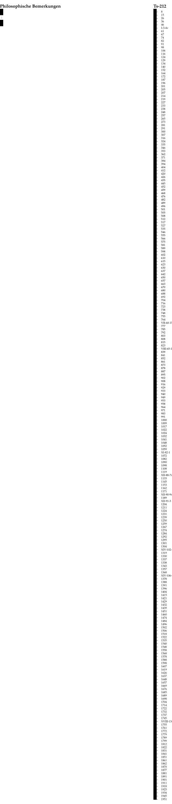

### [I-FCr\[1\]](https://cdn.wittgensteinnachlass.com/2000px/webp/Ts-212/I-FCr.webp)

_Understanding_

### [I-1FCr\[1\]](https://cdn.wittgensteinnachlass.com/2000px/webp/Ts-212/I-1FCr.webp)

Understanding, opinion, falls outside our consideration.

### [I-1-1\[1\]](https://cdn.wittgensteinnachlass.com/2000px/webp/Ts-212/I-1-1.webp)

Can one understand anything other than a sentence? Or again: Is it not only when one understands it that it is a sentence. Thus: Can one understand anything otherwise than _as a sentence_?

### [I-1-1\[2\]](https://cdn.wittgensteinnachlass.com/2000px/webp/Ts-212/I-1-1.webp)

One could talk about “experiencing a sentence”. Can this experience be written down?

### [I-1-2\[1\]](https://cdn.wittgensteinnachlass.com/2000px/webp/Ts-212/I-1-2.webp)

69, 9 Here it is important that in a certain sense there is no half-sentence. That is, what applies to the word applies to the half-sentence: it has sense only in the context of the sentence.

### [I-1-2\[2\]](https://cdn.wittgensteinnachlass.com/2000px/webp/Ts-212/I-1-2.webp)

9 But understanding only begins with the sentence. [& that is why it does not interest us].

### [I-1-3\[1\]](https://cdn.wittgensteinnachlass.com/2000px/webp/Ts-212/I-1-3.webp),[I-1-4\[1\]](https://cdn.wittgensteinnachlass.com/2000px/webp/Ts-212/I-1-4.webp)

89 Just as there is no metaphysics, so there is no metalogic. The word “understanding”, the expression “understanding a sentence”, is not metalogical either, 89 but an expression like _any_ other in language.

### [I-1-5\[1\]](https://cdn.wittgensteinnachlass.com/2000px/webp/Ts-212/I-1-5.webp),[I-1-6\[1\]](https://cdn.wittgensteinnachlass.com/2000px/webp/Ts-212/I-1-6.webp)

17, 89 So our considerations are not concerned with understanding the sentence; for we ourselves must understand it for it to be a sentence for us.

### [I-1-6\[2\]](https://cdn.wittgensteinnachlass.com/2000px/webp/Ts-212/I-1-6.webp)

(17) 89 It would also be strange if science and mathematics used sentences but did not speak of understanding them.

### [I-1-6\[3\]](https://cdn.wittgensteinnachlass.com/2000px/webp/Ts-212/I-1-6.webp)

(17) 89 One sees the essential thing in understanding, the incidental thing in the sign. – But then, what is the sign for at all? – Merely to make oneself understood by others? But how is that possible at all. – Here the sign is _treated_ as a kind of medicine that is supposed to produce in the other person the same stomach pains that I have.

### [I-1-7\[1\]](https://cdn.wittgensteinnachlass.com/2000px/webp/Ts-212/I-1-7.webp)

54 The answer to the question “what do you mean” must be: p; and not “I mean what I mean by ‘p’”.

### [I-1-8\[1\]](https://cdn.wittgensteinnachlass.com/2000px/webp/Ts-212/I-1-8.webp)

89 303/6 Language as a whole cannot be misunderstood. For otherwise there would in principle be no explanation to address this misunderstanding. That is to say, language as a whole must speak for itself.

### [I-1-9r\[1\]](https://cdn.wittgensteinnachlass.com/2000px/webp/Ts-212/I-1-9r.webp)

54 One can also put it this way: if one always expresses oneself within a system of language and thus explains what a sentence means only by means of sentences belonging to that system, then in the end opinion drops out of language altogether, and thus out of consideration, and what remains is language, the only thing we can consider.

### [I-1-9v\[1\]](https://cdn.wittgensteinnachlass.com/2000px/webp/Ts-212/I-1-9v.webp)

Say of the prime number 3, (or 5)? – (Why tackle a general problem when the elementary one is already interesting!) What does it mean to understand why 5 is a prime number …

### [I-1-10r\[1\]](https://cdn.wittgensteinnachlass.com/2000px/webp/Ts-212/I-1-10r.webp)

54 (76) What is said can be explained only through language, so one cannot explain _language itself_ in this sense.

### [I-1-10v\[1\]](https://cdn.wittgensteinnachlass.com/2000px/webp/Ts-212/I-1-10v.webp)

Can one, & how can one, the occurrence of a particular prime number …

### [I-1-11\[1\]](https://cdn.wittgensteinnachlass.com/2000px/webp/Ts-212/I-1-11.webp)

All I can do in language is say _something_: say the _one_. (Say the one within the space of what I could have said.)

### [I-1-12r\[1\]](https://cdn.wittgensteinnachlass.com/2000px/webp/Ts-212/I-1-12r.webp)

78, 54 ﹖ (67a) (89) 149 / 5 What I want to say is: one cannot interpret language as a whole. 78, 54 (67a) (89) 149 / 5 An interpretation is always only _one_ in contrast to _another._ It attaches itself to the sign and incorporates it into a further system.

### [I-1-12v\[1\]](https://cdn.wittgensteinnachlass.com/2000px/webp/Ts-212/I-1-12v.webp)

72˙b

Misleading, for it sounds as if it meant: I tried to … the sentence to myself …

### [I-1-13\[1\]](https://cdn.wittgensteinnachlass.com/2000px/webp/Ts-212/I-1-13.webp),[I-1-14\[1\]](https://cdn.wittgensteinnachlass.com/2000px/webp/Ts-212/I-1-14.webp)

6, 89 When Frege speaks against the formal conception of arithmetic, he is always saying, _as it were_: these petty explanations concerning the symbols are superfluous if we understand them. And understanding consists, as it were, in seeing a picture from which all the rules then follow (thereby becoming intelligible). But Frege does not see that this picture is itself only a sign in turn, or a calculus that explains the written calculus to us. But understanding in general is (_always_) like the understanding 89 we acquire of a calculus when we learn how it arose, or learn about its practical application. And there too, of course, we once again merely become familiar with a symbolism that is more surveyable for us in place of one that is foreign to us. (Understanding here means having a clear view of the whole.)

### [I-1-15\[1\]](https://cdn.wittgensteinnachlass.com/2000px/webp/Ts-212/I-1-15.webp)

89 For one could now say: If complicated processes play a part in understanding the word “and” and understanding is something essential _for us_, how is it that these processes are never mentioned in symbolic logic? How is it that they are never mentioned in logic, nor need be?

### [I-1-16\[1\]](https://cdn.wittgensteinnachlass.com/2000px/webp/Ts-212/I-1-16.webp),[I-1-17\[1\]](https://cdn.wittgensteinnachlass.com/2000px/webp/Ts-212/I-1-17.webp)

54 In ordinary life, when I give someone a command, it is _quite enough_ for me to give them signs. And I would never say: these are just words, and I must get behind the words. Similarly, if I had asked someone something and they give me 54 an answer (that is, signs), I am satisfied – that was just what I expected – and do not object: that is merely an answer. It is clear that nothing else could have been expected and that the answer presupposes the use of language. Like everything that is to be said.

### [I-1-18r\[1\]](https://cdn.wittgensteinnachlass.com/2000px/webp/Ts-212/I-1-18r.webp)

54 But if one says “how am I supposed to know what he means, I only see his signs”, I _say_: “how is _he_ supposed to know what he means, he too has only his signs”.

### [I-1-18v\[1\]](https://cdn.wittgensteinnachlass.com/2000px/webp/Ts-212/I-1-18v.webp)

64 1 2

Understanding the distribution of _the_ prime numbers:

### [I-1-19\[1\]](https://cdn.wittgensteinnachlass.com/2000px/webp/Ts-212/I-1-19.webp)

54 “But I did mean something when I said that!” Granted, – but how can we find out what it is? Only, presumably, by having him tell us. If we are not to take the rest of his behaviour as the criterion, then what he explains to us.

You mean what you say.

### [I-2FCr\[1\]](https://cdn.wittgensteinnachlass.com/2000px/webp/Ts-212/I-2FCr.webp)

_“Understanding” used amorphously. “Understanding” ambiguous._

### [I-2-1\[1\]](https://cdn.wittgensteinnachlass.com/2000px/webp/Ts-212/I-2-1.webp)

54 “You made a movement with your hand; did you mean something by it? – I thought you meant that I should come to you”. The question is whether one may ask “_what_ did you mean”. The answer to this question (however) is a sentence. Whereas if one may not ask the question that way, then meaning is – so to speak – amorphous. And “I mean something by the sentence” then has the same _form_ as “the sentence is useful”, or “this sentence plays a part in my life”.

### [I-2-2\[1\]](https://cdn.wittgensteinnachlass.com/2000px/webp/Ts-212/I-2-2.webp)

54 But could one answer: “I meant something by this movement that I can express only through this movement”?

### [I-2-3\[1\]](https://cdn.wittgensteinnachlass.com/2000px/webp/Ts-212/I-2-3.webp)

89 After all, we distinguish language from what is not language. We see strokes and say that we understand them, and we see others and say that they mean nothing (or nothing to us). This surely characterizes a general experience, which we could call “understanding something as language” – quite apart from _what_ we read out of the given configuration.

### [I-2-4\[1\]](https://cdn.wittgensteinnachlass.com/2000px/webp/Ts-212/I-2-4.webp)

89 I see a German inscription and a Chinese one. – Is the Chinese one perhaps unsuitable for communicating something? – I say that I have not learnt Chinese. But the learning of the language, as mere cause, as history, falls outside the _present_. All that matters are its effects and these are phenomena that simply do not occur when I see the Chinese writing. (Why they do not occur does not matter at all.)

### [I-2-5\[1\]](https://cdn.wittgensteinnachlass.com/2000px/webp/Ts-212/I-2-5.webp),[I-2-6\[1\]](https://cdn.wittgensteinnachlass.com/2000px/webp/Ts-212/I-2-6.webp)

54a “Do we then assign arbitrary interpretations to the words that are said to us? Does not the experience of understanding come with the experience of hearing the signs when we ‘understand other people’s language’?”

### [I-2-7\[1\]](https://cdn.wittgensteinnachlass.com/2000px/webp/Ts-212/I-2-7.webp)

89 When someone says something to me and I understand it, this happens to me just as my hearing what he says does. And here understanding is the phenomenon that occurs when I hear a German sentence & that distinguishes this hearing from hearing a sentence in a language I am not conversant with.

### [I-2-8\[1\]](https://cdn.wittgensteinnachlass.com/2000px/webp/Ts-212/I-2-8.webp)

89 Let us think of a cipher: suppose we are given a sentence in the cipher and also the key; then of course, in a certain _respect_, we are given everything for understanding the cipher. And yet, if asked “do you understand this sentence in the cipher”, I might answer: No, I must first decipher it; and only once I had translated it into German, for example, would I say “now I understand it”.

### [I-2-9\[1\]](https://cdn.wittgensteinnachlass.com/2000px/webp/Ts-212/I-2-9.webp)

89 If one were to ask here: “At what moment in the translation (from the cipher into German) do I understand the sentence”, one would gain an insight into the essence of understanding.

### [I-2-10\[1\]](https://cdn.wittgensteinnachlass.com/2000px/webp/Ts-212/I-2-10.webp)

89 (cf. 9a) I say a sentence, “I see a black circle”; but surely the words are not what matters; so let us say “a b c d e” instead. But now I cannot simply connect this sign with the sense given above (unless I take “a b c d e” as _one_ word and take this word as an abbreviation of the sentence above). And yet this difficulty is strange. I could put it this way: I am not used to saying ‘a’ instead of ‘I’ and ‘b’ instead of ‘see’, and ‘c’ instead of ‘a’, etc. But I do not mean by this that, if I were used to it, I would immediately associate the word ‘a’ with the word ‘I’; rather, I mean that I am not used to using ‘a’ in place of ‘I’ – with the meaning of ‘I’.

### [I-2-11\[1\]](https://cdn.wittgensteinnachlass.com/2000px/webp/Ts-212/I-2-11.webp)

54 “I don’t just say that, I also mean something by it”. – If one considers what happens within us when we _mean_ words (and not just say them), it seems as if something is then coupled with these words, whereas otherwise they run empty. – As if they, as it were, intervened in us.”

### [I-2-12\[1\]](https://cdn.wittgensteinnachlass.com/2000px/webp/Ts-212/I-2-12.webp)

89 The sentence, when I understand it, gains depth for me.

### [I-2-13r\[1\]](https://cdn.wittgensteinnachlass.com/2000px/webp/Ts-212/I-2-13r.webp)

89 I understand an order as an order, i.e. I don’t just see in it this structure of sounds or strokes, but this structure has – so to speak – an influence on me. I react to an order (even before I obey it) differently from the way I react to a communication or a question, for example.

### [I-2-13v\[1\]](https://cdn.wittgensteinnachlass.com/2000px/webp/Ts-212/I-2-13v.webp)

Interpreting is an activity that sometimes takes place, but by no means always when we use signs …

### [I-2-14\[1\]](https://cdn.wittgensteinnachlass.com/2000px/webp/Ts-212/I-2-14.webp)

89 <s> I say: Understanding consists in my having a particular **experience**. ‒ ‒ But this experience’s being the understanding **of that** – **which I understand** – **consists** in this experience being a part of my **language**. </s>

### [I-2-15\[1\]](https://cdn.wittgensteinnachlass.com/2000px/webp/Ts-212/I-2-15.webp)

89 There are sentences one can understand only in connection with others. If, for example, I read somewhere “after he had said that, he left her, as on the previous day”. If one asks me whether I understand this sentence, it would not be easy to answer. It is a German sentence and in that respect I understand it. I would know how one _could_ use this sentence, say; I could invent a context for it myself. And yet I do not understand it _as_ I would if I had read the book up to this point.

### [I-2-16\[1\]](https://cdn.wittgensteinnachlass.com/2000px/webp/Ts-212/I-2-16.webp),[I-2-17\[1\]](https://cdn.wittgensteinnachlass.com/2000px/webp/Ts-212/I-2-17.webp)

89 What does it mean to understand a painting? There, too, there is understanding and not understanding. And here, too, ‘understand’ and ‘not understand’ can mean different things. – We can imagine a picture that is meant to represent an arrangement of objects in three-dimensional space, but in one part of the picture we are unable to see bodies in space and see only the painted surface. We can then say that we do not understand _these_ parts of the picture. It may be that the spatial objects depicted are familiar to us, i.e. that they are forms we know from looking at bodies, but the picture may also show forms we have never seen. And here again there is the case where something looks – for example – like a bird, only not like one of a kind I know, or else where a configuration in space is depicted the like of which I have never seen. In this last case, too, one can speak of not understanding the picture, but in a different sense from the first case.

### [I-2-18\[1\]](https://cdn.wittgensteinnachlass.com/2000px/webp/Ts-212/I-2-18.webp)

89 But something else: Suppose the picture depicted people but was small, and the people in it were about an inch tall. Now suppose there were people of that height; then we would recognize _them_ in the picture and it would make quite a different impression on us, even though the illusion of three-dimensional objects would be exactly the same. And yet _the actual_ impression, as it stands, is independent of my having seen people of the usual size at some time and never having seen dwarfs, even though this is the cause of the impression.

### [I-2-18\[2\]](https://cdn.wittgensteinnachlass.com/2000px/webp/Ts-212/I-2-18.webp),[I-2-19\[1\]](https://cdn.wittgensteinnachlass.com/2000px/webp/Ts-212/I-2-19.webp)

89 This seeing of the painted people as people (as opposed to dwarfs, say) is quite _analogous to_ seeing the picture as a three-dimensional _configuration_. We cannot say here that we always see the same thing and afterwards take it now as one thing and now as another; rather, we see something different each time.

### [I-2-19\[2\]](https://cdn.wittgensteinnachlass.com/2000px/webp/Ts-212/I-2-19.webp)

89 181/1 And so too when we read a sentence with understanding and without understanding. (Remember what it is like when one reads a sentence with the wrong stress, and therefore does not understand it, and then realizes how it is to be read.)

### [I-2-20\[1\]](https://cdn.wittgensteinnachlass.com/2000px/webp/Ts-212/I-2-20.webp)

(80, 59), 89a (When reading a scrawled script, one can recognize what it means to see something into the given picture.)

### [I-2-21\[1\]](https://cdn.wittgensteinnachlass.com/2000px/webp/Ts-212/I-2-21.webp)

89a, 9a 218/4 When one reads a clock, one sees a _complex_ of strokes, patches, etc., but in a quite particular way if one is to _take_ it as a clock and its hands.

### [I-2-22\[1\]](https://cdn.wittgensteinnachlass.com/2000px/webp/Ts-212/I-2-22.webp),[I-2-23\[1\]](https://cdn.wittgensteinnachlass.com/2000px/webp/Ts-212/I-2-23r.webp)

89a We could imagine a Martian who only gradually learnt, on Earth, to understand people’s facial expressions as such and who learns to feel a threatening expression as such only after certain experiences. Until then he would have looked at this shape of a face as we _look at_ the shape of a stone.

### [I-2-23v\[1\]](https://cdn.wittgensteinnachlass.com/2000px/webp/Ts-212/I-2-23v.webp)

8, 76a One can remember … the meaning of words …

### [I-2-24r\[1\]](https://cdn.wittgensteinnachlass.com/2000px/webp/Ts-212/I-2-24r.webp)

89 Can I not say, then: he only _learns_ to understand the commanding gesture in a certain sentential form.

### [I-2-24v\[1\]](https://cdn.wittgensteinnachlass.com/2000px/webp/Ts-212/I-2-24v.webp)

… having learnt, which one did not know.

### [I-2-25\[1\]](https://cdn.wittgensteinnachlass.com/2000px/webp/Ts-212/I-2-25.webp)

89a We understand Chinese gestures as little as we understand Chinese sentences.

### [I-3FCr\[1\]](https://cdn.wittgensteinnachlass.com/2000px/webp/Ts-212/I-3FCr.webp)

Understanding as the correlate of an _explanation_.

### [I-3-1\[1\]](https://cdn.wittgensteinnachlass.com/2000px/webp/Ts-212/I-3-1.webp)

89, 8 By “understanding” I mean a correlate of the explanation, _not_ of some way of exerting an influence – a medical one, say. So by the word “misunderstanding” I essentially mean something that can be eliminated by explanation. I do not call another kind of disagreement a “misunderstanding”.

### [I-3-2\[1\]](https://cdn.wittgensteinnachlass.com/2000px/webp/Ts-212/I-3-2.webp)

89 Understanding corresponds to the explanation; but insofar as it does not correspond to the explanation, it is unarticulated and is therefore no concern of ours; or it is articulated and corresponds to the sentence itself the understanding of which we wanted to _describe_.

### [I-3-3\[1\]](https://cdn.wittgensteinnachlass.com/2000px/webp/Ts-212/I-3-3.webp)

(54) 89 Knowing what the _sentence says_ can only mean: being able to answer the question “what does it _say_?”

### [I-3-3\[2\]](https://cdn.wittgensteinnachlass.com/2000px/webp/Ts-212/I-3-3.webp)

(54) 89 Understanding the sense of a sentence can only mean: being able to answer the question “what is its sense?”

### [I-3-3\[3\]](https://cdn.wittgensteinnachlass.com/2000px/webp/Ts-212/I-3-3.webp)

89 For if “have sense” is used here intransitively, so that one cannot distinguish _the_ sense of one sentence from that of another, then having sense is a matter that accompanies the use of the sentence and does not interest us.

### [I-3-4r\[1\]](https://cdn.wittgensteinnachlass.com/2000px/webp/Ts-212/I-3-4r.webp)

54 The trivial thing I have to say is that a further sentence, in signs of some sort, _stands_ as the answer to the sentence “I don’t just _say_ that, I mean something by it” and the question “what?”

### [I-3-4v\[1\]](https://cdn.wittgensteinnachlass.com/2000px/webp/Ts-212/I-3-4v.webp)

16 <s>But the same would have to hold for speaking. In what sense …</s>

### [I-3-5\[1\]](https://cdn.wittgensteinnachlass.com/2000px/webp/Ts-212/I-3-5.webp)

89 But one can ask: is understanding not something different from the expression of understanding? Is it not the case that the expression of understanding is an imperfect expression? That presumably means an expression that leaves out something essentially inexpressible. For otherwise I could indeed find a better one. So the expression would be a perfect _expression_. – – –

### [I-3-6\[1\]](https://cdn.wittgensteinnachlass.com/2000px/webp/Ts-212/I-3-6.webp)

89 There is a view that a person can, as it were, show only imperfectly whether he has understood.

### [I-3-6\[2\]](https://cdn.wittgensteinnachlass.com/2000px/webp/Ts-212/I-3-6.webp)

89 That, as it were, he can only ever point to it from a distance, even approach it, but can never touch it with his hand. And that the final thing always remains unsaid.

### [I-3-7\[1\]](https://cdn.wittgensteinnachlass.com/2000px/webp/Ts-212/I-3-7.webp)

89 <s> One wants to say: He understands it fully, to be sure, but cannot fully show it, since otherwise he would already have to do what may only be done in obeying the order. So he cannot show that he understands it fully. That is, he always knows more than he can show. </s>

### [I-3-8\[1\]](https://cdn.wittgensteinnachlass.com/2000px/webp/Ts-212/I-3-8.webp)

89 One would like to say: in his understanding he is _at_ the fact, but the explanation can never contain the execution. But the understanding does not contain the execution; rather, understanding is merely the symbol that is translated in the execution.

### [I-3-9\[1\]](https://cdn.wittgensteinnachlass.com/2000px/webp/Ts-212/I-3-9.webp)

((The difficulty is to see the grammar of the word “mean” clearly. But the only way to do this is by answering the question “what is the criterion for our meaning something _this way_” and asking what kind of expression this “_this way_” stands for. The answer to the question “how is that meant” establishes the connection between two linguistic expressions. So the question, too, asks about this connection. The use of the nouns “sense”, “meaning”, “construal” and other words misleads us into believing that this sense, etc. stands in the same relation to the sign as the word, the name, does to the thing that is its bearer. So that one could say: “the arrow has a quite definite meaning, is meant in a quite definite way that I have to express by a sign again only faute de mieux”. The opinion, the intention, would be, as it were, its soul, which I would most like to …

### [I-3-10\[1\]](https://cdn.wittgensteinnachlass.com/2000px/webp/Ts-212/I-3-10.webp)

79a, 96 222/3 As for the explanation of the arrow, it is clear that one can say: “This arrow does not mean that you are to go there (pointing with the hand), but that way.” – And of course I would understand this explanation. – “One would (_however_) have to write that alongside it”.

### [I-4FCr\[1\]](https://cdn.wittgensteinnachlass.com/2000px/webp/Ts-212/I-4FCr.webp)

Understanding the command, the condition for our obeying it. Understanding the sentence, the condition for our being guided by it.

### [I-4-1\[1\]](https://cdn.wittgensteinnachlass.com/2000px/webp/Ts-212/I-4-1.webp)

89 “Understanding a sentence can only be the condition for our being able to apply it. That is, it can be nothing but this condition and it must be the condition for its application.”

### [I-4-2\[1\]](https://cdn.wittgensteinnachlass.com/2000px/webp/Ts-212/I-4-2.webp)

89 If “understanding a sentence” means, in a certain sense, acting on it, then understanding cannot be the logical condition for our acting on it.

### [I-4-2\[2\]](https://cdn.wittgensteinnachlass.com/2000px/webp/Ts-212/I-4-2.webp)

89 One can compare understanding a description with drawing a picture from that description. (And here again the simile is a particular case of what it is a simile for.) And in many cases it would also be taken as _the proof_ of understanding.

### [I-4-3\[1\]](https://cdn.wittgensteinnachlass.com/2000px/webp/Ts-212/I-4-3.webp)

89 I understand this picture perfectly, I could model it in clay. – I understand this description perfectly, I could make a drawing from it.

### [I-4-4\[1\]](https://cdn.wittgensteinnachlass.com/2000px/webp/Ts-212/I-4-4.webp)

89 In certain cases one could go so far as to lay it down as a condition of understanding that one must be able to draw the sense of the sentence. –

### [I-4-5\[1\]](https://cdn.wittgensteinnachlass.com/2000px/webp/Ts-212/I-4-5.webp)

89a It is very strange: we would like to explain understanding a gesture by translating it into words, and understanding words by translating them into gestures.

### [I-4-5\[2\]](https://cdn.wittgensteinnachlass.com/2000px/webp/Ts-212/I-4-5.webp)

89a And indeed we do explain words by a gesture and a gesture by words.

### [I-4-6\[1\]](https://cdn.wittgensteinnachlass.com/2000px/webp/Ts-212/I-4-6.webp)

89 If one says to me “bring a yellow flower” and I imagine fetching a yellow flower, this can be a sign that I have understood the order. But the same would hold if I painted a picture of the _process_. – Why? Presumably because what I do must be described using words from the order. Or should I say that I have actually carried out a related order (related to _the first_).

### [I-4-7\[1\]](https://cdn.wittgensteinnachlass.com/2000px/webp/Ts-212/I-4-7.webp)

89 Now the question is: must I really understand the sign in such a sense in order to be able, say, to act on it? – If someone says: “certainly! otherwise I would not know what I have to do”, I would reply: “But there is no transition from knowing to doing. And no justification in principle of _this_: that it was _that_ which corresponded to the order”.

### [I-4-7\[2\]](https://cdn.wittgensteinnachlass.com/2000px/webp/Ts-212/I-4-7.webp)

89

### [I-4-7\[3\]](https://cdn.wittgensteinnachlass.com/2000px/webp/Ts-212/I-4-7.webp)

89 So what does the sentence “I must understand the order before I can act on it” mean? For this sentence naturally has a sense. But again, certainly not a metalogical one.

### [I-4-8\[1\]](https://cdn.wittgensteinnachlass.com/2000px/webp/Ts-212/I-4-8.webp)

89 The idea one has of understanding is something like this: in understanding, one gets from the sign closer to the verifying fact, perhaps by imagining it. And even if one gets no closer in any essential sense, i.e. logically, there is still something right about the idea that understanding consists in imagining the fact. The language of imagination is primitive in the same sense as the language of gestures.

### [I-4-9\[1\]](https://cdn.wittgensteinnachlass.com/2000px/webp/Ts-212/I-4-9.webp)

89, 45a 54a (There cannot be a _necessary_ intermediate stage between taking in an order and obeying it.)

### [I-4-10\[1\]](https://cdn.wittgensteinnachlass.com/2000px/webp/Ts-212/I-4-10.webp)

89 “But surely I must understand an order to be able to act on it”. Here the ‘must’ is suspicious. If this really is a must – I mean – if it is a logical must, then what we have here is a grammatical remark.

### [I-4-9\[2\]](https://cdn.wittgensteinnachlass.com/2000px/webp/Ts-212/I-4-9.webp)

89 One might also ask: How long before obeying the order must you understand it, then?

### [I-4-11\[1\]](https://cdn.wittgensteinnachlass.com/2000px/webp/Ts-212/I-4-11.webp)

70 If understanding was a necessary preparation for obeying, then it must have added something to the sign; but something that was in any case not the execution.

### [I-4-12\[2\]](https://cdn.wittgensteinnachlass.com/2000px/webp/Ts-212/I-4-12.webp)

(16), 27 70 If one were to say that the person receiving the order receives in addition to the words mental images that are similar to the execution of the order (whereas the words are said not to be), then I go even further and assume that the order is given by our making the other person perform now, through mechanical influence (say, by guiding his hand), the movements that he is to perform in, say, 5 minutes; and presumably I can come no closer to the execution of the order in the expression of the order. Then we have replaced the similarity of the mental image with a much greater (_similarity_). And the path from the symbol to reality seems to have been greatly shortened here. (Likewise, to describe what position I was in on such and such an occasion, I could assume that position.) This also shows that the occurrence of images of fantasy is quite inessential to thought.

### [I-4-13\[1\]](https://cdn.wittgensteinnachlass.com/2000px/webp/Ts-212/I-4-13.webp)

70 (54a) I could also say: It seems to us as though, when we understand the order –  for example – we add something that fills the gap. So that we can answer someone who says (to us) “but you do understand it”: Yes, but only because I add something else: namely the interpretation.

### [I-4-13\[2\]](https://cdn.wittgensteinnachlass.com/2000px/webp/Ts-212/I-4-13.webp)

70 (54a) Now one would, of course, have to say in reply: But what prompts you to give precisely _this_ interpretation? If it is the order, then it was already unambiguous, since it _commanded_ only this interpretation. Or did you add the interpretation arbitrarily – in that case you did not understand the order either, but only what you made of it (on your own initiative).

### [I-4-14\[1\]](https://cdn.wittgensteinnachlass.com/2000px/webp/Ts-212/I-4-14.webp)

54a, 78, 70a An ‘interpretation’ is presumably something that is given in words! It is _this_ interpretation as opposed to another (which is worded differently). – So if one says “every sentence requires a further interpretation”, that would mean: no sentence can be understood without an addition.

### [I-4-15\[1\]](https://cdn.wittgensteinnachlass.com/2000px/webp/Ts-212/I-4-15.webp)

89 “I cannot carry out the order because I do not understand what you mean. – Yes, now I understand you”. What went on when I suddenly understood the other person? I could of course be mistaken, and that I understood the other person was a hypothesis. But perhaps an interpretation suddenly occurred to me that struck me as convincing. But was this interpretation anything other than a sentence of a language?

### [I-4-15\[2\]](https://cdn.wittgensteinnachlass.com/2000px/webp/Ts-212/I-4-15.webp)

89 Before this understanding, I might also have had several interpretations floating before me, one of which I _finally_ decide on. But the interpretations’ floating before me was the floating before me of expressions of a language.

### [I-4-16r\[1\]](https://cdn.wittgensteinnachlass.com/2000px/webp/Ts-212/I-4-16r.webp)

89 What does it mean to understand that something is a command, even if one does not yet understand the command itself? (“He means: I should do something, but I do not know what he wishes.”)

### [I-4-16v\[1\]](https://cdn.wittgensteinnachlass.com/2000px/webp/Ts-212/I-4-16v.webp)

54a particular

### [I-5FCr\[1\]](https://cdn.wittgensteinnachlass.com/2000px/webp/Ts-212/I-5FCr.webp)

_Interpreting._

_Do we interpret every sign?_

### [I-5-1\[1\]](https://cdn.wittgensteinnachlass.com/2000px/webp/Ts-212/I-5-1.webp)

54a 89 Interpreting. – Do we interpret anything, then, when someone gives us a command? We apprehend what we hear or see; or: we see what we see.

There are cases in which we interpret a command we have been given & cases in which we do not.

An interpretation supplements the sign interpreted with a sign.

### [I-5-2\[1\]](https://cdn.wittgensteinnachlass.com/2000px/webp/Ts-212/I-5-2.webp)

54a 89 If someone asks me: ‘what time is it’, then no work of interpretation goes on in me. Rather, I react immediately to what I see and hear.

### [I-5-3\[1\]](https://cdn.wittgensteinnachlass.com/2000px/webp/Ts-212/I-5-3.webp)

54a (13) Let us imagine an absent-minded person who, on the command “right turn”, had turned to the left and then, touching his forehead, said “oh, I see – ‘right turn’!” and turned right.

### [I-5-4\[1\]](https://cdn.wittgensteinnachlass.com/2000px/webp/Ts-212/I-5-4.webp)

54a 89 I interpret the words; no doubt; but do I also interpret the facial expressions? Do I, for example, _interpret_ a facial expression as threatening? or friendly? – It _can_ happen.

### [I-5-4\[2\]](https://cdn.wittgensteinnachlass.com/2000px/webp/Ts-212/I-5-4.webp)

54a 89 If I were now to _say_: It is not enough that I perceive the threatening face; I must first interpret it. Someone draws a knife and I say: “I understand this as a threat”.

### [I-5-5\[1\]](https://cdn.wittgensteinnachlass.com/2000px/webp/Ts-212/I-5-5.webp)

89 Can one command someone to understand a sentence? Here one must distinguish different cases.

### [I-6FCr\[1\]](https://cdn.wittgensteinnachlass.com/2000px/webp/Ts-212/I-6FCr.webp)

One says: to understand a word is to know how it is used. What does it mean to know that? We have this knowledge in reserve, so to speak.

### [I-6-1\[1\]](https://cdn.wittgensteinnachlass.com/2000px/webp/Ts-212/I-6-1.webp)

It is remarkable that when we think that it is probably 3 o’clock now, we (_usually_) imagine the position of the hands with no precision, or do not imagine it at all, but have the picture, as it were, in a toolbox from which we know we can take out the tool whenever we need it. – This toolbox seems to me to be grammar with its rules. But let us consider what kind of knowledge this is.

### [I-6-2\[1\]](https://cdn.wittgensteinnachlass.com/2000px/webp/Ts-212/I-6-2.webp)

38˙2 It is as if I were getting tools ready for future use in the toolbox of language. After all, a tool is also a likeness of its purpose.

### [I-6-3\[1\]](https://cdn.wittgensteinnachlass.com/2000px/webp/Ts-212/I-6-3.webp)

22,8 What does it mean to say [I understand the word “red”] “I do not see any red, but if you give me a box of paints, I can show it to you in it”? How can one _know_ that one can show it, if …; that one can therefore recognize it when one sees it?

### [I-6-4\[1\]](https://cdn.wittgensteinnachlass.com/2000px/webp/Ts-212/I-6-4.webp)

8 (70a) I say: There is nothing red around me here, but if there were something red here, I _could_ recognize it. –

### [I-6-5\[1\]](https://cdn.wittgensteinnachlass.com/2000px/webp/Ts-212/I-6-5.webp)

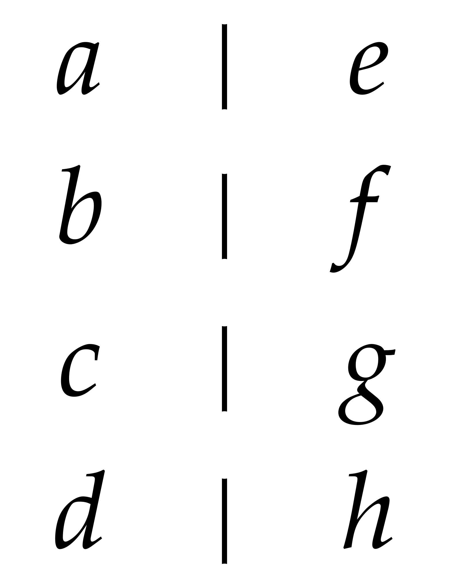

Suppose this is my dictionary, and I use it to translate the sentence bdca into fhge. Now I have shown, in the _ordinary_ sense, that I understand the use of the dictionary and can say that I can translate the sentence cdab in the same way, if I want to. – So if the sentence cdab is a command to write down the corresponding sentence in the second language, I understand this command much as I understand the command to take !!!!!!∣∣∣∣∣∣ steps, if I have been shown how the corresponding commands with the numbers !∣, II!!∣∣, !!!∣∣∣, are executed.

### [I-6-6\[1\]](https://cdn.wittgensteinnachlass.com/2000px/webp/Ts-212/I-6-6.webp)

But of course this cannot be any different from when, for example, I say “I want to paint this patch red”, have an image of the colour and now “_know_” how this image is to be translated into reality.

### [I-6-6\[2\]](https://cdn.wittgensteinnachlass.com/2000px/webp/Ts-212/I-6-6.webp)

Yes, the whole problem is already contained in this: What does it mean to know what the patch would look like if it corresponded to my image?

### [I-6-7\[1\]](https://cdn.wittgensteinnachlass.com/2000px/webp/Ts-212/I-6-7.webp)

1, 27a But if I want to replace the mental image that is in play in expectation etc. with a picture that is actually seen, something like the following seems to happen: I was to draw a thick black line and have drawn a thin one as a picture. But the mental image goes further and says it already knows, too, that the line is to be thick. So I draw a thick line, but a somewhat paler one, yet the mental image says it already knows, too, that it is to be black, not grey. (But if I draw the thick black line, it is no longer a picture.)

### [I-6-8\[1\]](https://cdn.wittgensteinnachlass.com/2000px/webp/Ts-212/I-6-8.webp)

94, 89 Knowing something is akin to having a slip of paper in my desk drawer with it written down on it.

### [II-FCr\[1\]](https://cdn.wittgensteinnachlass.com/2000px/webp/Ts-212/II-FCr.webp)

_Meaning_

### [II-7FCr\[1\]](https://cdn.wittgensteinnachlass.com/2000px/webp/Ts-212/II-7FCr.webp)

The concept of meaning derives from a primitive conception of language.

### [II-7-1\[1\]](https://cdn.wittgensteinnachlass.com/2000px/webp/Ts-212/II-7-1.webp),[II-7-2\[1\]](https://cdn.wittgensteinnachlass.com/2000px/webp/Ts-212/II-7-2.webp)

8 When Augustine speaks of learning language, he speaks exclusively of how we give things names, or understand the names of things. Here, then, naming seems to be the foundation and the be-all and end-all of language. This conception of the foundation of language is evidently equivalent to the one that takes the form of explanation “this is …” to be fundamental. – Augustine does not speak of a difference between words, so by “names” he evidently means words such as “tree”, “table”, “bread”, and certainly the proper names of people, but then presumably also “eat”, “go”, “here”, “there”; in short, all words. But he is certainly thinking _in the first instance of nouns_, and of the others as something that will sort itself out. (And Plato says that the sentence consists of nouns and verbs.) They _simply_ describe the game as simpler than it is. But this game presumably does occur in reality. Suppose, for example, that I want to build a house out of building stones that someone else is to hand me. We could first reach an agreement by my pointing to one stone and saying “this is a pillar”, then pointing to another and saying “this is a cube”, – “this is a slab” and so on. And now the application would consist in calling out those words “pillar”, “slab”, etc. in the order in which I need them. And quite similar, of course, are the agreement

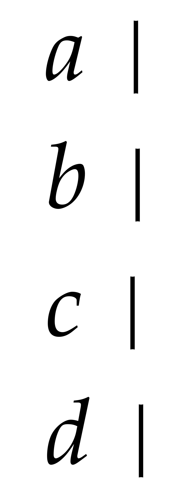

and, say, one that would work with colours.

### [II-7-2\[2\]](https://cdn.wittgensteinnachlass.com/2000px/webp/Ts-212/II-7-2.webp)

What I mean by this is: Augustine really does describe a calculus; only not everything we call language is this calculus.

### [II-7-2\[3\]](https://cdn.wittgensteinnachlass.com/2000px/webp/Ts-212/II-7-2.webp)

8 (And _that_ is what one must say in a great many cases in which the question is: is this representation useful, or useless. The answer then is: “yes, useful; but only _for that_, not for the whole area you purported to represent”.)

### [II-7-3\[1\]](https://cdn.wittgensteinnachlass.com/2000px/webp/Ts-212/II-7-3.webp)

8 So it is as if someone explained: “playing consists in moving things on a surface in accordance with certain rules …” and we replied: You are certainly thinking of board games, and your description does apply to them. But those are not the only games. So you can correct your explanation by expressly restricting it to those games. (So one could say that Augustine represents the learning of language too simply; but also: he represents something simpler.

### [II-7-3\[2\]](https://cdn.wittgensteinnachlass.com/2000px/webp/Ts-212/II-7-3.webp)

8 (Someone who describes chess more simply – with simpler rules – than it is nevertheless describes a game, but a different one.)

### [II-7-3\[3\]](https://cdn.wittgensteinnachlass.com/2000px/webp/Ts-212/II-7-3.webp)

8 What I really meant to say was: The way Augustine describes the learning of language can show us where this conception comes from _in the first place_. From what primitive _picture_.)

8 One could compare it with the case of a script in which letters were used to designate sounds, but also, say, to indicate the strength and weakness of pronunciation and as punctuation marks. If we then take this script as a language for describing the sound image, one could imagine someone describing the script as if each letter simply corresponded to a sound and as if the letters did not also have quite different functions. – And such a – too simple – description of the script is exactly what Augustine’s description of language resembles.

### [II-7-3\[4\]](https://cdn.wittgensteinnachlass.com/2000px/webp/Ts-212/II-7-3.webp),[II-7-4\[1\]](https://cdn.wittgensteinnachlass.com/2000px/webp/Ts-212/II-7-4.webp)

8 One can, for example, speak – in a way others understand – of _combinations of colours with shapes_ (say, of the colours red and blue with the shapes square and circle), just as one can speak of 29a combinations of different shapes or bodies. And here we have the root of the misleading expression that a fact is a complex of objects. Thus here a person’s being ill is _compared_ with the putting together of two things, one of which is the person, while the other represents the illness. Let us beware of this simile, or of forgetting that it is a simile. Or one must say that it is with the word “combination”, or “complex”, here as it is with the word “number”, which is also used in different – more or less logically similar – ways (_or, if one likes_, meanings).

### [II-7-5\[1\]](https://cdn.wittgensteinnachlass.com/2000px/webp/Ts-212/II-7-5.webp)

9b “Bedeutung” comes from “deuten”.

### [II-7-6\[1\]](https://cdn.wittgensteinnachlass.com/2000px/webp/Ts-212/II-7-6.webp)

(38˙2) 9b What we call meaning must be connected with the primitive language of gestures (of pointing).

### [II-7-7\[1\]](https://cdn.wittgensteinnachlass.com/2000px/webp/Ts-212/II-7-7.webp)

9b (7a) But this collation, like the concept of meaning, is a remnant of a primitive conception.

### [II-7-7\[2\]](https://cdn.wittgensteinnachlass.com/2000px/webp/Ts-212/II-7-7.webp)

9b (7a) If, for example, I collate the actual seating arrangement at a table with a written list, it makes good sense to point to a particular person as I read each name. But if I were to compare the description of a picture with the picture itself, and the description, besides listing the people, also said that N is kissing M, I would not know what to point to as the correlate of the word ‘kiss’. Or if it said, for example, “A is bigger than B”, what am I to point to at the word ‘bigger’? – Quite clearly I cannot point to anything corresponding to this word in the sense in which I point, say, to the person A in the picture.

### [II-7-8\[1\]](https://cdn.wittgensteinnachlass.com/2000px/webp/Ts-212/II-7-8.webp)

(7a) 9b There is, of course, such an act as “directing attention to the size of the people”, or to what they are doing, and in this sense one can also collate the kissing and the relative sizes. This shows how the general concept of meaning could arise. Something analogous happens here to what happens when the pigment takes the place of the colour.

### [II-7-9\[1\]](https://cdn.wittgensteinnachlass.com/2000px/webp/Ts-212/II-7-9.webp)

9a, d The words evidently have quite different functions in the sentence. And these functions _seem to us_ to be expressed in the rules that apply to the words.

### [II-7-10r\[1\]](https://cdn.wittgensteinnachlass.com/2000px/webp/Ts-212/II-7-10r.webp)

38 Just as in a signal box all sorts of different things are done with handles, so it is with the words of language, which correspond to handles. One handle is on a crank and the crank can be adjusted continuously; one belongs to a switch and can only be set either down or upright; a third belongs to a switch that allows 3 or more positions; a fourth is the handle of a pump and works only when it is moved up and down, etc.: but all are handles, grasped by hand.

### [II-7-10v\[1\]](https://cdn.wittgensteinnachlass.com/2000px/webp/Ts-212/II-7-10v.webp)

Secondly: If a further phenomenon, that of recognition, is needed to establish the identity, then one is also needed to recognize this one, and so on.

[unreadable] is to mean: Knowing …

### [II-7-11\[1\]](https://cdn.wittgensteinnachlass.com/2000px/webp/Ts-212/II-7-11.webp)

38 Comparison of the different kinds of lines on a map with the kinds of words in a sentence. Someone who has not been taught sees a mass of lines and does not know that they have very different meanings.

### [II-7-12\[1\]](https://cdn.wittgensteinnachlass.com/2000px/webp/Ts-212/II-7-12.webp)

58 Let us imagine a plan for a route drawn and crossed out with a line meant to indicate that this plan is not to be carried out. Many lines are drawn on the plan, but the one that crosses it out has a completely different function from the others.

### [II-7-13\[1\]](https://cdn.wittgensteinnachlass.com/2000px/webp/Ts-212/II-7-13.webp)

38 The difference between kinds of words is always like the difference between game pieces, or like the even greater difference between a game piece and the chessboard.

### [II-8FCr\[1\]](https://cdn.wittgensteinnachlass.com/2000px/webp/Ts-212/II-8FCr.webp)

Meaning: the place of the word in grammatical space.

### [II-8-1\[1\]](https://cdn.wittgensteinnachlass.com/2000px/webp/Ts-212/II-8-1.webp)

10a We can say, in the old way of speaking: the essential thing about a word is its meaning.

### [II-8-2\[1\]](https://cdn.wittgensteinnachlass.com/2000px/webp/Ts-212/II-8-2.webp)

10a We say: the essential thing about a word is its meaning; we

### [II-8-3\[1\]](https://cdn.wittgensteinnachlass.com/2000px/webp/Ts-212/II-8-3.webp)

can replace the word with another word that has the same meaning. In this way, a place for the word is fixed, as it were, and one can put one word in place of the other, if one puts it in the same place.

### [II-8-4\[1\]](https://cdn.wittgensteinnachlass.com/2000px/webp/Ts-212/II-8-4.webp)

10a If I decided (_in my thoughts_) to say a new word instead of “red”, how would it show that this word stood in the place of “red”? What determines the place of a word? Suppose, for example, that I wanted to replace all the words of my language with others at once: how could _I_ know which word stands in the place of _which earlier one_. Is it the mental images that remain and

### [II-8-5\[1\]](https://cdn.wittgensteinnachlass.com/2000px/webp/Ts-212/II-8-5.webp)

10a hold the word’s place? So that there is, as it were, a hook on a mental image, and if I hang a word on _that_, its place is thereby assigned to it?

Or: If I remember the place, what is it that I remember?

### [II-8-6\[1\]](https://cdn.wittgensteinnachlass.com/2000px/webp/Ts-212/II-8-6.webp),[II-8-7\[1\]](https://cdn.wittgensteinnachlass.com/2000px/webp/Ts-212/II-8-7.webp)

8 10a One could agree, for example, in place of ‘nicht’ in German always 10a 71b

_Meaning [unreadable] space_

… to put ‘not’, and in turn to put ‘nicht’ in place of ‘rot’. So the word ‘nicht’ would remain in the language, and yet one could now say that ‘not’ is used _in the same way_ as ‘nicht’ used to be, and that ‘nicht’ is now used _differently_ from before.

### [II-8-8\[1\]](https://cdn.wittgensteinnachlass.com/2000px/webp/Ts-212/II-8-8.webp)

10a, (8) The place of _the_ word in _the_ language is its meaning.

### [II-8-9\[1\]](https://cdn.wittgensteinnachlass.com/2000px/webp/Ts-212/II-8-9.webp)

Would it not be similar if I decided to change the shapes of the chess pieces, or, say, to take a piece we would now call a “knight” as the king? How would it show now that the little wooden horse is the king in chess? Can I not very well speak here of a change of meaning?

### [II-8-10\[1\]](https://cdn.wittgensteinnachlass.com/2000px/webp/Ts-212/II-8-10.webp)

By “meaning of the name” we do not mean the bearer of the name.

### [II-8-10\[2\]](https://cdn.wittgensteinnachlass.com/2000px/webp/Ts-212/II-8-10.webp)

8, 8b One can say that the words “the bearer of the name ‘N’” have the same meaning as the name “N” – so they can be substituted for one another.

### [II-8-10\[3\]](https://cdn.wittgensteinnachlass.com/2000px/webp/Ts-212/II-8-10.webp)

8, 8b But does it not come to the same thing to say “two names have _one_ bearer” and “two names have one and the same meaning”? (Morning Star, Evening Star, Venus.)

### [II-8-10\[4\]](https://cdn.wittgensteinnachlass.com/2000px/webp/Ts-212/II-8-10.webp)

8, 8b If by the sentence “‘a’ and ‘b’ have the same bearer” what is meant is that “the bearer of ‘a’” means the same as “the bearer of ‘b’”, then all is in order, because that means the same as a = b. But if by the bearer of ‘a’ we mean, say, the person who can be established to have been christened ‘a’; or the person who wears the little plaque with the name ‘a’ round his neck; etc., then it does not follow at all that I mean this person by ‘a’, and that the names that have the same bearer mean the same thing.

### [II-8-11\[1\]](https://cdn.wittgensteinnachlass.com/2000px/webp/Ts-212/II-8-11.webp)

8, 8b But do we not point to the object for which the name stands in order to explain the meaning? Yes; but this object is not ‘the meaning’, although the meaning is determined by pointing to this object.

### [II-8-12\[1\]](https://cdn.wittgensteinnachlass.com/2000px/webp/Ts-212/II-8-12.webp)

8, 8b <s> “Even if I say that the bearer of the name is not its meaning, the bearer still determines the meaning; and if I point to it and say ‘this is N’, then the meaning of ‘N’ is determined.”

</s> But here a correct understanding of the word ‘bearer’ in the particular case (colour, shape, tone, etc.) already determines the meaning except for one final determination.

### [II-8-13\[1\]](https://cdn.wittgensteinnachlass.com/2000px/webp/Ts-212/II-8-13.webp)

8, 8b, 79a When I say “the colour of _this_ object is called ‘violet’”, I must already have named the colour with the first words “the colour of this object”, I must already have _held_ it for christening, so that the act of naming can be what it is. For I could also say “the name of this colour (the colour of this thing) is for you to determine”, and the one who gives the name would then already have to know to whom he is giving it (in what place in the language he is putting it).

### [II-8-14\[1\]](https://cdn.wittgensteinnachlass.com/2000px/webp/Ts-212/II-8-14.webp)

I could explain it like this: the colour of this patch is called “red”, the shape “circle”. And here the words “colour” and “shape” stand for kinds of application (grammatical rules) and are in reality kinds of words, like “adjective”, “noun”. One could perfectly well introduce the words “colour word”, “shape word”, “sound word” alongside these words in (ordinary) grammar. (But let no one object: “why not also ‘tree word’, ‘book word’”!)

### [II-8-15\[1\]](https://cdn.wittgensteinnachlass.com/2000px/webp/Ts-212/II-8-15.webp)

8b The name I give to a body, a surface, a place, a colour, has a different grammar in each case. The name “a” in “a is yellow” has a different grammar depending on whether a is the name of a body or of a surface of a body; whether a sentence “this body is yellow” says that the surface of the body is yellow or that it is yellow through and through. “I point to a” has a different grammar depending on whether a is a body, a surface, a colour, etc. And so the demonstrative pronoun “this” also has a different meaning (i.e. grammar) when it refers to nouns with different grammars.

### [II-9FCr\[1\]](https://cdn.wittgensteinnachlass.com/2000px/webp/Ts-212/II-9FCr.webp)

The meaning of a word is what the (grammatical) explanation of its meaning explains.

### [II-9-1\[1\]](https://cdn.wittgensteinnachlass.com/2000px/webp/Ts-212/II-9-1.webp)

8 One says to the child: “no, no more lumps of sugar!” and takes the lump away from the child. That is how _the child_ learns the meaning of the word ‘no’. If one had given the child a lump of sugar with the same words, the child would have learnt to understand the word differently.

### [II-9-2\[1\]](https://cdn.wittgensteinnachlass.com/2000px/webp/Ts-212/II-9-2.webp)

Do we not thereby prompt the child to attach a sense to words without our replacing them with another sign, and thus without expressing this sense in another way? Do we not, as it were, prompt the child to do something privately, something to which no outward expression is given, or to which the outward expression bears only the relation of an indication, a _signal_? The meaning could not be put into words; one could only point to it _from afar_. It could, as it were, only be brought about. But then what sense does it make at all to speak of this meaning? (Blow & pain)

### [II-9-3\[1\]](https://cdn.wittgensteinnachlass.com/2000px/webp/Ts-212/II-9-3.webp)

8 Does the explanation of the word give me the meaning, or does it merely help me arrive at the meaning? So that the understanding would not be contained in the explanation, but would merely be brought about by it from outside, as an illness is brought about by something one eats.

### [II-9-4\[1\]](https://cdn.wittgensteinnachlass.com/2000px/webp/Ts-212/II-9-4.webp)

8 (10a) The problem also manifests itself in the question: How does a misunderstanding show itself? For that is the same as _the problem_: How does it become apparent that I have understood correctly? And that is: How can I explain the meaning? The question now is: Can a misunderstanding manifest itself in one person denying what the other affirms?

### [II-9-4\[2\]](https://cdn.wittgensteinnachlass.com/2000px/webp/Ts-212/II-9-4.webp)

8 (10a) No, for this is a difference of opinion and can be maintained as such. Until we _assume_ that the other person is right ….

### [II-9-4\[3\]](https://cdn.wittgensteinnachlass.com/2000px/webp/Ts-212/II-9-4.webp),[II-9-5\[1\]](https://cdn.wittgensteinnachlass.com/2000px/webp/Ts-212/II-9-5.webp)

8 (10a) So if, to explain the word “lilac”, I point to a patch and say “this patch is lilac”, can this explanation function in two ways: on the one hand as a definition that uses the patch as a sign and on the other hand as an elucidation? And how would the latter work? I would have to assume that the other person is telling the truth and sees the same thing as I do. The case that actually occurs is this: A tells B in my presence that a certain object is lilac. I hear this, have also seen the object, and think to myself: “now I do know what ‘lilac’ means”. That is, I have drawn an explanation of a word from those sentences. I could say: If what A tells B is the truth, then the word ‘lilac’ must have _this_ meaning. So I can also assume this meaning as a kind of hypothesis and say: if I understand the word _this way_, A is right.

### [II-9-5\[2\]](https://cdn.wittgensteinnachlass.com/2000px/webp/Ts-212/II-9-5.webp)

9e (10a) One says: “yes, if the word means _that_, then the sentence is true”.

### [II-9-5\[3\]](https://cdn.wittgensteinnachlass.com/2000px/webp/Ts-212/II-9-5.webp)

9e (10a)

### [II-9-5\[4\]](https://cdn.wittgensteinnachlass.com/2000px/webp/Ts-212/II-9-5.webp)

9e (10a) Suppose the explanation of meaning was only a _hint_: couldn’t one then say: Yes, if this hint is understood _this way_, then the word in this combination yields a true sentence, etc.? But then this “this way” must be expressed.

### [II-9-6\[1\]](https://cdn.wittgensteinnachlass.com/2000px/webp/Ts-212/II-9-6.webp)

8 The explanation of a sign must be able to remove every difference of opinion about its meaning.

And is there then still a question of meaning to be decided?

### [II-9-7\[1\]](https://cdn.wittgensteinnachlass.com/2000px/webp/Ts-212/II-9-7.webp)

I call what can be removed by an explanation a misunderstanding. The explanation of the meaning of a word rules out misunderstandings.

### [II-9-7\[2\]](https://cdn.wittgensteinnachlass.com/2000px/webp/Ts-212/II-9-7.webp)

7a 8 These are misunderstandings: “Is _that_ an

orange? I thought _that_ was one”. Can one say: “Is that red? I thought that was a chair”? But couldn’t one imagine (if, say, one doesn’t understand German) that “rot” means loud (i.e. is used the way “laut” is actually used). But how would this misunderstanding be cleared up? Perhaps like this: “rot is a colour, not a degree of loudness”? – One could of course give such an explanation, but it would be intelligible only to someone who is already thoroughly familiar with the grammar.

### [II-9-7\[3\]](https://cdn.wittgensteinnachlass.com/2000px/webp/Ts-212/II-9-7.webp)

8 The sentence “is that red? I thought that was a chair” makes sense only if the word “that” is used in the same sense both times, and then I must take either “red” as a noun or “a chair” as an adjective.

### [II-9-7\[4\]](https://cdn.wittgensteinnachlass.com/2000px/webp/Ts-212/II-9-7.webp)

8 The clarification can be understood only if it is given in a language that exists independently of the misunderstanding.

### [II-9-8\[1\]](https://cdn.wittgensteinnachlass.com/2000px/webp/Ts-212/II-9-8.webp)

7a Is it not conceivable, then, that a grammatical system has two (or more) applications in reality?

### [II-9-8\[2\]](https://cdn.wittgensteinnachlass.com/2000px/webp/Ts-212/II-9-8.webp)

7a Yes, but if we can say this at all, we must also be able to distinguish the two applications by a description.

### [II-9-9\[1\]](https://cdn.wittgensteinnachlass.com/2000px/webp/Ts-212/II-9-9.webp)

7a (8) (38˙2) To say that the word “red”, with all the prescriptions that apply to it, might mean what the word “blue” actually means, and thus that the meaning is not fixed by these rules, makes sense only if I can express the two possible meanings and then say which is the one I have _specified_.

### [II-9-9\[2\]](https://cdn.wittgensteinnachlass.com/2000px/webp/Ts-212/II-9-9.webp)

7a (8) (38˙2) (But this last statement is _precisely_ the rule that was previously missing and was needed for the meaning to be unambiguous.)

### [II-9-10\[1\]](https://cdn.wittgensteinnachlass.com/2000px/webp/Ts-212/II-9-10.webp)

38 Grammar explains the meaning of words to the extent that it can be explained. And it can be explained to the extent that there is anything to ask about it; and one can ask about it to the extent that it can be explained.

### [II-9-10\[2\]](https://cdn.wittgensteinnachlass.com/2000px/webp/Ts-212/II-9-10.webp)

38 Meaning can only be what we explain in the _explanation_ of the meaning of a word.

### [II-9-11\[1\]](https://cdn.wittgensteinnachlass.com/2000px/webp/Ts-212/II-9-11.webp)

8 (13) “One has called what a cm3 of water weighs ‘1 gram’.” – “Yes, but what does it weigh?” (“Meaning of a word”).

### [II-10FCr\[1\]](https://cdn.wittgensteinnachlass.com/2000px/webp/Ts-212/II-10FCr.webp)

“The meaning of a sign is given by its effect (the associations it sets off, etc.).”

### [II-10-1\[1\]](https://cdn.wittgensteinnachlass.com/2000px/webp/Ts-212/II-10-1.webp)

10 When I say that the symbol is what produces this effect, the question is just how I can speak of this effect when it is not there at all (yet). And how I know that it _is the one I meant_ when it occurs.

### [II-10-1\[2\]](https://cdn.wittgensteinnachlass.com/2000px/webp/Ts-212/II-10-1.webp)

10 It is therefore no explanation to say: very simple, we compare the _fact_ with our memory-image, – because comparing presupposes a particular method of comparison, which is not given.

### [II-10-2\[1\]](https://cdn.wittgensteinnachlass.com/2000px/webp/Ts-212/II-10-2.webp)

8, 79a, 10 How is he to know which colour to choose when he hears the word ‘red’? – Very simple: he should take the colour whose image comes to mind _when he hears the word_. – But how is he to know what the ‘colour’ is ‘whose image comes to mind’? Does this require a further criterion? and so on. There is also a game: choosing the colour that comes to mind at the word “red”.

### [II-10-3\[1\]](https://cdn.wittgensteinnachlass.com/2000px/webp/Ts-212/II-10-3.webp)

20 [On: what is causal does not interest us; we are not in the realm of explanations.] (The psychological – trivial – discussions of expectation, association, etc. always leave out what is actually remarkable, and one can tell that they are talking around the subject without touching the vital point.)

### [II-10-4\[1\]](https://cdn.wittgensteinnachlass.com/2000px/webp/Ts-212/II-10-4.webp)

70a If I can choose words so that they fit the fact – in some sense or other – then I must already have had a concept of this fitting. And now the problem starts all over again, for how do I know that this state of affairs corresponds to the concept of ‘fitting’?

### [II-10-4\[2\]](https://cdn.wittgensteinnachlass.com/2000px/webp/Ts-212/II-10-4.webp)

70a But why, then, do I describe the fact in just _this way_? What made you say _these_ words?

### [II-10-4\[3\]](https://cdn.wittgensteinnachlass.com/2000px/webp/Ts-212/II-10-4.webp)

70a And if I were now to say: “all that happens is just that I look at these objects and then use these words”, the answer would be: “so describing consists in nothing more? and is it always a description if someone …?” And to that I would have to say: “No. It’s just that I can’t describe the process differently, or at least not with a different multiplicity, except by saying: ‘I describe what I see’; and that is _why_ no further explanation is possible, because my sentence already has the _right_ multiplicity.”

### [II-10-4\[4\]](https://cdn.wittgensteinnachlass.com/2000px/webp/Ts-212/II-10-4.webp)

70a I could also ask this: Why do you ask for explanations? When these are given, you will once again find yourself facing a stopping point. They cannot take you any further than you are now.

### [II-10-5\[1\]](https://cdn.wittgensteinnachlass.com/2000px/webp/Ts-212/II-10-5.webp)

10 In what sense does one say that one knows the meaning of the word A before one has even followed the order in which it occurs? And to what extent can one say that one has learnt the meaning by following the order? Can the two meanings contradict one another?

### [II-10-6\[1\]](https://cdn.wittgensteinnachlass.com/2000px/webp/Ts-212/II-10-6.webp),[II-10-7\[1\]](https://cdn.wittgensteinnachlass.com/2000px/webp/Ts-212/II-10-7.webp)

10 I wish to be given an apple. In what sense can I 10 say that even before the fulfilment of the wish I know the meaning of the word “apple”? How, then, is knowledge of the meaning manifested? i.e. what does one understand by it? Evidently, understanding the word is given by an explanation of the word; that explanation is not the fulfilment of the wish.

### [II-10-8\[1\]](https://cdn.wittgensteinnachlass.com/2000px/webp/Ts-212/II-10-8.webp)

(7˙1) 10, Meaning is a stipulation, not experience. And so not causality.

### [II-10-9\[1\]](https://cdn.wittgensteinnachlass.com/2000px/webp/Ts-212/II-10-9.webp)

97 What the sign suggests is found out through experience. It is experience that teaches us which signs are least often misunderstood.

### [II-10-10\[1\]](https://cdn.wittgensteinnachlass.com/2000px/webp/Ts-212/II-10-10.webp)

(7˙1), 10 The sign, insofar as it suggests and thus insofar as it has an effect, does not interest us at all. It interests us only as a move in a game: an _element_ in a system that is self-*standing*.

### [II-10-11\[1\]](https://cdn.wittgensteinnachlass.com/2000px/webp/Ts-212/II-10-11.webp)

10 (38) We can shed light on our way of talking about words by looking at what Socrates says in the “Cratylus”. Cratylus: “It is by far and without question better, Socrates, to represent what one wants to represent by means of something similar than by means of the first thing that comes to hand.” – Socrates: “Well said, …”.

### [II-10-12\[1\]](https://cdn.wittgensteinnachlass.com/2000px/webp/Ts-212/II-10-12.webp)

97 It would be characteristic of a particular mistaken conception if a philosopher believed that he had to have a sentence printed in red ink, since only then would it fully express what the author wants to say. (Here we would have the magical conception of signs instead of the logical one.) (The magical sign would act like a drug, and for the drug the causal theory would be _right_.)

### [II-10-13\[1\]](https://cdn.wittgensteinnachlass.com/2000px/webp/Ts-212/II-10-13.webp),[II-10-14\[1\]](https://cdn.wittgensteinnachlass.com/2000px/webp/Ts-212/II-10-14.webp)

10 The investigation of whether the meaning of a sign is its effect 10 is also a grammatical investigation.

### [II-10-15\[1\]](https://cdn.wittgensteinnachlass.com/2000px/webp/Ts-212/II-10-15.webp)

10 I think one can reply to the causal theory of meaning simply by saying that if someone is pushed and falls over, we do not _call_ the falling over the ‘meaning’ of the push.

### [II-10-16\[1\]](https://cdn.wittgensteinnachlass.com/2000px/webp/Ts-212/II-10-16.webp)

10 The use of the plan is a _translation_ into our actions. A transposition into our actions. (It is clear that causal connections are seen here, but it would be odd to _pass them off_ as the essence of a plan.)

### [II-10-17\[1\]](https://cdn.wittgensteinnachlass.com/2000px/webp/Ts-212/II-10-17.webp)

10 The sense of language is not determined by its purpose. Or: What one calls the sense, the meaning, in language is not its purpose.

### [II-10-18\[1\]](https://cdn.wittgensteinnachlass.com/2000px/webp/Ts-212/II-10-18.webp)

10 It really is “the meaning of meaning” that we are investigating: namely, the grammar of the word “meaning”.

### [II-11FCr\[1\]](https://cdn.wittgensteinnachlass.com/2000px/webp/Ts-212/II-11FCr.webp)

Meaning as a feeling standing behind the word; expressed by a gesture.

### [II-11-1\[1\]](https://cdn.wittgensteinnachlass.com/2000px/webp/Ts-212/II-11-1.webp),[II-11-2\[1\]](https://cdn.wittgensteinnachlass.com/2000px/webp/Ts-212/II-11-2.webp)

38˙2 (9a) 38 Anyone who reads and understands a sentence sees the words 9a in different ways, although their appearance and sound do not differ in kind. We quite forget that ‘not’ and ‘table’ and ‘green’, considered as sounds or written forms, do not differ essentially from one another, and see this clearly only in a language foreign to us. (James)

### [II-11-3\[1\]](https://cdn.wittgensteinnachlass.com/2000px/webp/Ts-212/II-11-3.webp),[II-11-4\[1\]](https://cdn.wittgensteinnachlass.com/2000px/webp/Ts-212/II-11-4.webp)

The ‘Not’ makes a gesture of warding off.

No, it _is_ a gesture of warding off. 9a “Understanding negation is the same as understanding a gesture of warding off.”

### [II-11-5\[1\]](https://cdn.wittgensteinnachlass.com/2000px/webp/Ts-212/II-11-5.webp)

8, [38˙1] If asked what I mean by “and” in the sentence “give me the bread _and_ the butter”, I would answer with a gesture, and this gesture would illustrate the meaning. Just as the little green plaque illustrates “green” and as the W-F notation illustrates “and”, “not”, etc.

### [II-12FCr\[1\]](https://cdn.wittgensteinnachlass.com/2000px/webp/Ts-212/II-12FCr.webp)

In giving an ostensive explanation of signs one does not step outside grammar.

### [II-12-1\[1\]](https://cdn.wittgensteinnachlass.com/2000px/webp/Ts-212/II-12-1.webp)

38 The only thing that does not belong to grammar is what makes _a sentence_ true or false. That alone is not the concern of grammar. All the conditions for comparing the sentence with _reality_ belong to it. That is, all the conditions of understanding. (All the conditions of sense.)

### [II-12-2\[1\]](https://cdn.wittgensteinnachlass.com/2000px/webp/Ts-212/II-12-2.webp)

7a The application of language goes beyond language, but the interpretation of written or spoken signs does not. Interpretation still takes place at the general level, in preparation for any application. It takes place within _grammar_ and not in the use of language.

### [II-12-3\[1\]](https://cdn.wittgensteinnachlass.com/2000px/webp/Ts-212/II-12-3.webp)

7a Insofar as the meaning of the words _comes to light_ in the fact (action), it comes to light (_already_) in the description of the fact. (So it is determined entirely within language.) (In what could have been foreseen; what one could already _speak_ of before the fact occurred.)

### [II-12-4\[1\]](https://cdn.wittgensteinnachlass.com/2000px/webp/Ts-212/II-12-4.webp)

7a 79a Isn’t the reason why we think that with an ostensive explanation we are leaving the domain of language, of the system of signs, that we confuse this stepping outside the *written* signs with an application of language, say a description of what I see?

### [II-12-5\[1\]](https://cdn.wittgensteinnachlass.com/2000px/webp/Ts-212/II-12-5.webp),[II-12-6\[1\]](https://cdn.wittgensteinnachlass.com/2000px/webp/Ts-212/II-12-6.webp)

7a 79a One might want to ask: But is it an accident that in order to explain signs, and thus to complete the system of signs, I have to step outside the written or spoken signs? Isn’t that precisely how I enter the domain in which what is to be described then takes place? But then it is strange that I can do anything at all with the written sign. – One takes it (say) that the written signs merely stand in for the things one points to. – But how strange _that such a substitution is possible_. And the most important thing now would be to understand how written signs _can_ stand in for other things. What property must they have to enable them to stand in for these things? For I can’t say: I drink water instead of milk and eat wood instead of bread, by letting water stand in for milk and wood for bread. [Reminiscent of Frege.]

### [II-12-6\[2\]](https://cdn.wittgensteinnachlass.com/2000px/webp/Ts-212/II-12-6.webp)

7a 79a Of course, I can after all say that the definiendum stands for the definiens; and here the latter stands behind the former, as the electorate stands behind its representative. And in this sense one can also say that the sign explained in the ostensive definition can stand for the pointing gesture, since one really could put the latter in place of the former in a language of gestures. But this is still a substitution in the sense of a definition, for a language of gestures is a language. I should like to say: It is just as far from an order in a language of gestures to its being carried out as it is from the same order in a word-language.

### [II-12-6\[3\]](https://cdn.wittgensteinnachlass.com/2000px/webp/Ts-212/II-12-6.webp)

7a 79a For ostensive explanations too have to be given once and for all.

### [II-12-6\[4\]](https://cdn.wittgensteinnachlass.com/2000px/webp/Ts-212/II-12-6.webp)

7a 79a That is, they too belong to the stock of explanations that prepare the calculus, not to its application ad hoc.

### [II-13FCr\[1\]](https://cdn.wittgensteinnachlass.com/2000px/webp/Ts-212/II-13FCr.webp)

“Primary & secondary” signs

### [II-13FCr\[2\]](https://cdn.wittgensteinnachlass.com/2000px/webp/Ts-212/II-13FCr.webp)

Word & sample Ostensive definition

### [II-13-1\[1\]](https://cdn.wittgensteinnachlass.com/2000px/webp/Ts-212/II-13-1.webp)

79 What strikes a false note in the question whether there do not _have to be_ primary signs (pointing gestures), whereas our language could get by without the others (words), is that one expects to obtain an _explanation_ of the existing language rather than a mere description.

### [II-13-2\[1\]](https://cdn.wittgensteinnachlass.com/2000px/webp/Ts-212/II-13-2.webp)

79a, 8 It is not the colour red that takes the place of the word “red”, but the gesture that points to a red object, or the little red plaque.

### [II-13-2\[2\]](https://cdn.wittgensteinnachlass.com/2000px/webp/Ts-212/II-13-2.webp),[II-13-3\[1\]](https://cdn.wittgensteinnachlass.com/2000px/webp/Ts-212/II-13-3.webp),[II-13-4\[1\]](https://cdn.wittgensteinnachlass.com/2000px/webp/Ts-212/II-13-4.webp)

79a, 8 But now I say: “It rightly counts as a criterion of understanding the word ‘rot’ that someone can _pick out_ a red object on command from objects of other colours; whereas translating the word ‘rot’ correctly into English or French is no proof of understanding. So the little red plaque is a primary sign for ‘rot’, whereas any word is a secondary sign.” ((But this only shows what I mean by “understanding the word ‘rot’”. And what does “it _rightly_ counts …” mean? Does it mean: If someone a red object on command etc. etc., then experience shows that he has also understood the word ‘rot’. As one might say that certain pains rightly count as a symptom of such-and-such a disease? Of course that isn’t what is meant. So presumably it means that the ability to pick out red objects is the specific test of what we call understanding the word ‘rot’. Then this _specification_ determines what we _mean_ by this understanding. But then there is still the question: if we regarded translating into English etc. as a criterion, wouldn’t it also be the criterion of what we call understanding the word? Now there is the case in which we say: I don’t know what the word ‘rot’ means, I only know that it means the same as the English ‘red’. It is like this when I have seen the two words on the same line in a dictionary, and this is the verification of the sentence and is also its sense. If I then say “I don’t know what the word ‘rot’ means”, this sentence refers to a possible way of explaining that meaning, and if asked “how do you imagine you could find out what the word means”, I could give examples of such explanations (which would _shed light_ on the meaning of the word “meaning”). These examples would then either be of the sort where a word one understands – the German one, say – is _put_ in place of the word one doesn’t understand, or the explanation would be of the sort “_this_ colour is called ‘violet’”. In the first case, a criterion for me that he understands the word ‘rouge’ would be that he says it corresponds to the German ‘rot’. “Yes”, one will say, “but only because you already know what the German ‘rot’ means”. – But that applies just as much to the ostensive definition. Pointing to the little red plaque is also a _sign_ of understanding only because it is assumed that he understands the meaning of _this_ sign, which amounts, roughly, to saying that he uses the sign in a particular way. – So there is presumably a case in which someone says “I know this word means the same as that one, but I don’t know what it means (they mean)”. If you want to understand the first part of this sentence, ask yourself: “how could he know it?” – if you want to understand the second part, ask: “how can he find out what the word means?” –

### [II-13-5\[1\]](https://cdn.wittgensteinnachlass.com/2000px/webp/Ts-212/II-13-5.webp)

79a, 8 What, then, is the criterion of our understanding: pointing out the little red plaque when asked “which of these little plaques is red”, – or repeating the ostensive definition “that is ‘red’”?

### [II-13-6\[1\]](https://cdn.wittgensteinnachlass.com/2000px/webp/Ts-212/II-13-6.webp),[II-13-7\[1\]](https://cdn.wittgensteinnachlass.com/2000px/webp/Ts-212/II-13-7.webp)

We regard the successful performance of both tasks as a sign of understanding. If we hear someone use the word ‘red’ and doubt whether he understands it, we can test him by asking 79a “which colour do we call ‘red’”. On the other hand: if we had given someone the ostensive explanation “this colour is called ‘red’” and now wanted to see whether he had understood this explanation correctly, we wouldn’t ask him to repeat it, but would, for example, give him the task of picking out the red things from among _a number of_ things. In each case what we call ‘understanding’ is determined precisely by what we regard as a test of understanding (determined by the tasks we set to test understanding).))

### [II-13-8\[1\]](https://cdn.wittgensteinnachlass.com/2000px/webp/Ts-212/II-13-8.webp)

79a What if I lay down a notation; if, for example, I want to give certain shades of colour names for my own use? I might do it by means of a table (it always comes down to _something of the sort_). And surely I won’t write the name next to the wrong colour (the colour I don’t want to give it to). But why not? Why shouldn’t ‘red’ stand opposite the little green plaque and ‘green’ opposite the red one, etc.? – Yes, but then surely we must at least know that ‘red’ doesn’t mean the plaque opposite. – But what does it mean to “know that”, apart from, say, imagining another table alongside the written one, in which the arrangement has been put right? – “Yes, but _this_ plaque is red, not _this_ one!” – Certainly; and that doesn’t change however I arrange the plaques and words; and of course it would be wrong to point to the green plaque and say “this one is red”. But that isn’t a definition either, it’s a statement. – Very well, but then surely the usual arrangement (in which the little red plaque stands opposite the word ‘red’) occupies a quite special place among all the possible arrangements. –

### [II-13-9\[1\]](https://cdn.wittgensteinnachlass.com/2000px/webp/Ts-212/II-13-9.webp),[II-13-10\[1\]](https://cdn.wittgensteinnachlass.com/2000px/webp/Ts-212/II-13-10.webp),[II-13-11\[1\]](https://cdn.wittgensteinnachlass.com/2000px/webp/Ts-212/II-13-11.webp)

((There are in any case two different cases here: The table with green opposite ‘red’ etc. can be used as we usually use the table in its usual arrangement. We might, then, see the person using it look from the word ‘red’, not to the plaque opposite, but to the red one diagonally below it (though we wouldn’t have to see him look either), and find that he then inserts the little red plaque in place of the word ‘red’ in an expression. We would then say that the table is merely arranged differently (according to a different spatial schema), but that it connects the signs in the same way as the familiar one. – But it might also be that the person using the table looks horizontally from one side to the other and then replaces the word ‘red’ in certain sentences with a little green plaque; but in response to the order “give me the red book” he brings not a green one, but quite correctly the red one (i.e. the one we too call ‘red’). Now he has used the table differently from the first person, but still in such a way that ‘red’ had the same meaning for him as for us. (Incidentally, the _activity_ of _looking things up_ in the table is an essential part of a table.) Now it is obviously the second case that interests us, and the question is: can a little green plaque serve as a _sample_ of the colour red? And it is clear here that this is not possible (_in **one** sense_). I can imagine an agreement whereby someone to whom I show a green plaque and say, paint me this colour, paints me a red; if I say the same thing and show him blue, he is to paint yellow and so on, always the complementary colour; and so I can also imagine someone interpreting my order this way without a prior agreement. I can further imagine that the agreement had been “on the order ‘paint me this colour’, always paint a more yellowish one than the one I show you”; and again I can imagine the interpretation without an agreement. But can one say that someone copies a little red plaque exactly by painting a certain shade of green (or a different red from that of the plaque), and does so in the way he can copy a drawn figure differently and exactly according to different methods of projection? – Is the comparison between colours and shapes right here, then, and can a little green plaque stand on the one hand as the name of a certain shade of red and on the other as a sample of this shade? just as a circle can be used as the name of a certain ellipse, but also as its sample. – So can one speak in both cases of different methods of projection, or is there only _one_ such method for copying a colour: painting the same colour? We mean this question in such a way that it isn’t answered in the negative by showing us how, by means of a particular colour wheel and the stipulation of an angle, one can pass from one shade to any other. This, I think, shows in what respect the little red plaque opposite the word ‘red’ is in a different position from the green one. Incidentally, what we have said here about colours applies to the shapes of figures too, when the copying is done by eye and not by means of measuring instruments. – But now let us after all imagine someone who claimed “he could copy shades of red in green” and who, on seeing the little red plaque, really did mix a shade of green with all the (_outward_) signs of exact copying, and so on for all the shades of red shown to him. For us he would be on the same footing as someone who mixed colours in the same way (by listening closely) according to violin notes. In _that_ case we would say: “I don’t know _how_ he does it”; but not in the sense that we don’t understand the hidden processes in his brain or his muscles; rather, we don’t understand what it means to say “this shade is a copy of this violin note”. Unless all that is meant is that a particular person is known from experience to associate a particular shade with a particular sound (claims to see it, paints it, etc.). The difference between this association and copying, even if I myself know both procedures, is that with the associated shape it makes no sense to speak of methods of projection, and that I can say of the associated shade “this colour (or this sound) now puts me in mind of this colour; 5 minutes ago it was a different one”. etc.. Nor could we tell anyone “you haven’t associated correctly”, though we could say “you haven’t copied correctly”. And there is only one copy of a colour – as I use the word; and it makes no sense to speak (here) of different methods of projection.))

### [II-13-12\[1\]](https://cdn.wittgensteinnachlass.com/2000px/webp/Ts-212/II-13-12.webp),[II-13-13\[1\]](https://cdn.wittgensteinnachlass.com/2000px/webp/Ts-212/II-13-13.webp)

The question is: If the rule that the sample stands for the complementary colour by its very nature applies only to the colours (or words) blue, red, green, yellow, isn’t it identical with the rule that stipulates the green sign as the word for “red” and conversely, etc.? For a rule which by its logical nature is equivalent to a logical product is nothing other than that logical product. (For one can’t say: here is the green sign; now fetch me a thing of the complementary colour, _whatever that may be_. That is, “the complementary colour of red” is not a description of green, just as “the product of 2 × 2” is not a description of 4.) The stipulation that the complementary colour is to be taken as the meaning of the little plaque is then like a cross-line in a table;

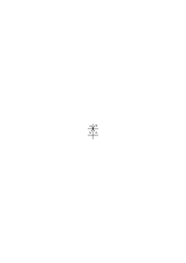

a cross-line drawn in the grammar of colours. It is clear that with the help of such a rule I can make a table without yet stepping outside grammar, and thus before any application of language. It would be different if the rule (R) ran: the little plaque always means a shade somewhat darker than its own. One need only attend again to the difference in sense between projecting colours and projecting shapes (and in the latter case, again, to the difference between depiction by visual criteria _and_ transfer with measuring instruments). To copy according to rule R is to ‘copy’ in a different sense from that in which producing the same shade is so called. So it isn’t a matter of two methods of projection comparable, say, to parallel and central projection, by which I can project one geometrical figure into another with compasses and straightedge. (The metric of shades of colour.) If I take this into account, then in the altered sense of the word “sample” (corresponding to the altered sense of the word “copy”) I can take the lighter plaque as the sample of the darker _object_.

### [II-13-14\[1\]](https://cdn.wittgensteinnachlass.com/2000px/webp/Ts-212/II-13-14.webp),[II-13-15\[1\]](https://cdn.wittgensteinnachlass.com/2000px/webp/Ts-212/II-13-15.webp)

Couldn’t we point to a little green plaque just as well as to a red one in giving an ostensive explanation of ‘red’? for if this definition merely puts one sign in place of another, surely it should come to the same thing. – If the explanation merely puts one word in place of another, it makes no difference. But if the explanation connects the word with a sample, then it does matter which plaque the sign is connected with (remember again that one colour cannot serve as a sample of another in the same sense as it can serve as a sample of itself). “But then there are arbitrary signs and signs that are not arbitrary!” – But just think of communication by means of maps and drawings on the one hand, and sentences on the other: the sentences are no more arbitrary than the drawings. But the words are arbitrary. (Compare the mapping | = o, – = x.) But is a word really used as a word if I use it only in conjunction with a table that makes the transition to samples? So isn’t it wrong to say that a sentence is a picture if I only put together a picture by following it and the table? But in that case the sentence and the table together are a picture after all. So not adbcb alone, then, but this sign together with

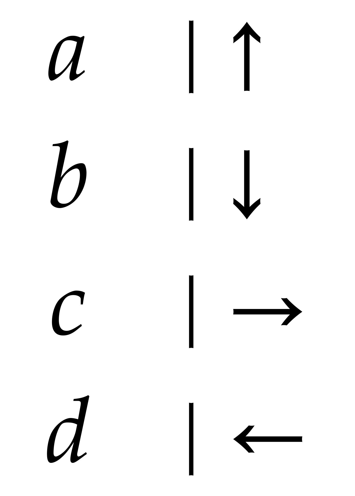

But it is obvious that adbcb too can be called a picture of 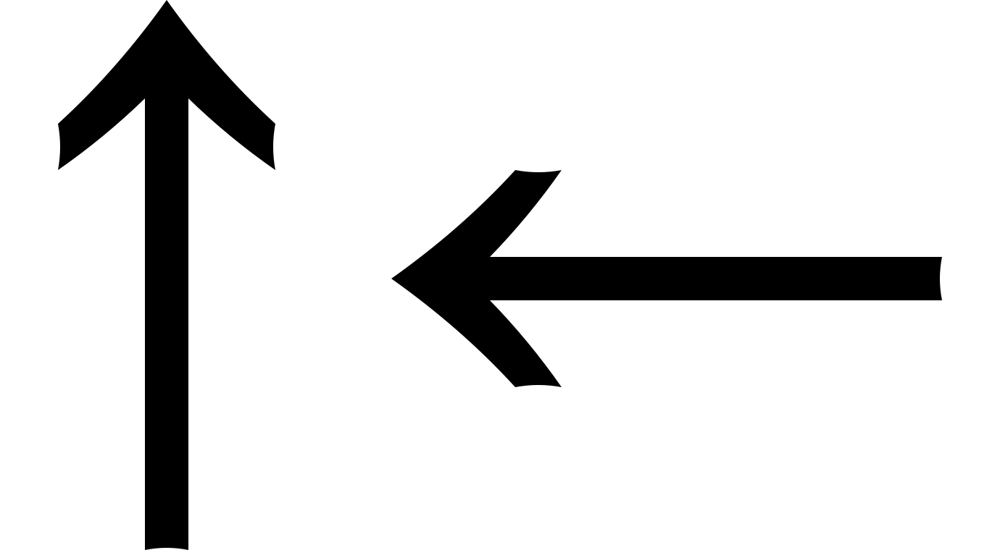. Yes, but isn’t the sign adbcb after all a more arbitrary picture of  than this sign is of the execution of the movement? There is something arbitrary about this transfer too (the method of projection), and how am I to determine which is more arbitrary. So I compare the stipulation of word-meaning by an ostensive definition to the stipulation of a method of projection for depicting spatial figures. That is of course no more than a comparison. A perfectly good comparison, but it doesn’t relieve us of the need to investigate how words work, separately from the case of spatial projection. We can certainly say – that is, it accords entirely with linguistic usage – that we communicate by means of signs, whether we use words or samples; but a sample is not a word, and the game of going by words is different from that of (going) by samples. (Words are not essential to language.) But might one perhaps say that samples are essential to it? (Samples are essential to the use of samples, words to the use of words.)

### [II-13-16\[1\]](https://cdn.wittgensteinnachlass.com/2000px/webp/Ts-212/II-13-16.webp)

79a Don’t forget here either that word-language is only _one_ among many possible languages, and that there are transitions from it to the others. Examine the map to see what in it corresponds to _the expression_ in word-language.

### [II-13-17\[1\]](https://cdn.wittgensteinnachlass.com/2000px/webp/Ts-212/II-13-17.webp)

79a ‘Primary’ ought really to mean: unmistakable.

### [II-13-18\[1\]](https://cdn.wittgensteinnachlass.com/2000px/webp/Ts-212/II-13-18.webp)

79a It sounds laughably obvious when I say that someone who believes gestures to be the primary signs underlying all the others would be unable to replace the most ordinary sentence with gestures.

### [II-13-19\[1\]](https://cdn.wittgensteinnachlass.com/2000px/webp/Ts-212/II-13-19.webp)

79a Rules of grammar that establish a “connection between language and reality”, and ones that do not. Of the first kind, say: “I call this colour ‘red’”, – of the second: “non-non-p = p”. But there is a misconception about this distinction: the distinction seems to be one of principle; and language seems to be essentially something that is given a structure and then fitted to reality.

### [II-13-20\[1\]](https://cdn.wittgensteinnachlass.com/2000px/webp/Ts-212/II-13-20.webp),[II-13-21\[1\]](https://cdn.wittgensteinnachlass.com/2000px/webp/Ts-212/II-13-21.webp)

8b, 79a “I don’t mean to insist that in the explanatory 8b, 79a table the little red plaque should be horizontally opposite the word ‘red’, but surely there must be some law for reading the table. Otherwise the table loses its sense”. But is it without a law if the table is understood as the arrows indicate?  “But doesn’t the schema  itself then have to be _given_ beforehand?” Only in so far as the  schema  _is_ also given beforehand.

### [II-13-21\[2\]](https://cdn.wittgensteinnachlass.com/2000px/webp/Ts-212/II-13-21.webp)

8 ““But isn’t at least a certain regularity in use required, then?! Would it do if we had to use a table according to this schema on one occasion and that schema on another? _How is one supposed to know_ how to use this table?”” – Well, how does one know _today_? Explanations of signs do come to an end at some point.

### [II-13-22\[1\]](https://cdn.wittgensteinnachlass.com/2000px/webp/Ts-212/II-13-22.webp)

79a Now of course I grant that, without having agreed on a code beforehand, I would cause a misunderstanding if I pointed to point A and said that this point is called ‘B’. Just as, if I want to show someone the way, I point my finger in the direction he is to go, not in the opposite direction. But this way of pointing, too, could be understood correctly, without this understanding supplementing the given sign with a further one. It is in human nature to understand pointing with the finger _in this way_. And so the human language of gestures is primary in a psychological sense.

### [II-13-23r\[1\]](https://cdn.wittgensteinnachlass.com/2000px/webp/Ts-212/II-13-23r.webp),[II-13-23v\[1\]](https://cdn.wittgensteinnachlass.com/2000px/webp/Ts-212/II-13-23v.webp)

79a Is pointing with the finger essential to our language? It is certainly a curious feature of our language that we explain words ostensively: this is a tree, this is a horse, this is green, etc.

### [II-13-23v\[1\]](https://cdn.wittgensteinnachlass.com/2000px/webp/Ts-212/II-13-23v.webp)

497 / 6 498 / 1 Is this still “reading”?

### [II-13-24\[1\]](https://cdn.wittgensteinnachlass.com/2000px/webp/Ts-212/II-13-24.webp)

79a ((All over _the earth_ there are board games played with little blocks on spaces. All over the earth there is a script that consists of written signs on a surface.))

### [II-13-25\[1\]](https://cdn.wittgensteinnachlass.com/2000px/webp/Ts-212/II-13-25.webp)

I determine the meaning of a word by explaining it as the name of an object, and also by explaining it as having the same meaning as another word. But didn’t I say that one can explain a sign only by means of another sign? And that is certainly so, inasmuch as the ostensive explanation “this is N” is a sign. But here the bearer of “N”, who is pointed to, also forms part of the sign. For:

[This person did it] = [N did it].

But then ‘N’ is the name of this person, not of the sign “this ”, of which this person is also a part. And the bearer plays a quite special role in the sign, different from that of another part of a sign. (A role not altogether unlike that of the sample.)

### [II-13-26\[1\]](https://cdn.wittgensteinnachlass.com/2000px/webp/Ts-212/II-13-26.webp)

The ostensive explanation of a name differs from a definition like “1 + 1 = 2” not only outwardly, in that, say, one of the signs consists in a gesture of my hand instead of a spoken or written sign, but _logically_; as the definition that sets the word alongside the sample differs from the definition of a word by a word. It is used in a different way.

### [II-13-27\[1\]](https://cdn.wittgensteinnachlass.com/2000px/webp/Ts-212/II-13-27.webp),[II-13-28\[1\]](https://cdn.wittgensteinnachlass.com/2000px/webp/Ts-212/II-13-28.webp)

So if I define a name ostensively and a second by means of the first, the second stands in a different relation to the first than it does to the sign that was given in the ostensive definition. That is, this latter sign differs essentially from the name in its use, and hence the verbal definition and the ostensive definition are ‘definitions’ in different senses of the word.

### [II-13-29\[1\]](https://cdn.wittgensteinnachlass.com/2000px/webp/Ts-212/II-13-29.webp)

I can speak of primary and secondary signs – in _one_ particular game, one particular language. – In a sample catalogue I _can_ call the samples the primary signs and the numbers the secondary ones. But what is one to say in a case like that of spoken and written letters? Which are the primary signs here, and which the secondary ones? The idea is this: A sign is secondary if, in order to orient myself by it, I need a table that connects it to another (primary) sign, _through which_ alone I can orient myself by the secondary one. The table does not guarantee me the sameness of all the transitions, for it does not force me to use it in the same way every time. It is there like a field through which paths lead, but I can also go cross-country. I make the transition in the table afresh each time I apply it. The transition is not, as it were, made once and for all in the table. (At most, the table _tempts_ me to make it in this way.)

### [II-13-29\[2\]](https://cdn.wittgensteinnachlass.com/2000px/webp/Ts-212/II-13-29.webp)

79a What, then, is the nature of my statement about the table: that it does not force me to use it in such-and-such a way? And: that the application is not anticipated by the rule (or the table)?

### [II-14FCr\[1\]](https://cdn.wittgensteinnachlass.com/2000px/webp/Ts-212/II-14FCr.webp)

What interests _us_ about the sign; the meaning that is decisive for _us_ is what is laid down in the grammar of the sign.

### [II-14-1\[1\]](https://cdn.wittgensteinnachlass.com/2000px/webp/Ts-212/II-14-1.webp)

38 Grammar is the set of ledgers of language; from them everything must be discernible that concerns not feelings but facts.

### [II-14-1\[2\]](https://cdn.wittgensteinnachlass.com/2000px/webp/Ts-212/II-14-1.webp)

38 What I really want to say, then, is: There is no such thing as grammar and, on top of that, interpretation of the signs. Rather, insofar as there can be any talk of an interpretation, that is, of an explanation of the signs, grammar itself must provide it. For I need only ask: Is the interpretation to be given by means of sentences? And how _should_ these sentences relate to the language they create?

### [II-14-2\[1\]](https://cdn.wittgensteinnachlass.com/2000px/webp/Ts-212/II-14-2.webp)

38 If I say that a sentence of, say, set theory is in order but must be given a new interpretation, that means only that this part of set theory is left intact in itself but must be put into a different grammatical setting.

### [III-FCr\[1\]](https://cdn.wittgensteinnachlass.com/2000px/webp/Ts-212/III-FCr.webp)

Sentence Sense of the sentence

### [III-15FCr\[1\]](https://cdn.wittgensteinnachlass.com/2000px/webp/Ts-212/III-15FCr.webp)

‘Sentence’ & ‘language’: concepts with blurred boundaries.

### [III-15-1\[1\]](https://cdn.wittgensteinnachlass.com/2000px/webp/Ts-212/III-15-1.webp)

69 What, then, do I distinguish a sentence from? Or what do I want to distinguish it from? From parts of a sentence within its grammatical system (as an equation is distinguished from the equals sign), or (from) _everything_ we do not call a sentence, such as this armchair, my watch, etc. etc.? For the fact that there are written or spoken forms that are especially like sentences need not really concern us.

### [III-15-1\[2\]](https://cdn.wittgensteinnachlass.com/2000px/webp/Ts-212/III-15-1.webp)

69 Or we must say: One can speak of the _concept of a sentence_ only within a grammatical system.

### [III-15-1\[3\]](https://cdn.wittgensteinnachlass.com/2000px/webp/Ts-212/III-15-1.webp)

69 (50) It is with the word “sentence” as with the word “object” and others: they are admissible only when applied within a limited sphere, and there they are natural. If the sphere is to be extended so as to make the concept a philosophical one, the meaning of the words evaporates and they are empty shadows. We must give them up there and go back to using them within their narrow bounds.

### [III-15-1\[4\]](https://cdn.wittgensteinnachlass.com/2000px/webp/Ts-212/III-15-1.webp)

69 (50) But now one would like to say: “A sentence is anything by which I mean something”. And if asked “what does it mean to mean ‘something’”, I would have to give examples. Now these examples do have a domain over which _they_ can be _extended_, but they take me no _further_. Just as in logic I cannot generalize at random. But the point here is not about types; it is that the generalization itself is something determinate, namely a sign with grammatical rules determined in advance. That is, the indeterminacy of generality is not a logical indeterminacy. As if we now had not only freedom in logical space but also freedom to extend or alter that space.

### [III-15-1\[5\]](https://cdn.wittgensteinnachlass.com/2000px/webp/Ts-212/III-15-1.webp),[III-15-2\[1\]](https://cdn.wittgensteinnachlass.com/2000px/webp/Ts-212/III-15-2.webp)

69 (50) So not just freedom of movement, but an indeterminacy of the geometry.

### [III-15-2\[2\]](https://cdn.wittgensteinnachlass.com/2000px/webp/Ts-212/III-15-2.webp)

69 [50 + ] etc. No sign leads us beyond itself; and no argument does either.

### [III-15-2\[3\]](https://cdn.wittgensteinnachlass.com/2000px/webp/Ts-212/III-15-2.webp)

69 If we say that a sentence is any sign by which we mean something, one might ask: what do we mean and _when_ do we mean it? While we are giving the sign? etc., etc.

### [III-15-3\[1\]](https://cdn.wittgensteinnachlass.com/2000px/webp/Ts-212/III-15-3.webp)

69 If I ask “what is the general form of the sentence”, the question in reply may be: “_have_ we a general concept of the sentence, then, that we now want to formulate precisely?” – As in: Have we a general concept of reality?

### [III-15-3\[2\]](https://cdn.wittgensteinnachlass.com/2000px/webp/Ts-212/III-15-3.webp)

69 The question may also be put this way: What happens when a new sentence is taken into the language: What is the criterion for its being a sentence? Or, if being taken into the language stamps it as a sentence, what does this admission consist in? Or: what is language?

### [III-15-3\[3\]](https://cdn.wittgensteinnachlass.com/2000px/webp/Ts-212/III-15-3.webp)

69 Now it seems obvious here that one distinguishes giving signs _from other activities_. A person sleeps, eats, drinks, gives signs (uses a language).

### [III-15-4\[1\]](https://cdn.wittgensteinnachlass.com/2000px/webp/Ts-212/III-15-4.webp)

50, 69 What is a sentence? what defines this concept? – How is this word (“sentence”) used in non-philosophical language? Sentence, in contrast to what?

### [III-15-4\[2\]](https://cdn.wittgensteinnachlass.com/2000px/webp/Ts-212/III-15-4.webp)

50, 69 I know a sentence when I see one.

### [III-15-4\[3\]](https://cdn.wittgensteinnachlass.com/2000px/webp/Ts-212/III-15-4.webp)

50, 69 This question is fundamental: Suppose we have a new experience, say we become acquainted with a new taste or a new stimulus to the skin: how do I know that what describes this experience is a sentence? Or, why should I call it a sentence? Presumably by the same right as I spoke of a new experience. For experience and sentence are equivalent. But why did I use the word experience, in contrast to what?

### [III-15-4\[4\]](https://cdn.wittgensteinnachlass.com/2000px/webp/Ts-212/III-15-4.webp),[III-15-5\[1\]](https://cdn.wittgensteinnachlass.com/2000px/webp/Ts-212/III-15-5.webp)

50, 69 Have I already characterized what happened to some extent by saying it was an experience? Apparently 50, 69 _not at all_. And yet it seems as if I had _already_ done so, as if I had already said something _about it_: “that it was an experience”. Our _whole_ problem lies in this false appearance. For what holds of the predicate “experience” holds of the predicate “sentence”.

### [III-15-5\[2\]](https://cdn.wittgensteinnachlass.com/2000px/webp/Ts-212/III-15-5.webp)

50, 69 The word “sentence” and the word “experience” already have a determinate grammar.

### [III-15-5\[3\]](https://cdn.wittgensteinnachlass.com/2000px/webp/Ts-212/III-15-5.webp)

50, 69 That is to say, their grammar must be determined in advance and does not depend on any future event.

### [III-15-5\[4\]](https://cdn.wittgensteinnachlass.com/2000px/webp/Ts-212/III-15-5.webp)

Here, too, the nonsense in the “experimental theory of meaning” is _made explicit_. For meaning is laid down in grammar.

### [III-15-5\[5\]](https://cdn.wittgensteinnachlass.com/2000px/webp/Ts-212/III-15-5.webp)

How does the grammar of the word “sentence” relate to the grammar of sentences?

### [III-15-5\[6\]](https://cdn.wittgensteinnachlass.com/2000px/webp/Ts-212/III-15-5.webp)

“Sentence” is evidently the heading of the grammar of sentences. In one sense, though, it is also the heading of grammar as a whole, and thus equivalent to the words “grammar” and “language”.

### [III-15-5\[7\]](https://cdn.wittgensteinnachlass.com/2000px/webp/Ts-212/III-15-5.webp)

50, 69 This is also what is meant by saying that there are surprises in the world but not in grammar.

### [III-15-6\[1\]](https://cdn.wittgensteinnachlass.com/2000px/webp/Ts-212/III-15-6.webp)

50, 69 What seems to make our question even harder is that the words “world” and “reality” are also equivalents of the word “sentence”.

### [III-15-6\[2\]](https://cdn.wittgensteinnachlass.com/2000px/webp/Ts-212/III-15-6.webp)

50, 69 But it is ridiculous to want to delimit the world, or reality. What is one to set it against? And so it is with the _meaning of the word_ “fact”. But then one does not use these words as concept-*words* either.

### [III-15-7\[1\]](https://cdn.wittgensteinnachlass.com/2000px/webp/Ts-212/III-15-7.webp)

((26)50, 69) 76 Something is a sentence only in a language.

### [III-15-7\[2\]](https://cdn.wittgensteinnachlass.com/2000px/webp/Ts-212/III-15-7.webp)

(50, 69) 76 Now if I say: but language can expand, after all, the answer is: Certainly, but if this word “expand” has a sense here, then I must already know _now_ what I mean by it, must be able to say how I imagine such an expansion. And what I cannot think now, I cannot express now, nor even hint at.

### [III-15-7\[3\]](https://cdn.wittgensteinnachlass.com/2000px/webp/Ts-212/III-15-7.webp)

50, 69 76 And the word “now” here means: “in _this_ calculus”, or: “when the words are used with _these_ grammatical rules”.

### [III-15-7\[4\]](https://cdn.wittgensteinnachlass.com/2000px/webp/Ts-212/III-15-7.webp)

(50, (69)) 76 Here we have _this_ nagging problem: how it is possible even to think of the existence of things when we always see only mental images – their likenesses.

### [III-15-8\[1\]](https://cdn.wittgensteinnachlass.com/2000px/webp/Ts-212/III-15-8.webp)

50 (69) 76 1 Here belongs the old question: “but how, then, did I arrive at this concept at all” (say, that of objects outside me). (It is a good thing to be able to look at such a question from a distance as an old movement of thought, without being entangled in it.) It is quite right to imagine this question followed by: “surely I couldn’t transcend my own thinking”, “surely I couldn’t meaningfully transcend what has sense for me”. It is the feeling that I cannot come by some back way (on the sly) to think something that I am really barred from thinking. That there are no back ways here by which I could get further than by the direct route.

### [III-15-8\[2\]](https://cdn.wittgensteinnachlass.com/2000px/webp/Ts-212/III-15-8.webp)

50 (69) 76 Of course we are dealing once again with a _false analogy_: It makes _perfectly good_ sense to say “I know that he is in this room because I can hear him, even though I cannot go in and see him”.

### [III-15-9\[1\]](https://cdn.wittgensteinnachlass.com/2000px/webp/Ts-212/III-15-9.webp)

50, 69, [77] “Sentence” is just as general as, for example, “event”. How can one delimit “an event” against what is not an event? But “experiment” is just as general too, though it may seem _more specific_ at first glance.

### [III-15-10\[1\]](https://cdn.wittgensteinnachlass.com/2000px/webp/Ts-212/III-15-10.webp)

50, 69, [77] “Then an event occurred …”: this does not mean “an _event_” as opposed to something else.

### [III-15-11\[1\]](https://cdn.wittgensteinnachlass.com/2000px/webp/Ts-212/III-15-11.webp)

76 Legitimate use of the word ‘language’: It means either the empirical fact that human beings speak (on a par with the fact that dogs bark), or it means an established system _of communication_ in the expressions “the English language”, “German language”, “language of Negroes”, etc. ‘Language’ as a logical concept could only be equivalent to ‘sentence’, and would then be a heading for a part of grammar.

### [III-15-12\[1\]](https://cdn.wittgensteinnachlass.com/2000px/webp/Ts-212/III-15-12.webp)

76, (66) Could we call something ‘language’ if it were not actually applied? Could one speak of language if no language had ever been spoken? (Is language a concept like ‘centaur’, which exists even if there has never been such a creature?) (Compare this with a game that has never been played, a rule that has never been acted on.)

### [III-15-13\[1\]](https://cdn.wittgensteinnachlass.com/2000px/webp/Ts-212/III-15-13.webp)

76 What does someone who constructs (invents) a new language do? By what principle does he proceed? For this principle is the concept of ‘language’.

### [III-15-14\[1\]](https://cdn.wittgensteinnachlass.com/2000px/webp/Ts-212/III-15-14.webp)

76 To invent a language is to construct a language. To lay down its rules. To write its grammar.

### [III-15-14\[2\]](https://cdn.wittgensteinnachlass.com/2000px/webp/Ts-212/III-15-14.webp)

76 Does every invented language extend the concept of language?

### [III-15-14\[3\]](https://cdn.wittgensteinnachlass.com/2000px/webp/Ts-212/III-15-14.webp)

76 What holds for the word “language” must also hold for the expression “system of rules”. And so for the word “calculus” too.

### [III-15-15\[1\]](https://cdn.wittgensteinnachlass.com/2000px/webp/Ts-212/III-15-15.webp)

76 How did I come to the concept of ‘language’? Only through the languages that I have learned. But they have led me in a certain sense beyond themselves, because I would now be able to construct a new language, e.g. to invent words. So this method of construction also belongs to the concept of language. But only if I define it in this way.

### [III-15-15\[2\]](https://cdn.wittgensteinnachlass.com/2000px/webp/Ts-212/III-15-15.webp)

76 The concept of communicating something to one another. If, for example, I say: I shall call any system of signs that people agree on among themselves in order to communicate with one another ‘language’, one might already ask at this point: And what do you include under the concept of ‘sign’?

### [III-15-15\[3\]](https://cdn.wittgensteinnachlass.com/2000px/webp/Ts-212/III-15-15.webp)

76 [50] Time and again my “and so on” has a limit.

### [III-15-16\[1\]](https://cdn.wittgensteinnachlass.com/2000px/webp/Ts-212/III-15-16.webp)

59, 50, 76 [→ ]

What do I call “action”, what “sense perception”?

### [III-15-16\[2\]](https://cdn.wittgensteinnachlass.com/2000px/webp/Ts-212/III-15-16.webp)

56 76 The words “world”, “experience”, “language”, “sentence”, “calculus”, “mathematics” can all serve only to mark trivial distinctions, like “eating”, “resting”, etc.

### [III-15-16\[3\]](https://cdn.wittgensteinnachlass.com/2000px/webp/Ts-212/III-15-16.webp)

56 76 For even if such a word were the title of our grammar – say, the word “grammar” – this title would have only to distinguish this book from other books.

### [III-15-16\[4\]](https://cdn.wittgensteinnachlass.com/2000px/webp/Ts-212/III-15-16.webp)

56 76 There are no general discussions of the world and language.

### [III-15-17\[1\]](https://cdn.wittgensteinnachlass.com/2000px/webp/Ts-212/III-15-17.webp)

76? But why do I rack my brains over the concept of ‘language’ instead of using language?!

Aim

### [III-15-18\[1\]](https://cdn.wittgensteinnachlass.com/2000px/webp/Ts-212/III-15-18.webp)

61, 50 In Plato I do not find, in response to a question like “what is knowledge”, the provisional answer: Let us first look at how this word is used. Socrates always rejects talk of pieces of knowledge instead of knowledge itself.

### [III-15-19\[1\]](https://cdn.wittgensteinnachlass.com/2000px/webp/Ts-212/III-15-19.webp)

76? This brain-racking is justified only if we _have_ a general concept.

### [III-15-20\[1\]](https://cdn.wittgensteinnachlass.com/2000px/webp/Ts-212/III-15-20.webp)

61 But if the general concept of language thus dissolves, so to speak, doesn’t philosophy dissolve too? No, for its task is not to create a new language but to clean up the one we have.

### [III-15-21\[1\]](https://cdn.wittgensteinnachlass.com/2000px/webp/Ts-212/III-15-21.webp)

61 5 Someone who points out that a word has been used in two different meanings, or that when we use _this_ expression we have _this_ picture in mind, and who in general ascertains (tabulates) the rules according to which words are used, is under no obligation at all to give an explanation (definition) of the word “rule” (or “word”, “language”, “sentence”, etc.).

### [III-15-22\[1\]](https://cdn.wittgensteinnachlass.com/2000px/webp/Ts-212/III-15-22.webp)

61 Philosophy deals with calculi in the same sense in which it deals with thoughts (or with sentences and languages). But if it dealt essentially with the concept of a calculus, that is, with the concept of a calculus prior to all calculi, there would be a metaphilosophy. And there is no such thing. (One could present everything we have to say in such a way that this would appear as a guiding thought.)

### [III-15-23\[1\]](https://cdn.wittgensteinnachlass.com/2000px/webp/Ts-212/III-15-23.webp)

50, 61, 56a Thus I am allowed to use the word ‘rule’ without necessarily first tabulating the rules about this word. And these rules are not meta-rules.

### [III-15-23\[2\]](https://cdn.wittgensteinnachlass.com/2000px/webp/Ts-212/III-15-23.webp)

50, 61, 56a The word “rule” need not be used in the explanation of a game (nor, of course, need an equivalent word).

### [III-15-23\[3\]](https://cdn.wittgensteinnachlass.com/2000px/webp/Ts-212/III-15-23.webp),[III-15-24\[1\]](https://cdn.wittgensteinnachlass.com/2000px/webp/Ts-212/III-15-24.webp)

50, 61, 56a And how, then, do we use the word ‘rule’ (when, for instance, we talk about games)? In contrast to what? We say, for example, “that follows from this rule”, but then we could surely quote the rule of the game and so replace the word “rule”. Or we speak of “all the rules of the game” and must then either have listed them (in which case we are (again) back to the first case), or we speak of the rules as a group whose members are generated in a particular way from given _basic positions_, and then the word “rule” stands for the expression of _these_ basic positions and operations. Or we say “_This_ is a rule, _that_ isn’t”, when, say, the second is just a single word or a configuration of the pieces. (Or: “no, that too is a rule under the new agreement”.) If, for instance, we had to write out the list of rules of the game, something like this might be said, and then it would mean: _This_ goes in, _that_ doesn’t. But not by virtue of a particular property (namely, that of being a rule), as when one wants to pack nothing but apples into a crate and says “no, that doesn’t go in, that’s a pear”. Yes, but surely we call some things “games” and others not, and some things “rules” and others not! But drawing a boundary between everything we call a game and everything else is *n*ever what matters. For us, games are _the_ games we have heard of, the ones we can list, and perhaps a few more newly devised by analogy with others; and if someone were to write a book about games, he would not really need 50 etc. the word “game” even in the title: the title could be a list of the names of the individual games. And if asked: But what is it that all these things have in common, _on account of which_ you group them together? he could say: I can’t specify it in one sentence, but you can see plenty of analogies. Besides, the question is idle, since I can again proceed by analogy in imperceptible steps and arrive at constructions that no one in ordinary life would still call a “game”, so that what one chose to call a “game” would once again be arbitrary. So I call what is on this list a “game”, as well as whatever is similar to these games to a certain degree (which I have not specified more precisely). Beyond that I reserve the right to decide in each new case whether or not to count something among the games.

### [III-15-24\[2\]](https://cdn.wittgensteinnachlass.com/2000px/webp/Ts-212/III-15-24.webp),[III-15-25\[1\]](https://cdn.wittgensteinnachlass.com/2000px/webp/Ts-212/III-15-25.webp)

50, 61, 56a Now the same applies to the concept of a rule. Only in quite particular cases are we concerned with distinguishing rules from something that is not a rule, and in all these cases it is easy to give a criterion for the distinction. That is, we use the word “rule” in contrast to “word”, “configuration of the pieces” and a few other things, and these boundaries are clearly drawn. On the other hand, it is idle to draw boundaries where we do not need them. Isn’t it the same here as with the concept ‘plant’? We use this word in a definite sense, but in the case of single-celled organisms the question of whether one should call them animals or plants remained open for a time, and one could also construct as many other borderline cases as one liked in which it would still have to be decided whether something still fell under the concept of a plant. But does that make the meaning of the word “plant” vague in all other cases, so that one could say that we use the word without understanding it? Indeed, would a definition that delimited the concept on _different_ sides make the meaning 50, 61, 56a of the word clearer to us in all sentences, so that we would also understand all the sentences in which it occurs better? Evidently not.

### [III-15-26\[1\]](https://cdn.wittgensteinnachlass.com/2000px/webp/Ts-212/III-15-26.webp)

25 50 61 (Socrates asks what knowledge is and is not satisfied with a list of instances of knowledge. But we do not concern ourselves much with this general concept and are glad if we understand shoemaking, geometry, etc.)

### [III-15-27\[1\]](https://cdn.wittgensteinnachlass.com/2000px/webp/Ts-212/III-15-27.webp)

25 50 61 We do not believe that only someone who can give a definition of the concept ‘game’ understands a game.

### [III-15-27\[2\]](https://cdn.wittgensteinnachlass.com/2000px/webp/Ts-212/III-15-27.webp)

61 (I am making things easier and easier for myself in philosophy. But the difficulty is in making things easier for oneself and yet remaining exact.)

### [III-16FCr\[1\]](https://cdn.wittgensteinnachlass.com/2000px/webp/Ts-212/III-16FCr.webp)

Logic speaks of sentences & words in the ordinary sense, not of sentences & words in some more abstract sense.

### [III-16-1\[1\]](https://cdn.wittgensteinnachlass.com/2000px/webp/Ts-212/III-16-1.webp)

69 I do not believe that logic can speak of sentences in a different sense from the one in which we ordinarily do when we say “there’s a sentence written down here” or “no, that only looks like a sentence, but it isn’t one”, etc. etc.

### [III-16-1\[2\]](https://cdn.wittgensteinnachlass.com/2000px/webp/Ts-212/III-16-1.webp)

69 The question “what is a word” is entirely analogous to “what is a chess piece”.

### [III-16-2\[1\]](https://cdn.wittgensteinnachlass.com/2000px/webp/Ts-212/III-16-2.webp)

69 We are speaking of the spatial and temporal _phenomenon_ of language. Not of some absurdity outside space and time. But we speak of it as we do of the pieces in a game of chess, by tabulating rules for them, not by describing their physical properties.

### [III-16-2\[2\]](https://cdn.wittgensteinnachlass.com/2000px/webp/Ts-212/III-16-2.webp),[III-16-3\[1\]](https://cdn.wittgensteinnachlass.com/2000px/webp/Ts-212/III-16-3.webp)

(61), 69 Nor can we attain any greater _generality_ in philosophy than in what we say in life and in science (I.e. here too we leave everything as it is.)

### [III-16-4\[1\]](https://cdn.wittgensteinnachlass.com/2000px/webp/Ts-212/III-16-4.webp)

61 Thus a sensational definition of number is no business of philosophy.

### [III-16-4\[2\]](https://cdn.wittgensteinnachlass.com/2000px/webp/Ts-212/III-16-4.webp)

61 Philosophy has to do with existing languages and is not to pretend that it must deal with an abstract language.

### [III-16-5\[1\]](https://cdn.wittgensteinnachlass.com/2000px/webp/Ts-212/III-16-5.webp)

38˙2 For when I speak about language – word, sentence, etc. – I must speak the language of everyday life. – But is there any other?

### [III-16-5\[2\]](https://cdn.wittgensteinnachlass.com/2000px/webp/Ts-212/III-16-5.webp)

38˙2 Is this language perhaps too crude, too material, for what we want to say? And can there be another? And how strange, then, that we can still do something with our own.

### [III-16-6\[1\]](https://cdn.wittgensteinnachlass.com/2000px/webp/Ts-212/III-16-6.webp)

38˙2 That in explaining language (in our sense) I already have to use the full language (not some preparatory, provisional one) already shows that I can say only external things about language.

### [III-16-7\[1\]](https://cdn.wittgensteinnachlass.com/2000px/webp/Ts-212/III-16-7.webp)

38˙2 Yes, but how can these expositions then satisfy us? – Well, your questions too were already formulated in this language; they had to be expressed in this language if anything was to be asked!

### [III-16-7\[2\]](https://cdn.wittgensteinnachlass.com/2000px/webp/Ts-212/III-16-7.webp)

38˙2 And your scruples are misunderstandings.

### [III-16-7\[3\]](https://cdn.wittgensteinnachlass.com/2000px/webp/Ts-212/III-16-7.webp)

38˙2 Your questions refer to words, so I must talk about words.

### [III-16-7\[4\]](https://cdn.wittgensteinnachlass.com/2000px/webp/Ts-212/III-16-7.webp)

38˙2 One says: After all, it is not the word that matters, but its meaning, and one always thinks of the meaning as if it were a thing of the same kind as the word, though different from it. Here is the word, here the meaning. (The money, and the cow one can buy with it. But on the other hand: the money, and its usefulness.)

### [III-16-8\[1\]](https://cdn.wittgensteinnachlass.com/2000px/webp/Ts-212/III-16-8.webp)

38˙2 No more scruples about language are warranted than a chess player has about the game of chess, namely none.

[What is meant here is not “About the concept of language”. Rather, it means something like: “just go ahead and speak, as a chess player plays, nothing can happen to you, your scruples are only misunderstandings of ‘philosophical’ sentences.”]

### [III-17FCr\[1\]](https://cdn.wittgensteinnachlass.com/2000px/webp/Ts-212/III-17FCr.webp)

The Sentence & Its Sound

### [III-17-1\[1\]](https://cdn.wittgensteinnachlass.com/2000px/webp/Ts-212/III-17-1.webp)

69 In asking about the general sentential form, we bear in mind that although ordinary language has a certain sentence rhythm, not everything with this rhythm is a sentence. I.e. something can _sound like a sentence_ and not be one. – Hence the idea of a ‘_sentence_’ with sense and of a nonsensical one.

### [III-17-1\[2\]](https://cdn.wittgensteinnachlass.com/2000px/webp/Ts-212/III-17-1.webp)

69 On the other hand, this rhythm is of course not essential. The expression “sugar table” does not _sound_ like a sentence, but it can quite well replace the sentence “there is sugar on the table”. And not as if we had to supply something missing in our minds; rather, what matters, again, is simply the system to which the expression “sugar table” belongs.

### [III-17-1\[3\]](https://cdn.wittgensteinnachlass.com/2000px/webp/Ts-212/III-17-1.webp)

69 The question, then, is whether, apart from this misleading sentence sound, we have a general concept of the sentence. (I am speaking now of what is _held together_ by ‘ & ’, ‘ ⌵ ’, ‘⊃’.)

### [III-17-2\[1\]](https://cdn.wittgensteinnachlass.com/2000px/webp/Ts-212/III-17-2.webp)

69 Suppose we were to read the sentences of a book backwards, the words in reverse order; could we not still understand the sentence? And wouldn’t it now sound quite unlike a sentence?

### [III-17-3\[1\]](https://cdn.wittgensteinnachlass.com/2000px/webp/Ts-212/III-17-3.webp)

52 Does it make sense to say: “I have as many shoes as there are units in a root of the equation x³ + 2x ‒ 3 = 0”? Here it might seem as though we had a notation of which we might not be able to tell, just by looking at it, whether it makes sense or not. If the expression “the root of the equation F(x) = 0” were a description in Russell’s sense, then the sentence “I have n apples and n + 2 = 6” would have a different sense from “I have 4 apples”. In the first sentence we have an extraordinarily instructive example of how a notation can seem unobjectionable at first sight, as though we understood it; and of how in reality we have formed a nonsensical sentence by analogy with one that has sense and only _believe_ that we have a clear view of the rules of the former. Thus “I have n shoes and n² = 4” is a sentence with sense; but not “I have n shoes and n² = 2”.

### [III-18FCr\[1\]](https://cdn.wittgensteinnachlass.com/2000px/webp/Ts-212/III-18FCr.webp)

What is to count as a sentence is determined in the _grammar_.

### [III-18-1\[1\]](https://cdn.wittgensteinnachlass.com/2000px/webp/Ts-212/III-18-1.webp)

69 The explanation one receives when one asks about the essence of the proposition: that a proposition is anything that can be true or false – is not altogether wrong. It is the form of the truth-function (in whatever form of notation it is expressed) that constitutes the logical essence of the proposition.

### [III-18-2\[1\]](https://cdn.wittgensteinnachlass.com/2000px/webp/Ts-212/III-18-2.webp)

92 ‘p’ is true = p. One uses the word “true” in contexts such as “what he says is true”, but that says the same thing as “he says ‘p’, and p is the case”.

### [III-18-3\[1\]](https://cdn.wittgensteinnachlass.com/2000px/webp/Ts-212/III-18-3.webp)

92a “True” and “false” are in fact only words in a particular notation for the truth-function.

### [III-18-4\[1\]](https://cdn.wittgensteinnachlass.com/2000px/webp/Ts-212/III-18-4.webp),[III-18-5\[1\]](https://cdn.wittgensteinnachlass.com/2000px/webp/Ts-212/III-18-5.webp)

69 When one says that a proposition is anything that can be true or false, 69 that means _the same_ as: a proposition is anything that can be negated.

### [III-18-5\[2\]](https://cdn.wittgensteinnachlass.com/2000px/webp/Ts-212/III-18-5.webp)

69 When we speak of what is essential to sentential form _as such_, we mean the truth-functions.

### [III-18-6\[1\]](https://cdn.wittgensteinnachlass.com/2000px/webp/Ts-212/III-18-6.webp)

50, 69 (77) Of course one cannot say that ‘sentence’ is what one can predicate ‘true’ and ‘false’ of, in the sense that one could try out which symbols the words ‘true’ and ‘false’ fit & decide on that basis whether something is a sentence. For that would determine something only if those words were meant in a particular way. And precisely in the context of a sentence. All one can do here, as in all these cases, is to specify the grammatical game, give its rules and leave it at that.

### [III-18-7\[1\]](https://cdn.wittgensteinnachlass.com/2000px/webp/Ts-212/III-18-7.webp)

69, 50 [77] What a sentence is is determined by grammar. I.e. within grammar. (That was also what my “general sentential form” was aimed at.)

### [III-18-8\[1\]](https://cdn.wittgensteinnachlass.com/2000px/webp/Ts-212/III-18-8.webp)

(39a) 77, 69 One cannot say “this structure is still missing something that would make it a sentence”. Rather, it is missing something that would make it _this_ sentence. Just as one can say: the expression in signs “2 + 2 4” is missing something that would make it an equation.

### [III-18-8\[2\]](https://cdn.wittgensteinnachlass.com/2000px/webp/Ts-212/III-18-8.webp)

38 77, 69 The Russians who say “he good” instead of “he is good” lose nothing, nor do they supply a verb in their minds.

### [III-18-8\[3\]](https://cdn.wittgensteinnachlass.com/2000px/webp/Ts-212/III-18-8.webp)

(39a) 77, 69 It is no more possible to characterize the complete sentence than the complete fact.

### [III-18-9\[1\]](https://cdn.wittgensteinnachlass.com/2000px/webp/Ts-212/III-18-9.webp),[III-18-10\[1\]](https://cdn.wittgensteinnachlass.com/2000px/webp/Ts-212/III-18-10.webp)

50 Can one fix the concept of the “sentence”? Or the general form of a law? – Why not! Just as one could fix the concept ‘number’, say by means of the sign “[0, x, x + 1]”. I am free to call only that a number; and so I am also free to give an analogous prescription for forming sentences or laws and to use the word “sentence” or “law” as an equivalent of this prescription. If one objects and says that clearly this has merely marked off certain laws from others, I reply: Yes, of course you cannot draw a boundary if you are resolved from the outset not to recognize one! 50 – If the “sentences” are to fill infinite logical space, there can be no question of a general sentential form. The question then is, of course: How do you use the word “sentence” now? In contrast to what? – In contrast, say, to “word”, “part of a sentence”, “book title”, “story”, etc.

### [III-18-11\[1\]](https://cdn.wittgensteinnachlass.com/2000px/webp/Ts-212/III-18-11.webp)

50 (A proposition that deals with all propositions or all functions. What does one imagine this to be? It would presumably be a proposition of logic. Now let us think of how the proposition 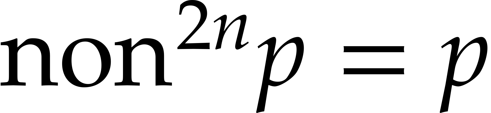 is proved.)

### [III-18-12\[1\]](https://cdn.wittgensteinnachlass.com/2000px/webp/Ts-212/III-18-12.webp)

69 If I accept “things are thus and so” as the general sentential form, then I must count 2 + 2 = 4 among the sentences, for it is grammatically correct to say: “things are such that 2 + 2 equals 4”. Further rules are needed to exclude the sentences of arithmetic.

### [III-18-13\[1\]](https://cdn.wittgensteinnachlass.com/2000px/webp/Ts-212/III-18-13.webp)

50 (69) False ideas about how language works: Broad, who said that the statement that something _will_ happen is not a proposition. What is one thereby denying of this statement? Anything other than that it _describes_ something present or past? – Magic with words. A sentence like Broad’s strikes me as like an attempt to bring about a chemical change by magic; by letting the substances know, as it were, what they are supposed to do (as if one wanted to turn iron into gold by taking hold of a piece of iron with the right hand and at the same time a piece of gold with the left).

### [III-19FCr\[1\]](https://cdn.wittgensteinnachlass.com/2000px/webp/Ts-212/III-19FCr.webp)

The grammatical rules determine the sense of the sentence, & whether a combination of words has sense or not.

### [III-19-1\[1\]](https://cdn.wittgensteinnachlass.com/2000px/webp/Ts-212/III-19-1.webp),[III-19-2\[1\]](https://cdn.wittgensteinnachlass.com/2000px/webp/Ts-212/III-19-2.webp)

68 72b One might say: “How do I manage to use a word correctly every time? Do I always look it up in the grammar? No, the fact that I mean something – what I mean – stops me from talking nonsense.” – But what do I mean? I say: I talk about dividing an apple, but not about dividing the colour red, because with “dividing an apple” I can think of something, imagine something, want something; with the expression “dividing a colour” I cannot. And is it perhaps just that one has not yet observed any effect on other people in the case of this word?!

### [III-19-2\[2\]](https://cdn.wittgensteinnachlass.com/2000px/webp/Ts-212/III-19-2.webp)

68 “How do I know that I cannot divide red?” – The question itself means nothing. I should like to say: I have to _begin_ with the distinction between sense and nonsense. Nothing is possible before it. I cannot justify it.

### [III-19-3\[1\]](https://cdn.wittgensteinnachlass.com/2000px/webp/Ts-212/III-19-3.webp),[III-19-4\[1\]](https://cdn.wittgensteinnachlass.com/2000px/webp/Ts-212/III-19-4.webp)

38a Now what kind of rules are those that say that such and such combinations of words have no sense? Are they of the same kind as the _prescriptions_ that say, for instance, that it is not a position in chess if two pieces stand on the same square, or if a piece stands on the boundary between two squares, etc.? These sentences in turn are like certain actions, as, for instance, when one cuts a chessboard out of a larger piece of squared paper. They draw a boundary. – What does it mean, then, to say: “this combination of words means nothing”. Of a name one can say “I have given this name to no one”, and giving a name is a definite action (hanging a little sign round someone’s neck). Think of the representation of a journey on the earth by a line in the projection of the two hemispheres, and suppose we say: a segment of the line 38a that goes beyond the boundary circles of the projections on the plane of the drawing is senseless in this representation. One could also say: nothing has been settled about it.

### [III-19-5r\[1\]](https://cdn.wittgensteinnachlass.com/2000px/webp/Ts-212/III-19-5r.webp)

38a Visual space and the retina. It is as if one were to project a sphere orthogonally onto a plane, rather in the way the two hemispheres of the earth are represented in an atlas, and someone might then think that what goes on in the plane outside the two projections still corresponds to a possible extension of what is on the sphere. What is being projected here is a _complete space_ onto a _part_ of another space; and it is analogous with the limits of language in the dictionary.

### [III-19-5v\[1\]](https://cdn.wittgensteinnachlass.com/2000px/webp/Ts-212/III-19-5v.webp)

… Intelligibility of the expression “mixture” without specification of a colour transition.

### [III-20FCr\[1\]](https://cdn.wittgensteinnachlass.com/2000px/webp/Ts-212/III-20FCr.webp)

The sense of the sentence no _soul_

### [III-20-1\[1\]](https://cdn.wittgensteinnachlass.com/2000px/webp/Ts-212/III-20-1.webp)

The method of measurement, e.g. of spatial measurement, stands in exactly the same relation to a particular measurement as the sense of a sentence does to its truth or falsity.

### [III-20-2\[1\]](https://cdn.wittgensteinnachlass.com/2000px/webp/Ts-212/III-20-2.webp)

72 The sense of a sentence is not pneumatic, but is what one gets in reply when one asks for an explanation of the sense. And – or – one sense differs from another as the explanation of the one differs from the explanation of the other.

### [III-20-2\[2\]](https://cdn.wittgensteinnachlass.com/2000px/webp/Ts-212/III-20-2.webp)

72 The role the sentence plays in the calculus is its sense.

### [III-20-3\[1\]](https://cdn.wittgensteinnachlass.com/2000px/webp/Ts-212/III-20-3.webp)

72 The sense (then) does not lie _behind_ it (like the mental process of forming images, etc.).

### [III-20-4\[1\]](https://cdn.wittgensteinnachlass.com/2000px/webp/Ts-212/III-20-4.webp)

72 What does it mean to “discover that a sentence has no sense”? And what does this mean: “if I mean something by it, surely it must have sense”? 72 “If I mean something by it …” – if I mean _what_ by it?!

### [III-20-4\[2\]](https://cdn.wittgensteinnachlass.com/2000px/webp/Ts-212/III-20-4.webp)

72 What does it mean: “If I can imagine something in connection with it, surely it must have sense”? If I can imagine _what_ in connection with it? What I say? – That means nothing. – And ‘Something’? That would mean: if I can use the words in this way, then they have sense. Or rather: if I use them to calculate, then they have sense.

### [III-20-5\[1\]](https://cdn.wittgensteinnachlass.com/2000px/webp/Ts-212/III-20-5.webp)

76 One could also ask the question this way: is the whole sentence merely an unarticulated sign, in which I recognize similarities to other sentences only afterwards? It would be rather as if each sentence were a drug with a particular effect, & only afterwards, by analysis, one discovered that two medicines had certain ingredients in common.

### [III-20-5\[2\]](https://cdn.wittgensteinnachlass.com/2000px/webp/Ts-212/III-20-5.webp)

76 Indeed, one could put our question in a very elementary form: why is a language with only one word not possible, given that a word does sometimes have several meanings (_in one language_)? (Why not all of them, then?)

[Sentence is composite]! Is the sense the effect of the sentence?

### [III-21FCr\[1\]](https://cdn.wittgensteinnachlass.com/2000px/webp/Ts-212/III-21FCr.webp)

Similarity of sentence & picture

### [III-21-1\[1\]](https://cdn.wittgensteinnachlass.com/2000px/webp/Ts-212/III-21-1.webp)

69 [50] (27) In what sense can I say that the sentence is a picture? When I think about it, I want to say: it must be a picture to be able to show me what I am to do, so that I can take it as my guide. But then all you want to say is that you take the sentence as your guide in the same sense in which you take a picture as your guide.

### [III-21-2\[1\]](https://cdn.wittgensteinnachlass.com/2000px/webp/Ts-212/III-21-2.webp)

69 (27) Is every picture a sentence? And what does it mean to say, for instance, that every picture can be used as a sentence?

### [III-21-2\[2\]](https://cdn.wittgensteinnachlass.com/2000px/webp/Ts-212/III-21-2.webp)

69 (27) I can translate the description of the garden into a painted picture, and the picture into a description.

### [III-21-3\[1\]](https://cdn.wittgensteinnachlass.com/2000px/webp/Ts-212/III-21-3.webp)

69 [50] To say that the sentence is a picture brings out certain features in the grammar of the word “sentence”.

### [III-21-4\[1\]](https://cdn.wittgensteinnachlass.com/2000px/webp/Ts-212/III-21-4.webp)

16 Thinking is altogether comparable to drawing pictures. But one can also say: thinking is not comparable (essentially) to any process, and what seems to be an *object* of comparison is really an example.

———— · ————

### [III-21-5\[1\]](https://cdn.wittgensteinnachlass.com/2000px/webp/Ts-212/III-21-5.webp)

27 When I compared the sentence to a yardstick, strictly speaking I merely took a sentence that describes the length of an object with the aid of a yardstick as an example _for all sentences_.

### [III-21-6\[1\]](https://cdn.wittgensteinnachlass.com/2000px/webp/Ts-212/III-21-6.webp),[III-21-7\[1\]](https://cdn.wittgensteinnachlass.com/2000px/webp/Ts-212/III-21-7r.webp)

(27) If one takes sentences as instructions for making models, their pictorial character becomes even clearer.

### [III-21-7v\[1\]](https://cdn.wittgensteinnachlass.com/2000px/webp/Ts-212/III-21-7v.webp)

9 The chess king has only → …

### [III-21-8r\[1\]](https://cdn.wittgensteinnachlass.com/2000px/webp/Ts-212/III-21-8r.webp)

<s> If one says: Only in the context of a sentence does a word have meaning, then this means that a word has its function as a word only in a sentence, and this can no more be said than that a chair fulfils its purpose only in space. Or perhaps better: that a cogwheel performs its function only when it meshes with other teeth. </s>

### [III-21-8r\[2\]](https://cdn.wittgensteinnachlass.com/2000px/webp/Ts-212/III-21-8r.webp)

(79) 70 Language must have the multiplicity of a railway signalling mechanism that brings about the actions corresponding to its sentences.

### [III-21-8v\[1\]](https://cdn.wittgensteinnachlass.com/2000px/webp/Ts-212/III-21-8v.webp)

21 Think, first, of what it really means to say the event is a …

### [III-21-9\[1\]](https://cdn.wittgensteinnachlass.com/2000px/webp/Ts-212/III-21-9.webp)

70a The agreement between sentence and reality is similar to the agreement between a picture and what it depicts only to the same extent as it is to the agreement between a memory-image and the object now present.

### [III-21-10\[1\]](https://cdn.wittgensteinnachlass.com/2000px/webp/Ts-212/III-21-10.webp),[III-21-11\[1\]](https://cdn.wittgensteinnachlass.com/2000px/webp/Ts-212/III-21-11.webp)

(27) 70a 70 5 The sentence is as similar to the fact as the sign ‘5’ is to the 70, 67 sign ‘3 + 2’. And the painted picture is as similar to the fact as ‘!!!!!∣∣∣∣∣’ is to the sign ‘!!∣∣ + !!!∣∣∣’.

### [III-21-12\[1\]](https://cdn.wittgensteinnachlass.com/2000px/webp/Ts-212/III-21-12.webp)

1 E.g. a, b, c, d stand for movements, namely a = ↑, b = →, c = ↓, d = ←. So, for example, bccbad means the path 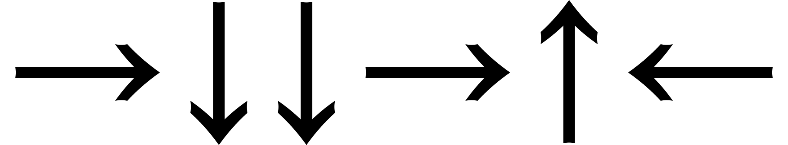. Now, isn’t the sentence “bccbda” similar to that path? Clearly it is, in a way. (Isn’t it exactly the similarity between a photograph and the object photographed?)

### [III-22FCr\[1\]](https://cdn.wittgensteinnachlass.com/2000px/webp/Ts-212/III-22FCr.webp)

Sentences compared with genre paintings.

### [III-22FCr\[2\]](https://cdn.wittgensteinnachlass.com/2000px/webp/Ts-212/III-22FCr.webp)

(Related to this: understanding a picture)

### [III-22-1\[1\]](https://cdn.wittgensteinnachlass.com/2000px/webp/Ts-212/III-22-1.webp)

12a What about the sentences that occur in works of fiction. Surely there can be no talk of verification here, and yet these sentences have sense. They stand in the same relation to sentences for which there is verification as a genre painting does to a portrait. And this simile may well capture the matter _completely_.

### [III-22-2\[1\]](https://cdn.wittgensteinnachlass.com/2000px/webp/Ts-212/III-22-2.webp),[III-22-3\[1\]](https://cdn.wittgensteinnachlass.com/2000px/webp/Ts-212/III-22-3.webp)

12a If I look at a picture, it tells me something, even if I do not for a moment believe (imagine) that the people are real, or that there were real people of whom this is a picture on a smaller scale. But “it tells me something” here can only mean, it brings about a particular attitude in me.

For what if I asked: “_what_ does it tell me, then”?

### [III-22-3\[2\]](https://cdn.wittgensteinnachlass.com/2000px/webp/Ts-212/III-22-3.webp)

12 Nor is my attitude towards the picture a hypothetical one, as though I were to say to myself, “if there were such people, then …”

### [III-22-4\[1\]](https://cdn.wittgensteinnachlass.com/2000px/webp/Ts-212/III-22-4.webp)

When I look at a genre painting, I do not take the people painted in it to be real people; on the other hand, their likeness to people is essential to understanding the picture.

### [III-22-5\[1\]](https://cdn.wittgensteinnachlass.com/2000px/webp/Ts-212/III-22-5.webp)

27 If one takes it for granted that human beings delight in their imagination, one should consider that this imagination is not like a painted picture or a three-dimensional model, but a complicated structure made up of heterogeneous components: words and pictures. One will then no longer contrast operating with written and spoken signs with operating with “mental images” of events.

### [III-22-6\[1\]](https://cdn.wittgensteinnachlass.com/2000px/webp/Ts-212/III-22-6.webp)

An illustration in a book is not foreign to the book, but joins it as one kind of aid joins another of a related kind, – as a reamer joins a drill, for instance. (If a person’s ugliness repels one, it can _likewise_ repel one in a picture, in a painted picture, but also in a description, in words.)

### [III-23FCr\[1\]](https://cdn.wittgensteinnachlass.com/2000px/webp/Ts-212/III-23FCr.webp)

Reality seems to be essentially capable of agreeing or failing to agree with the sentence. The sentence seems to demand that reality compare itself with it.

### [III-23-1\[1\]](https://cdn.wittgensteinnachlass.com/2000px/webp/Ts-212/III-23-1.webp)

21 70 “My expectation is made in such a way that whatever comes, it must agree with it, or not.”

### [III-23-2\[1\]](https://cdn.wittgensteinnachlass.com/2000px/webp/Ts-212/III-23-2.webp)

27a The sentence is put in the position of a judge, and we feel answerable to it.

### [III-23-3\[1\]](https://cdn.wittgensteinnachlass.com/2000px/webp/Ts-212/III-23-3.webp)

(26) 27a Holding my hand above the table, I say, “I wish this table were this high”. Now the curious thing is this: the hand above the table in and of itself expresses nothing at all. That is, it is a hand above a table, but not a symbol (just as the arrow that is supposed, say, to show which way to walk expresses nothing in itself).

### [III-23-4\[1\]](https://cdn.wittgensteinnachlass.com/2000px/webp/Ts-212/III-23-4.webp)

96, “The hand points that way”. Gesture. But in what sense does it point that way? Simply because it tapers in one direction? (Does a nail point into the wall?) That is, does it come to the same thing to say “it points etc.” or “it tapers in this direction”?

### [III-23-5\[1\]](https://cdn.wittgensteinnachlass.com/2000px/webp/Ts-212/III-23-5.webp)

27, 27a (12) One can adjust a backrest to the measurement of a body, have it ready. The measurement it is set to is indeed implicit in this setting, but it is in no way implicit that a particular body has that measurement. Above all, no assumption is implicit in it as to whether the body has that measurement or not.

### [III-23-6\[1\]](https://cdn.wittgensteinnachlass.com/2000px/webp/Ts-212/III-23-6.webp)

27a I said that the sentence was like a yardstick laid against reality: but the yardstick, like all correct similes for the sentence, is a special case of a sentence. And it too determines nothing as long as one does not measure with it. But measuring is comparing (and must mean translating).

### [III-23-6\[2\]](https://cdn.wittgensteinnachlass.com/2000px/webp/Ts-212/III-23-6.webp),[III-23-7\[1\]](https://cdn.wittgensteinnachlass.com/2000px/webp/Ts-212/III-23-7.webp)

27a One wants to say: place the yardstick against a body; it does not say that the body is this long. Rather, it is in itself, as it were, dead and does none of what the thought does. It is as if we had imagined that the essential thing about a living person was the outward 27a shape, and had now made a wooden block of this shape and were looking with disappointment at the dead block, which bears no likeness to _life_ either.

### [III-23-8\[1\]](https://cdn.wittgensteinnachlass.com/2000px/webp/Ts-212/III-23-8.webp)

(21) 27a 7 One could say, “the expectation is not a picture; it only makes use of a picture”. I expect, for example, that my clock will now point to 7, and I express this through a picture of the position of the hands. I can now compare this picture with the actual position; but not the expectation.

### [III-23-9\[1\]](https://cdn.wittgensteinnachlass.com/2000px/webp/Ts-212/III-23-9.webp)

16, 20 My thought is always this: if someone could see the expectation, then he would have to see what was expected. <s>[This thought is still the problem **before** the solution.]</s>

### [III-23-10\[1\]](https://cdn.wittgensteinnachlass.com/2000px/webp/Ts-212/III-23-10.webp)

27a (12) All right, I say: when I take out my watch, it will now present me with either _this_ picture of the position of the hands, or not. But how can I express that I am deciding in favour of one of these assumptions?

Every thought is the expression of a thought.

### [III-23-11\[1\]](https://cdn.wittgensteinnachlass.com/2000px/webp/Ts-212/III-23-11.webp)

27 I could present my problem like this: if I wanted to investigate whether Napoleon’s coronation took place in such and such a way, I could use the picture, rather than a description, as a documentary record. And then the question arises: is the whole comparison of the record with reality of the same kind as the comparison of reality with the picture, or is there also something else involved, of a different kind?

### [III-23-11\[2\]](https://cdn.wittgensteinnachlass.com/2000px/webp/Ts-212/III-23-11.webp)

27 But what is one to compare reality with, if not with the sentence? And what else is one to do but compare it with the sentence?

### [III-23-12\[1\]](https://cdn.wittgensteinnachlass.com/2000px/webp/Ts-212/III-23-12.webp)

70a, 97 27a When one considers the example of the command communicated by gestures, one always wants, _on the one hand_, to say: “Yes, this example is simply imperfect, the language of gestures too crude, so it cannot express the intended sense completely” – but in fact it is as good as any other conceivable language, and fulfils its purpose as completely as can be conceived. (It is one of the most important insights that there is no improving logic.)

### [III-23-13\[1\]](https://cdn.wittgensteinnachlass.com/2000px/webp/Ts-212/III-23-13.webp)

70, 97 The command 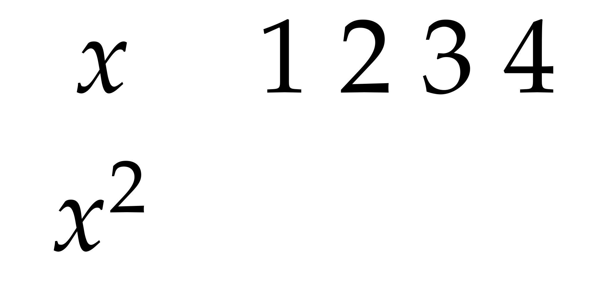 seems incomplete to us. It seems to us as if something that is not said were only hinted at.

### [III-23-13\[2\]](https://cdn.wittgensteinnachlass.com/2000px/webp/Ts-212/III-23-13.webp)

70, 97 But something is hinted at only in so far as a system is not explicitly laid down, or is imperfectly laid down. We want to say that it is imperfectly hinted at to us, or that the sign merely _suggests_ indistinctly what we are to do. It is supposed to be indistinct in something like the sense in which a sign reading “Keep Left” becomes clearer when there is also an arrow pointing in that direction.

### [III-23-13\[3\]](https://cdn.wittgensteinnachlass.com/2000px/webp/Ts-212/III-23-13.webp)

70, 97 But for us the command that is unambiguous is clear; and there is none clearer.

### [III-23-13\[4\]](https://cdn.wittgensteinnachlass.com/2000px/webp/Ts-212/III-23-13.webp)

<s> 70, 97 It can become unambiguous, however, only by making a distinction in the system of commands; it is precisely the absence of that distinction that gives rise to the ambiguity. (If, then, the system is given the right multiplicity.) </s>

### [III-23-14\[1\]](https://cdn.wittgensteinnachlass.com/2000px/webp/Ts-212/III-23-14.webp)

38˙2 [67a] What is not needed in logic does not _help_ either. What is not needed is superfluous.

### [III-23-15\[1\]](https://cdn.wittgensteinnachlass.com/2000px/webp/Ts-212/III-23-15.webp)

(10) 97 The awkwardness with which the sign, like a mute person, tries to make itself understood through all sorts of suggestive gestures disappears when we recognize that what is essential to the sign is the system to which it belongs and the rest of its content drops away.

### [III-24FCr\[1\]](https://cdn.wittgensteinnachlass.com/2000px/webp/Ts-212/III-24FCr.webp)

The symbol (the thought) seems, as such, to be unsatisfied.

### [III-24-1\[1\]](https://cdn.wittgensteinnachlass.com/2000px/webp/Ts-212/III-24-1.webp)

27a Every symbol seems, as such, to leave something open.

### [III-24-2\[1\]](https://cdn.wittgensteinnachlass.com/2000px/webp/Ts-212/III-24-2.webp)

97 The plan, as a plan, is something unsatisfied. (As are wish, expectation, conjecture, etc.) Sometimes I would like to describe my feeling towards the plan as an innervation. But even the innervation itself is not unsatisfied, not in need of supplementation.

### [III-24-3\[1\]](https://cdn.wittgensteinnachlass.com/2000px/webp/Ts-212/III-24-3.webp)

(96) 27a In what sense can one call the wish as such, the expectation, ‘unsatisfied’? What is the prototype of dissatisfaction? Is it the empty cavity (_into which something fits_)? And would one say that an empty space is unsatisfied? Wouldn’t _that_ also be a metaphor? Isn’t it a certain feeling that we call dissatisfaction? Hunger, for example. But hunger does not contain the picture of its satisfaction.

### [III-24-4\[1\]](https://cdn.wittgensteinnachlass.com/2000px/webp/Ts-212/III-24-4.webp)

(27a) The hollow form is unsatisfied only in the system in which the corresponding solid form also occurs.

### [III-24-5\[1\]](https://cdn.wittgensteinnachlass.com/2000px/webp/Ts-212/III-24-5.webp)

(96) 27a I mean, one cannot use the word “unsatisfied” of a fact as such. But in a system it can help describe a fact. I could stipulate, for instance, that I _will_ call the hollow cylinder ‘the unsatisfied cylinder’ and the corresponding solid cylinder _its_ satisfaction.

### [III-24-5\[2\]](https://cdn.wittgensteinnachlass.com/2000px/webp/Ts-212/III-24-5.webp)

(96) 27a But one cannot say that the wish ‘may p be the case’ is satisfied by the fact p, except as a rule for signs: / the wish that p may be the case / = / the wish that is satisfied by the fact p /.

### [III-25FCr\[1\]](https://cdn.wittgensteinnachlass.com/2000px/webp/Ts-212/III-25FCr.webp)

A sentence is a sign in a system of signs. It is one combination of signs among several possible ones & in contrast to the other possible ones. As it were, one position of a pointer in contrast to other possible positions.

### [III-25-1\[1\]](https://cdn.wittgensteinnachlass.com/2000px/webp/Ts-212/III-25-1.webp)

To understand a sentence means to understand a language.

### [III-25-2\[1\]](https://cdn.wittgensteinnachlass.com/2000px/webp/Ts-212/III-25-2.webp)

26 Each sentence of a language has sense only in contrast to other combinations of words in the same language.

### [III-25-3\[1\]](https://cdn.wittgensteinnachlass.com/2000px/webp/Ts-212/III-25-3.webp)

26 If a sentence were not _one_ possible combination among others, it would have no function. That is: if a sentence were not the result of a decision, it would have nothing to say.

### [III-25-4\[1\]](https://cdn.wittgensteinnachlass.com/2000px/webp/Ts-212/III-25-4.webp)

26, 16a Thinking is making plans. When you make plans, you make _one_ plan as distinct from other plans.

### [III-25-5\[1\]](https://cdn.wittgensteinnachlass.com/2000px/webp/Ts-212/III-25-5.webp)

26 ↑ in contrast to 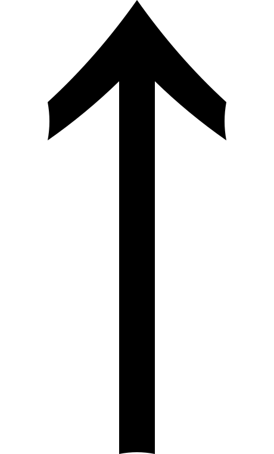 is a different sign from  in contrast to 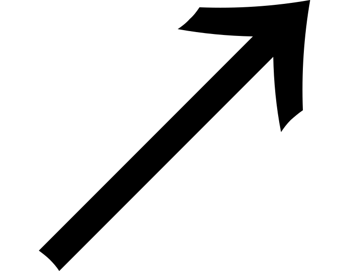 .

### [III-25-6\[1\]](https://cdn.wittgensteinnachlass.com/2000px/webp/Ts-212/III-25-6.webp)

26 “Go this way  not that way 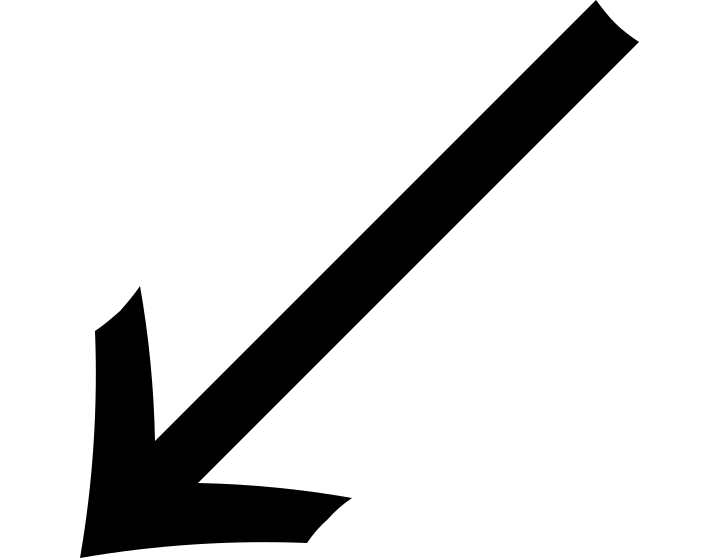” has sense only if it is the direction that is essential to the arrow here, and not, say, just its length.

### [III-25-7\[1\]](https://cdn.wittgensteinnachlass.com/2000px/webp/Ts-212/III-25-7.webp)

96 One has to know what to look at in the sign. For instance: which numeral the hand is pointing to, not how long it is.

### [III-25-7\[2\]](https://cdn.wittgensteinnachlass.com/2000px/webp/Ts-212/III-25-7.webp)

96 “Go in the direction the pointer is pointing in”. “Go as many metres per second as the arrow is cm long”. “Take as many steps as I draw arrows”. “Copy this arrow”.

The same arrow can stand for each of these commands. – – –

### [III-25-8\[1\]](https://cdn.wittgensteinnachlass.com/2000px/webp/Ts-212/III-25-8.webp)

96 “I must pay attention to the length”, “I must pay attention to the direction”, that already means: to the length as opposed to other things, etc.

### [III-25-9\[1\]](https://cdn.wittgensteinnachlass.com/2000px/webp/Ts-212/III-25-9.webp)

96 207/2 How am I to take the clock as my guide? How can I take this picture 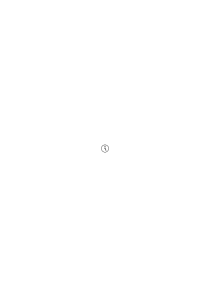 as my _guide_? (Just as with any other.)

### [III-25-10\[1\]](https://cdn.wittgensteinnachlass.com/2000px/webp/Ts-212/III-25-10.webp)

96 Someone shows me a clock for the first time and wants me to take it as my guide. I then ask: what should I pay attention to in this thing? And he says: to the position of the hands.

### [III-25-11\[1\]](https://cdn.wittgensteinnachlass.com/2000px/webp/Ts-212/III-25-11.webp)

97 Of course, the sign for a system designates it only in contrast to other systems and itself presupposes a system. (An internal relation that obtains only if its terms are there.)

### [III-26FCr\[1\]](https://cdn.wittgensteinnachlass.com/2000px/webp/Ts-212/III-26FCr.webp)

Being able to imagine what it would be like as a criterion for a sentence’s having sense.

### [III-26-1\[1\]](https://cdn.wittgensteinnachlass.com/2000px/webp/Ts-212/III-26-1.webp)

72b, 59 What does it mean when one says: “I cannot imagine the opposite of that” or “what would it be like if it were different”; e.g. if someone has said that my mental images are private, or that only I myself can know whether I feel pain, and the like.

### [III-26-1\[2\]](https://cdn.wittgensteinnachlass.com/2000px/webp/Ts-212/III-26-1.webp)

72b, 59 If I cannot imagine what it would be like if it were different, then I cannot imagine how it can be _like this_ either. For “I cannot imagine” does not mean here what it means in the sentence “I cannot imagine a skull”. I do not mean to point to a lack of powers of imagination.

### [III-26-2\[1\]](https://cdn.wittgensteinnachlass.com/2000px/webp/Ts-212/III-26-2.webp)

72b Consider: “I have never actually seen a black spot gradually become lighter and lighter until it is white and then redder and redder until it is red; but I know that it is possible because I can imagine it. That is, I operate with my mental images in the space of colours and do with them what would be possible with the colours.”

### [III-26-3\[1\]](https://cdn.wittgensteinnachlass.com/2000px/webp/Ts-212/III-26-3.webp)

72b It seems as if one could say something like: Word-language allows nonsensical _expressions_, but the language of imagination does not allow nonsensical images. (Of course, as it stands, that cannot mean anything.)

### [III-26-4\[1\]](https://cdn.wittgensteinnachlass.com/2000px/webp/Ts-212/III-26-4.webp)

<s> 72b If it makes sense to say “I can imagine that p is the case”, then it makes sense to say “p is the case”. </s>

### [III-26-4\[2\]](https://cdn.wittgensteinnachlass.com/2000px/webp/Ts-212/III-26-4.webp),[III-26-5\[1\]](https://cdn.wittgensteinnachlass.com/2000px/webp/Ts-212/III-26-5.webp)

72b What does it mean, then, to “discover that a sentence has no sense”? Or let us ask it this way: How can one substantiate the claim that a sentence is nonsensical (say, “this body is extended”) by saying: “I cannot imagine what it would be like if it were otherwise”? For can I even try to imagine it? Does it not mean: To say that I imagine it is senseless? How then does this recasting of one piece of nonsense into another help me? – And why does one say precisely: “I cannot imagine what it would be like if it were _otherwise_”? and not – which after all comes to the same thing – “I cannot imagine what that would be like”? One seems to acknowledge in the nonsensical sentence something like a tautology, as distinct from a contradiction. But that too is wrong. – One says, as it were: “Yes, it is extended, but how could it 72b be otherwise? So why say it”. It is the same tendency that leads us to reply to the sentence “this rod has a definite length” not with “Nonsense!” but with “Of course!” But what is the reason (for) this tendency? It might also be described thus: when we hear the two sentences “this rod has a length” and its negation “this rod has no length”, we are biased and incline towards the first sentence (instead of declaring both nonsense). But the reason for _this_ is a confusion: We see the first sentence as verified (and the second as falsified) by “the rod being 4m long”. And one will say: “and surely 4m is a length” and forget that what one has here is a sentence of grammar.

### [III-26-6\[1\]](https://cdn.wittgensteinnachlass.com/2000px/webp/Ts-212/III-26-6.webp)

72b [77] Why does one take it as proof that a sentence has sense that I can imagine what it says? I could say: Because I would have to describe this image with a sentence related to the first.

### [III-26-7\[1\]](https://cdn.wittgensteinnachlass.com/2000px/webp/Ts-212/III-26-7.webp),[III-26-8\[1\]](https://cdn.wittgensteinnachlass.com/2000px/webp/Ts-212/III-26-8.webp)

72b Could I paint a picture showing that things are so if it made no sense 72b to say “things are so”? To say “I can draw what it is like when things are so” is here a grammatical stipulation concerning the sentence under consideration (For I do not mean to say that _I_ can draw it, because, say, I have learnt to draw, etc.). What if I said? “is this not a game, since I can win & lose at it?” – Well, if that is your criterion of a game, then it is a game.

### [III-26-9\[1\]](https://cdn.wittgensteinnachlass.com/2000px/webp/Ts-212/III-26-9.webp),[III-26-10\[1\]](https://cdn.wittgensteinnachlass.com/2000px/webp/Ts-212/III-26-10.webp)

“I know that it is possible, because …” this form of expression is taken from cases such as: “I know that it is possible to unlock the door with this key, because I have done it before”. Is it in _that_ sense, then, that I suppose this colour transition will be possible because I can imagine it?! Must one not rather say: the sentence “the colour transition is possible” means the same as “I can imagine it”, or: the first sentence _follows_ from the second? – What about this: “It _is_ possible to recite the A-B-C aloud _because_ I can recite it to myself in my mind”? “I can imagine what it would be like” or – which again is just as good –: “I can draw what it would be like if p is the case” gives an _application_ of the sentence (p). It says something about the calculus in which we use p.

### [III-27FCr\[1\]](https://cdn.wittgensteinnachlass.com/2000px/webp/Ts-212/III-27FCr.webp)

“Logical Possibility & Impossibility”. The picture of ‘being able to’ applied ultraphysically. Similarly: “The Excluded Middle”.

### [III-27-1\[1\]](https://cdn.wittgensteinnachlass.com/2000px/webp/Ts-212/III-27-1.webp)

5a When one says that substance is indestructible, one _means_ that it is senseless to speak in any context – affirmatively or negatively – of “destroying a substance”.

### [III-27-2\[1\]](https://cdn.wittgensteinnachlass.com/2000px/webp/Ts-212/III-27-2.webp)

90 I try to do something, but I cannot. – But what does it mean to “not be able to try to do something”?

### [III-27-2\[2\]](https://cdn.wittgensteinnachlass.com/2000px/webp/Ts-212/III-27-2.webp)

90 “We cannot _even try_ to imagine a round square”.

### [III-27-3\[1\]](https://cdn.wittgensteinnachlass.com/2000px/webp/Ts-212/III-27-3.webp)

Logical possibility & sense.

Can one ask: “what must the grammatical rules for the words be like if they are to give a sentence sense?”?

### [III-27-3\[2\]](https://cdn.wittgensteinnachlass.com/2000px/webp/Ts-212/III-27-3.webp)

The use of the sentence, that is its sense.

### [III-27-3\[3\]](https://cdn.wittgensteinnachlass.com/2000px/webp/Ts-212/III-27-3.webp),[III-27-4\[1\]](https://cdn.wittgensteinnachlass.com/2000px/webp/Ts-212/III-27-4.webp)

I say, for example, “there is no vase on this table now, but there could be one there; on the other hand, it is senseless to say that space could have four dimensions.” But if the sentence has sense by virtue of being in accordance with the grammatical rules, well, let us simply make a rule permitting the sentence that our space has four dimensions. Granted, but that does not yet settle the grammar of this expression. We still have to make further stipulations about how such a sentence is to be used, how it is to be verified, for example.

### [III-27-4\[2\]](https://cdn.wittgensteinnachlass.com/2000px/webp/Ts-212/III-27-4.webp),[III-27-5\[1\]](https://cdn.wittgensteinnachlass.com/2000px/webp/Ts-212/III-27-5.webp)

Even if one regards the sentence as a picture of the state of affairs described & says that the sentence shows just what it would be like if it were true, and thus shows the possibility of the state of affairs asserted, the sentence can at best do what a painted or modelled picture can do & so in any case it cannot present what simply is not the case. So it depends entirely on our grammar what is called possible & what is not: it is simply a matter of what grammar allows. But surely that is arbitrary! – Certainly, but I cannot make use of every construction; that is: not every game is useful & if I am tempted to admit something quite useless as a sentence, this happens because I let myself be misled by an analogy & do not see that I still lack the essential rules for the application of my sentence. This is what happens, for example, when one speaks of an infinite row of trees & asks oneself how it is to be verified that a row of trees is infinite & what, for instance, the relation is between this verification and that of the sentence “the row of trees has 100 trees”.

### [III-28FCr\[1\]](https://cdn.wittgensteinnachlass.com/2000px/webp/Ts-212/III-28FCr.webp)

Elementary proposition

### [III-28-1\[1\]](https://cdn.wittgensteinnachlass.com/2000px/webp/Ts-212/III-28-1.webp),[III-28-2\[1\]](https://cdn.wittgensteinnachlass.com/2000px/webp/Ts-212/III-28-2.webp)

92 (64) Can a logical product be hidden in a sentence? And if so, how does one find out, and what methods do we have for bringing to light what is hidden in the sentence? If we have no reliable methods yet (_of finding it_,) then neither can we speak of something being hidden or possibly being hidden. And if we have a method for looking for it, then – the logical product, for example, can be hidden in the sentence only in the way that divisibility by 3 is hidden in the number 753 as long as I have not yet applied the criterion, 92 or that √7 is hidden as long as I have not yet calculated it. For finding the hidden logical product is a mathematical task.

### [III-28-3\[1\]](https://cdn.wittgensteinnachlass.com/2000px/webp/Ts-212/III-28-3.webp)

92 So an elementary proposition is one that does not present itself as a truth-function of other propositions in the calculus as I am now using it.

### [III-28-4\[1\]](https://cdn.wittgensteinnachlass.com/2000px/webp/Ts-212/III-28-4.webp),[III-28-5\[1\]](https://cdn.wittgensteinnachlass.com/2000px/webp/Ts-212/III-28-5.webp)

92 The idea of constructing elementary propositions (as Carnap, for example, has tried to do) rests on a mistaken conception of logical analysis. It takes the problem of this analysis to be that of 92 finding a _theory_ of elementary propositions. It takes its cue from what happens in mechanics, for example, when a number of fundamental laws are found from which the whole system of propositions follows.

### [III-28-5\[2\]](https://cdn.wittgensteinnachlass.com/2000px/webp/Ts-212/III-28-5.webp)

92 My own conception was mistaken: partly because I was not clear about the sense of the words “a logical product is _hidden_ in a sentence” (and similar words), secondly because I too thought that logical analysis had to bring hidden things to light (as chemical and physical analysis do).

### [III-28-6\[1\]](https://cdn.wittgensteinnachlass.com/2000px/webp/Ts-212/III-28-6.webp),[III-28-7\[1\]](https://cdn.wittgensteinnachlass.com/2000px/webp/Ts-212/III-28-7.webp)

92 One can call the sentence “this place is now red” (or “this circle is now red”, etc.) an elementary proposition if what one means by this is that it neither is a truth-function of other propositions nor (is) defined as one. (Here I set aside combinations of the form p & (q ․ ⌵ ․ non-q) and analogous ones.) But “a is not now green” follows from “a is now red”, and so elementary propositions in this sense are not independent of one another, as are 92 the elementary propositions in the calculus I described at the time, to which I assumed the whole use of sentences must be reducible; – misled by a mistaken conception of this “reducing”.

### [III-29FCr\[1\]](https://cdn.wittgensteinnachlass.com/2000px/webp/Ts-212/III-29FCr.webp)

“How is the possibility of p contained in the fact that ~p is the case?” “How, for example, does the painless state contain the possibility of pain?”

### [III-29-1\[1\]](https://cdn.wittgensteinnachlass.com/2000px/webp/Ts-212/III-29-1.webp)

58

presupposes the capacity to feel pain, and that cannot be a “physiological capacity” – for how else would one know what it is a capacity for – but must be a logical possibility. – I describe my present state by alluding to something that is not the case. If this reference is necessary to the description (and not merely an embellishment), there must be something in my present state that makes this mention (reference) necessary. I compare this state with another, so it must be comparable with it. It too must lie in the space of pain, even if at a different point. – Otherwise my sentence would mean something like: my present state has _nothing to do_ with a painful one; rather as I would say that the colour of this rose has nothing to do with Caesar’s conquest of Gaul. That is, there is no connection. But what I mean is precisely that there is a connection between my present state and a painful one.)) I _mean_ only what I say. But in what respect is painlessness a _state_. What do I call a “state”?

### [III-29-2\[1\]](https://cdn.wittgensteinnachlass.com/2000px/webp/Ts-212/III-29-2.webp)

92a 58 If I say that I did _not_ dream last night, I must nevertheless know where one would look for the dream (that is, the sentence “I dreamed”, applied to the situation, can only be false, not nonsensical. I express the present situation by a position – the negative one – of the signal disc “dreams – no dreams”. But I must be able to distinguish it from other signal discs despite its negative position. I must know that it is _this_ signal disc that I am holding. One might now ask: Does this mean that you did feel something after all, a hint of a dream, so to speak, that makes you aware of the place where a dream would have been? Or, when I say “I have no pain in my arm”, does that mean I have a kind of shadowy feeling that indicates the place where the pain would occur? Evidently not, after all. In what respect does the present, painless state contain the possibility of pain? If someone says: “For the word pain to have meaning, it is necessary that one recognize pain as such when it occurs”, one can reply: “It is no more necessary than recognizing the absence of pain”. “Pain” means, so to speak, the whole scale and not one of its marks. That it stands at a particular mark is to be expressed by a _sentence_.

### [III-29-2\[2\]](https://cdn.wittgensteinnachlass.com/2000px/webp/Ts-212/III-29-2.webp)

92, 58 “What sort of question would this be: ‘Could everything _fail_ to be the case, and nothing be-the-case’? Could one imagine a state of a world in which only negative sentences could be uttered with truth? Is that not all manifestly nonsense? Are there, then, essentially negative and positive states?” Well, it depends on what one calls ‘states’.

### [III-29-3r\[1\]](https://cdn.wittgensteinnachlass.com/2000px/webp/Ts-212/III-29-3r.webp)

58a, 75 Can absolute silence be confused with inner deafness, by which I mean unfamiliarity with the concept of sound? If that were the case, one could not distinguish the lack of the sense of hearing from the lack of some other sense. But is that not exactly the same question as: Is the man who now sees nothing red around him in the same position as the man who is incapable of seeing red? One can of course say: The first can still imagine red, but imagined red is not the same as red that is seen. Well, how does the ability to see red manifest itself, & how does familiarity with the concept of sound manifest itself?

### [III-29-3v\[1\]](https://cdn.wittgensteinnachlass.com/2000px/webp/Ts-212/III-29-3v.webp)

… as _no_ pain in the hand. Pain in tactile space or in visual space.

### [III-29-4r\[1\]](https://cdn.wittgensteinnachlass.com/2000px/webp/Ts-212/III-29-4r.webp)

58a If I see only something black and say that it is not red, how do I know that I am not talking nonsense, that is, that it can be red, that there is such a thing as red? Unless red is simply another mark on the scale on which black is also a mark. What is the difference between “that is not red” and “that is not abrakadabra”? Evidently I must know that “black”, which describes the actual state (or helps to describe it), is what “red” stands in place of in the description.

### [III-29-4v\[1\]](https://cdn.wittgensteinnachlass.com/2000px/webp/Ts-212/III-29-4v.webp)

[unreadable] If I hear _one_ sound, that does not mean that I _could_ also hear _others_.

### [III-29-5\[1\]](https://cdn.wittgensteinnachlass.com/2000px/webp/Ts-212/III-29-5.webp)

53 It feels as if non-p, in order to negate p, first had to make it true in a certain sense. One asks “_what_ is not the case”. This must be represented, but it cannot be represented in such a way that p is actually made true.

### [III-29-6\[1\]](https://cdn.wittgensteinnachlass.com/2000px/webp/Ts-212/III-29-6.webp)

58a “<s>The grey must already be imagined in the space of darker and lighter if I want to speak of its being able to become darker or lighter. </s> One could perhaps also say: The yardstick must already be in place; I cannot put it in place – arbitrarily – I can only single out one mark on it. This comes down to the following: If it is perfectly quiet around me, I cannot arbitrarily attach (build up) the space of hearing to this silence, or not attach it. That is, either it is quiet for me as opposed to there being a sound, or the word ‘quiet’ has no meaning for me. That is, I cannot _choose_ between _inner_ hearing and inner deafness. And likewise, when I see grey, I cannot _choose_ between normal inner vision, partial or complete colour-blindness.”

### [III-29-7\[1\]](https://cdn.wittgensteinnachlass.com/2000px/webp/Ts-212/III-29-7.webp)

58a “Can I imagine pain in the tip of my nail, or in my hair? Is not pain there just as imaginable, and just as unimaginable, as pain in any part of my body where I happen to feel none and do not remember feeling any?”

### [III-29-8\[1\]](https://cdn.wittgensteinnachlass.com/2000px/webp/Ts-212/III-29-8.webp)

Let us look at the matter from the standpoint of common sense. We are tempted to say: “I have no pain in my hand now” means something only if I know what it is like to have pain in one’s hand. What does it mean to know that? What is our criterion for one’s knowing it? Well, I would say: “I have often been in pain before”, “I have often felt pain in this spot”, or “I have not felt pain in _this_ spot, admittedly, but in other parts of my body”. One could ask: What does the memory of your past pain consist in? Do you feel it again in a kind of shadowy way? But whatever this experience (of remembering) is like, it is a particular experience & I call it the memory “of pain I have felt” & this is precisely what shows how I use the word “pain” & the expression for the past.

### [III-29-9\[1\]](https://cdn.wittgensteinnachlass.com/2000px/webp/Ts-212/III-29-9.webp)

58 Negation contains a kind of generality by virtue of the range of possibilities it leaves open. But of course affirmation must contain it too and merely make a different use of it.

### [III-29-10\[1\]](https://cdn.wittgensteinnachlass.com/2000px/webp/Ts-212/III-29-10.webp)

58 non-p excludes p; what it then _allows_ depends on the nature, that is, the grammar, of p.

### [III-29-11\[1\]](https://cdn.wittgensteinnachlass.com/2000px/webp/Ts-212/III-29-11.webp)

58 “non-p” simply excludes p. What can then be the case _instead of_ p follows from the nature of _what is excluded_.

### [III-30FCr\[1\]](https://cdn.wittgensteinnachlass.com/2000px/webp/Ts-212/III-30FCr.webp)

“How can the word ‘not’ negate?”

The word “not” seems to us like a prompt to engage in a complicated activity of negating.

### [III-30-1\[1\]](https://cdn.wittgensteinnachlass.com/2000px/webp/Ts-212/III-30-1.webp)

58, 9a, (96) “How can the word ‘not’ negate?” Well, apart from negation by means of a sign, do we still have a concept of negation? Still, something comes to mind, such as: an obstacle, a gesture of warding off, exclusion. But all of that (_is_) always embodied in a sign, after all.

### [III-30-2\[1\]](https://cdn.wittgensteinnachlass.com/2000px/webp/Ts-212/III-30-2.webp),[III-30-3\[1\]](https://cdn.wittgensteinnachlass.com/2000px/webp/Ts-212/III-30-3.webp)

58, 9a What is the difference between wishing for something to happen and wishing for _that same thing not_ to happen? If one wanted to represent it in a picture, one would do something with the picture of the action: cross it out, frame it in a particular way, and the like. But this seems to us a _crude_ method of expression; yet I believe that _every_ method must be essentially like this; in word-language I put the sign “not” 58, 9a in the sentence. As I said, this seems a clumsy expedient, and one might think that in _thinking_ it does happen differently. But I believe that in thinking, expecting, wishing, it happens in just the same way. Otherwise the discrepancy between thinking and speaking – in which, after all, we think – would be intolerable.

### [III-30-3\[2\]](https://cdn.wittgensteinnachlass.com/2000px/webp/Ts-212/III-30-3.webp)

58, 9a Once again, the expression of negation that we use when we employ any sort of _language_ seems _primitive_ to us; as though there were a more correct one that is unavailable to me only under the crude conditions of this language.

### [III-30-3\[3\]](https://cdn.wittgensteinnachlass.com/2000px/webp/Ts-212/III-30-3.webp)

58, 9a We have encountered before this primitiveness of the form of expression that struck us in the case of negation; if, for example, one wants to make someone understand that he is to take a certain route, one can draw the route for him, and do so with any degree of precision one likes. But the indication meant to make him understand that _he_ is to take the route is again of the primitive sort that one would like to improve.

### [III-30-4\[1\]](https://cdn.wittgensteinnachlass.com/2000px/webp/Ts-212/III-30-4.webp)

58 “What good does it do to have just a hook in front of the sentence p as the sign of negation? I still have to think the _whole_ negation”.

### [III-30-5\[1\]](https://cdn.wittgensteinnachlass.com/2000px/webp/Ts-212/III-30-5.webp)

58 “The sign ‘non’ indicates that you are to take what follows negatively.” But _it indicates_ means that this is not the final linguistic expression. That this is not the picture of the thought. That there is more to negation than that.

### [III-30-6\[1\]](https://cdn.wittgensteinnachlass.com/2000px/webp/Ts-212/III-30-6.webp)

58 I would like to say that negation is only a prompt to do something much more complex; but what? If the question cannot be answered (and replacing one symbol of negation with another is no answer), it is nonsensical, and so is that first sentence. It is as if the sign of negation prompted us to do something; but what that is is apparently not said. It is as if it only needed to be hinted at, as if we already knew it. As if an explanation were now unnecessary, since we know the thing anyway.

### [III-30-6\[2\]](https://cdn.wittgensteinnachlass.com/2000px/webp/Ts-212/III-30-6.webp)

58 If there were a more explicit way of expressing negation, it would still have to be possible to map it into the other, and so it could not be of a different multiplicity.

### [III-30-7\[1\]](https://cdn.wittgensteinnachlass.com/2000px/webp/Ts-212/III-30-7.webp)

58 But now the question would be: how does the distinctive feature of negation that we are familiar with show itself in the rules that govern the negation sign? That a drawn plan of a path is a picture of the path, for example, we understand at once; where the line on the drawing bends to the left, the path too bends to the left, etc., etc. But we do not see that the sign “not” excludes the plan. We see it more readily if we draw a line around something excluded, fence it off, as it were. But then one could take the “non” as a signboard saying “Forbidden path”. But think of how someone would actually be taught what such a signboard means. One might, for instance, hold him back from going down the path.

### [III-30-8\[1\]](https://cdn.wittgensteinnachlass.com/2000px/webp/Ts-212/III-30-8.webp),[III-30-9\[1\]](https://cdn.wittgensteinnachlass.com/2000px/webp/Ts-212/III-30-9.webp)

38˙2 “Surely I don’t merely say these words; I also mean something by them.” If, for example, I say “You may not come in”, the natural act to accompany these words is to 38˙2 stand in front of the door and hold it shut. But it would not so _obviously_ be natural for me to open it for him as I said these words. These words, as they are understood here, evidently have something to do with that act. The act is, so to speak, an illustration of them – it would have to be possible to take it as language. On the other hand, it is also the act that, _apart_ from any symbolism, it is _in my nature to want to perform._

### [III-30-10\[1\]](https://cdn.wittgensteinnachlass.com/2000px/webp/Ts-212/III-30-10.webp),[III-30-11\[1\]](https://cdn.wittgensteinnachlass.com/2000px/webp/Ts-212/III-30-11.webp)

58 But what about this thought: if “non-p” is to be a 58 picture, would not the best way to represent what it means be for what would represent that p is the case _not_ to be the case in the sign? But it is clear that such a symbolism does not work. It is no explanation of this to say (as I once did) that such a negative symbolism would work, only it cannot be used because one cannot tell from it _what_ is negated. If it does not communicate to us what is needed, then it simply is not a symbolism of negation. And then it lacks the essential thing. After all, there is a reason why in certain cases negative symbolism works and, for example, no answer is also an answer. In those cases the sense of silence is unambiguously determined.

### [III-30-11\[2\]](https://cdn.wittgensteinnachlass.com/2000px/webp/Ts-212/III-30-11.webp)

58 A picture meant to show how things are not gives a different kind of portrait from one that shows how things are.

### [III-30-12\[1\]](https://cdn.wittgensteinnachlass.com/2000px/webp/Ts-212/III-30-12.webp)

58 To specify that something is not red is to give a different kind of colour specification from specifying that it is red (or blue). That is, it is not a colour specification in the same sense.

### [III-30-12\[2\]](https://cdn.wittgensteinnachlass.com/2000px/webp/Ts-212/III-30-12.webp)

58 _By contrast, it is possible_ for the negation of a sentence to be a specification of the same kind as the negated sentence.

### [III-30-13\[1\]](https://cdn.wittgensteinnachlass.com/2000px/webp/Ts-212/III-30-13.webp)

“I need the intact picture of the positive sentence in the negative sentence.”

### [III-30-14\[1\]](https://cdn.wittgensteinnachlass.com/2000px/webp/Ts-212/III-30-14.webp)

58 “I can draw a picture of two people fencing with each other; but surely not of two people not fencing with each other (that is, not a picture that represents just this). ‘They are not fencing with each other’ does not mean that there is no mention of their fencing with each other; rather, it _is_ mentioned and is (merely) excluded.”

### [III-30-15\[1\]](https://cdn.wittgensteinnachlass.com/2000px/webp/Ts-212/III-30-15.webp),[III-30-16\[1\]](https://cdn.wittgensteinnachlass.com/2000px/webp/Ts-212/III-30-16.webp)

The idea of negation is embodied only in an explanation of a sign, & insofar as we possess such an idea, we possess it only in the form of such an explanation. For if one can ask “_what_ do you mean by that?”, the answer is only an explanation of a sign (of some kind). We possess the concept of negation only in a symbolism. And so one cannot say: “negation cannot be represented in such & such a way, because that way would be ambiguous” – as though it were a matter of a description of an object that had not been given unambiguously. If the symbolism does not show what was negated, it does not negate; just as a chessboard without squares is not a bad, i.e. impractical, chessboard, but no chessboard at all. And if I thought I could play chess on a board without squares, then I have simply misunderstood the game & this may now be pointed out to me. A symbolism that “cannot represent” negation is not a symbolism of negation.

### [III-30-17\[1\]](https://cdn.wittgensteinnachlass.com/2000px/webp/Ts-212/III-30-17.webp)

I think part of the difficulty arises from the use of the words “yes” & “no” (also “true” & “false”). These two make it look as though a proposition & its opposite stood to one another as two poles or two opposite directions. Whereas the very fact that ~~p = p, but a double affirmation is not a negation, can show that this picture is false.

### [III-30-18\[1\]](https://cdn.wittgensteinnachlass.com/2000px/webp/Ts-212/III-30-18.webp)

58 If one were to ask: is negation in mathematics, say in non (2 + 2 = 5), the same as the negation of non-mathematical sentences? then one would first have to determine what is _to count_ as the characteristic mark _of_ negation _as such_. After all, the meaning of a sign lies in the rules according to which it is used. Which of these rules make the sign “non” a negation? For it is clear that certain rules concerning “non” are the same in both cases; for example, non-non-p = p. One could equally ask: is the negation of the sentence “I see a red patch” the same as that of “the earth moves in an ellipse around the sun”? and the answer would again have to be: How have you defined “negation”, by what class of rules? – that will tell us whether we have “the same negation” in both cases. When logic speaks of negation in general, or operates with it in a calculus, the meaning of the negation sign is determined no further than by the rules of its calculus. We must not forget here that a word does not carry its meaning around with it as something bestowed on it once and for all, so that when we reach for this bottle we are sure of getting the particular liquid, say methylated spirit, as well.

### [III-31FCr\[1\]](https://cdn.wittgensteinnachlass.com/2000px/webp/Ts-212/III-31FCr.webp)

Is time essential to sentences? Comparison of: time & truth-functions

### [III-31-1\[1\]](https://cdn.wittgensteinnachlass.com/2000px/webp/Ts-212/III-31-1.webp),[III-31-2\[1\]](https://cdn.wittgensteinnachlass.com/2000px/webp/Ts-212/III-31-2.webp)

38 If grammar lay before us in the form of a book, it would not consist of a series of articles merely set side by side, but would exhibit a different structure. And in this structure one would – if I am right – also have to see the difference between the phenomenological and the non-phenomenological. There would, for example, be a chapter on colours, in which the use of colour words would be regulated; but what grammar would say about the words “not”, “or”, etc. (the “logical 38 constants”) would not be comparable to that. For example, it would follow from the rules that these latter words were to be applied in every sentence (but not the colour words). And this “every” would not have the character of empirical generality, but of the _unappealable_ generality of a supreme rule of the game. It seems to me rather like the way one can presumably play chess (or at least continue playing it) without certain pieces, but never without the chessboard.

### [III-31-3\[1\]](https://cdn.wittgensteinnachlass.com/2000px/webp/Ts-212/III-31-3.webp)

99 How is the temporality of facts revealed, how is it expressed, except in the requirement that certain _expressions_ occur in _our_ sentences? That is: How is the temporality of facts expressed, if not grammatically?

### [III-31-4\[1\]](https://cdn.wittgensteinnachlass.com/2000px/webp/Ts-212/III-31-4.webp)

99 Negation and disjunction, we want to say, have to do with the essence of the proposition, whereas time does not, but has to do with its content. But how can grammar show that one thing has to do with the essence of the proposition and another does not, if they are both equally general? Or should I say that time is less general, since mathematical propositions can be negated and disjoined but are not temporal? There is presumably a connection, even if presenting the matter in this form is misleading.

### [III-31-5\[1\]](https://cdn.wittgensteinnachlass.com/2000px/webp/Ts-212/III-31-5.webp),[III-31-6\[1\]](https://cdn.wittgensteinnachlass.com/2000px/webp/Ts-212/III-31-6.webp)

99 How does grammar distinguish between sentential form and content? For this is supposed to be a grammatical distinction. How could one describe it if grammar does not show it? 99 What are we to make of the schema “Things are thus and so”? One could say that “Things are” is the _handle_ the truth-functions take hold of. “Things are”, then, is only an expression in a notation for the truth-functions. An expression that shows us which part of grammar comes into operation here.

### [III-31-7\[1\]](https://cdn.wittgensteinnachlass.com/2000px/webp/Ts-212/III-31-7.webp)

99 These two kinds of generality would be as strange as if, of two rules of a game that both apply equally without exception, one were called the more fundamental. As though one could _ask_ whether the king or the chessboard was more essential to chess. Which of the two was more essential, which more accidental.

### [III-31-8\[1\]](https://cdn.wittgensteinnachlass.com/2000px/webp/Ts-212/III-31-8.webp)

99 At the very least, a question seems warranted: if I had written out the grammar and the various chapters, on colour words, etc., etc., were set down one after another, like rules for all the pieces in chess, how would I know that these were now _all_ the chapters? And if the chapters that are there all share a common feature, then _here apparently_ we are dealing with a logical generality, but not an essential, i.e. foreseeable, generality. But surely one cannot say that the fact that chess is played with 16 pieces is less essential to it than the fact that it is played on a chessboard.

### [III-31-9\[1\]](https://cdn.wittgensteinnachlass.com/2000px/webp/Ts-212/III-31-9.webp)

99 Since time and truth-functions taste so different, and since they reveal their essence solely and entirely in grammar, grammar must explain the difference in taste. One tastes of content, the other of form of representation. They taste as different as the plan and the line drawn through the plan.

### [III-31-10\[1\]](https://cdn.wittgensteinnachlass.com/2000px/webp/Ts-212/III-31-10.webp)

99 It seems to me as if the present, as it appears in the sentence “the sky is blue” (when this sentence is meant non-hypothetically), were not a form of time. As though, then, the present in _this_ sense were non-temporal.

### [III-31-11\[1\]](https://cdn.wittgensteinnachlass.com/2000px/webp/Ts-212/III-31-11.webp)

99 It is curious that the time I am talking about here is not time in the physical sense. What is at issue here is not a measurement of time. And it is suspicious that something that has nothing to do with such a measurement should play a _similar_ role in sentences to the role physical time plays in the hypotheses of physics.

### [III-31-12\[1\]](https://cdn.wittgensteinnachlass.com/2000px/webp/Ts-212/III-31-12.webp),[III-31-13\[1\]](https://cdn.wittgensteinnachlass.com/2000px/webp/Ts-212/III-31-13.webp)

Discuss:

The difference between the logic of content and the logic of sentential form in general. One seems colourful, as it were, the other _dull_. One seems to deal with what the picture represents, the other seems, like the frame of the picture, to be a characteristic of pictorial form.

### [III-31-14\[1\]](https://cdn.wittgensteinnachlass.com/2000px/webp/Ts-212/III-31-14.webp)

(99a)

That all sentences contain time in some way seems accidental to us, compared with the fact that the truth-functions are applicable to all sentences. This seems to have to do with their essence as sentences, the other with the essence of reality as we find it.

### [III-32FCr\[1\]](https://cdn.wittgensteinnachlass.com/2000px/webp/Ts-212/III-32FCr.webp)

_Essence of the hypothesis_

### [III-32-1\[1\]](https://cdn.wittgensteinnachlass.com/2000px/webp/Ts-212/III-32-1.webp)

41 One could evidently explain a hypothesis by means of pictures. I mean, for instance, that one could explain the hypothesis “there is a book lying here” by means of pictures showing the book in plan, elevation and various cross-sections.

### [III-32-1\[2\]](https://cdn.wittgensteinnachlass.com/2000px/webp/Ts-212/III-32-1.webp)

41 Such a representation gives a _law_. Just as the equation of a curve gives a law for finding the ordinates when one takes sections at different abscissae. The individual verifications then correspond to such sections actually taken. If our experiences yield the points on a straight line, then the proposition that these experiences are the different views of a straight line is a hypothesis. The hypothesis is a way of representing this reality, for a new experience can agree or disagree with it, or make a change in the hypothesis necessary.

### [III-32-2\[1\]](https://cdn.wittgensteinnachlass.com/2000px/webp/Ts-212/III-32-2.webp)

(41) If, for instance, we express the proposition that a sphere is at a certain distance from our eyes by means of a coordinate system and the equation of the sphere, this description has a greater multiplicity than that of a verification by sight. The former multiplicity corresponds not to _one_ verification, but to a _law_ that verifications obey.

### [III-32-3\[1\]](https://cdn.wittgensteinnachlass.com/2000px/webp/Ts-212/III-32-3.webp)

41 A hypothesis is a law for forming sentences. One could also say: A hypothesis is a law for forming expectations. A sentence is, so to speak, a section through a hypothesis at a particular point.

### [III-32-4\[1\]](https://cdn.wittgensteinnachlass.com/2000px/webp/Ts-212/III-32-4.webp)

41 According to my principle, the two assumptions must be identical in sense if all _possible_ experience that confirms the one also confirms the other. If, that is, no decision between them by experience is conceivable.

### [III-32-5\[1\]](https://cdn.wittgensteinnachlass.com/2000px/webp/Ts-212/III-32-5.webp),[III-32-6\[1\]](https://cdn.wittgensteinnachlass.com/2000px/webp/Ts-212/III-32-6.webp)

41b Representation of a line as a straight line with deviations. The equation of the line contains a parameter whose variation _expresses_ the deviations from the straight line. It is not essential that these 41b deviations be “slight”. They can be so great that the line does not look like a straight line. The “straight line with deviations” is only a form of description. It makes it easier for me to leave out, to disregard, a certain part of the description if I want to. (The form “rule with exceptions”.)

### [III-32-7\[1\]](https://cdn.wittgensteinnachlass.com/2000px/webp/Ts-212/III-32-7.webp)

(36) 41 What does it mean to be certain that one will have toothache? (If one _cannot_ be certain, then grammar does not allow the word “certain” to be used in this connection.) Grammar of the expression “to be certain” …

### [III-32-8\[1\]](https://cdn.wittgensteinnachlass.com/2000px/webp/Ts-212/III-32-8.webp),[III-32-9\[1\]](https://cdn.wittgensteinnachlass.com/2000px/webp/Ts-212/III-32-9.webp)

41 One says: “When I say that I see an armchair there, I say more than I know for certain.” And then what one usually says is: “But there is 41 _one_ thing I do know for certain.” But when one tries to say what that is, one finds oneself in some difficulty. “I see something _brown_ – that is certain”; what one _really_ means to say by this is that the brown colour is seen, and is not perhaps merely surmised (as, for instance, when I surmise it from certain other indications). And one does also simply say: “I _see_ something brown.”

### [III-32-9\[2\]](https://cdn.wittgensteinnachlass.com/2000px/webp/Ts-212/III-32-9.webp)

41 If I am told: “Look through this telescope and draw what you see for me”, then what I draw is the expression of a proposition, not of a hypothesis.

### [III-32-9\[4\]](https://cdn.wittgensteinnachlass.com/2000px/webp/Ts-212/III-32-9.webp)

41 When I say “there is an armchair here”, by this – as one says – “more” is meant than a description of what I perceive. And this can only mean that this proposition does not _have to be true_, even if the description of what is seen is correct. Under what circumstances, then, will I say that the proposition was not true? Clearly: when certain other propositions that were included in the first are not true. But it is not as if the first had been a logical product.

### [III-32-10\[1\]](https://cdn.wittgensteinnachlass.com/2000px/webp/Ts-212/III-32-10.webp)

41 The best simile for any hypothesis, and itself an example, is a solid body together with the views of it constructed according to a definite rule from different points in space.

### [III-32-11\[1\]](https://cdn.wittgensteinnachlass.com/2000px/webp/Ts-212/III-32-11.webp)

61 The process of coming to know something in a scientific investigation (in experimental physics, say) is admittedly not the same as that of coming to know something in life outside the laboratory; but it is a _similar_ process and, set alongside the other, can shed light on it.

### [III-32-12r\[1\]](https://cdn.wittgensteinnachlass.com/2000px/webp/Ts-212/III-32-12r.webp)

(41) There is an essential difference between propositions like “that is a lion”, “the sun is larger than the earth”, which all contain a “this”, “now”, “here” and thus connect directly with reality, and propositions like “human beings have two hands”, etc. For if there happened to be no human beings around me, how would I check this proposition?

### [III-32-12v\[1\]](https://cdn.wittgensteinnachlass.com/2000px/webp/Ts-212/III-32-12v.webp)

… gaseous thoughts, as it were, or ethereal thoughts, as opposed to visible, audible symbols.

### [III-32-13\[1\]](https://cdn.wittgensteinnachlass.com/2000px/webp/Ts-212/III-32-13.webp)

41a It is always facets of the hypothesis that are verified.

### [III-32-13\[2\]](https://cdn.wittgensteinnachlass.com/2000px/webp/Ts-212/III-32-13.webp)

41a Now is it not perhaps the case that _what_ the hypothesis explains can itself only be expressed by a hypothesis in turn? That is, of course: are there primary propositions at all; propositions, that is, which are conclusively verifiable and are not the facets of a hypothesis? (This is rather as if one were to ask “are there surfaces that are not the surfaces of bodies?”)

### [III-32-13\[3\]](https://cdn.wittgensteinnachlass.com/2000px/webp/Ts-212/III-32-13.webp)

41a In any case there can be no difference between a hypothesis used as the expression of an immediate experience and a proposition in the narrower sense.

### [III-32-14\[1\]](https://cdn.wittgensteinnachlass.com/2000px/webp/Ts-212/III-32-14.webp)

41 There is a difference between a sentence like “there is a sphere lying here in front of me” and “it looks as if there were a sphere lying in front of me”. – This also shows itself in the following way: one can say “there seems to be a sphere lying in front of me”, but it is senseless to say: “it looks as if there seemed to be a sphere lying here”. Just as one can say “there is probably a sphere lying here”, but not “there probably seems to be a sphere lying here”. In such a case one would say: “surely you must know whether it _seems_ so”.

### [III-32-15\[1\]](https://cdn.wittgensteinnachlass.com/2000px/webp/Ts-212/III-32-15.webp)

41a There is nothing hypothetical in what connects the proposition with the given fact.

### [III-32-15\[2\]](https://cdn.wittgensteinnachlass.com/2000px/webp/Ts-212/III-32-15.webp),[III-32-16\[1\]](https://cdn.wittgensteinnachlass.com/2000px/webp/Ts-212/III-32-16.webp)

41a It is surely clear that reality – I mean immediate experience – answers a hypothesis sometimes with yes, sometimes with no; (though here “yes” and “no” express only confirmation and _lack of confirmation_) and that one can give expression to this 41a affirmation and negation.

### [III-32-17\[1\]](https://cdn.wittgensteinnachlass.com/2000px/webp/Ts-212/III-32-17.webp)

The hypothesis becomes a proposition when it is brought up against reality with _that_ facet.

### [III-32-18\[1\]](https://cdn.wittgensteinnachlass.com/2000px/webp/Ts-212/III-32-18.webp),[III-32-19\[1\]](https://cdn.wittgensteinnachlass.com/2000px/webp/Ts-212/III-32-19.webp)

41a Whether the body I see is a sphere may be doubtful, but that from here, say, it seems to be a sphere cannot be doubtful. – The mechanism of the hypothesis would not work if the appearance too were doubtful; 41a if, that is, not even one facet of the hypothesis were verified beyond doubt. If there were doubt here, what could remove it? If this connection too were loose, there would also be no confirmation of a hypothesis; the hypothesis would then hang entirely in mid-air and would be pointless (and thus senseless).

### [III-32-20\[1\]](https://cdn.wittgensteinnachlass.com/2000px/webp/Ts-212/III-32-20.webp)

41a, 41 If I said “I saw an armchair”, the sentence “there wasn’t one there” does not contradict it (in _one_ sense). For I would also _use_ the first sentence in describing a dream, and no one would then contradict me with the words of the second. But describing the dream in those words sheds light on the sense of the words “_I saw_”. In the sentence “but there wasn’t one there”, incidentally, the “there” can have different meanings.

### [III-32-21\[1\]](https://cdn.wittgensteinnachlass.com/2000px/webp/Ts-212/III-32-21.webp)

59 I agree with the views of more recent physicists when they say that the signs in their equations no longer have “meanings”, and that physics cannot arrive at any such meanings but must stop at the signs: what they fail to see, that is, is that these signs have meaning insofar – and only insofar – as the observed phenomenon corresponds to them, however indirectly, or does not correspond to them.

### [III-32-22\[1\]](https://cdn.wittgensteinnachlass.com/2000px/webp/Ts-212/III-32-22.webp)

41a Let us imagine that chess had been invented not as a board game, but as a game to be played with digits and letters on paper, and in such a way that no one playing it had imagined a square with 64 squares, etc. But now suppose someone had discovered that this game corresponded exactly to one that could be played on a board in such and such a way. This invention would have made the game much easier to play (people who would formerly have found it too difficult could now play it). But it is clear that this new illustration of the rules of the game would only be a new, more readily surveyable symbolism, which, incidentally, would stand on the same footing as what was written. Now compare this with the talk about how physics today no longer works with mechanical models, but “only with symbols”.

### [III-33FCr\[1\]](https://cdn.wittgensteinnachlass.com/2000px/webp/Ts-212/III-33FCr.webp)

_Probability_

### [III-33-1\[1\]](https://cdn.wittgensteinnachlass.com/2000px/webp/Ts-212/III-33-1.webp),[III-33-2\[1\]](https://cdn.wittgensteinnachlass.com/2000px/webp/Ts-212/III-33-2.webp)

41 The probability of a hypothesis is measured by how much evidence is needed to make it advantageous to overturn it. Only in this sense can one say that repeated uniform experience in the past makes it probable that this uniformity will continue in the future. Now if I say in this sense: I assume that the sun will rise again tomorrow because the opposite is too improbable, then by “probable” or “improbable” I mean something quite different here from what is meant by these words in the sentence 93, 42 “it is equally probable that I toss heads or tails”. The two meanings of the word “probable” are indeed connected in a certain way, but they are not identical.

### [III-33-3\[1\]](https://cdn.wittgensteinnachlass.com/2000px/webp/Ts-212/III-33-3.webp)

42 One gives up the hypothesis only at an ever higher price.

### [III-33-3\[2\]](https://cdn.wittgensteinnachlass.com/2000px/webp/Ts-212/III-33-3.webp)

42 Induction is a procedure governed by a principle of economy.

### [III-33-3\[4\]](https://cdn.wittgensteinnachlass.com/2000px/webp/Ts-212/III-33-3.webp)

42 The question of how simple a representation a particular hypothesis affords, once adopted, is, I believe, directly connected with the question of probability.

### [III-33-4\[1\]](https://cdn.wittgensteinnachlass.com/2000px/webp/Ts-212/III-33-4.webp)

42 One can compare part of a hypothesis with the movement of part of a gear mechanism, a movement one can fix without thereby prejudging the movement one wants to produce. But then one does have to arrange the rest of the mechanism in a particular way so that it produces the desired movement. I am thinking of a differential gear. –

If I have decided that there is to be no departure from a certain part of my hypothesis, whatever the experience to be described, then I have fixed a way of representing it, and that part of the hypothesis is now a postulate. A postulate must be such that no conceivable experience can refute it, however extremely inconvenient it may be to hold to the postulate. In so far as one can speak here of greater or lesser convenience, there is a greater or lesser probability of the postulate.

### [III-33-5\[1\]](https://cdn.wittgensteinnachlass.com/2000px/webp/Ts-212/III-33-5.webp)

42 For the moment, then, it is senseless to speak of a measure of this probability. It is rather as in the case of, say, two kinds of number, where we can say with some justification that one is more like the other (is closer to it) than it is to a third, but there is no numerical measure of the similarity. Of course, one could imagine a measure being constructed in such cases too, by counting, say, the postulates or axioms the two systems have in common, etc., etc.

### [III-33-5\[2\]](https://cdn.wittgensteinnachlass.com/2000px/webp/Ts-212/III-33-5.webp)

42 I give someone this information and no other: At such and such a time you will see a spot of light appear on the segment A B. Now does the question have a sense : “is it more probable that this spot will appear in the interval A C than in C B”? I think the answer is clearly no. – I can, of course, stipulate that the ratio of the probability of the event occurring in C B to that of its occurring in A C is to be 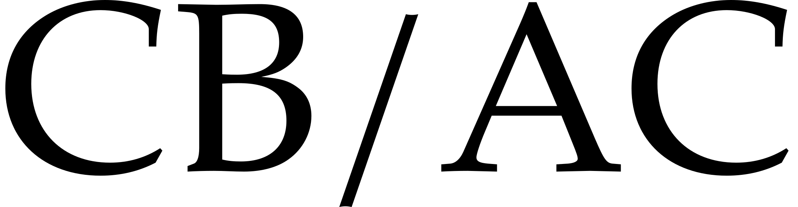, but that is a stipulation for which I can have empirical grounds; nothing, however, can be said about it a priori. The observed distribution of events cannot lead to this assumption. Where infinitely many possibilities come into consideration, probability must of course be regarded as a limit. For if I divide the segment A B into as many parts as I please, as unequal as I please, and regard the probabilities of the event occurring in any of these parts as equal to one another, we immediately have before us the simple case of the die. And now I can lay down a law – arbitrarily – according to which parts of equal probability are to be formed. E.g., the law that equal lengths of the parts entail equal probabilities. But any other law is equally permissible. Could I not also, in the case of the die, take, say, 5 faces together as one possibility and set them against the sixth as the second possibility? And what, apart from experience, can prevent me from regarding these two possibilities as equally probable? Imagine, say, a red ball being thrown that has only a very small green cap. In this case is it not much more probable that it will land on the red part than on the green? – But how would one justify this sentence? Presumably by the fact that the ball, when one throws it, lands much more often on the red surface than on the green. But that has nothing to do with logic. – One could always project the red and green surfaces and the events that occur on them onto a surface in such a way that the projection of the green surface would be as large as or larger than that of the red; so that the events, considered in this projection, appear to stand in quite a different ratio of probabilities from that on the original surface. If, e.g., I let the events be reflected in a suitably curved mirror and then consider which event I would have taken to be the more probable if I see only the image in the mirror. What the mirror cannot change is the number of clearly delineated possibilities. So if I have n patches of colour on my ball, the mirror also shows n, and if I have _stipulated_ that these are to count as equally probable, I can retain this stipulation for the mirror image too. To make myself clearer still: If I carry out the experiment in the concave mirror, i.e. make the _observations_ in the concave mirror, it may look as though the ball lands more often on the small surface than on the much larger one, and it is clear that neither experiment – in the concave mirror or outside it – deserves preference.

### [III-33-6\[1\]](https://cdn.wittgensteinnachlass.com/2000px/webp/Ts-212/III-33-6.webp)

93 We can apply our old principle to sentences that express a probability and say that we will recognize their sense if we consider what verifies them. If I say “that will probably happen”, is this sentence verified by its happening, or falsified by its not happening? I think the answer is clearly no. Then it says nothing about that either. For if a dispute arose as to whether it was probable or not, only arguments from the past would ever be adduced. And even then only if what had happened was already known.

### [III-33-7\[1\]](https://cdn.wittgensteinnachlass.com/2000px/webp/Ts-212/III-33-7.webp)

93 Causality rests on an observed uniformity. Now this is not to say that a uniformity observed up to now will always continue in the same way, but it must be established that the events have been uniform up to now; _that_ cannot in turn be the uncertain result of an empirical series which is itself not given either, but depends on an equally uncertain one, and so on ad inf.

### [III-33-8\[1\]](https://cdn.wittgensteinnachlass.com/2000px/webp/Ts-212/III-33-8.webp)

93 When people say that the sentence “it is probable that p will occur” says something about the event p, they forget that it remains probable even if the event p does _not_ occur.

### [III-33-8\[2\]](https://cdn.wittgensteinnachlass.com/2000px/webp/Ts-212/III-33-8.webp)

93 With the sentence “p will probably occur” we do indeed say something about the future, but, contrary to what the grammatical form of the statement leads us to believe, not something “_about_ the event p”.

### [III-33-8\[3\]](https://cdn.wittgensteinnachlass.com/2000px/webp/Ts-212/III-33-8.webp)

40 When I ask for the grounds for an assertion, the answer to this question is valid not just for the person I ask and for _this_ particular action (the assertion), but _generally_.

### [III-33-8\[4\]](https://cdn.wittgensteinnachlass.com/2000px/webp/Ts-212/III-33-8.webp),[III-33-9\[1\]](https://cdn.wittgensteinnachlass.com/2000px/webp/Ts-212/III-33-9.webp)

93 If I say: “the weather points to rain”, am I saying something about the future weather? No, but about the present weather, 93 with the help of a law that connects the weather at one time with the weather at a _later_ time. This law must already be in place, and with its help we sum up certain statements about our experience. – But then one could make the same claim for historical statements too. Yet it was hasty, after all, to say that the sentence “the weather points to rain” says nothing about the future weather. That depends on what one understands by “saying something about something”. The sentence says precisely what its words say! The sentence “p will probably occur” says something about the future only in a sense in which its truth or falsity is entirely independent of what will happen in the future.

### [III-33-9\[2\]](https://cdn.wittgensteinnachlass.com/2000px/webp/Ts-212/III-33-9.webp)

93  When we say “the rifle is now aimed at the point P”, we say nothing about where the shot will hit. The point at which it is aimed is a _geometrical_ aid for specifying its direction. Of course, our use of this particular means is connected with certain experiences (parabolic trajectory, etc.), but these do not now enter into the description of the direction.

### [III-33-10\[1\]](https://cdn.wittgensteinnachlass.com/2000px/webp/Ts-212/III-33-10.webp)

93 Galton’s photograph, the image of a probability. The law of probability, the law of nature, what one sees when one squints.

### [III-33-11\[1\]](https://cdn.wittgensteinnachlass.com/2000px/webp/Ts-212/III-33-11.webp)

93 What does it mean to say: “the points yielded by the experiment lie on average on a straight line”? or: “when I throw a good die, I throw a 1 on average once every 6 throws”? Is this sentence compatible with _every_ experience I might have? If it is, it says nothing. Have I specified (_beforehand_) what experience it is no longer compatible with, where the limit lies beyond which exceptions to the rule overturn the rule? No. But could I not have set such a limit? Certainly. – Suppose the limit were drawn like this: if 4 of 6 consecutive throws come up the same, the die is bad. But now one asks: “But if that happens seldom enough, isn’t it good after all?” – The answer is: If I allow 4 throws of the same number among 6 consecutive throws for a specified number of throws, then I am drawing a _different_ limit from the first one. But if I say “any number of consecutive throws of the same number is permissible, provided it occurs seldom enough”, then I have, strictly speaking, characterized the goodness of the die _as_ independent of the results of the throws. Unless by the goodness of the die I mean not a property of the die, but a property of a particular game played with it. For then I can indeed say: I call the die good in a game if among the N throws of the game there are no more than log N consecutive throws of the same number. But this would give us not a test for checking dice, but a criterion for judging one game.

### [III-33-11\[2\]](https://cdn.wittgensteinnachlass.com/2000px/webp/Ts-212/III-33-11.webp),[III-33-12\[1\]](https://cdn.wittgensteinnachlass.com/2000px/webp/Ts-212/III-33-12.webp)

93 One says that if the die is perfectly uniform and 93 is left to itself, then the distribution of the digits 1, 2, 3, 4, 5, 6 among the results of the throws must be uniform, because _there is no reason_ why one digit should occur more often than another. But now let us represent the results of the throws not by the digits 1 – 6 but by the values of the function (x ‒ 3)² for the arguments 1 to 6, that is, by the digits 0, 1, 4, 9. Is there any reason why one of _these_ digits should figure more often among the new results than another? This teaches us that the a priori law of probability is a form of laws, like that of the minimum laws of mechanics, etc. If one had found by experiment that the distribution of the throws 1 to 6 with a regular die turned out in such a way that the distribution of the values (x ‒ 3)² was uniform, one would then have declared _this_ uniformity to be the a priori uniformity. We do the same in the kinetic theory of gases: we represent the distribution of molecular motions in the form of some uniform distribution or other; but we choose _what_ is uniformly distributed – just as elsewhere we choose _what_ is to become a minimum – so that our theory agrees with experience.

### [III-33-12\[2\]](https://cdn.wittgensteinnachlass.com/2000px/webp/Ts-212/III-33-12.webp),[III-33-13\[1\]](https://cdn.wittgensteinnachlass.com/2000px/webp/Ts-212/III-33-13.webp)

93 “The molecules move solely according to the laws of probability” is supposed to mean: physics leaves the stage, and the molecules now move, as it were, solely according to laws of logic. This opinion is akin to the opinion that the law of inertia is an a priori proposition; and here too one speaks of what a body does when it is left to itself. What is the criterion for its being left to itself? Is it, in the end, that it moves uniformly in a straight line? Or is it something else? If the latter, then it is a matter of experience 93 whether the law of inertia holds; in the former case, though, it was no law at all, but a definition. And something analogous holds for a sentence: “if the particles are left to themselves, then the distribution of their motions is such and such”. What is the criterion for their being left to themselves? etc.

### [III-33-13\[2\]](https://cdn.wittgensteinnachlass.com/2000px/webp/Ts-212/III-33-13.webp)

93 If measurement shows that the die is exact and homogeneous, – I assume that the digits on its faces do not affect the results of the throws – and the hand that throws it moves without rules – does it follow that the throws 1 to 6 are on average uniformly distributed? What would one infer this from? No assumption has been made about the motion in throwing, and the premise of the die’s exactness is surely of quite a different kind from an on average uniform distribution of results. The premise is, as it were, of one colour, the conclusion speckled. Why did one say that the donkey would starve between the two equal bundles of hay, and not that it would, on average, eat from one as often as from the other?

### [III-33-14\[1\]](https://cdn.wittgensteinnachlass.com/2000px/webp/Ts-212/III-33-14.webp)

93 To say that the points that this experiment provides are, on average, located on this line, e.g. a straight line, _says_ something similar to: “seen from this distance, they appear to be on a straight line”. I can say of a line that the general impression is that of a straight line; but not: “the line looks straight, because it can be part of a line that, taken as a whole, gives me the impression of being straight”. (Mountains on the earth and on the moon. Earth a sphere.)

### [III-33-15\[1\]](https://cdn.wittgensteinnachlass.com/2000px/webp/Ts-212/III-33-15.webp)

93 The experiment of throwing dice lasts a certain time, and our expectations about the future results of throwing can be based only on tendencies we perceive in the results of the experiment. That is, the experiment can only give grounds for expecting that it will go on _as_ the experiment has shown (it to go). But we cannot expect that the experiment, if continued, will now yield results that agree more closely with a preconceived opinion about its course than the results of the experiment actually carried out. So if, e.g., I toss heads and tails and find in the results of the experiment no tendency for the numbers of heads and tails to come _still_ closer together, the experiment gives me no grounds for assuming that continuing it will show such a convergence. Indeed, the expectation of this convergence must itself refer to a particular point in time, for one cannot say that one expects an event to occur _sometime_ – in the infinite future.

### [III-33-16\[1\]](https://cdn.wittgensteinnachlass.com/2000px/webp/Ts-212/III-33-16.webp)

93 All “grounded expectation” is expectation that a rule observed up to now will continue to hold. (But the rule must have been observed and cannot itself in turn be merely expected.)

### [III-33-16\[2\]](https://cdn.wittgensteinnachlass.com/2000px/webp/Ts-212/III-33-16.webp)

93 The logic of probability has to do with the state of expectation only to the extent that logic in general has to do with thinking.

### [III-33-16\[3\]](https://cdn.wittgensteinnachlass.com/2000px/webp/Ts-212/III-33-16.webp),[III-33-17\[1\]](https://cdn.wittgensteinnachlass.com/2000px/webp/Ts-212/III-33-17.webp)

93  A ray of light is emitted from the light source Q; it strikes the disc AB, produces a spot of light there, and then strikes the disc AC. _Now_ we have no grounds for assuming that the spot of light on AB will lie to the right of the centre M, nor for assuming the opposite; but we have no grounds either for assuming that the spot of light on AC will lie on _this_ side of the centre m rather than that. So this gives contradictory probabilities. Now if I make an assumption about the degree of probability that the one spot of light lies in the segment AM, 93 – how is this assumption verified? _We think, surely_, by an experiment to determine frequencies. Now suppose this confirms the view that the probabilities for the segments AM and BM are equal (and thus different for Am and Cm), then that view is thereby recognized as correct and thus proves to be a physical hypothesis. The geometrical construction shows only that the equality of the segments AM and BM was _no_ ground for assuming equal probability.

### [III-33-18\[1\]](https://cdn.wittgensteinnachlass.com/2000px/webp/Ts-212/III-33-18.webp),[III-33-19\[1\]](https://cdn.wittgensteinnachlass.com/2000px/webp/Ts-212/III-33-19.webp)

93 If I assume that measurement shows the die to be true and homogeneous, that the numerals on its faces do not affect the results of the throws, and that the hand throwing it moves without any definite rule, does it follow that throws of 1 to 6 are distributed uniformly on average among the results? – What is that supposed to follow from? The fact that the die is true and homogeneous surely cannot account for a distribution of results that is _uniform on average_. (The assumption is homogeneous, so to speak; the conclusion would be speckled.) And we have made no assumption about the movement in throwing. (One has _indeed_ used the equality of the two bundles of hay as grounds for concluding that the donkey midway between them (would) starve; but not for concluding that it would eat from each about equally often.) – Our assumptions are also perfectly compatible with throwing 100 ones in succession with the die, if friction, movement of the hand and air resistance happen to combine in that way. The experience that this never happens is experience concerning these factors. And the conjecture that the results of the throws are evenly distributed is a conjecture about how these factors operate. If one says that a lever with equal arms on which symmetrical forces act must remain at rest because there is no cause for it to tilt to one side rather than the other, this means only that if we have established that the lever arms are equal and the forces symmetrical, 93 and the lever then tilts to one side, we cannot explain this from the premises we know – or have assumed. (The form we call “explanation” must also be asymmetrical, like the operation that turns “a + b” into “2a + 3b”.) But from our premises we can explain why the lever continues to remain at rest. – But can we also explain an oscillation directed from the centre to the right and to the left equally often on average? Not the oscillation, for there again we have asymmetry. Only the symmetry in this asymmetry. Had the lever turned uniformly to the right, one could say analogously: I can explain the uniformity of the movement by the symmetry of the conditions, but not its direction. 93 A non-uniform distribution of the results of the throws can _not_ be explained by the symmetry of the die. And only to that extent does this symmetry explain the uniformity of the distribution. – For one can of course say: if the numerals on the faces of the die have no effect, then their differences cannot explain a non-uniform distribution; and identical circumstances cannot of course explain differences; so to that extent one might infer uniformity. But where, then, do the different results come from at all? Certainly, whatever explains these must also explain their uniformity on average. The regularity of the die simply does not interfere with this uniformity.

### [III-33-19\[2\]](https://cdn.wittgensteinnachlass.com/2000px/webp/Ts-212/III-33-19.webp),[III-33-20\[1\]](https://cdn.wittgensteinnachlass.com/2000px/webp/Ts-212/III-33-20.webp)

93 Suppose someone who plays dice every day were to throw nothing but ones for a week or so, using dice that prove sound under every other kind of examination and that also _give_ the usual results when someone else throws them. Does he now have grounds for assuming a law of nature _here_ 93 according to which he always throws ones; does he have grounds for believing it will go on like this now, – or (_rather_) grounds for assuming that this regularity cannot go on much _longer_? Has he grounds, then, for giving up the game, since it has turned out that he can only throw ones; or for going on playing, since it is now all the more likely that he will throw a higher number next time? – In reality he will refuse to recognize the regularity as a law of nature; at the very least it will have to go on for a long time before he considers this _view_. But why? – “I think because so much of his previous experience in life tells against such a law, and all of it has – so to speak – to be overcome before we _adopt_ an entirely new way of looking at things.

### [III-33-20\[2\]](https://cdn.wittgensteinnachlass.com/2000px/webp/Ts-212/III-33-20.webp)

93 If we draw conclusions from the relative frequency of an event about its relative frequency in the future, we can of course do so only on the basis of the frequency actually observed so far. And not on the basis of one we have obtained from the observed frequency by some procedure of the calculus of probability. For the calculated probability agrees with _any_ frequency actually observed, since it leaves the time open.

### [III-33-20\[3\]](https://cdn.wittgensteinnachlass.com/2000px/webp/Ts-212/III-33-20.webp)

93 When the gambler or the insurance company goes by probability, they do not go by the calculus of probability, for one cannot go by that alone, since _whatever_ happens can be brought into agreement with it; rather, the insurance company goes by an actually observed frequency. And this is of course an absolute frequency.

### [III-34FCr\[1\]](https://cdn.wittgensteinnachlass.com/2000px/webp/Ts-212/III-34FCr.webp)

The concept “approximately”

Problem of the ‘heap of sand’

### [III-34-1\[1\]](https://cdn.wittgensteinnachlass.com/2000px/webp/Ts-212/III-34-1.webp)

85 “He came from _roughly_ there”. “The brightest point on the horizon is roughly _there_”. “Make the board roughly 2 m long”. To be able to say that, must I know limits that determine the latitude for this length? Obviously not. Is it not enough, for example, to say: “a latitude of ± 1 cm is certainly allowed; ± 2 cm would already be too much”? – Surely it is also essential to the sense of my sentence that I am unable to give the latitude “exact” limits. Isn’t this plainly because the space I am working in here has a different metric from Euclidean space? For if one tried to determine the latitude exactly by experiment, changing the length and asking each time whether this length was still acceptable or no longer so, after a few steps of narrowing it down one would arrive at contradictions: on one occasion a point would still be said to lie within the limits, on another a point further inside would be declared inadmissible; both, perhaps, with the comment that the judgements were no longer (_quite_) certain.

### [III-34-2\[1\]](https://cdn.wittgensteinnachlass.com/2000px/webp/Ts-212/III-34-2.webp)

85 The uncertainty is of the same kind as that involved in specifying the highest point of a curve. We are simply not in Euclidean space, and there is no highest point here in the Euclidean sense. The answer will be: “the highest point is roughly _there_”, and the grammar of the word “roughly” – in this context – _then_ belongs to the geometry of our space.

### [III-34-3\[1\]](https://cdn.wittgensteinnachlass.com/2000px/webp/Ts-212/III-34-3.webp)

85 Isn’t it like the way one weighs things at the butcher’s, say, only to the nearest decagram, although that, on the other hand, is arbitrary and determined only by the customary brass weights? Here it is enough to know: it weighs no more than P1 and no less than P2. One could say: in principle, stating the weight here consists not in specifying a number but in specifying an interval, and the intervals form a discontinuous series.

### [III-34-3\[2\]](https://cdn.wittgensteinnachlass.com/2000px/webp/Ts-212/III-34-3.webp)

85 One could surely say: “in any case, keep _within_ ± 1 cm”, thereby setting an arbitrary limit. – If it were then said: “all right, but that isn’t the actual limit of the permissible latitude; what is it, then?”, the answer might be “I don’t know of one; I only know that ± 2 cm would already be too much”.

### [III-34-3\[3\]](https://cdn.wittgensteinnachlass.com/2000px/webp/Ts-212/III-34-3.webp)

<s> Now even if there were no wavering in the experiment to determine the limits for as long as we actually go on with it, we must nevertheless stop at some point, and the result will always be only that a certain length is still permissible and another is already impermissible. Here again the false conception of the infinite leads us astray when we imagine the process of this investigation completed and then speak of a boundary point, as if there were a law, a geometrical construction, to which the boundary point corresponded. </s>

### [III-34-4\[1\]](https://cdn.wittgensteinnachlass.com/2000px/webp/Ts-212/III-34-4.webp),[III-34-5\[1\]](https://cdn.wittgensteinnachlass.com/2000px/webp/Ts-212/III-34-5.webp),[III-34-6\[1\]](https://cdn.wittgensteinnachlass.com/2000px/webp/Ts-212/III-34-6.webp)

(34) 59 85 57  Let us imagine the following psychological experiment: we show the subject two lines G1, G2, with the straight line A drawn across them. I shall call the part of this straight line lying between G1 and G2 the segment a. We now draw b at an arbitrary distance from a and parallel to it, and ask whether he sees the segment b as longer than a or can no longer distinguish the two lengths. He replies that b appears longer than a. We then move closer to a by bisecting the distance from a to b with our measuring instruments and drawing c. “Do you see c as longer than a?” – “Yes”. We bisect the distance c–a and draw d. “Do you see d as longer than a?” – “Yes”. We bisect a–d. “Do you see e as longer than a?” – “No”. So we bisect e–d. “Do you see f as longer than e?” – “Yes”. So we bisect e–f and draw h. We could also approach the segment a in this way from the left, and then say that in Euclidean space there corresponds to a seen length a not _one_ length but an interval of lengths, and likewise that what corresponds to _one_ seen position of a line (say, the pointer of an instrument) is an interval of positions in Euclidean space: but this interval does not have sharp boundaries. That is: it is bounded not by points but by converging intervals that do not converge to a point. (Like 59, 57 the series of binary fractions that we generate by tossing a coin for heads or tails.) What is characteristic of two intervals bounded in this way, not by points but _fuzzily_, is that in certain cases the answer to the question whether they overlap or lie apart is “undecided”. And that the question whether they touch, whether they have an endpoint in common, is always senseless, since they have no endpoints. But one could say: they have _provisional_ endpoints. In the sense in which the expansion of π has a provisional end. There is of course nothing mysterious about this property of the ‘fuzzy’ interval; what is _somewhat_ paradoxical is cleared up by the two uses of the word “interval”. This is the same case as that of the two uses of the word “chess”, when it means, on the one hand, the totality of the rules of chess now in force, and on the other: the game that N.N. invented in Persia and that developed in such-and-such a way. In one case it is nonsensical to speak of a change in the rules of chess, in the other it is not. We can use “length of a measured segment” for either what comes out of a particular measurement I carry out at 5 o’clock today – in which case there is no “ ± etc.” for this specification of length –, or something that measurements approach, etc.; in the two cases the word “length” is used with a quite different grammar. And likewise the word “interval” when I call something complete an interval in one case, and something developing an interval in the other.

I) the intervals lie apart

II) they lie apart and touch provisionally

III) undecided

IV) undecided

V) undecided

VI) they overlap

VII) they overlap

59, 57, 85 But we cannot be surprised that an interval should now have such strange properties; for we are now using the word “interval” in an unusual sense. And we cannot say that we have discovered new properties of certain intervals. Any more than we would discover new properties of the chess king if we changed the rules of the game but kept the designations “chess” and “king”. (Contrast Brouwer, on the law of excluded middle.) So that experiment essentially yields what we called a “fuzzy” interval; but of course other experiments would be possible that yield a sharp interval instead. Imagine, for instance, moving a ruler from the initial position b, keeping it parallel to that position, towards a until some definite reaction occurred in our subject: then we could call the point at which the reaction begins the boundary of our strip. – In this way we could of course also call the result of a weighing “the weight of a body”, and in this sense there would then be an absolutely exact weighing, i.e. one whose result does not have the form “G ± g”. We have thereby changed our way of expressing ourselves and must now say that the weight of the body fluctuates, and does so according to a law unknown to us. (The distinction between “absolutely exact” weighing and “essentially inexact” weighing is grammatical and relates to two different meanings of the expression “result of the weighing”.)

### [III-34-7\[1\]](https://cdn.wittgensteinnachlass.com/2000px/webp/Ts-212/III-34-7.webp),[III-34-8\[1\]](https://cdn.wittgensteinnachlass.com/2000px/webp/Ts-212/III-34-8.webp)

85 The indeterminacy of the word “heap”. I could define it as follows: a body of a certain shape and consistency, etc., is a heap if its volume is K m³ or more; anything below that I shall call a little heap. Then there is no largest little heap; that is: it is then senseless to speak of the “largest little heap”. Conversely, I could stipulate that anything larger than K m³ is to count as a heap, and then 85 the expression “the smallest heap” would have no meaning. But isn’t this distinction idle? Certainly, – if by volume we understand the result of a measurement in the ordinary sense; for this result has the form “V ± v”. Otherwise, though, the distinction might be as useless as the one between five dozen apples and 61 apples.

### [III-34-9\[1\]](https://cdn.wittgensteinnachlass.com/2000px/webp/Ts-212/III-34-9.webp)

85 On the problem of the “heap of sand”: here, as in similar cases, one could imagine an official concept, say: a heap is anything larger than half a m³. But this would still not be the concept we ordinarily use. There is no boundary for that concept (and if we lay one down, we change the concept); there are only cases that we count as falling within the extension of the concept and cases that we no longer count as falling within its extension.

### [III-34-10\[1\]](https://cdn.wittgensteinnachlass.com/2000px/webp/Ts-212/III-34-10.webp)

85 “Make me a heap of sand here”. – “All right, he’ll surely still call that a heap”. I could carry out the command, so it was in order. But what about this command: “Make me the smallest heap you would still call a heap”? I would say: that is nonsense; I can only fix a provisional upper and lower limit.

### [IV-FCr\[1\]](https://cdn.wittgensteinnachlass.com/2000px/webp/Ts-212/IV-FCr.webp)

Instantaneous understanding & the application of the word in time

### [IV-35FCr\[1\]](https://cdn.wittgensteinnachlass.com/2000px/webp/Ts-212/IV-35FCr.webp)

To _understand_ a word = to _be able_ to apply it.

To _understand_ a language: To have _mastery_ of a calculus.

### [IV-35-1\[1\]](https://cdn.wittgensteinnachlass.com/2000px/webp/Ts-212/IV-35-1.webp)

89 Can I say that I am interested only in the _content_ of the sentence? And the content of the sentence is in it.

### [IV-35-1\[2\]](https://cdn.wittgensteinnachlass.com/2000px/webp/Ts-212/IV-35-1.webp)

89 The sentence has its content as a member of the calculus.

### [IV-35-1\[3\]](https://cdn.wittgensteinnachlass.com/2000px/webp/Ts-212/IV-35-1.webp)

89 Is “understanding a sentence”, then, of the same kind as “having _mastery_ of a calculus”? Like, then: being able to multiply? I believe it is.

### [IV-35-2\[1\]](https://cdn.wittgensteinnachlass.com/2000px/webp/Ts-212/IV-35-2.webp)

89, 8 To understand the meaning of a word is to know, to understand, its use.

### [IV-35-3r\[1\]](https://cdn.wittgensteinnachlass.com/2000px/webp/Ts-212/IV-35-3r.webp)

(38˙2) 9d, 89 [→ 8.] To understand the meaning of a word is to be able to apply it. “I can apply the word ‘yellow’” – is that on a different level from “I can play chess”, or “I can use the king in chess”?

### [IV-35-3v\[1\]](https://cdn.wittgensteinnachlass.com/2000px/webp/Ts-212/IV-35-3v.webp)

2 In what way does the intention to play chess in half an hour differ from the intention to play chess in 28 minutes? Not at all, …

### [IV-35-4\[1\]](https://cdn.wittgensteinnachlass.com/2000px/webp/Ts-212/IV-35-4.webp)

68 The question immediately related to ours is the question of the sense of the statement “I _can_ play chess”? “I know how a pawn is allowed to move”. “I know how the word ‘sphere’ may be used”.

### [IV-35-4\[2\]](https://cdn.wittgensteinnachlass.com/2000px/webp/Ts-212/IV-35-4.webp)

68 If I say “I can lift this weight”, one can answer: “that will become clear when you try”; and if I then fail, one can say “see, you couldn’t”; and I cannot answer “yes I could, when I said it; it was only when it came to lifting it that I couldn’t”. Whether one can do it _will be shown by experience_. It is different when I say “I understand this command”; this is, or seems to be, an experience. “I must know whether I understand it (_now_)” – but not: I must know whether I can lift the weight _now_. – Where does the sentence “I can play chess” stand in this _respect_? Is this something that will become clear, or can one say “when I asserted it I could play chess, it’s only now that I can’t”.

### [IV-35-5\[1\]](https://cdn.wittgensteinnachlass.com/2000px/webp/Ts-212/IV-35-5.webp)

Isn’t what justifies me simply that I remember having played chess before? And perhaps that, when asked, I can run through the rules in my mind as a test?

### [IV-35-5\[2\]](https://cdn.wittgensteinnachlass.com/2000px/webp/Ts-212/IV-35-5.webp)

68 Isn’t it the same with the use of the word “sphere”? I use the word instinctively. But when asked to account for whether I understand it, I call up certain mental images, as if to test myself. (It cannot matter whether language is used instinctively or semi-instinctively. We are here in the swamp of differences of degree, not on the firm ground of logic.)

### [IV-35-5\[3\]](https://cdn.wittgensteinnachlass.com/2000px/webp/Ts-212/IV-35-5.webp)

68 If I say “look, there’s a sphere”, or “there’s a cone”, what I see (a circle) can fit either, and when I say “yes, I see it”, I nevertheless distinguish between the two hypotheses. Just as in chess I distinguish between a pawn and the king, even if the current move is one that both could make, and even if a king piece were to function as a pawn. The word “sphere” is _familiar_ to me and stands for something in me; that is, it brings me into a certain position relative to it (as a magnet brings a needle into alignment with it).

### [IV-35-6\[1\]](https://cdn.wittgensteinnachlass.com/2000px/webp/Ts-212/IV-35-6.webp)

96a One is always in danger in philosophy of giving a mythology of symbolism, or of psychology. Instead of simply saying what everyone knows and must admit.

### [IV-35-7\[1\]](https://cdn.wittgensteinnachlass.com/2000px/webp/Ts-212/IV-35-7.webp)

22 If I were asked “can you recite the alphabet”, I would answer: yes. – “Are you sure” – “Yes”. But if I then got stuck while reciting it and did not know how to go on, then — Now there is nevertheless a case in which I would say “yes, when I said I could recite it, I could”, namely if I had recited it to myself “in my mind” at the time. I would also offer this as proof. But this means that reciting it in one’s mind contains the ability to recite it for real – as we understand the word ability here.

### [IV-35-8\[1\]](https://cdn.wittgensteinnachlass.com/2000px/webp/Ts-212/IV-35-8.webp),[IV-35-9\[1\]](https://cdn.wittgensteinnachlass.com/2000px/webp/Ts-212/IV-35-9.webp)

_Being able_ to do something has precisely that shadowy character, that is, it appears like a shadow of actually doing it, just as the sense of the sentence appears as a shadow of its verification; or the understanding of the command as a shadow of its execution. The command “already casts its shadow in advance, as it were”, or, in the command “the deed casts its shadow in advance”. – But this 22 shadow, _whatever_ it may be, is what it is, and not the event. It is self-contained and points no further than it itself extends.

### [IV-35-9\[1\]](https://cdn.wittgensteinnachlass.com/2000px/webp/Ts-212/IV-35-9.webp)

<s> 22 Do you know the alphabet? Are you sure? – Yes! – Is that compatible with your trying to recite it and getting stuck? – **Yes**! </s>

### [IV-35-9\[2\]](https://cdn.wittgensteinnachlass.com/2000px/webp/Ts-212/IV-35-9.webp)

22 Surely this is the same case as: “Can you raise your arm?” In what case would I have to say no, or doubt it? Such cases are easy to imagine. We take, say, a twitch of the muscles or a slight movement of the arm as confirmation that we can raise our arm. Or the required movement itself, performed now, as a criterion that I _can_ perform it again a moment later.

### [IV-36FCr\[1\]](https://cdn.wittgensteinnachlass.com/2000px/webp/Ts-212/IV-36FCr.webp)

How does understanding the sentence accompany uttering or hearing it?

### [IV-36-1\[1\]](https://cdn.wittgensteinnachlass.com/2000px/webp/Ts-212/IV-36-1.webp)

38˙2, 89 The most difficult problem seems to be the _contrast_, the relation, between operating with language in time and grasping the sentence in an instant.

### [IV-36-1\[2\]](https://cdn.wittgensteinnachlass.com/2000px/webp/Ts-212/IV-36-1.webp)

38˙2, 89 But _when_ do we grasp or understand the sentence?! _After_ we have uttered it? – And if while we are uttering it, is the understanding an articulated process, like the forming of the sentence, or an unarticulated one? And if it is articulated: must it not be connected projectively with the other process? For otherwise its articulation would be independent of the first.

### [IV-36-2\[1\]](https://cdn.wittgensteinnachlass.com/2000px/webp/Ts-212/IV-36-2.webp),[IV-36-3\[1\]](https://cdn.wittgensteinnachlass.com/2000px/webp/Ts-212/IV-36-3.webp)

54 “He says that, and _means_ it”: Compare this on the one hand with: “he says that, and writes _it_ down”; on the other with: “he writes that and signs _it_”.

### [IV-36-4\[1\]](https://cdn.wittgensteinnachlass.com/2000px/webp/Ts-212/IV-36-4.webp)

38˙2, 89 One might ask: How long does it take to understand a sentence? And if one understands it for an hour, does one keep starting afresh?

### [IV-36-5\[1\]](https://cdn.wittgensteinnachlass.com/2000px/webp/Ts-212/IV-36-5.webp)

89 If understanding is not the grasping of the sentence, it can also take place afterwards (and why not beforehand too).

### [IV-36-6\[1\]](https://cdn.wittgensteinnachlass.com/2000px/webp/Ts-212/IV-36-6.webp)

89 Isn’t understanding a sentence analogous to understanding a chess move as such? Someone who knows nothing of chess and sees someone make a move will not understand it, i.e. will not understand it as a move in a game. And following the game with understanding is different from merely seeing it.

### [IV-36-6\[2\]](https://cdn.wittgensteinnachlass.com/2000px/webp/Ts-212/IV-36-6.webp)

89 But what is it, then, that always gives us the feeling that understanding a sentence is _understanding_ something that lies outside it, namely not the world outside the sign as it is, but the world as the sign – as it were – wishes it to be?

### [IV-36-7\[1\]](https://cdn.wittgensteinnachlass.com/2000px/webp/Ts-212/IV-36-7.webp)

One might say (something like) this: I’m not just saying “draw a circle”; I do wish _the other person_ to do something. (Certainly!) And this doing is surely different from the saying, and is just what lies outside, what I am pointing to.

### [IV-36-8\[1\]](https://cdn.wittgensteinnachlass.com/2000px/webp/Ts-212/IV-36-8.webp)

89 Understanding a sentence of word-language is much more akin to understanding a musical theme (or piece of music) than one supposes. That is, understanding the linguistic sentence is closer than one thinks to what is usually called understanding musical expression. – Why do I whistle it just _so_? Why do I make the variation in dynamics and tempo take just this particular form? I would like to say: “because I know what it all means” – but what does it mean? – I wouldn’t know how to say, except by translating it into a process with the same rhythm.

### [IV-36-9\[1\]](https://cdn.wittgensteinnachlass.com/2000px/webp/Ts-212/IV-36-9.webp)

22, 8 Language seems to represent being able and understanding as a state, like toothache, and that is the false analogy I am labouring under.

### [IV-36-10\[1\]](https://cdn.wittgensteinnachlass.com/2000px/webp/Ts-212/IV-36-10.webp)

22 54, 89 What if one asked: When _can_ you play chess? Always? Or while you are saying so? But throughout the whole sentence? – And how strange that being able to play chess takes so little time and a game of chess so much longer!

### [IV-36-10\[2\]](https://cdn.wittgensteinnachlass.com/2000px/webp/Ts-212/IV-36-10.webp)

8, 22 Now if “understanding the word ‘yellow’” means being able to apply it, the same question _remains_: When _can_ you apply it? Are you talking about a disposition? Is it a conjecture?

### [IV-36-11\[1\]](https://cdn.wittgensteinnachlass.com/2000px/webp/Ts-212/IV-36-11.webp)

22, 8 Augustine: “_When_ do I measure a period of time?” Similar to my question: _When can_ I play chess.

### [IV-37FCr\[1\]](https://cdn.wittgensteinnachlass.com/2000px/webp/Ts-212/IV-37FCr.webp)

Does the meaning of a word show itself in time? Like the actual degree of freedom of a mechanism. Is the meaning of the word only revealed little by little as its application proceeds?

### [IV-37-1\[1\]](https://cdn.wittgensteinnachlass.com/2000px/webp/Ts-212/IV-37-1.webp)

68 It is a very curious fact that, when using language, I do not remember how I learned it. I say “here I see a black sphere”. I do not know how I learned “black” and “sphere”. My application of the words is independent of this _learning_. It is as if I had coined the words myself. And here we are led back to the question: If the grammar that deals with the words is essential to _their meaning_, must I have all the grammatical rules that deal with a word in my head for it to mean anything to me? Or is it here as in the mechanism: the wheel that stands still, or that is turning, the wheel in one position, does not know, as it were, what further movement is permitted to it, the piston does not know what law is prescribed for its movement; and yet the wheel and the piston operate only through that constraint. Should I therefore say: The grammatical rules operate in time? (Like that guide.) So: The word “sphere” operates only in the way it is applied. And one could imagine the strange question: “how then can I know _straight away_ what I mean by ‘sphere’, when surely I cannot have the whole way it is applied in my head _all at once_?”

### [IV-37-2\[1\]](https://cdn.wittgensteinnachlass.com/2000px/webp/Ts-212/IV-37-2.webp)

68 And isn’t it similar with chess: in some sense one can say that I know the rules of chess (have them in my head) while I am playing. But isn’t this “having them in my head” really just a hypothesis? Do I not have them in my head only insofar as I apply them in each particular case? – Certainly, this knowledge is merely the hypothetical reservoir from which the water we actually see flows.

### [IV-37-3\[1\]](https://cdn.wittgensteinnachlass.com/2000px/webp/Ts-212/IV-37-3.webp)

89 The understanding of language – of the game, as it were – seems to be like a background against which alone the individual sentence acquires meaning.

### [IV-37-3\[2\]](https://cdn.wittgensteinnachlass.com/2000px/webp/Ts-212/IV-37-3.webp)

89 67a Only the general rule reveals the degree of freedom, the mobility of the mechanism. The picture of the mechanism in one of its positions contains nothing _of this_.

### [IV-37-3\[3\]](https://cdn.wittgensteinnachlass.com/2000px/webp/Ts-212/IV-37-3.webp),[IV-37-4\[1\]](https://cdn.wittgensteinnachlass.com/2000px/webp/Ts-212/IV-37-4.webp)

89 67a Should I now say that the degree of freedom of the mechanism can reveal itself only over time? But how can I ever know, then, 89 that it _cannot_ make certain movements (and that it can make certain movements that it just hasn’t made yet)?

### [IV-37-5\[1\]](https://cdn.wittgensteinnachlass.com/2000px/webp/Ts-212/IV-37-5.webp)

67(a), 89 Understanding as a _disposition_ of the mind or of the brain is no concern of ours.

### [IV-38FCr\[1\]](https://cdn.wittgensteinnachlass.com/2000px/webp/Ts-212/IV-38FCr.webp)

Does knowledge of the grammatical rules accompany the expression of the sentence when we understand it – its words?

### [IV-38-1\[1\]](https://cdn.wittgensteinnachlass.com/2000px/webp/Ts-212/IV-38-1.webp)

38˙2 Can’t I say: I mean the negation which, when doubled, yields an affirmation?

### [IV-38-1\[2\]](https://cdn.wittgensteinnachlass.com/2000px/webp/Ts-212/IV-38-1.webp)

38˙2 Wouldn’t that be like saying: I mean the straight line, two of which intersect at a point.

### [IV-38-1\[3\]](https://cdn.wittgensteinnachlass.com/2000px/webp/Ts-212/IV-38-1.webp)

38˙2 That is: When you spoke of red, did you mean that of which one can say that it is bright, but not green, even if you didn’t think of this rule or make use of it? – Did you use the ‘non’ for which non-non-non-p = non-p holds? Even if you didn’t use this rule? Is it perhaps a hypothesis that it was _that_ non? Can there be doubt as to whether it was the same one, and can its being the same one be confirmed by experience?

### [IV-38-2\[1\]](https://cdn.wittgensteinnachlass.com/2000px/webp/Ts-212/IV-38-2.webp)

38˙2 What does the question mean: Is that the same ‘non’ for which the rule non-non-non-p = non-p holds?

### [IV-38-3\[1\]](https://cdn.wittgensteinnachlass.com/2000px/webp/Ts-212/IV-38-3.webp)

38˙2 “Do you mean the ‘non’ in such a way that I can infer non-non-non-p from non-p?”

### [IV-38-4\[1\]](https://cdn.wittgensteinnachlass.com/2000px/webp/Ts-212/IV-38-4.webp)

22, 9d, 89 Chess is certainly characterized by its rules (its list of rules). And we say that someone who is playing a game of chess and now makes a move is doing something different from someone who cannot play chess (i.e. doesn’t know the game) and now picks up a piece and happens to move it in accordance with the rule. On the other hand, it is clear that the difference does not consist in the first person in some form saying the rules of chess to himself or going over them. – Now if I say: “his being able to play chess (actually playing chess, intending to play chess) consists in his knowing the rules”, is this knowledge of the rules contained in every move in some form? What does it mean to say: “he is doing something different”? There is already a false picture at work here. What does the difference consist in? Here again one thinks of processes in the brain.

### [IV-38-5\[1\]](https://cdn.wittgensteinnachlass.com/2000px/webp/Ts-212/IV-38-5.webp)

2 If chess is defined by its rules, then those rules belong to the grammar of the word “chess”. Can one have an intention without expressing it? Can one have the intention of playing chess (in the sense in which one says apodictically “I intended to play chess; _surely I must_ _know that_”), without an expression of that intention? – Couldn’t one ask here: How do you know that what you had was _this_ intention? Is the intention to play chess perhaps like a fondness for the game, or for a person. There too one might ask: Do you have this fondness all the time or etc., and the answer is that “having a fondness” includes certain actions, thoughts and feelings and excludes others.

### [IV-38-5\[2\]](https://cdn.wittgensteinnachlass.com/2000px/webp/Ts-212/IV-38-5.webp)

2 Mustn’t I say: “I know that I had the intention, _because_ I thought to myself ‘now I finally get to play chess’” or etc. etc.

### [IV-38-5\[3\]](https://cdn.wittgensteinnachlass.com/2000px/webp/Ts-212/IV-38-5.webp)

2 It would also be entirely consistent with the intention in this sense if, on making the first move, I discovered that I had forgotten all the rules of chess, and in such a way that I couldn’t say, for instance, “yes, when I formed the intention I still knew them”.

### [IV-38-6\[1\]](https://cdn.wittgensteinnachlass.com/2000px/webp/Ts-212/IV-38-6.webp)

(2) 38˙2 It would be important to express in general terms the mistake I tend to make in all these considerations. The false analogy from which it springs.

### [IV-38-7\[1\]](https://cdn.wittgensteinnachlass.com/2000px/webp/Ts-212/IV-38-7.webp)

38˙2 [10b] I think that mistake lies in the idea that the meaning of a word is a mental image that accompanies the word. And this conception in turn has to do with the conception of being conscious. Of what I always called “the primary”.

### [IV-38-8\[1\]](https://cdn.wittgensteinnachlass.com/2000px/webp/Ts-212/IV-38-8.webp),[IV-38-9\[1\]](https://cdn.wittgensteinnachlass.com/2000px/webp/Ts-212/IV-38-9.webp)

54, 38˙2 It bothers us, _as it were_, that the thought of a sentence is not fully present at any moment. Here we see that we are comparing the thought to a thing we produce and never possess as a whole; rather, scarcely does one part come into being before another disappears. _That_ is _in a way_ unsatisfying, because – again misled by an explanation – we expect something different.

### [IV-38-10\[1\]](https://cdn.wittgensteinnachlass.com/2000px/webp/Ts-212/IV-38-10.webp)

2, 38˙2 The player who intended to play chess already had that intention in saying to himself, for instance, “now let’s play chess”. What I want to say is that the word “chess” too is (_only_) a piece in a calculus. When the calculus is described, we have to tabulate the rules, but when it is applied, we proceed now according to one rule, now according to another; we may or may not have their expression in mind as we do so.

### [IV-38-10\[2\]](https://cdn.wittgensteinnachlass.com/2000px/webp/Ts-212/IV-38-10.webp)

38˙2 Must someone who uses the word “chess” have a definition of the word in mind? Certainly not. – It is only when asked what he understands by “chess” that he will give one. This definition is itself a particular step in _his_ calculus.

### [IV-38-10\[3\]](https://cdn.wittgensteinnachlass.com/2000px/webp/Ts-212/IV-38-10.webp)

38˙2 But suppose I now asked him: When you uttered the word, what did you mean by it? If he answers: “I meant the game we’ve played so often etc., etc.”, I know that he did not in any way have this explanation in mind when he used the word, and that his reply does not answer my question in _the_ sense of telling me what, as it were, “went on in him” when he said that word.

### [IV-38-10\[4\]](https://cdn.wittgensteinnachlass.com/2000px/webp/Ts-212/IV-38-10.webp)

38˙2 For the question is precisely whether by the “meaning in which one uses a word” we are to understand a process that we experience when speaking or hearing the word.

### [IV-38-10\[5\]](https://cdn.wittgensteinnachlass.com/2000px/webp/Ts-212/IV-38-10.webp),[IV-38-11\[1\]](https://cdn.wittgensteinnachlass.com/2000px/webp/Ts-212/IV-38-11.webp)

38˙2 The source of the error seems to be the idea of a _thought_ _that accompanies the sentence_. Or that precedes its expression. A verbal expression can of course be preceded by another expression, but the difference between those two expressions – or thoughts – is not at issue for us. And the thought can be thought directly in its verbal form.

### [IV-38-11\[2\]](https://cdn.wittgensteinnachlass.com/2000px/webp/Ts-212/IV-38-11.webp)

38˙2 “He said these words, but wasn’t thinking anything at all as he said them.” – “Yes, I was thinking something as I said them”. – “And what, precisely?” – “Well, what I said”.

### [IV-38-12r\[1\]](https://cdn.wittgensteinnachlass.com/2000px/webp/Ts-212/IV-38-12r.webp)

54 One might say: in response to the statement “this sentence has sense” one cannot, in any essential way, ask “what sense?” Just as in response to the sentence “these words are a sentence” one cannot ask “which one?”

### [IV-38-12v\[1\]](https://cdn.wittgensteinnachlass.com/2000px/webp/Ts-212/IV-38-12v.webp)

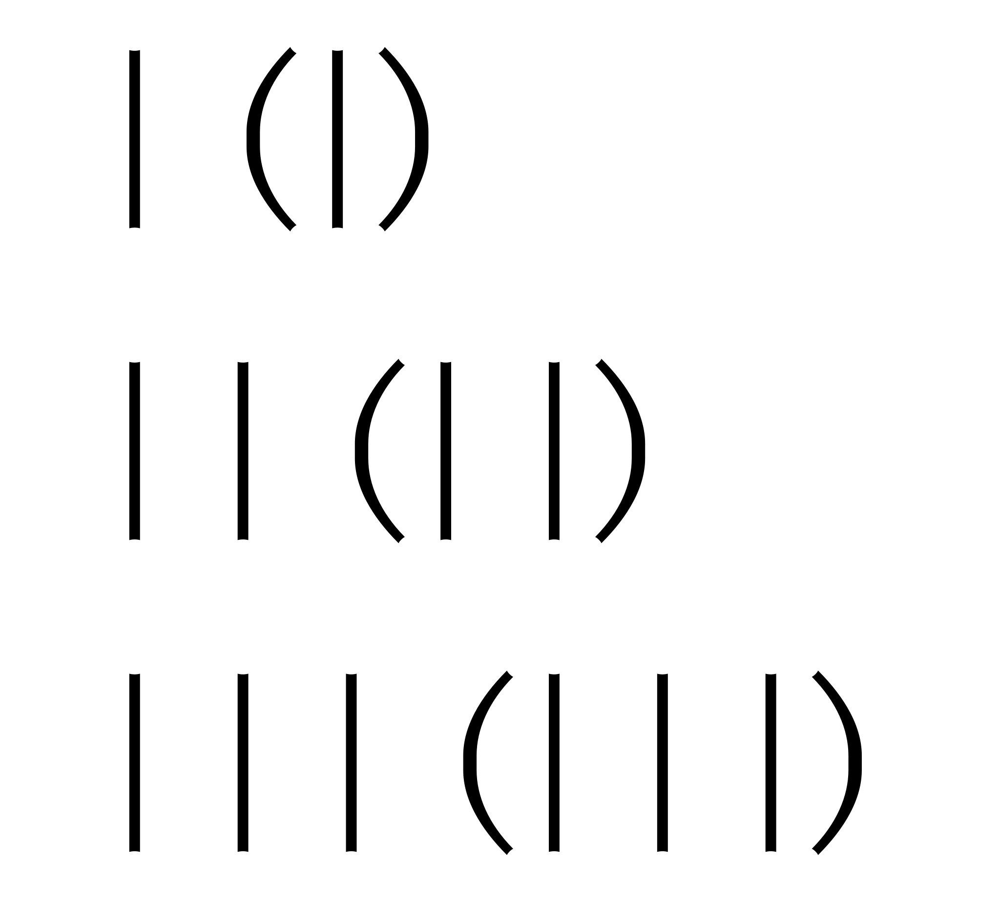 It is a matter of getting rid of the feeling that we are dealing here with an empirical fact.

### [IV-38-13\[1\]](https://cdn.wittgensteinnachlass.com/2000px/webp/Ts-212/IV-38-13.webp)

8 “Surely this word has a quite definite meaning”. Well, how is it (_quite_) definite?

### [IV-38-14\[1\]](https://cdn.wittgensteinnachlass.com/2000px/webp/Ts-212/IV-38-14.webp)

9d, 54 “I meant something specific by it when I said …”. – “When did you mean it and how long did it take? And did you mean something different by each word or the same thing throughout the entire sentence?”

### [IV-38-14\[2\]](https://cdn.wittgensteinnachlass.com/2000px/webp/Ts-212/IV-38-14.webp)

9d, 54 Incidentally, how odd that, if one means something by every word – every German word, say – a combination of such words can be nonsense!

### [IV-38-15\[1\]](https://cdn.wittgensteinnachlass.com/2000px/webp/Ts-212/IV-38-15.webp)

54 “But surely I do mean something by these words”. Certainly: in contrast, say, to the case where I mean nothing, where I might string syllables together for the sake of their funny sound. What I _really_ want to say is that ‘I mean something by the words’ just means: I do distinguish this case from that of senseless _babbling_ etc. And that much is granted. But that does not yet give us any particular theory of meaning something.

### [IV-38-15\[2\]](https://cdn.wittgensteinnachlass.com/2000px/webp/Ts-212/IV-38-15.webp)

54 And so it goes in all such cases. Suppose someone says: “but I really do mean that the other person has toothache; not that he merely behaves that way”. One must always answer: “Certainly” and concede that we too have to make this distinction.

### [IV-38-16\[1\]](https://cdn.wittgensteinnachlass.com/2000px/webp/Ts-212/IV-38-16.webp)

54 “Only now do I see it: he keeps pointing at the people going past over there”. He has understood a system: like someone to whom I show the numerals 1, 4, 9, 16 and who says “now I understand the system, now I can write on by myself”. But what happened to this person when he suddenly understood the system?

### [IV-38-17\[1\]](https://cdn.wittgensteinnachlass.com/2000px/webp/Ts-212/IV-38-17.webp)

54 Understanding is not a matter of an act of grasping the grammar instantaneously, so to speak non-discursively. As if one could, as it were, swallow it all at once.

### [IV-38-17\[2\]](https://cdn.wittgensteinnachlass.com/2000px/webp/Ts-212/IV-38-17.webp),[IV-38-18\[1\]](https://cdn.wittgensteinnachlass.com/2000px/webp/Ts-212/IV-38-18.webp)

54 So what the person does who suddenly interprets the other’s movement (I am not saying “interprets it correctly”) is a step in a calculus. He _does_ roughly what he _says_ when he gives expression to his understanding. – And that is, after all, always our principle –. And when I say “what he does is a step in a calculus”, that means I already know this calculus; in the sense in which I know German, or the multiplication tables. And I do not have these in me as if the whole of German grammar and the equations of the multiplication tables had been compressed into something _one_ _could grasp_ all at once, as a whole.

### [IV-38-19\[1\]](https://cdn.wittgensteinnachlass.com/2000px/webp/Ts-212/IV-38-19.webp)

54 Certainly, the process of “now I understand …!” is a quite _specific_ one, but it _is_ also a quite _specific_ process when we _come upon a familiar calculus_, when we “know how to go on”. But this knowing how to go on is also _discursive_ (_not intuitive_).

### [IV-38-20\[1\]](https://cdn.wittgensteinnachlass.com/2000px/webp/Ts-212/IV-38-20.webp)

54 Intuitive thinking would be like a game of chess reduced to the form of a lasting, unchanging state (equally unthinkable).

### [IV-39FCr\[1\]](https://cdn.wittgensteinnachlass.com/2000px/webp/Ts-212/IV-39FCr.webp)

The grammatical rules – & the meaning of a word. When we understand the meaning, is it grasped ‘all at once’; & as it were spread out in the grammatical rules?

### [IV-39-1\[1\]](https://cdn.wittgensteinnachlass.com/2000px/webp/Ts-212/IV-39-1.webp)

38˙2 And yet something is still unclear, as can be seen, for instance, in the threefold use of the word ‘is’. For what does it mean to say that in the sentence ‘the rose is red’ the ‘is’ has a different meaning from the one it has in ‘twice two is four’? If one says this means that different rules hold for these two words, one must first say that here we have only _one_ word. But to say that in one case _these_ rules hold for it and in the other case those do is nonsense. And that in turn is connected with the question: how are we conscious of all the rules when we use a word with a particular meaning, even though the rules constitute the meaning?

### [IV-39-2\[1\]](https://cdn.wittgensteinnachlass.com/2000px/webp/Ts-212/IV-39-2.webp)

38˙2 But now if I _consider_ the word “is”: How can I distinguish two different ways of applying it here if I look only at the grammatical rules? For these are precisely what allow _the use_ of the word in the contexts “the rose is red” and “twice two is four”. From _these_ rules I do not see that we are dealing with two different words. – But I see it, for instance, if I try to put “is equal to” in place of “is” in both sentences (or the expression “has the property”). But here again only because I know the rule for the expression “is equal to”, that it must not be inserted in “the rose … red”.

### [IV-39-3\[1\]](https://cdn.wittgensteinnachlass.com/2000px/webp/Ts-212/IV-39-3.webp)

38˙2 If I refuse to use a word, e.g. the word ‘is equal to’, in two contexts, the reason is what we describe in the words “the word has a different meaning in the two cases”.

### [IV-39-3\[2\]](https://cdn.wittgensteinnachlass.com/2000px/webp/Ts-212/IV-39-3.webp)

38˙2 But can I now describe what the grammatical rules say about a word in another way as well, namely by describing the process that takes place when we understand the word?

### [IV-39-3\[3\]](https://cdn.wittgensteinnachlass.com/2000px/webp/Ts-212/IV-39-3.webp)

38˙2 So if grammar is – for instance – the geometry of negation, can I replace it with a description of what, so to speak, stands behind the word ‘not’ when it is used?

### [IV-39-3\[4\]](https://cdn.wittgensteinnachlass.com/2000px/webp/Ts-212/IV-39-3.webp)

38˙2 (38˙1) But such a description would – as I said – be a substitute for the word ‘not’, rather like 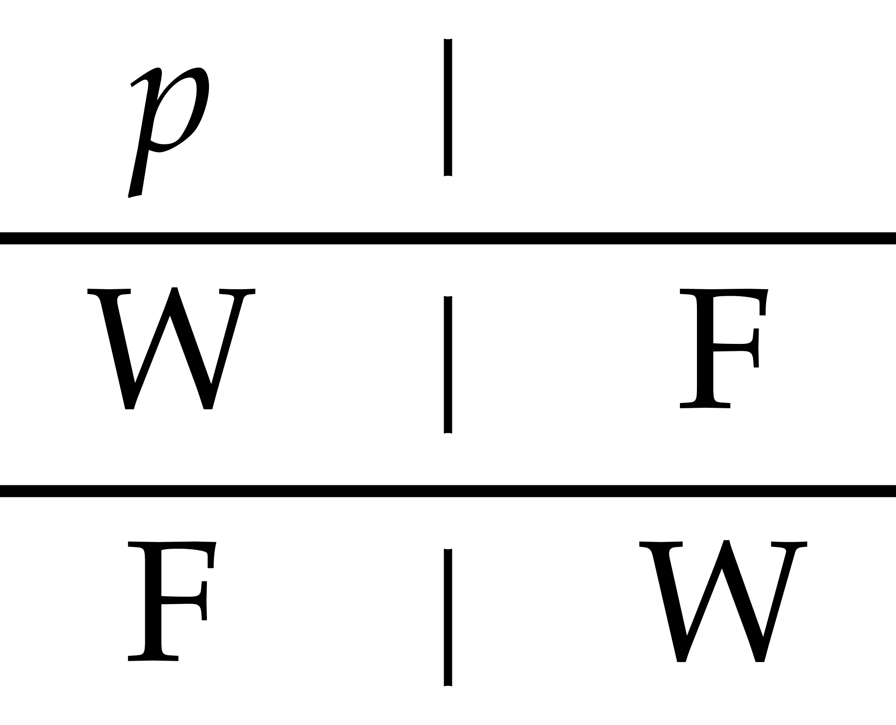 and could not replace the grammar.

### [IV-39-3\[5\]](https://cdn.wittgensteinnachlass.com/2000px/webp/Ts-212/IV-39-3.webp)

38˙2 In my representation, after all, the grammatical rules seemed to be the laying out of what I experience all at once in using the word. So to speak, (_only_) consequences, manifestations, of the properties that I _experience_ all at once in understanding. This must of course be nonsense.

### [IV-39-3\[6\]](https://cdn.wittgensteinnachlass.com/2000px/webp/Ts-212/IV-39-3.webp)

38˙2 One would go so far as to say: negation has the property of yielding an affirmation when doubled. (Rather like: iron has the property of yielding iron sulphate with sulphuric acid.) Whereas the rule does not _describe_ negation more closely, but constitutes it.

### [IV-39-3\[7\]](https://cdn.wittgensteinnachlass.com/2000px/webp/Ts-212/IV-39-3.webp)

38˙2 By using this word in accordance with this rule, substituting that for it, etc., we show how we mean it.

### [IV-39-4\[1\]](https://cdn.wittgensteinnachlass.com/2000px/webp/Ts-212/IV-39-4.webp)

38˙2 “Just as I can give a body by means of its different views and it is equivalent to them, so the nature of negation reveals itself in the various grammatically permitted applications of the negation sign.”

### [IV-39-5\[1\]](https://cdn.wittgensteinnachlass.com/2000px/webp/Ts-212/IV-39-5.webp)

38˙2 “Double negation yields an affirmation” sounds like: carbon and oxygen yield carbon dioxide. But in reality double negation _yields_ nothing; it _is_ something.

### [IV-39-5\[2\]](https://cdn.wittgensteinnachlass.com/2000px/webp/Ts-212/IV-39-5.webp)

38˙2 “Someone who understands negation knows that double negation …”

### [IV-39-5\[3\]](https://cdn.wittgensteinnachlass.com/2000px/webp/Ts-212/IV-39-5.webp),[IV-39-6\[1\]](https://cdn.wittgensteinnachlass.com/2000px/webp/Ts-212/IV-39-6.webp)

38˙2 Here something misleads us into thinking there is a physical fact. As though we saw a result of _the logical_ process. Whereas the result is only that of the _physical_ process.

### [IV-39-6\[2\]](https://cdn.wittgensteinnachlass.com/2000px/webp/Ts-212/IV-39-6.webp)

38˙2 The word ‘not’ in the grammatical rule has no meaning, otherwise _that_ could not be said of it.

### [IV-39-6\[3\]](https://cdn.wittgensteinnachlass.com/2000px/webp/Ts-212/IV-39-6.webp)

38˙2 Negation has no property other than, for instance, that of yielding truth in certain sentences. And likewise a circle has the property of being situated here or there, of having this colour, of _actually_ being intersected by a straight line; but not what geometry seems to ascribe to it. (Namely, being able to have these properties.)

### [IV-39-6\[4\]](https://cdn.wittgensteinnachlass.com/2000px/webp/Ts-212/IV-39-6.webp)

38˙2 What does it mean to say: “This paper is not black and ‘not’ is used here in the sense that a triple negation yields a negation”? How, then, did that show itself in the use? Or: “This paper is not black and two of these negations give an affirmation”. Can I say that? Or: “This book is red and the rose is red and the two words ‘red’ have the same meaning”. (This sentence is of the same kind as the two above.) What kind of sentence is that, then? a grammatical one? Does it say anything about the book and the rose? If the addition is not needed for understanding the first sentence, it is nonsense, and if it is needed, then the first part was not yet a sentence; and the same holds in the cases above.

### [IV-39-6\[5\]](https://cdn.wittgensteinnachlass.com/2000px/webp/Ts-212/IV-39-6.webp)

38˙2 “That 3 negations again yield a negation must surely already lie in the one negation that I am now using”. But am I not already interpreting again here? (I.e. am I not about to invent a mythology?)

### [IV-39-7\[1\]](https://cdn.wittgensteinnachlass.com/2000px/webp/Ts-212/IV-39-7.webp)

38˙2 Does it mean anything to say that three _such_ negations yield a negation? (It always reminds one of “three such horses can move this carriage”.) But, as I said, that logical sentence is not about negation at all (only sentences like: it is not raining are about negation) but only about the word ‘not’, and it is a rule about replacing one sign with another.

### [IV-39-7\[2\]](https://cdn.wittgensteinnachlass.com/2000px/webp/Ts-212/IV-39-7.webp)

<s> 38˙2 But can we not see the warrant for this rule if we understand negation? Is it not a consequence of the essence of negation? It is not a consequence, but an expression of this essence. </s>

### [IV-39-8\[1\]](https://cdn.wittgensteinnachlass.com/2000px/webp/Ts-212/IV-39-8.webp)

(38˙2) 38˙1 What we see when we see that a double negation etc. … must be of the same kind as what we perceive in the sign .

### [IV-39-9\[1\]](https://cdn.wittgensteinnachlass.com/2000px/webp/Ts-212/IV-39-9.webp)

38˙2 But geometry speaks of cubes just as little as logic speaks of negation. (One might perhaps object here that geometry deals with the concept of the cube and logic with the concept of negation. But there are no such concepts.)

### [IV-39-9\[2\]](https://cdn.wittgensteinnachlass.com/2000px/webp/Ts-212/IV-39-9.webp)

38˙2 A cube – I mean what is essential to the cube – is not something one can describe. But can I not describe how one makes a box, for example? and is a description of the cube not thereby _given_? What is essential to the cube is not described thereby; rather, it lies in the possibility of this description, i.e. in its being a description; not in its being correct.

### [IV-39-9\[3\]](https://cdn.wittgensteinnachlass.com/2000px/webp/Ts-212/IV-39-9.webp)

38˙2 But surely I can say: “I see the figure

as 3-dimensional”. But this sentence corresponds to the description of a box. It describes a particular cube, not the cubical form. Of course I can define the word “cubical form”. I.e. give signs that _can_ replace it.

### [IV-39-9\[4\]](https://cdn.wittgensteinnachlass.com/2000px/webp/Ts-212/IV-39-9.webp)

38˙2 _One can_ not describe a geometrical figure. Nor does the equation describe it; rather, it stands for it by virtue of the rules that apply to the equation.

### [IV-39-9\[5\]](https://cdn.wittgensteinnachlass.com/2000px/webp/Ts-212/IV-39-9.webp)

38˙2 And have we not applied the word “figure” here as we have so often applied the word “thought” or “symbol” in our investigations? The kind of application of this word of which I said that in such a case it did not mean a phenomenon but was, as it were, an incomplete _sign_ and corresponded more nearly to a _function_.

### [IV-39-9\[6\]](https://cdn.wittgensteinnachlass.com/2000px/webp/Ts-212/IV-39-9.webp),[IV-39-10\[1\]](https://cdn.wittgensteinnachlass.com/2000px/webp/Ts-212/IV-39-10.webp)

38˙2 Nor can one say that the cubical form has the property of having all its faces equal. A wooden block, by contrast, does have this property. (Nor has “the number one the property of yielding two when added to itself”.)

### [IV-39-10\[2\]](https://cdn.wittgensteinnachlass.com/2000px/webp/Ts-212/IV-39-10.webp)

38˙2 I did say: It seemed as though the grammatical rules were the ‘consequences in time’ of what we perceive in an instant when we understand a negation. And so as though there were two representations of the essence of negation: the act (say, the mental act) of negation itself, and its reflection in the system of grammar.

### [IV-39-10\[3\]](https://cdn.wittgensteinnachlass.com/2000px/webp/Ts-212/IV-39-10.webp)

38˙2, 38˙1 One is tempted to say: surely the shape of a cube is represented both by the grammar of the word “cube” and by a cube, .

### [IV-39-10\[4\]](https://cdn.wittgensteinnachlass.com/2000px/webp/Ts-212/IV-39-10.webp)

38˙2 In “non-p & (non-non-p = p)” the second part can only be a rule of the game.

### [IV-39-10\[5\]](https://cdn.wittgensteinnachlass.com/2000px/webp/Ts-212/IV-39-10.webp)

38˙2 It looks as though one could _infer_ from the meaning of negation that non-non-p _means_ p.

### [IV-39-10\[6\]](https://cdn.wittgensteinnachlass.com/2000px/webp/Ts-212/IV-39-10.webp)

38˙2 As though the rules for the negation sign _followed_ from the nature of negation. So that, in a certain sense, negation would be there first and the rules of grammar would come afterwards.

### [IV-39-10\[7\]](https://cdn.wittgensteinnachlass.com/2000px/webp/Ts-212/IV-39-10.webp)

38˙2 So it is as though the essence of negation had a twofold expression in language: what I see when I understand negation, and the consequences of this essence in grammar.

### [IV-39-11\[1\]](https://cdn.wittgensteinnachlass.com/2000px/webp/Ts-212/IV-39-11.webp)

38˙2 To say that a quarter-turn makes a square coincide with itself plainly means nothing other than: the square is symmetrical about two axes perpendicular to one another, and this in turn means that it makes sense to speak of two perpendicular axes, whether they are there or not. This is a sentence of grammar.

### [IV-39-11\[2\]](https://cdn.wittgensteinnachlass.com/2000px/webp/Ts-212/IV-39-11.webp)

38˙2 The difficulty again is that it seems as though a sentence containing, for example, the word ‘square’ already contained the shadow of another sentence with this word. – Namely, the very _possibility_ of forming that other sentence, which, as I said, lies in the _sense of the word_ ‘square’.

### [IV-39-11\[3\]](https://cdn.wittgensteinnachlass.com/2000px/webp/Ts-212/IV-39-11.webp)

38˙2 And yet one can only say that the other sentence is not uttered along with this one, not even in shadowy form. (And may never be uttered.)

### [IV-39-12\[1\]](https://cdn.wittgensteinnachlass.com/2000px/webp/Ts-212/IV-39-12.webp)

38˙2 38˙1 Instead of considering negation, I could consider an arrow and say, for example: if I turn it twice through 180˚, it points again in the direction in which it is pointing now; a sentence which corresponds to non-non-p = p. Now what about the representation of the essence of this arrow by language? Surely that sentence must be derived directly from this essence and thus represent it. Or take the case of a square and a rectangle, and the sentences that the square can be made to coincide with itself by a quarter-turn; the rectangle, however, only by a half-turn.

### [IV-39-13\[1\]](https://cdn.wittgensteinnachlass.com/2000px/webp/Ts-212/IV-39-13.webp)

38˙2 The question is: What kind of sentence is this: “the word ‘is’ in ‘the rose is red’ is the same as in ‘the book is red’, but not the same as in ‘twice two is four’”? One cannot answer that it means different rules apply to the two words, for that is to go round in a circle. But it does mean that the word in its different combinations can be replaced by two _signs_ which cannot be substituted for one another. If, on the other hand, I replace the word in the first two sentences by two different words, I may substitute them for one another.

### [IV-39-14\[1\]](https://cdn.wittgensteinnachlass.com/2000px/webp/Ts-212/IV-39-14.webp)

38˙2 Now I could ask again: are these rules only a _consequence_ of what _comes first_: that in the one case the two words ‘is’ have the same meaning, and in the other case they do not? Or is this rule precisely the linguistic expression of the fact that the words mean the same thing?

### [IV-39-14\[2\]](https://cdn.wittgensteinnachlass.com/2000px/webp/Ts-212/IV-39-14.webp)

38˙2 I want to compare it to the word ‘is’ having a different word-body behind it. To its being the same face both times, but belonging to a different body, as when I see a triangle in the foreground which in one case is the end face of a prism, in the other of a tetrahedron.

### [IV-39-14\[3\]](https://cdn.wittgensteinnachlass.com/2000px/webp/Ts-212/IV-39-14.webp)

38˙2 Or let us imagine this case: we have glass cubes, each with one face coloured red. If we place them in a row, only one quite particular arrangement of red squares can arise in space, determined by the cubical form of the bodies. Now I could _state_ the rule according to which red squares can be arranged here without even mentioning the cubes, yet the essence of the cubical form would already be settled by it. Not, of course, that we have cubes made of glass, but certainly the geometry of the cube.

### [IV-39-14\[4\]](https://cdn.wittgensteinnachlass.com/2000px/webp/Ts-212/IV-39-14.webp)

38˙2 But when we _see_ such a cube, are all the laws of possible arrangement truly already given _thereby_?! That is, the whole geometry. Can I read the geometry of the cube off a cube?

### [IV-39-14\[5\]](https://cdn.wittgensteinnachlass.com/2000px/webp/Ts-212/IV-39-14.webp)

38˙2 The cube is then a notation of the rule. And if we had found such a rule, we really could not notate it better than by means of a drawing of a cube (and the fact that a drawing suffices here is again immensely important).

### [IV-39-15\[1\]](https://cdn.wittgensteinnachlass.com/2000px/webp/Ts-212/IV-39-15.webp)

38˙2 38˙1 And now the question is: how far can the cube or the drawing (for the two come to the same thing here) serve as a notation for the geometrical rules?

### [IV-39-15\[2\]](https://cdn.wittgensteinnachlass.com/2000px/webp/Ts-212/IV-39-15.webp)

38˙2 38˙1 But here too only in so far as it belongs to a system: that is, the cube with its one red end face will notate something different from a pyramid with a square red base, etc. I.e., it will notate that feature of the rules in which, for example, the cube differs from the pyramid.

### [IV-39-16\[1\]](https://cdn.wittgensteinnachlass.com/2000px/webp/Ts-212/IV-39-16.webp)

<s> 38˙2 38˙1 Every sign of negation is equivalent to every other, for “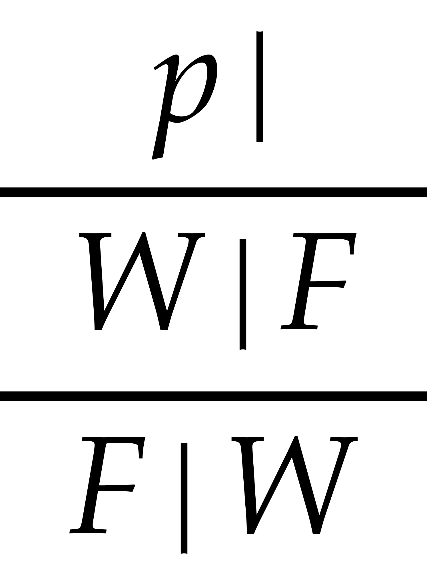” is just as much a complex of strokes as the word “not”, and it becomes negation only through the way it ‘**works**’. But what is meant here is not its effect in the psychological sense (so the word ‘effect’ is not used causally), but the **form of its effect**. </s>

### [IV-39-16\[2\]](https://cdn.wittgensteinnachlass.com/2000px/webp/Ts-212/IV-39-16.webp)

38˙2 38˙1 [96] I would like to say: the sign works only dynamically, not statically. 27 [96] Thought is dynamic.

### [IV-39-17\[1\]](https://cdn.wittgensteinnachlass.com/2000px/webp/Ts-212/IV-39-17.webp),[IV-39-18\[1\]](https://cdn.wittgensteinnachlass.com/2000px/webp/Ts-212/IV-39-18.webp)

38˙1 That tautology and contradiction say nothing does not follow from the W-F schema, but must be stipulated. And the schemata merely simplify the form of the general stipulation.

### [IV-39-19\[1\]](https://cdn.wittgensteinnachlass.com/2000px/webp/Ts-212/IV-39-19.webp),[IV-39-20\[1\]](https://cdn.wittgensteinnachlass.com/2000px/webp/Ts-212/IV-39-20.webp)

38˙2, 38˙1 You say that pointing to a red object is the primary sign for ‘red’. But pointing to a red object is no more than the particular movement of the hand towards a red object, and as yet it is no sign at all. If you say you mean: pointing to the red object _understood as a sign_ – then I say: the understanding that concerns us is not a process that accompanies the pointing (a process in the brain, say), and if you do mean such a process, then this in turn is not in itself a sign. ((The idea that keeps recurring here is that the opinion, the interpretation, is a process that accompanies the pointing and, so to speak, gives it its soul (without which it would be dead). |It seems especially so where a sign seems to sum up the whole grammar, so that we can derive it from the sign, _and it seems_ that it would be contained in the sign like the string of pearls in a box and all we would have to do is pull it out. (But 79a it is precisely this picture that misleads us.) As though understanding were an instantaneous grasp of something from which, later on, one merely draws the consequences; and in such a way that these consequences already exist in an ideal sense before they are drawn. As though, then, the cube already contained the whole geometry of the cube and all I had to do now was unfold it. But which cube? The cube we see, or an iron cube? Or is there an ideal cube? – What we evidently have in mind is the process in which we derive propositions of geometry from a drawing, a mental image (or a model). But what role does the model play in this? Presumably that of a sign. Of a sign which has a particular mode of use and _designates only by virtue of this_. It is certainly interesting and curious how this sign is used, how, for example, we _bring in_ the drawing of the cube again and again with different additions each time. Sometimes the diagonals are drawn, sometimes cubes are set in a row, etc. etc. And it is this sign (_with the identity of a sign_) that we take for that cube in which the geometrical laws already lie. (They lie in it just as little as the dispositions to be used in a certain way lie in the chess king.) <s> The geometrical laws **constitute** the concept of the cube (they give a constitution, a charter). What I once wrote about the “word-body” is the clear expression of the error under discussion.)) </s>

### [V-FCr\[1\]](https://cdn.wittgensteinnachlass.com/2000px/webp/Ts-212/V-FCr.webp)

_Essence of language_

### [V-40FCr\[1\]](https://cdn.wittgensteinnachlass.com/2000px/webp/Ts-212/V-40FCr.webp)

Learning, explanation, of language

Can one, as it were, build up language through an explanation, get it to function?

### [V-40-1\[1\]](https://cdn.wittgensteinnachlass.com/2000px/webp/Ts-212/V-40-1.webp)

If I explain “‘non-p’ is true if ‘p’ is not true”, that presupposes that I understand what it means for ‘p’ not to be true. But then I have done nothing other than define:

non-p = ‘p’ is false.

For what is essential is that the sign “p” on the right-hand side of the definition cannot be left out, or replaced by another (unless, again, by a definition). So long as that is not possible, one can and must also take the right-hand side as a function of p, namely: ‘( )’ is false. This is also connected with the fact that the ink-stroke is not _false_. In the way it is black or crooked.

### [V-40-2\[1\]](https://cdn.wittgensteinnachlass.com/2000px/webp/Ts-212/V-40-2.webp)

So even if I give the written mark “p” the name A and accordingly write: “non-p = A is false”, this has a sense only, i.e. the right-hand side can be understood only if A stands for us as a _sentential sign_. But then nothing has been gained: at any rate, no _explanation_ of the mechanism of negation.

### [V-40-2\[2\]](https://cdn.wittgensteinnachlass.com/2000px/webp/Ts-212/V-40-2.webp)

(58, 76˙ 1) 7c And the same must be the case when one explains that “(x)․fx” is true if f( ) is true for all substitutions. Here too one must already understand the logical mechanism of generalization. It is (here too) not as if one started off with no idea and generalization were only then _set to work_ by the explanation. As when one puts a wheel into a machine and only then does it work (or the machine is initially there in two separate parts, and only when they are put together does it function as _this_ machine).

### [V-40-3\[1\]](https://cdn.wittgensteinnachlass.com/2000px/webp/Ts-212/V-40-3.webp)

8 What does the explanation of a sign look like? Surely this would have to be an extraordinarily important form for language, whether _this device is_ a sentence or not.

The explanation of a language (of the signs of a language) only takes us from one language into another.

### [V-40-4\[1\]](https://cdn.wittgensteinnachlass.com/2000px/webp/Ts-212/V-40-4.webp)

8 Let us imagine a language in which I express “A is greater than B” not only like this: “↖ is greater than ↗”, but in which I also make a gesture in place of the word “greater”, a gesture which shows the meaning of the word. – Now how could I explain such a language? (How could I explain the signs of such a language?) And would I still feel the earlier need for an explanation? An explanation of the meaning of a sign takes the place of the sign explained.

### [V-40-5\[1\]](https://cdn.wittgensteinnachlass.com/2000px/webp/Ts-212/V-40-5.webp)

76a In this sense the child too _learns_ a language through explanations only by means of another. Word-language by means of gesture-language.

### [V-40-6\[1\]](https://cdn.wittgensteinnachlass.com/2000px/webp/Ts-212/V-40-6.webp)

(89a) 76a Gesture-language is a _language_ and we have not – in the ordinary sense – learnt it. That is: it was not deliberately taught to us. – And in any case not through explanations of signs.

### [V-40-7\[1\]](https://cdn.wittgensteinnachlass.com/2000px/webp/Ts-212/V-40-7.webp)

76a But one can imagine learning a language in another sense by analogy with hunting the thimble, where the desired movement is brought about by “hot, hot”, “cold, cold”. One could imagine that instead of using these words the teacher elicits pleasant and unpleasant sensations in some way (by facial expressions, say), and that the learner is then brought to perform, on command, _the_ movement which is regularly accompanied by the pleasant sensation (or leads to it).

### [V-40-8\[1\]](https://cdn.wittgensteinnachlass.com/2000px/webp/Ts-212/V-40-8.webp)

8, 8b Connection between word and thing established by the explanation. What sort of connection is that, what kind? What kinds of connection are there? A psychical connection (or an electrical or mechanical one) may work or not work: application to the connection established by the explanation of a word.

### [V-40-9\[1\]](https://cdn.wittgensteinnachlass.com/2000px/webp/Ts-212/V-40-9.webp)

8b The correlation of object and name is none other than the one produced by the words “that is …” or by a table, etc. It is a part of the symbolism. It is therefore incorrect to say that the relation between name and object is a psychological one.

### [V-40-10\[1\]](https://cdn.wittgensteinnachlass.com/2000px/webp/Ts-212/V-40-10.webp)

8 But the word ‘Teekanne’ _does_ have a meaning; certainly, in contrast to the word ‘Abracadabra’, namely in the German language. But of course we could give it a meaning too; that would be an act quite analogous to my hanging a little sign inscribed ‘Teekanne’ on a teapot. But what have I here other than a teapot with a sign on which strokes can be seen? So, again, nothing of logical interest. Stipulating the meaning of a word can never be of an (_essentially_) different kind.

### [V-40-11r\[1\]](https://cdn.wittgensteinnachlass.com/2000px/webp/Ts-212/V-40-11r.webp)

One can ask “what did you mean” (by this movement of the hand, say, or again: by this sentence). But also “did you mean anything by this movement of the hand (by these words)”. And the second question does not stand to the first as the question “are you in love” stands to “whom do you love”. The answer to the question “what did you mean?” is a sentence, a further sign; and if this sentence had been uttered at the outset instead of the first, whose sense was asked about, one could still have asked: “did you mean anything by these words” or “did you _mean_ these words” (& not merely say them).

### [V-40-11v\[1\]](https://cdn.wittgensteinnachlass.com/2000px/webp/Ts-212/V-40-11v.webp)

I can ask “how do you mean this sentence (this sign), how do you understand it”, or I am not entitled to ask that; & if I still speak of meaning and understanding, what I mean by that is a process which accompanies the uttering, hearing, writing, etc. of the sentence.

### [V-40-11r\[2\]](https://cdn.wittgensteinnachlass.com/2000px/webp/Ts-212/V-40-11r.webp)

In this sense we can answer the question did you understand me (after the command “go into the next room & fetch a chair”, say) apodictically in the affirmative or the negative.

### [V-41FCr\[1\]](https://cdn.wittgensteinnachlass.com/2000px/webp/Ts-212/V-41FCr.webp)

How does a single explanation of language bring about understanding?

### [V-41-1\[1\]](https://cdn.wittgensteinnachlass.com/2000px/webp/Ts-212/V-41-1.webp)

7˙ 1a Perhaps the real difficulty is this: I explain the word “red” by pointing to something red and saying “that is red”, yet this red thing later disappears from my view. And now apparently _something else_ takes its place (the memory, or whatever one _may_ call it).

### [V-41-1\[2\]](https://cdn.wittgensteinnachlass.com/2000px/webp/Ts-212/V-41-1.webp)

7˙ 1a “So this is the _way_ this word is used!” But how do I retain this _way_ in memory?

### [V-41-2\[1\]](https://cdn.wittgensteinnachlass.com/2000px/webp/Ts-212/V-41-2.webp)

66 [71a] 76˙ a The learning of a language is not _contained_ in its _use_. (Just as the cause is not contained in its effect.)

### [V-41-3\[1\]](https://cdn.wittgensteinnachlass.com/2000px/webp/Ts-212/V-41-3.webp)

66 76a I can _stipulate_ the rule myself and teach myself a language. I go for a walk and say to myself: Wherever I come across a tree, let that be my sign to turn left at the next crossroads, and now I let the trees guide me in this way (take their position as _a_ command).

### [V-41-4\[1\]](https://cdn.wittgensteinnachlass.com/2000px/webp/Ts-212/V-41-4.webp)

66 How can I resolve to follow a rule? Is it not only in so far as I can express the rule?

### [V-41-5\[1\]](https://cdn.wittgensteinnachlass.com/2000px/webp/Ts-212/V-41-5.webp)

7˙ 1a What effect, then, did the ostensive explanation have? Did it have only an automatic effect, so to speak? But that is to ask: is it now needed again and again, or did it have a causal effect like that of an inoculation, say, which has _changed_ us once and for all, or at least for the time being?

### [V-41-6\[1\]](https://cdn.wittgensteinnachlass.com/2000px/webp/Ts-212/V-41-6.webp)

7˙ 1a I say “pick out all the blue balls”; but he does not know what “blue” means. Now I point and say “that is blue”. Now he understands me and can follow my command.

### [V-41-7\[1\]](https://cdn.wittgensteinnachlass.com/2000px/webp/Ts-212/V-41-7.webp)

7˙ 1a I enable him to follow the command. But what happens now when he hears this command in future? Is it necessary that he remember that _explanation_, i.e. that one occasion of explanation? Is it necessary that the mental image of the blue object, or of a blue object, come before his mind? All of this seems _not_ to be necessary, though it may happen. And yet the word “blue” now seems to have a different aspect for him than it did before it was explained to him. It gains depth, as it were.

### [V-41-8\[1\]](https://cdn.wittgensteinnachlass.com/2000px/webp/Ts-212/V-41-8.webp)

8 How far does the ostensive explanation “_that_ is ‘red’” help one to understand the word?

### [V-41-8\[2\]](https://cdn.wittgensteinnachlass.com/2000px/webp/Ts-212/V-41-8.webp)

8 (It does not ‘_help_’ at all, but simply _is_ one of the symbolic rules for the use of the word ‘red’.)

### [V-41-9\[1\]](https://cdn.wittgensteinnachlass.com/2000px/webp/Ts-212/V-41-9.webp)

7˙ 1a An explanation cannot act at a distance. I mean: it works only where it is applied. If it also has some other “effect”, it does not have it as an explanation.

### [V-41-10\[1\]](https://cdn.wittgensteinnachlass.com/2000px/webp/Ts-212/V-41-10.webp),[V-41-11\[1\]](https://cdn.wittgensteinnachlass.com/2000px/webp/Ts-212/V-41-11.webp),[V-41-12\[1\]](https://cdn.wittgensteinnachlass.com/2000px/webp/Ts-212/V-41-12.webp)

((Is it the case that an explanation, a table, can first be used in such a way that one “looks it up”; that one then looks it up, as it were, in one’s head, i.e. calls it before one’s mind’s eye (or something of the sort); and that finally one works without this table, as though it had never been there. In this last case, then, one is playing a different game. For it is not as though that table were still there in the background and one could always fall back on it; it has dropped out of our game, and when I ‘fall back’ on it, I do what someone who has gone blind does when he falls back, say, on his sense of touch. An explanation is the _drawing up_ of a table, and it becomes history when I no longer use the table. I must distinguish between the cases: when on one occasion I follow a table, and on another I act in accordance with the table (the rule that the table expresses) without using the table. – The rule that we learnt and that thereby led us to act in such and such a way now is, as the cause of our way of acting, history and of no interest (_to us_). But insofar as it is a general description of our way of acting, it is a hypothesis. It is the hypothesis that these two people sitting at the chessboard will act in such and such a way (an infringement of the rules of the game also falls under the hypothesis, for it then says something about how the two will behave when they notice the infringement). But the players can also use the rule by looking up what to do in each particular case; here the rule enters into the move itself and does not stand in the same relation to it as a hypothesis to its confirmation. “But here there is a difficulty. For the player who plays without using a list of the rules, indeed, even if he had never seen one, could nevertheless draw up a list of the rules if asked, not – behaviouristically – by establishing through repeated observation how he acted in this case and that, but by saying, as he is about to make a move: ‘in this case _one moves like this_’”. – But if that is so, it only shows that he will state a rule under certain circumstances, not that he made explicit use of it in making the move. That he would draw up a list of the rules if asked is a hypothesis, and if one supposes that there is a disposition, a capacity, to draw up a list of the rules, then it is a psychological disposition on a par with a physiological one. If this disposition is said to characterize the process of playing the game, it characterizes it as a psychological or physiological process, which it actually is. (In the study of symbolism there is no foreground and background, no visible sign accompanied by an invisible capacity or understanding.)

### [V-41-13\[1\]](https://cdn.wittgensteinnachlass.com/2000px/webp/Ts-212/V-41-13.webp)

Now how does ostensive explanation work? It teaches the use of a sign; and the remarkable thing is only that it seems to teach its use even in cases where going back to the ostensive sign is not possible. But does this not happen by our, so to speak, transforming in a particular way the rules learnt in the ostensive definition? (If, for example, the man who was introduced to me is absent and I use his name all the same, its use having been explained to me by the introduction – ostensive explanation.) If I now use it, for example, the man who was introduced to me is absent and I use his name all the same, its use having been explained to me by the introduction – ostensive explanation.) If I now use it, _in what respect am I making use of the ostensive explanation_? Evidently not in the way in which I could make use of it in the man’s presence. There is one game in which I can always give the ostensive sign in place of the name, and another in which that is no longer possible. And we need only hold fast to the fact that we are not interested in the explanation as a continuing _cause_ of our use of signs, but only insofar as we can make use of it in our calculus. One difficulty in explaining the use of ostensive definition is that we apply different criteria of identity (that is, use the word ‘identity’ in different ways), depending on whether a thing moves before our eyes or disappears from view and perhaps reappears. This is important, for in the second case the ostensive definition really only gives us a _sample_ and does no more than pointing to a picture does. This comes out in the fact that the ostensive explanation given is of no use if we have forgotten what the person who was pointed to looked like.))

### [V-41-13\[1\]](https://cdn.wittgensteinnachlass.com/2000px/webp/Ts-212/V-41-13.webp),[V-41-14\[1\]](https://cdn.wittgensteinnachlass.com/2000px/webp/Ts-212/V-41-14r.webp),[V-41-15\[1\]](https://cdn.wittgensteinnachlass.com/2000px/webp/Ts-212/V-41-15r.webp)

It is possible for someone to forget the meaning of the word “blau”. What has he forgotten? How does this show itself? There are different cases here: He might point to differently coloured tiles & say: “I no longer know which of these one calls ‘blau’”. Or he no longer knows at all what it means, and knows only that it is a German word [a word of the German language]. Now if we ask him: “do you know what the word ‘blau’ means”, and he says “yes”, he could have applied different criteria “to satisfy himself” that he knew the meaning. (Think again of the corresponding criteria for his being able to recite the alphabet.) Perhaps he called a blue mental image to mind, perhaps he looked for a blue object in the room, perhaps the English word “blue” occurred to him, or he thought of a “blauen [unreadable] Fleck” (a bruise) he had got, etc., etc. Now if one were to ask: how can he call to mind a blue mental image to test his understanding, for how can the word ‘blau’ show him which colour to choose from the paintbox of his imagination, – the answer is that this is precisely what shows that the picture of choosing, say, a blue object by means of a blue sample tile is out of place here & the process is more like what happens when one presses a button with the word “blau” written on it and a blue tile automatically springs out, or, if the mechanism fails, does not spring out. One might now say: Someone who has forgotten the meaning of the word “blau” & has been asked to pick out a blue object from among others feels, as he looks at these objects, that the connection between the word “blau” and those colours no longer exists (has been broken). And the connection is made again when we repeat the explanation of the word to him. But we could restore the connection in all sorts of ways: We could show him a blue object and give the ostensive definition, or tell him “remember your ‘blauen Fleck’”, or whisper the word “blue” to him, etc., etc. And if I said we could establish the connection in these different ways, it is natural to think that I have brought about _one_ particular phenomenon, which I call the connection between word and colour, or the understanding of the word, in all these different ways, just as I might say that I can make a conducting connection between the ends of two wires by means of pieces of wire of different lengths and materials. But there need be no question of any such phenomenon, such as the appearance of a blue mental image; and his understanding will then show itself, say, in his actually picking out the blue ball from among the others, or saying that he can do it now but does not want to; etc., etc., etc. We can then always devise a game that represents _one_ possibility for such a process, and must not forget that in reality a hundred different ones and their combinations are described by the words “forgetting the meaning”, “remembering the meaning”, “knowing the meaning”.

### [V-42FCr\[1\]](https://cdn.wittgensteinnachlass.com/2000px/webp/Ts-212/V-42FCr.webp)

Can one look for something red by going by the word “red”? does one need a picture for that?

_Different search games._

### [V-42-1\[1\]](https://cdn.wittgensteinnachlass.com/2000px/webp/Ts-212/V-42-1.webp)

8, 79a, 10 One could also put an essential question like this: If I tell someone “paint this circle red”, how does he get from the word ‘red’ which colour he is to use?

### [V-42-2\[1\]](https://cdn.wittgensteinnachlass.com/2000px/webp/Ts-212/V-42-2.webp)

78 (79a) Does it mean anything to say that the word ‘red’, to be a usable sign, needs a supplement – say, in memory? I.e., in what respect is it not a sign on its own?

### [V-42-3r\[1\]](https://cdn.wittgensteinnachlass.com/2000px/webp/Ts-212/V-42-3r.webp)

78 If I describe an experience with the words “there is a blue kettle in front of me”, is there some further justification for these words besides the experience described in them, such as the memory that I have always used the word ‘blue’ for this colour, etc.?

### [V-42-3v\[1\]](https://cdn.wittgensteinnachlass.com/2000px/webp/Ts-212/V-42-3v.webp)

[unreadable]

### [V-42-4r\[1\]](https://cdn.wittgensteinnachlass.com/2000px/webp/Ts-212/V-42-4r.webp)

78 If I tell someone “when I ring, come to me”, then at first, when he hears the bell ring, he will translate this order (the ringing) into words for himself and obey only the order as translated. After a while, however, he will translate the ringing into action without the intervention of other signs. And so, if I say “point to a red patch”, he obeys this order without an imagined picture of a red patch first appearing to him as a sign for ‘red’.

### [V-42-4r\[2\]](https://cdn.wittgensteinnachlass.com/2000px/webp/Ts-212/V-42-4r.webp)

78 When he rings, I come to him without first imagining a picture of my movements that I (_then_) act on.

### [V-42-4v\[1\]](https://cdn.wittgensteinnachlass.com/2000px/webp/Ts-212/V-42-4v.webp)

[unreadable]means I know what I have to …

… do you know? What [unreadable]

### [V-42-5\[1\]](https://cdn.wittgensteinnachlass.com/2000px/webp/Ts-212/V-42-5.webp)

79a, 78 I can certainly say: “Do now what, as you remember it, you did at this time yesterday”. And if he remembers, he can follow his memory. But if he does not remember, the order has no sense for him.

### [V-42-5\[2\]](https://cdn.wittgensteinnachlass.com/2000px/webp/Ts-212/V-42-5.webp)

79a, 78 Would this order then be like this one: “Do what is written on the slip of paper in this drawer”. If there is no slip in the drawer, this is not an order. Or let us imagine that a nonsensical combination of words is written on the slip.

### [V-42-6\[1\]](https://cdn.wittgensteinnachlass.com/2000px/webp/Ts-212/V-42-6.webp)

70a (78) If I tell someone “paint the green of your room door from memory”, that determines what he is to do no more unambiguously than the order “paint the green you see on this board”.

### [V-42-7\[1\]](https://cdn.wittgensteinnachlass.com/2000px/webp/Ts-212/V-42-7.webp),[V-42-8\[1\]](https://cdn.wittgensteinnachlass.com/2000px/webp/Ts-212/V-42-8.webp)

70a (78) If what matters for the meaning of the word “red” is the image my memory automatically reproduces at the sound of this word, then I must rely on this reproduction just as if I had resolved to determine the meaning by looking it up in a book, in which case I would be putting myself, as it were, entirely at the mercy of the book, of the tile I found in it.

### [V-42-9\[1\]](https://cdn.wittgensteinnachlass.com/2000px/webp/Ts-212/V-42-9.webp)

70a I am at the mercy of memory.

### [V-42-10\[1\]](https://cdn.wittgensteinnachlass.com/2000px/webp/Ts-212/V-42-10.webp)

79a (78) (24) 70a Of course one can say: in reality the red tile is not decisive either, because memory is always used as a check on the tile.

### [V-42-11\[1\]](https://cdn.wittgensteinnachlass.com/2000px/webp/Ts-212/V-42-11.webp)

(27) 79, 70a (78) But the question is: If the colour of the tile changes relative to my memory (a bold expression), must one in any sense unconditionally give preference to the interpretation that the tile has changed and I must therefore go by my memory? Obviously not. Besides, the ‘interpretation’ that the tile and not memory has changed amounts to nothing but an explanation of the words “change”, “stay the same”.

### [V-42-12\[1\]](https://cdn.wittgensteinnachlass.com/2000px/webp/Ts-212/V-42-12.webp),[V-42-13\[1\]](https://cdn.wittgensteinnachlass.com/2000px/webp/Ts-212/V-42-13.webp)

78 (79a) (27) 70a Could I assert that my memory always darkens a little? In any case I could say: “choose the colour you remember” and also “choose a slightly darker colour than the one you remember.” Of course one can speak of something darkening _only_ by comparison with something, and it is not enough to say “well, with the colour as it really was”, because here the particular kind of verification, i.e., the (_particular_) grammar of the words “as it was”, has not yet been fixed, so that these words (_therefore_) still have more than one meaning.

### [V-42-14\[1\]](https://cdn.wittgensteinnachlass.com/2000px/webp/Ts-212/V-42-14.webp)

70a Using a wire to look for a short circuit; one has found it when the bell rings. But am I thereby also looking for something that is the same as the idea of the bell ringing? .

### [V-42-15\[1\]](https://cdn.wittgensteinnachlass.com/2000px/webp/Ts-212/V-42-15.webp)

(79a) 78 (70a, 70) Suppose the order is: “Imagine a red circle”. And I do so. How could I follow the words in this way? Surely that is a sign that we can obey words even without mental images.

### [V-42-16\[1\]](https://cdn.wittgensteinnachlass.com/2000px/webp/Ts-212/V-42-16.webp)

<s> How can I **justify** forming this mental image in response to these words? </s>

### [V-42-17\[1\]](https://cdn.wittgensteinnachlass.com/2000px/webp/Ts-212/V-42-17.webp)

(79a?), 7˙1a? Has someone shown me the mental image of the colour blue and said that this is it?

### [V-42-18\[1\]](https://cdn.wittgensteinnachlass.com/2000px/webp/Ts-212/V-42-18.webp)

70a It is therefore correct to say: “I remember _**that**_”, meaning what I see here before me. The image is then in a certain sense present and past.

### [V-42-19\[1\]](https://cdn.wittgensteinnachlass.com/2000px/webp/Ts-212/V-42-19.webp)

So the process of comparing a picture with reality is not essential to remembering.

### [V-42-20\[1\]](https://cdn.wittgensteinnachlass.com/2000px/webp/Ts-212/V-42-20.webp)

21 (27) 70a (78) It is instructive to think that when we use a yellow tile to look for the flower, the relation of sameness of colour is in any case not present to us in a further picture. Rather, we are quite content with the one.

### [V-42-20\[2\]](https://cdn.wittgensteinnachlass.com/2000px/webp/Ts-212/V-42-20.webp)

21 (27) 70a (78) (Just as we would not think for a moment of teaching a child the language of gestures.)

### [V-42-21\[1\]](https://cdn.wittgensteinnachlass.com/2000px/webp/Ts-212/V-42-21.webp)

79a, 78 (27) 70a I can explain the meaning of the signs 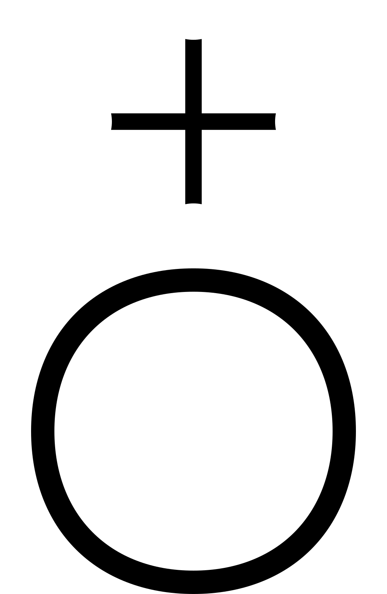, 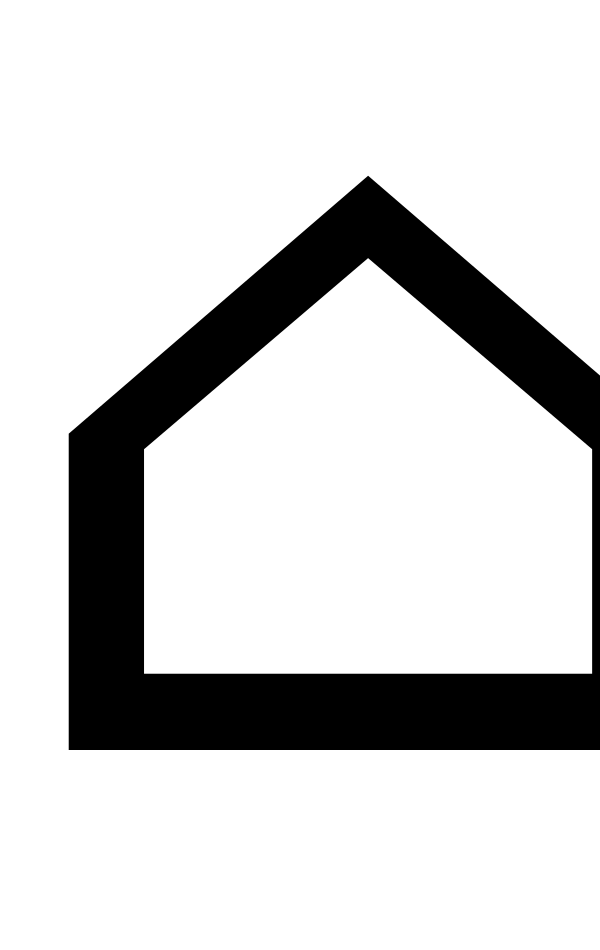, 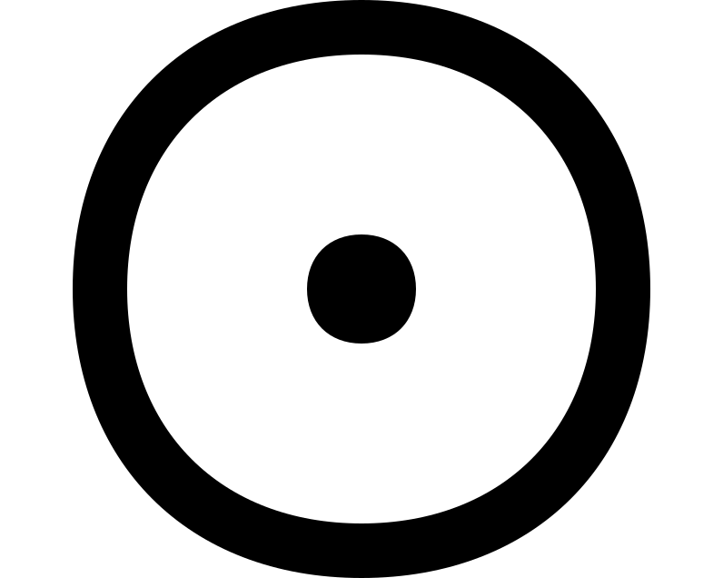 by means of the table 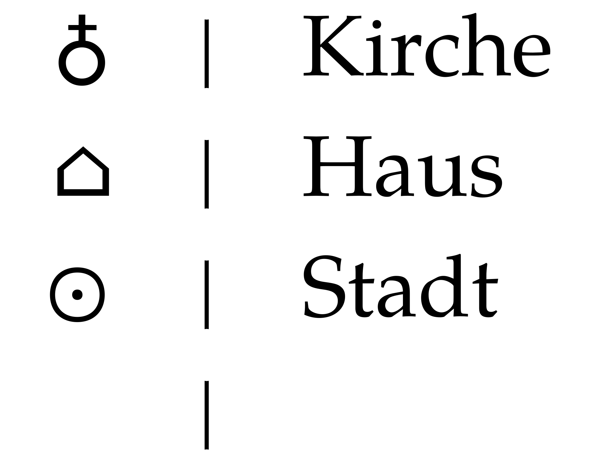; but I can in turn explain this table by writing it like this  and setting it against another one: 

### [V-42-21\[2\]](https://cdn.wittgensteinnachlass.com/2000px/webp/Ts-212/V-42-21.webp)

79a, 78 (27) 70a But could the first explanation have been left out as well? Certainly, if the signs , 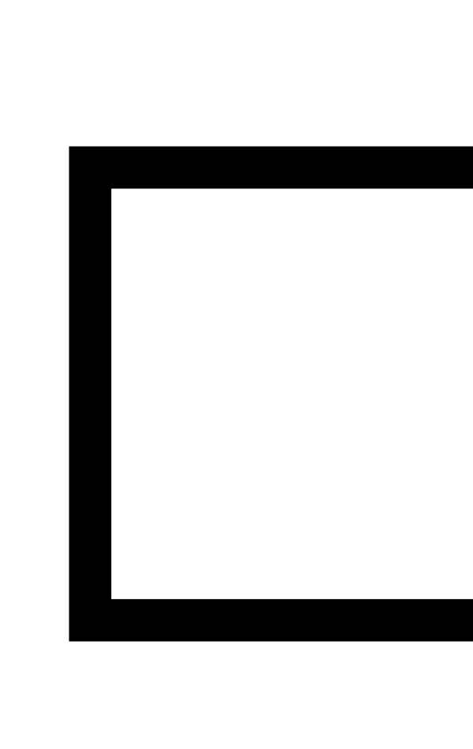, , had (say) originally been taught to us in the same way as the words “Kirche”, “Haus”, “Stadt”. But surely these had to be explained to us! – Insofar as they were ‘explained’ to us at all, it was by means of a language of gestures that was not explained to us. – But could this language of gestures have been explained? – Certainly; for example, by means of a word-language.

### [V-42-22\[1\]](https://cdn.wittgensteinnachlass.com/2000px/webp/Ts-212/V-42-22.webp),[V-42-23\[1\]](https://cdn.wittgensteinnachlass.com/2000px/webp/Ts-212/V-42-23.webp)

79a, (17a) 77a Let us think of reading aloud from what is written (or 79a 77a writing down what one hears). We could of course imagine a kind of table that we could follow in doing this. But we follow no such table. No act of memory, nothing, mediates between the written sign and the sound.

### [V-42-24\[1\]](https://cdn.wittgensteinnachlass.com/2000px/webp/Ts-212/V-42-24.webp)

79 79a (The word ‘red’ is a piece in a calculus, and the red tile is one too.)

### [V-42-25\[1\]](https://cdn.wittgensteinnachlass.com/2000px/webp/Ts-212/V-42-25.webp)

It is one game to go around with a tile, holding it against the objects and testing in this way whether the colours are the same; and another to act, without such a sample, on words in a word-language. Now one thinks: Yes, I understand the first game; it is quite simple: The first step is from a written word to the same written word on the sample; the second is the transition from the word on the sample tile to the colour on the _same_ tile; and the third, the comparison of colours. So we take each step in this calculus on a bridge. (We are guided, the step is mapped out in advance.) But here we are guided only insofar as we let ourselves be guided. In this way I _can_ call anything guidance, and _need_ not call anything guidance. – And in the end I do what I do and that is all. But a difference does remain: If I am asked “why do you call this particular colour ‘red’”, I would actually answer: because it is on the same tile as the word ‘red’. But if I were asked in the second game “why do you call this colour ‘red’”, there would be no answer and the question would have no sense. – But in the first game this question has no sense: “why do you call _the_ colour on the same tile as the word ‘red’ ‘red’”. That is just how I act (and one can no doubt give a cause for it, but not a reason). Consider above all: How does one know that the tile stays red? Does one need an image for that in turn? and what about that image? etc. By what does he recognize the model as a model?

### [V-42-25\[2\]](https://cdn.wittgensteinnachlass.com/2000px/webp/Ts-212/V-42-25.webp)

79a 87 (A reason can be given only _within_ a game.)

### [V-42-26\[1\]](https://cdn.wittgensteinnachlass.com/2000px/webp/Ts-212/V-42-26.webp)

79a, 87 The chain of reasons comes to an end, namely the end in this game.

### [V-42-26\[2\]](https://cdn.wittgensteinnachlass.com/2000px/webp/Ts-212/V-42-26.webp)

79a One can say: The rules of the game are the ones taught when the game is taught. – Now, for example, someone learning to read is actually taught: this is an a, this is an e, etc.; so, one might say, these rules, this table, belong to the game. – But first: is the use of this table taught as well? and, on the other hand, _could_ it not be taught? And secondly, the game can _actually_ be played in two different ways. One can now ask: but is it still a game if someone sees the letters abbc and does _just anything_? And where does the game stop, and where does it begin? The answer is of course: it is a game if it proceeds according to a rule. But what still counts as a rule and what no longer does? I can give a rule only by giving its expression; for examples too, if they are to be examples, are an expression of the rule like any other. So if I say: I call it a game only if it takes place in accordance with a rule, and the rule is a table, then I cannot guarantee the way this table is used, for I can specify it only by means of a further table, or by means of examples. These examples take us no further than they themselves go, and the second table is in the same position as the first. I could also say: what is the game of chess (or what is there of the game of chess) other than lists of rules (spoken, written, etc.) and the description of a number of games of chess? Of course I am free (_accordingly_) to call only something of a definitely fixed form a ‘rule of a game’.

### [V-43FCr\[1\]](https://cdn.wittgensteinnachlass.com/2000px/webp/Ts-212/V-43FCr.webp)

“The relation between language & reality” is established by explanations of words, which in turn belong to grammar. So that language remains closed in on itself, autonomous.

### [V-43-1\[1\]](https://cdn.wittgensteinnachlass.com/2000px/webp/Ts-212/V-43-1.webp)

70a Agreement between thought and reality. Like everything metaphysical, the (pre-established) harmony between thought and reality is _to be found_ in the grammar of language.

### [V-43-2\[1\]](https://cdn.wittgensteinnachlass.com/2000px/webp/Ts-212/V-43-2.webp)

8a It is probably also nonsense to say that the agreement (and disagreement) between sentence and world is arbitrarily _created_ by a correlation. For how is this correlation to be expressed? It consists in the sentence “p” saying that _just this_ is the case. But how is this “just this” expressed? If by another sentence, we gain nothing by it; but if by reality, then _it_ must already be conceived in a particular way – articulated. That is: one cannot point to a sentence and to a reality and say: “_this_ corresponds to _that_”. Rather, what corresponds to the sentence is again only what is already articulated. I.e. there is no ostensive explanation for _sentences_.

### [V-43-3\[1\]](https://cdn.wittgensteinnachlass.com/2000px/webp/Ts-212/V-43-3.webp)

26, 8a To be able to form a sentence in a language, it is not enough to learn the sequence of sounds and to know that it stands, say, next to a particular picture in a primer. For that does not enable me to portray the fact in that language. Indeed, if I happened to forget the whole of German, but on a particular occasion nevertheless recalled the combination of sounds that makes up the sentence and that one uses in this case, I would, _in this case_, not _understand_ that combination of sounds.

### [V-43-3\[2\]](https://cdn.wittgensteinnachlass.com/2000px/webp/Ts-212/V-43-3.webp)

8a If one asks someone “how do you know that this description reproduces what you see”, he might answer “I mean this by these words”. But what is this “_this_” if it is not in turn articulated (_itself_), and so already language? So “I mean this” is no answer at all. The answer is an explanation of the meaning of the words.

### [V-43-3\[3\]](https://cdn.wittgensteinnachlass.com/2000px/webp/Ts-212/V-43-3.webp)

8a If I form the description according to rules, which is also possible, then I translate it as one translates one language from another. And of course I can do this with a grammar and a dictionary and justify it in this way. – But then the translation is from something articulated into something articulated. And if I justify it by appealing to the grammar and the dictionary, I do nothing but establish a relation between reality and the description (a projective relation), but there is no question here of the intention of my description. (I.e. I can only check the likeness of the picture, nothing further.)

### [V-44FCr\[1\]](https://cdn.wittgensteinnachlass.com/2000px/webp/Ts-212/V-44FCr.webp)

Language in our sense not defined as an arrangement that serves a particular purpose.

Grammar not a mechanism justified by its purpose.

### [V-44-1\[1\]](https://cdn.wittgensteinnachlass.com/2000px/webp/Ts-212/V-44-1.webp)

38˙ 2 Could I not regard language as a social institution subject to certain rules because it would not be effective otherwise. But this is the point: I cannot say the latter; even in this way I cannot give a justification for the rules. I could only describe language as a game that people play.

### [V-44-2\[1\]](https://cdn.wittgensteinnachlass.com/2000px/webp/Ts-212/V-44-2.webp)

2 But what about this: I go this way to get there; I turn on the tap to get water, I beckon so that someone will come to me and finally I communicate my wish to him so that he will fulfil it! ((I.e.: Was communicating my wish, then, not just pulling a lever, and was the sense of my communication its purpose?))

### [V-44-2\[2\]](https://cdn.wittgensteinnachlass.com/2000px/webp/Ts-212/V-44-2.webp),[V-44-3\[1\]](https://cdn.wittgensteinnachlass.com/2000px/webp/Ts-212/V-44-3.webp)

2 But what goes on when I turn on the tap _so that_ water will flow out? What happens is that I turn on the tap, and then water comes out, or does not. So what happens is that I turn on the tap. – What follows the words “so that”, the intention, is not contained in that. If it is present, it must be expressed, and turning on the tap can itself already express it only if that is part of a language.

### [V-44-4\[1\]](https://cdn.wittgensteinnachlass.com/2000px/webp/Ts-212/V-44-4.webp)

76 If one said: language is anything by means of which one can communicate, then one must ask: But what does ‘communicating’ consist in? In answer I could describe a real or fictitious case of communication between people or other living beings. In this description fictitious causal connections would then play a part. But if the concept of language is determined by such connections, it does not interest us. And apart from those empirical regularities _of events, we then have_ only an _arbitrary_ calculus left. – But what is essential to a calculus?

### [V-44-4\[2\]](https://cdn.wittgensteinnachlass.com/2000px/webp/Ts-212/V-44-4.webp)

76, 56 ‘Language’ and ‘living being’. The concept of a living being has the same indeterminacy as that of language

### [V-44-5\[1\]](https://cdn.wittgensteinnachlass.com/2000px/webp/Ts-212/V-44-5.webp)

16 “After all, a sign is always there for a living being, so that must be something essential to a sign”. Certainly: a chair too is only ever there for a person, but it can be described without our talking about its purpose. A sign has a purpose only in human society, but this purpose is of no concern to us at all. Indeed, in the end we state no properties of signs at all – for these do not interest us – but only the (_general_) rules of their use. Anyone describing chess neither specifies properties of the chess pieces nor talks about the usefulness and use of chess.

### [V-44-6\[1\]](https://cdn.wittgensteinnachlass.com/2000px/webp/Ts-212/V-44-6.webp)

39a Imagine the standpoint of an investigator: he finds that in the language of the Earth there is a sign that is used according to such and such rules (say, those of negation), and asks himself: What can they use it for? But the answer would be: _Whenever_ a sign with these rules can be used.

### [V-44-7\[1\]](https://cdn.wittgensteinnachlass.com/2000px/webp/Ts-212/V-44-7.webp)

76 To invent a language does not mean inventing a device for a particular purpose on the basis of laws of nature (or in _accordance_ with them). As in the invention of the petrol engine or the sewing machine, for instance. The invention of a game is not an invention in _this_ sense either, but it is comparable to the invention of a language.

### [V-44-7\[2\]](https://cdn.wittgensteinnachlass.com/2000px/webp/Ts-212/V-44-7.webp)

76 I need hardly say that I am only describing the grammar of the word “language” further by bringing it into connection with the grammar of the word “invention”.

### [V-44-8\[1\]](https://cdn.wittgensteinnachlass.com/2000px/webp/Ts-212/V-44-8.webp)

77b, 76 Is everything I am entitled to say said by this: One cannot say of grammatical rules that they are an arrangement to enable language to serve its purpose. As one says, for instance: if the steam engine had no valve gear, the piston could not move back and forth as it should. As though one could also imagine a language without grammar.

### [V-44-8\[2\]](https://cdn.wittgensteinnachlass.com/2000px/webp/Ts-212/V-44-8.webp),[V-44-9\[1\]](https://cdn.wittgensteinnachlass.com/2000px/webp/Ts-212/V-44-9.webp)

77b, 76 Grammatical rules, as they stand, are rules for the use of words. If we break them, we can still use the words with sense all the same. What would grammatical rules be for, then? To make the use of language uniform as a whole? (for aesthetic reasons, perhaps?) To make the use of language as a social institution possible? like traffic regulations, then, so that no collision occurs? (But what do we care if there is one?) The collision that must not occur must be unable to occur! I.e. without grammar it is not a bad language, but no language at all.

### [V-44-10\[1\]](https://cdn.wittgensteinnachlass.com/2000px/webp/Ts-212/V-44-10.webp)

76, (77b) On the other hand, one must after all say that the grammar of a language as _a generally recognized institution is_ a set of traffic regulations. For using the word “table” _always_ in this way is not essential to language _as such_, but is, as it were, merely a practical arrangement.

### [V-44-11\[1\]](https://cdn.wittgensteinnachlass.com/2000px/webp/Ts-212/V-44-11.webp)

60a (18) How do the rules of language differ from those of etiquette? If one cannot specify any goal that would not be attained if these rules were different.

### [V-44-12\[1\]](https://cdn.wittgensteinnachlass.com/2000px/webp/Ts-212/V-44-12.webp)

(76), 60a (18) The purpose of grammar is only the purpose of language. The purpose of grammar is the purpose of language.

### [V-44-13\[1\]](https://cdn.wittgensteinnachlass.com/2000px/webp/Ts-212/V-44-13.webp)

60a (18) Whence the meaning of language? Can one really say: Without language we could not communicate with one another. No, that is not like: without a telephone we could not talk from America to Europe. (Unless by “telephone” we mean any device which etc. etc..)

### [V-44-14\[2\]](https://cdn.wittgensteinnachlass.com/2000px/webp/Ts-212/V-44-14.webp),[V-44-15\[1\]](https://cdn.wittgensteinnachlass.com/2000px/webp/Ts-212/V-44-15.webp)

60a (18) But we can say: Without language we could not influence people. Or, could not comfort them. Or: we could not build houses and machines without a language.

### [V-44-14\[2\]](https://cdn.wittgensteinnachlass.com/2000px/webp/Ts-212/V-44-14.webp)

60a It is also _correct_ to say that without the use of their mouths or hands people cannot communicate.

### [V-44-15\[1\]](https://cdn.wittgensteinnachlass.com/2000px/webp/Ts-212/V-44-15.webp)

60a 39a The words someone says on a given occasion are not arbitrary in so far as it is precisely _these_ words that mean what he wants to say in the language he wants (or has) to speak; i.e. in so far as these grammatical rules apply to precisely those words. But what he means, i.e. the grammatical game he plays, is not arbitrary in so far as, for instance, he believes this is the only way to achieve his purpose.

### [V-45FCr\[1\]](https://cdn.wittgensteinnachlass.com/2000px/webp/Ts-212/V-45FCr.webp)

Language functions as language only through the rules we follow in using it, just as a game is a game only through its rules.

### [V-45-1\[1\]](https://cdn.wittgensteinnachlass.com/2000px/webp/Ts-212/V-45-1.webp),[V-45-2\[1\]](https://cdn.wittgensteinnachlass.com/2000px/webp/Ts-212/V-45-2.webp)

77b (7a) 69a, 77d What if a language consisted entirely of simple and independent signals?! Imagine this case: suppose it is a matter of describing 77b a surface on which all sorts of figures can appear in black and white. Would it now be possible to designate all possible figures by independent symbols? (I am assuming here that I want to talk about only, say, 10000 figures.) If I am right, the whole of geometry must reappear in the rules for the use of these 10000 signals. (Just as arithmetic would if instead of 10 independent numerals we used a trillion.)

### [V-45-2\[2\]](https://cdn.wittgensteinnachlass.com/2000px/webp/Ts-212/V-45-2.webp),[V-45-3\[1\]](https://cdn.wittgensteinnachlass.com/2000px/webp/Ts-212/V-45-3.webp)

77d To express a dependence, a dependence is needed.

### [V-45-3\[2\]](https://cdn.wittgensteinnachlass.com/2000px/webp/Ts-212/V-45-3.webp)

77d, 70a Imagine a diary kept with signals. Say, the page divided into sections, one for each hour, and now ‘A’ means I am sleeping, ‘B’ I am getting up, ‘C’ I am writing, etc..

### [V-45-3\[3\]](https://cdn.wittgensteinnachlass.com/2000px/webp/Ts-212/V-45-3.webp)

77d, 77 Must not the rule of the language – that this sign means _this_, then – be laid down somewhere? Of course, too: I cannot do _more_ than lay down the rule. If the rule is laid down, it is simply a different language from what it is if the rule is not laid down.

### [V-45-3\[4\]](https://cdn.wittgensteinnachlass.com/2000px/webp/Ts-212/V-45-3.webp)

[unreadable] And why should I not call the fact that ‘A’ stands on this line a picture of my going to bed then? Of course, I cannot demand that it reproduce the multiplicity contained in those words. After all, the act of going to bed was not determined by that either. Imagine I draw a seating plan ; is a little cross a picture of a person or not? –

### [V-45-3\[5\]](https://cdn.wittgensteinnachlass.com/2000px/webp/Ts-212/V-45-3.webp)

77d How can I check that what I call ‘A’ is always the same. Unless, for instance, I bring in a memory-image. But that then belongs to the sign.

### [V-45-3\[7\]](https://cdn.wittgensteinnachlass.com/2000px/webp/Ts-212/V-45-3.webp)

77d 70a If, for example, someone asked: how do you know that you are doing the same thing now as you did an hour ago, and I replied: well, I’ve written it down; there’s an ‘A’ here!

### [V-45-4\[1\]](https://cdn.wittgensteinnachlass.com/2000px/webp/Ts-212/V-45-4.webp)

77d, 70a So if I express myself in _this_ language, I shall always mean the same thing by ‘B’. It can make sense to say that I do the same thing both times when I obey the command ‘B’ (or that I did the same thing when I did what I designated by ‘B’).

### [V-45-5\[1\]](https://cdn.wittgensteinnachlass.com/2000px/webp/Ts-212/V-45-5.webp)

77b That is, language functions as language only by virtue of the rules we follow in using it. (Just as a game functions as a game only by virtue of rules.)

### [V-45-5\[2\]](https://cdn.wittgensteinnachlass.com/2000px/webp/Ts-212/V-45-5.webp)

77b And that is so whether I speak to myself or to others. For I communicate nothing even to myself if I associate groups of sounds ad hoc with just any facts.

### [V-45-5\[3\]](https://cdn.wittgensteinnachlass.com/2000px/webp/Ts-212/V-45-5.webp)

77b When I speak to myself, I must play on an already existing keyboard of language.

### [V-45-6\[1\]](https://cdn.wittgensteinnachlass.com/2000px/webp/Ts-212/V-45-6.webp),[V-45-7\[1\]](https://cdn.wittgensteinnachlass.com/2000px/webp/Ts-212/V-45-7.webp)

77b (26) ‘I understand these words’ (which I may be saying to myself), ‘I mean something by them’, ‘they have a sense’ must always mean the same, _70_ as: ‘they are not sounds invented ad hoc, but signs taken from a system’. I play a game with them.

### [V-45-7\[2\]](https://cdn.wittgensteinnachlass.com/2000px/webp/Ts-212/V-45-7.webp)

77b (26) _Roughly_, as the graduation marks on a measuring rod are such only if they form a system.

### [V-45-8r\[1\]](https://cdn.wittgensteinnachlass.com/2000px/webp/Ts-212/V-45-8r.webp)

77b (26) For when we obey a command, we do not interpret the words arbitrarily. That is, once again, we must recognize the distinction between ‘obeying a command’ and ‘arbitrarily assigning an action’.

### [V-45-8v\[1\]](https://cdn.wittgensteinnachlass.com/2000px/webp/Ts-212/V-45-8v.webp)

89 We would not need to do anything at all with the phenomenon of understanding …

### [V-45-9\[1\]](https://cdn.wittgensteinnachlass.com/2000px/webp/Ts-212/V-45-9.webp)

77b Uttering a sentence would not be a portrayal if I did not choose my words from a system, so that one can say that I choose _them_ rather than others. But if the words do not belong to a grammatical system, they are all of equal value, and so it would then make no difference which I chose; indeed – one might say – as words they would (_then_) not differ from one another at all. One must choose the words as one chooses the lines & colours with which one depicts a body.

### [V-45-10\[1\]](https://cdn.wittgensteinnachlass.com/2000px/webp/Ts-212/V-45-10.webp)

(8), 7˙1 b 77b [→ On [choosing words in order to portray]] We find out why we use one word – and not another – at this point when we ask someone: why do you use the word A here? The answer _will_ be: such and such is called A. And that is a rule of grammar which determines the word’s position in the language. And (as a sign that this really is a matter of grammar) if A had been the word “and”, there would be nothing further one could do but give the rules for “and”.

### [V-45-11\[1\]](https://cdn.wittgensteinnachlass.com/2000px/webp/Ts-212/V-45-11.webp)

7a If I say to someone “bring a red flower” and he brings one, and then I ask “why did you bring me one of this colour?” – and he says “I call this colour ‘red’”: then this last is a sentence of grammar. It justifies an application of the word.

### [V-45-11\[2\]](https://cdn.wittgensteinnachlass.com/2000px/webp/Ts-212/V-45-11.webp)

7a If this sentence is missing, the grammar of the word (its meaning) is different.

### [V-45-12\[1\]](https://cdn.wittgensteinnachlass.com/2000px/webp/Ts-212/V-45-12.webp)

26, 77b If one uses a sentence, it must already _function_ in some way. That is, one does not use it to assign a noise to a fact.

### [V-45-13\[1\]](https://cdn.wittgensteinnachlass.com/2000px/webp/Ts-212/V-45-13.webp)

77b It would not count as portraying a state of affairs if, say, I scribbled arbitrary lines on paper and said “there is surely a method of projection that projects this state of affairs into this drawing”.

### [V-45-13\[2\]](https://cdn.wittgensteinnachlass.com/2000px/webp/Ts-212/V-45-13.webp)

77b Yes, here too (in portraying) I feel bound even at the first stroke – i.e. it is not arbitrary. In any case, the _picture_ begins only where the obligation begins.

### [V-46FCr\[1\]](https://cdn.wittgensteinnachlass.com/2000px/webp/Ts-212/V-46FCr.webp)

The functioning of the sentence illustrated by a language-game.

### [V-46-1\[1\]](https://cdn.wittgensteinnachlass.com/2000px/webp/Ts-212/V-46-1.webp)

38˙2 (49a) 39a, 77, 69 I hold my cheek, and someone asks why I am doing it and I reply: “Toothache”. This plainly means the same as “I have toothache”, but I neither picture the missing words in my mind nor feel their absence in any way. So it is also possible for me to utter the words “I have toothache” in _the_ sense in which I would utter just the last word, or as if the three were just _one_ word. (Elliptical sentence. What does grammar do when it says: “‘Hat and stick!’ really means ‘give me my hat and my stick!’”)

### [V-46-2\[1\]](https://cdn.wittgensteinnachlass.com/2000px/webp/Ts-212/V-46-2.webp)

48b, 77 This, for example, is a simple language-game: one says to a child (though it could also be an adult), while switching on the electric light in a room: “Light”, then, while switching it off: “Dark”; and one does this, say, several times, with emphasis and for _varying lengths of time_. Then, for instance, one goes into the next room, switches the light in the first room on and off from there and gets the child to communicate whether it is light or dark. Now am I to call “Light” and “Dark” ‘sentences’ here? Well, as I wish. – And what about ‘agreement with reality’?

### [V-46-2\[2\]](https://cdn.wittgensteinnachlass.com/2000px/webp/Ts-212/V-46-2.webp)

48b, 77, 61 When I describe certain simple games, it is not in order to use them to build up, step by step, the actual processes of language – or of thought – which only leads to injustices, – rather, I set out the games as such and let them cast their light on the particular problems.

### [V-46-3\[1\]](https://cdn.wittgensteinnachlass.com/2000px/webp/Ts-212/V-46-3.webp)

77 One might simply say: “the words ‘Light’, ‘Dark’ are meant here as sentences and are not simply words”. That is, they are not used here as we use them in ordinary language (although in fact we often speak _like this_ too). But if I suddenly utter the word “Light” in isolation, for no apparent reason, one will certainly say: “what does that mean? That isn’t a sentence” or: “You say ‘Light’; well, what’s that supposed to mean?” In this case the utterance of the word “Light” is, so to speak, not yet a (_complete_) move in the game we assume the other person is playing.

### [V-46-3\[2\]](https://cdn.wittgensteinnachlass.com/2000px/webp/Ts-212/V-46-3.webp)

77 Now how does “Light”, when it expresses a wish for light, differ from “Light” when it states that the room is light? In that we _mean_ it differently in each case? And what does that consist in? In particular processes that accompany the utterance, or in particular behaviour that precedes it, perhaps accompanies it, and follows it?

### [V-46-3\[3\]](https://cdn.wittgensteinnachlass.com/2000px/webp/Ts-212/V-46-3.webp)

77 When a man cries “Help!” as he is drowning, – is he stating the fact that he needs help? that without help he will drown? – By contrast there is the case in which one says, as if observing oneself, “I would now have (or: have) the wish for …”.

### [V-46-3\[4\]](https://cdn.wittgensteinnachlass.com/2000px/webp/Ts-212/V-46-3.webp),[V-46-4\[1\]](https://cdn.wittgensteinnachlass.com/2000px/webp/Ts-212/V-46-4.webp)

77 I say the word “Light!”, – the other person asks me: 77 “what do you mean?” – and I say: “I meant that you should turn on the light”. – How was it when I _meant_ it? Did I utter the “complete sentence” inaudibly in my imagination, or the corresponding sentence in another language? (Yes, that _can_ happen or not.) The cases one _groups together_ under the expression “I meant” are _very diverse_.

### [V-46-4\[2\]](https://cdn.wittgensteinnachlass.com/2000px/webp/Ts-212/V-46-4.webp)

74 Now one can quite well suppose that ‘I meant you should turn on the light’ means that an imaginary picture of you doing this floated before me at the time, and just as well that the sentence means that the words of the complete sentence were present to my imagination at the time, or that one of these two things was the case; – I need only realize that in doing so I have laid down a stipulation about the words “I meant”, and a narrower one than corresponds to the actual general use of the expression.

### [V-46-4\[3\]](https://cdn.wittgensteinnachlass.com/2000px/webp/Ts-212/V-46-4.webp)

77 If meaning is to have any significance, any importance, for us, then a system of things meant must be correlated with the system of sentences, _whatever_ sort of processes the things meant are supposed to be.

### [V-46-4\[4\]](https://cdn.wittgensteinnachlass.com/2000px/webp/Ts-212/V-46-4.webp),[V-46-5\[1\]](https://cdn.wittgensteinnachlass.com/2000px/webp/Ts-212/V-46-5.webp)

77, 27a Now in what respect does the word “Light” in the _above_ symbolism or game with signs agree with a reality, – or fail to agree with it? How do we use the word “agree” in general? – We say “the two clocks agree” when they show the same time, “the two measuring rods agree” when certain graduation marks coincide, 77 23a “the two colours agree” when, say, we find their combination pleasing. We say “the two lengths agree” when they are equal, but also when they stand in a ratio we want. And to say that they “agree” then means nothing other than that they stand in this ratio – say 1:2. So in each case what is meant by “agreement” must first be laid down. – And so it is with the agreement of a specification of length with a length. If I say: “this rod is 2 m long”, I can, for example, explain how one uses this sentence to check the length of the rod with a measuring rod, or how, say, one uses this sentence to make a measuring strip for the rod. And I now say that the sentence agrees with reality if the measuring strip constructed in this way agrees with the rod. This construction of a measuring strip illustrates, incidentally, what I meant in the “Treatise” when I said that the sentence reaches right up to reality. – One might also make it clear as follows: if I want to check whether reality agrees with a sentence, I can do this by describing it and seeing whether I get the same sentence. Or: I can translate reality, according to grammatical rules, into the language of the sentence and then make the comparison in the land of language. Now when I explained to the other person: “Light” (by turning on the light), “Dark” (by turning it off), I could also have said, with exactly the same meaning: “this is ‘Light’” (while turning on the light) and “this is ‘Dark’” etc., and just as well: “this agrees with ‘Light’”, “this agrees with ‘Dark’”.

### [V-46-5\[2\]](https://cdn.wittgensteinnachlass.com/2000px/webp/Ts-212/V-46-5.webp),[V-46-6\[1\]](https://cdn.wittgensteinnachlass.com/2000px/webp/Ts-212/V-46-6.webp)

77, 27a Once again, what matters is the grammar of the word “agreement”, its use. And here it is easy to confuse it with ‘similarity’, in the sense in which two people are similar 77, 27a if I can easily mistake them for one another. I really can also construct a hollow mould from the statement about the shape of a body, into which the body then fits, or does not fit, depending on whether the description was true or false, and the mould thus constructed still belongs, on this view, to language (which reaches right up to reality).

### [V-46-6\[2\]](https://cdn.wittgensteinnachlass.com/2000px/webp/Ts-212/V-46-6.webp)

77 But the mould does not pull a gloomy face either if the body does not fit into it.

### [V-46-7\[1\]](https://cdn.wittgensteinnachlass.com/2000px/webp/Ts-212/V-46-7.webp)

77 When the expression “agreement with reality” is used, it is used not as a metalogical expression but as part of a calculus, as part of ordinary language. One might say: in the language-game “Light! – Dark!” the expression “agreement with reality” does not occur.

### [V-46-8\[1\]](https://cdn.wittgensteinnachlass.com/2000px/webp/Ts-212/V-46-8.webp)

77 In the language-game “Light – Dark” no question occurs. – But we could play it with questions too.

### [V-47FCr\[1\]](https://cdn.wittgensteinnachlass.com/2000px/webp/Ts-212/V-47FCr.webp)

_Assertion, Question,_

_Assumption, etc._

### [V-47-1\[1\]](https://cdn.wittgensteinnachlass.com/2000px/webp/Ts-212/V-47-1.webp)

12 Frege’s assertion sign is in place if all it is to mark is the beginning of the sentence. One could say “the beginning of the assertion”, as opposed to the sentences that may occur in the assertion. The assertion sign then serves the same purpose as the full stop at the end of the preceding sentence. “I think p” then has _only_ the sign “p” in common with “∣-p”.

### [V-47-2\[1\]](https://cdn.wittgensteinnachlass.com/2000px/webp/Ts-212/V-47-2.webp)

97, 69 Language cannot express what belongs to the essence of the sentence, if only because it would be the same for every sentence; and a sign that had to occur in every sentence would, logically, be a mere bit of play. After all, the signs of the sentence are not _talismans_ or magical signs supposed to _produce_ a particular impression on the observer. If there were philosophical signs in the sentence, their effect would have to be _immediate_ in just this way.

### [V-47-3\[1\]](https://cdn.wittgensteinnachlass.com/2000px/webp/Ts-212/V-47-3.webp)

12 One of course has the right to use an assertion sign if one uses it in contrast to, say, a question mark. It is misleading only if one thinks that the assertion then consists of two acts, considering and asserting (assigning the truth value, or something of the sort), and that we perform these acts by following the written sentence, rather as we play the piano from a score. Now reading from a written or printed sentence, whether aloud or silently, can indeed be compared to playing the piano from a score and is quite analogous to it; but nothing we call ‘thinking’ can. So if, for instance, there is an assertion sign in the written sentence, there will again be an assertion *sign* in the sentence as read (say, the stress or the intonation). But it is not as though the sign were present in the written sentence and the meaning in the thought sentence. –

### [V-47-3\[2\]](https://cdn.wittgensteinnachlass.com/2000px/webp/Ts-212/V-47-3.webp)

12 A language (I mean _a way of speaking_) is conceivable in which there are no assertoric sentences, but only questions and affirmation and negation.

### [V-47-4\[1\]](https://cdn.wittgensteinnachlass.com/2000px/webp/Ts-212/V-47-4.webp)

12 Assertion, assumption, question. One can make a move on a chessboard in a game of chess – but also by way of illustration while discussing a chess problem, or when teaching someone the game, – etc.. One then also says, for instance: “Suppose I moved _like this_, …”. A move like that is similar to what is called an ‘assumption’ in language. Now suppose I say “There’s a thief in the next room”, – the other person asks me “How do you know that?” and I reply: “Oh, I didn’t mean to say that there really is a thief in the next room, I was only considering it”. – Wouldn’t one want to ask: _What_ were you considering? How you would behave if there were a thief there, or what noise it would make, or what he would probably steal from you? Frege’s view could be put like this: the assumption (as he uses the word) is what the assertion that p is the case has in common with the question whether p is the case. Or again, that the assumption is the same as the question. One could also always present an assertion as a question with an affirmation. Instead of “It’s raining”: “Is it raining? Yes!”

### [V-47-5\[1\]](https://cdn.wittgensteinnachlass.com/2000px/webp/Ts-212/V-47-5.webp)

12 If there were such a thing as an assumption in Frege’s sense, wouldn’t the assumption that p is the case have to be the same as the assumption that non-p is the case?

### [V-47-5\[2\]](https://cdn.wittgensteinnachlass.com/2000px/webp/Ts-212/V-47-5.webp)

12 In the sense in which the question “Is p the case?” is the same as “Is p not the case?”.

### [V-47-6\[1\]](https://cdn.wittgensteinnachlass.com/2000px/webp/Ts-212/V-47-6.webp)

12 There are genuine assumptions, which we express precisely by sentences of the form “suppose p were (or: is) the case”. But we don’t call such sentences complete, and they _seem very similar to sentences of the form_ “if p is the case, …”.

### [V-47-7\[1\]](https://cdn.wittgensteinnachlass.com/2000px/webp/Ts-212/V-47-7.webp)

12 But is such an assumption _a part_ of an assertion? Isn’t that like saying that the question whether p is the case is part of the assertion that p is the case?

### [V-47-8\[1\]](https://cdn.wittgensteinnachlass.com/2000px/webp/Ts-212/V-47-8.webp)

12 <s> But isn’t it striking that in our usual philosophical-grammatical problems we never have to deal with whether they concern assertions or questions? (For instance, in the problem of idealism and realism.) </s>

### [V-47-9\[1\]](https://cdn.wittgensteinnachlass.com/2000px/webp/Ts-212/V-47-9.webp)

12 And what kind of sentence is it when someone makes a note of a possible situation, say because of its oddity? Or: the telling of a joke?

### [V-47-10\[1\]](https://cdn.wittgensteinnachlass.com/2000px/webp/Ts-212/V-47-10.webp)

Language-game: making up a story. Or: making up a story and drawing it. – etc..

### [V-47-10\[2\]](https://cdn.wittgensteinnachlass.com/2000px/webp/Ts-212/V-47-10.webp)

We can also imagine a language consisting only of orders. Such a language stands to ours as a primitive arithmetic does to ours. And just as that arithmetic is not essentially incomplete, neither is the more primitive form of language.

### [VI-FCr\[1\]](https://cdn.wittgensteinnachlass.com/2000px/webp/Ts-212/VI-FCr.webp)

_Thought_

_Thinking_

### [VI-48FCr\[1\]](https://cdn.wittgensteinnachlass.com/2000px/webp/Ts-212/VI-48FCr.webp)

How does one think the sentence ‘p’, how does one expect (, believe, wish) that p will be the case? Mechanism of thinking.

### [VI-48-1\[1\]](https://cdn.wittgensteinnachlass.com/2000px/webp/Ts-212/VI-48-1.webp)

16 One is tempted (by the misleading grammar) to ask: how does one think the sentence p, how does one expect that such and such will happen (how does one do it). And this false question probably contains the whole difficulty in nuce.

### [VI-48-2\[1\]](https://cdn.wittgensteinnachlass.com/2000px/webp/Ts-212/VI-48-2.webp)

16 “How does thought work, how does it employ its expression?” – that is analogous to _the question_: “How does the Jacquard loom work, how does it employ the cards?”

### [VI-48-2\[2\]](https://cdn.wittgensteinnachlass.com/2000px/webp/Ts-212/VI-48-2.webp)

16 The feeling is that the sentence “I believe that p is the case” does not describe the process of believing (that all we are given of the loom is the cards and everything else is merely hinted at). That one could replace the description “I believe p” with a description of a mechanism in which p, i.e. _now_ the sequence of words “p”, like the cards in the loom, would occur as only _one_ component. But here is the mistake: whatever this description contained would be worthless to us, except for the sentence p itself _with its grammar_. The grammar is, as it were, the actual mechanism in which the sentence is embedded.

### [VI-48-3\[1\]](https://cdn.wittgensteinnachlass.com/2000px/webp/Ts-212/VI-48-3.webp),[VI-48-4\[1\]](https://cdn.wittgensteinnachlass.com/2000px/webp/Ts-212/VI-48-4.webp)

16 If one asks “How does thought manage to represent?” the answer could be: “Don’t you (_really_) know? After all, you can see it when you think”. Nothing is hidden, after all. How does the sentence do that? – Don’t you know? Nothing is concealed, after all.

### [VI-48-4\[2\]](https://cdn.wittgensteinnachlass.com/2000px/webp/Ts-212/VI-48-4.webp)

16 That ‘everything flows’ seems to prevent us from expressing the truth, for it is as if we could not grasp it because it slips away from _us_.

### [VI-48-4\[3\]](https://cdn.wittgensteinnachlass.com/2000px/webp/Ts-212/VI-48-4.webp)

16 But it simply does not prevent us from expressing it. – We know what it means to want to capture something fleeting in a description. It happens, for example, when we forget one thing while trying to describe another. But that is not what is at issue here. And that is how the expression “to flee” is to be used.

### [VI-48-5\[1\]](https://cdn.wittgensteinnachlass.com/2000px/webp/Ts-212/VI-48-5.webp)

16 But to the answer “You know how the sentence does it, after all, there’s nothing hidden”, one would like to say: “Yes, but it all flows past so quickly, and I’d like to see it, as it were, spread out more widely”.

### [VI-48-5\[2\]](https://cdn.wittgensteinnachlass.com/2000px/webp/Ts-212/VI-48-5.webp)

16 But here too we are mistaken. For nothing happens _in the process_ that we miss because of the speed.

### [VI-48-6\[1\]](https://cdn.wittgensteinnachlass.com/2000px/webp/Ts-212/VI-48-6.webp)

16 Why can’t we imagine a machine with a memory? It has often been said that memory consists in events leaving traces in which certain processes would then have to take place. As when water makes itself a bed and the water that follows must flow in that bed; the one process wears a track for the next. But if this happens in a machine, as it actually does, no one says the machine has a memory, or that it has remembered the first process.

### [VI-48-6\[2\]](https://cdn.wittgensteinnachlass.com/2000px/webp/Ts-212/VI-48-6.webp)

16 Now this is just like saying that a machine can’t think, or can’t be in pain. And what matters here is what one understands by “being in pain”. It is clear that I can imagine a machine that behaves exactly as a person in pain does (in every detail). Or rather: I can call the other person a machine in pain, i.e. the other _body_. And likewise, of course, my body. In contrast, the phenomenon of pain, as it _occurs_ when ‘I am in pain’, has nothing at all to do with my body, i.e. with the experiences I sum up as the existence of my body. (I can have toothache without teeth.) And here there is no place for the machine at all. – It is clear that the machine can take the place only of a physical body. And in the sense in _which_ one can say of _such a body_ that it “is” in pain, one can say it of a machine too. Or again, we can compare the _bodies_ we say are in pain to machines, and call them machines too.

### [VI-48-6\[3\]](https://cdn.wittgensteinnachlass.com/2000px/webp/Ts-212/VI-48-6.webp)

16 And it is exactly the same with thinking and memory.

### [VI-48-6\[4\]](https://cdn.wittgensteinnachlass.com/2000px/webp/Ts-212/VI-48-6.webp),[VI-48-7\[1\]](https://cdn.wittgensteinnachlass.com/2000px/webp/Ts-212/VI-48-7.webp)

16 It seems to us – as I said – that we are in the same position with a thought 16˙ as with a landscape we have seen and are to describe, but cannot remember accurately enough to describe how all its parts fit together. In the same way, we believe that we cannot describe thinking afterwards because by then we have lost _all_ the many _finer_ processes. We would like to see this delicate interlacing under a magnifying glass, so to speak.

### [VI-49FCr\[1\]](https://cdn.wittgensteinnachlass.com/2000px/webp/Ts-212/VI-49FCr.webp)

“What is a thought, what kind of thing must it be in order to fulfil its function?” Here one wants to explain its essence from its purpose, its function.

### [VI-49-1\[1\]](https://cdn.wittgensteinnachlass.com/2000px/webp/Ts-212/VI-49-1.webp)

16 We ask: What is a thought, what kind of thing must something be to perform the function of thought? And this question is entirely analogous to: What is a sewing machine, or how does it work? “How does it do that?” But the answer could be: Look at the stitch; everything _essential_ to the sewing machine can be seen in it; everything else can be one way or another.

### [VI-49-1\[2\]](https://cdn.wittgensteinnachlass.com/2000px/webp/Ts-212/VI-49-1.webp)

<s> 16 We ask what thought must be like to fulfil its **purpose**; but what is its **purpose**? If it does not lie in the thought itself (i.e. if its purpose is not to be (that) which the thought is), it lies in its **effect**; but that does not interest us. </s>

### [VI-49-2\[1\]](https://cdn.wittgensteinnachlass.com/2000px/webp/Ts-212/VI-49-2.webp)

27a We are not in the realm of explanations, and every explanation sounds trivial to us.

### [VI-49-2\[2\]](https://cdn.wittgensteinnachlass.com/2000px/webp/Ts-212/VI-49-2.webp)

27a But giving up explanation makes it so hard to say what thought really means to us.

### [VI-49-2\[3\]](https://cdn.wittgensteinnachlass.com/2000px/webp/Ts-212/VI-49-2.webp)

One might say: It calculates on the basis of _what is given_ and ends in an action.

### [VI-49-2\[4\]](https://cdn.wittgensteinnachlass.com/2000px/webp/Ts-212/VI-49-2.webp),[VI-49-3\[1\]](https://cdn.wittgensteinnachlass.com/2000px/webp/Ts-212/VI-49-3.webp)

17, 27 Calculating the wall thickness of a boiler and making it in accordance with _that_ calculation is a clear example of thinking.

### [VI-49-3\[2\]](https://cdn.wittgensteinnachlass.com/2000px/webp/Ts-212/VI-49-3.webp)

(17) 27 The step that leads from the calculation on paper to the action is still a step in the calculation.

### [VI-49-4\[1\]](https://cdn.wittgensteinnachlass.com/2000px/webp/Ts-212/VI-49-4.webp)

16

We say: we will examine thinking from the standpoint that it could also be carried out by a machine. But here we are looking at it in the wrong way. We regard thinking as a process like writing or weaving, as though it were the production of a product, the thought, just as weaving is the production of a fabric, etc. And then of course one can say that it must be possible in essence to conceive of this process of production as carried out by a machine too.

### [VI-50FCr\[1\]](https://cdn.wittgensteinnachlass.com/2000px/webp/Ts-212/VI-50FCr.webp)

Is the _mental image_ the portrait par excellence, and thus fundamentally different, say, from a painted picture & not replaceable by such a picture or anything similar? Is it what actually represents a particular reality, – at once picture & opinion?

### [VI-50-1\[1\]](https://cdn.wittgensteinnachlass.com/2000px/webp/Ts-212/VI-50-1.webp),[VI-50-2\[1\]](https://cdn.wittgensteinnachlass.com/2000px/webp/Ts-212/VI-50-2.webp)

90a [12] Socrates to Theaetetus: “And he who imagines, should he not imagine something?” Theaetetus: “Necessarily”. Socrates: “And he who imagines something, nothing 90a [12] real?” Theaetetus: “So it seems”.

### [VI-50-3\[1\]](https://cdn.wittgensteinnachlass.com/2000px/webp/Ts-212/VI-50-3.webp)

“Is the mental image only the mental image, or is it an image of something in reality?” And one could also grasp the relation of the mental image to the painted picture by starting from this question.

### [VI-50-3\[2\]](https://cdn.wittgensteinnachlass.com/2000px/webp/Ts-212/VI-50-3.webp)

90a [12] But the question could not be: “Is the mental image always an image of something that exists in reality” – for plainly it is not always that –; it would have to be: does the mental image always refer to reality, truly or falsely? – For that is something one cannot say of a painted picture. – But what does this ‘referring to reality’ consist in? It is presumably the relation of the portrait to its object.

### [VI-50-3\[3\]](https://cdn.wittgensteinnachlass.com/2000px/webp/Ts-212/VI-50-3.webp)

90a [12] But why then shouldn’t one say that a mental image is an image of a dream?

### [VI-50-4\[1\]](https://cdn.wittgensteinnachlass.com/2000px/webp/Ts-212/VI-50-4.webp)

27a or 21 If I dreamt today that N came to visit me and N now actually visits me, that does not make that _dream **fanta**sy_ an expectation, nor does it make the fact that N visited me a fulfilment of the expectation.

### [VI-50-5\[1\]](https://cdn.wittgensteinnachlass.com/2000px/webp/Ts-212/VI-50-5.webp)

This situation is inconceivable: I have some mental image before me and say: “Now I don’t know whether this is an expectation or a memory, or just a picture with no relation to reality at all”. For my expecting is just as real as my _waiting_.

### [VI-51FCr\[1\]](https://cdn.wittgensteinnachlass.com/2000px/webp/Ts-212/VI-51FCr.webp)

Is thinking a specifically organic process? A specifically human mental process? In that case can one replace it with an inorganic process that fulfils the same purpose, that is, with a prosthesis, so to speak?

### [VI-51-1\[1\]](https://cdn.wittgensteinnachlass.com/2000px/webp/Ts-212/VI-51-1.webp)

16 A prosthesis for thought is not possible because for us thought is nothing specifically human. We could regard the calculating machine as a prosthesis in place of our 10 fingers, but the _calculation_ is nothing specifically human and there is _no substitute_ for it.

### [VI-52FCr\[1\]](https://cdn.wittgensteinnachlass.com/2000px/webp/Ts-212/VI-52FCr.webp)

_Place of Thinking_

### [VI-52-1\[1\]](https://cdn.wittgensteinnachlass.com/2000px/webp/Ts-212/VI-52-1.webp)

16 One of the most dangerous ideas is, curiously, that we think with our head, or in our head.

### [VI-52-1\[2\]](https://cdn.wittgensteinnachlass.com/2000px/webp/Ts-212/VI-52-1.webp)

16 The idea of a process in the head, in that completely enclosed space, _lends thinking_ an occult character.

### [VI-52-2\[1\]](https://cdn.wittgensteinnachlass.com/2000px/webp/Ts-212/VI-52-2.webp)

16 “Thinking goes on in the head” really means nothing more than that our head has something to do with thinking. To be sure, one also says: “I think with my pen on paper”, and this specification of place is at least as good as the first.

### [VI-52-2\[2\]](https://cdn.wittgensteinnachlass.com/2000px/webp/Ts-212/VI-52-2.webp)

16 When we ask “Where does thinking go on”, what always lies behind this is the idea of a mechanical process going on in an enclosed space, very like the process in a calculating machine.

### [VI-52-3\[1\]](https://cdn.wittgensteinnachlass.com/2000px/webp/Ts-212/VI-52-3.webp)

16

Even calling thinking an ‘activity’ is in a way misleading. We say: speaking is an activity of our mouth. For we see our mouth moving when we speak, and feel it, etc. In the same sense, one cannot say that thinking is an activity of our brain. And can one say that thinking is an activity of the mouth or larynx or hands (for instance, when we think as we write)? To say that thinking is simply an activity of the mind as speaking is of the mouth is a travesty (_of the truth_). We are simply using a picture when we speak of the activity of the mind.

### [VI-52-3\[2\]](https://cdn.wittgensteinnachlass.com/2000px/webp/Ts-212/VI-52-3.webp)

16 Thinking is not to be compared with the activity of a mechanism, an activity we see from the outside but whose interior we would have to see in order to understand it.

### [VI-52-4\[1\]](https://cdn.wittgensteinnachlass.com/2000px/webp/Ts-212/VI-52-4.webp)

16 The expression “that something goes on in our mind” is meant, I think, to suggest that it cannot be located in physical space. One doesn’t say of stomach pains that they go on in our mind, even though the physical stomach, after all, is not the immediate site of the pains in the sense in which it is the site of digestion.

### [VI-53FCr\[1\]](https://cdn.wittgensteinnachlass.com/2000px/webp/Ts-212/VI-53FCr.webp)

_Thought & Expression of_

_Thought._

### [VI-53-1\[1\]](https://cdn.wittgensteinnachlass.com/2000px/webp/Ts-212/VI-53-1.webp)

see 28 Thought is essentially what is expressed by the sentence, where ‘expressed’ does not mean ‘brought on’. A cold is brought on by a cold bath, but not expressed by a cold bath.

### [VI-53-2\[1\]](https://cdn.wittgensteinnachlass.com/2000px/webp/Ts-212/VI-53-2.webp)

(28) 28a One does not have the thought and, _alongside_ it, language. – So it is not as though one had signs for the other person but a silent thought for oneself. A gaseous or ethereal thought, as it were, as opposed to visible, audible symbols.

### [VI-53-3\[1\]](https://cdn.wittgensteinnachlass.com/2000px/webp/Ts-212/VI-53-3.webp)

One might put it this way: there is nothing essentially private about _thought_. – Anyone can look into it.

### [VI-53-3\[2\]](https://cdn.wittgensteinnachlass.com/2000px/webp/Ts-212/VI-53-3.webp)

(28) 28a One does not have the expression in signs and, alongside it, the (as it were obscure) thought for oneself. It would then be altogether too strange that one should be able to render the thought in words.

### [VI-53-3\[3\]](https://cdn.wittgensteinnachlass.com/2000px/webp/Ts-212/VI-53-3.webp)

(28) 28a That is: if the thought were not already articulated, how could its expression in language articulate it? But the articulated thought is in all essentials a sentence.

### [VI-53-4\[1\]](https://cdn.wittgensteinnachlass.com/2000px/webp/Ts-212/VI-53-4.webp)

28a How thought is related to speech can best be understood by considering whether, for instance, the ‘understanding’ (the thought) of a calculation (a multiplication, _say_) goes on as a separate process alongside the actual calculation.

### [VI-53-4\[2\]](https://cdn.wittgensteinnachlass.com/2000px/webp/Ts-212/VI-53-4.webp)

28a If one takes understanding, knowing, etc., to be a _state_, then only hypothetically, in the sense of a mental disposition on the same footing as a physiological disposition.

### [VI-53-4\[3\]](https://cdn.wittgensteinnachlass.com/2000px/webp/Ts-212/VI-53-4.webp)

28a “Were you thinking, then, when you said the sentence, that Napoleon …” – “I was only thinking what I said”.

### [VI-53-5\[1\]](https://cdn.wittgensteinnachlass.com/2000px/webp/Ts-212/VI-53-5.webp)

(28) 28a Plato calls hope a form of speech. (Philebus.)

### [VI-53-6\[1\]](https://cdn.wittgensteinnachlass.com/2000px/webp/Ts-212/VI-53-6.webp)

28a Thought is not a secret – and hazy – process of which we see only hints in language, as if the negation were a blow and the thought that followed it were *l*ike a vague pain, brought on by the blow but entirely different from it.

### [VI-53-7\[1\]](https://cdn.wittgensteinnachlass.com/2000px/webp/Ts-212/VI-53-7.webp)

28(a) Reading thoughts can consist only in interpreting signs, that is, simply in reading (only perhaps _different_ signs). Or else it consists in thoughts coming to one when one holds another person’s hand (or is in contact with them in some other way), thoughts which, on subsequent questioning, turn out to be the other person’s thoughts too. But here there is no reading at all; one would be entitled only to the _hypothesis_ that under certain circumstances two people would think the same thing.

### [VI-53-7\[2\]](https://cdn.wittgensteinnachlass.com/2000px/webp/Ts-212/VI-53-7.webp)

28(a) Is thinking an instantaneous process or perhaps an enduring state of which the words, the sentence, are only a clumsy rendering (so that one might say, as of the impression made by a landscape: words simply cannot render that)? The thought takes as long as its expression. Because the expression is the thought.

### [VI-53-7\[3\]](https://cdn.wittgensteinnachlass.com/2000px/webp/Ts-212/VI-53-7.webp)

28(a) I once read that a French politician had said that the French language is distinguished by the fact that its words follow the order in which one actually thinks.

### [VI-53-8\[1\]](https://cdn.wittgensteinnachlass.com/2000px/webp/Ts-212/VI-53-8.webp)

28a No one would ask whether the multiplication of two numbers (carried out, say, in the usual way) runs parallel to the thought. Because everyone regards multiplication as an instrument. Whereas one does not regard the thought as an instrument.

### [VI-53-9\[1\]](https://cdn.wittgensteinnachlass.com/2000px/webp/Ts-212/VI-53-9.webp)

28a The idea that one language, unlike another, can have a word order that corresponds to the order of thinking comes from the view that thinking goes on separately from the expression of thoughts. So it is an essentially different process. On this view one might, of course, say: The essential properties of the negation sign do, of course, reveal themselves only _little by little_ in use, but I _think_ the negation all at once. The sign “not” merely points to the thought “not”. It just gives me a nudge so that I think the right thing. (It is only a signal.)

### [VI-53-10\[1\]](https://cdn.wittgensteinnachlass.com/2000px/webp/Ts-212/VI-53-10.webp)

28a Arbitrariness of linguistic expression: Could one say: the child certainly has to learn to _speak_ a particular language, but not to think, i.e. it would think of its own accord even without learning any language? (([I.e. arbitrariness as it is usually understood. As it were: “it’s the thought that matters, not the words”.)) But what I mean is that when the child thinks, it makes pictures for itself, and these are arbitrary in a certain sense, namely in that other pictures would have done just as well. And on the other hand language also arose naturally, i.e. there must presumably have been a first person who expressed a particular thought in spoken words for the first time. And in any case none of this matters, because any child learning the language learns it only by beginning to think in it. Begins suddenly; I mean: There is no preliminary stage in which the child already uses the language, uses it, as it were, for communication, but does not yet think in it.

### [VI-53-11\[1\]](https://cdn.wittgensteinnachlass.com/2000px/webp/Ts-212/VI-53-11.webp)

28, 72c Is it a kind of contamination of the sense that we express it in a particular language, with its contingencies, rather than, as it were, disembodied and pure? No, for it is essential that I understand the idea of translation from one language into another.

### [VI-53-12\[1\]](https://cdn.wittgensteinnachlass.com/2000px/webp/Ts-212/VI-53-12.webp)

28 72c Am I not really playing the game of chess itself after all, since the pieces could, after all﹖, be different?!

### [VI-53-12\[2\]](https://cdn.wittgensteinnachlass.com/2000px/webp/Ts-212/VI-53-12.webp)

28 72c Since the sense of a sentence is fixed entirely in language, and it is the sense that matters, every language is equally good. But the sense is what sentences that are mutually translat*able* have in common.

### [VI-54FCr\[1\]](https://cdn.wittgensteinnachlass.com/2000px/webp/Ts-212/VI-54FCr.webp)

What is a thought? What is its essence? “Thought, this strange entity.”

### [VI-54-1\[1\]](https://cdn.wittgensteinnachlass.com/2000px/webp/Ts-212/VI-54-1.webp)

16 Thought, insofar as one can speak of it at all, must be something altogether commonplace. (One is in the habit of thinking of it as something ethereal, _as yet_ unexplored; as if it were something of which we know only the outside, but whose essence is still unexplored, rather like that of our brain.)

### [VI-54-1\[2\]](https://cdn.wittgensteinnachlass.com/2000px/webp/Ts-212/VI-54-1.webp)

16 But thought has only an outside and no inside. And to analyse it is not to penetrate it.

### [VI-54-2\[1\]](https://cdn.wittgensteinnachlass.com/2000px/webp/Ts-212/VI-54-2.webp)

16, 27a Again, one can only make explicit the grammar of the word “expect”. (And likewise that of the word “think”, etc.)

### [VI-55FCr\[1\]](https://cdn.wittgensteinnachlass.com/2000px/webp/Ts-212/VI-55FCr.webp)

_Purpose of thinking._

_Ground of thinking._

### [VI-55-1\[1\]](https://cdn.wittgensteinnachlass.com/2000px/webp/Ts-212/VI-55-1.webp)

18 What does a person think for? What is the use of it? What does he _calculate_ steam boilers for, instead of leaving it to chance how thick he makes their walls? It is, after all, only an empirical fact that boilers calculated in this way do not explode as often. But just as he would do anything rather than put his hand in the fire that burnt him before, so he will do anything rather than not calculate the boiler. Since, however, we are not interested in causes, we can only say: people do indeed think: they proceed, for example, in this way when they build a steam boiler. – Can’t a boiler built this way explode? Oh yes. –

### [VI-55-2\[1\]](https://cdn.wittgensteinnachlass.com/2000px/webp/Ts-212/VI-55-2.webp)

18 Thinking something over. I am thinking over whether to go to the cinema now. I form a picture of how the evening’s time would be divided up. But _what_ am I doing that _for_?? After all, I’m not carrying out a “thought experiment”!

### [VI-55-3\[1\]](https://cdn.wittgensteinnachlass.com/2000px/webp/Ts-212/VI-55-3.webp)

18 We all understand what it means to look up in a calendar which day of the week we are free. The picture we see is, say, 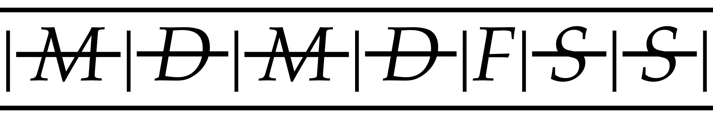 and we now say that we are free only on Friday, and act accordingly. What warrant have we for acting in accordance with the picture?

### [VI-55-4\[1\]](https://cdn.wittgensteinnachlass.com/2000px/webp/Ts-212/VI-55-4.webp),[VI-55-5\[1\]](https://cdn.wittgensteinnachlass.com/2000px/webp/Ts-212/VI-55-5.webp)

36 We expect something and act in accordance with the expectation. Must the expectation come true? No. But why do we act on the expectation? Because we are driven to do so, just as we are driven to get out of the way of a car, to sit down when we are tired and to jump up when we have sat on a thorn.

### [VI-55-6\[1\]](https://cdn.wittgensteinnachlass.com/2000px/webp/Ts-212/VI-55-6.webp)

36 The nature of the belief in the uniformity of what happens is perhaps most clearly seen in the case in which we feel fear of the expected event. Nothing could induce me to put my hand in the flame, although I have been burnt _only in the past_.

### [VI-55-7\[1\]](https://cdn.wittgensteinnachlass.com/2000px/webp/Ts-212/VI-55-7.webp)

36 That the fire will burn me if I put my hand in it: that is certainty. That is, there I see what certainty means. (Not only what the word “certainty” means, but also what certainty is all about.)

### [VI-55-8\[1\]](https://cdn.wittgensteinnachlass.com/2000px/webp/Ts-212/VI-55-8.webp)

36 The belief that fire will burn me is of the same nature as the fear that it will burn me.

### [VI-55-8\[2\]](https://cdn.wittgensteinnachlass.com/2000px/webp/Ts-212/VI-55-8.webp)

36 If one were to drag me into the fire, I would resist and not go willingly; and likewise I would shout: “the fire will burn me!” and I would not shout: “perhaps it will be quite pleasant!”

### [VI-55-8\[3\]](https://cdn.wittgensteinnachlass.com/2000px/webp/Ts-212/VI-55-8.webp)

18 I calculate _this way_ because I cannot calculate otherwise. (I believe _this_ because I cannot believe otherwise.)

### [VI-55-9\[1\]](https://cdn.wittgensteinnachlass.com/2000px/webp/Ts-212/VI-55-9.webp)

18 No rational reason can be given why we should think, [must think].

### [VI-55-10\[1\]](https://cdn.wittgensteinnachlass.com/2000px/webp/Ts-212/VI-55-10.webp),[VI-55-11\[1\]](https://cdn.wittgensteinnachlass.com/2000px/webp/Ts-212/VI-55-11.webp)

18, 36 I assume that this house will not collapse in half an hour. When do I assume that? All the time? And what kind of activity is this assuming? Does assuming that not (once again) mean two things? In one case it denotes a hypothetical psychological disposition; in the other, the act of thinking, of expressing, _that sentence_. In the first sense, the criterion for my _making that assumption_ is what else I say, feel and do; in the other sense, it is that I utter a sentence which is in turn an element of a _calculation_. Now one says: But you must have a reason for assuming that, otherwise the assumption is unsupported and worthless (remember that though we stand on the earth, the earth in turn does not stand on anything; and children think it must fall if it is not supported). Well, I do have reasons for my assumption. They go something like this: that the house has already stood for years, but not so long that it could already be dilapidated, etc., etc. _What_ is a reason _for what_ (what counts as a reason for what) can be stated in advance and describes a calculus in which the one thing is a reason for the other. But if a reason is now to be given for this whole calculus, we see that there is none. But if one asks whether the calculus is therefore an arbitrary assumption, the answer is that it is no more so than fear of fire or of an angry person approaching us. If one now says: surely the rules of grammar 18, 3b by which we proceed and operate are not arbitrary; then one would have to ask in reply: Very well, then, why does a person think the way he does? Why does he go through these acts of thinking? (the question here is, of course, about the _reasons_, not causes). Well, reasons can be given within the calculus; and right at the end one is then tempted to say: “it is simply very likely that the thing will now behave as it has always behaved”, – or something of the sort. A turn of phrase which conceals the beginning of the _reasoning_ and plays a role _here_ similar to that of the Creator at the beginning of the world, who in reality explains nothing, to be sure, but is a beginning people can accept. What is so hard to see is that _as long as_ we are playing a true-or-false game, a change of grammar can only take us from one such _game_ to another, but not from something true to something false. And if, on the other hand, we step outside the domain of these games, we simply no longer call it grammar, and again we do not come into contradiction with reality.

### [VI-55-11\[2\]](https://cdn.wittgensteinnachlass.com/2000px/webp/Ts-212/VI-55-11.webp),[VI-55-12\[1\]](https://cdn.wittgensteinnachlass.com/2000px/webp/Ts-212/VI-55-12.webp)

18, 36 Let us imagine the activity in a house, in a workshop. There is planing, sawing, painting, etc., etc.; and besides these there is an activity called ‘calculating’, which apparently differs from all the others, especially as far as the reason is concerned. We make a picture, say. The activity of calculating (drawing, etc.) connects parts of the other activity. He stops, calculates something, then measures and goes on working with the plane. He also stops sometimes to sharpen the blade of the plane; but is 18, 36 this activity analogous to the other, that of calculating? – “But surely you also believe that more boilers would explode if the boilers were not calculated”. “Yes, I believe it; – but what does that mean?” Does it follow that there will _be_ fewer? And what is the basis of this belief? If one now asks for the reason for an individual act of thinking (an act within a calculus), the answer one gets is an exposition of a system to which the act belongs.

### [VI-55-13\[1\]](https://cdn.wittgensteinnachlass.com/2000px/webp/Ts-212/VI-55-13.webp)

18 *N*o reason can be given why one should think. Unless it is a reason of the kind for which one should eat.

### [VI-55-13\[2\]](https://cdn.wittgensteinnachlass.com/2000px/webp/Ts-212/VI-55-13.webp)

18 One can justify a thought on the basis of other thoughts, but not thinking itself. That, I believe, is what makes our investigation purely descriptive.

### [VII-FCr\[1\]](https://cdn.wittgensteinnachlass.com/2000px/webp/Ts-212/VII-FCr.webp)

_Grammar_

### [VII-56FCr\[1\]](https://cdn.wittgensteinnachlass.com/2000px/webp/Ts-212/VII-56FCr.webp)

Grammar is not answerable to any reality.

It is the grammatical rules that determine meaning in the first place (constitute it), & so they are not answerable to any meaning & are to that extent arbitrary.

### [VII-56-1\[1\]](https://cdn.wittgensteinnachlass.com/2000px/webp/Ts-212/VII-56-1.webp)

77 (79) Suppose we leave out the translation into the language of gestures; does it then become apparent in the application (I mean, in the grammatical rules of application) that this translation is possible?

### [VII-56-2r\[1\]](https://cdn.wittgensteinnachlass.com/2000px/webp/Ts-212/VII-56-2r.webp)

77 (79) And can it become apparent only that it is _possible_, or also that it is necessary? If it is _necessary_, that means that the language using the little red tablet is in some sense necessary, and not on an equal footing with the word-language.

### [VII-56-2r\[2\]](https://cdn.wittgensteinnachlass.com/2000px/webp/Ts-212/VII-56-2r.webp)

77 (79) But how could that be? For then the ostensive explanations would be superfluous; but that already means that they are implicitly contained in the others. How can a rule of a game be superfluous _if_ it is to be _that_ very game, the one that is characterized by _this_ rule too?

### [VII-56-2r\[3\]](https://cdn.wittgensteinnachlass.com/2000px/webp/Ts-212/VII-56-2r.webp)

77 (79) The mistake here, time and again, is that I forget that it takes _all_ the rules to characterize the game, the language, and that these rules are not accountable to reality in such a way that reality would serve to check them and one could doubt whether a rule was necessary or correct. (Compare the problem of the consistency of non-Euclidean geometry.)

### [VII-56-2r\[4\]](https://cdn.wittgensteinnachlass.com/2000px/webp/Ts-212/VII-56-2r.webp)

77 (79) Grammar is not accountable to any reality.

### [VII-56-2r\[5\]](https://cdn.wittgensteinnachlass.com/2000px/webp/Ts-212/VII-56-2r.webp)

77 (79) (Grammar is not answerable to reality.)

### [VII-56-2v\[1\]](https://cdn.wittgensteinnachlass.com/2000px/webp/Ts-212/VII-56-2v.webp)

The meaning laid down entirely in the language

### [VII-56-3\[1\]](https://cdn.wittgensteinnachlass.com/2000px/webp/Ts-212/VII-56-3.webp)

38˙ 2 Now can this ostensive explanation clash with the rules of use?

### [VII-56-3\[2\]](https://cdn.wittgensteinnachlass.com/2000px/webp/Ts-212/VII-56-3.webp)

38˙ 2 For rules cannot really clash unless they contradict one another. For otherwise they determine a meaning, and are not accountable to one in such a way that they could contradict it. ((Add a remark to the effect that the ostensive explanation is _one_ of the rules that hold for a word.))

### [VII-56-4\[1\]](https://cdn.wittgensteinnachlass.com/2000px/webp/Ts-212/VII-56-4.webp)

79a, 77 see 466 A language is what it is, and another language is not _this_ language. So I use the numbers in the sample catalogue differently from the words “red”, “blue”, etc.

### [VII-56-5\[1\]](https://cdn.wittgensteinnachlass.com/2000px/webp/Ts-212/VII-56-5.webp)

38a There can be no discussion about whether these rules or others are the correct ones for the word ‘not’. For the word does not yet have a meaning without these rules, and if we change the rules, it now has a different meaning (or none), and we could just as well change the word too. These rules are therefore arbitrary, because it is the rules that make the sign in the first place.

### [VII-56-6\[1\]](https://cdn.wittgensteinnachlass.com/2000px/webp/Ts-212/VII-56-6.webp)

39a see 38˙ 2 The only correlate, in language, to a natural necessity is an arbitrary rule. It is the only thing that can be extracted from this necessity into sentences.

### [VII-56-7\[1\]](https://cdn.wittgensteinnachlass.com/2000px/webp/Ts-212/VII-56-7.webp),[VII-56-8\[1\]](https://cdn.wittgensteinnachlass.com/2000px/webp/Ts-212/VII-56-8.webp),[VII-56-9\[1\]](https://cdn.wittgensteinnachlass.com/2000px/webp/Ts-212/VII-56-9.webp),[VII-56-10\[1\]](https://cdn.wittgensteinnachlass.com/2000px/webp/Ts-212/VII-56-10.webp)

39a If one asks “why do you put eggs in this batter”, the answer might be “because it makes the cake taste better”. So one is told of an effect, and it is given as a reason. If I want to give a block of wood a particular shape, then the right blow is the one that produces that shape. – But I do not call the argument that has the desired consequences the right one. On the contrary, I call the calculation wrong, although the actions arising from the result have led to the desired end. (“I win the jackpot, and he wants to correct me!”) This shows that the justifications in the two cases are different, and so “justification” means something different in each. In one case one can say: “Just wait, you’ll see that it comes out right (i.e. here: as desired)”; in the other this is no justification. Now when one speaks of the arbitrariness of grammatical rules, this can only mean that the justification that holds _within_ grammar as such does not hold _for_ grammar. And if 39a one compares calculation, not cooking, to a game, it is for just this reason. But this is also the reason why one would not call cooking a calculus. But what about tidying a room, or arranging a bookcase, – or knitting a particular pattern? These things are in some way closer to a game. I think the reason why one is tempted to say that cooking is not a game is this: there are of course rules for cooking too, but “cooking” does not essentially denote an activity carried out according to these rules, but an activity that has a particular result. It is a rule, for instance, that one boils eggs for 3 minutes to get soft-boiled eggs; but if for some reason the same result is achieved by boiling them for 5 minutes, one does not then say “that doesn’t count as ‘soft-boiling eggs’”. By contrast, “playing chess” does not mean the activity that has a particular result, but this expression means an activity carried out according to certain rules. The rules of cookery are related to the grammar of the word “cook” in a different way from that in which the rules of chess are related to the grammar of the expression “play chess” and the rules of multiplication to the grammar of the word “multiply”. The rules of grammar are as arbitrary as (i.e. arbitrary in the same sense as) the choice of a unit of measurement. But this can only mean that the choice is independent of the length of what is to be measured. And that choosing one unit is not ‘true’ and choosing another ‘false’, in the way that specifying the length is true or false. Which is of course only a remark about the grammar of the expression “unit of length”. One is tempted to justify the rules of grammar by sentences of the kind: “But there really are 4 primary colours”; and the statement that the rules of grammar are arbitrary is directed against the possibility of this justification, which is _built_ on the model of justifying a sentence by (the) reference to its verification. 29a But can one not after all say in some sense that the grammar of colour words characterizes the world as it actually is? One would like to say: can I not really search in vain for a fifth primary colour? – (And if one can search, then finding one is conceivable.) Does one not group the primary colours together because they have a similarity, or at least group the colours together, as opposed to e.g. shapes or tones, because they have a similarity? Or, when I present this division of the world as the correct one, do I already have a preconceived idea in my head as a paradigm? Of which I can then perhaps say only: “yes, that is the _way_ we look at things”, or “we simply want to make such a picture (_of reality_)”. For if I say: “the primary colours do have a certain similarity to one another” – where do I get the concept of this similarity? That is: do I have here a function “x similar to y”, into which I can put the colours as arguments? Just as the concept “primary colour” is nothing other than “blue or red or green or yellow”, is not the concept of that similarity likewise given only by the four colours? Indeed, are they not the same! – Well, could one also group red, green and circular together? – Why not?! The importance _in a game_ lies in our playing this game. In our performing _these_ actions. It does not lose its importance through not being in turn an action in another (higher-level) game. Why do I not call the rules of cooking arbitrary; and why am I tempted to call the rules of grammar arbitrary? Because cooking is defined by its purpose, whereas the use of language is not. That is why the use of language is autonomous in a certain sense in which cooking and washing are not. For someone who follows rules other than the right ones when cooking cooks badly; but someone who follows rules other than those of chess plays _a different game_ and someone who follows grammatical rules other than such 39a and such rules does not thereby say anything false, but speaks of something else.

### [VII-56-11\[1\]](https://cdn.wittgensteinnachlass.com/2000px/webp/Ts-212/VII-56-11.webp)

(38) 39a If I could describe the purpose of the grammatical conventions by saying that I had to make them because, say, colours have certain properties, that would make these conventions superfluous, for then I could say precisely what the conventions exclude. Conversely, if the conventions were necessary, so that certain combinations of words had to be ruled out as nonsensical, then for that very reason I cannot specify a property of colours that made the conventions necessary, for then it would be conceivable that the colours did not have this property, and that could only be expressed in violation of the conventions.

### [VII-56-12\[1\]](https://cdn.wittgensteinnachlass.com/2000px/webp/Ts-212/VII-56-12.webp)

(38) 39a By a rule of representation I do not mean a convention that can be justified by sentences, sentences which describe what is represented and show that the representation is adequate. The conventions of grammar cannot be justified by a description of what is represented. Every such description already presupposes the rules of grammar. That is, what counts as nonsense in the grammar to be justified cannot count as sense in the grammar of the justifying sentences either, and vice versa.

### [VII-56-13\[1\]](https://cdn.wittgensteinnachlass.com/2000px/webp/Ts-212/VII-56-13.webp)

38a 77 Anyone who objects to saying that the rules of grammar are rules of a game is right in the sense that what makes a game a game – competition between players, the aim of amusement and recreation, etc. – is absent from grammar. But no one will deny that studying the nature of the rules of a game must be useful for studying grammatical rules, since there is undoubtedly _some_ similarity. In general it is better to look at the rules of a game without having formed a judgement or prejudice about the analogy between grammar and games, guided only by the sure instinct that there is an affinity here. And here again one should simply report what one sees and not fear that one is thereby undermining an _important_ view, or for that matter wasting one’s time on something superfluous. What one sees above all is that the concept of a game, and with it that of a rule of a game, is one with blurred edges. Moreover, one sees something like the following if one looks at the rules of chess, for example: Here there are sentences that describe the moves of the individual pieces; more generally, rules about game-actions. But then there are also the sentences that describe the starting position and those that describe the chessboard.

### [VII-57FCr\[1\]](https://cdn.wittgensteinnachlass.com/2000px/webp/Ts-212/VII-57FCr.webp)

_Rule & empirical proposition_

### [VII-57FCr\[2\]](https://cdn.wittgensteinnachlass.com/2000px/webp/Ts-212/VII-57FCr.webp)

Does a rule say that words are actually used in such & such a way?

### [VII-57-1\[1\]](https://cdn.wittgensteinnachlass.com/2000px/webp/Ts-212/VII-57-1.webp)

66 Rule and empirical proposition. Is a rule an empirical proposition – about the use of language, say? Is a rule of chess a proposition about how people have played it ever since chess was invented; i.e., say, about their having made moves with pieces shaped like this? For if one speaks of people having played chess in this way, then chess must be defined in such a way that it makes sense to say that it has been played differently. Otherwise the rules belong to the definition of chess. That someone plays in accordance with the rule … is an empirical fact; or: “A plays in accordance with the rule …”, “most people play in accordance with the rule …”, “no one plays in accordance with the rule …” are empirical propositions. The rule is not an empirical proposition, but only part of such a proposition. The rule is the stipulation of the unit of measurement, and the empirical proposition says how long an object is. (And here one sees how logical similes work, for the stipulation of the unit of measurement really is a grammatical rule, and the specification of a length in that unit a sentence that makes use of the rule.)

### [VII-57-2\[2\]](https://cdn.wittgensteinnachlass.com/2000px/webp/Ts-212/VII-57-2.webp),[VII-57-3\[1\]](https://cdn.wittgensteinnachlass.com/2000px/webp/Ts-212/VII-57-3.webp)

66 Adding the rule to the sentence does not change the sense of the sentence. If the definition of the metre is the length of the Paris standard metre, then the sentence “this room is 4 m long” says the same as “this room is 4 m long; and 1 m = the length of the Paris standard metre”. The legend of a map is such an instruction for using – or understanding – a description. 66 In any case this legend says nothing about the geography of the country. Any more than the sentence “1 m is the length of the standard metre in Paris” describes the length of an object.

### [VII-57-3\[1\]](https://cdn.wittgensteinnachlass.com/2000px/webp/Ts-212/VII-57-3.webp)

66 Moreover, the rule must relate to its application in the description (of _reality_). For what sense is there in saying of a rod “that is the standard metre” if this statement does not relate to measurements with a metre rule? In that respect we could imagine the rule appended to every sentence. The rule is a kind of route marked out in advance; a path marked out in advance.

### [VII-57-4\[1\]](https://cdn.wittgensteinnachlass.com/2000px/webp/Ts-212/VII-57-4.webp)

66 I should like to call the rule an instrument.

### [VII-57-5\[1\]](https://cdn.wittgensteinnachlass.com/2000px/webp/Ts-212/VII-57-5.webp)

66 If a rule is a sentence, then presumably it is one about the words of the language. But what does such a sentence say about the words? That they are used in such and such a context? But by whom and when? Or that someone wishes them to be used in this way? And who? – Rather, the rule is part of all these statements.

### [VII-57-6\[1\]](https://cdn.wittgensteinnachlass.com/2000px/webp/Ts-212/VII-57-6.webp),[VII-57-7\[1\]](https://cdn.wittgensteinnachlass.com/2000px/webp/Ts-212/VII-57-7.webp)

66 The rule “keep left!” or simply an arrow. What if I painted an arrow on the wall of my room – would it too be the expression of a law, as the arrow in a railway station might well be? Making it a law _does_ require the rest of the apparatus, of which the arrow is only one part. (Sraffa) An engineer builds a bridge; to do so he consults several handbooks, technical and legal. From one he learns that the bridge would collapse if he made this part weaker than etc. etc.; from the others that he would be locked up if he wanted to build it in such and such a way. – Are not the two books on the same footing, then? – That depends on the role they play in his life. The legal handbook may simply be for him a book about the natural history of the people around him. Perhaps he also has to consult a book about the life of beavers to find out how he has to paint the bridge so that the beavers do not gnaw at it. – But is there not another way of regarding laws? Do we not even feel quite clearly that this is not how we regard them? – Is this not the same question as: – Is a contract merely a statement that it is advantageous for the parties to act in such and such a way? Do we not in some cases (though not in all) feel in a different 66 way “bound by the contract”? – Can one then say: “Someone who feels bound by a contract or a law mistakenly imagines the law as a person (or God) who compels him by physical force”? – No; for if he acts as though someone were compelling him, his action is in any case real, and whatever mental images he may have in the process are not mistakes either; and he need not be mistaken about anything and can still act as he does and imagine whatever he happens to imagine. The words “the contract binds me” are indeed a figurative representation and hence, with the ordinary meaning of the word “bind”, a false sentence; but properly understood they are true (or can be) and distinguish one case from that in which the contract merely tells me what it is advantageous for me to do. And if one objects to the words “the contract (or the law) binds me”, one can say nothing against the words: “I _feel_ bound by the contract”.

### [VII-57-8\[1\]](https://cdn.wittgensteinnachlass.com/2000px/webp/Ts-212/VII-57-8.webp),[VII-57-9\[1\]](https://cdn.wittgensteinnachlass.com/2000px/webp/Ts-212/VII-57-9.webp),[VII-57-10\[1\]](https://cdn.wittgensteinnachlass.com/2000px/webp/Ts-212/VII-57-10.webp)

66 The rule – as I understand it – is like a path in a garden. Or like the squares marked out on a chessboard, or the lines of a table. One would not say of these lines etc. that they communicate something to us (though they can be part of a communication, or even communications in their own right). I lay down a rule in an agreement with someone. In this agreement I might communicate the rule (of a future representation) to him. I might say to him: “the plan I am drawing you of my house is on a scale of 1:10”. That is really part of the description of the house. And when I write non-p & (non-non-p = p) this really is like adding the scale to the plan.

66 I could also put it like this: I want to communicate only what the sentence of the language communicates; and the rule is nothing but an aid to _this_ communication (as I understand it, the rule). For this reason alone the rule must not itself be a communication; for otherwise the sense of the sentence would somehow also contain the sense of the communication about linguistic usage. We must remind ourselves how we actually talk about rules in philosophy, i.e. in clarifying grammatical questions; – so that we stay on solid ground and do not devise nebulous constructions. I give e.g. rules like: (∃x). fx:⌵:fa:⌵:fb = (∃x)․fx or non-non-p = p, or I say that it is senseless to speak of a “reddish green”, or of “blackish black”, or I say that “a = a” is senseless, or describe a notation that avoids this construction and “(∃x).x = x”, or say that it makes no sense to say that something “seems to seem red”, or that it makes sense to say that in visual space a curved line is made up of straight segments, or that it makes the same sense to say “the stone falls because it is attracted by the earth” and “the stone _must_ fall because it is … by the earth etc.”. I offer the person who is confused a rule and he accepts it. I could also say: I offer him a notation. Now what does such a notation look like? Well, in most cases I shall translate sentences of the old notation (say, word-language) into the corresponding sentences of the new notation; for instance by writing:

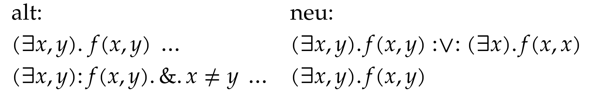

_etc.._

66 But in a certain sense the rule corresponds to what has been called an “assumption”. It is, as it were, a sentence-radical (chemically speaking). And it is characteristic of the kind of investigation we are engaged in that we are not interested in the sentences that are (or _can_ be) formed with this radical. The focus is on the rule; not on my offering it to someone, not on someone using it, etc. It could, I think, be compared to the plan of a house: I mean a drawing that can be used as the plan of a house, but to which no existing house corresponds, and of which it is not said that one is ever to correspond to it, etc.

### [VII-57-11\[1\]](https://cdn.wittgensteinnachlass.com/2000px/webp/Ts-212/VII-57-11.webp),[VII-57-12\[1\]](https://cdn.wittgensteinnachlass.com/2000px/webp/Ts-212/VII-57-12.webp)

66 The description of a new, perhaps more surveyable, notation (for surveyability is what matters to _us_) is then of the same kind as the description of one of those languages that children invent or learn from one another, in which e.g. each vowel of ordinary language is doubled and a b inserted between the two parts of the doubling. Here we have come very close to games. One can take such a description or list of rules as the definiens 66 of the name of the language or game. Let us also think of the description of how to draw or construct some figure, say a star (an activity that also _plays a role_ in games). It goes something like this: “One draws a straight line from a point A to a point B, etc. etc.” I could evidently replace this description with a model, i.e. a drawing. What seems misleading here is a double sense of the word “description” when one speaks on one occasion of the description of an actual house or tree etc., _on another_ of the description of a shape, construction, etc., a notation, a game. What is meant by this, however, is precisely not a sentence saying that such a game is actually played somewhere or that such a notation is actually used; rather, the description takes the place of the words “such a game” and “such a notation” used here. Characteristic*ally*, the description of a notation often begins (one often begins it) with the words: “We _can_ also write it like this: …”. One might ask: “what kind of communication is ‘we can …” etc. One also writes, for instance: “our representation becomes more surveyable if instead of … we write: …; and the rules give …”; and here the rules occur in a sentence.

### [VII-57-12\[2\]](https://cdn.wittgensteinnachlass.com/2000px/webp/Ts-212/VII-57-12.webp)

66 Let us imagine, say, a picture, depicting a boxer in a certain fighting stance. This picture can now be used to communicate to someone how he should stand, how he should hold himself; or, how he should not hold himself; or, how a certain man stood there and there; etc. etc. One could call this picture a sentence-radical.

### [VII-57-12\[3\]](https://cdn.wittgensteinnachlass.com/2000px/webp/Ts-212/VII-57-12.webp),[VII-57-13\[1\]](https://cdn.wittgensteinnachlass.com/2000px/webp/Ts-212/VII-57-13.webp)

66 ‘Rule’ is a concept with blurred 66 edges in the same sense as ‘leaf’ or ‘stalk’ or ‘table’, etc.

### [VII-57-13\[2\]](https://cdn.wittgensteinnachlass.com/2000px/webp/Ts-212/VII-57-13.webp)

66 In describing a notation, one says, for instance: “in this book I want to write ‘p ⌵ q’ instead of ‘p or q’”, and that is of course a complete sentence. But what I want to call a ‘rule’, and what is written, say, “p or q . = . p ⌵ q”, is not. – What I call a ‘rule’ is to contain nothing about a definite (or even indefinite) time or place of application, and is to refer to no definite (or indefinite) persons; it is to be only an instrument of representation. Now we say: “we use the words ‘red’ and ‘green’ in such a way that it counts as senseless (is contradictory) to say there is red and green in the same place at the same time”. And this is of course a sentence, an empirical proposition about our actual language.

### [VII-57-14\[1\]](https://cdn.wittgensteinnachlass.com/2000px/webp/Ts-212/VII-57-14.webp)

66 The relation of the rules of a game to sentences. A rule stands to an empirical proposition much as a drawing with the characteristic features of a house plan stands to a description that makes use of such a drawing and says that a house like that exists in such-and-such a place. The respect one has for the rules of chess – for instance – comes from the fact that the games these rules characterize suit us in many respects. But suppose I invented a game which I called, say, “Abrakadabra” and gave this rule for it: “Put a fieldstone in a four-sided box, nail the box shut and throw another stone at it” – surely this construction, too, has a right to be called a rule. One will only ask: “what’s all this about? what are we supposed to do that for?” But the rules of chess give no answer to such questions either. In the case of the rule _just given_, though, the wording “put … and throw” strikes one, specifically its imperative form; one wants to ask: why should I put … etc., or in what circumstances? What must my purpose be for me to be supposed to do that? That is, the imperative seems nonsensical to us here. But it is no more so than in an ordinary rule of a game. It is just that _here_ one sees clearly that one is not dealing with a complete sentence. At most, with the definition of “Abracadabra”; namely: “playing Abracadabra” means putting a fieldstone in a box etc.

### [VII-58FCr\[1\]](https://cdn.wittgensteinnachlass.com/2000px/webp/Ts-212/VII-58FCr.webp)

The strict grammatical rules of the game & fluctuating linguistic usage.

_Logic normative._

To what extent are we speaking of ideal cases, an ideal language. (“Logic in a vacuum”.)

### [VII-58-1\[1\]](https://cdn.wittgensteinnachlass.com/2000px/webp/Ts-212/VII-58-1.webp)

(49a) 85 What does it mean to know what a plant is? What does it mean to know it and not be able to say it? “You know it and can speak Greek, so surely you must be able to say it.” The idleness of a definition, say, of the concept ‘plant’. But isn’t a definition a requirement of exactness? “The ground was completely covered with plants”: we don’t mean bacilli by that. Indeed, we may be thinking of green plants of a certain order of size. If someone told us we didn’t know what we were saying as long as we hadn’t given a definition of a plant, we would rightly think him mad. Indeed, even with such a definition we would be no better able to make ourselves understood in ordinary cases. Indeed, it even seems that we would communicate less well in a certain sense, because in this case it is precisely what is undefined that seems to belong to our language.

### [VII-58-1\[2\]](https://cdn.wittgensteinnachlass.com/2000px/webp/Ts-212/VII-58-1.webp)

(49a) 85 Imagine replacing the words “grasses” and “herbs” with definitions in the sentence from a story “the ground was completely covered with grasses and herbs”. Clearly these definitions must be long and complicated expressions; and now the question is whether we really meant by the sentence what is now said in the incomparably more complicated one. We would say – I think – that we hadn’t thought of all that at all.

### [VII-58-1\[3\]](https://cdn.wittgensteinnachlass.com/2000px/webp/Ts-212/VII-58-1.webp),[VII-58-2\[1\]](https://cdn.wittgensteinnachlass.com/2000px/webp/Ts-212/VII-58-2.webp)

49a 85 But can one apply the idea of a calculus to such a language? And isn’t that like wanting to speak of boundaries between colours in a picture in which all the patches of colour run into one another? Or is it 85 like this: imagine a game, say tennis, in whose rules nothing is said about the height a ball must not exceed in flight. And now someone said: But the game isn’t governed by rules at all, for if someone throws the ball so high that it doesn’t fall back to earth, or so far that it flies around the earth, we don’t know whether this ball is to count as ‘out’ or ‘in’. One would answer him – I think – that if such a case arose, one would give rules for it; for now there is no need.

### [VII-58-3\[1\]](https://cdn.wittgensteinnachlass.com/2000px/webp/Ts-212/VII-58-3.webp)

85 Still, grammatical rules can be given for the use of the word “plant”, and so we can answer questions of the kind “does it follow from _this_ state of affairs that there’s a plant there”. But we are not equipped to answer other such questions and can reply: Such a case has never arisen and it would be idle for us to make provision for it. (If, say, someone succeeded in producing a living being partly by mechanical and partly by organic means, and the question were then asked: does this still count as an animal (or a plant).)

### [VII-58-3\[2\]](https://cdn.wittgensteinnachlass.com/2000px/webp/Ts-212/VII-58-3.webp)

85 Suppose, for instance, that in a shooting competition no provision had been made for certain borderline cases as to whether this shot should still count as hitting the bull’s-eye (_or not_). But now suppose that such a shot is fired

### [VII-58-4\[1\]](https://cdn.wittgensteinnachlass.com/2000px/webp/Ts-212/VII-58-4.webp)

(38) 49a, 10b 85 I do undertake to draw up the list of rules of our language: what am I to do now in a case like that of the concept ‘plant’? Am I to say that no rule has been laid down for such and such a case? Certainly, if that is how things stand. But then am I to say that there is no list of rules of our language and that the whole undertaking of drawing one up is nonsense? – But it is clear that it is not nonsensical, for we do lay down rules successfully, and we need only refrain from laying down dogmas. (What is the essence of a dogma? Doesn’t it consist in asserting propositions of natural necessity about all possible rules?)

### [VII-58-4\[2\]](https://cdn.wittgensteinnachlass.com/2000px/webp/Ts-212/VII-58-4.webp),[VII-58-5\[1\]](https://cdn.wittgensteinnachlass.com/2000px/webp/Ts-212/VII-58-5.webp)

(38) 49a, 10b (85) “I know what a plant is, but I can’t say”. Does this knowledge have the multiplicity of a sentence that just hasn’t been uttered? _So that_, if the sentence were uttered, I would recognize it as the expression of my knowledge? – Isn’t it rather true that any exact definition would have to be rejected as an expression of our understanding? I.e., wouldn’t we have to say of such a definition that it determines a concept akin to ours, but not our concept itself? And that the affinity is something like that between two pictures, one consisting of patches of colour with blurred 85 boundaries, the other of patches similarly shaped and distributed, but with sharp boundaries. The affinity would then be as undeniable as the difference.

### [VII-58-5\[2\]](https://cdn.wittgensteinnachlass.com/2000px/webp/Ts-212/VII-58-5.webp)

(38) 49a 85 The question now is: can you speak of patches in the first picture too? Certainly, only in a different but related sense.

### [VII-58-5\[3\]](https://cdn.wittgensteinnachlass.com/2000px/webp/Ts-212/VII-58-5.webp)

(38) 49a 85 That is: the blurred boundaries belong to my concept of a plant as it now is, i.e. as I use this word now, and it characterizes this concept that I say, for instance: I have made no stipulation as to whether this thing is to be called a plant or not.

### [VII-58-6\[1\]](https://cdn.wittgensteinnachlass.com/2000px/webp/Ts-212/VII-58-6.webp),[VII-58-7\[1\]](https://cdn.wittgensteinnachlass.com/2000px/webp/Ts-212/VII-58-7.webp)

85 The concept ‘plant’ is rather like that of being egg-shaped as we understand it in everyday life. The boundaries of this concept are not sharply determined, and we would not, for instance, accept an Easter egg of this shape  as such, and yet we could not say at what ratio of length to width something begins to be an Easter egg. Indeed, if someone were to specify such a ratio, _whatever it might be_, we could not recognize it as the correct 85 delimitation of our concept. Instead we would have to say either: no, I don’t call that an Easter egg, it’s too slender, or too fat, etc., or: yes, that _too_ is an Easter egg, but it’s not exactly the borderline case. There simply is no such case in our calculus, and anyone who introduces a borderline case introduces a different calculus.

### [VII-58-8\[1\]](https://cdn.wittgensteinnachlass.com/2000px/webp/Ts-212/VII-58-8.webp),[VII-58-9\[1\]](https://cdn.wittgensteinnachlass.com/2000px/webp/Ts-212/VII-58-9.webp),[VII-58-10\[1\]](https://cdn.wittgensteinnachlass.com/2000px/webp/Ts-212/VII-58-10.webp)

49a, 10b If one says “N. does not exist”, this can mean various things. It can mean that a man who bore this name in his lifetime did not exist, or did not exist at a certain time, in a certain country; but also that later historians invented the character we call by that name (say, “Moses”), that such and such events never took place and that their hero therefore never lived. I.e.: no one was called Moses and performed these deeds; or: the thing that was introduced to you as Mr N was a dummy; etc. Suppose someone told us he had seen Moses in the street. We would then ask him: “what do you mean, you saw him? How did you know it was him?” and now the other person might say: “he told me”, or “he looked the way I picture Moses”, or “he had such and such features”, etc. I presumably want to say what Russell expresses by saying that the name Moses can be defined by different descriptions (“the man who was called ‘Moses’ and lived at this time in this place”, or “the man – whatever he was called at the time – who led the Israelites through the wilderness”, or “the man who as a small child was fished out of the Nile by the king’s daughter”, etc. etc.). And depending on whether we adopt one definition or another, the 49a, 10b sentence “Moses existed” takes on a different sense, and so does every other sentence about Moses. Whenever someone told us “N does not exist”, one would also ask: “what do you mean? do you mean to say that …, or that … etc.?” – Now if I say: “N has died”, things usually stand with “N” _roughly_ as follows: I believe that a man N lived: whom I 1.) saw in such and such a place, who 2.) looks such and such a way, 3.) did such and such things and 4.) goes by the name “N” in civil life. Asked what I mean by “N”, I would list all these things, or some of them, and different ones on different occasions. My definition of “N” would thus be: the man of whom all this is true. But if some of it now turned out to be false, – would the sentence “N has died” then have to be regarded as false? even if only something perhaps quite incidental that I believed about the man were not true; – and where does _what is of primary importance_ begin? This comes to saying that in a certain sense we use the name “N” without a fixed meaning, or: that we are prepared to change the rules of the game as needed (make the rules as we go along). This recalls what I once wrote about the use of concept-words, e.g. the word “leaf” or “plant”. – And here I recall that Ramsey once stressed that logic was a “normative science”. If one means by this that it sets up an ideal which reality only approximates, then it must be said that this “ideal” interests us only as an instrument for describing reality approximately. It is possible, to be sure, to describe a calculus exactly for the purpose of roughly characterizing a group of other calculi. If, for instance, someone wanted to know what a board game is, I could explain by describing draughts to him exactly and then saying: you see, this is roughly how every board game _works_. – Now wasn’t it a mistake on my part (for so it seems to me now) to assume that anyone who uses language always plays _a particular game_? For wasn’t that the sense of my remark that everything about a sentence – however roughly it may be expressed – ‘is in order’? But didn’t I want to say that everything must be in order if someone says a sentence and applies it? But there is nothing either in order or out of order about that, – it would be in order if one could say: this man too is playing a game according to a particular, fixed list of rules.

### [VII-58-11\[1\]](https://cdn.wittgensteinnachlass.com/2000px/webp/Ts-212/VII-58-11.webp)

For I specified two ways of establishing the rule he acts by. One, the hypothetical way, consisted in observing his actions, and the rule was then of the kind found among the propositions of natural science. The other was to ask him what rule he was proceeding by. But what if the first way yields no clear result and the question brings no rule to light, as happens in the case of “N has died”. For if we ask the man _who said that_ “what is N?”, he will indeed explain ‘N’ by giving a description, but will be ready to retract and modify that description if we _refute_ one or another of his statements. How, then, am I to determine the rule he is playing by? he doesn’t know it himself. I could determine a rule only on the basis of whatever answer he happens to give on this occasion to the question “who is N”.

### [VII-58-12\[1\]](https://cdn.wittgensteinnachlass.com/2000px/webp/Ts-212/VII-58-12.webp)

Doesn’t the analogy between language and games shed some light on this? We can perfectly well imagine people amusing themselves in a meadow by playing with a ball; starting various existing games _one after another_, not playing them to the end, and perhaps even throwing the ball, catching it, dropping it, etc., without any plan in between. Now someone said: the whole time the people are playing a ball game, and therefore follow certain rules with every throw. – But – one will object – the person who said the sentence “N has died” surely did not string words together without any plan (and that is what it consists in, his ‘having meant something by his words’). – But one can probably say that he says the sentence without a plan, as is shown precisely by the uncertainty described. Of course, the sentence is taken from somewhere and, if one likes, he too is now playing a game with very primitive rules; for it remains true that to the question “who is N” I got _an answer_, or a series of answers that were not entirely without rules. – We can say: Let’s investigate language for its rules. If here and there it has no rules, then _that_ is the result of our investigation.

### [VII-58-12\[2\]](https://cdn.wittgensteinnachlass.com/2000px/webp/Ts-212/VII-58-12.webp),[VII-58-13\[1\]](https://cdn.wittgensteinnachlass.com/2000px/webp/Ts-212/VII-58-13.webp),[VII-58-14\[1\]](https://cdn.wittgensteinnachlass.com/2000px/webp/Ts-212/VII-58-14.webp)

49a, 10b But if the name can lose its bearer, or the bearer may never have existed, then one had to allow for that from the outset in using the name. That had to lie in its meaning. ((Unless we have changed this meaning, or unless the word had no _definite_ meaning; for what is the meaning if he cannot specify it? Well, we will be able to describe his actual behaviour as “wavering between several meanings”. It is presumably essential that I can ask him: what did you actually mean. And in reply he will _tell me many things,_ and might, for instance, turn to me to set up for him the list of rules that suits his purpose. In the course of our conversation we will then often find the turn of phrase “So what you really wanted to say was …” (and this in turn can be completely misunderstood – it is not a description of the speaker’s state of mind at the time; as if “what he wanted to say” had been expressed somewhere in his mind). But there is a danger here: it then (_easily_) seems as though we end up with something we can no longer express at all in our ordinary language. But that is the surest sign (_of this_) that we have gone astray; stepped out of our game. – What does one mean by “all the rules of tennis”? All the rules that are in a particular book, or all those the player has in his head, or all those ever stated, or even: all those that can be given?! – So we had better not speak so vaguely of ‘all the rules’, but only of particular rules, or all the rules on a list, etc. And the same holds for the rules for the use of a word. If someone asks me something, for instance, then in answering him I want to know whether this answer counts in his game as an answer to his question; whether in his game this sentence follows from that one. It is enough for us that there is a question: “what do you mean by that?” and that in answer to this question the sign _given first_ is replaced by a new one. – The objection to this is that _one_ explanation is no help to me if it is not the last, and it never is the last. I can, to be sure, explain: by ‘Moses’ I mean the man, if there was such a man, who led the Israelites out of Egypt, whatever he may have been called at the time and whatever else he may or may not have done –, but now similar questions arise about the words of _this_ sentence (what do you call “Egypt”? whom, “the Israelites”? etc.). Indeed, these questions would not come to an end even if we had arrived at words like ‘red’, ‘dark’, ‘sweet’. The mistake was just to say 10b, 49a that for that reason one of these explanations is no help to me. On the contrary, it is just what I need, indeed all I can need and all I can give. And if, on being given such an explanation, I say “now I know what you mean”, one cannot object that I can never understand it anyway; rather, his explanation has given me precisely what I call understanding; it has removed _the_ difficulty _I had_. What plagued us is, I think, fully expressed in the pseudo-problem: Surely chess is constituted by the totality of the rules of chess, – what then makes the shifting of a piece in the game a chess move, given that by no means all the rules of chess are involved in it.))

### [VII-58-15\[1\]](https://cdn.wittgensteinnachlass.com/2000px/webp/Ts-212/VII-58-15.webp),[VII-58-16\[1\]](https://cdn.wittgensteinnachlass.com/2000px/webp/Ts-212/VII-58-16.webp)

49 What does “indefinable” mean? This word is evidently misleading, for it _gives_ the impression that we might try something _here_ which would then prove impossible to carry out. As though the indefinable were something that could not be defined any further, as a weight that is too heavy cannot be lifted. We might say: “What do you mean, 49 ‘indefinable’?! Could we even _try_ to define it?”

### [VII-58-17\[1\]](https://cdn.wittgensteinnachlass.com/2000px/webp/Ts-212/VII-58-17.webp)

49 Now one might of course say: a definition is arbitrary, that is, however I define a word, that is how it is defined. But one can reply: what matters is to define it in accordance with what we mean by the word. So that, on being given the definition of the word “table”, for example, we say: yes, that is what I mean by the word. – But was it the definition that led you to mean that by the word, or do you want to say that this is what you have always meant? And if the latter, then you have always meant _what_ the definition says (as opposed to something else it might say). That is: the definition is also a description of what you meant before. So you already had a translation of this definition; it merely said aloud, so to speak, what you already knew in silence. So in substance it did not analyse anything either.

### [VII-58-18\[1\]](https://cdn.wittgensteinnachlass.com/2000px/webp/Ts-212/VII-58-18.webp),[VII-58-19\[1\]](https://cdn.wittgensteinnachlass.com/2000px/webp/Ts-212/VII-58-19.webp)

49a, 61 Let us imagine someone describing the shapes 49a, 61 in this room by comparing them with flat-faced geometrical shapes. Are there only such shapes in this room? No. – Does someone who describes the shapes _from_ the point of view of flat-faced solids have to maintain that there are only shapes of that kind in the room? No again. Can one say that this is one-sided because he takes all the shapes without exception according to this schema? And should it make him doubt this way of seeing things if he notices that there are round solids too? No. It would also be misleading to call the flat-faced solid an “ideal” which reality only more or less approaches. But with reference to this way of representing things, one might call the geometry of flat-faced solids a normative science. (One that represents the means of representation; one that, as it were, calibrates the measuring glasses.)

### [VII-58-20\[1\]](https://cdn.wittgensteinnachlass.com/2000px/webp/Ts-212/VII-58-20.webp)

48b, 61 I have a picture with blurred colours and complicated transitions. I put alongside it a simple one, with clearly distinct colours, but related to the first. I do not say that the first is really the _second_; but I invite the other person to look at the simple one, and expect certain things that trouble him to _disappear_ as a result.

### [VII-58-21\[1\]](https://cdn.wittgensteinnachlass.com/2000px/webp/Ts-212/VII-58-21.webp)

48b Deal with the clear cases in philosophy, not the unclear ones. The latter will resolve themselves once the former have been resolved. The tendency to begin the investigation of a proposition where its application is quite hazy and uncertain (the law of identity is a good example), instead of setting these cases aside for the time being and tackling the proposition where we can talk about it with common sense, this tendency is characteristic of the hopeless method of most people who philosophize.

### [VII-58-22\[1\]](https://cdn.wittgensteinnachlass.com/2000px/webp/Ts-212/VII-58-22.webp)

61, 49a I consider language and grammar from the point of view of the calculus, that is, of operating according to fixed rules.

### [VII-58-23\[1\]](https://cdn.wittgensteinnachlass.com/2000px/webp/Ts-212/VII-58-23.webp)

49, 60 Let us examine language _for its rules_.

### [VII-58-24\[1\]](https://cdn.wittgensteinnachlass.com/2000px/webp/Ts-212/VII-58-24.webp)

38 49a Is there such a thing as a complete grammar of the word ‘not’, for example?

### [VII-58-25\[1\]](https://cdn.wittgensteinnachlass.com/2000px/webp/Ts-212/VII-58-25.webp)

49 49a It is of the greatest importance that for any calculus of logic we always think of an example to which the calculus is actually applied, and not of examples of which we say that they are not really the ideal ones, but that we do not yet have those. That is the sign of a quite mistaken conception. If I can use the calculus at all, then that is also the ideal use and _the_ use _we are concerned with_. For on the one hand one is reluctant to acknowledge the example as the real one, because one detects in it a further complication that the calculus does not address; on the other hand it is, after all, the prototype of the calculus, and the calculus is drawn from it, and one cannot wait for a dreamt-of application. So one must admit to oneself what the actual prototype of the calculus is.

### [VII-58-25\[2\]](https://cdn.wittgensteinnachlass.com/2000px/webp/Ts-212/VII-58-25.webp),[VII-58-26\[1\]](https://cdn.wittgensteinnachlass.com/2000px/webp/Ts-212/VII-58-26.webp)

49, 49a But this is no admission – as if one had made a mistake 49 in drawing the calculus from *there*; the mistake lies rather in applying it now in some hazy fashion, or in promising an application.

### [VII-58-27\[1\]](https://cdn.wittgensteinnachlass.com/2000px/webp/Ts-212/VII-58-27.webp)

49, 49a (Thus Spengler might be better understood if he said: I _compare_ different cultural periods to the lives of families; within a family there is a family resemblance, while there is also a similarity between members of different families; the family resemblance differs from the other similarity in such-and-such a way, etc. What I mean is: the object of comparison, the object from which this way of looking at things is drawn, must be specified for us, so that injustices do not keep _seeping into_ the discussion. For then everything that is true of the prototype _of the inquiry_ is also asserted of the object to which we apply the inquiry; and it is asserted that “it _must always_ …” Now this comes of wanting to give the features of the prototype a foothold in the inquiry. But since one conflates prototype and object, one has to ascribe dogmatically to the object what need only characterize the prototype. On the other hand, one thinks that the inquiry lacks the generality one wants to give it if it really holds only for the one case. But the prototype is precisely to be presented as such; so that it characterizes the whole inquiry, determines its form. It thus stands at the head and is generally valid because it determines the form of the inquiry, not because everything that holds only of it is asserted of all the objects of the inquiry.)

### [VII-58-28\[1\]](https://cdn.wittgensteinnachlass.com/2000px/webp/Ts-212/VII-58-28.webp)

48 Aristotelian logic is a game that _can_ be applied to sentences.

### [VII-58-29\[1\]](https://cdn.wittgensteinnachlass.com/2000px/webp/Ts-212/VII-58-29.webp)

49 How strange it would be if logic were concerned with an “ideal” language and not with _ours_, … for where would we get this ideal language? And what would this ideal language express? Presumably what we now express in our ordinary language; then it is this language that logic must investigate. Or something else: but then how am I to know at all what that is? – Logical analysis is the analysis of something we have, not of something we do not have. So it is the analysis of sentences _as they are_. (It would be strange if human society had spoken up to now without managing to put together a proper sentence.)

### [VII-58-30r\[1\]](https://cdn.wittgensteinnachlass.com/2000px/webp/Ts-212/VII-58-30r.webp)

49a It is not true that what I say holds (or would hold) only for an “ideal language”; but one can say that we construct an ideal language into which, however, everything that can be said in the other languages can be translated.

### [VII-58-30v\[1\]](https://cdn.wittgensteinnachlass.com/2000px/webp/Ts-212/VII-58-30v.webp)

If one really wants to know what people understand by “particular” as opposed to “universal”, one must ask them: “how is the identity of the ‘particular’ to be established …

### [VII-58-31\[1\]](https://cdn.wittgensteinnachlass.com/2000px/webp/Ts-212/VII-58-31.webp),[VII-58-32\[1\]](https://cdn.wittgensteinnachlass.com/2000px/webp/Ts-212/VII-58-32.webp)

(49) 49a, 61 If someone speaks of an ideal language, one would have to ask: ‘ideal’ in what respect?

### [VII-58-33\[1\]](https://cdn.wittgensteinnachlass.com/2000px/webp/Ts-212/VII-58-33.webp)

49, 49a (There is no logic for a vacuum. In so far as there is no hypothesis in logic.)

### [VII-59FCr\[1\]](https://cdn.wittgensteinnachlass.com/2000px/webp/Ts-212/VII-59FCr.webp)

_Parts of speech are distinguished only by_

_their grammar_

### [VII-59-1\[1\]](https://cdn.wittgensteinnachlass.com/2000px/webp/Ts-212/VII-59-1.webp)

7b There are no two parts of speech that I can treat grammatically (_exactly_) alike, but _which_ are nevertheless two parts of speech. Rather, the rules governing them constitute the parts of speech: the same rules, the same part of speech. This is connected with the fact that if one sign behaves exactly like another, the two are the same sign.

### [VII-59-2\[1\]](https://cdn.wittgensteinnachlass.com/2000px/webp/Ts-212/VII-59-2.webp)

38 governing these pieces.

### [VII-59-2\[2\]](https://cdn.wittgensteinnachlass.com/2000px/webp/Ts-212/VII-59-2.webp)

38 Exactly the same applies in every geometry to the expressions “point” and “straight line”, etc. What a point is and what a straight line is can be seen only from the places the two occupy in the system of rules. Let us imagine, for example, a system of letters such that all permitted signs are groups of 3 letters, arranged so that a letter which may occupy an outer position may not occupy the middle position and vice versa. This rule would distinguish between two “parts of speech”, and we could express this by using capital letters for the outer members and lower-case letters for the inner ones. – On the other hand, however, the distinction between two parts of speech makes no sense at all if they are _not_ syntactically distinguished in the way described above, that is, if they could not be recognized as different even without the different kinds of designation, simply by the rules that apply to them. (Two knights might look nothing like one another and still be identifiable as such, if one knows the rules of the game that apply to them.) Directly connected with this is the fact that introducing new generic names into the philosophy of logic does not get us a hair’s breadth further as long as the syntactic rules that make the difference are not given.

### [VII-59-3r\[1\]](https://cdn.wittgensteinnachlass.com/2000px/webp/Ts-212/VII-59-3r.webp)

(7a), 7b The word “a certain” and its grammar. An example of how one piles up words to secure a meaning, instead of attending to the rules of the game. (As though one wanted to paint a real face on the king in chess to ensure that it had the right effect.)

### [VII-59-3v\[1\]](https://cdn.wittgensteinnachlass.com/2000px/webp/Ts-212/VII-59-3v.webp)

… what I find at a particular place in my memory, if this is expressly said.

### [VII-60FCr\[1\]](https://cdn.wittgensteinnachlass.com/2000px/webp/Ts-212/VII-60FCr.webp)

Tell me what you do with a sentence, how you verify it, etc., & I will understand it.

### [VII-60-1\[1\]](https://cdn.wittgensteinnachlass.com/2000px/webp/Ts-212/VII-60-1.webp)

73a, 88 _Specifying_ how a sentence is verified is a contribution to its grammar.

### [VII-60-2\[1\]](https://cdn.wittgensteinnachlass.com/2000px/webp/Ts-212/VII-60-2.webp)

88 One cannot go beyond the possibility of evidence with language.

### [VII-60-3\[1\]](https://cdn.wittgensteinnachlass.com/2000px/webp/Ts-212/VII-60-3.webp)

88 The question about verification is only another form of the question “what do you mean by that?”.

### [VII-60-4\[1\]](https://cdn.wittgensteinnachlass.com/2000px/webp/Ts-212/VII-60-4.webp)

88 How language moves away from the description of verification. One has to discover again that one measures time with a clock. – And one does not even realize in doing so that one has made a grammatical discovery.

### [VII-60-5\[1\]](https://cdn.wittgensteinnachlass.com/2000px/webp/Ts-212/VII-60-5.webp)

(6a) 88 How a sentence is verified is what it says.

### [VII-60-6\[1\]](https://cdn.wittgensteinnachlass.com/2000px/webp/Ts-212/VII-60-6.webp)

88 Which is the ‘_real position_’ of the body I see under water, what is the ‘_real colour_’ of the table? Here it is precisely the question about verification that makes the sense _of the words_ clear.

### [VII-60-7\[1\]](https://cdn.wittgensteinnachlass.com/2000px/webp/Ts-212/VII-60-7.webp)

88 Russell, in fact, had already shown by his “theory of descriptions” that one cannot surreptitiously acquire knowledge of things _by the back door_, and that it can only _seem_ as though we knew more about things than they have disclosed to us directly. But with the idea of “indirect knowledge” he _obscured_ everything again.

### [VII-60-8\[1\]](https://cdn.wittgensteinnachlass.com/2000px/webp/Ts-212/VII-60-8.webp)

88 Only _one thing_ flows from the same source.

### [VII-60-9\[1\]](https://cdn.wittgensteinnachlass.com/2000px/webp/Ts-212/VII-60-9.webp)

73a, 88 Which propositions follow from it, and which propositions it follows from, is what constitutes its sense. Hence the question of its verification is also a question of its sense.

### [VII-60-9\[2\]](https://cdn.wittgensteinnachlass.com/2000px/webp/Ts-212/VII-60-9.webp),[VII-60-10\[1\]](https://cdn.wittgensteinnachlass.com/2000px/webp/Ts-212/VII-60-10.webp)

73a, 88 Apply that to a sentence such as “there will never be people with 2 heads”. This sentence seems somehow to reach into the infinite, the unverifiable, and its sense to be independent of any verification. But if we want to investigate its sense, the question quite rightly arises: can we ever know the truth of such a sentence, and _how_ can we know it; and what grounds can we have for accepting or rejecting what the sentence says? Now one may say: what was asked for, after all, was its sense, not whether and how one can know it. But the answer to the question “how can one know this proposition?” is not a psychological one: it says which other proposition it follows from, and thus belongs to the grammar of the first. And the possible grounds for accepting the proposition are not personal matters but parts of the calculus to which the proposition belongs. If I ask: how _can_ I verify the sentence “someone is in the next room”, or how can I find out that someone is in the next room, then one answer would be: “by going into the next room and seeing him”. If one now asks “how _can_ I get into the next room if the door is locked”, this “can” is different from the first: the first question about possibility (logical possibility) was answered by an explanation about the calculus of sentences, namely that this sentence follows from that one; the second was (75) 88 a question about physical possibility and was answered by an empirical proposition: for example, that one could not break through the wall because it was too solid, but could open the door with a lockpick. Both questions, then, are questions about verification in a certain sense, but not in the same sense. And by confusing the first kind with the second, one comes to believe that the question about verification has no bearing on sense. The grounds for accepting a proposition are not to be confused with the causes of its _acceptance_. The former belong to the calculus of the proposition.

### [VII-60-10\[2\]](https://cdn.wittgensteinnachlass.com/2000px/webp/Ts-212/VII-60-10.webp)

79a, 88 The causes of our believing a sentence would certainly be irrelevant to the question of what it is that we believe, but not so the grounds, which are grammatically related to the sentence and tell us who it is.

### [VII-60-11\[1\]](https://cdn.wittgensteinnachlass.com/2000px/webp/Ts-212/VII-60-11.webp)

73a And the sense of the sentence is not something we investigate and which may in part be beyond investigation. So that later on we might yet discover that beings other than ourselves can know this sentence in a different way. So that it would remain _this_ sentence with _this_ sense, but this sense would have properties we do not now suspect. The sentence, or its sense, is not a spiritual being that has a life of its own and now has adventures we need know nothing about. We would, as it were, have breathed spirit of our own spirit into it – its sense – but now it has a life of its own – like our child – and we can (_only_) investigate it and understand it more or less.

### [VII-60-11\[2\]](https://cdn.wittgensteinnachlass.com/2000px/webp/Ts-212/VII-60-11.webp),[VII-60-12\[1\]](https://cdn.wittgensteinnachlass.com/2000px/webp/Ts-212/VII-60-12.webp)

73a The instinct that leads one to ask: How can one know such a thing; what grounds can we have 73a for assuming it; from what experiences would we derive such a sentence; etc., leads one aright.

### [VII-60-12\[2\]](https://cdn.wittgensteinnachlass.com/2000px/webp/Ts-212/VII-60-12.webp)

73a The sense is not a soul of the sentence. In so far as we are interested in it, it must allow itself to be measured out completely, to _reveal_ itself entirely in signs.

### [VII-60-12\[3\]](https://cdn.wittgensteinnachlass.com/2000px/webp/Ts-212/VII-60-12.webp)

73a If one now asks: does it make sense to say “there will _never_ be such-and-such”? – Well, what evidence is there for it; and what follows from it? – For if there is no evidence for it – not that we have not yet been able to get any – but that none was _provided for_ in the calculus – then that determines the character of this sentence. Just as the nature of a kind of number is determined by the fact that no comparison is possible between it and certain rational numbers.

### [VII-60-12\[4\]](https://cdn.wittgensteinnachlass.com/2000px/webp/Ts-212/VII-60-12.webp)

64, 14 Incidentally: A number defined today in the way we have in mind by means of Fermat’s theorem is not changed by the discovery of a proof of this theorem, or of its contrary. For the calculus of this number knows nothing of this solution to the problem (and even then it will know nothing of it).

### [VII-60-12\[5\]](https://cdn.wittgensteinnachlass.com/2000px/webp/Ts-212/VII-60-12.webp),[VII-60-13\[1\]](https://cdn.wittgensteinnachlass.com/2000px/webp/Ts-212/VII-60-13.webp)

“I will never see a person with 2 heads”: one thinks that with this sentence one somehow reaches into infinity. As if one had at least laid a railway there, even if we have not yet travelled the whole route. The underlying idea is that, for example, the word “never” already brings infinity 73a with it, since that is precisely its meaning. What matters is: What can I do with such a sentence; for the question “what does it mean?” is answered in turn by a sentence, and that takes me no further as long as the explanation tells me nothing about the moves I may make with the pieces. (As long as, so to speak, I only ever see the same configuration before me and no others that I can form from it.) So I hear, for example, that no experience can _prove_ this sentence, and that sets my mind at rest about its infinite meaning.

### [VII-60-14\[1\]](https://cdn.wittgensteinnachlass.com/2000px/webp/Ts-212/VII-60-14.webp)

73a It follows from no evidence that this sentence is true. – Yes, but surely I can _believe_ that _it is true_! But what does this mean: “believe that this is the case”? Does this belief perhaps reach into infinity; does it fly ahead of verification? – What does it mean to believe that? To say this sentence with certain feelings? Is it a particular kind of behaviour? For surely it cannot be anything else. – And then it interests us only in so far as it is a matter of calculating with the sentence.

### [VII-60-15r\[1\]](https://cdn.wittgensteinnachlass.com/2000px/webp/Ts-212/VII-60-15r.webp)

73 (83) To understand the sense of a question, let us consider: What does the answer to this question look like? To the question “is A my ancestor” I can imagine only the answers “A is to be found in my gallery of ancestors” or “A is not to be found in my gallery of ancestors” (where by gallery of ancestors I understand the sum total of all kinds of information about my forebears). But then the question too could only mean the same as: “Is A to be found in my gallery of ancestors”. (A gallery of ancestors has an end: that is a sentence of syntax.) If a god revealed to me that A was my ancestor, but not how many generations back, then this revelation too could only have the sense for me that I will find A among my ancestors if only I look long enough; but since I will search through N ancestors, the revelation must mean that A is among those N ancestors.

### [VII-60-15v\[1\]](https://cdn.wittgensteinnachlass.com/2000px/webp/Ts-212/VII-60-15v.webp)

92 [unreadable] hidden (see …

### [VIII-FCr\[1\]](https://cdn.wittgensteinnachlass.com/2000px/webp/Ts-212/VIII-FCr.webp)

_Intention_

_& depiction_

### [VIII-61FCr\[1\]](https://cdn.wittgensteinnachlass.com/2000px/webp/Ts-212/VIII-61FCr.webp)

When I follow a model in depicting it, and thus _know_ that I am now moving the pencil this way _because_ the model runs _this way_, is a causality of which I am immediately conscious at work here?

### [VIII-61-1\[1\]](https://cdn.wittgensteinnachlass.com/2000px/webp/Ts-212/VIII-61-1.webp)

66a If, following the rules, I write “a” instead of “↑”, it is as if a causal connection were at play here that was not hypothetical but immediately _experienced_. (Of course nothing of the kind is the case.)

### [VIII-61-2\[1\]](https://cdn.wittgensteinnachlass.com/2000px/webp/Ts-212/VIII-61-2.webp)

67 But now if I am annoyed _because_ someone comes in through the door, can I be mistaken about the connection here, or do I _experience_ it as I experience the annoyance?

### [VIII-61-2\[2\]](https://cdn.wittgensteinnachlass.com/2000px/webp/Ts-212/VIII-61-2.webp)

67, 87 In a certain sense I can be mistaken, for I can say to myself “I don’t know why his coming annoys me so much today”. That is, the cause of my annoyance is open to dispute. – On the other hand, there is no disputing that the thought of his coming is – as one says – tinged with displeasure. But what about this case: I see the man and at the sight of him hatred of him wells up in me against him. – One might ask: how do I know that it is _him_ I hate, that _he_ is the cause of my hatred? And how do I know that the sight of him rekindles this hatred? As to the first question: – ‘I hate him’ does not mean ‘I hate and he is the cause of my hatred’. Rather, he, or the visual image of him – etc. – occurs in my hatred, is a constituent of my hatred. (Here too a stand-in will not do, for what guarantees to me that what it stands for exists?) In the second case the man’s appearance _does_ directly _occur_ in my hatred, or, if it does not, then his appearance really is only the hypothetical cause of my feeling and I can be mistaken in thinking that _it_ is what gives rise to the feeling.

### [VIII-61-2\[3\]](https://cdn.wittgensteinnachlass.com/2000px/webp/Ts-212/VIII-61-2.webp)

67, 87 “It must be exactly the same with acting _according to_ an expression in signs. The expression in signs must be involved in this process, whereas it is not involved if it is _merely_ the cause of my action.”

### [VIII-61-3\[1\]](https://cdn.wittgensteinnachlass.com/2000px/webp/Ts-212/VIII-61-3.webp)

87 If the sentence “I hate him” is understood like this: I hate and he is the cause; then the question is possible “are you sure it is _him_ you hate, might it not be someone or something else” and that is _patent_ nonsense.

### [VIII-62FCr\[1\]](https://cdn.wittgensteinnachlass.com/2000px/webp/Ts-212/VIII-62FCr.webp)

When we “depict according to a particular rule”, is this rule contained in the process of copying (depicting), so that it can be read off unambiguously from it? Does the process of depicting embody this rule, so to speak?

### [VIII-62-1\[1\]](https://cdn.wittgensteinnachlass.com/2000px/webp/Ts-212/VIII-62-1.webp)

1, 67 Let us imagine the simple case in which someone intentionally copies a line segment at a scale of 1:1. Is the understanding of how to copy any line segment at a scale of 1:1 already contained in the process of copying? That is, is the way in which my pencil is guided by the line segment precisely this general law? I held my pencil, as it were, without presupposing anything at all, and it was guided _only_ by the length of the original. I would then say: Had the original been longer, I would have gone further with my pencil, and had it been shorter, not as far. But was the spirit expressed here already contained, as it were, in the copying of the one line?

### [VIII-62-1\[2\]](https://cdn.wittgensteinnachlass.com/2000px/webp/Ts-212/VIII-62-1.webp)

1, 67 I can resolve: I will walk until I find him (say, I want to meet someone in a street). And now I walk along the street and meet him at a particular point and stop. Was the following of the general rule I had set myself contained in the process of walking, or in some other simultaneous process? Or was the process merely _in accordance_ with this rule, but also with other, _opposing_ rules?

### [VIII-62-2\[1\]](https://cdn.wittgensteinnachlass.com/2000px/webp/Ts-212/VIII-62-2.webp)

1, 67  I give someone the order to draw a line from A parallel to a. He tries (intends) to do it, but the result is that the line is parallel to b. Was the process of copying then the same as if he had intended to draw parallel to b and had carried out his intention? Evidently I think not. He let himself be guided by the line a.

### [VIII-62-3\[1\]](https://cdn.wittgensteinnachlass.com/2000px/webp/Ts-212/VIII-62-3.webp)

1, 67 Someone who reads makes what they read off depend on what is written there. But the dependence can be expressed only by a rule.

### [VIII-62-3\[2\]](https://cdn.wittgensteinnachlass.com/2000px/webp/Ts-212/VIII-62-3.webp)

1, 67 What, after all, would a general rule have to express at all, if not that?

### [VIII-62-4\[1\]](https://cdn.wittgensteinnachlass.com/2000px/webp/Ts-212/VIII-62-4.webp)

1, 67 The question now is: if I have (now) copied an original in this way, is it then possible to describe the process of copying as it actually was, correctly, according to another general rule as well? Or can I _reject_ such a description with the words: “no, I really let myself be guided only by _this_ (_general_) rule (and not by that other one which _in this case_ would indeed have given the same result as well)”.

### [VIII-62-5\[1\]](https://cdn.wittgensteinnachlass.com/2000px/webp/Ts-212/VIII-62-5.webp)

1 When I intentionally copy a certain shape, the process of copying has this shape in common with reality at a particular point. It is a facet of the process of copying. A facet that lies against the object copied and coincides with it there.

### [VIII-62-5\[2\]](https://cdn.wittgensteinnachlass.com/2000px/webp/Ts-212/VIII-62-5.webp)

1 One might then say: Even if my pencil misses the original, the intention always hits it.

### [VIII-62-6\[1\]](https://cdn.wittgensteinnachlass.com/2000px/webp/Ts-212/VIII-62-6.webp),[VIII-62-7\[1\]](https://cdn.wittgensteinnachlass.com/2000px/webp/Ts-212/VIII-62-7.webp)

1 It is only the intention that reaches as far as the model. And this is expressed by the fact that the expression of the intention contains the description of the model and the expression of the rule of projection. What I actually play does not matter; experience will tell, and the description of what was played need have nothing in common with the description of the notation. If, on the other hand, I want to describe my intention, I must say that I intend to map this notation onto sounds in this way. And only this can express that the intention reaches as far as the original and contains a general rule.

### [VIII-62-8\[1\]](https://cdn.wittgensteinnachlass.com/2000px/webp/Ts-212/VIII-62-8.webp)

1, 67 If I _made_ a device that could play from a score, and so responded to the notation by pressing the corresponding keys of a keyboard, and if this device had always worked flawlessly up to now, neither it nor its way of working would thereby be the expression of a general rule. Furthermore, however it works, its functioning is in itself neither right nor wrong; that is, it neither corresponds nor fails to correspond to the score. No mechanism of any kind can establish such a rule. One can only say: so far the mechanism works in accordance with this rule (which of course means it also works _in accordance_ with other rules). The functioning of the device up to the present moment would rule out certain rules for describing it, but would never determine a rule unambiguously.

### [VIII-62-9\[1\]](https://cdn.wittgensteinnachlass.com/2000px/webp/Ts-212/VIII-62-9.webp)

1 We can, no doubt, use a machine to illustrate the co-ordination of two processes, the mapping of the one onto the other, but only the machine _as it is meant to work_, that is, the machine understood in a quite definite way as an expression, and thus as part of language.

### [VIII-62-9\[2\]](https://cdn.wittgensteinnachlass.com/2000px/webp/Ts-212/VIII-62-9.webp)

1 Only in this sense does the pianola, for example, map the perforated script on the roll onto the sequence of notes. Or the pattern loom the language of the punched cards onto the pattern of the woven fabric.

### [VIII-62-10\[1\]](https://cdn.wittgensteinnachlass.com/2000px/webp/Ts-212/VIII-62-10.webp)

16 The expression “psychischer Vorgang”, “mental process”, is responsible for much confusion. When we say that thought and intention are mental processes, what we imagine is something similar or analogous to what we imagine on hearing the expression chemical process or physiological process. – And in so far as that is right, we have nothing to do with thought and intention.

### [VIII-62-11\[1\]](https://cdn.wittgensteinnachlass.com/2000px/webp/Ts-212/VIII-62-11.webp)

“When one copies, that is, when one maps in general, letting oneself be guided by an original, what is characteristic is that I become conscious only of the original, not of the mode of projection. I am conscious that the original guides me now this way, now that, but I take the _how_ of this transfer for granted, so to speak; I do not otherwise notice it. And that is because I do not compare it with another. I follow the rule of projection, but I do not express it, and it drops out of consideration, so to speak, because it is not compared with anything. If I describe it, that presupposes that I compare it with other rules.”

### [VIII-62-12\[1\]](https://cdn.wittgensteinnachlass.com/2000px/webp/Ts-212/VIII-62-12.webp),[VIII-62-13\[1\]](https://cdn.wittgensteinnachlass.com/2000px/webp/Ts-212/VIII-62-13.webp)

1 “Yes, in a certain sense all that happens in reproducing the original is that this original passes before us and we match it more or less well. That is, it is the end of the copying machine that runs along our original that we observe; we take the whole 1 rest of the machine as given. So to speak, we notice only what changes, not what stays the same. We have made allowance for the mode of mapping by means of a setting (_which stays the same_) (once and for all). – And all we _feel_ is the model.”

### [VIII-62-14\[1\]](https://cdn.wittgensteinnachlass.com/2000px/webp/Ts-212/VIII-62-14.webp)

1 “That is why, when we sing or play wrongly from a score – different as this mapping is in kind from its model – we feel it as an offence against the _model_.”

### [VIII-63FCr\[1\]](https://cdn.wittgensteinnachlass.com/2000px/webp/Ts-212/VIII-63FCr.webp)

How does one justify the result of the depiction by means of the general rule of depiction?

### [VIII-63-1\[2\]](https://cdn.wittgensteinnachlass.com/2000px/webp/Ts-212/VIII-63-1.webp)

67 I can justify 5² by means of x² if in doing so I contrast x² with x³ or some other sign in the system.

### [VIII-63-1\[3\]](https://cdn.wittgensteinnachlass.com/2000px/webp/Ts-212/VIII-63-1.webp)

The difficulty is evidently not to try to justify what _admits_ of no justification.

### [VIII-63-1\[4\]](https://cdn.wittgensteinnachlass.com/2000px/webp/Ts-212/VIII-63-1.webp)

67 If one asks: “why are you writing 5²?” and I answer “it says right there that I am to square”, then that is a justification – and a _full_ one –. To demand a justification in a sense in which this is not one is senseless.

### [VIII-63-1\[5\]](https://cdn.wittgensteinnachlass.com/2000px/webp/Ts-212/VIII-63-1.webp)

67 Suppose I had given someone all sorts of explanations of what the order “square these numbers” _means_. (And all these explanations, after all, are signs.) Suppose he then squares them, and now I ask him “why do you do _that_ in response to this explanation?” Then it would make no sense to answer me: “But you told me: (the explanations are repeated)”. But no other kind of answer to this question is possible either, and the question simply _means_ nothing. To make sense it would have to go: “Why do you do _that_ and not this other thing in response to these explanations (after all, I told you …)”.

### [VIII-63-1\[6\]](https://cdn.wittgensteinnachlass.com/2000px/webp/Ts-212/VIII-63-1.webp)

67 Now suppose one were to ask: How long before the application of the rule must the disposition “x²” have lasted? A second, or two? This question naturally sounds like a parody, and rightly so. We feel that this cannot matter at all. But this kind of question keeps _coming_ _up_.

### [VIII-63-2\[1\]](https://cdn.wittgensteinnachlass.com/2000px/webp/Ts-212/VIII-63-2.webp),[VIII-63-3\[1\]](https://cdn.wittgensteinnachlass.com/2000px/webp/Ts-212/VIII-63-3.webp)

1 When one maps a _set of facts_ according to a rule, _it_ is the _original_ for the mapping. I need no further original to show me how the mapping is to proceed, and thus how to use the first original, for otherwise I would also need an original to show me how to apply the second, and so on 21 ad infinitum. That is, a further original is no use to me; at some point I have to act without an original after all.

### [VIII-63-4\[1\]](https://cdn.wittgensteinnachlass.com/2000px/webp/Ts-212/VIII-63-4.webp),[VIII-63-5\[1\]](https://cdn.wittgensteinnachlass.com/2000px/webp/Ts-212/VIII-63-5.webp)

67a, 96 If I follow the arrow 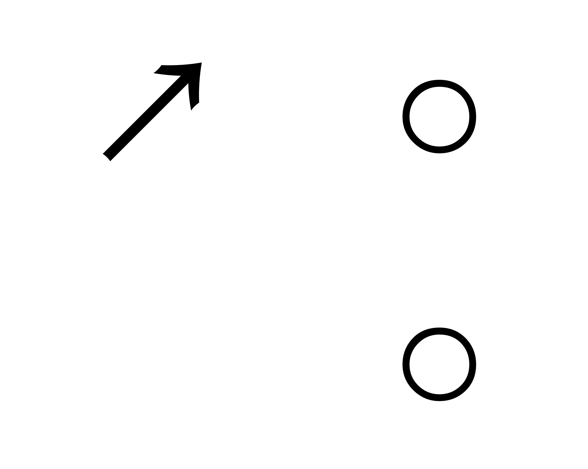 in moving the point P from A to B, then what happens here is described only by my describing the system of arrows to which this one belongs. – Now I might well say: Is that enough? Must I not also give the rule according to which the translation takes place, for instance here, that I am to move parallel to the arrow? But I can imagine this rule of translation appended to the arrow in the form of, say, the sign “!!∣∣” (as opposed, say, to “!∣/”; but then the sign “!!∣∣” would be on no different level from “ ”! and now I could still only describe the system to which this sign belongs, unless I want to add further signs to those above ad - infinitum, _and hence fruitlessly_.

### [VIII-63-6\[2\]](https://cdn.wittgensteinnachlass.com/2000px/webp/Ts-212/VIII-63-6.webp)

67 [10] (96) Here we keep running into the awkward question whether the writing of ‘5²’ (for example) might not have taken place more or less (or entirely) automatically, and feel that this might be the case and that it is no concern of ours at all. That here we are on quite _irrelevant ground_, where we do not belong.

### [VIII-63-7\[1\]](https://cdn.wittgensteinnachlass.com/2000px/webp/Ts-212/VIII-63-7.webp)

67 [10] (96) “I write ‘5²’ because it says ‘x²’ here”. But what if I said: “I write ‘+’ because it says ‘A’ here”? One would ask: Do you write ‘+’ wherever it says ‘A’? That is, one would ask for a general rule. And otherwise the ‘because’ in the last sentence would make no sense.

### [VIII-63-8\[1\]](https://cdn.wittgensteinnachlass.com/2000px/webp/Ts-212/VIII-63-8.webp)

64, (87) 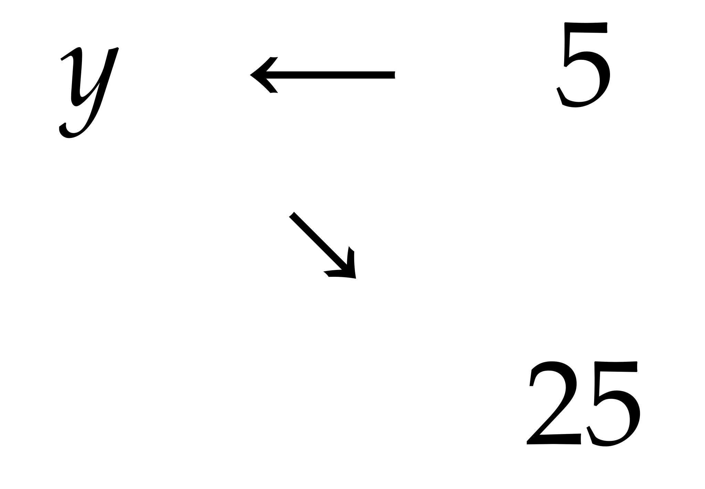 Why do you write 25? – Because it says ‘y’ there. – Well, is that the signal for 25? – No, but I wrote ‘25’ because it says ‘y’ there. – Well, how do you know that is why you wrote it?

### [VIII-63-8\[2\]](https://cdn.wittgensteinnachlass.com/2000px/webp/Ts-212/VIII-63-8.webp)

87 But what does it mean: I am going to the door _because_ the order was “go to the door”? And how does this sentence compare with: I am going to the door although the order was “go to the door”. Or: I am going to the door, but not because the order was “go …”, but …. Or: I am _not_ going to the door because the order was “go to the door”.

### [VIII-63-9\[1\]](https://cdn.wittgensteinnachlass.com/2000px/webp/Ts-212/VIII-63-9.webp)

(70a) 67 The phenomenon of justification.

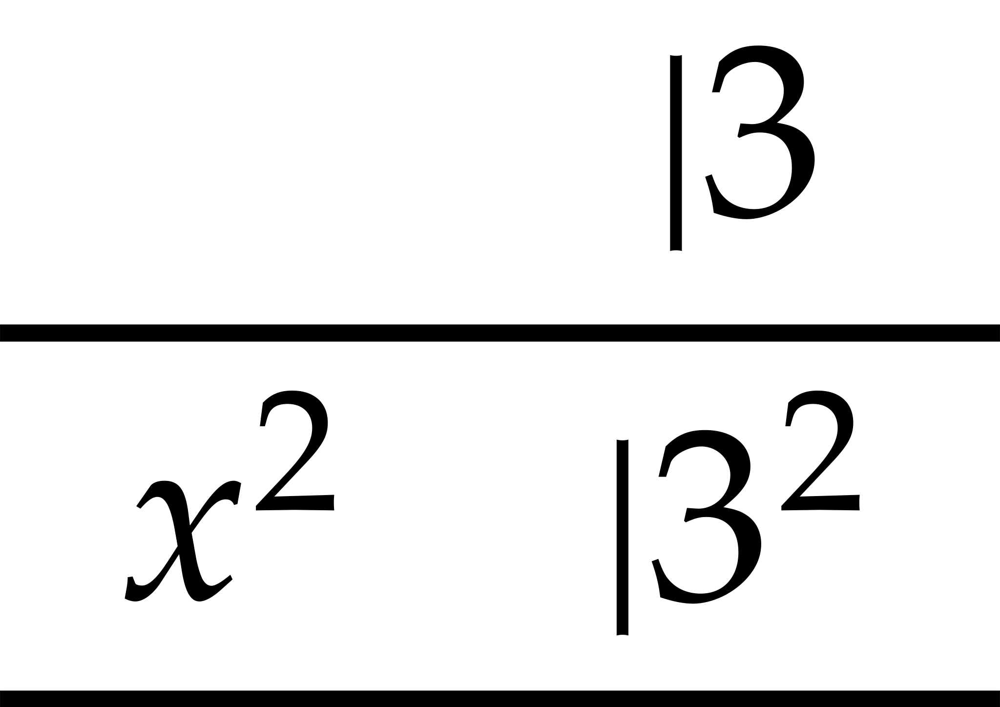

I justify the result 3² by means of x². This is what every justification looks like.

### [VIII-63-10\[1\]](https://cdn.wittgensteinnachlass.com/2000px/webp/Ts-212/VIII-63-10.webp)

(70a) 67 In a certain sense that takes us no further. But it cannot take us _further_ anyway, that is, to a foundation.

### [VIII-64FCr\[1\]](https://cdn.wittgensteinnachlass.com/2000px/webp/Ts-212/VIII-64FCr.webp)

The process of deliberate depiction, of depicting with the intention of depicting, is not essentially a mental, inner process. A process of manipulating signs on paper can do the same thing.

### [VIII-64-1\[1\]](https://cdn.wittgensteinnachlass.com/2000px/webp/Ts-212/VIII-64-1.webp),[VIII-64-2\[1\]](https://cdn.wittgensteinnachlass.com/2000px/webp/Ts-212/VIII-64-2.webp)

16 No mental process can symbolize better than signs written on paper. Nor can the mental process do more than 67 the written signs on paper. For again and again one feels _that_ temptation to try to explain a symbolic _process_ by a special mental process, as though the mind could do much more in this matter than the sign.

### [VIII-64-2\[2\]](https://cdn.wittgensteinnachlass.com/2000px/webp/Ts-212/VIII-64-2.webp)

16 Here we are misled by the false analogy with a mechanism that works by other means and can therefore explain particular movements. As when we say: this movement cannot be explained by the meshing of cogwheels alone.

### [VIII-64-2\[3\]](https://cdn.wittgensteinnachlass.com/2000px/webp/Ts-212/VIII-64-2.webp)

16 What somehow belongs here is this: that it is not self-evident that the sign can be _replaced_ by its explanation. Rather, that it can be so replaced is a remarkable, important insight into the nature of _this_ (_kind of_) explanation.

### [VIII-64-2\[4\]](https://cdn.wittgensteinnachlass.com/2000px/webp/Ts-212/VIII-64-2.webp)

16 The description of what is mental would itself, after all, have to be usable as a symbol in turn.

### [VIII-64-3\[1\]](https://cdn.wittgensteinnachlass.com/2000px/webp/Ts-212/VIII-64-3.webp)

54 The behaviouristic feature of my conception consists only in my making no distinction between ‘outside’ and ‘inside’.. Because psychology is no concern of mine.

### [VIII-64-4\[1\]](https://cdn.wittgensteinnachlass.com/2000px/webp/Ts-212/VIII-64-4.webp)

1, 67 Can one “_leave open_” something in an essentially different sense from that in which one leaves a pair of brackets empty?

### [VIII-64-5\[1\]](https://cdn.wittgensteinnachlass.com/2000px/webp/Ts-212/VIII-64-5.webp)

16 It can never be essential for us that a phenomenon takes place in the mind and not on paper, visible to someone else.

### [VIII-64-5\[2\]](https://cdn.wittgensteinnachlass.com/2000px/webp/Ts-212/VIII-64-5.webp),[VIII-64-6\[1\]](https://cdn.wittgensteinnachlass.com/2000px/webp/Ts-212/VIII-64-6.webp)

16 One can say that whether I am reading or merely making sounds, One can say that whether I am reading or merely making sounds while a text is before my eyes cannot be settled by observation from outside. But reading cannot be essentially an _inner_ affair. Deriving the translation from the sign, if it is a process at all, must also be capable of being a visible process. Thus one must also be able to take as such, for example, the process that takes place on paper when the terms of the series 1,4,9,16 (as a translation of 1,2,3,4) appear worked out by means of the equations 1 × 1 = 1, 2 × 2 = 4, 3 × 3 = 9, etc.

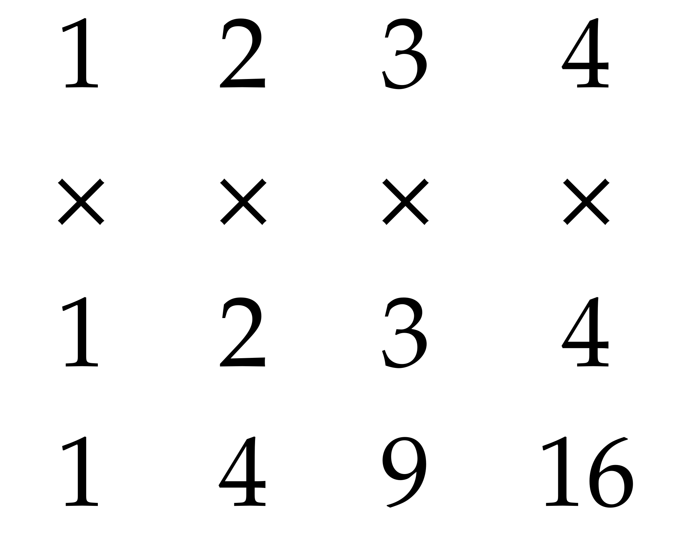

From the standpoint of behaviourism one could then say: If a person writes that down, then he has obtained the bottom row by calculation, but if he merely writes down the calculation at the bottom, then he has not. But if he were now to write:

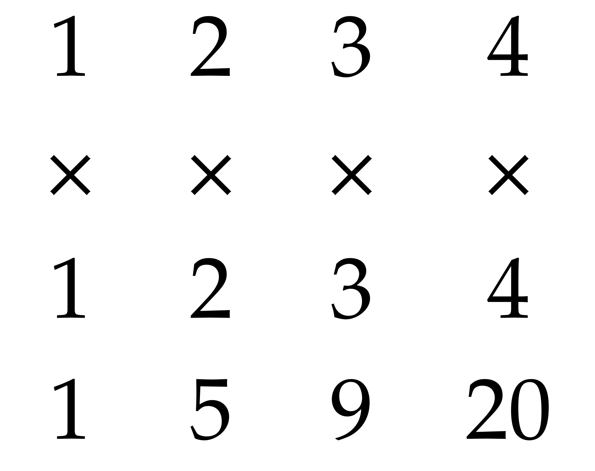

then we would say that he had calculated incorrectly, because 2 × 2 is not 5, etc..

### [VIII-64-6\[2\]](https://cdn.wittgensteinnachlass.com/2000px/webp/Ts-212/VIII-64-6.webp)

16 Of course one could just as well write

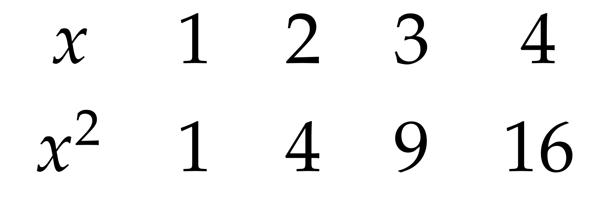

and this representation is entirely equivalent to the first, or indeed to any other, provided a rule is laid down that distinguishes it from another representation.

### [VIII-64-6\[3\]](https://cdn.wittgensteinnachlass.com/2000px/webp/Ts-212/VIII-64-6.webp)

16 The feeling one has with any such representation, that it is crude (clumsy), is misleading, for we are tempted to look for a “better” representation. But there is no such thing. One is as good as another so long as the multiplicity is right; i.e. so long as to every difference in what is represented there corresponds a difference in the representation.

### [VIII-64-6\[4\]](https://cdn.wittgensteinnachlass.com/2000px/webp/Ts-212/VIII-64-6.webp),[VIII-64-7\[1\]](https://cdn.wittgensteinnachlass.com/2000px/webp/Ts-212/VIII-64-7.webp)

16 But then the thought as a mental process can do no more than this “crude” sign either.

### [VIII-64-7\[2\]](https://cdn.wittgensteinnachlass.com/2000px/webp/Ts-212/VIII-64-7.webp)

16 One cannot ask: What kind of processes are mental processes, that they can be true and false when non-mental ones cannot? For if the “mental” ones can, the others must be able to as well; and conversely. For if processes in the mind can do it, their description must be able to do it too. For it must show itself in their description how it is possible.

### [VIII-64-7\[3\]](https://cdn.wittgensteinnachlass.com/2000px/webp/Ts-212/VIII-64-7.webp)

16 When one says that thought is an activity of the psyche, or an activity of the mind, one thinks of the mind as a murky, gaseous entity in which things can happen that cannot happen outside this sphere. And of which one _can_ expect things that are otherwise impossible. The doctrine of thought deals, as it were, with the organic part, as opposed to the inorganic part, the sign. It is as if the thought were the organic part of the symbol, the sign the inorganic part. And that organic part can accomplish _things_ that the inorganic part could not. As if something essential still took place _behind_ the expression, something that cannot be expressed – that can perhaps only be pointed to – something that takes place in this cloud (the mind) and makes the thought a thought in the first place. Here we are thinking of a process analogous to digestion, and _the idea_ is that chemical changes take place inside the body other than those we can produce outside it, that the organic part of digestion _has_ a different chemistry from that of anything we could do to the food outside the body.

### [VIII-64-8\[1\]](https://cdn.wittgensteinnachlass.com/2000px/webp/Ts-212/VIII-64-8.webp)

1 That is, depicting can differ from another process only as one process differs from another, and _that means_ that this difference cannot have logical significance.

### [VIII-64-8\[2\]](https://cdn.wittgensteinnachlass.com/2000px/webp/Ts-212/VIII-64-8.webp)

1 Just as I said once before: Intention too can only be a phenomenon like any other, if I may speak of it at all.

### [VIII-64-8\[3\]](https://cdn.wittgensteinnachlass.com/2000px/webp/Ts-212/VIII-64-8.webp)

1 So choosing the strokes in copying from a model is indeed a different process from, say, merely drawing these strokes when I am “not following the model”, but the difference is an external, describable one, like the difference between the groups of signs 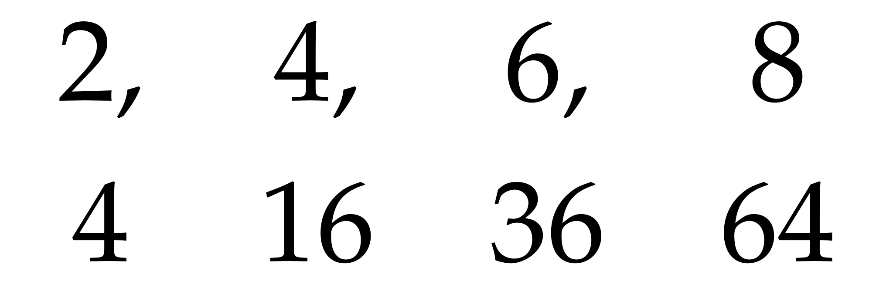 and 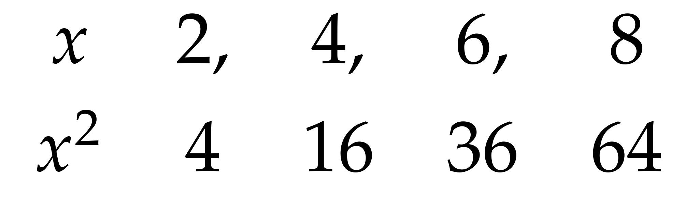, and is on the same level as that difference.

### [VIII-64-8\[4\]](https://cdn.wittgensteinnachlass.com/2000px/webp/Ts-212/VIII-64-8.webp),[VIII-64-9\[1\]](https://cdn.wittgensteinnachlass.com/2000px/webp/Ts-212/VIII-64-9.webp)

1 And so it is with choosing the words when I describe 70 something in words: this process differs from that of arbitrarily assigning words, but only in _just_ the way (_externally_) that the two signs in the preceding sentence differ.

### [VIII-64-10\[1\]](https://cdn.wittgensteinnachlass.com/2000px/webp/Ts-212/VIII-64-10.webp)

89 “If one had taught a dog to follow combinations of the signs a,b,c,d (where a = ↑, b = ↓, c = →, d = ←), it might do so mechanically, but if I now want to know which sign I must give it to make it run along a particular path made up of straight segments, I must derive the sign from that path according to the rule.”

### [VIII-65FCr\[1\]](https://cdn.wittgensteinnachlass.com/2000px/webp/Ts-212/VIII-65FCr.webp)

How are our thoughts connected with the objects we think about? How do these objects enter into our thoughts? (Are they represented in them by something else – something similar, say?)

_The essence of the portrait; intention._

### [VIII-65-1\[1\]](https://cdn.wittgensteinnachlass.com/2000px/webp/Ts-212/VIII-65-1.webp)

(1) 27 “That is supposed to be _him_” (this picture represents _him_) – there lies the whole problem of representation.

### [VIII-65-2\[1\]](https://cdn.wittgensteinnachlass.com/2000px/webp/Ts-212/VIII-65-2.webp)

1, 2 If I say “the sense of a sentence is determined by how it is to be verified”, what must I then say about the sense of the sentence that says that this sentence is _supposed_ to be the translation of that one? How, then, is that to be verified?

### [VIII-65-3\[1\]](https://cdn.wittgensteinnachlass.com/2000px/webp/Ts-212/VIII-65-3.webp)

73 [27a, 70, 70a] What does it mean to say: I can imagine that the spot A moves to the place B? Light must be shed on the strange illusion to which one is subject, that in the sentence the objects do what the sentence says.

### [VIII-65-3\[2\]](https://cdn.wittgensteinnachlass.com/2000px/webp/Ts-212/VIII-65-3.webp)

73 [27a, 70a, 70] It is as if a shadow of the execution already lay in the order. But a shadow of just _this_ execution. _You_ go to such-and-such a place in the order. – But otherwise it would simply be a _different_ order.

### [VIII-65-4\[1\]](https://cdn.wittgensteinnachlass.com/2000px/webp/Ts-212/VIII-65-4.webp)

27 “The sentence is a picture”. A picture of what? Can one say: “Of the fact that makes it true if it is true, and of the fact that makes it false if it is false. In the first case it is a correct picture, in the second an incorrect one”? ((When I ask of a painted picture, “What is this a picture of?”, what kind of answer is it?))

### [VIII-65-5\[1\]](https://cdn.wittgensteinnachlass.com/2000px/webp/Ts-212/VIII-65-5.webp)

27 If by picture one means a correct or incorrect representation of reality, then one must know of which reality, or: of which part of reality. I can represent this room correctly or incorrectly, but to find out whether it is correct or not, I must know that this room is meant.

### [VIII-65-6\[1\]](https://cdn.wittgensteinnachlass.com/2000px/webp/Ts-212/VIII-65-6.webp)

90a [12] What does it mean to form a mental image that does not correspond to reality?

### [VIII-65-7\[1\]](https://cdn.wittgensteinnachlass.com/2000px/webp/Ts-212/VIII-65-7.webp)

90a 12 One should compare imagining with painting a picture. So he paints a picture of the person as that person is not in reality. Very simple. But why do we call it a picture of this person? For if it is not that, then (of course) it is not wrong. – We call it that because he himself has written it above the picture. So he has done nothing more than paint that picture and write that name above it. And presumably that is what he did in his imagination too.

### [VIII-65-8\[1\]](https://cdn.wittgensteinnachlass.com/2000px/webp/Ts-212/VIII-65-8.webp)

27b It must be clear to us that the connection of our thought with Napoleon can be _made_ only through Napoleon himself and not through any picture (mental image, etc.), however close the likeness. On the other hand, however, for us Napoleon is no less contained in it in his absence than in his presence.

### [VIII-65-9r\[1\]](https://cdn.wittgensteinnachlass.com/2000px/webp/Ts-212/VIII-65-9r.webp)

27, 27b “The plan consists in my seeing myself do such-and-such.” But how do I know it is _me_? – Well, it is not me that I see, but a picture, say. But why do I call it _my_ picture? Not because it looks like me, for instance. “How do I know it is me?”: this is a good example of a misplaced question. For the question makes sense when, for example, it is put this way: How do I know that it is me I see there in the mirror? And then the answer gives features by which I can be recognized. –

### [VIII-65-9v\[1\]](https://cdn.wittgensteinnachlass.com/2000px/webp/Ts-212/VIII-65-9v.webp)

If “M” and “N” have the same bearer _in the same way_, then the rules for “M” & “N” agree & they have the same meaning.

### [VIII-65-10\[1\]](https://cdn.wittgensteinnachlass.com/2000px/webp/Ts-212/VIII-65-10.webp),[VIII-65-11\[1\]](https://cdn.wittgensteinnachlass.com/2000px/webp/Ts-212/VIII-65-11.webp)

27 27b The question “How do I know that is me?” or, more correctly, “… that that stands for _me_” is nonsense, for its standing for me is my (_own_) stipulation. Indeed, I might just as well ask: “How do I know that the word ‘I’ stands for me?”, for my figure in the picture was only another word ‘I’.

### [VIII-65-11\[2\]](https://cdn.wittgensteinnachlass.com/2000px/webp/Ts-212/VIII-65-11.webp)

8, 8b One could, however, ask “What has the name ‘a’ got to do with this person?” And the answer would be: Well, that _is_ a.

### [VIII-65-12\[1\]](https://cdn.wittgensteinnachlass.com/2000px/webp/Ts-212/VIII-65-12.webp)

27, 27b “This figure in the picture is me” is a convention.

### [VIII-65-12\[2\]](https://cdn.wittgensteinnachlass.com/2000px/webp/Ts-212/VIII-65-12.webp)

27, 27b Yes, but _what_ do we agree on? What relation do we establish between the sign and me? Well, _only_ the one that holds, say, through pointing with the hand or hanging a little label round someone’s neck. For this relation is significant only through the system to which it belongs.

### [VIII-65-13\[1\]](https://cdn.wittgensteinnachlass.com/2000px/webp/Ts-212/VIII-65-13.webp)

27b, (90a) [12] When one says: I imagine the sun moving across the sky; surely the mental image is not described by saying that “the sun is moving across the sky”! Now, on the one hand I could ask: Isn’t what you see before you a yellow disc in motion? But not specifically the sun. – On the other hand, when I say “I imagine the sun moving in this way”, that is not the same as coming to see such a picture (in a film, for example). Indeed, it would make sense to ask of this picture: “Does that represent the sun?”

### [VIII-65-14\[1\]](https://cdn.wittgensteinnachlass.com/2000px/webp/Ts-212/VIII-65-14.webp)

27, 27a The portrait is only a picture resembling N (or not even that), but it has nothing in it (however close the likeness) that would make it a portrait of _this_ person, i.e. the intended portrait. (Indeed, the picture that is a deceptively close likeness of one person may in reality be a poor portrait of another.)

### [VIII-65-15\[1\]](https://cdn.wittgensteinnachlass.com/2000px/webp/Ts-212/VIII-65-15.webp)

27 Now, one can still ask: “How does it show that he means the picture as a portrait of N?” – “Well, by his saying so” – “But then how does it show that he means _that_ by what he says?” – “It doesn’t show at all!” ((What does this “that” refer to, then? One can ask: How does it show that he means what he says? An answer, for example: in his face.))

### [VIII-65-16\[1\]](https://cdn.wittgensteinnachlass.com/2000px/webp/Ts-212/VIII-65-16.webp)

(36, 54) 27a [→ [Page 16 believe]]

“I was of the opinion (to believe) that Napoleon had been crowned in 1805”. – “Were you of that opinion continuously the whole time?”

### [VIII-65-16\[2\]](https://cdn.wittgensteinnachlass.com/2000px/webp/Ts-212/VIII-65-16.webp)

(36, 54) 27a “But what has your opinion got to do with Napoleon? What connection is there between your opinion and Napoleon? The connection may, for example, consist in the occurrence of the word “Napoleon” in the expression of my opinion, plus the connection this word has with its bearer. For instance, that he signed himself that way, was addressed that way, etc. etc..

### [VIII-65-16\[3\]](https://cdn.wittgensteinnachlass.com/2000px/webp/Ts-212/VIII-65-16.webp),[VIII-65-17r\[1\]](https://cdn.wittgensteinnachlass.com/2000px/webp/Ts-212/VIII-65-17r.webp)

(36, 54) 27a “But with the word ‘Napoleon’ you are surely designating this very person while you are uttering it”. – “How, in your opinion, does this act of designation take place, then? Instantaneously? Or does it take time?” – “Yes, but if one asks you ‘did you (_just_) now mean the man who won the battle of Austerlitz?’, you will surely say ‘yes’. So you meant this man _when you uttered the sentence in which his name occurs_!” – Granted, but only in much the same sense in which I also knew at the time that 2 + 2 = 4. That is, not as if a particular _process had taken place_ at that time which we could call this ‘meaning’; even if perhaps the utterance was accompanied by certain images that are 27 characteristic of this opinion and might have been different if the word ‘Napoleon’ had had a different _meaning_. Rather, the answer “yes, I meant the victor of Austerlitz” is a further step in the calculus. What is misleading about this step is the past tense, which seems to give a description of what had gone on “inside me” while the sentence was being uttered. In reality the past tense merely refers back to the sentence uttered earlier.

### [VIII-65-17v\[1\]](https://cdn.wittgensteinnachlass.com/2000px/webp/Ts-212/VIII-65-17v.webp)

Here H …

### [VIII-65-18\[1\]](https://cdn.wittgensteinnachlass.com/2000px/webp/Ts-212/VIII-65-18.webp)

54, 8b, 27 “But I meant _him_”. A strange process, this meaning! Can one mean someone even if he is in America and one is in Europe? And even if he is already dead?

### [VIII-65-19\[1\]](https://cdn.wittgensteinnachlass.com/2000px/webp/Ts-212/VIII-65-19.webp)

27 All my reflections are always directed towards showing that it is no _help_ to _conceive_ of thinking as hallucinating. I.e. it is _superfluous_, but the difficulty remains. For a hallucination cannot bridge the gulf between picture and reality either; _no_ picture can, and the one can do so no more than the other.

### [IX-FCr\[1\]](https://cdn.wittgensteinnachlass.com/2000px/webp/Ts-212/IX-FCr.webp)

_Logical inference_

### [IX-66FCr\[1\]](https://cdn.wittgensteinnachlass.com/2000px/webp/Ts-212/IX-66FCr.webp)

Do we know that p follows from q because we understand the propositions? Does the following arise from a sense?

### [IX-66-1\[1\]](https://cdn.wittgensteinnachlass.com/2000px/webp/Ts-212/IX-66-1.webp)

25 p & q = p means “q follows from p”.

### [IX-66-2\[1\]](https://cdn.wittgensteinnachlass.com/2000px/webp/Ts-212/IX-66-2.webp)

25 (∃x)․fx ⌵ fa = (∃x)․fx, (∃x)․fx & fa = fa How do I know this? (For I have, so to speak, proved the one above.) One might say, for instance: “I simply understand ‘(∃x)․fx’”. (A splendid example of what ‘understand’ means.) But I could just as well ask “How do I know that (∃x)․fx follows from fa?” and answer: “Because I understand ‘(∃x)․fx’”. But how do I actually know that it follows? – _Because that is how I calculate_.

### [IX-66-3\[1\]](https://cdn.wittgensteinnachlass.com/2000px/webp/Ts-212/IX-66-3.webp)

25 How do I know that (∃x)․fx follows from fa? Do I see, as it were, behind the sign “(∃x)․fx”, and see the sense that stands behind it, and see from that that it follows from fa? Is _that_ understanding? No, that equation expresses part of the understanding (which thus lies spread out before me). Think of the conception of understanding as something originally _graspable at a stroke_ that can _only then_ be spread out in this way. If I say “I know that (∃x)․fx follows because I understand it”, that would mean that in understanding it I see something _other_ than the given sign, as it were a _definition_ of the sign from which its following emerges.

### [IX-66-4\[1\]](https://cdn.wittgensteinnachlass.com/2000px/webp/Ts-212/IX-66-4.webp)

25 Isn’t the dependence, rather, established and laid down by the equation? For there simply is no hidden dependence.

### [IX-66-5\[1\]](https://cdn.wittgensteinnachlass.com/2000px/webp/Ts-212/IX-66-5.webp)

25

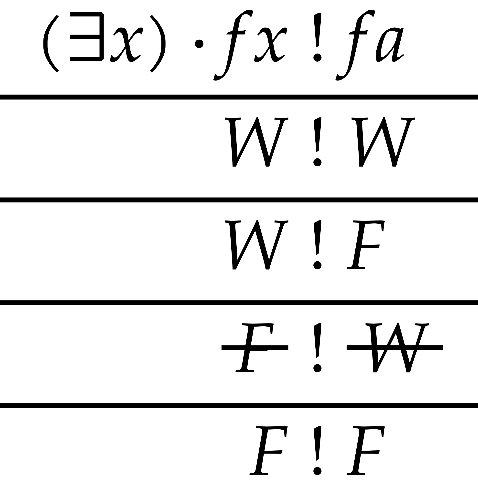

But, I thought, mustn’t (∃x)․fx be a truth-function of fa, then, for that to be possible? For this dependence to be possible?

### [IX-66-5\[2\]](https://cdn.wittgensteinnachlass.com/2000px/webp/Ts-212/IX-66-5.webp)

25 But doesn’t (∃x)․fx ⌵ fa = (∃x)․fx say precisely that fa is already contained in (∃x)․fx? Doesn’t it show the dependence of fa on (∃x)․fx? No, unless (∃x)․fx is _defined_ as a logical sum (with fa as a summand). – If that is so, then (∃x)․fx is (_nothing but_) an abbreviation.

### [IX-66-5\[3\]](https://cdn.wittgensteinnachlass.com/2000px/webp/Ts-212/IX-66-5.webp)

25 There is no hidden connection in logic.

### [IX-66-6\[1\]](https://cdn.wittgensteinnachlass.com/2000px/webp/Ts-212/IX-66-6.webp)

25 One cannot get behind the rules, because there is no ‘behind’.

### [IX-66-6\[2\]](https://cdn.wittgensteinnachlass.com/2000px/webp/Ts-212/IX-66-6.webp)

25 fE & fa = fa Can one say: this is possible only if fE follows from fa; or must one say: this stipulates that fE follows from fa?

### [IX-66-6\[3\]](https://cdn.wittgensteinnachlass.com/2000px/webp/Ts-212/IX-66-6.webp)

25 If the former, then it must follow by virtue of the structure, for instance by fE being so determined by a definition that it has the _corresponding_ structure. But can its following really emerge, as it were, from the visible structure of the signs, as physical behaviour emerges from a physical property, or does it not rather always require such _stipulations_ as the equation fE & fa = fa? Can one tell by looking at p⌵q that it follows from p, or even by looking at the rules Russell gives for the truth-functions?

### [IX-66-7\[1\]](https://cdn.wittgensteinnachlass.com/2000px/webp/Ts-212/IX-66-7.webp)

25 And why should the rule fE & fa = fa be derived from another rule rather than be the primary rule?

### [IX-66-7\[2\]](https://cdn.wittgensteinnachlass.com/2000px/webp/Ts-212/IX-66-7.webp)

25 For what is “fE must surely contain fa in some way” supposed to mean? It simply does not contain it, in so far as we can work with fE without mentioning fa. It does, though, in so far as the rule fE & fa = fa holds.

### [IX-66-7\[3\]](https://cdn.wittgensteinnachlass.com/2000px/webp/Ts-212/IX-66-7.webp)

25 For the _opinion_ is that fE & fa = fa can hold only by virtue of a definition of fE.

### [IX-66-7\[4\]](https://cdn.wittgensteinnachlass.com/2000px/webp/Ts-212/IX-66-7.webp)

25 And that – I think – because otherwise it falsely appears as if a further stipulation about fE were being made after it _had_ already been introduced into the language. In fact, however, no stipulation is left to future experience.

### [IX-66-7\[5\]](https://cdn.wittgensteinnachlass.com/2000px/webp/Ts-212/IX-66-7.webp)

25 And of course defining fE from ‘all the individual cases’ is _just as_ impossible as listing _all_ the rules of the form fE & fx = fx.

### [IX-66-7\[6\]](https://cdn.wittgensteinnachlass.com/2000px/webp/Ts-212/IX-66-7.webp)

25 Indeed, the individual equations fE & fx = fx are precisely an expression of this impossibility.

### [IX-66-8\[1\]](https://cdn.wittgensteinnachlass.com/2000px/webp/Ts-212/IX-66-8.webp)

25 If one is asked “But is it certain, then, that no calculus other than this one is used?” one must say: If that means “Don’t we use other calculi in our _actual_ language as well?”, I can only answer “I don’t know of any others (at present)” (just as if someone asked “Are those all the calculi of (present-day) mathematics?”, I might say “I don’t recall any others, but I can perhaps check the books more carefully”). But the question cannot mean “Can no other calculus be used?” For how would I answer this question? A calculus exists in virtue of one’s describing it.

### [IX-66-8\[2\]](https://cdn.wittgensteinnachlass.com/2000px/webp/Ts-212/IX-66-8.webp)

Can one say: ‘calculus’ is not a mathematical concept?

### [IX-66-9\[1\]](https://cdn.wittgensteinnachlass.com/2000px/webp/Ts-212/IX-66-9.webp),[IX-66-10\[1\]](https://cdn.wittgensteinnachlass.com/2000px/webp/Ts-212/IX-66-10.webp)

25, 39 If I said: “Whether p follows from q must be evident from p and q alone”, what I would have to say is: that p follows from q is a stipulation that determines the sense of p and q; 25, 39 not something that is true when asserted of the sense of these two. Hence one (_certainly_) can state the rules of inference, but in doing so one states rules for the use of the written signs, rules which determine their sense in the first place; which means nothing other than that these rules are to be laid down arbitrarily; i.e. not read off from reality, as a description is. For when I say the rules are arbitrary, I mean that they are not determined by reality in the way a description of that reality is. And that means: it is nonsense to say of them that they accord with reality; that the rules for the words “blue” and “red”, say, accord with the facts concerning these colours, etc.

### [IX-66-11\[1\]](https://cdn.wittgensteinnachlass.com/2000px/webp/Ts-212/IX-66-11.webp)

25 The equation p & q = p really shows the connection between following and the truth-functions.

### [IX-67FCr\[1\]](https://cdn.wittgensteinnachlass.com/2000px/webp/Ts-212/IX-67FCr.webp)

“If p follows from q, then in thinking q one must already be thinking p as well”.

### [IX-67-1\[1\]](https://cdn.wittgensteinnachlass.com/2000px/webp/Ts-212/IX-67-1.webp)

25a Consider that a logical sum of, say, a hundred summands might follow from the general proposition, even though we certainly did not think of them when we uttered the general proposition. Can we not nonetheless say that it follows from it?

### [IX-67-2\[1\]](https://cdn.wittgensteinnachlass.com/2000px/webp/Ts-212/IX-67-2.webp)

25b “What follows from a thought must be thought along with it. For there is nothing about a thought that we do not know while we are thinking it. It is not a machine whose examination can bring unsuspected things to light, or a machine that can do something one does not _at first_ see it can do. That is, _logically_ it does not work as a machine at all. As a thought, it contains no more than was put into it. As a machine, i.e. causally, it might be capable of anything; logically it yields only what we _meant by it_.” 25b When I say that the quadrilateral is all white, I am not thinking of ten smaller rectangles within it that are white; and I cannot think of “_all_” the rectangles or patches within it. Likewise, in the sentence “he is in the room”, I am not thinking of a hundred possible positions he could occupy, and certainly not of _all_ of them.

### [IX-67-3\[1\]](https://cdn.wittgensteinnachlass.com/2000px/webp/Ts-212/IX-67-3.webp)

“Wherever you hit the target, you’ve won. – You hit it at the top right, so …”

### [IX-67-4\[1\]](https://cdn.wittgensteinnachlass.com/2000px/webp/Ts-212/IX-67-4.webp),[IX-67-5\[1\]](https://cdn.wittgensteinnachlass.com/2000px/webp/Ts-212/IX-67-5.webp)

25c At first sight there are two kinds of deduction: in one, what the conclusion is about is mentioned in the premise; in the other it is not. The inference from p & q to q is of the first kind. Of the other kind is the inference: the whole rod is white, so the middle third is white too. This conclusion speaks of boundaries that were not mentioned in the first sentence. (That is suspicious.) Or if I say, “wherever within this circle you hit the target, you will win the prize” and then “you hit it here, so …”, this spot was not foreseen in the first sentence. The target with the shot hole stands in a definite internal relation to the target as I saw it before, and the fact that the hole here falls under the general possibility that was foreseen _consists_ in this. But the hole itself was not foreseen and did not occur in the first picture. Or at any rate it did not have to occur in it. For even supposing I had thought of a thousand definite possibilities in doing so, it might at least have happened that the one that later came about was left out. And if foreseeing this possibility had been essential, overlooking this one possibility would have given the premise the wrong sense and the conclusion would now not follow from it. On the other hand, nothing is _added_ to the sentence “wherever within this circle you hit, …” if one says: “wherever within this circle you hit, and if in particular you hit the black dot, …”. But if the black dot was already there when one uttered the first sentence 25a, then of course it too was meant; if it was not there, then its presence has changed the sense of the sentence.

### [IX-67-6\[1\]](https://cdn.wittgensteinnachlass.com/2000px/webp/Ts-212/IX-67-6.webp)

25a, b But what is it supposed to mean, then, to say that if one sentence follows from another, the first must be thought along with the second, when in the sentence “I am 170 cm tall” one does not have to think along with it even a single one of the negative specifications of length that follow from it?

### [IX-67-7\[1\]](https://cdn.wittgensteinnachlass.com/2000px/webp/Ts-212/IX-67-7.webp)

25a “The cross lies on the straight line _like this_: 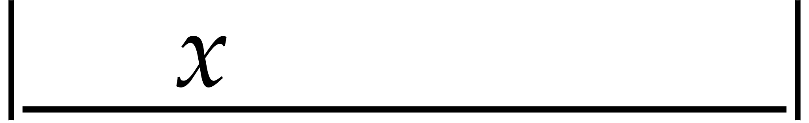” – “It _therefore_ lies between the marks …” “It is 16½˚ here”. – “So at any rate it is more than 15˚.” If, incidentally, one is surprised that this sentence follows from that one, although one was not thinking of this one at all when thinking of that one, one need only recall that p ⌵ q follows from p, and I certainly do not think of all sentences p ⌵ x when I think of p.

### [IX-67-7\[2\]](https://cdn.wittgensteinnachlass.com/2000px/webp/Ts-212/IX-67-7.webp)

25a The whole idea that when one thinks a sentence from which another follows one must think the latter rests on a false, psychologizing conception. After all, we have only to attend to what lies in the signs and (_their_) rules.

### [IX-67-8\[1\]](https://cdn.wittgensteinnachlass.com/2000px/webp/Ts-212/IX-67-8.webp)

25b If the criterion for p following from q consists in one’s “thinking p along with q when thinking q”, then presumably, when thinking the sentence “there are 10⁵ grains of sand in this box”, one thinks the 10⁵ sentences: “there is _one_ grain of sand in this box”, “… 2 grains of sand”, etc. etc.? What is the criterion here for thinking one thing along with another! And what about a sentence: “a patch (F) lies between the boundaries AA”? Does it not follow from it that F also lies between BB and CC, and so on? Do infinitely many sentences follow here from _one_ sentence? and does it therefore say infinitely much? – From the sentence “a patch lies between the boundaries AA” there follows every sentence of the kind “a patch lies between the boundaries BB” that I write down – and as many as I write down. Just as there follow from p as many sentences of the form p ⌵ x as I write down (or utter, etc.). (The proof by induction proves as many sentences of the form … as I write down.)

### [IX-68FCr\[1\]](https://cdn.wittgensteinnachlass.com/2000px/webp/Ts-212/IX-68FCr.webp)

The case: infinitely many sentences follow from one.

### [IX-68-1\[1\]](https://cdn.wittgensteinnachlass.com/2000px/webp/Ts-212/IX-68-1.webp)

25a Is it impossible for infinitely many sentences to follow from one sentence, – in the sense, that is, that, according to a rule, new sentences could always be formed from the one ad infinitum?

### [IX-68-1\[2\]](https://cdn.wittgensteinnachlass.com/2000px/webp/Ts-212/IX-68-1.webp),[IX-68-2\[1\]](https://cdn.wittgensteinnachlass.com/2000px/webp/Ts-212/IX-68-2.webp)

25a Suppose we wrote out the first thousand sentences of this _series_ in conjunction. Would not the sense of this product have to come closer to the sense of the original sentence than that of the product of the first hundred sentences? Would one not get a closer and closer approximation to the first sentence the further one extended the product, and would that not show that it is not possible for infinitely many other sentences to 25a follow from that sentence, since I am already unable to understand the product of 10¹⁰ terms and yet have understood the sentence to which the product of 10¹⁰⁰ terms comes even closer than that of 10¹⁰ terms?

### [IX-68-2\[2\]](https://cdn.wittgensteinnachlass.com/2000px/webp/Ts-212/IX-68-2.webp)

25a, 3b Presumably one thinks of the general sentence as an abbreviated way of expressing the product. But what is there to abbreviate in the product? After all, it contains nothing superfluous.

### [IX-68-3\[1\]](https://cdn.wittgensteinnachlass.com/2000px/webp/Ts-212/IX-68-3.webp),[IX-68-4\[1\]](https://cdn.wittgensteinnachlass.com/2000px/webp/Ts-212/IX-68-4.webp),[IX-68-5\[1\]](https://cdn.wittgensteinnachlass.com/2000px/webp/Ts-212/IX-68-5.webp)

25a If one needs an example of infinitely many sentences following from _one_, perhaps the simplest would be that from “a is red” there follows the negation of all sentences that ascribe a different colour to a. These negative sentences are certainly not thought along with the one sentence. One could of course say: after all, we do not distinguish infinitely many shades of colour; but the question is: does the number of shades we distinguish have anything at all to do with the _complexity_ of that _first_ sentence; is it more or less complex depending on whether we distinguish more or fewer shades? Would one not have to put it like this: A sentence follows from _it_ only once that sentence is there. Only when we have formed ten sentences that follow from the first do ten sentences follow from it.

### [IX-68-4\[1\]](https://cdn.wittgensteinnachlass.com/2000px/webp/Ts-212/IX-68-4.webp),[IX-68-5\[1\]](https://cdn.wittgensteinnachlass.com/2000px/webp/Ts-212/IX-68-5.webp)

25a I want to say that one sentence follows from another only when it is confronted with it. That “and so on ad infinitum” refers 25a only to the possibility of forming sentences that follow from the first, but does not yield any number of such sentences. Could I therefore simply say: The _reason_ infinitely many sentences do not follow from one sentence is that it is impossible to write down infinitely many sentences (i.e. it is nonsense to say that).

### [IX-68-6\[1\]](https://cdn.wittgensteinnachlass.com/2000px/webp/Ts-212/IX-68-6.webp)

25a  Now what about the sentence: “the surface is white from A to B”? Surely it follows from it that it is also white from A' to B'. It need not be a matter of white that is seen; and in any case the inference from the first sentence to the second is _made_ again and again. Someone says to me, “I’ve coated the surface with it from A to B”, and I reply, “so at any rate it is coated from A' to B'”. One would have to be able to say a priori that F(A'B') _would_ follow from F(AB).

### [IX-68-7\[1\]](https://cdn.wittgensteinnachlass.com/2000px/webp/Ts-212/IX-68-7.webp)

<s>25a Is it not the case that from the sentence “the strip from A to B is white” there follows “the strip A'B' is white”, if the marks A' and B' are actually drawn in the strip AB? Only the possibility of this kind of **figure** is infinite.</s>

### [IX-68-8\[1\]](https://cdn.wittgensteinnachlass.com/2000px/webp/Ts-212/IX-68-8.webp)

25 If the marks A' and B' are present, then that second sentence does indeed follow from the first ( then the _compositeness_ is plainly already present in the first sentence ); but then only as many sentences follow from the first as correspond to its _compositeness_ (hence never infinitely many).

### [IX-68-9\[1\]](https://cdn.wittgensteinnachlass.com/2000px/webp/Ts-212/IX-68-9.webp)

25c “The whole is white; consequently a part characterized by such a boundary line is white too.” “The whole was white, so that part of it _was_ white too, even if I did not at the time perceive it as bounded within the whole.”

### [IX-68-10\[1\]](https://cdn.wittgensteinnachlass.com/2000px/webp/Ts-212/IX-68-10.webp)

25 “A surface seen as undivided has no parts”. But let us imagine a graduated scale laid against the surface, so that, say, we had before us first the picture , then the picture  and then ; then from the fact that the first strip is white throughout it does not at all follow that in the second and third everything but the graduation marks is white.

### [IX-68-11\[1\]](https://cdn.wittgensteinnachlass.com/2000px/webp/Ts-212/IX-68-11.webp),[IX-68-12\[1\]](https://cdn.wittgensteinnachlass.com/2000px/webp/Ts-212/IX-68-12.webp)

4˙1 (25) “Wherever within this circle you hit the target, you’ve won”. “I think you will hit the target somewhere within this circle”. As for the first sentence, one might ask: how do you know? Have you tried _all_ the possible spots? And the answer 4˙1 (25) would then have to be: this is not a proposition at all, but a general _stipulation_.

### [IX-68-13\[1\]](https://cdn.wittgensteinnachlass.com/2000px/webp/Ts-212/IX-68-13.webp)

25c Nor does the inference go like this: “wherever on the target the shot hits, you’ve won. You hit *there* on the target, so you’ve won the prize”. For where is this _there_? How is it marked apart from the shot, by a circle perhaps? And was the circle already on the target before? If not, the target has changed; but if it had already been there, it would have been provided for as a possible place to hit. Rather, it must go: “you hit the target, so …”.

### [IX-68-14\[1\]](https://cdn.wittgensteinnachlass.com/2000px/webp/Ts-212/IX-68-14.webp),[IX-68-15\[1\]](https://cdn.wittgensteinnachlass.com/2000px/webp/Ts-212/IX-68-15.webp)

25e The spot on the target need not be indicated by a 25c mark, a circle, on the target. For there is in any case the description “nearer the centre”, “nearer the edge”, “at the top right” etc. However the target is hit, such a description _must_ always be possible. (But there are not “infinitely many” of these descriptions either.)

### [IX-68-16\[1\]](https://cdn.wittgensteinnachlass.com/2000px/webp/Ts-212/IX-68-16.webp)

(25c) 4b Does it make sense, then, to say: “but if one hits the target, one must hit it _somewhere_”? Or also: “wherever he hits the surface, it will not be a surprise of the kind that would make one say, for instance, ‘I didn’t expect that; I didn’t even know there was such a place’”. But that means, surely, that it cannot be a geometrical surprise.

### [IX-68-17\[1\]](https://cdn.wittgensteinnachlass.com/2000px/webp/Ts-212/IX-68-17.webp)

3, 83 What kind of sentence is: “On this strip one can see all the shades of grey between black and white”? At first sight it seems that what is spoken of here is infinitely many shades. Indeed, we apparently have the paradox here that, although we can distinguish only finitely many shades from one another and the difference between them is of course not infinitely small, we nevertheless see a continuous transition.

### [IX-68-18\[1\]](https://cdn.wittgensteinnachlass.com/2000px/webp/Ts-212/IX-68-18.webp)

83 One can no more regard a particular grey as one of the infinitely many greys between black and white than one can regard a tangent t as one of the infinitely many  stages in the transition from t' to t''. If, say, I see a ruler roll along the circle from t' to t'', then – if it moves continuously – I see not a single one of the intermediate positions in the sense in which I see t when the tangent is at rest; or else I see only a finite number of intermediate positions. But if in such a case I appear to infer a special case from a general proposition, experience is never the source of this general proposition, and the proposition is not really a proposition at all. If, for example, I say: “I saw the ruler move from t' to t'', _so_ I must have seen it in t too”, we do not have a valid logical inference here. For if what I mean is that the ruler must have _appeared_ in position t too – if, that is, I am speaking of the position in visual space, then that does not follow from the premise at all. But if I am speaking of the physical ruler, it is of course possible that it skipped position t and that the phenomenon in visual space was nevertheless continuous.

### [IX-69FCr\[1\]](https://cdn.wittgensteinnachlass.com/2000px/webp/Ts-212/IX-69FCr.webp)

Can an experience teach us that this proposition follows from that one?

### [IX-69-1\[1\]](https://cdn.wittgensteinnachlass.com/2000px/webp/Ts-212/IX-69-1.webp)

25 All that matters is that we cannot say (here) that we found out through experience that there is also this case of grammar. For we would have to describe it in this statement (statement), and although it is only now that I see that the description is true, I could have understood it even before this experience.

### [IX-69-1\[2\]](https://cdn.wittgensteinnachlass.com/2000px/webp/Ts-212/IX-69-1.webp)

<s> It is the old question: to what extent can one speak now of an experience one is not having now? What I cannot foresee, I cannot foresee. And what I can speak of now, I can speak of now independently of what I can **not** speak of now. Logic is always complete. </s>

### [IX-69-1\[3\]](https://cdn.wittgensteinnachlass.com/2000px/webp/Ts-212/IX-69-1.webp)

25 “How can I know all that will follow?” – What I can know then, I can know now too.

### [IX-69-1\[4\]](https://cdn.wittgensteinnachlass.com/2000px/webp/Ts-212/IX-69-1.webp)

25 But are there actually general rules of grammar [e.g. general rules of consequence], rather than just rules about general signs? What, for instance, would be a general and a particular rule in chess (or in another game)? Every rule, after all, is general. Yet the rule that p ⌵ q follows from p has a different kind of generality from the rule that every sentence of the form p, non-non-p, … follows from p & q. But isn’t the generality of the rule for the knight’s move different from that of a rule for the beginning of a game?

### [IX-69-1\[5\]](https://cdn.wittgensteinnachlass.com/2000px/webp/Ts-212/IX-69-1.webp)

25, (61) 56a 50 66 Does the word “rule” have several senses at all? And are we therefore not to speak of rules in general, any more than of languages in general? But only of rules in particular cases.

### [IX-69-2\[1\]](https://cdn.wittgensteinnachlass.com/2000px/webp/Ts-212/IX-69-2.webp)

25 “If from 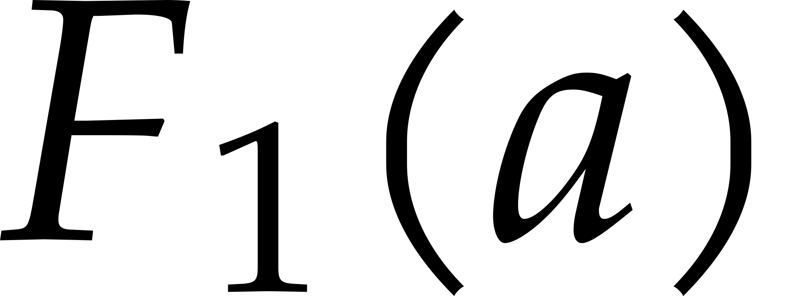 (a has the colour 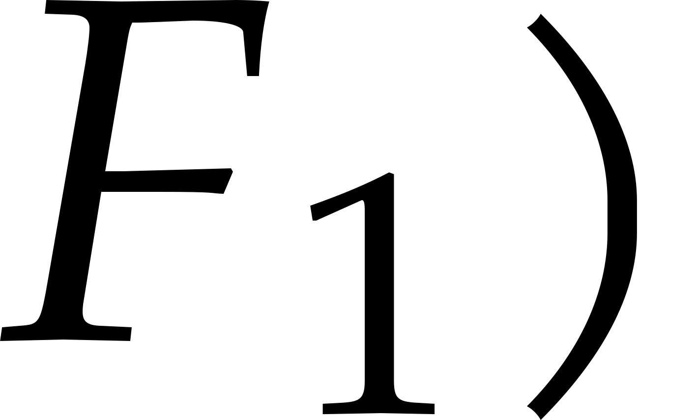 there follows 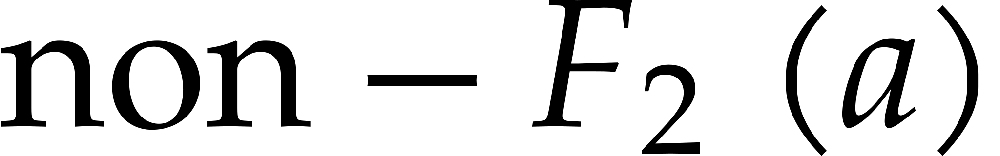, then the possibility of the second sentence must already have been foreseen in the grammar of the first (how else could we call  and  colours?).” “If the second sentence had, so to speak, come as a surprise to the first, it could never follow from it”. “The first sentence must acknowledge the other as its consequence. Or rather, _one_ grammar must then unite them both, and it must be the same as before the inference”. (It is very hard here not to tell fairy tales about what goes on in the symbolism, just as elsewhere it is hard not to tell fairy tales about what goes on psychologically. For everything is simple and familiar to everyone (and there is nothing new to invent). That is really what is outrageous about logic: that its extraordinary difficulty is due to there being nothing to construct, _but rather_ everything being already there and known.)

### [IX-69-2\[2\]](https://cdn.wittgensteinnachlass.com/2000px/webp/Ts-212/IX-69-2.webp)

25 “Any sentence that p does not recognize as its consequence is not its consequence”. <s> That is, it must also emerge from the complete grammar of the sentence p which sentence follows from it; and if a new sentence were now found that follows from p, then the sentence the sense of p would be changed. </s>

### [IX-69-3\[1\]](https://cdn.wittgensteinnachlass.com/2000px/webp/Ts-212/IX-69-3.webp)

25 It must _emerge_ from the grammar of the sentence – and from that alone – whether a sentence follows from it. No insight into a new sense can yield this; – only insight into the old sense can. – It is not possible to form a new sentence that follows from that sentence and that one could not have formed (albeit without knowing whether it was true or false) when that sentence was formed. If one discovered a new sense and this were to follow from that first sentence, then that sentence would not have changed its sense.

### [X-FCr\[1\]](https://cdn.wittgensteinnachlass.com/2000px/webp/Ts-212/X-FCr.webp)

_Generality_

### [X-70FCr\[1\]](https://cdn.wittgensteinnachlass.com/2000px/webp/Ts-212/X-70FCr.webp)

The sentence “the circle is situated in the square” in a certain sense independent of the specification of a particular position (in a certain sense it has nothing to do with it).

### [X-70-1\[1\]](https://cdn.wittgensteinnachlass.com/2000px/webp/Ts-212/X-70-1.webp)

3b I want to say: the general picture ❘ ⚬ ❘ has a different metric from the particular one.

### [X-70-2\[1\]](https://cdn.wittgensteinnachlass.com/2000px/webp/Ts-212/X-70-2.webp)

3b In the general sign “❘ ⚬ ❘” distances play as little part as they do in the sign “aRb”.

### [X-70-3\[1\]](https://cdn.wittgensteinnachlass.com/2000px/webp/Ts-212/X-70-3.webp)

3b How one can regard the drawing ❘ ⚬ ❘ as a representation of the “general case”. As it were, not in metric space, but in such a way that the distances from the circle to the straight lines _make no difference at all_. One then sees the picture as a _case_ belonging to a different system from the one it belongs to when one sees it as a representation of a particular position of the circle between the straight lines. Or rather: it is then part of a different calculus. Different rules hold for the variable than for its particular value.

### [X-70-4\[1\]](https://cdn.wittgensteinnachlass.com/2000px/webp/Ts-212/X-70-4.webp)

3b “How do you know he is in the room?” – “Because I put him in there and there is nowhere he can get out.” – So your knowledge of the general fact that he is somewhere in the room is also of the same multiplicity as this ground.

### [X-70-5\[1\]](https://cdn.wittgensteinnachlass.com/2000px/webp/Ts-212/X-70-5.webp)

3b Let us take the particular cases of the general state of affairs in which the cross is between the boundary marks:

 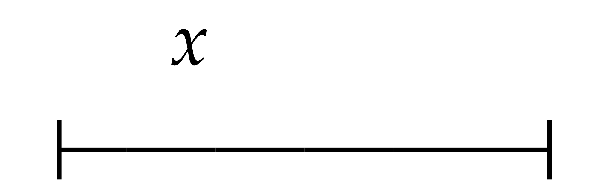 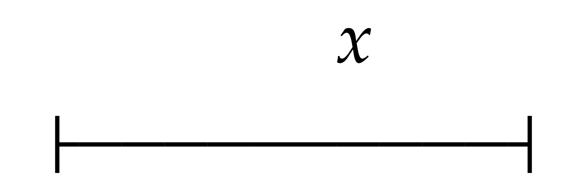 Each of these cases, for example, has a _particular_ individuality. Does this individuality enter in any way into the sense of the general sentence? Evidently not.

### [X-70-6\[1\]](https://cdn.wittgensteinnachlass.com/2000px/webp/Ts-212/X-70-6.webp)

3b But ‘lying between the line segments, or walls’ seems to us to be something simple, of which the various positions (whether the visual appearances, or the positions established by measurement) are quite independent. That is, when we speak of the individual (seen) positions, we seem to be speaking of something quite different from what is spoken of in the general sentence.

### [X-70-6\[2\]](https://cdn.wittgensteinnachlass.com/2000px/webp/Ts-212/X-70-6.webp)

3b Our designation of generality belongs to one calculus, and that disjunction exists in another. When we say that the cross lies between these marks, we have no disjunction ready to take the place of the general sentence.

### [X-70-7\[1\]](https://cdn.wittgensteinnachlass.com/2000px/webp/Ts-212/X-70-7.webp),[X-70-8\[1\]](https://cdn.wittgensteinnachlass.com/2000px/webp/Ts-212/X-70-8.webp)

4b When one considers general sentences of the kind “the circle is inside the square”, it keeps seeming as though giving the position within the square were _not a more precise specification_ of the statement that the circle lies _inside the square_ (at least as far as visual space is concerned), but rather as though “inside the square” were a complete specification which in itself could not be _described_ any more precisely. Just as specifying a material’s 4b colour does not specify its hardness any more precisely. – Now that is of course not how the specifications concerning the circle are related, and yet there is a reason for the feeling.

### [X-70-8\[2\]](https://cdn.wittgensteinnachlass.com/2000px/webp/Ts-212/X-70-8.webp)

What multiplicity of possible special cases the general sentence provides for must lie in the grammatical rules for its terms. What does not lie in the rules is not foreseen.

### [X-70-8\[3\]](https://cdn.wittgensteinnachlass.com/2000px/webp/Ts-212/X-70-8.webp)

4b  All these distributions could be different distorted pictures of the same state of affairs. (One should imagine that the two white strips and the black strip in the middle can be stretched.)

### [X-70-9\[1\]](https://cdn.wittgensteinnachlass.com/2000px/webp/Ts-212/X-70-9.webp),[X-70-10\[1\]](https://cdn.wittgensteinnachlass.com/2000px/webp/Ts-212/X-70-10.webp)

4b Is a, then, spoken of in (x)․fx, since fa follows from (x)․fx? In the sense of the general sentence whose verification 4b consists in an enumeration, yes.

### [X-70-11\[1\]](https://cdn.wittgensteinnachlass.com/2000px/webp/Ts-212/X-70-11.webp)

4b When I say “there is a black circle in the square”, it always seems to me as if here again I had something simple before me. As if I need not think of different possible positions or sizes of the circle. And yet one can say: if there is a circle in the square, it must be somewhere and of some size. But there can certainly be no question of my thinking in advance of _all_ the possible positions and sizes. – Rather, in the first sentence I seem to catch them, so to speak, through a sieve, so that “circle within the square” seems to correspond to _one_ impression for which the _where_ etc. does not yet come into consideration at all, as if it were (despite all appearances) something connected with that first _state of affairs_ only physically, not logically. The expression “sieve” comes from this: if, for instance, I look at a landscape through a glass that lets through only differences of darkness and brightness, but not differences of colour, one can call such a glass a sieve. Now if one imagines looking at the square through a glass that would let through only the difference “circle in the square, or not in the square”, but not a difference in the position or size of the circle, we could speak of a sieve here too.

### [X-70-12\[1\]](https://cdn.wittgensteinnachlass.com/2000px/webp/Ts-212/X-70-12.webp)

4b I want to say that in the sentence “a circle lies in the square” there is no question at all of the particular position. I do not then see the position in the picture; I disregard it. As if, say, the distances from the sides of the square could stretch and their lengths did not count. Indeed, can’t the spot actually move about within the quadrilateral? Isn’t that just a special case of _its_ being in the quadrilateral? Then it would not, after all, be the case that the spot must lie at a particular place in the quadrilateral if it is in it at all.

### [X-70-12\[2\]](https://cdn.wittgensteinnachlass.com/2000px/webp/Ts-212/X-70-12.webp)

4b I want to say that there seems to be a relation of the spot to the boundary that is independent of the distance. – As if I were using a geometry in which there is no distance, but there is an inside and an outside. Seen in this way, the pictures  and  are indeed the same too.

### [X-70-12\[3\]](https://cdn.wittgensteinnachlass.com/2000px/webp/Ts-212/X-70-12.webp),[X-70-12\[1\]](https://cdn.wittgensteinnachlass.com/2000px/webp/Ts-212/X-70-12.webp)

4b The sentence “the spot is in the square” as it were _itself_ merely keeps the spot within the square, that is, it restricts 4b the spot’s freedom only in this way and gives it full freedom within the square. The sentence then _forms_ a frame that restricts the spot’s freedom and leaves it free inside, that is, _has nothing to do_ with its position. – But for this the sentence (as it were a box in which the spot is shut up) must have the logical nature of this frame, and it does, for I could explain the sentence to someone and then set out those possibilities, regardless of whether such a sentence is true or not, hence independently _of a fact_.

### [X-70-14\[1\]](https://cdn.wittgensteinnachlass.com/2000px/webp/Ts-212/X-70-14.webp)

3b “Wherever the spot is in the quadrilateral …” means “if it is in the quadrilateral …” and here only the freedom (lack of constraint) within the quadrilateral is _meant_, not a multitude of positions.

### [X-70-14\[2\]](https://cdn.wittgensteinnachlass.com/2000px/webp/Ts-212/X-70-14.webp)

3b There is, of course, a logical similarity (_formal analogy_) between this freedom and the totality of possibilities, which is why one often uses the same words in both cases (“all”, “every”, etc.).

### [X-70-15\[1\]](https://cdn.wittgensteinnachlass.com/2000px/webp/Ts-212/X-70-15.webp)

3 “All levels of brightness below this one hurt my eyes”. Examine the kind of generality.

### [X-70-16\[1\]](https://cdn.wittgensteinnachlass.com/2000px/webp/Ts-212/X-70-16.webp)

3b, 3 “All points on this surface are white”. How do you verify that? – then I shall know what it means.

### [X-71FCr\[1\]](https://cdn.wittgensteinnachlass.com/2000px/webp/Ts-212/X-71FCr.webp)

The sentence “the circle lies in the square” not a disjunction of cases

### [X-71-1\[1\]](https://cdn.wittgensteinnachlass.com/2000px/webp/Ts-212/X-71-1.webp)

3b When I say the spot lies in the square, I know – and must know – that there are different possible positions for it. But also that I could not give a definite number for all such positions. I do not know in advance how many positions “I could distinguish”. – And an experiment on this does not teach me what I want to know here either. The obscurity surrounding the possibilities of position etc. is the _present_ logical situation. Just as dim lighting is also a particular kind of lighting.

### [X-71-2\[1\]](https://cdn.wittgensteinnachlass.com/2000px/webp/Ts-212/X-71-2.webp)

3b It is always as if one could not fully survey a logical form, since one does not know how many, or which, possible positions there are for the spot in the quadrilateral. On the other hand, one does know, since none of them surprises one when it occurs. <s> But that would be so with everything one sees. If I see a rare flower the like of which I have never seen, I am not surprised by its **possibility**, and yet I am surprised because I have never imagined anything like it. </s>

### [X-71-3\[1\]](https://cdn.wittgensteinnachlass.com/2000px/webp/Ts-212/X-71-3.webp)

3b Of course, “position of the circle in this square” is not a concept with the particular position an object falling under it. As though objects might be found which one ascertains are (also) positions of the circle in the square, but of which one previously knew nothing.

### [X-71-3\[2\]](https://cdn.wittgensteinnachlass.com/2000px/webp/Ts-212/X-71-3.webp)

3b The central position of the circle & other distinguished positions are, incidentally, entirely analogous to the primary colours in the colour scale. (This simile could usefully be taken further.)

### [X-71-4\[1\]](https://cdn.wittgensteinnachlass.com/2000px/webp/Ts-212/X-71-4.webp)

3b Space is, so to speak, _one_ possibility. It does not consist of several possibilities.

### [X-71-4\[2\]](https://cdn.wittgensteinnachlass.com/2000px/webp/Ts-212/X-71-4.webp)

3b So if I hear that the book is lying – somewhere – on the table, and then find it in a particular position, I cannot be surprised and say “ah, I didn’t know there was such a position”, and yet I had not foreseen this particular position, i.e. considered it in advance as a particular possibility. What surprises me is a physical possibility, not a logical one.

### [X-71-4\[3\]](https://cdn.wittgensteinnachlass.com/2000px/webp/Ts-212/X-71-4.webp)

3b But what is the difference between the case “the book is lying somewhere on the table” and _the one_ “the event will occur sometime in the future”? Evidently this: in the one case we know a sure method of verifying whether the book is lying on the table; in the other there is no analogous method. If, say, a certain event were to occur at one of the infinitely many bisections of a line segment, or rather; if it were to occur when we cut the segment at _one_ point (with no further specification) and stay at that point for a minute, then this specification is just as senseless as the one about the infinite future.

### [X-71-5\[1\]](https://cdn.wittgensteinnachlass.com/2000px/webp/Ts-212/X-71-5.webp)

<s> Generality (∃x)․fx & non-fa, (∃x)․fx & non-fa & non-fb & non-fc

“The cross is somewhere between the strokes, except in position a.” One might now ask: does such a continued subtraction of possibilities eventually produce a contradiction? </s>

### [X-71-6\[1\]](https://cdn.wittgensteinnachlass.com/2000px/webp/Ts-212/X-71-6.webp),[X-71-7\[1\]](https://cdn.wittgensteinnachlass.com/2000px/webp/Ts-212/X-71-7.webp)

3b Suppose I gave a disjunction of so many positions that it would be impossible for me to recognize a position as different 3b? from all those given; would the disjunction _now_ be the general proposition (∃x)․fx? Would it not be pedantic, so to speak, still to refuse to recognize the disjunction as the general proposition? Or is there an essential difference, and might the disjunction not be at all like the general proposition?

### [X-71-7\[2\]](https://cdn.wittgensteinnachlass.com/2000px/webp/Ts-212/X-71-7.webp)

3b What strikes us is that one sentence is so complicated, the other so simple. Or is the simple one just a shorthand for the more complicated one?

### [X-71-8\[1\]](https://cdn.wittgensteinnachlass.com/2000px/webp/Ts-212/X-71-8.webp)

What, then, is the criterion (for the general proposition) for the circle’s being in the square? Either nothing at all that has to do with a multiplicity of positions (or sizes, as the case may be), or else something that has to do with a finite number of such positions.

### [X-71-9\[1\]](https://cdn.wittgensteinnachlass.com/2000px/webp/Ts-212/X-71-9.webp)

3b If one says that the spot A is somewhere between the bounds B and C, is it not evidently possible to describe or depict a number of positions of A between B and C so that I see the succession of all these positions as a continuous transition? And then is not the disjunction of all these N positions precisely the proposition that A is somewhere between B and C? But what about these N pictures? It is clear that a picture and the one immediately after it must not be visually distinguishable, otherwise the transition is visually discontinuous. The positions whose succession I see as a continuous transition are not positions in visual space.

### [X-71-10\[1\]](https://cdn.wittgensteinnachlass.com/2000px/webp/Ts-212/X-71-10.webp)

3b How is the extension of the concept “lying between” determined? After all, which possibilities belong to this concept is supposed to be fixed in advance. It can be no surprise, as I say, that I call _that_ “lying between” too. Or: how can the rules for the expression “lying between” be given, seeing that I cannot enumerate the cases of lying between? Of course, that very point must be characteristic of the meaning of this expression.

### [X-71-10\[2\]](https://cdn.wittgensteinnachlass.com/2000px/webp/Ts-212/X-71-10.webp)

3b Nor, after all, would we try to explain the expression to someone by pointing to _all the particular cases_, but by pointing to one such case (or a few) and indicating somehow that the particular case does not matter.

### [X-71-10\[3\]](https://cdn.wittgensteinnachlass.com/2000px/webp/Ts-212/X-71-10.webp)

3b Enumerating positions is not only unnecessary; here such _an enumeration_ is out of the question in principle.

### [X-71-11\[1\]](https://cdn.wittgensteinnachlass.com/2000px/webp/Ts-212/X-71-11.webp)

3b To say “the circle lies either between the two straight lines or _here_” (where this ‘here’ is a place between the lines) evidently means only: “the circle lies between the two straight lines”, and the addition “or here” appears superfluous. One will say: the ‘here’ is already included in the ‘somewhere’. But that is curious, because it is not mentioned (_in it_).

### [X-71-11\[2\]](https://cdn.wittgensteinnachlass.com/2000px/webp/Ts-212/X-71-11.webp)

3b (28a) A particular difficulty lies in the words’ not seeming to say what the thought grasps, or: when the words do not say what the thought seems to grasp.

### [X-71-11\[3\]](https://cdn.wittgensteinnachlass.com/2000px/webp/Ts-212/X-71-11.webp)

3b (28a) As when we say “this proposition holds for all numbers” and believe that we have grasped all the numbers in the thought as though we had them all in a box like apples.

### [X-71-12\[1\]](https://cdn.wittgensteinnachlass.com/2000px/webp/Ts-212/X-71-12.webp)

3b But now one could ask: How can I (now) know in advance from which propositions this general proposition follows? If I cannot specify those propositions.

### [X-71-13\[1\]](https://cdn.wittgensteinnachlass.com/2000px/webp/Ts-212/X-71-13.webp)

3b, 25 But can one say: “one cannot say from which propositions this proposition follows”? That sounds like: one does not know. But of course it is not like that. And I can after all state propositions, and state them in advance, from which it follows. – “Only not _all_ of them”. – But that is just what means nothing.

### [X-71-13\[2\]](https://cdn.wittgensteinnachlass.com/2000px/webp/Ts-212/X-71-13.webp)

3b There are just the general proposition and particular propositions (not: the particular propositions). But the general proposition does not enumerate particular propositions. But what, then, characterizes it as general, and what shows that it does not simply encompass those particular propositions of which we speak in _this_ particular case?

### [X-71-13\[3\]](https://cdn.wittgensteinnachlass.com/2000px/webp/Ts-212/X-71-13.webp)

3b It cannot be characterized by its special cases; for however many one enumerates, it could always be confused with the product of the _cases_ cited. Its generality thus lies in a property (a grammatical property) of the variable.

### [X-72FCr\[1\]](https://cdn.wittgensteinnachlass.com/2000px/webp/Ts-212/X-72FCr.webp)

Inadequacy of Frege’s & Russell’s notation for generality.

### [X-72-1\[1\]](https://cdn.wittgensteinnachlass.com/2000px/webp/Ts-212/X-72-1.webp),[X-72-2\[1\]](https://cdn.wittgensteinnachlass.com/2000px/webp/Ts-212/X-72-2.webp)

46c, 3 The real difficulty, that is, lies in the concept of ‘(∃n) ’ and, generally, of ‘(∃x)’. Originally this notation comes from the expression in our word-language: “there is a … with such and such a property”. And what takes the place of the dots here is something like “book in my library”, or “thing (body) in this room”, “word in this letter”, etc. One is thinking here of objects one can go through _one by one_. By a process of sublimation so often _employed_, this form then became: “there is an object for which …”, and here too the objects of the world were originally conceived in strict analogy with the ‘objects’ in the room (namely the tables, chairs, books, etc.). Although it is quite clear that the grammar of this “(∃x). etc.” is in many cases quite different from what it is in the primitive case that serves as prototype. 46c, 3 The discrepancy between the original picture and what the notation is now supposed to be applied to becomes particularly glaring when a sentence “there are only two circles in this quadrilateral” is rendered in the form “there is no object that has the property of being a circle in this quadrilateral but being neither circle a nor circle b”, or “there are not three objects that have the property of being a circle in this quadrilateral”. The sentence “there are only two things that are circles in this quadrilateral” (formed by analogy with the sentence “there are only two people who have climbed this mountain”) sounds crazy; and rightly so. That is, nothing is gained by forcing the sentence “there are two circles in this quadrilateral” into that form; rather, it merely helps us overlook the fact that we have not _clarified_ the grammar of this sentence. At the same time, however, Russell’s notation lends an appearance of exactness here which makes some people believe that the problems have been solved by putting the sentence into Russell’s form. (This is just as dangerous as using the word “probable” without further investigation of how the word is used in this particular case. The word “probable” too is, for readily understandable reasons, associated with an idea of exactness.) In all the cases: “One of the four legs of this table won’t hold”, “there are English people with black hair”, “there is a spot on this wall”, “the two pots weigh the same”, “there are equally many words on both pages” – Russell’s notation uses “(∃ …) …”; and each time with a different grammar. So what I mean is that not much is gained by translating such a sentence from word-language into Russell’s notation.

### [X-72-3\[1\]](https://cdn.wittgensteinnachlass.com/2000px/webp/Ts-212/X-72-3.webp),[X-72-4\[1\]](https://cdn.wittgensteinnachlass.com/2000px/webp/Ts-212/X-72-4.webp)

3 Inadequacy of Frege’s and Russell’s notation for generality. It makes sense to say “write down any cardinal number”, but it is nonsense to say: “write down all cardinal numbers”. “There is a circle in the quadrilateral” ((∃x)․fx) makes sense, but not non (∃x).non fx: “there are all circles in the quadrilateral”. “There is a red circle on a background of a different colour” makes sense, but not “there is no background colour other than red on which there is no red circle”. “There is a black circle in this quadrilateral”: If this sentence has the form “(∃x).x is a black circle in the quadrilateral”, what is such a thing x that has the property of being a black circle (and so can also have the property of _not_ being a black circle)? Is it perhaps a place in the square? But then there is no sentence “ (x).x is a black …”. On the other hand, that sentence might mean “there is a spot in the square that is a black circle”. How does one verify this sentence? Well, one goes through the different spots in the square and examines them to see whether they are quite black and circular. But what kind of sentence is “There is no spot in the square”? For if the ‘x’ in ‘(∃x)’ _meant_ ‘spot in the square’ in the previous case, then there can indeed be a sentence “(∃x)․fx”, but no “(∃x)” or “non (∃x)”. Or I could ask again: What sort of thing is it that has (or does not have) the property of being a spot in the square? And if one can say “a spot is in the square”, does it 3 thereby also make sense to say “all spots are in the square”? Which _all_?

### [X-72-5\[1\]](https://cdn.wittgensteinnachlass.com/2000px/webp/Ts-212/X-72-5.webp)

3 Ordinary language says “there is a red circle in this quadrilateral”; Russell’s notation says “there is an object that is a red circle in this quadrilateral”. This form of expression is _evidently_ formed on the model: “there is a substance that glows in the dark”, “there is a circle in this quadrilateral that is red”. – Perhaps the very expression “there is” is misleading. “There is” really means something like “there is to be found”, or “among these circles there is one …”. So if one comes as close as possible to Russell’s way of expressing it and says “there is a place in this quadrilateral where there is a red circle”, what that really means is that among these places there is one at which etc.

### [X-72-5\[2\]](https://cdn.wittgensteinnachlass.com/2000px/webp/Ts-212/X-72-5.webp)

3 (The most difficult standpoint in logic is that of common sense. For it demands the whole truth in justification of its opinion and does not help us out with the slightest concession or construction.)

### [X-72-5\[3\]](https://cdn.wittgensteinnachlass.com/2000px/webp/Ts-212/X-72-5.webp)

3 The _right_ expression of this kind of generality is thus the one in ordinary language, “there is a circle in the quadrilateral”, which simply leaves the position of the circle _open_ (leaves it _undecided_). (“Undecided” is an apt expression, because the decision is simply _missing_.)

### [X-73FCr\[1\]](https://cdn.wittgensteinnachlass.com/2000px/webp/Ts-212/X-73FCr.webp)

Critique of my earlier conception of generality.

### [X-73-1\[1\]](https://cdn.wittgensteinnachlass.com/2000px/webp/Ts-212/X-73-1.webp)

3 My conception of the general proposition was that (∃x)․fx is a logical sum and that its summands are simply not enumerated _here_, though they could be enumerated (namely from the dictionary and grammar of the language). For if they could not be enumerated, it would not after all be a logical sum. (Perhaps a law for forming logical sums.)

### [X-73-2\[1\]](https://cdn.wittgensteinnachlass.com/2000px/webp/Ts-212/X-73-2.webp),[X-73-3\[1\]](https://cdn.wittgensteinnachlass.com/2000px/webp/Ts-212/X-73-3.webp)

3 The explanation of (∃x)․fx as a logical sum and of (x)․fx as a logical product cannot, of course, be maintained. It went together with a mistaken conception of logical analysis: I thought, for instance, that the logical product for a particular (x)․fx would turn up sooner or later. – It is of course right that (∃x)․fx somehow functions as a logical sum and (x)․fx as a product; indeed, in _one_ use of the words “all” and “some” my old explanation is right, namely – e.g. – in the case “all the primary colours are found in this picture” or “all the notes of the C major scale occur in this theme”. But in cases like “all human beings die before they reach the age of 200” my explanation does not hold. Now, that 3 (∃x)․fx functions as a logical sum is expressed by its following from fa and from fa ․⌵․ fb, hence in the rules: (∃x)․fx ․ & ․ fa = fa and (∃x)․fx : & : fa․⌵․fb = fa․⌵․fb. From these rules Russell’s fundamental laws fx ․⊃․ (∃z)․fz and fx․⌵․fy :⊃: (∃z)․fz then follow as tautologies.

### [X-73-4\[1\]](https://cdn.wittgensteinnachlass.com/2000px/webp/Ts-212/X-73-4.webp)

3 For (∃x)․fx, etc. we also need the rules: (∃x). fx ⌵ Fx = (∃x)․fx ․⌵․ (∃x).Fx,

(∃x,y)․ fx & Fy ․⌵․ (∃x)․fx ․ & ․ Fx = (∃x)․fx ․ & ․ (∃x).Fx.

Every such rule is an expression of the analogy between (∃x)․fx and a logical sum.

### [X-73-5\[1\]](https://cdn.wittgensteinnachlass.com/2000px/webp/Ts-212/X-73-5.webp),[X-73-6\[1\]](https://cdn.wittgensteinnachlass.com/2000px/webp/Ts-212/X-73-6.webp)

3 Incidentally, one really could introduce a notation for 3 (∃x)․fx in which one replaces it with a sign “fr ⌵ fs ⌵ ft ⌵ …” and would then be allowed to calculate with it as with a logical sum; but provision would have to be made for rules by which I can always convert this notation back into that of “(∃x)․fx”, and which thus distinguish the sign “fa ⌵ fb ⌵ fc ⌵ …” from that of a logical sum. The sole purpose of this notation would be to make it easier in certain cases to calculate with (∃x)․fx.

### [X-73-7\[1\]](https://cdn.wittgensteinnachlass.com/2000px/webp/Ts-212/X-73-7.webp),[X-73-8\[1\]](https://cdn.wittgensteinnachlass.com/2000px/webp/Ts-212/X-73-8.webp)

4a If I am right, there is no concept “pure colour”; the sentence “ A has a pure colour” simply means “ A is red, or yellow, or blue, or green”. “This hat belongs to either A or B or C” is not the same sentence as “this hat belongs to someone in this room”, even if in fact only A, B, C are in the room, for that has to be stated in addition. – There are two pure colours on this surface _means_: On this surface there are red and yellow, or red and blue, or red and green, or etc. Now if I cannot say “there are 4 pure colours”, the pure 4a colours and the number 4 are nevertheless connected somehow and that too must find expression somehow. – E.g. when I say “on this surface I see 4 colours: yellow, blue, red, green”.

### [X-73-9\[1\]](https://cdn.wittgensteinnachlass.com/2000px/webp/Ts-212/X-73-9.webp)

3 The notation for generality in our ordinary language captures the logical form much more superficially still than I formerly believed. In just this respect it is comparable to the subject–predicate form.

### [X-73-10\[1\]](https://cdn.wittgensteinnachlass.com/2000px/webp/Ts-212/X-73-10.webp)

3 Generality is as ambiguous as the subject–predicate form.

### [X-73-11\[1\]](https://cdn.wittgensteinnachlass.com/2000px/webp/Ts-212/X-73-11.webp),[X-73-12\[1\]](https://cdn.wittgensteinnachlass.com/2000px/webp/Ts-212/X-73-12.webp)

3 There are as many different generalities as there are different *kinds* of number.

### [X-73-12\[2\]](https://cdn.wittgensteinnachlass.com/2000px/webp/Ts-212/X-73-12.webp)

3 That is why it is no use employing the word “all” for clarification when one does not yet know its grammar in _this_ case.

### [X-74FCr\[1\]](https://cdn.wittgensteinnachlass.com/2000px/webp/Ts-212/X-74FCr.webp)

Explanation of generality by means of examples

### [X-74-1\[1\]](https://cdn.wittgensteinnachlass.com/2000px/webp/Ts-212/X-74-1.webp),[X-74-2\[1\]](https://cdn.wittgensteinnachlass.com/2000px/webp/Ts-212/X-74-2.webp)

32 (85) Let us imagine explaining the concept of a plant. We show someone several objects and say, these are plants. Then he in turn points to a further object and says “is that a plant too” and we reply “yes, that too”, and so on. I would once have said that he had now seen the concept ‘plant’ – that certain something in common – in what was shown, and that he sees the examples used in the explanation differently when he sees this very concept in them than when, say, he takes them to represent only this particular shape and colour. (Just as I also said that in the variable, if he understands it as such, he sees something that he does not see in the sign for the particular case.) But the idea of ‘seeing in it’ is taken from the case where, for example, I see the figure !!!!∣∣∣∣ ‘phrased’ in different ways. But then I really do see different figures, in a different sense, and what they have in common, apart from their similarity, is that they are caused by the same physical image. But this explanation cannot simply be applied to the case of understanding the variable or the examples of the concept ‘plant’. For supposing we really had seen something different in them than in plants shown merely for their own sake, the question is: can this(, or any other,) image warrant our 32, (85) using them as variables? So I could have shown someone the plants by way of explanation and given him a potion to make him see the examples in the particular way. (Just as it might be possible for someone under the influence of alcohol always to see a group !!!!∣∣∣∣ as !!!!∣∣∣∣.) And that would give an unambiguous explanation of the concept, and whoever understood it would have received _this_ image from the specimens shown and the accompanying gestures. But that is not how it is. – It may well be possible that someone who, for example, sees the sign !!!!!!∣∣∣∣∣∣ as a numeral for 6 sees it differently (sees something different in it) from someone who takes it only as a sign for “some”, because he will not direct his attention to the same thing; but what matters then is the system of rules that hold for these signs, and understanding will not essentially be a matter of seeing the sign in a certain way.

### [X-74-2\[2\]](https://cdn.wittgensteinnachlass.com/2000px/webp/Ts-212/X-74-2.webp)

32 So it would be possible to say ‘now I no longer see this as a rose, but only as a plant’! Or: “Now I see it only as a rose, no longer as _this_ rose”. “I now see the spot only as being in the square, no longer in a particular position”.

### [X-74-2\[3\]](https://cdn.wittgensteinnachlass.com/2000px/webp/Ts-212/X-74-2.webp)

32 The mental process of understanding simply does not interest us at all. (Any more than the mental process of intuition.)

### [X-74-2\[4\]](https://cdn.wittgensteinnachlass.com/2000px/webp/Ts-212/X-74-2.webp),[X-74-2\[1\]](https://cdn.wittgensteinnachlass.com/2000px/webp/Ts-212/X-74-2.webp)

32 “Surely there is no doubt at all that someone who understands the examples as arbitrary cases illustrating the concept understands something different from someone who takes them as a _definitely bounded_ enumeration”. Quite right, but then _what_ does the first understand that the 32 second does not? Well, he sees only _examples_ in the things shown, which are meant only to _bring out_ certain features, but he does not think that I am otherwise showing him these things for their own sake. –

### [X-74-3\[2\]](https://cdn.wittgensteinnachlass.com/2000px/webp/Ts-212/X-74-3.webp)

32 I should like to call one _enumeration_ ‘logically bounded’, the other ‘not logically bounded’.

### [X-74-3\[3\]](https://cdn.wittgensteinnachlass.com/2000px/webp/Ts-212/X-74-3.webp)

32 Yes, but is it really the case that he now sees only these features in the things? In a leaf, say, only what all leaves have in common? It would be as if he saw everything else “in blank”. A blank form, as it were, with the essential features printed on it in advance. (But the function “f(...)” is just such a form.)

### [X-74-3\[4\]](https://cdn.wittgensteinnachlass.com/2000px/webp/Ts-212/X-74-3.webp)

32 But what sort of process is it when someone shows me several different things as examples of a concept, to lead me to see what they have in common; and when I then look for it and really do see it? He can also _draw my attention_ to what they have in common. – But does he thereby bring it about that I _see_ the object differently? Perhaps he does, for I can in any case look _particularly_ at one of its parts, whereas otherwise I might have seen them all equally clearly. But this seeing is not understanding the concept. For we do not see something with an _empty_ argument place.

### [X-74-3\[6\]](https://cdn.wittgensteinnachlass.com/2000px/webp/Ts-212/X-74-3.webp),[X-74-4\[1\]](https://cdn.wittgensteinnachlass.com/2000px/webp/Ts-212/X-74-4.webp)

32 One might also ask: does someone who takes the sign “!!!∣∣∣ …” 32 as a sign for the concept of number (as opposed to “!!!∣∣∣”, which is meant to designate 3) see that first group of strokes differently from the second? But even if he sees it differently – more blurred, as it were, perhaps – does he thereby _see_ what is essential to the concept of number? Would that not mean that he would then actually have to be unable to distinguish “!!!∣∣∣ …” from “!!!!∣∣∣∣ …”? (If I had given him (that is), say, the potion that makes him see the _concept_.

### [X-74-4\[2\]](https://cdn.wittgensteinnachlass.com/2000px/webp/Ts-212/X-74-4.webp)

32 For when I say: by showing us several examples he brings it about that we see what they have in common and disregard the rest, what this really means is that the rest recedes into the background, thus becoming paler, as it were (and why should it not then disappear altogether), and only “what they have in common”, say the egg shape, remains in the foreground. But that is not how it is. Besides, the several examples would be only a technical aid, and once I had seen what I was meant to see, I could see it in _one_ example as well. (Just as ‘(∃x)․fx’ too contains only _one_ example.)

### [X-74-4\[3\]](https://cdn.wittgensteinnachlass.com/2000px/webp/Ts-212/X-74-4.webp)

32 So it is the rules that hold for the example that make it an example. –

### [X-74-4\[4\]](https://cdn.wittgensteinnachlass.com/2000px/webp/Ts-212/X-74-4.webp),[X-74-5\[1\]](https://cdn.wittgensteinnachlass.com/2000px/webp/Ts-212/X-74-5.webp)

32 But nowadays, at any rate, the mere word for the concept, without an illustration, is enough for someone to make himself understood by me (and the history of the understanding does not interest us), e.g. when someone says to me “shape an egg”; and surely I do not want to say that I see the concept of an egg before my mind’s eye when I understand this command (and the word “egg”). When we apply the concept ‘egg’ or ‘plant’, surely we do not first have a general image in mind, nor, 32 on hearing the word “plant”, an image of the particular object I then call a plant. Rather, I make the application spontaneously, so to speak. Nevertheless there is an application of which I would say: no, that is not what I meant by ‘plant’; or on the other hand “yes, I meant that too”. But does that mean that I had these images in mind and expressly rejected and admitted them in my mind? – And yet it looks that way when I say: “yes, I meant all of that and that and that, but not _that_”. But one might ask: well, did you foresee all these cases? and the answer would then be “yes”, or “no”, but I thought it should be something between this shape and that one”, or something of the sort. Most of the time, though, I drew no boundaries at all at that moment, and they emerge only by the indirect route of reflection. For example, I say “bring me another flower about this size” and he brings one and I say: yes, that is the sort I meant. I may then remember an image I had in mind, but it does not follow from this that the flower brought to me is also admissible. Rather, this is where I apply that very image. And this application had not been anticipated.

### [X-74-6\[1\]](https://cdn.wittgensteinnachlass.com/2000px/webp/Ts-212/X-74-6.webp)

1 7˙1 What interests us is only the _exact_ relation of the example to following

### [X-74-7\[1\]](https://cdn.wittgensteinnachlass.com/2000px/webp/Ts-212/X-74-7.webp)

1 7˙1 _49_ One calculates again from the example.

### [X-74-7\[2\]](https://cdn.wittgensteinnachlass.com/2000px/webp/Ts-212/X-74-7.webp)

1 7˙1 Examples are proper signs, not waste, not a means of influencing someone.

### [X-74-7\[3\]](https://cdn.wittgensteinnachlass.com/2000px/webp/Ts-212/X-74-7.webp)

1 7˙1 For all that interests us is the geometry of the mechanism. (that is to say, the grammar of its description.)

### [X-74-8\[1\]](https://cdn.wittgensteinnachlass.com/2000px/webp/Ts-212/X-74-8.webp),[X-74-9\[1\]](https://cdn.wittgensteinnachlass.com/2000px/webp/Ts-212/X-74-9.webp)

(25) But how is it expressed in our rules that the cases fx dealt with are not an _essentially closed_ class? – Presumably only through the generality of the general rule. – That they do not have _the same_ meaning for the calculus as a closed group of primitive signs (say, the names of the 6 primary colours). How else than through the rules laid down for them? – If in a game, say, I am allowed to borrow pieces of a certain kind in any number, (25') while others are present in a fixed number, or if the game is unlimited in time but limited in space, then we presumably have the same case. And the difference between the one kind of piece and the other must be laid down by the rules of the game. Of one kind it might say: you can take as many pieces of this kind as you like. – And I must not look for another, more exact expression of the rule.

### [X-74-9\[2\]](https://cdn.wittgensteinnachlass.com/2000px/webp/Ts-212/X-74-9.webp)

(25) That is, the expression for the unboundedness of the individual cases dealt with will (_of course_) be a general expression and cannot be any other kind of expression, not one in which the other individual cases, not dealt with, occur in a shadowy way.

### [X-74-9\[3\]](https://cdn.wittgensteinnachlass.com/2000px/webp/Ts-212/X-74-9.webp)

(25) It is clear that I do not recognize any logical sum as a definition of the sentence “the cross lies between the strokes”. And surely that says it all.

### [X-74-10\[1\]](https://cdn.wittgensteinnachlass.com/2000px/webp/Ts-212/X-74-10.webp),[X-74-11\[1\]](https://cdn.wittgensteinnachlass.com/2000px/webp/Ts-212/X-74-11.webp)

4 There is one thing I always want to say to explain the difference between the _cases_ adduced as examples of a concept and those that form a definite closed group in the grammar. If it is first explained to him, “a,b,c,d are books. – Now bring me a book”, and he brings one different from all those shown, it may nevertheless be said that he has acted quite correctly according to the rule laid down. But if one had said “a,b,c,d are my books. – Bring me one of my 4 books”, it would have been wrong to bring a _fifth_ at all, and the reply would have been: but I told you that a,b,c,d are my books. In the first case someone who brings an object other than those named in the rule does not act contrary to the rule; in the second case he would thereby be acting contrary to it. But if you named only a,b,c,d in the command, yet regarded the action f(e) as complying with it, does that not mean that by F(a,b,c,d …) you meant F(a,b,c,d,e) after all? Or how do these commands differ if the very same action complies with them? – Yes, but f(g) would also have accorded with the command, not only f(e). – Fine, then what you meant by the first command was: F(a,b,c,d,e,g) and so on. Whatever you bring me, I could have included it in a disjunction. So if, from all the actually _used cases, we construct_ a disjunction, how would it differ syntactically from the general proposition? For we must not now say: in that the general proposition is also _made true_ by r (which is not in the disjunction). For this does not distinguish the general proposition from a disjunction that contains r. (And so any other similar answer is impossible too.) It will, however, make sense to say: F(a,b,c,d,e) is the disjunction of all the cases we actually use, but _other cases_ too (none is mentioned, of course) make the general proposition “F(a,b,c,d, …)” true. Whereas of course one cannot substitute the general proposition for F(a,b,c,d,e) here.

### [X-74-11\[2\]](https://cdn.wittgensteinnachlass.com/2000px/webp/Ts-212/X-74-11.webp)

Incidentally, what is important here is precisely that the parenthesis in the preceding remark, “and so any other similar answer is impossible too”, is nonsense, because one can indeed give different particular cases as examples of a generality, but not different variables, since the variables r,s,t do not differ in meaning.

### [X-74-12\[1\]](https://cdn.wittgensteinnachlass.com/2000px/webp/Ts-212/X-74-12.webp),[X-74-13\[1\]](https://cdn.wittgensteinnachlass.com/2000px/webp/Ts-212/X-74-13.webp)

4 One could not then, of course, say that in doing f(d) we obey F(∃) differently from the way we obey a disjunction in which f(d) occurs, for F(∃) = F(∃) ⌵ f(d). Someone given the command “fetch me any plant, or this one” (of which he is given a picture) will calmly put the picture aside and say to himself “since any plant will do, this picture is no concern of mine”. By contrast, we must not simply put the picture aside if it was given to us with five others and the command was to bring one of these six plants. (So what matters is _which_ disjunction the particular command occurs in.) And one will act differently on the command “f(a) ⌵ f(b) ⌵ f(c)” than on the command “f(∃)” ( = f(∃) ⌵ f(c)) even if one does f(c) each time. – The picture f(c) goes under in f(∃). (And it is no help to us to be sitting in a boat if we and the boat are both under water and sinking.) One would like to say (to us): if you do f(c) in response to the command “f(∃)”, then f(c) could also have been expressly permitted, and how would the general command then have differed from a disjunction? – But in the﹖ disjunction with the general proposition you could not have _relied_ on that permission at all﹖. Is it then the case that the command “bring me a flower” can never be replaced by a command of the form “bring me a or b or c”, but must always be “bring me a or b or c, _or another flower_”? 4 But why does the general proposition make itself out to be so indefinite when I could, after all, have described in advance every case that actually occurs?

### [X-74-13\[2\]](https://cdn.wittgensteinnachlass.com/2000px/webp/Ts-212/X-74-13.webp)

3b But even this does not yet seem to me to get at the most important point in this _matter_. Because what matters, I believe, is not really the infinity of the possibilities but a kind of indefiniteness. Indeed, if asked how many possible ways there were for a circle in the visual field to lie within a particular quadrilateral, I could neither name a finite number nor say there were infinitely many (as in the Euclidean plane). Rather, though we never reach an end here, the series is not endless in the sense of [1, x, x + 1]. Rather, no end we reach is essentially the end. That is, I could always say: I do not see why these should be all the possibilities. – And presumably that means it is senseless to speak of “all the possibilities”. So the concepts ‘plant’ and ‘egg’ are _quite untouched_ by the enumeration.

### [X-74-14\[1\]](https://cdn.wittgensteinnachlass.com/2000px/webp/Ts-212/X-74-14.webp)

4 Even if we say we could always have foreseen the particular way of obeying the command, fa, as a possibility, in reality we never did. – But even if I foresee the possibility fa and expressly include it in my command, it is lost beside the general proposition, precisely because it is from the general proposition that I see that this particular case is permitted, and not simply from the fact that it is laid down in the command as permitted. For if the general proposition is there, adding the particular case is of no further use to me (i.e. it does not make the command more explicit). For it is only from the general proposition that I derive the justification for putting this particular case beside it. One might think, you see, and this is what my whole argument is aimed at, that adding the particular case does away with the – as it were blurred – generality of the proposition. One might say “now we no longer need it, since we have the definite case here”. Yes, but if I grant that I take the particular case and _put it here_ because it accords with the general proposition! Or that I recognize, after all, that fa is a particular case of f∃! For now I cannot say: that just proves that f∃ is a disjunction of which fa is one term. For if that is so, it must be possible to specify this disjunction. f∃ must then be defined as a disjunction. Such a definition could readily be given, but it would not correspond to the use of f∃ we have in mind. Not that the disjunction always leaves something out; rather, it does not touch what is essential to generality at all; indeed, if one adds it to the general proposition, it derives its justification from that proposition in the first place.

### [X-74-15\[1\]](https://cdn.wittgensteinnachlass.com/2000px/webp/Ts-212/X-74-15.webp),[X-74-15\[2\]](https://cdn.wittgensteinnachlass.com/2000px/webp/Ts-212/X-74-15.webp),[X-74-16\[1\]](https://cdn.wittgensteinnachlass.com/2000px/webp/Ts-212/X-74-16r.webp)

4 First I give the command f∃; he obeys the command and does fa. Now I think I could have given him the command “f∃⌵ fa” straight away. (For I already knew that doing fa was obeying the command f∃, and commanding him to do f∃⌵ fa amounted to the same thing.) And in obeying he would then have acted on the disjunction “do something or fa”. And if he obeys the command by doing fa, is it not immaterial what stands in disjunction with fa? If he does fa in any case, the command has been obeyed, whatever the alternative. 4 I should also like to say: in grammar nothing comes afterwards, there is no determination _after_ another, but everything is there at once. To that extent I cannot say (either) that I first gave the command f∃ and only then realized that fa is a case of f∃; in any case, though, my command was and remained f∃, and I added fa _knowing_ that fa accords with f∃. And this determination that fa accords with f∃ presupposes the sense of the proposition f∃, if it is retained as independent at all and not declared to be replaceable by a disjunction. And my remark “in any case, though, my command was and remained f∃ and so on” meant only that I had _not_ in fact _replaced_ the general command with a disjunction. 4 Now one can imagine that I give a command p ⌵ fa and the other person does not clearly understand the first part, but does understand that the command runs “… ⌵ fa”. He could then do fa and say “I know for certain that I have obeyed the command, even if I did not understand the first part”. That is how I imagine it when I say that the other alternative does not matter. But then he has not obeyed the command _given_, but taken it as “fa!”. One might ask: has someone who does fa in response to the command “f∃⌵ fa” obeyed the command because (i.e. insofar as) 4 the command is of the form x ⌵ fa, or because f∃⌵ fa = f∃? Whoever understands f∃, and so knows that f∃⌵ fa = f∃, obeys f∃ by doing fa even if I write it as “f∃⌵ fa”, because he sees _all the same_ that fa is a case of f∃. – And now one can object to us: if he sees that fa is a case of f∃, that surely means that fa is contained disjunctively in f∃, and therefore that f∃ is defined _with the help_ of fa! And – he must now go on to say – the remaining parts of the disjunction are no concern of mine if the terms I see are all _I need just now_. “In explaining ‘that fa is a case of f∃’ you have said no more than that fa occurs in f∃, along with other terms.” – But that is precisely what we do not mean. And it is not as if by our determination we had given an _incomplete definition_ of f∃. For then a complete definition would be _possible_. And it would be the disjunction after which the appended “⌵ f∃” would be, as it were, ridiculous, since only the cases _mentioned_ would be of any account to us. But as we understand f∃, the determination that fa is a case of f∃ is not an imperfect definition, but no definition of f∃ at all. So I come no closer to the sense of f∃ by enlarging the disjunction of cases; the disjunction of cases ⌵ f∃ is indeed equal to f∃, but is never equal to the disjunction of cases; it is a quite different proposition.

### [X-74-16r\[1\]](https://cdn.wittgensteinnachlass.com/2000px/webp/Ts-212/X-74-16r.webp)

4 There is no roundabout route by which what is said about an _enumeration_ of individual cases can yield the explanation of generality.

### [X-74-16v\[1\]](https://cdn.wittgensteinnachlass.com/2000px/webp/Ts-212/X-74-16v.webp)

45 “Now” simply works differently …

### [X-74-17\[1\]](https://cdn.wittgensteinnachlass.com/2000px/webp/Ts-212/X-74-17.webp)

3 But can I specify the rules of following in this case? For how do I know that it is from fa that (∃x)․fx follows? after all, I cannot specify _all_ the propositions from which it follows. – But that is not necessary at all; if (∃x)․fx follows from fa, then _that_ at any rate could be known before any particular experience, and it was possible to specify it in the grammar.

### [X-74-17\[2\]](https://cdn.wittgensteinnachlass.com/2000px/webp/Ts-212/X-74-17.webp)

3, 25 I said “it was possible to know before any experience that (∃x)․fx follows from fa and to specify it in the grammar”. But it should have been: ‘(∃x)․fx follows from fa’ is not a proposition (empirical proposition) of the language to which ‘(∃x)․fx’ and ‘fa’ belong, but a rule laid down in its grammar.

### [X-75FCr\[1\]](https://cdn.wittgensteinnachlass.com/2000px/webp/Ts-212/X-75FCr.webp)

_Rule for forming a series._

_**“and so on”**_

### [X-75-1\[1\]](https://cdn.wittgensteinnachlass.com/2000px/webp/Ts-212/X-75-1.webp)

3a One can no doubt lay down a rule for the use of the variable, and it is no pleonasm that in doing so we use precisely this kind of variable. For if we did not need it, the variable would after all be defined by the rules. And we are not assuming that it can be defined, or: that it must be defined (for the definitions do come to an end somewhere).

### [X-75-1\[2\]](https://cdn.wittgensteinnachlass.com/2000px/webp/Ts-212/X-75-1.webp)

3a That means (only) that – e.g. – the variable “x²” is not an abbreviation (say, for a logical sum), and that in our thought, too, there is only a sign of this multiplicity.

### [X-75-2\[3\]](https://cdn.wittgensteinnachlass.com/2000px/webp/Ts-212/X-75-2.webp)

3a For suppose I had enumerated 7 cases and said “but their logical sum is not the general proposition”; that is not enough, and I want to say in addition that no other _number_ of cases yields the general proposition either. But in this addition I now seem once again to be _carrying out_ an enumeration, albeit not actually, but in a shadowy sort of way. But that is not how it is, for the words that occur in the addition are quite different from the number words.

### [X-75-2\[4\]](https://cdn.wittgensteinnachlass.com/2000px/webp/Ts-212/X-75-2.webp)

3a “But how am I to forbid _a_ number word from being substituted at such and such a place? After all, I cannot foresee which number word someone will want to substitute, _so as to forbid it_.” – You can forbid it when it comes up. – But then we are already speaking, generally, of the concept of number!

### [X-75-3\[1\]](https://cdn.wittgensteinnachlass.com/2000px/webp/Ts-212/X-75-3.webp)

32 But what makes a sign an expression of infinity? What gives it the peculiar character of what we call infinite? I believe it is rather like the sign for an enormous number. For what is characteristic of the infinite, as it is conceived in this way, is its enormous magnitude.

### [X-75-4\[1\]](https://cdn.wittgensteinnachlass.com/2000px/webp/Ts-212/X-75-4.webp)

3a, 32 But there is no such thing as an enumeration that is nevertheless not an enumeration. A generality that enumerates in a hazy sort of way, but not actually and up to a definite _limit_.

### [X-75-4\[2\]](https://cdn.wittgensteinnachlass.com/2000px/webp/Ts-212/X-75-4.webp)

3a, 32 The dots in “1 + 1 + 1 + 1 …” are likewise just the four dots. A sign for which it must be possible to specify certain rules. (Namely the same ones as for the sign “etc. ad inf.”) This sign does imitate an enumeration in a certain way, but it is not an enumeration. And that presumably means that the rules that hold for it agree up to a point with those that hold for an enumeration, but do not agree entirely.

### [X-75-4\[3\]](https://cdn.wittgensteinnachlass.com/2000px/webp/Ts-212/X-75-4.webp)

3a, 32 There is nothing midway between a definite enumeration and the variable.

### [X-75-5\[2\]](https://cdn.wittgensteinnachlass.com/2000px/webp/Ts-212/X-75-5.webp)

32 Of course one has written down only the numbers up to a certain highest one – say 10¹⁰. Now what does the _possibility_ of writing down numbers one has not yet written down consist in? How strange this feeling, as if they were somehow all there already! (Frege said that in a certain sense a construction line is there even before it is drawn.)

### [X-75-5\[3\]](https://cdn.wittgensteinnachlass.com/2000px/webp/Ts-212/X-75-5.webp)

32 Here the difficulty is to resist the thought that possibility is a kind of shadowy existence.

### [X-75-5\[4\]](https://cdn.wittgensteinnachlass.com/2000px/webp/Ts-212/X-75-5.webp)

32 In the rules for the variable a there can occur a variable b as well as particular numerals; but no totality of numbers either.

### [X-75-5\[5\]](https://cdn.wittgensteinnachlass.com/2000px/webp/Ts-212/X-75-5.webp)

32 But now it seems as if something were thereby being (_out of logic_) _denied away_. Perhaps precisely the generality; or what the dots indicate. The unfinished (loose, extensible) character of the series. And of course we must not and cannot deny anything away. So where does this indeterminacy find expression? Perhaps like this: when we list numbers that we may substitute for the variable a, we do not say of any of them that it is the last, or the highest.

### [X-75-5\[6\]](https://cdn.wittgensteinnachlass.com/2000px/webp/Ts-212/X-75-5.webp)

32 But now if, after an explanation of a method of calculation, someone were to ask us: “and is 103 the last sign I can use, then?” what should we answer? “No, it is not the last”, or “there is no last one”? – But must I not ask him in return: “And if it is not the last, what would come next?” And if he then says “104”, I should have to say: Quite right, you can continue the series yourself.

### [X-75-6\[1\]](https://cdn.wittgensteinnachlass.com/2000px/webp/Ts-212/X-75-6.webp)

32 I cannot speak of an end to possibility at all.

### [X-75-6\[2\]](https://cdn.wittgensteinnachlass.com/2000px/webp/Ts-212/X-75-6.webp)

32 (It is only chatter that one must guard against in philosophy. But a rule that can be applied in practice is always in order.)

### [X-75-6\[3\]](https://cdn.wittgensteinnachlass.com/2000px/webp/Ts-212/X-75-6.webp)

It is clear that one can follow a rule of the kind [a, x, x + 1]; I mean, without already being able to write down the series in advance, but by actually going by the formation rule. It is then just as if I began a series with, say, the number 1 and said: “now add 7 to it, multiply by 5 and take the square root, and apply this composite operation to the result over and over again”. (That would be the rule 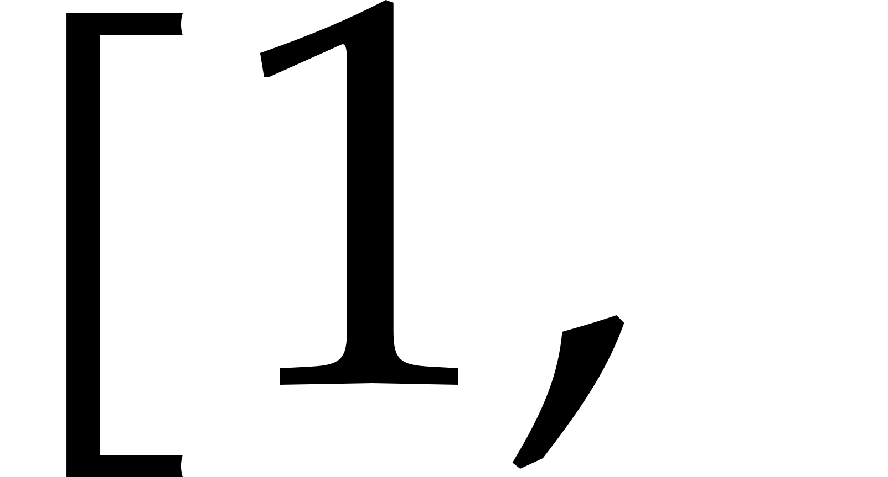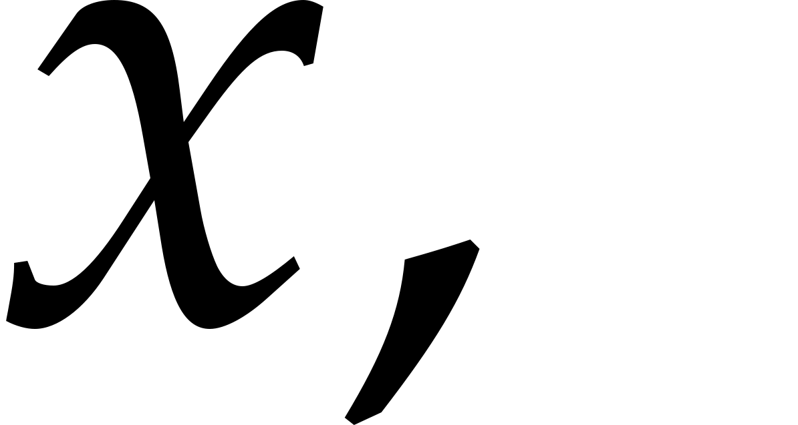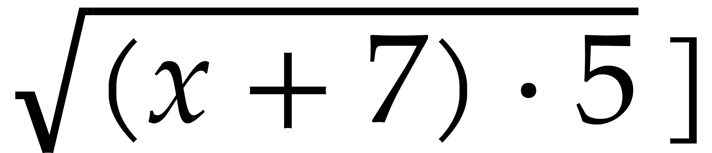.)

### [X-75-7\[1\]](https://cdn.wittgensteinnachlass.com/2000px/webp/Ts-212/X-75-7.webp)

32 After all, the word “etc.” is nothing other than the _word_ “_etc._”, (i.e. again a sign of the calculus, which can do no more than have meaning through the rules that _hold_ for it. Which can _say_ no more than it shows.) That is, there is no secret power in the word “etc.” by virtue of which the series is now continued without being continued.

### [X-75-8\[1\]](https://cdn.wittgensteinnachlass.com/2000px/webp/Ts-212/X-75-8.webp)

32 Probably not, one will say, but it does have the meaning of _infinite continuation_.

### [X-75-9\[1\]](https://cdn.wittgensteinnachlass.com/2000px/webp/Ts-212/X-75-9.webp)

32 But now one might ask: How is it that someone who now applies the general rule to a _further_ number is following only _this_ rule? That no further rule was needed to allow him to apply the general one to this case too; and yet this case was not mentioned in the (_general_) rule.

### [X-75-9\[2\]](https://cdn.wittgensteinnachlass.com/2000px/webp/Ts-212/X-75-9.webp)

32 67a So what surprises us is that we cannot bridge this gulf between the individual numbers and the general proposition.

### [X-75-10\[1\]](https://cdn.wittgensteinnachlass.com/2000px/webp/Ts-212/X-75-10.webp)

32 “Can one imagine an empty space?” (Curiously enough, this question belongs here.)

### [X-75-10\[2\]](https://cdn.wittgensteinnachlass.com/2000px/webp/Ts-212/X-75-10.webp)

32 It is one of the most deeply rooted errors of philosophy: possibility as a shadow of reality. But on the other hand it cannot be an error, and it is not one if one calls the proposition this shadow.

### [X-75-11\[1\]](https://cdn.wittgensteinnachlass.com/2000px/webp/Ts-212/X-75-11.webp)

32 The danger here, of course, is again that of falling into a _positivism_, namely one that deserves a name of its own and therefore _of course_ must be an error. For we must have no tendency at all, no particular conception of things, but must acknowledge everything anyone has ever said about them, except in so far as he himself had a particular conception or theory.

### [X-75-11\[2\]](https://cdn.wittgensteinnachlass.com/2000px/webp/Ts-212/X-75-11.webp)

32 For the sign “etc.”, or a corresponding sign, is presumably essential for the designation of endlessness. Through the rules that hold for such a sign, of course. That is, we can no doubt distinguish the segment of a series “1, 1 + 1, 1 + 1 + 1” from the series “1, 1 + 1, 1 + 1 + 1, u.s.w.”. And the last sign and its use are just as essential to the calculus as _any one of the preceding signs_.

### [X-75-11\[3\]](https://cdn.wittgensteinnachlass.com/2000px/webp/Ts-212/X-75-11.webp)

32 Now what troubles me is that “etc.” apparently has to occur in the rules for the sign “etc.” too. E.g. 1, 1 + 1, u.s.w. = 1, 1 + 1, 1 + 1 + 1, u.s.w. _etc._

### [X-75-11\[4\]](https://cdn.wittgensteinnachlass.com/2000px/webp/Ts-212/X-75-11.webp)

32 But do we not have here the old insight that we can describe language only from the outside? That we must therefore not expect a description of language to take us to depths other _than those language itself reveals_: For we describe language by means of language.

### [X-75-11\[5\]](https://cdn.wittgensteinnachlass.com/2000px/webp/Ts-212/X-75-11.webp)

32 We could say: There is really no reason to fear that we use the word “etc.” in a way that goes beyond the finite.

### [X-75-11\[6\]](https://cdn.wittgensteinnachlass.com/2000px/webp/Ts-212/X-75-11.webp),[X-75-12\[1\]](https://cdn.wittgensteinnachlass.com/2000px/webp/Ts-212/X-75-12.webp)

32 Besides, the part of the grammar of “etc.” that is characteristic of it cannot consist in rules for combining “etc.” with individual 32 numerals (not: “_the_ individual numerals”) – for these rules in turn give an arbitrary segment of a series – but in rules for combining “etc.” with “etc.”.

### [X-75-13\[1\]](https://cdn.wittgensteinnachlass.com/2000px/webp/Ts-212/X-75-13.webp),[X-75-14\[1\]](https://cdn.wittgensteinnachlass.com/2000px/webp/Ts-212/X-75-14.webp)

32 The possibility of listing still further numbers. The difficulty seems to us to be that the numbers I have actually 32 listed are by no means essential and nothing indicates that they are an _arbitrary_ collection: _the ones among all the numbers that happen to have been written down_. (As if I had all the pieces of a game in a box and, on the table beside it, a chance selection from the box. Or as if some of the digits had been _traced over_ in ink, while all of them had, as it were, already been faintly drawn in.) But that apart from the ones we happen to have used, we have only the general form. Incidentally, do we not have here – odd as it sounds – the difference between numerals and numbers?

### [X-75-15\[2\]](https://cdn.wittgensteinnachlass.com/2000px/webp/Ts-212/X-75-15.webp)

32 If, for example, I say “I call everything that results from 1 by the continued addition of 1 ‘cardinal numbers’”, the word “continued” does not stand for a hazy continuation of 1, 1 + 1, 1 + 1 + 1; rather, the sign “1, 1 + 1, 1 + 1 + 1, …” too is to be taken quite exactly; as distinct from “1, 1 + 1, 1 + 1 + 1”, it is subject to other definite rules and is not a substitute for a series “that cannot be written down”.

### [X-75-15\[3\]](https://cdn.wittgensteinnachlass.com/2000px/webp/Ts-212/X-75-15.webp)

32 That is: one also _calculates_ with the sign “1, 1 + 1, 1 + 1 + 1, …” as with (the) numerals, only according to different rules.

### [X-75-15\[4\]](https://cdn.wittgensteinnachlass.com/2000px/webp/Ts-212/X-75-15.webp)

32 But what is it, then, that one imagines? What mistake is one making? What does one take the sign “1, 1 + 1, …” for? That is: where does what one thinks one sees in this sign _actually_ occur? Perhaps when I say “he counted 1,2,3,4 and so on up to 1000”? where it would also be possible actually to write down all the numbers.

### [X-75-15\[5\]](https://cdn.wittgensteinnachlass.com/2000px/webp/Ts-212/X-75-15.webp),[X-75-16\[1\]](https://cdn.wittgensteinnachlass.com/2000px/webp/Ts-212/X-75-16.webp)

32 What does one _see_ “1, 1 + 1, 1 + 1 + 1, …” as, then? As an inexact form of expression. The little dots are like further numerals, only indistinct. As if one stopped writing down numerals because one cannot write them all down anyway, but as if they were indeed there, so to speak, in a box. Or perhaps also as when I sing only the first notes of a tune distinctly and merely hint at the rest and let it trail off into nothing. (Or when, in writing a word, one writes only a few letters distinctly and ends with an unarticulated 32 stroke.) _Where a ‘distinct’ would then correspond to the ‘indistinct’_.

### [X-75-17\[1\]](https://cdn.wittgensteinnachlass.com/2000px/webp/Ts-212/X-75-17.webp)

32 I once said that there could not be numbers _and_ the concept of number. And that is right if it means that the variable does not stand to a number as the concept apple stands to an apple (or the concept sword to Nothung). On the other hand, _the numerical variable is not a numeral_.

### [X-75-18\[1\]](https://cdn.wittgensteinnachlass.com/2000px/webp/Ts-212/X-75-18.webp)

32 But I also wanted to say that the concept of number could not be (_given_) independently of the numbers, and that is not true. Rather, the numerical variable is independent of individual numbers in the sense that there is indeed a calculus with a class of our numerals and without the general numerical variable. Of course, not all the rules that hold for our numerals then hold for these numerals, but they still correspond to ours as the pieces in draughts correspond to those in losing draughts.

### [X-75-19\[1\]](https://cdn.wittgensteinnachlass.com/2000px/webp/Ts-212/X-75-19.webp)

<s> 6a Generality in arithmetic is represented by induction. Induction is the expression of arithmetical generality. </s>

### [X-75-19\[2\]](https://cdn.wittgensteinnachlass.com/2000px/webp/Ts-212/X-75-19.webp)

6a, 14 What I resist is the view that an infinite series of numbers is something given to us, about which there are then particular numerical propositions and also general propositions about all the numbers in the series. So that the arithmetical calculus would not be complete if it did not also contain the general propositions about the cardinal numbers, namely general equations of the kind a + (b + c) = (a + b) + c. Whereas already  belongs to a different calculus from 1:3 = 0,3. And so a general rule for signs (e.g. a recursive definition) that holds for 1, (1) + 1, ((1) + 1) + 1, (((1) + 1) + 1) + 1, u.s.w. is something different from a particular definition. And the general rule adds something new to the numerical calculus, without which it would have been just as complete as the arithmetic of the number series 1, 2, 3, 4, 5.

### [X-75-20\[1\]](https://cdn.wittgensteinnachlass.com/2000px/webp/Ts-212/X-75-20.webp)

32, 46 There is also the question where exactly the concept of number (or the concept of cardinal number) is indispensable. Number, in contrast to what?

[1, x, x + 1] presumably in contrast to [5, x, √x] etc. – For if I actually introduce such a sign (as “[1, x, x + 1]”) – and do not just drag it around as a luxury, then I must also do something with it, i.e. use it in a calculus, and then it loses its supremacy and enters a system of signs on a par with it.

### [X-75-20\[2\]](https://cdn.wittgensteinnachlass.com/2000px/webp/Ts-212/X-75-20.webp)

One might say: but surely ‘cardinal number’ contrasts with ‘rational number’, ‘real number’, etc. But this difference is a difference in the rules (in the rules of the games that hold for them) – not one of position on the chessboard – not a difference for which one needs different words _on a par_ in the same calculus.

### [X-75-21\[1\]](https://cdn.wittgensteinnachlass.com/2000px/webp/Ts-212/X-75-21.webp)

(14) 53a One says “this proposition has been proved for all cardinal numbers”. But just look at how the concept of cardinal number enters the proof. Only in so far as the proof speaks of 1 and the operation x + 1 – but not in contrast to something that would correspond to the rational numbers. So if one describes the proof in prose with the aid of the concept-word ‘cardinal number’, we can presumably see … that no _concept_ corresponds to this word.

### [X-75-22\[1\]](https://cdn.wittgensteinnachlass.com/2000px/webp/Ts-212/X-75-22.webp)

53a The expressions “the cardinal numbers”, “the real numbers” are extraordinarily misleading, except where they are used as part of a specification, as in: “the cardinal numbers from 1 to 100”, etc. There are no “the cardinal numbers”, but only “cardinal numbers” and the concept, the form, ‘cardinal number’. Now one says: “the number of cardinal numbers is smaller than that of the real numbers” and imagines that one could, say, write the two series side by side (if we were not weak human beings) and that one would then end in the endless, while the other would run on beyond it into the Actually-Infinite. But that is all nonsense. If there can be talk of a relation for which one can by analogy use the terms “greater” and “smaller”, it can only be between the forms ‘cardinal number’ and ‘real number’. I find out what a series is by having it explained to me, and only to the extent that it is explained. A finite series was explained to me by examples of the kind 1, 2, 3, 4, an endless one by signs of the kind “1, 2, 3, 4, u.s.w.” or “1, 2, 3, 4 …”.

### [X-75-23\[1\]](https://cdn.wittgensteinnachlass.com/2000px/webp/Ts-212/X-75-23.webp)

32 [see law] “It is important that I can understand (see) a rule of projection without having it before me in a general notation. I can gather a general rule from the series 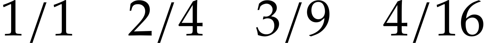 – of course any number of other ones too, _but still one definite rule as well_, and that means that for me this series was somehow the expression of this one rule.”

### [X-75-24\[1\]](https://cdn.wittgensteinnachlass.com/2000px/webp/Ts-212/X-75-24.webp)

32, 66b If one has understood the law for forming a series “intuitively”, e.g. the series m, so that one is thus able to form any 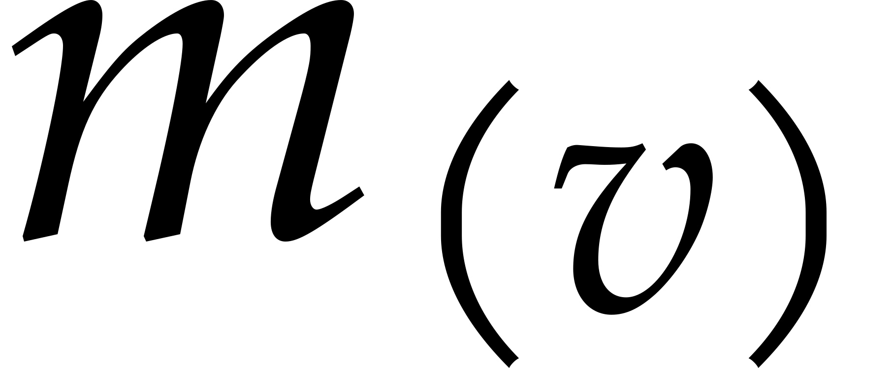, then one has understood the law of formation _completely_, that is, as well as an algebraic representation, say, could enable one to understand it. That is, one cannot come to understand it any better through such a representation. And so this representation is not any _more rigorous_ _in that respect_ either. Though of course it may be easier to remember.

### [X-75-25\[1\]](https://cdn.wittgensteinnachlass.com/2000px/webp/Ts-212/X-75-25.webp)

32 One is inclined to believe that the notation that _represents_ a series by writing down a few terms with the sign “etc.” is essentially inexact, in contrast to specifying the general term. In saying this one forgets that the specification of the general term refers to a basic series that cannot in turn be described by a general term. Thus 2n + 1 is the general term of the odd numbers _if_ n runs through the cardinal numbers, but it would be nonsense to say that n was the general term of the series of cardinal numbers. If one wants to explain this series, one cannot do so by specifying the “general term n”, but of course only by an explanation of the kind 1, 1 + 1, 1 + 1 + 1, u.s.w.. And of course there is no essential difference between this series and the series: 1, 1 + 1 + 1, 1 + 1 + 1 + 1 + 1, u.s.w., which I could just as well have taken as the basic series (so that the general term of the series of cardinal numbers would then have _read_ ½ ∙ (n ‒ 1)).

### [X-75-26\[1\]](https://cdn.wittgensteinnachlass.com/2000px/webp/Ts-212/X-75-26.webp),[X-75-27\[1\]](https://cdn.wittgensteinnachlass.com/2000px/webp/Ts-212/X-75-27.webp)

32 (∃x)․fx & non (∃x,y)․fx & fy (∃x,y)․fx & fy․ & ․non (∃x,y,z)․fx & fy & fz (∃x,y,z)․fx & fy & fz․ & ․non (∃x,y,z,u)․fx & fy & fz & fu

““Now how would one have to go about writing the general form of such sentences? The question clearly makes good sense. For if I write down only a few such sentences as examples, one understands what is supposed to be _essential_ about them.”” Well then, the series of examples is already a notation; for understanding this series consists in using this symbol and in distinguishing it from others in the same system, e.g. from: (∃x)․fx (∃x,y,z)․fx & fy & fz (∃x,y,z,u,v)․fx & fy & fz & fu & fv. 32 But why should we not write the general term of the first series _like this_:

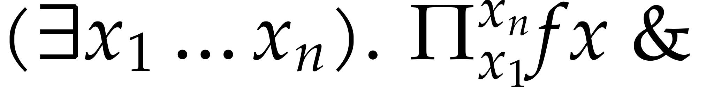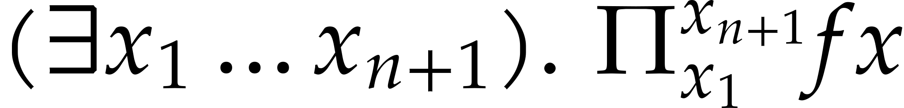?

Is this notation inexact? The notation itself is not meant to picture anything; what matters is only the rules of its use, the system in which it is used. The scruples attaching to it stem from a line of thought concerned with the number of primitive signs in the calculus of ‘Principia Mathematica’.

### [XI-FCr\[1\]](https://cdn.wittgensteinnachlass.com/2000px/webp/Ts-212/XI-FCr.webp)

_Expectation_

_Wish_

_etc._

### [XI-76FCr\[1\]](https://cdn.wittgensteinnachlass.com/2000px/webp/Ts-212/XI-76FCr.webp)

Expectation: the expression of expectation.

Articulated and unarticulated expectation

### [XI-76-1\[1\]](https://cdn.wittgensteinnachlass.com/2000px/webp/Ts-212/XI-76-1.webp),[XI-76-2\[1\]](https://cdn.wittgensteinnachlass.com/2000px/webp/Ts-212/XI-76-2.webp)

Can one say that expectation is a preparatory, expectant, action. – Someone throws me a ball; I stretch out my hands and position them to catch it. But suppose I had been pretending: I had expected him not to throw it, but wanted to act as if I expected him to. What then does my expecting him not to throw it consist in, if my action expresses the opposite expectation? Surely this expectation, too, had to consist in something I did. So in some way I was, after all, not prepared for the ball to come.

### [XI-76-3\[1\]](https://cdn.wittgensteinnachlass.com/2000px/webp/Ts-212/XI-76-3.webp)

21 It is quite trivial to say that, in expecting a patch, I must be able to distinguish the expectation of a circular one from that of an elliptical one, and that in general there must be as many differences in expectation as there are in the fulfilments of expectations. (Hunger and the apple that satisfies it do not have the same multiplicity.)

### [XI-76-4\[1\]](https://cdn.wittgensteinnachlass.com/2000px/webp/Ts-212/XI-76-4.webp)

20 Suppose I am expecting someone: I look at the clock, then out of the window, put something in order in my room, look out again, etc. I could call this activity expecting. Now am I thinking the whole time I am doing this? (That is, is this activity essentially an activity of thinking, or is it accompanied by one?) Certainly not the latter. And if I call those activities thinking, what would be the words in which this thought would be expressed? – But thoughts, no doubt, will also occur to me while I wait. I shall _say_ to myself: “perhaps he has been held up at home”, and more of the same; perhaps also the articulated expectation “if only he would come”. In all those expectant actions there is nothing that interests us (the fulfilment of expectation in this sense is nothing other than the satisfaction of a hunger). We are interested only in the picture made for a purpose. – The _articulated_ thought.

### [XI-76-5\[1\]](https://cdn.wittgensteinnachlass.com/2000px/webp/Ts-212/XI-76-5.webp)

20, 20a It is – I believe – important to recognize that if, for instance, I believe someone will come to me, my persisting state has nothing to do with the person in question and the other elements of the thought, i.e. it does not _contain_ them. But the same holds for expectation, wish, etc., etc. If I am expecting someone, I do not think all that time that he will come, or anything of the sort. Indeed, even when I am actually thinking it, this process is not an amorphous one, like that of pain, for instance, but consists only in my saying, say, the sentence “he will come” right now. One cannot _amorphously_ see that something is the case, believe that something is the case, wish, fear, think, etc.

### [XI-76-6\[1\]](https://cdn.wittgensteinnachlass.com/2000px/webp/Ts-212/XI-76-6.webp)

20a The expression of the expectation is the expectation.

### [XI-76-7\[1\]](https://cdn.wittgensteinnachlass.com/2000px/webp/Ts-212/XI-76-7.webp)

21, 20 The preparation is, as it were, itself the language and cannot go beyond itself. (It is in this “inability to go beyond itself” that the similarity between my considerations and those of the theory of relativity lies.)

### [XI-76-7\[2\]](https://cdn.wittgensteinnachlass.com/2000px/webp/Ts-212/XI-76-7.webp)

21, 20 If I said earlier that what matters is whether _this_ picture is expected, i.e. whether it is this very picture that we “employ” (“use”), I could now say that what matters is whether _this_ very picture is _our_ language.

### [XI-76-7\[3\]](https://cdn.wittgensteinnachlass.com/2000px/webp/Ts-212/XI-76-7.webp)

21, 20 Language as the _expression_ of the expectation is what has been prepared.

### [XI-77FCr\[1\]](https://cdn.wittgensteinnachlass.com/2000px/webp/Ts-212/XI-77FCr.webp)

In the expectation _that_ was expected which the fulfilment brought.

### [XI-77-1\[1\]](https://cdn.wittgensteinnachlass.com/2000px/webp/Ts-212/XI-77-1.webp)

The expectation and the fact that fulfils the expectation do somehow fit together. One should now describe an expectation and a fact that fit together, so that one can see in what this agreement consists. One immediately thinks of the fitting of a solid form into a corresponding hollow form. But if one now wants to describe the two here, one sees that, as far as they fit, one description applies to both. Compare the way a hat fits with a dress.

### [XI-77-2\[1\]](https://cdn.wittgensteinnachlass.com/2000px/webp/Ts-212/XI-77-2.webp)

89 (70) Can one compare the process of understanding an order with the process of obeying it, in order to show that _this_ way of obeying it really corresponds to _this_ understanding, this construal? and in what respect they agree? Certainly – for instance, by comparing the construal p' with the act of obedience p. “I imagined it brighter”. But it is not the mental image as such that is brighter than reality.

### [XI-77-3\[1\]](https://cdn.wittgensteinnachlass.com/2000px/webp/Ts-212/XI-77-3.webp),[XI-77-4\[1\]](https://cdn.wittgensteinnachlass.com/2000px/webp/Ts-212/XI-77-4.webp)

21 Can one really _compare_ the expectation with the fact that has come about? After all, one says that the fact agrees or does not agree with the expectation. But this agreement does not 21 concern properties of the expectation as such (of the process of expecting) and properties of the event as reality.

Can one compare a hollow form with a solid form.

### [XI-77-4\[2\]](https://cdn.wittgensteinnachlass.com/2000px/webp/Ts-212/XI-77-4.webp)

21 (But it is not as if I said: “I feel like having an apple, so whatever satisfies this desire I will call an apple”. (A sleeping draught, for instance, would count too.))

### [XI-77-5\[1\]](https://cdn.wittgensteinnachlass.com/2000px/webp/Ts-212/XI-77-5.webp)

21 What is strange is expressed by saying that if this is the patch I expected, it does not differ from the one I expected. _So_ if one asks: “How does the patch differ from the one you expected, given that the actual patch was not there in your expectation, for otherwise you could not have expected it?”, the answer is nonetheless: the patch _is_ the one I expected.

### [XI-77-6\[1\]](https://cdn.wittgensteinnachlass.com/2000px/webp/Ts-212/XI-77-6.webp)

21 I say “that is exactly how I imagined it”. And someone replies, say, “that is impossible, for the one was a mental image and the other is not; and did you perhaps take your mental image for reality?”

### [XI-77-7\[1\]](https://cdn.wittgensteinnachlass.com/2000px/webp/Ts-212/XI-77-7.webp)

21 “I expect a shot.” The shot is fired. What, you expected that; so was this racket somehow already in your expectation? Or does your expectation agree with what happened only in some other respect; was this noise not contained in your expectation, but added merely as an accident when the expectation was fulfilled? But no, if the noise had not occurred, my expectation would not have been fulfilled; the noise fulfilled it, it did not come _in addition_ to the fulfilment, like a second guest joining the one I was expecting.

### [XI-77-7\[2\]](https://cdn.wittgensteinnachlass.com/2000px/webp/Ts-212/XI-77-7.webp),[XI-77-8\[1\]](https://cdn.wittgensteinnachlass.com/2000px/webp/Ts-212/XI-77-8.webp)

21 Was whatever in the event was not also in the expectation an accident, an addition made by _fate_? But what was _then not_ an addition, was there anything of the shot already in my expectation? And what was an addition, for did I not 21 expect the whole shot.

### [XI-77-8\[1\]](https://cdn.wittgensteinnachlass.com/2000px/webp/Ts-212/XI-77-8.webp)

Does an imagined tone differ from the same tone actually heard in its timbre, perhaps?!

### [XI-77-10\[1\]](https://cdn.wittgensteinnachlass.com/2000px/webp/Ts-212/XI-77-10.webp)

21 It also makes sense to say that what happened was not what I expected but something similar; in contrast, however, to the case in which _the very thing_ that was expected happens. And this shows what kind of misuse of _language_ we are led into here.

### [XI-77-10\[2\]](https://cdn.wittgensteinnachlass.com/2000px/webp/Ts-212/XI-77-10.webp),[XI-77-11\[1\]](https://cdn.wittgensteinnachlass.com/2000px/webp/Ts-212/XI-77-11.webp)

21 Suppose one now said: the red you imagine is surely not the same (the same thing) as what you actually see in front of you – how then can you say ‘that is the same as what I imagined’? – Does that not merely show that what I call “this red” 21 is precisely what my mental image and reality have in common? For imagining red is of course different from seeing red, but that is why the one is called “imagining a red patch” and the other “seeing a red patch”. Yet the same word “red” occurs in both (different) expressions, and so this word must designate only what belongs to _both_ processes. Is it not the same, _then_, in the sentences “there is a red patch here” and “there is no red patch here”? The word “red” occurs in both, _so_ this word cannot mean the presence of something red. – (The sentence “that is red” is only _one_ application of the word “red”, on an equal footing with all the others, such as the sentence “that is not red”.) (The word “red” – like every word – has a function only in the context of a sentence. And does the misunderstanding consist in believing that one can already see the sense of a sentence in the word alone?)

### [XI-77-12\[1\]](https://cdn.wittgensteinnachlass.com/2000px/webp/Ts-212/XI-77-12.webp),[XI-77-13\[1\]](https://cdn.wittgensteinnachlass.com/2000px/webp/Ts-212/XI-77-13.webp)

21 How strange it would be to say: an event looks different when it happens than when it does not happen. Or: “A red patch looks different when it is there than when it is not there, but language abstracts from this _difference_, for it speaks of a red patch whether it is there or not”.

### [XI-77-13\[2\]](https://cdn.wittgensteinnachlass.com/2000px/webp/Ts-212/XI-77-13.webp)

21 How does the red of a patch we see in front of us differ from that of _this patch_ when we _merely_ imagine it? – But how do we know that it is the red of _this_ patch if it differs (_from the former_)? – How do we know that it is the same red if it is different? – This gibberish shows that we have a misuse of language here.

### [XI-77-14\[1\]](https://cdn.wittgensteinnachlass.com/2000px/webp/Ts-212/XI-77-14.webp)

21 How is it possible that I expect, and what I expect comes? How could I expect it, since it was not there? Reality is not a property that what is expected still lacks and that is then added when it happens. – Nor is it like daylight, which only then gives things _their_ colour, when they are already there in the dark, as it were colourless. How could I expect _it_, and then _it_ actually comes; – as if the expectation were an unlit transparency and with its fulfilment the light behind it were lit. – But every such simile is false, because it presents reality as a describable addition to the expectation; which is nonsensical. (At bottom this is the same nonsense as _representing_ the imagined colour as _dull_ in comparison with the actual one.)

### [XI-77-14\[2\]](https://cdn.wittgensteinnachlass.com/2000px/webp/Ts-212/XI-77-14.webp)

21 So, I would like to say, you can see from these examples how the words are actually used.

### [XI-77-15\[1\]](https://cdn.wittgensteinnachlass.com/2000px/webp/Ts-212/XI-77-15.webp)

21 I have predicted something, it now happens, and now I simply say “_it_ has happened”, and that already describes the state of affairs completely. Even now, then, it is described only to the extent that one could describe it before it came about.

### [XI-77-15\[2\]](https://cdn.wittgensteinnachlass.com/2000px/webp/Ts-212/XI-77-15.webp)

21 If I can simply say “it has happened”, then _on the other hand_ I cannot describe what a state of affairs must be like in order to satisfy a particular expectation.

### [XI-77-16\[1\]](https://cdn.wittgensteinnachlass.com/2000px/webp/Ts-212/XI-77-16.webp)

70a Obeying the order consists in my doing something ‒ ‒ But can I also say ‘in my doing what it orders’? Is there a criterion for this being the action that obeys it? What is to be understood here by a criterion?

### [XI-77-17\[1\]](https://cdn.wittgensteinnachlass.com/2000px/webp/Ts-212/XI-77-17.webp)

70a An expectation does not stand to its satisfaction as hunger does to its satisfaction. I can quite well describe the hunger and what satisfies it, and say that it satisfies it.

### [XI-77-18\[1\]](https://cdn.wittgensteinnachlass.com/2000px/webp/Ts-212/XI-77-18.webp)

21 If I expect an event and the one that fulfils my expectation occurs; does it then make sense to ask whether it really is the event I expected? I.e., _how would a sentence asserting that be verified_?

### [XI-77-19\[1\]](https://cdn.wittgensteinnachlass.com/2000px/webp/Ts-212/XI-77-19.webp)

21 “How do you know that you are expecting a _red patch_?” i.e. “how do you know that a red patch is the fulfilment of what you are expecting”. – But one might just as well ask, “how do you know that that _is_ a red patch?” How do you know that what you did really was to recite the alphabet in your head? – But how do you know that what you are reciting really _is_ the alphabet? This is of course the same question as: How do you know that what you call red is really the same as what the other person calls red? And the one question is just as nonsensical as the other.

### [XI-77-20\[1\]](https://cdn.wittgensteinnachlass.com/2000px/webp/Ts-212/XI-77-20.webp)

70a Whatever I may say about the fulfilment of the expectation that is supposed to make it the fulfilment of this expectation counts as part of the expectation, changes the _expression_ of the expectation. I.e., the expression of the expectation is the _complete_ expression of the expectation.

### [XI-77-21\[1\]](https://cdn.wittgensteinnachlass.com/2000px/webp/Ts-212/XI-77-21.webp)

21 If I say “that is the same event as the one I expected” and “that is the same event that also took place in that other place”, the word “same” means something different each time. (Nor would one normally say “that is the same as what I expected”, but “that is what I expected”.)

### [XI-78FCr\[1\]](https://cdn.wittgensteinnachlass.com/2000px/webp/Ts-212/XI-78FCr.webp)

“How can one wish for, expect, or look for something that is not there?” Misunderstanding of ‘something’.

### [XI-78-1\[1\]](https://cdn.wittgensteinnachlass.com/2000px/webp/Ts-212/XI-78-1.webp)

21 It might be said: How can I expect the event, when it is not even there yet?

### [XI-78-2\[1\]](https://cdn.wittgensteinnachlass.com/2000px/webp/Ts-212/XI-78-2.webp)

70a, 73 One can imagine that something is the case which is not: very remarkable! For it is not remarkable that the mental image does not agree with reality, but it is remarkable that it represents it even then.

### [XI-78-3\[1\]](https://cdn.wittgensteinnachlass.com/2000px/webp/Ts-212/XI-78-3.webp)

90a, 70a Socrates: So if one imagines what is not, does one imagine nothing? – Theaetetus: So it seems. – Socrates: But if one imagines nothing, surely one does not imagine at all? – Theaetetus: Apparently, as we see. If we substitute, say, “cut up” for “imagine” in this argument [and the one preceding it], it amounts to a rule for the use of this word. One is not to say: “I cut up something that does not exist”.

### [XI-78-3\[2\]](https://cdn.wittgensteinnachlass.com/2000px/webp/Ts-212/XI-78-3.webp),[XI-78-4\[1\]](https://cdn.wittgensteinnachlass.com/2000px/webp/Ts-212/XI-78-4.webp)

90a, 70a I can imagine a deer in this meadow that is not there, but I cannot kill one that is not there. – And to imagine a deer that is not there means to imagine that a deer is there, although none is there. But to kill a deer does not mean: to kill that a deer is there (thus: different grammatical rules). If, however, someone says: “in order for me to imagine a deer, there must surely be such a deer in some sense”, the answer is: no, there need not 90a 70a _be_ such a deer in any sense for that. And if the reply were: But surely there must be, for example, the colour brown for me to be able to imagine it, then one should say: “‘There is such a colour as brown’ means nothing at all, except perhaps that it _occurs_ here or there as the colouring of an object (patch), and this is not necessary for me to be able to imagine a brown deer.”

### [XI-78-5\[1\]](https://cdn.wittgensteinnachlass.com/2000px/webp/Ts-212/XI-78-5.webp)

(27) 70a 78 90a “I imagine what it will be like” (when the chair has been painted white) – how can I imagine it, then, when it is not so?! Is imagination a kind of magic?

### [XI-78-6\[1\]](https://cdn.wittgensteinnachlass.com/2000px/webp/Ts-212/XI-78-6.webp)

21a, 70a One feels like asking: What an extraordinary process wanting must be, for me to be able to want _that_ even now which I will only do in 5 minutes?!

### [XI-78-6\[2\]](https://cdn.wittgensteinnachlass.com/2000px/webp/Ts-212/XI-78-6.webp),[XI-78-7\[1\]](https://cdn.wittgensteinnachlass.com/2000px/webp/Ts-212/XI-78-7.webp)

21a, 70a The answer: If that seems odd to you, you are comparing it with something it cannot be compared with. – With this, for instance: How can I shake hands now with the man who will not come in for another 5 minutes? (Or even: How can I shake hands with someone who may not exist at all?)

### [XI-78-7\[2\]](https://cdn.wittgensteinnachlass.com/2000px/webp/Ts-212/XI-78-7.webp)

(21a) 21 70a The ‘foreshadowing’ of the fact evidently consists in our being able to think now that _what_ _will_ happen only later will happen. Or, as it is misleadingly put: in our being able to think (of) _what_ _will_ happen only later.

### [XI-78-8\[1\]](https://cdn.wittgensteinnachlass.com/2000px/webp/Ts-212/XI-78-8.webp)

70a “Whenever I speak of the fulfilment of a sentence, I speak of it in general terms. I describe it in some form or other. Indeed, this generality already lies in my being able to give the description in advance, and in any case independently of whether the fact comes about.”

### [XI-78-9\[1\]](https://cdn.wittgensteinnachlass.com/2000px/webp/Ts-212/XI-78-9.webp)

70a (29a) When one says that the fact is described “in a general way”, we mentally contrast this way with another. (But we take this contrast, of course, from somewhere else.) We imagine that at the fulfilment something new comes into being and is now there which was not there before. That is to say, we think of an object or complex that we can now point to, or that can now represent itself, whereas the description was only its picture. As if I had painted _in advance_ the apple that will grow on this branch, and now the apple itself comes along. One could then say that the description of the apple was general, i.e. that it was made with words, colours, etc., that were there before the apple and were not there especially for it. Old junk, as it were, compared with the actual apple. Forerunners that all have to abdicate when the one expected (_himself_) comes.

### [XI-78-9\[2\]](https://cdn.wittgensteinnachlass.com/2000px/webp/Ts-212/XI-78-9.webp)

70a (29a) But _the one expected_ is not the fulfilment; rather: that he has come.

### [XI-78-10\[1\]](https://cdn.wittgensteinnachlass.com/2000px/webp/Ts-212/XI-78-10.webp)

70a (29a) This mistake is deeply rooted in our language: we say “I expect him” and “I expect his coming” and “I expect that he will come”.

### [XI-78-10\[2\]](https://cdn.wittgensteinnachlass.com/2000px/webp/Ts-212/XI-78-10.webp)

70a (29a) To say that the fact is described in general terms is to say that it is put together out of old components. _It_ is described: that is as if it were given to us in some other way apart from the description.

### [XI-78-10\[3\]](https://cdn.wittgensteinnachlass.com/2000px/webp/Ts-212/XI-78-10.webp)

70a (29a) Here the fact is put on a par with a house or some _other_ complex.

### [XI-78-10\[4\]](https://cdn.wittgensteinnachlass.com/2000px/webp/Ts-212/XI-78-10.webp)

70a (29a) Once more the comparison: the person enters – the fact enters: As if the fact were already formed in advance outside the door of reality and were now to enter into it when it enters.

### [XI-78-11\[1\]](https://cdn.wittgensteinnachlass.com/2000px/webp/Ts-212/XI-78-11.webp)

70a The whole problem of the meaning of words is opened up by my looking for A _before_ I have found him. – What is to be said about this is that I can look for him even if in a certain sense he does not exist. 70a (27b) (78) If we say that a picture is needed for this, that in some sense we must carry a picture of him around with us, I say: perhaps; but what sense does it make to say that it is a picture of _him_? That too, then, makes sense only if I have another picture of him, corresponding to the word “him”.

### [XI-78-11\[2\]](https://cdn.wittgensteinnachlass.com/2000px/webp/Ts-212/XI-78-11.webp)

70a (27b) (78) One might say: If I speak of the sun, I must have a picture of the sun in me. – But how can one say that it is a picture of the sun? Here the sun is surely mentioned again, in contrast to its picture. And for me to be able to say “this is a picture of the sun”, I would have to have another picture of the sun. And so on.

### [XI-78-12\[1\]](https://cdn.wittgensteinnachlass.com/2000px/webp/Ts-212/XI-78-12.webp)

One could only say: If he speaks of the sun, he must see a visual image (or a configuration of such and such a character – round, yellow, etc.) before him. Not that this is true, but it makes sense, and the image is then part of the sign.

### [XI-78-13\[1\]](https://cdn.wittgensteinnachlass.com/2000px/webp/Ts-212/XI-78-13.webp)

70a How strange, I can look for it when it is not there, but I cannot point to it when it is not there. That is really the problem of looking for something, and it shows the misleading comparison. One might want to say: surely it must also be there when I look for it. – Then it must also be there when I do not find it, and also when it does not exist.

### [XI-78-13\[2\]](https://cdn.wittgensteinnachlass.com/2000px/webp/Ts-212/XI-78-13.webp),[XI-78-14\[1\]](https://cdn.wittgensteinnachlass.com/2000px/webp/Ts-212/XI-78-14.webp)

70a (10) Looking for _it_ (say, my stick) is a way of looking and differs from looking for something else in what one does (says, thinks) while looking, not in what one finds.

### [XI-78-14\[2\]](https://cdn.wittgensteinnachlass.com/2000px/webp/Ts-212/XI-78-14.webp)

70a (10) (78) And if I carry a picture or a mental image with me while looking, well and good. And if I say that the picture is a picture of what I am looking for, that only says what place the picture occupies in the process of looking. And if I find it and say “there it is! _that’s_ what I was looking for”, the last words are not an explanation of the words designating the object I was looking for (say, the words “my stick”), which could only now be given, once it has been found. – Just as one does not know what one wishes for any better, or have any better way of explaining it, after the fulfilment of the wish than before.

### [XI-78-14\[3\]](https://cdn.wittgensteinnachlass.com/2000px/webp/Ts-212/XI-78-14.webp)

70a One cannot hang the thief before one has him, but one can already look for him.

### [XI-78-14\[4\]](https://cdn.wittgensteinnachlass.com/2000px/webp/Ts-212/XI-78-14.webp)

70a “You were looking for _that_ man? How was that possible? He wasn’t even there!”

### [XI-78-14\[5\]](https://cdn.wittgensteinnachlass.com/2000px/webp/Ts-212/XI-78-14.webp)

70a (10) “I’m looking for my stick. – There it is!” The latter is not an explanation of the expression “my stick” that would be essential to understanding the first sentence and that I _therefore_ could not have given before my stick was found. Rather, the sentence “there it is”, if it is not a repetition of the explanation of the words that was possible (_also_) earlier, must be a new synthetic proposition.

### [XI-78-14\[6\]](https://cdn.wittgensteinnachlass.com/2000px/webp/Ts-212/XI-78-14.webp)

70a The problem corresponds to a confusion of a word or expression with the sentence that asserts the existence, the presence, of the object.

### [XI-78-14\[7\]](https://cdn.wittgensteinnachlass.com/2000px/webp/Ts-212/XI-78-14.webp)

70a “You were looking for _him_? You couldn’t even know if he was there!” (Compare, on the other hand, the search for the trisection of the angle.)

### [XI-78-15\[1\]](https://cdn.wittgensteinnachlass.com/2000px/webp/Ts-212/XI-78-15.webp)

70a Here, too, we have the confusion between the meaning and the bearer of a word. For the object I point at when I say “_that one_” is the bearer of the name, not its meaning.

### [XI-78-15\[2\]](https://cdn.wittgensteinnachlass.com/2000px/webp/Ts-212/XI-78-15.webp)

70a In short: I am looking for the bearer of the name, not its meaning. But on the other hand: I look for and hang the bearer of the name.

### [XI-78-15\[3\]](https://cdn.wittgensteinnachlass.com/2000px/webp/Ts-212/XI-78-15.webp)

70a One can say of the bearer of the name that he (_exists or_) does not exist, and this is, of course, not an activity, although one could mistake it for one and say that surely he must be there when he does not exist. (And this has certainly been written by a philosopher once before.)

### [XI-78-15\[4\]](https://cdn.wittgensteinnachlass.com/2000px/webp/Ts-212/XI-78-15.webp)

70a, 82 (“I’m looking for him”. – “What does he look like”. – “I don’t know but (_I’m sure_) I’ll recognize him when I see him”.)

### [XI-78-16\[1\]](https://cdn.wittgensteinnachlass.com/2000px/webp/Ts-212/XI-78-16.webp)

10 The thought that it is (only) finding that shows us what we expected means judging the process as one would judge, for instance, the _symptoms of expectation_ in another person. I see him, say, pacing restlessly up and down; someone comes in through the door and he becomes calm and shows signs of satisfaction; and now I say: “he apparently expected this person”.

### [XI-78-16\[2\]](https://cdn.wittgensteinnachlass.com/2000px/webp/Ts-212/XI-78-16.webp)

10 The ‘symptoms of expectation’ are not the expression of the expectation. And to believe that only after finding do I know what I was looking for (only after fulfilment what I wished for) amounts to a nonsensical “behaviourism”.

### [XI-78-16\[3\]](https://cdn.wittgensteinnachlass.com/2000px/webp/Ts-212/XI-78-16.webp)

10 “I wish I had a yellow flower.” – “Yes, I’ll go and look for a yellow flower for you. Here, I’ve found one.” – Does the meaning of “yellow flower” belong to the last sentence any more than to the preceding two?

### [XI-78-17\[1\]](https://cdn.wittgensteinnachlass.com/2000px/webp/Ts-212/XI-78-17.webp)

70a The meaning of the word “yellow” is not the existence of a yellow patch: that is what I would like to say about the word “meaning”.

### [XI-78-18r\[1\]](https://cdn.wittgensteinnachlass.com/2000px/webp/Ts-212/XI-78-18r.webp),[XI-78-18v\[1\]](https://cdn.wittgensteinnachlass.com/2000px/webp/Ts-212/XI-78-18v.webp)

70a “‘The mental image associated with the word red is certainly the one that corresponds to the fact that something is red – not the one that corresponds to the fact that something is blue, and thus _not red_. Instead of explaining the word by saying “that is red”, I should say “this is what it looks like when something is red”. Indeed, the mental image red is the mental image of something’s being red. And that is the basis of the confusion of word and sentence that 17a The calculation reaches as far as its solution; as the yardstick reaches as far as what is measured; the description as far as what is described. I spoke of earlier.’”

### [XI-78-20\[1\]](https://cdn.wittgensteinnachlass.com/2000px/webp/Ts-212/XI-78-20.webp)

70a And here, I believe, a principal source of misunderstanding is that the “occurrence of red” in two states of affairs as a constituent common to both has a double sense. In the one case it means that something _is red_ in each – i.e. has the property of being red. In the other it is not a matter of having a colour in common (which would of course be expressed by specifying a colour). What they have in common here is precisely the harmony between world and thought, which cannot be described.

### [XI-79FCr\[1\]](https://cdn.wittgensteinnachlass.com/2000px/webp/Ts-212/XI-79FCr.webp)

In linguistic expression, expectation & fulfilment touch each other.

### [XI-79-1\[1\]](https://cdn.wittgensteinnachlass.com/2000px/webp/Ts-212/XI-79-1.webp)

21 _In language_, expectation and event touch each other.

### [XI-79-2\[1\]](https://cdn.wittgensteinnachlass.com/2000px/webp/Ts-212/XI-79-2.webp)

70a “I said ‘leave the room’ and he left the room”. “I said ‘leave the room’ and he slowly left the room”. “I said ‘leave the room’ and he jumped out of the window”. A justification is possible here even where the description of the action is not the one given by the command.

### [XI-79-3\[1\]](https://cdn.wittgensteinnachlass.com/2000px/webp/Ts-212/XI-79-3.webp)

70a Surely it is not impossible for one person to look for the yellow flower using an image in his imagination just as another does using the little coloured card, or a third, in some sense, using an image of a reaction that what he is looking for is supposed to elicit (bell). But whatever he sets out with (whatever paradigm he uses), nothing compels him to recognize as what he was looking for the thing he actually recognizes in the end, and the justification he then gives for the _result_ in words or other signs is once again a justification only in relation to another description in the same language.

### [XI-79-3\[2\]](https://cdn.wittgensteinnachlass.com/2000px/webp/Ts-212/XI-79-3.webp),[XI-79-4\[1\]](https://cdn.wittgensteinnachlass.com/2000px/webp/Ts-212/XI-79-4.webp)

70a The difficulty is to stop asking ‘why’ (I mean, to refrain from asking this question).

### [XI-79-5r\[1\]](https://cdn.wittgensteinnachlass.com/2000px/webp/Ts-212/XI-79-5r.webp)

70a You command me “bring me a yellow flower”; I bring one and you ask: “why did you bring me one like that?” Then this question makes sense only if it can be completed with “and not one of this (other) kind”. I.e. the question already belongs to a system; and the answer must refer to the same system.

### [XI-79-5r\[2\]](https://cdn.wittgensteinnachlass.com/2000px/webp/Ts-212/XI-79-5r.webp)

70a In reply to the question “why do you do _that_ at my command?” one can ask: “what?” Now it would be absurd to ask “why do you bring me a yellow flower when I commanded you to bring me a yellow flower”. One might rather ask “why do you bring a red flower when I said you should bring a yellow one” or “why do you bring a dark yellow one in response to the command ‘bring a yellow one’?”

### [XI-79-5v\[1\]](https://cdn.wittgensteinnachlass.com/2000px/webp/Ts-212/XI-79-5v.webp)

_Sense as shadow_

### [XI-79-6\[1\]](https://cdn.wittgensteinnachlass.com/2000px/webp/Ts-212/XI-79-6.webp),[XI-79-7\[1\]](https://cdn.wittgensteinnachlass.com/2000px/webp/Ts-212/XI-79-7.webp)

70a, 73 54 Once again: what is the criterion for the command’s having been carried out correctly? What is the criterion, that is, for the person giving the command as well? How can _he_ know that the command was not carried out correctly? Suppose he is satisfied with the execution and now says: “but I won’t let this satisfaction deceive me, for I know that what happened was not after all what I wanted”. He remembers, in some sense, how he meant the command. – – – In what sense? What do I remember when I remember having wished for _that_?

### [XI-79-8\[1\]](https://cdn.wittgensteinnachlass.com/2000px/webp/Ts-212/XI-79-8.webp),[XI-79-9\[1\]](https://cdn.wittgensteinnachlass.com/2000px/webp/Ts-212/XI-79-9.webp)

16 One may have the feeling: surely the ‘p’ in the sentence “I believe that p is the case” cannot mean the same as in the assertion “p”, since the fact of believing that p is the

16 case does not contain the fact that p is the case.

### [XI-79-10\[1\]](https://cdn.wittgensteinnachlass.com/2000px/webp/Ts-212/XI-79-10.webp)

16 One has the feeling that in the sentence “I expect that he is coming” I use the words “he is coming” in a different sense from the one they have in the assertion “he is coming”. – But if that were so, how could I speak of my expectation being satisfied by the fact?

### [XI-79-10\[2\]](https://cdn.wittgensteinnachlass.com/2000px/webp/Ts-212/XI-79-10.webp)

16 But now one could ask: What does it look like when he comes? – “The door opens and a man comes in who …”. What does it look like when I expect that he is coming? – “I walk up and down, look at the clock, …”. – But the one process bears not the slightest similarity to the other! How can one then use the same words to describe them? But I could also walk up and down without expecting him to come, and look at the clock too, etc.; so that is not what is characteristic of expecting that he is coming. What is characteristic is given precisely by these words alone. And “he” means the same as in the assertion “he is coming” and “is coming” means the same as in the assertion, and putting them together does not mean anything different. I.e., for example: _one_ ostensive explanation of the word “he” applies to both sentences.

### [XI-79-11\[1\]](https://cdn.wittgensteinnachlass.com/2000px/webp/Ts-212/XI-79-11.webp)

If I believe non-p, I do not thereby also believe p just because “p” occurs in “non-p”.

### [XI-79-12\[1\]](https://cdn.wittgensteinnachlass.com/2000px/webp/Ts-212/XI-79-12.webp)

92 p occurs in non-p in the same sense as non-p occurs in p.

### [XI-79-12\[2\]](https://cdn.wittgensteinnachlass.com/2000px/webp/Ts-212/XI-79-12.webp)

92 The words “occur” etc. are, of course, indeterminate, like all such prose. Only the grammatical rules, which in the end must show what is meant, are exact and unambiguous and indisputable.

### [XI-80FCr\[1\]](https://cdn.wittgensteinnachlass.com/2000px/webp/Ts-212/XI-80FCr.webp)

“The proposition determines what reality makes it true”. It seems to give a shadow of this reality. The command seems to anticipate its execution in shadowy form.

### [XI-80-1\[1\]](https://cdn.wittgensteinnachlass.com/2000px/webp/Ts-212/XI-80-1.webp)

70 The description of language must do the same work as language.

### [XI-80-1\[2\]](https://cdn.wittgensteinnachlass.com/2000px/webp/Ts-212/XI-80-1.webp)

70 For then I really can see from the sentence, the description of reality, how things stand in reality.

### [XI-80-1\[3\]](https://cdn.wittgensteinnachlass.com/2000px/webp/Ts-212/XI-80-1.webp)

70 (But only _that_ is called “description”, and only that is called “seeing how things stand”!)

### [XI-80-1\[4\]](https://cdn.wittgensteinnachlass.com/2000px/webp/Ts-212/XI-80-1.webp)

70 (And it is nothing else that we are all saying by this: that we see from the description how things actually stand.)

### [XI-80-2\[1\]](https://cdn.wittgensteinnachlass.com/2000px/webp/Ts-212/XI-80-2.webp)

70 “You get your knowledge of what you have to do from the command. 70 70 And yet the command gives you only itself, and its _effect_ is immaterial.”

### [XI-80-3\[1\]](https://cdn.wittgensteinnachlass.com/2000px/webp/Ts-212/XI-80-3.webp),[XI-80-4\[1\]](https://cdn.wittgensteinnachlass.com/2000px/webp/Ts-212/XI-80-4.webp)

70 This only becomes strange when the command is, say, a bell signal. – For in what sense does this sign communicate to me what I 70 have to do, apart from my simply doing it _and_ the sign having been there – –. For it is not a matter of experience showing that I invariably do it when the sign is given, either.

### [XI-80-4\[2\]](https://cdn.wittgensteinnachlass.com/2000px/webp/Ts-212/XI-80-4.webp)

70 (67) That is why it _makes no sense_ just like that to say: “I must go because the bell rang”. Something else has to be given as well.

### [XI-80-5\[1\]](https://cdn.wittgensteinnachlass.com/2000px/webp/Ts-212/XI-80-5.webp)

70a How can one derive the action from the command “fetch a yellow flower”? – How can one derive the sign “5” from the sign “2 + 3”?

### [XI-80-6\[1\]](https://cdn.wittgensteinnachlass.com/2000px/webp/Ts-212/XI-80-6.webp)

70 Can one, then, and in what sense can one, derive the execution from the sign plus the understanding (that is, the interpretation) before it _takes place_? After all, all one derives is a description of the execution, and even this description was not there until one had derived _it_.

### [XI-80-6\[2\]](https://cdn.wittgensteinnachlass.com/2000px/webp/Ts-212/XI-80-6.webp)

70 It is only when we carry out the command that we derive its _execution_ from it.

### [XI-80-7\[1\]](https://cdn.wittgensteinnachlass.com/2000px/webp/Ts-212/XI-80-7.webp)

27 The bridge _can_ only be crossed when we get there. (What is meant is the bridge between sign & reality.)

### [XI-80-8\[1\]](https://cdn.wittgensteinnachlass.com/2000px/webp/Ts-212/XI-80-8.webp)

21 70 From expectation to fulfilment is a step in a calculation. Indeed, the calculation

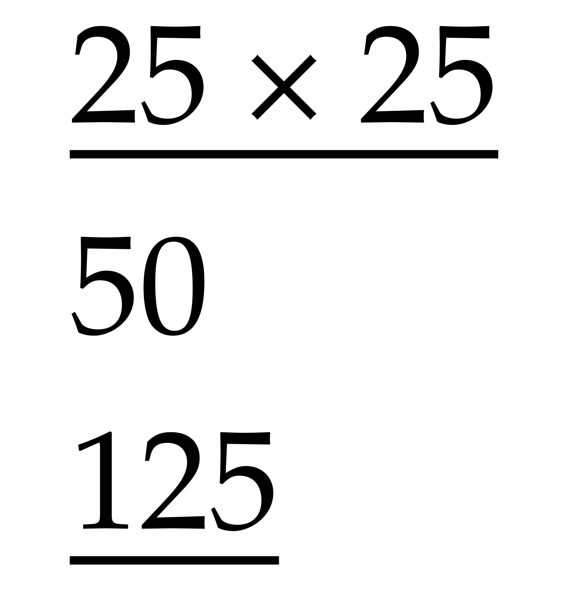

stands to its result 625 in exactly the same relation as expectation to fulfilment.

### [XI-80-8\[2\]](https://cdn.wittgensteinnachlass.com/2000px/webp/Ts-212/XI-80-8.webp)

21 70 And to the extent – and only to the extent – that this calculation is a picture of the result, the expectation too is a picture of the fulfilment.

### [XI-80-8\[3\]](https://cdn.wittgensteinnachlass.com/2000px/webp/Ts-212/XI-80-8.webp)

21 And to the extent that the result is determined by the calculation, the fulfilment is determined by the expectation.

### [XI-80-9\[1\]](https://cdn.wittgensteinnachlass.com/2000px/webp/Ts-212/XI-80-9.webp)

70a “The command anticipates the execution”. In what respect, then, does it anticipate it? By commanding _what_ is later carried out (or not carried out). Or: What we mean when we say that the command anticipates the _execution_ is _the same_ as what is expressed by saying that the command commands what later happens. But to be precise: “happens, or does not happen”. And that says nothing. (The command can only _show_ its essence.)

### [XI-80-10\[1\]](https://cdn.wittgensteinnachlass.com/2000px/webp/Ts-212/XI-80-10.webp)

70 But even if my wish does not determine what will be the case, it does, so to speak, determine the theme of a fact, whether or not that fact fulfils the wish.

### [XI-80-10\[2\]](https://cdn.wittgensteinnachlass.com/2000px/webp/Ts-212/XI-80-10.webp)

70 Now, must it know anything in advance in order to do that? No. p․⌵․non-p really says _nothing_.

### [XI-80-10\[3\]](https://cdn.wittgensteinnachlass.com/2000px/webp/Ts-212/XI-80-10.webp)

70 What surprises us – so to speak – is not that someone knows the future but – that he can prophesy at all (correctly or incorrectly).

### [XI-80-10\[4\]](https://cdn.wittgensteinnachlass.com/2000px/webp/Ts-212/XI-80-10.webp)

70 It is as if the mere prophecy (whether right or wrong) already anticipated a shadow of the future. – Whereas it knows nothing about the future, and cannot know less than nothing.

### [XI-80-11\[1\]](https://cdn.wittgensteinnachlass.com/2000px/webp/Ts-212/XI-80-11.webp)

67 What does proceeding according to a rule consist in? – Can one ask that? – I proceed according to a rule means: I proceed in such a way that what comes out …. That what comes out satisfies this rule. To proceed according to the rule means to proceed _like this_, and the ‘like this’ must contain the rule.

### [XI-80-11\[2\]](https://cdn.wittgensteinnachlass.com/2000px/webp/Ts-212/XI-80-11.webp)

67 If the rule says “where you see an 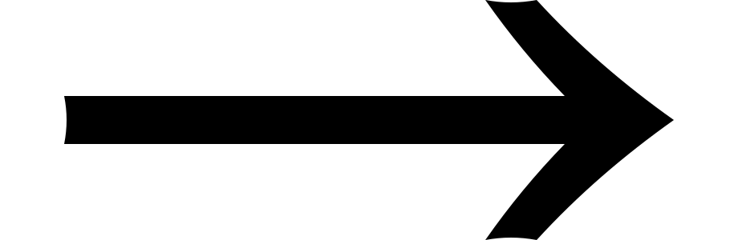, write a ‘c’”, then what I am to do is given by that, as far as it can be given at all.

### [XI-80-11\[3\]](https://cdn.wittgensteinnachlass.com/2000px/webp/Ts-212/XI-80-11.webp),[XI-80-12\[1\]](https://cdn.wittgensteinnachlass.com/2000px/webp/Ts-212/XI-80-12.webp),[XI-80-13\[1\]](https://cdn.wittgensteinnachlass.com/2000px/webp/Ts-212/XI-80-13.webp)

67 (70) For nothing can be determined more fully than by an exact description. For to determine something can only _mean_ to describe it.

### [XI-80-12\[1\]](https://cdn.wittgensteinnachlass.com/2000px/webp/Ts-212/XI-80-12.webp),[XI-80-13\[1\]](https://cdn.wittgensteinnachlass.com/2000px/webp/Ts-212/XI-80-13.webp)

70 Then an action is not determined if the description still leaves something open (so that one can say “I do not yet know whether …”), which the description can therefore _determine_. If the description is complete, the action is determined. And that means that only _one_ action can correspond to the description. (This is the only way we can use _the word_.) (Let us recall the argument about “toothache”.)

### [XI-80-13\[2\]](https://cdn.wittgensteinnachlass.com/2000px/webp/Ts-212/XI-80-13.webp)

70 (37a) Here too is the connection with the question: “when the other person sees blue, does he really see the same colour as I do?” Of course, he sees blue! That is precisely the same colour. – _I.e._, the question whether the colour he sees as blue is the same is nonsensical if it is _assumed_ that we are entitled to call what he sees and what I see ‘blue’. If it can be established in the ordinary sense – i.e. by the ordinary method – that he does not see the same colour, then I cannot say that we both see blue. And if it can be established that we both see blue, then “we both see the same colour”, for this sentence refers only to these tests.

### [XI-80-13\[3\]](https://cdn.wittgensteinnachlass.com/2000px/webp/Ts-212/XI-80-13.webp)

70 (37a) And that is how things stand with the question: “is what I now call ‘yellow’ certainly the same colour as what I used to call ‘yellow’?” – Certainly, for it is yellow. – But how do you know that? – Because I remember. – But can memory not deceive? – No. Not when its datum is precisely what I go by.

### [XI-80-14\[1\]](https://cdn.wittgensteinnachlass.com/2000px/webp/Ts-212/XI-80-14.webp)

70 Now if one asks: Is the fact, then, determined by the expectation as to yes and no, or not, i.e. is it determined in what sense the expectation will be answered by an event – whatever event occurs – then one must answer: _yes_! It would be indeterminate, for instance, if there were a disjunction in the expression of the expectation.

### [XI-80-15\[1\]](https://cdn.wittgensteinnachlass.com/2000px/webp/Ts-212/XI-80-15.webp)

70 When I say “surely the proposition determines in advance what will make it true”: Certainly, the proposition ‘p’ determines that p must be the case for it to be true; but that is all one can say about it, & it means only: “the proposition p = the proposition that the fact p makes true”.

### [XI-81FCr\[1\]](https://cdn.wittgensteinnachlass.com/2000px/webp/Ts-212/XI-81FCr.webp)

Intention.

What kind of process is it? One is supposed to be able to see what is intended by examining this process.

### [XI-81-1\[1\]](https://cdn.wittgensteinnachlass.com/2000px/webp/Ts-212/XI-81-1.webp)

2 When one says “this is the brake lever, but it doesn’t work”, one is speaking of the intention. It is much the same when one still calls a broken clock a clock.

### [XI-81-2\[1\]](https://cdn.wittgensteinnachlass.com/2000px/webp/Ts-212/XI-81-2.webp),[XI-81-3\[1\]](https://cdn.wittgensteinnachlass.com/2000px/webp/Ts-212/XI-81-3.webp)

16, 27a Suppose that pulling the brake lever sometimes slows the machine down and sometimes does not. From that alone it does not follow that it was intended as a brake lever. Now if a certain person were to get annoyed whenever the lever failed to act as a brake –. That would still not show what I want to show. Indeed, one could then say that the lever sometimes operates the brake and sometimes the annoyance. – For how is it expressed that _what_ annoys the person is that the lever failed to operate the brake? (For this _being annoyed_ _about_ _something_ is apparently of exactly the same kind as: fearing something, wishing for something, expecting something, etc.) For “being annoyed about something” is not related to what one is annoyed about as an effect is to its cause, that is, as stomach pains are to the food that upset one’s stomach. One can be in doubt about what upset one’s stomach, and the food that may have caused the stomach pains does not enter into them as a constituent of those pains; by contrast, in a certain sense, one cannot be in doubt about what one is annoyed about, what one is afraid of, what one believes. (One does not say “I don’t know – today I believe, but I don’t know what I believe in”!) – And here, of course, we have the old problem: the thought that such and such is the case does not presuppose that it is the case. But on the other hand, something of the fact must surely be presupposed by the thought itself. “I cannot think that something is red if red does not exist at all”. The answer is that the thoughts must be in the same space as what is in doubt, though in a different place.

### [XI-81-4\[1\]](https://cdn.wittgensteinnachlass.com/2000px/webp/Ts-212/XI-81-4.webp)

In this, & in this alone, consists also the (pre-established) harmony between world and thought. But intention is of exactly the same kind as – for example – annoyance. And here it somehow seems as if one would never recognize the intention as an _intention_ by viewing it from outside; as if one had to intend it oneself in order to understand it as an act of meaning. But that would mean not regarding it as a phenomenon, not as a fact! This is of course the previous problem again, for the point is that one must be able to tell from the thought (regarded as an independent fact) that it is the thought that such and such is the case. If one cannot tell this from it (any more than one can tell from stomach pains where they come from), then it is of no logical interest, or rather, then there is no logic. – This also comes down to saying that one must be able to compare the thought directly with reality, and cannot first need experience to know that this reality corresponds to this thought. (That is also why thoughts differ according to their content, but stomach pains do not differ according to what brought them on.) 16, 27a My view seems nonsensical if one expresses it _like this_: one is supposed to be able to see what someone is thinking about by opening up his head; how is that possible? The objects he is thinking about are not in his head at all (any more than they are in his thoughts)! One must, _after all_, be able to understand thoughts, intentions (etc.) viewed from outside as such, _without_ being told the meaning of _anything_. For the relation of meaning is then itself seen as a phenomenon (and I cannot then have to point in turn to a meaning of the phenomenon, since this act of signifying is itself included among the phenomena.)

### [XI-81-4\[2\]](https://cdn.wittgensteinnachlass.com/2000px/webp/Ts-212/XI-81-4.webp),[XI-81-5\[1\]](https://cdn.wittgensteinnachlass.com/2000px/webp/Ts-212/XI-81-5.webp)

16, 27a So when one looks at the thought, there can no longer be any question of 16, 27a understanding, for if one sees it, one must recognize it as the thought with this content; there is nothing to interpret. – But that is how it really is when we think: there is no interpreting. –

### [XI-81-6\[1\]](https://cdn.wittgensteinnachlass.com/2000px/webp/Ts-212/XI-81-6.webp)

The causal explanation of meaning and understanding goes essentially like this: to understand a command means that one would carry it out if a certain bolt were drawn back. – Suppose someone were commanded to raise an arm, and one said: to understand the command means to raise the arm. That is clear, even if it goes against our linguistic usage (we call that “obeying the command”). But now one says: To understand the command means either to raise the arm or, failing that, to do some other specific thing – say, to raise the leg. But this is not “understanding” in the first sense, for the command was not “to raise the arm or the leg”. So the command refers (as before) to an action that did _not_ take place. In other words, the distinction between understanding and obeying the command remains. And Frege goes on: a command that is not understood is not a command at all. – This understanding of the command cannot be just any action (say, raising one’s foot); rather, the action must contain the essence of the command itself.

### [XI-81-7\[1\]](https://cdn.wittgensteinnachlass.com/2000px/webp/Ts-212/XI-81-7.webp)

“In the fact of understanding, understanding (whatever it is) must find expression. In the process of understanding (whatever process that may be), understanding must be _expressed_.” (If I were to look into someone’s mind, I would have to see what he is thinking about. See the process of thinking.)

### [XI-81-8\[1\]](https://cdn.wittgensteinnachlass.com/2000px/webp/Ts-212/XI-81-8.webp)

70a _In language_ everything is _settled_ .

### [XI-81-9\[1\]](https://cdn.wittgensteinnachlass.com/2000px/webp/Ts-212/XI-81-9.webp)

27a 16 Why does my thought seem to me such an exceptional piece of reality? Surely not because I know it “from within”; that means nothing. Rather, apparently, it is because I settle everything in thought, and all I do about thinking, in turn, is think about it.

### XI-82FCr\[1\]

No feeling of satisfaction (no third thing) can be the criterion for the expectation’s being fulfilled.

### [XI-82-1\[1\]](https://cdn.wittgensteinnachlass.com/2000px/webp/Ts-212/XI-82-1.webp)

70a, 10 For one might think: how does this work? The thought and the fact are different; yet we call the thought: the _one_, namely that the fact is the case; or the fact: the one that makes the thought true. Is the one, then, a description made with the aid of the other? Is the thought _described_ by means of the fact that makes it true, and thus described in terms of an external property, as when I say of someone that he is my uncle?

### [XI-82-1\[2\]](https://cdn.wittgensteinnachlass.com/2000px/webp/Ts-212/XI-82-1.webp)

70a, 10 If one explains the expression “the thought that … is the case” as a _description_, that again explains nothing, because the question arises: how is such a description possible? It in turn presupposes the essence of thought, for it contains a reference to a fact that has not occurred, which is precisely what was problematic.

### [XI-82-2\[1\]](https://cdn.wittgensteinnachlass.com/2000px/webp/Ts-212/XI-82-2.webp)

21 The fulfilment of the expectation does not consist in a third thing happening, which one could describe in some other way besides simply as “the fulfilment of the expectation”, for example, as a feeling of satisfaction, or of joy, or whatever. For the expectation that p will be the case must be the same as the expectation of the fulfilment of this expectation; whereas, if I am wrong, the expectation that p will come to pass would differ from the expectation that the fulfilment of this expectation will come to pass.

### [XI-82-3\[1\]](https://cdn.wittgensteinnachlass.com/2000px/webp/Ts-212/XI-82-3.webp)

70a Could the justification go like this: “You said ‘bring something red’, and this here then gave me a feeling of satisfaction, so I brought it”?

### [XI-82-3\[2\]](https://cdn.wittgensteinnachlass.com/2000px/webp/Ts-212/XI-82-3.webp)

70a Would one not have to answer: But I didn’t tell you to bring me whatever would give you such a feeling in response to your words!

### [XI-82-4\[1\]](https://cdn.wittgensteinnachlass.com/2000px/webp/Ts-212/XI-82-4.webp)

70a 21 (27) (78) I go looking for the yellow flower. Even if I have a picture in mind as I go, do I need it when I see the yellow flower – or another one? – And if I say “as soon as I see a yellow flower, something in my memory clicks into place, as it were”: can I foresee, expect, this clicking into place any more readily than the yellow flower? I don’t see why. That is, if in a particular case I really do expect not the yellow flower but some other (indirect) criterion, this is in any case no explanation of expecting.

### [XI-82-5\[1\]](https://cdn.wittgensteinnachlass.com/2000px/webp/Ts-212/XI-82-5.webp)

21 (27) 70a (78) But doesn’t a phenomenon of assent (or satisfaction) always go _hand in hand_ with the occurrence of what is expected? Then I ask: Is this phenomenon something other than the occurrence of what is expected? If so, then I don’t know whether such a distinct phenomenon always accompanies fulfilment. – Or is it the same thing as fulfilment? If I say: The person whose expectation is fulfilled doesn’t _have_ to say “yes, that’s it” (or something of the sort), one may reply to me: “certainly, but surely he must _know_ that the expectation is fulfilled”. – Yes, insofar as knowing is part of the expectation’s _being_ fulfilled. In this sense: if he didn’t know it, it wouldn’t be fulfilled. – “True, but when someone’s expectation is fulfilled, surely there is always a release of tension!” – _How do you know that_? –

### [XI-82-6\[1\]](https://cdn.wittgensteinnachlass.com/2000px/webp/Ts-212/XI-82-6.webp)

70a In a game of hide-and-seek I expect to find the thimble. When I find it, I give a sign of satisfaction, or at least I feel (_a_) satisfaction. I may have expected this phenomenon too (or not), but this expectation is not the expectation of finding the thimble. I can have both expectations, and they are clearly quite distinct.

### [XI-82-7r\[1\]](https://cdn.wittgensteinnachlass.com/2000px/webp/Ts-212/XI-82-7r.webp)

70a It is not that we feel a dissatisfaction that then _is removed_ by finding the thimble, and then say: “so that phenomenon was the expectation of the thimble”. No, the first phenomenon is the expectation of the thimble just as surely as the second is the finding of the thimble. The word “thimble” belongs to the description of the first just as necessarily as to the description of the second. Only let us not confuse “the meaning of the word ‘thimble’” (the place of this word in grammatical space) with the fact that a thimble is here.

### [XI-82-7v\[1\]](https://cdn.wittgensteinnachlass.com/2000px/webp/Ts-212/XI-82-7v.webp)

… a red flower. [unreadable]

### [XI-83FCr\[1\]](https://cdn.wittgensteinnachlass.com/2000px/webp/Ts-212/XI-83FCr.webp)

The thought – expectation, wish, etc. – & the present situation.

### [XI-83-1\[1\]](https://cdn.wittgensteinnachlass.com/2000px/webp/Ts-212/XI-83-1.webp)

(20), 27a “Attending to the picture seems like mere play if it is not _concerned_ with the reality that interests us. If I hope that he will come in through the door, then I am attending to _this_ door, say, to the floor he will step on. And the rest of what the imagination does is not play but a kind of preparation, an activity (a piece of work, so to speak) that bears within it the form of the picture. Rather as if (only not necessarily so explicit) I meant to lay a carpet along his path and set out a chair in a particular place.” For why should we be interested in this particular picture when we do not otherwise concern ourselves with states of mind, stomach aches, etc.?

### [XI-83-2\[1\]](https://cdn.wittgensteinnachlass.com/2000px/webp/Ts-212/XI-83-2.webp)

74 (The map can guide me only if I am on the map too.)

### [XI-83-3\[1\]](https://cdn.wittgensteinnachlass.com/2000px/webp/Ts-212/XI-83-3.webp)

74 If I have lost my bearings while blindfolded and am then told: go to such and such a place, this command has no sense for me.

### [XI-83-4\[1\]](https://cdn.wittgensteinnachlass.com/2000px/webp/Ts-212/XI-83-4.webp)

74 I expect the rod to be 2 m high _in the same sense_ in which it is now 1 m 99 cm high.

### [XI-83-5\[1\]](https://cdn.wittgensteinnachlass.com/2000px/webp/Ts-212/XI-83-5.webp)

74 In the _same_ sense in which it is now 1 m high, it will later be 1,5 m high.

### [XI-83-6\[1\]](https://cdn.wittgensteinnachlass.com/2000px/webp/Ts-212/XI-83-6.webp)

(16), 27a If thought were, so to speak, a private amusement and had nothing to do with the outside world, it would be of no interest to us at all (like, say, the feelings one has with an upset stomach). What we want to know is: What does thought have to do with what happens outside thought?

### [XI-83-7\[1\]](https://cdn.wittgensteinnachlass.com/2000px/webp/Ts-212/XI-83-7.webp)

27a For that is the only source of its meaning, I mean its importance. What does what I think have to do with what is the case?

### [XI-83-8\[1\]](https://cdn.wittgensteinnachlass.com/2000px/webp/Ts-212/XI-83-8.webp)

17a Thinking as a whole _and_ its application proceed, so to speak. – However many intermediate stages I put between the thought and its application, one intermediate stage always follows the next – and the application follows the last – without an intervening link. And here we have the same case as when we try to bridge the gap between decision and deed by inserting intermediate links.

### [XI-83-9\[1\]](https://cdn.wittgensteinnachlass.com/2000px/webp/Ts-212/XI-83-9.webp)

70 17a When I walk, the individual step does not contain the destination that the _walking_ will bring me to. If I reach the destination, each step was a step towards it.

### [XI-83-10\[1\]](https://cdn.wittgensteinnachlass.com/2000px/webp/Ts-212/XI-83-10.webp)

(70a, 74) “What does wishing for a yellow flower consist in? Essentially in missing a yellow flower in what one sees? And so also in recognizing what is expressed in the sentence ‘I see no yellow flower now’.”

### [XI-83-11\[1\]](https://cdn.wittgensteinnachlass.com/2000px/webp/Ts-212/XI-83-11.webp)

20, 74 Could one also say: One _cannot_ describe the expectation if one cannot describe present reality; or, one cannot describe the expectation if one cannot give a _comparative_ description of expectation and present in the form: Now I see a red circle here and expect a blue quadrilateral there later. That is, the yardstick of language must be applied at the point of the present and then points beyond it – say, in the direction of the expectation.

### [XI-83-12\[1\]](https://cdn.wittgensteinnachlass.com/2000px/webp/Ts-212/XI-83-12.webp)

What I mean is: if I talk about a yellow flower, I need not see one, to be sure, but I must see _something_, and the word “yellow flower” has meaning, as it were, only in accord with or in contrast to what I see. Its meaning would, as it were, be determined solely from what I see: either as what I see, or as what lies at such and such a distance from it in such and such a direction. Here, though, I do not mean direction or distance in the ordinary spatial sense; one might mean the direction from red to blue and the distance in colour from red to a particular bluish red. – But even so my conception is not right. It is true that the sentence “I wish for a yellow flower” presupposes visual space, namely only insofar as it presupposes that in our language the sentence “I see a yellow flower now” and its opposite must have sense. Indeed, it must also make sense, or rather, it does make sense, to say “the yellow I wish for is greener than the one I see”. But on the other hand, the grammatical place of the word “yellow flower” is not determined by a measurement relative to what I now see. Though, insofar as one can speak of any such distance and direction at all, this distance and direction must be given in grammatical space by the description of the present visual image and of what is wished for.

### [XI-83-13\[1\]](https://cdn.wittgensteinnachlass.com/2000px/webp/Ts-212/XI-83-13.webp)

27, (27a) I have the feeling that only the attitude we take towards the picture can make it real for us, i.e. can connect it with reality like a joining plate, as it were, that provides the transition from the picture to reality, holding the two in the right position relative to each other by virtue of their both meaning the same thing to that attitude. Fear connects the picture with the horrors of reality.

### [XI-84FCr\[1\]](https://cdn.wittgensteinnachlass.com/2000px/webp/Ts-212/XI-84FCr.webp)

Belief

Grounds for belief

### [XI-84-1\[1\]](https://cdn.wittgensteinnachlass.com/2000px/webp/Ts-212/XI-84-1.webp)

36 Believing. Akin to it are: expecting, hoping, fearing, wishing. But also: doubting, looking for, etc. One says: “From 5 to 6 o’clock I was expecting him”, “I hoped all day that he would come”, “in my youth I wished …”, etc. Hence the mistaken comparison with states that are amorphous in time (toothache, hearing a tone, etc., though these in turn differ from one another).

### [XI-84-1\[2\]](https://cdn.wittgensteinnachlass.com/2000px/webp/Ts-212/XI-84-1.webp)

36 Now what does “I believe he will come at 5 o’clock” mean? Or: “he believes N will come at 5 o’clock”? Well, how do I tell that he believes it? From his saying so? Or from the rest of his behaviour? Or from both? Depending on that, one can give the sentence “he believes …” different senses.

### [XI-84-1\[3\]](https://cdn.wittgensteinnachlass.com/2000px/webp/Ts-212/XI-84-1.webp)

36 Does it make sense to ask: “How do you know that you believe that”? And is the answer perhaps: “I recognize it through introspection”? In _some_ cases one will be able to say something of the sort, but not in others.

### [XI-84-1\[4\]](https://cdn.wittgensteinnachlass.com/2000px/webp/Ts-212/XI-84-1.webp)

36 It makes sense to ask: “Do I really love her? Am I not just fooling myself?” And the process of introspection here is the _calling up_ of memories, the imagining of possible situations and of the feelings one would have, etc.

### [XI-84-2\[1\]](https://cdn.wittgensteinnachlass.com/2000px/webp/Ts-212/XI-84-2.webp),[XI-84-3\[1\]](https://cdn.wittgensteinnachlass.com/2000px/webp/Ts-212/XI-84-3.webp)

36 40 If the reason for believing something 40? were an empirical relation, one would have to ask further “and why is _that_ a reason for _this_ belief in particular”. And so it would go on. (E.g. “why do we take memory as a reason for believing that something happened in the past”.)

### [XI-85FCr\[1\]](https://cdn.wittgensteinnachlass.com/2000px/webp/Ts-212/XI-85FCr.webp)

_Reason, Motive, Cause._

### [XI-85-1\[1\]](https://cdn.wittgensteinnachlass.com/2000px/webp/Ts-212/XI-85-1.webp)

36, 87 I put my hand on the hotplate, feel unbearable heat and quickly pull my hand away: Was it not possible that the heat of the plate would have _ceased_ the next moment? Could I have known? And was it not possible that my very movement exposed me to pain? So in a sense it is not a good justification to say: “I pulled my hand away because the plate was too hot”! –

### [XI-85-1\[2\]](https://cdn.wittgensteinnachlass.com/2000px/webp/Ts-212/XI-85-1.webp)

36, 87 Now if one asked: Are you sure you did it _for that reason_? Would one not swear that one did it for that reason alone? And yet is it not experience? Would one not have to say: one would swear that one _wanted_ to do it for that reason; not that this was the cause of one’s arm pulling away? One swears to the motive, not to the cause.

### [XI-85-1\[3\]](https://cdn.wittgensteinnachlass.com/2000px/webp/Ts-212/XI-85-1.webp)

87 “I couldn’t bear it any more (any _longer_)”. “I can’t bear it any more; I must pull my hand away”. But what does this pulling away consist in, if not in wishing that the hand would pull away while it actually does pull away? If it does not pull away, there is nothing we can do either. At any rate, I would like to say, ‘wanting to pull it away’ is an experience we can wish for but cannot bring about. (Think of the experience of drawing a square with its diagonals by looking in the mirror.)

### [XI-85-1\[4\]](https://cdn.wittgensteinnachlass.com/2000px/webp/Ts-212/XI-85-1.webp),[XI-85-2\[1\]](https://cdn.wittgensteinnachlass.com/2000px/webp/Ts-212/XI-85-2.webp)

87 When I say that I can wish for the experience of wanting, but cannot bring it about, I am back to a kind of nonsense very characteristic of epistemology. For in the sense in 87 which I can bring anything about at all (say, stomach pains by overeating), I can also bring about wanting. (In this sense I bring about wanting to swim by jumping into deep water.) Presumably what I meant to say was: I could not want to want; i.e. it makes no sense to speak of wanting-to-want. And my mistaken expression arose because one wants to think of wanting as a direct non-causal bringing about. And this in turn rests on a _false_ analogy, say, that the causal nexus is formed by a series of cogwheels (the series can fail if the mechanism is _disrupted_), whereas the nexus of the will corresponds, say, to that between what is inner and what is outer, or to that between the movement of the physical body and the movement of its appearance.

### [XI-85-3\[1\]](https://cdn.wittgensteinnachlass.com/2000px/webp/Ts-212/XI-85-3.webp)

87 “How do you know that this was your motive for doing it?” “I remember doing it for that reason”. – “_What_ do you remember? Did you say it to yourself at the time; or do you remember the mood you were in; or that you had trouble suppressing an expression of your feeling?” And if, say, one only managed with difficulty to suppress an expression of one’s feeling, – what was that like? Had one quietly said it to oneself at the time? etc. etc.

### [XI-85-3\[2\]](https://cdn.wittgensteinnachlass.com/2000px/webp/Ts-212/XI-85-3.webp)

87 A motive is not a cause ‘seen from within’! The simile of ‘inside and outside’ is here – as so often – utterly misleading. – It is taken from the _idea_ of a soul (a living being) in the head (imagined as a hollow space). But in the simile this idea is mixed with other, incompatible ones, like the metaphors in the sentence: “the tooth of time, which heals all wounds, etc.”.

### [XI-85-4\[1\]](https://cdn.wittgensteinnachlass.com/2000px/webp/Ts-212/XI-85-4.webp)

87, 36 “How do you know that that is really the reason why you believe it” – (that) is as if I asked: “How do you know that _that_ is what you believe”. For he is not giving the cause of a belief, which he could only surmise, but describing a _process of operations_ that lead to what is believed (and may have led to it). A process that by its nature belongs with that of believing. – The difference between the question about the cause and the (_question_) about the reason for the belief is rather like the difference between the question “What is the physical cause of your being here” and the question “Which way did you come”. – And here one can see very clearly how specifying a cause can also be understood as specifying a route, but in an entirely different sense.

### [XI-85-4\[2\]](https://cdn.wittgensteinnachlass.com/2000px/webp/Ts-212/XI-85-4.webp),[XI-85-4\[1\]](https://cdn.wittgensteinnachlass.com/2000px/webp/Ts-212/XI-85-4.webp)

87 “One can only surmise the cause of a phenomenon” (not _know_ it). – That must be a sentence of grammar. The point is not that, ‘with the best will in the world’, we cannot know the cause. In this respect the sentence is like: “We cannot reach an end in the series of numbers, however far we count”. That is to say: there can be no question of an “end of the series of numbers”; and this is – misleadingly – dressed up in the simile of someone who cannot reach the end because the way is so long. – Thus there is a sense in which I can say: “I can only surmise the cause of this phenomenon”, i.e. I have not yet managed to ‘establish’ it (in the ordinary sense). In contrast, then, to the case in which I have managed to do so and therefore know the cause. – But if I now say, as a metaphysical sentence, “I can only ever surmise _the_ cause”, this means: in the case of a cause I always want to speak only of ‘surmising’ and not of ‘knowing’, so as to distinguish cases with different grammars from one another. (So it is as if I said: in an equation I want to use the sign “ = ” and ? ? not the word “is”.) Thus what _is wrong_ with our first example is the word “only”, though of course it belongs entirely to the simile already implicit in the use of the word “can”.

### [XI-85-6\[1\]](https://cdn.wittgensteinnachlass.com/2000px/webp/Ts-212/XI-85-6.webp),[XI-85-7\[1\]](https://cdn.wittgensteinnachlass.com/2000px/webp/Ts-212/XI-85-7.webp)

87 When asked about the reasons for an assumption, one _recollects_ these reasons. Is the same thing happening here as when one thinks about the 87? causes of an event?

### [XI-85-8\[1\]](https://cdn.wittgensteinnachlass.com/2000px/webp/Ts-212/XI-85-8.webp)

87 “This landscape makes me melancholy”. How do you know it is the landscape? Is that a hypothesis – just as you only _believe_ that that food caused the stomach pains, or does it belong to _immediate_ experience. Would it then be refuted if, transported to a different landscape, you remained melancholy; or is it not open to refutation by a future experience, because it describes the present one? Indeed, how did you come by the thought that it is the landscape that brings on this mood? Or is it not a matter at all of a state it brings about in me, but, _perhaps_, of the picture of the landscape _being_ melancholy? (This is directly connected with the problem: motive and cause.) “That is a dreadful sight”. – “How do you know that _it_ is dreadful?” “I tremble because I see it”. You cannot know _that_. Perhaps you would have trembled anyway. How does the fear relate to the sight? Or to the dreadful image? Or should I perhaps say: “to be afraid of this image” _means_ to have it and to be afraid? But if one has several images while one is afraid (sees or hears several things), is there any doubt as to what is dreadful? Or is it from experience that one knows what (out of all these things) one is afraid of? I would also like to say “being afraid is an engagement with the sight”. Can I say that it is a very complicated process into which the image enters at characteristic points?

### [XI-85-9\[1\]](https://cdn.wittgensteinnachlass.com/2000px/webp/Ts-212/XI-85-9.webp)

87 Let us think of a dreadful face. What role does the sight play in the process of fear.

### [XI-85-9\[2\]](https://cdn.wittgensteinnachlass.com/2000px/webp/Ts-212/XI-85-9.webp)

87 I want to say: fear does not _accompany_ the sight. Rather, what is dreadful and the fear have the structure of the face. Imagine that in our _agitation_ we follow the features of a face with our eyes. Tracing them, as it were, trembling. So that the oscillations of fear would be superimposed on the lines of the face.

### [XII-FCr\[1\]](https://cdn.wittgensteinnachlass.com/2000px/webp/Ts-212/XII-FCr.webp)

_Philosophy_

### [XII-86FCr\[1\]](https://cdn.wittgensteinnachlass.com/2000px/webp/Ts-212/XII-86FCr.webp)

Difficulty of philosophy, not the intellectual difficulty of the sciences, but the difficulty of a reorientation. Resistance of the _will_ has to be overcome.

### [XII-86-1\[1\]](https://cdn.wittgensteinnachlass.com/2000px/webp/Ts-212/XII-86-1.webp)

60 As I have often said, philosophy does not lead me to renounce anything, since I do not refrain from saying something, but give up a certain combination of words as senseless. In another sense, however, philosophy does require resignation, but of feeling, not of the intellect. And perhaps that is what makes it so difficult for many. It can be hard not to use an expression, just as it is hard to hold back tears or an outburst of anger.

### [XII-86-2\[1\]](https://cdn.wittgensteinnachlass.com/2000px/webp/Ts-212/XII-86-2.webp),[XII-86-3\[1\]](https://cdn.wittgensteinnachlass.com/2000px/webp/Ts-212/XII-86-3.webp)

60, 61 (Tolstoi: the meaning (significance) of a subject lies in its being intelligible to everyone. – That is true and false. What makes the subject hard to understand – if it is significant, important – is not that understanding it would require some special instruction in abstruse matters, but the opposition between understanding the subject and what most people _want_ to see. This can make the very thing that lies closest to hand the hardest of all to 60, 61 understand. What has to be overcome is not a difficulty of the intellect, but of the will.)

### [XII-86-4\[1\]](https://cdn.wittgensteinnachlass.com/2000px/webp/Ts-212/XII-86-4.webp)

61 Work in philosophy is – as work in architecture often is – really more a matter of working on oneself. On one’s own conception. On how one sees things. (And on what one demands of them.)

### [XII-86-5\[1\]](https://cdn.wittgensteinnachlass.com/2000px/webp/Ts-212/XII-86-5.webp),[XII-86-6\[1\]](https://cdn.wittgensteinnachlass.com/2000px/webp/Ts-212/XII-86-6.webp)

61, (62) Speaking in passing, in the old conception – say, that of the (great) Western philosophers – there were two kinds of problem in the scientific sense: essential, great, universal problems, and inessential, as it were accidental ones. 60 Our conception, by contrast, is that there is no _great_, essential problem in the scientific sense.

### [XII-87FCr\[1\]](https://cdn.wittgensteinnachlass.com/2000px/webp/Ts-212/XII-87FCr.webp)

Philosophy points out the misleading analogies in the use of our language.

### [XII-87-1\[1\]](https://cdn.wittgensteinnachlass.com/2000px/webp/Ts-212/XII-87-1.webp)

39? 38˙2 [Sraffa] Is grammar, as I use the word, merely a description of how language is actually handled? So that its sentences could really be understood as sentences of a natural science? One could call that the descriptive science of speaking, as opposed to that of thinking.

### [XII-87-1\[2\]](https://cdn.wittgensteinnachlass.com/2000px/webp/Ts-212/XII-87-1.webp),[XII-87-2\[1\]](https://cdn.wittgensteinnachlass.com/2000px/webp/Ts-212/XII-87-2.webp)

39? 38˙2 After all, the rules of chess could also be understood as sentences from 3˙8˙2 the natural history of human beings. (Just as the games of animals are described in books of natural history.)

### [XII-87-3\[1\]](https://cdn.wittgensteinnachlass.com/2000px/webp/Ts-212/XII-87-3.webp),[XII-87-4\[1\]](https://cdn.wittgensteinnachlass.com/2000px/webp/Ts-212/XII-87-4.webp)

62, 60 When I rectify a philosophical error and say that 62, 60 one has always imagined it this way, but it is not like that, I always point to an analogy that one has been guided by, and show that this analogy does not _fit_.

### [XII-87-5\[1\]](https://cdn.wittgensteinnachlass.com/2000px/webp/Ts-212/XII-87-5.webp)

62, 60 The effect of a false analogy taken into language: it _means_ constant struggle and disquiet (a constant irritation, as it were). It is as if from a distance a thing seems to be a person because we do not then perceive _certain things_, and up close we see that it is a tree stump. As soon as we go a little way off and lose sight of the explanation, _one_ shape appears to us; if we then look more closely, we see another; now we go off again, etc. etc.

### [XII-87-6\[1\]](https://cdn.wittgensteinnachlass.com/2000px/webp/Ts-212/XII-87-6.webp)

60a, 62 (The unsettling character of grammatical unclarity.)

### [XII-87-7\[1\]](https://cdn.wittgensteinnachlass.com/2000px/webp/Ts-212/XII-87-7.webp)

60 To philosophize is to reject false arguments.

### [XII-87-8\[1\]](https://cdn.wittgensteinnachlass.com/2000px/webp/Ts-212/XII-87-8.webp),[XII-87-9\[1\]](https://cdn.wittgensteinnachlass.com/2000px/webp/Ts-212/XII-87-9.webp)

60 The philosopher strives to find the redeeming word, that is, the word that finally allows us to grasp what has all along weighed on our consciousness without our being able to grasp it. (It is as if one had a hair on one’s tongue; one 60 feels it but cannot grasp it and therefore cannot get rid of it.)

### [XII-87-9\[2\]](https://cdn.wittgensteinnachlass.com/2000px/webp/Ts-212/XII-87-9.webp)

60 The philosopher gives us the word with which one can express the matter and render it harmless.

### [XII-87-10\[1\]](https://cdn.wittgensteinnachlass.com/2000px/webp/Ts-212/XII-87-10.webp)

60 (The choice of our words is so important because what matters is to capture the physiognomy of the thing _exactly_, because only a thought aimed with precision can lead onto the right track. The carriage must be set on the rail with hair’s-breadth precision if it is to roll on properly.)

### [XII-87-11\[1\]](https://cdn.wittgensteinnachlass.com/2000px/webp/Ts-212/XII-87-11.webp)

(2) 38˙2 One of the most important tasks is to express every false line of thought in such a characteristic way that the reader says “Yes, that is exactly how I meant it”. To trace the physiognomy of every error.

### [XII-87-12\[1\]](https://cdn.wittgensteinnachlass.com/2000px/webp/Ts-212/XII-87-12.webp)

38˙2 And after all, we can only show someone else his error if he recognizes that this really is the expression of his feeling.

### [XII-87-12\[2\]](https://cdn.wittgensteinnachlass.com/2000px/webp/Ts-212/XII-87-12.webp)

38˙2 That is, only if he recognizes it as such _is_ it the right expression. (Psychoanalysis.)

### [XII-87-13\[1\]](https://cdn.wittgensteinnachlass.com/2000px/webp/Ts-212/XII-87-13.webp)

38˙2 What the other person recognizes as the source of his thought is the analogy I offer him. [→ see p. 265/2]

### [XII-88FCr\[1\]](https://cdn.wittgensteinnachlass.com/2000px/webp/Ts-212/XII-88FCr.webp)

Where does the feeling that our grammatical investigations are fundamental come from?

### [XII-88-1\[1\]](https://cdn.wittgensteinnachlass.com/2000px/webp/Ts-212/XII-88-1.webp)

60 (We are occupied with questions of various kinds, such as “What is the specific gravity of this body”, “Will it stay fine today”, “Who will come in through the door next”, etc. But among our questions there are some of a special kind. Here we have a different experience. The questions seem more fundamental than the others. And now I say: when we have this experience, we have reached the boundary of language.)

### [XII-88-2\[1\]](https://cdn.wittgensteinnachlass.com/2000px/webp/Ts-212/XII-88-2.webp)

60, 60a Where does the examination derive its importance from, since it seems only to destroy everything interesting, i.e. everything great and important? (All buildings, as it were; leaving only chunks of stone and rubble.)

### [XII-88-4\[1\]](https://cdn.wittgensteinnachlass.com/2000px/webp/Ts-212/XII-88-4.webp)

60, 60a Where does the examination derive its importance from: the examination that draws our attention to the fact that one can use a table in more than _one_ way, that one can _devise_ a table as a guide to the use of a table, that one can also take an arrow as pointing in the direction from its tip to its tail, that I can use a model as a model in all sorts of ways?

### [XII-88-5\[1\]](https://cdn.wittgensteinnachlass.com/2000px/webp/Ts-212/XII-88-5.webp)

(16) 56 We bring words back from their metaphysical use to their proper use in language. (The man who said that one cannot step twice into the same river said something false; one _can_ step twice into the same river.) And this is what the solution to all philosophical difficulties looks like. The answers to them, if they are right, must be _homely_ and _ordinary_. But one must look at them in the right spirit; _then it doesn’t matter_.

### [XII-88-6\[1\]](https://cdn.wittgensteinnachlass.com/2000px/webp/Ts-212/XII-88-6.webp)

60a Where do the old philosophical problems get their significance from?

### [XII-88-6\[2\]](https://cdn.wittgensteinnachlass.com/2000px/webp/Ts-212/XII-88-6.webp)

60a The proposition of identity, for example, seemed to have a fundamental significance. But the proposition that this “proposition” is nonsense has taken over that significance.

### [XII-88-7r\[1\]](https://cdn.wittgensteinnachlass.com/2000px/webp/Ts-212/XII-88-7r.webp)

60a I might ask: Why do I find a grammatical joke in a certain sense deep? (And that is of course philosophical depth.)

### [XII-88-7v\[1\]](https://cdn.wittgensteinnachlass.com/2000px/webp/Ts-212/XII-88-7v.webp)

Is connected with the flux of appearance & with the fact that language is a calculus. (I cannot step twice into the same river.)

### [XII-88-8\[1\]](https://cdn.wittgensteinnachlass.com/2000px/webp/Ts-212/XII-88-8.webp)

60a Why do we feel that the investigation of grammar is fundamental?

### [XII-88-8\[2\]](https://cdn.wittgensteinnachlass.com/2000px/webp/Ts-212/XII-88-8.webp)

60a (The word “fundamental” cannot mean anything metalogical or philosophical either, where it has any meaning at all.)

### [XII-88-8\[3\]](https://cdn.wittgensteinnachlass.com/2000px/webp/Ts-212/XII-88-8.webp)

60a The investigation of grammar is fundamental in the same sense in which we can call language fundamental – call it, say, its own foundation.

### [XII-88-8\[4\]](https://cdn.wittgensteinnachlass.com/2000px/webp/Ts-212/XII-88-8.webp),[XII-88-9\[1\]](https://cdn.wittgensteinnachlass.com/2000px/webp/Ts-212/XII-88-9.webp)

(60), 60a After all, our grammatical investigation differs from that of a philologist, etc.; we are interested, for example, in translation from one language into other languages of our own invention. More generally, we are interested in rules that the philologist does not consider at all. So we can no doubt 60a draw attention to this difference.

### [XII-88-9\[2\]](https://cdn.wittgensteinnachlass.com/2000px/webp/Ts-212/XII-88-9.webp)

60a On the other hand, it would be misleading to say that we deal with what is essential in grammar (and he, with what is accidental).

### [XII-88-9\[3\]](https://cdn.wittgensteinnachlass.com/2000px/webp/Ts-212/XII-88-9.webp)

60a “But that is only an outward distinction”. I think there is no other.

### [XII-88-9\[4\]](https://cdn.wittgensteinnachlass.com/2000px/webp/Ts-212/XII-88-9.webp)

60a We might rather say that what we call grammar is something different from what he calls grammar. Just as we distinguish parts of speech where for him there is no distinction (_to be found_).

### [XII-88-10\[1\]](https://cdn.wittgensteinnachlass.com/2000px/webp/Ts-212/XII-88-10.webp)

60a The importance of grammar is the importance of language.

### [XII-88-11\[1\]](https://cdn.wittgensteinnachlass.com/2000px/webp/Ts-212/XII-88-11.webp)

60a One might also call a word, e.g. “red”, important in so far as it is used often and for important purposes, in contrast to, say, the word “pipe-lid”. And the grammar of the word ‘red’ is then important because it describes the meaning of the word ‘red’.

### [XII-88-12\[1\]](https://cdn.wittgensteinnachlass.com/2000px/webp/Ts-212/XII-88-12.webp)

60 (All philosophy can do is destroy idols. And that means not creating a new one – say, in the “absence of an idol”.)

### [XII-89FCr\[1\]](https://cdn.wittgensteinnachlass.com/2000px/webp/Ts-212/XII-89FCr.webp)

Method of philosophy:

the surveyable representation of the grammatical facts.

The aim: transparency of the arguments. Justice.

### [XII-89-1\[1\]](https://cdn.wittgensteinnachlass.com/2000px/webp/Ts-212/XII-89-1.webp),[XII-89-2\[1\]](https://cdn.wittgensteinnachlass.com/2000px/webp/Ts-212/XII-89-2.webp)

60 Someone has heard that a ship’s anchor is raised by a steam engine. He thinks only of the one that drives the ship (and after which it is called a steamship) and cannot make sense of what he has heard. (Perhaps the difficulty only occurs to him later.) Now we tell him: No, it is not _this_ steam engine; besides it there are several others on board, and one of them raises the anchor. – Was his problem philosophical? Was it philosophical if he had heard of the existence of other steam engines on the ship and only needed to be reminded of them? – I think his lack of clarity has two parts: what the person explaining communicates to him as a fact, the questioner might quite well have thought up for himself as a possibility, and he might have put his question in a definite form instead of merely admitting that he was unclear. He could have dispelled this part of the doubt himself, whereas reflection could not have acquainted him with the facts. Or: the uneasiness that arose from his not knowing the truth could not be removed by any arranging of his concepts. The other uneasiness and lack of clarity are marked by the words “something here doesn’t seem right to me”, and the solution by (_the words_): “Oh, I see, you don’t mean _that_ steam engine” or – in another case – “… by steam engine you don’t just mean a reciprocating engine”.

### [XII-89-2\[2\]](https://cdn.wittgensteinnachlass.com/2000px/webp/Ts-212/XII-89-2.webp)

61 The work of the philosopher is a gathering of memories for a specific purpose.

### [XII-89-2\[3\]](https://cdn.wittgensteinnachlass.com/2000px/webp/Ts-212/XII-89-2.webp),[XII-89-3\[1\]](https://cdn.wittgensteinnachlass.com/2000px/webp/Ts-212/XII-89-3.webp)

60 A philosophical question is like a question about the constitution of a particular society. – It would be rather as if a society were to meet without clearly written rules, but with a need for them: indeed, with an instinct by which they observe certain rules at their meetings; only this is made harder by the fact that nothing _about this_ is clearly stated and no arrangements are made to make the rules plain. Thus they actually regard one of their number as president, but he does not sit at the head of the table, there is nothing to distinguish him, and this makes the proceedings more difficult. So we come along and establish a clear order: we seat the president in an easily recognizable place and his secretary beside him at a separate little table, and the remaining members, who have equal rights, in two rows on either 60 side of the table, etc., etc.

### [XII-89-4\[1\]](https://cdn.wittgensteinnachlass.com/2000px/webp/Ts-212/XII-89-4.webp),[XII-89-5\[1\]](https://cdn.wittgensteinnachlass.com/2000px/webp/Ts-212/XII-89-5.webp)

60 When one asks philosophy: “_what is_ – for example – substance?” one is asking for a rule. A general rule that _holds_ for the word “substance”, i.e. one by which I am resolved to play. – What I mean is: the question “what is …” does not relate to a particular – practical – case; we ask it from our desks. Just recall the case of the law of identity to see that settling a philosophical difficulty is not a matter of stating new truths about the object of the investigation (identity). The difficulty is only to understand how laying down a rule helps us. Why it puts us at ease after we have been so _deeply_ troubled. What puts us at ease is evidently that we see a system that (_systematically_) excludes those constructions that have always troubled us, that we didn’t know what to do with and yet thought we had to respect. In this respect, isn’t laying down such a grammatical rule like discovering an explanation in physics? e.g. the Copernican system? There is a similarity. – The strange thing about philosophical uneasiness and its resolution, _it might seem_, is that it is like the _torment_ of the ascetic who stood there groaning as he held up a heavy ball, and whom a man released by saying to him: “let it drop”. One asks oneself: if these sentences trouble you and you didn’t know what to do with them, 60 why didn’t you let them drop earlier, what stopped you? Well, I think it was the false system he thought he had to conform to; etc.

### [XII-89-6\[1\]](https://cdn.wittgensteinnachlass.com/2000px/webp/Ts-212/XII-89-6.webp)

61a (The peculiar relief that comes when we can set other, similar cases alongside a case we thought unique comes again and again in our investigations when we show that a word does not have just _one_ meaning (or just two), but is used in five or six different (_meanings_).)

### [XII-89-7\[1\]](https://cdn.wittgensteinnachlass.com/2000px/webp/Ts-212/XII-89-7.webp),[XII-89-8\[1\]](https://cdn.wittgensteinnachlass.com/2000px/webp/Ts-212/XII-89-8.webp)

61 One can compare philosophical problems to safe locks which are opened by setting a particular word or number, so that no force can open the door until precisely that word has been hit upon, and once it has been hit upon any 60 child can open it.

### [XII-89-9\[1\]](https://cdn.wittgensteinnachlass.com/2000px/webp/Ts-212/XII-89-9.webp),[XII-89-10\[1\]](https://cdn.wittgensteinnachlass.com/2000px/webp/Ts-212/XII-89-10.webp)

61a The concept of a surveyable representation is of fundamental importance to us. It designates our form of representation, the way 61a we see things. (A kind of ‘world-view’, such as apparently typifies our time. Spengler.)

### [XII-89-10\[2\]](https://cdn.wittgensteinnachlass.com/2000px/webp/Ts-212/XII-89-10.webp)

61a This surveyable representation conveys the understanding that consists precisely in our “seeing the connections”. Hence the importance of the _intermediate links_.

### [XII-89-11\[1\]](https://cdn.wittgensteinnachlass.com/2000px/webp/Ts-212/XII-89-11.webp)

49 A sentence whose grammar has been made completely clear has been completely analysed logically. It may be written down or uttered in whatever form of expression.

### [XII-89-12\[1\]](https://cdn.wittgensteinnachlass.com/2000px/webp/Ts-212/XII-89-12.webp)

49 What our grammar lacks above all is _surveyability_.

### [XII-89-13\[1\]](https://cdn.wittgensteinnachlass.com/2000px/webp/Ts-212/XII-89-13.webp)

49, (61) Philosophy must not interfere with the actual use of language in any way; in the end, then, it can only describe it.

### [XII-89-13\[2\]](https://cdn.wittgensteinnachlass.com/2000px/webp/Ts-212/XII-89-13.webp)

49, (61) For it cannot justify it either.

### [XII-89-13\[3\]](https://cdn.wittgensteinnachlass.com/2000px/webp/Ts-212/XII-89-13.webp)

49, (61) It leaves everything as it is. It also leaves mathematics as it is (as it is now) and no mathematical discovery can advance it. A “leading problem of mathematical logic” (Ramsey) is a problem of mathematics _like any other_.

### [XII-89-14\[1\]](https://cdn.wittgensteinnachlass.com/2000px/webp/Ts-212/XII-89-14.webp)

<s>49a </s>

### [XII-89-15\[1\]](https://cdn.wittgensteinnachlass.com/2000px/webp/Ts-212/XII-89-15.webp),[XII-89-16\[1\]](https://cdn.wittgensteinnachlass.com/2000px/webp/Ts-212/XII-89-16.webp)

61 (A simile belongs to our _structure_; but we cannot draw any consequences from it either; it does not lead us beyond itself, but must 61? stand as a simile. We cannot draw any inferences from it. So, when we compare a sentence with a picture (where, of course, what we understand by ‘picture’ must already be fixed in us) or when I compare the application of language with that of, say, the calculus of multiplication. Philosophy simply lays everything out and explains nothing and infers nothing.)

### [XII-89-17\[1\]](https://cdn.wittgensteinnachlass.com/2000px/webp/Ts-212/XII-89-17.webp)

49 (9a) Since everything lies open to view, there is nothing to explain either. For whatever may not lie open to view does not interest us.

### [XII-89-17\[2\]](https://cdn.wittgensteinnachlass.com/2000px/webp/Ts-212/XII-89-17.webp)

49 (9a) The answer to the question _asking for an explanation_ of negation really is: don’t you understand it? Well, if you understand it, _what is there still to explain_, what is there left for an explanation to do?

### [XII-89-18\[1\]](https://cdn.wittgensteinnachlass.com/2000px/webp/Ts-212/XII-89-18.webp)

49, 61a We must know what _explanation_ means. There is a constant danger of wanting to use this word in logic in a sense taken from physics.

### [XII-89-19\[1\]](https://cdn.wittgensteinnachlass.com/2000px/webp/Ts-212/XII-89-19.webp)

88, 73a (When methodology speaks of _measurement_, it does not tell us, say, what material would be most advantageous for making the yardstick in order to obtain such and such a result; even though that too belongs to the method of measuring. Rather, this investigation is concerned only with the circumstances under which we say that a length, a current strength, (etc.) has been measured. It seeks to tabulate the familiar methods we already use, in order thereby to fix the meaning of the words “length”, “current strength”, etc.)

### [XII-89-20\[1\]](https://cdn.wittgensteinnachlass.com/2000px/webp/Ts-212/XII-89-20.webp)

61, 61a If one wanted to put forward _theses_ in philosophy, they could never come up for discussion, because everyone would agree with them.

### [XII-89-21\[1\]](https://cdn.wittgensteinnachlass.com/2000px/webp/Ts-212/XII-89-21.webp)

60 Learning philosophy _really_ is a recollection. We recall that we really have used the words in this way.

### [XII-89-22\[1\]](https://cdn.wittgensteinnachlass.com/2000px/webp/Ts-212/XII-89-22.webp)

The philosophically most important aspects of things are hidden by their simplicity and everyday character. (One cannot notice it because it is always (_plainly_) before one’s eyes.)

### [XII-89-23\[1\]](https://cdn.wittgensteinnachlass.com/2000px/webp/Ts-212/XII-89-23.webp)

61 The very foundations of a person’s inquiry do not strike him at all. Unless _this_ has struck him at some point. (Frazer, etc., etc.) And that means: the most striking (strongest) thing does not strike him.

### [XII-89-24\[1\]](https://cdn.wittgensteinnachlass.com/2000px/webp/Ts-212/XII-89-24.webp)

60 (One of the greatest obstacles to philosophy is the expectation of new, deep insights.)

### [XII-89-25\[1\]](https://cdn.wittgensteinnachlass.com/2000px/webp/Ts-212/XII-89-25.webp)

60 One could also call what is possible _before_ all new discoveries and inventions philosophy.

### [XII-89-25\[2\]](https://cdn.wittgensteinnachlass.com/2000px/webp/Ts-212/XII-89-25.webp)

This must also have to do with the fact that I cannot give any explanations of the variable “sentence”. It is clear that this logical concept, this variable, must be of the same order as the concept “reality” or “world”.

### [XII-89-26\[1\]](https://cdn.wittgensteinnachlass.com/2000px/webp/Ts-212/XII-89-26.webp)

60 If someone believes he has found the solution to the ‘problem of life’ and should want to say to himself that now everything is quite easy, to refute himself he would only need to remember that there was a time when this ‘solution’ had not been found; but even at _that_ time one had to be able to live, and in the light of that time the solution he has found seems like a mere accident. And so it is with us in logic. If there were a ‘solution’ to the logical (philosophical) problems, we would only have to remind ourselves that they were once unsolved (and even then one had to be able to live and think). – – –

### [XII-89-27\[1\]](https://cdn.wittgensteinnachlass.com/2000px/webp/Ts-212/XII-89-27.webp)

60 All considerations can be pursued in a much more homely way than I pursued them in the past. And that is why no new words need be used in philosophy either; the old, ordinary words of the language suffice.

### [XII-89-28\[1\]](https://cdn.wittgensteinnachlass.com/2000px/webp/Ts-212/XII-89-28.webp)

61, 85 (Our task is only to be just. I.e., we have only to point out and resolve the injustices of philosophy, not to set up new parties – and creeds –.)

### [XII-89-29\[1\]](https://cdn.wittgensteinnachlass.com/2000px/webp/Ts-212/XII-89-29.webp)

61 (It is hard not to exaggerate in philosophy.)

### [XII-89-30\[1\]](https://cdn.wittgensteinnachlass.com/2000px/webp/Ts-212/XII-89-30.webp)

61 (The philosopher exaggerates, cries out, as it were, in his helplessness, as long as he has not yet discovered the core of the confusion.)

### [XII-89-31\[1\]](https://cdn.wittgensteinnachlass.com/2000px/webp/Ts-212/XII-89-31.webp)

The philosophical problem is a consciousness of the disorder in our concepts, and is to be removed by putting them in order.

### [XII-89-32\[1\]](https://cdn.wittgensteinnachlass.com/2000px/webp/Ts-212/XII-89-32.webp)

60 A philosophical problem is always of the form: “I simply don’t know my way around”.

### [XII-89-33\[1\]](https://cdn.wittgensteinnachlass.com/2000px/webp/Ts-212/XII-89-33.webp),XII-89-34\[1\]

60 As I practise philosophy, its whole task is to shape the expression so that certain uneasinesses 60 disappear. ((Hertz.))

### XII-89-35\[1\]

60 If I am right, then philosophical problems, unlike all others, really must admit of solutions that leave nothing over.

### XII-89-35\[2\]

60 When I say: Here we are at the limit of language, it always seems as though resignation were called for here, whereas on the contrary one is fully satisfied, since _no_ question remains.

### XII-89-35\[3\]

60 The problems are dissolved in the literal sense – like a lump of sugar in water.

### [XII-89-36\[1\]](https://cdn.wittgensteinnachlass.com/2000px/webp/Ts-212/XII-89-36.webp)

61a People who feel no need for transparency in their argumentation are lost to philosophy.

### [XII-90FCr\[1\]](https://cdn.wittgensteinnachlass.com/2000px/webp/Ts-212/XII-90FCr.webp)

_Philosophy_

The clarification of linguistic usage.

Traps of language.

### [XII-90-1\[1\]](https://cdn.wittgensteinnachlass.com/2000px/webp/Ts-212/XII-90-1.webp)

60 How does it come about that philosophy is such a complicated structure. Surely it should be completely simple, if it is that ultimate thing, independent of all experience, that you make it out to be. – Philosophy untangles the knots in our thinking; therefore its result must be simple, but its activity as complicated as the knots it untangles.

### [XII-90-2\[1\]](https://cdn.wittgensteinnachlass.com/2000px/webp/Ts-212/XII-90-2.webp)

60 Lichtenberg: “All our philosophy is a correction of linguistic usage, hence the correction of a philosophy, and the most general one at that.”

### [XII-90-3\[1\]](https://cdn.wittgensteinnachlass.com/2000px/webp/Ts-212/XII-90-3.webp)

60 (The capacity for philosophy consists in the capacity to receive a strong _and_ lasting impression from a fact of grammar.)

### [XII-90-4\[1\]](https://cdn.wittgensteinnachlass.com/2000px/webp/Ts-212/XII-90-4.webp)

60? Why grammatical problems are so stubborn and apparently impossible to root out – because they are _connected_ with the oldest habits of thought, i.e. with the oldest pictures imprinted in our language itself. ([Lichtenberg])

### [XII-90-5\[1\]](https://cdn.wittgensteinnachlass.com/2000px/webp/Ts-212/XII-90-5.webp)

60 Teaching philosophy presents the same enormous difficulty that teaching geography would present if the pupil came with a host of false and far too simple ideas about the course and _interconnections_ of rivers and mountain ranges.

### [XII-90-6\[1\]](https://cdn.wittgensteinnachlass.com/2000px/webp/Ts-212/XII-90-6.webp),[XII-90-7\[1\]](https://cdn.wittgensteinnachlass.com/2000px/webp/Ts-212/XII-90-7.webp)

60 People are deeply embedded in philosophical, i.e. grammatical, confusions. And freeing them from these _presupposes_ tearing them out of the immensely varied connections in which they are caught. One has, so to speak, to regroup their entire language. – But this language arose as it did precisely because people had – and have – a tendency to think _this way_. So 60 they can be torn out only if they live in instinctive revolt against language. Not if their every instinct is to live in _the_ herd that created this language as its _proper_ expression.

### [XII-90-8\[1\]](https://cdn.wittgensteinnachlass.com/2000px/webp/Ts-212/XII-90-8.webp)

60 Language has the same traps ready for everyone; the vast network of well-maintained false paths. And so we see one person after another take the same paths, and already know where he will turn off now, where he will go straight on without noticing the turning, etc., etc. So I ought to put up signs wherever false paths branch off, to help people past the dangerous points.

### [XII-90-9r\[1\]](https://cdn.wittgensteinnachlass.com/2000px/webp/Ts-212/XII-90-9r.webp)

60 One hears the _remark_ again and again that philosophy makes no real progress, that the same philosophical problems that already occupied the Greeks still occupy us. But those who _say_ this don’t understand why it is so. The reason is that our language has stayed the same and keeps seducing us into asking the same questions. As long as there is a verb ‘to be’ that seems to function like ‘to eat’ and ‘to drink’, as long as there are adjectives ‘identical’, ‘true’, ‘false’, ‘possible’, as long as there is talk of a flow of time and an extension of space, etc., etc., people will keep coming up against the same _enigmatic difficulties_ and staring at something that no explanation seems able to remove. And this, incidentally, satisfies a longing for the otherworldly, for in believing that they see the “limit of human understanding”, they naturally believe they can see beyond it.

### [XII-90-9r\[2\]](https://cdn.wittgensteinnachlass.com/2000px/webp/Ts-212/XII-90-9r.webp)

60 I read “…philosophers are no nearer to the meaning of ‘Reality’ than Plato got …”. What a strange situation. How odd, then, that Plato could get as far as he did at all! Or that we could then get no further! Was it because Plato was _so_ clever?

### [XII-90-9v\[1\]](https://cdn.wittgensteinnachlass.com/2000px/webp/Ts-212/XII-90-9v.webp)

14 We can also say that the two proofs prove the same proposition, but then that shows what we understand here by the proof of a proposition. (different conceptions of the word “chess”). [unreadable]

### [XII-90-10\[1\]](https://cdn.wittgensteinnachlass.com/2000px/webp/Ts-212/XII-90-10.webp)

60 The conflict in which we repeatedly find ourselves in logical investigations is like the conflict between two people who have concluded a contract with each other. Its final formulations are set down in _words_ easily misinterpreted, whereas the elucidations of those formulations explain everything unambiguously. Now one of the two has a short memory, keeps forgetting the elucidations, misinterprets the terms of the contract and is continually getting into difficulties. The other must keep reminding the first person of the elucidations in the contract and clearing up the difficulty.

### [XII-90-11\[1\]](https://cdn.wittgensteinnachlass.com/2000px/webp/Ts-212/XII-90-11.webp)

(8), 54, 89 Remember how hard it is for children to believe (_or to see_) that a word really has two quite different meanings.

### [XII-90-12r\[1\]](https://cdn.wittgensteinnachlass.com/2000px/webp/Ts-212/XII-90-12r.webp)

60 The aim of philosophy is to put up a wall where language stops anyway.

### [XII-90-12v\[1\]](https://cdn.wittgensteinnachlass.com/2000px/webp/Ts-212/XII-90-12v.webp)

Can one, and how can one, “_understand_” the occurrence of _a particular_ prime number? Say of the prime number 3 (or 5)? –

### [XII-90-13\[1\]](https://cdn.wittgensteinnachlass.com/2000px/webp/Ts-212/XII-90-13.webp)

60 The results of philosophy are the discovery of some simple nonsense, and the bumps that the intellect has acquired while running up against the limit of language. They, the bumps, let us _understand_ the value of that discovery.

### [XII-90-14\[1\]](https://cdn.wittgensteinnachlass.com/2000px/webp/Ts-212/XII-90-14.webp)

60 What kind of investigation is ours? Do I examine the cases I cite as examples to see how probable they are? or whether they are _actual_? No, I cite only what is possible, so I give grammatical examples.

### [XII-90-15\[1\]](https://cdn.wittgensteinnachlass.com/2000px/webp/Ts-212/XII-90-15.webp)

60 Philosophy is set down not in sentences but in a language.

### [XII-90-16\[1\]](https://cdn.wittgensteinnachlass.com/2000px/webp/Ts-212/XII-90-16.webp)

62 Just as laws become interesting only when there is a tendency to break them, so _certain_ grammatical rules become interesting only when philosophers would like to break them.

### [XII-90-17\[1\]](https://cdn.wittgensteinnachlass.com/2000px/webp/Ts-212/XII-90-17.webp)

49a (61) The savages have games (or that at least is what we call them) for which they have no written rules, no list of rules. Now let us imagine _an investigator_ at work, travelling through these peoples’ countries and drawing up lists of rules for their games. That is the whole analogue of what the philosopher does. ((But why don’t I say: “The savages have languages (or we …), … have no written grammar …”?))

### [XII-90-18\[1\]](https://cdn.wittgensteinnachlass.com/2000px/webp/Ts-212/XII-90-18.webp)

62 That nothing strikes us when we look about, walk around in space, feel our own body, etc. etc., shows how natural these very things are to us. We do not perceive that we see space in perspective or that the visual image is in some sense blurred towards the edge. It never strikes us and can never strike us, because it is _the_ way we perceive. We never think about it, and it is impossible to do so, because there is no contrast to the form of our world.

### [XII-90-19\[1\]](https://cdn.wittgensteinnachlass.com/2000px/webp/Ts-212/XII-90-19.webp)

62 I wanted to say that it is curious that those who ascribe reality only to things, not to our mental images, move about in the world of the imagination as a matter of course and never long to get out of it. I.e., how much we take the given for granted. Things would have to be devilishly strange if that were the little picture taken from a skewed angle. What we take for granted, _life_, is supposed to be something accidental, incidental; whereas something I normally never rack my brains over is supposed to be what is real! I.e., what one cannot and does not want to go beyond would not be the world. Again and again it is the attempt to delimit the world in language and single it out – but that cannot be done. The fact that the world is taken for granted finds expression precisely in the fact that language means only the world and can mean only the world. For since language gets its way of meaning only from its meaning, from the world, no language is conceivable that does not represent this world.

### [XII-90-20\[1\]](https://cdn.wittgensteinnachlass.com/2000px/webp/Ts-212/XII-90-20.webp)

60b In the theories and disputes of philosophy we find words whose meanings are well known to us from everyday life applied in an ultraphysical sense.

### [XII-90-21\[1\]](https://cdn.wittgensteinnachlass.com/2000px/webp/Ts-212/XII-90-21.webp)

(60), 62 When philosophers use a word and inquire into its meaning, one must always ask oneself: is this word ever actually used in that way in the language that created it? One will usually find that it is not, and that the word is being used contrary to its normal grammar. (“knowledge”, “being”, “thing”.)

### [XII-90-22\[1\]](https://cdn.wittgensteinnachlass.com/2000px/webp/Ts-212/XII-90-22.webp)

60?, 62? (Philosophers are often like little children who first scribble some arbitrary lines on a piece of paper with their pencil and then ask the grown-up “what is that?” – What happened was this: the grown-up had often drawn something for the child and said: “that is a man”, “that is a house”, etc. And now the child draws lines too and asks: what, then, is _that_?)

### [XII-91FCr\[1\]](https://cdn.wittgensteinnachlass.com/2000px/webp/Ts-212/XII-91FCr.webp)

We never encounter philosophical problems in practical life (as we may encounter those of physics), but only when, in forming our sentences, we let ourselves be guided not by a practical purpose but by certain analogies in language.

### [XII-91-1\[1\]](https://cdn.wittgensteinnachlass.com/2000px/webp/Ts-212/XII-91-1.webp)

24 Language cannot express what belongs to the essence of the world. So it cannot _say_ that everything flows. Language can say only what we could also imagine otherwise. That everything flows must lie in the nature of language’s contact with reality. Or better: that everything flows must lie in the nature of language. And let us remember: in ordinary life this does not strike us – any more than the blurred edges of our visual field do (“because we are so used to it”, some will say). How, on what occasion, do we think we become aware of it, then? Isn’t it when we want to form sentences that go against the grammar of time?

### [XII-91-2\[1\]](https://cdn.wittgensteinnachlass.com/2000px/webp/Ts-212/XII-91-2.webp)

24 When one says that ‘everything flows’, we feel that we are prevented from holding on to what is real, to reality proper. The process on the screen slips away from us precisely because it is a process. But we do describe something; and is that another process? Clearly, the description is connected with the very picture on the screen. There must be a false picture underlying our feeling of helplessness. For whatever we want to be able to describe, we can describe.

### [XII-91-2\[2\]](https://cdn.wittgensteinnachlass.com/2000px/webp/Ts-212/XII-91-2.webp)

24 Isn’t this false picture that of a strip of pictures running past so fast that we have no time to take in a picture?

### [XII-91-2\[3\]](https://cdn.wittgensteinnachlass.com/2000px/webp/Ts-212/XII-91-2.webp)

24 For in that case we would be inclined to run after the picture. But there is nothing analogous to that in the course of a process.

### [XII-91-3\[1\]](https://cdn.wittgensteinnachlass.com/2000px/webp/Ts-212/XII-91-3.webp)

24, (62) It is curious that in ordinary life we never have the feeling that the phenomenon is slipping away from us, the feeling of the constant flow of appearances, but have it only when we philosophize. This suggests that what we have here is a thought suggested to us by a mistaken use of our language.

### [PR](/w-pr/#ts-209-20.1) [XII-91-3\[2\]](https://cdn.wittgensteinnachlass.com/2000px/webp/Ts-212/XII-91-3.webp)

24, (62) The feeling, that is, is that the present recedes into the past without our being able to stop it. And here we are clearly making use of the picture of a strip that moves past us incessantly and that we cannot stop. But of course it is equally clear that the picture is being misused. That one cannot say “time flows” if by “time” one means the possibility of change.

### [XII-92FCr\[1\]](https://cdn.wittgensteinnachlass.com/2000px/webp/Ts-212/XII-92FCr.webp)

Method in philosophy.

Possibility of proceeding calmly.

### [XII-92-1\[1\]](https://cdn.wittgensteinnachlass.com/2000px/webp/Ts-212/XII-92-1.webp)

61 The real discovery is the one that makes me capable of stopping philosophizing whenever I want. The one that brings philosophy to rest, so that it is no longer tormented by questions that call _philosophy itself_ into question. 61 Instead, a method is now demonstrated through examples, and one can stop the series of these examples.

### [XII-92-2\[1\]](https://cdn.wittgensteinnachlass.com/2000px/webp/Ts-212/XII-92-2.webp)

61 But it would be more correct to say: problems are solved (disquiets dispelled), not _one_ problem.

### [XII-92-3\[1\]](https://cdn.wittgensteinnachlass.com/2000px/webp/Ts-212/XII-92-3.webp),[XII-92-4\[1\]](https://cdn.wittgensteinnachlass.com/2000px/webp/Ts-212/XII-92-4.webp)

61 The unrest in philosophy comes from the fact that philosophers look at philosophy the wrong way, that they see it the wrong way, namely as if it were divided into (infinite) longitudinal strips, instead of (finite) transverse strips. This change in perspective is the _greatest_ difficulty. They want, then, as it were, to grasp the infinite strip, and complain that it is not possible piece by piece. Of course not, if one understands a piece as an endless longitudinal strip. But it would be possible if one saw a transverse strip as a piece. – But then we will never be finished with our work! Of course not, because it has no end, after all.

### [XII-92-5\[1\]](https://cdn.wittgensteinnachlass.com/2000px/webp/Ts-212/XII-92-5.webp)

61 (Instead of turbulent conjectures and explanations, we want to give calm _accounts_ of linguistic facts.)

### [XII-92-6\[1\]](https://cdn.wittgensteinnachlass.com/2000px/webp/Ts-212/XII-92-6.webp)

60 We must plough through the whole of language.

### [XII-92-7\[1\]](https://cdn.wittgensteinnachlass.com/2000px/webp/Ts-212/XII-92-7.webp),[XII-92-8\[1\]](https://cdn.wittgensteinnachlass.com/2000px/webp/Ts-212/XII-92-8.webp)

61 (Most people, when they are to undertake a philosophical investigation, go about it like someone looking extremely nervously for an object in a drawer. He throws papers out of the drawer – what he is looking for may be among them – and leafs hastily and carelessly through the rest. Throws some back into the drawer, mixes them up with the others, etc. All one can say to him then is: Stop, if you search _like that_, I can’t help you look. First you must start going through things methodically, one after the other, with the utmost 61 calm; then I am ready to look with you and to follow your lead _in the method_ too.)

### [XII-93FCr\[1\]](https://cdn.wittgensteinnachlass.com/2000px/webp/Ts-212/XII-93FCr.webp)

The mythology in the forms of our language. [_Paul Ernst_]

### [XII-93-1\[1\]](https://cdn.wittgensteinnachlass.com/2000px/webp/Ts-212/XII-93-1.webp)

62a In the old rites we have the use of a highly developed language of gestures. And when I read Frazer, at every turn I want to say: all these processes, these changes of meaning, are still there before us in our word-language. If what is hiding in the last sheaf is called the ‘corn-wolf’, but so are the sheaf itself and the man who binds it, then we recognize in this a linguistic process well known to us.

### [XII-93-2\[1\]](https://cdn.wittgensteinnachlass.com/2000px/webp/Ts-212/XII-93-2.webp)

62a The scapegoat on which one lays one’s sin and which runs off into the wilderness with it, – a false picture like those that cause philosophical errors.

### [XII-93-3\[1\]](https://cdn.wittgensteinnachlass.com/2000px/webp/Ts-212/XII-93-3.webp)

62a (7) I want to say: nothing shows our kinship with those savages better than the fact that Frazer has ready to hand a word as familiar to him and to us as “ghost” or “shade” to describe the views of these people.

### [XII-93-4\[1\]](https://cdn.wittgensteinnachlass.com/2000px/webp/Ts-212/XII-93-4.webp)

62a (That is quite different from his describing the savages, say, as imagining that their heads fall off when they have slain an enemy. Here there would be nothing superstitious or magical about _our description_.)

### [XII-93-4\[2\]](https://cdn.wittgensteinnachlass.com/2000px/webp/Ts-212/XII-93-4.webp)

62a Indeed, this peculiarity does not concern just the expressions “ghost” and “shade”, and far too little is made of the fact that we count the words “soul” and “mind” (“spirit”) as part of our own cultivated vocabulary. _By contrast_ it is a _trifle_ that we do not believe our soul eats and drinks.

### [XII-93-4\[3\]](https://cdn.wittgensteinnachlass.com/2000px/webp/Ts-212/XII-93-4.webp)

62a A whole mythology is laid down in our language.

### [XII-93-4\[4\]](https://cdn.wittgensteinnachlass.com/2000px/webp/Ts-212/XII-93-4.webp)

62a Driving out death or killing death; but on the other hand death is represented as a skeleton, and so is itself in a certain sense dead. “As dead as death”. ‘Nothing is as dead as death; nothing as beautiful as beauty itself.’ The picture in terms of which one imagines reality here is that beauty, death, etc. are the pure (concentrated) substance, whereas in a beautiful object the substance is present as an admixture. – And don’t I recognize here my own reflections on ‘object’ and ‘complex’? (Plato)

### [XII-93-4\[5\]](https://cdn.wittgensteinnachlass.com/2000px/webp/Ts-212/XII-93-4.webp)

62a The primitive forms of our language: noun, adjective and verb show the simple picture _to_ whose form _it_ seeks to make everything conform.

### [XII-93-5\[1\]](https://cdn.wittgensteinnachlass.com/2000px/webp/Ts-212/XII-93-5.webp),[XII-93-6\[1\]](https://cdn.wittgensteinnachlass.com/2000px/webp/Ts-212/XII-93-6.webp)

81, 60b So long as one pictures the soul as a _thing_, a _body_ that is in our head, this hypothesis is _not_ dangerous. The danger lies not in the imperfection and crudeness of our models but in their lack of clarity (indistinctness). The danger begins when we notice that the old model is inadequate but do not change it, merely sublimating it, as it were. As long as I say that the thought is in 62a my head, everything is all right; it becomes dangerous when we say that the thought is not in my head but in my mind.

### [XIII-FCr\[1\]](https://cdn.wittgensteinnachlass.com/2000px/webp/Ts-212/XIII-FCr.webp)

_Phenomenology_

### [XIII-94FCr\[1\]](https://cdn.wittgensteinnachlass.com/2000px/webp/Ts-212/XIII-94FCr.webp)

_Phenomenology is grammar_

### [XIII-94-1\[1\]](https://cdn.wittgensteinnachlass.com/2000px/webp/Ts-212/XIII-94-1.webp)

59 Investigating the rules for the use of our language, recognizing these rules and giving a surveyable representation of them amounts to – i.e. achieves the same thing as – what one often wants to achieve by constructing a phenomenological language. Each time we recognize that such-and-such a way of representing can also be replaced by another, we take a step towards this goal.

### [XIII-94-2\[1\]](https://cdn.wittgensteinnachlass.com/2000px/webp/Ts-212/XIII-94-2.webp),[XIII-94-3\[1\]](https://cdn.wittgensteinnachlass.com/2000px/webp/Ts-212/XIII-94-3.webp)

59 ““Suppose my visual image consisted of two red circles of equal size on a blue background: what is present here twice, and what once? (And what does this question mean at all?) – One might say: here we have _one_ colour but two locations. But it was also said that red and circular were properties of two objects that one might call patches and that stand in certain spatial relations to each other.”” The explanation “there are two objects here – patches – which …” sounds like an explanation in physics. As when someone asks “what are those red circles I see over there” and 59 I answer “those are two red lanterns, etc.”. But no explanation is called for here (wanting to relieve our dissatisfaction by means of an explanation is the mistake of metaphysics). What troubles us is the lack of clarity about the grammar of the sentence “I see two red circles on a blue background”; in particular, the relations to the grammar of sentences such as “there are two red balls on the table”; and again “in this picture I see two colours”. Of course, instead of the first sentence I can say: “I see two patches with the properties Red and Circular and in the spatial relation Side by Side” – and equally well: “I see the colour red at two circular locations side by side” – if I stipulate that these expressions are to mean the same as the sentence above. The grammar of the words “patch”, “location”, “colour”, etc. will then simply have to follow that (the _grammar_) of the words of the first sentence. The confusion arises here because we believe we have to decide whether an object (thing) – the patch – is present or not; as when one decides whether what I see (in the physical sense) is a coat of red paint or a reflection.

### [XIII-94-4\[1\]](https://cdn.wittgensteinnachlass.com/2000px/webp/Ts-212/XIII-94-4.webp),[XIII-94-5\[1\]](https://cdn.wittgensteinnachlass.com/2000px/webp/Ts-212/XIII-94-5.webp),[XIII-94-6\[1\]](https://cdn.wittgensteinnachlass.com/2000px/webp/Ts-212/XIII-94-6.webp)

63, 59 (85) Mistaken application of our physical way of speaking to sense-data. “Objects”, i.e. things, bodies in the space of the room – and “objects” in the visual field; the shadow of a body on the wall as an object! If one is asked: “does the box still exist when I am not looking at it”, the correct answer is: “I don’t believe anyone will carry it away or destroy it just then”. The linguistic form “I perceive x” originally refers to a phenomenon (as argument) 63, 59 (85) in physical space (I mean here: in “space” in the everyday way of speaking). I cannot therefore apply this form without misgivings to what is called a sense-datum, for instance to a visual after-image. (Compare also what we said about identifying bodies and, on the other hand, patches of colour in the visual field.) I can easily understand what it means to say that I, the subject, stand opposite the table as object; but in what sense do I stand opposite my visual after-image of the table? “I can’t see this pane of glass, but I can feel it”. Can one say: “I can’t _see_ the after-image, but …”?

Compare: “I see the table clearly”; “I see the after-image clearly”. “I hear the music clearly”; “I hear the buzzing in my ears clearly”. I don’t see the table clearly means something like: I don’t see all the details of the table; – but what does it mean to say: “I don’t see all the details of the after-image”, or: “I don’t hear all the details of the ringing in my ears”? Could one not very well say “have an after-image” instead of “see an after-image”? For: to “_see_” an after-image? as opposed to what? – “When you hit me on the head, I see circles”. – “Are they exact circles, have you measured them?” (Or: “are they certainly circles, or is your judgement by eye deceiving you?”) – Now what does it mean when one says: “we can never see an exact circle”? Is that supposed to be an empirical fact or a statement of a logical impossibility? – If the latter, then it means that it makes no sense to speak of seeing an exact circle. Well, that depends on how one wants to use the word. “Exact circle” as opposed to a visual image that we would call a very circle-like ellipse. That, surely, one can say. 63, 59, (85) A visual image is an exact circle if it does, as we would say, actually look circular, rather than perhaps only very much like a circle. If, on the other hand, we are speaking of an object of measurement, then once again there are different meanings of the expression “exact circle”, depending on the empirical criterion I specify for the object’s being exactly circular. Now when I say: “no measurement is absolutely exact”, what we are doing here is calling attention to a feature of the grammar of reporting the results of measurements. For otherwise someone might very well answer us: “how do you know that, have you examined all measurements?” – “One can never see an exact circle” may be the _hypothesis_ that more exact measurement of a circular-looking object will always yield the result that the object deviates from the circular form. – The sentence “one cannot distinguish a 100-sided polygon from a circle” makes sense only if one can distinguish the two in _some_ way and wants to say that one cannot distinguish them, say, visually. If no method of distinguishing them were provided for, then it would make no sense to say that these two figures (_do_) look the same but are different “in reality”. And that sentence would then be something like the definition 100-Eck = Kreis. If in some sense an exact circle in the visual field is unthinkable, then the sentence “I never see an exact circle in the visual field” must be of the same kind as the sentence: “I never see a high C in the visual field”.

### [XIII-94-7\[1\]](https://cdn.wittgensteinnachlass.com/2000px/webp/Ts-212/XIII-94-7.webp)

59 Colour space is represented _approximately_ by the octahedron, with the pure colours at the vertices, and this representation is grammatical, not psychological. To say that under such-and-such circumstances, say, a red after-image becomes visible, on the other hand, is psychology (_that_ may or may not be so, the other is a priori. The one can be established by experiments, the other cannot.)

### [XIII-94-8\[1\]](https://cdn.wittgensteinnachlass.com/2000px/webp/Ts-212/XIII-94-8.webp)

38, 59 What Mach calls a thought experiment is of course no experiment at all. At bottom it is a grammatical consideration.

### [XIII-94-9\[1\]](https://cdn.wittgensteinnachlass.com/2000px/webp/Ts-212/XIII-94-9.webp)

(38) (23), 59 The colour octahedron is grammar, for it says that we can speak of a reddish blue but not of a reddish green, etc.

### [XIII-94-10\[1\]](https://cdn.wittgensteinnachlass.com/2000px/webp/Ts-212/XIII-94-10.webp)

59 (38) The octahedral representation is a _surveyable_ representation of the grammatical rules.

### [XIII-94-11\[1\]](https://cdn.wittgensteinnachlass.com/2000px/webp/Ts-212/XIII-94-11.webp)

59 If someone wanted to state “visual space is coloured”, we would be tempted to reply: “But we cannot imagine (think of) it any other way”. Or: “If it were not coloured, it would differ from visual space in the sense in which a sound differs from a colour”. But it would be more correct to say: it would then simply not be what we call “visual space”. Grammar also describes the application of language; what one might call the connection between language and reality. If this connection were not described, then on the one hand grammar would be incomplete, and on the other it could not be completed from what had been described. In the sense in which we cannot think of it any other way, “being coloured” is contained in the definition of the concept ‘visual space’, i.e. in the grammar of the word “visual space”.

### [XIII-94-12\[1\]](https://cdn.wittgensteinnachlass.com/2000px/webp/Ts-212/XIII-94-12.webp)

59, 72 It is sometimes said that one could not see what is light if one did not see what is dark; this is not a sentence of physics or psychology – for _here_ it isn’t true, and I can very well see an entirely white surface with nothing dark alongside it – but what it must mean is: in our language “light” is used as one half of the pair of opposites light-dark. As if one said: in chess the white colour of some pieces is used to distinguish it from the black colour of other pieces.

### [XIII-94-13\[1\]](https://cdn.wittgensteinnachlass.com/2000px/webp/Ts-212/XIII-94-13.webp)

(38) 59 Isn’t the theory of harmony at least partly phenomenology, and so grammar? The theory of harmony is not a matter of taste.

### [XIII-94-14\[1\]](https://cdn.wittgensteinnachlass.com/2000px/webp/Ts-212/XIII-94-14.webp)

80, 59 To understand a church mode does not mean getting used to the sequence of notes, in the sense in which I can get used to a smell and after a while no longer find it unpleasant. Rather, it means hearing something new that I have not heard before, rather like – indeed, quite analogous to – suddenly being able to see 10 strokes !!!!!!!!!!∣∣∣∣∣∣∣∣∣∣ as a characteristic whole, when before I could see them only as 2 times 5 strokes. Or suddenly seeing in three dimensions the drawing of a cube that I had only been able to see as a flat ornament.

### [XIII-95FCr\[1\]](https://cdn.wittgensteinnachlass.com/2000px/webp/Ts-212/XIII-95FCr.webp)

Can one delve deeper into the properties of visual space? by experiment, say?

### [XIII-95-1\[1\]](https://cdn.wittgensteinnachlass.com/2000px/webp/Ts-212/XIII-95-1.webp)

34, 57 The fact that one sees a physical hundred-sided polygon as a circle and cannot distinguish it from a physical circle tells us nothing at all about the _possibility_ of seeing a hundred-sided polygon. My not succeeding in finding a physical body that yields the visual image of a hundred-sided polygon is of no logical significance. The question is: does it make _sense_ to speak of a visual hundred-sided polygon? Or: does it make sense to speak of 30 strokes side by side _seen at once_? I believe not. The process is not at all that one first sees a triangle, then a quadrilateral, pentagon, etc. up to, say, a 50-sided polygon, and then comes the circle; rather, one sees a triangle, a quadrilateral, etc. up to perhaps the octagon, and then all one sees is many-sided figures with more or less long sides. The sides get smaller, then there begins a fluctuation towards the circle, and then comes the circle. Nor does the fact that a physical straight line drawn as a tangent to a circle yields the visual image of a straight line that coincides for a stretch with the curved one prove that our visual space is not Euclidean, for a different physical configuration might very well produce the image corresponding to the Euclidean tangent. In fact, however, such an image is unthinkable.

### [XIII-95-2\[1\]](https://cdn.wittgensteinnachlass.com/2000px/webp/Ts-212/XIII-95-2.webp)

59 If one asks whether the musical scale admits of infinite continuation, the answer is not given by the fact that one no longer perceives vibrations of the air above a certain frequency as notes, for it might be possible to produce sensations of higher notes in some other way.

### [XIII-95-3\[1\]](https://cdn.wittgensteinnachlass.com/2000px/webp/Ts-212/XIII-95-3.webp)

(30) 59 The geometry of our visual space is given to us, i.e. no investigation of hitherto hidden facts is needed to find it. The investigation is no investigation in the sense of a physical or psychological _investigation_. And yet one can say that we do not yet know this geometry. This geometry is grammar & the investigation is a grammatical investigation.

### [XIII-95-3\[2\]](https://cdn.wittgensteinnachlass.com/2000px/webp/Ts-212/XIII-95-3.webp)

(30) 59 One can say that this geometry lies open before us (like everything logical – in contrast to the _practical_ geometry of physical space).

### [XIII-95-4\[1\]](https://cdn.wittgensteinnachlass.com/2000px/webp/Ts-212/XIII-95-4.webp)

59

No one can teach us to know our visual space better. But we can learn to survey its representation in language. Distinguish the geometrical investigation from the investigation of what goes on in visual space.

### [XIII-95-5\[1\]](https://cdn.wittgensteinnachlass.com/2000px/webp/Ts-212/XIII-95-5.webp)

(30) 59 One could almost speak of an external and an internal geometry. What is arranged in visual space stands in this _kind_ of order a priori, i.e. by its logical nature, and geometry here is simply grammar. What the physicist relates to one another in the geometry of physical space are instrument readings, which in their _internal_ nature are no different whether we live in a straight or a spherical physical space. That is, it is not an investigation of the logical properties of these readings that leads the physicist to an assumption about the kind of physical space, but the facts read off.

### [XIII-95-5\[2\]](https://cdn.wittgensteinnachlass.com/2000px/webp/Ts-212/XIII-95-5.webp)

(30) 59 In this sense the geometry of physics has to do not with possibility but with facts. It is confirmed by facts; namely, in the sense in which _part_ of a hypothesis is confirmed.

### [XIII-95-5\[3\]](https://cdn.wittgensteinnachlass.com/2000px/webp/Ts-212/XIII-95-5.webp)

Comparison of working with the calculating machine and measuring geometrical figures. Are we conducting an experiment in making this measurement, or is it as with the calculating machine, where we merely establish internal relations and the physical result of our operations proves nothing?

### [XIII-95-5\[4\]](https://cdn.wittgensteinnachlass.com/2000px/webp/Ts-212/XIII-95-5.webp)

(30) 59 In visual space there is of course no geometrical experiment.

### [XIII-95-5\[5\]](https://cdn.wittgensteinnachlass.com/2000px/webp/Ts-212/XIII-95-5.webp)

(30) 59 I believe this is the crux of the misunderstanding about the a priori and the a posteriori in geometry.

### [XIII-95-6\[1\]](https://cdn.wittgensteinnachlass.com/2000px/webp/Ts-212/XIII-95-6.webp),[XIII-95-7\[1\]](https://cdn.wittgensteinnachlass.com/2000px/webp/Ts-212/XIII-95-7.webp)

(30) 59 Every hypothesis is a heuristic method. And I believe that this is also the position of Euclidean or some other geometry when 30 applied to the space of physical measurements. It is quite otherwise with what one may call the geometry of visual space.

### [XIII-96FCr\[1\]](https://cdn.wittgensteinnachlass.com/2000px/webp/Ts-212/XIII-96FCr.webp)

Visual space as opposed to Euclidean space.

### [XIII-96-1r\[1\]](https://cdn.wittgensteinnachlass.com/2000px/webp/Ts-212/XIII-96-1r.webp)

30, 34 If the statement that we never _see_ an exact circle is meant to say that, e.g., we see no straight line touching the circle at one point (i.e. that the multiplicity of a straight line touching a circle is not there in our space of sight), then no arbitrarily high degree of exactness is conceivable as a counterpart to _this_ inexactness. The word “equality” has a different meaning when we apply it to segments in the space of sight from the one it has when applied to physical space. Equality in the space of sight has a different multiplicity from equality in physical space; _that is why_ in the space of sight g' and g'' can be straight lines (visual straight lines)

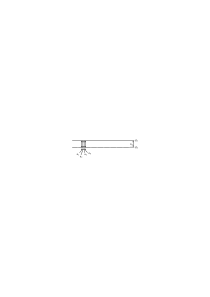

and the segments can be such that a' = a'', a'' = a''' etc. but _not_ such that a' = a'''''. Likewise, the circle and the straight line in visual space have a different multiplicity from the circle and the straight line in physical space, for a short piece of a circle that is seen can be straight; “circle” and “straight line” being used here in the sense of visual geometry. Ordinary language makes do here with the word “seems” or “appears”. It says that a' and a'' seem to be equal, whereas between a' and a''''' this semblance already no longer obtains. But it uses the word “seems” ambiguously. For its meaning depends on what is now set against this semblance as the reality. In one case it is the result of a measurement, in the other a further appearance. So the meaning of the word “seem” is different in these cases.

### [XIII-96-1v\[1\]](https://cdn.wittgensteinnachlass.com/2000px/webp/Ts-212/XIII-96-1v.webp)

Probability W

### [XIII-96-2\[1\]](https://cdn.wittgensteinnachlass.com/2000px/webp/Ts-212/XIII-96-2.webp)

34 If I say “the upper segment is as long as the lower one” and mean by this sentence what would otherwise be said by the sentence “the upper segment appears to me to be as long as the lower one”, then the word “equal” in that sentence has quite a different meaning from the one it has in the identically worded sentence whose verification consists in transferring the length with a pair of compasses. That is why I can speak, e.g., of improving the methods of comparison in the second case but not in the first. The use of the same word “equal” with quite different meanings is very confusing. It is the typical case of words and turns of phrase that originally refer to the “things” of the physical mode of expression, the “bodies in space”, being applied to parts of our visual field, whereupon their meanings have to change completely, statements that previously had a sense lose it, and others that had none in the first mode of expression acquire one. Even if a certain analogy remains, the very one that tempts us to use the same expression.

### [XIII-96-3\[1\]](https://cdn.wittgensteinnachlass.com/2000px/webp/Ts-212/XIII-96-3.webp)

34 The visual straight line touches the visual circle not at _one_ point but along a visual segment. – When I look at the drawing of a circle and a tangent, what is remarkable is not that I may never see a perfect circle and a perfect straight line touching each other; it _is_ interesting only when I do see them and the tangent then runs together with the circle for a stretch.

### [XIII-96-4\[1\]](https://cdn.wittgensteinnachlass.com/2000px/webp/Ts-212/XIII-96-4.webp),[XIII-96-5\[1\]](https://cdn.wittgensteinnachlass.com/2000px/webp/Ts-212/XIII-96-5.webp),[XIII-96-6\[1\]](https://cdn.wittgensteinnachlass.com/2000px/webp/Ts-212/XIII-96-6.webp)

59, 34 The blurriness, the indeterminacy of our sense impressions is not something that can be remedied, a blurriness to which complete sharpness also corresponds (or is opposed). Rather, this general indeterminacy, elusiveness, this floating of sense impressions, is what has been designated by the words “everything flows”. We say “one never sees an exact circle” and want to say that even if we see no deviation from circular form, _we are not_ thereby _given_ an exact circle. (It is as if we wanted to say: we can never guide this tool exactly, for we are holding only the handle and the tool sits loose in it.) But what then do we understand by the _concept_ ‘exact circle’? How did we arrive at this concept in the first place? Well, we think, e.g., of a precisely measured circular disc made of a very hard steel. Aha – so that is what we are aiming at with the concept ‘exact circle’. Of course, we find nothing of that in the visual image. We have simply chosen the form of representation that calls the steel disc more exact than the wooden disc and the wooden disc more exact than the paper disc. We have determined the concept “exact” by means of a series, and speak of sense impressions as pictures, inexact pictures, of physical objects.

### [XIII-96-5\[1\]](https://cdn.wittgensteinnachlass.com/2000px/webp/Ts-212/XIII-96-5.webp),[XIII-96-6\[1\]](https://cdn.wittgensteinnachlass.com/2000px/webp/Ts-212/XIII-96-6.webp)

35 Does anything compel me to adopt the interpretation that the tree I see through my window is bigger than the window? That depends on how I use the words “bigger” and “smaller”. – Let us suppose that the _normal_ visual experience for us were to see rods in [35] various positions, divided by graduation marks into (visually) equal parts. Might not a twofold use of the words “longer” and “shorter” then become established? For sometimes we would call the rod divided into more parts the longer one; etc.

### [XIII-96-7\[1\]](https://cdn.wittgensteinnachlass.com/2000px/webp/Ts-212/XIII-96-7.webp),[XIII-96-8\[1\]](https://cdn.wittgensteinnachlass.com/2000px/webp/Ts-212/XIII-96-8.webp)

34 Measuring a length in the visual field by laying a visual measuring rod alongside it. I.e., a rod divided into equal parts by graduation marks. There is a measurement here that consists in laying the measuring rod alongside two lengths. In fact, 2 measuring rods can be used, one alongside each length, and the criterion for the equality of the units of measurement is that the units look equally long. But a measuring rod can also be moved from one length to the other, and the criterion for the constancy of the unit of measurement is that we notice no change. Whereas the criterion for the measured lengths not changing might be that we have perceived 34 no movement of the endpoints. I can make countless different stipulations as to what is to be the criterion of equality of length in the visual image, and these in turn will yield different meanings for the measurements given.

### [XIII-96-9\[1\]](https://cdn.wittgensteinnachlass.com/2000px/webp/Ts-212/XIII-96-9.webp)

59

_Divisibility. Infinite divisibility._

The infinite divisibility of the Euclidean segment consists in the _rule_ (stipulation) that it makes sense to speak of an n-th part of every part. But if one speaks of the divisibility of a length in visual space and asks whether such a length can still be divided, or can be divided without end, then we are looking here for a rule that corresponds to a certain reality (but _how_ does it correspond to it?). I see a black strip on the wall in front of me, – is its width divisible? What is the criterion for that? Now there are countless criteria here that we would all designate as criteria of divisibility in the visual field, and that pass into one another by degrees. To begin with, the meaning of “divisibility” could be fixed in such a way that a trial establishes it; then it is not the “logical possibility” of division but its physical possibility, and the logical possibility at issue here is given in the description of the attempt at division – however that attempt may turn out. Now what would we call an “attempt at division”? – Perhaps painting a stroke alongside the first that looks equally wide and consists of a green and a red strip running lengthwise, with memory providing the criterion for the black strip’s having the same width it had when we asked the question. (I.e. what we _designate_ as the same width of the black strip now and before is what is remembered as equally wide.) On the other hand, I could stipulate as the criterion for the divisibility of the black strip that a divided strip looking equally wide is seen at the same time as it. And I would then designate the replacement of the undivided strip by a divided one as the carrying out of the possible division …

### [XIII-96-10\[1\]](https://cdn.wittgensteinnachlass.com/2000px/webp/Ts-212/XIII-96-10.webp)

59 … but it is essential to the meaning of the word “centaur” that we can paint or model one. – But in the same way it is essential to the sense of the sentence “I can take in 30 parts at a glance as a number” _what_ I can show as an example of such taking in at a glance, and that I cannot show any case of taking in 30 strokes at a glance as a sample. Here one can say: I cannot imagine taking in 30 strokes at a glance, I do not know what it would be like, and the question “what would it be like if …” is nonsensical for me, for I have been given no criterion for deciding it.

### [XIII-96-11\[1\]](https://cdn.wittgensteinnachlass.com/2000px/webp/Ts-212/XIII-96-11.webp)

34 If we confuse the meanings of the expression “equally long” and of other expressions in visual space with the meanings of the same words in Euclidean space, we run into contradictions and then ask: “How is such an experience possible?! How is it possible for 24 equally long segments to add up to the same length as 25 of that length? Have I really had such an experience?”

### [XIII-96-12\[1\]](https://cdn.wittgensteinnachlass.com/2000px/webp/Ts-212/XIII-96-12.webp),[XIII-96-13\[1\]](https://cdn.wittgensteinnachlass.com/2000px/webp/Ts-212/XIII-96-13.webp)

59 “Is a square of a chessboard simpler than the whole chessboard?” That depends on how you use the word “simpler”. If you mean by it “consisting of a smaller number of parts”, then I say: If these parts are, say, the atoms of the chessboard, then the square is indeed simpler than the chessboard, – but if you are speaking of the visual chessboard, the squares do not consist of parts unless they in turn consist of smaller patches; and if you then call the patch that contains fewer patches the simpler one, the square is again simpler than the chessboard. “But is the uniformly coloured area simple?” – If “simple” means: not composed of patches of several colours, – yes! But can’t we say: what it is not _possible_ to divide is simple? – Cannot be divided _how_? With a knife? And with what knife? First describe to me the method of division that you apply unsuccessfully, and then I’ll know what you call “indivisible”. But perhaps you want to say: I call ‘indivisible’ not what one tries unsuccessfully to divide, but what it is senseless (impermissible) to say consists of parts. – Then ‘indivisible’ is a grammatical stipulation. A stipulation, that is, that you can make yourself and by which you fix the meaning, the use of other words. If, for instance, I say: a patch of a single colour is indivisible (simple), for if I divide it – e.g. – by a line, it is no longer of a single colour, – then I am stipulating the meaning in which I want to use the word “divide”. If it is now asked: “does the visual image consist of minima visibilia”, we ask in return: how are you using the expression “consist of …”? If in the sense in which a chessboard consists of black and white squares, – no! – For surely you did not mean to deny that we see patches of a single colour (I mean patches whose _appearance_ is of a single colour). But if you mean to say, perhaps, that a _physical_ patch (a _measurable_ patch in physical space) can be made smaller until we can no longer see it from a certain distance, that it can then be measured as it vanishes and, at that size, be called the smallest visible patch, then we agree.

### [XIII-96-13\[2\]](https://cdn.wittgensteinnachlass.com/2000px/webp/Ts-212/XIII-96-13.webp)

59 When we say in geometry that the regular hexagon consists of six equilateral triangles, this means that it makes sense to speak of a regular hexagon that consists of six equilateral triangles. If upon this it were asked “then is the hexagon simple or composite”, I should have to answer: decide for yourself how you want to use the words “simple” and “composite”.

### [XIII-96-14\[1\]](https://cdn.wittgensteinnachlass.com/2000px/webp/Ts-212/XIII-96-14.webp)

59 It seems that one cannot see a patch of a single colour as composite unless one imagines it as _not_ of a single colour. The mental image of a dividing line makes the patch multicoloured, for the dividing line must be a different colour from the rest of the patch.

### [XIII-96-15\[1\]](https://cdn.wittgensteinnachlass.com/2000px/webp/Ts-212/XIII-96-15.webp)

33 Whether it makes sense to say “this part of a red area (which is not marked off by any visible boundary) is red” depends on whether there is such a thing as an absolute place. For if one can speak of an absolute place in visual space, then I can also ascribe a colour to this absolute place if its surroundings are uniformly coloured.

### [XIII-96-16\[1\]](https://cdn.wittgensteinnachlass.com/2000px/webp/Ts-212/XIII-96-16.webp)

35 We can speak of a place in the visual field in an absolute sense. Suppose that a red patch in the visual field disappears and reappears in entirely new surroundings: then it makes sense to say that it reappears in the same place or in a different place. (Would such a space be comparable to a surface whose curvature varied from point to point, so that we could specify each place on the surface as an absolute feature?)

### [XIII-96-16\[2\]](https://cdn.wittgensteinnachlass.com/2000px/webp/Ts-212/XIII-96-16.webp)

35 Visual space is an oriented space in which there is an up and a down, a right and a left. And these determinations have nothing to do with the direction of gravity or with the right and left hands. …

### [XIII-96-17\[1\]](https://cdn.wittgensteinnachlass.com/2000px/webp/Ts-212/XIII-96-17.webp)

35 I can see the figure ⌵ as a letter, as a sign for “less than”, or for “greater than”, even without seeing it together with my body. Perhaps one will say that I feel the position of my body without seeing it. Certainly, and my point is precisely that ‘the felt position’ is not ‘the seen position’; they therefore cannot be compared with one another, though they can be correlated. The words “up”, “down”, “right”, “left” have one meaning in visual space and another in felt space. But the term “felt space” is itself ambiguous. (Definitions of the words “up”, “down”, etc. by means of the tip of the letter “V”, of the sign “less than” &lt; and of the sign “greater than” &gt; on the one hand, and by means of pains in the head and feet on the other; or by means of feelings of balance.)

### [XIII-96-18\[1\]](https://cdn.wittgensteinnachlass.com/2000px/webp/Ts-212/XIII-96-18.webp),[XIII-96-19\[1\]](https://cdn.wittgensteinnachlass.com/2000px/webp/Ts-212/XIII-96-19.webp)

35 “Is distance already contained in the structure of visual space, or does it merely seem so to us because we associate certain appearances in the visual image with certain experiences of the sense of touch, and it is only these latter that concern distances?” Where do we get this supposition from? We seem to have come across something of the sort somewhere. Aren’t we thinking of the following case? I wouldn’t dislike this tune if I hadn’t first heard it in these unpleasant circumstances. But here there are two possibilities: either I dislike the tune as I dislike many others for which I wouldn’t give that reason, and it is merely a supposition that the cause of my dislike lies in that earlier experience. Or else, whenever I hear the tune, that experience comes to mind and makes hearing the tune unpleasant for me; then my statement is not a hypothesis about the cause of my dislike, but a description of the dislike itself. – So if the question is asked: “does it merely seem to us that one line segment in visual space itself is longer than another, and doesn’t ‘longer’ refer merely to an experience of the sense of touch that we associate with what we see”, – the answer is: Do you know anything of this association? Do you _describe_ your experience by referring to it, or do you merely suppose it to be the cause of your experience? – If the latter, then we can speak of distances in visual space without regard to the possible cause of our experience. In doing so one must _remember_ that statements about distances (that this segment is as long as that one, or longer than that one, etc.) have one sense when they refer to visual space, and another when they refer to Euclidean space.

### [XIII-96-19\[2\]](https://cdn.wittgensteinnachlass.com/2000px/webp/Ts-212/XIII-96-19.webp),[XIII-96-20\[1\]](https://cdn.wittgensteinnachlass.com/2000px/webp/Ts-212/XIII-96-20.webp)

35 To say that the point B is not between A and C

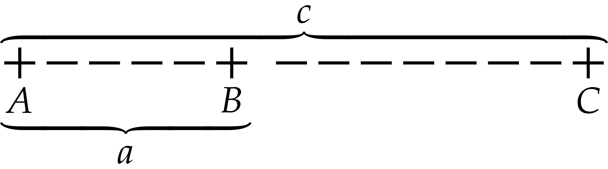

(that the segment a is not shorter than c), but that it only appears so to us because of certain associations, sounds absurd and is absurd, because in our statement we are not concerned at all with possible causes of the appearance, but merely 35 describe it as opposed to other appearances. If you say that the point B only _appears_ to you (_to lie_) between A and C, I reply: _that’s just what I’m saying_, only I use the expression “it lies between A and C” _for that_. And if you ask “doesn’t it merely seem so”, I reply: What method would you use to find the answer to your question? For then I shall understand what exactly your suspicion concerns. If you say: might there not after all be something on this table that I don’t see, I reply: How might we find it? Just try to describe to me an experience that would _make you say_: “there was something else there after all”. Describe to me the experience that would convince you that B does not lie between A and C after all, and I shall understand what kind of state of affairs the real one is, as opposed to the apparent one. But one thing is clear: the experience that teaches you this cannot change the one I describe with the words “ B lies between A and C”. The objection, however, rests on a mistaken conception of logical analysis. What we are missing is not a closer look (at A, B and C, for instance) and the discovery of a process _behind_ the one ordinarily observed (that would be the investigation of a physical or psychological phenomenon), but clarity about the grammar of the description of the _old_ phenomenon. For if we looked more closely, we would simply see something _different_ and have gained nothing as far as our problem is concerned. It was _this_ experience, not another, that was to be described.

### [XIII-96-21\[1\]](https://cdn.wittgensteinnachlass.com/2000px/webp/Ts-212/XIII-96-21.webp)

33 Does the visual field have a centre? – It makes sense to put a little cross in a picture, say, and to say: look at the cross; you will then see the rest as well, but the cross will then be at the centre of the visual field.

### [XIII-96-22\[1\]](https://cdn.wittgensteinnachlass.com/2000px/webp/Ts-212/XIII-96-22.webp)

35 In visual space there is absolute position and hence absolute motion too. One is to imagine the image of two stars on a pitch-dark night, when I can see nothing but these two, and they move in a circle around each other.

### [XIII-96-23\[1\]](https://cdn.wittgensteinnachlass.com/2000px/webp/Ts-212/XIII-96-23.webp)

35 In visual space there is absolute position. When I look through one eye, I see the tip of my nose. If it were cut off and removed but then handed to me, I could put it back in its old position without the aid of a mirror and by sight alone; even if in the meantime everything in my visual image had changed. The sentence “I see the seeing eye in the mirror” only appears to have the form of the sentence “I see the other person’s eye in the mirror”, for it makes no sense to say: “I see the seeing eye”. If I call the image presented to me by another person’s eye, for instance, a “_visual_ eye”, then I can say that the expression “the seeing eye” does not correspond to a visual eye.

### [XIII-96-23\[2\]](https://cdn.wittgensteinnachlass.com/2000px/webp/Ts-212/XIII-96-23.webp)

[→ ] 35 My visual field exhibits no incompleteness that might prompt me to turn round and see what lies behind me. In visual space there is no “behind me”; and when I turn round, my visual image merely _changes_; it is not completed. (The “space around me” is a _combination_ of visual space and the space of muscular feeling.) It makes no sense to speak, in visual space, of the motion of an object along a path that goes round behind the seeing eye.

### [XIII-96-23\[3\]](https://cdn.wittgensteinnachlass.com/2000px/webp/Ts-212/XIII-96-23.webp)

35 Relation between physical space and visual space. Think of seeing with one’s eyes closed (after-images, etc.) and of dream images.

### [XIII-97FCr\[1\]](https://cdn.wittgensteinnachlass.com/2000px/webp/Ts-212/XIII-97FCr.webp)

_The seeing subject & visual space_

### [XIII-97-1\[1\]](https://cdn.wittgensteinnachlass.com/2000px/webp/Ts-212/XIII-97-1.webp)

(35), 59 It is nonsensical to say “I see the things in visual space”. As opposed to what? Is it conceivable that I hear them, or that someone else sees them?

### [XIII-97-1\[2\]](https://cdn.wittgensteinnachlass.com/2000px/webp/Ts-212/XIII-97-1.webp)

(35), 59 That is why I cannot say either that the object in my visual space is the cause of my seeing it. (That is also why it is nonsense to say: out of the primordial nebula there evolved the suns, planets, the simplest living beings and finally a being so organized that it can see all these things and reflect on them. Unless by these reflections one means the (purely) physical manifestations, in the sense of Behaviourism. In this sense one can also say of a photographic camera that it perceives something.)

### [XIII-97-1\[3\]](https://cdn.wittgensteinnachlass.com/2000px/webp/Ts-212/XIII-97-1.webp)

59, (63) If one were asked: what is the difference between a tone and a colour, and the answer were “we hear tones, whereas we see colours”; then this is only a hypothesis justified by experience, if saying it is to make any sense at all. And in this sense it is conceivable that one day I shall perceive tones with my eyes, that is, see them, and hear colours. What is essential to tones and colours is evidently shown in the grammar of the words for tones and colours.

### [XIII-97-2\[1\]](https://cdn.wittgensteinnachlass.com/2000px/webp/Ts-212/XIII-97-2.webp)

35 When we speak of visual space, we are easily led to imagine it as a sort of peep-show box that everyone carries around. I.e. we then use the word “space” much as we do when we call a room a space. In _reality_, however, the term “visual space” refers only to a geometry, I mean, to a part of the grammar of our language. In this sense there are no “visual spaces” that might each have an owner. (And perhaps vacant ones too, that happen not to belong to anyone?)

### [XIII-97-3\[1\]](https://cdn.wittgensteinnachlass.com/2000px/webp/Ts-212/XIII-97-3.webp)

35 “But can’t I see a landscape in my visual space and you see a room in yours?” – No, – ‘I see in my visual space’ is nonsense. It must be “I see a landscape and you etc.” – and that is not disputed. What misleads us here is precisely the simile of the peep-show box, or perhaps of a round _white_ disc that we carry around with us as a kind of projection screen and that is the space in which each visual image appears. But the flaw in this simile is that it pictures in visual terms the very occasion – the possibility – for a visual image to appear; for the white screen is itself an image.

### [XIII-97-3\[2\]](https://cdn.wittgensteinnachlass.com/2000px/webp/Ts-212/XIII-97-3.webp)

35 Now it is important that the sentence “I cannot directly see the eye with which I see” is either a disguised sentence of grammar or nonsense. For the expression “nearer to (or, farther from) the seeing eye” has a different grammar from “nearer to the blue object that I see”. The visual appearance that corresponds to the description “ A puts on the glasses” is fundamentally different from the one I describe with the words: “I put on the glasses”. Now I could say: “my visual space resembles a cone”, but it must then be understood that I am thinking here of the cone as a space, as the representative of a geometry, not as part of a space (a room). (So the idea of someone looking into the cone through a hole at its apex is incompatible with this idea.)

### [XIII-98FCr\[1\]](https://cdn.wittgensteinnachlass.com/2000px/webp/Ts-212/XIII-98FCr.webp)

Visual space compared with a picture (a plane picture).

### [XIII-98-1\[1\]](https://cdn.wittgensteinnachlass.com/2000px/webp/Ts-212/XIII-98-1.webp)

33 Anyone who was asked to paint the visual field and seriously tried to do so would soon see that it is impossible.

### [XIII-98-2\[1\]](https://cdn.wittgensteinnachlass.com/2000px/webp/Ts-212/XIII-98-2.webp)

59 Different meanings of the words “blurred”, “unclear”.

### [XIII-98-3\[1\]](https://cdn.wittgensteinnachlass.com/2000px/webp/Ts-212/XIII-98-3.webp),[XIII-98-4\[1\]](https://cdn.wittgensteinnachlass.com/2000px/webp/Ts-212/XIII-98-4.webp)

34

_Blurred, unclear, unsharp._

“The lines in this drawing are unsharp”, “my memory of the drawing is unclear, blurred”, “I see the objects at the edge of my visual 34 field as blurred”. – When one speaks of the blurriness of the images at the edge of the visual field, one _often_ has in mind a picture of this visual field such as the one Mach drew. But the blurriness that the edges of a picture on paper can have is of an altogether different nature from that which is ascribed to the edges of the visual field. As different as the paleness of one’s memory of a drawing is from the paleness of a drawing (_itself_). When a memory or a dream was to be represented in a film, the images were given a bluish tint. But dream images and memory-images naturally have no bluish tint – any more than our visual image has washed-out edges; so the bluish projections on the screen are not directly visual images of dreams, but ‘images’ in yet another sense. – In ordinary life, when we are looking all the time, do we notice the blurriness at the edges of the visual field? Indeed, what experience does it actually correspond to, since it does not occur in normal seeing! Well, if we do not turn our head and observe something that we can only just see by turning our eyes, we see a person, say, but cannot recognize their face; instead, we see it as blurred in a certain way. The experience does not have the slightest similarity to seeing a disc with pictures painted on it, sharply outlined in the centre of the disc and growing more and more blurred towards the edge, fading _imperceptibly_ into a uniform grey, say. We think of a disc like that when we ask, for example: couldn’t one imagine a visual field with a uniform clarity of outlines etc.? There is no experience in the visual field that corresponds to letting one’s gaze glide along a picture that passes from sharply defined figures to increasingly blurred ones.

### [XIII-98-5\[1\]](https://cdn.wittgensteinnachlass.com/2000px/webp/Ts-212/XIII-98-5.webp)

(33) 34, 59 It is important, for example, that in the sentence “there is a red patch close to the boundary of the visual field” the words “close to” have a different meaning from the one they have in a sentence like “the red patch in the visual field is close to the brown patch”. Furthermore, the word “boundary” in the earlier sentence has a different meaning – and is a different kind of word – from “boundary” in the sentence “the boundary between red and blue in the visual field is a circle”.

### [XIII-98-5\[2\]](https://cdn.wittgensteinnachlass.com/2000px/webp/Ts-212/XIII-98-5.webp),[XIII-98-6\[1\]](https://cdn.wittgensteinnachlass.com/2000px/webp/Ts-212/XIII-98-6.webp)

(33) 34, 59 What sense does it make to say: our visual image is less distinct at the edges than towards the centre? That is, if we are not speaking here of seeing physical objects more distinctly in the centre of the visual field. One of the clearest examples of the confusion between physical and phenomenological language is the picture that Mach drew of his visual field, in which the so-called blurriness of the forms towards the edge of the visual field was rendered by a blurriness (in a quite different sense) of the drawing. No, one cannot make a visible picture of the visual image. So can I say that the patches of colour near the edge of the visual field no longer have sharp outlines: are outlines there even _conceivable_? I think it is clear that this indistinctness is an internal property of visual space. Does the word “colour”, for example, have a different meaning when it refers to forms near the edge? (33) 34, 59 The boundlessness of visual space is inconceivable without this “blurriness”.

### [XIII-98-7\[1\]](https://cdn.wittgensteinnachlass.com/2000px/webp/Ts-212/XIII-98-7.webp)

59 The danger in wanting to see things as simpler than they are in reality is often greatly overestimated today. But this danger is in fact present to the highest degree in the phenomenological investigation of sense impressions. These are always taken to be _much_ simpler than they are.

### [XIII-98-8\[1\]](https://cdn.wittgensteinnachlass.com/2000px/webp/Ts-212/XIII-98-8.webp)

35 It is strange that I wrote ‘visual space does not have the form

’ and not ‘that it does not have the form

’, and it is very telling that I wrote the first.

### [XIII-98-9\[1\]](https://cdn.wittgensteinnachlass.com/2000px/webp/Ts-212/XIII-98-9.webp),[XIII-98-10\[1\]](https://cdn.wittgensteinnachlass.com/2000px/webp/Ts-212/XIII-98-10.webp)

35 One gives no thought at all to how remarkable three-dimensional seeing is. How strange a picture, a photograph, would look, for instance, if we were able to see it as a distribution of grey, white and black patches on a flat surface. What we see would then strike us as quite 35 senseless. Likewise if we could see in two dimensions with one eye. It is not at all clear, for example, what happens when we see objects _more three-dimensionally_ with two eyes than with one. For they look three-dimensional even when seen with one eye. And the difference between relief and sculpture in the round is not a fitting analogy either.

### [XIII-99FCr\[1\]](https://cdn.wittgensteinnachlass.com/2000px/webp/Ts-212/XIII-99FCr.webp)

_Minima Visibilia_

### [XIII-99-1\[1\]](https://cdn.wittgensteinnachlass.com/2000px/webp/Ts-212/XIII-99-1.webp)

(57) 59 The patch of a single colour in the coloured plane is not composed of smaller parts, except in the way that ten, say, is composed of a thousand hundredths.

### [XIII-99-1\[2\]](https://cdn.wittgensteinnachlass.com/2000px/webp/Ts-212/XIII-99-1.webp)

57, 59 The smallest visible piece is a piece of the physical surface, not of the visual field. The experiment that determines what is smallest and still visible establishes a relation between _two_ appearances.

### [XIII-99-1\[3\]](https://cdn.wittgensteinnachlass.com/2000px/webp/Ts-212/XIII-99-1.webp)

57, 59 The experiment does not investigate visual space, and one cannot investigate visual space. Cannot penetrate deeper into it.

### [XIII-99-1\[4\]](https://cdn.wittgensteinnachlass.com/2000px/webp/Ts-212/XIII-99-1.webp)

59 (If one wanted to describe what is plain to see, one could not “investigate what is plain to see”.)

### [XIII-99-1\[5\]](https://cdn.wittgensteinnachlass.com/2000px/webp/Ts-212/XIII-99-1.webp),[XIII-99-2\[1\]](https://cdn.wittgensteinnachlass.com/2000px/webp/Ts-212/XIII-99-2.webp)

(57), 59 One might believe that the visual field is composed of minima visibilia; of nothing but little squares, say, that one sees as indivisible patches. Nonsense. The visual field is not composite if we do not see its composition 29 59?. For by _the word_ “composition” we have in mind, after all, the composition of a larger patch out of smaller ones. It is misleading to speak of the smallest visible parts of the visual field; are there then parts of the visual field that we no longer see? And if we call the image of a fixed star that, for example, it could only mean that it makes no sense here to speak of ‘smaller’, not that in fact no patch in the visual field is smaller. So the superlative “the smallest …” is wrongly applied.

### [XIII-99-3\[1\]](https://cdn.wittgensteinnachlass.com/2000px/webp/Ts-212/XIII-99-3.webp),[XIII-99-4\[1\]](https://cdn.wittgensteinnachlass.com/2000px/webp/Ts-212/XIII-99-4.webp)

36, 59 The smallest visible difference would be one that carried _within itself_ the criterion of being the smallest. For in the case of the patch A between B and C, we distinguish some positions and do _not_ distinguish others. But what we would need 59 3b would be, so to speak, an infinitesimal difference, that is, a difference that carried within itself its being the smallest.

### [XIII-99-4\[2\]](https://cdn.wittgensteinnachlass.com/2000px/webp/Ts-212/XIII-99-4.webp)

36 Visual space evidently does _not_ consist of discrete parts. For otherwise one would have to be able to say straight away which ones. Or it consists of parts only insofar as one can specify them.

### [XIII-99-5\[1\]](https://cdn.wittgensteinnachlass.com/2000px/webp/Ts-212/XIII-99-5.webp)

23, 57 Is there a smallest visible colour difference? – What colours are meant here? Let us call the result of mixing pigments a colour: then I can perform the experiment, for example, of adding a small quantity of a yellow pigment to a quantity of a red one and testing whether I _see_ a difference in colour; if I do, I repeat the experiment with a smaller addition of the yellow pigment …

### [XIII-99-6\[1\]](https://cdn.wittgensteinnachlass.com/2000px/webp/Ts-212/XIII-99-6.webp)

57 So one might call the optical fixed star a minimum visibile. But one cannot go on to say that the visual field consists of such parts! It would consist of them only if we saw them. The image of a nebula of fixed stars in a telescope consists of them in so far as we can distinguish them. For these two expressions mean just the same thing.

### [XIII-99-7\[1\]](https://cdn.wittgensteinnachlass.com/2000px/webp/Ts-212/XIII-99-7.webp)

33 If it is asked “is our visual field continuous or discontinuous”, one would first have to know what kind of continuity one is talking about. We call a colour transition continuous if we see no discontinuity in it.

### [XIII-100FCr\[1\]](https://cdn.wittgensteinnachlass.com/2000px/webp/Ts-212/XIII-100FCr.webp)

_Colours & Colour Mixture_

### [XIII-100-1\[1\]](https://cdn.wittgensteinnachlass.com/2000px/webp/Ts-212/XIII-100-1.webp)

92 To say that this colour is now at a place is to describe that place _completely_ …

### [XIII-100-2\[1\]](https://cdn.wittgensteinnachlass.com/2000px/webp/Ts-212/XIII-100-2.webp)

92 … So the sentence specifying that red is present here as an ingredient of a colour would somehow have to _name_ a quantity of red; but then this sentence must also have sense outside the logical product, and so it would have to make sense to say that this place is coloured pure red and _contains_ such and such a quantity of red; and that makes no sense. And what about the individual sentences that ascribe different quantities, or degrees, of red to a place? Let us call two such sentences  and ; are these to contradict each other? Suppose  is greater than ; then we might indeed stipulate that  is not to be a contradiction (as with the sentences “there are 4 apples in this basket” and “there are 3 apples in this basket”, when the “only” is missing), but then  and  must contradict each other; and hence, on my old view,  would have to be a product of  and another sentence. This other sentence would have to specify the quantity needed to get from  to , and so the same difficulty would arise for it. – The schema of ingredients does not fit the case of colour mixture if by ‘colours’ one does not mean colouring matter. And even in this schema different specifications of the amount of an ingredient used are contradictory specifications; or, if I stipulate that p ( = I used 3 kg of salt) and q ( = I used 5 kg of salt) are not to contradict each other, then q and non-p still do. And it all comes down to this: the sentence “I used 2 kg of salt” does not mean “I used 1 kg of salt and I used 1 kg of salt”, so f(1 + 1) is not equal to f(1) & f(1).

### [XIII-100-2\[2\]](https://cdn.wittgensteinnachlass.com/2000px/webp/Ts-212/XIII-100-2.webp)

92 [→ ] The sentence “there is room for only _one_ colour at a place at a time” is of course a grammatical sentence in disguise. Its negation is not a contradiction, but it _contradicts_ a rule of the grammar we have adopted.

### [XIII-100-3\[1\]](https://cdn.wittgensteinnachlass.com/2000px/webp/Ts-212/XIII-100-3.webp)

92 What we have recognized is precisely that we are dealing with scales, not with, as it were, isolated graduation marks.

### [XIII-100-4\[1\]](https://cdn.wittgensteinnachlass.com/2000px/webp/Ts-212/XIII-100-4.webp)

92 The rules for “and”, “or”, “not”, etc., which I represented by means of the W-F notation, are _a part_ of the grammar of these words, but not _the whole_ of it.

### [XIII-100-5\[1\]](https://cdn.wittgensteinnachlass.com/2000px/webp/Ts-212/XIII-100-5.webp)

23?, 59 If, for example, I say that a patch is both light red and dark red at the same time, I am thinking that one shade covers the other. But does it then still make sense to say that the patch has the invisible, covered shade? Does it even make sense to say that a completely black surface is white, only one does not see the white because it is covered by the black? And why does the black cover the white and not the white the black? If a patch has a visible and an invisible colour, it has these colours, in any case, in quite different senses.

### [XIII-100-6\[1\]](https://cdn.wittgensteinnachlass.com/2000px/webp/Ts-212/XIII-100-6.webp)

23, 59 “Red and green cannot both fit in the same place at the same time” does not mean that they are in fact never together, but that it is nonsense to say they are in the same place at the same time, and hence also nonsense to say that they are never in the same place at the same time.

### [XIII-100-6\[2\]](https://cdn.wittgensteinnachlass.com/2000px/webp/Ts-212/XIII-100-6.webp)

23, 59 A mixed colour, or better, an intermediate colour, between blue and red is such by virtue of an internal relation to the structures of blue and red. More accurately: what we call “an intermediate colour between blue and red” (or “blue-red”) is so called because of an affinity that shows itself in the grammar of the words “blue”, “red” and “blue-red”. (The sentence that speaks of an internal relation between the structures already springs from a mistaken conception; from _the one_ that sees in the concepts ‘red’, ‘blue’, etc., complex structures whose internal construction analysis must reveal.) But the affinity between the pure colours and their intermediate colour is of an _elementary_ kind, i.e. it does not consist in the sentence that ascribes the colour blue-red to an object being made up of the sentences that ascribe the colours red and blue to it. And so too the affinity between different degrees of a reddish blue, for example, is an elementary affinity.

### [XIII-100-7\[1\]](https://cdn.wittgensteinnachlass.com/2000px/webp/Ts-212/XIII-100-7.webp),[XIII-100-8\[1\]](https://cdn.wittgensteinnachlass.com/2000px/webp/Ts-212/XIII-100-8.webp)

23 It makes sense to say of a colouring that it is not pure red but contains a yellowish or bluish, whitish or blackish tinge; and it makes sense to say that it contains none of these tinges but is pure red. In this sense one can speak of a pure blue, yellow, green, white, black, but not of a pure orange, grey, or reddish blue. (Of a ‘pure grey’, though, presumably one can, in so far as one means by it a non-greenish, non-yellowish, etc., white-black; and something similar holds for ‘pure orange’, etc.) I.e. the colour circle has four distinguished points. For it makes sense to say “this orange 23 lies (not in the plane of the colour circle, but in _colour space_) nearer red than that one”; but to express the same thing we cannot say “this orange lies nearer blue-red than that one” or “this orange lies nearer blue than that one”.

### [XIII-100-8\[2\]](https://cdn.wittgensteinnachlass.com/2000px/webp/Ts-212/XIII-100-8.webp)

23 The colour top produces the colour mixture we are talking about here, but even it does not do so if I see it only at rest and then spinning rapidly. For it is conceivable that the top is half red and half yellow at rest and that it appears green (for whatever reason) when spinning rapidly. Rather, the colour top brings about the mixture only in so far as we can perceive it visually as such. Namely, when it gradually spins faster and faster and we _see_ red and yellow turn into orange. But in this we are not at the mercy of the colour top; rather, if through some unknown influence the colour of its disc were to turn whitish while the top spun faster and faster, we would not then say that the intermediate colour between red and yellow was a whitish orange. Any more than we would say 3 + 4 was 6 if, in putting 3 and 4 apples together, one disappeared in some unknown way and we had 6 apples before us. I am using the colour top here not for an experiment but for a calculation.

### [XIII-100-9\[1\]](https://cdn.wittgensteinnachlass.com/2000px/webp/Ts-212/XIII-100-9.webp),[XIII-100-10\[1\]](https://cdn.wittgensteinnachlass.com/2000px/webp/Ts-212/XIII-100-10.webp)

23 Besides the transition from colour to colour on the colour circle, there seems to be another distinct transition, the one we have before us when we see small patches of one colour interspersed with small patches of the other. I mean, of course, a transition that is _seen_. And this kind of transition gives the word “mixture” a new meaning, which does not coincide with the relation of Between on the colour circle. One could describe it like this: I can imagine an orange patch coming about through interspersing small red and yellow patches, but not a red one through interspersing violet and orange ones. – In this sense grey is a mixture 23 of black and white, and pink a mixture of red and white, but white is not a mixture of pink and a whitish green. Now I do not mean that it is established by an experiment in mixing that certain colours arise in this way from others. I could carry out the experiment with a spinning colour disc, say. It may then succeed or fail, but that only shows whether or not the visual process in question can be brought about in this physical way; it does not show whether it is possible. Just as the physical subdivision of a surface cannot establish or disprove its visual divisibility. For suppose I no longer see a physical subdivision as a visual subdivision, but when drunk I see the undivided surface as divided; was the visual surface then not divisible?

### [XIII-100-11\[1\]](https://cdn.wittgensteinnachlass.com/2000px/webp/Ts-212/XIII-100-11.webp)

23 One might say that violet and orange partly cancel each other out when mixed, but that red and yellow do not.

### [XIII-100-11\[2\]](https://cdn.wittgensteinnachlass.com/2000px/webp/Ts-212/XIII-100-11.webp)

23 Orange is in any case a mixture of red and yellow in a sense in which yellow is not a mixture of red and green, even though yellow lies between red and green on the circle. And if that were obviously nonsense, the question is at what point it begins to make sense; i.e. when I now move from red and green closer to yellow on the circle and call yellow a mixture of the two colours in question.

### [XIII-100-11\[3\]](https://cdn.wittgensteinnachlass.com/2000px/webp/Ts-212/XIII-100-11.webp)

23 For I no doubt recognize in yellow its affinity with red and green, namely the possibility of reddish yellow and greenish yellow – and yet I do not recognize green and red as constituents of yellow in the sense in which I recognize red and yellow as constituents of orange. I want to say that red is between violet and orange only in the same sense in which white is between pink and greenish white. But in this sense is not every colour between any two others, or at least between two that can be reached from the third by independent paths. Can one say that in this sense a colour lies between two others only in a given continuous transition. Say, then, blue between red and black.

### [XIII-100-12\[1\]](https://cdn.wittgensteinnachlass.com/2000px/webp/Ts-212/XIII-100-12.webp)

23 If I am told that the colour of a patch lies between violet and red, I understand that and can imagine a more reddish violet than the one given. If I am now told that the colour lies between this violet and an orange – when I have no particular continuous transition before me in the form of a painted colour circle – the most I can imagine is that a more reddish violet is meant here too, but a more reddish orange might also be meant, for there is no colour that lies _in the middle_ between the two colours independently of a given colour circle, and for that very reason I cannot say at what point the orange that forms the one boundary already lies too near yellow to be mixed with violet; I simply cannot recognize which orange lies 45 degrees away from violet on a colour circle. The mixed colour’s lying in between here is just the same as red’s lying between blue and yellow.

### [XIII-100-12\[3\]](https://cdn.wittgensteinnachlass.com/2000px/webp/Ts-212/XIII-100-12.webp)

23 When I say in the ordinary sense that red and yellow give orange, there is no talk here of a _quantity_ of the constituents. So if an orange is given, I cannot say that still _more_ red would have made it a redder orange (after all, I am not talking about pigments), although of course it makes sense to speak of a redder orange. But it makes no sense, for example, to say that this orange and this violet contain the same amount of red. And how much red would _red_ contain? The comparison one is wrongly inclined to make is that of the series of colours with a system of 2 weights on a graduated rule, by increasing or shifting which I can shift the centre of gravity of the system as I please.

 Now it is nonsense to believe that if I keep pan A at violet and shift B into the red-yellow region, S will move towards red. And what about the weights I put on the pans: Does it mean anything, then, to say “_more_ of _this_ red”? If I am not speaking of pigments. This can only mean something if by pure red I mean a definite number of units assumed in advance. But then the full number of these units means nothing other than that the scale pan is at _red_. So once again the numbers giving the ratio specify only a position of the pan, not a position and a weight.

### [XIII-100-12\[5\]](https://cdn.wittgensteinnachlass.com/2000px/webp/Ts-212/XIII-100-12.webp)

23 Now as long as my two boundary colours on the colour circle are – for example – in the blue-red region and I shift the redder colour towards red, I can say that the resultant also moves towards red. But if I go past red with one of the boundary colours and move towards yellow, the resultant does not get redder now! Mixing a yellowish red with a violet does not make the violet redder than mixing pure red with the violet. After all, the fact that the one red has now become yellower takes something away from the red rather than adding red.

### [XIII-100-13r\[1\]](https://cdn.wittgensteinnachlass.com/2000px/webp/Ts-212/XIII-100-13r.webp)

23 One could also describe it like this: If I have a paint pot with violet pigment and one with orange, and now increase the amount of orange added to the mixture, the colour of the mixture will indeed pass gradually from violet to orange, but not by way of pure red.

### [XIII-100-13r\[2\]](https://cdn.wittgensteinnachlass.com/2000px/webp/Ts-212/XIII-100-13r.webp)

23 I can say of two different shades of orange that for neither have I any reason to say it is nearer red than yellow. – There is no “in the middle” here. – On the other hand, I cannot see two different reds and be in doubt whether either of them is pure red, and which. Pure red is a point, whereas the middle between yellow and red is not.

### [XIII-100-13r\[3\]](https://cdn.wittgensteinnachlass.com/2000px/webp/Ts-212/XIII-100-13r.webp)

23 It is true, of course, that one can say of an orange that it is nearly yellow, so that it lies “nearer yellow than red”, and something analogous of a nearly red orange. But it does not follow that there must also be a middle in the sense of a point between red and yellow. This is just as it is with the geometry of visual space as compared with Euclidean geometry. The quantities here are of a different kind from those represented by our rational numbers. The concepts nearer and further are of no use here at all, or are misleading if we use these words.

### [XIII-100-13r\[4\]](https://cdn.wittgensteinnachlass.com/2000px/webp/Ts-212/XIII-100-13r.webp)

23 Put it this way too: To say of a colour that it lies between red and blue does not determine it precisely (unambiguously). But I would have to determine the pure colours _unambiguously_ by specifying that they lie between certain mixed colours. So here the words “lie between” mean something _different_ from what they mean in the first case. That is: If the expression “lie between” designates in one case the mixture of two simple colours and in another the simple component common to two mixed colours, the multiplicity of its application is different in each case. And that is _not_ a difference of degree, but an expression of the fact that we are dealing with 2 quite different categories.

### [XIII-100-13r\[5\]](https://cdn.wittgensteinnachlass.com/2000px/webp/Ts-212/XIII-100-13r.webp)

23 We say that a colour cannot lie between greenish yellow and bluish red in the same sense as between red and yellow, but we can say that only because in this case we can distinguish the angle of 45 degrees; because we see the _points_ yellow and red. But it is precisely this distinction that is lacking in the other case – where mixed colours are taken as primary. So here, as it were, we could never be sure whether the mixture was still possible or not. Of course I could choose any mixed colours and stipulate that they enclose an angle of 45 degrees, but that would be quite arbitrary, whereas it is not arbitrary to say that there is no mixture of bluish red and greenish yellow in the first sense. In the one case, then, grammar supplies the “angle of 45 degrees”, and now one mistakenly thinks that one need only halve it and do the same with the next section to get another section of 45 degrees. But this is just where the _simile_ of the angle breaks down.

### [XIII-100-13r\[6\]](https://cdn.wittgensteinnachlass.com/2000px/webp/Ts-212/XIII-100-13r.webp)

23 Of course one can also arrange all the shades of colour in a straight line, say with black and white as its limits, as has been done, but then one has to rule out certain transitions by means of rules, and in the end the picture on the straight line has to acquire the same kind of topological connectedness as the one on the octahedron. This is quite analogous to the relation of ordinary language to a “logically clarified” mode of expression. The two are perfectly equivalent, except that in the one the rules of grammar are already expressed by the outward appearance itself.

### [XIII-100-13v\[1\]](https://cdn.wittgensteinnachlass.com/2000px/webp/Ts-212/XIII-100-13v.webp)

59 One can tell from the notes of the scale that they come to an end at the top & at the bottom. Musical scale & visual field

### [XIII-100-14\[1\]](https://cdn.wittgensteinnachlass.com/2000px/webp/Ts-212/XIII-100-14.webp)

23 If I am given 2 shades close to one another – reddish, say – it is impossible to doubt whether both lie between red and blue, both between red and yellow, or one between red and blue and the other between red and yellow. And in deciding this we have also decided whether both mix with blue, both with yellow, or one with blue and the other with yellow. And this holds however close one brings the shades to one another, as long as we can distinguish the pigments by their colour at all.

### [XIV-FCr\[1\]](https://cdn.wittgensteinnachlass.com/2000px/webp/Ts-212/XIV-FCr.webp)

_Idealism, etc._

### [XIV-101FCr\[1\]](https://cdn.wittgensteinnachlass.com/2000px/webp/Ts-212/XIV-101FCr.webp)

The Representation of What Is Immediately Perceived.

### [XIV-101-1\[1\]](https://cdn.wittgensteinnachlass.com/2000px/webp/Ts-212/XIV-101-1.webp)

[→ ]

### [XIV-101-1\[2\]](https://cdn.wittgensteinnachlass.com/2000px/webp/Ts-212/XIV-101-1.webp)

63, 86 It seems to us as though memory were a somewhat secondary kind of experience compared with experience of the present. We say “we can _only_ remember it”. As though, in a primary sense, memory were a somewhat faint and uncertain picture of what we originally had before us in perfect clarity. In physical language that is right: I say “I can remember this house _only indistinctly_”.

### [XIV-101-1\[3\]](https://cdn.wittgensteinnachlass.com/2000px/webp/Ts-212/XIV-101-1.webp)

63, 86 And why not leave it at that? After all, this mode of expression says everything we want to say and everything that can be said? But what we want to say is that it can also be said _differently_; and that is important. In this other mode of expression the emphasis is, as it were, placed on something else. For the words “seem”, “error”, etc. have a certain emotional tinge that is not essential to the phenomena. It has something to do with the will and not merely with knowledge. We speak, for instance, of an optical illusion and associate the idea of a mistake with this expression, though there need not be any mistake involved; and if in life the way things looked were generally more important than the results of measurement, language too would take a different attitude towards these phenomena. There is no primary language – as I used to think there was – in contrast to our ordinary, “secondary” language. But one could speak of a primary language in contrast to ours in so far as it would have to express no preference for certain phenomena over others; it would have to be, so to speak, absolutely _impartial_.

### [XIV-101-2\[1\]](https://cdn.wittgensteinnachlass.com/2000px/webp/Ts-212/XIV-101-2.webp)

63

It is now time to criticize the word “sense-datum”. A sense-datum is the appearance of this tree, whether “there really is a tree standing there” or there is a dummy, a reflection, a hallucination, etc. A sense-datum is the appearance of the tree, and what we want to say is that this linguistic representation is only _one_ description, but not _the_ essential one. Just as one can say of the expression “_my_ visual image” that it is only _one_ form of _description_, not the only possible and correct one. For the form of expression “the appearance of this tree” embodies the view that there is a necessary connexion between what we call this appearance and the “existence of a tree”, either through veridical cognition or through error. That is, when there is talk of “the appearance of a tree”, then either we would take something that is a tree for a tree or we would take something that is not a tree for one. But this connexion does not exist. The idealists would like to accuse language of representing the secondary as primary and the primary as secondary. But this happens only in these inessential valuations, which have nothing to do with knowledge (“only” the appearance). Apart from that, ordinary language makes no decision about what is primary and what secondary. One cannot see in what way the expression “the appearance of a tree” represents anything secondary to the expression “tree”. The expression “only a picture” goes back to the idea that we cannot eat the picture of an apple.

### [XIV-101-3\[1\]](https://cdn.wittgensteinnachlass.com/2000px/webp/Ts-212/XIV-101-3.webp)

63 On the question of the existence of sense-data. One _says_ that if something seems red, then _something_ must have _been_ red; if something _seemed_ to last a short time, then _something_ must have lasted a short time; etc. For one might ask: If something seemed red, how do we know that it seemed specifically _red_? Is it a matter of an empirical correlation between this appearance and this reality? If something “seemed to have the property F”, how do we know that it seemed to have _this_ property – –. What kind of connexion is there between ‘it seems so’ and ‘it is so’. To begin with, the appearance can be right or wrong. – It is also in one sense connected with reality _empirically_. One says “this seems to be typhoid”, and that means that these symptoms are empirically connected with those phenomena. If I say “this seems to be red” and then “yes, it really is red”, I have used a test for the second decision that _was independent of the first appearance_.

### [XIV-101-4\[1\]](https://cdn.wittgensteinnachlass.com/2000px/webp/Ts-212/XIV-101-4.webp)

63 The hypothesis can be understood in such a way that it does not go beyond experience, that is, that it is not the expression of an expectation of future experience. Thus the sentence “there seems to be a lamp standing on the table in front of me” may do nothing more than describe my experience (or, as one says, immediate experience).

### [XIV-101-4\[2\]](https://cdn.wittgensteinnachlass.com/2000px/webp/Ts-212/XIV-101-4.webp)

63 What about the accuracy of this description. Is it right to say: My visual image is so complicated that it is impossible to describe it completely? This is a very fundamental question.

### [XIV-101-4\[3\]](https://cdn.wittgensteinnachlass.com/2000px/webp/Ts-212/XIV-101-4.webp)

63 For that seems to say that one could say of Something that it cannot be described, or not with the means now available, or (_at any rate_) that one does not know how to describe it. (The question, the problem, in mathematics.) How then is the It that I do not know how to describe given? – My visual image is not a painted picture, or the portion of nature that I see, such that I could examine it more closely. – Is this It already articulated, the difficulty being merely to represent it in words, or is it still to await its articulation?

### [XIV-101-4\[4\]](https://cdn.wittgensteinnachlass.com/2000px/webp/Ts-212/XIV-101-4.webp)

63 “The flower was a reddish yellow, but I cannot describe it more precisely (or, cannot describe it more precisely in words)”. What does that mean?

### [XIV-101-5r\[1\]](https://cdn.wittgensteinnachlass.com/2000px/webp/Ts-212/XIV-101-5r.webp)

63 “I see it before me and could paint it”. When one says that one could not describe this colour more precisely in words, one (_always_) thinks of a possibility of such a description (of course, for otherwise the words “precise description” would have no sense), and one has in mind the case of a measurement that was not carried out for lack of adequate means.

### [XIV-101-5r\[2\]](https://cdn.wittgensteinnachlass.com/2000px/webp/Ts-212/XIV-101-5r.webp)

63 I have nothing to hand that is this colour or a similar one.

### [XIV-101-5v\[1\]](https://cdn.wittgensteinnachlass.com/2000px/webp/Ts-212/XIV-101-5v.webp)

79a?, 78 “Do what is written on this board”. What if there is nothing written on it. Kill the person in the next room (but there is no one in it).

### [XIV-101-6\[1\]](https://cdn.wittgensteinnachlass.com/2000px/webp/Ts-212/XIV-101-6.webp)

63 When one says that one cannot describe the visual image completely, one means that one cannot give a description from which one could reproduce this visual image exactly for oneself.

### [XIV-101-6\[2\]](https://cdn.wittgensteinnachlass.com/2000px/webp/Ts-212/XIV-101-6.webp)

63 But what does “exact reproduction” mean here? This _itself_ is in turn based on a false picture.

### [XIV-101-6\[3\]](https://cdn.wittgensteinnachlass.com/2000px/webp/Ts-212/XIV-101-6.webp)

63 What is the criterion of exact reproduction?

### [XIV-101-6\[4\]](https://cdn.wittgensteinnachlass.com/2000px/webp/Ts-212/XIV-101-6.webp),[XIV-101-7\[1\]](https://cdn.wittgensteinnachlass.com/2000px/webp/Ts-212/XIV-101-7.webp)

63 We cannot speak of the visual image any _further_ than our language _now_ reaches. Nor can we _mean_ (think) any more than our language says. (_Not mean more than we can say_.)

### [XIV-101-7\[2\]](https://cdn.wittgensteinnachlass.com/2000px/webp/Ts-212/XIV-101-7.webp)

63 One of the most dangerous comparisons is that of the visual field with a painted surface (or, what comes to the same thing, a coloured three-dimensional model).

### [XIV-101-7\[3\]](https://cdn.wittgensteinnachlass.com/2000px/webp/Ts-212/XIV-101-7.webp)

63 Connected with this is the following: Could I then recognize the visual image “in every detail”? Or rather, does this question have any sense at all?

### [XIV-101-7\[4\]](https://cdn.wittgensteinnachlass.com/2000px/webp/Ts-212/XIV-101-7.webp)

63 For a painted picture or a model still strikes us as the least objectionable representation of the visual image. But the fact that the question of “recognizing it in every detail” is senseless already shows _how inadequate_ picture and model are.

### [XIV-101-8\[1\]](https://cdn.wittgensteinnachlass.com/2000px/webp/Ts-212/XIV-101-8.webp)

63 Phenomenological _language_: The description of immediate sense perception, with no hypothetical addition. If anything is such a description of immediate experience, then presumably depiction by means of a painted picture or the like must be. If, then, for instance, we look through a telescope and draw or paint the constellation we see. Let us even imagine reproducing our sense perception by making, as a description of it, a model that produces these perceptions when seen from a particular point; the model could be set moving in the right way by a crank, and we could read off the description by turning the crank. (A representation on film would be an approximation to this.) If _that_ is not a representation of the immediate – what would be? – Anything that sought to be still more immediate would have to cease to be a description. What comes out then, instead of a description, is rather that inarticulate sound with which some authors would like to begin philosophy. (“I consciously have something, knowing of my knowledge” Driesch.)

### [XIV-101-9\[1\]](https://cdn.wittgensteinnachlass.com/2000px/webp/Ts-212/XIV-101-9.webp)

63 “What we think in physical space is not the primary, which we can only recognize to a greater or lesser extent; rather, what we can recognize about physical space shows us how far the primary extends and how we are to interpret physical space.”

### [XIV-101-10\[1\]](https://cdn.wittgensteinnachlass.com/2000px/webp/Ts-212/XIV-101-10.webp)

63 (86) This seems to be an objection to the description of what is immediately experienced: “for whom am I describing it?” But what if I make a drawing of it? And description must always be a drawing after something. And so far as any person comes into consideration for understanding it, my own person and the other person are on the same footing. After all, it is just as it is with toothache. Describing is making a copy, and I do not necessarily have to make a copy _for_ anyone.

### [XIV-101-10\[2\]](https://cdn.wittgensteinnachlass.com/2000px/webp/Ts-212/XIV-101-10.webp)

63 (86) If I make myself understood to another person by means of language, what is at issue here must be understanding in the sense of Behaviourism. That he has understood me is a hypothesis, just as that I have understood him is.

### [XIV-101-11\[1\]](https://cdn.wittgensteinnachlass.com/2000px/webp/Ts-212/XIV-101-11.webp)

63 86 “For whom would I describe my immediate experience? Not for myself, for I already have it: and not for anyone else, for he could never get it from the description?” – He can get it from the description to just the same extent, and with just the same limitations, as from a painted picture. After all, the agreements about language were made with the help of painted pictures (or what amounts to the same thing). And by our ordinary way of speaking, he does get something from a painted picture.

### [XIV-102FCr\[1\]](https://cdn.wittgensteinnachlass.com/2000px/webp/Ts-212/XIV-102FCr.webp)

“Experience in the present moment, reality proper.”

### [XIV-102-1r\[1\]](https://cdn.wittgensteinnachlass.com/2000px/webp/Ts-212/XIV-102-1r.webp)

86

For we must give up the view that, in order to speak of the immediate, we would have to speak of the state at a moment in time. This view is expressed when one says: “all that is given to us is the visual image and the data of the other senses, as well as memory, in the present instant”. That is nonsense; for what does one mean by the “present instant”? Rather, this conception is already based on a physical picture, namely that of the stream of experiences, which I now cut across _at one point_. Here there is a tendency and an error similar to those found in idealism (or solipsism).

### [XIV-102-1v\[1\]](https://cdn.wittgensteinnachlass.com/2000px/webp/Ts-212/XIV-102-1v.webp)

Meaning [unreadable]

Stream of time. Discursive thinking St

### [XIV-102-2\[1\]](https://cdn.wittgensteinnachlass.com/2000px/webp/Ts-212/XIV-102-2.webp)

86 The moment in time that I say is the present containing everything that is given to me itself belongs to physical time.

### [XIV-102-2\[2\]](https://cdn.wittgensteinnachlass.com/2000px/webp/Ts-212/XIV-102-2.webp)

86 For how is such a moment determined? By the stroke of a bell, say? And can I really describe the whole experience simultaneous with this stroke? If one thinks of trying, one realizes at once that what we are talking about is a fiction.

### [XIV-102-2\[3\]](https://cdn.wittgensteinnachlass.com/2000px/webp/Ts-212/XIV-102-2.webp),[XIV-102-3\[1\]](https://cdn.wittgensteinnachlass.com/2000px/webp/Ts-212/XIV-102-3.webp)

86 We picture _the process of experiencing_ as a strip of film, 86 _so that_ one can say: this frame, and no other, is in front of the lens at this instant.

### [XIV-102-3\[2\]](https://cdn.wittgensteinnachlass.com/2000px/webp/Ts-212/XIV-102-3.webp)

86 But only in the film can one speak of a picture present at this moment; not when one passes from physical space _and its time_ to visual space _and its time_.

### [XIV-102-4\[1\]](https://cdn.wittgensteinnachlass.com/2000px/webp/Ts-212/XIV-102-4.webp)

(63 (59)) _86_ It is misleading, precisely, to say “memory tells me that this is the same colour, etc.” In so far as it tells me something, it can also deceive me (that is, tell me something false). When I describe the immediately given past, I describe my memory, not something that this memory indicates. (Something of which this memory would be a symptom.)

### [XIV-102-4\[2\]](https://cdn.wittgensteinnachlass.com/2000px/webp/Ts-212/XIV-102-4.webp)

(63 (59)) _86_ And here “memory”, like “sight” and “hearing” earlier, does not designate a mental faculty either, but a particular part of the logical structure of our world.

### [XIV-102-5\[1\]](https://cdn.wittgensteinnachlass.com/2000px/webp/Ts-212/XIV-102-5.webp),[XIV-102-6\[1\]](https://cdn.wittgensteinnachlass.com/2000px/webp/Ts-212/XIV-102-6.webp)

63 What we can call time in the phenomenon (specious present) does not lie in the time (past, present and future) 63 of history, is not a stretch of time. Whereas what we understand by “language” runs its course in homogeneous historical time. (Think of the mechanism for describing immediate perception.)

### [XIV-102-7\[1\]](https://cdn.wittgensteinnachlass.com/2000px/webp/Ts-212/XIV-102-7.webp)

63 (Of what importance, then, is this description of the _present_ phenomenon, which can become something of an obsession for us. That it distresses us that the description cannot describe what goes on in the reading of the description. It seems as though occupying ourselves with this question were downright childish and we had strayed into a dead end. And yet it is a significant dead end, for everyone is tempted to go into it; as if that were where the ultimate solution to the problems of philosophy was to be sought. – It is as though, with this representation of the present phenomenon, one came into an enchanted swamp where everything one can grasp disappears.) On the other hand, we need a mode of expression that represents events in visual space separately from experiences of other kinds.

### [XIV-102-8\[1\]](https://cdn.wittgensteinnachlass.com/2000px/webp/Ts-212/XIV-102-8.webp)

63 (With our language (as a physical phenomenon) we are, so to speak, not in the domain of the projected picture on the screen, but in that of the film passing through the lantern. And if I want to make music to go with what is happening on the screen, what produces it must again take place in the domain of the film. The spoken word in a talking film, which accompanies the events on the screen, is as fleeting as those events and is not the same as the sound strip. The sound strip does not accompany the action on the screen.)

### [XIV-102-9\[1\]](https://cdn.wittgensteinnachlass.com/2000px/webp/Ts-212/XIV-102-9.webp),[XIV-102-10\[1\]](https://cdn.wittgensteinnachlass.com/2000px/webp/Ts-212/XIV-102-10.webp)

86 A thought about the possibility of representing immediate reality in language: “The stream of life, or the stream of the world, flows on, 86 and our sentences are, so to speak, verified only at instants. Our sentences are verified only by the present. – So they must be made in such a way that they can be verified by it. They must have what it takes to be verified by it. So they are in some way commensurable with the present, and this commensurability cannot be theirs _despite_ their spatio-temporal nature; rather, that nature must stand to their commensurability as the corporeality of a yardstick stands to the extension with which it measures. In the case of the yardstick, too, one cannot say: ‘Yes, the yardstick measures length despite its corporeality; of course, a yardstick that had nothing but length would be the ideal, would be the _pure_ yardstick’. No, if a body has length, then there can be no length without a body – and even if I understand that in a certain sense only the length of the yardstick measures, what I put in my pocket is still the yardstick – the body and not the length.”

### [XIV-102-11\[1\]](https://cdn.wittgensteinnachlass.com/2000px/webp/Ts-212/XIV-102-11.webp),[XIV-102-12\[1\]](https://cdn.wittgensteinnachlass.com/2000px/webp/Ts-212/XIV-102-12.webp)

86 “Only the experience of the present instant has reality”. – Is that supposed to mean that I did not get up this morning? Or that an event I do not remember at this instant did not take place? – Is ‘present experience’ here supposed to stand in contrast to future and past experience? Or is it an epithet, like the word “rational” in “rational number”, so that one could also replace the two words with _one_ and so that the epithet points to a grammatical peculiarity. And what in that case is said of the subject when reality is ascribed to it? Are we not once again emphasizing a grammatical peculiarity here, in the same way as when one says “only the cardinal numbers are real numbers”. (Kronecker is said to have said that only the cardinal numbers were created by God, all the others being the work of man.) – If ‘present experience’ is used in contrast to future and past experience, then by these experiences one means, say, physical events; 86 and if I use the picture of the magic lantern and translate the temporal relations into spatial ones, then present experience in the physical sense is the frame on the film strip that is in front of the lantern’s lens. (I cannot say: “which is _now_ in front of the lantern’s lens”.) On one side of this frame are the past frames, on the other the future ones (the two sides are characterized by peculiarities of the apparatus). The picture on the screen does not belong to the time of the film strip; it cannot be said to be present in the sense _just described_. (In contrast to what? The word ‘present’, when one uses it here, does not designate one part of a space as opposed to others, but characterizes a space.) The sentence that only present experience has reality would now be, here, the sentence that only the frame in front of the lens corresponds to the picture on the screen. And that might indeed be an empirical proposition, and the simile fails us here unless we stipulate the correspondence between film and screen (the mode of projection) in such a way that the frame on the film corresponding to the picture on the screen turns out to be the frame in front of the lantern’s lens.

### [XIV-103FCr\[1\]](https://cdn.wittgensteinnachlass.com/2000px/webp/Ts-212/XIV-103FCr.webp)

_Idealism_

### [XIV-103-1\[1\]](https://cdn.wittgensteinnachlass.com/2000px/webp/Ts-212/XIV-103-1.webp)

43 ((I see indistinctly a connexion between the problem of solipsism or idealism and that of a sentence’s mode of designation. Is the I perhaps replaced in these cases by the sentence, and the relation of the I to reality by the relation between sentence and reality?))

### [XIV-103-2\[1\]](https://cdn.wittgensteinnachlass.com/2000px/webp/Ts-212/XIV-103-2.webp)

43 To someone who says “but there really is a table here” one must reply: “Of course there is a real table here – as opposed to an imitation”. But if he were to go on to say that mental images are only pictures of things, I should have to contradict (_him_) and say that the comparison of a mental image with a picture of the body is quite misleading, since it is essential to a picture that it can be compared with its object.

### [XIV-103-2\[2\]](https://cdn.wittgensteinnachlass.com/2000px/webp/Ts-212/XIV-103-2.webp),[XIV-103-3\[1\]](https://cdn.wittgensteinnachlass.com/2000px/webp/Ts-212/XIV-103-3.webp)

43 But if someone says “mental images are the only real things”, I must say that I do not understand the word “real” here 43 and do not know what property one is actually ascribing to mental images with it and – perhaps – denying to bodies. For I cannot see how it can make sense to ascribe a property to mental images and physical bodies – whether truly or falsely.

### [XIV-103-4\[1\]](https://cdn.wittgensteinnachlass.com/2000px/webp/Ts-212/XIV-103-4.webp)

43 41a (The person who looks in the mirror to see himself wink; and what he actually sees. Unsuitable physical theories.)

### [XIV-103-5\[1\]](https://cdn.wittgensteinnachlass.com/2000px/webp/Ts-212/XIV-103-5.webp)

43 41a (Duration of a tone and duration of an acoustic vibration.)

### [XIV-103-6r\[1\]](https://cdn.wittgensteinnachlass.com/2000px/webp/Ts-212/XIV-103-6r.webp)

43, 73a What is true in idealism is really that the sense of a sentence derives entirely from its verification.

### [XIV-103-6r\[2\]](https://cdn.wittgensteinnachlass.com/2000px/webp/Ts-212/XIV-103-6r.webp)

43 When idealism says that the tree is only my mental image, it must be pointed out to it that the expression “this tree” does not have the same meaning as “my mental image of this tree”. If idealism says that my mental image alone exists (has reality), not the tree, it misuses the word “exist” or “have reality”. 1.) For here you seem to be saying that the mental image has a property the tree does not have. But how do you know that? Have you examined all mental images and trees with this in mind. Or is this an a priori proposition? Then it is to be put in the form of a grammatical rule that says that one may say something specific with sense about the mental image but not about the tree. 2.) But what is it supposed to mean to ascribe reality to a mental image? In accordance with linguistic usage, _at most_ that this mental image is present. In another sense, of course, we also say of a tree that it exists (has reality), as opposed, for instance, to the case where it has already been cut down. And all that remains is that the word “tree”, in the meaning in which one can say “the tree is being cut down and burnt”, belongs to a different grammatical category from the expression “my mental image of the tree”, in, say, the sentence: “My mental image of the tree is growing less and less distinct”. But if realism says that mental images are after all “only the subjective pictures of things”, then it must be said that this rests on a _false analogy_ between the mental image of a thing and the picture of the thing. Simply because it is quite possible to see a thing _and_ its picture (side by side, for instance), but not a thing and the mental image of it. 43 What is at issue is the grammar of the word ‘mental image’ as opposed to the grammar of ‘things’.

### [XIV-103-6v\[1\]](https://cdn.wittgensteinnachlass.com/2000px/webp/Ts-212/XIV-103-6v.webp)

Order & execution, intervention of the mental image in understanding the order (sentence)

### [XIV-103-7\[1\]](https://cdn.wittgensteinnachlass.com/2000px/webp/Ts-212/XIV-103-7.webp)

43 (54?) Idealism

(A curious analogy might arise from the fact that the eyepiece of even the most enormous telescope must be no bigger than our eye.)

### [XIV-103-8\[1\]](https://cdn.wittgensteinnachlass.com/2000px/webp/Ts-212/XIV-103-8.webp),[XIV-103-9\[1\]](https://cdn.wittgensteinnachlass.com/2000px/webp/Ts-212/XIV-103-9.webp)

43? Someone who wants to dispute the proposition that only present experience is real (which is just as wrong as asserting it) might ask whether a sentence like “Julius Caesar crossed the Alps” describes only the present state of mind of the person concerned with the matter. And the answer is of course: No! it describes an event that, we believe, took place about 2,000 years ago. That is, if the word “describes” is understood as it is in the sentence “the sentence ‘I am writing’ describes what I am doing at present”. The name Julius Caesar 43 designates a person. – But what does all that tell us? I seem to be trying to dodge the real philosophical answer! – But sentences that are about people, i.e. that contain people’s names, can be verified in very different ways. – Let us just ask ourselves why we believe _that_ sentence. – That it is conceivable (_for example_) that Caesar’s body might yet be found is directly connected with the sense of the sentence about Julius Caesar. But so is the fact that it is conceivable that a document might be found showing that no such man ever lived and that his existence was made up for certain purposes. These possibilities (_however_) do not exist for a sentence such as “I see a red patch moving across a green one”; and that is what we mean when we say that this sentence has sense in a more immediate _way_ than the one about Julius Caesar.

### [XIV-104FCr\[1\]](https://cdn.wittgensteinnachlass.com/2000px/webp/Ts-212/XIV-104FCr.webp)

_“**Having** pains”_

### [XIV-104-1\[1\]](https://cdn.wittgensteinnachlass.com/2000px/webp/Ts-212/XIV-104-1.webp)

71 To explain the sentence “he has toothache” one might say: “quite simply, I know what it means for _me_ to have toothache, and when I say that he has toothache, I mean that he now has what I had then”. But what does “he” mean and what does “_have_ toothache” mean. Is it a relation that the toothache had to me then and has to him now. Then I should now be conscious of the toothache too, and of his having it now, just as I can now see in his hand a purse that I once saw in mine. Does it make sense to say “I have pains, but I don’t notice them”? For in that sentence I could indeed then put “he has” in place of “I have”. And conversely, if the sentences “he has pains” and “I have pains” are on the same logical level, then in the sentence “he has pains that I don’t feel” I must be able to put “I have” in place of “he has”. – I could also put it this way: Only in so far as I can have pains that I don’t feel can he have pains that I don’t feel. It might still be the case that I do in fact always feel the pains I have, but it must make sense to deny this.

### [XIV-104-2\[1\]](https://cdn.wittgensteinnachlass.com/2000px/webp/Ts-212/XIV-104-2.webp)

71 The concept of toothache as a datum of feeling does indeed apply to the other person’s tooth just as much as it does to mine, but only in the sense in which it would be quite possible to feel pain in the tooth in another person’s mouth. In keeping with our present way of speaking, however, one would express this fact not with the words “I feel his toothache”, but with “I have pain in his tooth”. – – 71 One can now say: Of course you do not have his toothache, for it is quite possible even then that he says “I feel nothing in this tooth”. And should I say in that case “you’re lying, I can feel your tooth hurting”?

### [XIV-104-3\[1\]](https://cdn.wittgensteinnachlass.com/2000px/webp/Ts-212/XIV-104-3.webp)

When I pity someone who has toothache, I put myself in his place in my thoughts. But it is _myself_ that I put in his place.

### [XIV-104-3\[2\]](https://cdn.wittgensteinnachlass.com/2000px/webp/Ts-212/XIV-104-3.webp)

The question is whether it makes sense to say: “Only A can verify the sentence ‘ A has pains’; I cannot”. But what if this sentence were false, if _I_ could then verify the sentence, could that mean anything other than that I would then have to feel pain! But would that be a verification? Let us not forget: it is nonsense to say that _I_ would have to feel _my_ pains or _his_. One could also ask: What in my experience justifies the “my” in “I feel _my_ pains”. Where is the multiplicity in the feeling that justifies this word, and it can only be justified if another word can also take its place.

### [XIV-104-3\[3\]](https://cdn.wittgensteinnachlass.com/2000px/webp/Ts-212/XIV-104-3.webp)

“I have pains”, when I use the sentence, is a sign of quite a different kind from what it is for me in someone else’s mouth; the reason being that in someone else’s mouth it is senseless to me as long as I do not know which mouth uttered it. In this case the sentence-sign consists not in the sound alone, but in the fact that this mouth produces the sound. Whereas when I say it, or think it, the sign is the sound alone.

### [XIV-104-3\[4\]](https://cdn.wittgensteinnachlass.com/2000px/webp/Ts-212/XIV-104-3.webp)

71 Suppose I have stabbing pains in my right knee and my right leg twitches with each stab. At the same time I see another person whose leg twitches in the same way and who complains of stabbing pains; and at the same time my left leg starts twitching in the same way, although I feel no pain in my left knee. Now I say: the person opposite me evidently has the same pains in his knee as I have in my right knee. But what about my left knee, isn’t it in exactly the same situation as the other person’s knee?

### [XIV-104-3\[5\]](https://cdn.wittgensteinnachlass.com/2000px/webp/Ts-212/XIV-104-3.webp)

71 When I say “ A has toothache”, I use the mental image of the feeling of pain in the same way as I use, for example, the concept of flowing when I speak of an electric current flowing.

### [XIV-104-3\[6\]](https://cdn.wittgensteinnachlass.com/2000px/webp/Ts-212/XIV-104-3.webp)

71 I collect, as it were, sentences about toothache that make sense: that is the characteristic procedure of a grammatical investigation. I collect not true sentences but sentences that make sense, and that is why this inquiry is not a psychological one. (One is often tempted to call it metapsychology.)

### [XIV-104-3\[7\]](https://cdn.wittgensteinnachlass.com/2000px/webp/Ts-212/XIV-104-3.webp)

71 One might say: Philosophy is constantly gathering a body of sentences without concerning itself with their truth or falsity; only in the case of logic and mathematics does it deal only with the “true” sentences.

### [XIV-104-3\[8\]](https://cdn.wittgensteinnachlass.com/2000px/webp/Ts-212/XIV-104-3.webp)

71 The experience of the feeling of toothache is not that a person, I, has something.

### [XIV-104-3\[9\]](https://cdn.wittgensteinnachlass.com/2000px/webp/Ts-212/XIV-104-3.webp)

In the pains I distinguish an intensity, a location, etc., but no owner. What would pains be like, for instance, that nobody happens to _have_? Pains that happen to belong to nobody?

### [XIV-104-3\[10\]](https://cdn.wittgensteinnachlass.com/2000px/webp/Ts-212/XIV-104-3.webp),[XIV-104-4\[1\]](https://cdn.wittgensteinnachlass.com/2000px/webp/Ts-212/XIV-104-4.webp)

71 The pains are represented as something one can perceive, in the sense in which one perceives a matchbox. – Then, of course, what is unpleasant is not the pains but only the perception of them.

### [XIV-104-4\[2\]](https://cdn.wittgensteinnachlass.com/2000px/webp/Ts-212/XIV-104-4.webp)

71 When I feel sorry for someone else because he has pains, I do no doubt imagine the pains, but I imagine that _I_ have them.

### [XIV-104-4\[3\]](https://cdn.wittgensteinnachlass.com/2000px/webp/Ts-212/XIV-104-4.webp)

Am I supposed to be able to imagine the pains of a tooth lying on the table too, or the pains of a teapot? Is one to say, perhaps: it’s just not true that the teapot has pains, but I can imagine it?!

### [XIV-104-4\[4\]](https://cdn.wittgensteinnachlass.com/2000px/webp/Ts-212/XIV-104-4.webp)

The two hypotheses, that other people have pains and that they have none and merely behave as I do when I have some, must be identical in sense if all _possible_ experience that confirms the one also confirms the other. If, then, no decision between the two by experience is conceivable.

### [XIV-104-4\[5\]](https://cdn.wittgensteinnachlass.com/2000px/webp/Ts-212/XIV-104-4.webp)

But to say that other people have no pains presupposes that it makes sense to say that they have pains. I think it is clear that one says that other people have pains in the same sense in which one says that a chair has none.

### [XIV-104-4\[6\]](https://cdn.wittgensteinnachlass.com/2000px/webp/Ts-212/XIV-104-4.webp)

What if I had two bodies, i.e. if my body consisted of two separate physical bodies? Here one sees again – I think – how the I is not on the same level as the others, for if the others each had two bodies, I could not tell. But can I imagine the experience of having two physical bodies? The visual experience certainly not.

### [XIV-104-4\[7\]](https://cdn.wittgensteinnachlass.com/2000px/webp/Ts-212/XIV-104-4.webp)

71 In the idiom of ordinary language, the phenomenon of feeling pain in a tooth, with which I am familiar, is represented by “_I have_ pain in such-and-such a tooth”. Not by an expression of the kind “there is a feeling of pain in this place”. The _whole_ field of this experience is described in this language by expressions of the form “I have …”. Sentences of the form “N has toothache” are reserved for quite a different field. We cannot therefore be surprised if nothing is found in the sentences “N has toothache” that is still connected with experience in that way.

### [XIV-104-5\[1\]](https://cdn.wittgensteinnachlass.com/2000px/webp/Ts-212/XIV-104-5.webp)

71 If one says that sense-data are “private”, that no one else can see hear feel my sense-data, and does not mean by this a fact of our experience, then this would have to be a philosophical proposition; and what is meant is expressed in a person’s not entering into the description of sense-data.

### [XIV-104-5\[2\]](https://cdn.wittgensteinnachlass.com/2000px/webp/Ts-212/XIV-104-5.webp)

For if someone else _can_ not have my toothache, then _I_ cannot have it either – in this sense.

### [XIV-104-5\[3\]](https://cdn.wittgensteinnachlass.com/2000px/webp/Ts-212/XIV-104-5.webp)

In the sense in which it is not permissible to say that the other person has these pains, it is not permissible to say that I have them either.

### [XIV-104-5\[4\]](https://cdn.wittgensteinnachlass.com/2000px/webp/Ts-212/XIV-104-5.webp)

71 What is essentially private, or seems to be, has no owner.

### [XIV-104-5\[5\]](https://cdn.wittgensteinnachlass.com/2000px/webp/Ts-212/XIV-104-5.webp)

71 What is it supposed to mean: he has _these_ pains? except that he has _such_ pains: i.e. pains of such an intensity, kind, etc. But only in that sense can I too have “these pains”.

### [XIV-104-6\[1\]](https://cdn.wittgensteinnachlass.com/2000px/webp/Ts-212/XIV-104-6.webp)

71 That is to say, the subject–object form is not applicable here. 71 (63) The subject–object form relates to the body and the things around it that act on it.

### [XIV-104-7\[1\]](https://cdn.wittgensteinnachlass.com/2000px/webp/Ts-212/XIV-104-7.webp)

71 In the non-hypothetical description of what is seen or heard – these words designate grammatical forms here – the I does not appear; there is no talk here of subject and object.

### [XIV-104-8\[1\]](https://cdn.wittgensteinnachlass.com/2000px/webp/Ts-212/XIV-104-8.webp)

(59) 71 Solipsism might be refuted by the fact that the word “I” has no central position in grammar, but is a word like any other.

### [XIV-104-9\[1\]](https://cdn.wittgensteinnachlass.com/2000px/webp/Ts-212/XIV-104-9.webp)

(59) 71 In language, as in visual space, there is no metaphysical subject.

### [XIV-104-10\[1\]](https://cdn.wittgensteinnachlass.com/2000px/webp/Ts-212/XIV-104-10.webp)

71 The difficulty we have in speaking about visual space without a subject and about “_my_ toothache and _his_” is one of setting the language straight so that it fits the facts properly.

### [XIV-104-11\[1\]](https://cdn.wittgensteinnachlass.com/2000px/webp/Ts-212/XIV-104-11.webp),[XIV-104-12\[1\]](https://cdn.wittgensteinnachlass.com/2000px/webp/Ts-212/XIV-104-12.webp)

71 Behaviourism. “It seems to me that I am sad, I am letting my head hang like this”. Why does one feel no pity when a door has not been oiled and cries out as it opens and shuts? Do we feel pity for the other person who behaves as we do when we have pains – on the strength of philosophical considerations that have led to the conclusion that he is suffering as we do? Physicists might just as well frighten us by assuring us that the floor is not solid at all, despite appearances, but consists of loose 71 particles whizzing about without rules. “But we wouldn’t feel pity for the other person if we knew he was only a puppet or was merely pretending to be in pain.” Of course – but we also have quite definite criteria for something’s being a puppet or for someone’s pretending to be in pain, and these criteria stand in contrast to what we call criteria for something’s not being a puppet (but, say, a person) and for someone’s not pretending to be in pain (but really being in pain).

### [XIV-104-13\[1\]](https://cdn.wittgensteinnachlass.com/2000px/webp/Ts-212/XIV-104-13.webp),[XIV-104-14\[1\]](https://cdn.wittgensteinnachlass.com/2000px/webp/Ts-212/XIV-104-14.webp)

71 Does it make sense to say that two people have the same body? What experiences would we be describing with this sentence? It is of course conceivable that I should discover that what I call my hand and move is attached to someone else’s body, for 71 as I write now I do not see the connection between my hand and the rest of my body. And I might well discover that the former connection has come apart, and hence also that my hand is now attached to someone else’s arm.

### [XIV-104-15\[1\]](https://cdn.wittgensteinnachlass.com/2000px/webp/Ts-212/XIV-104-15.webp),[XIV-104-16\[1\]](https://cdn.wittgensteinnachlass.com/2000px/webp/Ts-212/XIV-104-16.webp)

71 Of sense-data in that sense of the word in which it is inconceivable that the other person has them, one cannot, for that very reason, say that the other person does not have them either. And that is precisely why it is also senseless to say that _I_, as opposed to the other person, _have_ them. – When one says “I cannot feel his toothache”, does one mean that one has never yet felt the other person’s toothache? How does _his_ toothache differ from _mine_? If the word “pains” has the same meaning in the sentences “I have pains” and “he has pains”, what does it mean, then, to say that he cannot have the same pains as I have? How can different pains differ from one another? In intensity, in the character of the pain (stabbing, boring, etc.) and in their location in the body. But what if these characteristics are the same in both cases? – But if one objects that the difference is precisely that in one case I have them, in the other he does! – then the person who owns them is a characteristic of the pains themselves. But what, then, is stated by the sentence “I have pains” or “he has pains”? – If the word “pains” has the same meaning in both cases, then one must be able to compare the pains of the two people; and if they agree in intensity etc. etc., then they are 71 the same; just as two suits have the _same_ colour if they agree with one another in brightness, saturation, etc. When one asks “is it conceivable that one person feels another’s pains?” the other person’s pains (toothache, say) float before one, as it were, as a body, a volume, in the other person’s mouth, and the question seems to ask whether we can share in this volume of pain. Perhaps by our cheeks interpenetrating. But then even that seems not to be enough, and we would have to coincide with him entirely.

### [XIV-104-17\[1\]](https://cdn.wittgensteinnachlass.com/2000px/webp/Ts-212/XIV-104-17.webp)

71 1.) “I have pains”

“N has pains”

whereas 2.) “I have grey hair”

“N has grey hair”

The various philosophical difficulties and confusions connected with the first example can _for the most part_ be _traced_ to confusing the grammar of cases 1) and 2). It makes sense to say: “I see his hair, but not my own”, or “I see my hands every day, but not his”, and this sentence is analogous to: “I see my flat every day, but not his”. – By contrast, it is nonsense to say: “I feel my pains, but not his”. Our language’s way of speaking in the two cases 1) and 2) is of course not ‘wrong’, but it is misleading. “An ownerless flat” …

### [XIV-104-18\[1\]](https://cdn.wittgensteinnachlass.com/2000px/webp/Ts-212/XIV-104-18.webp)

71 And now we do have a new way of speaking, but it is no longer asymmetrical. It does not favour _one_ body, one person, to the _detriment_ of the other, and so is _not_ solipsistic. – So everything is distributed without regard to the person. _But we divide things up differently_. In our way of looking at things, they are grouped differently. As when one sometimes counts time as part of space and sometimes does not, or when one looks at a forest as a block of wood with holes in it. Or when one takes the moon’s path into the sun now as a circular orbit round the earth, which itself shifts position, – now as a wavy line running round the sun. (If the earth were not visible, say, it might be a curious new way of looking at things to take the moon’s wave motion round the sun as a circular orbit round a body that itself moves in a circle.) In this way one might destroy certain prejudices that would be based on the particular way of looking at things that we are familiar with. – The character of the other way of looking at things becomes very clear when one thinks of the analogous shift in boundaries brought about by introducing the concept of memory time. It is quite like the change in how we look at the motion of the moon. A boundary that used to _coincide_ with others in the drawing is suddenly drawn in a heavy line and made to stand out. – –

### [XIV-105FCr\[1\]](https://cdn.wittgensteinnachlass.com/2000px/webp/Ts-212/XIV-105FCr.webp)

_Memory time_

### [XIV-105-1\[1\]](https://cdn.wittgensteinnachlass.com/2000px/webp/Ts-212/XIV-105-1.webp),[XIV-105-2\[1\]](https://cdn.wittgensteinnachlass.com/2000px/webp/Ts-212/XIV-105-2.webp)

98 “Is the time in which the experiences of visual space take place conceivable without experiences of sound? It seems so. And yet how strange that something should be able to have a form that would be conceivable even without just _this_ content. Or would someone who was given the gift of hearing 98 thereby also become acquainted with a new time?” The traditional questions are no use for the logical investigation of phenomena. These devise their own questions, or rather, give their own answers. _Time, after all, is not a span of time but an order_.

### [XIV-105-3\[1\]](https://cdn.wittgensteinnachlass.com/2000px/webp/Ts-212/XIV-105-3.webp)

99 For “time” has a different meaning when we take memory to be the source of time and when we take it to be a preserved picture of the past event. 98 If we take memory to be a picture, then it is a picture of a physical event. The picture fades and I notice it fading when I compare it with other testimony about the past. Here memory is not the source of time, but a more or less faithful keeper of what “really” happened, and this was something we can also learn about in other ways, a physical event. – It is quite different if we now consider memory as the source of time. Here it is not a picture and cannot fade either – in the sense in which a picture fades, so that it represents its object less and less faithfully. Both ways of speaking are in order and equally legitimate, but they cannot be mixed. It is clear, after all, that speaking of memory as a picture is itself only a picture; just like the way of speaking that calls mental images “pictures of objects in our minds” (or something of the sort). We know what a picture is, but mental images are not pictures at all, for ordinarily I can see the picture and the object it is a picture of, but here it is plainly quite different. We have used a simile, and now the simile tyrannizes us. In the language of this simile I cannot move outside it. It must lead to nonsense if one tries to use the language of this simile to speak of memory as the source of our knowledge, as the verification of our sentences. One can speak of present, past and future events in the physical world, but not of present, past and future mental images if by “mental image” one is not after all designating a kind of physical object (say, in this case a physical picture instead of the body); rather, one can speak only of what is present. So one cannot apply the concept of time, i.e. the rules of syntax that hold for physical nouns, in the world of the imagination, i.e. not where one uses a radically different way of speaking.

### [XIV-105-4\[1\]](https://cdn.wittgensteinnachlass.com/2000px/webp/Ts-212/XIV-105-4.webp)

98 Can I say that the play has its own time which is not a segment of historical time. I.e., I can speak of earlier and later in it, but the question makes _no sense_ whether the events occurred, say, before or after Caesar’s death.

### [XIV-105-5\[1\]](https://cdn.wittgensteinnachlass.com/2000px/webp/Ts-212/XIV-105-5.webp)

98a The simile of the flow of time is of course misleading and, if we hold on to it, is bound to _get us into difficulties_.

### [XIV-105-6\[1\]](https://cdn.wittgensteinnachlass.com/2000px/webp/Ts-212/XIV-105-6.webp),[XIV-105-7\[1\]](https://cdn.wittgensteinnachlass.com/2000px/webp/Ts-212/XIV-105-7.webp)

98a, 88a What Eddington says about ‘the direction of time’ and the 98a 88a law of entropy amounts to saying that time would reverse its direction if people one day began to walk backwards. One can of course call it that if one likes; one just has to be clear that this says nothing more than that people have changed the direction in which they walk.

### [XIV-105-8\[1\]](https://cdn.wittgensteinnachlass.com/2000px/webp/Ts-212/XIV-105-8.webp)

98a Most of the riddles that the nature of time seems to pose for us can be understood by considering an analogy that in one form or another underlies the various mistaken conceptions: what goes on in the projector through which the film runs, on the one hand, and on the screen, on the other. If one says that the future is already preformed, this evidently means that the frames of the film strip corresponding to future events on the screen already exist. But there are no such frames for what I will do in an hour, and if there are, we must still not confuse the frames on the future part of the film strip with the future events on the screen. Only of the former can we say that they are preformed, i.e. already exist now. And let us bear in mind that the connection between events on the screen and what the film frames show is empirical; on the basis of the frames we cannot prophesy any event on the screen, but can only predict it hypothetically. Nor – and here lies another source of misunderstanding – can we say “it is now the case that this event will occur in an hour” or “at 5 o’clock it is the case that I will go for a walk at 7 o’clock.”

### [XIV-105-9\[1\]](https://cdn.wittgensteinnachlass.com/2000px/webp/Ts-212/XIV-105-9.webp),[XIV-105-10\[1\]](https://cdn.wittgensteinnachlass.com/2000px/webp/Ts-212/XIV-105-10.webp)

98 “‘If remembering is not seeing into the past, how then do we know at all that it is to be interpreted with reference to the past? We might then remember an incident and be in doubt as to whether what we have in our memory-image is a picture of the past or of the future. Of course I can say: I don’t see the past, only a picture of the past. But how do I _know_ that it is a picture of the _past_ if this is not in the nature of the memory-image. Have we perhaps learnt from experience to interpret these pictures as pictures of the past? But what would “past” even mean here?’” The data of our memory are ordered; we call this order memory time, as opposed to physical time, the order of events in the physical world. Our feeling rightly rebels against the expression “seeing into the past”; for it gives us a picture of someone seeing an event in the physical world that is not happening now at all but is already over. And the events we call “events in the physical 98 world” and those we call “events in our memory” really are merely correlated with one another. For we speak of misremembering, and memory is only _one_ of the criteria for something’s having happened in the physical world.

### [XIV-105-10\[2\]](https://cdn.wittgensteinnachlass.com/2000px/webp/Ts-212/XIV-105-10.webp)

98 The time of recollection differs from physical time in being, among other things, a ray whose endpoint is the present. The difference between the time of recollection and physical time is of course a logical one. I.e.: the two orders could perfectly well be designated by quite different names, and they are both called “time” only because there is a certain grammatical affinity, just as between cardinal numbers and rational numbers; visual space, tactile space and physical space; shades of colour and tone colours, etc., etc.

### [XIV-105-11\[1\]](https://cdn.wittgensteinnachlass.com/2000px/webp/Ts-212/XIV-105-11.webp)

98 Memory time. It is not (any more than visual space is) a part of _time at large_, but the specific order of events or situations in memory. In this time there is, for example, no future. Visual space and physical space, memory time and physical time, are related to each other not as a segment of the series of cardinal numbers is to the law of the series (“the whole series of numbers”), but as the system of cardinal numbers is to that of rational numbers. And this relation also explains the sense of the _opinion_ that one space includes, contains the other.

### [XIV-105-12\[1\]](https://cdn.wittgensteinnachlass.com/2000px/webp/Ts-212/XIV-105-12.webp)

98a Measurement of space and of the spatial object. What is strange about empty space and empty time. Time (and space) an ethereal stuff. Misled by nouns, we believe in a substance. Yes, if we give the reins to language and not to _life_, then philosophical problems arise. “What is time?” – the mistake is already in the question: as though the question were: what is time made of, what stuff is it made of. As one might say, what is this fine dress made of.

### [XIV-105-13\[1\]](https://cdn.wittgensteinnachlass.com/2000px/webp/Ts-212/XIV-105-13.webp)

73˙4 98a The levelling power of language, which shows itself most starkly in the dictionary and makes it possible for _time_ to have been personified; which is no less curious than it would be if we had deities of the logical constants.

### [XIV-106FCr\[1\]](https://cdn.wittgensteinnachlass.com/2000px/webp/Ts-212/XIV-106FCr.webp)

_“Here” & “Now”_

### [XIV-106-1\[1\]](https://cdn.wittgensteinnachlass.com/2000px/webp/Ts-212/XIV-106-1.webp)

45 In a certain sense the meaning of the words “here”, “now” (etc.) is the only one I cannot fix in advance. But that is of course a _misleading_ way of putting it: the meaning _can_ be fixed and is fixed when the rules for these words are fixed, and that can be done before the words are applied in a particular case; for why else use _one_ word in different cases.

### [XIV-106-1\[2\]](https://cdn.wittgensteinnachlass.com/2000px/webp/Ts-212/XIV-106-1.webp)

45 The words “here”, “now”, etc. designate the origin of a coordinate system: like the letter “ O”, but they do not describe its position relative to the objects in space.

### [XIV-106-2\[1\]](https://cdn.wittgensteinnachlass.com/2000px/webp/Ts-212/XIV-106-2.webp)

45 Difference between legend and fairy tale, fairy tales (and other works of fiction) cut off from the now and the here.

### [XIV-106-2\[2\]](https://cdn.wittgensteinnachlass.com/2000px/webp/Ts-212/XIV-106-2.webp)

45 But it is an important proposition in the grammar of the word “here” that it makes no sense to write “here” where a location is to be specified; that I should therefore not attach a little sign to an object bearing the inscription “This object is always to be used here and nowhere else”.

### [XIV-106-2\[3\]](https://cdn.wittgensteinnachlass.com/2000px/webp/Ts-212/XIV-106-2.webp)

45 Of course, with regard to the words “now” and “here” etc. I can only do what I do in other cases, namely describe their use. And this description must be general, i.e. given in advance, _before_ any use.

### [XIV-106-3\[1\]](https://cdn.wittgensteinnachlass.com/2000px/webp/Ts-212/XIV-106-3.webp)

45 Here and Now are geometrical concepts, like, for example, the centre of my visual field.

### [XIV-106-3\[2\]](https://cdn.wittgensteinnachlass.com/2000px/webp/Ts-212/XIV-106-3.webp)

45 Here and Now have no greater multiplicity than they seem to have. The great danger is to assume that they do. Replace them with whatever expression you like, it is always only _one_ word – and so one is as good as another.

### [XIV-106-4\[1\]](https://cdn.wittgensteinnachlass.com/2000px/webp/Ts-212/XIV-106-4.webp)

45 What is “particular” is the event. The event described by the words “it rained today” and the next day by “it rained yesterday”.

### [XIV-106-5r\[1\]](https://cdn.wittgensteinnachlass.com/2000px/webp/Ts-212/XIV-106-5r.webp)

45 What, then, is the “present situation”? Well, that such-and-such is the case. _Not_: “that such-and-such is _now_ the case”.

### [XIV-106-5r\[2\]](https://cdn.wittgensteinnachlass.com/2000px/webp/Ts-212/XIV-106-5r.webp)

45 “Now” is a word. What do I need this word for? ‘Now’ – as opposed to what? – As opposed to ‘in an hour’, ‘5 minutes ago’, etc. etc. 45 “Now” does not designate a system, but belongs to a system. It does not work by magic; any more than any other word does.

### [XIV-106-5v\[1\]](https://cdn.wittgensteinnachlass.com/2000px/webp/Ts-212/XIV-106-5v.webp)

… then one must ask them: “how is the identity of the ‘particular’ to be established, what is laid down as the criterion for this being the same person I saw yesterday, etc.

### [XIV-106-6\[1\]](https://cdn.wittgensteinnachlass.com/2000px/webp/Ts-212/XIV-106-6.webp)

45 If language can be compared to money, which does not matter in and of itself but has meaning only indirectly, because one can use it to buy objects that have meaning for us, then one can say that here, in the use of the words “I”, “here”, “now”, etc., barter enters into monetary trade.

### [XIV-106-7\[1\]](https://cdn.wittgensteinnachlass.com/2000px/webp/Ts-212/XIV-106-7.webp)

45 When I say “I am going there now”, the symbol contains a number of things that are not in the sign alone. The sentence, if I come across it somewhere, say, written in an unknown hand, says nothing at all; the word “I”, the word “now” and “there” are meaningless on their own without the presence of the person speaking, the present situation and the direction indicated in space.

### [XIV-106-7\[2\]](https://cdn.wittgensteinnachlass.com/2000px/webp/Ts-212/XIV-106-7.webp)

45 “Now”, “earlier”, “here”, “there”, “I”, “you”, “this” are words of this kind for making a connection with reality. “But the reality that in this way belongs to the symbol comes under the rule of grammar”.

### [XIV-106-8\[1\]](https://cdn.wittgensteinnachlass.com/2000px/webp/Ts-212/XIV-106-8.webp),[XIV-106-9\[1\]](https://cdn.wittgensteinnachlass.com/2000px/webp/Ts-212/XIV-106-9.webp)

45 Now one might ask: Is the compass rose still part of the map? Or rather: is the rule according to which the compass rose is applied still part of the map? And it is clear that I can replace this rule with another rule for orientation, in which there 45 is no mention of the compass rose, but instead, say, of a path on the map and of what corresponds to it in the area.

### [XIV-106-9\[2\]](https://cdn.wittgensteinnachlass.com/2000px/webp/Ts-212/XIV-106-9.webp)

45 If (in a sentence “I want you to go there”) the speaker, the person addressed and the arrow pointing in the direction belong to the symbolism, then at any rate they play quite a different role in it from that of the words.

### [XIV-106-9\[3\]](https://cdn.wittgensteinnachlass.com/2000px/webp/Ts-212/XIV-106-9.webp)

45 But if grammar is to encompass the whole symbolism, how is it apparent in grammar that the words “I”, “you”, “this”, etc. need to be supplemented by _objects of reality_?

### [XIV-106-9\[4\]](https://cdn.wittgensteinnachlass.com/2000px/webp/Ts-212/XIV-106-9.webp)

45 For it is _grammar_ that must say that that sentence says nothing without such a supplement. If it is to be the complete ledger of language (as I intend it to be).

### [XIV-106-9\[5\]](https://cdn.wittgensteinnachlass.com/2000px/webp/Ts-212/XIV-106-9.webp)

45 (38) I always want to show that everything that is “business” in logic must be stated in grammar. Just as, for instance, it must be possible to read off the course of a business _in full_ from its ledgers. So that one must be able to point to the ledgers and say: Here! This is where everything must show up; and what does not show up here does not count. For in the end everything essential must _take place_ here. In other words, all actual business must be transacted in grammar.

### [XIV-106-10\[1\]](https://cdn.wittgensteinnachlass.com/2000px/webp/Ts-212/XIV-106-10.webp)

45 How does grammar explain the word “now”? Presumably by the rules it gives for its use. The same goes for the word “I”.

### [XIV-106-11\[1\]](https://cdn.wittgensteinnachlass.com/2000px/webp/Ts-212/XIV-106-11.webp)

45 I could imagine someone pointing to the current position of the hands of a clock in order to explain the word “now”. Just as, to explain the expression “in five minutes”, he can point to the figures on the clock where the hand will be in five minutes. Clearly all that this does is to incorporate the clock into our language of signs.

### [XIV-106-12\[1\]](https://cdn.wittgensteinnachlass.com/2000px/webp/Ts-212/XIV-106-12.webp),[XIV-106-13\[1\]](https://cdn.wittgensteinnachlass.com/2000px/webp/Ts-212/XIV-106-13.webp)

45 The word “now” works, as it were, like the strike of a timepiece. It indicates a time by sounding. One can, indeed, actually replace it with another time signal. When one says, for example: 45 Now, Here

do that when I clap my hands. The clap is then a time signal, just as the arrow is a sign of direction when I say “go there”.

### [XIV-106-13\[2\]](https://cdn.wittgensteinnachlass.com/2000px/webp/Ts-212/XIV-106-13.webp)

45 If, for example, I am told what someone else said yesterday: “such-and-such happens today”, then I must understand that the sentence, when I hear it, cannot be verified in the way it was to be verified when it was originally uttered. Grammar tells me: if I said yesterday “it happens today”, that amounts to the same as saying today “it happened yesterday”.

### [XIV-106-14\[1\]](https://cdn.wittgensteinnachlass.com/2000px/webp/Ts-212/XIV-106-14.webp)

45 Now if one says “this person is called N”, grammar must tell us that this _sequence of words_ has no sense unless it is supplemented by an act of pointing.

### [XIV-107FCr\[1\]](https://cdn.wittgensteinnachlass.com/2000px/webp/Ts-212/XIV-107FCr.webp)

Colour, experience, etc. as formal concepts

### [XIV-107-1\[1\]](https://cdn.wittgensteinnachlass.com/2000px/webp/Ts-212/XIV-107-1.webp)

50, 59 Consider: what reason does one have for calling a _new_ phenomenon a _colour_ if it does not fit into the colour scheme we have had up to now?

### [XIV-107-2\[1\]](https://cdn.wittgensteinnachlass.com/2000px/webp/Ts-212/XIV-107-2.webp)

50, 59, 69 Experience is not something that one can demarcate, by specifying its characteristics, from something else that is not experience; rather, it is a logical form.

### [XIV-107-3\[1\]](https://cdn.wittgensteinnachlass.com/2000px/webp/Ts-212/XIV-107-3.webp)

76, 50 85 Experience (the concept of experience) seems (to us) to be bounded by complete darkness. But black too is a colour, and if a colour is demarcated from black, it is by a colour boundary like any other.

### [XIV-107-4\[1\]](https://cdn.wittgensteinnachlass.com/2000px/webp/Ts-212/XIV-107-4.webp)

50, 59, 76? Immediate experience (sense-datum) is either a concept with a trivial demarcation or a form.

### [XV-FCr\[1\]](https://cdn.wittgensteinnachlass.com/2000px/webp/Ts-212/XV-FCr.webp)

_Foundations of Mathematics_

### [XV-108FCr\[1\]](https://cdn.wittgensteinnachlass.com/2000px/webp/Ts-212/XV-108FCr.webp)

_Mathematics Compared with a Game._

### [XV-108-1\[1\]](https://cdn.wittgensteinnachlass.com/2000px/webp/Ts-212/XV-108-1.webp)

51 What is one denying mathematics when one says it is only a game (or: it is a game)?

### [XV-108-1\[2\]](https://cdn.wittgensteinnachlass.com/2000px/webp/Ts-212/XV-108-1.webp)

51 A game, as opposed to what? – What is one attributing to mathematics when one says that its sentences had sense?

### [XV-108-1\[3\]](https://cdn.wittgensteinnachlass.com/2000px/webp/Ts-212/XV-108-1.webp)

51(72)

_The sense outside the sentence._

And what does that have to do with us? Where does it show itself and what can we do with it? (A sentence answers the question “what is the sense of this sentence?”) (“But surely the mathematical sentence expresses a thought”. – What thought? –)

### [XV-108-1\[4\]](https://cdn.wittgensteinnachlass.com/2000px/webp/Ts-212/XV-108-1.webp)

51(72) Can it be expressed by another sentence? or only by _this_ sentence? – Or not at all? In _this_ case it is no concern of ours.

### [XV-108-1\[5\]](https://cdn.wittgensteinnachlass.com/2000px/webp/Ts-212/XV-108-1.webp)

51 Does one perhaps want to make a distinction from other formations, hypotheses, etc., by means of mathematical sentences? One is right to do so, and there is, of course, no doubt that this distinction exists.

### [XV-108-1\[6\]](https://cdn.wittgensteinnachlass.com/2000px/webp/Ts-212/XV-108-1.webp)

51 If one means that mathematics is played like chess, or a game of patience, and that there is such a thing as winning or as the game coming out, then that is plainly incorrect.

### [XV-108-2\[1\]](https://cdn.wittgensteinnachlass.com/2000px/webp/Ts-212/XV-108-2.webp)

51 If one says that the mental processes that accompany the use of mathematical symbols are different from those that accompany playing chess, I do not know what to say about that.

### [XV-108-2\[2\]](https://cdn.wittgensteinnachlass.com/2000px/webp/Ts-212/XV-108-2.webp)

51 In chess, too, there are some configurations that are impossible even though each piece occupies a position permitted to it. (For example, when the pawns are still in their starting positions and a bishop is already out.) But one could imagine a game in which the number of moves from the start of the game was recorded, and then _there would be a case_ in which this configuration could not occur after n moves, and yet one cannot tell straight off by looking at the configuration whether it is possible as the nth or not.

### [XV-108-2\[3\]](https://cdn.wittgensteinnachlass.com/2000px/webp/Ts-212/XV-108-2.webp)

51 The actions in the game must correspond to the actions in calculating. (I mean: this is what the correspondence must consist in, or, this is how the two must be matched with one another.)

### [XV-108-3\[1\]](https://cdn.wittgensteinnachlass.com/2000px/webp/Ts-212/XV-108-3.webp)

51 Is mathematics about signs? No more than chess is about wooden pieces. When we talk about the sense of mathematical sentences, or about what they are about, we are using a false picture. For here too it is as though inessential, arbitrary signs had what is essential – namely the sense – in common.

### [XV-108-3\[2\]](https://cdn.wittgensteinnachlass.com/2000px/webp/Ts-212/XV-108-3.webp)

51 Because mathematics is a calculus and hence is essentially not about anything, there is no metamathematics.

### [XV-108-4\[1\]](https://cdn.wittgensteinnachlass.com/2000px/webp/Ts-212/XV-108-4.webp)

51 How is a chess exercise (a chess problem) related to a game of chess? – For it is clear that a chess exercise corresponds to an exercise in calculation, is an exercise in calculation.

### [XV-108-4\[2\]](https://cdn.wittgensteinnachlass.com/2000px/webp/Ts-212/XV-108-4.webp)

51 An arithmetical game would be, for example, the following: We write down a four-digit number at random, say 7368; one is to get as close as possible to this number by multiplying the numbers 7, 3, 6 and 8 together in any order. The players calculate with pencil and paper, and whoever comes closest to the number 7368 in the fewest operations wins. (Incidentally, a great many mathematical puzzles can be turned into games of this sort.)

### [XV-108-4\[3\]](https://cdn.wittgensteinnachlass.com/2000px/webp/Ts-212/XV-108-4.webp)

51 Suppose someone had been taught arithmetic only for use in an arithmetical game. Would he have learnt anything different from someone who learns arithmetic for normal use? And if he now multiplies 21 by 8 in the game and gets 168, is he doing something different from someone who wanted to find out what 21 × 8 is?

### [XV-108-4\[4\]](https://cdn.wittgensteinnachlass.com/2000px/webp/Ts-212/XV-108-4.webp)

51 One will say: One of them wanted to find a truth, after all, whereas the other wanted nothing of the kind.

### [XV-108-4\[5\]](https://cdn.wittgensteinnachlass.com/2000px/webp/Ts-212/XV-108-4.webp),[XV-108-5\[1\]](https://cdn.wittgensteinnachlass.com/2000px/webp/Ts-212/XV-108-5.webp)

51 Now one might want to compare this case, say, with that of a game of tennis, in which the player makes a particular movement …

### [XV-108-5\[2\]](https://cdn.wittgensteinnachlass.com/2000px/webp/Ts-212/XV-108-5.webp),[XV-108-6\[1\]](https://cdn.wittgensteinnachlass.com/2000px/webp/Ts-212/XV-108-6.webp)

51 Could one imagine a game of chess being played, i.e. imagine all the moves in the game being carried out, but _in a different setting_, so that this proceeding would not now be called an instance of playing a game? Certainly, it could, after all, be a _problem_ that the two of them are solving together. (And it is easy, in light of the foregoing, to construct a case in which such a problem would be useful.)

### [XV-108-5\[2\]](https://cdn.wittgensteinnachlass.com/2000px/webp/Ts-212/XV-108-5.webp)

The rule about winning and losing really only distinguishes two poles. What (then) becomes of the person who wins (or loses) is really no concern of the rule’s. Whether, for example, the loser then has to pay something. (And it seems to us, after all, that the situation is similar with “correct” and “incorrect” in calculation.)

### [XV-108-6\[1\]](https://cdn.wittgensteinnachlass.com/2000px/webp/Ts-212/XV-108-6.webp),[XV-108-7\[1\]](https://cdn.wittgensteinnachlass.com/2000px/webp/Ts-212/XV-108-7.webp)

51(39) What happened in the dispute over the nature of definition happens time and again in logic. If one says that definition has to do only with signs and merely replaces a complicated sign with a simpler one, people object and say that definition does not 51(39)_only_ do that, or that there are, after all, different kinds of definition and the interesting and important one is not the (_pure_) “verbal definition”. For they believe that one deprives definition of its meaning, its importance, if one presents it as a mere rule of substitution that deals with signs. Whereas the _meaning_ of definition lies in its application, in its importance in life, as it were. And that is just what is going on (_today_) in the dispute between formalism, intuitionism, etc. People find it impossible to distinguish the importance of a _thing_, its consequences, its application, from the thing itself; the description of a thing from the description of its importance.

### [XV-108-7\[2\]](https://cdn.wittgensteinnachlass.com/2000px/webp/Ts-212/XV-108-7.webp)

51 Time and again we hear (in this way) that the mathematician works by instinct (_or, say_, that he does not _proceed_ mechanically in the manner of a chess player), but we do not learn what this is supposed to have to do with the nature of mathematics. And if such a mental phenomenon plays a role in mathematics, how far we can speak exactly about mathematics at all, and how far we can do so only with the kind of indeterminacy with which we have to speak about instincts, etc.

### [XV-108-7\[3\]](https://cdn.wittgensteinnachlass.com/2000px/webp/Ts-212/XV-108-7.webp)

51 Time and again I want to say: _I_ check the mathematicians’ _ledgers_; the mental processes of the proprietors, important though they are, do not concern me.

### [XV-109FCr\[1\]](https://cdn.wittgensteinnachlass.com/2000px/webp/Ts-212/XV-109FCr.webp)

_There Is No Metamathematics._

### [XV-109-1\[1\]](https://cdn.wittgensteinnachlass.com/2000px/webp/Ts-212/XV-109-1.webp)

51b No calculus can settle a philosophical problem. A calculus cannot give us any fundamental insights into mathematics.

### [XV-109-1\[2\]](https://cdn.wittgensteinnachlass.com/2000px/webp/Ts-212/XV-109-1.webp)

51b So there can be no “leading problems” of mathematical logic either, for these would be problems whose solution would at last entitle us to do arithmetic as we do.

### [XV-109-2\[1\]](https://cdn.wittgensteinnachlass.com/2000px/webp/Ts-212/XV-109-2.webp)

51b And for that we cannot wait for the stroke of luck of a mathematical problem being solved.

### [XV-109-3\[1\]](https://cdn.wittgensteinnachlass.com/2000px/webp/Ts-212/XV-109-3.webp)

56, 51b I said above “calculus is not a mathematical concept”; that is, the word ‘calculus’ is not a _chess piece_ of mathematics. It need not occur in mathematics. – And if it is used in a calculus all the same, that calculus is not thereby a metacalculus. Rather, _this word_ is then once again only a chess piece like all the others.

### [XV-109-4\[1\]](https://cdn.wittgensteinnachlass.com/2000px/webp/Ts-212/XV-109-4.webp)

51b Logic, too, is not metamathematics, i.e. even operations of the logical calculus cannot bring to light essential truths _about_ mathematics. See in this connection the “decision problem” and the like in modern mathematical logic.

### [XV-109-5\[1\]](https://cdn.wittgensteinnachlass.com/2000px/webp/Ts-212/XV-109-5.webp)

51b Through Russell, but especially through Whitehead, a pseudo-exactness has entered philosophy, and that pseudo-exactness is the worst enemy of real exactness. At the root of this lies the mistake of thinking that a calculus can be the metamathematical foundation of mathematics.

### [XV-109-6\[1\]](https://cdn.wittgensteinnachlass.com/2000px/webp/Ts-212/XV-109-6.webp),[XV-109-7\[1\]](https://cdn.wittgensteinnachlass.com/2000px/webp/Ts-212/XV-109-7.webp)

6, 51 Number is by no means a “fundamental mathematical concept”. There are so many calculi in which there is no mention of numbers. And as far as arithmetic is concerned, what we are still willing to call numbers is more or less arbitrary. Beyond that, the calculus of, for example, cardinal numbers is to be described, i.e. its rules are to be stated, 6 and with that the foundations of arithmetic are given.

### [XV-109-7\[2\]](https://cdn.wittgensteinnachlass.com/2000px/webp/Ts-212/XV-109-7.webp)

6 Teach it to us, and you have laid its foundations.

### [XV-109-8\[1\]](https://cdn.wittgensteinnachlass.com/2000px/webp/Ts-212/XV-109-8.webp)

51 Hilbert puts forward the rules of a particular calculus as rules of a metamathematics.

### [XV-109-9\[1\]](https://cdn.wittgensteinnachlass.com/2000px/webp/Ts-212/XV-109-9.webp)

48, 51 There is a difference between a system _resting_ on first principles and its merely being developed from them as a starting point. There is a difference between its resting on its lowest walls like a house and its _floating_ freely in space like, say, a celestial body, with our merely having started building at the bottom, though we could have done so somewhere else.

### [XV-109-9\[2\]](https://cdn.wittgensteinnachlass.com/2000px/webp/Ts-212/XV-109-9.webp)

48 (51) Logic and mathematics do not _rest_ on axioms, any more than a group rests on the elements and operations that define it. _Here lies the mistake_ in taking the obviousness, the self-evidence, of the fundamental laws as a criterion of correctness in logic. A foundation that stands on nothing is a poor foundation.

### [XV-109-10\[1\]](https://cdn.wittgensteinnachlass.com/2000px/webp/Ts-212/XV-109-10.webp)

48 (p & q)⌵(p & non-q)⌵(non-p & q)⌵(non-p & non-q): This becomes my tautology, and then I would say only that every “proposition of logic” can be brought into this form according to certain rules. But that amounts to saying that it can be derived from it; and here we would have arrived at Russell’s manner of demonstration, and all we add is that this initial form is not itself an independent proposition and that this and all other “laws of logic” have the property p & Log = p, p ⌵ Log = Log.

### [XV-109-11\[1\]](https://cdn.wittgensteinnachlass.com/2000px/webp/Ts-212/XV-109-11.webp)

48 The essence of a “logical law” is, after all, that its product with any proposition yields that proposition. And one could also begin Russell’s calculus with explanations of the sort:

p⊃p ․ & ․ q = q

p ․ & ․ p⌵q = p etc..

### [XV-110FCr\[1\]](https://cdn.wittgensteinnachlass.com/2000px/webp/Ts-212/XV-110FCr.webp)

_Proof of Relevance_

### [XV-110-1\[1\]](https://cdn.wittgensteinnachlass.com/2000px/webp/Ts-212/XV-110-1.webp)

14 (53) When one proves solvability, the concept ‘solution’ must be present somehow in the proof. (_Something_ in the mechanism of the proof must correspond to this concept.) But this concept is not to be represented by an external description, but simply to be actually exhibited.

### [XV-110-2\[1\]](https://cdn.wittgensteinnachlass.com/2000px/webp/Ts-212/XV-110-2.webp),[XV-110-3\[1\]](https://cdn.wittgensteinnachlass.com/2000px/webp/Ts-212/XV-110-3.webp)

14,51 The proof of the provability of a proposition would be the proof of the proposition itself. There is, on the other hand, something we might call the proof of relevance. That would be, for example, the proof that convinces me that I _can_ check the equation 17 × 38 = 456 before I have done so. Now how do I recognize that I can check 17 × 38 = 456, whereas when I see an integral expression I may not know whether I can check it? Apparently I recognize that it is constructed according to a certain rule, and also 14,51 how the rule for solving the problem _attaches_ to this way of constructing the sentence. The proof of relevance might then be a representation of the general form of the method of solution, say for multiplication problems, which makes it possible to recognize the general form of the sentences that the method enables us to check. I can then say that I recognize that this method checks this equation too, though I have not yet carried out the check.

### [XV-110-4\[1\]](https://cdn.wittgensteinnachlass.com/2000px/webp/Ts-212/XV-110-4.webp)

53a, 51 When proofs of relevance (and similar things in mathematics) are spoken of, it is always as though, apart from …

### [XV-110-5\[1\]](https://cdn.wittgensteinnachlass.com/2000px/webp/Ts-212/XV-110-5.webp)

14,51 It would be something like this: If I am given a general (variable) rule, I must recognize afresh each time that this rule can be applied _here_ too (that it holds in _this_ case too). No act of foresight can spare me this act of _insight_. For in fact at each new step the form to which the rule is applied is a new one. – But what is at issue here is not an act of _insight_, but an act of _decision_.

### [XV-110-5\[2\]](https://cdn.wittgensteinnachlass.com/2000px/webp/Ts-212/XV-110-5.webp)

14,51 The so-called proof of relevance does not climb the ladder to _its_ proposition, for to do that one _must_ take every step; it shows only that the ladder leads in the direction of that proposition. (In logic there is no substitute.) Nor is the arrow that points in the direction a substitute for going through all the steps to the specified goal.

### [XV-111FCr\[1\]](https://cdn.wittgensteinnachlass.com/2000px/webp/Ts-212/XV-111FCr.webp)

_Proof of Consistency_

### [XV-111-1\[1\]](https://cdn.wittgensteinnachlass.com/2000px/webp/Ts-212/XV-111-1.webp)

_can_ be used, cannot be said.

### [XV-111-1\[2\]](https://cdn.wittgensteinnachlass.com/2000px/webp/Ts-212/XV-111-1.webp)

51a Something tells me: really, a contradiction in the axioms of a system should do no harm until it comes to light. One imagines a hidden contradiction as a hidden illness that does harm although (and perhaps precisely because) it does not show itself clearly to us. But two rules of a game that contradict one another in a particular case are perfectly in order until that case arises, and only then does a further rule become necessary to decide between them.

### [XV-111-2\[1\]](https://cdn.wittgensteinnachlass.com/2000px/webp/Ts-212/XV-111-2.webp)

51a The proof of the consistency of the axioms, about which mathematicians make such a fuss today. I have the feeling: if there were a contradiction in the axioms of a system, it would not be such a great disaster at all. Nothing easier than to remove it.

### [XV-111-3\[1\]](https://cdn.wittgensteinnachlass.com/2000px/webp/Ts-212/XV-111-3.webp)

51, 48, 14 “One must not use a system of axioms before its consistency has been demonstrated.” “There must be no contradictions in the rules of a game”. Why not? “Because then one would not know how to play”? But how does it come about that one reacts to the contradiction with doubt? One does not react to the contradiction at all. One could only say: If that is really what is meant (if the contradiction is _meant_ to be here), then I don’t understand it. _Or_: I haven’t learnt it. I don’t understand the signs. I haven’t learnt what I am to do in response, whether it is an order at all; etc..

### [XV-111-3\[2\]](https://cdn.wittgensteinnachlass.com/2000px/webp/Ts-212/XV-111-3.webp)

51, 14 What if, for example, one wanted to add the equation 2 × 2 = 5 to the usual _axioms_ of arithmetic? That would of course mean that the equals sign had now changed its meaning, i.e., that different rules now held for the equals sign.

### [XV-111-4\[1\]](https://cdn.wittgensteinnachlass.com/2000px/webp/Ts-212/XV-111-4.webp),[XV-111-5\[1\]](https://cdn.wittgensteinnachlass.com/2000px/webp/Ts-212/XV-111-5.webp)

51,48,14 Now if I said: “so I cannot use it as a substitution sign”; that would mean that _its_ grammar no longer accords with that of the word “substitute”(“substitution sign”, etc.). For the word “can” in this sentence does not indicate a physical (physiological) or _psychological_ possibility.

### [XV-111-5\[2\]](https://cdn.wittgensteinnachlass.com/2000px/webp/Ts-212/XV-111-5.webp)

48,51 “The rules must not contradict one another”, that is like: “negation must not yield a negation when doubled”. For it is part of the grammar of the word “rule” that “p & non-p” (if “p” is a rule) is not a rule.

### [XV-111-5\[3\]](https://cdn.wittgensteinnachlass.com/2000px/webp/Ts-212/XV-111-5.webp)

48,51 That is, one could _also_ say: the rules can contradict one another if different rules hold for the word “rule” – if the word “rule” has a different meaning.

### [XV-111-5\[4\]](https://cdn.wittgensteinnachlass.com/2000px/webp/Ts-212/XV-111-5.webp)

48,51 Here too we cannot give a justification (except (_say_) biologically or historically) and (_can_) only describe how the word “rule” is used.

### [XV-111-5\[5\]](https://cdn.wittgensteinnachlass.com/2000px/webp/Ts-212/XV-111-5.webp)

48 (39a) It cannot be shown, proved, that one _can_ use certain rules as rules of this action. Except by showing that the grammar of the _designation_ of the action accords with that of those rules.

### [XV-111-6\[1\]](https://cdn.wittgensteinnachlass.com/2000px/webp/Ts-212/XV-111-6.webp)

51a, 48 “There _must_ be no contradiction in the rules” sounds like a prescription: “in a clock the hand must not sit loose on its shaft”. One then expects a justification: because otherwise … In the first case, however, the only justification would be: because otherwise it is not a list of rules. Once again, it is a case of grammatical _structure_, which cannot be justified logically.

### [XV-111-7\[1\]](https://cdn.wittgensteinnachlass.com/2000px/webp/Ts-212/XV-111-7.webp)

14 On the indirect proof that a straight line has only _one_ continuation beyond a point: We assumed that a straight line could have two continuations. – If we assume this, the assumption must have a sense –. But what does it mean to assume this? It does not mean making an assumption that is false as a matter of natural history, such as the assumption that …

### [XV-112FCr\[1\]](https://cdn.wittgensteinnachlass.com/2000px/webp/Ts-212/XV-112FCr.webp)

The justification of arithmetic in which arithmetic is prepared for its applications. (Russell, Ramsey)

### [XV-112-1\[1\]](https://cdn.wittgensteinnachlass.com/2000px/webp/Ts-212/XV-112-1.webp)

6 One always feels reluctant to justify arithmetic by saying something about its application. It seems to be firmly enough grounded in itself. And this is, of course, because arithmetic is its own application.

### [XV-112-2\[1\]](https://cdn.wittgensteinnachlass.com/2000px/webp/Ts-212/XV-112-2.webp)

6 One could say: Why restrict the application of arithmetic? It takes care of itself. (I can make a knife without regard to the class of materials that it will be possible to cut with it; that will become clear in due course.) For what tells against delimiting the field of application is the feeling that we can understand arithmetic without having such a field in view. Or let us put it this way: instinct balks at anything that is not simply an analysis of the thoughts already there.

### [XV-112-3\[1\]](https://cdn.wittgensteinnachlass.com/2000px/webp/Ts-212/XV-112-3.webp)

6 One could say: Arithmetic is a kind of geometry; i.e., what constructions on paper are in geometry, calculations (on paper) are in arithmetic. – One could say it is a more general geometry.

### [XV-112-4\[1\]](https://cdn.wittgensteinnachlass.com/2000px/webp/Ts-212/XV-112-4.webp)

6 The question is always whether and how it is possible to represent the most general form of the application of arithmetic. And the strange thing here is precisely that in a certain sense this does not seem necessary. And if it really is not necessary, then it is also impossible.

### [XV-112-4\[2\]](https://cdn.wittgensteinnachlass.com/2000px/webp/Ts-212/XV-112-4.webp)

6 For it seems that the general form of its application is represented by saying _nothing_ about it. (And if that is a possible representation, then it is also the only correct one.)

### [XV-112-4\[3\]](https://cdn.wittgensteinnachlass.com/2000px/webp/Ts-212/XV-112-4.webp)

<s> What is characteristic of specifying a number is that one can substitute any other number for the one given and the sentence must always retain its sense; hence the infinite series of sentential forms. </s>

### [XV-112-4\[4\]](https://cdn.wittgensteinnachlass.com/2000px/webp/Ts-212/XV-112-4.webp)

6 The sense of the remark that arithmetic is a kind of geometry is precisely that arithmetical constructions are autonomous, like geometrical constructions, and hence, so to speak, guarantee their own applicability. For it must be possible to say of geometry too that it is its own application.

### [XV-112-5\[1\]](https://cdn.wittgensteinnachlass.com/2000px/webp/Ts-212/XV-112-5.webp)

6, 46 (In the sense in which we speak of possible and actually drawn straight lines, we could also speak of possible and actually represented numbers.)

### [XV-112-6r\[1\]](https://cdn.wittgensteinnachlass.com/2000px/webp/Ts-212/XV-112-6r.webp)

6

This is an arithmetical construction and, in a _somewhat_ wider sense, a geometrical one too.

### [XV-112-6r\[2\]](https://cdn.wittgensteinnachlass.com/2000px/webp/Ts-212/XV-112-6r.webp)

6 Suppose I wanted to solve the following problem with this calculation: If I have 11 apples and want to give people 3 apples each, how many people can I give apples to? The calculation gives me the solution 3. Now suppose I went through all the actions of handing them out, and in the end 4 people each had 3 apples in their hands. Would I then say that working it out had yielded a wrong result? Of course not. And that just means that working it out was not an experiment. It might seem as though working it out mathematically entitled us to make a prediction, say that I would be able to give apples to 3 people and have 2 apples left over. But that is not how it is. What entitles us to make this prediction is a physical hypothesis that lies outside the calculation. The calculation is only a consideration of the logical forms, the structures, and can in itself yield nothing new.

### [XV-112-6r\[3\]](https://cdn.wittgensteinnachlass.com/2000px/webp/Ts-212/XV-112-6r.webp)

<s> Different though strokes and court hearings are, one can nevertheless represent court hearings by strokes in a calendar. And one can count the one instead of the other. It is not like that if, say, I want to count hat sizes. It would not be natural to represent three hat sizes by 3 strokes. Just as if I wanted to represent a measurement, 3 m, by 3 strokes. One can do that, of course; only then “!!!∣∣∣” represents in a different way. </s>

### [XV-112-6r\[4\]](https://cdn.wittgensteinnachlass.com/2000px/webp/Ts-212/XV-112-6r.webp)

6 If 3 strokes on paper are the sign for 3, then one can say that in our language 3 is to be applied in the way that 3 strokes can be applied.

### [XV-112-6r\[5\]](https://cdn.wittgensteinnachlass.com/2000px/webp/Ts-212/XV-112-6r.webp)

<s> The letter π stands for a law. The sign π' means nothing if the law for π makes no mention of a 7 that one can replace with a 3. The same applies, by analogy, to . (By contrast,  could mean √5) </s>

### [XV-112-6r\[6\]](https://cdn.wittgensteinnachlass.com/2000px/webp/Ts-212/XV-112-6r.webp)

<s> The concept “prime number” is the general form of testing a number for the property in question; the concept “divisible” is the general form of testing for divisibility, and so on. </s>

### [XV-112-6v\[1\]](https://cdn.wittgensteinnachlass.com/2000px/webp/Ts-212/XV-112-6v.webp)

6 But isn’t the sentence “101 is not divisible by 7” of interest?

### [XV-112-7\[1\]](https://cdn.wittgensteinnachlass.com/2000px/webp/Ts-212/XV-112-7.webp)

(46) 6 I said: “One difficulty with Frege’s theory is the generality of the words ‘concept’ and ‘object’. For since one can count tables, tones, vibrations and thoughts, it is difficult to bring them all under one heading”. – But what does it mean to say: “one _can_ count them”? Surely, that it _makes sense_ to count them. But if we know that, if we know _this_ grammatical rule, why do we need to rack our brains over the other grammatical rules if all we are concerned with is a justification of the application of cardinal arithmetic? It is not difficult “to bring them all under one heading”; rather, they have already been brought under one heading in so far as that is necessary _for this purpose_.

### [XV-112-7\[2\]](https://cdn.wittgensteinnachlass.com/2000px/webp/Ts-212/XV-112-7.webp),[XV-112-8\[1\]](https://cdn.wittgensteinnachlass.com/2000px/webp/Ts-212/XV-112-8.webp)

6 But arithmetic (as we all know very well) pays no attention at all to this application. Its applicability 6 takes care of itself.

### [XV-112-8\[1\]](https://cdn.wittgensteinnachlass.com/2000px/webp/Ts-212/XV-112-8.webp)

6 So all the anxious searching for differences between subject–predicate forms, but also the construction of functions ‘in extension’ (Ramsey), is a waste of time if the aim is to justify arithmetic.

### [XV-112-9\[1\]](https://cdn.wittgensteinnachlass.com/2000px/webp/Ts-212/XV-112-9.webp)

6 The equation 4 apples + 4 apples = 8 apples is a substitution rule that I use when I replace not the sign “4 + 4” by “8” but the sign “4 apples + 4 apples” by “8 apples”. But one must guard against thinking that “4 apples + 4 apples = 8 apples” is the concrete equation, whereas 4 + 4 = 8 is the abstract proposition, of which the first equation _is_ only a special application. So that the arithmetic of apples would indeed be much less general than general arithmetic proper, but would hold in its own limited domain (for apples). – But there is no “arithmetic of apples”, because the equation with the labelled numbers is not a proposition about apples. One can say that in this equation the word “apples” has no meaning. (As one can generally say of a sign in a rule for signs that helps determine its meaning.)

### [XV-112-10\[1\]](https://cdn.wittgensteinnachlass.com/2000px/webp/Ts-212/XV-112-10.webp)

52 How can one make preparations to receive something that may exist, – in the sense in which Russell and Ramsey (_always_) wanted to do so? One prepares logic, for instance, for the existence of many-place relations, or for the existence of an infinite number of objects. –

### [XV-112-10\[2\]](https://cdn.wittgensteinnachlass.com/2000px/webp/Ts-212/XV-112-10.webp)

52 Now one can indeed make provision for the existence of a thing: I make a little box, for example, to put jewellery in that may be made one day. – But here I can say what must be the case, – what case it is that I am making provision for. I can describe this case just as well now as after it has already arisen; and even if it never arises. (Solution of mathematical problems.) Russell and Ramsey, on the other hand, are making provision for a possible grammar.

### [XV-112-10\[3\]](https://cdn.wittgensteinnachlass.com/2000px/webp/Ts-212/XV-112-10.webp)

52 On the one hand one thinks that mathematics has to do with the kinds of functions and their _objects_, whose numbers it deals with. But one does not want to be bound by the functions now known to us, and one does not know whether a function with 100 argument places will ever be found; so one must make provision and construct a function that gets everything ready for the 100-place relation, should one turn up. – But what does it mean at all to say: “a 100-place relation turns up (or: there is a 100-place relation)”? What concept do we have of such a relation? Or even of a 2-place one? – As an example of a 2-place relation

### [XV-112-11\[1\]](https://cdn.wittgensteinnachlass.com/2000px/webp/Ts-212/XV-112-11.webp),[XV-112-12\[1\]](https://cdn.wittgensteinnachlass.com/2000px/webp/Ts-212/XV-112-12.webp)

52 So that one waits for a finite logical analysis of the facts as one waits for a chemical analysis of compounds. An analysis through which one then actually finds, say, a 7-place relation, like an element that really does have a specific gravity of 7.

### [XV-112-11\[2\]](https://cdn.wittgensteinnachlass.com/2000px/webp/Ts-212/XV-112-11.webp)

52 Grammar is for us a pure calculus. (Not the application of one to reality.)

### [XV-112-12\[1\]](https://cdn.wittgensteinnachlass.com/2000px/webp/Ts-212/XV-112-12.webp)

52 “How can one make preparations for something that might exist?” means: How can one build arithmetic on a logic in which one still expects, in particular, results from an analysis of sentences, and at the same time want to provide for every possible result by means of an a priori construction? –

### [XV-112-13\[1\]](https://cdn.wittgensteinnachlass.com/2000px/webp/Ts-212/XV-112-13.webp)

52 We speak of finding a 27-place relation: but on the one hand no discovery can compel me to use (the _sign and_) the calculus of the 27-place relation; on the other hand I can describe _this calculus_ itself by means of this notation.

### [XV-112-14\[1\]](https://cdn.wittgensteinnachlass.com/2000px/webp/Ts-212/XV-112-14.webp)

48 When in logic one appears to consider several different universes (as Ramsey does), one is in fact considering different games. The explanation of a “universe” would, for example, in Ramsey’s case simply be the definition .

### [XV-113FCr\[1\]](https://cdn.wittgensteinnachlass.com/2000px/webp/Ts-212/XV-113FCr.webp)

_Ramsey’s Theory of Identity_

### [XV-113-1\[1\]](https://cdn.wittgensteinnachlass.com/2000px/webp/Ts-212/XV-113-1.webp)

32a Ramsey’s theory of identity makes the mistake one would make if one said that a painted picture could also be used as a mirror, even if only for a single position. What is then overlooked is that the essential thing about a mirror is precisely that one can infer from it the position of the body in front of the mirror, whereas in the case of the painted picture one must first know that the positions agree before one can take the picture as a mirror image.

### [XV-113-2\[1\]](https://cdn.wittgensteinnachlass.com/2000px/webp/Ts-212/XV-113-2.webp)

47, 32a If Dirichlet’s conception of a function has a rigorous sense, it must be expressed in a _definition_ that declares the function sign and the table to have the same meaning.

### [XV-113-3\[1\]](https://cdn.wittgensteinnachlass.com/2000px/webp/Ts-212/XV-113-3.webp)

32a Ramsey defines x = y as .

But according to the explanations he gives of his function sign “”,  is the statement “every proposition is equivalent to itself” and  the statement “every proposition is equivalent to every proposition”.

So his explanation has achieved nothing beyond what the two definitions

x = x ≝ Tautologie

x = y ≝ Kontradiktion

lay down.

### [XV-113-4\[1\]](https://cdn.wittgensteinnachlass.com/2000px/webp/Ts-212/XV-113-4.webp)

32a The ultimate purpose of introducing extensional functions, incidentally, was to analyse propositions about infinite extensions, and this purpose is defeated, since an extensional function is introduced by a list of definitions.

### [XV-113-5\[1\]](https://cdn.wittgensteinnachlass.com/2000px/webp/Ts-212/XV-113-5.webp),[XV-113-6\[1\]](https://cdn.wittgensteinnachlass.com/2000px/webp/Ts-212/XV-113-6.webp)

48 There is a temptation to take the form of an equation 48 for the form of tautologies and contradictions, namely because it seems as though one could say that x = x is obviously true (and) x = y obviously false. Of course, one can more readily say that x = x plays the role of a tautology than that x = y plays that of a contradiction, since all the correct (and “meaningful”) equations of mathematics are of the form x = y. One might call x = x a degenerate equation (Ramsey quite rightly called tautologies and contradictions degenerate propositions), and specifically a correct degenerate equation (the limiting case of an equation). For we use expressions of the form x = x like genuine equations, while being fully conscious that they are degenerate equations. Sentences in geometrical proofs are in the same position, such as: “the angle  is equal to the angle , the angle  is equal to itself, …”. One might now object that correct equations of the form x = y would have to be tautologies too, and incorrect ones, by contrast, contradictions, since it must be possible to prove the correct equation, and to do so by transforming the two sides of the equation until an identity x = x emerges. But although by this process the original equation is proved correct, and to that extent the identity x = x was the ultimate goal of the transformations, it is not the ultimate goal in the sense that one wanted to give the equation its proper form through the transformations, as one straightens a crooked object, and that in the identity it has now (_finally_) attained this perfect form. So one cannot say: the correct equation is _really_ an identity. It is _not_ an identity.

### [XV-114FCr\[1\]](https://cdn.wittgensteinnachlass.com/2000px/webp/Ts-212/XV-114FCr.webp)

_The Concept of the Application_

_of Arithmetic (Mathematics)._

### [XV-114-1\[1\]](https://cdn.wittgensteinnachlass.com/2000px/webp/Ts-212/XV-114-1.webp)

52 When one says “it must be essential to mathematics that it can be applied”, one means that this _applicability_ is not that of a piece of wood of which I say “I shall be able to use that for such and such”.

### [XV-114-2\[1\]](https://cdn.wittgensteinnachlass.com/2000px/webp/Ts-212/XV-114-2.webp)

52 Geometry is not the science (natural science) of geometrical planes, geometrical straight lines and geometrical points, as opposed, say, to another science that deals with coarse, physical straight lines, strokes, surfaces, etc., and specifies _their_ properties. The connection between geometry and sentences of practical life that deal with strokes, colour boundaries, edges and corners, etc., is not that it speaks about things similar to those these sentences speak about, albeit about _ideal_ edges, corners, etc.; it is, rather, the connection between these sentences and their grammar. Applied geometry is the grammar of statements about spatial objects. The so-called geometrical straight line stands to a colour boundary not as something fine to something coarse, but as possibility to reality. (Think of the conception of possibility as the shadow of reality.)

### [XV-114-3\[1\]](https://cdn.wittgensteinnachlass.com/2000px/webp/Ts-212/XV-114-3.webp)

52 One can describe a circular region divided by diameters into 8 congruent parts, but it is senseless to say this of an elliptical region. And that is what geometry says _in this respect_ about the circular and elliptical regions.

### [XV-114-4\[1\]](https://cdn.wittgensteinnachlass.com/2000px/webp/Ts-212/XV-114-4.webp)

52 (72) A sentence based on an incorrect calculation (such as “he divided the 3 m long board into 4 parts of 1 m each”) has no sense, and this sheds light on the sense of the expressions “to have sense” and “to mean something by the sentence”.

### [XV-114-5\[1\]](https://cdn.wittgensteinnachlass.com/2000px/webp/Ts-212/XV-114-5.webp)

31,52 What about the sentence “the sum of the angles of a triangle is 180 degrees”? In any case one cannot tell by looking at it that it is a sentence of syntax. The sentence “Vertically opposite angles are equal” means that if they do not turn out to be equal when measured, I shall declare the measurement incorrect, and “the sum of the angles of a triangle is 180 degrees” means that if the sum does not turn out to be 180 degrees when measured, I shall assume an error of measurement. So the sentence is a postulate about the way the facts are described. Hence a sentence of syntax.

### [XVI-FCr\[1\]](https://cdn.wittgensteinnachlass.com/2000px/webp/Ts-212/XVI-FCr.webp)

_On Cardinal Numbers_

### [XVI-115FCr\[1\]](https://cdn.wittgensteinnachlass.com/2000px/webp/Ts-212/XVI-115FCr.webp)

_Kinds of Cardinal Numbers_

### [XVI-115-1\[1\]](https://cdn.wittgensteinnachlass.com/2000px/webp/Ts-212/XVI-115-1.webp)

46 What are numbers? – The meanings of numeral signs; and the investigation of this meaning is the investigation of the grammar of numeral signs.

### [XVI-115-1\[2\]](https://cdn.wittgensteinnachlass.com/2000px/webp/Ts-212/XVI-115-1.webp)

46 We are not looking for a definition of the concept of number, but for a clarification of the grammar of the word “number” and of number words.

### [XVI-115-2\[1\]](https://cdn.wittgensteinnachlass.com/2000px/webp/Ts-212/XVI-115-2.webp)

46, 46b There are infinitely many cardinal numbers because _we_ construct this infinite system and call it the system of cardinal numbers. There is also a number system “1, 2, 3, 4, 5, many” and another: “1, 2, 3, 4, 5”. And why shouldn’t I call that a system of cardinal numbers too? (and hence a finite one).

### [XVI-115-3\[1\]](https://cdn.wittgensteinnachlass.com/2000px/webp/Ts-212/XVI-115-3.webp)

48 It is clear that the axiom of infinity is not what Russell took it to be, that it is neither a proposition of logic nor – as it stands – a proposition of physics. Whether the calculus with this axiom, transposed into a quite different setting (with a quite different “interpretation”), might find a practical application somewhere, I do not know. One might say of logical concepts, e.g. of the (or: a) concept of infinity, that their essence proves their existence.

### [XVI-115-4\[1\]](https://cdn.wittgensteinnachlass.com/2000px/webp/Ts-212/XVI-115-4.webp)

51 (Frege would have gone on to say: “there may be peoples whose knowledge of the series of cardinal numbers has not gone beyond 5 (and who see the rest of the series only in some indeterminate form, say), but this series exists independently of us”. Does the game of chess exist independently of us, or not? –)

### [XVI-115-5\[1\]](https://cdn.wittgensteinnachlass.com/2000px/webp/Ts-212/XVI-115-5.webp),[XVI-115-6\[1\]](https://cdn.wittgensteinnachlass.com/2000px/webp/Ts-212/XVI-115-6.webp)

46, 46b A very interesting consideration about the place of the concept of number in logic is this: What becomes of the concept of number if a people have no number words but _always_ use an abacus instead, say, a Russian counting frame? (Nothing would be more interesting than to investigate these people’s arithmetic, and one would really understand that there is no difference here between 20 and 21.)

### [XVI-115-7\[1\]](https://cdn.wittgensteinnachlass.com/2000px/webp/Ts-212/XVI-115-7.webp),[XVI-115-8\[1\]](https://cdn.wittgensteinnachlass.com/2000px/webp/Ts-212/XVI-115-8.webp)

46b Could one also 46 set against the cardinal numbers a kind of number whose series would correspond to that of the cardinal numbers without the 5? Oh yes: only this kind of number would be of _no_ use for anything the cardinal numbers are useful for. And the 5 is not missing from these numbers like an apple that one has taken out of a box full of apples and can put back in; rather, the 5 is missing from the essence of these numbers; they do not _know_ the 5 (just as the cardinal numbers do not know the number ½). Thus these numbers (if one wants to call them that) would be applied in a case in which the cardinal numbers (with the 5) could not be applied with sense. (Doesn’t this show how nonsensical the talk of “basic intuition” is?)

### [XVI-115-9\[1\]](https://cdn.wittgensteinnachlass.com/2000px/webp/Ts-212/XVI-115-9.webp)

6 l When the intuitionists speak of “basic intuition”, – is this a psychological process? And how does it get into mathematics, then? Or is what they mean, after all, merely a primitive sign (in Frege’s sense); a component of a calculus?

### [XVI-115-10\[1\]](https://cdn.wittgensteinnachlass.com/2000px/webp/Ts-212/XVI-115-10.webp)

46b Strange as it sounds, it is possible to know the prime numbers up to – say – 7 and thus to possess a finite system of prime numbers. What we call the recognition that there are infinitely many prime numbers is in truth the recognition of a new system, on an equal footing with the other.

### [XVI-115-11\[1\]](https://cdn.wittgensteinnachlass.com/2000px/webp/Ts-212/XVI-115-11.webp)

46, 46b If one sees a flickering with one’s eyes closed, countless points of light that appear and disappear, – as one might describe it – it makes no sense here to speak of a ‘number’ of points seen at the same time. And one cannot say “there is always a definite number of points of light there, we just do not know what it is”; this would correspond to a rule applied where one can speak of checking that number.

### [XVI-115-12\[1\]](https://cdn.wittgensteinnachlass.com/2000px/webp/Ts-212/XVI-115-12.webp),[XVI-115-13\[1\]](https://cdn.wittgensteinnachlass.com/2000px/webp/Ts-212/XVI-115-13.webp)

46b It makes sense to say: I distribute many among many. But the sentence “I could not distribute the many nuts among the many people” cannot mean that it was logically impossible. Nor can one say: “in some cases it is possible to distribute many among many and in some it is not”; for then I ask: in _which_ cases is this possible and in which impossible? and that 46 could no longer be answered in the many-system. .

### [XVI-115-13\[1\]](https://cdn.wittgensteinnachlass.com/2000px/webp/Ts-212/XVI-115-13.webp)

<s> 46 Zero is not one of the cardinal numbers, for “there is 1 person in the room” is compatible with “there are 2 people in the room” and that with “there are 3 people in the room” and so on; by contrast, the sentence “there are no (0) people in the room” is not compatible with the first sentence in the preceding series. </s>

### [XVI-115-15\[1\]](https://cdn.wittgensteinnachlass.com/2000px/webp/Ts-212/XVI-115-15.webp)

46 To say of a part of my visual field that it has no colour is nonsense; and so, of course, is saying that it has colour (or, a colour). It does, however, make sense to say that it has only _one_ colour (is monochrome, or _uniformly coloured_), that it has at least two colours, only two colours, etc. So in the sentence “this quadrilateral in my visual field has at least two colours” I cannot substitute “one” for “two”. Or again: “the quadrilateral has only one colour” does not mean – by analogy with (∃x)․fx & non (∃x,y)․fx & fy – “the quadrilateral has a colour, but not two colours”.

### [XVI-115-16\[1\]](https://cdn.wittgensteinnachlass.com/2000px/webp/Ts-212/XVI-115-16.webp)

are always counted by the number _of soldiers_ present over and above _one_ soldier (say, if the number of possible combinations of the flank man and another soldier in the rank is to be given). But there could also be a custom according to which the number of soldiers is always given as 1 more than the actual number. This might originally have been done to deceive a particular superior about the actual number, but then have become established as a way of counting soldiers. (The academic quarter-hour.) The number of different colours in a surface might also be given by the number of possible combinations in pairs. And then the only numbers that would come into consideration for this count would be the numbers , and it would then be as senseless to speak of 2 or 4 colours in a surface as it is now to speak of √2 or i colours. What I mean is that it is not the case that the cardinal numbers are essentially primary and the – let us call them – combination numbers 1, 3, 6, 10, etc. secondary. One could also construct an arithmetic of combination numbers, and it would be as self-contained as the arithmetic of cardinal numbers. But of course there can just as well be an arithmetic of the even numbers or of the numbers 1, 3, 4, 5, 6, 7 … Of course the decimal system is unsuited to writing these kinds of numbers.

### [XVI-115-17\[1\]](https://cdn.wittgensteinnachlass.com/2000px/webp/Ts-212/XVI-115-17.webp)

46 Let us imagine a calculating machine that calculates with colours in a strip instead of beads. And whereas we now count the colours in a strip with beads on our abacus, or with our fingers, we would then count the beads on a rod, or the fingers on our hand, with colours in a strip. But how would this colour-calculating machine have to be constructed in order to work? We would need a sign for there being no beads on the rod. One must think of the abacus as a tool for practical use and as a means of language. And, just as one can represent 5, say, by the five fingers of one hand (one should think of a sign language), one would represent it by the strip with 5 colours. But for 0 I need a sign, otherwise I do not have the requisite multiplicity. Well, I can either stipulate that the colour black is to designate 0 (this is of course arbitrary and a monochrome red surface would do just as well); or the monochrome surface is to _designate_ 0, the two-coloured one 1, etc. It makes no difference which mode of designation I choose. And here one sees how the manifold of beads is projected onto the manifold of colours in a surface.

### [XVI-115-18\[1\]](https://cdn.wittgensteinnachlass.com/2000px/webp/Ts-212/XVI-115-18.webp)

46b It makes no sense to speak of a black digon in a white circle; and this case is analogous to the following: it is senseless to say that the quadrilateral consists of 0 parts (no part). Here we have something like a lower limit to counting, before we even reach one.

### [XVI-115-19\[1\]](https://cdn.wittgensteinnachlass.com/2000px/webp/Ts-212/XVI-115-19.webp)

46  Is counting parts in I the same as counting points in IV? And what does the difference consist in? One can take counting parts in I to be counting

### [XVI-115-20\[1\]](https://cdn.wittgensteinnachlass.com/2000px/webp/Ts-212/XVI-115-20.webp)

46, 46b But perhaps one will refrain from designating the difference by a number at all, and stick entirely to the schemata A, AB, ABC, etc. Or describe it this way too:

1, 12, 123, etc., or, what comes to the same thing: 0, 01, 012, etc. These too can quite properly be called number signs.

### [XVI-115-20\[2\]](https://cdn.wittgensteinnachlass.com/2000px/webp/Ts-212/XVI-115-20.webp)

46, 46b The schemata: A, AB, ABC, etc.; 1, 12, 123, etc.; !∣, !!∣∣, !!!∣∣∣, etc.; !∣.!∣, !∣..!∣, !∣...!∣, etc.; 0, 1, 2, 3, etc.; 1, 2, 3, etc.; 1, 12, 121323, etc.; etc. – are all equally fundamental.

### [XVI-115-20\[3\]](https://cdn.wittgensteinnachlass.com/2000px/webp/Ts-212/XVI-115-20.webp)

46, 46b One is now surprised that the number schema with which one counts soldiers in a barracks should not also apply to the parts of a quadrilateral. But the schema for the soldiers in the barracks is , that for the parts of the quadrilateral . Neither is primary in comparison with the other.

### [XVI-115-20\[4\]](https://cdn.wittgensteinnachlass.com/2000px/webp/Ts-212/XVI-115-20.webp)

46, 46b I can compare the series of division schemata both with the series 1, 2, 3, etc. and with the series 0, 1, 2, 3, etc. If I count the parts, there is no 0 in my number series, for the series

begins with _one_ letter, whereas the series !∣

!∣, !∣.!∣, !∣..!∣, etc. does not begin with _one_ dot. On the other hand, I can represent all the facts of the division with this series too, only “I am not counting the parts then”.

### [XVI-115-21\[1\]](https://cdn.wittgensteinnachlass.com/2000px/webp/Ts-212/XVI-115-21.webp),[XVI-115-22\[1\]](https://cdn.wittgensteinnachlass.com/2000px/webp/Ts-212/XVI-115-22.webp)

46 Put incorrectly, but as one would put it at first, the problem runs: “why can one say ‘there are 2 colours 46 on this surface’ and not ‘there is _one_ colour on this surface’?” Or: how must I express the grammatical rule so that I am no longer tempted to say something nonsensical, and so that the rule goes without saying for me? Where is the false thought, the false analogy, that leads me into using language incorrectly? How must I represent the grammar so that this temptation disappears? I believe that the representation by means of the series

and

clears up the confusion. Everything depends on whether I count with a number series that starts with 0 or with one that starts with 1. It is the same when I count the lengths of rods or the sizes of hats. If I count with tally strokes, I could _then_ write them like this: , to show that what matters is the *difference* in direction and that the single stroke corresponds to 0 (i.e. is the beginning).

### [XVI-115-23\[1\]](https://cdn.wittgensteinnachlass.com/2000px/webp/Ts-212/XVI-115-23.webp),[XVI-115-24\[1\]](https://cdn.wittgensteinnachlass.com/2000px/webp/Ts-212/XVI-115-24.webp)

Incidentally, there is a certain difficulty here with the number signs (1), ((1) + 1), etc.: namely that beyond a certain length we can no longer distinguish them without counting the strokes, that is, without translating the signs into _other_ signs. One cannot distinguish “!!!!!!!!!!∣∣∣∣∣∣∣∣∣∣” and “!!!!!!!!!!!∣∣∣∣∣∣∣∣∣∣∣” in the same sense – so they are not different signs in the same sense – as “10” and “11”. Incidentally, of course the same thing would also happen in the decimal system (think of the numbers 1111111111 and 11111111111), but that is not without significance. –

### [XVI-115-25\[1\]](https://cdn.wittgensteinnachlass.com/2000px/webp/Ts-212/XVI-115-25.webp),[XVI-115-26\[1\]](https://cdn.wittgensteinnachlass.com/2000px/webp/Ts-212/XVI-115-26.webp)

14 Let us imagine that someone gave us a calculation to do in stroke notation, say: !!!!!!!!!!!∣∣∣∣∣∣∣∣∣∣∣

\+ !!!!!!!!!!∣∣∣∣∣∣∣∣∣∣ and while we were calculating he amused himself by rubbing out and adding strokes without our noticing. He would then keep telling us “the calculation is wrong, you see” and we would go through it again and again, being made fools of all the while. – Indeed, strictly speaking, without the concept of a criterion of the correctness of the calculation. – Here one might raise questions such as: Is it then only _very probable_ that 464 + 272 = 736? And is 14 2 + 3 = 5 therefore not also only very probable? And what is the objective truth that this probability approaches? I.e., how do we get a concept of 2 + 3 really _being_ a certain number, apart from what it _seems_ to us to be? –

### [XVI-115-26\[1\]](https://cdn.wittgensteinnachlass.com/2000px/webp/Ts-212/XVI-115-26.webp)

14, 46 For if one were to ask: what is the criterion, in stroke notation, for our having the same number sign before us twice? – The answer might be: “if it looks the same both times”, or “if it contains the same number of strokes both times.” Or should it be: if a one-to-one correspondence etc. is possible?

### [XVI-115-27\[1\]](https://cdn.wittgensteinnachlass.com/2000px/webp/Ts-212/XVI-115-27.webp)

46 How can I know that !!!!!!!!∣∣∣∣∣∣∣∣ and !!!!!!!!∣∣∣∣∣∣∣∣ are _the same_ sign? Surely it is not enough that they look _similar_. For it is not the approximate sameness of shape that may constitute the identity of the signs, but precisely the equality in number.

### [XVI-115-28\[1\]](https://cdn.wittgensteinnachlass.com/2000px/webp/Ts-212/XVI-115-28.webp)

46 The problem of distinguishing 1 + 1 + 1 + 1 + 1 + 1 + 1 and 1 + 1 + 1 + 1 + 1 + 1 + 1 + 1 is much more important than it seems at first sight. What is at issue is the difference between physical and visual number.

### [XVI-116FCr\[1\]](https://cdn.wittgensteinnachlass.com/2000px/webp/Ts-212/XVI-116FCr.webp)

2 + 2 = 4

### [XVI-116-1\[1\]](https://cdn.wittgensteinnachlass.com/2000px/webp/Ts-212/XVI-116-1.webp)

46 The cardinal number is an internal property of a list.

### [XVI-116-2\[1\]](https://cdn.wittgensteinnachlass.com/2000px/webp/Ts-212/XVI-116-2.webp),[XVI-116-3\[1\]](https://cdn.wittgensteinnachlass.com/2000px/webp/Ts-212/XVI-116-3.webp)

46 Does number have anything essentially to do with a concept? I think this comes down to asking whether it makes sense to speak of a number of objects that have not been brought under a concept. Does it make sense, for example, to say “a, b and c are three objects”? – There is, to be sure, a feeling that tells us: Why talk of concepts? The number depends only on the _extension_ of the concept, after all, and once that has been determined the concept can leave the stage, so to speak. The concept is _only a method_ for determining an extension, but the extension stands on its own and is in its nature independent of the concept; for it does not matter which concept we used to determine the extension. That is the argument for the extensional view. Against this one can first say: If the concept is really only an aid to arriving at the extension, then the concept has no place in arithmetic; one must then simply separate the class entirely from the concept contingently associated with it. In the opposite case, however, the extension independent of the concept is a mere chimera, and then it is better not to speak of it at all, but only of the concept. The sign for the extension of a concept is a list. One could say – in passing – that number is the external property 46 of a concept and the internal property of its extension (the list of objects that fall under it). Number is the schema of the extension of a concept. I.e.: the statement of number is, as Frege said, the statement about a concept (a predicate). It does not refer to the extension of a concept, i.e. to a list that may be the extension of a concept. But the statement of number about a concept is similar to the sentence stating that a particular list is the extension of this concept. Use is made of such a list when I say: “a, b, c, d fall under the concept F(x)”. “a, b, c, d” is the list. Of course the sentence says nothing other than Fa & Fb & Fc & Fd; but written with the help of the list it shows its affinity with “(∃x,y,z,u)․ Fx & Fy & Fz & Fu”, which we can write for short as “(E∃

!!!!∣∣∣∣ ∣∣∣∣x).F(x)”. Arithmetic is concerned with the schema !!!!∣∣∣∣. – But does arithmetic speak of strokes I make with a pencil on paper? – Arithmetic does not speak of the strokes, it _operates_ with them.

### [XVI-116-4\[1\]](https://cdn.wittgensteinnachlass.com/2000px/webp/Ts-212/XVI-116-4.webp)

46 The statement of number does not always contain a generalization or indeterminacy: “The line segment A B is divided into two (3, 4, etc.) equal parts”.

### [XVI-116-5\[1\]](https://cdn.wittgensteinnachlass.com/2000px/webp/Ts-212/XVI-116-5.webp)

6 If one wants to know what “2 + 2 = 4” means, one must ask how we (_obtain_) it, how we work it out. We then regard the process of calculation as what is essential, and this is the way of looking at it in ordinary life, at least as far as the numbers we need to work out are concerned. We must not be ashamed to take numbers and calculations in the way every shopkeeper’s everyday arithmetic takes them. Then we do not work out 2 + 2 = 4 at all, or indeed the rules of the elementary multiplication tables in general; instead we accept them – as axioms, so to speak – and calculate only _with their help_. But of course we could also work out 2 + 2 = 4, and children do in fact do so by counting off. Given the sequence of digits 1 2 3 4 5 6, the calculation is: 11 | *2*2 | 13 | _24_.

### [XVI-116-6\[1\]](https://cdn.wittgensteinnachlass.com/2000px/webp/Ts-212/XVI-116-6.webp)

6

Definitions for abbreviation:

(∃x). fx ․ & ․ non (∃x,y)․ fx & fy .≝. (εx). fx

(∃x,y)․ fx & fy ․ & ․ non (∃x,y,z) fx & fy & fz .≝. (εx,y)․ fx & fy and so on.

(εx). fx ≝ (ε 1x)fx

(εx,y)․ fx & fy .≝. (ε ∣∣x)fx .≝. (ε 2x)fx

and so on.

### [XVI-116-7\[1\]](https://cdn.wittgensteinnachlass.com/2000px/webp/Ts-212/XVI-116-7.webp)

6 I have no need to despise any particular calculus, for example that of the decimal system. For me one is as good as another. To think little of a particular calculus is like wanting to play chess without actual pieces on the grounds that playing with pieces would not be abstract enough, would be too particular. In so far as the pieces do _not_ matter, one set is simply as good as another. And in so far as one game does differ from another, one game is simply as good, i.e. as interesting, as another. But none is more sublime than any other.

### [XVI-116-7\[2\]](https://cdn.wittgensteinnachlass.com/2000px/webp/Ts-212/XVI-116-7.webp)

6 What is the proof of éЕ!!∣∣ & éЕ!!!∣∣∣

C⊃ éЕ!!!!!∣∣∣∣∣ that is the expression of our knowledge that this is a correct logical proposition? It evidently makes use of the fact that one can treat (∃x) … as a logical sum. We might translate from the symbolism (“if there is a star in each square, there are two in the whole rectangle”)  into Russell’s. And it is not as if, with the tautology in this notation, we were expressing an opinion that seems plausible to us and (that) the proof then confirms; rather, what seems plausible to us is that this expression is a tautology (a law of logic).

### [XVI-116-8\[1\]](https://cdn.wittgensteinnachlass.com/2000px/webp/Ts-212/XVI-116-8.webp),[XVI-116-9\[1\]](https://cdn.wittgensteinnachlass.com/2000px/webp/Ts-212/XVI-116-9.webp)

46

_The series of sentences_

(∃x):aRx & xRb (∃x,y):aRx & xRy & yRb (∃x,y,z):aRx & xRy & yRz & zRb and so forth

can quite well be expressed as follows: “there is one link between a and b” “there are two links between a and b” and so on,

and one can write this, for example, as (∃1x).aRxRb, (∃2x). aRxRb, etc.

But it is clear that the explanation above is needed in order to understand these expressions, since otherwise one might think, by analogy with (∃2x). fx = (∃x,y).fx & fy, that (∃2x). aRxRb has the same meaning as an expression (∃x,y)․aRxRb & aRyRb. I could of course also write “(∃2x,y)․F(x,y)” instead of “(∃x,y)․F(x,y)”. But the question would now be: what am I then to understand by “(∃3x,y)․F(x,y)”? But here a rule can be given; and what we need is one that takes us as far as we like in the number series. E.g. this one: (∃3 x,y)․F(x,y) = (∃x,y,z): F(x,y) & F(x,z) & F(y,z) (∃4 x,y)․F(x,y) = (∃x,y,z,u): F(x,y) & F(x,z) & … the combinations of two elements follow. And so on. But one could also define it thus: (∃3 x,y)․F(x,y) = (∃x,y,z)․F(x,y) & F(y,x) & F(x,z) & F(z,x) & F(y,z) & F(z,y) and so forth. 46 “(∃3x).F(x,y)” would correspond, say, to the sentence in word-language “F(x,y) is satisfied by 3 things”, and this sentence too would need an explanation to make it unambiguous. Am I to say that the sign “3” has a different meaning in the different cases? Does the sign “3” not rather express what the different interpretations have in common? Why else would I have chosen it? After all, the same rules apply to the sign “3” in this use as in that. It is still to be replaced by 2 + 1; etc. Admittedly, however, a sentence modelled on éЕ!!∣∣ & éЕ!!!∣∣∣

C⊃ éЕ!!!!!∣∣∣∣∣ is now not a tautology. Two people who live at peace with one another and three more people who live at peace with one another do not make five people who live at peace with one another. But that does not mean that 2 + 3 is now not 5. It is just that addition cannot be applied in this way. For one could say: 2 people who … and 3 people who … and each of whom lives at peace with each member of the first group = 5 people who …

In other words the signs of the form (∃1 x,y)․F(x,y), (∃2 x,y)․F(x,y), etc. have the multiplicity of the cardinal numbers, as do the signs (∃lx)․fx, (∃2x). fx, etc. and also the signs (Е1x)․fx, (Е2x)․fx, etc.

### [XVI-116-10\[1\]](https://cdn.wittgensteinnachlass.com/2000px/webp/Ts-212/XVI-116-10.webp)

6 “There are only 4 red things, but they do not consist of 2 and 2, because there is no function that brings them under one heading in pairs.” That would mean understanding the proposition 2 + 2 = 4 in some such way as this: If 4 circles are visible on a surface, then they always have some particular  feature in common two by two; say, a sign inside each circle. (Then of course they are also to have a sign in common three by three, etc.) For if I am to assume anything at all about reality, why not _that_? The “axiom of reducibility” is essentially no different in kind. In this sense one might say that although 2 and 2 always make 4, 4 does not always consist of 2 and 2. (It is only the utter vagueness and generality of the axiom of reducibility that mislead us into thinking that what we have here – if it is a sentence with sense at all – is more than an arbitrary assumption for which there are no grounds. That is why in this and all similar cases it is extremely clarifying to drop this generality altogether, since it does not make the matter any more mathematical, and to make quite specific assumptions instead.)

### [XVI-116-10\[2\]](https://cdn.wittgensteinnachlass.com/2000px/webp/Ts-212/XVI-116-10.webp)

6 One would like to say: 4 need not always consist of 2 and 2, but if it really does consist of groups, it can consist of 2 and 2 or of 3 and 1, etc.; but not of 2 and 1, or 3 and 2, etc.; and so we get everything ready for the case where 4 can be split into groups.

### [XVI-116-11\[1\]](https://cdn.wittgensteinnachlass.com/2000px/webp/Ts-212/XVI-116-11.webp)

6 … make, is the sum of m and n. So this is a method of addition, and an extremely cumbersome one at that.

### [XVI-116-11\[2\]](https://cdn.wittgensteinnachlass.com/2000px/webp/Ts-212/XVI-116-11.webp)

6 Compare: “Hydrogen and oxygen together make water” – “2 points and 3 points together make 5 points”.

### [XVI-116-11\[3\]](https://cdn.wittgensteinnachlass.com/2000px/webp/Ts-212/XVI-116-11.webp)

6 Do, for example, 4 points in my visual field that I see “as 4” and do not “see as 2 and 2”, consist of 2 and 2? Well, what does that mean? Is the question whether they were in some sense divided into groups of 2 points each? Certainly not. (For then presumably they would have had to be divided in every other conceivable way as well.) Does it mean that it is _possible_ to divide them into groups of 2 and 2? that is, that it _makes sense_ to speak of such groups in the four? – In any case, what corresponds to the proposition “2 + 2 = 4” is surely that I cannot say that the group of 4 points I saw consisted of separate groups of 2 and 3 points. Everyone will say: that is impossible, _for_ 3 + 2 = 5. (And “impossible” here means “nonsensical”.)

### [XVI-116-11\[4\]](https://cdn.wittgensteinnachlass.com/2000px/webp/Ts-212/XVI-116-11.webp)

6 “Do 4 points consist of 2 and 2” can be a question about a physical or _optical_ fact; then it is not the question of arithmetic. But the arithmetical question could indeed be put in the form: “_Can_ a group of 4 points consist of separate groups of 2 points each”.

### [XVI-116-12\[1\]](https://cdn.wittgensteinnachlass.com/2000px/webp/Ts-212/XVI-116-12.webp)

6 “Suppose I believed that all there was was one function and the 4 objects that satisfy it. Later I find that it is also satisfied by a fifth thing; has the sign ‘4’ now become senseless?” – Yes, if 4 does not exist _in the calculus_, then ‘4’ is senseless.

### [XVI-116-12\[2\]](https://cdn.wittgensteinnachlass.com/2000px/webp/Ts-212/XVI-116-12.webp)

6 If one says it would be possible to add with the help of the tautology

, this would be understood as follows: First it is possible to find out by certain rules that  is tautological.  is an abbreviation for (∃x)․fx & non (∃x,y)․ fx & fy. Further, I shall abbreviate tautologies of kind A by writing them thus: (Е) & (Е) ⊃ (Е) So it follows from the rules that (Еx) & (Еx) ⊃ (Еx,y), (Еx,y) & (Еx) ⊃ (Еx,y,z) and others are tautologies. I write “and others” and not “etc. ad inf.”, because with this concept one still

### [XVI-116-13\[1\]](https://cdn.wittgensteinnachlass.com/2000px/webp/Ts-212/XVI-116-13.webp)

<s> I can work out 17 + 28 by rules; I need not give 17 + 28 = 45 (s) as a rule. So if the transition from f (17 + 28) to f (45) occurs in a proof, I need not say that it is made according to rule s, but according to other rules of the 1 + 1 tables. </s>

### [XVI-116-13\[2\]](https://cdn.wittgensteinnachlass.com/2000px/webp/Ts-212/XVI-116-13.webp)

<s>

But how does this stand in the (((1) + 1) + 1) notation? Can I say that I can work out, e.g., 2 + 3 in it? And according to what rule? It would go like this: [(1) + 1] + [((1) + 1) + 1] = (([(1) + 1] + 1) + 1) + 1 = [((((1) + 1) + 1) + 1) + 1] … (t) </s>

### [XVI-116-13\[3\]](https://cdn.wittgensteinnachlass.com/2000px/webp/Ts-212/XVI-116-13.webp)

| When the numbers were written in the decimal system, there were rules, namely those for adding any two numbers from 0 to 9, and these, suitably applied, were enough for me to add any numbers. Now what rule corresponds to these elementary rules? Obviously, in a calculation like t we need to remember fewer rules than in 17 + 28. Indeed, probably only _one_ general rule and none at all of the kind 3 + 2 = 5. On the contrary, we now seem to be able to _derive_, to calculate, how much 3 + 2 is.

### [XVI-116-14\[1\]](https://cdn.wittgensteinnachlass.com/2000px/webp/Ts-212/XVI-116-14.webp)

<s> Did we work out 45 in s in the same sense as we worked out the result in t? </s>

### [XVI-116-14\[2\]](https://cdn.wittgensteinnachlass.com/2000px/webp/Ts-212/XVI-116-14.webp)

<s> It might be easier to see in a different symbolism. I write [without further explanation]: 1, 2, 3, 4, 5, 6, 7, 8, etc. [(1) + 2] + [((1) + 2) + 3] = ((([(1) + 2] + 1) + 1) + 1) = [((((1) + 2) + 3) + 4) + 5]

</s> <s>One could also have carried out the calculation like this in that case:

</s> The problem is 2 + 3 = ? and one writes 1,2,3,4,5,6,7 1,2;1,2,3

This is how children actually calculate when they “count out”. (And this calculus must be as good as any other.)

### [XVI-116-15\[1\]](https://cdn.wittgensteinnachlass.com/2000px/webp/Ts-212/XVI-116-15.webp)

<s> One could also ask: is “!!∣∣!!!∣∣∣” a proof of 2 + 3 = 5, or does it only show, so to speak, that 2 + 3 is 2 + 3? But surely I can say !!!!!∣∣∣∣∣ = 5, !!∣∣ = 2, !!!∣∣∣ = 3, then make the (geometrical) construction !!!∣∣∣!!∣∣ and thus show that 2 + 3 = 5. </s>

### [XVI-116-15\[2\]](https://cdn.wittgensteinnachlass.com/2000px/webp/Ts-212/XVI-116-15.webp)

<s>

Or should we make the addition theorem read as follows:

a + (b + 1) = (a + 1) + b, and thus add like this:

((1) + 1) + (((1) + 1) + 1) = (((1) + 1) + 1) + ((1) + 1) = ((((1) + 1) + 1) + 1) + (1) = (((((1) + 1) + 1) + 1) + 1)? </s>

### [XVI-116-15\[3\]](https://cdn.wittgensteinnachlass.com/2000px/webp/Ts-212/XVI-116-15.webp)

It is clear, incidentally, that the problem whether 5 + (4 + 3) = (5 + 4) + 3 can be solved _like this_:

for this construction has exactly the multiplicity of any other proof of this proposition.

### [XVI-116-16\[1\]](https://cdn.wittgensteinnachlass.com/2000px/webp/Ts-212/XVI-116-16.webp)

AAAA AA | BB | CC | DD | EE, E, | FA AAA | GB B | HC C | IDI, D, | J A A | K B B | L CLCGGL | M | N | O If I name the number after its last letter, this proves that (E + D) + C = E + (D + C) = L. This form of proof is good because it clearly shows that the result really is calculated, and because one can also read the general proof off it.

### [XVI-116-16\[2\]](https://cdn.wittgensteinnachlass.com/2000px/webp/Ts-212/XVI-116-16.webp)

14 A good admonition here – strange as it sounds – is: do not do philosophy here but mathematics.

### [XVI-116-17\[1\]](https://cdn.wittgensteinnachlass.com/2000px/webp/Ts-212/XVI-116-17.webp)

6, 46 (∃x,y,…)․ fx & fy & … introduce? Is the calculus of cardinal numbers in any way tied to the calculus with the signs “(∃x,y…)․ fx & fy …”? Is the latter perhaps the only, and perhaps essentially the only, application of the cardinal numbers? As for the “application of cardinal arithmetic to grammar”, one can refer to what we said about the concept of the application of a calculus. – One could now put our question like this: Do the cardinal numbers always occur after the sign “∃” in the sentences of our language: that is, if we imagine the language translated into Russell’s notation? This question is directly connected with the following one: Is the numeral always used in language to characterize a concept – a function? The answer is that our language always uses numerals _in connection with_ concept-words – but that these concept-words belong to quite different grammatical systems (as one can see from the fact that one has meaning in combinations in which another is _senseless_), so that the norm that makes them concept-words ceases to be of interest to us. But the notation “(∃x,y,…) etc.” is just such a norm; it is the direct translation of a norm of our word-languages, namely the expression “there is …”, a linguistic schema into which countless logical forms are pressed.

### [XVI-116-17\[2\]](https://cdn.wittgensteinnachlass.com/2000px/webp/Ts-212/XVI-116-17.webp)

6, 46 Incidentally, the numeral, now in a different sense, is not connected with “∃”: namely, inasmuch as “(∃ 3x)…” is not contained in “(∃ 2 + 3 x)…”.

### [XVI-116-18\[1\]](https://cdn.wittgensteinnachlass.com/2000px/webp/Ts-212/XVI-116-18.webp)

6 If we set aside the functions constructed by means of “ = ” (x = a ⌵ x = b etc.), then on Russell’s theory the result is

### [XVI-116-19\[1\]](https://cdn.wittgensteinnachlass.com/2000px/webp/Ts-212/XVI-116-19.webp)

6 What we _need_ for this is, say, the writing materials, not the constituents of the sentence. It would make just as little sense to say: “To express ‘(∃x,y)․ fx & fy’, we need the sign ‘(∃x,y)․ fx & fy’.”

### [XVI-116-20\[1\]](https://cdn.wittgensteinnachlass.com/2000px/webp/Ts-212/XVI-116-20.webp)

6 If one asks: “what then does ‘5 + 7 = 12’ mean – what sense or purpose is left for this expression once one has eliminated tautologies etc. from the arithmetical calculus”, – the answer is: This equation is a substitution rule based on certain general substitution rules, the rules of addition. The content of 5 + 7 = 12 is (if one did not know it) exactly what gives children trouble when they learn this sentence in arithmetic lessons.

### [XVI-116-20\[2\]](https://cdn.wittgensteinnachlass.com/2000px/webp/Ts-212/XVI-116-20.webp),[XVI-116-21\[1\]](https://cdn.wittgensteinnachlass.com/2000px/webp/Ts-212/XVI-116-21.webp)

6 No investigation of concepts, only insight into the calculus of numbers, can convey that 3 + 2 = 5. That is what in us resists the thought that “(Е3x)․fx & (Е2x).gx & Ind. ․⊃․ (Е5x)․fx ⌵ gx”

could be the sentence 3 + 2 = 5. For what enables us to recognize this expression as a tautology cannot itself emerge from a consideration of concepts either, but must be evident from the calculus. For grammar is a calculus. I.e. whatever else _is there_ in the calculus of tautologies besides the calculus of numbers does not justify the latter and, if that is what interests us, is merely incidental.

### [XVI-116-22\[1\]](https://cdn.wittgensteinnachlass.com/2000px/webp/Ts-212/XVI-116-22.webp),[XVI-116-23\[1\]](https://cdn.wittgensteinnachlass.com/2000px/webp/Ts-212/XVI-116-23.webp)

6 Children presumably learn 2 × 2 = 4 at school, but not 2 = 2.

### [XVI-117FCr\[1\]](https://cdn.wittgensteinnachlass.com/2000px/webp/Ts-212/XVI-117FCr.webp)

_Statements of number within_

_mathematics._

### [XVI-117-1\[1\]](https://cdn.wittgensteinnachlass.com/2000px/webp/Ts-212/XVI-117-1.webp),[XVI-117-2\[1\]](https://cdn.wittgensteinnachlass.com/2000px/webp/Ts-212/XVI-117-2.webp)

46a What is the difference between a statement of number about a concept and 46a a statement of number that relates to a variable? The first is a sentence about the concept, the second a grammatical rule concerning the variable. But can I not determine a variable by saying that its values are to be all the objects that satisfy a certain function? – I do not thereby _determine_ the variable unless I _know_ which objects satisfy the function, i.e. unless these objects are also given to me in some other way (say, by a list); in which case specifying the function becomes superfluous. If we do not know whether an object satisfies the function, we do not know whether it is to be a value of the variable, and in this respect the grammar of the variable is simply not determined.

### [XVI-117-2\[2\]](https://cdn.wittgensteinnachlass.com/2000px/webp/Ts-212/XVI-117-2.webp)

46a Statements of number _in_ mathematics (e.g. “the equation x² = 1 has 2 roots”) are therefore of quite a different kind from statements of number outside mathematics (“there are 2 apples on the table”.)

### [XVI-117-3\[1\]](https://cdn.wittgensteinnachlass.com/2000px/webp/Ts-212/XVI-117-3.webp)

46a When one says that A B admits of 2 permutations, it sounds as if one were making a _general_ statement, analogous to “there are 2 people in the room”, where nothing further is said or need be known about the people. But it is not like that in the case of A B. I cannot describe A B, B A more generally, and so the proposition that 2 permutations are possible cannot say less than that the permutations A B and B A are possible. To say that 6 permutations of 3 elements are possible cannot say less, i.e. say something more general, than the schema shows:

ABC

ACB

BAC

BCA

CAB

CBA

For it is _impossible_ to know the number of possible permutations without knowing the permutations themselves. And if that were not so, combinatorics could not arrive at its general formulas. The law we recognize in the formation of the permutations is represented by the equation p = n!. In the same sense, I believe, in which a circle is represented by the equation of a circle. – I can of course assign the number 2 to the permutations A B, B A, and likewise 6 to the permutations of A, B, C that have been worked out, but that does not give me the proposition of combinatorics. – What I see in A B, B A is an internal relation, which therefore cannot be described. I.e. _that_ which makes this class of permutations complete cannot be described. – I can only count what is actually there, not the possibilities. But I can, e.g., calculate how many lines a person has to write if they put a permutation of 3 elements on each line and go on permuting until they cannot go any further without repetition. And that means they need 6 lines to write down the permutations A B C, A C B, etc. in this way, for these are precisely “_the_ permutations of A, B, C”. But it makes no sense to say that these are all the permutations of A B C.

### [XVI-117-3\[2\]](https://cdn.wittgensteinnachlass.com/2000px/webp/Ts-212/XVI-117-3.webp)

A calculating machine for combinatorics is conceivable, quite analogous to the Russian one.

### [XVI-117-3\[3\]](https://cdn.wittgensteinnachlass.com/2000px/webp/Ts-212/XVI-117-3.webp)

46a It is clear that there is a mathematical question; “how many permutations of – e.g. – 4 elements are there”, a question of exactly the same kind as “what is 25 × 18”. For there is a general method for solving each. But the question exists only in relation to this method.

### [XVI-117-3\[4\]](https://cdn.wittgensteinnachlass.com/2000px/webp/Ts-212/XVI-117-3.webp)

The sentence that there are 6 permutations of 3 elements is identical with the permutation schema, and that is why there is no sentence here “there are 7 permutations of 3 elements”, for no such schema corresponds to it.

### [XVI-117-3\[5\]](https://cdn.wittgensteinnachlass.com/2000px/webp/Ts-212/XVI-117-3.webp)

46a In this case one could also take the number 6 to be a different kind of count, the permutation number of A, B, C. Permuting as a different kind of counting.

### [XVI-117-4\[1\]](https://cdn.wittgensteinnachlass.com/2000px/webp/Ts-212/XVI-117-4.webp)

46a If one wants to know what a sentence means, one can always ask “how do I know that”. Do I know that there are 6 permutations of 3 elements in the same way as I know that there are 6 people in the room? No. That is why the former sentence is of a different _kind_ from the latter.

### [XVI-117-4\[2\]](https://cdn.wittgensteinnachlass.com/2000px/webp/Ts-212/XVI-117-4.webp)

<s> Another equally useful question is “how is this sentence actually applied in practice”, and there that proposition of combinatorics is of course applied as a rule of inference, in passing from one sentence to another, each of which describes a reality, not a **possibility**.</s>

### [XVI-117-5\[1\]](https://cdn.wittgensteinnachlass.com/2000px/webp/Ts-212/XVI-117-5.webp)

46a One can also say that the sentence “there are 6 permutations of 3 elements” stands in exactly the same relation to the sentence “there are 6 people in the room” as does the sentence 3 + 3 = 6, which one could also express in the form “there are 6 units in 3 + 3”. And just as in the one case I count the rows in the permutation schema, so in the other I can count the strokes in .

### [XVI-117-5\[2\]](https://cdn.wittgensteinnachlass.com/2000px/webp/Ts-212/XVI-117-5.webp)

46a Just as I can prove 4 × 3 = 12 by means of the schema:

,

 so I can prove 3! = 6 by means of the permutation schema.

### [XVI-117-6\[1\]](https://cdn.wittgensteinnachlass.com/2000px/webp/Ts-212/XVI-117-6.webp)

46a The sentence “the relation R connects two objects with one another”, if this is meant to say as much as “R is a two-place relation”, is a sentence of grammar.

### [XVI-118FCr\[1\]](https://cdn.wittgensteinnachlass.com/2000px/webp/Ts-212/XVI-118FCr.webp)

_Equality of number_

_Equality of length_

### [XVI-118-1\[1\]](https://cdn.wittgensteinnachlass.com/2000px/webp/Ts-212/XVI-118-1.webp),[XVI-118-2\[1\]](https://cdn.wittgensteinnachlass.com/2000px/webp/Ts-212/XVI-118-2.webp),[XVI-118-3\[1\]](https://cdn.wittgensteinnachlass.com/2000px/webp/Ts-212/XVI-118-3.webp)

46c How then is one to understand the sentence “these hats are the same size”, or “these rods are the same length”, or “these spots are the same colour”? Should one write these in the form “(∃L)․ La & Lb”? But if that is meant in the usual way, hence used with the usual rules, then it would surely make sense to write “(∃L)․ La”, that is, “spot a has a colour”, “the rod has a length”. I can of course write “(∃L)․ La & Lb” for “a and b are the same length”, so long as I know and bear in mind that “(∃L)․ La” is senseless; but then the notation becomes misleading and confusing. (“To have a length”, “to have a father”.) – Here we have the case that we often express in ordinary language like this: “If a has length L, then b also has L”; but here the sentence “a has length L” would have no sense at all, or at any rate not as a statement about a; and the sentence is more correctly put “if we call the length of a ‘L’, then the length of b is also L”, and ‘L’ here is essentially a variable. The sentence, incidentally, has the form of an example, of a sentence that can serve as an example of the general sentence, and one might go on: “if, e.g., a is 5 m long, then b is also 5 m long, and so on”. – For saying “the rods a and b have the same length” says nothing at all about the length of either rod; for it does not say either “that each of them has a length”. The case therefore bears no resemblance at all to “A and B have the same father” and “the name of the father of A and B is ‘N’”, where I simply substitute the proper name for the general designation. But ‘5 m’ is not the name of the length _in question_, about which all that was said at first was that a and b both had it. When it is a matter of lengths in the visual field, we can indeed say that the two lengths are equal, but we cannot in general “name” them with a number. – The sentence “if L is the length of a, then b too has length L” merely writes down its form as one having the form of an example. And one could actually express the general sentence by _giving_ examples followed by an “and so on”. And it is a repetition of the same sentence when I say: “a and b are the same length; if the length of a is L, then the length of b is also L; if a is 5 m long, then b is also 5 m long; if a is 7 m, then b is 7 m, and so on”. The third version already shows that the “and” in the sentence does not stand between two forms, as in “(∃x). fx & Fx”, where one would also be entitled to write “(∃x). fx” and “(∃x). Fx”. Let us _also_ take as an example the sentence “there are 46 as many apples in one box as in the other”. If one writes this sentence in the form “there is a number that is the number of apples in both boxes”, here too one cannot construct the form: “there is a number that is the number of apples in this box”, or “the apples in this box have a number”. If I write:

 etc., then one could write the sentence “the number of apples in the two boxes is the same” as:

“(∃n)․ fn & Fn”. But “(∃n)․ fn” would not be a sentence.

### [XVI-118-4\[1\]](https://cdn.wittgensteinnachlass.com/2000px/webp/Ts-212/XVI-118-4.webp)

If one wants to write the sentence “as many objects fall under f as under F” in a surveyable notation, one is above all tempted _to write_ it in the form “fn & Fn”. And further, one does not feel this to be …

### [XVI-118-5\[1\]](https://cdn.wittgensteinnachlass.com/2000px/webp/Ts-212/XVI-118-5.webp)

46c Russell’s explanation of equinumerosity is inadequate for various reasons. But the truth is that in mathematics one does not need any such explanation of equinumerosity. Here everything is back to front. What tempts us to accept Russell’s, or Frege’s, explanation is the thought that two classes of objects (apples in two boxes) are equinumerous if one _could_ correlate them with one another 1 to 1. One thinks of the correlation as a check on equinumerosity. And here in one’s thinking one presumably makes a further distinction between correlation and connection by a relation; correlation then stands to connection as the “geometrical straight line” to a real one, a kind of ideal connection; a connection traced in advance, as it were, by logic, which reality can then trace over. It is possibility conceived as a shadowy reality. This in turn is connected with the conception of “(∃x). fx” as an expression of the possibility of fx. After all, “f and F are equinumerous” (I shall write this “S(f,F)”, or simply “S”) is supposed to follow from “f5 & F5”; but it does not follow from f5 & F5 that f and F are connected by a 1–1 relation R (I shall write this “Π(f,F)” or “Π”). One gets round this by saying that a relation of the kind “x = a & y = b ․⌵․ x = c & y = d ․⌵․ u.s.w.” then holds.

### [XVI-118-6\[1\]](https://cdn.wittgensteinnachlass.com/2000px/webp/Ts-212/XVI-118-6.webp)

46c … be equated. (And then one can only say: If in your notation S = Π, then S means nothing other than Π.) It is not that Π follows from f5 & F5, but f5 & F5 does follow from Π & f5.

Π & f5 = Π & f5 & F5 = Π & F5

_etc._

So one can write:

.

And this can be expressed by saying that equinumerosity follows from Π. And one can also give the rule Π & S = Π, which accords with the rules, or _the_ rule, B and rule A.

### [XVI-118-7\[1\]](https://cdn.wittgensteinnachlass.com/2000px/webp/Ts-212/XVI-118-7.webp)

46c One could just as well omit the rule “S follows from Π”, that is, Π & S = Π; rule B does the same job. If one writes S in the form f0 & F0 ․⌵․ f1 & F1 . ⌵. f2 & F2 ․⌵․ ․⌵․ …ad inf., one can easily derive Π & S = Π by means of grammatical rules that correspond to ordinary language. For (f0 & F0 ․⌵․ f1 & F1 etc. ad inf.) & Π = f0 & F0 & Π ․⌵․

f1 & F1 & Π ․⌵․

etc. ad inf. = f0 & Π ․⌵․ f1 & Π ․⌵․ f2 & Π ․⌵․ etc. ad inf. = Π & (f0 ⌵ f1 ⌵ f2 ⌵ etc. ad inf.) = Π. The sentence

“f0 ⌵ f1 ⌵ f2 ⌵ etc. ad inf.” must be treated as a tautology.

### [XVI-118-7\[2\]](https://cdn.wittgensteinnachlass.com/2000px/webp/Ts-212/XVI-118-7.webp)

46c  One can understand the concept of equinumerosity in such a way that it makes no sense to say of two groups of points that they are equinumerous or that they are not, unless they are two series, one of which is correlated 1–1 with at least part of the other. Between such series it is then possible to speak only of one-sided or mutual inclusion. And this really has as little to do with particular numbers as equality or inequality of length in visual space has to do with numerical measures. The connection with numbers _can_ be made, but need not be made. If the connection with the number series is made, the relation of mutual inclusion or equality of length between the series becomes the relation of equality of number. But now not only does F5 follow from Π & f5, but Π also follows from f5 & F5. That is, here S = Π.

### [XVII-FCr\[1\]](https://cdn.wittgensteinnachlass.com/2000px/webp/Ts-212/XVII-FCr.webp)

_Mathematical Proof_

### [XVII-119FCr\[1\]](https://cdn.wittgensteinnachlass.com/2000px/webp/Ts-212/XVII-119FCr.webp)

If I am looking for something in other cases, I can describe finding it, even if it has not happened; not so when I am looking for the solution to a mathematical problem.

_Mathematical expedition & polar expedition._

### [XVII-119-1\[1\]](https://cdn.wittgensteinnachlass.com/2000px/webp/Ts-212/XVII-119-1.webp)

64 How can there be conjectures in mathematics? Or rather: What is the nature of what looks like a conjecture in mathematics? If, for instance, I make conjectures about the distribution of the prime numbers. I could imagine, for example, that someone wrote down prime numbers in order in my presence, that I did not know they were the prime numbers – I might think, for example, that they were numbers written down as they occurred to him – and that I then tried to find some law in them. I could now go so far as to put forward a hypothesis about this sequence of numbers, as about any other sequence yielded by a physical experiment. In what sense have I thereby put forward a hypothesis about the distribution of the prime numbers?

### [XVII-119-1\[2\]](https://cdn.wittgensteinnachlass.com/2000px/webp/Ts-212/XVII-119-1.webp)

64 One might say that the value of a hypothesis in mathematics is that it fixes one’s thoughts on a particular object – I mean a particular domain – and one might say “we shall certainly find out something interesting about these things”.

### [XVII-119-1\[3\]](https://cdn.wittgensteinnachlass.com/2000px/webp/Ts-212/XVII-119-1.webp)

64 The trouble is that our language designates such fundamentally different things by each of the words “question”, “problem”, “investigation”, “discovery”. Likewise with the words “inference”, “proposition”, “proof”.

### [XVII-119-1\[4\]](https://cdn.wittgensteinnachlass.com/2000px/webp/Ts-212/XVII-119-1.webp)

64 The question again is: what kind of verification do I accept for my hypothesis? Or can I provisionally – faute de mieux – accept empirical verification as long as I have no “rigorous proof”? No. As long as there is no such proof, there is no connection at all between my hypothesis and the “concept” of a prime number.

### [XVII-119-1\[5\]](https://cdn.wittgensteinnachlass.com/2000px/webp/Ts-212/XVII-119-1.webp)

<s> The concept of a prime number is the general law by which I check whether a number is a prime number or not. </s>

### [XVII-119-1\[6\]](https://cdn.wittgensteinnachlass.com/2000px/webp/Ts-212/XVII-119-1.webp)

64 It is only the so-called proof that connects the hypothesis with the prime numbers _as such_ at all. And this is evident from the fact that – as I said – until then the hypothesis can be understood as purely physical. – If, on the other hand, the proof has been given, it does not at all prove what was conjectured, for I cannot conjecture into infinity. I can only conjecture what can be confirmed, but only a finite number of conjectures can be confirmed by experience, and one cannot conjecture the proof as long as one does not have it, nor can one do so then.

### [XVII-119-2\[1\]](https://cdn.wittgensteinnachlass.com/2000px/webp/Ts-212/XVII-119-2.webp),[XVII-119-3\[1\]](https://cdn.wittgensteinnachlass.com/2000px/webp/Ts-212/XVII-119-3.webp)

64 Suppose someone had not actually proved Pythagoras’s theorem but had been led to “conjecture” it by measuring the legs and hypotenuses of right-angled triangles. And now he finds the proof and says that he has 64 now proved what he conjectured before: at least this one question is surely curious: At what point in the proof does what he previously found confirmed by the individual experiments actually emerge? For the proof is quite different in nature from the earlier method. – Where do these methods meet, given that they are supposed to yield the same thing in some sense? That is: If the proof and the experiments are only different views of the same thing (the same generality). (I said “from the same source only one thing flows” and one might say it would be too _strange_ for the same thing to flow from _such_ different sources. The thought that the same thing can flow from different sources is so familiar to us from physics, i.e. from hypotheses. There we always infer diseases from symptoms and know that the most diverse symptoms can be symptoms of the same thing.)

### [XVII-119-3\[2\]](https://cdn.wittgensteinnachlass.com/2000px/webp/Ts-212/XVII-119-3.webp)

How could one conjecture, on the basis of the statistics, _what_ the proof then showed?

### [XVII-119-4\[1\]](https://cdn.wittgensteinnachlass.com/2000px/webp/Ts-212/XVII-119-4.webp)

64 Where in the proof is the very generality that the earlier experiments made probable supposed to emerge?

### [XVII-119-4\[2\]](https://cdn.wittgensteinnachlass.com/2000px/webp/Ts-212/XVII-119-4.webp)

64 I had conjectured the generality without conjecturing the proof (I assume), and now the proof proves _precisely_ the generality I conjectured!?

### [XVII-119-5\[1\]](https://cdn.wittgensteinnachlass.com/2000px/webp/Ts-212/XVII-119-5.webp)

64? [Probability?

Hypothesis?]

it can be expressed – that if he continues with this investigation he will not, as long as he lives, come across a contradicting case. Suppose a proof of the theorem were now found – does it then prove the man’s conjecture too? How is that possible?

### [XVII-119-6\[1\]](https://cdn.wittgensteinnachlass.com/2000px/webp/Ts-212/XVII-119-6.webp)

14 Nothing is more fatal to _philosophical_ understanding than the conception of proof and experience as two different, and hence comparable, methods of verification.

### [XVII-119-7\[1\]](https://cdn.wittgensteinnachlass.com/2000px/webp/Ts-212/XVII-119-7.webp)

19 What kind of discovery was Scheffer’s discovery that p․⌵․ q and non-p can be expressed by means of p ❘ q? – One had no method for looking for p ❘ q, and if one found one today, that could make no difference. What was it that we did not know before the discovery? (It was not something we did not know, but something we were not acquainted with.) One sees this very clearly if one imagines the objection being raised that p ❘ p is not at all what non-p says. The answer, of course, is that all that matters is that the system p ❘ q etc. has the requisite multiplicity. So Scheffer found a symbolic system that has the requisite multiplicity. Is it a search if I am not acquainted with Scheffer’s system and say that I would like to construct a system with only _one_ logical constant? No! The systems are not after all in _one_ space, so that I could say: There are systems with 3 and 2 logical constants and now I am trying to reduce the number of constants _in the same way_. Here there is no _same way_.

### [XVII-119-8\[1\]](https://cdn.wittgensteinnachlass.com/2000px/webp/Ts-212/XVII-119-8.webp),[XVII-119-9\[1\]](https://cdn.wittgensteinnachlass.com/2000px/webp/Ts-212/XVII-119-9.webp)

64 If prizes are offered for solving – say – Fermat’s problem, then _one might object to me_: How can you maintain that there is no such problem? If prizes are offered for the solution, then presumably the problem must exist. I would have to say: 64 Certainly, but those who talk about it misunderstand the grammar of the expression “mathematical problem” and of the word “solution”. The prize is really offered for the solution to a task in natural science; (_as it were_) for the _outward aspect_ of the solution (that is why one speaks, for example, of a Riemann _hypothesis_). The conditions of the task are external; and when the task is solved, what has happened corresponds to the task as set in the way that the solution to a task in physics corresponds to that task.

### [XVII-119-9\[2\]](https://cdn.wittgensteinnachlass.com/2000px/webp/Ts-212/XVII-119-9.webp)

64 If the task were to find a construction of the regular pentagon, the construction as specified in this task is characterized by the physical feature that it is actually to yield _a measurement-defined_ regular pentagon. For we do not yet have the concept of _constructive division into five_ (or of the _constructive pentagon_) at all.

### [XVII-119-9\[3\]](https://cdn.wittgensteinnachlass.com/2000px/webp/Ts-212/XVII-119-9.webp)

64 Likewise in Fermat’s theorem we have an empirical formation that we interpret as a _hypothesis_, and hence – of course – not as the end of a construction. So the task in a certain sense asks for something other than what the solution gives.

### [XVII-119-9\[4\]](https://cdn.wittgensteinnachlass.com/2000px/webp/Ts-212/XVII-119-9.webp)

64? Of course the proof of the contrary of Fermat’s theorem, for example, also stands – in the same relation to the task as the proof of the theorem. (Proof of the impossibility of a construction.)

### [XVII-119-10\[1\]](https://cdn.wittgensteinnachlass.com/2000px/webp/Ts-212/XVII-119-10.webp)

14,64 Insofar as one can represent the impossibility of trisection as a physical impossibility by saying, for example, “Don’t try to divide the angle into 3 equal parts, it’s hopeless!”, to that extent the “proof of impossibility” does _not_ prove it. That it is _hopeless_ to try to make the division has to do with physical facts.

### [XVII-119-11\[1\]](https://cdn.wittgensteinnachlass.com/2000px/webp/Ts-212/XVII-119-11.webp)

Let us imagine someone setting himself the _following_ problem: A game is to be invented: the game is to be played on a chessboard; each player is to have 8 pieces; of the white pieces, 2 (the “consuls”), which stand at the ends of the starting formation, are to be singled out in some way by the rules; they are to have greater freedom of movement than the others; of the black pieces, one (the “commander”) is to be singled out; a white piece takes a black one (and vice versa) by taking its place; the whole game is to have a certain analogy with the Punic Wars. These are the conditions the game has to satisfy. – That is certainly a task, and a task of quite a different kind from finding out how White could win in chess under certain conditions. – But now let us imagine the question: “How can White win in 20 moves in our war game, whose rules we do not yet know exactly?” – This problem would be quite analogous to the problems of mathematics (not to its calculation exercises).

### [XVII-119-12\[1\]](https://cdn.wittgensteinnachlass.com/2000px/webp/Ts-212/XVII-119-12.webp)

64 What is hidden must be capable of being found. (Hidden contradiction.)

### [XVII-119-13\[1\]](https://cdn.wittgensteinnachlass.com/2000px/webp/Ts-212/XVII-119-13.webp)

64 What is hidden must be capable of being described in full even before it has been found, as though it had (already) been found.

### [XVII-119-13\[2\]](https://cdn.wittgensteinnachlass.com/2000px/webp/Ts-212/XVII-119-13.webp)

64 If one says that the object is so well hidden that it is impossible to find it, that makes good sense, and the impossibility here is of course not logical; i.e. it makes _sense_ to speak of finding the object and also to describe the finding; and we are denying only that _that_ will happen.

### [XVII-119-14\[1\]](https://cdn.wittgensteinnachlass.com/2000px/webp/Ts-212/XVII-119-14.webp)

where it does not take place _within_ a system, I cannot describe what I am looking for, or can do so only in appearance; for if I could describe it in every detail, I would already _have_ it, and before it is _completely_ described I cannot be sure whether _what_ I am looking for is logically impeccable, and hence can be described at all; that is, this imperfect description leaves out precisely what would be necessary for something to be looked for. So it is only a sham description of “what is being looked for”. 64(82) Here one is easily misled by the legitimacy of an imperfect description when one is looking for an actual object, and here again a lack of clarity about the concepts ‘description’ and ‘object’ comes into play. If one says that I am going to the North Pole and expect to find a flag there, on Russell’s view that would mean: I expect to find something (an X) that is a flag – say, of such-and-such a colour and size. And it then seems as if the expectation (the search) here too concerns only a _description_ and not the object itself, which I know directly (knowledge by acquaintance) only when I have it before me (whereas previously I am acquainted with it only indirectly). But that is nonsense. Whatever I can perceive there – insofar as it is a confirmation of my expectation – I can describe beforehand. And “describe” here does not mean stating something about it, but expressing it; i.e.: I must _be able_ to describe what I am looking for _completely_.

### [XVII-119-14\[2\]](https://cdn.wittgensteinnachlass.com/2000px/webp/Ts-212/XVII-119-14.webp)

64 The question is: Can one say that mathematics today has, as it were, jagged – or frayed – edges and that it will therefore be possible to round it out? I believe one can no more say the former than one can say that reality is _shaggy_ because there are 4 primary colours, seven notes in an octave, three dimensions in visual space, etc.

### [XVII-119-15\[1\]](https://cdn.wittgensteinnachlass.com/2000px/webp/Ts-212/XVII-119-15.webp)

64 One can no more “round out” mathematics than one can say “let us round up the four primary colours to five or ten”, or “let us round up the eight notes of an octave to ten”.

### [XVII-119-16\[1\]](https://cdn.wittgensteinnachlass.com/2000px/webp/Ts-212/XVII-119-16.webp)

64,19 Comparison between a mathematical expedition and a polar expedition. Making this comparison makes sense and is very useful.

### [XVII-119-17\[1\]](https://cdn.wittgensteinnachlass.com/2000px/webp/Ts-212/XVII-119-17.webp)

64 [19] How strange it would be if a geographical expedition did not know for certain whether it had a destination, and hence whether it had a route at all. We cannot imagine that; it yields nonsense. But that is exactly how things stand with the mathematical expedition. So perhaps it will be best to drop the comparison altogether. It would be like an expedition that was not sure _of space_!

### [XVII-119-18\[1\]](https://cdn.wittgensteinnachlass.com/2000px/webp/Ts-212/XVII-119-18.webp)

64 Could one say that arithmetical or geometrical problems always look as though they concerned objects in space, or can mistakenly be understood that way, whereas they concern space itself?

### [XVII-119-19\[1\]](https://cdn.wittgensteinnachlass.com/2000px/webp/Ts-212/XVII-119-19.webp)

64 (82) (19) I call space what one can be _certain_ of while looking for something.

### [XVII-120FCr\[1\]](https://cdn.wittgensteinnachlass.com/2000px/webp/Ts-212/XVII-120FCr.webp)

Proof, & truth & falsity of a mathematical proposition.

### [XVII-120-1\[1\]](https://cdn.wittgensteinnachlass.com/2000px/webp/Ts-212/XVII-120-1.webp)

14 The grammar of a proved mathematical proposition is weighted in favour of truth. To understand the sense of 25 × 25 = 625, I can ask: how is this proposition proved? But I cannot ask: how is its opposite proved – or how would it be proved? For it makes no sense to talk of a proof of the opposite of 25 × 25 = 625. So if I want to _ask a question_ that is independent of the truth of the proposition, I must speak of _checking_ its truth, not of proving or _disproving_ it. The method of checking corresponds to what one may call the sense of the mathematical proposition. The description of this method is general and relates to a system of propositions, say those of the form a × b = c.

### [XVII-120-2\[1\]](https://cdn.wittgensteinnachlass.com/2000px/webp/Ts-212/XVII-120-2.webp)

14 One cannot say “I shall work out _that_ it is so”, but only “_whether_ it is so”. That is, whether it is _this_ way or another.

### [XVII-120-3\[1\]](https://cdn.wittgensteinnachlass.com/2000px/webp/Ts-212/XVII-120-3.webp)

14 The method of checking for truth corresponds to the sense of the mathematical proposition. If there can be no question of such a check, the analogy between “mathematical propositions” and what we otherwise call a proposition breaks down. Thus there is a check for propositions of the forms “” and “” that refer to intervals.

### [XVII-120-4\[1\]](https://cdn.wittgensteinnachlass.com/2000px/webp/Ts-212/XVII-120-4.webp)

Now consider the question: ‘Does the equation x² + ax + b = 0 have a real solution?’ Here again there is a check, and the check distinguishes between the cases (∃…) etc. and non (∃…) etc. But can I also ask and check in the same sense ‘whether the equation has a solution’? Unless I again bring this case together with others into a system.

### [XVII-120-4\[2\]](https://cdn.wittgensteinnachlass.com/2000px/webp/Ts-212/XVII-120-4.webp)

14 (In reality the “proof of the fundamental theorem of algebra” constructs a new kind of number.)

### [XVII-120-4\[3\]](https://cdn.wittgensteinnachlass.com/2000px/webp/Ts-212/XVII-120-4.webp)

\> 14 A “proposition of mathematics” proved by induction – but in such a way that one cannot search for this induction within a system of checks – is not a ‘proposition’ in the sense in which an answer to a mathematical question is one. “Every equation G has a root”. And what if it has none? Can we describe this case as we can the case in which it has no rational solution? What is the criterion for an equation’s having no solution? For this criterion must be given if the mathematical _question_ is to have a sense and if what has the form of an existential proposition is to be a “proposition” in the sense of an answer to a question. (What does the description of the opposite consist in? What does it rest on? On what examples, and how are these examples related to a particular case of the proved opposite? These questions are not incidental; they are absolutely essential.) (The philosophy of mathematics consists in a _close_ examination of mathematical proofs – not in surrounding mathematics with a haze.)

### [XVII-120-5\[1\]](https://cdn.wittgensteinnachlass.com/2000px/webp/Ts-212/XVII-120-5.webp)

95 Equations are a kind of number. (I.e. they can be treated in much the same way as numbers.)

### [XVII-120-6\[1\]](https://cdn.wittgensteinnachlass.com/2000px/webp/Ts-212/XVII-120-6.webp),[XVII-120-7\[1\]](https://cdn.wittgensteinnachlass.com/2000px/webp/Ts-212/XVII-120-7.webp)

53a When it is said in discussions about the provability of mathematical propositions that there are, in the very nature of things, propositions of mathematics whose truth or falsity must remain undecided, those who say this do not consider that such propositions, _if_ we can use them and want to call them “propositions”, are quite different constructions from what is otherwise called a “proposition”: for the proof changes the grammar of the proposition. One can no doubt use one and the same board as a weather vane on one occasion and as a signpost on another; but not the fixed board as a weather vane or the movable one as a signpost. If someone were to say “there are movable signposts too”, I would reply: “What you presumably mean is ‘there are movable _boards_ too’; and I am not saying that the movable board cannot possibly be used in some way, – only not as a signpost”. The word “proposition”, if it is to have any meaning here at all, is equivalent to a calculus, and in any case to the one in which p․⌵․ non-p = Taut. holds (the “law of excluded middle” holds). If it is not to 53a hold, then we have changed the concept of a proposition. But in doing so we have not made a discovery (found something that is a proposition and does not obey such and such a law); rather, we have made a new stipulation, specified a new game.

### [XVII-121FCr\[1\]](https://cdn.wittgensteinnachlass.com/2000px/webp/Ts-212/XVII-121FCr.webp)

If you want to know _what_ was proved, look at the proof.

### [XVII-121-1\[1\]](https://cdn.wittgensteinnachlass.com/2000px/webp/Ts-212/XVII-121-1.webp)

14 Mathematicians go astray only when they want to speak about calculi in general; and that is because they then forget the particular stipulations on which each particular calculus is based.

### [XVII-121-2\[1\]](https://cdn.wittgensteinnachlass.com/2000px/webp/Ts-212/XVII-121-2.webp),[XVII-121-3\[1\]](https://cdn.wittgensteinnachlass.com/2000px/webp/Ts-212/XVII-121-3.webp)

51, 14 The reason why all philosophers of mathematics go wrong is that in logic one cannot justify general dicta by 60? examples, as one can in natural history. Instead, each particular case has the greatest possible significance, and on the other hand it exhausts everything, and one cannot draw a general conclusion from it (hence _no_ conclusion).

### [XVII-121-4\[1\]](https://cdn.wittgensteinnachlass.com/2000px/webp/Ts-212/XVII-121-4.webp)

14 ( 51) There is no such thing as a logical fiction and that is why one cannot work with logical fictions and must work out every example in full.

### [XVII-121-4\[2\]](https://cdn.wittgensteinnachlass.com/2000px/webp/Ts-212/XVII-121-4.webp)

14 In mathematics there can be only mathematical difficulties, not philosophical ones.

### [XVII-121-5\[1\]](https://cdn.wittgensteinnachlass.com/2000px/webp/Ts-212/XVII-121-5.webp)

14 The philosopher really only notes down what the mathematician says in passing now and then about his _activity_.

### [XVII-121-5\[2\]](https://cdn.wittgensteinnachlass.com/2000px/webp/Ts-212/XVII-121-5.webp)

14 The philosopher easily finds himself in the position of an inept manager who, instead of doing _his own_ work and simply seeing to it that his employees do theirs properly, takes their work off their hands and so one day finds himself overburdened with other people’s work, while the employees look on and criticize him. He is especially inclined to saddle himself with the mathematician’s work.

### [XVII-121-6\[1\]](https://cdn.wittgensteinnachlass.com/2000px/webp/Ts-212/XVII-121-6.webp)

53 If you want to know what the expression “continuity of a function” means, look at the proof of continuity; it will show what it proves. But do not look at the result as it is written down in prose, nor at how it reads in Russell’s notation, which is merely a translation of the prose expression; look instead at where calculation is still going on in the proof. For the verbal expression of the proposition supposedly proved is usually misleading, because it obscures the real aim of the proof, which can be seen quite clearly in the proof itself.

### [XVII-121-7\[1\]](https://cdn.wittgensteinnachlass.com/2000px/webp/Ts-212/XVII-121-7.webp)

6a, 53, 53a “Is the equation satisfied by any numbers?”; “it is satisfied by numbers”; “it is satisfied by all numbers (by no number)”. Does your calculus have proofs? And which ones? Only from this will one be able to gather the sense of these propositions and questions.

### [XVII-121-8\[1\]](https://cdn.wittgensteinnachlass.com/2000px/webp/Ts-212/XVII-121-8.webp)

64 Tell me _how_ you search and I will tell you _what_ you are looking for.

### [XVII-121-9\[1\]](https://cdn.wittgensteinnachlass.com/2000px/webp/Ts-212/XVII-121-9.webp),[XVII-121-10\[1\]](https://cdn.wittgensteinnachlass.com/2000px/webp/Ts-212/XVII-121-10.webp)

6a, 14 We shall first have to ask ourselves: Has the mathematical proposition been proved? And how? For the proof belongs to the grammar of the proposition! – The reason this so often goes unrecognized is that here again our thinking follows the track of a misleading analogy. As usual in such cases, the analogy comes from the way we think in the natural sciences. We say, for example, “this man died 2 hours ago”, and if we are asked “how can this be established?”, we can give a series of signs (symptoms) of it. But we also leave open the possibility that, say, medicine may discover hitherto unknown methods of establishing _the time_ of death, and this means: we can describe such possible methods even now, for it is not their description that is discovered; all that is established experimentally is whether the description corresponds to the facts. So I can say, for example: one method consists in determining the quantity of haemoglobin in the blood, since this quantity is supposed to decrease with time after death according to such and such a law. Of course this is not true, but if it were, that would change nothing in the description I made up. Now if one calls the medical discovery “the discovery of a proof that the man died 2 hours ago”, one must say that this discovery changes nothing in the grammar of the sentence “the man died 2 hours ago”. The discovery is the discovery that a certain hypothesis is true (or: agrees with the facts). Now we are so accustomed to this way of thinking that we take it for granted that the discovery of a proof in mathematics is the same or similar. Wrongly: for, 6a, 14 to put it briefly, one could not describe the mathematical proof before it was found. The ‘medical proof’ did not incorporate the hypothesis it proved into a new calculus and _thus_ did not give it a new sense; the mathematical proof incorporates the mathematical proposition into a new calculus; it changes its position in mathematics. The proposition with its proof belongs to a different category from the proposition without the proof. (The unproved mathematical proposition – a signpost for mathematical research, a stimulus to mathematical constructions.)

### [XVII-121-11\[1\]](https://cdn.wittgensteinnachlass.com/2000px/webp/Ts-212/XVII-121-11.webp)

6a, 53a Are the variables of the same kind in the equations: x² + y² + 2xy = (x + y)² x² + 3x + 2 = 0 x² + ax + b = 0 x² + xy + z = 0?

That depends on the use of these equations. – But the difference between № 1 and № 2 (as they are ordinarily used) is not a difference in the extension of the values that satisfy them. How do you prove the proposition “№ 1 holds for all values of x and y”, and how do you prove the proposition “there are values of x that satisfy №”? There is as much analogy in the sense of the two propositions as there is in these proofs.

### [XVII-121-12\[1\]](https://cdn.wittgensteinnachlass.com/2000px/webp/Ts-212/XVII-121-12.webp)

6a, 83 But can I not say of an equation: “I know it does not hold for some substitutions – I do not remember for _which_ ones –; but whether it fails to hold for every substitution, I do not know”? – But what do you mean when you say you know that? How do you know it? After all, there is no particular state of mind behind the words “I know …” that would be the sense of these words. What can you do with this knowledge? For that will show what the knowledge consists in. Do you know a method of establishing that the equation fails to hold for every substitution? Do you remember that the equation does not hold for some values of x between 0 and 1000? Has someone merely shown you the equation and said that he found values for x that do not satisfy it, and perhaps you yourself do not know how one ascertains this for a given value? etc. etc..

### [XVII-121-13\[1\]](https://cdn.wittgensteinnachlass.com/2000px/webp/Ts-212/XVII-121-13.webp)

14 “I have worked out that there is no number which …”. – In what system of calculation does this calculation occur? – This will show us what system of propositions the proposition obtained by calculation belongs to. (One also asks: “how does one work out _something like that_?”)

### [XVII-121-13\[2\]](https://cdn.wittgensteinnachlass.com/2000px/webp/Ts-212/XVII-121-13.webp),[XVII-121-14\[1\]](https://cdn.wittgensteinnachlass.com/2000px/webp/Ts-212/XVII-121-14.webp)

14 “I have found that there is such a number”. “I have worked out that there is no such number”. In the first sentence I may not substitute “no” for “a”. – And what if in the second I put “a” in place of “no”? Let us suppose the calculation yields not the proposition “non (∃n) etc.” but “(∃n) etc.”. Does it then make sense to say: “take heart! now you must come across such a number _eventually_, if only you try long enough”? _That_ makes sense only if the proof has not yielded “(∃n) etc.” but has set limits to the trial process, and so has accomplished something quite different. I.e., what we call the existential proposition that teaches us to look for a number has as its opposite not the proposition “(n)․etc.”, but a proposition saying that in such and such an interval there is no number that …. What is the opposite of what has been proved? – To answer that one must look at the proof. One can say: the opposite of the proved proposition is what would have been proved instead of it if a particular error of calculation had been made in the proof. Now if, for example, the proof that non (∃n)․ etc. is the case is an induction showing that however far I go, no such number can occur, then the opposite of this proof (let me use this expression for once) is not the existence proof in our sense. – Things here are not as they are in the case of a proof that none or one of the numbers a, b, c, d has the property P; and it is this case that one always has in mind as a model. Here I might make the mistake of believing that c had the property and, once I had recognized the mistake, I would know that _none_ of the numbers had the property. This is just where the analogy breaks down. (This is connected with the fact that I may not eo ipso use negations of equations in every calculus in which I may use equations. For 2 × 3 ≠ 7 does not mean that the equation “2 × 3 = 7” is not to occur, like, say, the equation “2 × 3 = Sinus”; rather, the negation is an exclusion within a system determined from the outset. I cannot negate a definition as I can an equation derived according to rules.) If one says that the interval in the existence proof is not essential, because another interval would have done just as well, that of course does not mean that it would have done just as well to specify no interval at all. – The proof of non-existence does not stand to the proof of existence as a proof of p stands to the proof of its opposite. One would think that a negation ought to be able to slip into the proof of the opposite of “(∃n)․ etc.”, so that “non (∃n) etc.” is proved by mistake. Let us, for once, go the other way and start from the proofs, and suppose we had originally been shown them and then asked: what do these calculations prove? Look at the proofs and _then_ decide what they prove.

### [XVII-121-15\[1\]](https://cdn.wittgensteinnachlass.com/2000px/webp/Ts-212/XVII-121-15.webp),[XVII-121-16\[1\]](https://cdn.wittgensteinnachlass.com/2000px/webp/Ts-212/XVII-121-16.webp)

14 I do not need to _assert_ that one must be able to construct the n roots of an equation of the nth degree; I say only that the proposition “this equation has n roots” _means_ something 14 _different_ when I have proved it by counting the constructed roots and when I have proved it in some other way. But if I find a formula for the roots of an equation, I have constructed a new calculus, not filled a gap in an old one.

### [XVII-121-16\[2\]](https://cdn.wittgensteinnachlass.com/2000px/webp/Ts-212/XVII-121-16.webp)

14 It is therefore nonsense to say that the proposition is not proved until one exhibits such a construction. For then we have constructed something new, and what we now understand by the fundamental theorem of algebra is just what the present ‘proof’ shows us.

### [XVII-121-17\[1\]](https://cdn.wittgensteinnachlass.com/2000px/webp/Ts-212/XVII-121-17.webp),[XVII-121-18\[1\]](https://cdn.wittgensteinnachlass.com/2000px/webp/Ts-212/XVII-121-18.webp)

14 “Every existence proof must contain a construction of what it proves to exist”. One can only say “I call only a proof that contains such a construction an ‘existence proof’”. The mistake is to think one has a clear _concept_ of an existence proof. One thinks one can prove a certain something, existence, so that one is then convinced of it _independently of the proof_. (The idea of proofs independent of one another – and therefore presumably also of what is proved!) In reality, existence is what one proves by _what_ one calls an “existence proof”. When the intuitionists and others talk about it, _they say_: “This state of affairs, existence, can only be proved this way, not that way”. And they do not see that they have thereby simply defined what _they_ call existence. For it is not at all like saying: “one can prove that there is a man in the room only by looking in, not by listening at the door”.

### [XVII-121-18\[2\]](https://cdn.wittgensteinnachlass.com/2000px/webp/Ts-212/XVII-121-18.webp)

14 We have no concept of existence independent of our concept of an existence proof.

### [XVII-121-19\[1\]](https://cdn.wittgensteinnachlass.com/2000px/webp/Ts-212/XVII-121-19.webp)

64 14 Why do I say that we do not find a proposition like the fundamental theorem of algebra, but construct it? – Because in proving it we give it a new sense that it did not have at all before. Before the so-called proof there was only an incidental model for this sense in word-language.

### [XVII-121-20\[1\]](https://cdn.wittgensteinnachlass.com/2000px/webp/Ts-212/XVII-121-20.webp)

14 Imagine someone saying: chess only had to be _discovered_; it was always there! Or: _pure_ chess was always there; we made only the material game, contaminated by matter.

### [XVII-121-21\[1\]](https://cdn.wittgensteinnachlass.com/2000px/webp/Ts-212/XVII-121-21.webp),[XVII-121-22\[1\]](https://cdn.wittgensteinnachlass.com/2000px/webp/Ts-212/XVII-121-22.webp)

14 If discoveries change a mathematical calculus, – can we not keep (preserve) the old calculus? 14 (I.e., must we throw it away?) This is a very interesting aspect. After the discovery of the North Pole we do not have two Earths: one with and one without the North Pole. But after the discovery of the law governing the distribution of prime numbers, two kinds of prime number.

### [XVII-121-23\[1\]](https://cdn.wittgensteinnachlass.com/2000px/webp/Ts-212/XVII-121-23.webp),[XVII-121-24\[1\]](https://cdn.wittgensteinnachlass.com/2000px/webp/Ts-212/XVII-121-24.webp)

53 The mathematical question must be as exact as the mathematical proposition. One sees how misleadingly the forms of expression of word-language represent the sense of mathematical propositions if one keeps in view the multiplicity of a mathematical proof and considers that the proof belongs to the _sense_ of the proved proposition, i.e. determines its sense. So it is not something that makes us believe a particular proposition, but something that shows us _what_ we believe, – if there can be any question of belief here. Concept-words in mathematics: 53 prime number, cardinal number, etc. That is why the question “How many prime numbers are there?” seems to make sense straight away. (“Man believes, if only he hears words, …”.) In reality this combination of words is for the time being nonsense; until a special syntax has been given for it. Look at the proof “that there are infinitely many prime numbers” and then at the question it seems to answer. The result of an intricate proof can have a simple verbal expression only insofar as the system of expressions to which this expression belongs corresponds in its multiplicity to a system of such proofs. – The confusions in these matters are entirely due to treating mathematics as a kind of natural science. And that in turn is connected with the fact that mathematics has split off from natural science. For as long as it is practised in direct connection with physics, it is clear that _it_ is not a natural science. (Rather as one cannot take a broom for a piece of furniture in a room as long as one uses it to clean the furnishings.)

### [XVII-121-25r\[1\]](https://cdn.wittgensteinnachlass.com/2000px/webp/Ts-212/XVII-121-25r.webp)

44 14 Is not the chief danger that the prose expression of the result of a mathematical _operation_ makes us think there is a calculus where there is none? By seeming, in its outward form, to belong to a system that simply does not exist here.

### [XVII-121-25v\[1\]](https://cdn.wittgensteinnachlass.com/2000px/webp/Ts-212/XVII-121-25v.webp)

Then there are also several independent proofs of the same proposition. etc.

### [XVII-121-26\[1\]](https://cdn.wittgensteinnachlass.com/2000px/webp/Ts-212/XVII-121-26.webp)

14 A proof is a proof of a (particular) proposition if it is so according to a rule by which this proposition is assigned to this proof. I.e., the proposition must belong to a system of propositions and the proof to a system of proofs. And every proposition of mathematics must belong to a calculus of mathematics. (And cannot sit enthroned in solitude, as it were not mingling with other propositions.) So the proposition “every equation of the nth degree has n solutions” is a proposition of mathematics only insofar as it corresponds to a system of propositions and its proof to a corresponding system of proofs. For what good reason have I to assign _this_ prose sentence to this chain of equations etc. (the so-called proof)? It must after all follow from the proof – according to a rule – which proposition it proves.

### [XVII-121-26\[1\]](https://cdn.wittgensteinnachlass.com/2000px/webp/Ts-212/XVII-121-26.webp),[XVII-121-27\[1\]](https://cdn.wittgensteinnachlass.com/2000px/webp/Ts-212/XVII-121-27.webp)

14 But now it is of the nature of _what we call a 14 proposition_ that it must be possible to negate it. And the negation of the proved proposition must also be connected with the proof, in such a way that it can be shown under what other, opposite conditions it would have resulted.

### [XVII-122FCr\[1\]](https://cdn.wittgensteinnachlass.com/2000px/webp/Ts-212/XVII-122FCr.webp)

_The Mathematical Problem._

_Kinds of Problems._

_Searching._

_“Tasks” in Mathematics._

### [XVII-122-1\[1\]](https://cdn.wittgensteinnachlass.com/2000px/webp/Ts-212/XVII-122-1.webp)

64 Where one can ask, one can also search, and where one cannot search, one cannot ask either. Nor can one answer.

### [XVII-122-2\[1\]](https://cdn.wittgensteinnachlass.com/2000px/webp/Ts-212/XVII-122-2.webp)

64 Where there is no method of searching, the question cannot have a sense either. – Only where there is a method of solution is there a question (which of course does not mean: “only where the solution has been found is there a question”). – I.e.: where the solution of the problem can be expected only from a kind of revelation, there is no question either. No question corresponds to a revelation. – <s> These sentences are explanations of a use of the word “question”. (A question about the experience of a “sixth” sense that we do not have. Searching for a new sense experience.) </s>

### [XVII-122-3\[1\]](https://cdn.wittgensteinnachlass.com/2000px/webp/Ts-212/XVII-122-3.webp)

14 (64) <s> Fermat’s proposition has no strict sense as long as I cannot **search** for a solution of the equation in cardinal numbers. And “searching” means: searching systematically. It is not searching if I wander about in infinite space looking for an object. – Our difficulty is of course due to a mistaken conception of the variable: the conception that the variable **stands for** numbers (and specifically for a class, a list, of numbers), whereas it stands for nothing, but is what it is. If it stood for numbers, then indeed only 5³ + 7³ = 9³ would need to have sense, and the sense of the general propositions about the form x³ + y³ = z³ would follow from that. But since the variable is autonomous, the proposition in which it occurs has sense only if it can be checked according to its own principles, just as the numerical equation can be checked according to its own. </s>

### [XVII-122-4\[1\]](https://cdn.wittgensteinnachlass.com/2000px/webp/Ts-212/XVII-122-4.webp)

51 The assumption of undecidability presupposes that there is, so to speak, an underground connection between the two sides of an equation; that the bridge cannot be built in symbols. But that it exists all the same: for otherwise the equation would be senseless. – But the connection exists only if _we_ have made it by means of _symbols_. The passage is not established by some obscure speculation, of a different kind from what it connects. (Like a dark passage between two brightly lit places.)

### [XVII-122-5\[1\]](https://cdn.wittgensteinnachlass.com/2000px/webp/Ts-212/XVII-122-5.webp)

53, 53a I cannot apply the expression “the equation G yields the solution L” _unambiguously_ as long as I have no method of solution; because “yields” signifies a structure that I cannot designate without knowing it. For that is to use the word “yields” without knowing its grammar. But I could also say: The word “yields” has one meaning when I use it so that it refers to a method of solution, and another when this is not the case. The situation with “yields” here is much as it is with the word “win” (or “lose”), depending on whether the criterion of “winning” is that the game takes a certain course (here I must know the rules of the game in order to say whether someone has won), or whether by “win” I mean something that might be expressed by “having to pay”. If we apply “yields” in the first sense, then “the equation yields L” means: if I transform the equation according to certain rules, I obtain L. Just as the equation 25 × 25 = 620 says that I obtain 620 if I apply the rules of multiplication to 25 × 25. But _now_ I must already have been given these rules before the word “yields” has a meaning, and before the question whether the equation yields L has a sense.

### [XVII-122-6\[1\]](https://cdn.wittgensteinnachlass.com/2000px/webp/Ts-212/XVII-122-6.webp)

14, 64 So it is not enough to say “p is provable”; rather, it must be: provable according to a particular system. And the sentence does not assert that p is provable according to the system S, but according to _its_ system, the system of p. That p belongs to the system S cannot be asserted (it must show itself). – One cannot say that p belongs to the system S; one cannot ask which system p belongs to; one cannot look for the system of p. “To understand p” means to know its system. If p seems to pass from one system to another, then in reality p has changed its sense.

### [XVII-122-7\[1\]](https://cdn.wittgensteinnachlass.com/2000px/webp/Ts-212/XVII-122-7.webp)

14, 64 It is impossible to discover rules of a new kind that hold for a form we know (say, the sine of an angle). If the rules are new, it is not the old form.

### [XVII-122-8\[1\]](https://cdn.wittgensteinnachlass.com/2000px/webp/Ts-212/XVII-122-8.webp),[XVII-122-9\[1\]](https://cdn.wittgensteinnachlass.com/2000px/webp/Ts-212/XVII-122-9.webp)

14 If I know the rules of elementary trigonometry, I can check the proposition sin 2x = 2 sin x.cos x, but not the proposition  …. But that means that the sine of 14 elementary trigonometry and the sine of higher trigonometry are different concepts. The two propositions are, as it were, on two different levels. On the first I can go as far as I like; I will never reach the proposition on the higher level. A pupil who had the tools of elementary trigonometry at his disposal and was asked to verify the equation  would simply not find there what he needs to tackle this problem. Not only can he not answer the question, he cannot even understand it. (It would be like the task the prince in the fairy tale sets the blacksmith: to bring him a “Klamank”. Busch, Volksmärchen.)

### [XVII-122-10\[1\]](https://cdn.wittgensteinnachlass.com/2000px/webp/Ts-212/XVII-122-10.webp),[XVII-122-11\[1\]](https://cdn.wittgensteinnachlass.com/2000px/webp/Ts-212/XVII-122-11.webp)

14, (64) One calls it a problem when one is asked “how much is 25 × 16”, but one also calls this a problem: what is ∫ sin²x dx? One takes the first to be much easier than the second, to be sure, but does not see that they are ‘problems’ in different senses. The difference is _of course_ not psychological; and the question is not whether the pupil can solve the problem, but whether the calculus can solve it, or which calculus can solve it.

### [XVII-122-11\[2\]](https://cdn.wittgensteinnachlass.com/2000px/webp/Ts-212/XVII-122-11.webp)

14 The differences I can draw attention to are just the sort that every schoolboy no doubt knows. But later one looks down on these differences, as one does on the Russian abacus (and on proof by drawing in geometry), and regards them as inessential, rather than as essential and fundamental.

### [XVII-122-11\[3\]](https://cdn.wittgensteinnachlass.com/2000px/webp/Ts-212/XVII-122-11.webp)

14 It is , whether _one knows a rule_ by which one can certainly solve ∫ sin²x.dx, but not whether the _calculus_ we have before us (which he happens to be using) contains such a rule. What interests us is not whether the pupil can do it, but whether the calculus can, and _how it_ does it.

### [XVII-122-11\[4\]](https://cdn.wittgensteinnachlass.com/2000px/webp/Ts-212/XVII-122-11.webp)

14 Now in the case of 25 × 16 = 370, the calculus we use prescribes every step for checking this equation.

### [XVII-122-12\[1\]](https://cdn.wittgensteinnachlass.com/2000px/webp/Ts-212/XVII-122-12.webp)

14 A curious expression: “I _managed_ to prove that”. (That is what no one would say in the case of 25 × 16 = 400.)

### [XVII-122-13\[1\]](https://cdn.wittgensteinnachlass.com/2000px/webp/Ts-212/XVII-122-13.webp)

64,14 One might explain: “What one can get hold of is a problem. – Only where there can be a problem can anything be asserted.”

### [XVII-122-14\[1\]](https://cdn.wittgensteinnachlass.com/2000px/webp/Ts-212/XVII-122-14.webp),[XVII-122-15\[1\]](https://cdn.wittgensteinnachlass.com/2000px/webp/Ts-212/XVII-122-15.webp)

14, 64 But would not the paradox follow from all this: that there are no difficult problems in mathematics, because what is difficult is not a problem? What follows is that the “difficult mathematical problem”, i.e. the problem of mathematical research, does not stand to the exercise “25 × 25 = ?” as, say, an acrobatic feat stands to a simple somersault (that is, simply in the relation: very easy to very difficult), but that they are ‘problems’ in different meanings of the word.

### [XVII-122-16\[1\]](https://cdn.wittgensteinnachlass.com/2000px/webp/Ts-212/XVII-122-16.webp),[XVII-122-17\[1\]](https://cdn.wittgensteinnachlass.com/2000px/webp/Ts-212/XVII-122-17.webp)

64 “You say ‘where there is a question, there is also a way of 64 answering it’, but surely there are questions in mathematics that we see no way of answering”. – Quite right, and all that follows is that in this case we use the word ‘question’ in a different sense from the case above. And perhaps I should have said “there are two different forms here and I would like to use the word ‘question’ only for the first”. But this last point is incidental. What matters is that we are dealing with two different forms here. (And that you have lost your bearings in the grammar of the word ‘kind’ if you now want to say that they are simply two different _kinds_ of questions.)

### [XVII-122-18\[1\]](https://cdn.wittgensteinnachlass.com/2000px/webp/Ts-212/XVII-122-18.webp)

64 “I know that there is a solution to this problem, although I do not yet have the solution”. – In what symbolism do I _know_ it?

### [XVII-122-18\[2\]](https://cdn.wittgensteinnachlass.com/2000px/webp/Ts-212/XVII-122-18.webp)

64 “I know that there must be a law here”. Is this knowledge a  shapeless feeling accompanying the utterance of the sentence? Then it does not interest us. And if it is a symbolic process – well, then the task is to _express_ it in a _clear_ symbolism.

### [XVII-122-19\[1\]](https://cdn.wittgensteinnachlass.com/2000px/webp/Ts-212/XVII-122-19.webp)

73a, 14 What does it mean to _believe_ Goldbach’s sentence? What does this belief consist of? In a feeling of certainty when we state the sentence, or hear it? That does not interest us. I also do not know how much this feeling may be caused by the sentence itself. How does belief intervene in this sentence? Let us look at what consequences it has, what it leads us to. “It leads me to search for a proof of this sentence”. – Good, now let us also look at what your searching actually consists of; then we will know where things stand with your belief in the sentence.

### [XVII-122-20\[1\]](https://cdn.wittgensteinnachlass.com/2000px/webp/Ts-212/XVII-122-20.webp)

60? or 14? One must not pass over a difference in forms – as one might well pass over a difference between suits if, say, it is very slight. In a certain sense there are no ‘slight differences’ for us – that is, in grammar. And in any case the word difference means something quite different from what it means where the difference is between two things.

### [XVII-122-21\[1\]](https://cdn.wittgensteinnachlass.com/2000px/webp/Ts-212/XVII-122-21.webp),[XVII-122-22\[1\]](https://cdn.wittgensteinnachlass.com/2000px/webp/Ts-212/XVII-122-22.webp)

14 The philosopher senses changes in the style of a derivation that the mathematician of today, with his blank expression, calmly passes by. – It is really a greater sensitivity that will distinguish the mathematician 14 of the future from the mathematician of today; and _that_ will, as it were, prune mathematics, because one will then be more concerned with absolute clarity than with _some_ invention of new games.

### [XVII-122-23\[1\]](https://cdn.wittgensteinnachlass.com/2000px/webp/Ts-212/XVII-122-23.webp)

51, 14 Philosophical clarity will have the same effect on the growth of mathematics as sunlight has on the growth of potato shoots. (In a dark cellar they grow metres long.)

### [XVII-122-24\[1\]](https://cdn.wittgensteinnachlass.com/2000px/webp/Ts-212/XVII-122-24.webp)

14 The mathematician must shudder at my mathematical discussions, for his training has always steered him away from giving himself over to thoughts and doubts such as the ones I bring to light. He has learnt to regard them as something contemptible and, to use an analogy from psychoanalysis (this paragraph recalls Freud), has acquired a disgust for these things, as for something infantile. That is, I bring to light all those problems that, say, a boy feels as difficulties when learning arithmetic, etc., and that instruction suppresses without solving them. So I say to these suppressed doubts: you are quite right, go ahead and ask, and demand clarification!

### [XVII-123FCr\[1\]](https://cdn.wittgensteinnachlass.com/2000px/webp/Ts-212/XVII-123FCr.webp)

_Euler’s Proof_

### [XVII-123-1\[1\]](https://cdn.wittgensteinnachlass.com/2000px/webp/Ts-212/XVII-123-1.webp)

Can one derive from the inequality: 

a number n that is in any case still missing from the combinations on the right-hand side? Euler’s proof that “there are infinitely many primes” is supposed to be an existence proof, after all, and how is that possible without construction?

### [XVII-123-1\[2\]](https://cdn.wittgensteinnachlass.com/2000px/webp/Ts-212/XVII-123-1.webp)

14 

the argument runs as follows: The product on the right is a series of fractions ¼ in whose denominators all the combinations  occur; if those were all the numbers, this series would have to be the same as 1 + ½ + ⅓ … and then the sums too would have to be equal.

### [XVII-123-2\[1\]](https://cdn.wittgensteinnachlass.com/2000px/webp/Ts-212/XVII-123-2.webp)

14 that is: I have no concept of a prime at all; the proof has given me none. I could only add arbitrary numbers (or series, as the case may be).

### [XVII-123-3\[1\]](https://cdn.wittgensteinnachlass.com/2000px/webp/Ts-212/XVII-123-3.webp)

44 (Mathematics is dressed in false interpretations.)

### [XVII-123-3\[2\]](https://cdn.wittgensteinnachlass.com/2000px/webp/Ts-212/XVII-123-3.webp)

(“There _must_ be another _prime_ to come” means nothing in mathematics. This is directly connected with there being “nothing more general or more specific in logic”.)

### [XVII-123-3\[3\]](https://cdn.wittgensteinnachlass.com/2000px/webp/Ts-212/XVII-123-3.webp)

44 If the numbers were all combinations of 2 and 3, then  would have to yield , – but it does not … What follows from this? (Law of excluded middle) Nothing follows from this except that the limits of the sums are different; hence nothing (_new_). But one could now investigate why this is so. In doing so one may come across numbers that cannot be represented by , hence larger primes, but one will never see that _no_ number of such fundamental numbers suffices to represent all numbers.

### [XVII-123-3\[4\]](https://cdn.wittgensteinnachlass.com/2000px/webp/Ts-212/XVII-123-3.webp),[XVII-123-4\[1\]](https://cdn.wittgensteinnachlass.com/2000px/webp/Ts-212/XVII-123-4.webp)

44  However many terms of the form  I take together, they never yield more than 2, whereas the first four terms of the series on the left already yield more than 2. (So the proof must already lie _in this_.) And this is indeed where it lies, along with the construction of a number that is not a power of 2, for the rule now is: find the segment of the series that in any case exceeds 2; it must contain a number that is not a power of 2.

### [XVII-123-4\[2\]](https://cdn.wittgensteinnachlass.com/2000px/webp/Ts-212/XVII-123-4.webp)

44

.

If I now extend the sum 1 + ½ + ⅓ + … until it exceeds n, then this portion must contain a term that cannot be found in the series on the right, for if the series on the right contained all these terms, then it would have to yield a greater sum, not a smaller one.

### [XVII-123-5\[1\]](https://cdn.wittgensteinnachlass.com/2000px/webp/Ts-212/XVII-123-5.webp)

44 The condition under which a part of the series 1 + ½ + ⅓ + …, say , becomes equal to or greater than 1 is as follows:

We want:

.

Let us transform the left-hand side into:

[ ( 1

\+ n (n + 1) +

n (n + 2) +

… +

n (n + r) )

n] =

= [( 1 +

(1 ‒ 1 n + 1 ) +

(1 ‒ 2 n + 2 ) + …

(1 ‒ n ‒ 1 n + (n ‒ 1) ) +

n 2n +

n 2n + 1 +

+

n 2n + 2

+

… + n n + r )

n] ⇒ [( n ‒

1 2 n ∙ (n ‒ 1) ∙ 1 n + 1 + (r ‒ n + 1) n n + r

)

n] =

= 1 ‒  +  equal to or greater than 1

Hence: 2nr + 2r ‒ 2n² ‒ 2n + 2n + 2 ‒ n² ‒ nr + n + r = or greater than 0

nr + 3r ‒ 3n² + 2 + n = or greater than 0

r = or greater than  | less than 3n ‒ 1.

### [XVII-124FCr\[1\]](https://cdn.wittgensteinnachlass.com/2000px/webp/Ts-212/XVII-124FCr.webp)

_Trisection of the Angle,_

_etc._

### [XVII-124-1\[1\]](https://cdn.wittgensteinnachlass.com/2000px/webp/Ts-212/XVII-124-1.webp)

64 One might say: In the geometry of the Euclidean plane one cannot look for the trisection of the angle, because there is no such thing – or for its bisection, because there is.

### [XVII-124-1\[2\]](https://cdn.wittgensteinnachlass.com/2000px/webp/Ts-212/XVII-124-1.webp)

64 In the world of Euclid’s Elements I can no more ask about the trisection of the angle than I can look for it. It is simply not spoken of.

### [XVII-124-2\[1\]](https://cdn.wittgensteinnachlass.com/2000px/webp/Ts-212/XVII-124-2.webp),[XVII-124-3\[1\]](https://cdn.wittgensteinnachlass.com/2000px/webp/Ts-212/XVII-124-3.webp)

14, 64 (I can determine the place of the problem of trisecting the angle in a larger system, but I cannot ask about the possibility of trisection in the system of Euclidean geometry. 32 In what _language_ would I ask about it? in the Euclidean one? – And just as little can I ask in the Euclidean language about the possibility of bisecting the angle in the Euclidean system. For in this language that would amount to asking about possibility as such, which is always nonsense.)

### [XVII-124-4\[1\]](https://cdn.wittgensteinnachlass.com/2000px/webp/Ts-212/XVII-124-4.webp)

64 Here, incidentally, we must distinguish between certain kinds of questions, a distinction which again shows that what we call a “question” in mathematics differs from what we call a question in _everyday life_. We must distinguish between a question like “how does one divide the angle into 2 equal parts” and the question “is _this_ construction the bisection of the angle”. The question has sense only in a calculus that gives us a method for solving it; now a calculus may very well give us a method for answering one question but not for answering the other. Euclid, for example, does not teach us 64 to look for the solutions to his problems, but gives them to us and proves that they are the solutions. But this is not a psychological or pedagogical matter, but a mathematical one. That is, the _calculus_ (that he gives us) does not enable us to look for the construction. And a calculus that does enable us to do so is simply a _different_ one. (Compare also methods of integration with those of differentiation; etc..)

### [XVII-124-6\[1\]](https://cdn.wittgensteinnachlass.com/2000px/webp/Ts-212/XVII-124-6.webp)

87 In mathematics there are, after all, very different things that are all called proofs, and these differences are _logical_. So the things called ‘proof’ have no more to do with one another than the things called ‘_number_’.

### [XVII-124-7\[1\]](https://cdn.wittgensteinnachlass.com/2000px/webp/Ts-212/XVII-124-7.webp),[XVII-124-8\[1\]](https://cdn.wittgensteinnachlass.com/2000px/webp/Ts-212/XVII-124-8.webp)

14,64 What kind of _sentence_ is “trisecting the angle with compasses and straightedge is impossible”? Presumably of the same kind as: “no F(3) occurs in the series of angle divisions F(n), just as no 4 occurs in the series of numbers of combinations ½.n․(n ‒ 1)”. But what kind of sentence is _this_? The same kind as the sentence: “½ does not occur in the series of cardinal numbers”. This is evidently a (superfluous) rule of a game, rather like this one: in draughts there is no piece called a “king”. And then the question whether trisection is possible is the question whether there is a trisection in the game, whether there is a piece in draughts called a “king” that plays, say, a role similar to that of the king in chess. This question could of course be answered simply by a stipulation, but it would not pose a problem, a calculation to be carried out. So it would have a different sense from a question to which the answer would be: I shall work out whether there is such a thing. (For instance: “I shall work out whether there is a number among 5, 7, 18, 25, that is divisible by 3”.) Now is the question of the possibility of trisecting the angle of this kind? Yes, – if one has in the calculus a general system for working out, say, whether division into n parts is possible. Why does one call _this_ proof the proof of _this_ sentence? After all, the sentence is not a name, but belongs (_as a sentence_) to a system of language: if I can say “there is no trisection”, then it makes sense to say “there is no quadrisection”, etc. etc.. And if _this_ is a proof of the first sentence (a part of its syntax), then there must be corresponding proofs (or disproofs) for the other sentences in the system of sentences, for otherwise they do not belong to the same system.

### [XVII-124-9\[1\]](https://cdn.wittgensteinnachlass.com/2000px/webp/Ts-212/XVII-124-9.webp)

64 I cannot ask whether 4 occurs among the numbers of combinations if this is my number system. Nor can I ask whether ½ occurs among the cardinal numbers, or show that it is not one of them, unless I call part of a system that also contains ½ “the cardinal numbers”. (But neither can I say or prove that 3 is one of the cardinal numbers.) Rather, the question _reads_ something like this: “Does the division 1:2 give a whole number”, and this can only be asked in a system in which a division can give a whole number or fail to do so. (The _calculation_ must have sense.) If by “cardinal numbers” we do not designate a part of the rational numbers, then what we can work out is not whether  is a cardinal number, but whether the division 81:3 gives a whole number or not.

### [XVII-124-9\[2\]](https://cdn.wittgensteinnachlass.com/2000px/webp/Ts-212/XVII-124-9.webp)

64,14 Now instead of the problem of trisecting the angle with straightedge and compasses, we can investigate a quite analogous but much more surveyable problem. After all, we are free to restrict further the possibilities of construction with straightedge and compasses. Thus we can, for example, impose the condition that the opening of the compasses cannot be altered. And we can stipulate that the only construction we know – or rather: that our calculus knows – is the one that one uses to bisect a line segment AB, namely:

### [XVII-124-10\[1\]](https://cdn.wittgensteinnachlass.com/2000px/webp/Ts-212/XVII-124-10.webp)

possibility of putting them together in this way? – But this paradox would recur if one asks: “is 25 × 25 = 620?” – since it is, after all, _logically_ impossible for this equation to be correct; I cannot describe what it would be like if –. Yes, the doubt whether 25 × 25 = 620 (or whether it is = 625) has just the sense the method of checking gives it. And the question of the possibility of trisection has the sense the method of checking gives it. It is quite true: here we do not imagine or describe what it is like if 25 × 25 = 620, and this simply means that we are dealing here with a different (logical) kind of question from, say: “is this road 620 or 625 m long?”

### [XVII-124-10\[2\]](https://cdn.wittgensteinnachlass.com/2000px/webp/Ts-212/XVII-124-10.webp)

14,64 (We speak of “_dividing the circle_ into 7 parts” and of dividing the cake into 7 parts.)

### [XVII-125FCr\[1\]](https://cdn.wittgensteinnachlass.com/2000px/webp/Ts-212/XVII-125FCr.webp)

_Looking & Trying_

### [XVII-125-1\[1\]](https://cdn.wittgensteinnachlass.com/2000px/webp/Ts-212/XVII-125-1.webp)

64, 82 If one says to someone who has not yet tried it “try to move your ears”, he will first move something near his ears that he has moved before, and then either his ears will suddenly move or they will not. Now one could say of this process: he is trying to move his ears. But if this can be called an attempt, it is one in quite a different sense from the attempt to move our ears (or hands) when we “no doubt know how it is done” but someone is holding them, so that we can move them only with difficulty or not at all. An attempt in the first sense corresponds to an attempt “to solve a mathematical problem” for which there is no method of solution. One can always make an effort to deal with the apparent problem. If one says to me “try to move the jug there at the other end of the room by sheer will”, I shall look at it and perhaps make some odd movements with my facial muscles; so even in this case there seems to be an attempt.

### [XVII-125-2\[1\]](https://cdn.wittgensteinnachlass.com/2000px/webp/Ts-212/XVII-125-2.webp)

82,64 Let us think of what it means to _look_ for something in one’s memory. Here there is certainly _something like_ looking in the proper sense.

### [XVII-125-3\[1\]](https://cdn.wittgensteinnachlass.com/2000px/webp/Ts-212/XVII-125-3.webp)

82,64 But trying to produce a phenomenon does not mean _looking_ for it. Suppose I feel my hand for a painful spot: then presumably I am looking in tactile space, but not in pain-space. That is, what I may find is really a spot and not the pain. That is, even if experience has shown that pressing produces a pain, pressing is still not looking for a pain. Any more than turning an electrostatic machine is looking for a spark.

### [XVII-125-4\[1\]](https://cdn.wittgensteinnachlass.com/2000px/webp/Ts-212/XVII-125-4.webp)

22,64 Can one try to beat the wrong time to a tune? Or: how does trying in this case compare with trying to lift a weight that is too heavy for us?

### [XVII-125-5\[1\]](https://cdn.wittgensteinnachlass.com/2000px/webp/Ts-212/XVII-125-5.webp),[XVII-125-6\[1\]](https://cdn.wittgensteinnachlass.com/2000px/webp/Ts-212/XVII-125-6.webp)

22a It is not only highly significant that one can see the group ∣∣∣∣∣ in a variety of ways (in a variety of groupings), but (still) much more _remarkable_ that one can do so at will. That is, that there is a quite definite process of _getting_ a particular “conception” on command; and that – correspondingly – there is also 64 a quite definite process of trying in vain. Thus on command one can see the figure  in such a way that one vertical stroke or another becomes the nose, this or that stroke the mouth, and in certain circumstances one can try one or the other in vain.

### [XVII-125-6\[2\]](https://cdn.wittgensteinnachlass.com/2000px/webp/Ts-212/XVII-125-6.webp)

22a The essential point here is that this attempt has the character of an attempt to lift a weight by hand; not the character of an attempt in which one does various things, tries out various means, in order (for example) to lift a weight. In the two cases the word “attempt” has quite different meanings. (A grammatical fact with extraordinarily far-reaching consequences.)

### [XVIII-FCr\[1\]](https://cdn.wittgensteinnachlass.com/2000px/webp/Ts-212/XVIII-FCr.webp)

_Proof by Induction._

_Periodicity._

### [XVIII-126FCr\[1\]](https://cdn.wittgensteinnachlass.com/2000px/webp/Ts-212/XVIII-126FCr.webp)

In what respect does proof by induction prove a _proposition_?

### [XVIII-126-1\[1\]](https://cdn.wittgensteinnachlass.com/2000px/webp/Ts-212/XVIII-126-1.webp),[XVIII-126-2\[1\]](https://cdn.wittgensteinnachlass.com/2000px/webp/Ts-212/XVIII-126-2.webp)

If the proof by induction is a proof of a + (b + c) = (a + b) + c, then one must be able to say: the _calculation yields_ the result that ? a + (b + c) = (a + b) + c (_and no other result_). For then the method of calculation must first be known (in general), and just as we can work out _on that basis_ 25 × 16, so too can we work out a + (b + c). _So first_ a general rule for working out all such problems is taught, and then the particular calculation is carried out. – But what is the general method of calculation here? It must rest on general rules for signs (– such as the associative law, for example –).

### [XVIII-126-3\[1\]](https://cdn.wittgensteinnachlass.com/2000px/webp/Ts-212/XVIII-126-3.webp)

14 If I negate a + (b + c) = (a + b) + c, this has sense only if, for example, I mean to say: it is not a + (b + c) = (a + b) + c, but rather = (a + 2b) + c. For the question is: what is the space in which I negate the proposition? if I delimit it, exclude it, – from what? The check on 25 × 25 = 625 is working out 25 × 25, calculating the right-hand side; – can I now arrive at a + (b + c) = (a + b) + c by calculation, work out the result (a + b) + c? Depending on whether one regards it as calculable or incalculable, it is provable or not. For if the proposition is a rule that every calculation must follow, a paradigm, then it makes no sense to speak of working out the equation; any more than to speak of working out a definition.

### [XVIII-126-4\[1\]](https://cdn.wittgensteinnachlass.com/2000px/webp/Ts-212/XVIII-126-4.webp)

What makes the calculation possible is the system to which the proposition belongs, which also determines the errors that can be made in carrying out the calculation. For example, (a + b)² = a² + 2ab + b² and not = a² + ab + b²; but (a + b)² = ‒ 4 is not a possible error in calculation in this system.

### [XVIII-126-5\[1\]](https://cdn.wittgensteinnachlass.com/2000px/webp/Ts-212/XVIII-126-5.webp)

14 After all, I could also say quite in passing (see other remarks): “25 × 64 = 160, 64 × 25 = 160; this proves that a × b = b × a” (and this way of speaking is not, as one might think, ridiculous and wrong; one need only interpret it correctly). And one can draw a correct conclusion from it: thus “a.b = b.a” can be calculated in _one_ sense. And what I want to say is: _Only_ in the sense in which working out such an example can be called a proof of the algebraic proposition is the proof by induction a proof of this proposition. Only to that extent does it check the algebraic proposition. (It checks _its structure_, not its generality.)

### [XVIII-126-6\[1\]](https://cdn.wittgensteinnachlass.com/2000px/webp/Ts-212/XVIII-126-6.webp)

14 (Philosophy does not examine the calculi of mathematics, but only what mathematicians say about these calculi.)

### XVIII-127FCr\[1\]

Recursive proof & the concept of a proposition. Has the proof shown one proposition to be true & another to be false?

### [XVIII-127-1\[1\]](https://cdn.wittgensteinnachlass.com/2000px/webp/Ts-212/XVIII-127-1.webp)

44 Has the recursive proof of a + (b + c) = (a + b) + c …A) answered a question? and which one? Has it shown an assertion to be true and thus its opposite to be false?

### XVIII-127-2\[1\]

What Skolem calls the recursive proof of A can be written like this:

a + (b + (c + 1)) = a + ((b + c) + 1) = (a + (b + c)) + 1B

(a + b) + (c + 1) = ((a + b) + c) + 1 Evidently the sentence proved does not occur in this proof at all. – One would only have to make a general stipulation permitting the transition to it. This stipulation could be expressed like this:

If 3 equations of the form u, v, w have been proved, then we say that “the equation D has been proved for all cardinal numbers”. This is an explanation of this form of expression by means of the first. It shows that we use the word “prove” differently in the second case from the way we use it in the first. At any rate it is misleading to say that we have proved the equation D or A, and perhaps better to say that we have proved its general validity, though this in turn is misleading in another respect. Now has proof B answered a question, shown an assertion to be true? Well, which is proof B: is it the group of 3 equations of the form u, v, w, or the _class_ of proofs of these equations? These equations do _assert_ something (and prove nothing in the sense in which _they_ are proved). But the proofs of u, v, w answer the question whether these 3 equations are correct, and show that the assertion that they are correct is true. Now I can explain that the question whether A holds for all cardinal numbers is to mean: “do equations u, v and w hold for the functions

f(x) = a + (b + x), g(x) = (a + b) + x

?” And then this question is answered by the recursive proof of A, if _by this_ we mean the proofs of u, v, w (or, more precisely, the stipulation of u and the proofs of v and w by means of u). Thus I can say that the recursive proof establishes by calculation that equation A satisfies a certain condition; but it is not a condition of the kind that, say, the equation (a + b)² = a² + 2ab + b² must satisfy in order to be called “correct”. If I call A “correct” because equations of the form u, v, w can be proved for it, then I am using the word “correct” differently now from the way I use it in the case of the equations u, v, w, or (a + b)² = a² + 2ab + b².

### [XVIII-127-4\[1\]](https://cdn.wittgensteinnachlass.com/2000px/webp/Ts-212/XVIII-127-4.webp),[XVIII-127-5\[1\]](https://cdn.wittgensteinnachlass.com/2000px/webp/Ts-212/XVIII-127-5.webp)

What does “” mean? does it mean the same as

“”?

 – Or is this division the proof of the first proposition? I.e.: does it stand to it in the relation of the calculation to what is proved? “” is, after all, not of the same kind as “1 : 2 = 0,5”; rather, “” corresponds to “” (but not to

“

”.)

Suppose I adopt, in place of the notation “1 : 4 = 0,25”, the following:

“” and thus, e.g., “”

then I can say: what corresponds to this sentence is not , but, e.g., “”.  is not the result (quotient) of the division in the same sense as 0,375. For the number 0,375 was known to us before the division 3:8; but what does “” mean apart from the periodic division? – The assertion that the division a:b yields  as its quotient is the same as this: the digit in the first decimal place of the quotient is c and the first remainder is equal to the dividend. Now B stands to the assertion that A holds for all cardinal numbers in the same relation as

to .

### [XVIII-127-5\[2\]](https://cdn.wittgensteinnachlass.com/2000px/webp/Ts-212/XVIII-127-5.webp)

Now the contrary of the assertion “A holds for all cardinal numbers” is this: one of the equations u, v, w is false. And the corresponding question does not seek a decision between an (x)․fx and an (∃x).non-fx.

### [XVIII-127-5\[3\]](https://cdn.wittgensteinnachlass.com/2000px/webp/Ts-212/XVIII-127-5.webp)

44 The construction of the induction is not _one_ proof, but a particular arrangement (a pattern, in the sense of an ornament) of proofs. After all, one cannot say: I prove one equation when I prove three. Just as the movements of a suite do not add up to _one_ movement.

### [XVIII-127-6\[1\]](https://cdn.wittgensteinnachlass.com/2000px/webp/Ts-212/XVIII-127-6.webp)

44 One can also put it this way: insofar as one takes the rule for forming, in some game or other, decimal fractions consisting solely of the digit 3, – insofar as one takes _this rule_ to be a kind of number, a division cannot have it as its result, but only _what_ one may call periodic division and what has the form .

### [XVIII-128FCr\[1\]](https://cdn.wittgensteinnachlass.com/2000px/webp/Ts-212/XVIII-128FCr.webp)

Induction, (x)․φx and (∃x)․φx. In what respect does induction show the general proposition to be true & an existential proposition to be false?

### [XVIII-128-1\[1\]](https://cdn.wittgensteinnachlass.com/2000px/webp/Ts-212/XVIII-128-1.webp)

44

3 × 2 = 5 + 1

3 × (a + 1) = 3 + (3 × a) = (5 + b) + 3 = 5 + (b + 3)

Why, then, do you call this induction the proof that (n): n>2 ․⊃․ ․⊃․ 3 × n ≠ 5?! – Well, don’t you see that if the proposition holds for n = 2, it holds for n = 3 too, and then for n = 4 as well, and that it always goes on like this? (What am I explaining, then, when I explain how the inductive proof works?) So you call it a proof of “f(2) & f(3) & f(4) & etc.”, but isn’t it rather the form of the proofs of “f(2)” and “f(3)” and “f(4)” etc.? Or does that amount to _one_ and the same thing? Now, if I call the induction the proof of _one_ proposition, I may do so only if that is to mean nothing more than that it proves every proposition of a certain form. (And my expression makes use of the analogy with the relation between the propositions “all acids turn litmus paper red”, “sulphuric acid turns litmus paper red”.) Now suppose someone said “let’s check whether f(n) holds for all n” and now he starts writing out the series:

3 × 2 = 5 + 1

3 × (2 + 1) = (3 × 2) + 3 = (5 + 1) + 3 = 5 + (1 + 3) 3 × (2 + 2) = (3 × (2 + 1)) + 3 = (5 + (1 + 3)) + 3 = 5 + (1 + 3 + 3).

### [XVIII-128-2\[1\]](https://cdn.wittgensteinnachlass.com/2000px/webp/Ts-212/XVIII-128-2.webp)

The question of generality would not yet have had any sense before the proof, so it is not a question either, for the question would have had sense only if a general method of deciding it was known _before_ the particular proof was known. For the inductive proof decides nothing.

### [XVIII-128-2\[2\]](https://cdn.wittgensteinnachlass.com/2000px/webp/Ts-212/XVIII-128-2.webp)

44 If one says that “the proposition ‘(n)․fn’ follows from the induction” means only that every proposition of the form f(n) follows from the induction; – that “the proposition ‘(∃n)․ non-f(n)’ contradicts the induction” means only that every proposition of the form non-f(n) is refuted by the induction, – then one can be content with that, but we now ask: how do we use the expression “the proposition (n)․f(n)” correctly? What is its grammar. (For it does not follow from my using it in certain contexts that I use it everywhere by analogy with the expression “the proposition (x)․fx”.)

### [XVIII-128-3\[1\]](https://cdn.wittgensteinnachlass.com/2000px/webp/Ts-212/XVIII-128-3.webp),[XVIII-128-4\[1\]](https://cdn.wittgensteinnachlass.com/2000px/webp/Ts-212/XVIII-128-4.webp)

44 Suppose some people were arguing about whether the division 1:3 must yield nothing but threes in the quotient; but they had no method of deciding this. Now one of them notices the inductive property of  and says: now I know, there must be nothing but 3s in the quotient. The others had not thought of _this_ kind of decision. I assume they had some vague idea of deciding it by checking step by step, and that of course they could not arrive at a decision that way. Now if they hold to their extensional conception, then the induction does indeed bring about 44 a decision, for the induction shows, for each extension of the quotient, that it consists of nothing but 3s. But if they drop the extensional conception, then the induction decides nothing. Or only what the calculation of  decides: namely, that it leaves a remainder equal to the dividend. But no more than that. And now there can indeed be a genuine question, namely: is the remainder left by this division equal to the dividend? and this question has now taken the place of the old extensional one, and of course I can retain the old wording, but it is now extraordinarily misleading, for it keeps making it look as if recognizing the induction were merely a vehicle that could carry us to infinity. (This is also connected with the fact that the sign “etc.” refers to an internal property of the segment of the series that precedes it and not to its extension.) The question “is there a rational number that is the root of

x² + 3x + 1 = 0” is indeed decided by an induction, – but here I have actually _constructed_ a method for _forming_ inductions; and the question is worded as it is only because what is at issue is the construction of inductions. I.e. the question is decided by an induction if I could ask about this induction. If, that is, its sign was determined for me from the outset with respect to yes and no, so that I could decide between them by calculation, as, e.g., whether the remainder in 5 : 7 will be equal or unequal to the dividend. (The use of the expressions “all …” and “there is …” in these cases has a certain similarity to the use of the word “infinite” in the sentence “today I bought a ruler with an infinite radius of curvature”.)

### [XVIII-128-5\[1\]](https://cdn.wittgensteinnachlass.com/2000px/webp/Ts-212/XVIII-128-5.webp),[XVIII-128-6\[1\]](https://cdn.wittgensteinnachlass.com/2000px/webp/Ts-212/XVIII-128-6.webp)

44 5

by its periodicity decides nothing that had previously been left open. If, before the discovery of the periodicity, someone had looked in vain for a 4 in the expansion of 1:3 44, he still could not have asked the question “is there a 4 in the expansion of 1:3” with any sense; i.e., _apart from the fact_ that he had not actually come upon a 4, we can convince him that he has no method for deciding his question. Or we might also say: apart from the result of his activity, we could enlighten him about the grammar of his question and the nature of his search (as we might enlighten a present-day mathematician about analogous problems). “But surely he does stop looking for a 4 as a result of discovering the periodicity! So it convinces him that he will never find one”. – No. The discovery of the periodicity makes him give up the search _if_ he now changes his outlook. One could ask him: “Well, do you still want to look for a 4?” (Or has the periodicity, so to speak, given you other ideas.) And the discovery of the periodicity is in reality the construction of a new sign and calculus. For it is misleading to say that it consists in our being _struck_ by the fact that the first remainder is equal to the dividend. For if someone unfamiliar with periodic division had been asked, is the first remainder in this division equal to the dividend, he would of course have said “yes”; so he would have been struck by it. But he need not thereby have been struck by the periodicity; i.e.: he would not thereby have found the calculus with the signs . Isn’t what I am saying here always the same as what Kant meant when he said that 5 + 7 = 12 was not analytic but synthetic a priori?

### [XVIII-129FCr\[1\]](https://cdn.wittgensteinnachlass.com/2000px/webp/Ts-212/XVIII-129FCr.webp)

Is _yet a further inference_ to generality drawn from the written-out recursive proof, does the recursion schema not already say everything there was to say?

### [XVIII-129-1\[1\]](https://cdn.wittgensteinnachlass.com/2000px/webp/Ts-212/XVIII-129-1.webp)

44 One _usually_ says that recursive proofs _prove_ that algebraic equations hold for all cardinal numbers; but what matters here for the moment is not whether this expression is well or ill chosen, but only whether it has the same meaning in all cases.

### [XVIII-129-2\[1\]](https://cdn.wittgensteinnachlass.com/2000px/webp/Ts-212/XVIII-129-2.webp),[XVIII-129-3\[1\]](https://cdn.wittgensteinnachlass.com/2000px/webp/Ts-212/XVIII-129-3.webp)

44 And isn’t it clear, then, that recursive proofs do in fact show _the same thing_ for all the equations “proved”?

### [XVIII-129-3\[2\]](https://cdn.wittgensteinnachlass.com/2000px/webp/Ts-212/XVIII-129-3.webp)

44 And that surely means that the same (internal) relation always obtains between the recursive proof and the proposition it proves?

### [XVIII-129-3\[3\]](https://cdn.wittgensteinnachlass.com/2000px/webp/Ts-212/XVIII-129-3.webp)

44 It is quite clear, incidentally, that there must be such a recursive, or rather iterative, “proof”. (One that enables us to see that “it must go like this with all numbers”.) I.e. it seems clear to _me_, and that I could make the correctness of these propositions for the cardinal numbers intelligible to someone else by a process of iteration.

### [XVIII-129-3\[4\]](https://cdn.wittgensteinnachlass.com/2000px/webp/Ts-212/XVIII-129-3.webp)

44 I.e.: I want to show someone that the distributive law really lies in the nature of number and does not just happen to hold in this particular case; won’t I then try to show by a process of iteration that the law holds and must go on holding? Yes, – from this we see what we mean here by saying that a law must hold for all numbers.

### [XVIII-129-3\[5\]](https://cdn.wittgensteinnachlass.com/2000px/webp/Ts-212/XVIII-129-3.webp)

44 And in what sense can one not call _this_ procedure the proof of the (_distributive_) law?

### [XVIII-129-3\[6\]](https://cdn.wittgensteinnachlass.com/2000px/webp/Ts-212/XVIII-129-3.webp),[XVIII-129-4\[1\]](https://cdn.wittgensteinnachlass.com/2000px/webp/Ts-212/XVIII-129-4.webp)

44 And this concept of ‘making intelligible’ can really help us here. For one could say: the criterion of whether something is a proof of a proposition is whether one can make it intelligible by that means. (Of course, this is again only a matter of extending our grammatical considerations about the word “proof”; not of taking a psychological interest in the process of making intelligible.)

### [XVIII-129-5\[1\]](https://cdn.wittgensteinnachlass.com/2000px/webp/Ts-212/XVIII-129-5.webp),[XVIII-129-6\[1\]](https://cdn.wittgensteinnachlass.com/2000px/webp/Ts-212/XVIII-129-6.webp)

But how do I know that 28 + (45 + 17) = (28 + 45) + 17 without having proved it? How can a general proof give me a particular proof? For I could give the particular proof, after all, and how do the two proofs meet, and what if they don’t agree?

### [XVIII-129-7\[1\]](https://cdn.wittgensteinnachlass.com/2000px/webp/Ts-212/XVIII-129-7.webp)

44 “This proposition is proved for all numbers by the recursive procedure”. That is the expression that is so thoroughly misleading. It sounds as though a proposition stating that such and such holds for all cardinal numbers were here established as true by some route, and _as though_ this route were one in a space of conceivable routes. Whereas in _reality_ the recursion shows only itself, as does the periodicity.

### [XVIII-129-8\[1\]](https://cdn.wittgensteinnachlass.com/2000px/webp/Ts-212/XVIII-129-8.webp)

44 We do not say that if f(l) holds and f(c + 1) follows from f(c), the proposition f(x) is _therefore_ true for all cardinal numbers; rather: “the proposition f(x) holds for all cardinal numbers” _means_ “it holds for x = 1 and f(c + 1) follows from f(c)”. And here the connection with generality in finite domains is quite clear, for in a finite domain that very thing would indeed be the proof that f(x) holds for all values of x, and _that very thing_ is why we say in the arithmetical case too that f(x) holds for all numbers.

### [XVIII-129-9\[1\]](https://cdn.wittgensteinnachlass.com/2000px/webp/Ts-212/XVIII-129-9.webp)

44 At the very least I must say that whatever objection applies to proof B applies also, e.g., to the proof of the formula . Here too I would then have to say that I am only adopting an algebraic rule in agreement with the inductions of arithmetic.

f(n) × (a + b) = f(n + 1)

f(1) = a + b

thus: f(1) ∙ (a + b) = f(2)

thus: f(2) ∙ (a + b) = (a + b)³ = f(3) etc. So far it is clear. But now: “_thus_ ”! Has a further inference been drawn here? Is there still something to state here?

### [XVIII-129-9\[2\]](https://cdn.wittgensteinnachlass.com/2000px/webp/Ts-212/XVIII-129-9.webp)

44 But if someone showed me the formula , I would ask: how did one arrive at it? And the answer would surely be the group f(n) ∙ (a + b) = f(n + 1) f(1) = a + b. So isn’t it a proof of the algebraic proposition? – Or doesn’t it rather answer the question “what does the algebraic proposition mean”?

### [XVIII-129-9\[3\]](https://cdn.wittgensteinnachlass.com/2000px/webp/Ts-212/XVIII-129-9.webp)

44 What I want to say is: here everything has already been dealt with by the induction.

### [XVIII-129-10\[1\]](https://cdn.wittgensteinnachlass.com/2000px/webp/Ts-212/XVIII-129-10.webp)

44 The proposition that A holds for all cardinal numbers is really the complex B. And its proof, the proof of v and w. But this also shows that this proposition is a proposition in a different sense from an equation, and its proof is the proof of a proposition in a different sense. Do not forget here that we do not first have the concept of a proposition, then know that equations are mathematical propositions, and then discover that there are other kinds of mathematical proposition!

### [XVIII-130FCr\[1\]](https://cdn.wittgensteinnachlass.com/2000px/webp/Ts-212/XVIII-130FCr.webp)

In what respect does recursive proof deserve the name ‘proof’.

In what respect is the transition according to paradigm A justified by the proof of B?

### [XVIII-130-1\[1\]](https://cdn.wittgensteinnachlass.com/2000px/webp/Ts-212/XVIII-130-1.webp)

44 One cannot specify a calculation as the proof of a proposition.

### [XVIII-130-1\[2\]](https://cdn.wittgensteinnachlass.com/2000px/webp/Ts-212/XVIII-130-1.webp)

I want to say: _Must_ one call this calculation the proof of proposition I? I.e., will no other relation do?

### [XVIII-130-2\[1\]](https://cdn.wittgensteinnachlass.com/2000px/webp/Ts-212/XVIII-130-2.webp)

(The infinite difficulty is the “consideration from all sides” of the calculus.)

### [XVIII-130-3\[1\]](https://cdn.wittgensteinnachlass.com/2000px/webp/Ts-212/XVIII-130-3.webp)

44 The fact that the transition from B to A is not a case of following also contains what I meant when I said that it is not the logical product u & v & w that expresses generality.

### [XVIII-130-4\[1\]](https://cdn.wittgensteinnachlass.com/2000px/webp/Ts-212/XVIII-130-4.webp)

44 I say that (a + b)² = etc. is proved with the help of , etc. because the transitions from (a + b)² to a² + 2ab + b² are all of the form , or , etc. In this sense, in III the transition from (b + 1) + a to (b + a) + 1 is also made according to , but not the transition from a + n to n + a!

### [XVIII-130-4\[2\]](https://cdn.wittgensteinnachlass.com/2000px/webp/Ts-212/XVIII-130-4.webp)

44 Someone shows me the complexes B and I say “those are not proofs of the equations A”. Now he says: “But you do not yet see the system according to which these complexes are formed”, and shows it to me. How could that make the Bs into proofs?

### [XVIII-130-4\[3\]](https://cdn.wittgensteinnachlass.com/2000px/webp/Ts-212/XVIII-130-4.webp)

44 Through this insight I ascend to a different, so to speak higher, level; whereas the _proof_ would have had to be carried out on the lower one.

### [XVIII-130-4\[4\]](https://cdn.wittgensteinnachlass.com/2000px/webp/Ts-212/XVIII-130-4.webp)

44 Only a particular transition from equations to an equation is a proof of the _latter_. This transition has not been made here, and nothing else can have any influence on language (any more)..

### [XVIII-130-4\[5\]](https://cdn.wittgensteinnachlass.com/2000px/webp/Ts-212/XVIII-130-4.webp)

44 But can I not say precisely this: that if I have proved this about A, I have thereby proved A? And where then did the illusion that I had thereby proved it come from in the first place? for this illusion must have a deeper ground.

### [XVIII-130-5\[1\]](https://cdn.wittgensteinnachlass.com/2000px/webp/Ts-212/XVIII-130-5.webp)

44 The fact that one says “_the correctness_ of the equation has been proved” already shows that not every derivation is a proof.

### [XVIII-130-6\[1\]](https://cdn.wittgensteinnachlass.com/2000px/webp/Ts-212/XVIII-130-6.webp)

44 Well, if it is an illusion, then at any rate it came from our way of putting it in word-language: “this proposition holds for _all_ numbers”; for on _this conception_ the algebraic proposition was after all just another way of writing this sentence (_of word-language_). And this way of putting it led one to confuse the case of _all_ numbers with the case of ‘all the people in this room’. (Whereas, to distinguish the cases, we ask: How does one verify the one and how the other.)

### [XVIII-130-6\[2\]](https://cdn.wittgensteinnachlass.com/2000px/webp/Ts-212/XVIII-130-6.webp)

44 If I imagine the functions  to be exactly _defined_ and now write down the schema of the proof by induction, –

even then I cannot say that the transition from  to  was made on the basis of r (if the transition in u, v, w was made according to r – in special cases r = u). It is still made in accordance with equation A, and I could say that it corresponds to the complex B only if I took that complex as another sign in place of equation A.

### [XVIII-130-6\[3\]](https://cdn.wittgensteinnachlass.com/2000px/webp/Ts-212/XVIII-130-6.webp)

44 For the schema of the transition had to contain u, v and w.

### [XVIII-130-6\[4\]](https://cdn.wittgensteinnachlass.com/2000px/webp/Ts-212/XVIII-130-6.webp),[XVIII-130-7\[1\]](https://cdn.wittgensteinnachlass.com/2000px/webp/Ts-212/XVIII-130-7.webp)

44 In fact R is not the schema of the proof by induction ; that schema is much more complicated, since it must contain the schema .

### [XVIII-130-7\[2\]](https://cdn.wittgensteinnachlass.com/2000px/webp/Ts-212/XVIII-130-7.webp)

44 Only when the usual grammar of the word ‘proof’ does not accord with the grammar of the object under consideration is it inadvisable to call something ‘proof’.

### [XVIII-130-8\[1\]](https://cdn.wittgensteinnachlass.com/2000px/webp/Ts-212/XVIII-130-8.webp)

14﹖ 44 In the end, the deep disquiet stems from a small but plainly visible feature of the inherited expression.

### [XVIII-130-9\[1\]](https://cdn.wittgensteinnachlass.com/2000px/webp/Ts-212/XVIII-130-9.webp)

44 What does it mean to say that R justifies the transition A? Presumably it means that I have decided to admit into my calculus only those transitions to which a schema B corresponds, whose propositions u, v, w are in turn to be derivable according to r. (And of course that would mean nothing other than that I admitted only the transitions , etc. and that schemata B corresponded to them.) ((It would be more correct to write “and schemata of the form R correspond to them”.)) What I meant by the final clause in parentheses was that the appearance of generality – I mean, the generality of the concept of the method of induction – is _unnecessary_, for in the end it comes down simply to the fact that the particular _constructions_ , etc. were _constructed_ around the sides of the equations , etc.

### [XVIII-130-10\[1\]](https://cdn.wittgensteinnachlass.com/2000px/webp/Ts-212/XVIII-130-10.webp)

44 In reply he has to draw my attention to the relation between A and B that is expressed in V.

### [XVIII-130-10\[2\]](https://cdn.wittgensteinnachlass.com/2000px/webp/Ts-212/XVIII-130-10.webp)

44 Someone shows us  and explains to us the connection with , i.e., that the right-hand side of A was obtained in such-and-such a way, etc. etc. We understand him; and he asks us (now): is that, then, a proof of A? We would answer: certainly _not_! Had we then understood everything there was to understand about this proof? Yes. Had we also seen the general form of the connection between B and A? Yes! And we can also conclude from this that in this way one can construct a B from any A _and hence also, conversely, A from B_.

### [XVIII-130-10\[3\]](https://cdn.wittgensteinnachlass.com/2000px/webp/Ts-212/XVIII-130-10.webp)

44 This proof is built according to a definite plan (according to which other proofs are also built). But this plan cannot make the proof a proof. For here and now we have only the one embodiment of this plan, and can disregard the plan as a general concept (altogether). The proof must speak for itself and the plan is only embodied in it, not itself a constituent of the proof. (That is what I wanted to say all along.) So it is no use to me if someone draws my attention to the similarities between proofs in order to convince me that they are proofs.

### [XVIII-130-11\[1\]](https://cdn.wittgensteinnachlass.com/2000px/webp/Ts-212/XVIII-130-11.webp)

44, (61)

Is not our principle to use no _concept_ where none is needed? – I.e. to show the cases in which the concept-word in fact stands for a list.

### [XVIII-130-12\[1\]](https://cdn.wittgensteinnachlass.com/2000px/webp/Ts-212/XVIII-130-12.webp)

44 Now when I said earlier “that’s no proof”, I meant ‘proof’ in a sense already fixed, in which it can be seen from A and B alone. For in this sense I can say: I understand perfectly well what B does and how it is related to A. Any further instruction is superfluous and _that_ is not a proof. In this sense I am dealing with B and A alone; I see nothing apart from them and nothing else concerns me. In doing so I see the relation according to rule V perfectly well, but for me it is quite out of the question as an _aid to construction_. If someone told me, while I was considering B and A, that one could also have constructed B from A (or conversely) according to a rule, I could only tell him “don’t bother me with inessentials”. For that is self-evident, and I see at once that it does not make B a proof of A. For the existence of such a general rule could only show that B is the proof _of A and of no other proposition_, if it were a proof at all.

### [XVIII-130-13\[1\]](https://cdn.wittgensteinnachlass.com/2000px/webp/Ts-212/XVIII-130-13.webp)

The brace } in R, which holds u, v, and w together, can mean nothing more than that we regard the transition in A (or one of the form A) as warranted when the terms (sides) of the transition stand in a relation to one another characterized by the schema B. B then takes the place of A. And just as we said before: the transition is permitted in my calculus if it corresponds to one of the A, so we can now say: it is permitted if it corresponds to one of the B. But we would not yet have gained any simplification, any reduction, by this.

### [XVIII-130-14\[1\]](https://cdn.wittgensteinnachlass.com/2000px/webp/Ts-212/XVIII-130-14.webp),[XVIII-130-15\[1\]](https://cdn.wittgensteinnachlass.com/2000px/webp/Ts-212/XVIII-130-15.webp)

44 The calculus of equations is given. In this calculus ‘proof’ has a fixed meaning. If I now call the inductive _calculation_ a proof too, this proof still does not spare me the task of checking whether the transitions in the chain of equations have been made according to _these_ particular rules (or paradigms). If they have, I say that the last equation in the chain has been proved; or again, that the chain of equations is correct.

### [XVIII-130-16\[1\]](https://cdn.wittgensteinnachlass.com/2000px/webp/Ts-212/XVIII-130-16.webp)

44 Nor can one therefore say that Skolem put the algebraic system on a smaller basis, for he ‘gave it a foundation’ in a sense other than _the algebraic one_.

### [XVIII-130-17\[1\]](https://cdn.wittgensteinnachlass.com/2000px/webp/Ts-212/XVIII-130-17.webp)

44 Do the inductive proofs show a connection among the A by means of u, and is this not a sign that we are after all dealing with proofs here? – What is shown is not _the_ connection that breaking down the transitions A into transitions r would establish. And _a_ connection among the A is visible even before any proof.

### [XVIII-130-18\[1\]](https://cdn.wittgensteinnachlass.com/2000px/webp/Ts-212/XVIII-130-18.webp)

44 I can also write the rule R _this way_:

or this way too: a + (b + 1) = (a + b) + 1, if I take R or S as an explanation of or a substitute for this form. If I now say that in

the transitions are justified by the rule R, – one can reply to me: “If you call that a justification, then you have justified the transitions. But you would have told us just as much if you had merely drawn our attention to the rule R and its formal relation to u (or to u, v and w).”

### [XVIII-131FCr\[1\]](https://cdn.wittgensteinnachlass.com/2000px/webp/Ts-212/XVIII-131FCr.webp)

Recursive proof does not reduce the number of fundamental laws.

### [XVIII-131-1\[1\]](https://cdn.wittgensteinnachlass.com/2000px/webp/Ts-212/XVIII-131-1.webp),[XVIII-131-2\[1\]](https://cdn.wittgensteinnachlass.com/2000px/webp/Ts-212/XVIII-131-2.webp)

44 So what we have here is not a case in which a _group_ of fundamental laws is proved from one with fewer members, while everything further on in the proofs remains the same. (Just as in a system of fundamental concepts 44 nothing in the subsequent development is changed by reducing the number of fundamental concepts by means of definitions.) (Incidentally, what a suspicious analogy between “fundamental laws” and “fundamental concepts”!)

### [XVIII-131-2\[2\]](https://cdn.wittgensteinnachlass.com/2000px/webp/Ts-212/XVIII-131-2.webp)

44 <s> It is as if things stood like this: ordinarily the proof of an **old** fundamental law (**simply**) extends the system of proofs backwards. But proofs by recursion do not extend the system of algebraic proofs (with the old fundamental laws) backwards; they are a new system which only seems to run parallel to the first.</s>

### [XVIII-131-3\[1\]](https://cdn.wittgensteinnachlass.com/2000px/webp/Ts-212/XVIII-131-3.webp)

44 It is a curious remark that the irreducibility (independence) of the fundamental rules must still be apparent in their inductive proofs. What if one said that in the case of ordinary proofs (or definition), that is, in the case where the fundamental rules are reduced further, where a new affinity between them is found (or constructed).

### [XVIII-131-4\[1\]](https://cdn.wittgensteinnachlass.com/2000px/webp/Ts-212/XVIII-131-4.webp)

44 If I am right that proofs by recursion leave irreducibility intact, then that is (presumably) all I wanted to say against the concept of a recursive “proof”.

### [XVIII-131-5\[1\]](https://cdn.wittgensteinnachlass.com/2000px/webp/Ts-212/XVIII-131-5.webp)

44 The inductive proof does not break down the transition in A. Isn’t that what makes me resist calling it a proof? Why I am tempted to say that in no case – that is, even if one constructs A by means of R and u – can it do more than _show_ something _about_ the transition.

### [XVIII-131-5\[2\]](https://cdn.wittgensteinnachlass.com/2000px/webp/Ts-212/XVIII-131-5.webp)

44 If one imagines a mechanism composed of cogwheels, and the cogwheels themselves composed entirely of identical wedge-shaped pieces and a ring apiece to hold them together as a wheel, then in a certain sense the cogwheels would still be the units of the mechanism.

### [XVIII-131-5\[3\]](https://cdn.wittgensteinnachlass.com/2000px/webp/Ts-212/XVIII-131-5.webp)

44 It is like this: If a barrel consists of staves and heads, it is still only all these together in this (_particular_) combination (as a complex) that hold the liquid and form new units as containers.

### [XVIII-131-6\[1\]](https://cdn.wittgensteinnachlass.com/2000px/webp/Ts-212/XVIII-131-6.webp)

44 Let us imagine a chain: it consists of links, and it is possible to replace (each) such link with two smaller ones. The connection the chain makes can then be made entirely by the smaller links instead of the large ones. But one could also imagine that each link in the chain consisted of – say – two half-ring-shaped parts that would together form the link but could not be used individually as links. There would then be quite a difference in sense between saying, on the one hand: the connection made by the large links can be made entirely by small links; – and on the other: this connection can be made entirely by halves of large links. What is the difference?

### [XVIII-131-6\[2\]](https://cdn.wittgensteinnachlass.com/2000px/webp/Ts-212/XVIII-131-6.webp)

44 One proof replaces a chain with large links by a chain with small links; the other shows how the (_old_) large links can be put together out of several components.

### [XVIII-131-6\[3\]](https://cdn.wittgensteinnachlass.com/2000px/webp/Ts-212/XVIII-131-6.webp)

44 The similarity as well as the difference between the two cases is plain to see.

### [XVIII-131-6\[4\]](https://cdn.wittgensteinnachlass.com/2000px/webp/Ts-212/XVIII-131-6.webp)

44 The comparison of the proof with the chain is of course a _logical_ comparison and thus a perfectly exact expression of what it illustrates.

### [XVIII-132FCr\[1\]](https://cdn.wittgensteinnachlass.com/2000px/webp/Ts-212/XVIII-132FCr.webp)

_Periodicity_

### [XVIII-132-1\[1\]](https://cdn.wittgensteinnachlass.com/2000px/webp/Ts-212/XVIII-132-1.webp)

[→ ] 32 Of the sign “” one can say: _it is not an abbreviation_.

### [XVIII-132-2\[1\]](https://cdn.wittgensteinnachlass.com/2000px/webp/Ts-212/XVIII-132-2.webp),[XVIII-132-3\[1\]](https://cdn.wittgensteinnachlass.com/2000px/webp/Ts-212/XVIII-132-3.webp)

One takes the periodicity of a fraction, e.g. ⅓, as though it _consisted_ in the fact that something called the extension of the infinite decimal fraction consists solely of threes, and as though the equality of the remainder of this division with the dividend were only an _indication_ of this property of the infinite extension. Or else one corrects this opinion by saying that it is not an infinite extension that has this property, but an infinite series of finite extensions; and that the property of the division is again an indication of this. One can now say: the extension with _one_ term is 0,3, the one with 2 terms is 0,33, the one with three is 0,333, etc. This is a _rule_, and the “etc.” refers to the regularity, and the rule could also be written “[0,3, 0,x, 0,x3]”. But what is proved by the division

is _this_ regularity as opposed to another, not regularity as opposed to irregularity. The periodic division, then,

(as opposed to ) proves _a_ periodicity of the quotients, i.e. it _determines_ the rule (the period), fixes it, but is not an indication that a regularity “is present”. _Where_ is it present, then? Perhaps in the particular expansions I have produced on this sheet of paper. But these are not “the expansions”. (Here we are misled by the idea of unwritten, ideal extensions, which are an absurdity akin to ideal, undrawn geometrical straight lines, which, as it were, we merely trace over in reality when we draw them.) When I said “the ‘etc.’ refers to the regularity”, I was distinguishing it from the ‘etc.’ in “he read all the letters: a, b, c, etc.”. When I say: “the extensions of 1:3 are 0,3, 0,33, 0,333, etc.”, I give _three_ extensions and – a rule. Only the rule is infinite, and in no other way than the division

.

### [XVIII-132-3\[3\]](https://cdn.wittgensteinnachlass.com/2000px/webp/Ts-212/XVIII-132-3.webp),[XVIII-132-4\[1\]](https://cdn.wittgensteinnachlass.com/2000px/webp/Ts-212/XVIII-132-4.webp)

44 And the sign “[0,3, 0,x, 0,x3]” is not a substitute for an extension, but the full-fledged sign itself; and “” is just as good. It should give us pause that a sign of the kind “” _is enough_ for us to do what we need with it. It is not a substitute, and there are no substitutes in the calculus. If one thinks that the particular property of the division

is an indication of the periodicity of the infinite decimal fraction, or of _the_ decimal fractions in the expansion, then this means that something _is_ regular; but what? The extensions I have produced? But there aren’t any others. This way of speaking would be most absurd if one said: the property of the division is an indication that the result has the form [0,a, 0,x, 0,xa]; that would be like saying: a division is an indication that a number comes out. The sign “” does not express its meaning from any greater distance than “0,333…”, for this latter sign gives an extension of three terms and a rule; the extension 0,333 is incidental to our purposes, so all that remains is the rule, which “[0,3, 0,x, 0,x3]” gives just as well. The sentence “the division becomes periodic after the first place” _means the same as_ “the first remainder equals the dividend”. Or again: the sentence “from the first place onwards the division will produce the same digit ad infinitum” _means_ “the first remainder equals the dividend”; just as the sentence “this ruler has an infinite radius” means that it is straight.

### [XVIII-132-4\[2\]](https://cdn.wittgensteinnachlass.com/2000px/webp/Ts-212/XVIII-132-4.webp)

44 One could now say: the digits of the quotient of 1:3 are _necessarily all_ 3, and this would again mean only that the first remainder equals the dividend and that the first digit of the quotient is 3. The negation of the first sentence is therefore the same as the negation of the second. So there is nothing opposed to “necessarily all” that one could call “contingently all”; “necessarily all” is, so to speak, _one_ word. I need only ask: What is the criterion for necessary generality, and what would be the criterion for contingent generality (the criterion, that is, for all numbers happening to have the property P)?

### [XVIII-133FCr\[1\]](https://cdn.wittgensteinnachlass.com/2000px/webp/Ts-212/XVIII-133FCr.webp)

_Recursive proof as a series of proofs_

### [XVIII-133-1\[1\]](https://cdn.wittgensteinnachlass.com/2000px/webp/Ts-212/XVIII-133-1.webp)

44 The “recursive proof” is the general term of a series of proofs. It is thus a law according to which one can construct proofs. If it is asked how it is possible for this general form to spare me the proof of a particular proposition, e.g. 7 + (8 + 9) = (7 + 8) + 9, the answer is that it has only prepared everything for proving this proposition but does not prove it (after all, the proposition does not occur in it). Rather, the proof consists of the general form together with the proposition.

### [XVIII-133-2\[1\]](https://cdn.wittgensteinnachlass.com/2000px/webp/Ts-212/XVIII-133-2.webp),[XVIII-133-3\[1\]](https://cdn.wittgensteinnachlass.com/2000px/webp/Ts-212/XVIII-133-3.webp)

44 Our ordinary way of speaking carries the seed of confusion in its very _foundations_, in that it uses the word “series” sometimes in the sense of ‘extension’ and sometimes in the sense of ‘law’. One can clarify the relation between the two by considering the machine that makes coil springs. Here a wire is pushed through a _helically_ coiled  channel, and the wire then produces as many turns of the helix as one wants. What one calls the infinite helix is not something of the same kind as the finite pieces of wire, or something they approach as they get longer, but the law of the helix as embodied in the short section of channel. The expression “infinite helix” or “infinite series” is therefore misleading.

### [XVIII-133-4\[1\]](https://cdn.wittgensteinnachlass.com/2000px/webp/Ts-212/XVIII-133-4.webp)

44 So we can always write out the recursive proof as a segment of a series with the “etc.”, and it loses none of its rigour thereby. At the same time this notation shows its relation to the equation A more clearly. For the recursive proof now loses all semblance of being a justification of A in the sense of an algebraic proof – say, of (a + b)² = a² + 2ab + b². This proof by means of the rules of algebraic calculation is, rather, quite analogous to a calculation with numerals.

### [XVIII-133-5\[1\]](https://cdn.wittgensteinnachlass.com/2000px/webp/Ts-212/XVIII-133-5.webp)

<s> namely as equations between particular numbers which **function** as examples. Such a proof is much like the proof of a geometrical proposition about the triangle by means of a construction in **one triangle**. (But still only similar, hence logically related, but not quite the same.) The following proof then corresponds to proposition I: </s>

### [XVIII-133-5\[2\]](https://cdn.wittgensteinnachlass.com/2000px/webp/Ts-212/XVIII-133-5.webp)

5 + (4 + 3) = 5 + (4 + (2 + 1)) = 5 + ((4 + 2) + 1) = (5 + (4 + 2)) + 1 = (5 + (4 + (1 + 1))) + 1 =

= ((5 + 4) + 2) + 1 = (5 + 4) + 3 … (L)

On the one hand this is the proof of 5 + (4 + 3) = (5 + 4) + 3; on the other hand one can _let it count_ as a proof of 5 + (4 + 4) = (5 + 4) + 4 etc. etc., i.e. _use_ it as one. 44 If I now say: L is the proof of the proposition a + (b + c) = (a + b) + c, then what is peculiar about the transition from proof to proposition would stand out much more clearly.

### [XVIII-133-6\[1\]](https://cdn.wittgensteinnachlass.com/2000px/webp/Ts-212/XVIII-133-6.webp)

44 Definitions merely introduce convenient abbreviations, but we could manage without them too. But what about recursive definitions?

### [XVIII-133-6\[2\]](https://cdn.wittgensteinnachlass.com/2000px/webp/Ts-212/XVIII-133-6.webp)

44 One can call two different things an application of the rule a + (b + 1) = (a + b) + 1: 4 + (2 + 1) = (4 + 2) + 1 is an application in one sense, in the other: 4 + (2 + 1) = ((4 + 1) + 1) + 1 = (4 + 2) + 1.

### [XVIII-133-7\[1\]](https://cdn.wittgensteinnachlass.com/2000px/webp/Ts-212/XVIII-133-7.webp)

44 The recursive definition is a rule for forming rules of substitution. Or again, the general term of a series of series of definitions. It is a signpost that directs all expressions of a certain form home along _one_ path.

### [XVIII-133-8\[1\]](https://cdn.wittgensteinnachlass.com/2000px/webp/Ts-212/XVIII-133-8.webp),[XVIII-133-9\[1\]](https://cdn.wittgensteinnachlass.com/2000px/webp/Ts-212/XVIII-133-9.webp)

44 One could – as I said – write out the inductive proof without using letters at all (with full rigour). The recursive definition a + (b + 1) = (a + b) + 1 would then have to be written as a series of definitions. For this series lies hidden in the explanation of _its_ use. One can of course also retain the letters in the definition for convenience, but then in the explanation one must refer to a sign of the form “1, (1) + 1, ((1) + 1) + 1, etc.”; or, what comes to the same thing, “[1, x, x + 1]”. But here one must not suppose that what this sign should really say is “(x).[1, x, x + 1]”! – For the point of our representation is that the concept “all numbers” is given only by a structure of the form “[1, x, x + 1]”. The generality is _represented_ in the symbolism by this structure and cannot be _described_ by an (x)․fx. Of course the so-called “recursive definition” is not a definition in the traditional sense of the word, since it is not an equation. For the equation “a + (b + 1) = (a + b) + 1” is only a component of it. Nor is it the logical product of equations. Rather, it is a law according to which equations are formed; just as [1, x, x + 1] is not a number but a law, etc. (What is surprising about the proof of a + (b + c) = (a + b) + c is that it is supposed to follow from a definition alone. But u is not a definition; it is a general rule of addition.) On the other hand the generality of this rule is no different from that of the recurring division . I.e. there is nothing 44 left open in the rule, nothing in need of supplementation or the like. And let us not forget: the sign “[1, x, x + 1]” …N interests us not as a suggestive expression of the general term of the series of cardinal numbers, but only insofar as it contrasts with signs constructed in a similar way: N _in contrast to_, say, [2, x, x + 3]; in short, as a sign, as an instrument, in a calculus. And the same naturally applies to . (All that the rule leaves open is its application.)

### [XVIII-133-9\[2\]](https://cdn.wittgensteinnachlass.com/2000px/webp/Ts-212/XVIII-133-9.webp)

44 1 + (1 + 1) = (1 + 1) + 1, 2 + (1 + 1) = (2 + 1) + 1, 3 + (1 + 1) = (3 + 1) + 1 …etc. 1 + (2 + 1) = (1 + 2) + 1, 2 + (2 + 1) = (2 + 2) + 1, 3 + (2 + 1) = (3 + 2) + 1 …etc. 1 + (3 + 1) = (1 + 3) + 1, 2 + (3 + 1) = (2 + 3) + 1, 3 + (3 + 1) = (3 + 3) + 1 …etc.

_**etc.**_

One could write the rule “a + (b + 1) = (a + b) + 1” like this.

### [XVIII-133-10\[3\]](https://cdn.wittgensteinnachlass.com/2000px/webp/Ts-212/XVIII-133-10.webp),[XVIII-133-11\[1\]](https://cdn.wittgensteinnachlass.com/2000px/webp/Ts-212/XVIII-133-11.webp)

44 <s> Perhaps the matter becomes clearer if, instead of the recursive rule u, one gives the following rule for addition: a + (1 + 1) = (a + 1) + 1 a + ((1 + 1) + 1) = ((a + 1) + 1) + 1 a + (((1 + 1) + 1) + 1) = (((a + 1) + 1) + 1) + 1

**etc.**

We write this rule in the form [1, x, x + 1] like this:

The form corresponding to the rule u is then

</s> In the application of the rule R, whose description belongs to the rule itself as part of its sign, a runs through the series [1, x, x + 1], and this could of course be indicated by an added sign, say “a N”. (One could call the second and third lines of the rule R together the operation, just like the second and third terms of the sign N.) Thus the explanation of how to use the recursive definition u is also part of that rule itself; or again, a repetition of the very same rule in a different form: just as “1, 1 + 1, 1 + 1 + 1, etc.” means the _same_ as (i.e. can be translated into) “[1, x, x + 1]”. The translation into word-language _explains_ the calculus with the new signs, since we already have command of the calculus with the signs of word-language. The sign for a rule is a sign in a calculus like any other; its function is not to work by suggestion (pointing towards an application), but to be used in the calculus according to a system. Hence the outward form, such as that of an arrow, is incidental; what is essential is the system in which the rule-sign is used. The system of contrasts – so to speak – _from which_ the sign is distinguished, etc. What I am calling the description of the application here itself contains an “etc.”, after all, and thus can only be a supplement to or a substitute for the rule-sign itself.

### [XVIII-133-11\[1\]](https://cdn.wittgensteinnachlass.com/2000px/webp/Ts-212/XVIII-133-11.webp)

44 Now what is the opposite of a general proposition such as a + (b + (1 + 1)) = a + ((b + 1) + 1)? What is the system of propositions within which this rule is negated? Or again: how, in what form, can this proposition come into contradiction with others? Or: what question can it answer, between what alternatives can it decide? – Not between an “(n)․fn” and an “(∃n)․ non fn”; for the proposition gets its generality from the rule R. That generality can no more be called into question than the system of cardinal numbers can.

### [XVIII-133-12\[1\]](https://cdn.wittgensteinnachlass.com/2000px/webp/Ts-212/XVIII-133-12.webp)

44 For it is this method that _first determines_ the meaning of “x ∙ y”, and hence _what_ is proved. Thus in this respect the form  belongs to the method of proof that explains the sense of . Whether I have calculated correctly is then a different question. – And in the same way u, v, w belongs to the method of proof that explains the sense of the proposition A. Arithmetic is complete without a rule A; it lacks nothing. The proposition A is (now) introduced into arithmetic with the discovery of a periodicity, with the construction of a _new_ calculus. Before this discovery (or construction), the question of the correctness of this proposition would have had as little sense as the question of the correctness of , … ad inf.”. Now the stipulation P differs from the proposition “”, and in this sense “” differs from a rule (stipulation) A. The two belong to different calculi. The recursive proof is the proof, the justification, of a substitution rule A _only_ insofar as it is the general form of proofs of arithmetical propositions of the form A.

### [XVIII-133-12\[2\]](https://cdn.wittgensteinnachlass.com/2000px/webp/Ts-212/XVIII-133-12.webp)

44 The periodicity is not an indication (symptom) that it goes on like this, but the expression “it keeps going on like this” is merely a translation of the periodicity of the sign into another way of speaking. (If, apart from the periodic sign, there were something else of which the periodicity was merely a symptom, that something would have to have its own specific expression, which would be nothing other than the complete expression of that something.)

### XVIII-134FC1r\[1\],XVIII-134FC2r\[1\]

I

Seeing, construing a sign in a particular way. Emphases

I

Discovering an aspect of a mathematical expression.

“_Seeing_ the expression in a particular way”.

### XVIII-134-1\[1\],[XVIII-134-2\[1\]](https://cdn.wittgensteinnachlass.com/2000px/webp/Ts-212/XVIII-134-2.webp)

I spoke earlier of connecting lines, underlinings, etc. to show the corresponding, homologous parts of the equations in a recursive proof. In the proof

for example, the 1 marked i corresponds not to the m but to the c of the next equation; m, however, corresponds not to k but to p; and h not to k but to c + k, etc. Or in:

44 it is not m that corresponds to h and n to i, but m to v and n to k; and not k to p, but p to u and v to r and k to q and q to s, but not to u, etc.

### XVIII-134-3\[1\],[XVIII-134-4\[1\]](https://cdn.wittgensteinnachlass.com/2000px/webp/Ts-212/XVIII-134-4.webp)

What about a calculation like:

(5 + 3)² = (5 + 3)(5 + 3) = 5(5 + 3) + 3(5 + 3) = 5 × 5 + 5 × 3 + 3 × 5 + 3 × 3 = 5² + 2 × 5 × 3 + 3² …R) from which we can also read off a general rule for squaring a binomial? We can construe this calculation arithmetically and algebraically, so to speak. And this difference in construal would come to light if, for example, the example had been  and on the algebraic construal we then had to distinguish the 2 in the k positions from the 2 in position i, whereas on the arithmetical construal they would 44 not be distinguished. We are simply – I think – working with a different calculus in each case.

### [XVIII-134-4\[2\]](https://cdn.wittgensteinnachlass.com/2000px/webp/Ts-212/XVIII-134-4.webp)

44 On the one construal, for instance, the calculation _above_ would be a proof of (7 + 8)² = 7² + 2 × 7 × 8 + 8²; on the other it would not.

### XVIII-134-5\[1\]

We could work through an example to make sure that (a + b)² is equal to a² + b² + 2ab and not to a² + b² + 3ab – if, say, we had forgotten; but we could not check in this sense whether the formula holds _generally_. Of course one can make _that_ check too, and I could look in the calculation

(5 + 3)² = … = 5² + 2 × 5 × 3 + 3² to see whether the 2 in the second term is a general feature of the equation or one that depends on the particular numbers in the example.

### [XVIII-134-6\[1\]](https://cdn.wittgensteinnachlass.com/2000px/webp/Ts-212/XVIII-134-6.webp)

44 I make (5 + 2)² = 5² + 2 × 2 × 5 + 2² into a different sign by writing:

and thereby “indicating which features of the right-hand side derive from the particular numbers on the left”, etc.

### [XVIII-134-6\[2\]](https://cdn.wittgensteinnachlass.com/2000px/webp/Ts-212/XVIII-134-6.webp)

44 (I now recognize the importance of this process of establishing correspondences. It is the expression of a new way of looking at the calculation and hence _the_ way of looking at a new calculation.)

### [XVIII-134-8\[1\]](https://cdn.wittgensteinnachlass.com/2000px/webp/Ts-212/XVIII-134-8.webp)

44 In order to ‘prove A’ I must first – as one would say – direct my attention to something quite specific. (As in the division )

### [XVIII-134-8\[2\]](https://cdn.wittgensteinnachlass.com/2000px/webp/Ts-212/XVIII-134-8.webp)

44 (And u, so to speak, had as yet no inkling at all of what I then see.)

### [XVIII-134-8\[3\]](https://cdn.wittgensteinnachlass.com/2000px/webp/Ts-212/XVIII-134-8.webp)

44 The relation here between generality and proof of generality is like that between existence and proof of existence.

### [XVIII-134-9\[1\]](https://cdn.wittgensteinnachlass.com/2000px/webp/Ts-212/XVIII-134-9.webp)

44 Once α, β, γ have been proved, the general calculus has yet to be invented.

### [XVIII-134-9\[2\]](https://cdn.wittgensteinnachlass.com/2000px/webp/Ts-212/XVIII-134-9.webp)

44 It seems perfectly natural to us to write “a + (b + c) = (a + b) + c” on the strength of the inductive series; because we do not see that in doing so we are beginning a wholly new calculus. (A child just learning to calculate would see more clearly than we do in this respect.)

### XVIII-134-10\[1\]

The highlighting is done by means of the schema R and could look like this:

[f1 (1)a + (b + 1)] = [f2 (1)(a + b) + 1]

[f1 (c + 1)a + (b + (c + 1))] = [f1 (c) + 1[a + (b + c)] + 1]

[f2 (c + 1)(a + b) + (c + 1)] = [f2 (c) + 1[(a + b) + c] + 1]

[f1 (1)a + (b + 1)] = [f2 (1)(a + b) + 1]

[f1 (c + 1)a + (b + (c + 1))] = [f1 (c) + 1[a + (b + c)] + 1]

[f2 (c + 1)(a + b) + (c + 1)] = [f2 (c) + 1[(a + b) + c] + 1]

But of course it would also have sufficed (i.e. it would have been a symbol of the same multiplicity) to write B and alongside it:

, . (And here again one must _bear in mind_ that _every_ symbol – however explicit – _can_ be misunderstood. –)

### XVIII-134-10\[2\]

The first person, say, to draw attention to the fact that B can be seen this way introduces a new sign; whether he combines the highlighting with B or instead writes the schema R beside it. For _then_ it is R that is the new sign. Or, if one likes, B together with R. The way he drew attention to it gives the new sign.

### [XVIII-134-11\[2\]](https://cdn.wittgensteinnachlass.com/2000px/webp/Ts-212/XVIII-134-11.webp)

44 One might say, for instance: here the lower equation was used as a + b = b + a; and analogously: here B was used as A, but B was read, as it were, crosswise. Or: B was used as A, but the new equation is put together from u & v& w in such a way that, in now reading A out of B, one does not read u & v& w in that kind of abbreviated form in which one has the premiss before one in the conclusion.

### [XVIII-134-11\[3\]](https://cdn.wittgensteinnachlass.com/2000px/webp/Ts-212/XVIII-134-11.webp)

44, (89) Now what does it mean to say: “I draw your attention to the fact that the same argument occurs here in both function signs (perhaps you did not notice it)”? Does this mean that he had not understood the sentence? – And yet there was something he did not notice that belonged essentially to the sentence; not (as) if he had failed to notice an external property of the sentence. (Here one sees again what kind of thing it is that one calls “understanding a sentence”.)

### [XVIII-134-12\[1\]](https://cdn.wittgensteinnachlass.com/2000px/webp/Ts-212/XVIII-134-12.webp),[XVIII-134-13\[1\]](https://cdn.wittgensteinnachlass.com/2000px/webp/Ts-212/XVIII-134-13.webp)

44 The picture of going through lengthways and crossways is of course again a _logical_ picture and therefore a quite exact expression of a grammatical relation. So one cannot say of it: “this is a mere simile; who knows how things stand in 44 reality”.

### [XVIII-134-13\[2\]](https://cdn.wittgensteinnachlass.com/2000px/webp/Ts-212/XVIII-134-13.webp)

44 _If I said_ that the new sign with the emphases must after all be derived from the old one without the emphases, that means nothing, since I can consider the sign with the emphases apart from how it came about. It then presents itself to me (Frege) as three equations, i.e. as the figure of three equations with certain underlinings etc. That this figure is quite analogous to that of the three equations without the underlinings is indeed significant, just as it is significant that the cardinal number 1 and the rational number 1 are subject to analogous rules, but it does not prevent us from having a different sign here.

44 I am now doing something quite new with this sign.

### [XVIII-134-13\[3\]](https://cdn.wittgensteinnachlass.com/2000px/webp/Ts-212/XVIII-134-13.webp)

44 Is it not here as in the case I once supposed, in which Frege and Russell’s calculus of truth-functions had been _carried on_ with the combination non-p & non-q of the signs “non” and “ & ” without anyone noticing, and Scheffer, instead of giving a new definition, had now merely drawn attention to a peculiarity of the signs already in use?

### [XVIII-134-14\[1\]](https://cdn.wittgensteinnachlass.com/2000px/webp/Ts-212/XVIII-134-14.webp)

44, 14 One could have gone on dividing without ever noticing the periodicity. Once one has seen it, one has seen something new.

### [XVIII-134-15\[2\]](https://cdn.wittgensteinnachlass.com/2000px/webp/Ts-212/XVIII-134-15.webp),[XVIII-134-16\[1\]](https://cdn.wittgensteinnachlass.com/2000px/webp/Ts-212/XVIII-134-16.webp)

(44), 14 But could one not then extend this and say: “I could have multiplied numbers by one another without ever noticing the special case in which I multiply a number by itself, and so x² is not simply x.x”. One could call the creation of the sign “x²” the expression of having noticed this special case. Or, one could (always) have multiplied a by b and divided by c without noticing that one can also write “(a∙b)/c” as “a∙(b/c)” and that this is analogous to a.b. And further: this is surely the case of the savage who does not yet see the analogy between !!!!!∣∣∣∣∣ and !!!!!!∣∣∣∣∣∣, or the one between !!∣∣ and !!!!!∣∣∣∣∣. 44

and in general:

### [XVIII-134-16\[1\]](https://cdn.wittgensteinnachlass.com/2000px/webp/Ts-212/XVIII-134-16.webp)

44 One could see the definition U without knowing _why_ I _define_ it this way. One could _see_ the definition without understanding its point. – But this point is precisely something new, something not yet contained in it as a special replacement rule.

### [XVIII-134-16\[2\]](https://cdn.wittgensteinnachlass.com/2000px/webp/Ts-212/XVIII-134-16.webp)

44 Nor, of course, is “I” an equality sign in the sense in which such signs occur in u, v and w. But one can easily show that I has certain formal properties in common with =.

### XVIII-134-17\[1\]

It would be wrong – according to the rules assumed – to use the equality sign _like this_:

D… [(a + b)² = a․(a + b) + b․(a + b) = … = a² + 2ab + b²]. = .[(a + b)² = a² + 2ab + b²] if this is meant to say that the left-hand side is the proof of the right-hand side. But could one not imagine this equation being taken as a definition? If, e.g., it had always been the practice to write down the whole chain instead of the right-hand side, and one now introduced the abbreviation.

### [XVIII-134-18\[1\]](https://cdn.wittgensteinnachlass.com/2000px/webp/Ts-212/XVIII-134-18.webp)

44 Of course D _can_ be taken as a definition! For the sign on the left is actually used, and why should one not abbreviate it according to this convention? It is just that one then uses this or that differently from the way it is now used.

### [XVIII-134-19\[1\]](https://cdn.wittgensteinnachlass.com/2000px/webp/Ts-212/XVIII-134-19.webp)

44 14 It has never been sufficiently emphasized that _quite different_ kinds of rules for signs are written in the form of an equation.

### [XVIII-134-19\[2\]](https://cdn.wittgensteinnachlass.com/2000px/webp/Ts-212/XVIII-134-19.webp)

(44), 14 The ‘definition’ x.x = x² can be taken as merely permitting one to put the sign “x²” in place of the sign “x.x”, and thus as analogous to the definition 1 + 1 = 2; but it can also be taken (and this is how it actually is taken) as permitting one to put a² in place of a.a, and (a + b)² in place of (a + b)․(a + b); and also in such a way that any number at all can take the place of x.

### XVIII-134-20\[1\]

Whoever discovers that a proposition p follows from one of the form q⊃p & q constructs a new sign, the sign of this rule. (I am assuming here that a calculus with p, q, ⊃, & , had already been used before, and that this rule is now added, thereby creating a new calculus.)

### [XVIII-134-21\[1\]](https://cdn.wittgensteinnachlass.com/2000px/webp/Ts-212/XVIII-134-21.webp)

14 In the notation “x²” the possibility of replacing one of the x’s with another number really does disappear. Indeed, two stages in the discovery (or construction) of x² would be conceivable. One might, for instance, first put “” instead of “x²”, before being struck by the existence of the system x.x, x.x.x, etc., and only then hit upon it. Something similar has happened countless times in mathematics. (Liebig did not yet designate an oxide in such a way that the oxygen _in it_ appeared as an element on an equal footing with the oxidized element. And, strange as it sounds, even with all the data known to us today, one could give oxygen such an exceptional position by means of a tremendously artificial interpretation – i.e. a grammatical construction; of course only in the _form of representation_.)

### [XVIII-134-22\[1\]](https://cdn.wittgensteinnachlass.com/2000px/webp/Ts-212/XVIII-134-22.webp)

14 With the definitions x.x = x², x.x.x = x³ only the signs “x²” and “x³” come into the world (and thus far it was not yet necessary to write digits as exponents.)

### XVIII-134-23\[1\]

The process of generalization creates a new system of signs.

### [XVIII-134-24\[1\]](https://cdn.wittgensteinnachlass.com/2000px/webp/Ts-212/XVIII-134-24.webp)

19 Scheffer’s discovery is of course not the discovery of the definition non-p & non-q = p ❘ q. Russell could very well have had this definition without thereby possessing Scheffer’s system, and on the other hand Scheffer could have established his system even without this definition. His system is wholly contained in the sign “non-p & non-p” for “non-p” and “non (non-p & non-q) & non (non-p & non-q)” for “p⌵q”, and “p ❘ q” merely permits an _abbreviation_. Indeed, one can say that someone could very well have known the sign “non (non-p & non-q) & non (non-p & non-q)” for “p⌵q” without recognizing the system p ❘ q. ❘ . p ❘ q in it.

### [XVIII-134-25\[1\]](https://cdn.wittgensteinnachlass.com/2000px/webp/Ts-212/XVIII-134-25.webp)

19 If we make the matter clearer still by assuming Frege’s two primitive signs “non” and “ & ”, the discovery still stands even if the definitions are written non-p & non-p = non-p and non (non-p & non-p) & non (non-q & non-q) = p & q. Here apparently nothing at all has changed in the primitive signs.

### [XVIII-134-26\[1\]](https://cdn.wittgensteinnachlass.com/2000px/webp/Ts-212/XVIII-134-26.webp)

One could also imagine that someone had already written out the whole of Frege’s or Russell’s logic in this system and yet, like Frege, called “non” and “ & ” his primitive signs because he did not see the other system in his sentences.

### [XVIII-134-27\[1\]](https://cdn.wittgensteinnachlass.com/2000px/webp/Ts-212/XVIII-134-27.webp)

19 It is clear that the discovery of Scheffer’s system in non-p & non-p = non-p and non (non-p & non-p) & non (non-q & non-q) = = p & q corresponds to the discovery that  is a special case of a² + 2ab + b².

### [XVIII-134-27\[2\]](https://cdn.wittgensteinnachlass.com/2000px/webp/Ts-212/XVIII-134-27.webp)

19 One sees that something can be viewed in this way only once it is viewed in this way. One sees that an aspect is possible only once it is there.

### [XVIII-134-28r\[1\]](https://cdn.wittgensteinnachlass.com/2000px/webp/Ts-212/XVIII-134-28r.webp)

The domain of a variable must be determined by the grammar. That is, it must be determined entirely by the signs and the rules for signs. However much one leaves open about the application of the system of signs, it must be self-contained.

### [XVIII-134-28r\[2\]](https://cdn.wittgensteinnachlass.com/2000px/webp/Ts-212/XVIII-134-28r.webp)

One could say that the domain of generality must be determined insofar as one must be able to decide in each individual case whether it is _such a case_ or not. But this does not mean that I must then be in a position to make the decision owing to some particular disposition of my mind or to particular external circumstances; rather, the _capacity_ we are speaking of here is a logical possibility. It must be clear _now_, as I utter the general proposition, what is to count as a particular case of this generality; the space of generality must be seen.

### [XVIII-134-28r\[3\]](https://cdn.wittgensteinnachlass.com/2000px/webp/Ts-212/XVIII-134-28r.webp)

The generality one means is often one that corresponds to the indeterminacy of the kind of chess pieces. When one gives the rules of chess, nothing at all is said about what kind of pieces are used to play the game, and the most diverse kinds are conceivable here, from wooden pieces on a board to written signs on paper. And it is important to see that neither kind is primary. For chess might just as well have been invented for written signs in the first place.

### [XVIII-134-28r\[4\]](https://cdn.wittgensteinnachlass.com/2000px/webp/Ts-212/XVIII-134-28r.webp)

What kind of discovery is it that non-p & non-p = non-p, that non-p is a special case of non-p & non-q? Is there not, in the same sense, a …

### [XVIII-134-28v\[1\]](https://cdn.wittgensteinnachlass.com/2000px/webp/Ts-212/XVIII-134-28v.webp)

64 That sounds as if Sch.’s discovery could not be represented in signs at all (periodic division). But that is because one cannot anticipate the _application_ of the sign in introducing it. (The rule is and remains a sign & is separate from its application).

### [XVIII-134-29\[1\]](https://cdn.wittgensteinnachlass.com/2000px/webp/Ts-212/XVIII-134-29.webp)

<s> <s>

</s> </s>

### [XVIII-134-29\[2\]](https://cdn.wittgensteinnachlass.com/2000px/webp/Ts-212/XVIII-134-29.webp)

<s> <s> (A step-by-step examination of these proofs would be very instructive.) The first transition in I a + (b + (c + 1)) = a + ((b + c) + 1), if it is to proceed according to R, shows that the variables in R are meant differently from those in the equations of I, for otherwise R would allow only a + (b + 1) to be replaced by (a + b) + 1, but not b + (c + 1) by (b + c) + 1. The other transitions in this proof show the same thing. Now if I said that the two lines of the proof entitle me to infer the rule a + (b + c) = (a + b) + c, that would mean nothing at all unless I had drawn the inference according to a previously established rule. But this rule could only be:

But this rule is vague with respect to F1, F2 and f. </s></s>

### [XVIII-134-29\[3\]](https://cdn.wittgensteinnachlass.com/2000px/webp/Ts-212/XVIII-134-29.webp)

<s>

<s> But one thing about this rule seems remarkable: it is possible to understand it as an instruction without seeing that the series , , etc. follows from it. </s>

</s>

### [XVIII-134-29\[4\]](https://cdn.wittgensteinnachlass.com/2000px/webp/Ts-212/XVIII-134-29.webp),[XVIII-134-30\[1\]](https://cdn.wittgensteinnachlass.com/2000px/webp/Ts-212/XVIII-134-30.webp)

14

Of course I can apply the general rule for proof by induction only if I discover the substitution that makes it applicable. So it would be possible for someone to see the equations

(a + 1) + 1 = (a + 1) + 1

1 + (a + 1) = (1 + a) + 1 without the substitution 

occurring to him.

### [XVIII-134-30\[2\]](https://cdn.wittgensteinnachlass.com/2000px/webp/Ts-212/XVIII-134-30.webp)

14 Incidentally, if I say that I _understand_ the equations as a special case of that rule, the understanding must surely be what shows itself in the explanation of the relation between the rule and the equations, i.e. what we express by the substitutions. If I do not regard these as an expression of what I understand, then there is none; but then there is no sense in speaking of understanding either, in saying that I understand something definite. For it makes sense to speak of understanding only where we understand _one thing_ as opposed to another. And it is precisely _this_ that signs express. Indeed, seeing the internal relation can itself only be seeing something that can be described, of which one can say “I see that this is how things stand”, and thus really something of the nature of signs of correlation (such as connecting lines, brackets, substitutions, etc.). And everything else can lie only in the application of the sign of the general rule in a particular case.

### [XVIII-134-30\[3\]](https://cdn.wittgensteinnachlass.com/2000px/webp/Ts-212/XVIII-134-30.webp)

<s> Can one now say that we have calculated I, II, and III from R? No. – But from R and r? </s>

### [XVIII-134-30\[4\]](https://cdn.wittgensteinnachlass.com/2000px/webp/Ts-212/XVIII-134-30.webp)

<s>

We could now also write down the **above** proofs differently, </s>

### [XVIII-134-31\[1\]](https://cdn.wittgensteinnachlass.com/2000px/webp/Ts-212/XVIII-134-31.webp)

14 (19) It is as if we were to discover, on certain solids lying in front of us, faces _by_ which they can be joined in a row. Or rather, as if we were to discover that they can be joined in a row by such-and-such faces, which we already knew before. This is the way many games or riddles are solved.

### [XVIII-134-31\[2\]](https://cdn.wittgensteinnachlass.com/2000px/webp/Ts-212/XVIII-134-31.webp)

Whoever discovers periodicity invents a new calculus. The question is, how does the calculus with periodic division differ from the calculus that knows nothing of periodicity?

### [XVIII-134-31\[3\]](https://cdn.wittgensteinnachlass.com/2000px/webp/Ts-212/XVIII-134-31.webp)

14 (19) (We could have _carried on_ a calculus with cubes without ever thinking of joining them one after another to form prisms.)

### [XVIII-135FCr\[1\]](https://cdn.wittgensteinnachlass.com/2000px/webp/Ts-212/XVIII-135FCr.webp)

_Proof by Induction, Arithmetic & Algebra._

### [XVIII-135-1\[1\]](https://cdn.wittgensteinnachlass.com/2000px/webp/Ts-212/XVIII-135-1.webp)

44 What, then, do we need the commutative law for? Surely not in order to be able to write down the equation 4 + 6 = 6 + 4, for _this equation_ is justified by its own particular proof. And of course the proof of the commutative law can also be used as its proof, but in that case it is (here) a particular (_arithmetical_) proof. So I need the law in order to operate with letters in accordance with it. And proof by induction cannot give me that entitlement.

### [XVIII-135-1\[2\]](https://cdn.wittgensteinnachlass.com/2000px/webp/Ts-212/XVIII-135-1.webp)

44 But one thing is clear: if proof by recursion gives us the right to calculate algebraically, so does the arithmetical proof L.

### [XVIII-135-2\[1\]](https://cdn.wittgensteinnachlass.com/2000px/webp/Ts-212/XVIII-135-2.webp)

44 Or again: proof by recursion is – evidently – essentially concerned with numbers. But what have they to do with me if I want to operate purely algebraically? Or: proof by recursion is of use only if I want to use it to justify a transition in a numerical calculation. 44 But one could now ask: So do we need (_**both**:) not only_ proof by induction _but also_ the associative law, since the latter cannot justify transitions in numerical calculation, and the former cannot justify transformations in algebra?

### [XVIII-135-2\[2\]](https://cdn.wittgensteinnachlass.com/2000px/webp/Ts-212/XVIII-135-2.webp)

44 Well, did one (then) accept the associative law – for example – before Skolem’s proofs, without being able to _justify_ the corresponding transition in a numerical calculation by calculation? I.e.: Was one previously unable to work out 5 + (4 + 3) = (5 + 4) + 3, and did one instead _regard it as an axiom_?

### [XVIII-135-3\[1\]](https://cdn.wittgensteinnachlass.com/2000px/webp/Ts-212/XVIII-135-3.webp)

44 If I say that periodic numerical calculation proves the proposition that entitles me to make those transitions, how would that proposition have gone if one had assumed it as an axiom and not proved it? How would the proposition have gone in accordance with which I would have set down 5 + (7 + 9) = (5 + 7) + 9 without being able to prove it? Surely it is evident that there never was such a proposition.

### [XVIII-135-4\[1\]](https://cdn.wittgensteinnachlass.com/2000px/webp/Ts-212/XVIII-135-4.webp)

44 Could one also put it like this: in arithmetic the associative law is not used at all; there we work (only) with particular numerical calculations. And algebra, even if it makes use of arithmetical _notation_, is a quite different calculus and cannot be derived from the arithmetical one.

### [XVIII-135-5\[1\]](https://cdn.wittgensteinnachlass.com/2000px/webp/Ts-212/XVIII-135-5.webp)

44 To the question “is 5 × 4 = 20?” one could reply: “ let us see whether it agrees with the basic rules of arithmetic”; and correspondingly I could say: let us see whether A agrees with the basic rules. But with which ones? Well, presumably with alpha.

### [XVIII-135-5\[2\]](https://cdn.wittgensteinnachlass.com/2000px/webp/Ts-212/XVIII-135-5.webp)

44 But between u and A lies precisely the need to stipulate what we are to call “agreement” here.

### [XVIII-135-6\[1\]](https://cdn.wittgensteinnachlass.com/2000px/webp/Ts-212/XVIII-135-6.webp)

44 I.e. between u and A lies the gulf between arithmetic and algebra, and if B is to count as a proof of A, this (gulf) must be bridged by a stipulation.

### [XVIII-135-6\[2\]](https://cdn.wittgensteinnachlass.com/2000px/webp/Ts-212/XVIII-135-6.webp)

44 Now it is quite clear that we make use of such an idea of agreement if, for example, we simply work out a numerical example quickly to check the correctness of an algebraic proposition. And in this sense I could, for example, calculate

and say: “Yes, yes, it’s right, a × b equals b × a” – if I imagine that I had forgotten it.

### [XVIII-135-7\[1\]](https://cdn.wittgensteinnachlass.com/2000px/webp/Ts-212/XVIII-135-7.webp)

44 A, as a rule for algebraic calculation, cannot be proved recursively; one would see this especially clearly if one wrote out the “recursive proof” as a series of arithmetical expressions. If one imagines the series written out (i.e. a segment of the series with the “etc.”), but without the intention of “proving” anything, and someone were now to ask: “does this prove a + (b + c) = (a + b) + c?”, we would ask in return, in astonishment: “how can it prove such a thing? After all, only numerals occur in the series, and no letters!” – But one could now say: if I introduce rule A for calculation with letters, then in a certain sense this brings that calculus into accord with the calculus of cardinal numbers as I have laid it down by means of the law of the rules of addition (recursive definition a + (b + 1) = (a + b) + 1).

### [XIX-FCr\[1\]](https://cdn.wittgensteinnachlass.com/2000px/webp/Ts-212/XIX-FCr.webp)

_The Infinite in Mathematics._

_Extensive Conception._

### [XIX-136FCr\[1\]](https://cdn.wittgensteinnachlass.com/2000px/webp/Ts-212/XIX-136FCr.webp)

_Generality in_

_Arithmetic_

### [XIX-136-1\[1\]](https://cdn.wittgensteinnachlass.com/2000px/webp/Ts-212/XIX-136-1.webp),[XIX-136-2\[1\]](https://cdn.wittgensteinnachlass.com/2000px/webp/Ts-212/XIX-136-2.webp)

6a “What sense does a sentence of the kind ‘(∃n)․3 + n = 7’ have?” Here one is in a curious difficulty: on the one hand one feels it to be a problem that the sentence has a choice between infinitely many values of n; on the other hand the sense of the sentence seems to us secure in itself, and it is only for us that it still (_perhaps_) needs to be investigated, since we do after all “know what ‘(∃x)․fx’ means”. If someone said he did not know _what “(∃n)․ 3 + n = 7” meant_, one would reply: “but you do know what this sentence says: 3 + 0 = 7 ․⌵․ 3 + 1 = 7 ․⌵․ 3 + 2 = 7 and so on!” But to that one can reply: “Quite right – so the sentence is not a logical sum, for a logical sum does not end with ‘and so on’, and what I am not clear about is precisely this sentential form ‘f(0) ⌵ f(1) ⌵ f(2) ⌵ u.s.w.’ – and all you have done is give me a second unintelligible sentential form in place of the first, making it look as if you were giving me something long familiar, namely a disjunction.” For when we think that we surely understand “(∃n) etc.”, we think, by way of justification, of other cases of the use of the notation “(∃…)…”, or of the form of expression “there is …” in our word-language. But to that one can only say: so you are _comparing_ the sentence “(∃n)…” with the sentence “there is a house in this town which …”, or “there are two foreign words on this page”. But the occurrence of “there is” or “there are” in these sentences does not yet determine the grammar of this generality. And this occurrence points to nothing other than a certain analogy in the rules. So we can go ahead and examine these rules from the beginning without letting ourselves be distracted by the meaning of “(∃…)…” in other cases.

### [XIX-136-3\[1\]](https://cdn.wittgensteinnachlass.com/2000px/webp/Ts-212/XIX-136-3.webp),[XIX-136-4\[1\]](https://cdn.wittgensteinnachlass.com/2000px/webp/Ts-212/XIX-136-4.webp)

6a “Perhaps all numbers have the property P”. Again the question is: what is the grammar of this general sentence? For it does not help us to know the use of the expression “all …” in other grammatical systems. If one says: “But you know what it means! It means: P(0) & P(1) & P(2) etc.”, then again nothing has been explained, except that the sentence is _not_ a logical product. And to learn to understand the grammar of the sentence one will ask: how does one use this sentence? What does one regard as the criterion of its truth? What is its verification? – If no method is provided for deciding whether the sentence is true or false, it is surely pointless, i.e. senseless. But here we now come to the illusion that such a method of verification is indeed provided and that it is only owing to a human weakness that it cannot be carried out. This verification consists in checking all the (infinitely many) terms of the product P(O) & P(1) & P(2) … for correctness. Here logical possibility is confused with physical possibility. For one thinks one has given a sense to the expression “checking all the terms of the infinite product for correctness” because one takes the words “infinitely many” to designate an immensely 6a large number. And when we speak of the “impossibility of checking the infinite number of sentences”, what we have in mind is the impossibility of checking a very large number of sentences if, say, we do not have the time we need. Remember that in the sense in which it is impossible to check an infinite number of sentences, it is also impossible to try to do so. – If, by saying “but you know what ‘all …’ means”, we appeal to the cases in which this way of speaking is used, then surely it cannot be a matter of indifference to us if we see a difference between those cases and the case for which the use of the words was to be justified. – (_Certainly_), we know what it means to “check a number of sentences for correctness”, and it is precisely this understanding that we appeal to when we demand that one now also understand the expression “infinitely many sentences …”. But is the sense of the first expression independent of the experience connected with it? And it is precisely these experiences that are absent from the use (the calculus) of the second expression; unless experiences are assigned to it that differ fundamentally from the first ones.

### [XIX-136-5\[1\]](https://cdn.wittgensteinnachlass.com/2000px/webp/Ts-212/XIX-136-5.webp),[XIX-136-6\[1\]](https://cdn.wittgensteinnachlass.com/2000px/webp/Ts-212/XIX-136-6.webp)

83b Ramsey once proposed expressing the proposition that infinitely many objects satisfy a function f(x) by negating all the propositions

non (∃x)․fx

(∃x)․fx & non (∃x,y)․fx & fy

(∃x,y)․fx & fy ․ & ․ non (∃x,y,z)․fx & fy & fz

_and so on_.

– But this negation would yield the series

(∃x)․fx

(∃x,y)․fx & fy

(∃x,y,z) etc. etc..

But this series in turn is quite superfluous: first, because the last proposition written down contains all those that precede it, and second, because that one 83b is no use to us either, since it does not deal with an infinite number of objects. So the series really comes down to one sentence:

“(∃x,y,z… ad inf.)․fx & fy & fz… ad inf.”.

And we can do nothing at all with this sign if we do not know its grammar. But one thing is clear: what we have here is not a sign of the form “(∃x,y,z)․fx & fy & fz”; rather, it is a sign whose resemblance to _that_ one seems _designed_ to mislead us.

### [XIX-136-7\[1\]](https://cdn.wittgensteinnachlass.com/2000px/webp/Ts-212/XIX-136-7.webp)

6a I can of course define “m greater than n” as (∃x)․ m ‒ n = x, but in doing so I have in no way analysed it. One thinks, that is, that by using the symbolism “(∃…)…” one has established a connection between “m greater than n” and other sentences of the form “there is …”, but forgets that this does indeed stress a certain analogy, and nothing more; for the sign “(∃…)…” is used in countless different ‘games’. (Just as there is a ‘queen’ in chess and in draughts.) So we must first know the rules for how it is used _here_. And then it is immediately clear that the rules here are connected with the rules for subtraction. For if we ask – as we usually do – “How do I know – i.e. what shows – that there is a number x that satisfies the condition m ‒ n = x?”, the rules for subtraction are what we get in answer. And now we see that we have not gained much by our definition. Indeed, to explain ‘m greater than n’, we could have given straight away the rules by which one verifies such a sentence – e.g. in the case of ‘32 greater than 17’.

### [XIX-136-7\[2\]](https://cdn.wittgensteinnachlass.com/2000px/webp/Ts-212/XIX-136-7.webp)

6a If I say: “For every n there is a d that makes the function less than n”, I must be referring to a general arithmetical criterion that indicates when F(d) is less than n.

### [XIX-136-7\[3\]](https://cdn.wittgensteinnachlass.com/2000px/webp/Ts-212/XIX-136-7.webp),[XIX-136-8\[1\]](https://cdn.wittgensteinnachlass.com/2000px/webp/Ts-212/XIX-136-8.webp)

6a If I cannot, in principle, write down a number without a number system, this must be reflected in the general treatment of 6a number as well. The number system is not something inferior – like a Russian abacus – of interest only to primary school pupils, which a higher, more general treatment can disregard.

### [XIX-136-8\[2\]](https://cdn.wittgensteinnachlass.com/2000px/webp/Ts-212/XIX-136-8.webp)

6a Nor does our treatment lose any of its generality if I give the rules that determine the correctness and falsity of ‘m greater than n’ (and thus its sense) in, say, the decimal system. I need _a_ system in any case, and generality is preserved by giving the rules for translating from one system into another.

### [XIX-136-9\[1\]](https://cdn.wittgensteinnachlass.com/2000px/webp/Ts-212/XIX-136-9.webp)

44 A proof in mathematics is general if it is generally applicable. No other generality can be demanded in the name of rigour. _Every_ proof relies on _particular_ signs, on a particular notation. It is only that one kind _of generality_ may appear more elegant than another. ((Cf. the use of the decimal system in proofs about δ and η.))

### [XIX-136-10\[1\]](https://cdn.wittgensteinnachlass.com/2000px/webp/Ts-212/XIX-136-10.webp)

14 “Rigorous” means: clear. [Against Hardy & in defence of the decimal system in proofs etc.]

### [XIX-136-11\[1\]](https://cdn.wittgensteinnachlass.com/2000px/webp/Ts-212/XIX-136-11.webp)

6a “One can imagine the mathematical proposition as a living being that itself knows whether it is true or false. (In contrast to empirical propositions.) The mathematical proposition itself knows that it is true, or that it is false. If it deals with all numbers, then it must already survey all numbers.

### [XIX-136-12\[1\]](https://cdn.wittgensteinnachlass.com/2000px/webp/Ts-212/XIX-136-12.webp)

6a So here I will not speak of chance. – If the condition is non-mathematical, on the other hand, one can speak of chance. E.g. if I say: all the numbers I read on buses today happened to be prime numbers. (By contrast, one cannot of course say: “the numbers 17, 3, 5, 31 happen to be prime numbers”, any more than: “the number 3 happens to be a prime number”.) “By chance” is presumably the opposite of “generally derivable”; but one can say: the proposition “17, 3, 5, 31 are prime numbers” is generally derivable – strange as that sounds –, as is the proposition 2 + 3 = 5. If we now look back at our first sentence, we ask again: How, then, is the sentence “all numbers have the property P” to be meant? How is one supposed to be able to know it? For settling this is part of settling its sense! The expression “by chance” points to verification by successive trials, and the fact that we are not talking about a finite number series is at odds with that.

### [XIX-136-12\[2\]](https://cdn.wittgensteinnachlass.com/2000px/webp/Ts-212/XIX-136-12.webp)

6a In mathematics description and object are equivalent. “The fifth number in the number series has these properties” says _the same thing_ as “5 has these properties”. The properties of a house do not _follow_ from its position in a row of houses; the properties of a number, by contrast, are the properties of a position.

### [XIX-136-13\[1\]](https://cdn.wittgensteinnachlass.com/2000px/webp/Ts-212/XIX-136-13.webp)

6a One can say that the properties of a particular number cannot be foreseen. One sees them only on reaching it. What is general is the repetition of an operation. Each stage of this repetition has its individuality. Now it is not as though the operation took me from one individuality to the next. As though the operation were the means of getting from one to the next. As it were, the vehicle that stops at each number so that one can look at it. Rather, performing the operation +1 three times generates and _is_ the number three. (In the calculus, process and result are equivalent to one another.) But before I set out to speak of “all these individualities”, or “the totality of these individualities”, I would have to consider _carefully_ what stipulations I will accept in this case for the use of the words “all” and “totality”.

### [XIX-136-14\[1\]](https://cdn.wittgensteinnachlass.com/2000px/webp/Ts-212/XIX-136-14.webp)

6a It is hard to free oneself entirely from the extensional conception: One thinks as follows: “Yes, but there must be an internal relation between x³ + y³ and z³, since (_at least_) the extensions of these expressions, if only I knew them, would have to represent the result of such a relation”. Something like: “Surely either _essentially all_ numbers must have the property P, or not; since _all_ numbers do have the properties, or not; even if I cannot know which is the case.”

### [XIX-136-15\[1\]](https://cdn.wittgensteinnachlass.com/2000px/webp/Ts-212/XIX-136-15.webp)

6a “If I go through the number series, then either I will at some point come to a number with the property P, or I never will.” The expression “go through the number series” is nonsense; unless it is _given_ a sense, but one that does away with the supposed analogy with “going through the numbers from 1 to 100”.

### [XIX-136-16\[1\]](https://cdn.wittgensteinnachlass.com/2000px/webp/Ts-212/XIX-136-16.webp),[XIX-136-17\[1\]](https://cdn.wittgensteinnachlass.com/2000px/webp/Ts-212/XIX-136-17.webp)

51 When Brouwer opposes the application of the law of excluded middle in mathematics, he is right in so far as he is opposing a _procedure_ analogous to the proofs of empirical propositions. One can never prove anything in mathematics in _this_ way: I saw 2 apples lying on the table; now there is only _one_ there; so A has eaten an apple. – For one cannot, by ruling out certain possibilities, prove a new one that is not already contained, by virtue of the rules we have given, in the ruling out of those possibilities. To that extent there are no genuine alternatives in mathematics. If mathematics were the investigation of empirically given aggregates, one could describe what was not excluded by excluding 51 a part, and here the part not excluded would not be equivalent to the exclusion of the other part.

### [XIX-136-17\[2\]](https://cdn.wittgensteinnachlass.com/2000px/webp/Ts-212/XIX-136-17.webp)

51 The view that a logical law, because it holds for one domain of mathematics, need not necessarily hold for another has no place at all in mathematics; it is quite contrary to its nature. Although some authors regard just this as particularly subtle, and as going against prejudice.

### [XIX-136-18\[1\]](https://cdn.wittgensteinnachlass.com/2000px/webp/Ts-212/XIX-136-18.webp)

6a As for the kind of generality in mathematics where the propositions deal not with “all cardinal numbers” but, e.g., with “all real numbers”, one can see what is going on only by examining these propositions and their proofs.

### [XIX-136-19\[1\]](https://cdn.wittgensteinnachlass.com/2000px/webp/Ts-212/XIX-136-19.webp)

A sentence says how it is verified. Compare generality in arithmetic with the generality of non-arithmetical sentences. It is verified differently and is therefore a different generality. Verification is not _merely_ an indication of truth, but determines the sense of the sentence. (Einstein: how a quantity is measured is what it is.)

### [XIX-137FCr\[1\]](https://cdn.wittgensteinnachlass.com/2000px/webp/Ts-212/XIX-137FCr.webp)

_On Set Theory_

### [XIX-137-1\[1\]](https://cdn.wittgensteinnachlass.com/2000px/webp/Ts-212/XIX-137-1.webp)

55 “The rational points lie close together on the number line”: a misleading picture.

### [XIX-137-2\[1\]](https://cdn.wittgensteinnachlass.com/2000px/webp/Ts-212/XIX-137-2.webp),[XIX-137-3\[1\]](https://cdn.wittgensteinnachlass.com/2000px/webp/Ts-212/XIX-137-3.webp)

55 Is a space conceivable that contains only the rational points, all of them, but not the irrational ones? Would this structure perhaps be too imprecise for our space? Because we could then (_always_) reach the irrational points only approximately 55? So our net would not be fine enough? No. What we would lack is the laws, not the extensions.

### [XIX-137-3\[2\]](https://cdn.wittgensteinnachlass.com/2000px/webp/Ts-212/XIX-137-3.webp)

55, 95 Is a space conceivable that contains only the rational points, all of them, but not the irrational ones? And that means only: are the irrational numbers not predetermined by the rational ones? No more so than chess is predetermined by draughts. The irrational numbers do not fill a gap left open by the rational ones.

### [XIX-137-4\[1\]](https://cdn.wittgensteinnachlass.com/2000px/webp/Ts-212/XIX-137-4.webp)

55 One is surprised that there is still room for the irrational points “between the everywhere densely situated rational points”. (How stupefying!) What does a construction like that of the point √2 show? Does it show how this point finds room after all between the rational points? It shows that the point _generated_ by the construction, that is, as a point of _this_ construction, is _not rational_. – And what corresponds to this construction in arithmetic? A number that _does_ manage to squeeze in between the rational numbers after all? A law that is not of the nature of a rational number.

### [XIX-137-4\[1\]](https://cdn.wittgensteinnachlass.com/2000px/webp/Ts-212/XIX-137-4.webp),[XIX-137-5\[1\]](https://cdn.wittgensteinnachlass.com/2000px/webp/Ts-212/XIX-137-5.webp)

55 The explanation of the Dedekind cut puts on a show of being intuitive when _it says_: there are 3 cases: either the class R has a first member and L has no last member, etc.. In fact 2 of these 3 cases cannot be imagined at all. Unless the words “class”, “first member”, “last member” completely change the everyday meanings they _seem_ to have retained. For if one says – dumbfounded that someone should speak of a class of points that lies to the right of a given point 55 and has no beginning – give us an example of such a class, then out comes his example from the rational numbers! But here there is no class of points in the _everyday_ sense at all!

### [XIX-137-6\[1\]](https://cdn.wittgensteinnachlass.com/2000px/webp/Ts-212/XIX-137-6.webp)

55 The point of intersection of two curves is not the common member of two classes of points, but the intersection of two laws. Unless one defines the first way of speaking, quite misleadingly, by means of the second.

### [XIX-137-7\[1\]](https://cdn.wittgensteinnachlass.com/2000px/webp/Ts-212/XIX-137-7.webp)

55 Given all I have already said about it, it may sound trivial if I now say that the flaw in the set-theoretic approach lies, time and again, in treating laws and enumerations (lists) as essentially one and in stringing them together; where one does not suffice, the other takes its place.

### [XIX-137-8\[1\]](https://cdn.wittgensteinnachlass.com/2000px/webp/Ts-212/XIX-137-8.webp)

55 47 The symbol for a class is a list.

### [XIX-137-9\[1\]](https://cdn.wittgensteinnachlass.com/2000px/webp/Ts-212/XIX-137-9.webp),[XIX-137-10\[1\]](https://cdn.wittgensteinnachlass.com/2000px/webp/Ts-212/XIX-137-10.webp)

55 Here again the difficulty lies in the formation of mathematical pseudo-concepts. If one says, e.g.: one can arrange the cardinal numbers in a sequence in order of magnitude, but not the rational numbers, this contains the unconscious presupposition that 55 the concept of arranging in order of magnitude does after all have a sense for _the rational numbers_, and that, when tried, this way of arranging them proves impossible (which presupposes that the _attempt_ is conceivable). – So one thinks it is possible to try to arrange _the real numbers_ (as if this were a concept like, say, ‘apples on this table’) in a sequence, and that it then proves impossible to do.

### [XIX-137-10\[2\]](https://cdn.wittgensteinnachlass.com/2000px/webp/Ts-212/XIX-137-10.webp)

55 When the calculus of sets models its way of speaking as closely as possible on that of the calculus of cardinal numbers, that is no doubt instructive, because it points to certain formal similarities, but it is also misleading if, as it were, the calculus still calls something a knife when it no longer has either handle or blade. (Lichtenberg.)

### [XIX-137-11\[1\]](https://cdn.wittgensteinnachlass.com/2000px/webp/Ts-212/XIX-137-11.webp)

14 (The elegance of a mathematical proof can have only this one point: to bring out certain analogies particularly clearly when that is what is wanted; otherwise it springs from dull-wittedness and has only one effect: to conceal what should be clear and evident. The dull-witted pursuit of elegance is a chief reason why mathematicians do not understand their own operations, or this lack of understanding and that pursuit spring from a common source.)

### [XIX-137-12\[1\]](https://cdn.wittgensteinnachlass.com/2000px/webp/Ts-212/XIX-137-12.webp)

(60), 55 People are caught in the net of language and do not know it.

### [XIX-137-13\[1\]](https://cdn.wittgensteinnachlass.com/2000px/webp/Ts-212/XIX-137-13.webp)

55 “There is a point at which the two curves intersect.” How do you know? If you tell me that, I will know what sense the sentence “there is …” has.

### [XIX-137-14\[1\]](https://cdn.wittgensteinnachlass.com/2000px/webp/Ts-212/XIX-137-14.webp)

55 If one wants to know what the expression “the maximum of a curve” means, one should ask oneself: how does one find it? – What is found differently is something different. One defines it as the point on the curve that lies higher than all the others, and again has the idea that it is only our human weakness that prevents us from going through all the points on the curve one by one and picking out the highest among them. And this leads to the opinion that the highest point among a finite number of points is essentially the same thing as the highest point on a curve, and that here one finds the same thing by two different methods, just as one can establish in different ways that someone is in the next room: in one way, say, if the door is closed and we are too weak to open it, and in another if we can go in. But, as I said, there is no question of human weakness where the apparent description of the action “that we cannot carry out” is senseless. It would, of course, do no harm, and would indeed be very interesting, to see the analogy between the maximum of a curve and the maximum (in a different sense) of a class of points, so long as the analogy does not prejudice us into thinking that at bottom we are dealing with the same thing in both cases.

### [XIX-137-15\[1\]](https://cdn.wittgensteinnachlass.com/2000px/webp/Ts-212/XIX-137-15.webp)

55 For the definition purports to say that the success or failure of the attempt to put a proper subclass into correspondence with the whole class shows that the latter is infinite or finite respectively. Whereas there is no such decisive test at all. – ‘Infinite class’ and ‘finite class’ are different logical categories; what can be said with sense of the one category cannot be said with sense of the other.

### [XIX-137-16\[1\]](https://cdn.wittgensteinnachlass.com/2000px/webp/Ts-212/XIX-137-16.webp),[XIX-137-17\[1\]](https://cdn.wittgensteinnachlass.com/2000px/webp/Ts-212/XIX-137-17.webp)

55 The proposition that a class is not similar to one of its subclasses is not true of finite classes, but is a tautology. The grammatical rules governing the generality of the general implication 55 in the sentence “k is a subclass of K” contain what the sentence saying that K is an infinite class says.

### [XIX-137-18\[1\]](https://cdn.wittgensteinnachlass.com/2000px/webp/Ts-212/XIX-137-18.webp)

55 [Set Theory]

A sentence (like) “there is no last cardinal number” _offends_ against the naive – and correct – sense. If I ask “who was the last man in the procession” and the answer is “there is no last one”, my thinking becomes confused; what does “there is no last one” mean? Well, if the question had been “who was the standard-bearer”, I would have understood the answer “there is no standard-bearer”. And it is on the model of such an answer that the _senseless_ one is formed. For we rightly feel that where one can speak of a last one, there cannot be ‘no last one’. But this of course means that the sentence “there is no last number” ought properly to read: it makes no sense to speak of a “last cardinal number”, this expression is illicitly formed.

### [XIX-137-19\[1\]](https://cdn.wittgensteinnachlass.com/2000px/webp/Ts-212/XIX-137-19.webp)

55 “Does the procession have an end” could also mean: does it form a closed loop? And now one might say “there, you see that you can perfectly well imagine such a case, where something has no end; why then should other such cases not be possible?” – But the answer is: The “cases” in this sense of the word are grammatical cases, and it is they that determine the sense of the question in the first place. The question “why should other cases not be possible as well” is formed on the analogy of _this_ one: “Why should it not be possible for there to be further cases of minerals that glow in the dark”, but here it is a matter of cases in which a statement is true, there of cases that determine the sense of a sentence.

### [XIX-137-20\[1\]](https://cdn.wittgensteinnachlass.com/2000px/webp/Ts-212/XIX-137-20.webp)

55 _The way of putting it_ – that m = 2n puts a class into correspondence with one of its proper subclasses – clothes a _simple_ sense in a paradoxical form by bringing in a misleading analogy. (And instead of being ashamed of this paradoxical form as something ridiculous, one boasts of a victory over all the prejudices of the understanding.) It is just as if one overturned the rules of chess and said that it had turned out that chess could also be played quite differently. Thus one first confuses the word “number” with a concept-word like “apple”, then speaks of a “number of numbers” and fails to see that one ought not to use the same word “number” both times in this expression; and finally one takes it to be a discovery that the number of even numbers is the same as that of even and odd numbers together.

### [XIX-137-20\[2\]](https://cdn.wittgensteinnachlass.com/2000px/webp/Ts-212/XIX-137-20.webp)

55 It is less misleading to say “m = 2n makes it possible to put each number into correspondence with another” than “m = 2n puts all numbers into correspondence with others”. But here too it is grammar that must first teach the meaning of the expression “possibility of correspondence”.

### [XIX-137-21\[1\]](https://cdn.wittgensteinnachlass.com/2000px/webp/Ts-212/XIX-137-21.webp),[XIX-137-22\[1\]](https://cdn.wittgensteinnachlass.com/2000px/webp/Ts-212/XIX-137-22.webp)

55 (It is almost unbelievable how a problem is completely blocked off, for miles around, by the misleading ways of putting things that generation after generation sets up around it 55 ﹖, so that it becomes almost impossible to get to it.)

### [XIX-137-23\[1\]](https://cdn.wittgensteinnachlass.com/2000px/webp/Ts-212/XIX-137-23.webp),[XIX-137-24\[1\]](https://cdn.wittgensteinnachlass.com/2000px/webp/Ts-212/XIX-137-24.webp)

55 If 2 arrows point in the same direction, is it not absurd to call these directions “equally _long_” because whatever lies in the direction of one arrow also lies in that of the other? – The generality of m = 2n is an arrow pointing along the series of operations. And one can indeed say that the arrow points into infinity; but does that mean that there is a something, infinity, which it points to – as it points to a thing? – The arrow as it were designates the possibility of things lying in its direction. The word “possibility”, however, is misleading, for what is possible, one will say, is then to become actual. One also invariably thinks here of processes in time and infers 55 _from the fact_ that mathematics has nothing to do with time that in mathematics possibility is already reality. The “infinite series of cardinal numbers” or “the concept of cardinal number” is only a possibility of this sort, – as is clear from the symbol “[0, x, x + 1]”. This symbol itself is an arrow whose feather is “0” and whose point is “x + 1”. It is possible to speak of things that lie in the direction of the arrow, but misleading or absurd to speak of all the possible positions of things in the direction of the arrow as an equivalent of that direction itself. When a searchlight casts light into infinite space, it does indeed illuminate everything that lies in the direction of its rays, but one ought not to say that it illuminates infinity.

### [XIX-137-25\[1\]](https://cdn.wittgensteinnachlass.com/2000px/webp/Ts-212/XIX-137-25.webp),[XIX-137-26\[1\]](https://cdn.wittgensteinnachlass.com/2000px/webp/Ts-212/XIX-137-26.webp)

55, 14 It is always, and rightly, highly suspicious when proofs in mathematics are carried out more generally than their known application warrants. Here one invariably encounters the error of seeing general concepts and particular cases in mathematics. In set theory we encounter this suspicious generality at every turn. One is always tempted to say: “Let us get to the point!” Those general considerations only ever have sense if one has a particular field of application in view. There is, after all, no generality in mathematics whose application to particular cases cannot already be foreseen. One therefore always feels that the general considerations of set theory 55 (if one does not regard them as a calculus) are idle talk, and is quite astonished when shown an application of these considerations. One feels that something here is not quite above board.

### [XIX-137-27\[1\]](https://cdn.wittgensteinnachlass.com/2000px/webp/Ts-212/XIX-137-27.webp)

55 The distinction between something general that one could know and the particular that one does not, however, know; or between the description of an object, which one knows, and the object, which one has not seen, is also something carried over from the physical description of the world into logic. The idea that our reason can recognize questions but not their answers belongs here too.

### [XIX-137-28\[1\]](https://cdn.wittgensteinnachlass.com/2000px/webp/Ts-212/XIX-137-28.webp),[XIX-137-29\[1\]](https://cdn.wittgensteinnachlass.com/2000px/webp/Ts-212/XIX-137-29.webp)

55 Set theory seeks to grasp the infinite in a more general way than an investigation of the laws of real numbers can. It says that the actual infinite cannot be grasped at all by mathematical symbolism, and hence that it can only be described, not represented. A description would grasp it rather as one carries a number of things that one cannot hold all at once in one’s hand by packing them in a box. They are then invisible, and yet we know that we are carrying them (indirectly, as it were). One might say of this theory that it buys a pig in a poke. Let the infinite make itself at home in its box however it likes. The idea that one can _describe_ logical forms rests on this too. In such a description the structures and, say, the relations of correspondence are presented in their packaging, and it thus looks as though one could speak of a structure without reproducing it in language itself. We may of course use concepts packaged in this way, but our signs then get their meaning by way of 55 definitions that have thus concealed the _concepts_; and if we trace those definitions, the structures are uncovered again. (Cf. Russell’s definition of “”.)

### [XIX-137-29\[2\]](https://cdn.wittgensteinnachlass.com/2000px/webp/Ts-212/XIX-137-29.webp)

55 It is, so to speak, no concern of logic how many apples there are when there is talk of “all apples”; but things are different with numbers: logic is responsible for them individually.

### [XIX-137-30\[1\]](https://cdn.wittgensteinnachlass.com/2000px/webp/Ts-212/XIX-137-30.webp)

51 Mathematics consists of calculations.

### [XIX-137-31\[1\]](https://cdn.wittgensteinnachlass.com/2000px/webp/Ts-212/XIX-137-31.webp)

55 (51) In mathematics _everything_ is algorithm, _nothing_ meaning; even where it seems _otherwise_ because we seem to be speaking _in words about_ mathematical things. Rather, what we do in that case is form an algorithm with those words.

### [XIX-137-32\[1\]](https://cdn.wittgensteinnachlass.com/2000px/webp/Ts-212/XIX-137-32.webp)

55 In set theory one ought to distinguish what is calculus from what aspires to be _doctrine_ (and of course cannot be). So one must separate the rules of the game from inessential statements about the chess pieces.

### [XIX-137-33\[1\]](https://cdn.wittgensteinnachlass.com/2000px/webp/Ts-212/XIX-137-33.webp)

53 Just as Frege substituted new words for the signs in Cantor’s purported definition of “greater”, “less”, “ + ”, “ ‒ ”, etc. in order to show that there was no real definition, so throughout mathematics one could substitute entirely new, hitherto meaningless expressions for the familiar words, especially for the word “infinite” and its relatives, to see what the calculus actually accomplishes with these signs and what it does not. If the opinion were widespread that chess tells us something about kings and rooks, I would propose giving the pieces new shapes and different names, to make it easier to see that everything belonging to the game of chess must lie in _its_ rules.

### [XIX-137-34\[1\]](https://cdn.wittgensteinnachlass.com/2000px/webp/Ts-212/XIX-137-34.webp)

What a geometrical sentence means, what generality it has, must all become apparent when we see how it is applied. For even if there were something incomprehensible that someone _meant by it_, that would not help him, since he can apply it only quite openly and in a way anyone can understand. If, say, someone also imagines something mystical in connection with the king in chess, that does not concern us, for he can move it only on the 8 × 8 squares of the chessboard.

### [XIX-137-35\[1\]](https://cdn.wittgensteinnachlass.com/2000px/webp/Ts-212/XIX-137-35.webp)

51 There is a feeling: “In mathematics there cannot be reality and possibility. Everything is on _one_ level. And in a certain sense _actual_”. – And that is right. For mathematics is a calculus; and the calculus does not say of any sign that it is merely _possible_, but deals only with the signs with which it _actually_ operates. (Compare the justification of set theory by the assumption of a possible calculus with infinite signs.)

### [XIX-137-36\[1\]](https://cdn.wittgensteinnachlass.com/2000px/webp/Ts-212/XIX-137-36.webp)

55 When set theory appeals to the human impossibility of a direct symbolism of the infinite, it thereby introduces the grossest conceivable misinterpretation of its own calculus. To be sure, it is this very misinterpretation that is responsible for the invention of this calculus. But of course that does not show the calculus itself to be false (at most uninteresting), and it is odd to believe that this part of mathematics is threatened by any philosophical (or mathematical) investigations. (Chess might just as well be threatened by the discovery that wars between two armies do not unfold like the battle on the chessboard.) What set theory must lose, rather, is the atmosphere of _muddled thinking_ that surrounds the bare calculus. That is, the allusions to a fictitious symbolism underlying set theory, which is not used in its calculus and whose apparent description is in reality nonsense. (In mathematics we can make up anything, except a part of our calculus.)

### [XIX-138FCr\[1\]](https://cdn.wittgensteinnachlass.com/2000px/webp/Ts-212/XIX-138FCr.webp)

_Extensional conception of the real numbers._

### [XIX-138-1\[1\]](https://cdn.wittgensteinnachlass.com/2000px/webp/Ts-212/XIX-138-1.webp)

95 A cut is a _principle_ of division into greater and less.

### [XIX-138-2\[1\]](https://cdn.wittgensteinnachlass.com/2000px/webp/Ts-212/XIX-138-2.webp)

95 What is puzzling about the continuum, like what was puzzling about time for Augustine, is due to the fact that language misleads us into applying to it a picture that does not fit. Set theory retains the ill-fitting picture of the discontinuous, but says things that contradict this picture _while taking it as its starting point, with the idea_ of breaking with prejudices. Whereas in _reality_ one ought to point out that this picture simply does not fit, and that though one cannot stretch it without breaking it, one can use a new one that is in a certain sense similar to the old one.

### [XIX-138-3\[1\]](https://cdn.wittgensteinnachlass.com/2000px/webp/Ts-212/XIX-138-3.webp)

95 The confusion _in the conception_ of the “actual infinite” comes from the unclear concept of an irrational number. That is, it comes from calling the most logically diverse constructions “irrational number” without clearly delimiting the concept. The illusion that one has a fixed concept arises from believing that in signs of the kind “0, abcd …ad inf.” one has a _standard_ to which they (the irrational numbers) must in any case conform.

### [XIX-138-4\[1\]](https://cdn.wittgensteinnachlass.com/2000px/webp/Ts-212/XIX-138-4.webp),[XIX-138-5\[1\]](https://cdn.wittgensteinnachlass.com/2000px/webp/Ts-212/XIX-138-5.webp)

95 “Suppose I cut a line segment where there is no rational point (no rational number)”. But can one do that? What kind of line segments are you talking about? – “But if my measuring instruments were fine enough, surely I could get indefinitely closer to a certain point by successive bisections.” – No, for I could never 95 find out whether my point was such a point. My experience will only ever be that I have not reached it so far. “But if I had constructed √2 with absolutely exact drawing instruments and now approach the resulting point by bisection, then surely I _know_ that this process will never reach the constructed point.” – But it would be strange if one construction could in this way dictate something to the other, so to speak! And that is not how it is. It could very well happen that in the ‘exact’ construction of √2 I arrive at a point that the bisection reaches, say after 100 steps; – but then we shall say: our space is not Euclidean. –

### [XIX-138-5\[2\]](https://cdn.wittgensteinnachlass.com/2000px/webp/Ts-212/XIX-138-5.webp)

95 The “cut at an irrational point” is a picture, and a misleading picture.

### [XIX-138-5\[4\]](https://cdn.wittgensteinnachlass.com/2000px/webp/Ts-212/XIX-138-5.webp)

95 Does cutting a line segment predetermine the results of all the bisections that are to approach the point of the cut? No.

### [XIX-138-5\[5\]](https://cdn.wittgensteinnachlass.com/2000px/webp/Ts-212/XIX-138-5.webp),[XIX-138-6\[1\]](https://cdn.wittgensteinnachlass.com/2000px/webp/Ts-212/XIX-138-6.webp)

95 In the previous example, in which I let the results of throwing dice guide me in successively narrowing an interval by bisecting a line segment, I could just as well have used dice to guide the writing down of a decimal fraction. Likewise the description “endless process of choosing between 1 and 0” in writing down a decimal fraction does not determine a law. One might say, for instance: the prescription for choosing endlessly between 0 and 1 in this case could be represented by a symbol “”. But if I indicate a law like this: “0,001001001…ad inf.”, what I want to show is not the finite stretch of the series as a specimen of the infinite series, but 95 the regularity one can discern in it. From “ ad inf.” I discern _no_ law, but precisely the lack of a law.

### [XIX-138-7\[1\]](https://cdn.wittgensteinnachlass.com/2000px/webp/Ts-212/XIX-138-7.webp)

95 (What criterion is there for the irrational numbers being complete? Let us look at an irrational number: it runs along a series of rational approximations. When does it leave this series? Never. But of course it never comes to an end either. Suppose we had the totality of all irrational numbers except one. How would we miss that one? And how, if it were added, would it then fill the gap? – Suppose it were π. If the irrational number is given by the totality of its approximations, then up to _any_ point one chooses there would be a series that agrees with that of π. Of course, for every such series there comes a point of divergence. But that point can lie as far “out” as one likes, so that for every series that accompanies π I can find one that accompanies it further. So if I have the totality of the irrational numbers except π, and now insert π, I cannot specify any point at which π is really needed: at _every_ point it has a companion that accompanies it from the beginning. To the question “how would we miss π”, one would have to answer: π, if it were an extension, would never be missed. That is, we could never notice a gap that it fills. If one asked us: “but do you also have an infinite decimal fraction with the digit m in the rth place and n in the sth, etc.?” – we could always supply it.)

### [XIX-138-8\[1\]](https://cdn.wittgensteinnachlass.com/2000px/webp/Ts-212/XIX-138-8.webp)

95 (The instructions corresponding to the irrational numbers all belong to the same type in so far as they must all ultimately be instructions for generating decimal fractions successively. In a certain sense the common decimal notation requires a common type.) One could also put it this way: in approximating by repeated bisection one can approach _any_ point of the segment by means of _rational_ numbers. There is no point that one could approach only by irrational steps of a particular type. Of course this is only the explanation, put in other words, that by an irrational number we mean an infinite decimal fraction. And this explanation in turn is nothing more than a passing explanation of decimal notation, perhaps with a hint that we distinguish laws that yield recurring decimal fractions from other laws.

### [XIX-138-9\[1\]](https://cdn.wittgensteinnachlass.com/2000px/webp/Ts-212/XIX-138-9.webp)

95 A mistaken conception of the word “infinite” and of the role of “infinite expansion” in the arithmetic of the real numbers misleads one into forming the opinion that there is a uniform notation for irrational numbers (namely that of infinite extension, e.g. of infinite decimal fractions). But proving that for every pair of cardinal numbers x and y,  does not put √2 into _one_ kind of number – called “the irrational numbers” –. I would first have to construct this kind of number; or: I know no more about the new kind of number than _I_ make known.

### [XIX-139FCr\[1\]](https://cdn.wittgensteinnachlass.com/2000px/webp/Ts-212/XIX-139FCr.webp)

_Kinds of irrational numbers_

(π', P, F)

### [XIX-139-1\[1\]](https://cdn.wittgensteinnachlass.com/2000px/webp/Ts-212/XIX-139-1.webp)

95a π' is a rule for generating decimal fractions: the expansion of π' is the same as that of π, except when a group 777 occurs in the expansion of π; in that case the group 000 takes its place. Our calculus has no method for finding where in the expansion of π we will come across such a group. P is a rule for generating binary fractions. The digit in the nth place of the expansion is 1 or 0, according as n is prime or not. F is a rule for generating binary fractions. In the nth place there is a 0, except when a triple of numbers x,y,z from among the first 100 cardinal numbers satisfies the equation .

### [XIX-139-1\[2\]](https://cdn.wittgensteinnachlass.com/2000px/webp/Ts-212/XIX-139-1.webp)

95a One would like to say that the individual digits of the expansion (of π, for example) are always only the results, the bark of the fully grown tree. What matters, or what something new can still grow from, is inside the trunk, where the forces that drive the growth are. A change to the outside does not change the tree at all. To change it one must go into the still living trunk.

### [XIX-139-2\[1\]](https://cdn.wittgensteinnachlass.com/2000px/webp/Ts-212/XIX-139-2.webp)

95 After all, I can call an interval a point too; indeed it may sometimes be practical to do so; but does it become more like a point if I forget that I have used the word “point” here with a _double_ meaning? It is clear here that the possibility of decimal expansion does not make π' a number in the sense in which π is one. The rule for this expansion is of course unambiguous, as unambiguous as the one for π or √2, but that is no argument for π' being a real number; if one _takes_ comparability with other real numbers _to be_ an essential feature of a real number. One can of course also abstract from the difference between rational and irrational numbers, but the difference does not thereby disappear. That π' is an unambiguous rule for expanding decimal fractions does of course _mean_ that there is a similarity between π' and π or √2; but an interval too bears a similarity to a point, etc. The errors made in this chapter of the philosophy of mathematics all rest on the same confusion between internal properties of a form (the rule as part of the list of rules) and what in ordinary life one calls a “property” (red as a property of this book). One could also say: the contradictions and obscurities arise because the _mathematicians_ sometimes mean by a word, e.g. “number”, a fixed list of rules and sometimes a variable list of rules; as if by “chess” I meant sometimes the particular game as we play it today, and sometimes the substratum of a particular historical development.

### [XIX-139-3\[1\]](https://cdn.wittgensteinnachlass.com/2000px/webp/Ts-212/XIX-139-3.webp)

95a “How far must I expand π to know it at least to some extent?” – Of course that means nothing. So we already know it without expanding it at all. And in this sense, one could say, I do not know π' at all. What emerges quite clearly here is simply that π' belongs to a different system from π, and one recognizes this if, instead of comparing “the expansions” of the two, one _looks_ only at the kind of laws involved.

### [XIX-139-4\[1\]](https://cdn.wittgensteinnachlass.com/2000px/webp/Ts-212/XIX-139-4.webp)

95a The change in the law is of a much more fundamental kind than might at first appear. Indeed, if we have the mistaken picture of infinite extension before us, it can certainly seem as though by adding the substitution rule 7→5 to √2 I had changed it much less than, say, by changing √2 to √2,1, since the expansions of  read very much like those of √2, whereas the expansion of √2,1 diverges completely from that of √2 after just the second place.

### [XIX-139-5\[1\]](https://cdn.wittgensteinnachlass.com/2000px/webp/Ts-212/XIX-139-5.webp),[XIX-139-6\[1\]](https://cdn.wittgensteinnachlass.com/2000px/webp/Ts-212/XIX-139-6.webp)

95a If I give a rule R for forming extensions, but in such a way that my calculus has no means of predicting the maximum number of times an apparent period of the extension can recur, then R differs from a real number in that in certain cases I cannot compare R ‒ a with a rational number, so that the expression R ‒ a = b becomes nonsensical. If, for example, the expansion of R as far as I knew it were for the time being 3,141111…, one could not say of the difference  that it was greater or less than 0; so in this sense it cannot be compared with 0, hence not with a point 95a on the number line, and neither it nor R can be called a number in the same sense as one of these points.

### [XIX-139-7\[1\]](https://cdn.wittgensteinnachlass.com/2000px/webp/Ts-212/XIX-139-7.webp)

48b ﹖, 60, 95 Extending a concept of number, the concept ‘all’, etc., strikes us as (_quite_) harmless; but it is not if we forget that we have actually changed our concept.

### [XIX-139-8\[1\]](https://cdn.wittgensteinnachlass.com/2000px/webp/Ts-212/XIX-139-8.webp)

95 As for the irrational numbers, my investigation says only that it is wrong (or misleading) to speak of irrational numbers in such a way as to contrast them, as a kind of number, with the cardinal and rational numbers, because what one actually calls “irrational numbers” are different kinds of number, – as different from one another as the rational numbers are from each of these kinds.

### [XIX-139-9\[1\]](https://cdn.wittgensteinnachlass.com/2000px/webp/Ts-212/XIX-139-9.webp)

95 It would have been a good question for the Scholastics: “Can God know all the digits of π?”

### [XIX-139-10\[1\]](https://cdn.wittgensteinnachlass.com/2000px/webp/Ts-212/XIX-139-10.webp)

95a In these reflections we keep coming up against something one would like to call an “arithmetical experiment”. What comes out is determined by what is given, but I cannot see _how_ it is determined by it. This is how it is with the occurrence of 7 in the expansion of π; and it is in this way too that the prime numbers emerge as results of an experiment. I can satisfy myself that 31 is a prime number, but I do not see the connection between it (its position in the series of cardinal numbers) and the condition it satisfies. – But this _perplexity_ is only the consequence of a mistaken expression. The connection I think I do not see does not exist at all. There is no such thing as the – so to speak irregular – occurrence of 7 in the expansion of π, since there is no series called “_the_ expansion of π”. There are expansions of π, namely those that one has worked out (perhaps 1000), and in these 7 does not occur “without rules”, for its occurrence in them can be described. – (The same goes for the “distribution of the primes”. Whoever gives us a law of this distribution gives us a _new_ series of numbers, _new_ numbers.) (A law of the calculus that I do not know is not a law.) (Only what I _see_ is a law; not what I _describe_. That alone prevents me from expressing more in my signs than I can understand.)

### [XIX-139-11\[1\]](https://cdn.wittgensteinnachlass.com/2000px/webp/Ts-212/XIX-139-11.webp)

95a Does it make no sense to say F = 0,11 – even when Fermat’s theorem has been proved? (If, say, I read about it in the newspaper.) Well, I will then say: “So now we can write ‘F = 0,11’”. That is, it is natural to carry the sign “F” over from the earlier calculus, in which it did not designate a rational number, into the new one and now use it to designate 0,11.

### [XIX-139-11\[2\]](https://cdn.wittgensteinnachlass.com/2000px/webp/Ts-212/XIX-139-11.webp)

95a After all, F would be a number of which we did not know whether it was rational or irrational.

### [XIX-139-12\[1\]](https://cdn.wittgensteinnachlass.com/2000px/webp/Ts-212/XIX-139-12.webp)

64 One could also express what I mean in these words: one cannot discover a connection between parts of mathematics or logic that was already there unbeknown to one.

### [XIX-139-13\[1\]](https://cdn.wittgensteinnachlass.com/2000px/webp/Ts-212/XIX-139-13.webp)

64 In mathematics there is no “not yet” and no “for the time being” (except in the sense in which one can say that one has not yet multiplied 1000-digit numbers by one another).

### [XIX-139-14\[1\]](https://cdn.wittgensteinnachlass.com/2000px/webp/Ts-212/XIX-139-14.webp)

14 “Does the operation yield, for example, a rational number?” – how can this be asked if one has no method for deciding the question? For the operation _yields_ only within the stipulated calculus. I mean: “yields” is essentially in the present tense. It does not mean “yields in due course”! – but yields according to the present rule.

### [XIX-139-15\[1\]](https://cdn.wittgensteinnachlass.com/2000px/webp/Ts-212/XIX-139-15.webp),[XIX-139-16\[1\]](https://cdn.wittgensteinnachlass.com/2000px/webp/Ts-212/XIX-139-16.webp)

53a “The positions of all the primes must somehow be determined in advance. We only calculate them one after another, but they are all already determined. God knows them all, so to speak. And yet it seems possible that they are not determined by a law. –” – The same picture again and again: the meaning of a word as a full crate whose contents are brought to us along with it, packed inside, and all we have to do is examine them. – But what do we know about prime numbers? How is this concept given to us in the first place? Do we not make the stipulations about it ourselves? And how strange that we then suppose that stipulations must have been made about it that we did not make. But the mistake is understandable. For we use the term “prime numbers”, which sounds like “cardinal numbers”, “square numbers”, “even numbers”, etc. So we think it can be used in a similar way, but forget that we have given quite different rules – rules _of a different kind_ – for the term “prime number”, and now come into a strange conflict with ourselves. – But how is this possible? The prime numbers are, after all, the cardinal numbers we know so well, – so how can one say that the concept of a prime number is a concept of number in a different sense from that of a cardinal number? But here again the image of an “infinite extension” as an analogue of the familiar “finite” extensions plays a trick on us. The concept ‘prime number’ is indeed explained with the aid of the concept 53a ‘cardinal number’, but “the prime numbers” are not explained with the aid of the “cardinal numbers”; and _we have_ derived the concept ‘prime number’ from the concept ‘cardinal number’ in an essentially different way from, say, the concept ‘square number’. (So we cannot be surprised if it behaves differently.) One could quite well imagine an arithmetic that does not, so to speak, stop at the concept ‘cardinal number’, but goes straight on to that of a square number (this arithmetic would of course not be applicable in the same way as ours). But the concept ‘square number’ would then not have the _character_ it has in our arithmetic: namely, of being essentially a subconcept, with the square numbers essentially a subset of the cardinal numbers; rather, they would constitute a complete series with a complete arithmetic. And now let us imagine the same thing done for the prime numbers! Then it would be clear that these were now “numbers” in a different sense from, for example, the square numbers; and from the cardinal numbers.

### [XIX-139-17\[1\]](https://cdn.wittgensteinnachlass.com/2000px/webp/Ts-212/XIX-139-17.webp)

46 64 Could an engineer’s calculations show that the strength of a machine part would have to progress through the series of prime numbers as the load increases uniformly?

### [XIX-140FCr\[1\]](https://cdn.wittgensteinnachlass.com/2000px/webp/Ts-212/XIX-140FCr.webp)

_Infinite decimal number without rules_

### [XIX-140-1\[1\]](https://cdn.wittgensteinnachlass.com/2000px/webp/Ts-212/XIX-140-1.webp)

83 “Infinite decimal number without rules”. The conception is always as if we only had to put words from our ordinary language together and the combination would thereby have a sense which we would now just have to investigate – if it is not immediately quite clear to us. It is as if the words were the ingredients of a chemical compound: we pour them together, let them combine with one another, and now we simply have to investigate the properties of the compound (_in question_). If someone said he did not understand the expression “infinite decimal number without rules”, the reply would be: “That’s not true, you understand it very well! Don’t you know what the words ‘without rules’, ‘infinite’ and ‘decimal number’ mean?! – Well then, you understand their combination too”. And what is meant here by ‘understanding’ is that he knows how to apply these words in certain cases and perhaps _associates an image with them_. In reality, someone who puts these words together and asks “What does this mean?” is doing much the same as little children who scribble lines without any rule on a piece of paper, show it to a grown-up and ask: “What is this?”

### [XIX-140-2\[1\]](https://cdn.wittgensteinnachlass.com/2000px/webp/Ts-212/XIX-140-2.webp)

83 “Infinitely complicated law”, “infinitely complicated construction”. (“Man believes that if he so much as hears words, it must also be possible to think something in connection with them”.)

### [XIX-140-3\[1\]](https://cdn.wittgensteinnachlass.com/2000px/webp/Ts-212/XIX-140-3.webp)

83 How does an infinitely complicated law differ from the absence of a law?

### [XIX-140-3\[2\]](https://cdn.wittgensteinnachlass.com/2000px/webp/Ts-212/XIX-140-3.webp)

83 (Let us not forget: mathematicians’ reflections on the infinite are all finite reflections. By which I mean only that they come to an end.)

### [XIX-140-4\[1\]](https://cdn.wittgensteinnachlass.com/2000px/webp/Ts-212/XIX-140-4.webp)

83 “One can imagine an infinite decimal number without rules being generated, for example, by throwing a die endlessly and taking the number that comes up each time as a decimal digit”. But if the die is thrown endlessly, no final result comes out.

### [XIX-140-5\[1\]](https://cdn.wittgensteinnachlass.com/2000px/webp/Ts-212/XIX-140-5.webp)

83 “It is only the human intellect that cannot grasp this; a higher one could!” All right, then describe to me the grammar of the expression “higher intellect”; what can such an intellect grasp and what can it not, and under what circumstances do I say that an intellect grasps something? You will then see that the description of the grasping is the grasping itself. (Compare: the solution of a mathematical problem.)

### [XIX-140-5\[2\]](https://cdn.wittgensteinnachlass.com/2000px/webp/Ts-212/XIX-140-5.webp),[XIX-140-6\[1\]](https://cdn.wittgensteinnachlass.com/2000px/webp/Ts-212/XIX-140-6.webp)

83 Suppose we toss a coin for “heads or tails” and now divide a segment AB according to the following rule: “Heads” says:  take the left half and divide it as the next toss directs. “Tails” says: take the right half, etc. By repeatedly tossing I then generate points of division that move within a smaller and smaller interval. Now does it describe the position of a point if I say that it is to be the one that the points of division approach without limit as the tossing continues? Here one might think one has determined a point corresponding to an infinite decimal number without rules. But what the 83 description determines is _explicitly: no_ point; unless one says that the words “point on this segment” also “determine a point”. Here we confuse the instruction to toss the coin with the mathematical instruction to generate, say, the decimal digits of √2. These mathematical instructions _are_ the points. That is, one can _find_ relations between these instructions that are analogous in their grammar to the relations “greater” and “less” between two segments and are therefore designated by these words. The instruction to calculate digits of √2 is the numeral for the irrational number itself; and I speak here of a “number” because I can calculate with these signs (certain instructions for forming rational numbers) much as I can with the rational numbers themselves. So if I want to say, by analogy, that the instruction to go on halving endlessly according to heads or tails determines a point, a number, this would have to mean that this instruction can be used as a numeral, i.e. in a way analogous to other numerals. But of course this is not the case. If this instruction corresponds to a numeral at all, it corresponds at most (very remotely) to the indefinite number word “some”, for it does nothing but leave a number open. In a word, nothing other than the original interval AB corresponds to it.

### [XIX-141FCr\[1\]](https://cdn.wittgensteinnachlass.com/2000px/webp/Ts-212/XIX-141FCr.webp)

_Complex and Fact_

I

### [XIX-141-1\[1\]](https://cdn.wittgensteinnachlass.com/2000px/webp/Ts-212/XIX-141-1.webp),[XIX-141-2\[1\]](https://cdn.wittgensteinnachlass.com/2000px/webp/Ts-212/XIX-141-2.webp)

72a The use of the words “fact” and “deed”. – “That was a noble deed”. – “But that never happened.” – It is natural to want to use the word “deed” so that it corresponds only to the _true_ sentence. One then does not speak of a deed that was never done. But the sentence “that was a noble deed” must surely retain its sense even if I am mistaken in thinking that 72a what I call the deed happened. And that already contains everything important, and I can only stipulate that I shall use the words “deed”, “fact”, (perhaps also “event”) only in a sentence that, taken as a whole, asserts that these obtain.

### [XIX-141-3\[1\]](https://cdn.wittgensteinnachlass.com/2000px/webp/Ts-212/XIX-141-3.webp)

72a It would be better to drop the restriction on the use of these words, since it only misleads, and simply say “this deed was not done”, “this fact does not obtain”, “this event did not occur”.

### [XIX-141-4\[1\]](https://cdn.wittgensteinnachlass.com/2000px/webp/Ts-212/XIX-141-4.webp)

29a, 72a A complex is not the same as a fact. For I say of a complex, for example, that it moves from one place to another, but not of a fact. 29a, 72a But that this complex is now there is a fact.

### [XIX-141-4\[2\]](https://cdn.wittgensteinnachlass.com/2000px/webp/Ts-212/XIX-141-4.webp)

<s> In German one can also say “in diesem Zimmer bilden die drei Vasen ein Ornament” or (though it sounds contrived) “in diesem Zimmer besteht die Tatsache, daß …”, and this means the same as: the ornament (the complex) of the three vases is in this room.</s>

### [XIX-141-4\[3\]](https://cdn.wittgensteinnachlass.com/2000px/webp/Ts-212/XIX-141-4.webp)

<s> “If a complex of spheres lies in this space” means the same as “if there are spheres in this space in some arrangement or other”.

</s>

### [XIX-141-5\[1\]](https://cdn.wittgensteinnachlass.com/2000px/webp/Ts-212/XIX-141-5.webp)

29a _72a_ A constellation consists entirely of _objects_ that I already know; but one cannot ‘point to a false fact’ and say this.

### [XIX-141-5\[2\]](https://cdn.wittgensteinnachlass.com/2000px/webp/Ts-212/XIX-141-5.webp)

<s> I cannot point at something with my finger and say: “look at this fact”. For then the other person would rightly ask “which fact?” and the answer would have to be a sentence that **states** the fact, rather than the remark “well, **this** one here”, as one might answer the question “which flower do you mean?” But surely I can say: look at this activity or this movement. </s>

### [XIX-141-5\[3\]](https://cdn.wittgensteinnachlass.com/2000px/webp/Ts-212/XIX-141-5.webp)

29a The expression “describing a fact” or “the description of a fact” for the statement that asserts that the fact obtains is also _misleading_, because it sounds like “describing the animal I saw”.

### [XIX-141-5\[4\]](https://cdn.wittgensteinnachlass.com/2000px/webp/Ts-212/XIX-141-5.webp)

29a One does of course also say “point to the fact”, but that always means “point to the fact that …”. By contrast, “point at a flower” (or “point to a flower”) does not mean pointing out that this blossom is on this stem; for there need be no mention of this blossom and this stem at all.

### [XIX-141-5\[5\]](https://cdn.wittgensteinnachlass.com/2000px/webp/Ts-212/XIX-141-5.webp)

29a Nor can it mean pointing to the fact that this flower is there.

### [XIX-141-5\[6\]](https://cdn.wittgensteinnachlass.com/2000px/webp/Ts-212/XIX-141-5.webp)

29a To point to a fact is to assert something, to state something. ‘To point to a flower’ does not mean that.

### [XIX-141-5\[7\]](https://cdn.wittgensteinnachlass.com/2000px/webp/Ts-212/XIX-141-5.webp)

29a The chain, too, consists (only) of its links, not of them and their spatial relations.

### [XIX-141-5\[8\]](https://cdn.wittgensteinnachlass.com/2000px/webp/Ts-212/XIX-141-5.webp),[XIX-141-6\[1\]](https://cdn.wittgensteinnachlass.com/2000px/webp/Ts-212/XIX-141-6.webp)

29a The fact that these links are joined together in this way does not _consist_ of anything at all.

### [XIX-141-6\[2\]](https://cdn.wittgensteinnachlass.com/2000px/webp/Ts-212/XIX-141-6.webp)

29a 72a The root of this confusion is the confusing use of the word “object”.

### [XIX-141-6\[3\]](https://cdn.wittgensteinnachlass.com/2000px/webp/Ts-212/XIX-141-6.webp)

29a 72a The part smaller than the whole. Applied to fact and constituent, that would yield an absurdity.

### [XIX-141-7\[1\]](https://cdn.wittgensteinnachlass.com/2000px/webp/Ts-212/XIX-141-7.webp)

29a The schema: thing–property. One says that an action has a property! perhaps that of speed; or that of goodness.

### [XIX-142FCr\[1\]](https://cdn.wittgensteinnachlass.com/2000px/webp/Ts-212/XIX-142FCr.webp)

_Concept & Object_

_Property & Substratum_

II

### [XIX-142-1\[1\]](https://cdn.wittgensteinnachlass.com/2000px/webp/Ts-212/XIX-142-1.webp)

11, 29 Concept and object: in Russell and Frege that is really property and thing; and what I am thinking of here is a spatial _body_ and its colour. One can also say: concept and object – that is predicate and subject. And the subject–predicate form is a form of expression in human languages. It is the form “x is y” (“x ε y”): “my brother is tall”, “the thunderstorm is near”, “this circle is red”, “August is strong”, “2 is a number”, “this thing is a piece of coal”. Now, just as physics has abstracted the concept of the material point from the bodies of experience …

### [XIX-142-2\[1\]](https://cdn.wittgensteinnachlass.com/2000px/webp/Ts-212/XIX-142-2.webp)

48a I should like to say: the _old_ logic contains much more convention and physics than one has believed. If the noun is the name of a _body_, the verb serves to designate, say, a movement, and the adjective to designate a property of a body, then one can presumably see how much this logic presupposes, and can assume that these original presuppositions (_also_) reach still deeper into the application of these words, into the logic of sentences.

### [XIX-142-3\[1\]](https://cdn.wittgensteinnachlass.com/2000px/webp/Ts-212/XIX-142-3.webp),[XIX-142-4\[1\]](https://cdn.wittgensteinnachlass.com/2000px/webp/Ts-212/XIX-142-4.webp)

(38), 48a (Suppose our task were to project figures of various shapes lying in a plane I onto a plane II. We could then specify a method of projection (say, orthogonal projection) and carry out the mapping accordingly. We could then also readily infer the figures in I from the pictures on plane II. But we can also proceed in this way: we stipulate, say (perhaps because we find this representation the most convenient), that the pictures in the second plane are all to be circles – whatever the figures depicted in the first plane may be. That is, different figures in the first plane are mapped onto the second by different 48a methods of projection. To understand the circles in II as pictures of the figures in I, I shall then have to give the method of projection for each circle; but the (_mere_) fact that a figure in II appears as a circle in I now tells us nothing (_by itself_) about the _shape of the_ figure depicted. That the picture in II is a circle is, after all, the stipulated norm of the mapping. – Now the same thing happens when we map reality into our language according to the subject–predicate norm. The subject–predicate schema serves as a projection of countless different logical forms.

### [XIX-142-5\[1\]](https://cdn.wittgensteinnachlass.com/2000px/webp/Ts-212/XIX-142-5.webp)

48 [On “Cardinal Number”]

Frege’s “Concept and Object” is nothing other than subject and predicate.

### [XIX-142-6\[1\]](https://cdn.wittgensteinnachlass.com/2000px/webp/Ts-212/XIX-142-6.webp)

11 If a table is painted brown, it is easy to think of the wood as the bearer of the property brown, and one can imagine what remains the same when the colour changes. Indeed, one can do so even in the case of _one_ particular circle that appears red at one time and blue at another. So it is easy to imagine _what_ is red, but difficult to imagine what is circular. What _remains_ here when shape and colour change? For position is part of shape, and it is arbitrary for me to stipulate that the centre is to stay fixed and the shape is to change only through a change in radius. We shall have to stick to ordinary language again, and it says that a _patch_ is circular. It is clear that the expression “bearer of the property” gives a completely false – impossible – image here. – If I have a lump of clay, I can think of it as the bearer of a shape, and that is more or less where this image comes from too. “The patch changes its shape” and “the lump of clay changes its shape” are, after all, different sentential forms.

### [XIX-142-6\[2\]](https://cdn.wittgensteinnachlass.com/2000px/webp/Ts-212/XIX-142-6.webp)

11 One can say “measure it to see whether _that_ is a circle” or “see whether _that_ thing lying there is a hat”. One can also say “measure it to see whether _that_ is a circle or an ellipse”, but not “ …whether that is a circle or a hat”, nor “see whether that is a hat or red”.

### [XIX-142-6\[3\]](https://cdn.wittgensteinnachlass.com/2000px/webp/Ts-212/XIX-142-6.webp)

11 If I point to a line and say “that is a circle”, one can object that if it were not a circle it would no longer be _that_. That is: what I mean by the word “that” must be independent of what is stated about it. (“Was _that_ thunder or a shot”. But in this case one cannot ask “was that a noise”.)

### [XIX-142-6\[4\]](https://cdn.wittgensteinnachlass.com/2000px/webp/Ts-212/XIX-142-6.webp)

<s>Roughly speaking, the equation of a circle is the sign for the concept circle if no particular values are substituted for the coordinates of the centre and the radius, or again if these are given only as lying within certain intervals. The object that falls under the concept is then the circle whose position and size are given precisely. </s>

### [XIX-142-6\[5\]](https://cdn.wittgensteinnachlass.com/2000px/webp/Ts-212/XIX-142-6.webp)

11 In what would 2 red circles of the same size differ? This question sounds as though they were, after all, more or less one and the same and differed only in some small detail. In representation by equations, what they have in common is expressed by the form of the equation, and the difference by the difference in the coordinates of the centres. So it is as though the coordinates of the centres were what corresponded to the objects falling under the concept here. Could one not say, instead of “this is a circle”, “this point is the centre of a circle”? For being the centre of a circle is an external property of the point. <s>In fact, the pair of numbers representing the coordinates of the centre is no more a thing than the centre is; rather, the pair of numbers characterizes just that feature of the symbol which makes up the “difference” between the circles.</s>

### [XIX-142-7\[1\]](https://cdn.wittgensteinnachlass.com/2000px/webp/Ts-212/XIX-142-7.webp)

11 What is needed to describe a book, say, as being in a particular place? The internal description of the book, i.e. of the concept, and the description of its position, which could be given by specifying the coordinates of three points. The sentence “a book like that is _here_” would then mean that it has _these_ 3 triples of coordinates specifying its position. For specifying the Here must not prejudge _what_ is here. But now does it not come to the same thing whether I say “_this_ is a book” or “here is a book”? The sentence would then amount to saying something like “these are 3 (particular) corners of a book like that”. One can similarly say “this circle is the projection of a sphere” or “this is the appearance of a person”. All I am saying amounts to this: F(x) must be an _external_ description of x. Now if, in this sense, I say “here is a circle” in three-dimensional space and on another occasion “here is a sphere”, are the two instances of _Here_ of the same kind? What I want to ask is: Can one say with sense of one and the same ‘object’ that it is a circle &: that it is a sphere? Is the subject of these predicates of the same type? After all, in both cases it could be the 3 coordinates of the centre in question. But the position of the circle in three-dimensional space is not determined by the coordinates of its centre.

### [XIX-142-8\[1\]](https://cdn.wittgensteinnachlass.com/2000px/webp/Ts-212/XIX-142-8.webp)

11 On the other hand, one can of course say: “What makes me nervous is not the noise but the colour”, and here it might seem as though a variable took a colour and a noise as values. (“Sounds and colours can serve as linguistic means of expression”.) Clearly, that sentence is of the same kind as “If you hear a shot or see me beckon, run away”. For the convention on which the functioning of language heard or seen rests is of this kind.

### [XIX-142-9\[1\]](https://cdn.wittgensteinnachlass.com/2000px/webp/Ts-212/XIX-142-9.webp)

(11) 29b “Is it conceivable that two things have all their properties in common?” – If it is not conceivable, then the opposite is not conceivable either.

### [XIX-142-10\[1\]](https://cdn.wittgensteinnachlass.com/2000px/webp/Ts-212/XIX-142-10.webp)

<s>Indeed, we speak of the circle, its diameter, etc., etc., as of a concept whose properties we describe, regardless of which objects fall under this concept. – But in this connection ‘circle’ is not a predicate at all in the original sense. And geometry in general is where concepts from the most diverse fields are mixed together.</s>

### [XIX-142-11\[1\]](https://cdn.wittgensteinnachlass.com/2000px/webp/Ts-212/XIX-142-11.webp)

11, 29 … of the form “f(x)” is defined, if, for example, it is stipulated that “there are people on this island” means “either Mr A or B or C or D or E is on this island”; if, that is, one specifies the concept ‘human being’ as an extension (which would of course run quite counter to the normal use of this word). (By contrast, one really does specify the concept “primary colour”, for example, as an extension.) Thus, given the sentence “(∃x)․fx”, the question “_which_ x satisfy f” does not have sense in every case. Which red circle with a diameter of 1 cm is at the centre of this quadrilateral?” – One must not confuse the question “_which_ object satisfies f?” with the question “_what kind of_ object etc.?” The answer to the first question would have to be a name, so the answer would have to be able to take the form “f(a)”; but the answer to the question “_what kind of_ …” is “(∃x)․fx & Fx”. Thus it can be senseless to ask “which red patch do you see?” but make sense to ask: “what kind of red patch do you see” (a round one, a quadrilateral one, etc.).

### [XIX-143FCr\[1\]](https://cdn.wittgensteinnachlass.com/2000px/webp/Ts-212/XIX-143FCr.webp)

_Object_

III

### [XIX-143-1\[1\]](https://cdn.wittgensteinnachlass.com/2000px/webp/Ts-212/XIX-143-1.webp)

29 “An object cannot, in a certain sense, be described” (also in Plato: “it cannot be described [explained], but only named”). By “object” one means here “meaning of a word that cannot be defined any further”, and by “description” or “explanation” one really means: definition. For of course it is not denied that the object can be ‘described from outside’, that properties, for instance, can be ascribed to it.

### [XIX-143-1\[2\]](https://cdn.wittgensteinnachlass.com/2000px/webp/Ts-212/XIX-143-1.webp)

29 Thus, with a sentence like the one above, we think of a calculus with indefinable – or rather, undefined – signs, the names, and say of them that they cannot be explained.

### [XIX-143-2\[1\]](https://cdn.wittgensteinnachlass.com/2000px/webp/Ts-212/XIX-143-2.webp)

29 “One cannot say what a word means”.

### [XIX-143-3\[1\]](https://cdn.wittgensteinnachlass.com/2000px/webp/Ts-212/XIX-143-3.webp),[XIX-143-4\[1\]](https://cdn.wittgensteinnachlass.com/2000px/webp/Ts-212/XIX-143-4.webp)

29 How, then, does blue differ from red? Surely we do not mean that the one has these properties and the other those. Incidentally, that this body (or place) is blue and that one red are properties of blue and red.

### [XIX-143-4\[2\]](https://cdn.wittgensteinnachlass.com/2000px/webp/Ts-212/XIX-143-4.webp)

To the question “what difference is there, then, between blue and red” one would like to answer: one is blue, the other red. But of course that says nothing, and what one is really thinking of here is the difference between the surfaces or places that have these colours. _For otherwise_ the question has no sense _at all_.

### [XIX-143-4\[3\]](https://cdn.wittgensteinnachlass.com/2000px/webp/Ts-212/XIX-143-4.webp)

Compare, by contrast: How does orange differ from pink? One is a mixture of yellow and red, the other of white and red. And one can correspondingly say: blue comes from purple as it becomes bluer and bluer, red as it becomes redder and redder.

### [XIX-143-4\[4\]](https://cdn.wittgensteinnachlass.com/2000px/webp/Ts-212/XIX-143-4.webp)

29 So what I am saying is: one cannot describe red. But can one not represent it in paint by painting something red?

### [XIX-143-4\[5\]](https://cdn.wittgensteinnachlass.com/2000px/webp/Ts-212/XIX-143-4.webp)

29 No, that is not a representation in paint of the meaning of the word ‘red’ (_that_ does not exist). The portrait of red.

### [XIX-143-4\[6\]](https://cdn.wittgensteinnachlass.com/2000px/webp/Ts-212/XIX-143-4.webp)

29 But in any case it is surely no accident that, in explaining the meaning of the word ‘red’, one _quite naturally_ points to a red object!

### [XIX-143-4\[7\]](https://cdn.wittgensteinnachlass.com/2000px/webp/Ts-212/XIX-143-4.webp)

29 (What is natural about it is represented in this sentence by the two _occurrences_ of the word ‘red’.)

### [XIX-143-5\[1\]](https://cdn.wittgensteinnachlass.com/2000px/webp/Ts-212/XIX-143-5.webp)

And to say that blue lies on the bluish side of blue-red & red on the reddish side is to utter a sentence of grammar, and is thus akin to a definition. And one can also say: bluer = more like blue.

### [XIX-143-6\[2\]](https://cdn.wittgensteinnachlass.com/2000px/webp/Ts-212/XIX-143-6.webp)

29 “Anyone who calls the colour green an object must say that this object occurs in the symbolism. For otherwise the sense of the symbolism, that is, its being a symbolism, would not be assured.” But what does this state about green or the word “green”? ((This sentence refers to a particular conception of the relation of meaning & to a particular way of posing the question about this relation.))

### [XIX-144FCr\[1\]](https://cdn.wittgensteinnachlass.com/2000px/webp/Ts-212/XIX-144FCr.webp)

_Infinitely Long_

I

### [XIX-144-1\[1\]](https://cdn.wittgensteinnachlass.com/2000px/webp/Ts-212/XIX-144-1.webp)

83 When one speaks of the concept ‘infinity’, one must remember that this word has many different meanings, and remember which of them we are speaking of just now. Whether, for example, it is the infinity of a series of numbers, and of the cardinal numbers in particular. If, for example, I say that ‘infinite’ is a characteristic of a rule, I am referring to _one_ particular meaning of the word. But we could quite well say that a continuous transition in colour is a transition “through infinitely many stages”, provided we do not forget that here we are defining the meaning of the expression “infinitely many stages” _anew_ through the experience of the transition in colour. (Albeit by analogy with other uses of the word “infinite”.)

### [XIX-144-2\[1\]](https://cdn.wittgensteinnachlass.com/2000px/webp/Ts-212/XIX-144-2.webp)

83 If we see a continuous transition in colour, a continuous movement, then we see _no_ parts, _no_ jumps (not “infinitely many”; unless I now _give_ this expression that meaning).

### [XIX-144-3\[1\]](https://cdn.wittgensteinnachlass.com/2000px/webp/Ts-212/XIX-144-3.webp),[XIX-144-4\[1\]](https://cdn.wittgensteinnachlass.com/2000px/webp/Ts-212/XIX-144-4.webp)

83 (If one says that this area of our subject is extraordinarily difficult, that is not 83 true insofar as we are not dealing with things that are extraordinarily difficult to imagine or extraordinarily complicated; it is true only in the sense that it is extraordinarily difficult to get past the countless traps laid for us here in language.)

### [XIX-144-5\[1\]](https://cdn.wittgensteinnachlass.com/2000px/webp/Ts-212/XIX-144-5.webp)

83a ““I once said that there was no extensive infinity. Ramsey replied: “Can one not imagine a person living for ever, i.e. simply never dying, and is that not extensive infinity?” – Surely I can imagine a wheel turning and _never_ stopping.”” What a strange argument: “I can imagine it”! Let us consider (for ourselves) what experience we would regard as confirmation or proof that the wheel will never stop turning. Let us compare this experience with the one that teaches us that the wheel turns for a day, a year, 10 years, and we will simply recognize the difference in grammar between the statements “…never stops” and “…stops in 100 years”. Think of the kind of evidence one might adduce for the assertion that two heavenly bodies revolve around one another without stopping. Think of the law of inertia, and of how it is confirmed.

### [XIX-144-5\[2\]](https://cdn.wittgensteinnachlass.com/2000px/webp/Ts-212/XIX-144-5.webp),[XIX-144-6\[1\]](https://cdn.wittgensteinnachlass.com/2000px/webp/Ts-212/XIX-144-6.webp)

83a ““Suppose we walked out into Euclidean space along a straight line and encountered an iron sphere every 10 m ad inf..”” Again: What sort of experience would I regard as confirmation of this, and what sort, on the other hand, as confirmation that there are 10000 spheres in a row? – A confirmation of the first kind might be as follows: I observe the oscillating movement of a body. Experiments have taught me that this body is attracted by iron spheres according to a particular law; the assumption of 100 such spheres in a row in a particular position relative to the test body, given the assumption of that law of attraction, accounts approximately for 83a the observed (or assumed) behaviour; but the more spheres we assume there are in the row, the more closely the calculated result corresponds to the observed one: It then makes sense to say that the experience confirms the assumption of an infinite row of spheres. But the sense of specifying a number differs from that of specifying an “infinite number” just as much as this experience differs from seeing a number of spheres.

### [XIX-144-6\[2\]](https://cdn.wittgensteinnachlass.com/2000px/webp/Ts-212/XIX-144-6.webp)

83a ““The merely negative description of _not coming to an end_ cannot yield a positive infinity.”” In using the expression “positive infinity”, I was of course thinking of a countable ( = finite) collection of things (chairs in this room), and wanted to say that the presence of that colossal number of such things could not be inferred from what the not coming to an end indicates to us. So here I make the strange mistake, in the form of my statement, of denying a fact instead of denying that a particular sentence has sense, or, more correctly, of showing that two statements that sound alike have different grammars.

### [XIX-144-7\[1\]](https://cdn.wittgensteinnachlass.com/2000px/webp/Ts-212/XIX-144-7.webp)

83 What a strange question: “can one imagine an endless row of trees?”! When one speaks of an ‘endless row of trees’, what one means will surely be connected with the experiences one calls “seeing a row of trees”, “counting a row of trees”, “measuring a row of trees”, etc. “Can we imagine an infinite row of trees”! Certainly, once we have settled what is to be understood by it;

### [XIX-144-8\[1\]](https://cdn.wittgensteinnachlass.com/2000px/webp/Ts-212/XIX-144-8.webp)

83 a prediction, no event is prophesied; rather, we are saying something like this: that it makes sense to speak, with reference to any sunrise or sunset, of a next one. For the meaning of the designation of a measure of time is tied to an event: the revolution of a hand, the movement of the earth, etc. etc.; but if we say “each hour is followed by another”, and have defined the hour, say, by the revolution of a particular hand (as a paradigm), we still do not (after all) mean by each statement to prophesy that this hand will go on turning in this way for all eternity; – but we do want to say that it “_can_ always go on turning in this way”; and that is precisely a statement about the grammar of our specifications of time.

### [XIX-144-9\[1\]](https://cdn.wittgensteinnachlass.com/2000px/webp/Ts-212/XIX-144-9.webp)

83 Let us imagine that a man who has lived for an infinitely long time, because he was never born, says: “Now I am writing down the last digit of π, namely the 3 in the units place”. He had written down a digit every day of his life and had never begun doing so; now he has finished.

### [XIX-144-10\[1\]](https://cdn.wittgensteinnachlass.com/2000px/webp/Ts-212/XIX-144-10.webp)

83 One thinks that surely a large number is closer to the infinite than a small one. The infinite does not compete with the finite. It is that which essentially excludes nothing finite. Space has no extension; only spatial objects are extended. Infinity is a property of space. (And that shows that it is not an infinite extension.)

### [XIX-144-11\[1\]](https://cdn.wittgensteinnachlass.com/2000px/webp/Ts-212/XIX-144-11.webp),[XIX-144-12\[1\]](https://cdn.wittgensteinnachlass.com/2000px/webp/Ts-212/XIX-144-12.webp)

83, 3 “A is my ancestor”, that is: “A is my father, or my father’s father, or my father’s father’s father, or and so on”. No doubt, but in doing this we have only substituted _one_ sentence-sign for another; we have not yet determined the sense, for we have not – as it might easily seem – reduced it to the familiar sense of a logical 83 sum. – So I will go on to ask: “How does one know that A is an ancestor of B?” for that means: “in what cases do I want to say that A is an ancestor of B”, or again: “what do I understand by an ‘ancestor of B’”. Do I call anyone that who has a particular property that in our experience is hereditary in B’s family? If that is the definition, then I can establish of a person, for example, that he is _not_ an ancestor of B. Or is the sentence to be understood in such a way that there is no establishing that someone is _not_ an ancestor of B (so that no provision was made in our grammar for establishing this), but only that someone is an ancestor of B: in that case, however, we are dealing with quite a different kind of sentence from the first case. (Remember, incidentally, that the properties hereditary in B’s family must of course not include that of ‘being an ancestor of B, or being B’, and compare Russell’s definition of “”.)

### [XIX-144-13\[1\]](https://cdn.wittgensteinnachlass.com/2000px/webp/Ts-212/XIX-144-13.webp)

83 To say that any proposition (∃nx)․fx follows from the infinite hypothesis “(n) :(∃nx)․fx” (as I shall now write it, for brevity’s sake), and that the hypothesis itself follows from no logical product of these propositions, is of course to say nothing at all as yet about the further use of this game.

### [XIX-144-13\[2\]](https://cdn.wittgensteinnachlass.com/2000px/webp/Ts-212/XIX-144-13.webp)

83 Let us compare the sentences: “I adjust my way of acting on the assumption that this state will last another 2 years” and “I adjust my way of acting on the assumption that this state will last for ever”. – Does the sentence have sense: “I believe (or expect, or hope) that it will stay like this throughout infinite time”? – One can say: “I am making preparations for the next 3 days”, or 10 years, etc., and also “I am making preparations for an indefinite time”; – but also: “for an infinite time”? If I “make preparations for an indefinite time”, then surely one can specify a period of time for which, in any case, I am no longer making any preparations. I.e., not every sentence of the form “I am making preparations for n years” follows from the sentence “I am making preparations for an indefinite time”. Just think of the sentence: “I _surmise_ that this state will _last_ without end”! Or of the odd sound of the refutation: “You said this clockwork would always keep going like this, – well, it has already stopped _now_”. We feel that any finite prediction that gave too long a _running time_ would of course also be refuted by the fact, and that the refutation is therefore in some

### [XIX-144-14\[1\]](https://cdn.wittgensteinnachlass.com/2000px/webp/Ts-212/XIX-144-14.webp)

83 The infinity of the hypothesis consists not in its _size_, but in its open-endedness.

### [XIX-144-15\[1\]](https://cdn.wittgensteinnachlass.com/2000px/webp/Ts-212/XIX-144-15.webp)

83 “One day the world will come to an end”: an infinite hypothesis.

### [XIX-144-16\[1\]](https://cdn.wittgensteinnachlass.com/2000px/webp/Ts-212/XIX-144-16.webp)

83 The sentence that at some point – in the infinite future – an event (e.g. the end of the world) will occur has a certain formal similarity to what we call a tautology.

### [XIX-145FC2r\[1\]](https://cdn.wittgensteinnachlass.com/2000px/webp/Ts-212/XIX-145FC2r.webp)

_Infinite possibility_

### [XIX-145-1\[1\]](https://cdn.wittgensteinnachlass.com/2000px/webp/Ts-212/XIX-145-1.webp)

84 … are of different kinds, one sees very clearly when one thinks of the nonsensical command “throw the dice infinitely many times” or “throw the dice ad infinitum”, as opposed to the one that makes sense: “throw the dice 3 times”. For checking its execution is essential to a command.

### [XIX-145-2\[1\]](https://cdn.wittgensteinnachlass.com/2000px/webp/Ts-212/XIX-145-2.webp),[XIX-145-3\[1\]](https://cdn.wittgensteinnachlass.com/2000px/webp/Ts-212/XIX-145-3.webp),[XIX-145-4\[1\]](https://cdn.wittgensteinnachlass.com/2000px/webp/Ts-212/XIX-145-4.webp)

If we want to say that infinity is a property of possibility, not of reality, or that the word “infinite” always goes with the word “possible”, and the like, – this amounts to saying that the word “infinite” is always part of a _rule_. We resist the conception of the infinite as an enormous magnitude. (Which, curiously, we grasp without difficulty, whereas a large finite number may be too large for us 84 to write down. As though we could not work our way through the series of finite numbers, but could get to the infinite by going round the outside.) Let us imagine telling someone: “yesterday I bought myself a ruler with an infinite radius of curvature”. But here the word “infinite” does occur in a description of reality. – But I can never have the experience that would entitle me to say that the ruler really has an infinite radius, since a radius of 100¹⁰⁰km will surely do just as well. – No doubt, but then I cannot have the experience that entitles me to say that the ruler is _straight_ either. And the words “straight” (or, on another occasion, “parallel”) and “infinite” are in the _same_ position. I mean: if the word “straight”, or “parallel”, or “equal in length”, etc. etc. may occur in an empirical proposition, then so may the word “infinite”. “Only possibility is infinite” means “‘infinite’ is an addition to ‘etc.’”. And in so far as it is this, it belongs in a rule, a law. Only in so far as one means by “experience that accords with a law” an endless series of experiences does it not belong in the description of experience. – The saying “only possibility is infinite, not reality” is misleading. One can say: “_here_ only possibility is infinite”. – And one rightly asks: what then is infinite about this hypothesis (about the comet’s course, for example)? is there anything enormously large about this assumption, this thought?! Let us imagine the fairy in the fairy tale saying: “You will get as many gold pieces as you wish for, but you may wish only once”. – Is her promise not fulfilled if I get what I wish for? And was my choice not unrestricted? Would the case not have been different if she had set a limit to the amount, – however high she had set it? Can I not now say: the freedom the fairy 84 left me was infinite? And does that not describe a reality? – If someone now says: “No, freedom of choice is only a possibility”, he confuses the statement that the fairy left me infinite freedom – which is not a rule of grammar – with the rule that allows me, in accordance with the fairy’s promise, to name any number of gold pieces. One could also put it like this: when the concept of infinity is applied in the description of reality, such descriptions speak not of ‘infinite rulers’ but, for example, of rulers with an infinite radius of curvature; and not of ‘infinitely many gold pieces’ but, for example, of the infinite freedom someone leaves me to wish for gold pieces. When we say: “the possibility of forming decimal places in the division 1 : 3 is infinite”, we are not establishing a natural fact but giving a rule of the calculus. But if I say: “I leave you infinite freedom to form as many places as you like; I shall not stop you”, I am not laying down a rule of a calculus but making a prediction. “Yes, but only as a description of a possibility”. – No, of a reality! but _of course_ not that of “infinitely many places”; that would be precisely the grammatical mistake we must avoid. And of course in these empirical propositions “infinite” remains a property of a rule, if one wants to put it that way, and that means nothing other than that here too it can be rendered by “etc. ad inf.”; and at the same time that is all that is meant when one says that infinity is a predicate of possibility.

### [XIX-145-5\[1\]](https://cdn.wittgensteinnachlass.com/2000px/webp/Ts-212/XIX-145-5.webp),[XIX-145-6\[1\]](https://cdn.wittgensteinnachlass.com/2000px/webp/Ts-212/XIX-145-6.webp)

83 Suppose a rule of a game read: 83 “One is to write down a fraction that lies between 0 and 1”; – is this rule not quite intelligible? does a restriction need to be given here? (Or the rule: “One is to write down a number greater than 100”.)

### [XIX-145-7\[1\]](https://cdn.wittgensteinnachlass.com/2000px/webp/Ts-212/XIX-145-7.webp)

… _express_ (i.e. leave it open).

84, 84a Let us imagine a game of draughts in which it would be permissible to use a board of any size, by which I mean a board with any number of squares (thus 64, 81, 100, etc.). This does not of course mean “it is permissible to use a board with infinitely many squares”. ⋎ We could hardly call this an infinite game.

### [XIX-145-7\[2\]](https://cdn.wittgensteinnachlass.com/2000px/webp/Ts-212/XIX-145-7.webp)

84 Possibility always corresponds to a permission in the grammatical rules of the game. What one calls infinite possibility corresponds to something one might call infinite permission. And that is of course not permission to do something infinite.

### [XIX-145-8\[1\]](https://cdn.wittgensteinnachlass.com/2000px/webp/Ts-212/XIX-145-8.webp)

84 Infinite divisibility consists in any finite number of parts being conceivable (but no infinite number).

### [XIX-145-8\[2\]](https://cdn.wittgensteinnachlass.com/2000px/webp/Ts-212/XIX-145-8.webp)

84 When one says: “space is infinitely divisible”, what this really means is that space does not consist of distinct things (parts). Infinite divisibility means, in a certain sense, that space is not divisible, that a division does not affect _it_. That it has nothing to do with the matter: _It_ does not consist of parts. It says, as it were, to reality: You can do in me whatever you want. (You can be divided in me as many times as you want.) Space gives reality infinite scope for division.

### [XIX-145-9\[1\]](https://cdn.wittgensteinnachlass.com/2000px/webp/Ts-212/XIX-145-9.webp)

84 (And that is why there is only _one_ letter in the first bracket of “(n):(∃nx)․fx”. Evidently just an opportunity, nothing else. – We give too little thought to the fact that the sign really cannot mean more _than it is_.)

### [XIX-145-10\[1\]](https://cdn.wittgensteinnachlass.com/2000px/webp/Ts-212/XIX-145-10.webp)

84 ““Time appears to us essentially as _infinite_ possibility. And indeed, evidently, infinite judging by what we know of its structure.”” I.e. infinite according to its grammar.

### [XIX-145-11\[1\]](https://cdn.wittgensteinnachlass.com/2000px/webp/Ts-212/XIX-145-11.webp)

83a Grammar is not infinitely complicated because it permits the endless formation of numeral signs.

### [XIX-145-12\[1\]](https://cdn.wittgensteinnachlass.com/2000px/webp/Ts-212/XIX-145-12.webp)

84 In order _to explain_ the infinite possibility, it must be enough to point to the features of the sign that lead us to _assume_ just this infinite possibility, or better: from which we discern this infinite possibility. That is (_only_) to say that the facts of the sign must suffice, and that the possibilities of the sign, which could only show themselves in turn in a description of signs, must not come into consideration. So the sign “[1, x, x + 1]” – the expression of the formation rule – must already contain everything. I must not reintroduce a mythical element into _logic_ with the infinite possibility. If one describes the process of division , which leads to the quotient 0,3 and the remainder 1, then this description must already contain the infinite possibility of continuing with the same result every time, for nothing else is given to us when we see “that it must always go on like this”. And when we “see the infinite possibility of continuing”, surely we cannot see anything that is not described when we simply describe the sign we see.

### [XIX-146FCr\[1\]](https://cdn.wittgensteinnachlass.com/2000px/webp/Ts-212/XIX-146FCr.webp)

_Meaning a sentence in earnest or in jest, etc.._

### [XIX-146-1\[1\]](https://cdn.wittgensteinnachlass.com/2000px/webp/Ts-212/XIX-146-1.webp)

12a One will say: the painter of the “Malheurs de Chasse” _did not mean_ that this is how things really go; but if he had meant his pictures to be instructive (to show how things go), he would have been wrong.

### [XIX-146-2\[1\]](https://cdn.wittgensteinnachlass.com/2000px/webp/Ts-212/XIX-146-2.webp)

12, 54 “Did you mean that in earnest or in jest?” – “Meaning in earnest” does not consist in silently adding something to the spoken sentence, say the words “I mean that in earnest”. One could ask again of the _whole_ sentence, the spoken sentence together with the words added in thought: how was it meant? But one cannot ask this about earnestness or jest. So the way one means it (takes it) in this sense is a particular experience that goes hand in hand with the signs of the sentence, but makes no difference to the sense of the sentence, whether it is one way or another.

### [XIX-146-3\[1\]](https://cdn.wittgensteinnachlass.com/2000px/webp/Ts-212/XIX-146-3.webp)

54 How does it _happen_ when one utters a sentence and only wants to take the other person in? One speaks, smiles, watches the other person, feels a tension. But nowhere is there the amorphous opinion. One pictures it, as it were, as the contents of a crucible whose inscription is the sentence.

### [XIX-146-4r\[1\]](https://cdn.wittgensteinnachlass.com/2000px/webp/Ts-212/XIX-146-4r.webp)

(12) 54, 94 “I said ‘she isn’t at home’, but _as I said it_ I knew she was at home”. How does this knowledge go together in time with the saying of the sentence? Like a continuous accompaniment, a pedal point, to a theme? Did you know it at every moment, and does knowing take no time? A false picture misleads us.

### [XIX-146-4v\[1\]](https://cdn.wittgensteinnachlass.com/2000px/webp/Ts-212/XIX-146-4v.webp)

present moment reality _g_

### [XIX-147FCr\[1\]](https://cdn.wittgensteinnachlass.com/2000px/webp/Ts-212/XIX-147FCr.webp)

Equations & inequalities

are stipulations or the consequences of stipulations.

### [XIX-147-1\[1\]](https://cdn.wittgensteinnachlass.com/2000px/webp/Ts-212/XIX-147-1.webp)

64 An inequality, like an equation, must be either the result of a calculation or a stipulation.

### [XIX-147-1\[2\]](https://cdn.wittgensteinnachlass.com/2000px/webp/Ts-212/XIX-147-1.webp)

65 Just as equations can be understood as rules for signs, as opposed to propositions, so it must be possible to understand inequalities in the same way.

### [XIX-147-1\[3\]](https://cdn.wittgensteinnachlass.com/2000px/webp/Ts-212/XIX-147-1.webp)

<s> How, then, can one use an inequality? This leads to the thought that in logic there is also the internal relation of not following, and it can be important to recognize that one proposition does **not** follow from another.</s>

### [XIX-147-1\[4\]](https://cdn.wittgensteinnachlass.com/2000px/webp/Ts-212/XIX-147-1.webp)

67 The negation of an equation is as similar to and as different from the negation of a proposition as the affirmation of an equation is from the affirmation of a proposition.

### [XIX-147-2\[1\]](https://cdn.wittgensteinnachlass.com/2000px/webp/Ts-212/XIX-147-2.webp)

6, 51 A mathematical _proposition_ can only be a stipulation, or a result calculated from stipulations by a particular method. And that must hold for “9 is divisible by 3” or “9 is not divisible by 3”.

### [XIX-147-2\[2\]](https://cdn.wittgensteinnachlass.com/2000px/webp/Ts-212/XIX-147-2.webp)

How does one calculate 2 × 2 = 5?

### [XIX-147-3\[1\]](https://cdn.wittgensteinnachlass.com/2000px/webp/Ts-212/XIX-147-3.webp)

6 Perhaps all that is essential is to see that what is expressed by inequalities is _essentially_, i.e. formally, different from what is _expressed by equations_. And so one cannot directly compare a law that yields the places of a decimal fraction and works with inequalities with one that works with equations. We have quite different methods before us here, and hence different kinds of arithmetical formations.

### [XIX-147-4\[1\]](https://cdn.wittgensteinnachlass.com/2000px/webp/Ts-212/XIX-147-4.webp)

6 I.e. in arithmetic one cannot simply put equations and something else (say, inequalities) on _one_ level, as though they were, say, different genera of animals. Rather, the two methods will then be categorically different and will determine (define) formations that cannot be compared with one another.

### [XIX-147-5\[1\]](https://cdn.wittgensteinnachlass.com/2000px/webp/Ts-212/XIX-147-5.webp)

51 Which equation, say, of the form

abc… times cde… = ghi…

is right, which wrong?

### [XIX-147-5\[2\]](https://cdn.wittgensteinnachlass.com/2000px/webp/Ts-212/XIX-147-5.webp),[XIX-147-6\[1\]](https://cdn.wittgensteinnachlass.com/2000px/webp/Ts-212/XIX-147-6.webp)

51 Indeed, can one say of the written sign (_at all_) that it is right (or wrong)? For this is connected with the sense of the answer: “the right equation is the one that one can produce according to the rules”, as opposed to _the answer_: “the right equation is the one that one has produced according to the rules”. What is the criterion for saying that one _can_ produce the equation according to the rules? It is clear that what is posited (the equation) is right or wrong only in the system in which it can be produced.

### [XIX-147-7\[1\]](https://cdn.wittgensteinnachlass.com/2000px/webp/Ts-212/XIX-147-7.webp),[XIX-147-8\[1\]](https://cdn.wittgensteinnachlass.com/2000px/webp/Ts-212/XIX-147-8.webp)

6 <s>

</s>

_What makes 2 + 2 = 4 meaningful, that is, what_ <s>makes 2 + 2 = 4 right and 2 + 2 = 5 wrong, rather than two equally legitimate stipulations, is the provability of 2 + 2 = 4, and that alone.</s> <s>That is, that ((1) + 1) + ((1) + 1) = (((1) + 1) + 1) + 1 belongs to the general system a + (b + 1) = (a + b) + 1.</s>

### [XIX-147-8\[2\]](https://cdn.wittgensteinnachlass.com/2000px/webp/Ts-212/XIX-147-8.webp)

6, 14, 6b Without this provability, 2 + 2 = 4 would be an arbitrary rule for signs, and there would be no question of its being right or wrong. Demonstrability makes the equation something that can be compared with a proposition.

### [XIX-147-8\[3\]](https://cdn.wittgensteinnachlass.com/2000px/webp/Ts-212/XIX-147-8.webp)

To call “a + (b + 1) = (a + b) + 1” a definition is already a mistake, strictly speaking, for it is a rule for signs of quite a different kind from, e.g., (1) + 1 = 2.

### [XIX-147-8\[4\]](https://cdn.wittgensteinnachlass.com/2000px/webp/Ts-212/XIX-147-8.webp)

6, 14, 6b One might now ask: What meaning does 2 + 2 = 4 have? Is it not a rule for signs? If so, it is arbitrary. The answer is that the meaning of 2 + 2 = 4 lies not in itself but in its provability, that is, in its relation to other rules for signs, and thus in _its_ belonging to a system. I.e. that proof shows internal relations between 2 and 4 (_just as_) the proof that p⊃q & p ․⊃․ q is a tautology shows internal relations between p⊃q & p and q.

### [XIX-147-9\[1\]](https://cdn.wittgensteinnachlass.com/2000px/webp/Ts-212/XIX-147-9.webp)

(6,) 14, 6b An equation acquires mathematical meaning only in a calculus.

Thus “” is an arbitrary substitution rule as long as the expression “lim etc.” does not occur in a calculus of limits.

### [XIX-147-10\[1\]](https://cdn.wittgensteinnachlass.com/2000px/webp/Ts-212/XIX-147-10.webp)

6, 6b An inequality is just as much a syntactical rule as an equation. The analogy between truth-functions in connection with equations and truth-functions of sentences is complete – i.e. the rules that apply are the same in both cases – except that equations are not sentences. (In truth-functions applied to hypotheses, after all, we have a further example of _such analogies_.)

### [XIX-147-11\[1\]](https://cdn.wittgensteinnachlass.com/2000px/webp/Ts-212/XIX-147-11.webp)

6, 52 Is it not clear: the sentences of pure mathematics can only be _applied_ as rules for signs. (Only conditions of sense.)

### [XIX-147-11\[2\]](https://cdn.wittgensteinnachlass.com/2000px/webp/Ts-212/XIX-147-11.webp),[XIX-147-12\[1\]](https://cdn.wittgensteinnachlass.com/2000px/webp/Ts-212/XIX-147-12.webp)

6, 6b “3 + 4 kl 9” is not a communication either – as it would be, for instance, to say that a certain line segment is longer than 9 metres (that a house is higher than 9 m). – Given what we understand by “3”, “4” and “9”, it is _self-evident_ (i.e. provable). But in saying this we are still looking at it in the same way as at the case of the house, only perhaps there it is a matter of something less self-evident. But that case cannot be compared with the sentence at all. – When I said at first “it is self-evident”, _that means_ that what is at issue here is not a sentence but a rule for signs, which, _incidentally_, follows from a general rule. Again and again we are drawn to compare “3 + 4 kl 9” with a sentence such as “if one lays these two rods end to end, they still don’t reach up to there”. And that applies even in the case of the line segments a, b, c. But this sentence about the line segments a, b, c is

precisely not the arithmetical one. The latter is, rather, either the expression of a purely arbitrary choice – that we have put the sign “9” so far along the top row – or, if this is taken as given, self-evident. If “3 + 4 kl 9” were not an arbitrary stipulation or the consequence of a stipulation, it would be no concern of arithmetic. – The reason one sometimes wants to call it a tautology (which it is not in my sense) _is precisely that one wants to say_ “yes, if you stipulate that, then of course it is self-evident”. ((I am writing paraphrases of logical insights.))

### [XIX-147-12\[2\]](https://cdn.wittgensteinnachlass.com/2000px/webp/Ts-212/XIX-147-12.webp),[XIX-147-13\[1\]](https://cdn.wittgensteinnachlass.com/2000px/webp/Ts-212/XIX-147-13.webp)

6b, 6 For the arithmetical sentence does not say that in _some_ row of numerals one does not reach the sign “9” by laying 123 and 1234 end to end; rather, it stands for this not happening in the row 1 2 3 4 5 6 7 8 9. This row is presupposed in the arithmetical sentence, and it is therefore not a description from outside 6, 6b of this row. – One could also put it like this: This is a sentence: “rod a and rod b laid end to end are shorter than rod c; or rod a is 3 m long, b 4 m and c 9 m”. But I cannot say that the length of the longer rod is longer than that of the shorter. – These lengths are something I state of the rods, rightly or wrongly, in order to show that they, the rods, stand in certain relations to one another, but for that the sense of these statements of length must _already_ be fixed and cannot be left to be _asserted as well_ in a sentence. Or: The statement that a is 3 m long, b 3 m, c 9 m _is_ precisely the one by which I show that c is longer than a and b together. A sentence saying that 3 m + 4 m is less than 9 m would correspond to a sentence saying that longer is longer than shorter (or “groß gr klein”). Such an expression would correspond rather to what has to be stipulated before anything can be said at all. “3 + 4 kl 9” is itself part of the “game” and is a position of the pieces that can only accord with the general rules or not. Longer and shorter are an external property of the rods, but an _internal_ one of the lengths. (To express them by a sentence would be rather like trying to state the meaning of a word by a sentence in which the word occurs.)

### [XIX-148FCr\[1\]](https://cdn.wittgensteinnachlass.com/2000px/webp/Ts-212/XIX-148FCr.webp)

_Generality of a demonstration_

### [XIX-148-1\[1\]](https://cdn.wittgensteinnachlass.com/2000px/webp/Ts-212/XIX-148-1.webp)

32, 3b It is as if there were a general _way of taking_ the sign (say, a triangle in the geometrical construction, etc.).

### [XIX-148-2\[1\]](https://cdn.wittgensteinnachlass.com/2000px/webp/Ts-212/XIX-148-2.webp)

3b Different rules then apply to the use of the general triangle _than to that of the particular one_. (One says: “the size of this triangle does not matter here”.)

### [XIX-148-3\[1\]](https://cdn.wittgensteinnachlass.com/2000px/webp/Ts-212/XIX-148-3.webp),[XIX-148-4\[1\]](https://cdn.wittgensteinnachlass.com/2000px/webp/Ts-212/XIX-148-4.webp)

3c, 14 Generality of Euclidean proofs. One says that the demonstration is carried out on _one_ triangle, but the proof holds for all triangles – or for any triangle whatsoever. First of all, it is strange that what holds for one triangle should therefore hold for all the others. Surely a doctor could not examine _one_ person and then infer that what he finds in that person must also be true of all the others 3c, 14. And if I now measure and add up the angles in a triangle, I really cannot infer that the sum of the angles will be just as large in every other triangle. It is clear, after all, that the Euclidean proof cannot state anything about a totality of triangles. A proof cannot go beyond itself. But then the construction in the proof is not an experiment, and if it were, the result could not prove anything for other cases. So it is not at all necessary actually to carry out the construction with paper and pencil; rather, the description of the construction must suffice for one to see everything essential from it. (The description of an experiment does not suffice for one to obtain the result of the experiment from it; the experiment must actually be carried out.) The construction in the Euclidean proof is exactly analogous to the proof that 2 + 2 = 4 by means of the Russian calculating machine.

### [XIX-148-5\[1\]](https://cdn.wittgensteinnachlass.com/2000px/webp/Ts-212/XIX-148-5.webp)

14 [On “Construction of √2”] The figure is a sign, not what is designated or an inexact picture of what is designated.

### [XIX-148-6\[1\]](https://cdn.wittgensteinnachlass.com/2000px/webp/Ts-212/XIX-148-6.webp)

14 When we carry out a geometrical proof with compasses and straightedge, we use a symbolism with continuous symbols.

### [XIX-148-7\[1\]](https://cdn.wittgensteinnachlass.com/2000px/webp/Ts-212/XIX-148-7.webp)

3c If someone were to object to a Euclidean demonstration with straightedge and compasses, “yes, I can see that it holds in this case, but the question is whether it holds in all other cases”, we should have to answer him: “but it does not hold in _this_ case at all”. – And it would be, as already said, just as if someone were to say of the demonstration that p⊃q ∙ p․⊃․q is tautological, “yes, it certainly holds for the letters p and q, but does it hold generally?”

### [XIX-148-8\[1\]](https://cdn.wittgensteinnachlass.com/2000px/webp/Ts-212/XIX-148-8.webp)

3c 14 One might think that the general validity of the figure can be justified by sentences like: Every such triangle must surely have equal sides, because they are the radii of a circle, and therefore these angles must be equal in each one, etc., etc. But that really is _no_ justification. For what do words like “_every_”, etc., mean here? It only looks as though we are dealing with logical inferences here. (Then there follows, again and again, the thought – which, admittedly, I have never regarded as a solution but always as a mere appearance – that the proof is not about a central angle, a circle, etc., at all, but about circularity, the concept of a central angle, etc. Admittedly there is some truth even in this appearance.)

### [XIX-148-9\[1\]](https://cdn.wittgensteinnachlass.com/2000px/webp/Ts-212/XIX-148-9.webp)

3c The generality of variables in logic is the generality of demonstration. It consists in this: the fact that p⊃q․ & ․⊃․q is a tautology is _demonstrated with general validity_ using an arbitrarily chosen _particular_ case. I.e., from the demonstration in the particular case I actually see (however it was meant) everything I need in logic. I.e., the demonstration acquires its generality not by being meant that way but by actually demonstrating generally (i.e. with general validity). I.e., the generality here consists in the generality of the application. And this is there, so to speak, whether one wants it or not, simply by virtue of the internal relation of the individual case to the paradigm. – One could then say that a demonstration demonstrates as generally as it can be applied. I.e., it demonstrates generally by virtue of the space in which it is.

### [XIX-148-10\[1\]](https://cdn.wittgensteinnachlass.com/2000px/webp/Ts-212/XIX-148-10.webp)

3c There is nothing general in the demonstration; it is entirely particular. But the possibility of applying it contains the generality.

### [XIX-148-11\[1\]](https://cdn.wittgensteinnachlass.com/2000px/webp/Ts-212/XIX-148-11.webp)

3c The possibility of application radiates through the space and strikes the body that one brings into this space. One could call the rays of light general, because they illuminate any body whatsoever that gets in their way. But it would be absurd to call the source of light general.

### [XIX-148-12\[1\]](https://cdn.wittgensteinnachlass.com/2000px/webp/Ts-212/XIX-148-12.webp),[XIX-148-13\[1\]](https://cdn.wittgensteinnachlass.com/2000px/webp/Ts-212/XIX-148-13.webp)

3c A demonstration demonstrates everything that it demonstrates. Its scope does not depend on how it is _meant_, but _only_ on the demonstration itself. Just as a searchlight sends its light as far as it sends it, however far we mean to send it. That is the difference between a demonstration and a sentence. For in the demonstration nothing is said; rather, something is shown. And so the scope of its application depends on it and its space, but not on us. For one might say: the demonstration is not 3c general at all, but entirely particular. But it does demonstrate something, and that holds as generally as it holds. (The good thing is precisely that wherever else allusions and hints may count, in the demonstration only what is there counts. In this respect it is like an experiment.) Euclid, for example, gives instructions for bisecting a line segment by demonstrating the method (_on an example_). Now, these instructions hold as far as one can apply them. And if one could not apply them in a given case, it would do them no good to have been meant for that case.

### [XIX-148-13\[2\]](https://cdn.wittgensteinnachlass.com/2000px/webp/Ts-212/XIX-148-13.webp)

3c The generality of the demonstration is only the space around this demonstration. Application to a particular case is a new body in this space.

### [XIX-148-14\[1\]](https://cdn.wittgensteinnachlass.com/2000px/webp/Ts-212/XIX-148-14.webp)

3c To say “yes, the demonstration of this Euclidean proposition with compasses and straightedge does convince me in this case, but how do I know that it holds in all the other cases too” is just like saying “yes, now at 4 o’clock the proposition holds, but how do I know whether it holds at every other time”. Anyone who said that would thereby show that he had completely misunderstood the demonstration, its essence. He may, for instance, have understood it as an experiment, and then the second objection is indeed (as) valid as the first.

### [XIX-149FCr\[1\]](https://cdn.wittgensteinnachlass.com/2000px/webp/Ts-212/XIX-149FCr.webp)

_How can a general proof give us the particular proof?_

### [XIX-149-1\[1\]](https://cdn.wittgensteinnachlass.com/2000px/webp/Ts-212/XIX-149-1.webp),[XIX-149-2\[1\]](https://cdn.wittgensteinnachlass.com/2000px/webp/Ts-212/XIX-149-2.webp)

3c 14 First it is necessary to see clearly that we are not proving any fact. Just because things are so in the one case – how can I know that they are so in the _other_? And there is no such thing as ‘having to be so’. If it is not so, there is nothing one can do about it. Only what depends on us can we _determine_ in advance. 3c One would probably want to say: The same construction is a proof of the geometrical proposition for the particular triangle; but we can also 3c 14 mean it generally; or: we can also see from it that what holds for this triangle must hold for any other. – But what does this “meaning” and “seeing” consist in? The psychological processes are of no concern to us. “The triangle here just stands for _any_ triangle”. But what does this “standing for something” consist in? Once again, all that concerns us is the _expression_ of that ‘way of taking it’, i.e. the expression of _what_ we apprehend or see, and the expression of the fact that the triangle stands only for itself or for all triangles. The calculus must (again) be laid down. 14 It is not mental processes that interest us, but symbolic ones.

### [XIX-149-2\[2\]](https://cdn.wittgensteinnachlass.com/2000px/webp/Ts-212/XIX-149-2.webp)

14 The proof, then, cannot prophesy anything.

### [XIX-149-2\[3\]](https://cdn.wittgensteinnachlass.com/2000px/webp/Ts-212/XIX-149-2.webp)

14 Is the proof, carried out for A, also the proof for B? So that it makes no difference at all in which triangle it is drawn. And so that, if it were drawn in both triangles, it would only be a repetition of _the same_ proof. So that the sign of the proof – _the proof as a sign_ – could consist just as well of the construction in A and the triangle B as of that triangle and a construction in it.

### [XIX-149-3\[1\]](https://cdn.wittgensteinnachlass.com/2000px/webp/Ts-212/XIX-149-3.webp)

14 _How_ does the general proof by induction make me certain that the particular proof will yield that result?

### [XIX-149-3\[2\]](https://cdn.wittgensteinnachlass.com/2000px/webp/Ts-212/XIX-149-3.webp)

14 (Just don’t despise the simple calculi that every child and every merchant’s wife uses.)

### [XIX-149-3\[3\]](https://cdn.wittgensteinnachlass.com/2000px/webp/Ts-212/XIX-149-3.webp)

14 This must also be a perfectly rigorous proof of the associative law.

### [XIX-149-3\[4\]](https://cdn.wittgensteinnachlass.com/2000px/webp/Ts-212/XIX-149-3.webp)

14 And here one can clearly distinguish the two cases we spoke of in connection with the geometrical proof. For the figure can count as a general proof, or as a proof only of 6 + (4 + 3) = (6 + 4) + 3, and I can write down the proof of 3 + (7 + 2) = (3 + 7) + 2 like this:

I carried out the proof only above (drew the construction).

### [XIX-149-3\[5\]](https://cdn.wittgensteinnachlass.com/2000px/webp/Ts-212/XIX-149-3.webp),[XIX-149-4\[1\]](https://cdn.wittgensteinnachlass.com/2000px/webp/Ts-212/XIX-149-4.webp)

14 One calculus is no more rigorous than another! One need only know the limits of each. One can call a calculus lacking in rigour only in so far as its 14 rules are not _clearly_ formulated.

### [XIX-149-5\[1\]](https://cdn.wittgensteinnachlass.com/2000px/webp/Ts-212/XIX-149-5.webp)

14 I _could_ draw the same construction above as below. But does that suffice as a proof?! Yes, for the proof now consists in the description of what I could draw. And the description of a proof is, after all, (also) the proof. – And now I must go through the sign  step by step to make sure that it is built according to this plan. The plan for which the general proof holds.

### [XIX-149-6\[1\]](https://cdn.wittgensteinnachlass.com/2000px/webp/Ts-212/XIX-149-6.webp)

44﹖ “How is it that I do not have to prove this proposition (of geometry or arithmetic) separately, but that it is already proved by the general proof?” But you do have to prove it – by writing down the particular sentence, for the rest is only what all proofs of such propositions have in common. (You have to prove this Euclidean proposition afresh for every triangle; only, what is particular to this proof consists solely in the drawing of that triangle, since the rest is already provided for by the general form (the Euclidean proof).)
