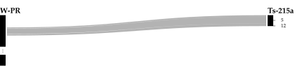
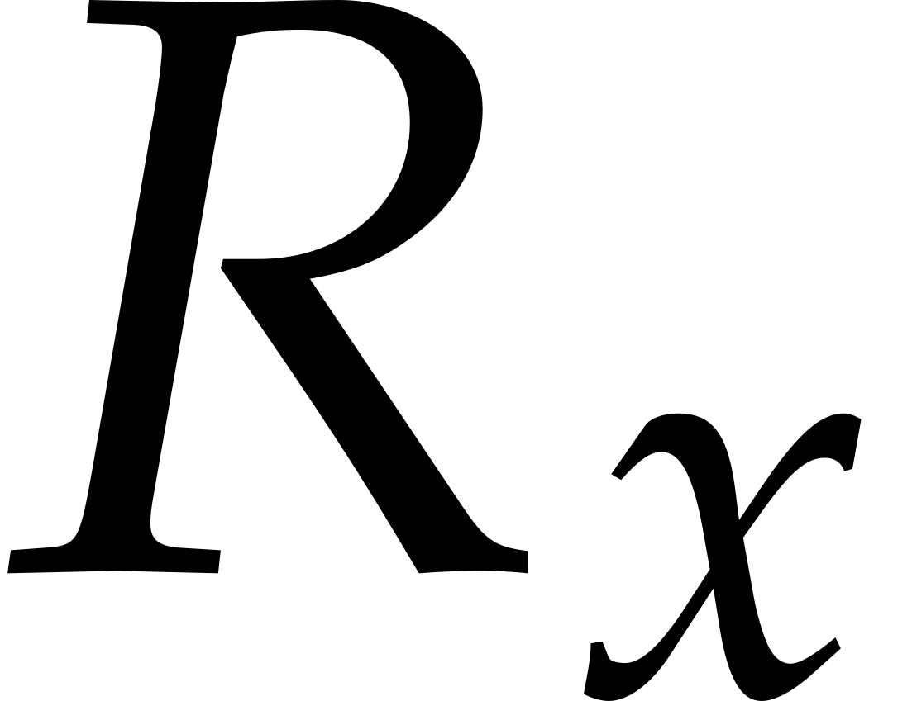

# Ts-215a

15 published remarks, PR

### [PR](/w-pr/#ts-215a-1.1) [1\[1\]](https://cdn.wittgensteinnachlass.com/2000px/webp/Ts-215a/1.webp)

## Infinitely long.

### [PR](/w-pr/#ts-215a-1.2) [1\[2\]](https://cdn.wittgensteinnachlass.com/2000px/webp/Ts-215a/1.webp)

When one speaks of the concept ‘infinity’, one must remember that this word has many different meanings, and remember which of them we are speaking of just now. Whether, for example, it is the infinity of a series of numbers, and of the cardinal numbers in particular. If, for example, I say that ‘infinite’ is a characteristic of a rule, I am referring to _one_ particular meaning of the word. But we could quite well say that a continuous transition in colour is a transition “through infinitely many stages”, provided we do not forget that here we are defining the meaning of the expression “infinitely many stages” _anew_ through the experience of the transition in colour. (Albeit by analogy with other uses of the word “infinite”.)

### [1\[3\]](https://cdn.wittgensteinnachlass.com/2000px/webp/Ts-215a/1.webp)

If we see a continuous transition in colour, a continuous movement, then we see _no_ parts, _no_ jumps (not “infinitely many”; unless I now _give_ this expression that meaning).

### [PR](/w-pr/#ts-215a-1.4+2.1) [1\[4\]](https://cdn.wittgensteinnachlass.com/2000px/webp/Ts-215a/1.webp),[2\[1\]](https://cdn.wittgensteinnachlass.com/2000px/webp/Ts-215a/2.webp)

(If one says that this area of our subject is extraordinarily difficult, that is not true in the sense that we are dealing with things that are extraordinarily difficult to imagine or extraordinarily complicated, but only in the sense that it is extraordinarily difficult to get past the countless traps laid for us here in language.)

### [PR](/w-pr/#ts-215a-2.2) [2\[2\]](https://cdn.wittgensteinnachlass.com/2000px/webp/Ts-215a/2.webp)

““I once said that there was no extensive infinity. Ramsey replied: “Can one not imagine a person living for ever, i.e. simply never dying, and is that not extensive infinity?” – Surely I can imagine a wheel turning and _never_ stopping.”” What a strange argument: “I can imagine it”! Let us consider (for ourselves) what experience we would regard as confirmation or proof that the wheel will never stop turning. Let us compare this experience with the one that teaches us that the wheel turns for a day, a year, 10 years, and we will simply recognize the difference in grammar between the statements “…never stops” and “…stops in 100 years”. Think of the kind of evidence one might adduce for the assertion that two heavenly bodies revolve around one another without stopping. Think of the law of inertia, and of how it is confirmed.

### [PR](/w-pr/#ts-215a-2.3+3.1) [2\[3\]](https://cdn.wittgensteinnachlass.com/2000px/webp/Ts-215a/2.webp),[3\[1\]](https://cdn.wittgensteinnachlass.com/2000px/webp/Ts-215a/3.webp)

““Suppose we walked out into Euclidean space along a straight line and encountered an iron sphere every 10 m ad inf..”” Again: What sort of experience would I regard as confirmation of this, and what sort, on the other hand, as confirmation that there are 10000 spheres in a row? – A confirmation of the first kind might be as follows: I observe the oscillating movement of a body. Experiments have taught me that this body is attracted by iron spheres according to a particular law; the assumption of 100 such spheres in a row in a particular position relative to the test body, given the assumption of that law of attraction, accounts approximately for the observed (or assumed) behaviour; but the more spheres we assume there are in the row, the more closely the calculated result corresponds to the observed one. It then makes sense to say that the experience confirms the assumption of an infinite row of spheres. But the sense of specifying a number differs from that of specifying an “infinite number” just as much as this experience differs from seeing a number of spheres.

### [PR](/w-pr/#ts-215a-3.2) [3\[2\]](https://cdn.wittgensteinnachlass.com/2000px/webp/Ts-215a/3.webp)

““The merely negative description of _not coming to an end_ cannot yield a positive infinity.”” In using the expression “positive infinity”, I was of course thinking of a countable ( = finite) collection of things (chairs in this room), and wanted to say that the presence of that colossal number of such things could not be inferred from what the not coming to an end indicates to us. So here I make the strange mistake, in the form of my statement, of denying a fact instead of denying that a particular sentence has sense, or, more correctly, of showing that two statements that sound alike have different grammars.

### [PR](/w-pr/#ts-215a-3.3+4.1) [3\[3\]](https://cdn.wittgensteinnachlass.com/2000px/webp/Ts-215a/3.webp),[4\[1\]](https://cdn.wittgensteinnachlass.com/2000px/webp/Ts-215a/4.webp)

What a strange question: “can one imagine an endless row of trees?”! When one speaks of an ‘endless row of trees’, what one means will surely be connected with the experiences one calls “seeing a row of trees”, “counting a row of trees”, “measuring a row of trees”, etc. “Can we imagine an infinite row of trees”! Certainly, once we have settled what is to be understood by it; i.e.: once we have brought this concept into connection with all that, with the experiences that determine for us the concept of a row of trees. What is the criterion in experience for a row of trees being infinite? for from that I will see how this statement is to be understood. Or do you give me no such criterion, – what am I then to do with the concept “infinite row of trees”? What has this concept to do with what I ordinarily call a row of trees? Or did you mean after all only: an immensely long row of trees?!

### [PR](/w-pr/#ts-215a-4.2+5.1) [4\[2\]](https://cdn.wittgensteinnachlass.com/2000px/webp/Ts-215a/4.webp),[5\[1\]](https://cdn.wittgensteinnachlass.com/2000px/webp/Ts-215a/5.webp)

“But surely, when we walk along a row of trees, we know an experience that we can call the row coming to an end. Now, an endless row of trees is one along which we never _have_ this experience”. – But what does “never” mean here? I know an experience that I describe in the words: “he never coughed during this hour”, or “he never laughed in his life”. One cannot speak of a _corresponding_ experience if the “never” does not refer to an interval of time. So here again the analogy lets us down, and I must investigate afresh how the word “never” can be used with sense in this case. – Now, such uses can indeed be found, but their rules have to be investigated separately. For example, the sentence that a row of trees is infinitely long (or the one that we will _never_ come to an end) can be a law of nature of the same kind as the law of inertia, which says that under certain circumstances a body moves at constant speed in a straight line; and here too one could say that under these circumstances the movement will _never_ end. If one asks about the verification of such a sentence, the first thing one can say is that it is falsified if the movement (the row of trees) comes to an end. There can be no question of verification here, and that means that we are dealing with a fundamentally different kind of sentence (or with a sentence in a different sense of that word). Of course I do not want to say that this is the only use with sense of the expression “infinite row of trees”, or of the word “never” (for all eternity). But each of these uses must be described separately and has its own laws. It does us no good to find a form of speech ready-made in our ordinary language, because this language uses each of its words in a great variety of meanings, and the fact that we understand the use of a word in _one_ case does not spare us the investigation of its grammar in another. So we might think: “surely it is possible to imagine an infinitely long life, for someone who simply never dies lives for an infinitely long time”. But the use of the word “never” is not so simple _at all_.

### [PR](/w-pr/#ts-215a-5.2+6.1) [5\[2\]](https://cdn.wittgensteinnachlass.com/2000px/webp/Ts-215a/5.webp),[6\[1\]](https://cdn.wittgensteinnachlass.com/2000px/webp/Ts-215a/6.webp)

Let us now speak of an endless life in the sense of a hypothesis (cf. the law of inertia), and let the person living it choose any one fraction from each interval in turn – between 1 and 2, between 2 and 3, between 3 and 4, etc. ad inf. – and write it down. Do we thereby obtain a “selection from all those intervals”? No, for his choosing has no end. It makes no sense ever to say of him that he has completed the selection. But can I not say that all the intervals must surely be reached, since I cannot name one that would not be reached? But from the fact that he will at some point reach each interval, it does not follow that at some point he will have reached them all. For if we use the word “reach” as in “he reaches something at a particular time” (i.e. in this grammatical context), then saying that he “reaches each interval at some point” means roughly: that he reaches the first after the first second, the second after the second, the third after the third, and so on ad inf.. Thus a law is given here by means of the expression and so on ad inf. But then to say that he reaches all the intervals would mean that he reaches them at a particular time, that the process thus comes to an end, – which contradicts the first assumption. So if one infers from his reaching each interval that he reaches them all, one uses the word “reaches” in quite a different way the second time! “But now imagine a man who becomes more and more practised at choosing from the intervals, so that he needs an hour for the first choice, half an hour for the second, a quarter for the third, and so on ad inf.. Then surely he would finish the whole job in two hours!” Let us picture the process. Choosing might consist in writing down the fraction, that is, in a movement of the hand. This movement would now become faster and faster; but however fast it becomes, there is always a last interval that it deals with in a given time. The reasoning behind our objection rested on forming the sum 1 + ½ + ¼ + …, but this is a _limit_ of sums and not a sum in the sense of the word in which, for example, 1 + ½ + ¼ is a sum. If I say “he needs an hour for the first choice, half an hour for the second, a quarter for the third, and so on ad inf.”, this statement has sense only so long as I do _not_ ask how fast he is choosing at time t = 2, for our calculation yields _no_ value for that time (for that value does not exist for us here, since we have not correlated any experience with it). For every point _before_ t = 2 my law gives me a speed, and so to that extent it is usable and in order. So the fallacy arises only in the sentence “then he would finish the job in two hours”. (Insofar as one may call this a fallacy, since the sentence is senseless in this case.)

### [PR](/w-pr/#ts-215a-6.2+7.1) [6\[2\]](https://cdn.wittgensteinnachlass.com/2000px/webp/Ts-215a/6.webp),[7\[1\]](https://cdn.wittgensteinnachlass.com/2000px/webp/Ts-215a/7.webp)

Let us now imagine the hypothesis that under certain circumstances someone will roll the digits of the number π (in base six, say) with a die. This hypothesis, then, is a law by means of which I can calculate the number of spots rolled on each throw. But what if we modified the hypothesis to say that under certain circumstances someone will _not_ roll the digits of π! Should that not have sense too? But how can one ever know that this hypothesis is correct, since at any given time he may have been rolling in accordance with π and the hypothesis is still not refuted by this. But that is precisely to say that we are dealing here with a different _kind_ of hypothesis; with a kind of sentence whose grammar makes no _provision_ for falsification. And I am free to call this a “sentence”, or a “hypothesis”, or something else altogether, if I want. (π is not a _decimal fraction_, but a _law_ according to which fractions are formed.)

### [PR](/w-pr/#ts-215a-7.2) [7\[2\]](https://cdn.wittgensteinnachlass.com/2000px/webp/Ts-215a/7.webp)

The infinity of time is not an extension.

### [PR](/w-pr/#ts-215a-7.3+8.1) [7\[3\]](https://cdn.wittgensteinnachlass.com/2000px/webp/Ts-215a/7.webp),[8\[1\]](https://cdn.wittgensteinnachlass.com/2000px/webp/Ts-215a/8.webp)

If we ask: “what does the infinity of time consist in”, one will tell us: “in the fact that no day is the last, that each day is followed by another day”. But here again we are led by an analogy to see the matter wrongly. For we compare, say, the succession of days with the succession of events (_in time_), e.g. the strokes of a clock. We then sometimes have the experience that 4 strokes are followed by a 5th. Does it also make sense to speak of the experience of four days being followed by a fifth? And can one say: “you see, I predicted it: another one will follow the fourth”? One might as well say that it is an experience that the fourth is followed by precisely the fifth and no other.) But we are not speaking here of the prediction that the sun will move after the fourth day as it has up to now; _that_ is a genuine prediction. No, in our case there is no question of a prediction, no event is prophesied; rather, we are saying something like this: that it makes sense to speak, with reference to any sunrise or sunset, of a next one. For the meaning of the designation of a measure of time is tied to an event: the revolution of a hand, the movement of the earth, etc. etc.; but if we say “each hour is followed by another”, and have defined the hour, say, by the revolution of a particular hand (as a paradigm), we still do not (after all) mean by each statement to prophesy that this hand will go on turning in this way for all eternity; – but we do want to say that it “_can_ always go on turning in this way”; and that is precisely a statement about the grammar of our specifications of time.

### [8\[2\]](https://cdn.wittgensteinnachlass.com/2000px/webp/Ts-215a/8.webp)

Let us imagine that a man who has lived for an infinitely long time, because he was never born, says: “Now I am writing down the last digit of π, namely the 3 in the units place”. He had written down a digit every day of his life and had never begun doing so; now he has finished.

### [8\[3\]](https://cdn.wittgensteinnachlass.com/2000px/webp/Ts-215a/8.webp)

One thinks that surely a large number is closer to the infinite than a small one. The infinite does not compete with the finite. It is that which essentially excludes nothing finite. Space has no extension; only spatial objects are extended. Infinity is a property of space. (And that shows that it is not an infinite extension.)

### [8\[4\]](https://cdn.wittgensteinnachlass.com/2000px/webp/Ts-215a/8.webp),[9\[1\]](https://cdn.wittgensteinnachlass.com/2000px/webp/Ts-215a/9.webp)

“A is my ancestor”, that is: “A is my father, or my father’s father, or my father’s father’s father, or and so on”. No doubt, but in doing this we have only substituted _one_ sentence-sign for another; we have not yet determined the sense, for we have not – as it might easily seem – reduced it to the familiar sense of a logical sum. – So I will go on to ask: “How does one know that A is an ancestor of B?” for that means: “in what cases do I want to say that A is an ancestor of B”, or again: “what do I understand by an ‘ancestor of B’”. Do I call anyone that who has a particular property that in our experience is hereditary in B’s family? If that is the definition, then I can establish of a person, for example, that he is _not_ an ancestor of B. Or is the sentence to be understood in such a way that there is no establishing that someone is _not_ an ancestor of B (so that no provision was made in our grammar for establishing this), but only that someone is an ancestor of B: in that case, however, we are dealing with quite a different kind of sentence from the first case. (Remember, incidentally, that the properties hereditary in B’s family must of course not include that of ‘being an ancestor of B, or being B’, and compare Russell’s definition of “”.)

### [9\[2\]](https://cdn.wittgensteinnachlass.com/2000px/webp/Ts-215a/9.webp)

To say that any proposition (∃nx)․fx follows from the infinite hypothesis “(n) :(∃nx)․fx” (as I shall now write it, for brevity’s sake), and that the hypothesis itself follows from no logical product of these propositions, is of course to say nothing at all as yet about the further use of this game.

### [PR](/w-pr/#ts-215a-9.3+10.1+11.1) [9\[3\]](https://cdn.wittgensteinnachlass.com/2000px/webp/Ts-215a/9.webp),[10\[1\]](https://cdn.wittgensteinnachlass.com/2000px/webp/Ts-215a/10.webp),[11\[1\]](https://cdn.wittgensteinnachlass.com/2000px/webp/Ts-215a/11.webp)

Let us compare the sentences: “I adjust my way of acting on the assumption that this state will last another 2 years” and “I adjust my way of acting on the assumption that this state will last for ever”. – Does the sentence have sense: “I believe (or expect, or hope) that it will stay like this throughout infinite time”? – One can say: “I am making preparations for the next 3 days”, or 10 years, etc., and also “I am making preparations for an indefinite time”; – but also: “for an infinite time”? If I “make preparations for an indefinite time”, then surely one can specify a period of time for which, in any case, I am no longer making any preparations. I.e., not every sentence of the form “I am making preparations for n years” follows from the sentence “I am making preparations for an indefinite time”. Just think of the sentence: “I _surmise_ that this state will _last_ without end”! Or of the odd sound of the refutation: “You said this clockwork would always keep going like this, – well, it has already stopped _now_”. We feel that any finite prediction that gave too long a _running time_ would of course also be refuted by the fact, and that the refutation is therefore in some sense incommensurable with the assertion. – For it is nonsense to say: “the clockwork did not go on running infinitely, but stopped after 10 years” (or, still more oddly: “…, but stopped after only 10 years”). How strange it would be if one said: “It takes great daring to make a prediction for the next 100 years; – but what daring it must take to predict something for infinite time, as Newton did in the law of inertia!” I believe it will always go on like this”. – “Is it not enough (for all practical purposes) if you say you believe it will go on like this for another 10000 years?” – For we must ask: can there be grounds for this belief? What are they? What are the grounds for assuming that the clock will keep going for another 1000 years; what are the grounds for assuming that it will go for another 10000 years; – and now what are the grounds for the infinite assumption?! – That is just what makes the sentence “I surmise that it will go on like this without end” sound so odd; we want to ask: why do you surmise that? For what we want to say is that it is senseless to say that one surmises this, – because it is senseless to speak of grounds for such a surmise. Think of the sentence: “this comet will move in a parabola with the equation …”. How is this sentence used? It cannot be verified; i.e.: _we_ have made no provision for its verification in its grammar (of course that does not mean that one cannot say it is true; for “p is true” says the same as “p”). Now, the sentence may lead us to make certain observations. But a finite prediction would always have done for those as well. It will also determine certain actions. For instance, it might keep us from looking for the comet at such and such a place. But a finite statement would have sufficed for that too. The infinity of the hypothesis consists not in its _size_, but in its open-endedness.

### [PR](/w-pr/#ts-215a-12.1) [12\[1\]](https://cdn.wittgensteinnachlass.com/2000px/webp/Ts-215a/12.webp)

“One day the world will come to an end”: an infinite hypothesis.

### [PR](/w-pr/#ts-215a-12.2) [12\[2\]](https://cdn.wittgensteinnachlass.com/2000px/webp/Ts-215a/12.webp)

The sentence that at some point – in the infinite future – an event (e.g. the end of the world) will occur has a certain formal similarity to what we call a tautology.
