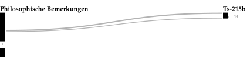

# Ts-215b

5 published remarks, PR

### [PR](/w-pr/#ts-215b-13.1) [13\[1\]](https://cdn.wittgensteinnachlass.com/2000px/webp/Ts-215b/13.webp)

## Infinite Possibility.

### [PR](/w-pr/#ts-215b-14.1+15.1+16.1) [14\[1\]](https://cdn.wittgensteinnachlass.com/2000px/webp/Ts-215b/14.webp),[15\[1\]](https://cdn.wittgensteinnachlass.com/2000px/webp/Ts-215b/15.webp),[16\[1\]](https://cdn.wittgensteinnachlass.com/2000px/webp/Ts-215b/16.webp)

Different uses of the word “can” in the sentences: “3 things can lie in this direction” and “infinitely many things can lie in this direction”. Now what sense, i.e. what grammar, could such a way of speaking have? One could say, for example: “in the natural number series 1, 2, 3, 4, … infinitely many numerals can follow the ‘1’”; that means the same as: “the operation + 1 may be used again and again (or: without end)”. So if, for example, someone writes the numeral 100 + 1 after the numeral 100, then under that rule he is entitled to do so. On the other hand, it makes no sense here to say: “if it is permissible to write down infinitely many numerals, then let us write down infinitely many numerals (or try to)!” – I would point out to anyone who says this that “infinitely many” is not used as a number word; that it may not be substituted for n in the form “I write down n numerals”. So what I permit is not the writing down of _one_ definite number of numerals (namely a number that might be called “infinitely many”, for I have not given any of the numerals that name), but rather that one may go as far as one wants in writing down numerals according to the given rule, however far that may be. Of course, I may not then say either: “I can go as far as I want in writing down the numerals, but not as far as the number Infinity”, since _there is no question at all of_ such a numeral as “infinite” (for I have not introduced one). “Infinitely many numerals can follow …” might therefore be better put: “Numerals can follow … infinitely”. “Infinitely” (“unendlich”) is thus used adverbially here. Similarly, if I say that a division produces an infinite decimal fraction, there is not _one_ result of the division called “an infinite decimal fraction”, in the sense in which the number 0,142 is a result of 1 : 7. The division does not yield _one_ decimal number, or a number of decimal numbers, as its final result – rather, one cannot speak of “its final result”; and it yields decimal fractions endlessly, not “an endless decimal fraction”. “Endlessly” (“endlos”) _is_ used adverbially. Now let us imagine the following case: suppose I had constructed a special kind of die and were now to predict: “with this die I shall throw the digits of π”. This statement is of a different form from the apparently analogous one: “with this die I shall throw the first 10 digits of π”. For in the second case there is a sentence “in an hour I shall have thrown the first 10 digits of π”, whereas this sentence becomes nonsensical (not false) if I put “the digits” in it instead of “the first 10 digits”. Now if I were to say: “it is possible to throw a die infinitely many times”, this could mean “any number of throws whatsoever is possible, conceivable”, and not that there is a conceivable definite number of throws called “infinite”. “Infinitely many times” would mean “as many times as you like”, and to say: “if you can throw the die infinitely many times, then do so”, would mean: “if you can throw it as many times as you like, then do so”. (Servant: “And when does the Baron usually dine?” Nouveau riche: “I dine when gentlemen of distinction dine”. – Servant: “Gentlemen of distinction dine at different times”. – Nouveau riche: “Then I shall dine at different times too”.) In the sentence “any number of throws whatsoever is possible”, “possible” can mean as much as “logically possible” (“conceivable”), and then the sentence is a rule, not an empirical proposition, and is analogous to the rule: “numerals can follow 1 endlessly”. But we could also take it as a kind of hypothesis for which no verification is provided, but a falsification is, and so it would be a sentence of a different kind (‘sentence’ in a different sense) from the empirical proposition: “3 throws are possible with this die”. The latter – in contrast to the _rule_ “3 throws are conceivable” – would say something like: “the die will still be usable after 3 throws”; the hypothesis “infinitely many throws are possible with this die” would say: “however often one throws it, this die will not wear out”. One sees very clearly that these are sentences of different kinds if one thinks of the nonsensical command “throw the die infinitely many times” or “throw the die ad infinitum”, in contrast to the command that makes sense: “throw the die 3 times”. For what is essential to a command is checking its execution.

### [PR](/w-pr/#ts-215b-16.2+17.1+18.1) [16\[2\]](https://cdn.wittgensteinnachlass.com/2000px/webp/Ts-215b/16.webp),[17\[1\]](https://cdn.wittgensteinnachlass.com/2000px/webp/Ts-215b/17.webp),[18\[1\]](https://cdn.wittgensteinnachlass.com/2000px/webp/Ts-215b/18.webp)

If we want to say that infinity is a property of possibility, not of reality, or that the word “infinite” always goes with the word “possible”, and the like, – this amounts to saying that the word “infinite” is always part of a _rule_. We resist the conception of the infinite as an enormous magnitude. (Which, curiously, we grasp without difficulty, whereas a large finite number may be too large for us to write down. As though we could not work our way through the series of finite numbers, but could get to the infinite by going round the outside.) Let us imagine telling someone: “yesterday I bought myself a ruler with an infinite radius of curvature”. But here the word “infinite” does occur in a description of reality. – But I can never have the experience that would entitle me to say that the ruler really has an infinite radius, since a radius of 100¹⁰⁰km will surely do just as well. – No doubt, but then I cannot have the experience that entitles me to say that the ruler is _straight_ either. And the words “straight” (or, on another occasion, “parallel”) and “infinite” are in the _same_ position. I mean: if the word “straight”, or “parallel”, or “equal in length”, etc. etc. may occur in an empirical proposition, then so may the word “infinite”. “Only possibility is infinite” means “‘infinite’ is an addition to ‘etc.’”. And in so far as it is this, it belongs in a rule, a law. Only in so far as one means by “experience that accords with a law” an endless series of experiences does it not belong in the description of experience. – The saying “only possibility is infinite, not reality” is misleading. One can say: “_here_ only possibility is infinite”. – And one rightly asks: what then is infinite about this hypothesis (about the comet’s course, for example)? is there anything enormously large about this assumption, this thought?! Let us imagine the fairy in the fairy tale saying: “You will get as many gold pieces as you wish for, but you may wish only once”. – Is her promise not fulfilled if I get what I wish for? And was my choice not unrestricted? Would the case not have been different if she had set a limit to the amount, – however high she had set it? Can I not now say: the freedom the fairy left me was infinite? And does that describe a reality? – If someone now says: “No, freedom of choice is only a possibility”, he confuses the statement that the fairy left me infinite freedom – which is not a rule of grammar – with the rule that allows me, in accordance with the fairy’s promise, to name any number of gold pieces. One could also put it like this: when the concept of infinity is applied in the description of reality, such descriptions speak not of ‘infinite rulers’ but, for example, of rulers with an infinite radius of curvature; and not of ‘infinitely many gold pieces’ but, for example, of the infinite freedom someone leaves me to wish for gold pieces. When we say: “the possibility of forming decimal places in the division 1 : 3 is infinite”, we are not establishing a natural fact but giving a rule of the calculus. But if I say: “I leave you infinite freedom to form as many places as you like; I shall not stop you”, I am not laying down a rule of a calculus but making a prediction. “Yes, but only as a description of a possibility”. – No, of a reality! but _of course_ not that of “infinitely many places”; that would be precisely the grammatical mistake we must avoid. And of course in these empirical propositions “infinite” remains a property of a rule, if one wants to put it that way, and that means nothing other than that here too it can be rendered by “etc. ad inf.”; and at the same time that is all that is meant when one says that infinity is a predicate of possibility.

### [18\[2\]](https://cdn.wittgensteinnachlass.com/2000px/webp/Ts-215b/18.webp)

Suppose a rule of a game read: “One is to write down a fraction that lies between 0 and 1”; – isn’t this rule entirely intelligible? Does a restriction need to be given here? (or the rule: “One is to write down a number greater than 100”.)

### [18\[3\]](https://cdn.wittgensteinnachlass.com/2000px/webp/Ts-215b/18.webp)

Grammar cannot _state_ its rules generally by trusting to luck (i.e. leave them open).

### [18\[4\]](https://cdn.wittgensteinnachlass.com/2000px/webp/Ts-215b/18.webp)

Let us imagine a game of draughts in which it would be permissible to use a board of any size, by which I mean a board with any number of squares (thus 64, 81, 100 etc.). This does not of course mean “it is permissible to use a board with infinitely many squares”. We could hardly call this an infinite game.

### [18\[5\]](https://cdn.wittgensteinnachlass.com/2000px/webp/Ts-215b/18.webp),[19\[1\]](https://cdn.wittgensteinnachlass.com/2000px/webp/Ts-215b/19.webp)

Possibility always corresponds to a permission in the grammatical rules of the game. Something one might call infinite permission corresponds to what one calls infinite possibility. And that is of course not permission to do something infinite.

### [19\[2\]](https://cdn.wittgensteinnachlass.com/2000px/webp/Ts-215b/19.webp)

Infinite divisibility consists in any finite number of parts whatsoever being conceivable (but not an infinite number).

### [19\[3\]](https://cdn.wittgensteinnachlass.com/2000px/webp/Ts-215b/19.webp)

When one says: “space is infinitely divisible”, what this really means is that space does not consist of individual things (parts). Infinite divisibility means, in a certain sense, that space is not divisible, that a division does not affect _it_. That it has nothing to do with the matter: _It_ does not consist of parts. It says, as it were, to reality: You can do in me whatever you want. (You can be divided in me as many times as you want.) Space gives reality infinite scope for division.

### [19\[4\]](https://cdn.wittgensteinnachlass.com/2000px/webp/Ts-215b/19.webp)

(And that is why there is only _one_ letter in the first bracket of “(n):(∃nx)․fx”. Evidently just an opportunity, nothing else. – We give too little thought to the fact that the sign really cannot mean more _than it is_.)

### [19\[5\]](https://cdn.wittgensteinnachlass.com/2000px/webp/Ts-215b/19.webp)

“‘Time appears to us essentially as an _infinite_ possibility. And indeed, evidently, infinite according to what we know about its structure.’” I.e. infinite according to its grammar.

### [PR](/w-pr/#ts-215b-19.6) [19\[6\]](https://cdn.wittgensteinnachlass.com/2000px/webp/Ts-215b/19.webp)

Grammar is not infinitely complicated because it allows the endless formation of numerals.

### [PR](/w-pr/#ts-215b-20.1) [20\[1\]](https://cdn.wittgensteinnachlass.com/2000px/webp/Ts-215b/20.webp)

To _explain_ the infinite possibility, it must be enough to point to the features of the sign that lead us to the _assumption_ of this infinite possibility, or rather: from which we discern this infinite possibility. That is (_only_) to say that what is actually there in the sign must suffice, and that the possibilities of the sign, which could in turn show themselves only in a description of signs, must not come into consideration. So everything must already be contained in the sign “[1, x, x + 1]” – the expression of the formation rule. I must not use the infinite possibility to introduce a mythical element into _logic_ again. If one describes the process of division

,

which yields the quotient 0,3 and the remainder 1, then the infinite possibility of continuing with the same result every time must already lie in this description, for nothing else is given to us when we see “that it must always go on like this”. And when we “see the infinite possibility of continuing”, we surely cannot see anything that is not described when we describe the very sign we see.
