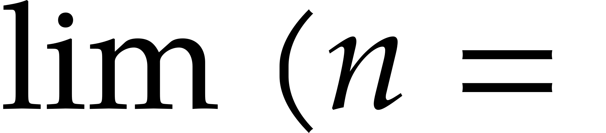
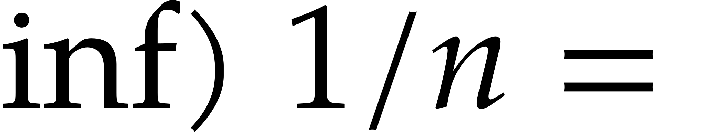
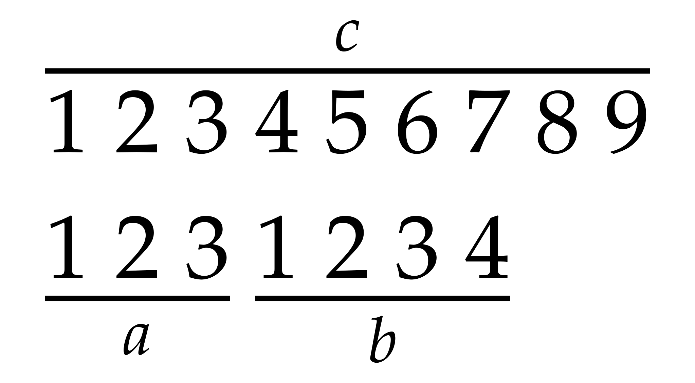

# Ts-216

### [1\[1\]](https://cdn.wittgensteinnachlass.com/2000px/webp/Ts-216/1.webp)

## Equations and inequalities are stipulations or the consequences of stipulations.

### [1\[2\]](https://cdn.wittgensteinnachlass.com/2000px/webp/Ts-216/1.webp)

An inequality, like an equation, must be either the result of a calculation or a stipulation.

### [1\[3\]](https://cdn.wittgensteinnachlass.com/2000px/webp/Ts-216/1.webp)

Just as equations can be understood as rules for signs, as opposed to propositions, so it must be possible to do the same with inequalities.

### [1\[4\]](https://cdn.wittgensteinnachlass.com/2000px/webp/Ts-216/1.webp)

The negation of an equation is as similar to and as different from the negation of a proposition as the affirmation of an equation is from the affirmation of a proposition.

### [1\[5\]](https://cdn.wittgensteinnachlass.com/2000px/webp/Ts-216/1.webp)

A mathematical _sentence_ can only be a stipulation or a result calculated from stipulations by a particular method. And this must hold for “9 is divisible by 3” or “9 is not divisible by 3”.

### [2\[1\]](https://cdn.wittgensteinnachlass.com/2000px/webp/Ts-216/2.webp)

How does one calculate 2 × 2 = 5?

### [2\[2\]](https://cdn.wittgensteinnachlass.com/2000px/webp/Ts-216/2.webp)

Perhaps all that is essential is that one should see that what is expressed by inequalities is _essentially_, i.e. formally, different from what is _expressed by equations_. And so one cannot directly compare a law that yields the places of a decimal fraction and works with inequalities with one that works with equations. We have quite different methods before us here, and hence different kinds of arithmetical formations.

### [2\[3\]](https://cdn.wittgensteinnachlass.com/2000px/webp/Ts-216/2.webp)

I.e. in arithmetic one cannot simply put equations and something else (say, inequalities) on _one_ level, as though they were, say, different genera of animals. Rather, the two methods will then be categorically different and will determine (define) formations that cannot be compared with one another.

### [2\[4\]](https://cdn.wittgensteinnachlass.com/2000px/webp/Ts-216/2.webp)

Which equation, say, of the form

abc… times cde… = ghi…

is right, which wrong?

### [2\[5\]](https://cdn.wittgensteinnachlass.com/2000px/webp/Ts-216/2.webp),[3\[1\]](https://cdn.wittgensteinnachlass.com/2000px/webp/Ts-216/3.webp)

Indeed, can one say of the written sign (_at all_) that it is right (or wrong)? For this is connected with the sense of the answer: “the right equation is the one that one can produce according to the rules”, as opposed to _the answer_: “the right equation is the one that one has produced according to the rules”. What is the criterion for saying that one _can_ produce the equation according to the rules? It is clear that what is posited (the equation) is right or wrong only in the system in which it can be produced.

### [3\[2\]](https://cdn.wittgensteinnachlass.com/2000px/webp/Ts-216/3.webp)

What makes 2 + 2 = 4 meaningful, that is, what makes 2 + 2 = 4 right and 2 + 2 = 5 wrong, rather than two equally legitimate stipulations, is the provability of 2 + 2 = 4, and that alone. That is, that ((1) + 1) + ((1) + 1) = (((1) + 1) + 1) + 1 belongs to the general system a + (b + 1) + (a + b) + 1.

### [3\[3\]](https://cdn.wittgensteinnachlass.com/2000px/webp/Ts-216/3.webp)

Without this provability, 2 + 2 = 4 would be an arbitrary rule for signs, and there would be no question of its being right or wrong. Demonstrability makes the equation something that can be compared with a proposition.

### [3\[4\]](https://cdn.wittgensteinnachlass.com/2000px/webp/Ts-216/3.webp)

To call “a + (b + 1) + (a + b) + 1” a definition is already a mistake, strictly speaking, for it is a rule for signs of quite a different kind from, e.g., (1) + 1 = 2.

### [3\[5\]](https://cdn.wittgensteinnachlass.com/2000px/webp/Ts-216/3.webp)

One might now ask: What meaning does 2 + 2 = 4 have? Is it not a rule for signs? If so, it is arbitrary. The answer is that the meaning of 2 + 2 = 4 lies not in itself but in its provability, that is, in its relation to other rules for signs, and thus in _its_ belonging to a system. I.e. that proof shows internal relations between 2 and 4 (_just as_) the proof that p⊃q & p ․⊃․ q is a tautology shows internal relations between p⊃q & p and q.

### [3\[6\]](https://cdn.wittgensteinnachlass.com/2000px/webp/Ts-216/3.webp),[4\[1\]](https://cdn.wittgensteinnachlass.com/2000px/webp/Ts-216/4.webp)

An equation acquires mathematical meaning only in a calculus. Thus “” is an arbitrary substitution rule as long as the expression “lim etc.” does not occur in a calculus of limits.

### [4\[2\]](https://cdn.wittgensteinnachlass.com/2000px/webp/Ts-216/4.webp)

An inequality is just as much a syntactical rule as an equation. The analogy between truth-functions in connection with equations and truth-functions of sentences is complete – i.e. the rules that apply are the same in both cases – except that equations are not sentences. (In truth-functions applied to hypotheses, after all, we have a further example of _such analogies_.)

### [4\[3\]](https://cdn.wittgensteinnachlass.com/2000px/webp/Ts-216/4.webp)

Is it not clear: the sentences of pure mathematics can only be _applied_ as rules for signs. (Only conditions of sense.)

### [4\[4\]](https://cdn.wittgensteinnachlass.com/2000px/webp/Ts-216/4.webp),[5\[1\]](https://cdn.wittgensteinnachlass.com/2000px/webp/Ts-216/5.webp)

“3 + 4 kl 9” is not a communication either – as it would be, for instance, to say that a certain line segment is longer than 9 metres (that a house is higher than 9 m). Given what we understand by “3”, “4” and “9”, it is _self-evident_ (i.e. provable). But in saying this we are still looking at it in the same way as at the case of the house, only perhaps there it is a matter of something less self-evident. But it cannot be compared with the sentence at all. – When I said at first “it is self-evident”, _that means_ that what is at issue here is not a sentence but a rule for signs, which, _incidentally_, follows from a general rule. Again and again we are drawn to compare “3 + 4 kl 9” with a sentence such as “if one lays these two rods end to end, they still don’t reach up to there”. And that applies even in the case of the line segments a, b, c. But this sentence about the line segments a, b, c is

precisely not the arithmetical one. The latter is, rather, either the expression of a purely arbitrary choice – that we have put the sign “9” so far along the top row – or, if this is taken as given, self-evident. If “3 + 4 kl 9” were not an arbitrary stipulation or the consequence of a stipulation, it would be no concern of arithmetic. – The reason one sometimes wants to call it a tautology (which it is not in my sense) _is precisely that one wants to say_ “yes, if you stipulate that, then of course it is self-evident”. ((I am writing paraphrases of logical insights.))

### [5\[2\]](https://cdn.wittgensteinnachlass.com/2000px/webp/Ts-216/5.webp),[6\[1\]](https://cdn.wittgensteinnachlass.com/2000px/webp/Ts-216/6.webp)

For the arithmetical sentence does not [say] that in _some_ row of numerals one does not reach the sign “9” by laying 123 and 1234 end to end; rather, it stands for this not happening in the row 1 2 3 4 5 6 7 8 9. This row is presupposed in the arithmetical sentence, and the sentence is therefore not a description of this row from outside. – One could also put it like this: This is a sentence: “rod a and rod b laid end to end are shorter than rod c; or rod a is 3 m long, b 4 m and c 9 m”. But I cannot say that the length of the longer rod is longer than that of the shorter. – These lengths are something I state of the rods, rightly or wrongly, in order to show that they, the rods, stand in certain relations to one another, but for that the sense of these statements of length must _already_ be fixed and cannot be left to be _asserted as well_ in a sentence. Or: The statement that a is 3 m long, b 3 m, c 9 m _is_ precisely the one by which I show that c is longer than a and b together. A sentence saying that 3 m + 4 m is less than 9 m would correspond to a sentence saying that longer is longer than shorter (or “groß gr klein”). Such an expression would correspond rather to what has to be stipulated before anything can be said at all. “3 + 4 kl 9” is itself also part of the “game” and is a position of the pieces that can only accord with the general rules or not. Longer and shorter are an external property of the rods, but an _internal_ one of the lengths. (To express them by a sentence would be rather like trying to state the meaning of a word by a sentence in which the word occurs.)
