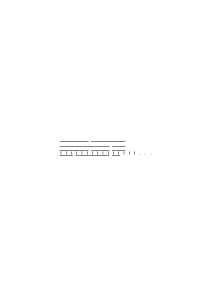
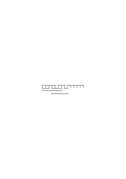
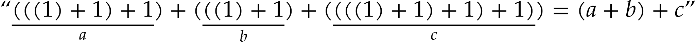

# Ts-218

### [1\[1\]](https://cdn.wittgensteinnachlass.com/2000px/webp/Ts-218/1.webp)

## How can a general proof give us the particular proof?

### [1\[2\]](https://cdn.wittgensteinnachlass.com/2000px/webp/Ts-218/1.webp),[2\[1\]](https://cdn.wittgensteinnachlass.com/2000px/webp/Ts-218/2.webp)

Just because things are so in the one case – how can I know that they are so in the _other_? And there is no such thing as ‘having to be so’. If it is not so, there is nothing one can do about it. Only what depends on us can we _determine_ in advance. One would probably want to say: The same construction is a proof of the geometrical proposition for the particular triangle; but we can also mean it generally; or: we can also see from it that what holds for this triangle must hold for any other. – But what does this “meaning” and “seeing” consist in? The psychological processes are of no concern to us. “The triangle here just stands for _any_ triangle”. But what does this “standing for something” consist in? Once again, all that concerns us is the _expression_ of that ‘way of taking it’, i.e. the expression of _what_ we apprehend or see, and the expression of the fact that the triangle stands only for itself or for all triangles. The calculus must (again) be laid down. It is not mental processes that interest us, but symbolic ones.

### [2\[2\]](https://cdn.wittgensteinnachlass.com/2000px/webp/Ts-218/2.webp)

So the proof cannot prophesy anything.

### [2\[3\]](https://cdn.wittgensteinnachlass.com/2000px/webp/Ts-218/2.webp)

Is the proof, carried out for A, also the proof for B? So that it makes no difference at all in which triangle it is drawn. And so that, if it were drawn in both triangles, it would only be a repetition of _the same_ proof. So that the sign of the proof – _the proof as a sign_ – could consist just as well of the construction in AA and the triangle B as of that triangle and a construction in it.

### [2\[4\]](https://cdn.wittgensteinnachlass.com/2000px/webp/Ts-218/2.webp)

_How_ does the general proof by induction make me certain that the particular one will yield that result?

### [2\[5\]](https://cdn.wittgensteinnachlass.com/2000px/webp/Ts-218/2.webp)

(Just do not despise the simple calculi that every child and every merchant’s wife uses.)

### [2\[6\]](https://cdn.wittgensteinnachlass.com/2000px/webp/Ts-218/2.webp)

This too must be a perfectly rigorous proof of the associative law.

### [2\[7\]](https://cdn.wittgensteinnachlass.com/2000px/webp/Ts-218/2.webp)

And here one can clearly distinguish the two cases we spoke of in the geometrical proof. For the figure can count as a general proof, and also as a proof only of 6 + (4 + 3) = (6 + 4) + 3, and I can write down the proof of 3 + (7 + 2) = (3 + 7) + 2 like this:

I have carried out the proof only above (drawn the construction).

### [3\[1\]](https://cdn.wittgensteinnachlass.com/2000px/webp/Ts-218/3.webp)

One calculus is not more rigorous than another! One only has to know the limits of each. One can call a calculus lacking in rigour only insofar as its rules are not _clearly_ formulated.

### [3\[2\]](https://cdn.wittgensteinnachlass.com/2000px/webp/Ts-218/3.webp)

I _could_ draw the same construction above as below. But does that suffice as a proof?! Yes, for the proof now consists in the description of what I could draw. And the description of a proof is (also) the proof, after all. – And now I must go through the sign  step by step to make sure that it is built according to this plan. The plan for which the general proof holds.

### [3\[3\]](https://cdn.wittgensteinnachlass.com/2000px/webp/Ts-218/3.webp)

“How is it that I do not have to prove this proposition (of geometry or arithmetic) separately, but that it is already proved by the general proof?” But you do have to prove it, – namely, by writing down the particular proposition, for the rest is only what all proofs of such propositions have in common. You have to prove this Euclidean proposition afresh for each triangle; though what is particular to this proof consists only in drawing this triangle, since the rest is already provided for by the general form (the Euclidean proof).)
