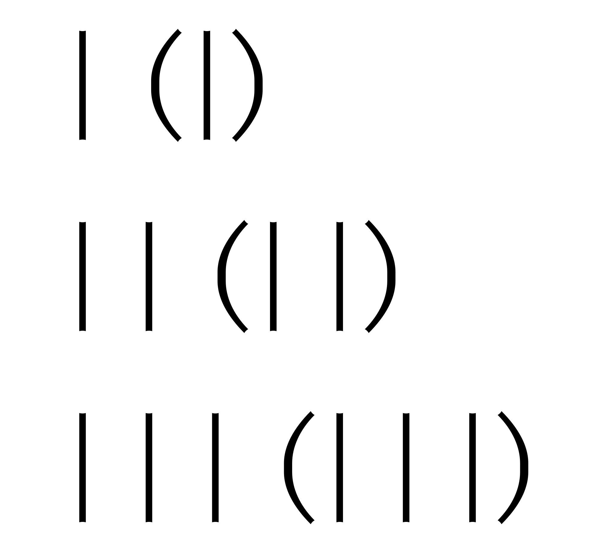
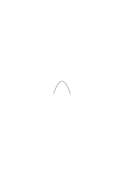

# Ts-219

### [1\[1\]](https://cdn.wittgensteinnachlass.com/2000px/webp/Ts-219/1.webp)

Must it not be possible to describe a world in which the solipsistic error is less tempting to us? Where the facts are such that we are less easily seduced into a one-sided grammar?

### [1\[2\]](https://cdn.wittgensteinnachlass.com/2000px/webp/Ts-219/1.webp)

In my considerations of mathematics tiny changes in the _symbolic_ mode of expression play a role. What is clear and transparent when said _thus_ can, put a little differently, be opaque or misleading.

### [1\[3\]](https://cdn.wittgensteinnachlass.com/2000px/webp/Ts-219/1.webp)

Being conceivable to someone for something, analogously: expecting someone, etc.

### [1\[4\]](https://cdn.wittgensteinnachlass.com/2000px/webp/Ts-219/1.webp)

Drawing of a four-dimensional cube (as an explanation of my conception of the drawing of the three-dimensional one). [→ Belongs to the consideration of mathematical proof as ornament.]

### [1\[5\]](https://cdn.wittgensteinnachlass.com/2000px/webp/Ts-219/1.webp)

The visual field when one sees fine rain: one sees a movement, but not anything definite moving.

### [1\[6\]](https://cdn.wittgensteinnachlass.com/2000px/webp/Ts-219/1.webp)

“I think far more than I say” – how can one compare that?

### [1\[7\]](https://cdn.wittgensteinnachlass.com/2000px/webp/Ts-219/1.webp)

We do not interfere with what the mathematician does; only when he claims to be doing metamathematics do we check on him.

### [1\[8\]](https://cdn.wittgensteinnachlass.com/2000px/webp/Ts-219/1.webp)

If we turn round in a circle a few times and then stand still, the room seems to move around us, and yet we do not see objects around us disappearing from our gaze in the process and others entering our field of view, as would surely have to be the case if the room were turning. But it is quite similar when a piece of music is played in such a way that it seems to us that it is being played faster and faster, while we have to tell ourselves that the tempo as a whole has not noticeably changed.

### [2\[1\]](https://cdn.wittgensteinnachlass.com/2000px/webp/Ts-219/2.webp)

Fluctuation of the concept “part of speech”. Is “3” the same part of speech as “4”?

### [2\[2\]](https://cdn.wittgensteinnachlass.com/2000px/webp/Ts-219/2.webp)

My explanation that the meaning of a word is entirely explained in grammar easily gives rise to the false appearance that I am confusing words with parts of speech here.

### [2\[3\]](https://cdn.wittgensteinnachlass.com/2000px/webp/Ts-219/2.webp)

Formal logic, a part of mathematics.

### [2\[4\]](https://cdn.wittgensteinnachlass.com/2000px/webp/Ts-219/2.webp)

I destroy the _problems_ and leave only _questions_.

### [2\[5\]](https://cdn.wittgensteinnachlass.com/2000px/webp/Ts-219/2.webp)

Meaning, a matter for psychology, or a transformation in the symbolism.

### [2\[6\]](https://cdn.wittgensteinnachlass.com/2000px/webp/Ts-219/2.webp)

Understanding the distribution of _the_ prime numbers:

Can one, and how can one, “_understand_” the occurrence of _a particular_ prime number? Say of the prime number 3 (or 5)? – (Why tackle a general problem when the elementary one is already interesting!) What does it mean to understand why 5 is a prime number, or: why there is a prime number at the 5th place of the series of cardinal numbers? (It _is_ a matter of getting rid of the feeling that we are dealing here with an empirical fact.)

Let us imagine the problem of the distribution of prime numbers in a finite arithmetic!

### [2\[7\]](https://cdn.wittgensteinnachlass.com/2000px/webp/Ts-219/2.webp),[3\[1\]](https://cdn.wittgensteinnachlass.com/2000px/webp/Ts-219/3.webp)

Think, first, of what it really means to say “the event is a different one from the one I expected”. Secondly: if a further phenomenon of recognition is needed to establish the identity, then one is also needed to recognize _this_ one, and so on. 3.) Think of what it means: to _know_ that this is the same.

### [3\[2\]](https://cdn.wittgensteinnachlass.com/2000px/webp/Ts-219/3.webp)

What distinguishes the intention to play chess in half an hour from the intention to play chess in 28 minutes? – Nothing at all, if this is not articulated. For simplicity we can regard as the criterion of the intention what he _says_.

### [3\[3\]](https://cdn.wittgensteinnachlass.com/2000px/webp/Ts-219/3.webp)

We can also say that the two proofs prove the same proposition, but then that shows what we understand here by the proof of a proposition.

(Different conceptions of the word “chess”.) Then there are also several independent proofs of the same proposition. etc.

### [3\[4\]](https://cdn.wittgensteinnachlass.com/2000px/webp/Ts-219/3.webp)

The calculation reaches up to its solution as the yardstick reaches up to what is measured, the description to what is described.

### [3\[5\]](https://cdn.wittgensteinnachlass.com/2000px/webp/Ts-219/3.webp)

The grammar of the word “thought” is what is being sought. Compare the grammar of “proposition”, “yardstick” and “thought”.

### [3\[6\]](https://cdn.wittgensteinnachlass.com/2000px/webp/Ts-219/3.webp)

And what does “I know what I have to do” mean? What goes on – say in me – when I know that? “You know what you have to do? – well, what do you know, what do you have to do?”

### [3\[7\]](https://cdn.wittgensteinnachlass.com/2000px/webp/Ts-219/3.webp)

Can one ask? What about the “knowledge” you get from the order? If you are asked what this knowledge consists in, you must answer either in the words of the order itself, or in other words of the same language.

### [4\[1\]](https://cdn.wittgensteinnachlass.com/2000px/webp/Ts-219/4.webp)

“That is the bearer of the name ‘N’” is a grammatical rule for ‘N’. If ‘M’ and ‘N’ have the same bearer _in the same way_, then the rules for ‘M’ and ‘N’ agree, and they have the same meaning.

### [4\[2\]](https://cdn.wittgensteinnachlass.com/2000px/webp/Ts-219/4.webp)

What, then, does this intention consist in? If it is an articulated intention, then it is the intention to do “what I find at a particular place in my memory” only if this is expressly said.

### [4\[3\]](https://cdn.wittgensteinnachlass.com/2000px/webp/Ts-219/4.webp)

“Now” simply works differently from (say) “tree”. “Now” is in a certain respect similar to a sample.

### [4\[4\]](https://cdn.wittgensteinnachlass.com/2000px/webp/Ts-219/4.webp)

“Whoever looks at the thought, the wish, the fear, the anger must see what is thought, wished, feared, what he is angry about.”

### [4\[5\]](https://cdn.wittgensteinnachlass.com/2000px/webp/Ts-219/4.webp)

Between which objects is there the smallest visible difference?

### [4\[6\]](https://cdn.wittgensteinnachlass.com/2000px/webp/Ts-219/4.webp)

The chess king has meaning only in the game of chess The incompatibility hidden (see: hidden contradiction). Do you now have pain in your hair? or in the soles of your shoes? Is _no_ pain there the same feeling as _no_ pain in the hand? Pain in tactile space, or in visual space.

The _state_ of pain, a feeling; but also the state of painlessness?

### [4\[7\]](https://cdn.wittgensteinnachlass.com/2000px/webp/Ts-219/4.webp)

If I hear _one_ sound, that does not mean that I _could_ also hear _others_.

### [5\[1\]](https://cdn.wittgensteinnachlass.com/2000px/webp/Ts-219/5.webp)

Intelligibility of the expression “intermediate colour” without specification of a particular colour transition.

### [5\[2\]](https://cdn.wittgensteinnachlass.com/2000px/webp/Ts-219/5.webp)

If one really wants to know what people understand by “particular” as opposed to “universal”, one must ask them: “how is the identity of the particular to be established, what is laid down as the criterion for this being the same person I saw yesterday; etc.?

### [5\[3\]](https://cdn.wittgensteinnachlass.com/2000px/webp/Ts-219/5.webp)

Recognizing is a particular experience. When I walk up and down in my room, or in the street, do I then continually have experiences of recognizing?

### [5\[4\]](https://cdn.wittgensteinnachlass.com/2000px/webp/Ts-219/5.webp)

What do I remember when I remember the intention to play chess?

### [5\[5\]](https://cdn.wittgensteinnachlass.com/2000px/webp/Ts-219/5.webp)

When one remembers having dreamt something, what is it like? How does one know that it was _dreamt_? By the colouring of the memory-image, as it were? – I remember a dream as a dream just as I remember a thought I had yesterday as a thought.

### [5\[6\]](https://cdn.wittgensteinnachlass.com/2000px/webp/Ts-219/5.webp)

One can ask: what exactly were the processes when you were expecting him, hoping for the improvement to set in, etc. And think what the answer must be.

### [5\[7\]](https://cdn.wittgensteinnachlass.com/2000px/webp/Ts-219/5.webp)

Compare the description of, say, the furnishings of a room with the description: I believe that he will come. What does this sentence describe? my state of mind?

### [5\[8\]](https://cdn.wittgensteinnachlass.com/2000px/webp/Ts-219/5.webp)

“I had this at the back of my mind all the time I was reading _this chapter_” (again a locality of the mind). Think of the process when we suddenly utter, or say to ourselves, what was always already there, very quietly as it were, in the background of our thoughts. And these processes in the background of course once again have nothing to do with what _we_ call the sense of a sentence, or the meaning of its words.

### [5\[9\]](https://cdn.wittgensteinnachlass.com/2000px/webp/Ts-219/5.webp)

Word stem and word ending. Does a primitive people that possesses no written grammar of its language become conscious that its words have, say, a stem and an ending? Did the grammarians only establish this after the fact, or does the stem of a word _sound_ different in the primitive language from the ending, say stronger?

### [6\[1\]](https://cdn.wittgensteinnachlass.com/2000px/webp/Ts-219/6.webp)

The man with “common sense”, when he reads an earlier philosopher, thinks (and not without justification): “sheer nonsense!” – when he hears me, he thinks: “nothing but insipid truisms!”. Again rightly. And so the aspect of philosophy has changed. (I want to say: “that is how this one thing looks from different standpoints”.)

### [6\[2\]](https://cdn.wittgensteinnachlass.com/2000px/webp/Ts-219/6.webp)

A man says “Oh God” and looks upwards. Well, that is just what can teach us what is meant by God’s dwelling on high.

### [6\[3\]](https://cdn.wittgensteinnachlass.com/2000px/webp/Ts-219/6.webp)

One could say, very casually, that people whose nature it is to kneel down and fold their hands in certain situations, that these _have_ a personal God in their language.

### [6\[4\]](https://cdn.wittgensteinnachlass.com/2000px/webp/Ts-219/6.webp)

Complete grammar of a word. Complete list of rules of a game. Let us simply stipulate that _this_ is the complete list of rules of _our_ game!

### [6\[5\]](https://cdn.wittgensteinnachlass.com/2000px/webp/Ts-219/6.webp)

In the question-and-answer game (as a type of language) think of Plato, where question and answer occur far more often than we would use them.

### [6\[6\]](https://cdn.wittgensteinnachlass.com/2000px/webp/Ts-219/6.webp)

Keller (in Der grüne Heinrich) writes at one point about a man who says, to be sure, that he does not believe in God, but nevertheless uses all those common phrases that contain the word “God”. (“Thank God”, “would to God”, etc.) And Keller thinks that the man is thereby contradicting himself. But there would by no means _have to_ be a contradiction in this, and one can say: what you mean by the word “God” I shall learn from which sentences containing this word you use and which are senseless for you. For I too use the word “sense of a sentence”, “meaning of a word” in certain contexts and yet do not know a thing ‘the meaning of the word’, and a shadow of an event ‘the sense of a sentence’.

### [6\[7\]](https://cdn.wittgensteinnachlass.com/2000px/webp/Ts-219/6.webp)

I was expecting him for tea and imagined how he would come in. How was what this image represented (I mean, portrayed) contained in it? Did I, e.g., really see his face in the image so exactly that there could be no doubt that it was _he_? And did that then show itself when he came in? What is the criterion of its being _he_ whom I imagined coming in? Well, perhaps I said to myself “this is how N will come in”. I wrote, as it were, the name of the one it represents under the picture. But perhaps it was only insofar he whom I imagined, as it was _he_ for whom I was getting the tea ready. And perhaps I make a non-causal connection between him and the image only later, through the words “I imagined how you would come in”.

### [7\[1\]](https://cdn.wittgensteinnachlass.com/2000px/webp/Ts-219/7.webp)

Am I describing something, then, when I say “I am expecting him now”? Am I describing a state, or an activity, of expectation? Could my words not rather also serve as an expression of expectation, if they were the only phenomenon of the expectation? If, that is, my expecting consisted merely in uttering the sentence “I am expecting him”.

### [7\[2\]](https://cdn.wittgensteinnachlass.com/2000px/webp/Ts-219/7.webp)

If I say: “I imagine how that will be”, no problem arises here as yet, for I could after all have a means of producing a hallucination in myself, or, what comes to the same thing here, I could after all paint myself a picture of what is to come. But it is different if I say I _expect_ that it will be so. For here the future already lies in the expectation.

### [7\[3\]](https://cdn.wittgensteinnachlass.com/2000px/webp/Ts-219/7.webp)

“How do you know that you were expecting _him_?” I simply remember it. “Yes, but what is it, then, that you remember?” Your activities and feelings during that hour were after all very varied. Of which of all these activities, then, can it now be said that you were expecting precisely him? How, then, did your expectation link up with him?” And now we make a schematic and simple game of remembering out of it.

### [7\[4\]](https://cdn.wittgensteinnachlass.com/2000px/webp/Ts-219/7.webp)

The idea that logic is answerable to reality, mathematics to its application, is a kind of teleology.

### [7\[5\]](https://cdn.wittgensteinnachlass.com/2000px/webp/Ts-219/7.webp)

One can say that the sentence “I believe p” is an expression of my belief. But is it also a description of my state of mind? Analogously: is “I want to play chess now” a description of the state of mind of intention? And is the cry “Help!” a description? (Or: “Ah, there he is!” – One can caress with words, as with the hand.)

### [7\[6\]](https://cdn.wittgensteinnachlass.com/2000px/webp/Ts-219/7.webp)

Does someone who says “I hope he will come” sketch a portrait of his state of mind; does he look into himself, as it were, and tell us what he sees there, as when he looks into a window and describes to us the interior that he sees? Is he playing such a game? No. – If, on the other hand, he told us: “I hoped the whole time that he would come, but finally I gave up hope and tried to reconcile myself to the thought …”: in this case we would say that he was describing something. Well, of course not in exactly the same sense in which he describes the room, but in a related one.

### [7\[7\]](https://cdn.wittgensteinnachlass.com/2000px/webp/Ts-219/7.webp)

Think of fatalism: is it a theory? and perhaps a false one? Is not what has the appearance of such a theory for us obviously only an expression of a particular personal disposition?!

### [8\[1\]](https://cdn.wittgensteinnachlass.com/2000px/webp/Ts-219/8.webp)

The analogies of language with the game of chess are useful in that they illustrate the autonomy of language. For in the domain of chess the temptation falls away to regard pointing to an object outside as essential to meaning.

### [8\[2\]](https://cdn.wittgensteinnachlass.com/2000px/webp/Ts-219/8.webp)

Let us imagine someone claimed that we always _see_ the church tower that we see through our window as larger than the window; that we see something larger in it and something smaller in the window: that we see size into its image. Just as I have spoken of seeing a meaning into a word.

### [8\[3\]](https://cdn.wittgensteinnachlass.com/2000px/webp/Ts-219/8.webp)

On the problem: is = ε, is = = . What if we use a pawn piece as a king; is there then something contained in every move that we make with this king, or does something go on at every such move that distinguishes it from a move with a pawn? Are we not always tempted to compare this case, say, with the one where a wooden pawn and an ivory one were painted the same colour and we said: they only look the same, but one is made of ivory, the other of wood. Would we not like to say that the royal dignity is hidden the whole time in the pawn piece, or in our mind, while we are playing? And if it were then objected that we can also move half or wholly automatically, – would we not then like to say: yes, but in the ideal game we would always be conscious of it? Is something like a different body of meaning really connected with the words “is” in “the rose is red” and “that is my brother”? And strange that the philosophers who have reflected on the sense of these sentences have not noticed it! –

### [8\[4\]](https://cdn.wittgensteinnachlass.com/2000px/webp/Ts-219/8.webp)

How, then, did the problem arise? Well, one made a different kind of transition from the one sentence to others and to actions than from the other. And the solution was: if we use two different words, then the problem disappears entirely (indeed it would never have been one if two different words had been used in our language). And now let us imagine the same case in the game of chess. It would have been the constant usage to make the king like a pawn and the player would, as we would say, have remembered that this piece had stood on the king’s square at the beginning. But when I say that, I do not mean that the player would always have been saying this to himself. He would simply have played like that more or less automatically. – Now the philosophical problem would have _arisen_; for one would have begun to tabulate the rules, to form the concepts pawn and king, and it would now have been asked: in what respect is the king really a pawn? – – –

### [8\[5\]](https://cdn.wittgensteinnachlass.com/2000px/webp/Ts-219/8.webp)

_That_ is what is disastrous about the scientific way of thinking (which possesses the whole world today), that it wants to answer every disquiet with an explanation.

### [9\[1\]](https://cdn.wittgensteinnachlass.com/2000px/webp/Ts-219/9.webp)

Let us think about what it means: “it is now exactly 5 o’clock” – namely when this is said on an occasion of everyday life. We perhaps believe: of course whoever says this probably does not know the time with absolute exactness, but it would surely be conceivable. I.e., we do have a concept of this absolute exactness. But in reality the person who was now asked: what is the criterion of its really being exactly 5 o’clock, could not give one. There lies a vagueness in the concept of this specification of time itself (in its geometry, so to speak).

### [9\[2\]](https://cdn.wittgensteinnachlass.com/2000px/webp/Ts-219/9.webp)

A says to B: “God be with you”. – B: “Do you believe in God, then?” A: “Yes; insofar, e.g., as it makes sense for me to say ‘God be with you’”.

### [9\[3\]](https://cdn.wittgensteinnachlass.com/2000px/webp/Ts-219/9.webp)

I think one must say that, the way the word “wish” is used, it is essential that it makes no sense to give someone the order to wish something. That therefore, when it is a matter of an articulated wish, the expression must be accompanied by some specific experience.

### [9\[4\]](https://cdn.wittgensteinnachlass.com/2000px/webp/Ts-219/9.webp)

Compare in this respect the order to look for something with the order to think, to wish, to hope, to believe something, and with the order to know something.

### [9\[5\]](https://cdn.wittgensteinnachlass.com/2000px/webp/Ts-219/9.webp)

Think of the manifold possibilities of how feelings can accompany a sentence.

### [9\[6\]](https://cdn.wittgensteinnachlass.com/2000px/webp/Ts-219/9.webp)

A phenomenological question: in what respect is a note the same note as its octave? or: what does a note have in common with its octave? But can we, so to speak, climb up the scale step by step and then be surprised that every 8 notes there comes again one that has that certain remarkable similarity to the starting point? Is it an empirical fact that an octave comes every 8 notes?

### [9\[7\]](https://cdn.wittgensteinnachlass.com/2000px/webp/Ts-219/9.webp)

How can one find the truth by thinking? I say N ought to get to know M, it would do them good, for both are musicians. Then I imagine their meeting and their conversation and it occurs to me that on this and that they would be of fundamentally different views, and that N would be annoyed, and that they would part again without any benefit: and I now decide against a meeting of the two.

### [9\[8\]](https://cdn.wittgensteinnachlass.com/2000px/webp/Ts-219/9.webp)

If one says B is a proof of A, that shows in what sense A is meant as an equation.

### [10\[1\]](https://cdn.wittgensteinnachlass.com/2000px/webp/Ts-219/10.webp)

The tone of voice that is characteristic, say, of conviction does indeed _accompany_ the sentence. But not, say, in such a way that the same tone of voice without the words, say with nonsensical signs, would express a conviction.

### [10\[2\]](https://cdn.wittgensteinnachlass.com/2000px/webp/Ts-219/10.webp)

What does it mean to recognize a person?

### [10\[3\]](https://cdn.wittgensteinnachlass.com/2000px/webp/Ts-219/10.webp)

Possibility of a language that is always sung, and which must therefore be written with a system of musical notation.

### [10\[4\]](https://cdn.wittgensteinnachlass.com/2000px/webp/Ts-219/10.webp)

Philosophy solves, or rather removes, only philosophical problems; it does not put our thinking on a firmer foundation.

### [10\[5\]](https://cdn.wittgensteinnachlass.com/2000px/webp/Ts-219/10.webp)

We object above all to the idea that the question “what is knowledge” – e.g. – is a burning one. For _that_ is what it seems to be, and it seems as if we knew nothing at all yet before we can answer _it_. In our philosophical investigation we would like, as it were, to make up in great haste for something that has been left unsettled, and until it is settled everything else seems to hang in the air.

### [10\[6\]](https://cdn.wittgensteinnachlass.com/2000px/webp/Ts-219/10.webp)

Mercator projection and representation of language _as a game_.

### [10\[7\]](https://cdn.wittgensteinnachlass.com/2000px/webp/Ts-219/10.webp)

When the philosopher draws the mathematician’s attention to a distinction or a misleading way of speaking, the latter says: “yes, yes, we know all that anyway and it is not very interesting at all”. But he does not know that, where philosophical questions trouble him, it is precisely the unclarities that he previously passed over with a shrug that are to blame.

### [10\[8\]](https://cdn.wittgensteinnachlass.com/2000px/webp/Ts-219/10.webp)

“There is no trisection of the angle with ruler and compass, on the same level as: there is no unicorn”. – Let us imagine animals with a drawing on their foreheads and now the two sentences:

“There is no animal with a regular pentagon on its forehead” and

“There is no animal with the construction of the trisection of the angle on its forehead”.

### [10\[9\]](https://cdn.wittgensteinnachlass.com/2000px/webp/Ts-219/10.webp)

Let the task be: “here you see the colours of the rainbow, now find another one to the right of violet”. Let us imagine someone solved the task by discovering ultraviolet rays. Let us compare this with the solution of the task of finding the construction of the regular pentagon. On the other hand: can that way of setting the task not be stimulating after all?

### [11\[1\]](https://cdn.wittgensteinnachlass.com/2000px/webp/Ts-219/11.webp)

Words whose grammar consists, as it were, of pieces of the grammar of an ordinary noun or adjective: e.g. “good”. The whole of ethics seems to rest on this deception. One says this person is better than that one, and at once one believes that one is now dealing with a series of quantitative determinations, like a series of weights. One says “my pleasure in the cinema outweighs my pleasure in this gathering” and now thinks that on closer inspection a calculus of pleasure and displeasure must reveal itself. Etc. etc.

### [11\[2\]](https://cdn.wittgensteinnachlass.com/2000px/webp/Ts-219/11.webp)

Construction and result of a construction. To what extent can one give the result of a Euclidean construction without giving the construction itself? The result is the end surface of the body of the construction.

### [11\[3\]](https://cdn.wittgensteinnachlass.com/2000px/webp/Ts-219/11.webp)

The result of the construction of the pentagon, as it is usually conceived, may very well be the figure that we call a square.

### [11\[4\]](https://cdn.wittgensteinnachlass.com/2000px/webp/Ts-219/11.webp)

“That is the tree that I saw”. “That is the colour that I saw”.

### [11\[5\]](https://cdn.wittgensteinnachlass.com/2000px/webp/Ts-219/11.webp)

Philosophy is an instrument that serves only for use against philosophers and the philosopher in us.

### [11\[6\]](https://cdn.wittgensteinnachlass.com/2000px/webp/Ts-219/11.webp)

“Curve that lacks a point”: this expression is senseless in our _ordinary_ language. That becomes clear if we think of the point as the point of intersection of two colour boundaries, instead of as a small blot. So if in mathematics we talk, say, of a straight line that lacks certain points, that only shows that here we are departing _categorically_ (not gradually) from the original conception of the words. For the mistake is that here we regard the mathematical point merely as something much finer than the blot, and hence mathematics merely as a much more exact way of looking at things than the ordinary one. If one had habitually always carried out geometrical constructions with a brush, i.e. with colour boundaries, our geometrical propositions would look (_completely_) different today. One always labors under the idea that the drawing is an approximation of the mathematical relations. Of course the mathematical way of looking at things is not “false”, but only misleading in its prose expression, from which, after all, it in turn derives its interest.

### [11\[7\]](https://cdn.wittgensteinnachlass.com/2000px/webp/Ts-219/11.webp)

I say to someone: “think of your left hand!”. He will then feel it. Now does a thought that can be expressed in sentences really necessarily go on in him? “Think of it” simply means something different from the case where one utters some sentence or other about it.

### [12\[1\]](https://cdn.wittgensteinnachlass.com/2000px/webp/Ts-219/12.webp)

What would we explain to someone who was stubborn and did not understand, given the recursive proof in its strict form, the transition to A?

### [12\[2\]](https://cdn.wittgensteinnachlass.com/2000px/webp/Ts-219/12.webp)

When I said that the mathematical proposition was only the end surface of its proof, that meant that the proposition can never emancipate itself from its proof.

### [12\[3\]](https://cdn.wittgensteinnachlass.com/2000px/webp/Ts-219/12.webp)

Someone who explains to me the expression “1 + 1 + 1 + …up to 20” and then asks me to understand the expression “1 + 1 + 1 + …” is doing the same as someone who explains to me the expression “A is greater than B” and then demands that I should understand the sentence “A is greater than”.

### [12\[4\]](https://cdn.wittgensteinnachlass.com/2000px/webp/Ts-219/12.webp)

“Mental arithmetic” and thinking.

### [12\[5\]](https://cdn.wittgensteinnachlass.com/2000px/webp/Ts-219/12.webp)

Language-game: forming a sentence and making a drawing in accordance with it. [→ (See: assertion, assumption, question, etc.)]

### [12\[6\]](https://cdn.wittgensteinnachlass.com/2000px/webp/Ts-219/12.webp)

“1 : 3 is periodic”.

“√2 is not periodic”. To what extent is the proof of the first proposition the opposite of the proof of the second? What the opposite of a mathematical proposition we have proved is must emerge from the proof.

### [12\[7\]](https://cdn.wittgensteinnachlass.com/2000px/webp/Ts-219/12.webp)

Negation within a particular system of propositions. “That is not red = that is yellow, or green or …”. Different cases: those in which the negation is equivalent to a disjunction, and others.

### [12\[8\]](https://cdn.wittgensteinnachlass.com/2000px/webp/Ts-219/12.webp)

“In logic there are no surprises” also means: I cannot learn a new possibility (say, that of a particular case of a general proposition) through experience. I cannot learn a possibility through experience, but only a reality. I.e., I say of experience that it teaches me whether a proposition is true or false; but not that it teaches me to form the proposition itself.

### [12\[9\]](https://cdn.wittgensteinnachlass.com/2000px/webp/Ts-219/12.webp)

If the noun “time” had not been formed, no one would have asked: “did God create the before and after before he created the world?”

### [13\[1\]](https://cdn.wittgensteinnachlass.com/2000px/webp/Ts-219/13.webp)

A cause is something in a physical system. What is provided for in this system as the explanation of a phenomenon is a cause. Only a system of representation is indeterministic.

### [13\[2\]](https://cdn.wittgensteinnachlass.com/2000px/webp/Ts-219/13.webp)

“What is the criterion for my having toothache?” – As against: “What is the criterion for the other person’s having toothache?” –

### [13\[3\]](https://cdn.wittgensteinnachlass.com/2000px/webp/Ts-219/13.webp)

“Green with a reddish tinge” is that as nonsensical as: “green with an oblong tinge?”

### [13\[4\]](https://cdn.wittgensteinnachlass.com/2000px/webp/Ts-219/13.webp)

One would always like to think that green does not mix with red, as oil does not with water, or as oil does not take on a wet surface. Further, one thinks that one need not really try mixing red and green at all, but that there is a thought experiment here and _that_ fails! (Whereas with red and yellow it succeeds.) It really is as if the colours green and yellow mixed like oil with something oily, and green and red did not, as if the red did not take on the green, as if it ran off, like mercury off an iron plate. But is it really like that?

### [13\[5\]](https://cdn.wittgensteinnachlass.com/2000px/webp/Ts-219/13.webp)

“I am just getting to know the chessboard better”.

### [13\[6\]](https://cdn.wittgensteinnachlass.com/2000px/webp/Ts-219/13.webp)

I said that I could think, or imagine, how a white patch gradually passed over into a red one, etc. But then one could ask: “are you sure that you haven’t left out a step?”

### [13\[7\]](https://cdn.wittgensteinnachlass.com/2000px/webp/Ts-219/13.webp)

We would not say “Blue is more similar to red than to yellow”. “Grey is blacker than white”.

### [13\[8\]](https://cdn.wittgensteinnachlass.com/2000px/webp/Ts-219/13.webp)

A mechanics of movable colour patches in a plane. Causality in this mechanics.

### [13\[9\]](https://cdn.wittgensteinnachlass.com/2000px/webp/Ts-219/13.webp)

We would like to talk about the colours “that we find in nature”. We would like to say, e.g.: “we are dependent on what colours we find in nature (the world)”. But how then have we defined the concept of colour

### [13\[10\]](https://cdn.wittgensteinnachlass.com/2000px/webp/Ts-219/13.webp)

“There is no mixed colour of red and green”: How could that be a _proposition_ in language? How could I make language so wide that a possibility remained open here?

### [14\[1\]](https://cdn.wittgensteinnachlass.com/2000px/webp/Ts-219/14.webp)

One seems to be able to say: “Red does not dissolve in green, but only produces an emulsion”.

### [14\[2\]](https://cdn.wittgensteinnachlass.com/2000px/webp/Ts-219/14.webp)

“Reddish yellow” does not designate the result of a mixture characterized by the verbal expression.

### [14\[3\]](https://cdn.wittgensteinnachlass.com/2000px/webp/Ts-219/14.webp)

Measuring the duration and pitch of a tone with a siren.

### [14\[4\]](https://cdn.wittgensteinnachlass.com/2000px/webp/Ts-219/14.webp)

My _thought_ that the proposition is a picture was good. It said that thinking is the same as, or something similar to, making oneself a picture, and thinkable the same as, or something similar to, imaginable. And as indefinite as the concept of a proposition is, so indefinite, after all, is the concept of a picture. I.e., the picture is indeed a perfect signpost to the understanding of the function of the proposition.

### [14\[5\]](https://cdn.wittgensteinnachlass.com/2000px/webp/Ts-219/14.webp)

The word “small” and “large”, when it refers at one time to a length, at another to a volume, to a duration, to the intensity of a pain.

### [14\[6\]](https://cdn.wittgensteinnachlass.com/2000px/webp/Ts-219/14.webp)

The idea of the complex and its “simple” constituents. What are the simple constituents of a chair? (The pieces of wood from which it is put together? the electrons?) “Simple” means: not composed; and then it depends on this: in what sense not composed. It makes no sense to talk about the simple constituents of a chair, as such. Or: does the visual image of this tree, this chair, consist of parts? and of which? and what are its simple constituents? Multi-colouredness is _one_ kind of composition, another is, for example, that of a broken line made up of straight pieces. The curve

can be called composed of an ascending and a descending branch.

### [14\[7\]](https://cdn.wittgensteinnachlass.com/2000px/webp/Ts-219/14.webp)

The picture of logical “analysis” is so misleading because an analysis is the searching out of (simpler) constituents, and in logical analysis it is precisely not a matter of any such thing (except in certain special cases).

### [14\[8\]](https://cdn.wittgensteinnachlass.com/2000px/webp/Ts-219/14.webp)

“The children of Israel”: how it comes about that the simile of the children of a man is applied to the people of a nation, and then the simile is misunderstood. As in philosophy.

### [15\[1\]](https://cdn.wittgensteinnachlass.com/2000px/webp/Ts-219/15.webp)

Instead of saying “a chessboard-like patch is located here and here”, I can of course describe the locations of the individual white and black squares, but that is not essentially an analysis of the first proposition.

### [15\[2\]](https://cdn.wittgensteinnachlass.com/2000px/webp/Ts-219/15.webp)

Let us suppose someone applied the idea of the cut to the cardinal numbers, and said that instead of a cardinal number we can consider the class of all cardinal numbers that are greater than a given one.

### [15\[3\]](https://cdn.wittgensteinnachlass.com/2000px/webp/Ts-219/15.webp)

“Someone who points to this flower is not pointing to the fact that this blossom sits on this stem, for there need be no talk here of this blossom and this stem.” But must there not be talk of _such a_ blossom and _such a_ stem? Consider that one can describe the flower on the one hand by _one_ painted picture, on the other hand also by the pictures of stem and blossom, with words that represent the combination of the two.

### [15\[4\]](https://cdn.wittgensteinnachlass.com/2000px/webp/Ts-219/15.webp)

“If an enormous number of apples is in a small number of boxes, then there must be an enormously large number of apples in at least one box”: this analogous to Weierstraß’s theorem. One would like to say: if there are infinitely many points on a line segment, then they must somewhere lie infinitely densely together.

### [15\[6\]](https://cdn.wittgensteinnachlass.com/2000px/webp/Ts-219/15.webp)

Does a long addition become an experiment through the uncertainty attaching to it?! We say “the addition must have a correct result, even if we can never be sure that we know it”. If we never _can_ be sure, then this uncertainty has no practical value for us.

### [15\[7\]](https://cdn.wittgensteinnachlass.com/2000px/webp/Ts-219/15.webp)

Whoever acknowledges a calculation as correct has thereby acknowledged a measure.

### [15\[8\]](https://cdn.wittgensteinnachlass.com/2000px/webp/Ts-219/15.webp)

One does not in fact learn negation with the rule non-non-p = p, but through a kind of ostensive definition. One holds the child back and says “no, no more sugar”, and the like. Indeed, we would acknowledge something as a sign of negation for which there was not the rule non-non-p = p but the rule non-non-p = non-p. We would then explain that the double negation was meant as a strengthening of the negation (or simply as a superfluous repetition). But double negation in our present sense need not exist in a language at all.

### [16\[1\]](https://cdn.wittgensteinnachlass.com/2000px/webp/Ts-219/16.webp)

Would it be right to say: “other people’s toothaches are a completely different phenomenon from my own”? No. It has a quite definite sense, in our ordinary way of expressing ourselves, to say “he has much stronger pains than I” or “much slighter ones”, and it therefore also makes sense, in certain cases, to talk of my and the other person’s having roughly the same pains. What _we_ say can only be a remark about our present way of expressing ourselves, not a remark about pains, in this way of expressing ourselves.

### [16\[2\]](https://cdn.wittgensteinnachlass.com/2000px/webp/Ts-219/16.webp)

In answer to the question “who is in pain” one points to a body, and I too must point to a body.

### [16\[3\]](https://cdn.wittgensteinnachlass.com/2000px/webp/Ts-219/16.webp)

Can I say “the word ‘toothache’ has a different meaning when I talk of my toothache and on the other hand of the other person’s”, and then someone answers “no, it has exactly the same meaning”? What is the criterion for the correctness of these assertions?

### [16\[4\]](https://cdn.wittgensteinnachlass.com/2000px/webp/Ts-219/16.webp)

To say “I mean that he has _the_ toothache that I have now” is similar to the _statement_: I mean that the particles of a rod are moving in the same sense in which the rod itself is moving before my eyes.

### [16\[5\]](https://cdn.wittgensteinnachlass.com/2000px/webp/Ts-219/16.webp)

Here too one could say: “My toothache can be used as a picture for his behaviour”.

### [16\[6\]](https://cdn.wittgensteinnachlass.com/2000px/webp/Ts-219/16.webp)

How do I know that the other person has toothache and how do I know that I have toothache. But if all human bodies appeared in the same way in the mirror, the question might well arise: “does L.W. have toothache”.

### [16\[7\]](https://cdn.wittgensteinnachlass.com/2000px/webp/Ts-219/16.webp)

If we decided to talk of unconscious toothache, my unconscious toothache would be on the same level as his. For the criterion for my having unconscious toothache would be of the same kind as that for his having it.

### [16\[8\]](https://cdn.wittgensteinnachlass.com/2000px/webp/Ts-219/16.webp)

Whoever believes he can say, as a proposition about the visual field, that it has blurred edges, should think of the visual field when one looks through a black tube at an illuminated surface. The picture is then roughly The square edge is arbitrary and the edge of the circle sharp. To someone who asks where in the black the visual field stops, one must say that it stops nowhere.

### [17\[1\]](https://cdn.wittgensteinnachlass.com/2000px/webp/Ts-219/17.webp)

Equation, inequation. At first glance the inequation looks more like a proposition, less like a rule. But let us remember that inequations always occur in _one_ system together with equations.

### [17\[2\]](https://cdn.wittgensteinnachlass.com/2000px/webp/Ts-219/17.webp)

Evidence, verification: insofar as I can be in doubt about what I shall acknowledge as evidence for p, it is a matter of psychological evidence. But insofar as I can determine now what is to be regarded as evidence for p, it is a matter of a determination of grammar, of the laying down of a rule.

### [17\[3\]](https://cdn.wittgensteinnachlass.com/2000px/webp/Ts-219/17.webp)

There is a calculus with equations and a calculus with inequations. There are transitions from one inequation to another, only the rules are of course different from those for the transitions that are permitted by equations. The inequations, like the equations, are applied as grammatical rules.

### [17\[4\]](https://cdn.wittgensteinnachlass.com/2000px/webp/Ts-219/17.webp)

An excellent question for gaining insight into _the essence_ of the question “what is …” would be this: “what is the chess king, – assuming that we play the game only as a writing game”! Let us imagine here the dispute between the formalists and the adherents of contentual mathematics transferred to the game of chess. –

### [17\[5\]](https://cdn.wittgensteinnachlass.com/2000px/webp/Ts-219/17.webp)

“The correct equation is the one that _can_ be generated according to the rules”. What is the criterion for the possibility of generating it? Surely the proof, i.e. the proof carried out, not the possibility of the proof. But then was 25 × 25 = 625 not correct before it had been worked out? – And what has time to do with this question at all?

### [17\[6\]](https://cdn.wittgensteinnachlass.com/2000px/webp/Ts-219/17.webp)

“For every d there is an e such that …” e.g.: for every d there is an e such that e is smaller than d. The proof of this is a _solution_ of the inequation, say e = ½d.

### [17\[7\]](https://cdn.wittgensteinnachlass.com/2000px/webp/Ts-219/17.webp),[18\[1\]](https://cdn.wittgensteinnachlass.com/2000px/webp/Ts-219/18.webp)

Lim f(n) = a

f(n) – a kl. d

(d):․(∃m): n gr. m .C. f(n) – a kl. d Let us imagine that someone had learned only Russell’s notation for this calculation (or even Frege’s), without the translation into word-language. _Would_ this person _have_ to hit upon the fact that this notation corresponds to such-and-such a way of expressing things in our ordinary language? – In this way this calculus would suddenly be placed in the right light. Consider here that the words “there is” etc. in word-language are not taught to us through the rules that also hold for Russell’s notation, but (as I have already said earlier about negation) through a kind of ostensive explanations. I.e., the sense of the expression (d): (∃n) etc. is much less akin to the sense of the words “for all numbers d there is a number n” than it seems at first.

### [18\[2\]](https://cdn.wittgensteinnachlass.com/2000px/webp/Ts-219/18.webp)

If that calculus is conceived as a general one, then its particular cases are the solutions of particular inequations.

### [18\[3\]](https://cdn.wittgensteinnachlass.com/2000px/webp/Ts-219/18.webp)

One can always ask here: what, e.g., becomes of the sense of the so-called theory of irrational numbers if arithmetic knows no particular irrational numbers? The calculus that is called the general theory of course remains rightly in place. But would we then also be tempted to call it a general theory? So how far does it take its meaning from the individual cases, and how far from itself?

### [18\[4\]](https://cdn.wittgensteinnachlass.com/2000px/webp/Ts-219/18.webp)

Let us now compare the generality of algebra, which presupposes, say, that we can multiply any two cardinal numbers together, with the generality of the theory of irrational numbers, or of limits.

### [18\[5\]](https://cdn.wittgensteinnachlass.com/2000px/webp/Ts-219/18.webp)

And now the illusion that the difference is that in one case the generality is a _greater_ one, because the number of individual cases is greater than !

### [18\[6\]](https://cdn.wittgensteinnachlass.com/2000px/webp/Ts-219/18.webp)

“Only the present image is real”. What brings one to say that? – One answer – just as false as this _assertion_, is: “past and future experience is just as _real_, only it is past and future”. – I would like to say: “after all, we know past experience only from memory, or from documents and the like; only present experience is before us”. But here one sees at once that the simile of the film is leading us astray. To say, for instance, “after all, I can only see the present state of the table, not that of a minute ago”, is simply nonsense. Here we pretend to be making a picture of the world, in contrast to another one which does not fit. Compare: “the edge of our visual field is blurred”.

### [18\[7\]](https://cdn.wittgensteinnachlass.com/2000px/webp/Ts-219/18.webp),[19\[1\]](https://cdn.wittgensteinnachlass.com/2000px/webp/Ts-219/19.webp)

To say (like Russell): “the world could have been created 5 minutes ago just as it actually was 5 minutes ago, with all the memories and documents, which would then be completely misleading”, says nothing, for then, admittedly, there is no verification of this proposition. It is a picture that is not used as a picture. A picture that runs idle. Let us imagine a pictorial (drawn) representation, and the method of projection were so laid down that the drawn picture would be the portrait of any state of affairs whatever; then we have the exact analogue of that process and also the reason why we are tempted to say: “But surely it is not senseless to say that the world was created 5 minutes ago (even if I cannot know it), for I do mean _something_ by it when I say that”. To mean something, in this case, means to use a familiar picture, only it is not used for a representation.

### [19\[2\]](https://cdn.wittgensteinnachlass.com/2000px/webp/Ts-219/19.webp)

What if I said that the world could have perished 3 minutes ago and my images and memories remained, which would now be completely deceptive. Here we have, precisely, Descartes’ devil. But a deception that ex hypothesi we cannot discover is no deception. (“Whom God deceives is well deceived”.)

### [19\[3\]](https://cdn.wittgensteinnachlass.com/2000px/webp/Ts-219/19.webp)

Physics does not contain the words “now”, “here”, etc.

### [19\[4\]](https://cdn.wittgensteinnachlass.com/2000px/webp/Ts-219/19.webp)

Instead of saying “now” one could clap one’s hands, as one counts “1, 2, 3, go!” And the use of the words “now”, “here”, etc. characterizes precisely one kind of use of language. (Think of language-games.)

### [19\[5\]](https://cdn.wittgensteinnachlass.com/2000px/webp/Ts-219/19.webp)

If “now” is a time signal, then it does not correspond to a clock’s striking 6, but rather, say, to the ringing of a bell before the start of a play. Instead of “do that now” one could also say: “do that when I clap my hands” and at the same time give this sign. (It is interesting, by the way, that one calls that a sign.

### [19\[6\]](https://cdn.wittgensteinnachlass.com/2000px/webp/Ts-219/19.webp)

One could also express the thought that the only reality is the experience of the present moment by saying that we could not know it if the world had been created at _this_ moment with all memories etc.: that from this it follows that everything else is only conjecture, while the experience of the present moment is the only material that leads to all conjectures. But here the word “present” has no sense, for it is not supposed to mean present in contrast to past, but really one would like to talk here of a present experience. But what one wants to emphasize is that present, past and future do not correspond to the pictures on a film, which are all there, only in different places. What one really wants to say is that this simile breaks down _here_.

### [19\[7\]](https://cdn.wittgensteinnachlass.com/2000px/webp/Ts-219/19.webp)

The now seems, as it were, to designate (to pick out) one picture on the strip of film and to say that this is what is really real. But here it is just as if someone in the cinema, instead of pointing to the film and saying that this is the picture which is now in the lens of the lantern, pointed to the screen and said that this is the real picture. That is as if one wanted to say “now is now”.

### [20\[1\]](https://cdn.wittgensteinnachlass.com/2000px/webp/Ts-219/20.webp)

One says that a hypothesis does not only describe what we see, hear, etc., but that _with it we also express certain expectations_. But here one sees how ambiguous the expression “expectation” is (like “believe”, “think”, etc.). For when I say “there is a chair over there”, I do not _expect_ anything at all, in the sense that I am, say, _watching_ for the occurrence of a phenomenon.

### [20\[2\]](https://cdn.wittgensteinnachlass.com/2000px/webp/Ts-219/20.webp)

Experience as logical form. Experience in contrast to what?

### [20\[3\]](https://cdn.wittgensteinnachlass.com/2000px/webp/Ts-219/20.webp)

That no subject enters into immediate experience becomes quite clear if, e.g., in the course of an investigation, one draws what one sees in a microscope, or describes it in such a way that the description is, say, equivalent to a drawing. This drawing or description is then a proposition that expresses immediate experience, and of course contains no subject. Likewise if one wanted to reproduce a heard sequence of tones by means of musical notation, say; etc.

### [20\[4\]](https://cdn.wittgensteinnachlass.com/2000px/webp/Ts-219/20.webp)

“The eyepiece of the largest telescope, no larger than our eye”, that could mean: in the end it is, after all, _we_ who must see the thing, everything is, after all, _our_ mental image. Or even: “in the end everything is, after all, only in our head”. What one means is the pointing to the evidence as the source of our speculations. As when I say: let us look at the proof; it will show us what has been proved. And so one can no doubt point to immediate experience in order to reject a certain idolatry which worships what one has made oneself. But here the emphasis does not lie on the smallness of the eye or of the head, and not at all on the subject, and so not on the subjective.

### [20\[5\]](https://cdn.wittgensteinnachlass.com/2000px/webp/Ts-219/20.webp)

The concept ‘solution’ of an equation and the concept ‘proof’. When I introduce complex numbers, I introduce a new concept of _solution_ of an equation. And if the proof of Goldbach's theorem should succeed, then something new would thereby be called a ‘proof’.

### [20\[6\]](https://cdn.wittgensteinnachlass.com/2000px/webp/Ts-219/20.webp)

To what extent is it necessary to be able to imagine what a sentence says? (“Do you have pains at this spot?”)

### [20\[7\]](https://cdn.wittgensteinnachlass.com/2000px/webp/Ts-219/20.webp)

‘Thinkable’ is something similar to ‘imaginable’. ‘Thinkable’ is only an extension of the concept ‘imaginable. (That is what my conception of the proposition as a picture meant to say.)

### [20\[8\]](https://cdn.wittgensteinnachlass.com/2000px/webp/Ts-219/20.webp),[21\[1\]](https://cdn.wittgensteinnachlass.com/2000px/webp/Ts-219/21.webp)

Sense – nonsense: “I throw a ball out into four-dimensional space”. If a system is given in which this sentence can be called a picture and has a use, then it has thereby acquired sense. But if someone uses it without further ado, we shall rightly say that it is nonsensical.

### [21\[2\]](https://cdn.wittgensteinnachlass.com/2000px/webp/Ts-219/21.webp)

The task of philosophy (in my sense) is to point out _actual errors_.

### [21\[3\]](https://cdn.wittgensteinnachlass.com/2000px/webp/Ts-219/21.webp)

Can one _want_ to mean something seriously? Can one try to mean something seriously (in jest)? The word trying is simply ambiguous. How does one try, e.g., to raise an arm, and how to produce a note of a particular loudness and particular character? How does one try to remember a word, or to put oneself in someone's position. For I wanted to compare ‘meaning a sentence seriously’ with singing it to a ‘serious’ melody. But one can object to this comparison that one can sing the sentence to the serious melody at will, but cannot mean it seriously at will. _And that, correspondingly, one can simulate seriousness._ We distinguish seriousness from everything that one could call behaviour. As something inner from something outer. And why do we call it something inner? Where is it, and where does this simile of inner and outer come from? One says “one doesn't see the seriousness, only the expression of seriousness”: but does that mean that the seriousness is hidden, and is this sentence _analogous_ to: “you don't see the money, only the wallet”? And on the other hand seriousness is not invisible in the sense in which, say, the air is. Rather, it would presumably have to mean that it makes no sense to say “I see the seriousness”, any more than “I see stomach-aches”. One could also ask: is meaning a sentence seriously something similar to hearing a seriously spoken sentence? Is singing a melody seriously something similar to hearing a melody sung with a serious expression? And does the difference lie in anything other than that this hearing does not compel us to move with this melody ourselves. Could one say: no, hearing is not enough, but if you sing along with the melody in exactly this way, then you are serious yourself? Or is meaning a sentence seriously something similar to having a stomach-ache while one utters it? What is certain is that singing a melody with seriousness and meaning a sentence seriously are similar.

### [21\[4\]](https://cdn.wittgensteinnachlass.com/2000px/webp/Ts-219/21.webp)

If one calls Endless a number, then I demand that one also call Some a number, and then it becomes very clear that a definition of the concept of number is superfluous.

### [21\[5\]](https://cdn.wittgensteinnachlass.com/2000px/webp/Ts-219/21.webp)

Regrouping of an infinite series. One cannot explain the regrouping of an infinite series extensionally, but only by an example, and that means intensionally.

### [21\[6\]](https://cdn.wittgensteinnachlass.com/2000px/webp/Ts-219/21.webp)

As n gets larger,  gets smaller and smaller. How does this new thought enter arithmetic? Induction.

### [22\[1\]](https://cdn.wittgensteinnachlass.com/2000px/webp/Ts-219/22.webp)

One cannot say: our ear is not fine enough to perceive the vibrations of the air individually, it therefore receives only a general (blurred) impression.

### [22\[2\]](https://cdn.wittgensteinnachlass.com/2000px/webp/Ts-219/22.webp)

can say “the siren can give either the exact pitch or the exact duration of the note, but not both”?

### [22\[3\]](https://cdn.wittgensteinnachlass.com/2000px/webp/Ts-219/22.webp)

But can one now say that a note must, so to speak, have a blurred beginning, since the vibration does not really have a beginning together with a wavelength?

### [22\[4\]](https://cdn.wittgensteinnachlass.com/2000px/webp/Ts-219/22.webp)

What makes a chapter of mathematics _interesting_?

### [22\[5\]](https://cdn.wittgensteinnachlass.com/2000px/webp/Ts-219/22.webp)

It goes without saying that the sentence of a German or English story calls forth, word for word, different reactions in me than such a sentence in Chinese, which affects me not much differently from an arbitrary pattern of strokes. Precisely because I have learned German and English. Just as it is also clear that watching the moves of a game familiar to us must call forth quite different reactions in us than when we watch a game that we do not ‘understand’.

### [22\[6\]](https://cdn.wittgensteinnachlass.com/2000px/webp/Ts-219/22.webp)

Remember the impression of good architecture, that it expresses a thought. One would like to follow it, too, with a gesture.

### [22\[7\]](https://cdn.wittgensteinnachlass.com/2000px/webp/Ts-219/22.webp)

“So does mathematics deal with the sign ‘4’?” In the sense in which, and as little as, a sign-*rule* _deals_ with the sign. Namely not in the sense in which an empirical proposition deals with the sign. (Say: that the sign 4 is easy to write.)

### [22\[8\]](https://cdn.wittgensteinnachlass.com/2000px/webp/Ts-219/22.webp)

Geometrical cube = cube-form Geometrical circle = circle-form Geometrical straight line = form of a straight line. And now consider the grammar of these two ‘objects’: of the cube (made of wood) and of the cube-form (of the block of wood)!

### [22\[9\]](https://cdn.wittgensteinnachlass.com/2000px/webp/Ts-219/22.webp),[23\[1\]](https://cdn.wittgensteinnachlass.com/2000px/webp/Ts-219/23.webp)

In general it is the case that different things, if only they have certain things in common, if there is an analogy, are no longer distinguished by theoreticians, and every injustice of _judgement_ is committed just in order to assert the sameness of these things. When primitive man “believes that the sun will rise if a human sacrifice is made to it” and I, on the basis of experience, suppose or believe that something will happen if I take certain measures, then these are obviously different processes. It is much more probable that the first sacrificial actions happened half unconsciously, quasi as reflex movements, like a gesture, than that they were performed deliberately as purposive actions. Or really: the latter is obvious nonsense, for the character of a sacrificial action is precisely not that of a purposive action.

### [23\[2\]](https://cdn.wittgensteinnachlass.com/2000px/webp/Ts-219/23.webp)

The making of a likeness (say, out of clay) of a human being is connected with certain feelings of the mysterious (or can be), without the maker believing that the image has properties of the living human being. If one then says that he believes it unconsciously, then that is again a characteristic case of being misled by language. Of course one may also use this expression in order to emphasize a similarity in the person's behaviour in both cases; but then one must know quite exactly, and keep in view, how different the two cases are. And if one does this, one will presumably prefer to give up the mode of expression, which is then forced. In general, only he should emphasize who is not, on the other hand, tempted by it into injustice.

### [23\[3\]](https://cdn.wittgensteinnachlass.com/2000px/webp/Ts-219/23.webp)

Is it expressed in a sentence whether one is considering it or asserting it? Is assertion a sentential form (sign-form), or a psychical phenomenon accompanying the uttering of the words? Does the sign “!– – –” give the signal to call forth this phenomenon? So, say, a tone (the tone of conviction) when uttering the sentence. For one surely cannot call forth a conviction at will. And what can be called forth at will presumably again has the character of a sign? But then, again, the psychical phenomenon does not matter; the written sign does just as well. Now if one distinguishes in the signs between assertion and assumption, why does one do that? What about assertion and question.

### [23\[4\]](https://cdn.wittgensteinnachlass.com/2000px/webp/Ts-219/23.webp)

Mathematical questions, problems, seem to run ahead of mathematics and to get to where mathematics does not yet exist at all.

### [23\[5\]](https://cdn.wittgensteinnachlass.com/2000px/webp/Ts-219/23.webp)

The discovery of the pentagon constructions could of course just as well have happened in the analytical symbolism. It would have been the discovery that such-and-such a formula can be written in the form of superposed square roots. – So when the pentagon construction was still being sought, what was being sought was a notation of this kind, one that was described in some way.

### [23\[6\]](https://cdn.wittgensteinnachlass.com/2000px/webp/Ts-219/23.webp)

The disappearance of the concepts “self-evident” and “a priori”.

### [24\[1\]](https://cdn.wittgensteinnachlass.com/2000px/webp/Ts-219/24.webp)

Time: the course of the stars (Augustine). “Is time the course of the stars? No, for we could imagine that the stars came to a standstill and that we measure time while they stand still.” The question is reminiscent of one like this: is heat the cause of …? no, for even in cold weather … But in reality it is a matter of the question: “do I mean by ‘time’ the course of the stars”, and this question does not ask about the nature of a psychological process, and its answer therefore relates not to what goes on while the word is being uttered, but to the use of the word. – “No, even if the stars stood still, we would say that time goes on”. But _would_ we say that? And what could we do with such a statement?

### [24\[2\]](https://cdn.wittgensteinnachlass.com/2000px/webp/Ts-219/24.webp)

Whoever is occupied with the measurement of time will not be _touched_ by this problem. He will _use_ language and notice nothing of the problem. It is as if language remained soft and flexible in his hand while he does so, whereas with the other (with the philosopher) it _suddenly_ becomes rigid and _inflexible_, and only with him shows difficulties. He lets language cool down, as it were, and it becomes stiff.
