# Ts-236

### [7\[1\]](https://cdn.wittgensteinnachlass.com/2000px/webp/Ts-236/7.webp)

The generality of geometry seems again and again to be this: that a concept is being talked about and we do not concern ourselves with the objects that fall under this concept. But of course it cannot be like that; rather, here – as so often – we are following a false analogy.

### [7\[2\]](https://cdn.wittgensteinnachlass.com/2000px/webp/Ts-236/7.webp)

What kind of thing is a general instruction for a certain Euclidean construction? It has its effect, fulfils its purpose, only when one applies it, and then it places itself, as it were, at one’s disposal, in that the variables in it now take on values.

### [7\[3\]](https://cdn.wittgensteinnachlass.com/2000px/webp/Ts-236/7.webp)

One could ask: Is a general geometrical proposition perhaps infinitely complex, since infinitely many special applications follow from it? – Well, it obviously is not. I always want to say: the generality of geometry is only possible because it does not consist of propositions.

### [7\[4\]](https://cdn.wittgensteinnachlass.com/2000px/webp/Ts-236/7.webp)

One cannot call a bread knife general because small and large pieces can be cut with it.

### [7\[5\]](https://cdn.wittgensteinnachlass.com/2000px/webp/Ts-236/7.webp)

“If you want to bisect a line segment, take it in the compasses, etc.” And now one draws a figure in which all this has actually been carried out on _one_ line segment, and assumes that the other person will now be able to carry it out accordingly on any line segment whatever. The rule of course presupposes the infinite possibility of space, but not “an infinite number” of possibilities.

### [7\[6\]](https://cdn.wittgensteinnachlass.com/2000px/webp/Ts-236/7.webp),[8r\[1\]](https://cdn.wittgensteinnachlass.com/2000px/webp/Ts-236/8r.webp)

Let us imagine a person who uses such a general prescription. He looks at the prescription, then at his paper: I am to take the line segment in the compasses, – now describe a circle, – etc., etc. But the prescription says nothing at all about _this_ line segment. But that is how the person who applies it takes it.

### [8r\[2\]](https://cdn.wittgensteinnachlass.com/2000px/webp/Ts-236/8r.webp)

To the prescription for bisection there corresponds a device for bisection, and in this one part might be, say, an adjustable slide that would adapt itself to the line segment to be divided. Here we would have the analogue of the generality of the bread knife.

### [8r\[3\]](https://cdn.wittgensteinnachlass.com/2000px/webp/Ts-236/8r.webp)

Can one perhaps take the drawing

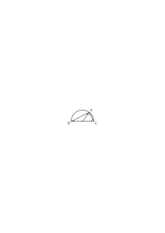

as _one_ position of a movable mechanism which would, so to speak, be the real construction of the proof? (One thinks, say, that at A there is a crank, and AB and AC as elastic strings.) (Can one speak of an extensible proof?)

### [8r\[4\]](https://cdn.wittgensteinnachlass.com/2000px/webp/Ts-236/8r.webp)

Could one say: the figure can be viewed through certain kinds of distorting mirrors and, seen through them, retains its probative force. It is understood from the outset in such a way that it can be viewed through _all these_ distorting mirrors. Only what is common to all these images, which it embodies, is the real symbol.

### [8r\[5\]](https://cdn.wittgensteinnachlass.com/2000px/webp/Ts-236/8r.webp)

Now of course one could – wrongly – take the figure as the concept and its various images as the objects falling under it.

### [8r\[6\]](https://cdn.wittgensteinnachlass.com/2000px/webp/Ts-236/8r.webp)

The proof cannot prophesy anything. I.e. it cannot prophesy anything real.

### [8r\[7\]](https://cdn.wittgensteinnachlass.com/2000px/webp/Ts-236/8r.webp)

(We often recognize in the most distorted shadow the figure that casts it.)

### [8v\[1\]](https://cdn.wittgensteinnachlass.com/2000px/webp/Ts-236/8v.webp)

The general geometrical (drawn) proof is the piece that all the special proofs have in common.

The end they do _not_ have in common.

### [10\[1\]](https://cdn.wittgensteinnachlass.com/2000px/webp/Ts-236/10.webp)

(The generality in question enters, of course, already into the definition of the circle as the locus of all points etc.)

### [10\[2\]](https://cdn.wittgensteinnachlass.com/2000px/webp/Ts-236/10.webp)

This must of course be a matter of the definition of a variable for which a certain range of values is determined, but certainly not as a class of values. – So if I began the supposed chain of inference with the proposition “all radii of a circle are equally long”, that would already be wrong, i.e. a nonsensical beginning. If I define the circle, say, by the equation r = constant, then the infinite possibility of the r according to the position of the radius must of course lie contained in the meaning of this definition; but not in the form of a class of possible values, but rather, if it is a matter of a numerical geometry, through the law of the formation of rational numbers, and, insofar as it is a matter of a visual geometry, through the infinite visible possibility attaching to every radius.

### [10\[3\]](https://cdn.wittgensteinnachlass.com/2000px/webp/Ts-236/10.webp)

I once said earlier that one could also imagine a Euclidean demonstration carried out on a moving figure. But what is essential is not that it moves, but that it is movable. (i.e. variable). I.e. I must see in it the representative of the infinite spatial possibility.

### [10\[4\]](https://cdn.wittgensteinnachlass.com/2000px/webp/Ts-236/10.webp)

If I know a mathematical proposition and a proof of it, and later I get to know yet another proof of this proposition, then I have thereby got to know a new system.

### [10\[5\]](https://cdn.wittgensteinnachlass.com/2000px/webp/Ts-236/10.webp)

Suppose someone were examining even numbers to see whether Goldbach’s theorem holds for them. He would now express the conjecture – and it can be expressed – that if he continues with this investigation he will not, as long as he lives, come across a contradicting case.

### [23\[1\]](https://cdn.wittgensteinnachlass.com/2000px/webp/Ts-236/23.webp)

It makes sense to say of two points that they are connected by a straight line. But does that mean “it makes sense to say of two things that are points etc.”? –

### [23\[2\]](https://cdn.wittgensteinnachlass.com/2000px/webp/Ts-236/23.webp)

How then do I know that a sign “A” designates a point? Perhaps by seeing that “A” may be combined in a particular way with other signs. But how do I know that these other signs designate straight lines etc.? Through the fact that they may be combined with “A”? Surely they cannot determine each other’s meaning. The grammatical system (game) is simply autonomous, and its application is not _given_ in it.

### [23\[3\]](https://cdn.wittgensteinnachlass.com/2000px/webp/Ts-236/23.webp)

Geometry understood otherwise than as pure grammar must be applied, and then there must be real points and straight lines etc.; the proposition that a straight line connects two points must then indeed have a real sense.

### [23\[4\]](https://cdn.wittgensteinnachlass.com/2000px/webp/Ts-236/23.webp)

And then the geometrical proposition does not say “all pairs of points _are_ connected by a straight line,” but “_can_ be connected by a straight line.” And here one then needs the words “_any two_ points” and not “_all_ pairs of points,” and thereby indicates the difference from another kind of generality.

### [23\[5\]](https://cdn.wittgensteinnachlass.com/2000px/webp/Ts-236/23.webp)

Grammar cannot _state_ its rules generally on the off chance (i.e. leave them open).

### [34\[1\]](https://cdn.wittgensteinnachlass.com/2000px/webp/Ts-236/34.webp)

If I say to someone “take three steps” and he understands the order, then he can explain it to me, say, by means of a drawing. He says: If here is the path and A the beginning, then you want me to get to B, then to C and D; or something of the sort. And here it is clear that in a certain sense he has only given expression to something that he already knew earlier – when he heard and understood the order. He could now go on like this and explain the order still more closely, say by a more elaborate diagram, and yet he would always only be producing what was already clear to him earlier. He is only translating from one language into another. And if he now finally carried out the order, as a sign that he has understood it – would he not again merely be translating?

### [34\[2\]](https://cdn.wittgensteinnachlass.com/2000px/webp/Ts-236/34.webp)

There must be a continuity between the order and its execution. The execution must, so to speak, be only the end surface of the order (of the order-body).

### [34\[3\]](https://cdn.wittgensteinnachlass.com/2000px/webp/Ts-236/34.webp)

In order to make the essence of understanding clear to myself, I always think of a figure and a projection that one makes of it. The method of projection can only be _fixed_ by the comparison of the picture with the reality that is simply there.

### [34\[4\]](https://cdn.wittgensteinnachlass.com/2000px/webp/Ts-236/34.webp)

But then it seems as if one had to compare the proposition with reality _in a particular sense_ – that is, not just compare. As if, then, in certain cases reality had, as it were, to feel a reproach through the comparison. If something approaches a _goal_, then what I mean lies here in the word “goal” (the intention.)

### [38\[1\]](https://cdn.wittgensteinnachlass.com/2000px/webp/Ts-236/38.webp)

I mean that the thought is entirely _measure_, like the yardstick; i.e. that everything about the yardstick is inessential except the measure of length.

### [38\[2\]](https://cdn.wittgensteinnachlass.com/2000px/webp/Ts-236/38.webp)

The thought is a symbol.

### [38\[3\]](https://cdn.wittgensteinnachlass.com/2000px/webp/Ts-236/38.webp)

The present thought contains _all_ the reality that is presently there. (And it _cannot_ have more, after all.)

### [38\[4\]](https://cdn.wittgensteinnachlass.com/2000px/webp/Ts-236/38.webp)

It is very remarkable that in a book on differential calculus set-theoretical expressions and symbols occur in the explanations which disappear entirely in the calculus. This is reminiscent of the first explanations in textbooks of physics, in which there is talk of the law of causality and the like, which, once we get down to business, is no longer mentioned.

### [38\[5\]](https://cdn.wittgensteinnachlass.com/2000px/webp/Ts-236/38.webp)

To compare the symbol – I mean what is used as a symbol – with reality is simple. The difficulty consists in comparing it, together with the symbolizing relation, as a thought with reality.

### [38\[6\]](https://cdn.wittgensteinnachlass.com/2000px/webp/Ts-236/38.webp)

“I am glad that you are coming” does not mean, I am glad because you are coming. In that case it would be a conjecture that _that_ is why I am in such a good mood.)

### [47\[1\]](https://cdn.wittgensteinnachlass.com/2000px/webp/Ts-236/47.webp)

So a sufficient condition for 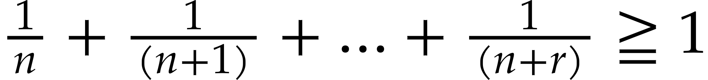 is that r ≧ 3n ‒ 1. If I now imagine sections of the series 1 + ½ + ⅓ + … strung together from its beginning, each equal to or greater than 1, then the first of these sections extends from

1 to 3, the second from

4 to 15, the third from

16 to 63, the m-th to 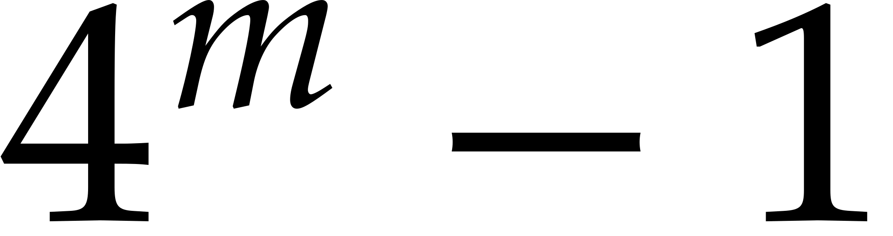.

The sum 1 + ½ + ⅓ + … extended to the 4mth term therefore certainly exceeds m. Hence

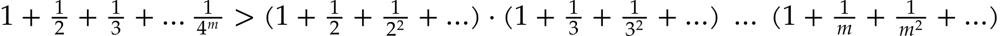 Hence among the first 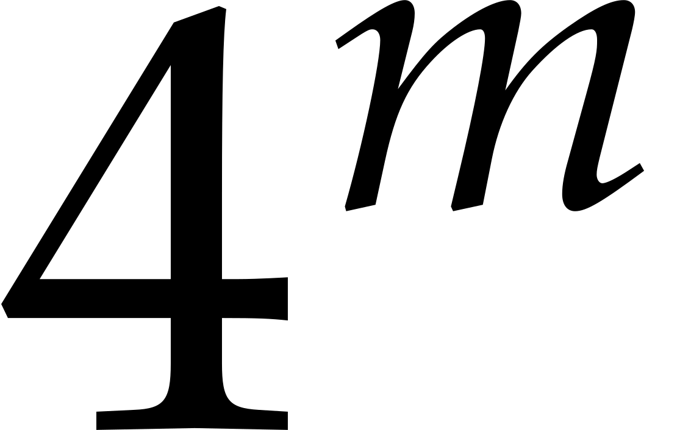 integers there must be at least one that is divisible by none of the first m numbers.

### [47\[2\]](https://cdn.wittgensteinnachlass.com/2000px/webp/Ts-236/47.webp)

I can describe an apparatus in which a bolt engages in a notch of a wheel when the wheel is in a particular position. Can one say the proposition is built in such a way that, if reality is _so_, it snaps into place? So I would have to be able to describe the thought and then the reality, which is built in such a way that it _agrees_ with it. But that means nothing at all.

### [47\[3\]](https://cdn.wittgensteinnachlass.com/2000px/webp/Ts-236/47.webp)

Nor can one say “that even the most vivid image does not, after all, come up to reality”, for then it would after all be conceivable that it did come up to it – even if that never happened –.

### [54\[1\]](https://cdn.wittgensteinnachlass.com/2000px/webp/Ts-236/54.webp)

But I myself say that the shadow is not something that is connected with the fact in an external way, and that means that there is a _logical_ error in this comparison.

### [54\[2\]](https://cdn.wittgensteinnachlass.com/2000px/webp/Ts-236/54.webp)

If I say “b is not as long as a”, this seems to presuppose that shadow of the fact that b is as long as a. But if I say “b is smaller than a”, this seems not to presuppose this shadow, and yet it too says what the first sentence says.

### [54\[3\]](https://cdn.wittgensteinnachlass.com/2000px/webp/Ts-236/54.webp)

So one could say: “b is as long as a” makes sense because b is shorter than a. (Or: “this book is blue” makes sense because in reality it is red.)

### [54\[4\]](https://cdn.wittgensteinnachlass.com/2000px/webp/Ts-236/54.webp)

(It is a method of philosophy, one not permitted in the sciences, to assume the most favourable case. Most similar to this method is that in mathematics of assuming an extreme case in which the thing _does at any rate_ occur. Argument a fortiori.)

### [54\[5\]](https://cdn.wittgensteinnachlass.com/2000px/webp/Ts-236/54.webp)

Imagine that one gives someone the order to carry out a particular action, say to trace a line with the pencil. The matter becomes clearer if one imagines the order given by signs to someone who does not know our word-language. One will then demonstrate the action and now give him the pencil, perhaps guide his hand a little way (or something of the sort). That will be the order. Now of course one will say: that is merely the expression of the order and not what we really mean; what we mean is: … and now we shall give _other signs_ for “what is meant”. – But what if one now carried out the order and pointed to the execution as a subsequent explanation of the order? Or in that case is the fulfilment, too, only a sign?

### [56\[1\]](https://cdn.wittgensteinnachlass.com/2000px/webp/Ts-236/56.webp)

 The orthogonal projection of s onto b already marks off the piece s' on b. That is not of course to say that this piece now has a special colour on b, and so is also bounded by the colour. The projection of the black circle in the upper plane onto the lower one already bounds a circle on the latter; but that does not yet make it a coloured circle. (In this sentence there is something right and something wrong.)

### [56\[2\]](https://cdn.wittgensteinnachlass.com/2000px/webp/Ts-236/56.webp)

Now if I expect that a circle will appear on the lower plane, of which it is said that it is the orthogonal projection of the upper one and of the same colour, then I would be giving nothing more than a method of projection. The method of projection I may know from other structures. But I know it, after all, only in such a way that one figure is the orthogonal projection of another; and surely not in such a way that no figure is the projection of a figure. I resolve to judge the phenomena on the lower plane in a particular way. Then the projection must already be _contained_ in this _resolve_.

### [56\[3\]](https://cdn.wittgensteinnachlass.com/2000px/webp/Ts-236/56.webp),[57\[1\]](https://cdn.wittgensteinnachlass.com/2000px/webp/Ts-236/57.webp)

What does it mean _to examine whether_ a line segment is the orthogonal projection of another?

---

It can only mean drawing precisely the lines that one draws in such a case. – But what about the _investigation_ of whether the lower colour is the same as the upper one. Or can one say: there too I adjust myself in a particular way, just as, say, I draw lines in order to be able to establish whether the lower figure is the projection of the upper one. I believe that is how it is. That is all an adjusting, but more than that I cannot now do. And this adjusting is not an adjusting to something else, i.e. not with reference to something that is not yet there, but it is autonomous, so to speak the setting up of a yardstick, whatever may happen.

### [57\[2\]](https://cdn.wittgensteinnachlass.com/2000px/webp/Ts-236/57.webp)

(The solution of the riddle must lie in the way in which the phenomenon is described when it comes.)

### [57\[3\]](https://cdn.wittgensteinnachlass.com/2000px/webp/Ts-236/57.webp)

It is uncommonly difficult to reach the real location of the difficulty with words.

### [57\[4\]](https://cdn.wittgensteinnachlass.com/2000px/webp/Ts-236/57.webp)

Let us think of the setting as done by a pointer, like the yellow pointer on an aneroid barometer, and, say, such a barometer and a clock. On both dials I set the free pointer, and thereby express the expectation that when the clock hand gets to a'

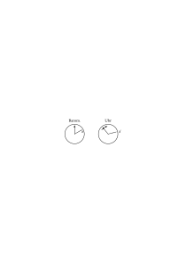

the other one will stand at a. (There is no doubt that this is a complete expression of the expectation, of the thought.) If the clock now stops, say, so that its hand does not reach a', then the whole thing does not count, and likewise if, say, the pointer of the barometer suddenly vanished. Then there would simply be no sign there. But if it is there, then the barometer has, so to speak, no other choice than to stand at a or not to stand at a, and then the thought has been verified or it has been falsified.

### [57\[5\]](https://cdn.wittgensteinnachlass.com/2000px/webp/Ts-236/57.webp)

But where in this propositional sign do we have words, or something that corresponds to words? Obviously a' “means” the clock hand and a the barometer pointer.

### [57\[6\]](https://cdn.wittgensteinnachlass.com/2000px/webp/Ts-236/57.webp)

I remain within the signs until, in their _application_, I step out of them.

### [57\[7\]](https://cdn.wittgensteinnachlass.com/2000px/webp/Ts-236/57.webp),[58\[1\]](https://cdn.wittgensteinnachlass.com/2000px/webp/Ts-236/58.webp)

Then my behaviour, my action, displays the logical kinship with the signs that such a sign displays with its translation.

### [58\[2\]](https://cdn.wittgensteinnachlass.com/2000px/webp/Ts-236/58.webp)

What I always want to say is that the thought is nothing human. That it is also not a particular feeling, which one can only feel, but not, say, also look at. One cannot, e.g., as it were place toothache outside oneself and look at it. (Of course one cannot say that one knows toothache from inside by feeling it, and cannot view it from outside. For toothache has no inside and outside.)

### [58\[3\]](https://cdn.wittgensteinnachlass.com/2000px/webp/Ts-236/58.webp)

The view common today is that thinking – carried out by the head or the mind – is a privilege precisely of the head or the mind (as, say, digestion is of the stomach). And so it is, too, when considered as a process of natural history, just as digestion in this sense is peculiar to the stomach, – but considered from the chemist’s standpoint, digestion is a process that does not belong to the animal stomach and is quite independent of where it actually takes place. – In the same way the logician is not dealing with a specifically human process.

### [58\[4\]](https://cdn.wittgensteinnachlass.com/2000px/webp/Ts-236/58.webp)

Logic is a geometry of thinking.

### [58\[5\]](https://cdn.wittgensteinnachlass.com/2000px/webp/Ts-236/58.webp)

Of course one could say that the clock and the barometer with the adjustable pointers are only the expression of a thought, but not the thought itself; but then they are surely parts, instruments, of a thought, and whatever the thought itself is, it is a different process from the one that verifies it, and it has only as much in common with this process as those devices of the clock and the barometer have. – That is why one can – and must – ﹖in logic﹖ also operate with the “expression” of thoughts and pay no attention to the other thing.

### [64\[1\]](https://cdn.wittgensteinnachlass.com/2000px/webp/Ts-236/64.webp)

Thinking makes plans. It draws plans of a simple or very complicated kind. But now one says: surely that is not everything, one surely wants something with these plans, surely they mean something, i.e. they are _surely_ drawn with an intention. Yes, but here there are two possibilities: either this intention is a feeling or something of the sort, in which case it does not interest us, or else it is part of the _matter_, in which case it belongs to the _picture_.

Logic is always objective.

### [64\[2\]](https://cdn.wittgensteinnachlass.com/2000px/webp/Ts-236/64.webp)

If the order consists, e.g., in taking a certain route, then I can express it with the help of a map (a plan). The order can also say to go one route _or_ the other, and perhaps _not_ to go certain routes. That will then also find its expression in the picture, say by the excluded routes being crossed out. The picture could also mean that one may walk _anywhere_ between the two lines, except over the hatched area.

### [64\[3\]](https://cdn.wittgensteinnachlass.com/2000px/webp/Ts-236/64.webp)

Now if a route between two places is actually blocked off and several others are left open, are a negation and a disjunction already contained in these facts?

### [64\[4\]](https://cdn.wittgensteinnachlass.com/2000px/webp/Ts-236/64.webp)

But what about when I interpret an order in a particular way and act contrary to it. What makes it the case that my action is not my interpretation of the order but an acting-against? Is my earlier view not overturned by this?

I can say: if the agent did not say so, one could never know that it is an acting-against. And if he now says so, we understand it only through our interpretation of negation.

### [65\[1\]](https://cdn.wittgensteinnachlass.com/2000px/webp/Ts-236/65.webp)

One would think that if I can act contrary to the order _as I understand it,_ then my action must directly conflict with the expression of my conception. – Or is it only the interpretation of my action that contradicts the interpretation of the order (on the same level, so to speak)?

### [65\[2\]](https://cdn.wittgensteinnachlass.com/2000px/webp/Ts-236/65.webp)

Disjunction, negation etc. seem to lie in the setting in relation to a picture. They correspond to the electrical circuit by which, _say_, a bell is connected with switches.

### [65\[3\]](https://cdn.wittgensteinnachlass.com/2000px/webp/Ts-236/65.webp)

Let us imagine the following settings: 

1\) The bell rings only when I align pointer a with pointer b; 2) the bell does not ring only when I align a with b; 3) the bell rings only when a is aligned either with b or also with c; 4) the bell rings in all other pointer positions of a, except when it is aligned with b or c; 5) the bell rings only when both b and c are aligned with a; 6) the bell rings only when b is aligned with a but c is not aligned with a; etc. The bell signal means assent (or also the reverse). One could also fit such a circuit to the model of the permitted or forbidden routes. This model would then be the expression of an order. But could one rightly call it a picture?

### [65\[4\]](https://cdn.wittgensteinnachlass.com/2000px/webp/Ts-236/65.webp)

An opinion (i.e. a sense) that one cannot explain does not interest us, for one cannot act contrary to it either.

### [65\[5\]](https://cdn.wittgensteinnachlass.com/2000px/webp/Ts-236/65.webp)

If the interpretation is a picture, then two opposite interpretations are opposite pictures.

### [65\[6\]](https://cdn.wittgensteinnachlass.com/2000px/webp/Ts-236/65.webp)

In truth, however, what is forbidden must always be described in the prohibition.

### [75\[1\]](https://cdn.wittgensteinnachlass.com/2000px/webp/Ts-236/75.webp)

I believe it was not right to say “the sentence must be composite”; rather, it can in fact also be non-composite, at least in the literal sense; – its “composition” really consists in its being a special case of a general rule for the formation of signs. For one can, it is true, regard “ambulo” as composed of the root syllable and the ending, but what if this form were formed merely by the root syllable alone?

### [75\[2\]](https://cdn.wittgensteinnachlass.com/2000px/webp/Ts-236/75.webp)

Just as in a certain way one cannot talk about the sense of a sentence, so too one cannot talk about the expression of a thought, wish, command, etc., for to the question “which wish is expressed by this sentence”, only an expression of the wish can come as the answer. The same also holds of the expression “this sentence communicates something (definite) to me”.

### [75\[3\]](https://cdn.wittgensteinnachlass.com/2000px/webp/Ts-236/75.webp)

_And here one must_ – I believe – say that negation, disjunction, etc., are just as “primitive” in thought as in our sign-language. For how could one think negation _in_ it, if it were like an ill-fitting garment of negation. Or – one would expect – one would surely have to feel how the form of expression pinches one everywhere (as it were like a hard shoe that does not really fit.)

### [75\[4\]](https://cdn.wittgensteinnachlass.com/2000px/webp/Ts-236/75.webp)

Is there an existence proof for prime numbers, and one that proves the existence of infinitely many prime numbers? And in what relation do these stand to each other?

### [75\[5\]](https://cdn.wittgensteinnachlass.com/2000px/webp/Ts-236/75.webp)

Through the _method of multiplying_ (say in the decimal system, but it does not matter in which system) the existence of products, of divisible numbers, is proved.

### [75\[6\]](https://cdn.wittgensteinnachlass.com/2000px/webp/Ts-236/75.webp),[76\[1\]](https://cdn.wittgensteinnachlass.com/2000px/webp/Ts-236/76.webp)

If n and m are relatively prime and n is the larger and 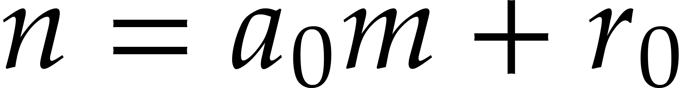, then the cases can occur that

etc.

### [76\[2\]](https://cdn.wittgensteinnachlass.com/2000px/webp/Ts-236/76.webp)

If one now puts n together to form 1n, 2n, 3n etc., one sees that, compared with a multiple of m, a remainder is left over until one gets to m ∙ n, no matter where the Euclidean algorithm ends (i.e. whichever of the formulae is applicable to m). In the first case, e.g., if 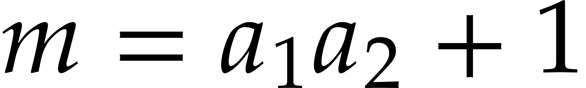:

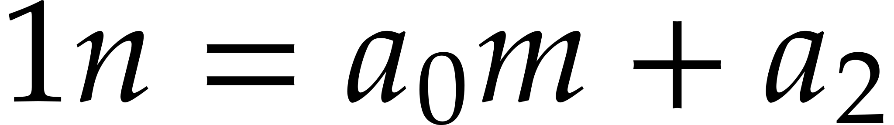

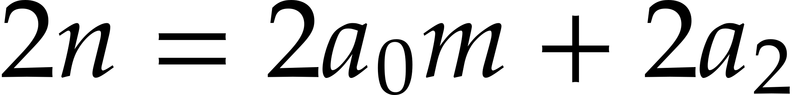

…

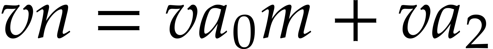 the remainder 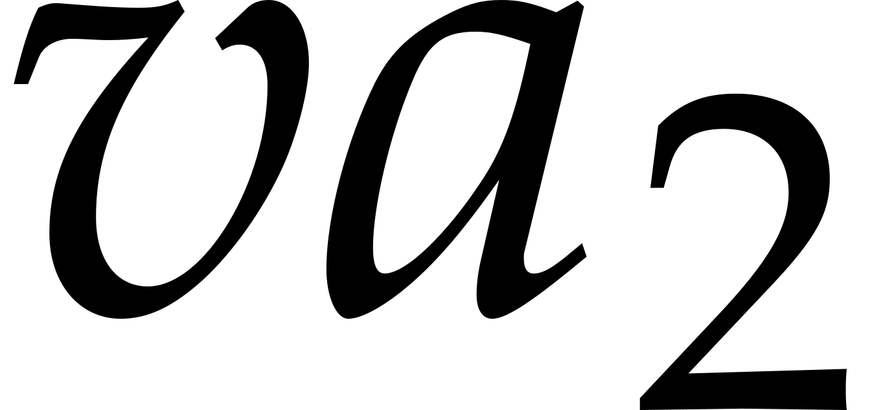 in any case remains smaller than m until 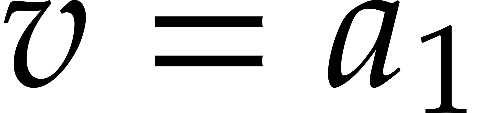.

### [80\[1\]](https://cdn.wittgensteinnachlass.com/2000px/webp/Ts-236/80.webp)

But to what extent can one call the picture

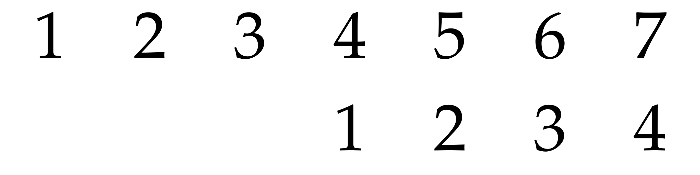

the proof of 3 + 4 = 7? (since the formula does not in any sense follow from the picture.) Obviously only by virtue of a general rule that connects equations with such pictures. For if I set up the equation 2 + 5 = 9, one can say “we shall see straight away whether that is so”, and now one carries out the _corresponding calculus_ and sees whether the equation is correct (and exactly the same naturally holds of the inequalities). But the corresponding calculus corresponds only on the basis of a general rule.

### [80\[2\]](https://cdn.wittgensteinnachlass.com/2000px/webp/Ts-236/80.webp)

In the addition schema above, the numerals are _ordinal numerals_. So they simply designate a particular place, the so-and-so-many-th place. One could make this clearer by writing: 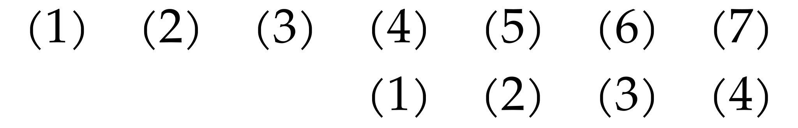. It is clear that with this algorithm one can also multiply, subtract and divide, and that everything has full rigour. (Incidentally, this method of calculation is of course that of the slide rule.)

### [80\[3\]](https://cdn.wittgensteinnachlass.com/2000px/webp/Ts-236/80.webp)

The word “Inn” over the gate of a house indicates that there is an inn _there_. It must be the special case of a general rule that is present, if we are to understand the word as a communication, that is, as a sentence. This shows us _to what extent_ “compositeness” is a characteristic of the sentence.

### [91\[1\]](https://cdn.wittgensteinnachlass.com/2000px/webp/Ts-236/91.webp)

What happens when I think over a move in chess? In this case I can make the moves in advance and so draw up the most direct picture of what will happen.

### [91\[2\]](https://cdn.wittgensteinnachlass.com/2000px/webp/Ts-236/91.webp)

“How many dots must one put in a row to indicate the ‘etc.’?” Doesn't _one_ do it?

### [91\[3\]](https://cdn.wittgensteinnachlass.com/2000px/webp/Ts-236/91.webp)

Can one say of the number series that it has no end? “But what would it be like if it were otherwise?” But can I not say of chess that the series of chess pieces has an end, and of another game, that it has no end? if one were permitted to occupy arbitrarily many squares with pieces, in accordance with a rule.

### [91\[4\]](https://cdn.wittgensteinnachlass.com/2000px/webp/Ts-236/91.webp)

(What I do with the signs is, for the mathematician, a messing around … [and was so for Ramsey], and rightly so, for he wants to make progress, whereas I linger _undisturbed_ over a few signs and two steps of the calculus.)

### [91\[5\]](https://cdn.wittgensteinnachlass.com/2000px/webp/Ts-236/91.webp)

