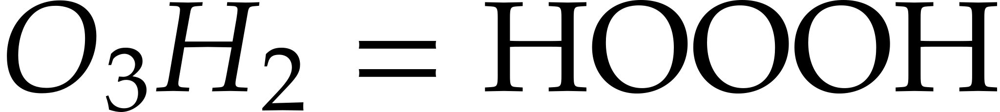

# Ts-302

### [1\[1\]](https://cdn.wittgensteinnachlass.com/2000px/webp/Ts-302/1.webp)

Does one understand a sentence, or is it not a sentence until one understands it?

### [1\[2\]](https://cdn.wittgensteinnachlass.com/2000px/webp/Ts-302/1.webp)

Is understanding a process or a state that accompanies the hearing or reading of the sentence? How long does it take to understand a word? What does it mean to understand chess? Is it a state of consciousness? Knowing chess is no more a state of consciousness than knowing how to multiply or being able to recite the alphabet. On the other hand, someone who can multiply will have different states of consciousness when multiplying from someone who cannot. One might say: to understand a word is to be able to use it. (This corresponds, at any rate, to one way of using the word “understand”.) The ability to use the word is not a state of consciousness that accompanies the use of the word. (This is a grammatical remark.)

### [1\[3\]](https://cdn.wittgensteinnachlass.com/2000px/webp/Ts-302/1.webp)

If one calls an ability a state, then it is a state in the physiological sense or the state of a model of the mind. The statement that this state obtains is a hypothesis. Contrast this with, for example, the state of having toothache. (Suppose we wanted to use the expression “unconscious toothache” as follows: I have unconscious toothache is to mean: I have a bad tooth that does not hurt. This way of speaking may be convenient for some purposes. But has one thereby discovered toothache, as it were, in a dark place where one had not previously suspected any? If one now distinguishes between conscious and unconscious toothache and calls both states, then the word “state” has a different grammar in each of these cases. Cf.: visible and invisible colours.)

### [1\[4\]](https://cdn.wittgensteinnachlass.com/2000px/webp/Ts-302/1.webp),[2\[1\]](https://cdn.wittgensteinnachlass.com/2000px/webp/Ts-302/2.webp)

The expression “to mean a sentence” is analogous to the expression “to understand a sentence”. One can now ask either “what do you mean by this sentence?” or “do you mean this sentence?” The first question is answered by a further sentence, and so the question was asking for a further sentence. Meaning in the second sense is, for example, meaning something seriously or in jest; and analogous to this is saying something with conviction, or without conviction. Here one can call “conviction” a phenomenon that accompanies the sentence; and for our purposes one can substitute the expression of conviction, e.g. the tone of voice, for the conviction itself. One might now take our first question in this way: Is it not a sentence until it has the right tone of voice, or is _that_ which is stressed a sentence? And the answer would be: as you like. Incidentally, if the tone of voice is essential to the sense, then we can speak of two sentences with the same wording but different tones of voice. In stating that the written image or sound-image is a sentence only if one understands it, one also means to say that the written image is a sentence only against the background of a grammatical system. I deliberately use the misleading word “background” here, because it seems to us as though knowledge of the system stood, as it were, tangibly behind the particular sentence. At the root of this error is a lack of clarity about the grammar of so-called mental states, especially knowing and being able to do something. “A sentence is a sentence only within a grammatical system” is analogous to “a move in a game is a move only within the system of the game”. Knowing how to multiply does not stand like a background behind the individual multiplication.

### [2\[2\]](https://cdn.wittgensteinnachlass.com/2000px/webp/Ts-302/2.webp)

Must we interpret a sentence for it to become a sentence? (The question is the same as the first one.) But what does it mean to interpret a sentence? It can mean translating it into another sign. The interpretation then answers the question: how do you understand this sentence? And here one can of course say that there is no need to interpret the sentence for it to become a sentence. For why should I have to replace one sentence with another first? One could also give the interpretation in this sense as a supplement to the first sentence, and would it then be right to say that a sentence has sense only with a supplement? But we might also take our first question as analogous to this one: is it not a sentence until the punctuation marks are in place, or do we put the punctuation marks into a sentence? We can decide this arbitrarily.

### [2\[3\]](https://cdn.wittgensteinnachlass.com/2000px/webp/Ts-302/2.webp),[3\[1\]](https://cdn.wittgensteinnachlass.com/2000px/webp/Ts-302/3.webp),[4\[1\]](https://cdn.wittgensteinnachlass.com/2000px/webp/Ts-302/4.webp)

_**Understanding a sentence analogous to understanding**_

_**a melody as a melody**_

The opposite of this conception is the idea that understanding a sentence consists in stepping outside language, namely in making the connection between language and reality. The ostensive definition gives us the model for this stepping outside language and making a transition to reality. The ostensive definition replaces one sign with another. One can say: it replaces word-language with a language of gestures. It might be that the words serve only to evoke, through the mechanism of association, pictures that are the actual signs. In this sense _we_ need take no interest in these words. In their place we would put pictures painted for the purpose, which could replace the hallucinations. It is sometimes said that words merely stand for objects (Tractatus). The question then is how they can stand for them. For this is possible only if, at least in certain cases, the words can do the same thing as the objects they stand for. It should also be said that ostensive definitions belong to the preparation for the use of language, and thus still belong to grammar. So the question is whether or not one _must_ make the transition made in the ostensive definition every time one uses the word with sense. And then again, in the former case, whether the word is merely a psychomechanical means of calling the actual signs before the mind. But even if our language consisted only of mental images, it would still be a language and its sentences could be false. Everything is really already expressed by saying that the sentence can be true or false. In the end, understanding is grasping a sentence-sign. (This still needs elucidation.) Even in a purely gestural language, there remains the difference between the fact that I say that p is true and the fact that it is true. One could put it this way in passing: no explanation of word-meanings, not even an ostensive one, takes us outside language, and in this sense language is autonomous. We can call it stepping outside language when, for example, we act on an order we are given, when we pick up an apple, say, on being told: “pick up this apple!” This action is not part of grammar, whereas pointing to an apple to explain the meaning of the word “apple” is a preparation for the application of language and not language itself, and therefore belongs to grammar. The opinion that we step outside language in ostensive explanation is in part a confusion of ostensive explanation with the application of language. An ostensive explanation is still a rule of the game. In fact, however, in most areas of language there is no transition from the word to a mental image at all. And in light of what has been said, the attempt to believe that such a step outside language must still take place in understanding also falls away.

### [4\[2\]](https://cdn.wittgensteinnachlass.com/2000px/webp/Ts-302/4.webp),[5\[1\]](https://cdn.wittgensteinnachlass.com/2000px/webp/Ts-302/5.webp)

There is a conception according to which the use of a word, the rule according to which the word may be used, follows from the meaning of the word. This conception draws support from the fact that we can apparently explain the meaning of the word by a single explanation and that the rest of the word’s use follows from this explanation while certain ways of using it conflict with the explanation. For example, to explain the word “red” I point to a red patch and say “that is called red” (or “this colour is called red”). One will say that someone who understands this explanation must now know that the sentence “red is industrious” is senseless. It seems that one has fixed the meaning in the first explanation, and that the rules of use follow from this meaning. In reply, the first thing to say is that the word a, which one explains by pointing to a red object with the words “that is called a”, can thereby acquire all sorts of meanings, as we would say: suppose the object was a book: then a could acquire the meaning of the words “red”, “four-sided”, “hard”, “light”, and so on. We can therefore say that the ostensive explanation is only _one_ of the rules that govern the use of the word. That giving someone this rule suffices to induce them to use the word in accordance with certain other rules is an empirical fact. But there are also misunderstandings, as is well known. One will also notice that one explains the name of a colour to an adult with the words: this colour is called …, and not: that is called …. The word “this colour” already narrows down the grammar of the word to be explained, leaving only one thing to be determined. Incidentally, what one calls ostensive explanation plays the most varied roles in explaining meaning. Think of the first explanations (if one wants to call them that) that one gives a child, when, for example, one points to a lump of sugar and says the word “sugar”. Here one will not want to say that one is giving a rule for the use of the word “sugar” which, as in the previous example, merely completes the list of rules. Indeed, what emerges here is that the use of the word “rule” is fluid. One must bear in mind that in this case the child is not yet able to ask what the word means. No other rule for the use of a word follows from its ostensive explanation. For the ostensive explanation is nothing more than a gesture accompanied by sounds.

### [5\[2\]](https://cdn.wittgensteinnachlass.com/2000px/webp/Ts-302/5.webp)

The conception of meaning described above could be aptly represented by the following picture: it seems to us as though the word were a visible face of a body of meaning. (Simile of invisible glass bodies painted red on one side. The shape of the bodies behind the face determines, so it seems, how the red face can be fitted together.) In other words, the geometry of a body seems to lie in the body. One seems to be able to read it off the body. Can one read the geometry of a cube off a wooden cube or off a depiction of a cube? What role, then, does the depiction of a cube play in geometry? It is what the depictions belonging to the geometry of the cube have in common, not the class of those depictions. Does geometry speak of cubes? Does it say that the cubical form has certain properties? What could one call a property of the cubical form? Presumably what a true sentence states about it, so perhaps that my house is cubical. Which sentence asserts a property of the number 1? The one saying that I have only 1 groschen in my pocket, but not the one saying that one and one are two. The latter is a rule for the application of the word one. Thus geometry does not speak of the cube, but constitutes the meaning of the word “cube”, etc. Now geometry says, for example, that the edges of a cube are of equal length, and nothing is more natural than to confuse the grammar of this sentence with that of the sentence “the sides of the wooden cube are of equal length”. And yet one is an arbitrary grammatical rule, the other an empirical proposition. Now if one notices that the first sentence is not an empirical proposition, one misunderstands its grammar in this way: it is not about a real cube, but it is still about a cube, an ideal one, the geometrical cube. This misunderstanding is of exactly the same kind as the one that takes possibility to be a shadowy reality and the ability to do something to be a shadowy doing. Thus in geometry one does in fact say “any two points lie on a straight line” instead of “a straight line can be drawn between two points”. Nietzsche’s justification of the eternal recurrence is also connected with this; for he said: “What can happen must have happened at some time.”

### [6\[1\]](https://cdn.wittgensteinnachlass.com/2000px/webp/Ts-302/6.webp),[7\[1\]](https://cdn.wittgensteinnachlass.com/2000px/webp/Ts-302/7.webp)

Now what does it mean to say that one and the same word is used with different meanings? To begin with, one could say that different rules apply in the two cases. But this explanation can easily be misunderstood. I say, for example, that the word “is” has a different meaning in the sentence “The rose is red” from the one it has in the sentence “twice two is four”. But the grammar of the word “is” is just what allows the word to be used in both cases. The word “is” is after all only _one_ word. How, then, is it expressed in the grammar that the word has a different meaning in each of the two cases? By the grammar replacing it with two words and forbidding one to be substituted for the other. To the question “do you understand the word ‘is’ in the sentences ‘the rose is red’ and ‘twice two is four’?” one will presumably answer “yes”. For if one answers “no”, one might be told that one does not understand German. And if one understands it, then presumably one must understand it while it is being uttered or soon afterwards. And so in this understanding I must grasp the meaning and the difference between the two meanings. Here the simile of the body of meaning forces itself upon us. The meaning seems to contain the grammatical rules in nuce. But we need only think of the use of the king in chess and of the sensations a person who knows chess may have in using it to see that, while in one sense these sensations no doubt characterize that person’s understanding, in no sense do they contain the rules of use. Think here of the characteristic sensations in hearing with understanding the words “or”, “not”, “but”, and so on, to which William James drew attention. It is true that in learning and playing chess one both learns the rules and acquires those sensations. “What is the difference between someone who can play chess and someone who cannot?” = “is it just that one knows the rule of the game and the other does not”? And this in turn is the same as “does someone who moves the chess pieces and understands chess do the same thing as someone who moves them mechanically or by chance, without understanding the game?” No. “So the rule would have to be embodied somehow in the first person’s chess move.” It seemed to us that understanding must grasp the way the word is used all at once, as though it were an atmosphere surrounding the word. It seemed to us that the possible steps of the calculus must be anticipated in the understanding, as though it therefore made sense to say: someone can recite the multiplication table while reciting it, and so can recite the whole multiplication table in a period in which he utters only one sentence of it. We are now no longer tempted to assume that invisible atmosphere of understanding around the word. We no longer compare the ability to multiply to an atmosphere in which the individual multiplication is embedded. We do not now deny that processes which stand, so to speak, behind the perception of the written or spoken sign (associations, for instance) can be essential to the functioning of the language of signs. But we have no reason to suppose that such processes must occur, nor to say that these processes stand behind the word. Rather, where they do occur, they are for us on the same level as hearing and seeing the sign. They are only signs of a different kind. And the calculus proceeds without any one step already containing the next ones.

### [7\[2\]](https://cdn.wittgensteinnachlass.com/2000px/webp/Ts-302/7.webp),[8\[1\]](https://cdn.wittgensteinnachlass.com/2000px/webp/Ts-302/8.webp)

Akin to this is the way an order seems to carry out in shadowy fashion what it commands. One might ask: “how does someone know what to do when I order him to fetch me this apple?” Surely he cannot see from the sentence what he will do when he carries out the order. And if I were to bring the order as close to its execution as possible, if, say, I expressed the order by forcing him to fetch the apple five minutes before he was to fetch it in accordance with the order, if I expressed the fact that he was to fetch the apple five minutes later by pointing my finger at the corresponding place on a clock face, – how is he to know what this pointing is meant to say? It seems here as though the order, with the best will in the world, were unable to express itself. So if not the order, then the _sense_ of the order, one is inclined to say, must somehow contain the execution of the order. And here one again thinks of the sense as a shadowy entity standing behind the expression of the order. The sense, or the thought, is supposed to be capable of doing what a material sign cannot, namely of anticipating in a certain sense what is not yet the case. That is why thought, too, is supposed to be something specifically mental. The mind is supposed to have abilities other than those of the dead signs. But the order _does_ anticipate its execution, if what this means is that it says what must happen if it is carried out. The order says that an apple is to be fetched and not a pear, or that it is to be fetched and not taken away. Now it always seems to make sense to ask: what does the order actually say? But what is to come in answer to this question? Presumably another sentence-sign, and so this answer in principle takes us no further. One cannot, as a matter of principle, always ask: what does this sentence say? any more than one can ask: which sentence is it that these words form? The answer to the question “What does this order order?” is a grammatical rule, and it is also a grammatical rule if I say: “the order carry out p = the order that is obeyed by carrying out p”. Likewise the wish may p happen = the wish whose fulfilment is p.

### [8\[2\]](https://cdn.wittgensteinnachlass.com/2000px/webp/Ts-302/8.webp)

_**Understanding a genre painting**_

The explanation as the prehistory (cause) of understanding does not interest us. The explanation, insofar as it interests us, does not act at a distance. It interests us only insofar as it is used in the calculus.

### [8\[3\]](https://cdn.wittgensteinnachlass.com/2000px/webp/Ts-302/8.webp),[9\[1\]](https://cdn.wittgensteinnachlass.com/2000px/webp/Ts-302/9.webp)

I am right to compare the sentence with a painted picture. One justification for this is that one can paint a picture from a description, can translate the description into the picture. There are, incidentally, essentially two cases here, which also exist in the domain of sentences: that of the genre painting and that of the portrait. Roughly speaking, the fictional narrative corresponds to a genre painting. There is an understanding of a genre painting analogous to the understanding of a sentence. Or rather, with a picture there are various things that we call understanding and not understanding. And there are analogies to these in the understanding and not understanding of sentences. We say that we do not understand a picture if we are told that it depicts a still life, but all we can see are patches of colour on the surface of the picture. But if we see it as an arrangement of three-dimensional bodies whose shapes are, as we might say, unfamiliar to us, then again we do not understand the picture as a still life. If we see in it tables, chairs, plants, etc. in an arrangement wholly unfamiliar to us (a plant with a table balanced on it), then we do not understand in a further sense. If we see in it people in poses familiar to us, we will say that we understand it. But if it is now explained to us what these people are doing with one another, we take a further step in understanding. But we can also speak of understanding a pure ornament. When we first saw it, perhaps a certain symmetry and simple arrangement did not strike us. In any event, of a picture depicting two people sitting in a tavern and painted in a manner familiar to us, we will say that we understand it at first glance. And we are inclined to say that this understanding differs from that of an ornament in that in the first case we recognize the picture as a representation of a reality, so that in understanding it we grasp the relation of the picture to something existing outside it. Now one can presumably say that we see that genre painting as we do because we have seen and used chairs, tables, etc. countless times. But that only says something about the prior history of that understanding, and the prior history is not contained in the understanding. It is also true that we can use the genre painting, and compare it with reality, in a different way from the ornament. But it is not the process of making such a comparison that we call understanding, nor is it true that we take the genre painting for reality. We are inclined to say that we understand this picture because we recognize it as the representation of a house, and this seems to suggest that a paradigm outside the picture is involved in understanding it. I can then only say that in understanding the genre painting we need not compare it with anything. The comparison with reality is, rather, a further step in the calculus, which has not already been taken in shadowy fashion before we actually take it.

---

### [9\[2\]](https://cdn.wittgensteinnachlass.com/2000px/webp/Ts-302/9.webp),[10\[1\]](https://cdn.wittgensteinnachlass.com/2000px/webp/Ts-302/10.webp)

Understanding as an experience when one sees a sign is taking that sign in a particular way. And I speak of taking it in a certain way when I see the drawing of a cube as a cube first one way, then another, and again as a drawing (as a flat ornament). Also when I see five dots in a row grouped in different ways, and likewise when I see four dots within a circle as a face at one moment and not at another. What one calls, for example, understanding a church mode also belongs here. Thus we can also speak of understanding a clock as a clock, and mean by this on the one hand a capacity, an ability to use the clock (and hence not a state of consciousness), but on the other hand a particular experience: seeing (taking) the clock as a clock, as a dial or as hands. That one takes understanding a picture to be an ability to make further use of it, an ability to operate further with it, is also shown by our inclination to say: to understand a picture means to be able to say what it depicts. In the process that is here the criterion of understanding, we are not moving closer to reality, but away from it. Indeed, we will explain words by means of pictures and pictures by means of words. (We will prove understanding of a picture by translating it into words, and understanding of the words by translating them into pictures.)

### [10\[2\]](https://cdn.wittgensteinnachlass.com/2000px/webp/Ts-302/10.webp)

The concept of understanding as stepping out of language into reality derives from the explanation of language by ostensive definitions. But here too we only step out of word-language into another language. Where the explanation of meaning is not an ostensive definition, there is no question of stepping out of word-language either. If one wants to justify a particular way of taking a piece of music, and to answer the question why one wishes it played in just that way, one is tempted to say: I simply understand it, I understand what it says. But one is at a loss when asked to say what it says. One can then either point to a process with which one compares the piece of music and which in some sense has the rhythm that corresponds to our way of taking it, or one plays the piece of music in the desired rhythm and lets that rhythm speak for itself. And in this sense every language must in the end speak for itself.

### [10\[3\]](https://cdn.wittgensteinnachlass.com/2000px/webp/Ts-302/10.webp),[11\[1\]](https://cdn.wittgensteinnachlass.com/2000px/webp/Ts-302/11.webp)

We are inclined to say that only he himself can know whether he understands it. This turn of phrase plainly corresponds to: only he can know whether he has toothache. But the possibility and impossibility we are talking about here are logical, not empirical. That is, the sentence “only he can know, etc.” or “he cannot be mistaken about whether he understands it” is to be taken as characterizing the grammar of the word “understanding”. It does, admittedly, look as though this rule of grammar followed, so to speak, from the essence of toothache or of understanding. This must be discussed when we consider the question in what sense the stipulations as to which combinations of signs make sense and which do not, and where the boundary between sense and nonsense is to be drawn, are arbitrary. Here understanding is treated as something one might call a personal experience, like grief, joy, toothache, etc. With these words I only want to mark out a grammatical category that still has to be discussed. If one says, I can never know whether the other person understands or has toothache, this is plainly a stipulation governing my mode of representation, and is to be compared with the sentence “I can never know whether there really is a chair here or not”. For we are free here to allow a definitive criterion or to play a grammatical game in which no such criterion is provided for. With the words “provided for” I want to stress that the absence of a definitive criterion is not a fact of experience, and corresponds exactly to the absence of a king in draughts.

### [11\[2\]](https://cdn.wittgensteinnachlass.com/2000px/webp/Ts-302/11.webp)

The grammar of the word “thinking” is similar to that of the word “understanding”. One says: “I said that sentence without thinking anything at all as I said it.” Here, then, thinking was presumably an accompaniment to speaking. It is then to be compared with what happens when we accompany speech with gestures. One might also say that the sentence was not accompanied by stirrings of emotion. And if one speaks here of a sentence as the expression of a thought, then this is indeed rather like speaking of an expression of feelings. We can call weeping the expression of grief, and by this we mean that weeping is caused by grief, makes the grief apparent to someone else, and gives vent to it. Thus I can give vent to my anger or my joy in words as well.

### [11\[3\]](https://cdn.wittgensteinnachlass.com/2000px/webp/Ts-302/11.webp)

On the other hand, one says that the thought the sentence expresses is the sense of the sentence, is what the sentence says. Well, what does the sentence “it is raining” say? It says that it is raining. Thought as a mental process does not interest us. For us every so-called inner process can be replaced by an outer one, a memory-image by a painted picture, conviction by a gesture of conviction, etc. In this sense one might call our view behaviouristic. So if a thought is a series of mental images, we will replace it with a series of painted pictures. For why should there not be someone who can think only by running his eyes over a series of such painted pictures? For us there is nothing essentially private about a thought. And if one says that although the painted pictures are not private, the visual images of the person who sees them are, it is to be shown later that sense-data have no owner at all. And this again is a grammatical remark. Nothing, incidentally, is more misleading than the way one speaks of the head as the place where thought occurs. The idea of a process in that enclosed space lends thinking something occult. If one wanted to speak of a place where thinking occurs, it would be more correct to give that name to the place where writing and speaking occur.

### [11\[4\]](https://cdn.wittgensteinnachlass.com/2000px/webp/Ts-302/11.webp),[12\[1\]](https://cdn.wittgensteinnachlass.com/2000px/webp/Ts-302/12.webp)

What is it supposed to mean to say that a sentence has a sense? What is really meant is that a shadowy entity stands behind the sentence, a shadow-image of the reality that the sentence depicts. This conception may come from the fact that sometimes, when we utter or hear the sentence, a mental image of this reality really does float before us. But how can this image take us any further in principle? How can it mediate between sign and reality? For then we would need a shadow of that shadow, etc. We could, after all, stipulate that the sense of the sentence (where by a sentence I now mean only a description of an arrangement of objects in space) is a painted picture of that arrangement. Here, admittedly, I have given the word “sense” a clear meaning. But it does not quite correspond to what one ordinarily wants to achieve with the word “sense”. For I could now ask whether one ought not to speak of a sense of the painted picture as well. What one really wants to say is that the sentence “there is a person standing here” surely is not just this combination of sounds. Surely there must be something more behind it. But what one thinks of here as standing behind the sentence is, as I have already said, the calculus, the language in which the sentence is used. And here the conception of something standing behind it rests on an illusion. In this sense the use of the word “sense” is misleading, and one can say that it arose from a primitive and obsolete conception of language. Here one might recall that a French politician of our day said that the French language is distinguished by the fact that in it the words follow one another in exactly the order in which one thinks them. A correct and detailed critique of this pronouncement would yield everything that matters to us about the grammar of the word “think”.

### [12\[2\]](https://cdn.wittgensteinnachlass.com/2000px/webp/Ts-302/12.webp),[13\[1\]](https://cdn.wittgensteinnachlass.com/2000px/webp/Ts-302/13.webp),[14\[1\]](https://cdn.wittgensteinnachlass.com/2000px/webp/Ts-302/14.webp)

One can call expecting, fearing, hoping, believing, etc., kinds of thinking. Now one could first ask: how does the fulfilment of the expectation fit the expectation? For the fulfilment of the expectation is supposed to satisfy the expectation, and so it seems that the two must fit together in some sense. The picture of a mould and its solid counterpart immediately comes to mind. What must the solid counterpart be like if it is to fit into the mould? _One_ description must apply to both (this is the answer). Let us compare with this the question: “What colour must a jacket be to fit with grey trousers?” The answer to this question is an empirical proposition, the answer to the first is not. The statement that the body that fits into a hollow cylinder is a solid cylinder must be understood as a sentence of grammar, as an explanation of the word “fit” and of the term “solid cylinder”. How does _he_ know what he is expecting? Does he observe his behaviour and surmise from it that he is probably expecting Mr N. to dinner? When we say, surely he must know whether he is expecting him, this sentence is rather like the one that says, surely he must know the motive for his act. One asks me: “Why are you turning out the light in your room?” I say: “Because I want to go to bed.” One says: “Are you sure?” And I reply: “Surely I must know why I’m doing it.” This certainty indicates that here the statement of the motive is the criterion of the motive. If he knows the motive in this sense, he knows an expression of the motive. One can investigate what the motive is by asking: “What does one remember when one remembers the motive for doing something?” There are very different cases here. But one large group of cases, at any rate, comprises those in which one remembers thoughts one had during or before the action. If, for example, one went into the water _because_ one was too hot, and one remembers the motive, one may remember having said: “Now I really am too hot; I must get into the water.” Or: “It’ll be more pleasant in the water.” And so on and so forth. One may have said it to oneself silently or aloud, or said it to someone else. But one will take the heat to be the motive for bathing even if no thought was uttered and there were perhaps only certain feelings that preceded the bathing and others that accompanied it. Now, however, we are tempted to believe that there must be something common to all these processes which is precisely what entitles us to say that we went bathing _because_ it was hot. We are in a very characteristic situation with respect to grammar when, on the one hand, we are inclined to assume such an unknown process common to all these situations and, on the other hand, we must nevertheless admit that we know of no such process. The reason for this, however, is an old and primitive conception of linguistic usage which assumes that a common component must correspond to the common expression. We are dealing here with a primitive conception of language in just the same way as when we look for an object designated by each noun, or when we believe that a property is always a component of the object that has it, and that the object is thus a mixture of these properties with others, so that it would make sense to say: how beautiful pure beauty must be when it is separated from the other properties, undiluted as it were! Such primitive views are the roots of all our philosophical disquiet, and they go much deeper than one thinks.

### [14\[2\]](https://cdn.wittgensteinnachlass.com/2000px/webp/Ts-302/14.webp)

We say that this was the motive for this action of mine when one of many processes has taken place, all of which are related to one another. And the kinds of kinship are very varied. Here one should think of the many different processes we call “movement”, of the different meanings of the word “colour”. And the right explanation is then something like: this is called a motive, and this, and this, and things of the sort.

### [14\[3\]](https://cdn.wittgensteinnachlass.com/2000px/webp/Ts-302/14.webp)

I cannot characterize my standpoint better than by saying that it is the opposite of the one Socrates takes in the Platonic dialogues. For if I were asked what knowledge is, I would enumerate instances of knowledge and add the words “and things of the sort”. No common component can be found in them all, because there is none. The traditional conception of the use of concept-words is connected with the idea that the meaning of a word is something that must be present when the word is used meaningfully. It is as though the words were labels on bottles with specific contents, and when I take down the bottle I thereby have that particular liquid in my hand as well. If one objects that the words “and things of the sort” do not delimit the concept, I can only say that in most cases the application of the concept-word is in fact not bounded. If one compares the concept, as Frege did, with a region in the plane, one could say that the use of the concept corresponds to a region with a blurred boundary. If for our purposes we set a sharply bounded region alongside this blurred region and in certain cases replace the latter by the former, one cannot be surprised that one finds no sharply bounded concept with the same boundaries as the indistinctly bounded one. We are not, after all, asserting that language is a game played according to rules (for then we would be asserting an untruth), but _comparing_ the phenomenon of language with such a game, and it is more or less like it. Our way of looking at language is one-sided.

### [14\[4\]](https://cdn.wittgensteinnachlass.com/2000px/webp/Ts-302/14.webp)

“What were you thinking when you said …?” “I thought what I said.”

### [15\[1\]](https://cdn.wittgensteinnachlass.com/2000px/webp/Ts-302/15.webp),[16\[1\]](https://cdn.wittgensteinnachlass.com/2000px/webp/Ts-302/16.webp)

As it is with the motive, so it is with expectation, wish, hope, fear, etc. Again it is useful to ask: What does someone remember who remembers expecting Mr N. to dinner? In general one can say: he will remember thoughts and actions. Let us suppose he remembers only that he set the table for two people instead of just for himself; one would not in general call that remembering that he expected N. For if _that_ is the process of expectation, it corresponds just as well to an expectation that would have been satisfied by someone else’s coming. But if it was always the case that Mr N. dined with him on that day of the week, then one will still call that expectation here the expectation that Mr N. would come, unless particular circumstances point in another direction. (Compare bathing because it was hot.) Here too one can distinguish the case of explicitly expecting an event from other related processes in which, however, there is no expression of expectation. But the case of explicit expectation in turn becomes ambiguous through the complication of lying. And what now goes on if I say: I expect N., and in reality expect M.? Here again the most varied things may go on, and again I must say that “expecting the event p” is not a process common to all those that serve us as the criterion for saying that p was expected. But we no longer have any reason to say that one of these processes is not simply the _uttering_ of the expectation. On the traditional view one resists equating thought with the expression of thought, firstly because one sees thought as the inner accompaniment of the outer expression, secondly because one rightly notices that forming a sentence does not occur in every case we call thinking, and finally because one believes that the word “thinking” must designate a process _common_ to all the processes we call thinking. Once the temptation to assume an occult process behind the expression of thought falls away, along with the temptation to seek something common to all the cases in which, according to our linguistic usage, thinking occurs, we lose a certain preconception, those fetters fall away from our way of looking at things, and nothing in us any longer resists calling mere calculation with language thinking. Let us imagine that we were unwilling to admit that the earth could have any shape other than that of an exact sphere, because for us the sphere was the most perfect shape. One can then easily imagine that the mode of expression of analytical geometry, which presents the spherical shape as a mere special case of the shape of an ellipsoid, shakes that unique standing of the spherical shape, and we no longer have anything against admitting that the earth is not an exact sphere, should our measurements show this. That is how the introduction of a new mode of expression changes our standpoint.

### [16\[2\]](https://cdn.wittgensteinnachlass.com/2000px/webp/Ts-302/16.webp)

I want to point out a paradox that lies in our saying that something, though not the case, is possible. No one is sitting in this chair, but someone could be sitting here. It is as if something here were not the case, yet were more the case than if it could not be the case.

### [16\[3\]](https://cdn.wittgensteinnachlass.com/2000px/webp/Ts-302/16.webp),[17\[1\]](https://cdn.wittgensteinnachlass.com/2000px/webp/Ts-302/17.webp)

We say that grammar determines which combinations of words have sense and which do not; but on the other hand we also say that grammar is answerable to no reality, that it is arbitrary in a certain sense. So if a rule forbids me to form a certain combination of words, I need only give up this rule, as I am free to do, and the combination thereby acquires sense. Consider as an example the rule: “A line segment cannot be both one and two m long at the same time.” So we say that it is up to us to lift this prohibition and to allow the statement that the segment is both one and two m long at the same time to count as having sense. But the understanding immediately rebels against this and says that it is unthinkable. But what does that mean? Let us put the expression of the thought in place of the thinking. Then at any rate one cannot say it is unsayable, for we have just said it. So what are we still missing? Evidently the further calculus with this statement. So what is this calculus to look like? Well, that is up to us. For since our old language did not yet have the sentence, it had not yet laid down the calculus with it either. Let us consider a particular case of calculating by means of the sentence, namely the transition from the sentence to a mental image, or from the sentence to a representation in a drawing! For here one will say that we did indeed say the segment was one and two m long at the same time, but that we cannot imagine it, or, what here comes to the same thing, that we cannot draw it. But what is to stop us from drawing it, if only we knew what we were to draw? For nothing has yet been laid down on that score. We are now to lay something down, and we are free to do so as we please. This would be a simple solution to our difficulty. But we have the feeling that our hands are already tied as far as this determination is concerned. Put it this way: no one will be surprised that the combination of words “chair has and” is senseless. We shall not say: we cannot draw this state of affairs, but rather: there is nothing to draw here. Yet this combination of words is no more nonsensical than “the segment is both one and two metres long.” (On the other hand, we can also represent the combination of words “chair has and” in a drawing, once we have laid down how to do so.) What makes the first case problematic, then, is the analogy between the newly formed sequence of words and sentences already present in our language. But this analogy does not relieve us of the need to lay down new determinations about the use of the new form of expression. The analogy in the verbal expression does not yet determine at all what sort of analogy there will be between the new rules and the old ones. There is also the question whether the calculus newly formed by analogy has any practical value. So we can quite well imagine a segment being both one and two metres long and represent such a segment on a scale of 1:1, provided only that it has been laid down by what principle the sentence is to be translated into a mental image or into a representation in a drawing. But it is not envisaged that the newly formed part of our language will have any practical significance for us. In the same way we could quite well construct an arithmetic whose series of cardinal numbers does not contain five. We could also work with this arithmetic in ordinary life, only all our considerations would become immensely and needlessly complicated. But it would presumably be possible to describe a world of experience in which just this arithmetic would strike us as the most appropriate, as appropriate as Euclidean geometry is to our world of experience. The words “logically possible” and “logically impossible” are exceedingly misleading. (In the notation of chemical structural formulae one could speak of “chemically possible” compounds. NaS would, for example, be impossible, whereas  would be possible, even if not actual.)

### [17\[2\]](https://cdn.wittgensteinnachlass.com/2000px/webp/Ts-302/17.webp),[18\[1\]](https://cdn.wittgensteinnachlass.com/2000px/webp/Ts-302/18.webp),[19\[1\]](https://cdn.wittgensteinnachlass.com/2000px/webp/Ts-302/19.webp)

“How strange that it is possible for the mind to think something that is not the case at all.” As I said, we are inclined to take the view that it is not up to us which forms of words may be used in our language, but that this is somehow determined by the essence of reality. So we shall say that it lies in the essence of length and of a line segment that a segment cannot have two lengths at the same time. But if this essence is to find expression in the rules for the use of the words, then, as I have already said, new rules must be given for the new case. And the idea that we are not _able_ to give rules for a new case that are analogous to the old ones rests here on our failure to see that the use of the word “analogous” must also be determined anew here. We say, as it were, “and so on”, but have not determined this “so”. So we say that the rules of our grammar correspond to a natural necessity, and in doing so we misleadingly draw a parallel between laying down these rules and describing facts of nature. But now the mind seems capable of recognizing the possibility and impossibility of facts. It can think what is not the case at all because it is possible. And in this case we regard its inability to think something not as a weakness but as recognition that there is no such thing. One can wish for something even though it is not yet the case at all. And yet one wishes for precisely what will then come about. It seems like a miracle. But one cannot hang the thief before one has him. One can, however, look for him before one has him. I expect him to come before he has come. And yet it is precisely his _coming_ that I expect, not merely something similar. I expect a shot. The shot is fired. Now I am asked: “Was this bang already present in your expectation? And if not, then surely you expected only something similar, not this shot.” Indeed, what if I say: “I expected a louder bang”? Was there a louder bang in my expectation? But if, as we are now entitled to do, we put the expression of the expectation in place of the expectation, these problems disappear. It would of course be conceivable that this expression consisted in producing a bang which would be, as it were, the model with which the ensuing bang would have to be compared. Thus the expectation of a colour appearance can consist in all sorts of things, including my saying “I expect this colour” while pointing to a colour sample, but also my saying “I expect a very garish colour” without either hallucinating such a colour or actually seeing one in front of me. And again I can say that I can expect a garish colour when it is not there, but I cannot point to one when it is not there. But now one can ask: “But must there not be such a colour for me to expect it? Must it not exist?” But in what case do I say that this colour exists? When some object in my surroundings has it? Must it exist somewhere, _in a place_, for it to exist in this sense? It comes down to this: the verbal expression acquires a different meaning when an ostensive definition occurs in this calculus from when none occurs.

### [19\[2\]](https://cdn.wittgensteinnachlass.com/2000px/webp/Ts-302/19.webp)

How is it that one can imagine something that is not? How is it that one can imagine _the very thing_ that will come about later? Well, how is it that one can draw what will be the case later? But here one would like to object: surely the drawing is not the fact that will come about later, so I cannot draw what will come about later either, but only something similar. Likewise I can neither imagine nor expect what will come about later, but only something similar. Still less, then, can I _say_ that something will come about. To explain the paradox, let us imagine someone saying: surely this portrait cannot represent Mr N., but only something similar. The picture, of course, is not him but only something similar. And what does its being a portrait of Mr N. consist in? Perhaps in its having the words Portrait of Mr N. written above it. (The expression of the opinion in place of the opinion.) But what has the _name N._ to do with Mr N.? Well, only this: that he is addressed by it, signs himself by it, receives letters addressed to him by that name, and so on. So if one says, “I cannot expect reality itself, but only something similar”, it is really as if one said: “I cannot say I expect him to come, but only something similar (say, that he will come close by)”.

### [19\[3\]](https://cdn.wittgensteinnachlass.com/2000px/webp/Ts-302/19.webp),[20\[1\]](https://cdn.wittgensteinnachlass.com/2000px/webp/Ts-302/20.webp)

We are no longer tempted to assume a mysterious, scarcely comprehensible process that is the belief that something is the case, a process that would stand in much the same relation to physical processes as the processes in living matter do to those in inanimate matter. So it no longer seems to us as if the mind were a kind of protoplasm in which things seem to happen that neither physics nor chemistry knows anything about. For the sense does not stand behind the sentence in the sphere of the mind. The ground of a belief stands to the belief as a calculation stands to its result. And if we can put the expression of the belief in place of the belief, we can put the process of deriving that expression in place of the grounds for the belief. This derivation may even take place only once one has been asked for the grounds for the belief. The question “Why do you believe that?” could ask for the grounds, but also for the cause of the belief. In the first case the answer is an account of the line of thought followed in the derivation. One could compare the question “Why do you believe that?” with the question “How is it that you are here?” And this question evidently admits of two answers: one can state the route by which one got here (a statement of the ground), but also the cause of one’s being here. Now the most essential difference between the grammars of these two answers is marked by the fact that they designate the reporting of repeated coincidences of phenomena as establishing the cause, whereas stating the route taken corresponds to describing a single experience. This is also what we are getting at when we say that we can know with certainty the ground of our belief (and likewise the motive for our act, but not the cause of the belief or the act). For stating the motive corresponds to stating a route taken on a single occasion. I do not find the motive in this sense by repeatedly observing my actions and the circumstances in which they occur. Such observation does, however, serve us in “guessing someone else’s motive”, (which is precisely what determines the grammar of the use of these words).

### [20\[2\]](https://cdn.wittgensteinnachlass.com/2000px/webp/Ts-302/20.webp),[21\[1\]](https://cdn.wittgensteinnachlass.com/2000px/webp/Ts-302/21.webp)

If we want to understand how the intensity of a belief is related to its content, we can for our purposes replace this intensity with its manifestation. It, too, need not be anything private or inner. Suppose someone said: surely stomach pains are also part of really believing; then we would accept that as a determination of the meaning of the word “belief”. But if he says only: surely belief involves an inner experience, then I reply: why should this not be the “inner experience” of uttering or hearing a sentence? Or why do you not want to call hearing and uttering a sentence an inner experience? The words “inside” and “outside” are misleading designations here; originally they designate a relation to the human body. Instead of speaking of mental calculation we can always speak of written calculation; for we have no reason to give the experience of having images in the imagination a different place in our considerations from the experience of seeing actual objects (e.g. written signs). And we are always free to interpret the description of a complex of such objects as a description of our experience.

### [21\[2\]](https://cdn.wittgensteinnachlass.com/2000px/webp/Ts-302/21.webp),[22\[1\]](https://cdn.wittgensteinnachlass.com/2000px/webp/Ts-302/22.webp)

Thus we can give a simple representation of the grammatical relation between the content and the intensity of belief if we put the process of speaking in place of the process of believing, and the force and tone of what is said in place of the intensity of the belief. The tone of deep conviction serves us just as well as the conviction does, or rather it offers us a simple and surveyable representation of the grammar of the word “conviction” which does justice to the use of the word “conviction” in a great many cases. Replacing belief with its expression and so on gives us at least a concise extract from the grammar of the word “belief”. It is much as in the following case: imagine that chess had originally been invented not as a board game but as the game played in writing which we find in tournament reports. Suppose it was originally unknown that there was an interpretation of this game as a board game. Suppose someone found this interpretation only later. Then he would at the same time have given us a simple and easily surveyable way of representing the rules of the game. But one can also say that the belief that something will happen is of the same kind as the fear that something will happen; and one can see what the inductive grounds for belief amount to by imagining being dragged into a fire and being asked at the same time whether one really has grounds for being afraid of it, whether in the course of this one happens to recall past unpleasant experiences and says that the probability of the flame burning us is surely extraordinarily high. The point about expectation, belief, fear, hope and so on is that each of these words is used not for one particular process, but for processes of various kinds that are related to one another. And in all these cases one can speak of articulated and unarticulated processes, just as we spoke earlier of articulated and unarticulated motives. One could ask: how can one put the expression of fear in place of fear? (Analogously to the procedure I proposed in the case of belief.) I have just stressed that my fear is a reaction, that it is not on any grounds that I lash out with my hands and feet when someone tries to pull me into the fire. But surely the articulated expression of fear, say the sentence “I’m afraid it will burn”, is a description of my state of mind in a language I have learnt, not in natural sounds. And what is to stop me, in my fear, from saying something quite different instead? But that is not how it is: what I say or cry out in my fear is just as much a part of my fearful behaviour as lashing out with my hands and feet. And as for the description of a state of mind, one should ask oneself where the use of the expression “description” originally comes from. One might think, for example, of a description of the furnishings of a room, and of descriptions of states of mind that one can call descriptions in a similar sense. One will certainly not then call the cry “Help! Help!” a description of a state of mind.

### [22\[2\]](https://cdn.wittgensteinnachlass.com/2000px/webp/Ts-302/22.webp)

Why do we calculate the thickness of a steam boiler’s walls rather than leave it to chance? Can’t steam boilers whose wall thickness has been calculated explode? Do I really have sufficient grounds for this precaution? But we would refuse to omit the calculation just as we refuse to put our hand into the fire, even though it is only in the past that we have burnt ourselves. If I teach someone the formula for calculating the thickness of a steam boiler’s walls, he can ask for the grounds on which this formula was derived. I might then describe the original experiments on the strength of the materials and explain the mathematical derivation. In all this there is no talk of the general principle of induction and of its probability, any more than there is when any other technical calculation is justified by the results of certain experiments. Only when the whole justification has already been given and one then asks once again, “And why, after all that, should things turn out this way?”, does one get the stock answer: because all this makes this event probable. But the very fact that it is a stock answer shows that it is superfluous. It merely puts a full stop to the argument.

### [23\[1\]](https://cdn.wittgensteinnachlass.com/2000px/webp/Ts-302/23.webp)

“I am convinced that we are heading towards another world war.” When do I have this conviction? All the time, or while I give voice to it? And at every word? “But surely I cannot change the conviction at will. I am convinced of it, and that is that, whereas I could have said something else.” “I could have said the opposite of what I am convinced of.” But how could _what_ I say be the opposite of what I am convinced of? “I could have said the opposite, but not with conviction.” “Not with just any conviction, but surely, for example, with the opposite conviction.” Conviction does not, then, accompany speaking as stomach pains might: that is, “I could not have said this sentence with conviction” is not the same kind of sentence as “I could not have said this sentence with stomach pains.” One might think: “How strange that one should be able to be convinced of something that will not come about until much later.” And this shows in what way the conviction is the forming of the linguistic expression, even if, perhaps, under quite particular circumstances and with quite particular phenomena attending its birth.

### [23\[2\]](https://cdn.wittgensteinnachlass.com/2000px/webp/Ts-302/23.webp)

Now one can object: one cannot feign the conviction, but one can feign its expression. Suppose people sang what they said. For example, one would never write a letter in words alone, but would accompany them with lines of musical notation. Now could not the musical phrase accompanying a sentence be the conviction, the opinion of the heart? “But here one can obviously pretend. For one can sing whatever one wants, but one cannot mean whatever one wants.” “But why do you assume that one can sing whatever one wants? Are we also to assume that one can sing with exactly the right expression and be pretending as one does so?” Here we see what truth James was trying to point to when he said that one does not cry when one is sad, but is sad when one cries. This is of course untrue as it stands, but it is meant to say that the feelings of crying (the specific experience of crying) are at least an essential _part_ of a certain feeling of sadness. And if I do not have command of the expression with which I speak, why should I always have command of the words? Can I always say what I do not mean?

### [23\[3\]](https://cdn.wittgensteinnachlass.com/2000px/webp/Ts-302/23.webp),[24\[1\]](https://cdn.wittgensteinnachlass.com/2000px/webp/Ts-302/24.webp)

What has just been said would need to be explained in detail by examining the grammar of the expressions “voluntary” and “involuntary action”, and above all of the expression “to try to do something”. One should compare the following cases: 1) My hand is tied and I try to free it by tugging at my bonds. 2) My hand is tied and I try to free it by trying to undo the knot in the ropes, perhaps by thinking about how it might be undone. 3) (similar to one) I try to lift a heavy body by straining my muscles. 4) I try to lift a heavy body by experimenting with various kinds of lifting apparatus. 5) I try to concentrate on a particular thought. 6) I try to see this drawing as a plane figure and as a cube. 7) I try to recall a word. And here there are two characteristic cases: a) I strain my memory, as one would say. b) I try out various mnemonic tricks. 8) I see that someone else can move his ears and try to do the same. I try to move a finger that is in an unusual position and is visually indicated. Trying to solve a mathematical problem bears a certain analogy to this, which we do not want to describe in more detail here.

### [24\[2\]](https://cdn.wittgensteinnachlass.com/2000px/webp/Ts-302/24.webp),[25\[1\]](https://cdn.wittgensteinnachlass.com/2000px/webp/Ts-302/25.webp)

The most important thing here, again, is to understand that the word “try” is used in a variety of ways that are related to one another in different ways. Let us recall what difficulty the concept of measuring time caused Saint Augustine, and how this difficulty is overcome when we see that measuring time and measuring space are not both measurement in the same sense of the word. The word “measurement” is used here only in related ways. We think of a particular application of a word, that is, an application in conjunction with certain other words, say of the word “try” or “measure”, tell ourselves that we now know its meaning, and then look for this same meaning, that is, the same grammar, in a different context. It is as though we imagined that there must be an east pole and a west pole, since in certain cases the directions north, south, east and west seem to be on an equal footing. In philosophy we are then often inclined to say that the east and west poles have not yet been found. We believe, as I said, that the meaning of the word is the unchanging contents of the bottles that bear the word on their labels. And from this arise, among other things, all the strange problems about general statements in mathematics. We are familiar with the grammar of the sentence “all the people in this room have hats on”, and we do not stop to consider that the grammar of the word “all” in the sentence “all cardinal numbers have such and such properties” is different, though related. And one can see clearly and simply from the example of the kinds of numbers what the relatedness of different grammars amounts to here. The word “all” has no fewer different meanings than the word “one”, or than the words “each”, “any”, “some”, and so on. Once one gives up looking here for the occult element they have in common, the natural solution emerges.

### [25\[2\]](https://cdn.wittgensteinnachlass.com/2000px/webp/Ts-302/25.webp)

One must now apply all this to the concepts “sentence” and “language”, and above all to the concept “concept”. For “number” and “cardinal number” and “irrational number” and “plant” and “primary colour” are concepts in different senses of the word.

### [25\[3\]](https://cdn.wittgensteinnachlass.com/2000px/webp/Ts-302/25.webp),[26\[1\]](https://cdn.wittgensteinnachlass.com/2000px/webp/Ts-302/26.webp),[27\[1\]](https://cdn.wittgensteinnachlass.com/2000px/webp/Ts-302/27.webp)

What happens when I write a letter and, as one would say, look for the right expression of my thought? This way of describing what happens likens it, say, to a translation. The thoughts are already there and I want to find their linguistic expression. What we might have in mind here is that thoughts are feelings and that their adequate expression is the words or sounds that discharge those feelings as sighing discharges sorrow; or that thoughts are pictures and their expression is a description of those pictures; or that they are themselves a linguistic expression of a special kind, say the expression of a private language, which we now translate into the expression of a language accessible to everyone. But what actually happens when we look for the right expression of the thought? Perhaps we give ourselves over entirely to a mood and the expression comes which we feel to be adequate. Perhaps we make a gesture, or keep wanting to make one, and finally the expression comes that corresponds to this gesture. And what does this correspondence consist in? Perhaps the expression has the same rhythm as the gesture, and so on and so forth. I say that I have the thought and am looking for its expression, and I also put it this way: “I know what I want to say, but I can’t say it yet.” But what is the case when I know what I want to say? I may actually have in mind an expression in another language, e.g. an English one, and want to express the thought in German, or I may have in mind part of a German sentence and a gesture. The expression “I know what I want to say, but I can’t state it” is taken from the particular case in which I have in mind what I want to say in some other language. No doubt this case occurs, but so do countless others, only more or less closely related to it. And yet the ordinary expression of our language forces them all, so to speak, onto the same last. It is rather as when one imagines, as one often does, that what one calls a memory must be a picture and that when I remember having seen someone before, it is as if I carried a photograph of him around with me, held it up next to him and compared the photograph with the person. Something similar presumably does occur in some cases of remembering, but we speak generally of comparing memory with reality. And since the word compare is used in cases where we hold the objects being compared side by side, it troubles us and gives rise to a disquiet, a problem for us, when we recognize that in a case our language calls a comparison, no two objects are set side by side at all. I give someone the order “bring me a red flower!” How does he know what the colour he is to bring me looks like? He might carry a slip of paper in his pocket with a colour chart on it, the name of each colour written next to its sample. He would look up the word “red”, go on to the sample underneath it and, with this sample in his hand, compare various flowers with the sample until he finds one of the same colour. This is one possible way of looking for a red flower in response to the order “bring me a red flower!” But it is by no means the only way, nor, by the way, is it the usual one. One presumably believes here that what mediates between the word and the object sought is a mental image. But what if I give someone the order “imagine a red flower!”? This order is surely in some respects like the order to fetch a red flower. (Indeed, we could imagine it being carried out by the person taking the colour chart out of his pocket and using it to imagine a red flower.) But the usual way of carrying out the order is in any case different, and this is not a case in which essentially the same thing happens both times, only by a roundabout route in one of them. Rather, we play a different game each time. For let us just ask ourselves what the criterion is, on the one hand, for the chart’s showing us the right colour, for its not having changed, and so on, and, on the other hand, what the criterion is for our imagining the right colour as soon as the word “red” is said to us. Indeed, we could deliberately imagine a blue object so as not to obey the order, and would then know, in one sense, that we had not imagined the right colour. Now, if I give so many utterly different examples here of obeying similar orders, it is not to show that we do not yet know what all these ways of obeying have in common, but, on the contrary, to show that they need not have anything in common. A few good epigrams on the application of a word are better than my tedious expositions. The philosophical thinker wants to sketch a portrait of the application of language. And as with any portrait, what matters is not making many strokes but making the right ones: characteristic strokes that hit the mark. Many free strokes do not add up to one that hits the mark. For the carriage of thought to roll on properly, it must be set exactly on the rail.

### [27\[2\]](https://cdn.wittgensteinnachlass.com/2000px/webp/Ts-302/27.webp),[28\[1\]](https://cdn.wittgensteinnachlass.com/2000px/webp/Ts-302/28.webp)

_If language were a concept in the sense in which elementary cardinal arithmetic is, one could say that certain grammatical games belong to it and that it is not complete without them_, just as one can say that elementary cardinal arithmetic is not complete without the calculus of multiplication. One could speak here of fixed boundaries to the concept, although, for example, there is no finite number of all cardinal multiplications. I mean that one can call the concept “calculation in elementary cardinal arithmetic” a concept with fixed boundaries, as opposed to that of arithmetic and also that of mathematics. What belongs to mathematics has not been determined. Its concept, like the concept of a calculus, is a fluid one. And so is the concept of language. But this allows us to take our freedom to extremes, to say, as it were: if you call such and such language, why not this too? _We can thus isolate language-games and imagine, say, a tribe that can play only this or that language-game or this particular combination of language-games. And in this way we shed light on the surging whole of our language, which we cannot survey, by setting against it or alongside it sharply bounded formations which we can hardly help calling language._ The idea that there might be a tribe whose language consisted, say, only of orders, and of orders, say, of a sharply circumscribed kind, e.g. orders directing groups of people to different places—this idea is a means of picturing clearly the similarity of such a language to ours by way of the similarity of its function in human life. If one knew of no tribes whose number series ran “1, 2, 3, 4, 5, many”, the mere fiction of such an arithmetical life would still be of great use. We need only understand that that number series is by no means incomplete and that we do not possess a more complete one, but only a different and more complicated arithmetic, alongside which that primitive arithmetic has every right to exist. And just as a consideration of this kind shows us that our series of natural numbers is in no way a privileged formation, given us as it were by God, that must in essence be the cornerstone of what we call arithmetic, just as it shows us that there can be no question of a fundamental intuition, since the series 1, 3, 5, 7, … is no less fundamental arithmetically, so we now see too that language does not become complete through this or that language-game (as I shall call it), nor essentially incomplete through its absence; all of which is of course only a remark on the grammar of the word “language”, which keeps us from taking certain hopeless wrong turns when we reflect on the grammar of a word. If we want to examine a sentence like “the nothing nothings” or the question “which comes first, the nothing or negation?”, we ask ourselves, so as to do it justice: what did the author have in mind in formulating this sentence? Where did he get the sentence from?

### [28\[2\]](https://cdn.wittgensteinnachlass.com/2000px/webp/Ts-302/28.webp)

(Our method resembles psychoanalysis in a certain sense. In its idiom one could say that the simile at work in the unconscious is rendered harmless when it is put into words. And this comparison with analysis can be taken a good deal further.)

### [28\[3\]](https://cdn.wittgensteinnachlass.com/2000px/webp/Ts-302/28.webp),[29\[1\]](https://cdn.wittgensteinnachlass.com/2000px/webp/Ts-302/29.webp)

Someone who speaks, say, of the opposition between being and the nothing, and of the nothing as something primary in relation to negation, is thinking, I believe, of something like an island of being washed by the boundless sea of the nothing. Whatever we throw into this sea is dissolved in its waters, annihilated. But the sea itself is also endlessly active, like the waves of the sea; it exists, it is, and we say: “it nothings”. In this sense even being at rest would be called an activity. But how can one show someone that this is the right simile? One cannot show it at all. But if it delivers him from his confusion, then in doing that we have done for him what we wanted to. It may strike us as strange that we are freed from deep philosophical disquiet by means that are, as it were, trivial. It is strange that one need do no more than, for instance, replace one word by two different ones in a given case, the word “is” by the two signs “ = ” and “ε”, to rid oneself of the tormenting question of in what respect the rose is, after all, the same as red. But this only shows us how deep a confusion runs when it is embodied in language. It is strange that one should be able to deliver someone from the deep and in a certain sense mysterious question of what the sentence “A = A” means by introducing a notation in which this sentence cannot be written down. How is it, one might ask, that we are satisfied with this? That we do not then reject that notation by declaring it incomplete? Yet we do not, but feel, as it were: thank God we are free of it? Strange as it sounds, what seemed to us in the sentence “A = A” to lie deep a priori at the very basis of all thinking, we recognize again in its exclusion from language by the new system of signs. The deep problem lay precisely, so to speak, in our feeling ill at ease with the old way of expressing ourselves (and the feeling of unease, when it concerns our language, is a deep one). If someone says “the nothing nothings”, we can say to him, in keeping with our way of looking at things: Very well, what are we to do with this sentence now? That is, what follows from it and what does it follow from? From what experience can we establish it? Or from none at all? What is its function? Is it a sentence of science? And what position does it occupy in the house of science? That of a foundation stone on which other building stones rest? Or perhaps that of an argument? I declare myself in agreement with everything; I only need to know this. I have no objection to your fitting an idling wheel to the machinery of language, but I wish to know whether it runs idle or which other wheels it meshes with. Here we are reminded of how a physicist will sometimes, in the preface to a book on the principles of mechanics, make a bow, as it were, to the principle of causality, say that this principle is a foundation of physics, and then make no further mention of it in the text of the book. Here we ask: in what sense is that principle a foundation of physical inquiry? Certainly not in the sense of being one of the propositions from which conclusions are drawn in that inquiry. And we want to know: are we dealing here with one of those formulas of courtesy that are exchanged before a business negotiation begins?

### [29\[2\]](https://cdn.wittgensteinnachlass.com/2000px/webp/Ts-302/29.webp),[30\[1\]](https://cdn.wittgensteinnachlass.com/2000px/webp/Ts-302/30.webp)

I should like to use the following simile to make the significance of this consideration clear: someone who is accustomed to eating less than his hunger calls for is more familiar with the discomfort of hunger than with any other discomfort of the stomach, and his first impulse, when his stomach troubles him, is to want to eat, even when for once the discomfort comes from his having eaten too much already. In the same way, we are accustomed to quieting disquiet of the mind by reducing certain propositions to more fundamental ones. But if our disquiet arises from a lack of clarity about the grammatical relations in a region of language, then on the one hand we are tempted, out of long habit, to apply the remedy of reduction to more fundamental propositions, which is out of place here, while on the other hand we presumably feel that we have no use for a foundation in the homely sense. We should like to begin philosophy with something that is to be the foundation of everything that comes later, of all the sciences, and yet it is not to be a “foundation” simply in the sense of the bottom course of bricks in a house. Here we make a confusion like the one that might arise if we called that bottom course of bricks the foundation of a building on one occasion, and its solidity the foundation on another. And out of this conflict arises a need to begin philosophy, as it were, with an inarticulate sound. And a sentence like “the nothing nothings” is in a certain sense a substitute for such an inarticulate sound. The sentence “I consciously have something, knowing about my knowledge” is another such inarticulate sound. The need to put such sentences or formulas before our own considerations is in one sense also a need of style. In certain periods one finishes houses and cabinets with a cornice. One wishes to emphasize where they end. One caps rods of all kinds with knobs, even where this is not required for practical reasons. The rod is not to end just like that. At other times there is a need not to emphasize the end but to disguise it artificially. The object is to merge into its surroundings. Thus one added lace to the edge of a tablecloth, the lace originally being merely a scalloping of the cloth, since one does not want a sharply defined edge. At other times, however, one gives the edge a colour of its own to emphasize it. Now it is exactly the same with this argument. One wishes, for instance, to trace the origin of the world back to a creator, although in a certain sense this explains nothing and only emphasizes the beginning. (This last consideration is of the kind found in the work of the architect Loos and is certainly influenced by him.)

### [31\[1\]](https://cdn.wittgensteinnachlass.com/2000px/webp/Ts-302/31.webp)

“You say ‘let us put the expression of belief in place of belief’. But that is just as if you said: ‘let us put the expression: I have toothache, in place of the toothache’. The sentence ‘I believe, etc.’ is simply the description of, let us say, a mental process, and this description is as different from that process as the description of a race is from the race, or the description of toothache from the toothache.” We can first ask: how does someone know what he believes? how does he know whether he believes that p will be the case? That is, that he has a belief which is confirmed by p’s coming to pass? This might be a matter of experience. Belief, wish, expectation would then be comparable, perhaps, to the feeling of hunger which experience shows is stilled by eating a particular food, and which we might then call, for example, hunger for an apple. But it may very well happen that this hunger for an apple is stilled not by an apple but by a pear. In no case is it a tautology to say “hunger for an apple is stilled by an apple”. And Russell takes a wish to be a kind of hunger when he says that we often do not know at all what we really wish for, and that only the fulfilment of the wish shows us what it is. There is no objection to this, except that in a large class of cases the word is not used in this way. The use of the words “believe”, “wish”, etc. that we want to talk about here is, rather, the one in which it is _tautological_ to say: the belief that p is the case is confirmed by p’s coming to pass.

### [31\[2\]](https://cdn.wittgensteinnachlass.com/2000px/webp/Ts-302/31.webp)

But now we are tempted to think that it must be possible to describe the process of believing that p is the case in two ways. One description, one might think, would deal with the constituents of the mind and their relations; and so if, for example, I believe that that house will collapse in half an hour, there could be no mention either of the house or of collapse in this (direct) description of the process of believing. This description would stand in contrast to the other, which reads: “I believe that the house will collapse.” Let us imagine the same thing in the case of a depiction. Before me lies a drawing of a house that is to be built on this site. Here there is obviously a direct description of the drawing in which there is no mention of the house that is to be built here. The description will deal instead with lines on the paper.

### [32\[1\]](https://cdn.wittgensteinnachlass.com/2000px/webp/Ts-302/32.webp)

What does it mean when I say that the expression of belief is the description of a mental state? That is, if we do not mean by this that it is the indirect description and that there is also a more direct one. We said that the expression of belief was the description of a mental process and could no more be put in place of the mental process than the description of toothache could be put in place of the toothache. Let us imagine that what is at issue is the description of a painted picture. We might then say, for instance, that this description could not be put in place of the picture in the sense that it does not serve the same purposes as the picture. The picture, say, is pleasing to the eye, the description is not, etc. Suppose for a moment that the picture is a representation of Napoleon’s coronation. The description of the picture is then a description of a representation and can at any rate serve one purpose that the picture also serves. For the picture and the description of the picture are now both representations of Napoleon’s coronation. So although the description is not what is described, it can sometimes serve the same purpose. And the description of a linguistic expression can always be used as an expression in place of the expression described. Now what about the description of the process of believing when it reads: “I believe that p will be the case”? Since, as we are assuming, I can read off the expression of belief directly from the process of believing, or rather derive the expression from that process solely by means of rules of language, that process could also serve me as language. For nothing at all is laid down as to what I want to call language, except that it must be possible to translate it into our language according to fixed rules. At first it seemed to us that there could be two descriptions of the process of believing: one, the direct one, tells us what goes on in our mind, in our brain or elsewhere when we believe. But as we imagined this description, we could not read off from it what is believed. We could not, so to speak, read off the intention of these processes from the processes themselves. But then what was written did not meet the condition that we must be able to tell from the process of believing what is believed. So we could not derive the expression of belief from observing the process of believing unless we were given rules by means of which we could translate from our observation of the process of believing, and hence from its description, into the expression of belief. But then the process of believing as well as its description meets the conditions under which we call something an expression of belief.
