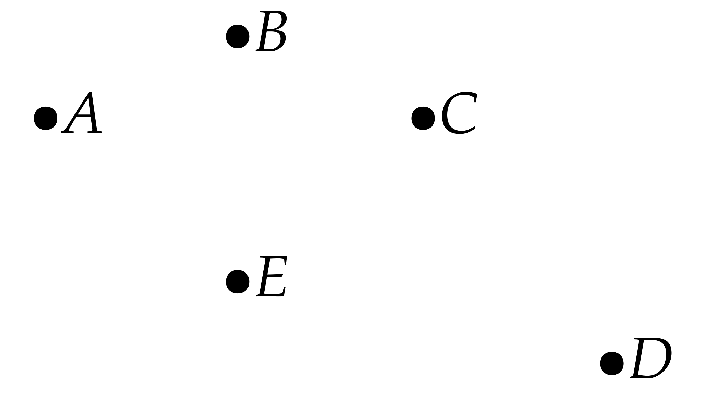

# Ts-304

### [1\[1\]](https://cdn.wittgensteinnachlass.com/2000px/webp/Ts-304/1.webp)

Does it make sense to say that two people have the same body? What experiences would we be describing with this sentence? It is of course conceivable that I should discover that what I call my hand and what I move is attached to someone else’s body, for as I write now I cannot see the connection between my hand and the rest of my body, and I might well discover that the former connection has come apart, and hence that my hand is now attached to someone else’s arm. Suppose my friend and I are sitting side by side without looking at each other, and I am writing without seeing my right arm. Suddenly I look round and notice that my hand is attached to his arm. I draw his attention to it, and he says: “I was just writing with this very hand, though I wasn’t looking at it, and I didn’t know that it now looks like yours and that you have a feeling in it”.

''''''

### [1\[2\]](https://cdn.wittgensteinnachlass.com/2000px/webp/Ts-304/1.webp)

1\) I am in pain

N. is in pain

By contrast:

2\) I have grey hair

N. has grey hair

### [1\[3\]](https://cdn.wittgensteinnachlass.com/2000px/webp/Ts-304/1.webp)

The various difficulties and confusions connected with the first example can for the most part be traced to confusing cases 1) and 2).

### [1\[4\]](https://cdn.wittgensteinnachlass.com/2000px/webp/Ts-304/1.webp)

It makes sense to say: “I see his hair, but not my own” or “I see my hands every day, but not his”, and this sentence is analogous to: “I see my flat every day, but not his”. – By contrast, it is nonsense to say: “I feel my pains, but not his.”

### [1\[5\]](https://cdn.wittgensteinnachlass.com/2000px/webp/Ts-304/1.webp)

Our language’s way of speaking in cases 1 and 2 is of course not “wrong”, but it is misleading.

### [1\[6\]](https://cdn.wittgensteinnachlass.com/2000px/webp/Ts-304/1.webp)

“A flat without an owner”. “Toothache without an owner”. There are people who investigate whether “there are unseen visual images”, and they believe that this is a kind of scientific investigation (into these phenomena).

### [1\[7\]](https://cdn.wittgensteinnachlass.com/2000px/webp/Ts-304/1.webp)

“How a sentence is verified is what it says”. And now, with that in mind, look at these sentences: “I am in pain”, “N. is in pain”. But what if I am N.? The two sentences still have different senses.

### [1\[8\]](https://cdn.wittgensteinnachlass.com/2000px/webp/Ts-304/1.webp)

“It’s really quite simple: admittedly I don’t feel his toothache, but _he_ feels it (and so everything is symmetrical after all).” But this sentence is just nonsense. Now, to give clear expression to the asymmetry of experience as regards myself and the other person, I _could_ propose an asymmetrical way of speaking:

### [1\[9\]](https://cdn.wittgensteinnachlass.com/2000px/webp/Ts-304/1.webp)

Old way of speaking New way of speaking Old way of speaking L.W. is in pain L.W. has pain in his left hand N. is in pain N. feigns pain in his hand ∙ I feel sorry for N. because he is in pain | New way of speaking ∙ There is pain There is pain in L.W.’s left hand N. behaves as L.W. does when there is pain. N. feigns L.W.’s behaviour when there is pain in his hand I feel sorry for N. because he behaves as L.W. does when …

### [2\[2\]](https://cdn.wittgensteinnachlass.com/2000px/webp/Ts-304/2.webp)

Since we substitute for every meaningful expression in the old way of speaking one in the new, and for _different_ old ones _different_ new ones, the new way of speaking must be equivalent to the old as far as unambiguity and intelligibility are concerned. – But couldn’t one just as well construct such an asymmetrical way of speaking for sentences like “I have grey hair”, “N. has grey hair”? No; for one must understand that it must make sense to replace the name L.W. in the sentences on the right-hand side with other names. And if that is not the case, then neither L.W. nor any other name need occur in the sentences. For if one replaces L.W. with the name of another person, one is saying, for instance, that I feel pain in the hand of a body other than my own. It would be conceivable, e.g., for me to switch bodies, say to wake up, see my old body sitting on a chair opposite me and, seeing myself in the mirror, find that I had taken on my friend’s face and body. I now regard the person’s name as the name of the body. And now it makes sense to say: “I have toothache in N.’s body” (in the asymmetrical way of speaking: “there is pain in one of N.’s teeth”); but it makes no sense to say: “I have grey hair on N.’s head”, unless that is supposed to mean: “N. has grey hair”.

### [2\[3\]](https://cdn.wittgensteinnachlass.com/2000px/webp/Ts-304/2.webp)

But is the proposed asymmetrical way of speaking correct? Why do I say: “N. behaves as L.W. does when…”? What characterizes L.W.? Surely the shapes etc. of his body and its continuous existence in space. But are these things essential to the experience of pain? Couldn’t I imagine the following experience: I wake up with pain in my left hand and find that it has changed shape and now looks like my friend’s hand, while he has got mine. And what does the continuity of my existence in space consist in? If someone reliable tells me that he was sitting beside me while I slept; that my body suddenly vanished and suddenly reappeared – is it impossible to believe that? And what, say, does the continuity of my memory consist in? In what time is it continuous? Or does the continuity consist in there being no gap in memory, just as there is none in the visual field? (Just consider how we notice the blind spot!). And what would this continuity have to do with the one that matters for the use of the personal name L.W.? The experience of toothache can be imagined in surroundings quite different from those we are used to. (Just think: one can actually have pain in one’s hand even though it no longer exists in the physical sense, because it has been amputated!) In this sense one could have toothache without a tooth, a headache without a head, etc. We are simply making a distinction here like that between visual space and physical space, or between memory time and physical time.

### [3\[1\]](https://cdn.wittgensteinnachlass.com/2000px/webp/Ts-304/3.webp)

In light of this, then, it is incorrect to introduce the way of speaking: “N. behaves as L.W. does when…” One might perhaps say: “N. behaves like the person in whose hand there is pain.” But why bring in the experience of pain at all to describe the behaviour in question? – We simply want to separate two different domains of experience, as when we distinguish between the tactile and visual experience of a body. And nothing could be more different than the experience of pain and the experience of seeing a human body writhe, hearing it utter sounds, etc. And here there is no difference between my body and someone else’s, for there is also the experience of seeing the movements of one’s own body and hearing the sounds it utters.

### [3\[2\]](https://cdn.wittgensteinnachlass.com/2000px/webp/Ts-304/3.webp)

Let us imagine that our body is removed from our visual field, say by being made quite transparent; but that it retains the ability to appear in a suitable mirror in the way we are accustomed to, so that, for instance, we perceive the visible manifestations of our toothache much as we do those of another body. This would also yield a quite different coordination between the seeing eye and visual space from the everyday one that seems to us to go without saying. (Think of drawing a quadrilateral with its diagonals in a mirror.) But if we can in this way imagine the possibility of knowing our visible body only as an image in a mirror, it is also conceivable that this mirror should be dispensed with and that we should see our body no differently from any other human body. But what then would characterize it as _my_ body? Only the fact, for instance, that I would feel it when this body was touched, but not when another was touched, etc. Thus it is no longer essential either that the mouth below the seeing eye should speak _my_ words (and this is of great importance). Even if I see _my_ body as I see it now, i.e. from its eyes, it is conceivable that I could exchange bodies with others. The experience would simply consist in what one would describe as an abrupt change in my body and its surroundings. At one moment I would see the bodies A, B, C, D from E, and E

from the eyes of that body, and suddenly, say, C, D, E, A from B, and B from its eyes

etc. But it becomes simpler still if I

see all bodies, my own as well as others’, not

from eyes at all, so that, as far as their visual appearance is concerned, they are all on the same footing.

Then it is clear what it means to say that I can have pain in someone else’s tooth, if I still want to keep the designation that calls one body “mine” and another, therefore, “someone else’s” at all. For now it may be more practical to designate the bodies only by proper names.

### [3\[3\]](https://cdn.wittgensteinnachlass.com/2000px/webp/Ts-304/3.webp)

So there is now one experience, that of pain in a tooth of one of the human bodies that exist; this is not the experience I would describe in the ordinary way of speaking with the words “A has toothache”, but the one I would describe with the words: “I have pain in one of A’s teeth”. And there is the other experience, of seeing a body, whether mine or another, writhe. For let us not forget: toothache does have a place in a space, in that one can say, for instance, that it moves about or that it is in two places at once, etc., but its space is not visual or physical space.

### [3\[4\]](https://cdn.wittgensteinnachlass.com/2000px/webp/Ts-304/3.webp),[4\[1\]](https://cdn.wittgensteinnachlass.com/2000px/webp/Ts-304/4.webp)

And now we do have a new way of speaking, but it is no longer asymmetrical. It does not favour _one_ body, one person, to the detriment of the others, and so it is _not_ solipsistic. – Thus all experience is distributed without regard to the person.

### [4\[2\]](https://cdn.wittgensteinnachlass.com/2000px/webp/Ts-304/4.webp)

_But we divide things up differently_. In our way of looking at things, they are grouped differently. As when one sometimes counts time as part of space and sometimes does not, or when one looks at a forest as a block of wood with holes in it; or when one takes the moon’s path round the sun now as a circular orbit round the earth, which itself shifts position, now as a wavy line running round the sun. If the earth were not visible, say, it might be a curious new way of looking at things to take the wave motion round the sun as a circular orbit round a centre that itself moves in a circle. – In this way one might destroy certain prejudices built on the particular way of looking at things that we are familiar with. – The character of the other way of looking at things becomes very clear when one thinks of the analogous shift in boundaries brought about by introducing the concept of memory time. It is quite like the change in how we look at the motion of the moon. A boundary that used to coincide with others in the drawing is suddenly drawn in a heavy line and made to stand out.
