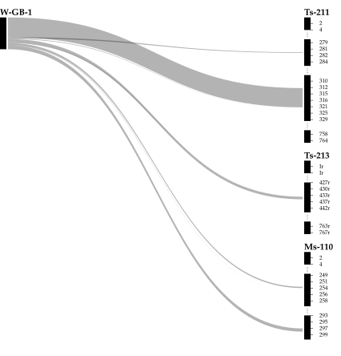

# Remarks on Frazer's Golden Bough – I

1931–1933, 50 remarks, Ts-211, Ts-213, Ms-110

### [Ts-211](/ts-211/#313.1) [313\[1\]](https://cdn.wittgensteinnachlass.com/2000px/webp/Ts-211/313.webp)

One must start with the error and lead it over into the truth. That is, one must uncover the source of the error, otherwise hearing the truth is of no use to us. It cannot get in while something else occupies its place. (To convince someone of the truth it is not enough to state the truth; one must find the _way_ from error to truth.)

### [Ts-211](/ts-211/#313.2) [313\[2\]](https://cdn.wittgensteinnachlass.com/2000px/webp/Ts-211/313.webp)

I must keep plunging into the water of doubt.

### [Ts-211](/ts-211/#313.3) [313\[3\]](https://cdn.wittgensteinnachlass.com/2000px/webp/Ts-211/313.webp)

Frazer’s representation of people’s magical and religious views is _unsatisfactory_: it makes these views appear as _errors_. So was Augustine in error when he invokes God on every page of the Confessiones? But – one may say – if he was not in error, then surely the Buddhist saint was – or whoever it might be – whose religion gives expression to quite different views. But _none_ of them was in error, except where he put forward a theory.

### [Ts-211](/ts-211/#313.4+314.1) [313\[4\]](https://cdn.wittgensteinnachlass.com/2000px/webp/Ts-211/313.webp),[314\[1\]](https://cdn.wittgensteinnachlass.com/2000px/webp/Ts-211/314.webp)

The very idea of wanting to explain the custom – the killing of the priest-king, for example – seems to me misguided. All Frazer does is make it plausible to people who think much as he does. It is very remarkable that in the end all these customs are represented, so to speak, as acts of stupidity. But it will never be plausible that people do all these things out of sheer stupidity. If he explains to us, for example, that the king must be killed in his prime because, according to the views of the savages, his soul would not otherwise be kept fresh, then all one can say is: where that custom and this view go together, the custom does not spring from the view; rather, they are both there. It can happen, and often happens nowadays, that someone gives up a custom after recognizing an error on which that custom was based. But this is the case only where it is enough to draw someone’s attention to his error to dissuade him from his way of acting. But that is not the case with the religious custom of a people, and _that_ is why there is _no_ question of an error.

### [Ts-211](/ts-211/#314.2) [314\[2\]](https://cdn.wittgensteinnachlass.com/2000px/webp/Ts-211/314.webp)

Frazer says that it is very difficult to discover the error in magic – and that is why it persists for so long – because, for instance, an incantation meant to bring rain is sure to appear effective sooner or later. But then it is remarkable that people do not realize sooner that it rains sooner or later anyway.

### [Ts-211](/ts-211/#314.3) [314\[3\]](https://cdn.wittgensteinnachlass.com/2000px/webp/Ts-211/314.webp)

I believe that the undertaking of an explanation is misguided for this reason alone: one need only put together correctly what one _knows_, and add nothing, and the satisfaction sought through the explanation comes of its own accord. And it is not the explanation at all that satisfies here. When Frazer begins by telling us the story of the King of the Wood at Nemi, he does so in a tone which shows that he feels, and wants us to feel, that something remarkable and terrible is happening here. But the question “why does this happen?” is really answered thus: Because it is terrible. That is, the very thing that strikes us as terrible, grand, eerie, tragic, etc., as anything but trivial and meaningless, in this occurrence – _that_ is what brought this _occurrence_ into being.

### [Ts-211](/ts-211/#315.1) [315\[1\]](https://cdn.wittgensteinnachlass.com/2000px/webp/Ts-211/315.webp)

Here one can only _describe_ and say: this is what human life is like.

### [Ts-211](/ts-211/#315.2) [315\[2\]](https://cdn.wittgensteinnachlass.com/2000px/webp/Ts-211/315.webp)

The explanation is too uncertain compared with the impression that what is described makes on us.

### [Ts-211](/ts-211/#315.3) [315\[3\]](https://cdn.wittgensteinnachlass.com/2000px/webp/Ts-211/315.webp)

Every explanation is, after all, a hypothesis.

### [Ts-211](/ts-211/#315.4) [315\[4\]](https://cdn.wittgensteinnachlass.com/2000px/webp/Ts-211/315.webp)

But a hypothetical explanation will be of little help to someone troubled by love, say. – It will not put his mind at rest.

### [Ts-211](/ts-211/#315.5) [315\[5\]](https://cdn.wittgensteinnachlass.com/2000px/webp/Ts-211/315.webp)

The throng of thoughts that cannot get out because they all want to push to the front and so get wedged in the exit.

### [Ts-211](/ts-211/#315.6) [315\[6\]](https://cdn.wittgensteinnachlass.com/2000px/webp/Ts-211/315.webp)

If one sets the phrase “the majesty of death” alongside that tale of the priest-king of Nemi, one sees that the two are one. The life of the priest-king represents what is meant by that phrase.

### [Ts-211](/ts-211/#315.7) [315\[7\]](https://cdn.wittgensteinnachlass.com/2000px/webp/Ts-211/315.webp)

Someone who is moved by the majesty of death can give expression to this through such a life. – This too is of course no explanation, but merely substitutes one symbol for another. Or: one ceremony for another.

### [Ts-211](/ts-211/#315.8) [315\[8\]](https://cdn.wittgensteinnachlass.com/2000px/webp/Ts-211/315.webp)

No _opinion_ underlies a religious symbol. And error corresponds only to opinion.

### [Ts-211](/ts-211/#315.9) [315\[9\]](https://cdn.wittgensteinnachlass.com/2000px/webp/Ts-211/315.webp)

One would like to say: Such and such an occurrence took place; laugh if you can.

### [Ts-211](/ts-211/#316.1) [316\[1\]](https://cdn.wittgensteinnachlass.com/2000px/webp/Ts-211/316.webp)

The religious actions, or the religious life, of the priest-king are no different in kind from any genuinely religious action _today_, say a confession of sins. This too can be “_explained_” and cannot be explained.

### [Ts-211](/ts-211/#316.2) [316\[2\]](https://cdn.wittgensteinnachlass.com/2000px/webp/Ts-211/316.webp)

Burning in effigie. Kissing the picture of one’s beloved. This is _of course not_ based on a belief in a particular effect on the object that the picture represents. It aims at satisfaction and attains it too. Or rather, it _aims_ at nothing at all; we simply act this way and then feel satisfied.

### [Ts-211](/ts-211/#316.3) [316\[3\]](https://cdn.wittgensteinnachlass.com/2000px/webp/Ts-211/316.webp)

One could also kiss the name of one’s beloved, and here it would be clear that the name stood in for her.

### [Ts-211](/ts-211/#316.4) [316\[4\]](https://cdn.wittgensteinnachlass.com/2000px/webp/Ts-211/316.webp)

The same savage who pierces the picture of his enemy, apparently in order to kill him, actually builds his hut of wood and skilfully carves his arrow, not in effigie.

### [Ts-211](/ts-211/#316.5) [316\[5\]](https://cdn.wittgensteinnachlass.com/2000px/webp/Ts-211/316.webp)

The idea that one can beckon an inanimate object towards oneself as one beckons a person. Here the principle is that of personification.

### [Ts-211](/ts-211/#316.6) [316\[6\]](https://cdn.wittgensteinnachlass.com/2000px/webp/Ts-211/316.webp)

And magic is always based on the idea of symbolism and language.

### [Ts-211](/ts-211/#316.7+317.1+318.1+319.1) [316\[7\]](https://cdn.wittgensteinnachlass.com/2000px/webp/Ts-211/316.webp),[317\[1\]](https://cdn.wittgensteinnachlass.com/2000px/webp/Ts-211/317.webp),[318\[1\]](https://cdn.wittgensteinnachlass.com/2000px/webp/Ts-211/318.webp),[319\[1\]](https://cdn.wittgensteinnachlass.com/2000px/webp/Ts-211/319.webp)

The representation of a wish is, eo ipso, the representation of its fulfilment. But magic gives a wish representation; it expresses a wish. Baptism as washing. – An error arises only when magic is interpreted scientifically. If the adoption of a child takes place by the mother drawing it through her clothes, it is surely crazy to believe that there is an _error_ here and that she believes she has given birth to the child. One must distinguish from magical operations those that rest on a false, too simple conception of things and processes. When one says, for instance, that the illness moves from one part of the body to another, or makes arrangements to draw the illness off, as if it were a liquid or a thermal state. In that case one forms a false picture, which here means an inaccurate one. What narrowness of mental life in Frazer! Hence: how impossible for him to comprehend any life other than the English life of his time! Frazer cannot imagine a priest who is not at bottom an English Parson of our time, with all his stupidity and insipidity. Why should a person’s name not be sacred to him? After all, it is on the one hand the most important instrument he is given, and on the other like a *piece* of jewellery hung round his neck at birth. How misleading Frazer’s explanations are can be seen, I believe, from the fact that one could quite well invent primitive customs oneself and it would have to be a coincidence if they were not actually found somewhere. That is, the principle according to which these customs are ordered is much more general than Frazer’s explanation makes it out to be, and is present in our own minds, so that we could think up all the possibilities ourselves. – We can well imagine, for instance, that the king of a tribe is kept out of everyone’s sight, but also that every man of the tribe is to see him. The latter will surely not be allowed to happen in some more or less haphazard way; rather, he will be _shown_ to the people. Perhaps no one will be permitted to touch him, but perhaps everyone will _have to_ touch him. Let us remember that after Schubert’s death his brother cut up Schubert’s scores into small pieces and gave his favourite pupils pieces of a few bars each. This action, as a sign of piety, is _just as_ intelligible to us as the other, that of keeping the scores untouched and inaccessible to anyone. And had Schubert’s brother burnt the scores, that too would be intelligible as a sign of piety. The ceremonial (hot or cold), as opposed to the _haphazard_ (lukewarm), characterizes piety. Indeed, Frazer’s explanations would not be explanations at all if they did not ultimately appeal to an inclination in ourselves. Eating and drinking involve dangers, not only for the savage but also for us; nothing is more natural than that one should want to protect oneself against _these_; and now we could think up such precautions ourselves. – But by what principle do we think them up? Evidently by reducing all dangers in form to a few very simple ones that are immediately apparent to people. Thus by the same principle by which the uneducated among us say that the illness moves from the head into the chest, etc., etc.. In these simple pictures personification will of course play a large part, for we know that people (and so spirits) can be dangerous to people. That a person’s shadow, which looks like a person, or his reflection, that rain, thunderstorms, the phases of the moon, the changes of season, the similarities and differences among animals and between animals and human beings, the phenomena of death, birth and sexual life, in short everything that a person perceives around him year in, year out, interwoven in the most various ways, will _figure_ in his thinking (his philosophy) and his customs, goes without saying, or rather is what we really know and what is interesting.

### [Ts-211](/ts-211/#319.2+320.1) [319\[2\]](https://cdn.wittgensteinnachlass.com/2000px/webp/Ts-211/319.webp),[320\[1\]](https://cdn.wittgensteinnachlass.com/2000px/webp/Ts-211/320.webp)

How could fire, or the similarity of fire to the sun, have failed to make an impression on the awakening human mind? But not, perhaps, “because it cannot explain it to itself” (the stupid superstition of our time) – for does an “explanation” make it less impressive? – The magic in “Alice in Wonderland” of drying oneself by having the driest thing there is read aloud. In the magical cure of an illness one _intimates_ to it that it should leave the patient. After a description of such a magical cure one always wants to say: If the illness does not understand _that_, then I do not know _how_ one is to tell it. Nothing is so difficult as doing justice to the facts. I do not mean that it must be _fire_ in particular that makes an impression on everyone. Fire no more than any other phenomenon, and one phenomenon makes an impression on one person, another on another. For no phenomenon is in itself particularly mysterious, but any may become so for us, and what is characteristic of the awakening human mind is precisely that a phenomenon becomes significant for it. One might almost say that the human being is a ceremonial animal. That is probably partly false and partly nonsensical, but there is also something right about it. That is, one might begin a book on anthropology like this: If one looks at the life and behaviour of human beings on earth, one sees that besides the actions one might call animal, the taking of nourishment, etc., etc., etc., they also perform actions of quite a different character, which one might call ritual actions. But now it is nonsense to go on to say that what is characteristic of _these_ actions is that they spring from mistaken views about the physics of things. (This is what Frazer does when he says that magic is essentially false physics, or false medicine, technique, etc..) Rather, what is characteristic of ritual action is not a view or an opinion at all, whether right or wrong, although an opinion – a belief – may itself also be ritual, may belong to the rite.

### [Ts-211](/ts-211/#320.2) [320\[2\]](https://cdn.wittgensteinnachlass.com/2000px/webp/Ts-211/320.webp)

If one takes it for granted that human beings delight in their imagination, one should consider that this imagination is not like a painted picture or a sculpted model, but a complicated structure made up of heterogeneous components: words and pictures. One will then no longer contrast operating with written and spoken signs with operating with “mental images” of events.

### [Ts-211](/ts-211/#320.3) [320\[3\]](https://cdn.wittgensteinnachlass.com/2000px/webp/Ts-211/320.webp)

We must plough through the whole of language.

### [Ts-211](/ts-211/#320.4+321.1) [320\[4\]](https://cdn.wittgensteinnachlass.com/2000px/webp/Ts-211/320.webp),[321\[1\]](https://cdn.wittgensteinnachlass.com/2000px/webp/Ts-211/321.webp)

Frazer: “‥‥․ That these observances are dictated by fear of the ghost of the slain seems certain; ‥‥” But why does Frazer use the word “ghost”? So he understands this superstition very well, since he explains it to us with a superstitious word familiar to him. Or rather, he could have seen from this that there is something in us too that speaks for those ways of acting of the savages. – If I, who do not believe that there are anywhere human-superhuman beings that one can call gods – if I say: “I fear the vengeance of the gods”, that shows that I (_can_) mean something by it, or can give expression to a feeling that has nothing to do with that belief.

### [Ts-211](/ts-211/#321.2) [321\[2\]](https://cdn.wittgensteinnachlass.com/2000px/webp/Ts-211/321.webp)

Frazer would be capable of believing that a savage dies because of an error. Primary-school readers say that Attila undertook his great campaigns because he believed he possessed the sword of the god of thunder.

### [Ts-211](/ts-211/#321.3) [321\[3\]](https://cdn.wittgensteinnachlass.com/2000px/webp/Ts-211/321.webp)

Frazer is much more of a savage than most of his savages, for they will not be so far from understanding a spiritual matter as an Englishman of the twentieth century. _His_ explanations of primitive customs are much cruder than the sense of these customs themselves.

### [Ts-211](/ts-211/#321.4) [321\[4\]](https://cdn.wittgensteinnachlass.com/2000px/webp/Ts-211/321.webp)

Historical explanation, explanation as a hypothesis of development, is only _one_ way of bringing the data together – of giving a synopsis of them. It is just as possible to see the data in their relation to one another and bring them together in a general picture without doing so in the form of a hypothesis about their development over time.

### [Ts-211](/ts-211/#321.5) [321\[5\]](https://cdn.wittgensteinnachlass.com/2000px/webp/Ts-211/321.webp)

Identification of one’s own gods with gods of other peoples. One convinces oneself that the names have the same meaning.

### [Ts-211](/ts-211/#321.6) [321\[6\]](https://cdn.wittgensteinnachlass.com/2000px/webp/Ts-211/321.webp)

“And so the chorus points to a secret law” is what one would like to say of Frazer’s collection of facts. Now I _can_ express this law, this idea, by a hypothesis of development, or again, by analogy with the schema of a plant, by the schema of a religious ceremony, or else by grouping the factual material alone in a “_surveyable_” representation.

### [Ts-211](/ts-211/#281.8+282.1) [281\[8\]](https://cdn.wittgensteinnachlass.com/2000px/webp/Ts-211/281.webp),[282\[1\]](https://cdn.wittgensteinnachlass.com/2000px/webp/Ts-211/282.webp)

The concept of a surveyable representation is of fundamental importance to us. It designates our form of representation, the way we see things. (A kind of ‘world-view’, such as apparently typifies our time. Spengler.)

### [Ts-211](/ts-211/#282.2) [282\[2\]](https://cdn.wittgensteinnachlass.com/2000px/webp/Ts-211/282.webp)

This surveyable representation conveys the understanding that consists precisely in our “seeing the connections”. Hence the importance of the _intermediate links_.

### [Ts-211](/ts-211/#322.2) [322\[2\]](https://cdn.wittgensteinnachlass.com/2000px/webp/Ts-211/322.webp)

In this case, however, a hypothetical intermediate link is meant to do nothing but draw attention to the similarity, the connection, among the _facts_. As if one _wanted_ to illustrate an internal relation between the circular form and the ellipse by gradually transforming an ellipse into a circle; _but not in order to assert that a certain ellipse actually, historically, arose from a circle_ (hypothesis of development), but only to sharpen our eye for a formal connection. Yet I can also see the hypothesis of development as nothing more than a way of clothing a formal connection.

### [Ts-213](/ts-213/#433r.4) [433r\[4\]](https://cdn.wittgensteinnachlass.com/2000px/webp/Ts-213/433r.webp)

I want to say: nothing shows our kinship with those savages better than the fact that Frazer has ready to hand a word as familiar to him and to us as “ghost” or “shade” to describe the views of these people.

### [Ts-213](/ts-213/#434r.1) [434r\[1\]](https://cdn.wittgensteinnachlass.com/2000px/webp/Ts-213/434r.webp)

(That is quite different from his describing the savages, say, as imagining that their heads fall off when they have slain an enemy. Here there would be nothing superstitious or magical about _our description_.)

### [Ts-213](/ts-213/#434r.2) [434r\[2\]](https://cdn.wittgensteinnachlass.com/2000px/webp/Ts-213/434r.webp)

Indeed, this peculiarity does not concern just the expressions “ghost” and “shade”, and far too little is made of the fact that we count the words “soul” and “mind” (“spirit”) as part of our own cultivated vocabulary. _By contrast_ it is a _trifle_ that we do not believe our soul eats and drinks.

### [Ts-213](/ts-213/#434r.3) [434r\[3\]](https://cdn.wittgensteinnachlass.com/2000px/webp/Ts-213/434r.webp)

A whole mythology is laid down in our language.

### [Ts-213](/ts-213/#434r.4) [434r\[4\]](https://cdn.wittgensteinnachlass.com/2000px/webp/Ts-213/434r.webp)

Driving out death or killing death; but on the other hand death is represented as a skeleton, and so is itself in a certain sense dead. “As dead as death”. ‘Nothing is as dead as death; nothing as beautiful as beauty itself!’ The picture in terms of which one imagines reality here is that beauty, death, etc. are the pure (concentrated) substance, whereas in a beautiful object the substance is present as an admixture. – And don’t I recognize here my own reflections on ‘object’ and ‘complex’? (Plato.)

### [Ts-213](/ts-213/#433r.2) [433r\[2\]](https://cdn.wittgensteinnachlass.com/2000px/webp/Ts-213/433r.webp)

In the old rites we have the use of a highly developed language of gestures. And when I read Frazer, at every turn I want to say: all these processes, these changes of meaning, are still there before us in our word-language. If what is hiding in the last sheaf is called the ‘corn-wolf’, but so are the sheaf itself and the man who binds it, then we recognize in this a linguistic process well known to us.

### [Ms-110](/ms-110/#253.2+254.1) [253\[2\]](https://cdn.wittgensteinnachlass.com/2000px/webp/Ms-110/253.webp),[254\[1\]](https://cdn.wittgensteinnachlass.com/2000px/webp/Ms-110/254.webp)

I could imagine that I had been given a choice of a creature on earth to be the dwelling of my soul & that my spirit had chosen this unprepossessing (unattractive) creature as its seat & vantage point. Perhaps because it would dislike having a beautiful seat as an exception. For that, of course, the spirit would have to be very sure of itself.

### [Ms-110](/ms-110/#254.2) [254\[2\]](https://cdn.wittgensteinnachlass.com/2000px/webp/Ms-110/254.webp)

One might say “there is some charm to be found in every view”, but that would be wrong. What is right is to say that every view is significant to one who sees it as significant (though that does not mean seeing it otherwise than it is). Indeed, in this sense every view is equally significant.

### [Ms-110](/ms-110/#254.3) [254\[3\]](https://cdn.wittgensteinnachlass.com/2000px/webp/Ms-110/254.webp)

Indeed, it is important that I must also make the other person’s contempt for me my own, as an essential & significant part of the world seen from where I stand.

### [Ms-110](/ms-110/#255.4) [255\[4\]](https://cdn.wittgensteinnachlass.com/2000px/webp/Ms-110/255.webp)

If a person were free to choose which tree in a forest to be born into, there would be some who would pick the most beautiful or the tallest tree, some who would choose the smallest, & some who would choose an average or below-average tree, & I mean not out of philistinism, but for the very same reason, or kind of reason, for which another chose the tallest. That the feeling we have for our life is comparable to that of such a being, which could choose its standpoint in the world, is, I believe, what underlies the myth – or the belief – that we chose our body before birth.

### [Ms-110](/ms-110/#297.3) [297\[3\]](https://cdn.wittgensteinnachlass.com/2000px/webp/Ms-110/297.webp)

06.07.1931

I believe that what is characteristic of primitive man is that he does not act on _opinions_ (contra Frazer). Among many similar examples I read of a rain-king in Africa whom the people ask for rain _when the rainy season comes_. But that surely means that they do not really think he can make rain, otherwise they would do it in the dry seasons of the year when the land is “a parched and arid desert”. For if one assumes that the people once instituted this office of rain-king out of stupidity, it is surely clear that they already knew from experience that the rain begins in March & they would then have had the rain-king do his job for the rest of the year. Or to put it another way: Towards morning, when the sun is about to rise, people celebrate rites of daybreak, but not at night, when they simply burn lamps.

### [Ms-110](/ms-110/#297.4+298.1) [297\[4\]](https://cdn.wittgensteinnachlass.com/2000px/webp/Ms-110/297.webp),[298\[1\]](https://cdn.wittgensteinnachlass.com/2000px/webp/Ms-110/298.webp)

When I am angry about something I sometimes strike the ground or a tree etc. with my stick, but I do not _believe_ that the ground is to blame or that striking it can do any good. “I let my anger out.” And all rites are of this kind. One can call such actions instinct-actions. – And a historical explanation, for example that I once believed or that my ancestors once believed that striking the ground did some good, is mere subterfuge, for such explanations are superfluous assumptions that explain _nothing_. What matters is the similarity of the act to an act of punishment, but nothing beyond this similarity can be established. Once such a phenomenon is connected with an instinct that I myself possess, that is precisely the explanation sought; i.e. the one that resolves the particular puzzlement. And an enquiry into the history of my instinct now proceeds along different lines.

### [Ms-110](/ms-110/#298.2) [298\[2\]](https://cdn.wittgensteinnachlass.com/2000px/webp/Ms-110/298.webp)

It cannot have been some minor reason, i.e. any _reason_ at all, that led certain races of men to venerate the oak tree, but only the fact that they & the oak were united in a common life, thus united not by choice but as the flea & the dog are united in their origins. (If fleas developed a rite, it would concern the dog.)

### [Ms-110](/ms-110/#298.3) [298\[3\]](https://cdn.wittgensteinnachlass.com/2000px/webp/Ms-110/298.webp)

One might say it was not their union (that of oak & man) that gave rise to these rites, but perhaps their separation.

### [Ms-110](/ms-110/#298.4) [298\[4\]](https://cdn.wittgensteinnachlass.com/2000px/webp/Ms-110/298.webp)

For the awakening of the intellect takes place with a separation from the original _soil_, the original basis of life. (The emergence of _choice_.)

### [Ms-110](/ms-110/#299.1) [299\[1\]](https://cdn.wittgensteinnachlass.com/2000px/webp/Ms-110/299.webp)

(The form of the awakening mind is veneration.)
