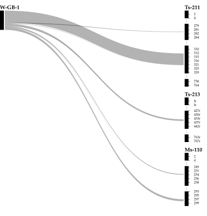
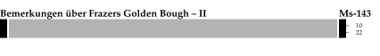

# Remarks on Frazer's Golden Bough

1931–1950, 77 remarks, Ts-211, Ts-213, Ms-110, Ms-143

- [Remarks on Frazer's Golden Bough – I](/en/w-gb-1/)
- [Remarks on Frazer's Golden Bough – II](/en/w-gb-2/)