# Notebooks 1914–1916

1914–1917, 1000 remarks, Ms-101, Ms-102, Ms-103

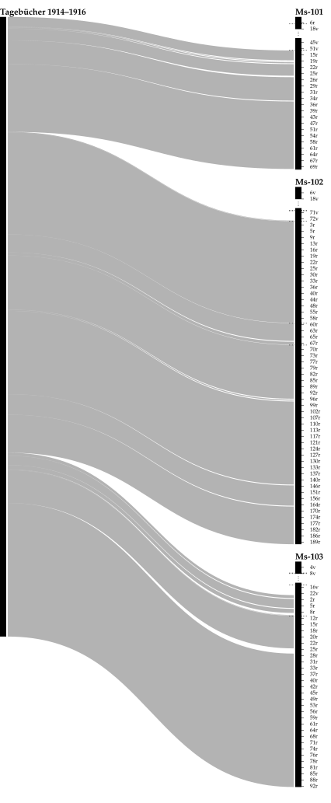

### [Ms-101](/ms-101/#8r.4) [8r\[4\]](https://cdn.wittgensteinnachlass.com/2000px/webp/Ms-101/8r.webp)

22.08.1914

Logic must take care of itself.

### [Ms-101](/ms-101/#8r.5+9r.1) [8r\[5\]](https://cdn.wittgensteinnachlass.com/2000px/webp/Ms-101/8r.webp),[9r\[1\]](https://cdn.wittgensteinnachlass.com/2000px/webp/Ms-101/9r.webp)

φ(x) If syntactic rules for functions can be laid down _at all_, then the whole theory of things, properties, etc. is superfluous. It is also exceedingly striking that there is no mention of this theory either in the “Grundgesetze” or in the “Principia Mathematica”. Once again: for logic must take care of itself. A _possible_ sign must also be capable of designating. Everything that is possible at all is also legitimate. Let us recall the explanation of why “Socrates is Plato” is nonsensical. Namely, because _we_ have not made an arbitrary determination, but _not_ because the sign in itself is in any way illegitimate!

### [Ms-101](/ms-101/#12r.2+13r.1) [12r\[2\]](https://cdn.wittgensteinnachlass.com/2000px/webp/Ms-101/12r.webp),[13r\[1\]](https://cdn.wittgensteinnachlass.com/2000px/webp/Ms-101/13r.webp)

02.09.1914

In a certain sense it must be impossible for us to go wrong in logic. This is already partly expressed in: Logic must take care of itself. This is an extraordinarily deep & important insight.

### [Ms-101](/ms-101/#13r.2) [13r\[2\]](https://cdn.wittgensteinnachlass.com/2000px/webp/Ms-101/13r.webp)

Frege says: every legitimately formed sentence must have a sense, and I say: every possible sentence is legitimately formed & if it has no sense, that can only be because we have not _given_ a meaning to some of its constituents. Even if we believe we have done so.

### [Ms-101](/ms-101/#13r.3+14r.1) [13r\[3\]](https://cdn.wittgensteinnachlass.com/2000px/webp/Ms-101/13r.webp),[14r\[1\]](https://cdn.wittgensteinnachlass.com/2000px/webp/Ms-101/14r.webp)

03.09.1914

Worked yesterday not altogether without success. Read Tolstoy with great profit. How is it compatible with the task of philosophy that logic should take care of itself? If, for example, we ask: is such & such a fact of subject-predicate form, then surely we must know what we understand by “S.P. form”. We must know _whether_ there is such a form at all. How can we know this? “From the signs!” But how? After all, we have no _signs_ at all of this form. We can indeed say: we have signs that behave like signs of S.P. form, but does that prove that there really must be facts of this form? That is, when they are completely analysed. And here the question arises again: Is there such a complete analysis. _And if not_: What then is the task of philosophy?!!?

### [Ms-101](/ms-101/#14r.2+15r.1) [14r\[2\]](https://cdn.wittgensteinnachlass.com/2000px/webp/Ms-101/14r.webp),[15r\[1\]](https://cdn.wittgensteinnachlass.com/2000px/webp/Ms-101/15r.webp)

So we can ask ourselves: Is there the subject-predicate form? Is there the relational form? Is there any one at all of the forms Russell and I have always talked about? (Russell would say: “yes! for that is evident.” _Yees_!)

### [Ms-101](/ms-101/#15r.2) [15r\[2\]](https://cdn.wittgensteinnachlass.com/2000px/webp/Ms-101/15r.webp)

So: if _everything_ that needs to be shown is shown by the existence of subject-predicate _sentences_, etc., then the task of philosophy is different from what I originally assumed. But if that is not so, what is missing would have to be shown by a kind of experience, and I regard that as out of the question.

### [Ms-101](/ms-101/#15r.3) [15r\[3\]](https://cdn.wittgensteinnachlass.com/2000px/webp/Ms-101/15r.webp)

The lack of clarity _evidently_ lies in the question of what exactly the logical identity of sign and what is designated consists in! And this question is (_again_) a principal aspect of the whole philosophical problem.

### [Ms-101](/ms-101/#16r.1+17r.1) [16r\[1\]](https://cdn.wittgensteinnachlass.com/2000px/webp/Ms-101/16r.webp),[17r\[1\]](https://cdn.wittgensteinnachlass.com/2000px/webp/Ms-101/17r.webp)

Let a philosophical question be given: say, whether “A is good” is a subject-predicate sentence; or whether “A is brighter than B” is a relational sentence! _How can such a question be decided at all?!_ What sort of evidence can set my mind at rest that – _for example_ – the first question must be answered in the affirmative? (This is an extraordinarily important question). Is the only evidence here once again _that highly dubious “being evident”??_ Let us take a very similar question which, however, is simpler & more fundamental; namely this: is a point in our visual image a “_simple object_”, a _thing_? After all, I have always regarded such questions as the properly philosophical ones – and they certainly are in a sense – but once again: what evidence could decide such a question at all? Is there not a mistake in the way the question is put, for it seems that _nothing at all_ about this question strikes me as evident; it seems that I could say with certainty that these questions could never be decided at all.

### [Ms-101](/ms-101/#17r.2) [17r\[2\]](https://cdn.wittgensteinnachlass.com/2000px/webp/Ms-101/17r.webp)

04.09.1914

If the existence of the subject-predicate _sentence_ does not show everything necessary, then only the existence of some particular fact of that form could show it. And knowledge of such a fact cannot be essential to logic.

### [Ms-101](/ms-101/#17r.3+18r.1) [17r\[3\]](https://cdn.wittgensteinnachlass.com/2000px/webp/Ms-101/17r.webp),[18r\[1\]](https://cdn.wittgensteinnachlass.com/2000px/webp/Ms-101/18r.webp)

Supposing we had a sign that _really_ was of S.P. form, would it be any more suitable for expressing S.P. sentences than our S.P. sentences? It seems not! Is that due to the designating relation?

### [Ms-101](/ms-101/#18r.2) [18r\[2\]](https://cdn.wittgensteinnachlass.com/2000px/webp/Ms-101/18r.webp)

If logic can be completed without answering certain questions, then _it must be completed without_ them.

### [Ms-101](/ms-101/#18r.3) [18r\[3\]](https://cdn.wittgensteinnachlass.com/2000px/webp/Ms-101/18r.webp)

The logical identity of sign & what is designated consists in this: one may recognize in the sign neither more nor less than in what is designated.

### [Ms-101](/ms-101/#18r.4) [18r\[4\]](https://cdn.wittgensteinnachlass.com/2000px/webp/Ms-101/18r.webp)

If sign & what is designated were _not_ identical in their full logical content, there would have to be something more fundamental than logic.

### [Ms-101](/ms-101/#18r.5) [18r\[5\]](https://cdn.wittgensteinnachlass.com/2000px/webp/Ms-101/18r.webp)

05.09.1914

φ(a) . φ(b) . aRb ≝ φ[aRb]

### [Ms-101](/ms-101/#18r.6+19r.1) [18r\[6\]](https://cdn.wittgensteinnachlass.com/2000px/webp/Ms-101/18r.webp),[19r\[1\]](https://cdn.wittgensteinnachlass.com/2000px/webp/Ms-101/19r.webp)

Remember that the words “function” “argument” “sentence”, etc. must not occur in logic!

### [Ms-101](/ms-101/#19r.3) [19r\[3\]](https://cdn.wittgensteinnachlass.com/2000px/webp/Ms-101/19r.webp)

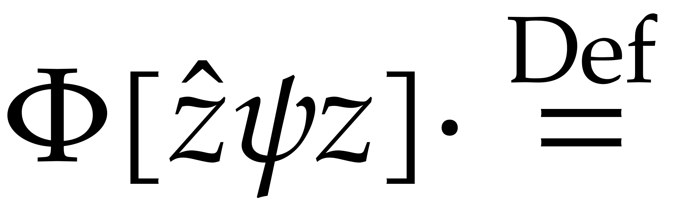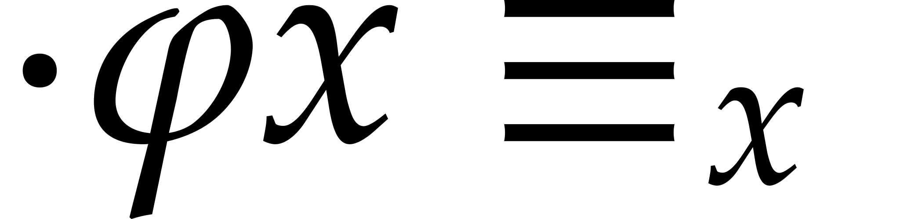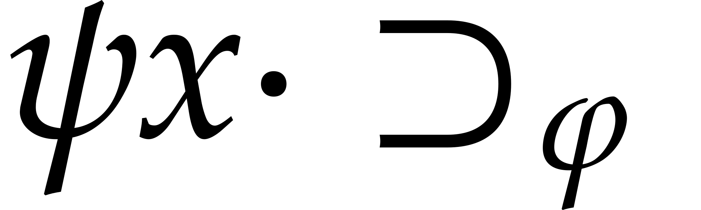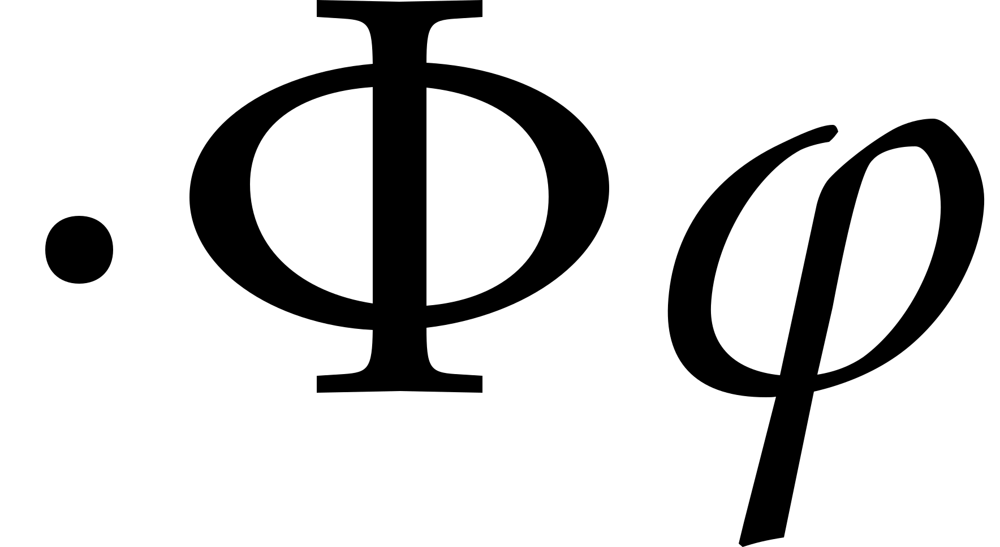

To say of two classes that they are identical says something. To say this of two things says nothing this alone shows the inadmissibility of Russell’s definition

### [Ms-101](/ms-101/#19r.5) [19r\[5\]](https://cdn.wittgensteinnachlass.com/2000px/webp/Ms-101/19r.webp)

The last sentence is really nothing other than the age-old objection to identity in mathematics. Namely, that if 2 × 2 really were _equal_ to 4, then this sentence would say no more than a = a.

### [Ms-101](/ms-101/#19r.6) [19r\[6\]](https://cdn.wittgensteinnachlass.com/2000px/webp/Ms-101/19r.webp)

Could one say: Logic is _not_ concerned with the analysability of the functions it works with.

### [Ms-101](/ms-101/#20r.2) [20r\[2\]](https://cdn.wittgensteinnachlass.com/2000px/webp/Ms-101/20r.webp)

07.09.1914

Bear in mind that even an unanalysed S.P. sentence clearly states something _quite_ _definite_.

### [Ms-101](/ms-101/#20r.3+21r.1) [20r\[3\]](https://cdn.wittgensteinnachlass.com/2000px/webp/Ms-101/20r.webp),[21r\[1\]](https://cdn.wittgensteinnachlass.com/2000px/webp/Ms-101/21r.webp)

Can one not say: What matters is not that we are dealing with S.P. sentences that cannot be analysed, but that our S.P. sentences behave like such sentences in _every_ respect, that is, that the logic of _our_ S.P. sentences is the same as the logic of those others. After all, our only concern is to complete logic, and our main objection to the unanalysed S.P. sentences was that we cannot lay down their syntax as long as we do not know their analysis. But must not the logic of an apparent S.P. sentence be the same as the logic of a real one? If a definition that gives the sentence S.P. form is possible at all ‥‥?

### [Ms-101](/ms-101/#21r.2) [21r\[2\]](https://cdn.wittgensteinnachlass.com/2000px/webp/Ms-101/21r.webp)

08.09.1914

The “being evident” that Russell spoke of so much can be dispensed with in logic only by language itself preventing every logical error. And it is clear that this “being evident” is & always has been entirely deceptive.

### [Ms-101](/ms-101/#21r.3) [21r\[3\]](https://cdn.wittgensteinnachlass.com/2000px/webp/Ms-101/21r.webp)

19.09.1914

aRb . bRc . cRd . dRe = φ(a,e)

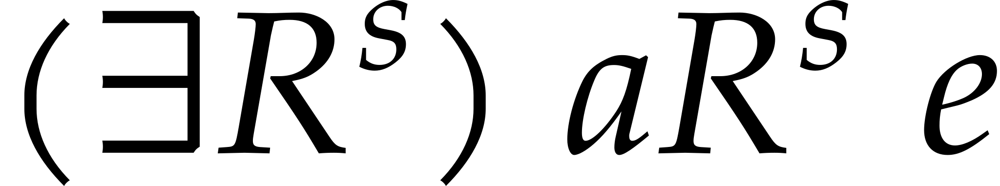

A sentence like “this armchair is brown” seems to say something enormously complicated, for if we wanted to utter this sentence in such a way that no one could raise objections to it arising from its ambiguity, it would have to be endlessly long.

### [Ms-101](/ms-101/#22r.1) [22r\[1\]](https://cdn.wittgensteinnachlass.com/2000px/webp/Ms-101/22r.webp)

20.09.1914

That the sentence is a logical depiction of its meaning is evident to the unprejudiced eye.

### [Ms-101](/ms-101/#22r.2) [22r\[2\]](https://cdn.wittgensteinnachlass.com/2000px/webp/Ms-101/22r.webp)

Are there functions of facts? E.g. “It is better if this is the case than if that is the case.”

### [Ms-101](/ms-101/#22r.3) [22r\[3\]](https://cdn.wittgensteinnachlass.com/2000px/webp/Ms-101/22r.webp)

What, then, does the connexion between the sign p and the remaining signs of the sentence “It is good that p is the case.” consist in? What does this connexion consist in??

### [Ms-101](/ms-101/#22r.4) [22r\[4\]](https://cdn.wittgensteinnachlass.com/2000px/webp/Ms-101/22r.webp)

An unprejudiced person will say: evidently in the spatial relation of the letter p to the two neighbouring signs. But what if the fact “p” were one in which no things occur??

### [Ms-101](/ms-101/#22r.5+23r.1) [22r\[5\]](https://cdn.wittgensteinnachlass.com/2000px/webp/Ms-101/22r.webp),[23r\[1\]](https://cdn.wittgensteinnachlass.com/2000px/webp/Ms-101/23r.webp)

“It is good _that_ p” can presumably be analysed into “p . it is good if p”.

### [Ms-101](/ms-101/#23r.2) [23r\[2\]](https://cdn.wittgensteinnachlass.com/2000px/webp/Ms-101/23r.webp)

_We assume: p is not the case_: What does it mean then to say, “it is good that p?” We can quite evidently say that the state of affairs p is good without knowing whether “p” is true or false.

### [Ms-101](/ms-101/#23r.3) [23r\[3\]](https://cdn.wittgensteinnachlass.com/2000px/webp/Ms-101/23r.webp)

The expression used in grammar, “One word refers to another”, is illuminated here.

### [Ms-101](/ms-101/#23r.4) [23r\[4\]](https://cdn.wittgensteinnachlass.com/2000px/webp/Ms-101/23r.webp)

In the cases above the point is to specify how sentences hang together internally. How the _sentence-complex_ comes about.

### [Ms-101](/ms-101/#23r.5) [23r\[5\]](https://cdn.wittgensteinnachlass.com/2000px/webp/Ms-101/23r.webp)

(α β γ) φ(α…)

How can a function _refer to a sentence_???? Always the age-old questions!

### [Ms-101](/ms-101/#24r.1) [24r\[1\]](https://cdn.wittgensteinnachlass.com/2000px/webp/Ms-101/24r.webp)

Just don’t let oneself be swamped with questions; just make things easy for oneself!

### [Ms-101](/ms-101/#24r.2+25r.1) [24r\[2\]](https://cdn.wittgensteinnachlass.com/2000px/webp/Ms-101/24r.webp),[25r\[1\]](https://cdn.wittgensteinnachlass.com/2000px/webp/Ms-101/25r.webp)

“φ(ψx)”: Let us assume that we are given a function of an S.P. sentence and that we want to explain the nature of the function’s relation to the sentence by saying: The function refers directly only to the subject of the S.P. sentence and what is designated is the logical product of this relation and the S.P. sentence-sign. Now if we say that, one could ask: if you can explain the sentence in this way, why do you not also explain its meaning in the analogous way? Namely, “that it is not a function of an S.P. fact but the logical product of such a fact & a function of its subject”? Must not the objection that holds against this explanation also hold against the other?

### [Ms-101](/ms-101/#25r.2) [25r\[2\]](https://cdn.wittgensteinnachlass.com/2000px/webp/Ms-101/25r.webp)

21.09.1914

It now suddenly seems clear to me in some sense that a property of a state of affairs must always be internal.

### [Ms-101](/ms-101/#25r.3) [25r\[3\]](https://cdn.wittgensteinnachlass.com/2000px/webp/Ms-101/25r.webp)

φa, ψb aRb one could say that the state of affairs aRb always has a certain property if the first two sentences are true.

### [Ms-101](/ms-101/#25r.4) [25r\[4\]](https://cdn.wittgensteinnachlass.com/2000px/webp/Ms-101/25r.webp)

When I say: It is good that p is the case, then this must simply be good _in itself_.

### [Ms-101](/ms-101/#25r.5) [25r\[5\]](https://cdn.wittgensteinnachlass.com/2000px/webp/Ms-101/25r.webp)

It now seems clear to me that there can be no functions of states of affairs.

### [Ms-101](/ms-101/#26r.1) [26r\[1\]](https://cdn.wittgensteinnachlass.com/2000px/webp/Ms-101/26r.webp)

One might ask: how can the state of affairs p have a property if, after all, things are not like that at all?

### [Ms-101](/ms-101/#26r.2) [26r\[2\]](https://cdn.wittgensteinnachlass.com/2000px/webp/Ms-101/26r.webp)

24.09.1914

The question of how a correlation of relations is possible is identical with the problem of truth.

### [Ms-101](/ms-101/#26r.3) [26r\[3\]](https://cdn.wittgensteinnachlass.com/2000px/webp/Ms-101/26r.webp)

25.09.1914

For this is identical with the question of how the correlation of states of affairs is possible (a designating one & a designated one).

### [Ms-101](/ms-101/#26r.4) [26r\[4\]](https://cdn.wittgensteinnachlass.com/2000px/webp/Ms-101/26r.webp)

It is possible only through the correlation of the constituents; the correlation of names & what is named provides an example. (And it is clear that a correlation of the relations also takes place in some way or other.)

### [Ms-101](/ms-101/#26r.5) [26r\[5\]](https://cdn.wittgensteinnachlass.com/2000px/webp/Ms-101/26r.webp)

❘aRb❘; ❘ab❘; p = aRb Def

Here a simple sign is correlated with a state of affairs.

### [Ms-101](/ms-101/#27r.1) [27r\[1\]](https://cdn.wittgensteinnachlass.com/2000px/webp/Ms-101/27r.webp)

26.09.1914

What is the basis of our – surely well-founded – confidence that we shall be able to express any sense whatsoever in our two-dimensional script?!

### [Ms-101](/ms-101/#27r.2) [27r\[2\]](https://cdn.wittgensteinnachlass.com/2000px/webp/Ms-101/27r.webp)

27.09.1914

A sentence can express its sense only by being a logical depiction of it!

### [Ms-101](/ms-101/#27r.3) [27r\[3\]](https://cdn.wittgensteinnachlass.com/2000px/webp/Ms-101/27r.webp)

The similarity between the signs “aRb” and “aσR ∙ Rσb” is striking.

### [Ms-101](/ms-101/#27r.4) [27r\[4\]](https://cdn.wittgensteinnachlass.com/2000px/webp/Ms-101/27r.webp)

29.09.1914

The general concept of the sentence also brings with it a quite general concept of the correlation between sentence and state of affairs: the solution to all my questions must be _extremely_ simple!

### [Ms-101](/ms-101/#28r.1) [28r\[1\]](https://cdn.wittgensteinnachlass.com/2000px/webp/Ms-101/28r.webp)

In the sentence a world is put together by way of trial. (As when a motor-car accident is represented with dolls etc. in the Paris courtroom.)

### [Ms-101](/ms-101/#28r.2) [28r\[2\]](https://cdn.wittgensteinnachlass.com/2000px/webp/Ms-101/28r.webp)

The essence of truth must emerge from this at once (if I were not blind).

### [Ms-101](/ms-101/#28r.3) [28r\[3\]](https://cdn.wittgensteinnachlass.com/2000px/webp/Ms-101/28r.webp)

Let us think of hieroglyphic scripts in which each word represents its meaning! Let us remember that even _actual_ pictures of states of affairs can _be right_ or _not be right_.

### [Ms-101](/ms-101/#28r.4+29r.1) [28r\[4\]](https://cdn.wittgensteinnachlass.com/2000px/webp/Ms-101/28r.webp),[29r\[1\]](https://cdn.wittgensteinnachlass.com/2000px/webp/Ms-101/29r.webp)

“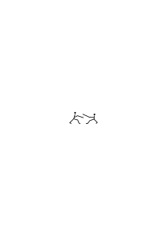”:

If in this picture the man on the right represents the person A and the one on the left designates the person B, then the whole might, for example, say “A is fencing with B”. The sentence in pictorial script can be true or false. It has a sense independently of its truth or falsity. It must be possible to demonstrate everything essential by means of it.

### [Ms-101](/ms-101/#29r.2) [29r\[2\]](https://cdn.wittgensteinnachlass.com/2000px/webp/Ms-101/29r.webp)

One can say that although we are not certain that we can put all states of affairs on paper in pictures, we are certain that we can depict all the _logical_ properties of states of affairs in a two-dimensional script.

### [Ms-101](/ms-101/#29r.3) [29r\[3\]](https://cdn.wittgensteinnachlass.com/2000px/webp/Ms-101/29r.webp)

We are still very much on the surface here, but we have presumably struck a good vein.

### [Ms-101](/ms-101/#29r.4+30r.1) [29r\[4\]](https://cdn.wittgensteinnachlass.com/2000px/webp/Ms-101/29r.webp),[30r\[1\]](https://cdn.wittgensteinnachlass.com/2000px/webp/Ms-101/30r.webp)

30.09.1914

One can say that in our picture the figure on the right represents something, and so does the one on the left, _but_ even if this were not the case, their position relative to one another could represent something. (Namely a relation)

### [Ms-101](/ms-101/#30r.2) [30r\[2\]](https://cdn.wittgensteinnachlass.com/2000px/webp/Ms-101/30r.webp)

A picture can represent relations that do not exist!!! How is this possible?

### [Ms-101](/ms-101/#30r.3) [30r\[3\]](https://cdn.wittgensteinnachlass.com/2000px/webp/Ms-101/30r.webp)

Now it seems again as though all relations had to be logical for their existence to be guaranteed by that of the sign.

### [Ms-101](/ms-101/#30r.4) [30r\[4\]](https://cdn.wittgensteinnachlass.com/2000px/webp/Ms-101/30r.webp)

02.10.1914

What connects a & c in “aRb ∙ bSc” is not the “ ∙ ” sign but _the occurrence of the same letter_ “b” in the two simple sentences.

### [Ms-101](/ms-101/#30r.5) [30r\[5\]](https://cdn.wittgensteinnachlass.com/2000px/webp/Ms-101/30r.webp)

One can say outright:

instead of “this sentence has such & such a sense”: “this sentence represents such & such a state of affairs!”

### [Ms-101](/ms-101/#31r.1) [31r\[1\]](https://cdn.wittgensteinnachlass.com/2000px/webp/Ms-101/31r.webp)

It depicts it logically.

### [Ms-101](/ms-101/#31r.2) [31r\[2\]](https://cdn.wittgensteinnachlass.com/2000px/webp/Ms-101/31r.webp)

Only in this way can _the sentence_ be true or false: it can agree or fail to agree with reality only by being _a picture_ of a state of affairs.

### [Ms-101](/ms-101/#31r.3) [31r\[3\]](https://cdn.wittgensteinnachlass.com/2000px/webp/Ms-101/31r.webp)

03.10.1914

The sentence is a picture of a state of affairs only *insofar* as it is logically articulated! (A simple – unarticulated – sign can be neither true nor false.)

### [Ms-101](/ms-101/#31r.4) [31r\[4\]](https://cdn.wittgensteinnachlass.com/2000px/webp/Ms-101/31r.webp)

The _name_ is _not_ a picture of what is named!

### [Ms-101](/ms-101/#31r.5) [31r\[5\]](https://cdn.wittgensteinnachlass.com/2000px/webp/Ms-101/31r.webp)

The sentence _says something only insofar_ as it is _a picture_!

### [Ms-101](/ms-101/#31r.6+32r.1) [31r\[6\]](https://cdn.wittgensteinnachlass.com/2000px/webp/Ms-101/31r.webp),[32r\[1\]](https://cdn.wittgensteinnachlass.com/2000px/webp/Ms-101/32r.webp)

Tautologies say nothing; they are not pictures of states of affairs: they are themselves logically completely neutral. (The logical product of a tautology and a sentence says neither more nor less than the sentence alone.)

### [Ms-101](/ms-101/#32r.2) [32r\[2\]](https://cdn.wittgensteinnachlass.com/2000px/webp/Ms-101/32r.webp)

04.10.1914

It is clear that the element designating a relation can be contained in “xRy” even if “x” & “y” do not designate anything. And then the relation is the only thing designated in that sign.

### [Ms-101](/ms-101/#32r.3) [32r\[3\]](https://cdn.wittgensteinnachlass.com/2000px/webp/Ms-101/32r.webp)

But how is it then possible that in a code “Kilo” means “I am well”? Here surely a _simple sign_ says something and is used to communicate something to others!! –

### [Ms-101](/ms-101/#32r.4) [32r\[4\]](https://cdn.wittgensteinnachlass.com/2000px/webp/Ms-101/32r.webp)

Can’t the _word_ “Kilo” be true or false in the meaning just given?!

### [Ms-101](/ms-101/#33r.1) [33r\[1\]](https://cdn.wittgensteinnachlass.com/2000px/webp/Ms-101/33r.webp)

05.10.1914

In any case, one can surely correlate a simple sign with the sense of a sentence. –

### [Ms-101](/ms-101/#33r.2) [33r\[2\]](https://cdn.wittgensteinnachlass.com/2000px/webp/Ms-101/33r.webp)

Logic is interested only in reality. Hence in sentences _only_ insofar as they are _pictures_ of reality.

### [Ms-101](/ms-101/#33r.3) [33r\[3\]](https://cdn.wittgensteinnachlass.com/2000px/webp/Ms-101/33r.webp)

But how _can a word_ be true or false? In any case it cannot express the _thought_ that agrees or fails to agree with reality. That must surely be articulated!

### [Ms-101](/ms-101/#33r.4) [33r\[4\]](https://cdn.wittgensteinnachlass.com/2000px/webp/Ms-101/33r.webp)

A word cannot be true or false in _the_ sense that it cannot agree with reality, or the opposite.

### [Ms-101](/ms-101/#33r.5+34r.1) [33r\[5\]](https://cdn.wittgensteinnachlass.com/2000px/webp/Ms-101/33r.webp),[34r\[1\]](https://cdn.wittgensteinnachlass.com/2000px/webp/Ms-101/34r.webp)

06.10.1914

The general concept of two complexes, one of which can be the logical picture of the other, and hence in _one_ sense _is_.

### [Ms-101](/ms-101/#34r.2) [34r\[2\]](https://cdn.wittgensteinnachlass.com/2000px/webp/Ms-101/34r.webp)

The agreement of two complexes is evidently _internal_ and can therefore not be expressed but only shown.

### [Ms-101](/ms-101/#34r.3) [34r\[3\]](https://cdn.wittgensteinnachlass.com/2000px/webp/Ms-101/34r.webp)

“p” is true says nothing other than p!

“‘p’ is true” is – according to the above – only a pseudo-sentence, like all those combinations of signs which appear to say something that can only be shown.

### [Ms-101](/ms-101/#34r.4) [34r\[4\]](https://cdn.wittgensteinnachlass.com/2000px/webp/Ms-101/34r.webp)

07.10.1914

If a sentence φa is given, then all its logical functions (~φa etc.) are _already_ given with it!

### [Ms-101](/ms-101/#34r.5) [34r\[5\]](https://cdn.wittgensteinnachlass.com/2000px/webp/Ms-101/34r.webp)

08.10.1914

Complete and incomplete depiction of a state of affairs.

### [Ms-101](/ms-101/#35r.2) [35r\[2\]](https://cdn.wittgensteinnachlass.com/2000px/webp/Ms-101/35r.webp)

(Function and argument are depicted by function and argument.)

### [Ms-101](/ms-101/#35r.3) [35r\[3\]](https://cdn.wittgensteinnachlass.com/2000px/webp/Ms-101/35r.webp)

The expression “not further analysable” is also one of those on the blacklist alongside “function”, “thing” etc.; but how is what we want to express by it _shown_?

### [Ms-101](/ms-101/#35r.4) [35r\[4\]](https://cdn.wittgensteinnachlass.com/2000px/webp/Ms-101/35r.webp)

(One cannot, of course, say of either a thing or a complex that it is not further analysable.)

### [Ms-101](/ms-101/#35r.5+36r.1) [35r\[5\]](https://cdn.wittgensteinnachlass.com/2000px/webp/Ms-101/35r.webp),[36r\[1\]](https://cdn.wittgensteinnachlass.com/2000px/webp/Ms-101/36r.webp)

09.10.1914

If there were an immediate correlation of relations, the question would be: how then are the things that stand in these relations correlated with one another?, is there a direct correlation of relations without regard to their _sense_?

### [Ms-101](/ms-101/#36r.2) [36r\[2\]](https://cdn.wittgensteinnachlass.com/2000px/webp/Ms-101/36r.webp)

Might we not simply be misled into assuming “relations between relations” by the apparent analogy between the expressions: “relations between things”

and “relations between relations”?

### [Ms-101](/ms-101/#36r.3) [36r\[3\]](https://cdn.wittgensteinnachlass.com/2000px/webp/Ms-101/36r.webp)

_I am making some fundamental mistake somewhere in all these considerations_.

### [Ms-101](/ms-101/#36r.4) [36r\[4\]](https://cdn.wittgensteinnachlass.com/2000px/webp/Ms-101/36r.webp)

The question of the possibility of existential sentences comes not in the middle of logic but at its very beginning.

### [Ms-101](/ms-101/#36r.5) [36r\[5\]](https://cdn.wittgensteinnachlass.com/2000px/webp/Ms-101/36r.webp)

All the problems that the ax. of inf. brings with it are already to be solved in the sentence “(∃x) x = x”!

### [Ms-101](/ms-101/#36r.6) [36r\[6\]](https://cdn.wittgensteinnachlass.com/2000px/webp/Ms-101/36r.webp)

10.10.1914

Often one makes a remark and only later sees _how_ true it is.

### [Ms-101](/ms-101/#37r.1) [37r\[1\]](https://cdn.wittgensteinnachlass.com/2000px/webp/Ms-101/37r.webp)

11.10.1914

Our difficulty now lies in the fact that, to all appearances, analysability or its opposite is not mirrored in language. That is to say: it seems that we can _not_ tell from language alone whether, for example, there are actual subject-predicate facts or not. But how _could_ we _express_ this fact or its opposite? _This_ _must be shown_!

### [Ms-101](/ms-101/#37r.2+38r.1) [37r\[2\]](https://cdn.wittgensteinnachlass.com/2000px/webp/Ms-101/37r.webp),[38r\[1\]](https://cdn.wittgensteinnachlass.com/2000px/webp/Ms-101/38r.webp)

But what if we took no notice at all of the question of analysability? (We would then work with signs that designate nothing, but merely _help_ to express through their logical properties.) For the unanalysed sentence too mirrors logical properties of its meaning. So what if we said: that a sentence is further analysable shows itself when we analyse it further by means of definitions, and in any case we work with it just as if it were unanalysable.

### [Ms-101](/ms-101/#38r.2) [38r\[2\]](https://cdn.wittgensteinnachlass.com/2000px/webp/Ms-101/38r.webp)

Remember that the “sentences about _infinite_ cardinalities” are all represented by _finite_ signs!

### [Ms-101](/ms-101/#38r.3) [38r\[3\]](https://cdn.wittgensteinnachlass.com/2000px/webp/Ms-101/38r.webp)

But do we not need – at least on Frege’s method – a hundred million signs to define the number 100.000.000? (Does it not matter here whether it is applied to classes or to things?)

### [Ms-101](/ms-101/#38r.4+39r.1) [38r\[4\]](https://cdn.wittgensteinnachlass.com/2000px/webp/Ms-101/38r.webp),[39r\[1\]](https://cdn.wittgensteinnachlass.com/2000px/webp/Ms-101/39r.webp)

One can obtain the sentences dealing with infinite numbers, like _all_ sentences of logic, by calculating the signs themselves (for at no point is any foreign element added to the original primitive signs), so here too the signs must themselves have all the logical properties of what is represented.

### [Ms-101](/ms-101/#39r.2) [39r\[2\]](https://cdn.wittgensteinnachlass.com/2000px/webp/Ms-101/39r.webp)

12.10.1914

The trivial fact that a completely analysed sentence contains as many names as its meaning contains things, this fact is an example of the all-encompassing representation of the world by language.

### [Ms-101](/ms-101/#39r.3) [39r\[3\]](https://cdn.wittgensteinnachlass.com/2000px/webp/Ms-101/39r.webp)

One ought now to examine the definitions of the cardinal numbers more closely in order to understand the actual sense of sentences such as the ax. of inf.

### [Ms-101](/ms-101/#39r.4) [39r\[4\]](https://cdn.wittgensteinnachlass.com/2000px/webp/Ms-101/39r.webp)

13.10.1914

Logic takes care of itself; we need only watch how it does it.

### [Ms-101](/ms-101/#39r.5+40r.1) [39r\[5\]](https://cdn.wittgensteinnachlass.com/2000px/webp/Ms-101/39r.webp),[40r\[1\]](https://cdn.wittgensteinnachlass.com/2000px/webp/Ms-101/40r.webp)

Let us consider the sentence: “There is a class with only one member”. Or, what comes to the same thing, the sentence: 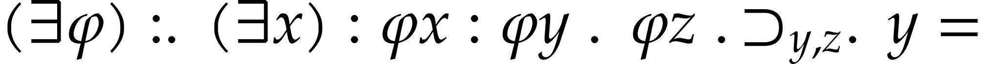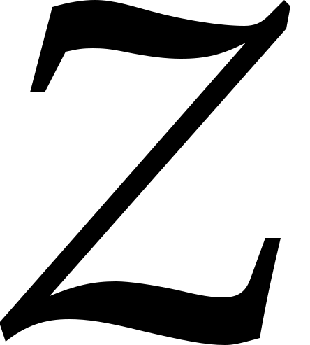

In the case of “(∃x)x = x” one could understand that it was tautological, since it could not be written down at all if it were false, but here! _This_ sentence can be investigated in place of the ax. of inf.!

### [Ms-101](/ms-101/#40r.2) [40r\[2\]](https://cdn.wittgensteinnachlass.com/2000px/webp/Ms-101/40r.webp)

I know that the following sentences as they stand are nonsensical: Can one speak of numbers if there are only things? If, then, for example, the world consisted of just one thing and nothing else, could one say that there was _one_ thing? Russell would probably say: if there is one thing, then there is also the function (∃x) ξ̂ = x. But! –

### [Ms-101](/ms-101/#40r.3+41r.1) [40r\[3\]](https://cdn.wittgensteinnachlass.com/2000px/webp/Ms-101/40r.webp),[41r\[1\]](https://cdn.wittgensteinnachlass.com/2000px/webp/Ms-101/41r.webp)

If this function will not do, then one can speak of 1 only if there is a material function that is satisfied by only one argument.

### [Ms-101](/ms-101/#41r.2) [41r\[2\]](https://cdn.wittgensteinnachlass.com/2000px/webp/Ms-101/41r.webp)

What about sentences like:

(∃φ) . (∃x) ․φ(x)

and:

(∃φ) . (∃x) . ~φ(x)?

Is either of these a tautology? Are these sentences of a science, i.e. are these _sentences_ at all?

### [Ms-101](/ms-101/#41r.3) [41r\[3\]](https://cdn.wittgensteinnachlass.com/2000px/webp/Ms-101/41r.webp)

But let us remember that it is the _variable_ & _not_ the sign of generality that characterizes logic!

### [Ms-101](/ms-101/#41r.4+42r.1) [41r\[4\]](https://cdn.wittgensteinnachlass.com/2000px/webp/Ms-101/41r.webp),[42r\[1\]](https://cdn.wittgensteinnachlass.com/2000px/webp/Ms-101/42r.webp)

14.10.1914

Is there, then, a science of completely generalized sentences? This sounds highly improbable. _This is clear_: if there are completely generalized _sentences_, then their sense no longer depends on any arbitrary assignment of signs! But then such a combination of signs can represent the world only through its own logical properties, i.e. it cannot be false, & cannot be true. So there are no completely generalized _sentences_. But now for the application!

### [Ms-101](/ms-101/#42r.2) [42r\[2\]](https://cdn.wittgensteinnachlass.com/2000px/webp/Ms-101/42r.webp)

But now consider the sentences: “(∃φ,x) ․φ(x)” and “~(∃φ,x) . φ(x)”

Which of them is tautological, which contradictory?

### [Ms-101](/ms-101/#42r.3+43r.1) [42r\[3\]](https://cdn.wittgensteinnachlass.com/2000px/webp/Ms-101/42r.webp),[43r\[1\]](https://cdn.wittgensteinnachlass.com/2000px/webp/Ms-101/43r.webp)

Again and again the need arises to set out sentences that stand in internal relations side by side for comparison. One could even make illustrative plates for this book. (The tautology _shows_ what it appears to _say_; the contradiction shows _the opposite_ of what it appears to say.)

### [Ms-101](/ms-101/#43r.2) [43r\[2\]](https://cdn.wittgensteinnachlass.com/2000px/webp/Ms-101/43r.webp)

It is clear that we can form all possible completely general sentences as soon as we are given just _one language_. And that is why it is scarcely credible that such combinations of signs should really say anything about the world. – But on the other hand, this gradual transition from the elementary sentence to the completely general one!!

### [Ms-101](/ms-101/#43r.3) [43r\[3\]](https://cdn.wittgensteinnachlass.com/2000px/webp/Ms-101/43r.webp)

One can say: one can form all completely general sentences _a priori_.

### [Ms-101](/ms-101/#43r.4+44r.1) [43r\[4\]](https://cdn.wittgensteinnachlass.com/2000px/webp/Ms-101/43r.webp),[44r\[1\]](https://cdn.wittgensteinnachlass.com/2000px/webp/Ms-101/44r.webp)

15.10.1914

It does seem as though the mere existence of the forms contained in “(∃x,φ)․φx” could _not by itself_ determine the truth or falsity of this sentence! So it does not seem *unthink*able that, for example, the negation of no elementary sentence is true. But would this statement not already concern the _sense of negation_?

### [Ms-101](/ms-101/#44r.2) [44r\[2\]](https://cdn.wittgensteinnachlass.com/2000px/webp/Ms-101/44r.webp)

Evidently we can construe every completely general sentence as the affirmation or negation of the existence of some kind of fact. But does this not hold of all sentences?

### [Ms-101](/ms-101/#44r.3) [44r\[3\]](https://cdn.wittgensteinnachlass.com/2000px/webp/Ms-101/44r.webp)

Every combination of signs that appears to say something about its own sense is a pseudo-sentence (like all the sentences of logic).

### [Ms-101](/ms-101/#44r.4+45r.1) [44r\[4\]](https://cdn.wittgensteinnachlass.com/2000px/webp/Ms-101/44r.webp),[45r\[1\]](https://cdn.wittgensteinnachlass.com/2000px/webp/Ms-101/45r.webp)

The sentence is supposed to provide a logical model of a state of affairs. But surely it can do this only because objects have been arbitrarily correlated with its elements. Now, if this is not the case in the completely general sentence, one cannot see how it is supposed to represent anything outside itself.

### [Ms-101](/ms-101/#45r.2) [45r\[2\]](https://cdn.wittgensteinnachlass.com/2000px/webp/Ms-101/45r.webp)

In the sentence we put things together – so to speak – _by way of trial_, in a way they need _not_ be related in reality, but we cannot put together anything _illogical_, for to do that we would have to be able to get outside logic in language. – But if the completely general sentence contains _only_ “logical constants”, it can be no more to us than – simply – a logical construction and can do no more than show us its own logical properties. – If there are completely general sentences, – _what_ do we put together in them by way of trial??

### [Ms-101](/ms-101/#46r.1) [46r\[1\]](https://cdn.wittgensteinnachlass.com/2000px/webp/Ms-101/46r.webp)

If one is afraid of the truth (as I am now), one never has an inkling of the _full_ truth.

### [Ms-101](/ms-101/#46r.2) [46r\[2\]](https://cdn.wittgensteinnachlass.com/2000px/webp/Ms-101/46r.webp)

Here I have regarded the relations of the elements of the sentence to their meanings as, so to speak, feelers by which the sentence is in contact with the external world; and generalizing a sentence then resembles drawing in the feelers, until at last the completely general sentence is completely isolated. But is this picture right? (Do I really draw in a feeler when I say (∃x).φ(x) instead of φ(a)?)

### [Ms-101](/ms-101/#46r.3+47r.1) [46r\[3\]](https://cdn.wittgensteinnachlass.com/2000px/webp/Ms-101/46r.webp),[47r\[1\]](https://cdn.wittgensteinnachlass.com/2000px/webp/Ms-101/47r.webp)

16.10.1914

But now it seems as though exactly the same grounds that I cited to show that “(∃x,φ) . φ(x)” _could_ not be false, as though these grounds also supported the view that “~ (∃x,φ) . φ(x)” could not be false; and here a fundamental mistake shows itself. For it is quite impossible to see why it should be the first sentence & not the second that is a tautology. Do not forget that the contradiction “p ∙ ~p” etc. etc. cannot be true either & yet is itself a logical construction.

### [Ms-101](/ms-101/#47r.2) [47r\[2\]](https://cdn.wittgensteinnachlass.com/2000px/webp/Ms-101/47r.webp)

Supposing that no negation of an elementary sentence is true, does “negation” not have a different sense in this case than in the opposite case?

### [Ms-101](/ms-101/#47r.3) [47r\[3\]](https://cdn.wittgensteinnachlass.com/2000px/webp/Ms-101/47r.webp)

_“(∃φ):(x)․φx”_ – it seems almost certain that this sentence is neither a tautology nor a contradiction. Here the problem becomes extraordinarily acute.

### [Ms-101](/ms-101/#47r.4+48r.1) [47r\[4\]](https://cdn.wittgensteinnachlass.com/2000px/webp/Ms-101/47r.webp),[48r\[1\]](https://cdn.wittgensteinnachlass.com/2000px/webp/Ms-101/48r.webp)

17.10.1914

If there are completely general sentences, it therefore seems as though such sentences were trial arrangements of “logical constants”. (!)

### [Ms-101](/ms-101/#48r.2) [48r\[2\]](https://cdn.wittgensteinnachlass.com/2000px/webp/Ms-101/48r.webp)

But can one not describe the whole world completely with completely general sentences? (The problem shows itself from all sides.) Yes, one could describe the world completely by means of completely general sentences, thus without using any name or any other designating sign at all. And to get to ordinary language one would only need to introduce names etc. by saying, after an “(∃x)”, “and this x is A”, and so on.

### [Ms-101](/ms-101/#48r.3) [48r\[3\]](https://cdn.wittgensteinnachlass.com/2000px/webp/Ms-101/48r.webp)

One can thus draw up a picture of the world without saying what represents what.

### [Ms-101](/ms-101/#49r.1) [49r\[1\]](https://cdn.wittgensteinnachlass.com/2000px/webp/Ms-101/49r.webp)

Let us suppose, for example, that the world consisted of the things A and B and the property F, and that F(A) was the case and F(B) was not.

We could also describe this world by means of the following sentences: (∃x,y) . (∃φ) . x ≠ y . φx․~φy. φu . φz ․⊃․ u = z (∃φ)․(ψ)․ψ = φ (∃x,y)․(z).z = x⌵z = y

And here one also needs sentences of the kind exemplified by the last two just to be able to identify the objects.

### [Ms-101](/ms-101/#49r.2) [49r\[2\]](https://cdn.wittgensteinnachlass.com/2000px/webp/Ms-101/49r.webp)

From all this it follows, of course, that there _are completely general sentences_!

### [Ms-101](/ms-101/#49r.3+50r.1) [49r\[3\]](https://cdn.wittgensteinnachlass.com/2000px/webp/Ms-101/49r.webp),[50r\[1\]](https://cdn.wittgensteinnachlass.com/2000px/webp/Ms-101/50r.webp)

Does the first sentence above, (∃x,y,φ) φx․~φy ∙ x ≠ y, not suffice? One can remove the difficulty of identification by describing the whole world in _one_ general sentence beginning “(∃x,y,z… φ,ψ…RSetc.)”, and then a logical product follows, etc.

### [Ms-101](/ms-101/#50r.2) [50r\[2\]](https://cdn.wittgensteinnachlass.com/2000px/webp/Ms-101/50r.webp)

If we say “φ is a unit function and (x).φx”, this amounts to saying: “there is only one thing”! (We have thereby _apparently_ got round the sentence “(∃x) . (y) . y = x”.)

### [Ms-101](/ms-101/#50r.3) [50r\[3\]](https://cdn.wittgensteinnachlass.com/2000px/webp/Ms-101/50r.webp)

18.10.1914

My mistake evidently lies in a false conception of logical depiction by the sentence.

### [Ms-101](/ms-101/#50r.4+51r.1) [50r\[4\]](https://cdn.wittgensteinnachlass.com/2000px/webp/Ms-101/50r.webp),[51r\[1\]](https://cdn.wittgensteinnachlass.com/2000px/webp/Ms-101/51r.webp)

A statement cannot concern the logical structure of the world, for in order for a statement to be possible at all, for a sentence to _be able_ to have _sense_, the world must already have the logical structure it does have. The logic of the world is prior to all truth & falsity.

_Incidentally_: before any sentence can have sense at all, the _logical_ constants must have meaning.

### [Ms-101](/ms-101/#51r.2) [51r\[2\]](https://cdn.wittgensteinnachlass.com/2000px/webp/Ms-101/51r.webp)

19.10.1914

The description of the world by sentences is possible only because what is designated is not its own sign! Application –.

### [Ms-101](/ms-101/#51r.3) [51r\[3\]](https://cdn.wittgensteinnachlass.com/2000px/webp/Ms-101/51r.webp)

Kant’s question “how is pure mathematics possible” illuminated by the theory of tautologies!

### [Ms-101](/ms-101/#51r.4) [51r\[4\]](https://cdn.wittgensteinnachlass.com/2000px/webp/Ms-101/51r.webp)

It is clear that one must be able to describe the structure of the world without _naming_ any _names_.

### [Ms-101](/ms-101/#52r.1) [52r\[1\]](https://cdn.wittgensteinnachlass.com/2000px/webp/Ms-101/52r.webp)

20.10.1914

From the sentence one must be able to discern the logical structure of the state of affairs that makes it true or false. (Just as a picture must show what spatial relations the things depicted in it must stand in if the picture is right (true).)

### [Ms-101](/ms-101/#52r.2) [52r\[2\]](https://cdn.wittgensteinnachlass.com/2000px/webp/Ms-101/52r.webp)

One could call the form of a picture that in which the picture _must_ agree with reality (in order to be able to depict it at all).

### [Ms-101](/ms-101/#52r.3) [52r\[3\]](https://cdn.wittgensteinnachlass.com/2000px/webp/Ms-101/52r.webp)

The theory of logical depiction by language is the first to shed light on the essence of the truth-relation.

### [Ms-101](/ms-101/#52r.4+53r.1) [52r\[4\]](https://cdn.wittgensteinnachlass.com/2000px/webp/Ms-101/52r.webp),[53r\[1\]](https://cdn.wittgensteinnachlass.com/2000px/webp/Ms-101/53r.webp)

The theory of logical depiction by language says – quite generally: in order for it to be possible for a sentence to be true or false – for it to agree with reality or not – something in the sentence must be _identical_ with reality.

### [Ms-101](/ms-101/#53r.2) [53r\[2\]](https://cdn.wittgensteinnachlass.com/2000px/webp/Ms-101/53r.webp)

What negates in “~p” is not the “~” before the “p” but what is common to all the signs that have the same meaning as “~p” in this notation; hence what is common to

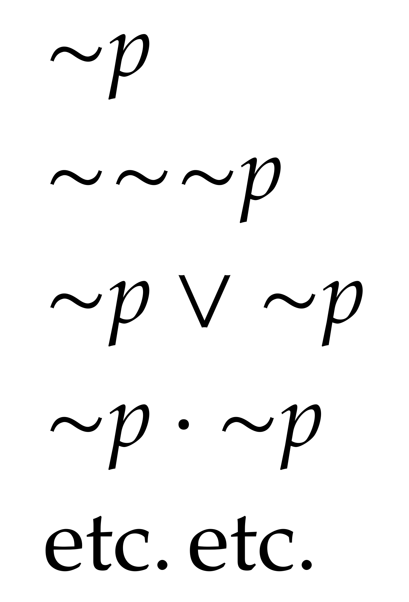

and the same holds for the sign of generality, etc..

### [Ms-101](/ms-101/#53r.3) [53r\[3\]](https://cdn.wittgensteinnachlass.com/2000px/webp/Ms-101/53r.webp)

Pseudo-sentences are those that, when analysed, once again merely _show_ what they were supposed to _say_.

### [Ms-101](/ms-101/#54r.1) [54r\[1\]](https://cdn.wittgensteinnachlass.com/2000px/webp/Ms-101/54r.webp)

The feeling that the sentence describes a complex in the manner of Russell’s descriptions now proves justified: the sentence describes the complex through its logical properties.

### [Ms-101](/ms-101/#54r.2) [54r\[2\]](https://cdn.wittgensteinnachlass.com/2000px/webp/Ms-101/54r.webp)

The sentence constructs a world with the aid of its logical scaffolding, and that is why one can also see from the sentence how everything logical would stand if it were true: one can _draw inferences_ from a false sentence, etc. Thus I can see that if “(x,φ). φ(x)” were true, this sentence would stand in contradiction to a sentence “ψ(a)”.)

### [Ms-101](/ms-101/#54r.3+55r.1) [54r\[3\]](https://cdn.wittgensteinnachlass.com/2000px/webp/Ms-101/54r.webp),[55r\[1\]](https://cdn.wittgensteinnachlass.com/2000px/webp/Ms-101/55r.webp)

That one can infer completely general sentences from material sentences – that the former can stand in *meaning*ful internal relations to the latter – shows that the completely general sentences are logical constructions of states of affairs.

### [Ms-101](/ms-101/#55r.2) [55r\[2\]](https://cdn.wittgensteinnachlass.com/2000px/webp/Ms-101/55r.webp)

21.10.1914

Is Russell’s definition of zero not nonsensical? Can one speak at all of a class x̂ (x ≠ x)? – Can one, then, speak of a class _x̂ (x = x)_? Is x ≠ x or x = x a function of x?? – Must zero not be defined by the _hypothesis_ (∃φ):(x)~φx? And something analogous would hold for all the other numbers. Now this sheds light on the whole question of the existence of numbers of things.

### [Ms-101](/ms-101/#55r.3) [55r\[3\]](https://cdn.wittgensteinnachlass.com/2000px/webp/Ms-101/55r.webp)

0 = α̂ {(∃φ):(x)~φx ․α = û (φu)} Def

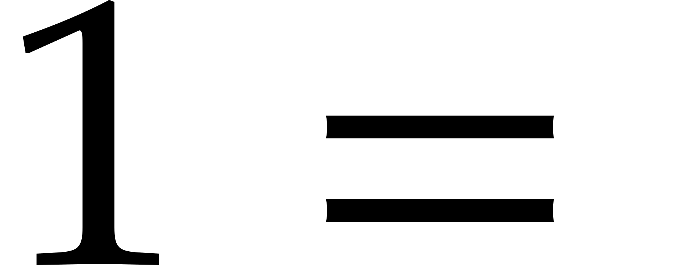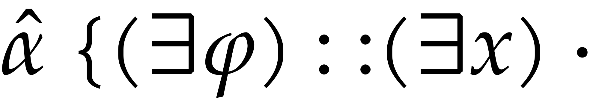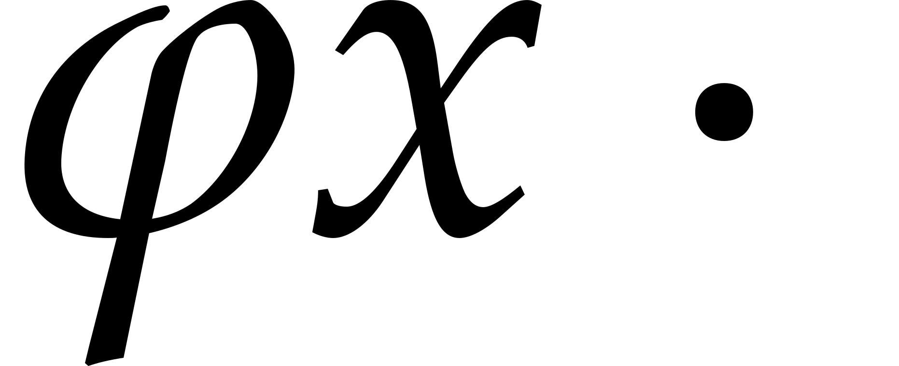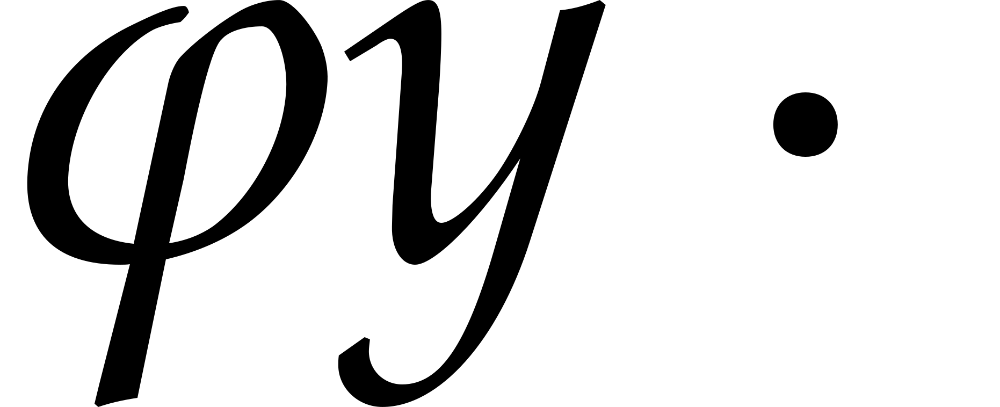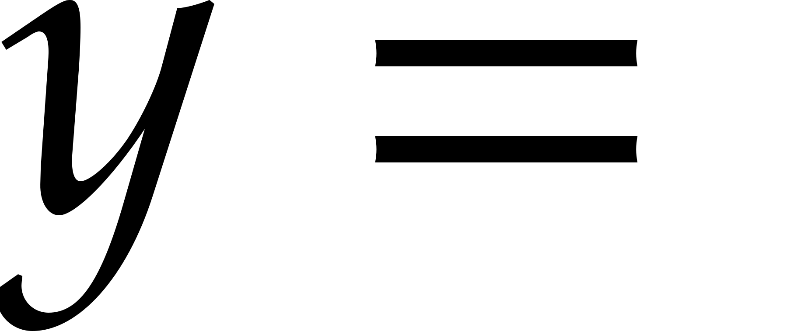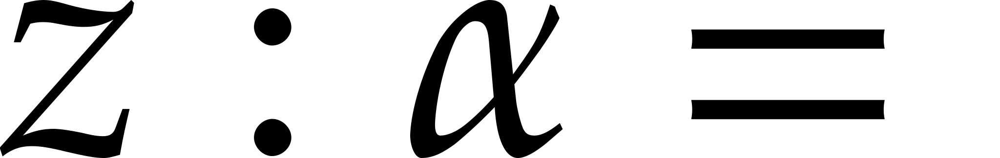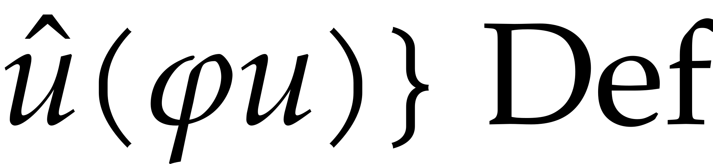

[One could _avoid_ the equals sign inside the braces by writing

0 = û (φu) {(∃φ) : (x)~φx}.]

### [Ms-101](/ms-101/#56r.1) [56r\[1\]](https://cdn.wittgensteinnachlass.com/2000px/webp/Ms-101/56r.webp)

The sentence must _contain the possibility of its truth_ (and so show it). But no more than the _possibility_.

### [Ms-101](/ms-101/#56r.2) [56r\[2\]](https://cdn.wittgensteinnachlass.com/2000px/webp/Ms-101/56r.webp)

According to my definition of classes, (x).~ x̂(φx) is the statement that x̂(φx) is zero, and the definition of zero is then 0 = α̂ [(x).~α] Def.

### [Ms-101](/ms-101/#56r.3) [56r\[3\]](https://cdn.wittgensteinnachlass.com/2000px/webp/Ms-101/56r.webp)

I thought that the possibility of a proposition φ(a) being true was bound up with the fact (∃x,φ) ․φx. But it is not clear why φa should be possible only if there is another proposition of the same form. Surely φa needs no precedent. (For suppose there were only the two elementary propositions “φa” & “ψa” and that “φa” were false: why should this proposition have a sense only if “ψa” is true?!)

### [Ms-101](/ms-101/#56r.4+57r.1+58r.1) [56r\[4\]](https://cdn.wittgensteinnachlass.com/2000px/webp/Ms-101/56r.webp),[57r\[1\]](https://cdn.wittgensteinnachlass.com/2000px/webp/Ms-101/57r.webp),[58r\[1\]](https://cdn.wittgensteinnachlass.com/2000px/webp/Ms-101/58r.webp)

22.10.1914

Something in the proposition must be identical with its meaning, but the proposition must not be identical with its meaning, so something in it must _not_ be identical with its meaning. (The proposition is a structure with the logical features of what is represented and with other features besides; these latter will be arbitrary and will differ in different sign-languages.) So there must be different structures with the same logical features; what is represented will be one of these, and in representing it the task will be to distinguish it from other structures with the same logical features (for otherwise the representation would be ambiguous). This part of the representation (the giving of names) must therefore be effected by arbitrary stipulations. Accordingly, every proposition must contain features whose meanings are arbitrarily determined.

### [Ms-101](/ms-101/#58r.2) [58r\[2\]](https://cdn.wittgensteinnachlass.com/2000px/webp/Ms-101/58r.webp)

If one tries to apply this to completely general propositions, it seems that there is some fundamental error in it.

### [Ms-101](/ms-101/#58r.3) [58r\[3\]](https://cdn.wittgensteinnachlass.com/2000px/webp/Ms-101/58r.webp)

The generality of the completely general proposition is contingent generality. It is about all the things that happen to exist. And that is why it is a material proposition.

### [Ms-101](/ms-101/#58r.4) [58r\[4\]](https://cdn.wittgensteinnachlass.com/2000px/webp/Ms-101/58r.webp)

23.10.1914

On the one hand my theory of logical depiction seems to be the only possible one; on the other hand there seems to be an insoluble contradiction in it!

### [Ms-101](/ms-101/#58r.5) [58r\[5\]](https://cdn.wittgensteinnachlass.com/2000px/webp/Ms-101/58r.webp)

If the completely general proposition is not completely dematerialized, then presumably a proposition is not dematerialized at all by generalization, as I believed it was.

### [Ms-101](/ms-101/#59r.1) [59r\[1\]](https://cdn.wittgensteinnachlass.com/2000px/webp/Ms-101/59r.webp)

Whether I state something about a particular thing or about all the things that exist, the statement is equally material.

### [Ms-101](/ms-101/#59r.2) [59r\[2\]](https://cdn.wittgensteinnachlass.com/2000px/webp/Ms-101/59r.webp)

“All things” is, so to speak, a description in place of “a & b & c”.

### [Ms-101](/ms-101/#59r.3) [59r\[3\]](https://cdn.wittgensteinnachlass.com/2000px/webp/Ms-101/59r.webp)

What if our signs were as indeterminate as the world they mirror?

### [Ms-101](/ms-101/#59r.4) [59r\[4\]](https://cdn.wittgensteinnachlass.com/2000px/webp/Ms-101/59r.webp)

To recognize the sign in the sign one must attend to its use.

### [Ms-101](/ms-101/#59r.5+60r.1) [59r\[5\]](https://cdn.wittgensteinnachlass.com/2000px/webp/Ms-101/59r.webp),[60r\[1\]](https://cdn.wittgensteinnachlass.com/2000px/webp/Ms-101/60r.webp)

If we wanted to express what we express by “(x).φ(x)” by putting an index in front of “φ(x)”, say like this: “Allg.φ(x)”, it would not suffice (we would not know what had been generalized).

If we wanted to indicate it by an index attached to “x”, say like this: 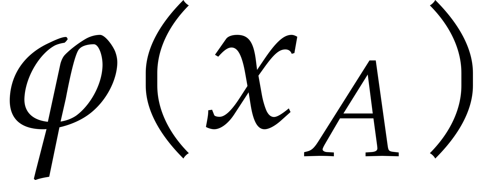 it would not suffice either (in this way we would not know the scope of the generality.).

If we wanted to try putting a mark in the empty argument places, say like this: “(A,A)․ψ(A,A)”, it would not suffice (we could not establish the identity of the variables). All these modes of designation fail to suffice _because they do not have the necessary logical properties_. None of those combinations of signs can depict the desired sense – in the way proposed.

### [Ms-101](/ms-101/#60r.2) [60r\[2\]](https://cdn.wittgensteinnachlass.com/2000px/webp/Ms-101/60r.webp)

24.10.1914

To be able to make a statement at all we must – in one sense – know how things stand if the statement is true (and this is precisely what we depict).

### [Ms-101](/ms-101/#60r.3+61r.1) [60r\[3\]](https://cdn.wittgensteinnachlass.com/2000px/webp/Ms-101/60r.webp),[61r\[1\]](https://cdn.wittgensteinnachlass.com/2000px/webp/Ms-101/61r.webp)

The proposition _expresses_ what I do not know; but what I must nevertheless know to be able to state it at all, _I show in it_.

### [Ms-101](/ms-101/#61r.2) [61r\[2\]](https://cdn.wittgensteinnachlass.com/2000px/webp/Ms-101/61r.webp)

The definition is a tautology and shows internal relations between its two terms!

### [Ms-101](/ms-101/#61r.3) [61r\[3\]](https://cdn.wittgensteinnachlass.com/2000px/webp/Ms-101/61r.webp)

25.10.1914

But why do you never examine a single particular sign to see the way & manner in which it depicts logically?

### [Ms-101](/ms-101/#61r.4) [61r\[4\]](https://cdn.wittgensteinnachlass.com/2000px/webp/Ms-101/61r.webp)

The completely analysed proposition must present its meaning.

### [Ms-101](/ms-101/#61r.5+62r.1) [61r\[5\]](https://cdn.wittgensteinnachlass.com/2000px/webp/Ms-101/61r.webp),[62r\[1\]](https://cdn.wittgensteinnachlass.com/2000px/webp/Ms-101/62r.webp)

One could also say that our difficulty comes down to this: the completely general proposition does not seem to be composite. –.

It does not seem to consist, as all other propositions do, of constituents which designate arbitrarily and are united in a logical form. It seems not to _have_ a form but to be itself a self-contained form.

### [Ms-101](/ms-101/#62r.2) [62r\[2\]](https://cdn.wittgensteinnachlass.com/2000px/webp/Ms-101/62r.webp)

One never needs to ask about the existence of the logical constants; after all, they can also _disappear_!

### [Ms-101](/ms-101/#62r.3) [62r\[3\]](https://cdn.wittgensteinnachlass.com/2000px/webp/Ms-101/62r.webp)

Why should “φ(x̂)” not present how things stand when (x).φx is the case? Does it not depend _only_ on _how_ – in what way & manner – that sign presents something?

### [Ms-101](/ms-101/#62r.4) [62r\[4\]](https://cdn.wittgensteinnachlass.com/2000px/webp/Ms-101/62r.webp)

Suppose I wanted to represent four pairs of men fighting; could I not do it by representing just one and saying: “_that_ is what all four _look like_”? (By adding this sentence I determine the way & manner of the representation.) (Similarly I represent (x).φx by “φ(x̂)”.)

### [Ms-101](/ms-101/#62r.5+63r.1) [62r\[5\]](https://cdn.wittgensteinnachlass.com/2000px/webp/Ms-101/62r.webp),[63r\[1\]](https://cdn.wittgensteinnachlass.com/2000px/webp/Ms-101/63r.webp)

Bear in mind that there are no hypothetical internal relations. If a structure is given and a structural relation to it, then there must be another structure which stands in that relation to the first. (This lies in the nature of structural relations.)

And this speaks for the correctness of the above remark; it is thereby no evasion.

### [Ms-101](/ms-101/#63r.2) [63r\[2\]](https://cdn.wittgensteinnachlass.com/2000px/webp/Ms-101/63r.webp)

26.10.1914

So it seems that what is needed is not the logical _identity_ of sign & what is designated, but only _an_ internal, _logical_, relation between the two. (The holding of such a relation implies, in a certain sense, the existence of a kind of fundamental – internal – identity.)

### [Ms-101](/ms-101/#63r.3+64r.1) [63r\[3\]](https://cdn.wittgensteinnachlass.com/2000px/webp/Ms-101/63r.webp),[64r\[1\]](https://cdn.wittgensteinnachlass.com/2000px/webp/Ms-101/64r.webp)

All that matters is that the logical features of what is designated are completely determined by the logical features of the sign & the mode of designation alone. Sign & mode of designation _together_ must be logically identical with what is designated.

### [Ms-101](/ms-101/#64r.2) [64r\[2\]](https://cdn.wittgensteinnachlass.com/2000px/webp/Ms-101/64r.webp)

The sense of the proposition is what it presents.

### [Ms-101](/ms-101/#64r.3) [64r\[3\]](https://cdn.wittgensteinnachlass.com/2000px/webp/Ms-101/64r.webp)

27.10.1914

“x = y” is _not_ a sentential form. (Consequences)

### [Ms-101](/ms-101/#64r.4) [64r\[4\]](https://cdn.wittgensteinnachlass.com/2000px/webp/Ms-101/64r.webp)

It is clear that “aRa” would have the same meaning as “aRb ∙ a = b”. So one can make the pseudo-proposition “a = b” disappear by using a completely analysed notation. Best proof of the correctness of the above remark.

### [Ms-101](/ms-101/#64r.5+65r.1) [64r\[5\]](https://cdn.wittgensteinnachlass.com/2000px/webp/Ms-101/64r.webp),[65r\[1\]](https://cdn.wittgensteinnachlass.com/2000px/webp/Ms-101/65r.webp)

Before my theory of logical depiction, the difficulty was to find a connection between the signs on paper & a state of affairs out in the world.

### [Ms-101](/ms-101/#65r.2) [65r\[2\]](https://cdn.wittgensteinnachlass.com/2000px/webp/Ms-101/65r.webp)

I always said that truth is a relation between the proposition & the state of affairs, but I could never find such a relation.

### [Ms-101](/ms-101/#65r.3) [65r\[3\]](https://cdn.wittgensteinnachlass.com/2000px/webp/Ms-101/65r.webp)

One could call the representation of the world by completely general propositions the impersonal representation of the world.

### [Ms-101](/ms-101/#65r.4) [65r\[4\]](https://cdn.wittgensteinnachlass.com/2000px/webp/Ms-101/65r.webp)

How is the impersonal representation of the world effected?

### [Ms-101](/ms-101/#65r.5) [65r\[5\]](https://cdn.wittgensteinnachlass.com/2000px/webp/Ms-101/65r.webp)

The proposition is a model of reality as we conceive it.

### [Ms-101](/ms-101/#65r.6+66r.1) [65r\[6\]](https://cdn.wittgensteinnachlass.com/2000px/webp/Ms-101/65r.webp),[66r\[1\]](https://cdn.wittgensteinnachlass.com/2000px/webp/Ms-101/66r.webp)

28.10.1914

What the pseudo-proposition “there are n things” seeks to express shows itself in language through the presence of n proper names with different meanings. (etc.)

### [Ms-101](/ms-101/#66r.2) [66r\[2\]](https://cdn.wittgensteinnachlass.com/2000px/webp/Ms-101/66r.webp)

What the completely general propositions describe are indeed, in a certain sense, structural properties of the world. Nevertheless, these propositions can still be true or false. Even once they _have sense_, the world still has that latitude.

After all, the truth or falsity of _every_ proposition makes some difference to the general _structure_ of the world. And the latitude left to its structure by the _totality_ of all elementary propositions is precisely what the completely general propositions delimit.

### [Ms-101](/ms-101/#66r.3+67r.1) [66r\[3\]](https://cdn.wittgensteinnachlass.com/2000px/webp/Ms-101/66r.webp),[67r\[1\]](https://cdn.wittgensteinnachlass.com/2000px/webp/Ms-101/67r.webp)

29.10.1914

For if an elementary proposition is true, then at any rate there is _one more_ elementary proposition that is true, and vice versa.

### [Ms-101](/ms-101/#67r.2) [67r\[2\]](https://cdn.wittgensteinnachlass.com/2000px/webp/Ms-101/67r.webp)

For a proposition to be true, it must first of all be _capable_ of being true, and that alone concerns logic.

### [Ms-101](/ms-101/#67r.3) [67r\[3\]](https://cdn.wittgensteinnachlass.com/2000px/webp/Ms-101/67r.webp)

The proposition must show what it wants to say. – It must stand to its meaning in much the same relation as a description to its object.

But the logical form of the state of affairs cannot be described. –

### [Ms-101](/ms-101/#67r.4) [67r\[4\]](https://cdn.wittgensteinnachlass.com/2000px/webp/Ms-101/67r.webp)

The internal relation between the proposition & its meaning, the mode of designation – is the system of coordinates that maps the state of affairs into the proposition. The proposition corresponds to the basic coordinates.

### [Ms-101](/ms-101/#67r.5+68r.1) [67r\[5\]](https://cdn.wittgensteinnachlass.com/2000px/webp/Ms-101/67r.webp),[68r\[1\]](https://cdn.wittgensteinnachlass.com/2000px/webp/Ms-101/68r.webp)

One could construe two coordinates 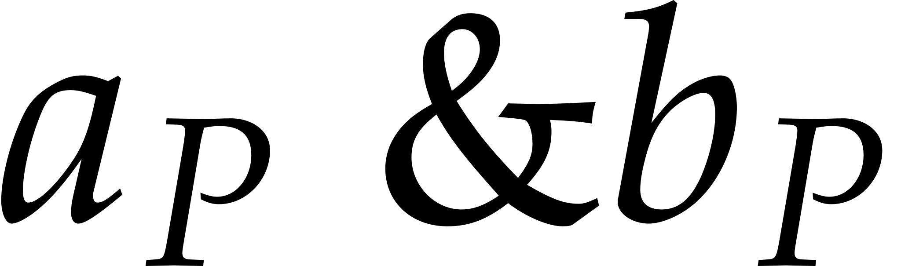 as a proposition stating that the material point P is at the place (ab). And for this statement to be possible, the coordinates a & b must actually determine a place. For a statement to be possible, the logical coordinates must actually determine a logical place!

### [Ms-101](/ms-101/#68r.2) [68r\[2\]](https://cdn.wittgensteinnachlass.com/2000px/webp/Ms-101/68r.webp)

(The object the general propositions are about is, properly speaking, the world; it enters into them through a logical description. – And that is why the world does not really occur in them after all, just as the object of a description does not occur in the description.)

### [Ms-101](/ms-101/#68r.3+69r.1) [68r\[3\]](https://cdn.wittgensteinnachlass.com/2000px/webp/Ms-101/68r.webp),[69r\[1\]](https://cdn.wittgensteinnachlass.com/2000px/webp/Ms-101/69r.webp)

That in a certain sense the logical form of p must be present even if p is not the case is shown symbolically by the occurrence of “p” in “~p”.

### [Ms-101](/ms-101/#69r.2) [69r\[2\]](https://cdn.wittgensteinnachlass.com/2000px/webp/Ms-101/69r.webp)

The difficulty is this: how can there be the form of p if there is no state of affairs of this form? And what then does this form actually consist in?!

### [Ms-101](/ms-101/#69r.3) [69r\[3\]](https://cdn.wittgensteinnachlass.com/2000px/webp/Ms-101/69r.webp)

There are no analytic _propositions_.

### [Ms-101](/ms-101/#69r.4) [69r\[4\]](https://cdn.wittgensteinnachlass.com/2000px/webp/Ms-101/69r.webp)

30.10.1914

Could one say: “in ‘~φ(x)’, ‘φ․(x)’ presents how things do _not_ stand”?

### [Ms-101](/ms-101/#69r.5) [69r\[5\]](https://cdn.wittgensteinnachlass.com/2000px/webp/Ms-101/69r.webp)

One could also represent a negative fact in a picture by representing what is _not_ the case.

### [Ms-101](/ms-101/#69r.6+70r.1) [69r\[6\]](https://cdn.wittgensteinnachlass.com/2000px/webp/Ms-101/69r.webp),[70r\[1\]](https://cdn.wittgensteinnachlass.com/2000px/webp/Ms-101/70r.webp)

But if we admit these methods of representation, what then is actually characteristic of the relation of _representing_?

### [Ms-101](/ms-101/#70r.2) [70r\[2\]](https://cdn.wittgensteinnachlass.com/2000px/webp/Ms-101/70r.webp)

Can one not say: There are simply different logical coordinate systems!

### [Ms-101](/ms-101/#70r.3) [70r\[3\]](https://cdn.wittgensteinnachlass.com/2000px/webp/Ms-101/70r.webp)

There are simply different modes of representation, including different ways of representing by means of a picture, and what does the representing is not just the sign or picture but also the method of representation. _What all representation has in common is that it_ _can be correct or incorrect, true or false_.

### [Ms-101](/ms-101/#70r.4) [70r\[4\]](https://cdn.wittgensteinnachlass.com/2000px/webp/Ms-101/70r.webp)

For the picture _and the mode of representation_ are entirely outside what is represented!

The two together are true or false, that is, _the picture, in a particular way & manner_. (This of course applies to the elementary proposition too!)

### [Ms-102](/ms-102/#1r.1) [1r\[1\]](https://cdn.wittgensteinnachlass.com/2000px/webp/Ms-102/1r.webp)

30.10.1914

_Every proposition_ can be negated. And this shows that “True” & “False” mean the same thing for all propositions. (This is of the utmost importance.) (In contrast to Russell).

### [Ms-102](/ms-102/#1r.2) [1r\[2\]](https://cdn.wittgensteinnachlass.com/2000px/webp/Ms-102/1r.webp)

The meaning of the sentence must be pinned down to a yes or no by _the sentence itself and its representational_ mode.

### [Ms-102](/ms-102/#1r.3) [1r\[3\]](https://cdn.wittgensteinnachlass.com/2000px/webp/Ms-102/1r.webp)

In logic there is no juxtaposition, there can be no classification!

### [Ms-102](/ms-102/#1r.4+2r.1) [1r\[4\]](https://cdn.wittgensteinnachlass.com/2000px/webp/Ms-102/1r.webp),[2r\[1\]](https://cdn.wittgensteinnachlass.com/2000px/webp/Ms-102/2r.webp)

31.10.1914

A sentence like “(∃x,φ)․φx” is just as composite as an elementary one; this is shown by the fact that we have to mention “φ” & “x” _separately_ in the brackets. Both stand – independently – in designating relations to the world, just as in the case of an elementary sentence “ψ(a)”.

### [Ms-102](/ms-102/#2r.2) [2r\[2\]](https://cdn.wittgensteinnachlass.com/2000px/webp/Ms-102/2r.webp)

Is it not like this: “the logical constants characterize the mode of representation of the elementary forms of the sentence”?

### [Ms-102](/ms-102/#2r.3) [2r\[3\]](https://cdn.wittgensteinnachlass.com/2000px/webp/Ms-102/2r.webp)

The meaning of the sentence must be pinned down to a yes or no by the sentence itself and its mode of representation. For that to happen it must be completely described by the sentence.

### [Ms-102](/ms-102/#2r.4+3r.1) [2r\[4\]](https://cdn.wittgensteinnachlass.com/2000px/webp/Ms-102/2r.webp),[3r\[1\]](https://cdn.wittgensteinnachlass.com/2000px/webp/Ms-102/3r.webp)

The mode of representation does _not_ depict; only the sentence is a picture.

### [Ms-102](/ms-102/#3r.2) [3r\[2\]](https://cdn.wittgensteinnachlass.com/2000px/webp/Ms-102/3r.webp)

The mode of representation determines how reality must be compared with the picture.

### [Ms-102](/ms-102/#3r.3) [3r\[3\]](https://cdn.wittgensteinnachlass.com/2000px/webp/Ms-102/3r.webp)

Above all, the elementary sentential form must depict; all depiction takes place through it.

### [Ms-102](/ms-102/#3r.4) [3r\[4\]](https://cdn.wittgensteinnachlass.com/2000px/webp/Ms-102/3r.webp)

01.11.1914

It is very easy to confuse the representational relation of the sentence to its meaning with the truth relation. The former differs for different sentences; the latter is one and the same for all sentences.

### [Ms-102](/ms-102/#3r.5+4r.1) [3r\[5\]](https://cdn.wittgensteinnachlass.com/2000px/webp/Ms-102/3r.webp),[4r\[1\]](https://cdn.wittgensteinnachlass.com/2000px/webp/Ms-102/4r.webp)

It seems as though “(x,φ)․φx” were the form of a fact Φa ∙ Ψb ∙ Θc etc. (Similarly, (∃x).φx would be the form of φ(a), as I did in fact believe.)

### [Ms-102](/ms-102/#4r.2) [4r\[2\]](https://cdn.wittgensteinnachlass.com/2000px/webp/Ms-102/4r.webp)

And this is precisely where my mistake must lie.

### [Ms-102](/ms-102/#4r.3) [4r\[3\]](https://cdn.wittgensteinnachlass.com/2000px/webp/Ms-102/4r.webp)

Just examine the elementary sentence: what then is the form of “φa” & how is it related to “~φ(a)”?

### [Ms-102](/ms-102/#4r.4) [4r\[4\]](https://cdn.wittgensteinnachlass.com/2000px/webp/Ms-102/4r.webp)

That precedent to which one would always like to appeal must already lie in the sign itself.

### [Ms-102](/ms-102/#4r.5) [4r\[5\]](https://cdn.wittgensteinnachlass.com/2000px/webp/Ms-102/4r.webp)

The logical form of the sentence must already be given by the forms of its constituents. (And these have to do only with the _sense_ of the sentences, not with their truth or falsity.)

### [Ms-102](/ms-102/#5r.1) [5r\[1\]](https://cdn.wittgensteinnachlass.com/2000px/webp/Ms-102/5r.webp)

The form of the subject & the predicate already contains the possibility of the S.-P. sentence etc.; but – as is only proper – nothing about its truth or falsity.

### [Ms-102](/ms-102/#5r.2) [5r\[2\]](https://cdn.wittgensteinnachlass.com/2000px/webp/Ms-102/5r.webp)

The picture has whatever relation to reality it happens to have. And what matters is: how is it to represent? The same picture will agree or fail to agree with reality according to how it is to represent.

### [Ms-102](/ms-102/#5r.3+6r.1) [5r\[3\]](https://cdn.wittgensteinnachlass.com/2000px/webp/Ms-102/5r.webp),[6r\[1\]](https://cdn.wittgensteinnachlass.com/2000px/webp/Ms-102/6r.webp)

Analogy between sentence & description: _The complex which_ is congruent with this sign (just as in graphic representation).

### [Ms-102](/ms-102/#6r.2) [6r\[2\]](https://cdn.wittgensteinnachlass.com/2000px/webp/Ms-102/6r.webp)

It is just that one cannot _say_ that this complex is congruent with that one (or the like); rather, this shows itself. And so the description too takes on a different character.

### [Ms-102](/ms-102/#6r.3) [6r\[3\]](https://cdn.wittgensteinnachlass.com/2000px/webp/Ms-102/6r.webp)

The method of depiction must, after all, be completely determined before one can compare reality with the sentence at all to see whether it is true or false. The method of comparison must be given to me before I can compare.

### [Ms-102](/ms-102/#6r.4+7r.1) [6r\[4\]](https://cdn.wittgensteinnachlass.com/2000px/webp/Ms-102/6r.webp),[7r\[1\]](https://cdn.wittgensteinnachlass.com/2000px/webp/Ms-102/7r.webp)

Whether a proposition is true or false must show itself.

But we must know in advance _how_ it will show itself.

### [Ms-102](/ms-102/#7r.2) [7r\[2\]](https://cdn.wittgensteinnachlass.com/2000px/webp/Ms-102/7r.webp)

One can represent that two people are not fighting by representing them as not fighting, and also by representing them as fighting and saying that the picture shows how things do not stand. One _could_ represent by means of negative facts just as well as by means of positive ones –. But we want only to investigate the principles of representation _as such_.

### [Ms-102](/ms-102/#7r.3+8r.1) [7r\[3\]](https://cdn.wittgensteinnachlass.com/2000px/webp/Ms-102/7r.webp),[8r\[1\]](https://cdn.wittgensteinnachlass.com/2000px/webp/Ms-102/8r.webp)

The sentence “‘p’ is true” has the same meaning as the logical product of ‘p’ and a sentence “‘p’”, which describes the sentence ‘p’, and a correlation of the constituents of the two sentences. – The internal relations of sentence & meaning are depicted by the internal relations between ‘p’ and “‘p’”.

### [Ms-102](/ms-102/#8r.2) [8r\[2\]](https://cdn.wittgensteinnachlass.com/2000px/webp/Ms-102/8r.webp)

Only not to get entangled in subsidiary questions, but always to escape to where one has an unobstructed survey of the whole _one_ great problem, even if this survey is still unclear!

### [Ms-102](/ms-102/#8r.3) [8r\[3\]](https://cdn.wittgensteinnachlass.com/2000px/webp/Ms-102/8r.webp)

“A state of affairs is thinkable” (“imaginable”) means: we can make a picture of it for ourselves.

### [Ms-102](/ms-102/#8r.4+9r.1) [8r\[4\]](https://cdn.wittgensteinnachlass.com/2000px/webp/Ms-102/8r.webp),[9r\[1\]](https://cdn.wittgensteinnachlass.com/2000px/webp/Ms-102/9r.webp)

The sentence must determine a logical place.

The existence of this logical place is guaranteed by the existence of the constituents alone, by the existence of the sentence with sense.

Even if there is no complex in the logical place, there is nevertheless one: not in the logical place.

### [Ms-102](/ms-102/#9r.2) [9r\[2\]](https://cdn.wittgensteinnachlass.com/2000px/webp/Ms-102/9r.webp)

02.11.1914

In a tautology the conditions of agreement with the world (the truth conditions) – the relations of representation – cancel one another out, so that it stands in no representational relation to reality (says nothing).

### [Ms-102](/ms-102/#9r.3) [9r\[3\]](https://cdn.wittgensteinnachlass.com/2000px/webp/Ms-102/9r.webp)

a = a is not a tautology in the same sense as p⊃p.

### [Ms-102](/ms-102/#10r.1) [10r\[1\]](https://cdn.wittgensteinnachlass.com/2000px/webp/Ms-102/10r.webp)

A sentence’s being true consists not in its having a _definite_ relation to reality but in its actually _having_ a definite relation to it.

### [Ms-102](/ms-102/#10r.2) [10r\[2\]](https://cdn.wittgensteinnachlass.com/2000px/webp/Ms-102/10r.webp)

Is it not like this: a false sentence, like a true one and independently of its falsity or truth, has a sense but no meaning? (Is this not a better use of the word “meaning”?)

### [Ms-102](/ms-102/#10r.3+11r.1) [10r\[3\]](https://cdn.wittgensteinnachlass.com/2000px/webp/Ms-102/10r.webp),[11r\[1\]](https://cdn.wittgensteinnachlass.com/2000px/webp/Ms-102/11r.webp)

Could one say: as soon as I am given the subject and predicate, I am given a relation that will hold or not _hold_ between an S.-P. sentence & its meaning. As soon as I know just the subject & predicate, I can also know of that relation, which is after all an indispensable presupposition even if the S.-P. sentence is false.

### [Ms-102](/ms-102/#11r.2) [11r\[2\]](https://cdn.wittgensteinnachlass.com/2000px/webp/Ms-102/11r.webp)

03.11.1914

For there to be a negative state of affairs, there must be a picture of the positive one.

### [Ms-102](/ms-102/#11r.3) [11r\[3\]](https://cdn.wittgensteinnachlass.com/2000px/webp/Ms-102/11r.webp)

After all, knowledge of the representing relation _may_ be based only on knowledge of the constituents of the state of affairs!

### [Ms-102](/ms-102/#11r.4+12r.1) [11r\[4\]](https://cdn.wittgensteinnachlass.com/2000px/webp/Ms-102/11r.webp),[12r\[1\]](https://cdn.wittgensteinnachlass.com/2000px/webp/Ms-102/12r.webp)

Could one say, then: knowledge of the S.-P. sentence & of the subject and predicate gives us knowledge of an internal relation etc.?

Strictly speaking, this too is incorrect, since we need not know any particular subject or predicate.

### [Ms-102](/ms-102/#12r.2) [12r\[2\]](https://cdn.wittgensteinnachlass.com/2000px/webp/Ms-102/12r.webp)

_Obviously_ we feel the elementary sentence to be the picture of a state of affairs – how does this come about?

### [Ms-102](/ms-102/#12r.3) [12r\[3\]](https://cdn.wittgensteinnachlass.com/2000px/webp/Ms-102/12r.webp)

Must not the possibility of the representing relation be given by the sentence _itself_?

### [Ms-102](/ms-102/#12r.4+13r.1) [12r\[4\]](https://cdn.wittgensteinnachlass.com/2000px/webp/Ms-102/12r.webp),[13r\[1\]](https://cdn.wittgensteinnachlass.com/2000px/webp/Ms-102/13r.webp)

The sentence _itself_ separates what is congruent with it from what is not. For example: if the sentence and congruence are given, then the sentence is true if the state of affairs _is_ congruent with it; or the sentence and non-congruence are given, in which case the sentence is true if the state of affairs is not congruent with it.

### [Ms-102](/ms-102/#13r.2+14r.1) [13r\[2\]](https://cdn.wittgensteinnachlass.com/2000px/webp/Ms-102/13r.webp),[14r\[1\]](https://cdn.wittgensteinnachlass.com/2000px/webp/Ms-102/14r.webp)

But how are congruence or non-congruence, or the like, given to us?

How can it be _communicated_ to me _how_ the sentence represents? Or can this not be _said_ to me at all? And if that is so, can I “_know_” it? If it were to be said to me, this would have to be done by means of a sentence; but that sentence could only show it.

### [Ms-102](/ms-102/#14r.2) [14r\[2\]](https://cdn.wittgensteinnachlass.com/2000px/webp/Ms-102/14r.webp)

What can be said can only be said by means of a sentence, so nothing that is necessary for understanding _all_ sentences can be said.

### [Ms-102](/ms-102/#14r.3+15r.1) [14r\[3\]](https://cdn.wittgensteinnachlass.com/2000px/webp/Ms-102/14r.webp),[15r\[1\]](https://cdn.wittgensteinnachlass.com/2000px/webp/Ms-102/15r.webp)

That arbitrary correlation of sign & thing designated which makes sentences possible and which I found lacking in completely general sentences is effected there by the designation of generality, just as it is effected by names in the elementary sentence (for the designation of generality does not belong to the _picture_). Hence one always felt that generality occurs just like an argument.

### [Ms-102](/ms-102/#15r.2) [15r\[2\]](https://cdn.wittgensteinnachlass.com/2000px/webp/Ms-102/15r.webp)

One can negate only a complete sentence. (Something similar holds for all ab-functions.)

### [Ms-102](/ms-102/#15r.3) [15r\[3\]](https://cdn.wittgensteinnachlass.com/2000px/webp/Ms-102/15r.webp)

The sentence is the logical picture of a state of affairs.

### [Ms-102](/ms-102/#15r.4) [15r\[4\]](https://cdn.wittgensteinnachlass.com/2000px/webp/Ms-102/15r.webp)

Negation refers to the _complete_ sense of the negated sentence and not to its mode of representation.

### [Ms-102](/ms-102/#15r.5+16r.1) [15r\[5\]](https://cdn.wittgensteinnachlass.com/2000px/webp/Ms-102/15r.webp),[16r\[1\]](https://cdn.wittgensteinnachlass.com/2000px/webp/Ms-102/16r.webp)

If a picture represents what-is-not-the-case in the way mentioned earlier, this too happens only by its representing _that_ which _is_ not the case.

### [Ms-102](/ms-102/#16r.2) [16r\[2\]](https://cdn.wittgensteinnachlass.com/2000px/webp/Ms-102/16r.webp)

For the picture says, as it were, “it is _not_ _like this_”, and the answer to the question “_how_ is it not?” is precisely the positive sentence.

### [Ms-102](/ms-102/#16r.3) [16r\[3\]](https://cdn.wittgensteinnachlass.com/2000px/webp/Ms-102/16r.webp)

One might say: negation already refers to the logical place determined by the negated sentence.

### [Ms-102](/ms-102/#16r.4) [16r\[4\]](https://cdn.wittgensteinnachlass.com/2000px/webp/Ms-102/16r.webp)

Above all, do not lose the firm ground on which one once stood!

### [Ms-102](/ms-102/#16r.5) [16r\[5\]](https://cdn.wittgensteinnachlass.com/2000px/webp/Ms-102/16r.webp)

The negating sentence determines a _different_ logical place from the negated one.

### [Ms-102](/ms-102/#17r.1) [17r\[1\]](https://cdn.wittgensteinnachlass.com/2000px/webp/Ms-102/17r.webp)

The negated sentence not only draws the boundary between the negated region & the rest, but also already points to the negated region.

### [Ms-102](/ms-102/#17r.2) [17r\[2\]](https://cdn.wittgensteinnachlass.com/2000px/webp/Ms-102/17r.webp)

The negating sentence determines its logical place with the aid of the logical place of the negated sentence. By describing the former as the one lying outside the latter.

### [Ms-102](/ms-102/#17r.3) [17r\[3\]](https://cdn.wittgensteinnachlass.com/2000px/webp/Ms-102/17r.webp)

The sentence is true if what it presents exists.

### [Ms-102](/ms-102/#17r.4) [17r\[4\]](https://cdn.wittgensteinnachlass.com/2000px/webp/Ms-102/17r.webp)

04.11.1914

How does the sentence determine the logical place?

### [Ms-102](/ms-102/#18r.1) [18r\[1\]](https://cdn.wittgensteinnachlass.com/2000px/webp/Ms-102/18r.webp)

How does the picture represent a state of affairs?

### [Ms-102](/ms-102/#18r.2) [18r\[2\]](https://cdn.wittgensteinnachlass.com/2000px/webp/Ms-102/18r.webp)

It is not itself the state of affairs, after all; indeed, the state of affairs need not be the case at all.

### [Ms-102](/ms-102/#18r.3) [18r\[3\]](https://cdn.wittgensteinnachlass.com/2000px/webp/Ms-102/18r.webp)

One name represents one thing, another another thing, and they themselves are linked; thus the whole – like a tableau vivant – presents the state of affairs.

### [Ms-102](/ms-102/#18r.4+19r.1) [18r\[4\]](https://cdn.wittgensteinnachlass.com/2000px/webp/Ms-102/18r.webp),[19r\[1\]](https://cdn.wittgensteinnachlass.com/2000px/webp/Ms-102/19r.webp)

The logical linkage must of course be possible among the things represented, and this will always be the case if the things really are represented. Mind you, that linkage is not a relation but only the _holding_ of a relation.

### [Ms-102](/ms-102/#19r.2) [19r\[2\]](https://cdn.wittgensteinnachlass.com/2000px/webp/Ms-102/19r.webp)

05.11.1914

Thus the sentence represents the state of affairs, as it were, on its own initiative.

### [Ms-102](/ms-102/#19r.3) [19r\[3\]](https://cdn.wittgensteinnachlass.com/2000px/webp/Ms-102/19r.webp)

But when I say: the linkage of the constituents of the sentence must be possible for the things represented: is this not where the whole problem lies! How can a linkage between objects be possible when it does not exist?

### [Ms-102](/ms-102/#19r.4+20r.1) [19r\[4\]](https://cdn.wittgensteinnachlass.com/2000px/webp/Ms-102/19r.webp),[20r\[1\]](https://cdn.wittgensteinnachlass.com/2000px/webp/Ms-102/20r.webp)

The linkage must be possible means: the sentence & the constituents of the state of affairs must stand in a definite relation.

### [Ms-102](/ms-102/#20r.2) [20r\[2\]](https://cdn.wittgensteinnachlass.com/2000px/webp/Ms-102/20r.webp)

Thus for a sentence to represent a state of affairs, all that is needed is for its constituents to represent those of the state of affairs and for the former to stand in a linkage possible for the latter.

### [Ms-102](/ms-102/#20r.3) [20r\[3\]](https://cdn.wittgensteinnachlass.com/2000px/webp/Ms-102/20r.webp)

The sentence-sign guarantees the possibility of the fact it represents (not that this fact actually obtains); this holds for general sentences too.

### [Ms-102](/ms-102/#20r.4+21r.1) [20r\[4\]](https://cdn.wittgensteinnachlass.com/2000px/webp/Ms-102/20r.webp),[21r\[1\]](https://cdn.wittgensteinnachlass.com/2000px/webp/Ms-102/21r.webp)

For if the positive fact φa is given, then the _possibility_ of (x).φx, ~(∃x).φx, ~φ(a) etc. etc. is given too. (All logical constants are already contained in the elementary sentence.)

### [Ms-102](/ms-102/#21r.2) [21r\[2\]](https://cdn.wittgensteinnachlass.com/2000px/webp/Ms-102/21r.webp)

This is how the picture comes into being. – In order to designate a logical place with the picture, we must add to it a mode of designation (positive, negative, etc.).

### [Ms-102](/ms-102/#21r.3) [21r\[3\]](https://cdn.wittgensteinnachlass.com/2000px/webp/Ms-102/21r.webp)

One could, for example, use fencing puppets to show how one should _not_ fence.

### [Ms-102](/ms-102/#21r.4) [21r\[4\]](https://cdn.wittgensteinnachlass.com/2000px/webp/Ms-102/21r.webp)

06.11.1914

And the case here is exactly the same as with ~φa, although the picture deals with what _ought_ not to happen rather than with what does not happen.

### [Ms-102](/ms-102/#21r.5+22r.1) [21r\[5\]](https://cdn.wittgensteinnachlass.com/2000px/webp/Ms-102/21r.webp),[22r\[1\]](https://cdn.wittgensteinnachlass.com/2000px/webp/Ms-102/22r.webp)

The fact that one can negate the negated sentence again shows that what is negated is already a sentence and not merely the preparation for one.

### [Ms-102](/ms-102/#22r.2) [22r\[2\]](https://cdn.wittgensteinnachlass.com/2000px/webp/Ms-102/22r.webp)

Could one say?: “Here is the picture, but one cannot say whether it is right or not until one knows what it is meant to say.”

### [Ms-102](/ms-102/#22r.3) [22r\[3\]](https://cdn.wittgensteinnachlass.com/2000px/webp/Ms-102/22r.webp)

The picture must now in turn cast its shadow on the world.

### [Ms-102](/ms-102/#22r.4) [22r\[4\]](https://cdn.wittgensteinnachlass.com/2000px/webp/Ms-102/22r.webp)

07.11.1914

The spatial & the logical place agree in that both are the possibility of an existence.

### [Ms-102](/ms-102/#23r.1) [23r\[1\]](https://cdn.wittgensteinnachlass.com/2000px/webp/Ms-102/23r.webp)

08.11.1914

What can be confirmed by experiment in propositions about probability cannot possibly be mathematics!

### [Ms-102](/ms-102/#23r.2) [23r\[2\]](https://cdn.wittgensteinnachlass.com/2000px/webp/Ms-102/23r.webp)

Probability propositions are extracts from laws of natural science.

### [Ms-102](/ms-102/#23r.3) [23r\[3\]](https://cdn.wittgensteinnachlass.com/2000px/webp/Ms-102/23r.webp)

They are generalizations and express an incomplete knowledge of those laws.

### [Ms-102](/ms-102/#23r.4+24r.1) [23r\[4\]](https://cdn.wittgensteinnachlass.com/2000px/webp/Ms-102/23r.webp),[24r\[1\]](https://cdn.wittgensteinnachlass.com/2000px/webp/Ms-102/24r.webp)

If, for example, I draw black & white balls from an urn, I cannot say before a draw whether I shall draw a white or a black ball, since I do not know the laws of nature precisely enough for that; but _this much I do know_: if there are as many black balls as white, the number of black balls drawn will approach the number of white balls drawn as the drawing continues. I _do_ know the laws of nature _that_ precisely.

### [Ms-102](/ms-102/#24r.2) [24r\[2\]](https://cdn.wittgensteinnachlass.com/2000px/webp/Ms-102/24r.webp)

09.11.1914

Now what I know in probability propositions are certain general properties of the un-generalized propositions of natural science, such as their symmetry in certain respects, their asymmetry in others, etc.

### [Ms-102](/ms-102/#24r.3) [24r\[3\]](https://cdn.wittgensteinnachlass.com/2000px/webp/Ms-102/24r.webp)

Puzzle-pictures & the seeing of states of affairs.

### [Ms-102](/ms-102/#25r.1) [25r\[1\]](https://cdn.wittgensteinnachlass.com/2000px/webp/Ms-102/25r.webp)

It was what I would call my strong scholastic feeling that was the cause of my best discoveries.

### [Ms-102](/ms-102/#25r.2) [25r\[2\]](https://cdn.wittgensteinnachlass.com/2000px/webp/Ms-102/25r.webp)

“not p” & “p” contradict one another; they cannot both be true; and yet I can utter both, _both pictures exist_. They lie side by side.

### [Ms-102](/ms-102/#25r.3) [25r\[3\]](https://cdn.wittgensteinnachlass.com/2000px/webp/Ms-102/25r.webp)

Or rather, “p” & “~p” are like a picture and the infinite plane outside that picture (logical place).

I can construct the infinite space outside only with the aid of the picture, by using it to bound that space.

### [Ms-102](/ms-102/#26r.1) [26r\[1\]](https://cdn.wittgensteinnachlass.com/2000px/webp/Ms-102/26r.webp)

10.11.1914

When I say “p is possible”, does this mean ‘“p” has a sense’? Does that sentence speak about language, so that the existence of a sentence-sign (“p”) is essential to its sense? (Then it would be quite unimportant.) But does it not rather mean to say what “p ⌵ ~p” shows?

### [Ms-102](/ms-102/#26r.2+27r.1) [26r\[2\]](https://cdn.wittgensteinnachlass.com/2000px/webp/Ms-102/26r.webp),[27r\[1\]](https://cdn.wittgensteinnachlass.com/2000px/webp/Ms-102/27r.webp)

Does not my study of sign-language correspond to the study of thought processes that philosophers always held to be so essential to the philosophy of logic? – Only they always got entangled in inessential psychological investigations & there is an analogous danger with my method too.

### [Ms-102](/ms-102/#27r.2) [27r\[2\]](https://cdn.wittgensteinnachlass.com/2000px/webp/Ms-102/27r.webp)

11.11.1914

Since “a = b” is not a sentence and “x = y” is not a function, a ‘class x̂ (x = x)’ is an absurdity, and so is the so-called null class. (Incidentally, one had always felt that wherever one resorted to x = x, a = a, etc. in constructing sentences, one was in all such cases cheating one’s way out of a difficulty; as when one said that “a exists” means “(∃x) x = a”.)

_This is false: for the definition of the classes itself guarantees the existence of the actual functions._

### [Ms-102](/ms-102/#28r.1) [28r\[1\]](https://cdn.wittgensteinnachlass.com/2000px/webp/Ms-102/28r.webp)

If I now seem to assert a function of the null class, what I say is that this function is true of all functions that are null – and I can say this even if _no_ function is null.

### [Ms-102](/ms-102/#28r.2) [28r\[2\]](https://cdn.wittgensteinnachlass.com/2000px/webp/Ms-102/28r.webp)

Is 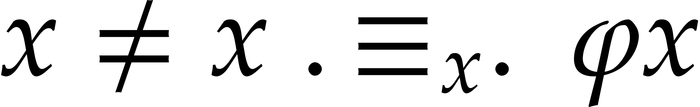 identical with (x).~φx? Certainly!

### [Ms-102](/ms-102/#28r.3) [28r\[3\]](https://cdn.wittgensteinnachlass.com/2000px/webp/Ms-102/28r.webp)

The sentence points to the possibility that things are thus & so.

### [Ms-102](/ms-102/#28r.4) [28r\[4\]](https://cdn.wittgensteinnachlass.com/2000px/webp/Ms-102/28r.webp)

12.11.1914

Negation is _a description_ in the same sense as the elementary sentence itself.

### [Ms-102](/ms-102/#29r.1) [29r\[1\]](https://cdn.wittgensteinnachlass.com/2000px/webp/Ms-102/29r.webp)

One might call the truth of a proposition possible, that of a tautology certain, and that of a contradiction impossible. Here we already have an indication of a gradation we need in the calculus of probability.

### [Ms-102](/ms-102/#29r.2) [29r\[2\]](https://cdn.wittgensteinnachlass.com/2000px/webp/Ms-102/29r.webp)

In a tautology the elementary sentence – of course – still depicts, but it is so loosely connected with reality that it leaves reality unrestricted freedom. Contradiction, on the other hand, sets bounds within which no reality can exist.

### [Ms-102](/ms-102/#30r.1) [30r\[1\]](https://cdn.wittgensteinnachlass.com/2000px/webp/Ms-102/30r.webp)

It is as if the logical constants projected the picture of the elementary sentence onto reality – which can then agree or fail to agree with this projection.

Although all logical constants already occur in the simple sentence, its own prototype _must_ also occur in it whole & undissected!

### [Ms-102](/ms-102/#30r.2) [30r\[2\]](https://cdn.wittgensteinnachlass.com/2000px/webp/Ms-102/30r.webp)

So is it perhaps not the simple sentence that is the picture but rather its prototype, which must occur in it?

### [Ms-102](/ms-102/#30r.3+31r.1) [30r\[3\]](https://cdn.wittgensteinnachlass.com/2000px/webp/Ms-102/30r.webp),[31r\[1\]](https://cdn.wittgensteinnachlass.com/2000px/webp/Ms-102/31r.webp)

This prototype is then really not a sentence (but has the form of a sentence), and _it_ might correspond to Frege’s “assumption”.

### [Ms-102](/ms-102/#31r.2) [31r\[2\]](https://cdn.wittgensteinnachlass.com/2000px/webp/Ms-102/31r.webp)

The sentence would then consist of proto*types* projected onto the world.

### [Ms-102](/ms-102/#31r.3) [31r\[3\]](https://cdn.wittgensteinnachlass.com/2000px/webp/Ms-102/31r.webp)

13.11.1914

In this work more than in any other, it is worth looking again and again from new sides at questions one thinks are solved, treating them as unsolved.

### [Ms-102](/ms-102/#31r.4+32r.1) [31r\[4\]](https://cdn.wittgensteinnachlass.com/2000px/webp/Ms-102/31r.webp),[32r\[1\]](https://cdn.wittgensteinnachlass.com/2000px/webp/Ms-102/32r.webp)

14.11.1914

Think of the representation of _negative_ facts by models. For instance: two trains must not stand on the tracks thus & so. The sentence, the picture, the model are – in a negative sense – like a solid body that limits the freedom of movement of other bodies, in a positive sense like the space bounded by solid matter in which a body has room.

This image is _very_ clear and ought to lead to a solution.

### [Ms-102](/ms-102/#32r.2) [32r\[2\]](https://cdn.wittgensteinnachlass.com/2000px/webp/Ms-102/32r.webp)

15.11.1914

Projection of the picture onto reality

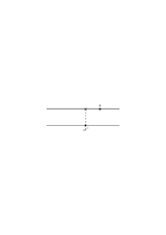

RealityModel (picture)

(Maxwell’s method of mechanical models)

### [Ms-102](/ms-102/#33r.1) [33r\[1\]](https://cdn.wittgensteinnachlass.com/2000px/webp/Ms-102/33r.webp)

Never mind what one once wrote! Always start thinking afresh, as though nothing at all had yet happened!

### [Ms-102](/ms-102/#33r.2) [33r\[2\]](https://cdn.wittgensteinnachlass.com/2000px/webp/Ms-102/33r.webp)

That shadow which the picture, as it were, casts on the world: how am I to grasp it precisely? Here is a deep mystery.

### [Ms-102](/ms-102/#33r.3) [33r\[3\]](https://cdn.wittgensteinnachlass.com/2000px/webp/Ms-102/33r.webp)

It is the mystery of negation: things are not like that, and yet we can say _how_ they are _not_. –

### [Ms-102](/ms-102/#33r.4+34r.1) [33r\[4\]](https://cdn.wittgensteinnachlass.com/2000px/webp/Ms-102/33r.webp),[34r\[1\]](https://cdn.wittgensteinnachlass.com/2000px/webp/Ms-102/34r.webp)

The sentence is simply the _description_ of a state of affairs. (But this is all still on the surface.) _One_ insight at the source is worth more than any number somewhere in the middle.

### [Ms-102](/ms-102/#34r.2) [34r\[2\]](https://cdn.wittgensteinnachlass.com/2000px/webp/Ms-102/34r.webp)

16.11.1914

Introduction of the sign “0” to make decimal notation possible: the logical meaning of this procedure.

### [Ms-102](/ms-102/#34r.3) [34r\[3\]](https://cdn.wittgensteinnachlass.com/2000px/webp/Ms-102/34r.webp)

17.11.1914

Suppose “φ(a)” is true: what does it mean to say that ~φa is possible?

(φa itself has the same meaning as ~(~φa).)

### [Ms-102](/ms-102/#34r.4) [34r\[4\]](https://cdn.wittgensteinnachlass.com/2000px/webp/Ms-102/34r.webp)

18.11.1914

Here it is always only a matter of the existence of the logical place.

But what – the devil – is this “logical place”!?

### [Ms-102](/ms-102/#34r.5+35r.1) [34r\[5\]](https://cdn.wittgensteinnachlass.com/2000px/webp/Ms-102/34r.webp),[35r\[1\]](https://cdn.wittgensteinnachlass.com/2000px/webp/Ms-102/35r.webp)

19.11.1914

The sentence & the logical coordinates: that is the logical place.

### [Ms-102](/ms-102/#35r.2) [35r\[2\]](https://cdn.wittgensteinnachlass.com/2000px/webp/Ms-102/35r.webp)

20.11.1914

The reality that corresponds to the sense of the sentence cannot be anything other than its constituents, since we do not _know_ _anything_ else.

### [Ms-102](/ms-102/#35r.3) [35r\[3\]](https://cdn.wittgensteinnachlass.com/2000px/webp/Ms-102/35r.webp)

If reality consists in something else as well, then in any case this can be neither designated nor expressed, for in the first case it would be a further constituent; in the second the expression would be a sentence for which the same problem would arise again as for the original one.

### [Ms-102](/ms-102/#35r.4+36r.1) [35r\[4\]](https://cdn.wittgensteinnachlass.com/2000px/webp/Ms-102/35r.webp),[36r\[1\]](https://cdn.wittgensteinnachlass.com/2000px/webp/Ms-102/36r.webp)

21.11.1914

What do I actually know when I understand the sense of “φa” but do not know whether it is true or false? Then surely I know no more than φa ⌵ ~φa; and that means I _know_ nothing.

### [Ms-102](/ms-102/#36r.2) [36r\[2\]](https://cdn.wittgensteinnachlass.com/2000px/webp/Ms-102/36r.webp)

Since the realities that correspond to the sense of the sentence are only its constituents, the logical coordinates too can refer only to those constituents.

### [Ms-102](/ms-102/#36r.3) [36r\[3\]](https://cdn.wittgensteinnachlass.com/2000px/webp/Ms-102/36r.webp)

22.11.1914

At this point I am again trying to express something that cannot be expressed.

### [Ms-102](/ms-102/#36r.4+37r.1) [36r\[4\]](https://cdn.wittgensteinnachlass.com/2000px/webp/Ms-102/36r.webp),[37r\[1\]](https://cdn.wittgensteinnachlass.com/2000px/webp/Ms-102/37r.webp)

23.11.1914

Although the sentence may point to only one place in logical space, the whole of logical space must _already_ be given by it. – Otherwise negation, disjunction etc. would keep introducing _new_ elements – and specifically in coordination – which of course must not happen.

### [Ms-102](/ms-102/#37r.2) [37r\[2\]](https://cdn.wittgensteinnachlass.com/2000px/webp/Ms-102/37r.webp)

24.11.1914

The sentence and the state of affairs are related to one another as the metre rule is to the length to be measured.

### [Ms-102](/ms-102/#37r.3+38r.1) [37r\[3\]](https://cdn.wittgensteinnachlass.com/2000px/webp/Ms-102/37r.webp),[38r\[1\]](https://cdn.wittgensteinnachlass.com/2000px/webp/Ms-102/38r.webp)

That one can infer the _sentence_ “φa” from the _sentence_ “(x) φx” shows how generality is present in the _sign_ “(x) φx” too.

And the same of course holds for the designation of generality in general.

### [Ms-102](/ms-102/#38r.2) [38r\[2\]](https://cdn.wittgensteinnachlass.com/2000px/webp/Ms-102/38r.webp)

In the sentence we lay a prototype against reality.

### [Ms-102](/ms-102/#38r.3) [38r\[3\]](https://cdn.wittgensteinnachlass.com/2000px/webp/Ms-102/38r.webp)

(In investigating negative facts, one gets the impression again and again that they presuppose the existence of the sentence-sign.)

### [Ms-102](/ms-102/#38r.4+39r.1) [38r\[4\]](https://cdn.wittgensteinnachlass.com/2000px/webp/Ms-102/38r.webp),[39r\[1\]](https://cdn.wittgensteinnachlass.com/2000px/webp/Ms-102/39r.webp)

_Must_ the sign of the negative sentence be formed using the sign of the positive one? (I believe so!) Why should one not be able to express the negative sentence by means of a negative fact?! It is as if, instead of taking the metre rule as the object of comparison, one took the space outside it.

### [Ms-102](/ms-102/#39r.2) [39r\[2\]](https://cdn.wittgensteinnachlass.com/2000px/webp/Ms-102/39r.webp)

How exactly does the _sentence_ “~p” contradict the _sentence_ “p”? The internal relations of the two signs must mean contradiction.

### [Ms-102](/ms-102/#39r.3) [39r\[3\]](https://cdn.wittgensteinnachlass.com/2000px/webp/Ms-102/39r.webp)

Of course, after every negative sentence it must be possible to ask: _How_ are things _not_? But the answer to this is only another sentence.

### [Ms-102](/ms-102/#39r.4) [39r\[4\]](https://cdn.wittgensteinnachlass.com/2000px/webp/Ms-102/39r.webp)

25.11.1914

That negative circumstance which serves as a sign can presumably obtain without a sentence that in turn expresses it.

### [Ms-102](/ms-102/#39r.5+40r.1) [39r\[5\]](https://cdn.wittgensteinnachlass.com/2000px/webp/Ms-102/39r.webp),[40r\[1\]](https://cdn.wittgensteinnachlass.com/2000px/webp/Ms-102/40r.webp)

In investigating these problems, it seems again and again as though they had already been solved, and this illusion arises because the problems often disappear entirely from view.

### [Ms-102](/ms-102/#40r.2) [40r\[2\]](https://cdn.wittgensteinnachlass.com/2000px/webp/Ms-102/40r.webp)

I can see that ~φa is the case simply by observing φ(x̂) & a.

### [Ms-102](/ms-102/#40r.3+41r.1) [40r\[3\]](https://cdn.wittgensteinnachlass.com/2000px/webp/Ms-102/40r.webp),[41r\[1\]](https://cdn.wittgensteinnachlass.com/2000px/webp/Ms-102/41r.webp)

The question here is: is the positive fact primary and the negative fact secondary, or do they have equal standing? And if so, what about the facts p ⌵ q, p ⊃ q etc.: do they not have the same standing as ~p? But _must_ not _all facts_ have equal standing? The real question is: are there facts other than positive ones? (For it is hard not to confuse what is not the case with what _is_ the case instead.)

### [Ms-102](/ms-102/#41r.2) [41r\[2\]](https://cdn.wittgensteinnachlass.com/2000px/webp/Ms-102/41r.webp)

It is clear, after all, that all the ab-functions are just so many different methods of measuring reality. – And certainly the methods of measuring by means of p and ~p have something distinctive that sets them apart from all the others. –

### [Ms-102](/ms-102/#41r.3+42r.1) [41r\[3\]](https://cdn.wittgensteinnachlass.com/2000px/webp/Ms-102/41r.webp),[42r\[1\]](https://cdn.wittgensteinnachlass.com/2000px/webp/Ms-102/42r.webp)

It is the _dualism_, positive & negative facts, that gives me no peace. There cannot be such a dualism. But how is one to escape it?

### [Ms-102](/ms-102/#42r.2) [42r\[2\]](https://cdn.wittgensteinnachlass.com/2000px/webp/Ms-102/42r.webp)

All this would resolve itself if one understood the essence of the sentence!

### [Ms-102](/ms-102/#42r.3) [42r\[3\]](https://cdn.wittgensteinnachlass.com/2000px/webp/Ms-102/42r.webp)

26.11.1914

When all positive statements about a thing have been made, not all negative ones have thereby been made too! And that is what everything turns on!

### [Ms-102](/ms-102/#42r.4) [42r\[4\]](https://cdn.wittgensteinnachlass.com/2000px/webp/Ms-102/42r.webp)

The dreaded dualism of positive & negative does not exist, for (x).φx etc., etc., are neither positive nor negative.

### [Ms-102](/ms-102/#42r.5+43r.1) [42r\[5\]](https://cdn.wittgensteinnachlass.com/2000px/webp/Ms-102/42r.webp),[43r\[1\]](https://cdn.wittgensteinnachlass.com/2000px/webp/Ms-102/43r.webp)

Even if the positive sentence does not _have_ to occur in the negative one, must not the prototype of the positive sentence occur in the negative one in every case?

### [Ms-102](/ms-102/#43r.2) [43r\[2\]](https://cdn.wittgensteinnachlass.com/2000px/webp/Ms-102/43r.webp)

In distinguishing – in every possible notation – between ~aRb & ~bRa, we presuppose in each notation a definite correlation of argument & argument-place in the negative sentence; this is what constitutes the prototype of the negated positive sentence.

### [Ms-102](/ms-102/#43r.3) [43r\[3\]](https://cdn.wittgensteinnachlass.com/2000px/webp/Ms-102/43r.webp)

So is not that correlation of the constituents of the sentence, by which nothing is yet _said_, the picture proper in the sentence?

### [Ms-102](/ms-102/#44r.1) [44r\[1\]](https://cdn.wittgensteinnachlass.com/2000px/webp/Ms-102/44r.webp)

Might my lack of clarity be due to my failure to understand the essence of relations?

### [Ms-102](/ms-102/#44r.2) [44r\[2\]](https://cdn.wittgensteinnachlass.com/2000px/webp/Ms-102/44r.webp)

Can one negate a _picture_? No. And that is where the difference between picture & sentence lies. The picture can serve as a sentence. But then something is added to it that makes it _say_ something. In short: I can only negate that the picture is right; I cannot negate the _picture_.

### [Ms-102](/ms-102/#44r.3+45r.1) [44r\[3\]](https://cdn.wittgensteinnachlass.com/2000px/webp/Ms-102/44r.webp),[45r\[1\]](https://cdn.wittgensteinnachlass.com/2000px/webp/Ms-102/45r.webp)

By my correlating objects with the constituents of the picture, _by that_ it comes to represent a state of affairs and is now either right or not. (For example, a picture represents the interior of a room, etc.)

### [Ms-102](/ms-102/#45r.2+46r.1) [45r\[2\]](https://cdn.wittgensteinnachlass.com/2000px/webp/Ms-102/45r.webp),[46r\[1\]](https://cdn.wittgensteinnachlass.com/2000px/webp/Ms-102/46r.webp)

27.11.1914

“~p” is true if p is false. So in the true sentence “~p” the part is a false sentence. How, then, can the hook “~” bring it into agreement with reality? We have, of course, already said that it is not the hook “~” alone, but everything the different negation signs have in common. And what all of them have in common must obviously follow from the meaning of negation itself. And so the negation sign must after all reflect its own meaning.

### [Ms-102](/ms-102/#46r.2) [46r\[2\]](https://cdn.wittgensteinnachlass.com/2000px/webp/Ms-102/46r.webp)

28.11.1914

Negation combines with the ab-functions of the elementary sentence. And the logical functions of the elementary sentence, like all the others, must reflect their meaning.

### [Ms-102](/ms-102/#46r.3) [46r\[3\]](https://cdn.wittgensteinnachlass.com/2000px/webp/Ms-102/46r.webp)

29.11.1914

The ab-function does not stop _in front of_ the elementary sentence but permeates it.

### [Ms-102](/ms-102/#46r.4) [46r\[4\]](https://cdn.wittgensteinnachlass.com/2000px/webp/Ms-102/46r.webp)

What _can_ be shown cannot be said.

### [Ms-102](/ms-102/#46r.5+47r.1) [46r\[5\]](https://cdn.wittgensteinnachlass.com/2000px/webp/Ms-102/46r.webp),[47r\[1\]](https://cdn.wittgensteinnachlass.com/2000px/webp/Ms-102/47r.webp)

I believe one could remove the equality sign from our notation altogether and indicate equality only by the sameness of the signs (and vice versa). Then, of course, φ(a, a) would not be a special case of (x,y)․φ(x,y), nor φa of (∃x,y)․φx․φy. But then instead of 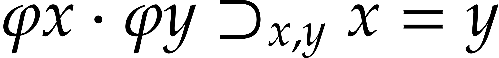 one could simply write ~(∃x,y) . φx․φy.

### [Ms-102](/ms-102/#47r.2) [47r\[2\]](https://cdn.wittgensteinnachlass.com/2000px/webp/Ms-102/47r.webp)

With this notation the pseudo-sentence (x)x = a or others like it would also lose all semblance of warrant.

### [Ms-102](/ms-102/#47r.3+48r.1) [47r\[3\]](https://cdn.wittgensteinnachlass.com/2000px/webp/Ms-102/47r.webp),[48r\[1\]](https://cdn.wittgensteinnachlass.com/2000px/webp/Ms-102/48r.webp)

30.11.1914

01.12.1914 The sentence says, as it were: this picture cannot (or can) represent a state of affairs in this way.

### [Ms-102](/ms-102/#48r.2) [48r\[2\]](https://cdn.wittgensteinnachlass.com/2000px/webp/Ms-102/48r.webp)

02.12.1914

The point is precisely to establish what distinguishes the sentence from the mere picture.

### [Ms-102](/ms-102/#48r.3) [48r\[3\]](https://cdn.wittgensteinnachlass.com/2000px/webp/Ms-102/48r.webp)

04.12.1914

Let us look, for example, at the equation ~ ~p = p: together with others, it determines the sign for p by saying that this sign is something that “p” & “~~p” have in common. This gives that sign properties which reflect the fact that double negation is affirmation.

### [Ms-102](/ms-102/#48r.4) [48r\[4\]](https://cdn.wittgensteinnachlass.com/2000px/webp/Ms-102/48r.webp)

05.12.1914

How does “p ․⌵․ ~p” say nothing?

### [Ms-102](/ms-102/#48r.5+49r.1+50r.1+51r.1+52r.1+53r.1) [48r\[5\]](https://cdn.wittgensteinnachlass.com/2000px/webp/Ms-102/48r.webp),[49r\[1\]](https://cdn.wittgensteinnachlass.com/2000px/webp/Ms-102/49r.webp),[50r\[1\]](https://cdn.wittgensteinnachlass.com/2000px/webp/Ms-102/50r.webp),[51r\[1\]](https://cdn.wittgensteinnachlass.com/2000px/webp/Ms-102/51r.webp),[52r\[1\]](https://cdn.wittgensteinnachlass.com/2000px/webp/Ms-102/52r.webp),[53r\[1\]](https://cdn.wittgensteinnachlass.com/2000px/webp/Ms-102/53r.webp)

06.12.1914

Newtonian mechanics brings the description of the world into a uniform form.

Let us imagine a white surface with irregular black patches on it. Now we say: whatever picture results from this, I will always be able to come as close as I like to a description of it by covering the surface with a suitably fine square grid and then saying of each square that it is white or black. In this way I will have brought the description of this surface into a uniform form. This form is arbitrary, for I could have used a triangular or hexagonal grid with the same success. It may be that the description would have been simpler with a triangular grid, i.e. that we could describe the surface more accurately with a coarser triangular grid than with a finer square one (or vice versa) etc. Different grids correspond to different systems for describing the world.

Mechanics determines the form for describing the world by saying: all the propositions describing the world must be obtainable from a number of given propositions – the axioms of mechanics – in a given way & manner. It thereby supplies the building blocks for the construction of the scientific edifice and says: whatever edifice you want to erect, you must somehow put it together with these & only these building blocks. Just as one must be able to write down any number with the number system, so one must be able to write down any proposition of physics with the system of mechanics.

And here we now see how logic & mechanics stand in relation to one another.

(One could also make the grid out of figures of different kinds.)

That a picture like the one just mentioned can be described by a grid of a given form tells us nothing about the picture (for this holds for every such picture). But what characterizes the picture is that it can be described by a particular grid of a _particular_ fineness. Likewise, that the world can be described by Newtonian mechanics tells us nothing about the world; what does tell us something is that it can be described by that mechanics in just the way it actually can. (I have felt this for a _long_ time.) – And that it can be described more simply by one system of mechanics than by another also tells us something about the world.

Mechanics is _one_ attempt to construct all the propositions we need to describe the world according to _one_ plan. (Hertz’s invisible masses.)

Hertz’s invisible masses are _admittedly_ pseudo-objects.

### [Ms-102](/ms-102/#53r.2+54r.1) [53r\[2\]](https://cdn.wittgensteinnachlass.com/2000px/webp/Ms-102/53r.webp),[54r\[1\]](https://cdn.wittgensteinnachlass.com/2000px/webp/Ms-102/54r.webp)

07.12.1914

The logical constants of a sentence are the conditions of its truth.

### [Ms-102](/ms-102/#54r.2) [54r\[2\]](https://cdn.wittgensteinnachlass.com/2000px/webp/Ms-102/54r.webp)

08.12.1914

Again and again, behind our thoughts, true & false, lies a dark ground that only later can we bring to light & express as a thought.

### [Ms-102](/ms-102/#54r.3) [54r\[3\]](https://cdn.wittgensteinnachlass.com/2000px/webp/Ms-102/54r.webp)

12.12.1914

p . taut. = p i.e. taut. says nothing!

### [Ms-102](/ms-102/#54r.4) [54r\[4\]](https://cdn.wittgensteinnachlass.com/2000px/webp/Ms-102/54r.webp)

13.12.1914

Is the essence of negation exhausted by its being an operation that cancels itself out? Then χ would have to mean negation if χχp = p, provided that χp ≠ p.

### [Ms-102](/ms-102/#54r.5+55r.1) [54r\[5\]](https://cdn.wittgensteinnachlass.com/2000px/webp/Ms-102/54r.webp),[55r\[1\]](https://cdn.wittgensteinnachlass.com/2000px/webp/Ms-102/55r.webp)

One thing is certain: given these two equations, χ can no longer express affirmation! And does not the ability of these operations to disappear show that they are logical?

### [Ms-102](/ms-102/#55r.2) [55r\[2\]](https://cdn.wittgensteinnachlass.com/2000px/webp/Ms-102/55r.webp)

14.12.1914

15.12.1914 It is obvious: we can introduce whatever written signs we like for the ab-functions; the actual sign will form automatically. And what properties will emerge of themselves in the process?

### [Ms-102](/ms-102/#55r.3) [55r\[3\]](https://cdn.wittgensteinnachlass.com/2000px/webp/Ms-102/55r.webp)

The logical scaffolding around the picture (of the sentence) determines logical space.

### [Ms-102](/ms-102/#55r.4) [55r\[4\]](https://cdn.wittgensteinnachlass.com/2000px/webp/Ms-102/55r.webp)

16.12.1914

The sentence must reach through the whole of logical space.

### [Ms-102](/ms-102/#56r.1) [56r\[1\]](https://cdn.wittgensteinnachlass.com/2000px/webp/Ms-102/56r.webp)

17.12.1914

The ab-function signs are not material, otherwise they could not disappear.

### [Ms-102](/ms-102/#56r.2) [56r\[2\]](https://cdn.wittgensteinnachlass.com/2000px/webp/Ms-102/56r.webp)

18.12.1914

It must be possible to distinguish just as much in the actual sentential sign as there is to distinguish in the state of affairs. Their identity consists in this.

### [Ms-102](/ms-102/#56r.3) [56r\[3\]](https://cdn.wittgensteinnachlass.com/2000px/webp/Ms-102/56r.webp)

20.12.1914

No more & no less can be discerned in “p” than in “~p”.

### [Ms-102](/ms-102/#56r.4) [56r\[4\]](https://cdn.wittgensteinnachlass.com/2000px/webp/Ms-102/56r.webp)

How can a state of affairs agree with “p” and not agree with “~p”.

### [Ms-102](/ms-102/#56r.5+57r.1) [56r\[5\]](https://cdn.wittgensteinnachlass.com/2000px/webp/Ms-102/56r.webp),[57r\[1\]](https://cdn.wittgensteinnachlass.com/2000px/webp/Ms-102/57r.webp)

One could also ask it this way: If I wanted to invent _Language_ for the purpose of communicating with someone else, what rules would I have to agree on with him concerning our expression?

### [Ms-102](/ms-102/#57r.2) [57r\[2\]](https://cdn.wittgensteinnachlass.com/2000px/webp/Ms-102/57r.webp)

23.12.1914

A characteristic example for my theory of the meaning of the physical description of nature: the two theories of heat; heat conceived in the one as a substance, in the other as a motion.

### [Ms-102](/ms-102/#57r.3+58r.1) [57r\[3\]](https://cdn.wittgensteinnachlass.com/2000px/webp/Ms-102/57r.webp),[58r\[1\]](https://cdn.wittgensteinnachlass.com/2000px/webp/Ms-102/58r.webp)

25.12.1914

The sentence says something, is identical with: It has a determinate relation to reality, _whatever reality may be_. And if _it_ and that relation are given, then the sense of the sentence is known. “p ⌵ q” has a different relation to reality from “p.q”, etc.

### [Ms-102](/ms-102/#58r.2) [58r\[2\]](https://cdn.wittgensteinnachlass.com/2000px/webp/Ms-102/58r.webp)

The possibility of the sentence rests, of course, on the principle of signs _standing for_ objects.

### [Ms-102](/ms-102/#58r.3) [58r\[3\]](https://cdn.wittgensteinnachlass.com/2000px/webp/Ms-102/58r.webp)

In the sentence, then, we have _something else_ standing for something.

But also the _common_ means of connection.

### [Ms-102](/ms-102/#58r.4) [58r\[4\]](https://cdn.wittgensteinnachlass.com/2000px/webp/Ms-102/58r.webp)

My fundamental thought is that the logical constants do not stand for anything. That nothing _can_ stand for the _logic_ of the fact.

### [Ms-102](/ms-102/#58r.5+59r.1) [58r\[5\]](https://cdn.wittgensteinnachlass.com/2000px/webp/Ms-102/58r.webp),[59r\[1\]](https://cdn.wittgensteinnachlass.com/2000px/webp/Ms-102/59r.webp)

29.12.1914

In the sentence the name stands for the object.

### [Ms-102](/ms-102/#59r.2) [59r\[2\]](https://cdn.wittgensteinnachlass.com/2000px/webp/Ms-102/59r.webp)

11.01.1915

A metre rule does not say that an object to be measured is a metre long.

Not even if we know that it is to be used to measure _one_ _particular_ object.

### [Ms-102](/ms-102/#59r.3) [59r\[3\]](https://cdn.wittgensteinnachlass.com/2000px/webp/Ms-102/59r.webp)

Could one not ask: what must be added to that metre rule for it to _say_ something about the length of the object?

### [Ms-102](/ms-102/#59r.4) [59r\[4\]](https://cdn.wittgensteinnachlass.com/2000px/webp/Ms-102/59r.webp)

(The metre rule without this addition would be the “assumption”.)

### [Ms-102](/ms-102/#59r.5+60r.1) [59r\[5\]](https://cdn.wittgensteinnachlass.com/2000px/webp/Ms-102/59r.webp),[60r\[1\]](https://cdn.wittgensteinnachlass.com/2000px/webp/Ms-102/60r.webp)

14.01.1915

15.01.1915 The sentential sign “p ⌵ q” is correct if p is the case, if q is the case and if both are the case; otherwise it is not correct: this seems infinitely simple; and the solution will be _that_ simple.

### [Ms-102](/ms-102/#60r.2) [60r\[2\]](https://cdn.wittgensteinnachlass.com/2000px/webp/Ms-102/60r.webp)

16.01.1914

The sentence is correlated with a hypothetical state of affairs.

### [Ms-102](/ms-102/#60r.3) [60r\[3\]](https://cdn.wittgensteinnachlass.com/2000px/webp/Ms-102/60r.webp)

This state of affairs is given by its description.

### [Ms-102](/ms-102/#60r.4) [60r\[4\]](https://cdn.wittgensteinnachlass.com/2000px/webp/Ms-102/60r.webp)

The sentence is the description of a state of affairs.

### [Ms-102](/ms-102/#60r.5+61r.1) [60r\[5\]](https://cdn.wittgensteinnachlass.com/2000px/webp/Ms-102/60r.webp),[61r\[1\]](https://cdn.wittgensteinnachlass.com/2000px/webp/Ms-102/61r.webp)

Just as a description describes an object in terms of its external properties, so the sentence describes the fact in terms of its internal properties.

### [Ms-102](/ms-102/#61r.2) [61r\[2\]](https://cdn.wittgensteinnachlass.com/2000px/webp/Ms-102/61r.webp)

The description is correct if the object has the properties in question: the sentence is correct if the state of affairs has the internal properties required by the sentence.

### [Ms-102](/ms-102/#61r.3) [61r\[3\]](https://cdn.wittgensteinnachlass.com/2000px/webp/Ms-102/61r.webp)

17.01.1915

The state of affairs p.q _falls under_ the sentence “p⌵q”.

### [Ms-102](/ms-102/#61r.4+62r.1) [61r\[4\]](https://cdn.wittgensteinnachlass.com/2000px/webp/Ms-102/61r.webp),[62r\[1\]](https://cdn.wittgensteinnachlass.com/2000px/webp/Ms-102/62r.webp)

On the grid simile for physics: Although the patches are geometrical figures, geometry can of course tell us nothing at all about their shape & position. The grid, however, is _purely_ geometrical; all its properties can be specified a priori.

### [Ms-102](/ms-102/#62r.2) [62r\[2\]](https://cdn.wittgensteinnachlass.com/2000px/webp/Ms-102/62r.webp)

18.01.1915

The comparison between sentence & description is purely logical and _must_ therefore be carried further.

### [Ms-102](/ms-102/#62r.3) [62r\[3\]](https://cdn.wittgensteinnachlass.com/2000px/webp/Ms-102/62r.webp)

20.01.1915

How is _All_ a logical concept?

### [Ms-102](/ms-102/#62r.4) [62r\[4\]](https://cdn.wittgensteinnachlass.com/2000px/webp/Ms-102/62r.webp)

How is _All_ a concept of form??

### [Ms-102](/ms-102/#62r.5) [62r\[5\]](https://cdn.wittgensteinnachlass.com/2000px/webp/Ms-102/62r.webp)

How is it that _All_ can occur in every sentence?

For this is the characteristic of a concept of form!

### [Ms-102](/ms-102/#62r.6+63r.1) [62r\[6\]](https://cdn.wittgensteinnachlass.com/2000px/webp/Ms-102/62r.webp),[63r\[1\]](https://cdn.wittgensteinnachlass.com/2000px/webp/Ms-102/63r.webp)

_All seems_ to be closer to the content of the sentence than to its form. All: things, All: functions, All: relations: It is as if All were a connecting *link* between the concept of the thing, the function etc. and the individual thing, the individual function.

### [Ms-102](/ms-102/#63r.2) [63r\[2\]](https://cdn.wittgensteinnachlass.com/2000px/webp/Ms-102/63r.webp)

Generality is essentially connected with elementary _form_.

### [Ms-102](/ms-102/#63r.3) [63r\[3\]](https://cdn.wittgensteinnachlass.com/2000px/webp/Ms-102/63r.webp)

The word that brings release –?!

### [Ms-102](/ms-102/#63r.4) [63r\[4\]](https://cdn.wittgensteinnachlass.com/2000px/webp/Ms-102/63r.webp)

21.01.1915

The transition from the general consideration of sentential form: _Infinitely difficult_, _fabulous_.

### [Ms-102](/ms-102/#63r.5+64r.1) [63r\[5\]](https://cdn.wittgensteinnachlass.com/2000px/webp/Ms-102/63r.webp),[64r\[1\]](https://cdn.wittgensteinnachlass.com/2000px/webp/Ms-102/64r.webp)

22.01.1915

My _whole_ task consists in explaining the essence of the sentence. That is, in specifying the essence of all the facts of which the sentence _is_ a picture.

### [Ms-102](/ms-102/#64r.2) [64r\[2\]](https://cdn.wittgensteinnachlass.com/2000px/webp/Ms-102/64r.webp)

To specify the essence of all being.

### [Ms-102](/ms-102/#64r.3) [64r\[3\]](https://cdn.wittgensteinnachlass.com/2000px/webp/Ms-102/64r.webp)

(And here being does not mean existing – then it would be nonsensical.)

### [Ms-102](/ms-102/#64r.4) [64r\[4\]](https://cdn.wittgensteinnachlass.com/2000px/webp/Ms-102/64r.webp)

23.01.1915

Negation is an operation.

### [Ms-102](/ms-102/#64r.5) [64r\[5\]](https://cdn.wittgensteinnachlass.com/2000px/webp/Ms-102/64r.webp)

An operation designates an operation.

### [Ms-102](/ms-102/#64r.6) [64r\[6\]](https://cdn.wittgensteinnachlass.com/2000px/webp/Ms-102/64r.webp)

The word is a probe; some words reach deep, some only a little way.

### [Ms-102](/ms-102/#64r.7+65r.1) [64r\[7\]](https://cdn.wittgensteinnachlass.com/2000px/webp/Ms-102/64r.webp),[65r\[1\]](https://cdn.wittgensteinnachlass.com/2000px/webp/Ms-102/65r.webp)

An operation of course says nothing; only its result does, and this depends on its object.

24.01.1915 The logical pseudo-functions _are_ operations.

### [Ms-102](/ms-102/#65r.2) [65r\[2\]](https://cdn.wittgensteinnachlass.com/2000px/webp/Ms-102/65r.webp)

Only operations can disappear!

### [Ms-102](/ms-102/#65r.3) [65r\[3\]](https://cdn.wittgensteinnachlass.com/2000px/webp/Ms-102/65r.webp)

The negative sentence excludes reality.

### [Ms-102](/ms-102/#65r.4) [65r\[4\]](https://cdn.wittgensteinnachlass.com/2000px/webp/Ms-102/65r.webp)

How can the all-encompassing logic that mirrors the world make use of such particular hooks & manipulations?! Only by all of these linking up together into an _infinitely_ fine network, into the great mirror!

### [Ms-102](/ms-102/#65r.5) [65r\[5\]](https://cdn.wittgensteinnachlass.com/2000px/webp/Ms-102/65r.webp)

25.01.1915

One can also say: ~p is false if p is true.

### [Ms-102](/ms-102/#65r.6+66r.1) [65r\[6\]](https://cdn.wittgensteinnachlass.com/2000px/webp/Ms-102/65r.webp),[66r\[1\]](https://cdn.wittgensteinnachlass.com/2000px/webp/Ms-102/66r.webp)

29.01.1915

Language is articulated.

### [Ms-102](/ms-102/#66r.2) [66r\[2\]](https://cdn.wittgensteinnachlass.com/2000px/webp/Ms-102/66r.webp)

07.02.1915

Musical themes are in a certain sense sentences. Knowledge of the essence of logic will therefore lead to knowledge of the essence of music.

### [Ms-102](/ms-102/#66r.3) [66r\[3\]](https://cdn.wittgensteinnachlass.com/2000px/webp/Ms-102/66r.webp)

14.02.1915

If there were mathematical objects – logical constants – then the sentence “I eat 5 plums” would be a proposition of mathematics. Nor is it a proposition of applied mathematics.

### [Ms-102](/ms-102/#66r.4) [66r\[4\]](https://cdn.wittgensteinnachlass.com/2000px/webp/Ms-102/66r.webp)

The sentence must describe its meaning _completely_.

### [Ms-102](/ms-102/#67r.2) [67r\[2\]](https://cdn.wittgensteinnachlass.com/2000px/webp/Ms-102/67r.webp)

The melody is a kind of tautology; it is complete in itself; it satisfies itself.

### [Ms-102](/ms-102/#67r.3) [67r\[3\]](https://cdn.wittgensteinnachlass.com/2000px/webp/Ms-102/67r.webp)

05.03.1915

Humanity has always surmised that there must be a domain of questions in which the answers – a priori – lie symmetrically arranged and united in a closed, regular structure.

### [Ms-102](/ms-102/#67r.4) [67r\[4\]](https://cdn.wittgensteinnachlass.com/2000px/webp/Ms-102/67r.webp)

(The older a word is, the deeper it reaches.)

### [Ms-102](/ms-102/#67r.5+68r.1) [67r\[5\]](https://cdn.wittgensteinnachlass.com/2000px/webp/Ms-102/67r.webp),[68r\[1\]](https://cdn.wittgensteinnachlass.com/2000px/webp/Ms-102/68r.webp)

06.03.1914

The problems of negation, of disjunction, of True & False – are only reflections of the one great problem in the variously positioned large and small mirrors of philosophy.

### [Ms-102](/ms-102/#68r.2) [68r\[2\]](https://cdn.wittgensteinnachlass.com/2000px/webp/Ms-102/68r.webp)

07.03.1915

Just as ~ξ, ~ξ ․⌵․ ~ξ etc. are the same function, so too ~η ⌵ η, η⊃η etc. are the same function – namely, the tautological one. Like the others, it too can be investigated – and perhaps to advantage.

### [Ms-102](/ms-102/#68r.3) [68r\[3\]](https://cdn.wittgensteinnachlass.com/2000px/webp/Ms-102/68r.webp)

08.03.1915

My difficulty is only an – enormous – difficulty of expression.

### [Ms-102](/ms-102/#68r.4) [68r\[4\]](https://cdn.wittgensteinnachlass.com/2000px/webp/Ms-102/68r.webp)

18.03.1915

It is clear that the most exact investigation of the sentential sign cannot reveal what it says – but it can reveal what it _can_ say.

### [Ms-102](/ms-102/#69r.1) [69r\[1\]](https://cdn.wittgensteinnachlass.com/2000px/webp/Ms-102/69r.webp)

27.03.1915

The picture can take the place of a description.

### [Ms-102](/ms-102/#69r.2) [69r\[2\]](https://cdn.wittgensteinnachlass.com/2000px/webp/Ms-102/69r.webp)

29.03.1915

The law of causality is not a law but the form of _a_ law.

### [Ms-102](/ms-102/#69r.3) [69r\[3\]](https://cdn.wittgensteinnachlass.com/2000px/webp/Ms-102/69r.webp)

“Law of causality” is a generic name. And just as there are in mechanics – say – minimum laws – that of least action, for example – so there is _a_ law of causality in physics, a law of the causal form.

### [Ms-102](/ms-102/#69r.4+70r.1) [69r\[4\]](https://cdn.wittgensteinnachlass.com/2000px/webp/Ms-102/69r.webp),[70r\[1\]](https://cdn.wittgensteinnachlass.com/2000px/webp/Ms-102/70r.webp)

Just as people also had an inkling that there must be _a_ “law of least action” before they knew exactly what it said. (Here, as so often, what is a priori turns out to be something purely logical.)

### [Ms-102](/ms-102/#70r.2) [70r\[2\]](https://cdn.wittgensteinnachlass.com/2000px/webp/Ms-102/70r.webp)

03.04.1915

The sentence is a measure of the world.

### [Ms-102](/ms-102/#70r.3) [70r\[3\]](https://cdn.wittgensteinnachlass.com/2000px/webp/Ms-102/70r.webp)

This is the picture of a process and it is not correct. How then can it still be the picture of that process?

### [Ms-102](/ms-102/#70r.4+71r.1) [70r\[4\]](https://cdn.wittgensteinnachlass.com/2000px/webp/Ms-102/70r.webp),[71r\[1\]](https://cdn.wittgensteinnachlass.com/2000px/webp/Ms-102/71r.webp)

That “a” _can_ stand for a & “b” _can_ stand for b when “a” stands in the relation “R” to “b” is just what constitutes that _potential_ internal – relation we are looking for.

### [Ms-102](/ms-102/#71r.2) [71r\[2\]](https://cdn.wittgensteinnachlass.com/2000px/webp/Ms-102/71r.webp)

05.04.1915

A sentence is not a jumble of words.

### [Ms-102](/ms-102/#71r.3) [71r\[3\]](https://cdn.wittgensteinnachlass.com/2000px/webp/Ms-102/71r.webp)

10.04.1915

Nor is a melody a jumble of tones, contrary to what all unmusical people believe.

### [Ms-102](/ms-102/#71r.4) [71r\[4\]](https://cdn.wittgensteinnachlass.com/2000px/webp/Ms-102/71r.webp)

12.04.1915

I _can_ _not_ get from the essence of the sentence to the individual logical operations!!!

### [Ms-102](/ms-102/#71r.5+72r.1) [71r\[5\]](https://cdn.wittgensteinnachlass.com/2000px/webp/Ms-102/71r.webp),[72r\[1\]](https://cdn.wittgensteinnachlass.com/2000px/webp/Ms-102/72r.webp)

15.04.1915

I simply cannot make out in what respect the sentence is the _picture_ of the state of affairs! I am almost ready to give up all my efforts. — ——

### [Ms-102](/ms-102/#72r.2) [72r\[2\]](https://cdn.wittgensteinnachlass.com/2000px/webp/Ms-102/72r.webp)

16.04.1915

Description too is, as it were, an operation whose base is its means of description and whose result is the object described.

### [Ms-102](/ms-102/#72r.3) [72r\[3\]](https://cdn.wittgensteinnachlass.com/2000px/webp/Ms-102/72r.webp)

The sign “Not” is the class of all negating signs.

### [Ms-102](/ms-102/#72r.4) [72r\[4\]](https://cdn.wittgensteinnachlass.com/2000px/webp/Ms-102/72r.webp)

17.04.1915

The subjective universe.

### [Ms-102](/ms-102/#72r.5+73r.1) [72r\[5\]](https://cdn.wittgensteinnachlass.com/2000px/webp/Ms-102/72r.webp),[73r\[1\]](https://cdn.wittgensteinnachlass.com/2000px/webp/Ms-102/73r.webp)

Instead of carrying out the logical operations within the sentence on its constituent sentences, we can also correlate _marks_ with them and operate with these. Then with _one_ sentence-picture there is correlated a constellation of marks connected with it in the most complicated way.

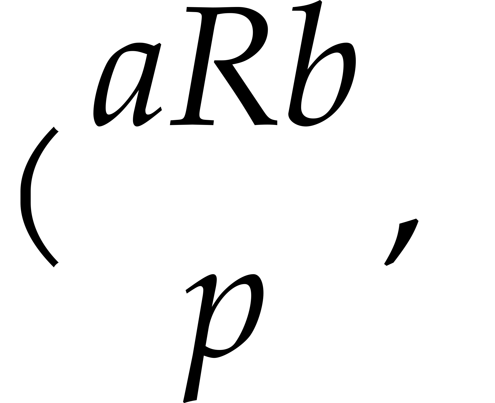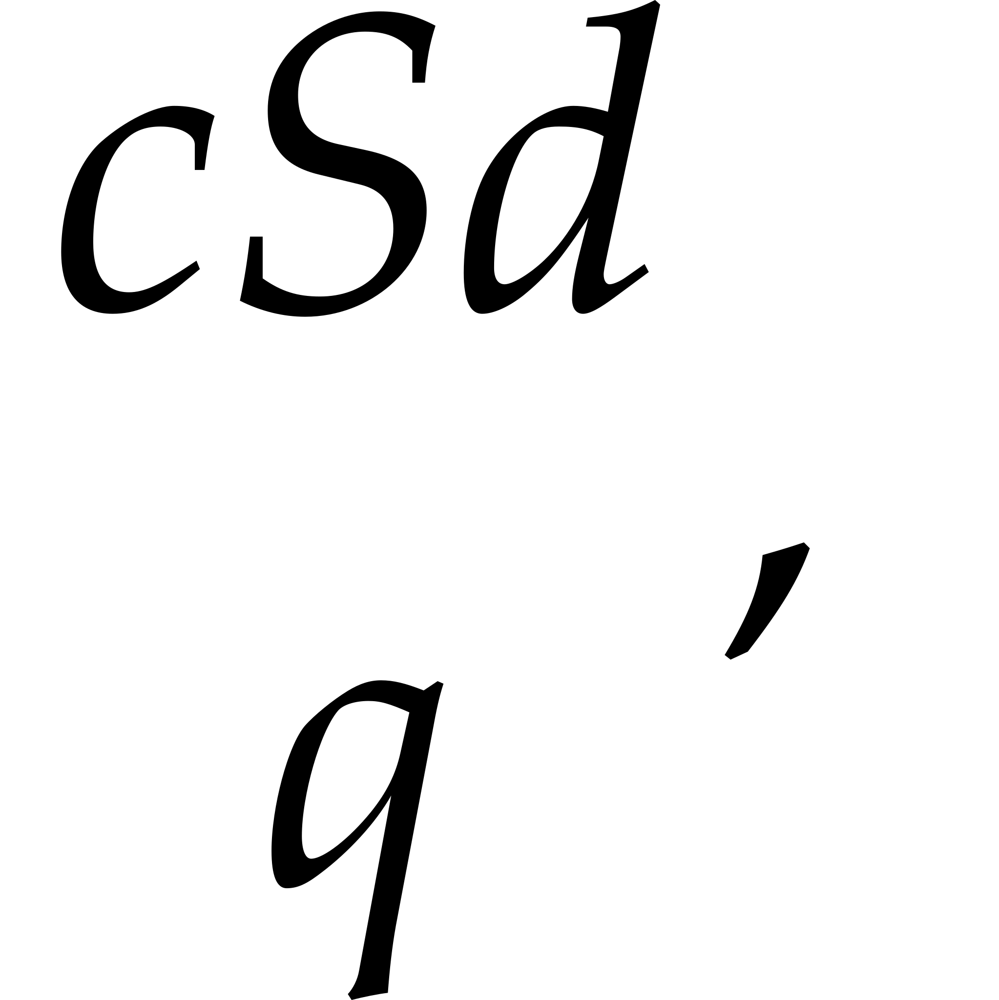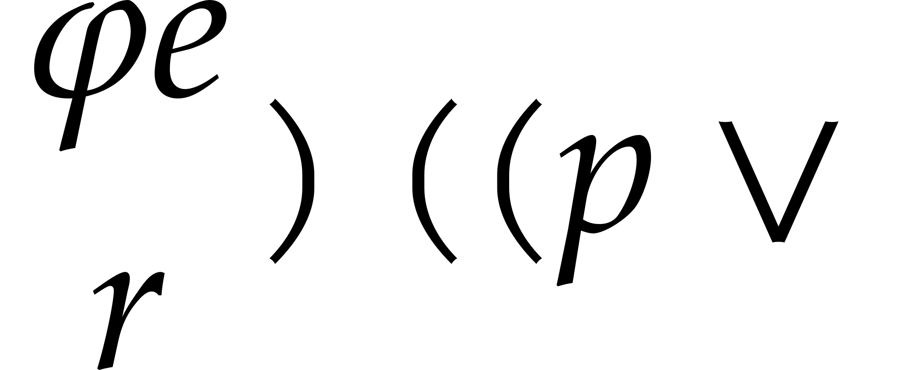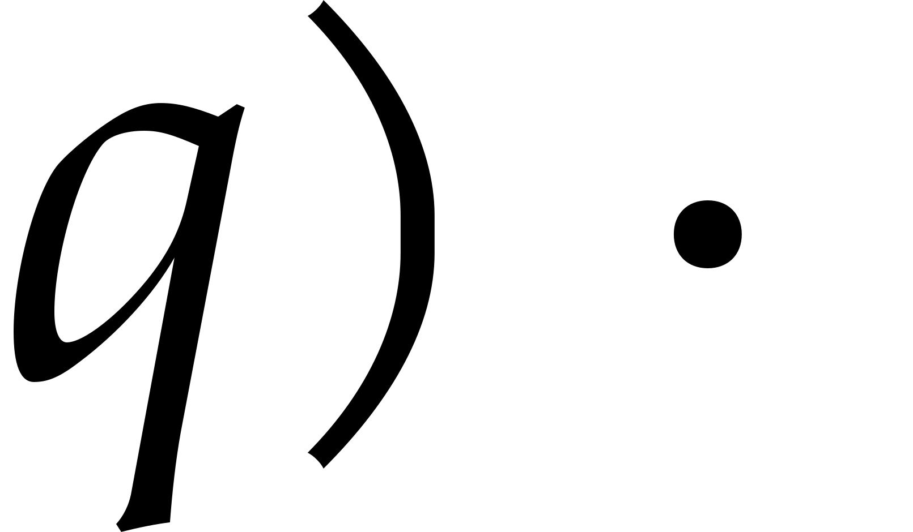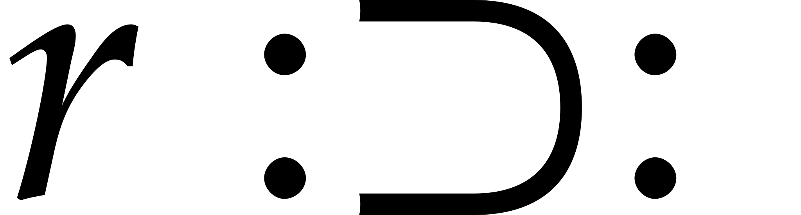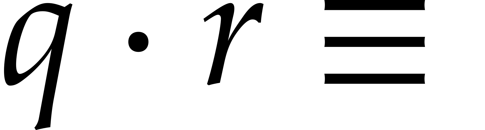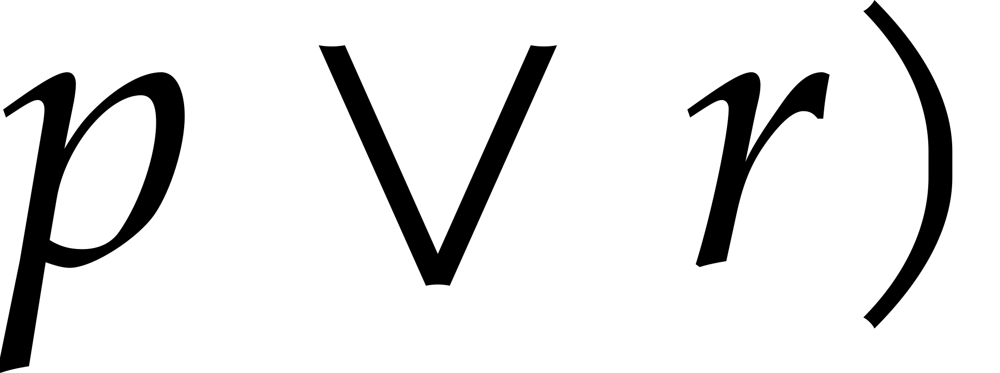

### [Ms-102](/ms-102/#73r.2) [73r\[2\]](https://cdn.wittgensteinnachlass.com/2000px/webp/Ms-102/73r.webp)

18.04.1915

The transition from p to ~p is _not_ characteristic of the operation of negation. (The _best proof_: it also leads from ~p to p.)

### [Ms-102](/ms-102/#73r.3) [73r\[3\]](https://cdn.wittgensteinnachlass.com/2000px/webp/Ms-102/73r.webp)

19.04.1915

What is mirrored in language I cannot express with it.

### [Ms-102](/ms-102/#73r.4+74r.1) [73r\[4\]](https://cdn.wittgensteinnachlass.com/2000px/webp/Ms-102/73r.webp),[74r\[1\]](https://cdn.wittgensteinnachlass.com/2000px/webp/Ms-102/74r.webp)

23.04.1915

We do not believe a priori in a conservation law; rather, we _know_ a priori that its logical form is possible.

### [Ms-102](/ms-102/#74r.2) [74r\[2\]](https://cdn.wittgensteinnachlass.com/2000px/webp/Ms-102/74r.webp)

All those propositions that are certain a priori, such as the principle of sufficient reason, the principle of continuity in nature, etc. etc., are all a priori insights into the possible ways of giving form to the propositions of science.

### [Ms-102](/ms-102/#74r.3+75r.1) [74r\[3\]](https://cdn.wittgensteinnachlass.com/2000px/webp/Ms-102/74r.webp),[75r\[1\]](https://cdn.wittgensteinnachlass.com/2000px/webp/Ms-102/75r.webp)

“Ockham’s maxim” is _of course_ not an arbitrary rule, nor one justified by its practical success. It says that unnecessary sign-units mean nothing.

### [Ms-102](/ms-102/#75r.2) [75r\[2\]](https://cdn.wittgensteinnachlass.com/2000px/webp/Ms-102/75r.webp)

It is clear that signs that serve the same purpose are logically identical. The purely logical _is_ precisely what _all_ of these can accomplish.

### [Ms-102](/ms-102/#75r.3) [75r\[3\]](https://cdn.wittgensteinnachlass.com/2000px/webp/Ms-102/75r.webp)

24.04.1915

In logic (mathematics), process & result are equivalent. (Hence no surprises.)

### [Ms-102](/ms-102/#75r.4+76r.1) [75r\[4\]](https://cdn.wittgensteinnachlass.com/2000px/webp/Ms-102/75r.webp),[76r\[1\]](https://cdn.wittgensteinnachlass.com/2000px/webp/Ms-102/76r.webp)

25.04.1915

Since language stands in _internal_ relations to the world, _it_ and these relations determine the logical possibility of the facts. If we have a meaningful sign, it must stand in a determinate internal relation to a structure. Sign & relation uniquely determine the logical form of what is designated.

### [Ms-102](/ms-102/#76r.2) [76r\[2\]](https://cdn.wittgensteinnachlass.com/2000px/webp/Ms-102/76r.webp)

But cannot any so-called thing be correlated with any such thing in one and the same way? It is quite clear, for example, that we feel – and use – the words of language as logically equivalent units.

### [Ms-102](/ms-102/#76r.3) [76r\[3\]](https://cdn.wittgensteinnachlass.com/2000px/webp/Ms-102/76r.webp)

It always seems as if there were something one _could regard as a thing_ and, _on the other hand_, genuine simple things.

### [Ms-102](/ms-102/#77r.1) [77r\[1\]](https://cdn.wittgensteinnachlass.com/2000px/webp/Ms-102/77r.webp)

It is clear: neither a pencil stroke nor a steamship is simple. Is there really a logical equivalence between these two?

### [Ms-102](/ms-102/#77r.2) [77r\[2\]](https://cdn.wittgensteinnachlass.com/2000px/webp/Ms-102/77r.webp)

“Laws” such as the principle of sufficient reason, etc., deal with the grid, not with what the grid describes.

### [Ms-102](/ms-102/#77r.3) [77r\[3\]](https://cdn.wittgensteinnachlass.com/2000px/webp/Ms-102/77r.webp)

26.04.1915

It must be through generality that the sentences in common use acquire their simple character.

### [Ms-102](/ms-102/#77r.4) [77r\[4\]](https://cdn.wittgensteinnachlass.com/2000px/webp/Ms-102/77r.webp)

We must recognize _how_ language takes care of itself.

### [Ms-102](/ms-102/#77r.5+78r.1) [77r\[5\]](https://cdn.wittgensteinnachlass.com/2000px/webp/Ms-102/77r.webp),[78r\[1\]](https://cdn.wittgensteinnachlass.com/2000px/webp/Ms-102/78r.webp)

The sentence that deals with the “complex” stands in an internal relation to the sentence that deals with its constituent.

### [Ms-102](/ms-102/#78r.2) [78r\[2\]](https://cdn.wittgensteinnachlass.com/2000px/webp/Ms-102/78r.webp)

27.04.1915

Free will consists in the fact that future events _can_ not be _known_ now. We could know them only if causality were an _internal_ necessity – like that of logical inference, for example. – The connection between knowledge & what is known is _that_ of logical necessity.

### [Ms-102](/ms-102/#78r.3) [78r\[3\]](https://cdn.wittgensteinnachlass.com/2000px/webp/Ms-102/78r.webp)

I must not have to concern myself with language.

### [Ms-102](/ms-102/#78r.4+79r.1) [78r\[4\]](https://cdn.wittgensteinnachlass.com/2000px/webp/Ms-102/78r.webp),[79r\[1\]](https://cdn.wittgensteinnachlass.com/2000px/webp/Ms-102/79r.webp)

Not being correct is akin to non-identity.

28.04.1915

### [Ms-102](/ms-102/#79r.2) [79r\[2\]](https://cdn.wittgensteinnachlass.com/2000px/webp/Ms-102/79r.webp)

The operation of negating does not consist in, say, prefixing ~, but in the class of all negating operations.

### [Ms-102](/ms-102/#79r.3) [79r\[3\]](https://cdn.wittgensteinnachlass.com/2000px/webp/Ms-102/79r.webp)

But what properties does this ideal negating operation actually have, then?

### [Ms-102](/ms-102/#79r.4) [79r\[4\]](https://cdn.wittgensteinnachlass.com/2000px/webp/Ms-102/79r.webp)

How does it show itself when two statements are compatible with one another?

If one puts p in place of q in p ⌵ q, the statement becomes p!

### [Ms-102](/ms-102/#79r.5+80r.1) [79r\[5\]](https://cdn.wittgensteinnachlass.com/2000px/webp/Ms-102/79r.webp),[80r\[1\]](https://cdn.wittgensteinnachlass.com/2000px/webp/Ms-102/80r.webp)

Does the sign p.q also belong among those that affirm p? – Is p one of the signs for p ⌵ q?

### [Ms-102](/ms-102/#80r.2) [80r\[2\]](https://cdn.wittgensteinnachlass.com/2000px/webp/Ms-102/80r.webp)

Can one put it this way: All signs that do _not_ affirm p, are _not_ affirmed by p and do _not_ contain p as a tautology or contradiction, all these signs negate p.

### [Ms-102](/ms-102/#80r.3) [80r\[3\]](https://cdn.wittgensteinnachlass.com/2000px/webp/Ms-102/80r.webp)

29.04.1915

That is: all signs that depend on p & that neither affirm p nor are affirmed by p.

### [Ms-102](/ms-102/#80r.4+81r.1) [80r\[4\]](https://cdn.wittgensteinnachlass.com/2000px/webp/Ms-102/80r.webp),[81r\[1\]](https://cdn.wittgensteinnachlass.com/2000px/webp/Ms-102/81r.webp)

30.04.1915

The occurrence of an _operation_ alone can _of course_ say nothing!

### [Ms-102](/ms-102/#81r.2) [81r\[2\]](https://cdn.wittgensteinnachlass.com/2000px/webp/Ms-102/81r.webp)

p is affirmed by all sentences from which it follows. Every sentence that contradicts p negates p.

### [Ms-102](/ms-102/#81r.3) [81r\[3\]](https://cdn.wittgensteinnachlass.com/2000px/webp/Ms-102/81r.webp)

01.05.1915

That p․~p is a contradiction shows that ~p contradicts p.

### [Ms-102](/ms-102/#81r.4) [81r\[4\]](https://cdn.wittgensteinnachlass.com/2000px/webp/Ms-102/81r.webp)

Scepticism is _not_ irrefutable but _obviously nonsensical_ when it seeks to doubt where no question can be asked.

### [Ms-102](/ms-102/#81r.5+82r.1) [81r\[5\]](https://cdn.wittgensteinnachlass.com/2000px/webp/Ms-102/81r.webp),[82r\[1\]](https://cdn.wittgensteinnachlass.com/2000px/webp/Ms-102/82r.webp)

For doubt can exist only where there is a question; a question can exist only where there is an answer, and an answer only where something _can_ be _said_.

### [Ms-102](/ms-102/#82r.2) [82r\[2\]](https://cdn.wittgensteinnachlass.com/2000px/webp/Ms-102/82r.webp)

All theories that say: “It surely _must_ be so, otherwise we could not philosophize” or “otherwise we could not live” etc. etc., must of course disappear.

### [Ms-102](/ms-102/#82r.3) [82r\[3\]](https://cdn.wittgensteinnachlass.com/2000px/webp/Ms-102/82r.webp)

My method is not to separate the hard from the soft, but to see the hardness of the soft.

### [Ms-102](/ms-102/#82r.4) [82r\[4\]](https://cdn.wittgensteinnachlass.com/2000px/webp/Ms-102/82r.webp)

One of the philosopher’s principal skills is not to occupy himself with questions that do not concern him.

### [Ms-102](/ms-102/#82r.5+83r.1) [82r\[5\]](https://cdn.wittgensteinnachlass.com/2000px/webp/Ms-102/82r.webp),[83r\[1\]](https://cdn.wittgensteinnachlass.com/2000px/webp/Ms-102/83r.webp)

Russell’s method in his “Scientific Method in Philosophy” is positively a step backwards from the method of physics.

### [Ms-102](/ms-102/#83r.2) [83r\[2\]](https://cdn.wittgensteinnachlass.com/2000px/webp/Ms-102/83r.webp)

02.05.1915

The class of all signs that affirm both p and q is the sign for p.q. The class of all signs that affirm either p or q is the sentence “p⌵q”.

### [Ms-102](/ms-102/#83r.3) [83r\[3\]](https://cdn.wittgensteinnachlass.com/2000px/webp/Ms-102/83r.webp)

03.05.1915

One cannot say that tautologies and contradictions both say _nothing_ in the sense that they are both, as it were, zero points on the scale of propositions. For at the very least they are *opposite* poles.

### [Ms-102](/ms-102/#83r.4+84r.1) [83r\[4\]](https://cdn.wittgensteinnachlass.com/2000px/webp/Ms-102/83r.webp),[84r\[1\]](https://cdn.wittgensteinnachlass.com/2000px/webp/Ms-102/84r.webp)

Can one say: Two propositions are opposed to one another if there is no sign that affirms them both – which really means: if they have no member in common.

### [Ms-102](/ms-102/#84r.2) [84r\[2\]](https://cdn.wittgensteinnachlass.com/2000px/webp/Ms-102/84r.webp)

One thus thinks of propositions as classes of signs – the propositions “p” and “q” have the member “p.q” in common – and two propositions are opposed to one another if they lie entirely outside one another.

### [Ms-102](/ms-102/#84r.3) [84r\[3\]](https://cdn.wittgensteinnachlass.com/2000px/webp/Ms-102/84r.webp)

04.05.1915

The so-called law of induction cannot in any case be a logical law, for it is evidently a proposition.

### [Ms-102](/ms-102/#84r.4+85r.1) [84r\[4\]](https://cdn.wittgensteinnachlass.com/2000px/webp/Ms-102/84r.webp),[85r\[1\]](https://cdn.wittgensteinnachlass.com/2000px/webp/Ms-102/85r.webp)

The class of all propositions of the form F(x) is the proposition (x) φx.

### [Ms-102](/ms-102/#85r.2) [85r\[2\]](https://cdn.wittgensteinnachlass.com/2000px/webp/Ms-102/85r.webp)

05.05.1915

Is there such a thing as the general sentential form?

Yes, if what is meant by it is the one “logical constant”!

### [Ms-102](/ms-102/#85r.3) [85r\[3\]](https://cdn.wittgensteinnachlass.com/2000px/webp/Ms-102/85r.webp)

Again and again the question “Are there simple things?” seems to have a sense. And yet this question must be nonsensical! –

### [Ms-102](/ms-102/#85r.4) [85r\[4\]](https://cdn.wittgensteinnachlass.com/2000px/webp/Ms-102/85r.webp)

06.05.1915

One would try in vain to express the pseudo-sentence “are there simple things?” in the signs of the concept-script.

### [Ms-102](/ms-102/#86r.1) [86r\[1\]](https://cdn.wittgensteinnachlass.com/2000px/webp/Ms-102/86r.webp)

It is surely clear that I have a concept of the thing, of simple correlation, before me when I think about this matter. But how do I imagine what is simple? Here all I can ever say is “‘x’ has meaning”. – Here is a great riddle!

### [Ms-102](/ms-102/#86r.2) [86r\[2\]](https://cdn.wittgensteinnachlass.com/2000px/webp/Ms-102/86r.webp)

As examples of what is simple I always think of points in the visual image. (Just as I always have parts of the visual image in mind as typical “composite objects”.)

### [Ms-102](/ms-102/#86r.3) [86r\[3\]](https://cdn.wittgensteinnachlass.com/2000px/webp/Ms-102/86r.webp)

07.05.1915

Is spatial compositeness also logical compositeness? It does seem so!

### [Ms-102](/ms-102/#87r.1) [87r\[1\]](https://cdn.wittgensteinnachlass.com/2000px/webp/Ms-102/87r.webp)

But what does a uniformly coloured part of my visual image consist of, for example? Of minimum sensibile? How, then, would one determine the location of each such minimum?

### [Ms-102](/ms-102/#87r.2) [87r\[2\]](https://cdn.wittgensteinnachlass.com/2000px/webp/Ms-102/87r.webp)

Even if the sentences we use all contain generalizations, the prototypes of the constituents of their special cases must still occur in them. So the question remains how we arrive at those prototypes.

### [Ms-102](/ms-102/#87r.3+88r.1) [87r\[3\]](https://cdn.wittgensteinnachlass.com/2000px/webp/Ms-102/87r.webp),[88r\[1\]](https://cdn.wittgensteinnachlass.com/2000px/webp/Ms-102/88r.webp)

08.05.1915

That there are no signs of a particular prototype does not show that that prototype is absent. Depiction in a language of signs does not proceed by having a _sign_ of a prototype stand for an _object_ of the same prototype. The sign and its internal relation to what is designated determine the prototype of the latter, just as abscissae and ordinates determine the points of a figure.

### [Ms-102](/ms-102/#88r.2) [88r\[2\]](https://cdn.wittgensteinnachlass.com/2000px/webp/Ms-102/88r.webp)

09.05.1915

A question: Can we do without simple objects in _logic_?

### [Ms-102](/ms-102/#88r.3+89r.1) [88r\[3\]](https://cdn.wittgensteinnachlass.com/2000px/webp/Ms-102/88r.webp),[89r\[1\]](https://cdn.wittgensteinnachlass.com/2000px/webp/Ms-102/89r.webp)

_Obviously_ sentences are possible that contain no simple signs, i.e. no signs that have a meaning directly. And these really are _sentences_ that have a sense, and the definitions of their constituents need not stand alongside them either.

### [Ms-102](/ms-102/#89r.2) [89r\[2\]](https://cdn.wittgensteinnachlass.com/2000px/webp/Ms-102/89r.webp)

It is surely clear that constituents of our sentences can be broken down by means of definitions, and must be, if we want to get closer to the actual structure of the sentence. _In any case, then, there is a process of analysis_. And can one not now ask whether this process eventually comes to an end? And if so: What will the end be??

### [Ms-102](/ms-102/#89r.3+90r.1) [89r\[3\]](https://cdn.wittgensteinnachlass.com/2000px/webp/Ms-102/89r.webp),[90r\[1\]](https://cdn.wittgensteinnachlass.com/2000px/webp/Ms-102/90r.webp)

If it is true that every defined sign designates via its definitions, then presumably the chain of definitions must eventually come to an end.

### [Ms-102](/ms-102/#90r.2) [90r\[2\]](https://cdn.wittgensteinnachlass.com/2000px/webp/Ms-102/90r.webp)

The analysed sentence speaks of more than the unanalysed one.

### [Ms-102](/ms-102/#90r.3) [90r\[3\]](https://cdn.wittgensteinnachlass.com/2000px/webp/Ms-102/90r.webp)

Analysis makes the sentence more complicated than it was, but cannot & must not make it more complicated than its meaning was to begin with.

### [Ms-102](/ms-102/#90r.4) [90r\[4\]](https://cdn.wittgensteinnachlass.com/2000px/webp/Ms-102/90r.webp)

If the sentence is exactly as complex as its meaning, then it is _fully_ analysed.

### [Ms-102](/ms-102/#90r.5) [90r\[5\]](https://cdn.wittgensteinnachlass.com/2000px/webp/Ms-102/90r.webp)

But the meaning of our sentences is not infinitely complicated.

### [Ms-102](/ms-102/#91r.1) [91r\[1\]](https://cdn.wittgensteinnachlass.com/2000px/webp/Ms-102/91r.webp)

The sentence is the picture of the facts. I can devise different pictures of a fact. (The logical operations serve this purpose.) But what is characteristic of the _fact_ in these pictures will be the same in all of them and will not depend on me.

### [Ms-102](/ms-102/#91r.2) [91r\[2\]](https://cdn.wittgensteinnachlass.com/2000px/webp/Ms-102/91r.webp)

With the class of signs for the sentence “p”, the class “~p” etc. etc. is already given. As it must be.

### [Ms-102](/ms-102/#91r.3+92r.1) [91r\[3\]](https://cdn.wittgensteinnachlass.com/2000px/webp/Ms-102/91r.webp),[92r\[1\]](https://cdn.wittgensteinnachlass.com/2000px/webp/Ms-102/92r.webp)

_But_ does this not already presuppose that the class of all sentences is given to us? And how do we arrive at _it_?

### [Ms-102](/ms-102/#92r.2) [92r\[2\]](https://cdn.wittgensteinnachlass.com/2000px/webp/Ms-102/92r.webp)

10.05.1915

11.05.1915 Is the logical sum of two tautologies a tautology in the first sense? Is there really the duality: tautology – contradiction?

### [Ms-102](/ms-102/#92r.3) [92r\[3\]](https://cdn.wittgensteinnachlass.com/2000px/webp/Ms-102/92r.webp)

Our simple _is_: the simplest thing we know. – The simplest thing that our analysis can reach – it need only appear as a prototype, as a variable in our sentences – _this_ is the simple that we mean and are looking for.

### [Ms-102](/ms-102/#93r.1) [93r\[1\]](https://cdn.wittgensteinnachlass.com/2000px/webp/Ms-102/93r.webp)

12.05.1915

The general concept of depiction and _that_ of coordinates.

### [Ms-102](/ms-102/#93r.2) [93r\[2\]](https://cdn.wittgensteinnachlass.com/2000px/webp/Ms-102/93r.webp)

Supposing the expression “~(∃x) x = x” were a sentence, namely something like “There are no things”, it would be very surprising that, in order to express this sentence in symbols, we should have to use a relation ( = ) that the sentence does not really speak of at all.

### [Ms-102](/ms-102/#93r.3) [93r\[3\]](https://cdn.wittgensteinnachlass.com/2000px/webp/Ms-102/93r.webp)

13.05.1915

A peculiar logical manipulation, the _personification_ of _time_!

### [Ms-102](/ms-102/#93r.4+94r.1) [93r\[4\]](https://cdn.wittgensteinnachlass.com/2000px/webp/Ms-102/93r.webp),[94r\[1\]](https://cdn.wittgensteinnachlass.com/2000px/webp/Ms-102/94r.webp)

One must not pull the knot tight before one is sure one has got hold of the right end.

### [Ms-102](/ms-102/#94r.2) [94r\[2\]](https://cdn.wittgensteinnachlass.com/2000px/webp/Ms-102/94r.webp)

May we regard a part of space as a thing?

We evidently always do this in a certain sense when we speak of spatial things.

### [Ms-102](/ms-102/#94r.3+95r.1) [94r\[3\]](https://cdn.wittgensteinnachlass.com/2000px/webp/Ms-102/94r.webp),[95r\[1\]](https://cdn.wittgensteinnachlass.com/2000px/webp/Ms-102/95r.webp)

For it seems – at least as far as I can _see_ now – that getting rid of names by means of definitions is not enough: complex spatial objects, for example, seem to me in some sense to be essentially things – I see them, so to speak, as things – and their designation by means of names seems to be more than a mere linguistic trick. Composite spatial objects – for example – really appear – so it seems – as things.

### [Ms-102](/ms-102/#95r.2) [95r\[2\]](https://cdn.wittgensteinnachlass.com/2000px/webp/Ms-102/95r.webp)

But what does all this mean?

### [Ms-102](/ms-102/#95r.3) [95r\[3\]](https://cdn.wittgensteinnachlass.com/2000px/webp/Ms-102/95r.webp)

The very fact that we designate those objects by names so entirely instinctively. –

### [Ms-102](/ms-102/#95r.4) [95r\[4\]](https://cdn.wittgensteinnachlass.com/2000px/webp/Ms-102/95r.webp)

14.05.1915

Language is a part of our organism, and no less complicated than it is.

### [Ms-102](/ms-102/#96r.2) [96r\[2\]](https://cdn.wittgensteinnachlass.com/2000px/webp/Ms-102/96r.webp)

The old problem of complex and fact!

### [Ms-102](/ms-102/#96r.3+97r.1) [96r\[3\]](https://cdn.wittgensteinnachlass.com/2000px/webp/Ms-102/96r.webp),[97r\[1\]](https://cdn.wittgensteinnachlass.com/2000px/webp/Ms-102/97r.webp)

15.05.1915

The theory of complexes finds expression in sentences like this: “If a sentence is true, then something exists”; there seems to be a difference between the fact that the sentence expresses: a stands in the relation R to b, and the complex: _a in the relation R to b_, which is precisely what “exists” if that sentence is true. It seems as though we could _designate_ this something, and do so with a genuine “composite sign”. – The feelings expressed in these sentences are quite natural and unaffected; so there must be a truth underlying them. But which one?

### [Ms-102](/ms-102/#97r.3) [97r\[3\]](https://cdn.wittgensteinnachlass.com/2000px/webp/Ms-102/97r.webp)

This much is clear: a complex can be given only by its description; and this will be correct or not.

### [Ms-102](/ms-102/#97r.4) [97r\[4\]](https://cdn.wittgensteinnachlass.com/2000px/webp/Ms-102/97r.webp)

The sentence that speaks of a complex will, if the complex does not exist, be simply false, not nonsensical!

### [Ms-102](/ms-102/#97r.5+98r.1) [97r\[5\]](https://cdn.wittgensteinnachlass.com/2000px/webp/Ms-102/97r.webp),[98r\[1\]](https://cdn.wittgensteinnachlass.com/2000px/webp/Ms-102/98r.webp)

16.05.1915

When I see space, do I see all its points?

### [Ms-102](/ms-102/#98r.2) [98r\[2\]](https://cdn.wittgensteinnachlass.com/2000px/webp/Ms-102/98r.webp)

One can no more represent in language something “that contradicts logic” than one can represent in geometry, by its coordinates, a figure that contradicts the laws of space, or, say, give the coordinates of a point that does not exist.

### [Ms-102](/ms-102/#98r.3+99r.1) [98r\[3\]](https://cdn.wittgensteinnachlass.com/2000px/webp/Ms-102/98r.webp),[99r\[1\]](https://cdn.wittgensteinnachlass.com/2000px/webp/Ms-102/99r.webp)

If there were sentences that asserted the existence of prototypes, they would be unique and a kind of “logical sentences”, and the number of these sentences would give logic an impossible reality. There would be co-ordination in logic.

### [Ms-102](/ms-102/#99r.2) [99r\[2\]](https://cdn.wittgensteinnachlass.com/2000px/webp/Ms-102/99r.webp)

17.05.1915

18.05.1915 The possibility of all similes, of the whole pictorial character of our way of expressing ourselves, rests on the logic of depiction.

### [Ms-102](/ms-102/#99r.3+100r.1) [99r\[3\]](https://cdn.wittgensteinnachlass.com/2000px/webp/Ms-102/99r.webp),[100r\[1\]](https://cdn.wittgensteinnachlass.com/2000px/webp/Ms-102/100r.webp)

19.05.1915

We can even conceive of a body in motion, _together with its motion_, as a thing. Thus the moon revolving around the earth moves around the sun. Here it seems clear that this reification involves nothing but a logical manipulation – the possibility of which, incidentally, may be highly significant.

Or let us consider reifications such as: a melody, a spoken sentence. –

### [Ms-102](/ms-102/#100r.2) [100r\[2\]](https://cdn.wittgensteinnachlass.com/2000px/webp/Ms-102/100r.webp)

When I say “‘x’ has meaning”, do I feel: “It is impossible for ‘x’ to mean, say, this knife or this letter”? Not at all. Quite the contrary.

### [Ms-102](/ms-102/#100r.3) [100r\[3\]](https://cdn.wittgensteinnachlass.com/2000px/webp/Ms-102/100r.webp)

20.05.1915

A complex is, after all, a thing!

### [Ms-102](/ms-102/#100r.4+101r.1) [100r\[4\]](https://cdn.wittgensteinnachlass.com/2000px/webp/Ms-102/100r.webp),[101r\[1\]](https://cdn.wittgensteinnachlass.com/2000px/webp/Ms-102/101r.webp)

21.05.1915

We can, to be sure, represent spatially a situation that would run counter to the laws of physics, but not one that would run counter to the laws of geometry.

### [Ms-102](/ms-102/#101r.2) [101r\[2\]](https://cdn.wittgensteinnachlass.com/2000px/webp/Ms-102/101r.webp)

22.05.1915

The mathematical notation for infinite series such as 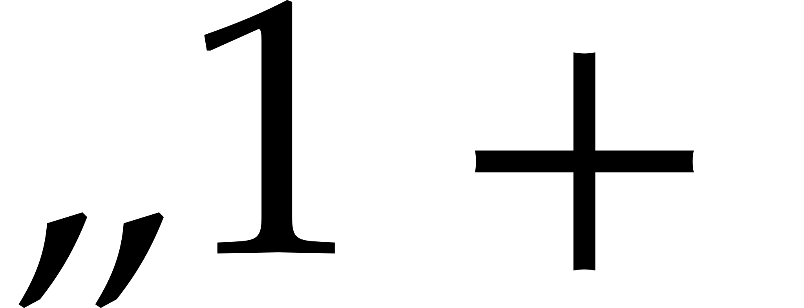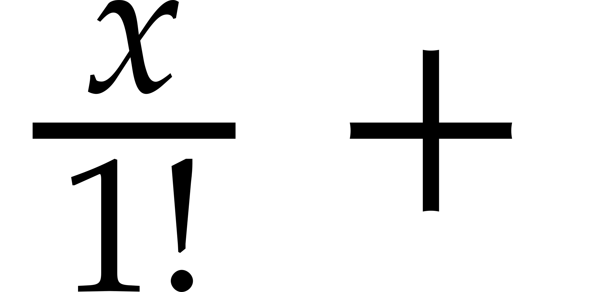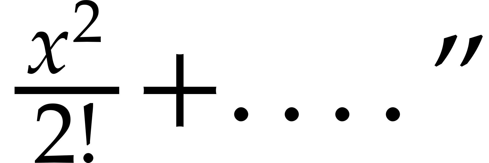 _with the dots_ is an example of that extended generality. A law is given, and the terms that are written down serve as an illustration.

Thus one could write “f(x).f(y) ‥‥” instead of (x) fx.

### [Ms-102](/ms-102/#101r.3) [101r\[3\]](https://cdn.wittgensteinnachlass.com/2000px/webp/Ms-102/101r.webp)

Spatial & _temporal_ complexes.

### [Ms-102](/ms-102/#101r.4) [101r\[4\]](https://cdn.wittgensteinnachlass.com/2000px/webp/Ms-102/101r.webp)

23.05.1915

_The limits of my language_ mean the limits of my world.

### [Ms-102](/ms-102/#101r.5+102r.1) [101r\[5\]](https://cdn.wittgensteinnachlass.com/2000px/webp/Ms-102/101r.webp),[102r\[1\]](https://cdn.wittgensteinnachlass.com/2000px/webp/Ms-102/102r.webp)

There really is only one world-soul, which I call pre-eminently _my_ soul, and I grasp what I call the souls of others only as that world-soul.

### [Ms-102](/ms-102/#102r.2) [102r\[2\]](https://cdn.wittgensteinnachlass.com/2000px/webp/Ms-102/102r.webp)

The preceding remark provides the key to deciding to what extent solipsism is a truth.

### [Ms-102](/ms-102/#102r.3) [102r\[3\]](https://cdn.wittgensteinnachlass.com/2000px/webp/Ms-102/102r.webp)

I had long been aware that I could write a book, “What Kind of World I Found.”

### [Ms-102](/ms-102/#102r.4+103r.1) [102r\[4\]](https://cdn.wittgensteinnachlass.com/2000px/webp/Ms-102/102r.webp),[103r\[1\]](https://cdn.wittgensteinnachlass.com/2000px/webp/Ms-102/103r.webp)

Do we not have just that feeling of a simple relation which we always have in mind as the chief ground for the existence of “simple objects” – do we not have this very same feeling when we think of the relation between a name & a complex object?

### [Ms-102](/ms-102/#103r.2) [103r\[2\]](https://cdn.wittgensteinnachlass.com/2000px/webp/Ms-102/103r.webp)

Suppose the complex object is this book. Let it be called “A”. Then surely the occurrence of “A” in the sentence indicates the occurrence of the book in the fact. _Even in analysis it does not resolve itself arbitrarily, so that, say, it would resolve quite differently in each sentential structure._ –

### [Ms-102](/ms-102/#103r.3+104r.1) [103r\[3\]](https://cdn.wittgensteinnachlass.com/2000px/webp/Ms-102/103r.webp),[104r\[1\]](https://cdn.wittgensteinnachlass.com/2000px/webp/Ms-102/104r.webp)

And just as the occurrence of the name of a thing in different sentences does, so the occurrence of the name of composite objects shows that a form and a content are shared.

### [Ms-102](/ms-102/#104r.2) [104r\[2\]](https://cdn.wittgensteinnachlass.com/2000px/webp/Ms-102/104r.webp)

Nevertheless, an _infinitely_ complex state of affairs now seems an absurdity!

### [Ms-102](/ms-102/#104r.3) [104r\[3\]](https://cdn.wittgensteinnachlass.com/2000px/webp/Ms-102/104r.webp)

But this too seems certain: we do not infer the existence of simple objects from the existence of particular simple objects, but rather know it as the ultimate result of an analysis – as it were by description – through a process that leads to them.

### [Ms-102](/ms-102/#104r.4+105r.1) [104r\[4\]](https://cdn.wittgensteinnachlass.com/2000px/webp/Ms-102/104r.webp),[105r\[1\]](https://cdn.wittgensteinnachlass.com/2000px/webp/Ms-102/105r.webp)

Even if a turn of phrase is nonsensical, one can still use it – see the last remark.

### [Ms-102](/ms-102/#105r.2) [105r\[2\]](https://cdn.wittgensteinnachlass.com/2000px/webp/Ms-102/105r.webp)

In the book “The World I Found”, it would also be necessary to report on my body and to say which limbs are subject to my will, etc. For this is a method of isolating the subject, or rather of showing that in an important sense there is no subject: it is the one thing that could _not_ be spoken of in this book. –

### [Ms-102](/ms-102/#105r.3+106r.1) [105r\[3\]](https://cdn.wittgensteinnachlass.com/2000px/webp/Ms-102/105r.webp),[106r\[1\]](https://cdn.wittgensteinnachlass.com/2000px/webp/Ms-102/106r.webp)

24.05.1915

Although we do not know simple objects from direct perception, we _do_ know complex objects from direct perception; we know from direct perception that they are complex. – And that they must ultimately consist of simple things? We take, for example, a part out of our visual field, and see that it is still complex, that a part of it is still complex but already simpler, and so on. –

### [Ms-102](/ms-102/#106r.2) [106r\[2\]](https://cdn.wittgensteinnachlass.com/2000px/webp/Ms-102/106r.webp)

Is it conceivable that we – for example – _see_ that _all the points of a surface are yellow_ without seeing any _one_ point of that surface? It almost seems so.

### [Ms-102](/ms-102/#106r.3) [106r\[3\]](https://cdn.wittgensteinnachlass.com/2000px/webp/Ms-102/106r.webp)

On the origin of problems: the oppressive tension that at some point crystallizes into a question and objectifies itself.

### [Ms-102](/ms-102/#107r.1) [107r\[1\]](https://cdn.wittgensteinnachlass.com/2000px/webp/Ms-102/107r.webp)

How, for example, would we describe a surface uniformly covered with blue?

### [Ms-102](/ms-102/#107r.2) [107r\[2\]](https://cdn.wittgensteinnachlass.com/2000px/webp/Ms-102/107r.webp)

25.05.1915

Does the visual image of a minimum visibile really appear to us indivisible? What has extension is divisible. Are there parts of our visual image that have _no_ extension? Those of the fixed stars, perhaps? –

### [Ms-102](/ms-102/#107r.3+108r.1) [107r\[3\]](https://cdn.wittgensteinnachlass.com/2000px/webp/Ms-102/107r.webp),[108r\[1\]](https://cdn.wittgensteinnachlass.com/2000px/webp/Ms-102/108r.webp)

The urge towards the mystical comes from the failure of science to satisfy our wishes. We _feel_ that even when all _possible_ scientific questions have been answered, _our problem has not yet even been_ _touched_. Of course, there is then simply no question left; and that is precisely the answer.

### [Ms-102](/ms-102/#108r.2) [108r\[2\]](https://cdn.wittgensteinnachlass.com/2000px/webp/Ms-102/108r.webp)

The tautology is affirmed by _every_ sentence; the contradiction is negated by every sentence. (After all, one could append any _one_ tautology to any sentence with “and”, without altering its sense, and likewise the negation of a contradiction.)

And “without altering its sense” means: without altering what is _essential_ in the sign itself. For one cannot alter the _sign_ without altering its sense.

### [Ms-102](/ms-102/#109r.1) [109r\[1\]](https://cdn.wittgensteinnachlass.com/2000px/webp/Ms-102/109r.webp)

“aRa” _must_ have sense if “aRb” has sense.

### [Ms-102](/ms-102/#109r.2) [109r\[2\]](https://cdn.wittgensteinnachlass.com/2000px/webp/Ms-102/109r.webp)

26.05.1915

But how am I now to explain the general essence of the _sentence_? We can presumably say: everything that is the case (or is not) can be depicted by a sentence. But here we have the expression “_to be the case_”! It is just as problematic.

### [Ms-102](/ms-102/#109r.3) [109r\[3\]](https://cdn.wittgensteinnachlass.com/2000px/webp/Ms-102/109r.webp)

The objects form the counterpart to the sentence.

### [Ms-102](/ms-102/#109r.4) [109r\[4\]](https://cdn.wittgensteinnachlass.com/2000px/webp/Ms-102/109r.webp)

I can only _name_ the objects. Signs stand for them.

### [Ms-102](/ms-102/#110r.1) [110r\[1\]](https://cdn.wittgensteinnachlass.com/2000px/webp/Ms-102/110r.webp)

27.05.1915

I can only speak _of_ them; I cannot speak them.

### [Ms-102](/ms-102/#110r.2) [110r\[2\]](https://cdn.wittgensteinnachlass.com/2000px/webp/Ms-102/110r.webp)

“But could there not be something that cannot be expressed by a _sentence_ (and is not an object either)?” Then it simply could not be expressed by _language_; nor can we _ask_ about it.

### [Ms-102](/ms-102/#110r.3+111r.1) [110r\[3\]](https://cdn.wittgensteinnachlass.com/2000px/webp/Ms-102/110r.webp),[111r\[1\]](https://cdn.wittgensteinnachlass.com/2000px/webp/Ms-102/111r.webp)

What if there is something outside the _facts_? Something our sentences are unable to express? But there we have, for example, the _things_, _and we feel no desire at all_ to express them in sentences. What cannot be expressed we do not express –. And how are we to _ask_ whether _what_ cannot be _expressed_ can be expressed?

### [Ms-102](/ms-102/#111r.2) [111r\[2\]](https://cdn.wittgensteinnachlass.com/2000px/webp/Ms-102/111r.webp)

_Is there no domain outside the facts_?

### [Ms-102](/ms-102/#111r.3) [111r\[3\]](https://cdn.wittgensteinnachlass.com/2000px/webp/Ms-102/111r.webp)

28.05.1915

“Composite sign” and “sentence” _have the same meaning_.

### [Ms-102](/ms-102/#111r.4) [111r\[4\]](https://cdn.wittgensteinnachlass.com/2000px/webp/Ms-102/111r.webp)

Is it a tautology to say that _language_ consists of _sentences_? It seems the answer is _yes_.

### [Ms-102](/ms-102/#111r.5+112r.1) [111r\[5\]](https://cdn.wittgensteinnachlass.com/2000px/webp/Ms-102/111r.webp),[112r\[1\]](https://cdn.wittgensteinnachlass.com/2000px/webp/Ms-102/112r.webp)

29.05.1915

But is _language_ the _only_ language? Why should there not be a way of expressing myself in which I can speak _about_ language, so that it can appear to me co-ordinated with something else?

### [Ms-102](/ms-102/#112r.2) [112r\[2\]](https://cdn.wittgensteinnachlass.com/2000px/webp/Ms-102/112r.webp)

Suppose music were such a way of expressing oneself: then it is in any case characteristic of _science_ that _no_ musical themes occur in it.

### [Ms-102](/ms-102/#112r.3) [112r\[3\]](https://cdn.wittgensteinnachlass.com/2000px/webp/Ms-102/112r.webp)

I myself write down only _sentences_ here. And why?

### [Ms-102](/ms-102/#112r.4) [112r\[4\]](https://cdn.wittgensteinnachlass.com/2000px/webp/Ms-102/112r.webp)

_How_ is language unique?

### [Ms-102](/ms-102/#112r.5+113r.1) [112r\[5\]](https://cdn.wittgensteinnachlass.com/2000px/webp/Ms-102/112r.webp),[113r\[1\]](https://cdn.wittgensteinnachlass.com/2000px/webp/Ms-102/113r.webp)

30.05.1915

Words are like the skin on deep water.

It is clear that asking what a sentence is comes to the same thing as asking what a fact is – or a complex.

### [Ms-102](/ms-102/#113r.2) [113r\[2\]](https://cdn.wittgensteinnachlass.com/2000px/webp/Ms-102/113r.webp)

And why should one not say: “There are complexes; one can name them with names or depict them by sentences”?

### [Ms-102](/ms-102/#113r.3) [113r\[3\]](https://cdn.wittgensteinnachlass.com/2000px/webp/Ms-102/113r.webp)

The name of a complex functions in a sentence like the name of an object that I know only through a _description_. – The sentence that depicts it functions as the description.

### [Ms-102](/ms-102/#114r.1) [114r\[1\]](https://cdn.wittgensteinnachlass.com/2000px/webp/Ms-102/114r.webp)

But if there are simple objects, is it right to call their signs and those other signs “names”?

### [Ms-102](/ms-102/#114r.2) [114r\[2\]](https://cdn.wittgensteinnachlass.com/2000px/webp/Ms-102/114r.webp)

Or is name, so to speak, a _logical_ concept?

“It marks the sharing of a form and a content”. –

Depending on how the structure of the complex varies, its name designates in a different way & manner and is subject to different syntactical laws.

### [Ms-102](/ms-102/#114r.3+115r.1) [114r\[3\]](https://cdn.wittgensteinnachlass.com/2000px/webp/Ms-102/114r.webp),[115r\[1\]](https://cdn.wittgensteinnachlass.com/2000px/webp/Ms-102/115r.webp)

The error in this conception must lie in the fact that on the one hand it sets complex and simple objects in opposition to one another, but on the other hand treats them as related. And yet: _constituents_ and _complex_ seem to be related _and_ opposed to one another! (Like the plan of a town and the map of a country lying before us, of the same size but on different scales.)

### [Ms-102](/ms-102/#115r.2+116r.1) [115r\[2\]](https://cdn.wittgensteinnachlass.com/2000px/webp/Ms-102/115r.webp),[116r\[1\]](https://cdn.wittgensteinnachlass.com/2000px/webp/Ms-102/116r.webp)

Where does this feeling come from!: “To everything I see, to this landscape, to the flight of the seeds through the air, to all this I can assign a name; indeed, what, if not this, should names name for me”?

### [Ms-102](/ms-102/#116r.2) [116r\[2\]](https://cdn.wittgensteinnachlass.com/2000px/webp/Ms-102/116r.webp)

Names mark the sharing of _one_ form and _one_ content. – Only in conjunction _with_ their syntactical use do they mark _a particular_ logical form.

### [Ms-102](/ms-102/#116r.3) [116r\[3\]](https://cdn.wittgensteinnachlass.com/2000px/webp/Ms-102/116r.webp)

31.05.1915

One can accomplish no more with the description of the world by means of names than with the general description of the world!!!

### [Ms-102](/ms-102/#116r.4) [116r\[4\]](https://cdn.wittgensteinnachlass.com/2000px/webp/Ms-102/116r.webp)

Could one then get by without names?? Presumably not.

### [Ms-102](/ms-102/#117r.1) [117r\[1\]](https://cdn.wittgensteinnachlass.com/2000px/webp/Ms-102/117r.webp)

Names are necessary for a statement that _this_ thing has _that_ property, and so on. They link the sentential form to quite particular objects. And if the general description of the world is like a template of the world, then the names nail it to the world so that it coincides with it everywhere.

### [Ms-102](/ms-102/#117r.2) [117r\[2\]](https://cdn.wittgensteinnachlass.com/2000px/webp/Ms-102/117r.webp)

01.06.1915

The great problem around which everything I write revolves is: Is there, a priori, an order in the world, and if so, what does it consist in?

### [Ms-102](/ms-102/#117r.3+118r.1) [117r\[3\]](https://cdn.wittgensteinnachlass.com/2000px/webp/Ms-102/117r.webp),[118r\[1\]](https://cdn.wittgensteinnachlass.com/2000px/webp/Ms-102/118r.webp)

You look into the bank of fog and can therefore talk yourself into thinking the goal is already near.

But the fog disperses and the goal is still not in sight!

### [Ms-102](/ms-102/#118r.2) [118r\[2\]](https://cdn.wittgensteinnachlass.com/2000px/webp/Ms-102/118r.webp)

02.06.1915

I said: “A tautology is affirmed by _every_ sentence”; but that does not yet say why it is not a _sentence_. Does that already say _why_ a sentence cannot be affirmed by p _and_ by ~p?!

### [Ms-102](/ms-102/#118r.3) [118r\[3\]](https://cdn.wittgensteinnachlass.com/2000px/webp/Ms-102/118r.webp)

For my theory does not really bring out that a sentence _must_ have two poles.

### [Ms-102](/ms-102/#119r.1) [119r\[1\]](https://cdn.wittgensteinnachlass.com/2000px/webp/Ms-102/119r.webp)

For I would now have to find, in the terminology of this theory, an expression for _how much a sentence says._ And it would then have to emerge that tautologies say _nothing_.

### [Ms-102](/ms-102/#119r.2) [119r\[2\]](https://cdn.wittgensteinnachlass.com/2000px/webp/Ms-102/119r.webp)

But how is this measure of how much is said to be found?

### [Ms-102](/ms-102/#119r.3) [119r\[3\]](https://cdn.wittgensteinnachlass.com/2000px/webp/Ms-102/119r.webp)

It exists in any case; and our theory _must_ be able to give expression to it.

### [Ms-102](/ms-102/#119r.4) [119r\[4\]](https://cdn.wittgensteinnachlass.com/2000px/webp/Ms-102/119r.webp)

03.06.1915

One could presumably say: _The_ sentence that says most is the one from which most follows.

### [Ms-102](/ms-102/#119r.5+120r.1) [119r\[5\]](https://cdn.wittgensteinnachlass.com/2000px/webp/Ms-102/119r.webp),[120r\[1\]](https://cdn.wittgensteinnachlass.com/2000px/webp/Ms-102/120r.webp)

Could one say: “from which the greatest number of mutually independent sentences follow”?

### [Ms-102](/ms-102/#120r.2) [120r\[2\]](https://cdn.wittgensteinnachlass.com/2000px/webp/Ms-102/120r.webp)

But does it not go like this?: If p follows from q, but q does not follow from p, then q says more than p. Now nothing at all follows from a tautology. – But it follows from every sentence. The analogous thing holds for its opposite.

### [Ms-102](/ms-102/#120r.3+121r.1) [120r\[3\]](https://cdn.wittgensteinnachlass.com/2000px/webp/Ms-102/120r.webp),[121r\[1\]](https://cdn.wittgensteinnachlass.com/2000px/webp/Ms-102/121r.webp)

But how so! Would not the contradiction then be the sentence that says most? After all, from “p․~p” follows not only “p” but also “~p”! Every sentence follows from them and they follow from none!? But surely I can infer nothing from a contradiction precisely because it is a contradiction! But if the contradiction is the class of _all sentences_, then the tautology becomes what all classes of sentences that have nothing in common have in common, and vanishes altogether. Thus “p⌵~p” would only appear to be a sign. In reality, however, the dissolution of the sentence.

### [Ms-102](/ms-102/#121r.2+122r.1) [121r\[2\]](https://cdn.wittgensteinnachlass.com/2000px/webp/Ms-102/121r.webp),[122r\[1\]](https://cdn.wittgensteinnachlass.com/2000px/webp/Ms-102/122r.webp)

The tautology vanishes, so to speak, within all sentences, the contradiction outside all sentences.

### [Ms-102](/ms-102/#122r.2) [122r\[2\]](https://cdn.wittgensteinnachlass.com/2000px/webp/Ms-102/122r.webp)

– Incidentally, in these considerations I seem always to start unconsciously from the elementary sentence. –

### [Ms-102](/ms-102/#122r.3) [122r\[3\]](https://cdn.wittgensteinnachlass.com/2000px/webp/Ms-102/122r.webp)

The contradiction is the outer boundary of sentences; no sentence affirms it. The tautology is their centre without substance. (One can regard the centre of a circular area as its inner boundary.)

### [Ms-102](/ms-102/#122r.4) [122r\[4\]](https://cdn.wittgensteinnachlass.com/2000px/webp/Ms-102/122r.webp)

(Incidentally, the word that will set us free has not yet been spoken here.)

### [Ms-102](/ms-102/#122r.5+123r.1) [122r\[5\]](https://cdn.wittgensteinnachlass.com/2000px/webp/Ms-102/122r.webp),[123r\[1\]](https://cdn.wittgensteinnachlass.com/2000px/webp/Ms-102/123r.webp)

For it is very easy here to confuse logical addition with the logical product.

### [Ms-102](/ms-102/#123r.2) [123r\[2\]](https://cdn.wittgensteinnachlass.com/2000px/webp/Ms-102/123r.webp)

For we arrive at the seemingly remarkable result that two sentences must have something in common in order to be affirmed by one sentence.

### [Ms-102](/ms-102/#123r.3) [123r\[3\]](https://cdn.wittgensteinnachlass.com/2000px/webp/Ms-102/123r.webp)

(But belonging to _one_ class is also something that sentences can have _in common_!)

### [Ms-102](/ms-102/#123r.4) [123r\[4\]](https://cdn.wittgensteinnachlass.com/2000px/webp/Ms-102/123r.webp)

(Here there is still a distinct and decisive lack of clarity in my theory. Hence a certain feeling of dissatisfaction!)

### [Ms-102](/ms-102/#123r.5+124r.1) [123r\[5\]](https://cdn.wittgensteinnachlass.com/2000px/webp/Ms-102/123r.webp),[124r\[1\]](https://cdn.wittgensteinnachlass.com/2000px/webp/Ms-102/124r.webp)

04.06.1915

“p.q” has sense only if “p⌵q” has sense.

### [Ms-102](/ms-102/#124r.2) [124r\[2\]](https://cdn.wittgensteinnachlass.com/2000px/webp/Ms-102/124r.webp)

05.06.1915

“p.q” affirms “p” and “q”. But this does not mean that “p.q” is the constituent common to “p” and “q”, but, on the contrary, that “p” and “q” are both contained in “p.q”.

### [Ms-102](/ms-102/#124r.3) [124r\[3\]](https://cdn.wittgensteinnachlass.com/2000px/webp/Ms-102/124r.webp)

In this sense p and ~p would even have something in common, for example sentences such as ~p⌵q and p⌵q. That is to say: there are indeed sentences that are affirmed both by “p” and by “~p” – for example those above –; but there are none that affirm both p and ~p.

### [Ms-102](/ms-102/#124r.4+125r.1) [124r\[4\]](https://cdn.wittgensteinnachlass.com/2000px/webp/Ms-102/124r.webp),[125r\[1\]](https://cdn.wittgensteinnachlass.com/2000px/webp/Ms-102/125r.webp)

For a sentence to be capable of being true, it must also be capable of being false.

### [Ms-102](/ms-102/#125r.2) [125r\[2\]](https://cdn.wittgensteinnachlass.com/2000px/webp/Ms-102/125r.webp)

Why does the tautology say nothing? Because in it every possibility is admitted from the outset; because ‥‥․

### [Ms-102](/ms-102/#125r.3) [125r\[3\]](https://cdn.wittgensteinnachlass.com/2000px/webp/Ms-102/125r.webp)

It must show itself _in the sentence itself_ that it says _something_, and in the tautology that it says nothing.

### [Ms-102](/ms-102/#125r.4) [125r\[4\]](https://cdn.wittgensteinnachlass.com/2000px/webp/Ms-102/125r.webp)

p.~ p is what – perhaps _nothingness_ – p and ~p have in common.

### [Ms-102](/ms-102/#125r.5+126r.1) [125r\[5\]](https://cdn.wittgensteinnachlass.com/2000px/webp/Ms-102/125r.webp),[126r\[1\]](https://cdn.wittgensteinnachlass.com/2000px/webp/Ms-102/126r.webp)

The _proper_ sign for p really does already contain the sign “p⌵q”. (For it is then possible to form this sign _without further ado_.)

### [Ms-102](/ms-102/#126r.2) [126r\[2\]](https://cdn.wittgensteinnachlass.com/2000px/webp/Ms-102/126r.webp)

06.06.1915

(This theory treats sentences in isolation, so to speak as a world of their own and not in connexion with what they represent.)

### [Ms-102](/ms-102/#126r.3) [126r\[3\]](https://cdn.wittgensteinnachlass.com/2000px/webp/Ms-102/126r.webp)

The connexion between the picture theory and the class theory will become quite clear only later.

### [Ms-102](/ms-102/#126r.4) [126r\[4\]](https://cdn.wittgensteinnachlass.com/2000px/webp/Ms-102/126r.webp)

One cannot say of a tautology that it is true, for it is _made true_.

### [Ms-102](/ms-102/#126r.5+127r.1) [126r\[5\]](https://cdn.wittgensteinnachlass.com/2000px/webp/Ms-102/126r.webp),[127r\[1\]](https://cdn.wittgensteinnachlass.com/2000px/webp/Ms-102/127r.webp)

It is not a picture of reality in so far as it _represents_ nothing. It is what all _pictures_ – pictures that contradict one another – have in common.

### [Ms-102](/ms-102/#127r.2) [127r\[2\]](https://cdn.wittgensteinnachlass.com/2000px/webp/Ms-102/127r.webp)

In the class theory it is not yet apparent why the sentence _needs_ its opposite. Why it is a part _cut off_ from the rest of logical space.

### [Ms-102](/ms-102/#127r.3) [127r\[3\]](https://cdn.wittgensteinnachlass.com/2000px/webp/Ms-102/127r.webp)

The sentence says that it is: _like this_, and not: _like that_. It represents a possibility and yet _evidently_ already forms part of a whole – whose features it bears – and from which it stands out.

### [Ms-102](/ms-102/#127r.4+128r.1) [127r\[4\]](https://cdn.wittgensteinnachlass.com/2000px/webp/Ms-102/127r.webp),[128r\[1\]](https://cdn.wittgensteinnachlass.com/2000px/webp/Ms-102/128r.webp)

– p․⌵․q․⌵․~p is also a tautology. – There are presumably sentences that _allow_ both p and ~p, but _none_ that both p and ~p _affirm_.

### [Ms-102](/ms-102/#128r.2) [128r\[2\]](https://cdn.wittgensteinnachlass.com/2000px/webp/Ms-102/128r.webp)

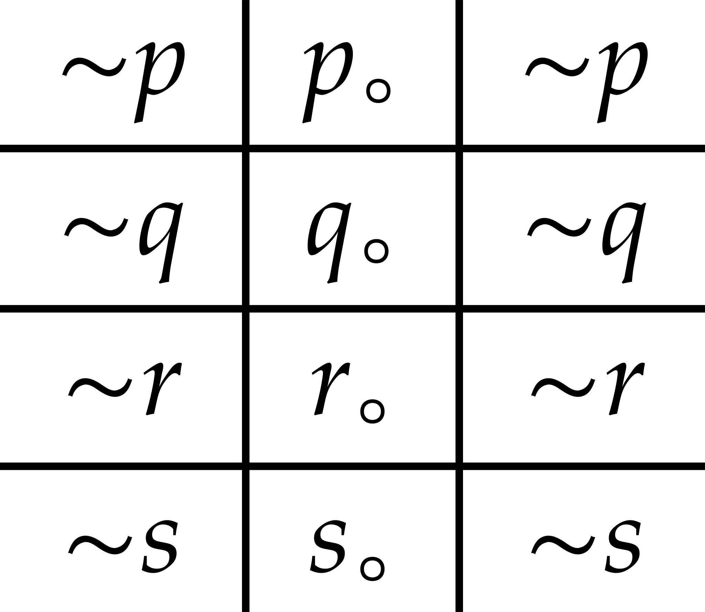

The possibility of “p⌵q” when “p” is given is a possibility along a different dimension from the impossibility of “~p”.

### [Ms-102](/ms-102/#128r.3) [128r\[3\]](https://cdn.wittgensteinnachlass.com/2000px/webp/Ms-102/128r.webp)

“p⌵~p” is a _very special case_ of “p⌵q”.

### [Ms-102](/ms-102/#128r.4) [128r\[4\]](https://cdn.wittgensteinnachlass.com/2000px/webp/Ms-102/128r.webp)

“p” has nothing in common with “~p⌵q”.

### [Ms-102](/ms-102/#128r.5) [128r\[5\]](https://cdn.wittgensteinnachlass.com/2000px/webp/Ms-102/128r.webp)

By attaching the “~” to “p”, I make the sentence pass into a different class of sentences.

### [Ms-102](/ms-102/#129r.1) [129r\[1\]](https://cdn.wittgensteinnachlass.com/2000px/webp/Ms-102/129r.webp)

Every sentence has only one negative; ‥‥ There is only one sentence that lies wholly outside “p”.

### [Ms-102](/ms-102/#129r.2) [129r\[2\]](https://cdn.wittgensteinnachlass.com/2000px/webp/Ms-102/129r.webp)

One could also put it like this: The sentence that affirms p and ~p is negated by all sentences; the sentence that affirms p or ~p is affirmed by all sentences.

### [Ms-102](/ms-102/#129r.3) [129r\[3\]](https://cdn.wittgensteinnachlass.com/2000px/webp/Ms-102/129r.webp)

My mistake must lie in wanting to use what follows from the essence of negation, among other things, to define it. – The fact that “p” & “~p” share a boundary does not come up at all in my attempted explanation of negation.

### [Ms-102](/ms-102/#130r.1) [130r\[1\]](https://cdn.wittgensteinnachlass.com/2000px/webp/Ms-102/130r.webp)

07.06.1915

If one could say, for example: all sentences that do not affirm p affirm ~p, then one would have an adequate description. – But that will not do.

### [Ms-102](/ms-102/#130r.2) [130r\[2\]](https://cdn.wittgensteinnachlass.com/2000px/webp/Ms-102/130r.webp)

But can one not say that “~p” is what only those sentences that do not affirm “p” have in common? – And from this the impossibility of “p․~p” already follows. (All this of course already presupposes the existence of the entire _world of sentences_, rightly?)

### [Ms-102](/ms-102/#130r.3+131r.1) [130r\[3\]](https://cdn.wittgensteinnachlass.com/2000px/webp/Ms-102/130r.webp),[131r\[1\]](https://cdn.wittgensteinnachlass.com/2000px/webp/Ms-102/131r.webp)

_It is not enough_ to point out that ~p lies outside p! One will be able to derive all the properties of “~p” only if “~p” is introduced _essentially as the negative of p_!! But how to do that!?? –

### [Ms-102](/ms-102/#131r.2) [131r\[2\]](https://cdn.wittgensteinnachlass.com/2000px/webp/Ms-102/131r.webp)

Or is it rather that we cannot “introduce” the sentence ~p at all, but that we are confronted with it as an accomplished fact and can only point out its individual formal properties, for example that it has nothing in common with p, that no sentence contains both it and p, etc. etc.?

### [Ms-102](/ms-102/#131r.3+132r.1) [131r\[3\]](https://cdn.wittgensteinnachlass.com/2000px/webp/Ms-102/131r.webp),[132r\[1\]](https://cdn.wittgensteinnachlass.com/2000px/webp/Ms-102/132r.webp)

08.06.1915

Every “mathematical sentence” is a modus ponens represented in signs. (And it is clear that one cannot express modus ponens in a sentence.)

### [Ms-102](/ms-102/#132r.2) [132r\[2\]](https://cdn.wittgensteinnachlass.com/2000px/webp/Ms-102/132r.webp)

That p and ~p share a boundary is expressed in the fact that the negative of a sentence is determined only with the help of that very sentence. For this is just what we say: the negative of a sentence is the sentence that ‥‥․ and then comes the relation of ~p to p. –

### [Ms-102](/ms-102/#132r.3) [132r\[3\]](https://cdn.wittgensteinnachlass.com/2000px/webp/Ms-102/132r.webp)

09.06.1915

One could of course simply put it like this: The negation of p is the sentence that has no sentence in common with p.

### [Ms-102](/ms-102/#133r.1) [133r\[1\]](https://cdn.wittgensteinnachlass.com/2000px/webp/Ms-102/133r.webp)

The expression “tertium non datur” is really nonsense. (For p⌵~p does not speak of a third!)

### [Ms-102](/ms-102/#133r.2) [133r\[2\]](https://cdn.wittgensteinnachlass.com/2000px/webp/Ms-102/133r.webp)

Might we not be able to apply this to our explanation of the negative of a sentence?

### [Ms-102](/ms-102/#133r.3) [133r\[3\]](https://cdn.wittgensteinnachlass.com/2000px/webp/Ms-102/133r.webp)

Can we not say: Among all the propositions that depend only on p, there are only those that affirm p and those that negate it.

### [Ms-102](/ms-102/#133r.4+134r.1) [133r\[4\]](https://cdn.wittgensteinnachlass.com/2000px/webp/Ms-102/133r.webp),[134r\[1\]](https://cdn.wittgensteinnachlass.com/2000px/webp/Ms-102/134r.webp)

So I can say that the negative of p is the class of all propositions that depend only on “p” and _do not affirm “p”_.

### [Ms-102](/ms-102/#134r.2) [134r\[2\]](https://cdn.wittgensteinnachlass.com/2000px/webp/Ms-102/134r.webp)

10.06.1915

_“p ∙ q⌵~q” does **not** depend on “q”!!_

### [Ms-102](/ms-102/#134r.3) [134r\[3\]](https://cdn.wittgensteinnachlass.com/2000px/webp/Ms-102/134r.webp)

_Whole propositions_ disappear!

### [Ms-102](/ms-102/#134r.4) [134r\[4\]](https://cdn.wittgensteinnachlass.com/2000px/webp/Ms-102/134r.webp)

The very fact that “p ∙ q⌵~q” is independent of “q”, although it plainly contains the written sign “q”, shows us how signs of the form η⌵~η can apparently, but only _apparently_, exist.

### [Ms-102](/ms-102/#134r.5) [134r\[5\]](https://cdn.wittgensteinnachlass.com/2000px/webp/Ms-102/134r.webp)

This is of course because, though the combination “p⌵~p” is outwardly possible, it does not satisfy the conditions under which such a complex _says something_ and is thus a proposition.

### [Ms-102](/ms-102/#135r.1) [135r\[1\]](https://cdn.wittgensteinnachlass.com/2000px/webp/Ms-102/135r.webp)

“p ∙ q⌵~q” says the same as “p ∙ r⌵~r” – whatever q and r may say –: All tautologies say the same thing. (Namely nothing.)

### [Ms-102](/ms-102/#135r.2) [135r\[2\]](https://cdn.wittgensteinnachlass.com/2000px/webp/Ms-102/135r.webp)

It follows from the last explanation of negation that all propositions that depend on p alone and do not affirm p – and only those – negate p. So “p ∙ ~p” and “p⌵~p” are not propositions, for the first sign neither affirms nor negates p, and the second would have to affirm both.

### [Ms-102](/ms-102/#135r.3+136r.1) [135r\[3\]](https://cdn.wittgensteinnachlass.com/2000px/webp/Ms-102/135r.webp),[136r\[1\]](https://cdn.wittgensteinnachlass.com/2000px/webp/Ms-102/136r.webp)

But since I can all the same write down p⌵~p and p․~p, especially in combination with other propositions, it must be made clear what role these pseudo-propositions play, particularly in those combinations. For they are of course not to be treated as a wholly meaningless appendage – like a meaningless name, for instance. Rather, they belong to the symbolism – like “0” in arithmetic.

### [Ms-102](/ms-102/#136r.2) [136r\[2\]](https://cdn.wittgensteinnachlass.com/2000px/webp/Ms-102/136r.webp)

– Here it is clear that p⌵~p plays the role of a true proposition, but one that says _Zero_.

### [Ms-102](/ms-102/#136r.3) [136r\[3\]](https://cdn.wittgensteinnachlass.com/2000px/webp/Ms-102/136r.webp)

So we are back to the quantity of what is said:

### [Ms-102](/ms-102/#137r.1) [137r\[1\]](https://cdn.wittgensteinnachlass.com/2000px/webp/Ms-102/137r.webp)

11.06.1915

The opposite of “p․~p” follows from all propositions; does this amount to saying that “p․~p” says nothing? – Yet by my earlier rule the contradiction would have to say more than all other propositions.

### [Ms-102](/ms-102/#137r.2) [137r\[2\]](https://cdn.wittgensteinnachlass.com/2000px/webp/Ms-102/137r.webp)

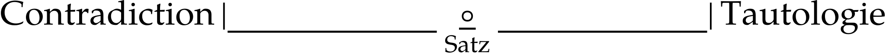

### [Ms-102](/ms-102/#137r.3) [137r\[3\]](https://cdn.wittgensteinnachlass.com/2000px/webp/Ms-102/137r.webp)

Even if a proposition that says a great deal is false, the very fact that it is false should be interesting. It is strange that the negative of a proposition that says a great deal should say nothing at all.

### [Ms-102](/ms-102/#137r.4+138r.1) [137r\[4\]](https://cdn.wittgensteinnachlass.com/2000px/webp/Ms-102/137r.webp),[138r\[1\]](https://cdn.wittgensteinnachlass.com/2000px/webp/Ms-102/138r.webp)

We said: If p follows from q but q does not follow from p, then q says more than p; but if it follows from p that q is false, but not from q that p is false, what then? ~q follows from p; ~p does not follow from q. —?

### [Ms-102](/ms-102/#138r.2) [138r\[2\]](https://cdn.wittgensteinnachlass.com/2000px/webp/Ms-102/138r.webp)

12.06.1915

One could really ask of every proposition: What does it mean if it is true, what does it mean if it is false? Now p․~p is, by assumption, only ever false, and so this means nothing; and one cannot even ask how much it means if it is true.

### [Ms-102](/ms-102/#138r.3+139r.1) [138r\[3\]](https://cdn.wittgensteinnachlass.com/2000px/webp/Ms-102/138r.webp),[139r\[1\]](https://cdn.wittgensteinnachlass.com/2000px/webp/Ms-102/139r.webp)

13.06.1915

If “p․~p” _could_ be true, it would indeed say a _very_ great deal. But _the assumption_ that it is true is simply out of the question in its case, since it is by assumption always false.

### [Ms-102](/ms-102/#139r.2) [139r\[2\]](https://cdn.wittgensteinnachlass.com/2000px/webp/Ms-102/139r.webp)

Curious: The words “True” and “False” refer to the relation of the proposition to the world; that these words can be used for representation in the proposition itself!

### [Ms-102](/ms-102/#139r.3+140r.1) [139r\[3\]](https://cdn.wittgensteinnachlass.com/2000px/webp/Ms-102/139r.webp),[140r\[1\]](https://cdn.wittgensteinnachlass.com/2000px/webp/Ms-102/140r.webp)

We said: If a proposition depends only on p and if it affirms “p”, then it does not negate it, and conversely. _Is_ _this the picture of that mutual exclusion of p and ~p?_ Of the fact that ~p is _that_ which lies _outside_ p?

### [Ms-102](/ms-102/#140r.2) [140r\[2\]](https://cdn.wittgensteinnachlass.com/2000px/webp/Ms-102/140r.webp)

_It does seem so!_ The proposition “~p” is in the same sense what lies outside “p”. – (Do not forget, either, that the picture can have very complicated co-ordinates in relation to the world.)

### [Ms-102](/ms-102/#140r.3) [140r\[3\]](https://cdn.wittgensteinnachlass.com/2000px/webp/Ms-102/140r.webp)

One could, incidentally, simply say: “p․~p” says nothing in the proper sense of the word. Because from the outset no possibility is left open that it can represent _correctly_.

### [Ms-102](/ms-102/#140r.4+141r.1) [140r\[4\]](https://cdn.wittgensteinnachlass.com/2000px/webp/Ms-102/140r.webp),[141r\[1\]](https://cdn.wittgensteinnachlass.com/2000px/webp/Ms-102/141r.webp)

If, to speak in passing, “p follows from q” means that if p is true then q must be true, then one cannot say at all that anything follows from “p․~p”, since there is no such hypothesis as that “p․~p” is true!!

### [Ms-102](/ms-102/#141r.2) [141r\[2\]](https://cdn.wittgensteinnachlass.com/2000px/webp/Ms-102/141r.webp)

14.06.1915

So we have become clear that names stand, and may stand, for the most diverse forms, and that it is only their syntactic application that characterizes the form to be represented.

What, then, is the syntactic application of names of simple objects?

### [Ms-102](/ms-102/#141r.3+142r.1+143r.1) [141r\[3\]](https://cdn.wittgensteinnachlass.com/2000px/webp/Ms-102/141r.webp),[142r\[1\]](https://cdn.wittgensteinnachlass.com/2000px/webp/Ms-102/142r.webp),[143r\[1\]](https://cdn.wittgensteinnachlass.com/2000px/webp/Ms-102/143r.webp)

What is my underlying thought when I talk about simple objects: Do not the “composite objects”, after all, satisfy precisely the requirements I apparently impose on the former? If I give this book a name “N” and now speak of N, is not the relation of N to that “composite object”, to those forms and contents, _essentially_ the same as the one I envisaged between a name and a simple object?

For note: even if the name “N” disappears on further analysis, it still indicates _something in common_.

### [Ms-102](/ms-102/#143r.2) [143r\[2\]](https://cdn.wittgensteinnachlass.com/2000px/webp/Ms-102/143r.webp)

But what about the meaning of names outside the context of a sentence?

### [Ms-102](/ms-102/#143r.3+144r.1) [143r\[3\]](https://cdn.wittgensteinnachlass.com/2000px/webp/Ms-102/143r.webp),[144r\[1\]](https://cdn.wittgensteinnachlass.com/2000px/webp/Ms-102/144r.webp)

But one could also put the question this way: It seems that the idea of the _simple_ is already contained in that of the complex and in the idea of analysis, in such a way that, quite apart from any examples of simple objects or of sentences in which such objects are spoken of, we arrive at this idea and see the existence of simple objects as a logical necessity – a priori.

So it appears that the existence of simple objects stands to that of complex objects as the sense of ~p stands to the sense of p: the _simple_ object would be _predetermined_ in the complex one.

### [Ms-102](/ms-102/#144r.2) [144r\[2\]](https://cdn.wittgensteinnachlass.com/2000px/webp/Ms-102/144r.webp)

15.06.1915

(This must _on no account_ be confused with the _fact_ that the _constituent_ is predetermined in the complex.)

### [Ms-102](/ms-102/#144r.3) [144r\[3\]](https://cdn.wittgensteinnachlass.com/2000px/webp/Ms-102/144r.webp)

(One of the philosopher’s hardest tasks is to find where the shoe pinches.)

### [Ms-102](/ms-102/#145r.1) [145r\[1\]](https://cdn.wittgensteinnachlass.com/2000px/webp/Ms-102/145r.webp)

I feel that it is possible simply to assign a name to this watch as it lies before me. I feel that this name will have its meaning even outside a sentence, insofar as I _ever_ feel this _at all_. And I feel that in a sentence that name will meet all the requirements for the name of a simple object.

### [Ms-102](/ms-102/#145r.2+146r.1) [145r\[2\]](https://cdn.wittgensteinnachlass.com/2000px/webp/Ms-102/145r.webp),[146r\[1\]](https://cdn.wittgensteinnachlass.com/2000px/webp/Ms-102/146r.webp)

It is quite clear that I can in fact assign a name to this watch as it lies here before me, running, and that this name will have meaning outside any sentence in the same sense of the word as I have ever intended at all, and ‥‥․

### [Ms-102](/ms-102/#146r.2) [146r\[2\]](https://cdn.wittgensteinnachlass.com/2000px/webp/Ms-102/146r.webp)

16.06.1915

Let us now see whether this watch really satisfies all the conditions for being a “simple object”. –

### [Ms-102](/ms-102/#146r.3) [146r\[3\]](https://cdn.wittgensteinnachlass.com/2000px/webp/Ms-102/146r.webp)

The question really is this: Must I know the composition of a name’s meaning in order to know how to treat the name syntactically? If so, the whole composition is already expressed in the unanalysed sentence. ‥‥․ –

### [Ms-102](/ms-102/#147r.1) [147r\[1\]](https://cdn.wittgensteinnachlass.com/2000px/webp/Ms-102/147r.webp)

(One often tries to leap across gaps in thought that are too wide, and falls right into them.)

### [Ms-102](/ms-102/#147r.2) [147r\[2\]](https://cdn.wittgensteinnachlass.com/2000px/webp/Ms-102/147r.webp)

What seems to be given to us a priori is the concept: _This_. – Identical with the concept of the _object_.

### [Ms-102](/ms-102/#147r.3) [147r\[3\]](https://cdn.wittgensteinnachlass.com/2000px/webp/Ms-102/147r.webp)

Relations and properties etc. are also _objects_.

### [Ms-102](/ms-102/#147r.4+148r.1+149r.1) [147r\[4\]](https://cdn.wittgensteinnachlass.com/2000px/webp/Ms-102/147r.webp),[148r\[1\]](https://cdn.wittgensteinnachlass.com/2000px/webp/Ms-102/148r.webp),[149r\[1\]](https://cdn.wittgensteinnachlass.com/2000px/webp/Ms-102/149r.webp)

My difficulty is this: In all the sentences I encounter there occur names which, however, must disappear again on further analysis. I know that such further analysis is possible, but I am unable to carry it out completely. Yet to all appearances I know that, if the analysis were carried out completely, its result would have to be a sentence which in turn contained names, relations etc. In short, it seems as though in this way I knew only a form of which I do not know a single example. I see that the analysis can be carried further, and now I cannot, so to speak, imagine it leading to anything other than the kinds of sentence familiar to me.

### [Ms-102](/ms-102/#149r.2) [149r\[2\]](https://cdn.wittgensteinnachlass.com/2000px/webp/Ms-102/149r.webp)

If I say that this watch is shiny and what I mean by “this watch” changes its composition in the slightest, then not only does the sense of the sentence change in content, but the _statement about this watch_ immediately changes its sense _too_. The whole form of the sentence changes.

### [Ms-102](/ms-102/#149r.3+150r.1) [149r\[3\]](https://cdn.wittgensteinnachlass.com/2000px/webp/Ms-102/149r.webp),[150r\[1\]](https://cdn.wittgensteinnachlass.com/2000px/webp/Ms-102/150r.webp)

That is, the syntactic use of the names fully characterizes the form of the composite objects they designate.

### [Ms-102](/ms-102/#150r.2) [150r\[2\]](https://cdn.wittgensteinnachlass.com/2000px/webp/Ms-102/150r.webp)

Every sentence that has a sense has a _complete_ sense, and it is a picture of reality, so that what has not yet been said in it simply cannot belong to its sense. If the sentence “this watch shines” has a sense, then it must be possible to explain _how this_ sentence has _this_ sense.

### [Ms-102](/ms-102/#150r.3+151r.1) [150r\[3\]](https://cdn.wittgensteinnachlass.com/2000px/webp/Ms-102/150r.webp),[151r\[1\]](https://cdn.wittgensteinnachlass.com/2000px/webp/Ms-102/151r.webp)

– If a sentence says something to us, then as it stands it must be a picture of reality, and a complete one at that – Of course there will also be something it does _not_ say – but _what_ it says it says completely, and it must be possible to delimit it _sharply_.

### [Ms-102](/ms-102/#151r.2) [151r\[2\]](https://cdn.wittgensteinnachlass.com/2000px/webp/Ms-102/151r.webp)

So a sentence may indeed be an incomplete picture of a certain fact, but it is _always a complete picture_.

### [Ms-102](/ms-102/#151r.3+152r.1) [151r\[3\]](https://cdn.wittgensteinnachlass.com/2000px/webp/Ms-102/151r.webp),[152r\[1\]](https://cdn.wittgensteinnachlass.com/2000px/webp/Ms-102/152r.webp)

It would now seem to follow that in a certain sense all names are _genuine names_. Or, as I might also put it, that all objects are in a certain sense simple objects.

### [Ms-102](/ms-102/#152r.2) [152r\[2\]](https://cdn.wittgensteinnachlass.com/2000px/webp/Ms-102/152r.webp)

17.06.1915

Let us suppose that every spatial object consists of infinitely many points. Then it is clear that I cannot list them all by name when I speak of that object. Here, then, would be a case in which I _cannot_ arrive at a complete analysis in the old sense at all; and perhaps this is precisely the ordinary case.

### [Ms-102](/ms-102/#152r.3+153r.1) [152r\[3\]](https://cdn.wittgensteinnachlass.com/2000px/webp/Ms-102/152r.webp),[153r\[1\]](https://cdn.wittgensteinnachlass.com/2000px/webp/Ms-102/153r.webp)

It is clear, after all, that the sentences which alone mankind uses will have a sense as they stand, and will not have to wait for a future analysis to acquire a sense.

### [Ms-102](/ms-102/#153r.2+154r.1) [153r\[2\]](https://cdn.wittgensteinnachlass.com/2000px/webp/Ms-102/153r.webp),[154r\[1\]](https://cdn.wittgensteinnachlass.com/2000px/webp/Ms-102/154r.webp)

Yet this does seem to be a legitimate question: are – for example – spatial objects composed of simple parts; in dividing them, does one reach parts that can be divided no further, or is this not the case? – But what kind of question is this? – _Is it clear, **a priori**, that in division we must arrive at simple constituents – is this perhaps already implicit in the concept of division –_, or is divisibility ad infinitum possible? – Or could there even be a third possibility?

### [Ms-102](/ms-102/#154r.2) [154r\[2\]](https://cdn.wittgensteinnachlass.com/2000px/webp/Ms-102/154r.webp)

That question is a logical one, and the compositeness of spatial objects is logical, for to say that one thing is part of another is always a tautology.

### [Ms-102](/ms-102/#154r.3) [154r\[3\]](https://cdn.wittgensteinnachlass.com/2000px/webp/Ms-102/154r.webp)

But what if I wanted to say, for instance, that _one_ constituent of a fact has a particular property? Then I would have to list its constituents by name and use a logical sum.

### [Ms-102](/ms-102/#154r.4+155r.1) [154r\[4\]](https://cdn.wittgensteinnachlass.com/2000px/webp/Ms-102/154r.webp),[155r\[1\]](https://cdn.wittgensteinnachlass.com/2000px/webp/Ms-102/155r.webp)

Nor does anything seem to tell against infinite divisibility.

### [Ms-102](/ms-102/#155r.2) [155r\[2\]](https://cdn.wittgensteinnachlass.com/2000px/webp/Ms-102/155r.webp)

_And again and again_ the thought forces itself upon us that there is something simple and indivisible, an element of being, in short, a thing.

### [Ms-102](/ms-102/#155r.3+156r.1) [155r\[3\]](https://cdn.wittgensteinnachlass.com/2000px/webp/Ms-102/155r.webp),[156r\[1\]](https://cdn.wittgensteinnachlass.com/2000px/webp/Ms-102/156r.webp)

It does not go against our feeling that _we_ cannot analyse _sentences_ far enough to list the elements by name, but we feel that the _world_ must consist of elements. And it seems as though this were identical with the proposition that the world must simply be what it is, that it must be determinate. Or in other words, it is our determinations that waver, not the world. It seems as though to deny things amounted to saying: the world could, so to speak, be indeterminate in something like the sense in which our knowledge is uncertain and indeterminate.

### [Ms-102](/ms-102/#156r.2) [156r\[2\]](https://cdn.wittgensteinnachlass.com/2000px/webp/Ms-102/156r.webp)

The world has a fixed structure.

### [Ms-102](/ms-102/#156r.3) [156r\[3\]](https://cdn.wittgensteinnachlass.com/2000px/webp/Ms-102/156r.webp)

Might representation by means of unanalysable names not be _merely a system_?

### [Ms-102](/ms-102/#156r.4+157r.1+158r.1+159r.1+160r.1) [156r\[4\]](https://cdn.wittgensteinnachlass.com/2000px/webp/Ms-102/156r.webp),[157r\[1\]](https://cdn.wittgensteinnachlass.com/2000px/webp/Ms-102/157r.webp),[158r\[1\]](https://cdn.wittgensteinnachlass.com/2000px/webp/Ms-102/158r.webp),[159r\[1\]](https://cdn.wittgensteinnachlass.com/2000px/webp/Ms-102/159r.webp),[160r\[1\]](https://cdn.wittgensteinnachlass.com/2000px/webp/Ms-102/160r.webp)

All I want, after all, is complete analysis of _my sense!!_ In other words, the sentence must be fully articulated. Everything its sense has in common with another sense must be contained separately in the sentence. If generalizations occur, the forms of the particular cases must be apparent. – And it is clear that this requirement is warranted, otherwise the sentence cannot be a picture of _anything_ at all. For if possibilities are _left open_ in the sentence, then _this very thing must be determinate_: _what_ is left open. The generalizations of form – for instance – must be determinate. What I do not know, I do not know, but the sentence must show me _what_ I know. And is not this _determinate_ thing that I _must_ arrive at precisely what is simple in the sense I have always had in mind? It is, so to speak, what is hard. So for us “There are no composite objects” means: It must be clear in the sentence how the object is composed, insofar as we can speak of its compositeness at all. – The sense of the sentence must appear in the sentence analysed into its _simple_ constituents –. And these parts really are unanalysable, for parts analysed further would simply not be _these_ parts. In other words, the sentence can then no longer be _replaced_ by one with more constituents; rather, any sentence with more constituents does not have _this_ sense. Whenever the sense of the sentence is fully expressed in the sentence itself, the sentence is analysed into its simple constituents – further analysis is impossible and apparent analysis superfluous – and these are objects in the original sense.

### [Ms-102](/ms-102/#160r.2) [160r\[2\]](https://cdn.wittgensteinnachlass.com/2000px/webp/Ms-102/160r.webp)

18.06.1915

If the compositeness of an object determines the sense of a sentence, then it must be depicted in the sentence to the extent that it determines its sense. And insofar as the composition does _not_ determine _this_ sense, the objects of this sentence are _simple_. _They can_ be analysed no further. –

### [Ms-102](/ms-102/#161r.1) [161r\[1\]](https://cdn.wittgensteinnachlass.com/2000px/webp/Ms-102/161r.webp)

The requirement for simple things _is_ the requirement that sense be determinate.

### [Ms-102](/ms-102/#161r.2) [161r\[2\]](https://cdn.wittgensteinnachlass.com/2000px/webp/Ms-102/161r.webp)

– For if, say, I speak of this watch and mean something complex by it, and the composition does not matter, then a generalization will occur in the sentence and its basic forms will be fully determinate _insofar as they are given at all_.

### [Ms-102](/ms-102/#161r.3) [161r\[3\]](https://cdn.wittgensteinnachlass.com/2000px/webp/Ms-102/161r.webp)

If there is a finite sense and a sentence that expresses it completely, then there are also names for simple objects.

### [Ms-102](/ms-102/#162r.1) [162r\[1\]](https://cdn.wittgensteinnachlass.com/2000px/webp/Ms-102/162r.webp)

(That is the correct designation.)

### [Ms-102](/ms-102/#162r.2+163r.1) [162r\[2\]](https://cdn.wittgensteinnachlass.com/2000px/webp/Ms-102/162r.webp),[163r\[1\]](https://cdn.wittgensteinnachlass.com/2000px/webp/Ms-102/163r.webp)

But what if a simple name designates an infinitely complex object? For example, we make a statement about a patch in our visual image, say that it lies to the right of a line, and we assume that every patch in our visual image is infinitely complex. If we then say of a point in that patch that it lies to the right of the line, this proposition follows from the earlier one, and if there are infinitely many points in the patch, _then infinitely many propositions of different content follow **logically** from that first one_! And this already shows that it was itself in fact infinitely complex. Not the propositional sign alone, that is, but the sign _together with its syntactic use_.

### [Ms-102](/ms-102/#163r.2+164r.1) [163r\[2\]](https://cdn.wittgensteinnachlass.com/2000px/webp/Ms-102/163r.webp),[164r\[1\]](https://cdn.wittgensteinnachlass.com/2000px/webp/Ms-102/164r.webp)

Now of course it could _very_ easily be that in reality there are _not_ infinitely many different propositions that follow from such a proposition, because our visual image perhaps – or probably – does _not_ consist of infinitely many parts – rather, that continuous visual space is a construction made only afterwards –; and in that case only a finite number of propositions follow from the one in question, and it is itself _finite_ in every sense.

### [Ms-102](/ms-102/#164r.2) [164r\[2\]](https://cdn.wittgensteinnachlass.com/2000px/webp/Ms-102/164r.webp)

But does this _possible_ infinite compositeness of sense impair its determinacy?

### [Ms-102](/ms-102/#164r.3+165r.1) [164r\[3\]](https://cdn.wittgensteinnachlass.com/2000px/webp/Ms-102/164r.webp),[165r\[1\]](https://cdn.wittgensteinnachlass.com/2000px/webp/Ms-102/165r.webp)

One could also state the requirement of determinacy like this!: If a sentence is to have sense, the syntactic use of each of its parts must first be established. – One cannot, for example, _discover only afterwards_ that a proposition follows from it. Rather, for example, which propositions follow from a proposition must be completely settled before that proposition can have a sense!

### [Ms-102](/ms-102/#165r.2+166r.1) [165r\[2\]](https://cdn.wittgensteinnachlass.com/2000px/webp/Ms-102/165r.webp),[166r\[1\]](https://cdn.wittgensteinnachlass.com/2000px/webp/Ms-102/166r.webp)

It seems to me entirely possible that areas in our visual image are simple objects, since we do not perceive a single point of such an area separately; in the case of visual images of stars this even seems certain. For if, for example, I say that this watch is not in the drawer, it need by no means _follow logically_ that a wheel in the watch is not in the drawer, for perhaps _I did not know_ _at all_ that the wheel was in the watch, and so could not have meant by “this watch” a complex in which the wheel occurs. And it is certain that I do not see – to speak in passing – all the parts of my _theoretical_ visual image. Who knows _whether_ I see infinitely many points!

### [Ms-102](/ms-102/#167r.1) [167r\[1\]](https://cdn.wittgensteinnachlass.com/2000px/webp/Ms-102/167r.webp)

Now let us suppose we saw a circular patch: is circularity its _property?_ Certainly not. It seems to be a structural “property”. And if I notice that a patch is circular, am I not noticing an infinitely complex structural property? Or I notice only that the patch has a finite extent, and even that already seems to _presuppose_ an infinitely complex structure.

### [Ms-102](/ms-102/#168r.1) [168r\[1\]](https://cdn.wittgensteinnachlass.com/2000px/webp/Ms-102/168r.webp)

Not: one proposition follows from another, but rather: the truth of one follows from the truth of the other. (That is why “If Sokrates is a man, then he is mortal” _follows_ from “All men are mortal”.)

### [Ms-102](/ms-102/#168r.2) [168r\[2\]](https://cdn.wittgensteinnachlass.com/2000px/webp/Ms-102/168r.webp)

But a proposition can presumably be about infinitely many points without being infinitely complex in a certain sense.

### [Ms-102](/ms-102/#168r.3) [168r\[3\]](https://cdn.wittgensteinnachlass.com/2000px/webp/Ms-102/168r.webp)

19.06.1915

But if we see that our visual image is complex, we also see that it consists of _simpler_ parts.

### [Ms-102](/ms-102/#168r.4+169r.1) [168r\[4\]](https://cdn.wittgensteinnachlass.com/2000px/webp/Ms-102/168r.webp),[169r\[1\]](https://cdn.wittgensteinnachlass.com/2000px/webp/Ms-102/169r.webp)

We can speak of functions of this or that kind without having a particular application in mind.

### [Ms-102](/ms-102/#169r.2) [169r\[2\]](https://cdn.wittgensteinnachlass.com/2000px/webp/Ms-102/169r.webp)

For we have no example in mind when we use Fx and all the other variable signs for forms.

### [Ms-102](/ms-102/#169r.3) [169r\[3\]](https://cdn.wittgensteinnachlass.com/2000px/webp/Ms-102/169r.webp)

In short: If we applied the prototypes only to names, it would be possible for us to know of the existence of the prototypes from the existence of their individual instances. But as it is we use _variables_, that is, we speak, so to speak, of the prototypes alone, quite apart from any individual instances.

### [Ms-102](/ms-102/#170r.1) [170r\[1\]](https://cdn.wittgensteinnachlass.com/2000px/webp/Ms-102/170r.webp)

We depict the thing, the relation, the property by means of variables, and thus show that we do not derive these ideas from certain cases that we encounter, but somehow possess them a priori.

### [Ms-102](/ms-102/#170r.2) [170r\[2\]](https://cdn.wittgensteinnachlass.com/2000px/webp/Ms-102/170r.webp)

For the question is: If the individual forms are given to me, so to speak, in experience, then surely I may not make use of them in logic; strictly speaking, I may not write x or φy. And yet I cannot possibly avoid doing so.

### [Ms-102](/ms-102/#171r.1) [171r\[1\]](https://cdn.wittgensteinnachlass.com/2000px/webp/Ms-102/171r.webp)

To ask in passing: is logic concerned with certain kinds of functions and the like? And if not, what do Fx φz _etc._ mean in logic? _These must then be signs with a more general meaning!_

### [Ms-102](/ms-102/#171r.2) [171r\[2\]](https://cdn.wittgensteinnachlass.com/2000px/webp/Ms-102/171r.webp)

There is presumably no such thing, after all, as drawing up the kind of logical inventory I used to imagine.

### [Ms-102](/ms-102/#171r.3) [171r\[3\]](https://cdn.wittgensteinnachlass.com/2000px/webp/Ms-102/171r.webp)

The constituents of the sentence must be simple = The sentence must be fully articulated.

### [Ms-102](/ms-102/#172r.1) [172r\[1\]](https://cdn.wittgensteinnachlass.com/2000px/webp/Ms-102/172r.webp)

But now this _seems_ to contradict the facts? –

### [Ms-102](/ms-102/#172r.2) [172r\[2\]](https://cdn.wittgensteinnachlass.com/2000px/webp/Ms-102/172r.webp)

For in logic we apparently want to exhibit ideal pictures of articulated sentences. But how is that possible?

### [Ms-102](/ms-102/#172r.3) [172r\[3\]](https://cdn.wittgensteinnachlass.com/2000px/webp/Ms-102/172r.webp)

Or can we treat a sentence like “the watch is lying on the table” straight away according to the rules of logic? No; we say, for example, that the sentence leaves the time unstated, that it only apparently ‥‥ etc. etc.

So before we can treat it, it seems we must recast it in a certain way.

### [Ms-102](/ms-102/#173r.1) [173r\[1\]](https://cdn.wittgensteinnachlass.com/2000px/webp/Ms-102/173r.webp)

But perhaps this is not decisive, for could we not just as well adapt our customary _logical_ notation to the particular sentence?

### [Ms-102](/ms-102/#173r.2) [173r\[2\]](https://cdn.wittgensteinnachlass.com/2000px/webp/Ms-102/173r.webp)

20.06.1915

Yes, this is the point: Can we legitimately apply logic as it is set out, say, in “Principia Mathematica” straight away to _sentences in ordinary use_?

### [Ms-102](/ms-102/#173r.3) [173r\[3\]](https://cdn.wittgensteinnachlass.com/2000px/webp/Ms-102/173r.webp)

_Of course_ we must not disregard what is _expressed_ in our sentences by endings, prefixes, umlauts etc. etc.

### [Ms-102](/ms-102/#174r.1) [174r\[1\]](https://cdn.wittgensteinnachlass.com/2000px/webp/Ms-102/174r.webp)

_But we do apply mathematics, and with the greatest success, to ordinary sentences, namely to those of physics!!_

### [Ms-102](/ms-102/#174r.2) [174r\[2\]](https://cdn.wittgensteinnachlass.com/2000px/webp/Ms-102/174r.webp)

But how remarkable: in the familiar theorems of mathematical physics there appear neither things nor functions nor relations nor any other logical forms of objects!! Instead of things we have numbers there, and the functions & relations are purely mathematical throughout!!

### [Ms-102](/ms-102/#174r.3) [174r\[3\]](https://cdn.wittgensteinnachlass.com/2000px/webp/Ms-102/174r.webp)

Yet it is a fact that these propositions are applied to solid reality.

### [Ms-102](/ms-102/#175r.1) [175r\[1\]](https://cdn.wittgensteinnachlass.com/2000px/webp/Ms-102/175r.webp)

The variables in those theorems do not stand – as one often says they do – for _lengths_, _weights_, periods of time etc. at all; they stand simply for numbers and nothing else.

### [Ms-102](/ms-102/#175r.2) [175r\[2\]](https://cdn.wittgensteinnachlass.com/2000px/webp/Ms-102/175r.webp)

But if I now want to apply the numbers, I come to relations, things etc. etc. I say, for instance: this length is 5 metres, and in doing so I speak of relations and things in the _quite ordinary_ sense.

### [Ms-102](/ms-102/#175r.3) [175r\[3\]](https://cdn.wittgensteinnachlass.com/2000px/webp/Ms-102/175r.webp)

Here we come to the question of the meaning of the variables in the propositions of physics. These are not tautologies, after all.

### [Ms-102](/ms-102/#176r.1) [176r\[1\]](https://cdn.wittgensteinnachlass.com/2000px/webp/Ms-102/176r.webp)

The physical sentence without an indication of its application is evidently senseless. What sense would there be in saying ‘k = m ∙ p’? So the completed physical sentence is after all about things, relations, etc. (Which was really to be expected.)

### [Ms-102](/ms-102/#176r.2) [176r\[2\]](https://cdn.wittgensteinnachlass.com/2000px/webp/Ms-102/176r.webp)

It all comes down to my applying numbers to ordinary things, etc., which in turn says no more than that numbers occur in our quite ordinary sentences.

### [Ms-102](/ms-102/#176r.3+177r.1) [176r\[3\]](https://cdn.wittgensteinnachlass.com/2000px/webp/Ms-102/176r.webp),[177r\[1\]](https://cdn.wittgensteinnachlass.com/2000px/webp/Ms-102/177r.webp)

The difficulty is really this: that even if we want to express a _quite determinate_ sense, there is a possibility that we may miss this aim. So it seems, as it were, that we have no guarantee that our sentence really is a picture of reality.

### [Ms-102](/ms-102/#177r.2) [177r\[2\]](https://cdn.wittgensteinnachlass.com/2000px/webp/Ms-102/177r.webp)

The decomposition of bodies into _material points_ as we have it in physics is nothing more than analysis into _simple constituents_.

### [Ms-102](/ms-102/#177r.3+178r.1) [177r\[3\]](https://cdn.wittgensteinnachlass.com/2000px/webp/Ms-102/177r.webp),[178r\[1\]](https://cdn.wittgensteinnachlass.com/2000px/webp/Ms-102/178r.webp)

But might it be possible that the sentences we ordinarily use have, as it were, only an imperfect sense (quite apart from their truth or falsity), and that the sentences of physics approach, so to speak, the stage where a sentence really has a perfect sense??

### [Ms-102](/ms-102/#178r.2) [178r\[2\]](https://cdn.wittgensteinnachlass.com/2000px/webp/Ms-102/178r.webp)

When I say ‘the book is lying on the table’, does this really have a perfectly clear sense? (A _most_ significant question!)

The sense must surely be clear, for we do mean _something_ by the sentence, and as much as we _certainly_ mean must surely be clear.

### [Ms-102](/ms-102/#178r.3+179r.1) [178r\[3\]](https://cdn.wittgensteinnachlass.com/2000px/webp/Ms-102/178r.webp),[179r\[1\]](https://cdn.wittgensteinnachlass.com/2000px/webp/Ms-102/179r.webp)

If the sentence ‘the book is lying on the table’ has a clear sense, then whatever _is the case_, I must be able to say whether the sentence is true or false. But _cases_ could very well arise in which I could not readily say whether the book could still be said to be ‘lying on the table’. So?

### [Ms-102](/ms-102/#179r.2) [179r\[2\]](https://cdn.wittgensteinnachlass.com/2000px/webp/Ms-102/179r.webp)

Could it then be that I know exactly what I want to say but make mistakes in expressing it?

### [Ms-102](/ms-102/#179r.3) [179r\[3\]](https://cdn.wittgensteinnachlass.com/2000px/webp/Ms-102/179r.webp)

Or can this uncertainty _also_ be included in the sentence?

### [Ms-102](/ms-102/#179r.4+180r.1) [179r\[4\]](https://cdn.wittgensteinnachlass.com/2000px/webp/Ms-102/179r.webp),[180r\[1\]](https://cdn.wittgensteinnachlass.com/2000px/webp/Ms-102/180r.webp)

But it may also be that the sentence ‘the book is lying on the table’ does represent my sense perfectly, but that I use the words ‘lie on’, for example, in a _special_ meaning here and that the expression has a different meaning elsewhere. Perhaps what I mean by the verb is the quite special relation that the book actually bears to the table now.

### [Ms-102](/ms-102/#180r.2) [180r\[2\]](https://cdn.wittgensteinnachlass.com/2000px/webp/Ms-102/180r.webp)

So are the sentences of physics and the sentences of ordinary life fundamentally just as sharp as one another, and does the difference consist only in the more consistent application of signs in the language of science??

### [Ms-102](/ms-102/#180r.3) [180r\[3\]](https://cdn.wittgensteinnachlass.com/2000px/webp/Ms-102/180r.webp)

Can one speak of a sentence having a more or less sharp sense, or not??

### [Ms-102](/ms-102/#181r.1) [181r\[1\]](https://cdn.wittgensteinnachlass.com/2000px/webp/Ms-102/181r.webp)

It seems clear that what we _mean_ must always be ‘_sharp_’. Our expression of what we mean, in turn, can only be right or wrong. And then the words can also be applied consistently or inconsistently. There seems to be no other possibility.

### [Ms-102](/ms-102/#181r.2) [181r\[2\]](https://cdn.wittgensteinnachlass.com/2000px/webp/Ms-102/181r.webp)

If, for example, I say ‘the table is a metre long’, it is highly questionable what I mean by that. But presumably I mean that the distance between _these_ two points is one metre and that the points belong to the table.

### [Ms-102](/ms-102/#182r.1) [182r\[1\]](https://cdn.wittgensteinnachlass.com/2000px/webp/Ms-102/182r.webp)

We said that mathematics was already being applied successfully to ordinary sentences, but the sentences of physics are throughout about objects other than those of our ordinary language! Must our sentences be prepared _in this way_ in order to be treated mathematically? Evidently yes! If quantities are at issue, then an expression such as ‘the length of this table’ would not suffice. This length would have to be defined, say, as the distance between two surfaces, etc., etc.

### [Ms-102](/ms-102/#182r.2+183r.1) [182r\[2\]](https://cdn.wittgensteinnachlass.com/2000px/webp/Ms-102/182r.webp),[183r\[1\]](https://cdn.wittgensteinnachlass.com/2000px/webp/Ms-102/183r.webp)

Yes, the mathematical sciences differ from the non-mathematical ones in that the former deal with things of which ordinary language does not speak, while the latter speak of generally known things. –

### [Ms-102](/ms-102/#183r.2) [183r\[2\]](https://cdn.wittgensteinnachlass.com/2000px/webp/Ms-102/183r.webp)

21.06.1915

Our difficulty, after all, was that we kept speaking of simple objects and could not name a single one.

### [Ms-102](/ms-102/#183r.3) [183r\[3\]](https://cdn.wittgensteinnachlass.com/2000px/webp/Ms-102/183r.webp)

If the point in space does not exist, then neither do its coordinates, and if the coordinates exist, then so does the point.

That is how it is in logic.

### [Ms-102](/ms-102/#184r.1) [184r\[1\]](https://cdn.wittgensteinnachlass.com/2000px/webp/Ms-102/184r.webp)

The simple sign is _essentially simple_. It functions as a simple object. (What does that mean?) _Its composition_ becomes completely _irrelevant_. It disappears from our view.

### [Ms-102](/ms-102/#184r.2) [184r\[2\]](https://cdn.wittgensteinnachlass.com/2000px/webp/Ms-102/184r.webp)

It always seems as though there were complex objects that function as simple ones, and then also _really_ simple ones, like the material points of physics, etc.

### [Ms-102](/ms-102/#184r.3+185r.1) [184r\[3\]](https://cdn.wittgensteinnachlass.com/2000px/webp/Ms-102/184r.webp),[185r\[1\]](https://cdn.wittgensteinnachlass.com/2000px/webp/Ms-102/185r.webp)

One can see that a name designates a complex object from an indeterminacy in the sentences in which it occurs, an indeterminacy that arises precisely from the generality of such sentences. We _know_ that not everything is yet determined by this sentence. The designation of generality does, after all, _contain_ a prototype.

### [Ms-102](/ms-102/#185r.2) [185r\[2\]](https://cdn.wittgensteinnachlass.com/2000px/webp/Ms-102/185r.webp)

All invisible masses, etc., etc., must come under the designation of generality.

### [Ms-102](/ms-102/#185r.3) [185r\[3\]](https://cdn.wittgensteinnachlass.com/2000px/webp/Ms-102/185r.webp)

What happens when sentences approach the truth?

### [Ms-102](/ms-102/#185r.4+186r.1) [185r\[4\]](https://cdn.wittgensteinnachlass.com/2000px/webp/Ms-102/185r.webp),[186r\[1\]](https://cdn.wittgensteinnachlass.com/2000px/webp/Ms-102/186r.webp)

But logic as it appears, for example, in the ‘Principia Mathematica’ can be applied quite well to our ordinary sentences: for example, from ‘All men are mortal’ and ‘Socrates is a man’ there follows, according to this logic, ‘Socrates is mortal’, which is evidently right, although, just as evidently, I do not know what structure the thing Socrates or the property of mortality has. Here they function precisely as simple objects.

### [Ms-102](/ms-102/#186r.2) [186r\[2\]](https://cdn.wittgensteinnachlass.com/2000px/webp/Ms-102/186r.webp)

Evidently the very circumstance that makes it possible for certain forms to be projected into a name by means of a definition guarantees that this name can then also be treated as a real one.

### [Ms-102](/ms-102/#187r.1) [187r\[1\]](https://cdn.wittgensteinnachlass.com/2000px/webp/Ms-102/187r.webp)

It is evident to anyone who sees clearly that a sentence such as ‘This watch is lying on the table’ contains a great deal of indeterminacy, even though its outward form appears perfectly clear and simple. So we _see_ that this simplicity is only constructed.

### [Ms-102](/ms-102/#187r.2) [187r\[2\]](https://cdn.wittgensteinnachlass.com/2000px/webp/Ms-102/187r.webp)

22.06.1915

So it is clear even _to the unprejudiced_ _mind_ that the sense of the sentence ‘the watch is lying on the table’ is more complicated than the sentence itself.

### [Ms-102](/ms-102/#187r.3+188r.1) [187r\[3\]](https://cdn.wittgensteinnachlass.com/2000px/webp/Ms-102/187r.webp),[188r\[1\]](https://cdn.wittgensteinnachlass.com/2000px/webp/Ms-102/188r.webp)

The conventions of our language are extraordinarily complicated. In the case of every sentence, an enormous amount that is not said is supplied in thought. (These conventions are just like Whitehead’s ‘Conventions’. They are presumably definitions with _a certain generality of form.)_

### [Ms-102](/ms-102/#188r.2) [188r\[2\]](https://cdn.wittgensteinnachlass.com/2000px/webp/Ms-102/188r.webp)

I want only to justify the vagueness of ordinary sentences, for it _can_ be justified.

### [Ms-102](/ms-102/#188r.3+188v.1) [188r\[3\]](https://cdn.wittgensteinnachlass.com/2000px/webp/Ms-102/188r.webp),[188v\[1\]](https://cdn.wittgensteinnachlass.com/2000px/webp/Ms-102/188v.webp)

It is clear: _I know_ what I _mean_ by the vague sentence. But now someone else does not understand it and says: ‘Yes, but if you mean that, you ought to have added – such and such’; and now someone else again will not understand it and will ask for an even more explicit sentence. I shall then reply: Yes, but _that_ simply _goes without saying_. Suppose I say to someone ‘the watch is lying on the table’, and he then says ‘Yes, but if the watch were lying like this, would you still say “it is lying on the table”?’ And I would become unsure. That shows that I would not know what I meant by ‘lie’ _in general_. If one were to press me like this in order to show me that I did not know what I meant, I would say: ‘_I know_ what I mean; I mean just _that_’, and might at the same time point with my finger at the complex in question. And in this complex I now actually have the two objects in a relation. – But what this _really_ means is only: The fact can _somehow_ also be depicted by means of this form.

### [Ms-102](/ms-102/#188v.2) [188v\[2\]](https://cdn.wittgensteinnachlass.com/2000px/webp/Ms-102/188v.webp)

If I now do this and designate the objects by _names_, does that make them simple? Yet this sentence is a picture of that complex.

### [Ms-102](/ms-102/#188v.3) [188v\[3\]](https://cdn.wittgensteinnachlass.com/2000px/webp/Ms-102/188v.webp)

For _me_, this object is _simple!_

### [Ms-102](/ms-102/#189r.1) [189r\[1\]](https://cdn.wittgensteinnachlass.com/2000px/webp/Ms-102/189r.webp)

If, for example, I call some rod ‘A’ and a sphere ‘B’, then I can say of A that it is leaning against the wall, but not of B. Here the internal nature of A and B makes itself felt.

### [Ms-102](/ms-102/#189r.2) [189r\[2\]](https://cdn.wittgensteinnachlass.com/2000px/webp/Ms-102/189r.webp)

If a name designates an object, it thereby stands in a relation to it which is entirely determined by the logical kind of the object and in turn characterizes that kind.

### [Ms-102](/ms-102/#189r.3) [189r\[3\]](https://cdn.wittgensteinnachlass.com/2000px/webp/Ms-102/189r.webp)

And this much is clear: the object must be of a determinate logical kind; it is as composite or as simple as it is.

### [Ms-102](/ms-102/#189r.4) [189r\[4\]](https://cdn.wittgensteinnachlass.com/2000px/webp/Ms-102/189r.webp)

‘The watch is _sitting_ on the table’ is senseless!

### [Ms-102](/ms-102/#189r.5+189v.1) [189r\[5\]](https://cdn.wittgensteinnachlass.com/2000px/webp/Ms-102/189r.webp),[189v\[1\]](https://cdn.wittgensteinnachlass.com/2000px/webp/Ms-102/189v.webp)

Only the composite part of the sentence can be true or false.

### [Ms-102](/ms-102/#189v.2) [189v\[2\]](https://cdn.wittgensteinnachlass.com/2000px/webp/Ms-102/189v.webp)

The name gathers its whole complex meaning into one.

### [Ms-103](/ms-103/#1r.1) [1r\[1\]](https://cdn.wittgensteinnachlass.com/2000px/webp/Ms-103/1r.webp)

07.04.1916

15.04.1916 We can foresee only what we construct ourselves!

### [Ms-103](/ms-103/#1r.2) [1r\[2\]](https://cdn.wittgensteinnachlass.com/2000px/webp/Ms-103/1r.webp)

But what becomes of the concept of the simple object here?

### [Ms-103](/ms-103/#1r.3) [1r\[3\]](https://cdn.wittgensteinnachlass.com/2000px/webp/Ms-103/1r.webp)

This concept does not yet come into consideration here at all.

### [Ms-103](/ms-103/#1r.4) [1r\[4\]](https://cdn.wittgensteinnachlass.com/2000px/webp/Ms-103/1r.webp)

We must be able to construct the simple functions because we must be able to give every sign a meaning.

### [Ms-103](/ms-103/#1r.5) [1r\[5\]](https://cdn.wittgensteinnachlass.com/2000px/webp/Ms-103/1r.webp)

For the only sign that vouches for its meaning is function and argument.

### [Ms-103](/ms-103/#2r.2) [2r\[2\]](https://cdn.wittgensteinnachlass.com/2000px/webp/Ms-103/2r.webp)

_Every_ simple proposition can be reduced to the form φx.

### [Ms-103](/ms-103/#2r.3) [2r\[3\]](https://cdn.wittgensteinnachlass.com/2000px/webp/Ms-103/2r.webp)

That is why one may use this form to put together all simple propositions.

### [Ms-103](/ms-103/#2r.4) [2r\[4\]](https://cdn.wittgensteinnachlass.com/2000px/webp/Ms-103/2r.webp)

Suppose I were given _all_ the simple propositions: then one may simply ask: which propositions can I form from them? And those are _all_ the propositions, and _that_ is how they are _delimited_.

### [Ms-103](/ms-103/#2r.5+3r.1) [2r\[5\]](https://cdn.wittgensteinnachlass.com/2000px/webp/Ms-103/2r.webp),[3r\[1\]](https://cdn.wittgensteinnachlass.com/2000px/webp/Ms-103/3r.webp)

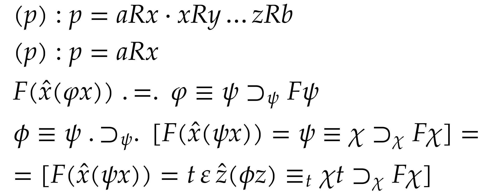

### [Ms-103](/ms-103/#3r.2) [3r\[2\]](https://cdn.wittgensteinnachlass.com/2000px/webp/Ms-103/3r.webp)

17.04.1916

The above definition, in its generality, can only be a rule for written signs that has nothing to do with the sense of the signs. But can there be such a rule?

### [Ms-103](/ms-103/#3r.3) [3r\[3\]](https://cdn.wittgensteinnachlass.com/2000px/webp/Ms-103/3r.webp)

The definition is possible only if it is not itself a proposition. Then a proposition cannot be about all propositions, but a definition can.

### [Ms-103](/ms-103/#4r.1) [4r\[1\]](https://cdn.wittgensteinnachlass.com/2000px/webp/Ms-103/4r.webp)

23.04.1916

But the above definition is not about all propositions at all, for it essentially contains genuine variables. It is quite analogous to an operation whose own result can also be taken as its base.

### [Ms-103](/ms-103/#4r.2) [4r\[2\]](https://cdn.wittgensteinnachlass.com/2000px/webp/Ms-103/4r.webp)

In this way and in this way alone is it possible to proceed from one type to another.

### [Ms-103](/ms-103/#4r.3) [4r\[3\]](https://cdn.wittgensteinnachlass.com/2000px/webp/Ms-103/4r.webp)

And one can say that all types are arranged in hierarchies.

### [Ms-103](/ms-103/#4r.4+5r.1) [4r\[4\]](https://cdn.wittgensteinnachlass.com/2000px/webp/Ms-103/4r.webp),[5r\[1\]](https://cdn.wittgensteinnachlass.com/2000px/webp/Ms-103/5r.webp)

And the hierarchy is possible only through construction by means of the operations.

### [Ms-103](/ms-103/#5r.2) [5r\[2\]](https://cdn.wittgensteinnachlass.com/2000px/webp/Ms-103/5r.webp)

Empirical reality is bounded by the number of objects.

The limit shows itself once more in the totality of simple propositions.

### [Ms-103](/ms-103/#5r.3) [5r\[3\]](https://cdn.wittgensteinnachlass.com/2000px/webp/Ms-103/5r.webp)

The hierarchies are and must be independent of reality. The meanings of their members are determined only by correlating the objects with the names.

### [Ms-103](/ms-103/#5r.4+6r.1) [5r\[4\]](https://cdn.wittgensteinnachlass.com/2000px/webp/Ms-103/5r.webp),[6r\[1\]](https://cdn.wittgensteinnachlass.com/2000px/webp/Ms-103/6r.webp)

27.04.1916

φx . ψy

Let us say I wanted to represent a function of 3 arguments that cannot be substituted for one another.

### [Ms-103](/ms-103/#6r.2) [6r\[2\]](https://cdn.wittgensteinnachlass.com/2000px/webp/Ms-103/6r.webp)

φ(x) : φ( ), x

### [Ms-103](/ms-103/#6r.3) [6r\[3\]](https://cdn.wittgensteinnachlass.com/2000px/webp/Ms-103/6r.webp)

But is logic then to speak of arguments that cannot be interchanged? If so, this surely presupposes something about the nature of reality.

### [Ms-103](/ms-103/#6r.5+7r.1) [6r\[5\]](https://cdn.wittgensteinnachlass.com/2000px/webp/Ms-103/6r.webp),[7r\[1\]](https://cdn.wittgensteinnachlass.com/2000px/webp/Ms-103/7r.webp)

06.05.1916

The whole world-view of the moderns rests on this illusion, that the so-called laws of nature are the explanations of natural phenomena.

### [Ms-103](/ms-103/#7r.2) [7r\[2\]](https://cdn.wittgensteinnachlass.com/2000px/webp/Ms-103/7r.webp)

So they stop at the laws of nature as at something _inviolable_, just as people in earlier times stopped at God and fate.

### [Ms-103](/ms-103/#7r.3) [7r\[3\]](https://cdn.wittgensteinnachlass.com/2000px/webp/Ms-103/7r.webp)

And both are right and wrong. The ancients are, however, clearer in that they acknowledged a definite stopping point, whereas the new system is meant to give the impression that _everything_ has been given a justification.

### [Ms-103](/ms-103/#7r.4+8r.1) [7r\[4\]](https://cdn.wittgensteinnachlass.com/2000px/webp/Ms-103/7r.webp),[8r\[1\]](https://cdn.wittgensteinnachlass.com/2000px/webp/Ms-103/8r.webp)

11.05.1916

❘p ❘(a,a)

There are, after all, operations with two bases too. And the ‘ ❘ ’ operation is of this kind.

### [Ms-103](/ms-103/#8r.2) [8r\[2\]](https://cdn.wittgensteinnachlass.com/2000px/webp/Ms-103/8r.webp)

❘ (ξ,η)… is an arbitrary member of the series of results of the operation.

### [Ms-103](/ms-103/#8r.3) [8r\[3\]](https://cdn.wittgensteinnachlass.com/2000px/webp/Ms-103/8r.webp)

(∃x).φx

Is (∃x) etc. really an operation, then?

### [Ms-103](/ms-103/#8r.4) [8r\[4\]](https://cdn.wittgensteinnachlass.com/2000px/webp/Ms-103/8r.webp)

But what would its base be?

### [Ms-103](/ms-103/#8r.8+9r.1+10r.1) [8r\[8\]](https://cdn.wittgensteinnachlass.com/2000px/webp/Ms-103/8r.webp),[9r\[1\]](https://cdn.wittgensteinnachlass.com/2000px/webp/Ms-103/9r.webp),[10r\[1\]](https://cdn.wittgensteinnachlass.com/2000px/webp/Ms-103/10r.webp)

04.07.1916

What do I know about God and the purpose of life? I know that this world exists. That I stand in it as my eye stands in its visual field. That there is something problematic about it which we call its sense. That this sense lies not in it but outside it. That life is the world. That my will pervades the world. That my will is good or evil. That good and evil are therefore somehow connected with the sense of the world. We can call the sense of life, i.e. the sense of the world, God. And link to this the simile of God as a father.

Prayer is the thought of the sense of life.

I cannot direct the events of the world according to my will but am completely powerless.

Only in this way can I make myself independent of the world – and so in a certain sense master it after all – by renouncing any influence on events.

### [Ms-103](/ms-103/#11r.1) [11r\[1\]](https://cdn.wittgensteinnachlass.com/2000px/webp/Ms-103/11r.webp)

05.07.1916

The world is independent of my will.

### [Ms-103](/ms-103/#11r.2) [11r\[2\]](https://cdn.wittgensteinnachlass.com/2000px/webp/Ms-103/11r.webp)

Even if everything we wish for were to happen, this would still be only, so to speak, a favour granted by fate, for there is no logical connection between will and world that would guarantee this, and yet we were unable in turn to will the supposed physical one.

### [Ms-103](/ms-103/#11r.3+12r.1) [11r\[3\]](https://cdn.wittgensteinnachlass.com/2000px/webp/Ms-103/11r.webp),[12r\[1\]](https://cdn.wittgensteinnachlass.com/2000px/webp/Ms-103/12r.webp)

If good or evil willing has an effect on the world, then it can have that effect only on the limits of the world, not on the facts, but on what cannot be depicted by language but can only be shown in language.

### [Ms-103](/ms-103/#12r.2) [12r\[2\]](https://cdn.wittgensteinnachlass.com/2000px/webp/Ms-103/12r.webp)

In short, the _world_ must thereby become a different world altogether.

### [Ms-103](/ms-103/#12r.3) [12r\[3\]](https://cdn.wittgensteinnachlass.com/2000px/webp/Ms-103/12r.webp)

It must, so to speak, wax or wane as a whole. As through the addition or loss of a sense.

### [Ms-103](/ms-103/#12r.4) [12r\[4\]](https://cdn.wittgensteinnachlass.com/2000px/webp/Ms-103/12r.webp)

Just as in death, too, the world does not change but ceases to be.

### [Ms-103](/ms-103/#13r.1) [13r\[1\]](https://cdn.wittgensteinnachlass.com/2000px/webp/Ms-103/13r.webp)

06.07.1916

And to that extent Dostojewski too is probably right when he says that whoever is happy fulfils the purpose of existence.

### [Ms-103](/ms-103/#13r.2) [13r\[2\]](https://cdn.wittgensteinnachlass.com/2000px/webp/Ms-103/13r.webp)

Or one could also put it this way: whoever no longer needs any purpose apart from life fulfils the purpose of existence. That is to say, whoever is content.

### [Ms-103](/ms-103/#13r.3) [13r\[3\]](https://cdn.wittgensteinnachlass.com/2000px/webp/Ms-103/13r.webp)

One notices the solution to the problem of life by the disappearance of this problem.

### [Ms-103](/ms-103/#13r.4+14r.1) [13r\[4\]](https://cdn.wittgensteinnachlass.com/2000px/webp/Ms-103/13r.webp),[14r\[1\]](https://cdn.wittgensteinnachlass.com/2000px/webp/Ms-103/14r.webp)

But can one live in such a way that life ceases to be problematic? That one _lives_ in the eternal and not in time?

### [Ms-103](/ms-103/#14r.2) [14r\[2\]](https://cdn.wittgensteinnachlass.com/2000px/webp/Ms-103/14r.webp)

07.07.1916

Is this not the reason why people to whom the sense of life became clear after long doubts, why they could not then say what that sense consisted in.

### [Ms-103](/ms-103/#14r.3) [14r\[3\]](https://cdn.wittgensteinnachlass.com/2000px/webp/Ms-103/14r.webp)

If I can think of a “_kind_ of objects” without knowing whether there are such objects, then I must have constructed their prototype for myself.

### [Ms-103](/ms-103/#14r.4) [14r\[4\]](https://cdn.wittgensteinnachlass.com/2000px/webp/Ms-103/14r.webp)

Is this not what the method of mechanics rests on?

### [Ms-103](/ms-103/#14r.5+15r.1) [14r\[5\]](https://cdn.wittgensteinnachlass.com/2000px/webp/Ms-103/14r.webp),[15r\[1\]](https://cdn.wittgensteinnachlass.com/2000px/webp/Ms-103/15r.webp)

08.07.1916

To believe in a God means to understand the question of the sense of life.

### [Ms-103](/ms-103/#15r.2) [15r\[2\]](https://cdn.wittgensteinnachlass.com/2000px/webp/Ms-103/15r.webp)

To believe in a God means to see that the facts of the world are not all there is to it.

### [Ms-103](/ms-103/#15r.3) [15r\[3\]](https://cdn.wittgensteinnachlass.com/2000px/webp/Ms-103/15r.webp)

To believe in God means to see that life has a sense.

### [Ms-103](/ms-103/#15r.4) [15r\[4\]](https://cdn.wittgensteinnachlass.com/2000px/webp/Ms-103/15r.webp)

The world is _given_ to me. i.e. my will approaches the world entirely from outside, as something already complete.

### [Ms-103](/ms-103/#15r.5) [15r\[5\]](https://cdn.wittgensteinnachlass.com/2000px/webp/Ms-103/15r.webp)

(What my will is I do not yet know.)

### [Ms-103](/ms-103/#15r.6+17r.1) [15r\[6\]](https://cdn.wittgensteinnachlass.com/2000px/webp/Ms-103/15r.webp),[17r\[1\]](https://cdn.wittgensteinnachlass.com/2000px/webp/Ms-103/17r.webp)

Hence we have the feeling that we depend on a will other than our own.

### [Ms-103](/ms-103/#17r.2) [17r\[2\]](https://cdn.wittgensteinnachlass.com/2000px/webp/Ms-103/17r.webp)

_Be that as it may_, in any case we _are_ dependent in a certain sense, and what we depend on we can call God.

### [Ms-103](/ms-103/#17r.3) [17r\[3\]](https://cdn.wittgensteinnachlass.com/2000px/webp/Ms-103/17r.webp)

In this sense God would simply be fate or, what amounts to the same thing: the – independent of our will – world.

### [Ms-103](/ms-103/#17r.4) [17r\[4\]](https://cdn.wittgensteinnachlass.com/2000px/webp/Ms-103/17r.webp)

I can make myself independent of fate.

### [Ms-103](/ms-103/#17r.5) [17r\[5\]](https://cdn.wittgensteinnachlass.com/2000px/webp/Ms-103/17r.webp)

There are two divinities: the world and my independent self.

### [Ms-103](/ms-103/#18r.1) [18r\[1\]](https://cdn.wittgensteinnachlass.com/2000px/webp/Ms-103/18r.webp)

I am either happy or unhappy, that is all. One can say: there is no good or evil.

### [Ms-103](/ms-103/#18r.2) [18r\[2\]](https://cdn.wittgensteinnachlass.com/2000px/webp/Ms-103/18r.webp)

Whoever is happy must have no fear. Not even of death.

### [Ms-103](/ms-103/#18r.3) [18r\[3\]](https://cdn.wittgensteinnachlass.com/2000px/webp/Ms-103/18r.webp)

Only whoever lives not in time but in the present is happy.

### [Ms-103](/ms-103/#18r.4) [18r\[4\]](https://cdn.wittgensteinnachlass.com/2000px/webp/Ms-103/18r.webp)

For life in the present there is no death.

### [Ms-103](/ms-103/#18r.5) [18r\[5\]](https://cdn.wittgensteinnachlass.com/2000px/webp/Ms-103/18r.webp)

Death is not an event in life. It is not a fact of the world.

### [Ms-103](/ms-103/#18r.6+19r.1) [18r\[6\]](https://cdn.wittgensteinnachlass.com/2000px/webp/Ms-103/18r.webp),[19r\[1\]](https://cdn.wittgensteinnachlass.com/2000px/webp/Ms-103/19r.webp)

If by eternity one means not infinite duration but timelessness, then one can say that whoever lives in the present lives eternally.

### [Ms-103](/ms-103/#19r.2) [19r\[2\]](https://cdn.wittgensteinnachlass.com/2000px/webp/Ms-103/19r.webp)

To live happily I must be in agreement with the world. And this is precisely what it _means_ to “be happy”.

### [Ms-103](/ms-103/#19r.3) [19r\[3\]](https://cdn.wittgensteinnachlass.com/2000px/webp/Ms-103/19r.webp)

I am then, so to speak, in agreement with that other will on which I appear to depend. That is to say: “I do God’s will”.

### [Ms-103](/ms-103/#19r.4) [19r\[4\]](https://cdn.wittgensteinnachlass.com/2000px/webp/Ms-103/19r.webp)

Fear of death is the best sign of a false, i.e. bad, life.

### [Ms-103](/ms-103/#20r.1) [20r\[1\]](https://cdn.wittgensteinnachlass.com/2000px/webp/Ms-103/20r.webp)

If my conscience throws me off balance, then I am not in agreement with something. But what is it? Is it _the world_?

### [Ms-103](/ms-103/#20r.2) [20r\[2\]](https://cdn.wittgensteinnachlass.com/2000px/webp/Ms-103/20r.webp)

It is certainly right to say: conscience is the voice of God.

### [Ms-103](/ms-103/#20r.3) [20r\[3\]](https://cdn.wittgensteinnachlass.com/2000px/webp/Ms-103/20r.webp)

For example: it makes me unhappy to think that I have offended so-and-so. Is that my conscience.

### [Ms-103](/ms-103/#20r.4) [20r\[4\]](https://cdn.wittgensteinnachlass.com/2000px/webp/Ms-103/20r.webp)

Can one say: “act according to your conscience, whatever it may be like”?

### [Ms-103](/ms-103/#20r.5) [20r\[5\]](https://cdn.wittgensteinnachlass.com/2000px/webp/Ms-103/20r.webp)

Live happily!

### [Ms-103](/ms-103/#21r.1) [21r\[1\]](https://cdn.wittgensteinnachlass.com/2000px/webp/Ms-103/21r.webp)

09.07.1916

If one could not give the most general sentential form, then a moment would have to come when we suddenly have a new experience, a logical one, so to speak.

### [Ms-103](/ms-103/#21r.2) [21r\[2\]](https://cdn.wittgensteinnachlass.com/2000px/webp/Ms-103/21r.webp)

This is of course impossible.

### [Ms-103](/ms-103/#21r.3) [21r\[3\]](https://cdn.wittgensteinnachlass.com/2000px/webp/Ms-103/21r.webp)

Do not forget that (∃x) fx does not mean; there is an x such that fx, but rather: there is a true proposition “fx”.

### [Ms-103](/ms-103/#21r.4+22r.1) [21r\[4\]](https://cdn.wittgensteinnachlass.com/2000px/webp/Ms-103/21r.webp),[22r\[1\]](https://cdn.wittgensteinnachlass.com/2000px/webp/Ms-103/22r.webp)

The proposition fa speaks of determinate objects, the general proposition of _all_ objects.

### [Ms-103](/ms-103/#22r.2) [22r\[2\]](https://cdn.wittgensteinnachlass.com/2000px/webp/Ms-103/22r.webp)

11.07.1916

The determinate object is a very curious phenomenon.

### [Ms-103](/ms-103/#22r.3) [22r\[3\]](https://cdn.wittgensteinnachlass.com/2000px/webp/Ms-103/22r.webp)

Instead of “all objects” one could say: all _determinate objects_.

### [Ms-103](/ms-103/#22r.4) [22r\[4\]](https://cdn.wittgensteinnachlass.com/2000px/webp/Ms-103/22r.webp)

If all determinate objects are given, “all objects” are given. In short, with the determinate objects all objects are given.

### [Ms-103](/ms-103/#22r.5) [22r\[5\]](https://cdn.wittgensteinnachlass.com/2000px/webp/Ms-103/22r.webp)

If there are objects, then there are thereby also “all objects”.

### [Ms-103](/ms-103/#23r.1) [23r\[1\]](https://cdn.wittgensteinnachlass.com/2000px/webp/Ms-103/23r.webp)

That is why it must also be possible to establish the unity of elementary propositions and general propositions.

### [Ms-103](/ms-103/#23r.2) [23r\[2\]](https://cdn.wittgensteinnachlass.com/2000px/webp/Ms-103/23r.webp)

For if the elementary propositions are given, then _all_ elementary propositions are thereby given, and with them the general proposition. – And is the unity not already established thereby.

### [Ms-103](/ms-103/#23r.3) [23r\[3\]](https://cdn.wittgensteinnachlass.com/2000px/webp/Ms-103/23r.webp)

12.07.1916

13.07.1916 Again and again one feels that the elementary proposition too speaks of all objects. (∃x) . φx . x = a

### [Ms-103](/ms-103/#23r.4+24r.1) [23r\[4\]](https://cdn.wittgensteinnachlass.com/2000px/webp/Ms-103/23r.webp),[24r\[1\]](https://cdn.wittgensteinnachlass.com/2000px/webp/Ms-103/24r.webp)

If two operations are given which cannot be reduced to _one_, then it must at least be possible to set down a general form for their combination.

### [Ms-103](/ms-103/#24r.2) [24r\[2\]](https://cdn.wittgensteinnachlass.com/2000px/webp/Ms-103/24r.webp)

φx, ψy❘χz, (∃x) ∙ , (x) ∙

Since it is evidently easy to explain how sentences can be formed with these operations and how they cannot be formed, it must also be possible to express this exactly _somehow_.

### [Ms-103](/ms-103/#24r.3) [24r\[3\]](https://cdn.wittgensteinnachlass.com/2000px/webp/Ms-103/24r.webp)

14.07.1916

And this expression must also already be given in the general form of the operation sign.

### [Ms-103](/ms-103/#24r.4+25r.1) [24r\[4\]](https://cdn.wittgensteinnachlass.com/2000px/webp/Ms-103/24r.webp),[25r\[1\]](https://cdn.wittgensteinnachlass.com/2000px/webp/Ms-103/25r.webp)

Indeed, must this not be the only legitimate expression of the application of the operation? Evidently it must!

### [Ms-103](/ms-103/#25r.2) [25r\[2\]](https://cdn.wittgensteinnachlass.com/2000px/webp/Ms-103/25r.webp)

For if the form of the operation can be expressed at all, it must be expressed in such a way that it _can_ only be applied correctly.

### [Ms-103](/ms-103/#27r.3) [27r\[3\]](https://cdn.wittgensteinnachlass.com/2000px/webp/Ms-103/27r.webp)

A human being cannot simply make himself happy.

### [Ms-103](/ms-103/#27r.4) [27r\[4\]](https://cdn.wittgensteinnachlass.com/2000px/webp/Ms-103/27r.webp)

Whoever lives in the present lives without fear and hope.

### [Ms-103](/ms-103/#27r.5+28r.1) [27r\[5\]](https://cdn.wittgensteinnachlass.com/2000px/webp/Ms-103/27r.webp),[28r\[1\]](https://cdn.wittgensteinnachlass.com/2000px/webp/Ms-103/28r.webp)

21.07.1916

What really is the nature of the human will? I want to call above all the bearer of good and evil “will”.

### [Ms-103](/ms-103/#28r.2) [28r\[2\]](https://cdn.wittgensteinnachlass.com/2000px/webp/Ms-103/28r.webp)

Let us imagine a person who could not use any of his limbs and therefore could not exercise his _will_ in the ordinary sense. But he could think and _wish_ and communicate his thoughts to someone else. So he could also do evil or good through the other person. Then it is clear that ethics would apply to him too and that in the _ethical sense_ he is the bearer of a _will_.

### [Ms-103](/ms-103/#28r.3+29r.1) [28r\[3\]](https://cdn.wittgensteinnachlass.com/2000px/webp/Ms-103/28r.webp),[29r\[1\]](https://cdn.wittgensteinnachlass.com/2000px/webp/Ms-103/29r.webp)

Now is there a difference in principle between this will and _the one_ that sets the human body in motion?

### [Ms-103](/ms-103/#29r.2) [29r\[2\]](https://cdn.wittgensteinnachlass.com/2000px/webp/Ms-103/29r.webp)

Or does the mistake here lie in the fact that _wishing_ (or thinking) is itself already an action of the will? (And in this sense a human being _without_ a will would indeed not be alive.)

### [Ms-103](/ms-103/#29r.3) [29r\[3\]](https://cdn.wittgensteinnachlass.com/2000px/webp/Ms-103/29r.webp)

But is a being conceivable that could only form images (see, say), but could not will at all? In some sense this seems impossible. But if it were possible, then there could also be a world without ethics.

### [Ms-103](/ms-103/#30r.1) [30r\[1\]](https://cdn.wittgensteinnachlass.com/2000px/webp/Ms-103/30r.webp)

24.07.1916

The world and life are one.

### [Ms-103](/ms-103/#30r.2) [30r\[2\]](https://cdn.wittgensteinnachlass.com/2000px/webp/Ms-103/30r.webp)

Physiological life is of course not “life”. Nor is psychological life. Life is the world.

### [Ms-103](/ms-103/#30r.3) [30r\[3\]](https://cdn.wittgensteinnachlass.com/2000px/webp/Ms-103/30r.webp)

Ethics does not deal with the world. Ethics must be a condition of the world, like logic.

### [Ms-103](/ms-103/#30r.4) [30r\[4\]](https://cdn.wittgensteinnachlass.com/2000px/webp/Ms-103/30r.webp)

Ethics and aesthetics are one.

### [Ms-103](/ms-103/#30r.5+31r.1) [30r\[5\]](https://cdn.wittgensteinnachlass.com/2000px/webp/Ms-103/30r.webp),[31r\[1\]](https://cdn.wittgensteinnachlass.com/2000px/webp/Ms-103/31r.webp)

29.07.1916

For it is a logical fact that the wish stands in no logical connection with its fulfilment. And it is also clear that the world of the happy is _different_ from the world of the unhappy.

### [Ms-103](/ms-103/#31r.2) [31r\[2\]](https://cdn.wittgensteinnachlass.com/2000px/webp/Ms-103/31r.webp)

Is seeing an activity?

### [Ms-103](/ms-103/#31r.3) [31r\[3\]](https://cdn.wittgensteinnachlass.com/2000px/webp/Ms-103/31r.webp)

Can one will well, will ill, and not will?

### [Ms-103](/ms-103/#31r.4) [31r\[4\]](https://cdn.wittgensteinnachlass.com/2000px/webp/Ms-103/31r.webp)

Or is only the person who does _not_ will happy?

### [Ms-103](/ms-103/#31r.5) [31r\[5\]](https://cdn.wittgensteinnachlass.com/2000px/webp/Ms-103/31r.webp)

“To love one’s neighbour” – that would mean willing!

### [Ms-103](/ms-103/#31r.6+32r.1) [31r\[6\]](https://cdn.wittgensteinnachlass.com/2000px/webp/Ms-103/31r.webp),[32r\[1\]](https://cdn.wittgensteinnachlass.com/2000px/webp/Ms-103/32r.webp)

But can one wish and yet not be unhappy if the wish is not fulfilled? (And that possibility is always there.)

### [Ms-103](/ms-103/#32r.2) [32r\[2\]](https://cdn.wittgensteinnachlass.com/2000px/webp/Ms-103/32r.webp)

Is it good, according to generally held notions, to wish one’s neighbour _nothing_, neither good nor bad?

### [Ms-103](/ms-103/#32r.3) [32r\[3\]](https://cdn.wittgensteinnachlass.com/2000px/webp/Ms-103/32r.webp)

And yet in a certain sense not wishing seems to be the only good thing.

### [Ms-103](/ms-103/#32r.4) [32r\[4\]](https://cdn.wittgensteinnachlass.com/2000px/webp/Ms-103/32r.webp)

Here I am still making gross errors! No doubt about it!

### [Ms-103](/ms-103/#32r.5+33r.1) [32r\[5\]](https://cdn.wittgensteinnachlass.com/2000px/webp/Ms-103/32r.webp),[33r\[1\]](https://cdn.wittgensteinnachlass.com/2000px/webp/Ms-103/33r.webp)

It is generally assumed that it is evil to wish another person misfortune. Can that be right? Can it be worse than wishing the other person happiness? What matters here seems to be, so to speak, _how_ one wishes.

### [Ms-103](/ms-103/#33r.2) [33r\[2\]](https://cdn.wittgensteinnachlass.com/2000px/webp/Ms-103/33r.webp)

One seems unable to say more than: Live happily!

### [Ms-103](/ms-103/#33r.3) [33r\[3\]](https://cdn.wittgensteinnachlass.com/2000px/webp/Ms-103/33r.webp)

The world of the happy is different from that of the unhappy.

### [Ms-103](/ms-103/#33r.4) [33r\[4\]](https://cdn.wittgensteinnachlass.com/2000px/webp/Ms-103/33r.webp)

The world of the happy is _a happy world_.

### [Ms-103](/ms-103/#33r.5) [33r\[5\]](https://cdn.wittgensteinnachlass.com/2000px/webp/Ms-103/33r.webp)

So can there be a world that is neither happy nor unhappy?

### [Ms-103](/ms-103/#34r.1+35r.1) [34r\[1\]](https://cdn.wittgensteinnachlass.com/2000px/webp/Ms-103/34r.webp),[35r\[1\]](https://cdn.wittgensteinnachlass.com/2000px/webp/Ms-103/35r.webp)

30.07.1916

The first thought when a general ethical law of the form “Thou shalt …” is laid down is: “And what then, if I do not do it?”

But it is clear that ethics has nothing to do with punishment and reward. So this question about the consequences of an action must be beside the point. At the very least, these consequences must not be events. For there must be something right about asking the question in that way. There must, to be sure, be a _kind_ of reward and ethical punishment, but they must lie in the action itself. And it is also clear that the reward must be something pleasant and the punishment something unpleasant.

### [Ms-103](/ms-103/#35r.2) [35r\[2\]](https://cdn.wittgensteinnachlass.com/2000px/webp/Ms-103/35r.webp)

Again and again I come back to the point that the happy life is simply good and the unhappy life bad. And if I _now_ ask myself: but _why_ should I live happily rather than otherwise? – the question strikes me straightaway as tautological; it seems that the happy life justifies itself, that it _is_ the only right life.

### [Ms-103](/ms-103/#36r.1) [36r\[1\]](https://cdn.wittgensteinnachlass.com/2000px/webp/Ms-103/36r.webp)

All this really is, in a certain sense, profoundly mysterious! _It is clear_ that ethics _cannot_ be put into words!

### [Ms-103](/ms-103/#36r.2) [36r\[2\]](https://cdn.wittgensteinnachlass.com/2000px/webp/Ms-103/36r.webp)

But one could put it this way: The happy life seems in some sense to be _more harmonious_ than the unhappy one. But in what sense??

### [Ms-103](/ms-103/#36r.3+37r.1) [36r\[3\]](https://cdn.wittgensteinnachlass.com/2000px/webp/Ms-103/36r.webp),[37r\[1\]](https://cdn.wittgensteinnachlass.com/2000px/webp/Ms-103/37r.webp)

What is the objective mark of the happy, harmonious life? Here again it is clear that there can be no such mark that could be _described_. This mark cannot be physical, but can only be metaphysical, transcendent.

### [Ms-103](/ms-103/#37r.2) [37r\[2\]](https://cdn.wittgensteinnachlass.com/2000px/webp/Ms-103/37r.webp)

Ethics is transcendent.

### [Ms-103](/ms-103/#37r.3) [37r\[3\]](https://cdn.wittgensteinnachlass.com/2000px/webp/Ms-103/37r.webp)

01.08.1916

How everything is, is God.

### [Ms-103](/ms-103/#37r.4) [37r\[4\]](https://cdn.wittgensteinnachlass.com/2000px/webp/Ms-103/37r.webp)

God is how everything is.

### [Ms-103](/ms-103/#37r.5) [37r\[5\]](https://cdn.wittgensteinnachlass.com/2000px/webp/Ms-103/37r.webp)

Only from the consciousness of the _uniqueness of my life_ spring religion – science – and art.

### [Ms-103](/ms-103/#37r.6) [37r\[6\]](https://cdn.wittgensteinnachlass.com/2000px/webp/Ms-103/37r.webp)

02.08.1916

And this consciousness is life itself.

### [Ms-103](/ms-103/#37r.7) [37r\[7\]](https://cdn.wittgensteinnachlass.com/2000px/webp/Ms-103/37r.webp)

Can there be ethics if there is no living being apart from me?

### [Ms-103](/ms-103/#38r.1) [38r\[1\]](https://cdn.wittgensteinnachlass.com/2000px/webp/Ms-103/38r.webp)

If ethics is to be something fundamental, yes!

### [Ms-103](/ms-103/#38r.2) [38r\[2\]](https://cdn.wittgensteinnachlass.com/2000px/webp/Ms-103/38r.webp)

If I am right, then for an ethical judgement it is not enough that a world be given. The world in itself is then neither good nor evil.

### [Ms-103](/ms-103/#38r.3) [38r\[3\]](https://cdn.wittgensteinnachlass.com/2000px/webp/Ms-103/38r.webp)

For it must make no difference to the existence of ethics whether or not there is living matter in the world. And it is clear that a world in which there is only dead matter is in itself neither good nor evil, so the world of living beings cannot in itself be either good or evil either.

### [Ms-103](/ms-103/#39r.1) [39r\[1\]](https://cdn.wittgensteinnachlass.com/2000px/webp/Ms-103/39r.webp)

Good and evil arise only through the _subject_. And the subject does not belong to the world, but is a limit of the world.

### [Ms-103](/ms-103/#39r.2) [39r\[2\]](https://cdn.wittgensteinnachlass.com/2000px/webp/Ms-103/39r.webp)

One could say (in Schopenhauer’s manner): The world of representation is neither good nor evil; it is the willing subject that is good or evil.

### [Ms-103](/ms-103/#39r.3) [39r\[3\]](https://cdn.wittgensteinnachlass.com/2000px/webp/Ms-103/39r.webp)

I am conscious of the complete lack of clarity of all these sentences.

### [Ms-103](/ms-103/#39r.4+40r.1) [39r\[4\]](https://cdn.wittgensteinnachlass.com/2000px/webp/Ms-103/39r.webp),[40r\[1\]](https://cdn.wittgensteinnachlass.com/2000px/webp/Ms-103/40r.webp)

From what went before, then, the willing subject would have to be happy or unhappy, and happiness and unhappiness cannot belong to the world.

### [Ms-103](/ms-103/#40r.2) [40r\[2\]](https://cdn.wittgensteinnachlass.com/2000px/webp/Ms-103/40r.webp)

Just as the subject is not a part of the world but a presupposition of its existence, so good and evil, predicates of the subject, are not properties in the world.

### [Ms-103](/ms-103/#40r.3) [40r\[3\]](https://cdn.wittgensteinnachlass.com/2000px/webp/Ms-103/40r.webp)

The nature of the subject is completely veiled here.

### [Ms-103](/ms-103/#40r.4) [40r\[4\]](https://cdn.wittgensteinnachlass.com/2000px/webp/Ms-103/40r.webp)

Indeed, my work has extended from the foundations of logic to the nature of the world.

### [Ms-103](/ms-103/#40r.5+41r.1) [40r\[5\]](https://cdn.wittgensteinnachlass.com/2000px/webp/Ms-103/40r.webp),[41r\[1\]](https://cdn.wittgensteinnachlass.com/2000px/webp/Ms-103/41r.webp)

04.08.1916

Is the representing subject not, after all, mere superstition?

### [Ms-103](/ms-103/#41r.2) [41r\[2\]](https://cdn.wittgensteinnachlass.com/2000px/webp/Ms-103/41r.webp)

Where in the world can a metaphysical subject be discerned?

### [Ms-103](/ms-103/#41r.3) [41r\[3\]](https://cdn.wittgensteinnachlass.com/2000px/webp/Ms-103/41r.webp)

You say it is just the same here as with the eye and the visual field. But you really do _not_ see the eye. And I believe that nothing about the visual field allows one to infer that it is seen by an eye.

### [Ms-103](/ms-103/#41r.4) [41r\[4\]](https://cdn.wittgensteinnachlass.com/2000px/webp/Ms-103/41r.webp)

05.08.1916

The representing subject is presumably an empty delusion. But the willing subject does exist.

### [Ms-103](/ms-103/#42r.1) [42r\[1\]](https://cdn.wittgensteinnachlass.com/2000px/webp/Ms-103/42r.webp)

Were there no will, there would not be that centre of the world which we call the self and which is the bearer of ethics.

### [Ms-103](/ms-103/#42r.2) [42r\[2\]](https://cdn.wittgensteinnachlass.com/2000px/webp/Ms-103/42r.webp)

It is essentially only the self that is good or evil, not the world.

### [Ms-103](/ms-103/#42r.3) [42r\[3\]](https://cdn.wittgensteinnachlass.com/2000px/webp/Ms-103/42r.webp)

The self, the self is what is profoundly mysterious!

### [Ms-103](/ms-103/#42r.4) [42r\[4\]](https://cdn.wittgensteinnachlass.com/2000px/webp/Ms-103/42r.webp)

07.08.1916

The self is not an object.

### [Ms-103](/ms-103/#42r.5) [42r\[5\]](https://cdn.wittgensteinnachlass.com/2000px/webp/Ms-103/42r.webp)

08.08.1916

11.08.1916 I stand in an objective relation to every object. Not to the self.

### [Ms-103](/ms-103/#43r.1) [43r\[1\]](https://cdn.wittgensteinnachlass.com/2000px/webp/Ms-103/43r.webp)

So there really is a way in which philosophy can and must speak of the self _in a non-psychological sense_.

### [Ms-103](/ms-103/#43r.2) [43r\[2\]](https://cdn.wittgensteinnachlass.com/2000px/webp/Ms-103/43r.webp)

12.08.1916

The self enters philosophy through the fact that the world is _my_ world.

### [Ms-103](/ms-103/#43r.3) [43r\[3\]](https://cdn.wittgensteinnachlass.com/2000px/webp/Ms-103/43r.webp)

For the visual field does not have a shape like this: 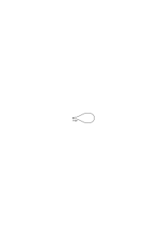.

### [Ms-103](/ms-103/#43r.4+44r.1) [43r\[4\]](https://cdn.wittgensteinnachlass.com/2000px/webp/Ms-103/43r.webp),[44r\[1\]](https://cdn.wittgensteinnachlass.com/2000px/webp/Ms-103/44r.webp)

This is connected with the fact that no part of our experience is a priori.

### [Ms-103](/ms-103/#44r.2) [44r\[2\]](https://cdn.wittgensteinnachlass.com/2000px/webp/Ms-103/44r.webp)

Everything we see could be otherwise. Everything we can describe at all could be otherwise.

### [Ms-103](/ms-103/#44r.3) [44r\[3\]](https://cdn.wittgensteinnachlass.com/2000px/webp/Ms-103/44r.webp)

13.08.1916

Suppose a human being could not exercise his will but had to suffer all the affliction of this world: what could then make him happy?

### [Ms-103](/ms-103/#44r.4+45r.1) [44r\[4\]](https://cdn.wittgensteinnachlass.com/2000px/webp/Ms-103/44r.webp),[45r\[1\]](https://cdn.wittgensteinnachlass.com/2000px/webp/Ms-103/45r.webp)

How can a human being be happy at all, given that he cannot ward off the affliction of this world? Precisely through the life of knowledge.

### [Ms-103](/ms-103/#45r.2) [45r\[2\]](https://cdn.wittgensteinnachlass.com/2000px/webp/Ms-103/45r.webp)

A good conscience is the happiness that the life of knowledge affords.

### [Ms-103](/ms-103/#45r.3) [45r\[3\]](https://cdn.wittgensteinnachlass.com/2000px/webp/Ms-103/45r.webp)

The life of knowledge is the life that is happy in spite of the affliction of the world.

### [Ms-103](/ms-103/#45r.4) [45r\[4\]](https://cdn.wittgensteinnachlass.com/2000px/webp/Ms-103/45r.webp)

Only the life that can forgo the comforts of the world is happy. For it the comforts of the world are merely so many favours bestowed by fate.

### [Ms-103](/ms-103/#46r.1+47r.1) [46r\[1\]](https://cdn.wittgensteinnachlass.com/2000px/webp/Ms-103/46r.webp),[47r\[1\]](https://cdn.wittgensteinnachlass.com/2000px/webp/Ms-103/47r.webp)

16.08.1916

At first sight, a point’s inability to be both red and green at once need not be a _logical_ impossibility. But the very way of expressing it in physics reduces it to a kinetic impossibility. One sees that there is a difference in structure between red and green. And then physics even arranges them in a series. And now one sees how the true structure of the objects is brought to light here. That a particle cannot be in two places at the same time looks much more like a _logical_ impossibility. If we ask why, for example, the thought immediately occurs: well, we would simply call particles that were in two places different particles, and all this again seems to follow from the structure of space and of the particles.

### [Ms-103](/ms-103/#47r.2) [47r\[2\]](https://cdn.wittgensteinnachlass.com/2000px/webp/Ms-103/47r.webp)

17.08.1916

An operation is the transition from one term of a series of forms to the next.

### [Ms-103](/ms-103/#47r.3) [47r\[3\]](https://cdn.wittgensteinnachlass.com/2000px/webp/Ms-103/47r.webp)

An operation and a series of forms are equivalents.

### [Ms-103](/ms-103/#47r.4+48r.1) [47r\[4\]](https://cdn.wittgensteinnachlass.com/2000px/webp/Ms-103/47r.webp),[48r\[1\]](https://cdn.wittgensteinnachlass.com/2000px/webp/Ms-103/48r.webp)

19.08.1916

29.08.1916 The question is whether the usual small number of basic operations suffices to generate all possible operations.

### [Ms-103](/ms-103/#48r.2) [48r\[2\]](https://cdn.wittgensteinnachlass.com/2000px/webp/Ms-103/48r.webp)

It seems that this must be so.

### [Ms-103](/ms-103/#48r.3) [48r\[3\]](https://cdn.wittgensteinnachlass.com/2000px/webp/Ms-103/48r.webp)

One can also ask whether one can go from any expression to any related expression by means of those basic operations.

### [Ms-103](/ms-103/#48r.4) [48r\[4\]](https://cdn.wittgensteinnachlass.com/2000px/webp/Ms-103/48r.webp)

02.09.1916

Here one sees that solipsism, carried through rigorously, coincides with pure realism.

### [Ms-103](/ms-103/#49r.1) [49r\[1\]](https://cdn.wittgensteinnachlass.com/2000px/webp/Ms-103/49r.webp)

The self of solipsism shrinks to a point without extension, and the reality correlated with it remains.

### [Ms-103](/ms-103/#49r.2) [49r\[2\]](https://cdn.wittgensteinnachlass.com/2000px/webp/Ms-103/49r.webp)

p ∙ q→p {p ∙ q} ⌵ p ∙ ~q = p

What has history to do with me? My world is the first and only one!

### [Ms-103](/ms-103/#49r.3) [49r\[3\]](https://cdn.wittgensteinnachlass.com/2000px/webp/Ms-103/49r.webp)

I want to report how _I_ found the world.

### [Ms-103](/ms-103/#49r.4+50r.1) [49r\[4\]](https://cdn.wittgensteinnachlass.com/2000px/webp/Ms-103/49r.webp),[50r\[1\]](https://cdn.wittgensteinnachlass.com/2000px/webp/Ms-103/50r.webp)

What others in the world told me about the world is a very small and incidental part of my experience of the world.

### [Ms-103](/ms-103/#50r.2) [50r\[2\]](https://cdn.wittgensteinnachlass.com/2000px/webp/Ms-103/50r.webp)

_It is I_ who have to judge the world, to measure things.

### [Ms-103](/ms-103/#50r.3+51r.1) [50r\[3\]](https://cdn.wittgensteinnachlass.com/2000px/webp/Ms-103/50r.webp),[51r\[1\]](https://cdn.wittgensteinnachlass.com/2000px/webp/Ms-103/51r.webp)

The philosophical self is not the human being, not the human body or the human mind with its psychological properties, but the metaphysical subject, the limit (not a part) of the world. The human body, however, _my_ body in particular, is a part of the world among other parts of the world, among animals, plants, stones, etc., etc.

### [Ms-103](/ms-103/#51r.2) [51r\[2\]](https://cdn.wittgensteinnachlass.com/2000px/webp/Ms-103/51r.webp)

Whoever sees this will not want to give his body or the human body a privileged place in the world.

He will quite naively regard human beings and animals as similar things that belong together.

### [Ms-103](/ms-103/#51r.3) [51r\[3\]](https://cdn.wittgensteinnachlass.com/2000px/webp/Ms-103/51r.webp)

11.09.1916

The way in which language designates is reflected in its use.

### [Ms-103](/ms-103/#52r.2) [52r\[2\]](https://cdn.wittgensteinnachlass.com/2000px/webp/Ms-103/52r.webp)

That colours are not properties is shown by the analysis in physics, by the internal relations in which physics shows the colours.

### [Ms-103](/ms-103/#52r.3) [52r\[3\]](https://cdn.wittgensteinnachlass.com/2000px/webp/Ms-103/52r.webp)

Apply this to sounds too.

### [Ms-103](/ms-103/#52r.4+53r.1) [52r\[4\]](https://cdn.wittgensteinnachlass.com/2000px/webp/Ms-103/52r.webp),[53r\[1\]](https://cdn.wittgensteinnachlass.com/2000px/webp/Ms-103/53r.webp)

12.09.1916

It is now clear why I thought thinking and speaking were the same. For thinking is a kind of language. For the thought is of course _also_ a logical picture of the sentence, and thus likewise a kind of sentence.

### [Ms-103](/ms-103/#53r.2) [53r\[2\]](https://cdn.wittgensteinnachlass.com/2000px/webp/Ms-103/53r.webp)

19.09.1916

Humanity has always sought a science in which simplex sigillum veri holds.

### [Ms-103](/ms-103/#53r.3+54r.1) [53r\[3\]](https://cdn.wittgensteinnachlass.com/2000px/webp/Ms-103/53r.webp),[54r\[1\]](https://cdn.wittgensteinnachlass.com/2000px/webp/Ms-103/54r.webp)

There cannot be an orderly or a disorderly world, such that one could say our world is orderly. Rather, there is an order, however complicated, in every possible world, just as in space there are not disorderly and orderly distributions of points, but every distribution of points is orderly.

### [Ms-103](/ms-103/#54r.2) [54r\[2\]](https://cdn.wittgensteinnachlass.com/2000px/webp/Ms-103/54r.webp)

Art is an expression.

### [Ms-103](/ms-103/#54r.3) [54r\[3\]](https://cdn.wittgensteinnachlass.com/2000px/webp/Ms-103/54r.webp)

The good work of art is the perfected expression.

### [Ms-103](/ms-103/#54r.4) [54r\[4\]](https://cdn.wittgensteinnachlass.com/2000px/webp/Ms-103/54r.webp)

07.10.1916

The work of art is the object seen sub specie aeternitatis; and the good life is the world seen sub specie aeternitatis. This is the connection between art and ethics.

### [Ms-103](/ms-103/#55r.1) [55r\[1\]](https://cdn.wittgensteinnachlass.com/2000px/webp/Ms-103/55r.webp)

The ordinary way of looking sees objects as it were from amidst them; the view sub specie aeternitatis sees them from outside.

### [Ms-103](/ms-103/#55r.2) [55r\[2\]](https://cdn.wittgensteinnachlass.com/2000px/webp/Ms-103/55r.webp)

So that they have the whole world as their background.

### [Ms-103](/ms-103/#55r.3) [55r\[3\]](https://cdn.wittgensteinnachlass.com/2000px/webp/Ms-103/55r.webp)

Is it perhaps that it sees the object _with_ space and time instead of _in_ space and time?

### [Ms-103](/ms-103/#55r.4) [55r\[4\]](https://cdn.wittgensteinnachlass.com/2000px/webp/Ms-103/55r.webp)

Each thing conditions the whole logical world, so to speak the whole of logical space.

### [Ms-103](/ms-103/#55r.5) [55r\[5\]](https://cdn.wittgensteinnachlass.com/2000px/webp/Ms-103/55r.webp)

(The thought presses itself upon one): The thing seen sub specie aeternitatis is the thing seen with the whole of logical space.

### [Ms-103](/ms-103/#56r.1) [56r\[1\]](https://cdn.wittgensteinnachlass.com/2000px/webp/Ms-103/56r.webp)

08.10.1916

As a thing among things every thing is equally insignificant; as a world each is equally significant.

### [Ms-103](/ms-103/#56r.2) [56r\[2\]](https://cdn.wittgensteinnachlass.com/2000px/webp/Ms-103/56r.webp)

If I have contemplated the stove and am now told: but now you know only the stove, then my result does indeed seem paltry. For this makes it look as though I had studied the stove as one among the many, many things in the world. But if I contemplated the stove, then _it_ was my world. And everything else pale by comparison.

### [Ms-103](/ms-103/#57r.1) [57r\[1\]](https://cdn.wittgensteinnachlass.com/2000px/webp/Ms-103/57r.webp)

One can take the mere present image either as the insignificant momentary picture in the whole temporal world or as the true world among shadows.

### [Ms-103](/ms-103/#57r.2) [57r\[2\]](https://cdn.wittgensteinnachlass.com/2000px/webp/Ms-103/57r.webp)

09.10.1916

But now, at last, the connection of ethics with the world must be made clear.

### [Ms-103](/ms-103/#57r.3) [57r\[3\]](https://cdn.wittgensteinnachlass.com/2000px/webp/Ms-103/57r.webp)

12.10.1916

A stone, the body of an animal, the body of a human being, my body, are all on the same footing.

### [Ms-103](/ms-103/#57r.4+58r.1) [57r\[4\]](https://cdn.wittgensteinnachlass.com/2000px/webp/Ms-103/57r.webp),[58r\[1\]](https://cdn.wittgensteinnachlass.com/2000px/webp/Ms-103/58r.webp)

That is why what happens, whether brought about by a stone or by my body, is neither good nor bad.

### [Ms-103](/ms-103/#58r.2) [58r\[2\]](https://cdn.wittgensteinnachlass.com/2000px/webp/Ms-103/58r.webp)

“Time is unidirectional” must be nonsense.

### [Ms-103](/ms-103/#58r.3) [58r\[3\]](https://cdn.wittgensteinnachlass.com/2000px/webp/Ms-103/58r.webp)

Unidirectionality is a logical property of time.

### [Ms-103](/ms-103/#58r.4) [58r\[4\]](https://cdn.wittgensteinnachlass.com/2000px/webp/Ms-103/58r.webp)

For if one asked someone how he imagines unidirectionality, he would say: time would not be unidirectional if an event could recur.

### [Ms-103](/ms-103/#58r.5+59r.1) [58r\[5\]](https://cdn.wittgensteinnachlass.com/2000px/webp/Ms-103/58r.webp),[59r\[1\]](https://cdn.wittgensteinnachlass.com/2000px/webp/Ms-103/59r.webp)

But that an event cannot recur lies in the logical nature of the event, just as with a body’s inability to be in two places at the same time.

### [Ms-103](/ms-103/#59r.2) [59r\[2\]](https://cdn.wittgensteinnachlass.com/2000px/webp/Ms-103/59r.webp)

It is true: the human being _is_ the microcosm:

I am my world.

### [Ms-103](/ms-103/#59r.3) [59r\[3\]](https://cdn.wittgensteinnachlass.com/2000px/webp/Ms-103/59r.webp)

15.10.1916

What one cannot conceive, one cannot speak about either.

### [Ms-103](/ms-103/#59r.4) [59r\[4\]](https://cdn.wittgensteinnachlass.com/2000px/webp/Ms-103/59r.webp)

Things acquire “meaning” only through their relation to my will.

### [Ms-103](/ms-103/#59r.5) [59r\[5\]](https://cdn.wittgensteinnachlass.com/2000px/webp/Ms-103/59r.webp)

For “Every thing is what it is and no other thing”.

### [Ms-103](/ms-103/#60r.1) [60r\[1\]](https://cdn.wittgensteinnachlass.com/2000px/webp/Ms-103/60r.webp)

One view: Just as I can infer my mind (character, will) from my physiognomy, so I can infer _its_ mind (will) from the physiognomy of each thing.

### [Ms-103](/ms-103/#60r.2) [60r\[2\]](https://cdn.wittgensteinnachlass.com/2000px/webp/Ms-103/60r.webp)

But can I _infer_ my mind from my physiognomy?

### [Ms-103](/ms-103/#60r.3) [60r\[3\]](https://cdn.wittgensteinnachlass.com/2000px/webp/Ms-103/60r.webp)

Is this relation not purely empirical?

### [Ms-103](/ms-103/#60r.4) [60r\[4\]](https://cdn.wittgensteinnachlass.com/2000px/webp/Ms-103/60r.webp)

Does my body really express anything? Is it itself the internal expression of something?

### [Ms-103](/ms-103/#60r.5+61r.1) [60r\[5\]](https://cdn.wittgensteinnachlass.com/2000px/webp/Ms-103/60r.webp),[61r\[1\]](https://cdn.wittgensteinnachlass.com/2000px/webp/Ms-103/61r.webp)

Is an evil face evil in itself, or only because it is empirically associated with a bad mood?

### [Ms-103](/ms-103/#61r.2) [61r\[2\]](https://cdn.wittgensteinnachlass.com/2000px/webp/Ms-103/61r.webp)

But it is clear that the causal nexus is no nexus at all.

### [Ms-103](/ms-103/#61r.3) [61r\[3\]](https://cdn.wittgensteinnachlass.com/2000px/webp/Ms-103/61r.webp)

Is it really true that, on the psychophysical view, my character is expressed only in the structure of _my_ body or of my brain, and not equally in the structure of the whole of the rest of the world? Here is a crucial point.

### [Ms-103](/ms-103/#61r.4) [61r\[4\]](https://cdn.wittgensteinnachlass.com/2000px/webp/Ms-103/61r.webp)

So this parallelism really holds between my mind i.e. the mind and the world.

### [Ms-103](/ms-103/#62r.1) [62r\[1\]](https://cdn.wittgensteinnachlass.com/2000px/webp/Ms-103/62r.webp)

Just consider that the mind of the snake, of the lion, is _your_ mind. For it is only from your own case that you know the mind at all.

### [Ms-103](/ms-103/#62r.2) [62r\[2\]](https://cdn.wittgensteinnachlass.com/2000px/webp/Ms-103/62r.webp)

Now the question is, of course: why did I give the snake this particular mind?

### [Ms-103](/ms-103/#62r.3) [62r\[3\]](https://cdn.wittgensteinnachlass.com/2000px/webp/Ms-103/62r.webp)

And the answer to this can lie only in psychophysical parallelism: if I looked like the snake and did what it does, I would be such and such.

### [Ms-103](/ms-103/#62r.4) [62r\[4\]](https://cdn.wittgensteinnachlass.com/2000px/webp/Ms-103/62r.webp)

The same with the elephant, the fly, the wasp.

### [Ms-103](/ms-103/#63r.1) [63r\[1\]](https://cdn.wittgensteinnachlass.com/2000px/webp/Ms-103/63r.webp)

But the question is whether here again my body does not stand on the same footing as that of the wasp and the snake (and surely it does), so that I have inferred neither from the wasp’s body to mine nor from mine to the wasp’s.

### [Ms-103](/ms-103/#63r.2) [63r\[2\]](https://cdn.wittgensteinnachlass.com/2000px/webp/Ms-103/63r.webp)

Is this the solution to the riddle of why people have always believed that _one_ mind is common to the whole world?

### [Ms-103](/ms-103/#63r.3+64r.1) [63r\[3\]](https://cdn.wittgensteinnachlass.com/2000px/webp/Ms-103/63r.webp),[64r\[1\]](https://cdn.wittgensteinnachlass.com/2000px/webp/Ms-103/64r.webp)

And then, of course, it would also be common to inanimate things.

### [Ms-103](/ms-103/#64r.2) [64r\[2\]](https://cdn.wittgensteinnachlass.com/2000px/webp/Ms-103/64r.webp)

The path I have taken is this:

Idealism singles out human beings from the world as unique; solipsism singles me out alone; and finally I see that I too belong to the rest of the world. So on the one side _nothing_ remains, and on the other, as unique, _the world_. Thus idealism, thought through rigorously, leads to realism.

### [Ms-103](/ms-103/#64r.3+65r.1) [64r\[3\]](https://cdn.wittgensteinnachlass.com/2000px/webp/Ms-103/64r.webp),[65r\[1\]](https://cdn.wittgensteinnachlass.com/2000px/webp/Ms-103/65r.webp)

17.10.1916

And in this sense I can also speak of a will common to the whole world. But this will is in a higher sense _my_ will.

### [Ms-103](/ms-103/#65r.2) [65r\[2\]](https://cdn.wittgensteinnachlass.com/2000px/webp/Ms-103/65r.webp)

Just as my representation is the world, so my will is the world-will.

### [Ms-103](/ms-103/#65r.3) [65r\[3\]](https://cdn.wittgensteinnachlass.com/2000px/webp/Ms-103/65r.webp)

20.10.1916

It is clear that my visual space is differently constituted lengthwise and breadthwise.

### [Ms-103](/ms-103/#65r.4+66r.1) [65r\[4\]](https://cdn.wittgensteinnachlass.com/2000px/webp/Ms-103/65r.webp),[66r\[1\]](https://cdn.wittgensteinnachlass.com/2000px/webp/Ms-103/66r.webp)

It is not that I simply notice myself wherever I see something; rather, I am also always at a particular point in my visual space, so my visual space has, as it were, a shape.

### [Ms-103](/ms-103/#66r.2) [66r\[2\]](https://cdn.wittgensteinnachlass.com/2000px/webp/Ms-103/66r.webp)

Nevertheless it is true that I do not see the subject.

### [Ms-103](/ms-103/#66r.3) [66r\[3\]](https://cdn.wittgensteinnachlass.com/2000px/webp/Ms-103/66r.webp)

It is true that the knowing subject is not in the world, that there is no knowing subject.

### [Ms-103](/ms-103/#66r.4+67r.1) [66r\[4\]](https://cdn.wittgensteinnachlass.com/2000px/webp/Ms-103/66r.webp),[67r\[1\]](https://cdn.wittgensteinnachlass.com/2000px/webp/Ms-103/67r.webp)

At any rate I can imagine performing the act of will to raise my arm without my arm moving. (Suppose, for instance, that a tendon is torn.) Yes, but one will say, the tendon does move, and this just shows that my act of will related to the tendon and not to the arm. But let us go further and suppose that the tendon did not move either, and so on. We would then arrive at the conclusion that the act of will does not relate to a body at all, and that there is therefore no act of will in the ordinary sense of the word.

### [Ms-103](/ms-103/#67r.2) [67r\[2\]](https://cdn.wittgensteinnachlass.com/2000px/webp/Ms-103/67r.webp)

The artistic miracle is that the world exists. That what exists exists.

### [Ms-103](/ms-103/#68r.1) [68r\[1\]](https://cdn.wittgensteinnachlass.com/2000px/webp/Ms-103/68r.webp)

Is this the essence of the artistic way of looking at things, that it looks at the world with a happy eye?

### [Ms-103](/ms-103/#68r.2) [68r\[2\]](https://cdn.wittgensteinnachlass.com/2000px/webp/Ms-103/68r.webp)

Life is serious, art is cheerful.

### [Ms-103](/ms-103/#68r.3) [68r\[3\]](https://cdn.wittgensteinnachlass.com/2000px/webp/Ms-103/68r.webp)

21.10.1916

For there is probably something in the view that beauty is the purpose of art. And beauty is precisely what makes one happy.

### [Ms-103](/ms-103/#68r.4+69r.1) [68r\[4\]](https://cdn.wittgensteinnachlass.com/2000px/webp/Ms-103/68r.webp),[69r\[1\]](https://cdn.wittgensteinnachlass.com/2000px/webp/Ms-103/69r.webp)

29.10.1916

Could one not say that generality is no more co-ordinate with composition than fact is with thing? Both kinds of operation sign must or can occur side by side in a sentence.

### [Ms-103](/ms-103/#69r.2) [69r\[2\]](https://cdn.wittgensteinnachlass.com/2000px/webp/Ms-103/69r.webp)

04.11.1916

Is the will a stance towards the world?

### [Ms-103](/ms-103/#69r.3) [69r\[3\]](https://cdn.wittgensteinnachlass.com/2000px/webp/Ms-103/69r.webp)

The will seems always to have to relate to an image. We cannot imagine, for example, having performed an act of will without having felt that we performed it.

### [Ms-103](/ms-103/#69r.4+70r.1) [69r\[4\]](https://cdn.wittgensteinnachlass.com/2000px/webp/Ms-103/69r.webp),[70r\[1\]](https://cdn.wittgensteinnachlass.com/2000px/webp/Ms-103/70r.webp)

Otherwise the question might arise, for instance, whether it has already been _fully_ performed.

### [Ms-103](/ms-103/#70r.2) [70r\[2\]](https://cdn.wittgensteinnachlass.com/2000px/webp/Ms-103/70r.webp)

It is clear, so to speak, that we need a foothold in the world for the will.

### [Ms-103](/ms-103/#70r.3) [70r\[3\]](https://cdn.wittgensteinnachlass.com/2000px/webp/Ms-103/70r.webp)

The will is a stance of the subject towards the world.

### [Ms-103](/ms-103/#70r.4) [70r\[4\]](https://cdn.wittgensteinnachlass.com/2000px/webp/Ms-103/70r.webp)

The subject is the willing subject.

### [Ms-103](/ms-103/#70r.5+71r.1) [70r\[5\]](https://cdn.wittgensteinnachlass.com/2000px/webp/Ms-103/70r.webp),[71r\[1\]](https://cdn.wittgensteinnachlass.com/2000px/webp/Ms-103/71r.webp)

Do the feelings that convince me that an act of will is taking place have some special property that distinguishes them from other images?

### [Ms-103](/ms-103/#71r.2) [71r\[2\]](https://cdn.wittgensteinnachlass.com/2000px/webp/Ms-103/71r.webp)

It seems not!

### [Ms-103](/ms-103/#71r.3) [71r\[3\]](https://cdn.wittgensteinnachlass.com/2000px/webp/Ms-103/71r.webp)

But then it would be conceivable that I might discover that, for example, this armchair obeys my will directly.

### [Ms-103](/ms-103/#71r.4) [71r\[4\]](https://cdn.wittgensteinnachlass.com/2000px/webp/Ms-103/71r.webp)

Is that possible?

### [Ms-103](/ms-103/#71r.5+72r.1) [71r\[5\]](https://cdn.wittgensteinnachlass.com/2000px/webp/Ms-103/71r.webp),[72r\[1\]](https://cdn.wittgensteinnachlass.com/2000px/webp/Ms-103/72r.webp)

In drawing the quadrilateral  in the mirror one notices that one can do it only if one disregards the visual image altogether and relies solely on muscular feeling ∙ so after all we are dealing here with two quite different acts of will. ∙ One relates to the visual part of the world, the other to the part belonging to muscular feeling.

### [Ms-103](/ms-103/#72r.2) [72r\[2\]](https://cdn.wittgensteinnachlass.com/2000px/webp/Ms-103/72r.webp)

Have we more than empirical evidence that in both cases it is a matter of the movement of the same part of the body?

### [Ms-103](/ms-103/#72r.3) [72r\[3\]](https://cdn.wittgensteinnachlass.com/2000px/webp/Ms-103/72r.webp)

Is it then that I merely accompany my actions with my will?

### [Ms-103](/ms-103/#72r.4+73r.1) [72r\[4\]](https://cdn.wittgensteinnachlass.com/2000px/webp/Ms-103/72r.webp),[73r\[1\]](https://cdn.wittgensteinnachlass.com/2000px/webp/Ms-103/73r.webp)

But how can I then predict – and in a certain sense I can – that I shall raise my arm in 5 minutes? That I shall will this?

### [Ms-103](/ms-103/#73r.2) [73r\[2\]](https://cdn.wittgensteinnachlass.com/2000px/webp/Ms-103/73r.webp)

It is clear: It is impossible to will without already performing the act of will.

### [Ms-103](/ms-103/#73r.3) [73r\[3\]](https://cdn.wittgensteinnachlass.com/2000px/webp/Ms-103/73r.webp)

The act of will is not the cause of the action but the action itself.

### [Ms-103](/ms-103/#73r.4) [73r\[4\]](https://cdn.wittgensteinnachlass.com/2000px/webp/Ms-103/73r.webp)

One cannot will without doing.

### [Ms-103](/ms-103/#74r.1) [74r\[1\]](https://cdn.wittgensteinnachlass.com/2000px/webp/Ms-103/74r.webp)

If the will must have an object in the world, that object can also be the intended action.

### [Ms-103](/ms-103/#74r.2) [74r\[2\]](https://cdn.wittgensteinnachlass.com/2000px/webp/Ms-103/74r.webp)

And the will must have an object.

### [Ms-103](/ms-103/#74r.3) [74r\[3\]](https://cdn.wittgensteinnachlass.com/2000px/webp/Ms-103/74r.webp)

Otherwise we would have nothing to go on and could not know what we wanted.

### [Ms-103](/ms-103/#74r.4) [74r\[4\]](https://cdn.wittgensteinnachlass.com/2000px/webp/Ms-103/74r.webp)

And could not want different things.

### [Ms-103](/ms-103/#74r.5+75r.1) [74r\[5\]](https://cdn.wittgensteinnachlass.com/2000px/webp/Ms-103/74r.webp),[75r\[1\]](https://cdn.wittgensteinnachlass.com/2000px/webp/Ms-103/75r.webp)

Does not the willed movement of the body occur in just the same way as anything unwilled in the world, except that it is accompanied by the will?

### [Ms-103](/ms-103/#75r.2) [75r\[2\]](https://cdn.wittgensteinnachlass.com/2000px/webp/Ms-103/75r.webp)

But it is not merely accompanied by the _wish_! But by the will.

### [Ms-103](/ms-103/#75r.3) [75r\[3\]](https://cdn.wittgensteinnachlass.com/2000px/webp/Ms-103/75r.webp)

We feel, so to speak, responsible for the movement.

### [Ms-103](/ms-103/#75r.4) [75r\[4\]](https://cdn.wittgensteinnachlass.com/2000px/webp/Ms-103/75r.webp)

My will takes hold at some point in the world, but at other points it does not.

### [Ms-103](/ms-103/#75r.5) [75r\[5\]](https://cdn.wittgensteinnachlass.com/2000px/webp/Ms-103/75r.webp)

Wishing is not doing. But willing is doing.

### [Ms-103](/ms-103/#75r.6+76r.1) [75r\[6\]](https://cdn.wittgensteinnachlass.com/2000px/webp/Ms-103/75r.webp),[76r\[1\]](https://cdn.wittgensteinnachlass.com/2000px/webp/Ms-103/76r.webp)

(My wish relates, e.g., to the movement of the chair, my will to a muscular feeling.)

### [Ms-103](/ms-103/#76r.2) [76r\[2\]](https://cdn.wittgensteinnachlass.com/2000px/webp/Ms-103/76r.webp)

My willing a process consists in my carrying out the process, not in my doing something else that causes it.

### [Ms-103](/ms-103/#76r.3) [76r\[3\]](https://cdn.wittgensteinnachlass.com/2000px/webp/Ms-103/76r.webp)

If I move something, I move myself.

### [Ms-103](/ms-103/#76r.4) [76r\[4\]](https://cdn.wittgensteinnachlass.com/2000px/webp/Ms-103/76r.webp)

If I carry out a process, I proceed.

### [Ms-103](/ms-103/#76r.5) [76r\[5\]](https://cdn.wittgensteinnachlass.com/2000px/webp/Ms-103/76r.webp)

But: I cannot will everything. –

### [Ms-103](/ms-103/#77r.1) [77r\[1\]](https://cdn.wittgensteinnachlass.com/2000px/webp/Ms-103/77r.webp)

But what does this mean: “I cannot will _that_.” Can I then try to will something.

### [Ms-103](/ms-103/#77r.2) [77r\[2\]](https://cdn.wittgensteinnachlass.com/2000px/webp/Ms-103/77r.webp)

For when I consider willing, it seems as though one part of the world stood closer to me than another (which would be intolerable).

### [Ms-103](/ms-103/#77r.3) [77r\[3\]](https://cdn.wittgensteinnachlass.com/2000px/webp/Ms-103/77r.webp)

But of course it is undeniable that, in an everyday sense, there are certain things I do and others I do not do.

### [Ms-103](/ms-103/#77r.4+78r.1) [77r\[4\]](https://cdn.wittgensteinnachlass.com/2000px/webp/Ms-103/77r.webp),[78r\[1\]](https://cdn.wittgensteinnachlass.com/2000px/webp/Ms-103/78r.webp)

So the will would not stand in the same relation to every part of the world, which must be impossible.

### [Ms-103](/ms-103/#78r.2) [78r\[2\]](https://cdn.wittgensteinnachlass.com/2000px/webp/Ms-103/78r.webp)

The wish precedes the event; the will accompanies it.

### [Ms-103](/ms-103/#78r.3) [78r\[3\]](https://cdn.wittgensteinnachlass.com/2000px/webp/Ms-103/78r.webp)

Suppose a process were to accompany my wish. Had I willed the process.

### [Ms-103](/ms-103/#78r.4) [78r\[4\]](https://cdn.wittgensteinnachlass.com/2000px/webp/Ms-103/78r.webp)

Would this accompaniment not seem accidental, in contrast to the compelled accompaniment of the will.

### [Ms-103](/ms-103/#78r.5+79r.1) [78r\[5\]](https://cdn.wittgensteinnachlass.com/2000px/webp/Ms-103/78r.webp),[79r\[1\]](https://cdn.wittgensteinnachlass.com/2000px/webp/Ms-103/79r.webp)

08.11.1916

Is belief an experience?

Is a thought an experience?

### [Ms-103](/ms-103/#79r.2) [79r\[2\]](https://cdn.wittgensteinnachlass.com/2000px/webp/Ms-103/79r.webp)

All experience is world and has no need of the subject.

### [Ms-103](/ms-103/#79r.3) [79r\[3\]](https://cdn.wittgensteinnachlass.com/2000px/webp/Ms-103/79r.webp)

The act of will is not an experience.

### [Ms-103](/ms-103/#79r.4) [79r\[4\]](https://cdn.wittgensteinnachlass.com/2000px/webp/Ms-103/79r.webp)

19.11.1916

What grounds are there for the assumption of a willing subject?

### [Ms-103](/ms-103/#79r.5) [79r\[5\]](https://cdn.wittgensteinnachlass.com/2000px/webp/Ms-103/79r.webp)

Does not _my world_ suffice, once again, for individuation?

### [Ms-103](/ms-103/#79r.6+80r.1) [79r\[6\]](https://cdn.wittgensteinnachlass.com/2000px/webp/Ms-103/79r.webp),[80r\[1\]](https://cdn.wittgensteinnachlass.com/2000px/webp/Ms-103/80r.webp)

21.11.1916

That it is possible to set out the general sentential form amounts to no more than this: It must be _possible to foresee_ every possible sentential form.

### [Ms-103](/ms-103/#80r.2) [80r\[2\]](https://cdn.wittgensteinnachlass.com/2000px/webp/Ms-103/80r.webp)

And _that_ means: We can never arrive at a sentential form of which we could say: Well, it was impossible to foresee that there is such a thing. For that would mean that we had had a new experience which first made this sentential form possible.

### [Ms-103](/ms-103/#80r.3+81r.1) [80r\[3\]](https://cdn.wittgensteinnachlass.com/2000px/webp/Ms-103/80r.webp),[81r\[1\]](https://cdn.wittgensteinnachlass.com/2000px/webp/Ms-103/81r.webp)

So: It must be possible to set out the general sentential form, because the possible sentential forms must be a priori. It is because the possible sentential forms are a priori that the general sentential form exists.

### [Ms-103](/ms-103/#81r.2) [81r\[2\]](https://cdn.wittgensteinnachlass.com/2000px/webp/Ms-103/81r.webp)

In this connection it is a matter of complete indifference whether the given basic operations by which all sentences are to be generated lead beyond the logical levels or whether they remain within those levels.

### [Ms-103](/ms-103/#81r.3) [81r\[3\]](https://cdn.wittgensteinnachlass.com/2000px/webp/Ms-103/81r.webp)

Any sentence we shall ever be able to form, we could have formed right now as well.

### [Ms-103](/ms-103/#81r.4+82r.1) [81r\[4\]](https://cdn.wittgensteinnachlass.com/2000px/webp/Ms-103/81r.webp),[82r\[1\]](https://cdn.wittgensteinnachlass.com/2000px/webp/Ms-103/82r.webp)

What we now need is to clarify the concept of the atomistic function and the concept “and so on”.

### [Ms-103](/ms-103/#82r.2) [82r\[2\]](https://cdn.wittgensteinnachlass.com/2000px/webp/Ms-103/82r.webp)

The concept “And so on”, expressed by the sign “‥‥”, is one of the most important of all and, like all the others, infinitely fundamental.

### [Ms-103](/ms-103/#82r.3) [82r\[3\]](https://cdn.wittgensteinnachlass.com/2000px/webp/Ms-103/82r.webp)

For it alone entitles us to go “on in this way” building up logic or mathematics from the basic laws and primitive signs.

### [Ms-103](/ms-103/#82r.4+83r.1) [82r\[4\]](https://cdn.wittgensteinnachlass.com/2000px/webp/Ms-103/82r.webp),[83r\[1\]](https://cdn.wittgensteinnachlass.com/2000px/webp/Ms-103/83r.webp)

The “And so on” comes in right at the very beginning of the old logic, when it is said that, once the primitive signs have been specified, we can go “on in this way” developing one sign after another.

### [Ms-103](/ms-103/#83r.2) [83r\[2\]](https://cdn.wittgensteinnachlass.com/2000px/webp/Ms-103/83r.webp)

Without this concept we would simply stop at the primitive signs and could not go “_on_”.

### [Ms-103](/ms-103/#83r.3) [83r\[3\]](https://cdn.wittgensteinnachlass.com/2000px/webp/Ms-103/83r.webp)

The concept “and so on” is equivalent to the concept of an operation.

### [Ms-103](/ms-103/#83r.4+84r.1) [83r\[4\]](https://cdn.wittgensteinnachlass.com/2000px/webp/Ms-103/83r.webp),[84r\[1\]](https://cdn.wittgensteinnachlass.com/2000px/webp/Ms-103/84r.webp)

The sign “‥‥” follows the operation sign and means that the result of the operation can in turn be taken as the basis of the same operation; “and so on”.

### [Ms-103](/ms-103/#84r.2) [84r\[2\]](https://cdn.wittgensteinnachlass.com/2000px/webp/Ms-103/84r.webp)

22.11.1916

In its most general sense, the concept of an operation is the concept according to which signs can be formed in accordance with a rule.

### [Ms-103](/ms-103/#84r.3) [84r\[3\]](https://cdn.wittgensteinnachlass.com/2000px/webp/Ms-103/84r.webp)

23.11.1916

What does the possibility of an operation rest on.

### [Ms-103](/ms-103/#84r.4) [84r\[4\]](https://cdn.wittgensteinnachlass.com/2000px/webp/Ms-103/84r.webp)

On the general concept of structural similarity.

### [Ms-103](/ms-103/#85r.1) [85r\[1\]](https://cdn.wittgensteinnachlass.com/2000px/webp/Ms-103/85r.webp)

For example, as I conceive of elementary propositions, they must have something in common; otherwise I could not speak of them all collectively as “the elementary propositions” at all.

### [Ms-103](/ms-103/#85r.2) [85r\[2\]](https://cdn.wittgensteinnachlass.com/2000px/webp/Ms-103/85r.webp)

But then it must also be possible to develop them from one another as results of operations.

### [Ms-103](/ms-103/#85r.3+86r.1) [85r\[3\]](https://cdn.wittgensteinnachlass.com/2000px/webp/Ms-103/85r.webp),[86r\[1\]](https://cdn.wittgensteinnachlass.com/2000px/webp/Ms-103/86r.webp)

For if two elementary propositions really have something in common that an elementary proposition and a compound one do not have in common, then it must be possible somehow to express in general terms what they have in common.

### [Ms-103](/ms-103/#86r.2) [86r\[2\]](https://cdn.wittgensteinnachlass.com/2000px/webp/Ms-103/86r.webp)

24.11.1916

When the general characteristic of an operation is known, it will also be clear what elementary constituents an _operation_ always consists of.

### [Ms-103](/ms-103/#86r.3) [86r\[3\]](https://cdn.wittgensteinnachlass.com/2000px/webp/Ms-103/86r.webp)

When the general form of the operation has been found, we shall also have the general form of the occurrence of the concept “And so on”.

### [Ms-103](/ms-103/#87r.1) [87r\[1\]](https://cdn.wittgensteinnachlass.com/2000px/webp/Ms-103/87r.webp)

26.11.1916

All operations are composed of the basic operations.

### [Ms-103](/ms-103/#87r.2) [87r\[2\]](https://cdn.wittgensteinnachlass.com/2000px/webp/Ms-103/87r.webp)

27.11.1916

28.11.1916 Either a fact is contained in another fact, or it is independent of it.

### [Ms-103](/ms-103/#87r.3) [87r\[3\]](https://cdn.wittgensteinnachlass.com/2000px/webp/Ms-103/87r.webp)

02.12.1916

The similarity between the designation of generality and the argument is apparent when we write (ax).φx instead of φa.

### [Ms-103](/ms-103/#87r.4+88r.1) [87r\[4\]](https://cdn.wittgensteinnachlass.com/2000px/webp/Ms-103/87r.webp),[88r\[1\]](https://cdn.wittgensteinnachlass.com/2000px/webp/Ms-103/88r.webp)

One could also introduce the arguments in such a way that they occur only on one side of the equality sign. Thus always on the model of “(Ex) ∙ φx ∙ x = a” instead of “φa”.

### [Ms-103](/ms-103/#88r.2) [88r\[2\]](https://cdn.wittgensteinnachlass.com/2000px/webp/Ms-103/88r.webp)

The right method in philosophy would really be this: to say nothing except what can be said, that is, things belonging to natural science, that is, something that has nothing to do with philosophy, and then, whenever someone else wanted to say something metaphysical, to show them that they had given no meaning to certain signs in their sentences.

### [Ms-103](/ms-103/#88r.3+89r.1) [88r\[3\]](https://cdn.wittgensteinnachlass.com/2000px/webp/Ms-103/88r.webp),[89r\[1\]](https://cdn.wittgensteinnachlass.com/2000px/webp/Ms-103/89r.webp)

This method would be unsatisfying to the other person (they would not feel that we were teaching them philosophy) but it would be the only correct one.

### [Ms-103](/ms-103/#89r.2) [89r\[2\]](https://cdn.wittgensteinnachlass.com/2000px/webp/Ms-103/89r.webp)

07.01.1917

In the sense in which there is a hierarchy of propositions, there is, of course, also a hierarchy of truths and of negations etc..

### [Ms-103](/ms-103/#89r.3) [89r\[3\]](https://cdn.wittgensteinnachlass.com/2000px/webp/Ms-103/89r.webp)

But in the sense in which there are propositions in the most general sense, there is only one truth and one negation.

### [Ms-103](/ms-103/#90r.1) [90r\[1\]](https://cdn.wittgensteinnachlass.com/2000px/webp/Ms-103/90r.webp)

This sense is obtained from the former by conceiving of the proposition in general as the result of the _one_ operation that generates all propositions from the lowest level. etc.

### [Ms-103](/ms-103/#90r.2) [90r\[2\]](https://cdn.wittgensteinnachlass.com/2000px/webp/Ms-103/90r.webp)

The lowest level and the operation can stand for the entire hierarchy.

### [Ms-103](/ms-103/#90r.3) [90r\[3\]](https://cdn.wittgensteinnachlass.com/2000px/webp/Ms-103/90r.webp)

08.01.1917

It is clear that the logical product of two elementary propositions can never be a tautology.

### [Ms-103](/ms-103/#91r.1) [91r\[1\]](https://cdn.wittgensteinnachlass.com/2000px/webp/Ms-103/91r.webp)

If the logical product of two propositions is a contradiction and the propositions appear to be elementary propositions. Then one sees that in this case appearances are deceptive. (E.g.: A is red and A is green.)

### [Ms-103](/ms-103/#91r.2) [91r\[2\]](https://cdn.wittgensteinnachlass.com/2000px/webp/Ms-103/91r.webp)

10.01.1917

If suicide is permitted, then everything is permitted.

### [Ms-103](/ms-103/#91r.3) [91r\[3\]](https://cdn.wittgensteinnachlass.com/2000px/webp/Ms-103/91r.webp)

If something is not permitted, then suicide is not permitted.

### [Ms-103](/ms-103/#92r.1) [92r\[1\]](https://cdn.wittgensteinnachlass.com/2000px/webp/Ms-103/92r.webp)

This throws light on the nature of ethics. For suicide is, so to speak, the elementary sin.

### [Ms-103](/ms-103/#92r.2) [92r\[2\]](https://cdn.wittgensteinnachlass.com/2000px/webp/Ms-103/92r.webp)

And if one examines it, it is as if one were examining mercury vapour in order to grasp the nature of vapours.

### [Ms-103](/ms-103/#92r.3) [92r\[3\]](https://cdn.wittgensteinnachlass.com/2000px/webp/Ms-103/92r.webp)

Or is not suicide too in itself neither good nor evil!
