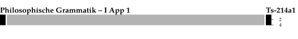

# Philosophical Grammar – I App 1

1933, 20 remarks, Ts-214a1

### [Ts-214a1](/ts-214a1/#1.1) [1\[1\]](https://cdn.wittgensteinnachlass.com/2000px/webp/Ts-214a1/1.webp)

## Complex and fact.

### [Ts-214a1](/ts-214a1/#1.2) [1\[2\]](https://cdn.wittgensteinnachlass.com/2000px/webp/Ts-214a1/1.webp)

The use of the words “fact” and “deed”. – “That was a noble deed”. – “But that never happened.” – It is tempting to want to use the word “deed” in such a way that it corresponds only to the _true_ sentence. So one does not then speak of a deed that was never done. But surely the sentence “that was a noble deed” must retain its sense even if I am mistaken in thinking that what I call the deed happened. And that already contains everything important, and I can only stipulate that I shall use the words “deed”, “fact”, (and perhaps “event” too) only in a sentence which, taken as a whole, asserts that this obtains.

### [Ts-214a1](/ts-214a1/#1.3) [1\[3\]](https://cdn.wittgensteinnachlass.com/2000px/webp/Ts-214a1/1.webp)

It would be better to drop the restriction on the use of these words, since it only misleads, and simply to say “this deed was not done”, “this fact does not obtain”, “this event did not occur”.

### [Ts-214a1](/ts-214a1/#1.4) [1\[4\]](https://cdn.wittgensteinnachlass.com/2000px/webp/Ts-214a1/1.webp)

A complex is not the same as a fact. For I say of a complex, for example, that it moves from one place to another, but I do not say this of a fact. But that this complex is now there is a fact.

### [Ts-214a1](/ts-214a1/#2.1) [2\[1\]](https://cdn.wittgensteinnachlass.com/2000px/webp/Ts-214a1/2.webp)

“This complex of buildings is being demolished” means the same as “the buildings that stand together in this way are being demolished”

### [Ts-214a1](/ts-214a1/#2.2) [2\[2\]](https://cdn.wittgensteinnachlass.com/2000px/webp/Ts-214a1/2.webp)

I call the flower, the house and the constellation complexes, namely complexes of bricks, of leaves, of stars, etc. Of course, that this constellation is here can be described by a sentence in which only its stars are spoken of and neither the word ‘constellation’ nor its name occurs.

### [Ts-214a1](/ts-214a1/#2.3) [2\[3\]](https://cdn.wittgensteinnachlass.com/2000px/webp/Ts-214a1/2.webp)

But that is also all one can say about the relation between complex and fact. And a complex is a spatial object consisting of spatial objects. (The concept ‘spatial’ can be extended somewhat.)

### [Ts-214a1](/ts-214a1/#2.4) [2\[4\]](https://cdn.wittgensteinnachlass.com/2000px/webp/Ts-214a1/2.webp)

A complex consists of its parts, the things of the same kind that form it. (This is of course a sentence of grammar about the words ‘complex’, ‘part’ and ‘consist’.)

### [Ts-214a1](/ts-214a1/#2.5) [2\[5\]](https://cdn.wittgensteinnachlass.com/2000px/webp/Ts-214a1/2.webp)

To say that a red circle _consists of_ redness and circularity, or that it is a complex made up of these constituents, is a misuse of these words and is misleading (Frege would know this and tell me so). It is just as misleading to say that the fact that this circle is red (that I am tired) is a complex made up of the constituents circle and redness (of me and tiredness).

### [Ts-214a1](/ts-214a1/#2.6) [2\[6\]](https://cdn.wittgensteinnachlass.com/2000px/webp/Ts-214a1/2.webp)

Nor is the house a complex made up of the bricks and their spatial relations. That is, this too goes against the correct use of the words.

### [Ts-214a1](/ts-214a1/#2.7+3.1) [2\[7\]](https://cdn.wittgensteinnachlass.com/2000px/webp/Ts-214a1/2.webp),[3\[1\]](https://cdn.wittgensteinnachlass.com/2000px/webp/Ts-214a1/3.webp)

Now one can indeed point to a configuration and say: this configuration consists entirely of _objects_ I already know; but one cannot ‘point to a false fact’ and say this.

### [Ts-214a1](/ts-214a1/#3.2) [3\[2\]](https://cdn.wittgensteinnachlass.com/2000px/webp/Ts-214a1/3.webp)

The expression “to describe a fact” or “the description of a fact” for the statement that asserts that the fact obtains is also _misleading_, because it sounds like “to describe the animal I saw”.

### [Ts-214a1](/ts-214a1/#3.3) [3\[3\]](https://cdn.wittgensteinnachlass.com/2000px/webp/Ts-214a1/3.webp)

One does of course also say “point to the fact”, but that always means “point to the fact that …”. By contrast, “point at a flower” (or “point to a flower”) does not mean pointing out that this blossom is on this stem; for there need be no mention of this blossom and this stem at all.

### [Ts-214a1](/ts-214a1/#3.4) [3\[4\]](https://cdn.wittgensteinnachlass.com/2000px/webp/Ts-214a1/3.webp)

Nor can it mean pointing to the fact that this flower is there.

### [Ts-214a1](/ts-214a1/#3.5) [3\[5\]](https://cdn.wittgensteinnachlass.com/2000px/webp/Ts-214a1/3.webp)

To point to a fact is to assert, to state something. ‘To point to a flower’ does not mean this.

### [Ts-214a1](/ts-214a1/#3.6) [3\[6\]](https://cdn.wittgensteinnachlass.com/2000px/webp/Ts-214a1/3.webp)

The chain too consists (only) of its links, not of them and their spatial relations.

### [Ts-214a1](/ts-214a1/#3.7) [3\[7\]](https://cdn.wittgensteinnachlass.com/2000px/webp/Ts-214a1/3.webp)

The fact that these links are connected in this way does not ‘_consist_’ of anything at all.

### [Ts-214a1](/ts-214a1/#3.8) [3\[8\]](https://cdn.wittgensteinnachlass.com/2000px/webp/Ts-214a1/3.webp)

The root of this confusion is the confusing use of the word “object”.

### [Ts-214a1](/ts-214a1/#4.1) [4\[1\]](https://cdn.wittgensteinnachlass.com/2000px/webp/Ts-214a1/4.webp)

The part smaller than the whole. Applied to fact and constituent, that would yield an absurdity.

### [Ts-214a1](/ts-214a1/#4.2) [4\[2\]](https://cdn.wittgensteinnachlass.com/2000px/webp/Ts-214a1/4.webp)

The schema: thing–property. One says: an action has a property! Such as that of speed; or that of goodness.
