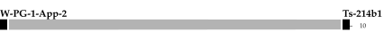

# Philosophical Grammar – I App 2

1933, 15 remarks, Ts-214b1

### [Ts-214b1](/ts-214b1/#5.1) [5\[1\]](https://cdn.wittgensteinnachlass.com/2000px/webp/Ts-214b1/5.webp)

## Concept and Object. Property and Substrate.

### [Ts-214b1](/ts-214b1/#5.2+6.1+7.1) [5\[2\]](https://cdn.wittgensteinnachlass.com/2000px/webp/Ts-214b1/5.webp),[6\[1\]](https://cdn.wittgensteinnachlass.com/2000px/webp/Ts-214b1/6.webp),[7\[1\]](https://cdn.wittgensteinnachlass.com/2000px/webp/Ts-214b1/7.webp)

Concept and object: in Russell and Frege these are really property and thing; and here I am thinking of a spatial _body_ and its colour. One can also say: concept and object, – that is, predicate and subject. And the subject–predicate form is a form of expression of human languages. It is the form “x is ” (“x y”): “my brother is tall”, “the thunderstorm is near”, “this circle is red”, “August is strong”, “2 is a number”, “this thing is a piece of coal”. Now just as physics has abstracted the concept of a material point from the bodies of experience, so too the subject–predicate form of logic has been abstracted from the subject–predicate form of our languages. The pure S-P form is now supposed to be aφ(x), where “a” is the name of an object. Let us now look for an application of this schema. At “name of an object” one thinks first of names of people and other spatial objects (the Kohinoor diamond). Such a name is given to the thing by an ostensive explanation (“this (arrow) is ‘N’”). This explanation could be understood as a rule for replacing the gesture pointing to the object with the word “N”, in such a way that one can always put that gesture back in place of the name “N”. I might, for example, have explained “this man is called ‘N’” and now say: “‘N’ is a mathematician”, “N is lazy”, etc., and I could have put ‘this man’ (with the pointing gesture) in place of ‘N’ in each of these sentences. In that case, incidentally, it would have been better to word the ostensive explanation: “let this man be called ‘N’”, or “I shall call this man ‘N’”, for the earlier wording is also the sentence saying that this man is called by that name. But this is not the normal way of applying a name; for that it is _essential_ that I cannot go back from a name to a sign in the language of gestures. For if N leaves the room and later a man enters it, then – given the way we use the name “N” – it makes sense to ask whether this man is N, whether he is the same man who left the room a little while ago. And the sentence “N has come back in” makes sense only if I can decide the question. And it will have a different sense depending on the criterion for this being the same object that I previously called ‘N’. Thus different rules will apply to the sign “N” depending on the kind of criterion; it will be a ‘name’ in a different sense of the word. And so it comes about that the word ‘name’ and the corresponding word ‘object’ serve as a heading for countless different lists of rules.

### [Ts-214b1](/ts-214b1/#7.2+8.1) [7\[2\]](https://cdn.wittgensteinnachlass.com/2000px/webp/Ts-214b1/7.webp),[8\[1\]](https://cdn.wittgensteinnachlass.com/2000px/webp/Ts-214b1/8.webp)

When we give spatial objects names, our use of these names rests on a criterion of identity that presupposes the continuity of the bodies’ motion and their impenetrability. So if I could do with two bodies A and B what I can do with their shadows on the wall, make them into one and make two again out of the one, it would be senseless to ask which of the two is A and which is B after the separation. Unless I now introduce an altogether new criterion of identity, such as the shape of their paths (there is such a rule for naming a river formed by the confluence of two rivers: the resulting river takes the name of whichever of the two source rivers flows in approximately the same direction as the resulting river). Let us think of the possible criteria of identity, for example, for patches of colour in my visual field (or the figures on a cinema screen), and of the different ways of using a name that I give to such a patch or figure. If we now turn to the notation “(∃x)․fx”, it is clear that this is a sublimation of the form of expression of our language: “there are people on this island”, “there are stars that we do not see”. And a sentence “(∃x)․fx” is now always supposed to have a corresponding sentence “fa”, and “a” is supposed to be a name. So one is supposed to be able to say: “(∃x)․fx namely a and b” (“there is a value of x that satisfies fx, namely a and b”), or “(∃x)․fx, e.g. a”, etc. And this is possible in a case such as: “there are people on this island, namely Messrs A, B, C, D”. But is it essential to the sense of the sentence “there are people on this island” that we can name them, and thus lay down a definite criterion for identification? It is essential only if the sentence “(∃x)․fx” is defined as a disjunction of sentences of the form “f(x)”, so if, for example, it is stipulated that “there are people on this island” is to mean “either Mr A or B or C or D or E is on this island”; that is, if one specifies the concept ‘human being’ as an extension (which would of course run quite counter to the normal use of this word). (By contrast, one really does specify the concept “primary colour”, for example, as an extension.) Thus, given the sentence “(∃x)․fx”, the question “_which_ x satisfy f” does not make sense in every case. “Which red circle with a diameter of 1 cm is at the centre of this quadrilateral?” – One must not confuse the question “_which_ object satisfies f?” with the question “_what kind of_ object etc.?” The answer to the first question would have to be a name, so the answer would have to be able to take the form “f(a)”; but the answer to the question “_what kind of_ …” is “(∃x)․fx & Fx”. Thus it can be senseless to ask “which red patch do you see?” but make sense to ask: “what kind of red patch do you see” (a round one, a quadrilateral one, etc.).

### [Ts-214b1](/ts-214b1/#8.2) [8\[2\]](https://cdn.wittgensteinnachlass.com/2000px/webp/Ts-214b1/8.webp)

I would like to say: the _old_ logic has much more convention and physics in it than one believed. If the noun is the name of a _body_, the verb serves, say, to designate a movement, and the adjective to designate a property of a body, then one can presumably see how much this logic presupposes and can assume that these original presuppositions (_also_) reach still deeper into the application of these words, into the logic of the sentences.

### [Ts-214b1](/ts-214b1/#8.3+9.1) [8\[3\]](https://cdn.wittgensteinnachlass.com/2000px/webp/Ts-214b1/8.webp),[9\[1\]](https://cdn.wittgensteinnachlass.com/2000px/webp/Ts-214b1/9.webp)

(Suppose our task were to project figures of various shapes lying in a plane I onto a plane II. We could then specify a method of projection (say, orthogonal projection) and map the figures accordingly. We could then also readily infer the figures in I from the pictures on plane II. But we can also proceed in this way: we stipulate, say (perhaps because we find this representation the most convenient), that the pictures in the second plane are all to be circles – whatever the figures depicted in the first plane may be. That is, different figures in the first plane are mapped onto the second by different methods of projection. To understand the circles in II as pictures of the figures in I, I shall then have to give the method of projection for each circle; but the (_mere_) fact that a figure in II appears as a circle in I now tells us nothing (_by itself_) about the shape of the figure depicted. That the picture in II is a circle is, after all, the stipulated norm of the mapping. Now the same thing happens when we map reality into our language according to the subject–predicate norm. The subject–predicate schema serves as a projection of countless different logical forms.

### [Ts-214b1](/ts-214b1/#9.2) [9\[2\]](https://cdn.wittgensteinnachlass.com/2000px/webp/Ts-214b1/9.webp)

Frege’s “Concept and Object” is nothing other than subject and predicate.

### [Ts-214b1](/ts-214b1/#9.3+10.1) [9\[3\]](https://cdn.wittgensteinnachlass.com/2000px/webp/Ts-214b1/9.webp),[10\[1\]](https://cdn.wittgensteinnachlass.com/2000px/webp/Ts-214b1/10.webp)

If a table is painted brown, it is easy to think of the wood as the bearer of the property brown, and one can imagine what remains the same when the colour changes. Indeed, one can do so even in the case of _one_ particular circle that appears red at one time and blue at another. So it is easy to imagine _what_ is red, but difficult to imagine what is circular. What _remains_ here when shape and colour change? For position is part of shape, and it is arbitrary for me to stipulate that the centre is to stay fixed and the shape is to change only through a change in radius. We shall have to stick to ordinary language, and it says that a _patch_ is circular. It is clear that the expression “bearer of the property” gives a completely false – impossible – image here. – If I have a lump of clay, I can think of it as the bearer of a shape, and that is more or less where this image comes from too. The patch changes its shape” and “the lump of clay changes its shape” are, after all, different sentential forms.

### [Ts-214b1](/ts-214b1/#10.2) [10\[2\]](https://cdn.wittgensteinnachlass.com/2000px/webp/Ts-214b1/10.webp)

One can say “measure to see whether _that_ is a circle” or “look to see whether _that_ thing lying there is a hat”. One can also say “measure to see whether _that_ is a circle or an ellipse”, but not “ …whether that is a circle or a hat”, nor “look to see whether that is a hat or red”.

### [Ts-214b1](/ts-214b1/#10.3) [10\[3\]](https://cdn.wittgensteinnachlass.com/2000px/webp/Ts-214b1/10.webp)

If I point to a line and say “that is a circle”, one can object that if it were not a circle, it would no longer be _that_. I.e. what I mean by the word “that” must be independent of what is stated about it. (“Was _that_ thunder, or a shot”. But in this case one cannot ask “was that a noise”.)

### [Ts-214b1](/ts-214b1/#10.4+11.1) [10\[4\]](https://cdn.wittgensteinnachlass.com/2000px/webp/Ts-214b1/10.webp),[11\[1\]](https://cdn.wittgensteinnachlass.com/2000px/webp/Ts-214b1/11.webp)

In what would 2 red circles of the same size differ? This question sounds as though they were, after all, more or less one and the same and differed only in some small detail. In representation by equations, what they have in common is expressed by the form of the equation, and the difference by the difference in the coordinates of the centres. So it is as though the coordinates of the centres were what corresponded to the objects falling under the concept here. Could one not say, instead of “this is a circle”, “this point is the centre of a circle”? For being the centre of a circle is an external property of the point.

### [Ts-214b1](/ts-214b1/#11.2) [11\[2\]](https://cdn.wittgensteinnachlass.com/2000px/webp/Ts-214b1/11.webp)

What is needed to describe – say – a book’s being in a particular place? The internal description of the book, i.e. of the concept, and the description of its position, which could be given by specifying the coordinates of three points. The sentence “a book of this kind is _here_” would then mean that it has _these_ 3 triples of determining coordinates. For specifying the Here must not prejudge _what_ is here. But does it not amount to the same thing whether I say “_this_ is a book” or “here is a book”? The sentence would then come down to saying something like “these are 3 (particular) corners of a book of this kind”. Similarly, one can also say “this circle is the projection of a sphere” or “this is the appearance of a human being”. All I am saying comes down to this: F(x) must be an _external_ description of x.

### [Ts-214b1](/ts-214b1/#11.3) [11\[3\]](https://cdn.wittgensteinnachlass.com/2000px/webp/Ts-214b1/11.webp)

Now if, in this sense, in three-dimensional space I say “here is a circle” and on another occasion “here is a sphere”, are the two instances of _Here_ of the same kind? What I want to ask is: Can one say with sense of the same ‘object’: that it is a circle and: that it is a sphere? Is the subject of these predicates of the same type? After all, in both cases it could be the 3 coordinates of the centre in question. But the position of the circle in three-dimensional space is not determined by the coordinates of its centre.

### [Ts-214b1](/ts-214b1/#11.4+12.1) [11\[4\]](https://cdn.wittgensteinnachlass.com/2000px/webp/Ts-214b1/11.webp),[12\[1\]](https://cdn.wittgensteinnachlass.com/2000px/webp/Ts-214b1/12.webp)

On the other hand, one can of course say: “What makes me nervous is not the noise but the colour”, and here it might seem as though a variable took a colour and a noise as values. (“Sounds and colours can serve as linguistic means of expression”.) Clearly, that sentence is of the same kind as “If you hear a shot or see me beckon, run away”. For the convention on which the functioning of language heard or seen rests is of this kind.

### [Ts-214b1](/ts-214b1/#12.2) [12\[2\]](https://cdn.wittgensteinnachlass.com/2000px/webp/Ts-214b1/12.webp)

“Is it conceivable that two things have all their properties in common?” – If it is not conceivable, then the opposite is not conceivable either.

### [Ts-214b1](/ts-214b1/#12.3) [12\[3\]](https://cdn.wittgensteinnachlass.com/2000px/webp/Ts-214b1/12.webp)

Indeed, we speak of the circle, its diameter, etc., etc., as of a concept whose properties we describe, regardless of which objects fall under this concept. – But in this connection ‘circle’ is not a predicate at all in the original sense. And geometry in general is where concepts from the most diverse fields are mixed together.
