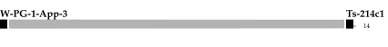

# Philosophical Grammar – I App 3

1933, 13 remarks, Ts-214c1

### [Ts-214c1](/ts-214c1/#13.1) [13\[1\]](https://cdn.wittgensteinnachlass.com/2000px/webp/Ts-214c1/13.webp)

## Object.

### [Ts-214c1](/ts-214c1/#13.2) [13\[2\]](https://cdn.wittgensteinnachlass.com/2000px/webp/Ts-214c1/13.webp)

“An object cannot, in a certain sense, be described” (also in Plato: “it cannot be described [explained], but only named”). By “object” one means here “meaning of a word that cannot be defined any further”, and by “description” or “explanation” one really means: definition. For of course it is not denied that the object can be ‘described from outside’, that properties, for instance, can be ascribed to it.

### [Ts-214c1](/ts-214c1/#13.3) [13\[3\]](https://cdn.wittgensteinnachlass.com/2000px/webp/Ts-214c1/13.webp)

So when we consider a sentence like the one above, we think of a calculus with indefinable – or, more correctly, undefined – signs, the names, and say of them that they cannot be explained.

### [Ts-214c1](/ts-214c1/#13.4) [13\[4\]](https://cdn.wittgensteinnachlass.com/2000px/webp/Ts-214c1/13.webp)

“One cannot say what a word means”.

### [Ts-214c1](/ts-214c1/#13.5+14.1) [13\[5\]](https://cdn.wittgensteinnachlass.com/2000px/webp/Ts-214c1/13.webp),[14\[1\]](https://cdn.wittgensteinnachlass.com/2000px/webp/Ts-214c1/14.webp)

How, then, does blue differ from red? Surely we do not mean that one has these properties and the other those. Incidentally, among the properties of blue and red are that this body (or place) is blue and that that one is red.

### [Ts-214c1](/ts-214c1/#14.2) [14\[2\]](https://cdn.wittgensteinnachlass.com/2000px/webp/Ts-214c1/14.webp)

To the question “What difference is there between blue and red?” one would like to answer: one is blue, the other red. But of course that means nothing, and what one is really thinking of here is the difference between the surfaces or places that have these colours. _For otherwise_ the question has no sense _at all_.

### [Ts-214c1](/ts-214c1/#14.3) [14\[3\]](https://cdn.wittgensteinnachlass.com/2000px/webp/Ts-214c1/14.webp)

Compare, by contrast: How does orange differ from pink? One is a mixture of yellow and red, the other of white and red. And one can correspondingly say: blue comes from purple as it becomes bluer and bluer, red as it becomes redder and redder.

### [Ts-214c1](/ts-214c1/#14.4) [14\[4\]](https://cdn.wittgensteinnachlass.com/2000px/webp/Ts-214c1/14.webp)

So what I am saying amounts to this: one cannot describe red. But can one not represent it in a painting by painting something red?

### [Ts-214c1](/ts-214c1/#14.5) [14\[5\]](https://cdn.wittgensteinnachlass.com/2000px/webp/Ts-214c1/14.webp)

No, that is not a painterly representation of the meaning of the word ‘red’ (there is no _such thing_). The portrait of red.

### [Ts-214c1](/ts-214c1/#14.6) [14\[6\]](https://cdn.wittgensteinnachlass.com/2000px/webp/Ts-214c1/14.webp)

But in any case it is surely no accident that, in explaining the meaning of the word ‘red’, one _quite naturally_ points to a red object!

### [Ts-214c1](/ts-214c1/#14.7) [14\[7\]](https://cdn.wittgensteinnachlass.com/2000px/webp/Ts-214c1/14.webp)

(What is natural about it is represented in this sentence by the two _occurrences_ of the word ‘red’.)

### [Ts-214c1](/ts-214c1/#14.8) [14\[8\]](https://cdn.wittgensteinnachlass.com/2000px/webp/Ts-214c1/14.webp)

And to say that blue lies on the bluish side of blue-red and red on the reddish side is to utter a sentence of grammar, one which is thus akin to a definition. And one can also say: bluer = more like blue.

### [Ts-214c1](/ts-214c1/#15.1) [15\[1\]](https://cdn.wittgensteinnachlass.com/2000px/webp/Ts-214c1/15.webp)

“Anyone who calls the colour green an object must say that this object occurs in the symbolism. For otherwise the sense of the symbolism, that is, its being a symbolism, would not be assured.” But what does this state about green or the word “green”? ((This sentence refers to a particular conception of the relation of meaning and to a particular way of posing the question about this relation.))
