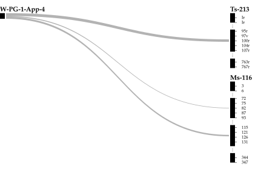

# Philosophical Grammar – I App 4

1933–1938, 12 remarks, Ts-213, Ms-116

### [Ts-213](/ts-213/#100r.2) [100r\[2\]](https://cdn.wittgensteinnachlass.com/2000px/webp/Ts-213/100r.webp)

_**Elementary Proposition.**_

### [Ts-213](/ts-213/#100r.3+100r.1) [100r\[3\]](https://cdn.wittgensteinnachlass.com/2000px/webp/Ts-213/100r.webp),[100r\[1\]](https://cdn.wittgensteinnachlass.com/2000px/webp/Ts-213/100r.webp)

Can a logical product be hidden in a sentence? And if so, how does one find out, and what methods do we have for bringing to light what is hidden in the sentence? If we have no method yet (_of finding it,_) then neither can we speak of something being hidden or possibly being hidden. And if we have a method for looking for it, then the logical product, for example, can be hidden in the sentence only in the way that the quotient 753 : 3 is hidden as long as the division has not yet been carried out. For finding the hidden logical product is a mathematical task.

### [Ts-213](/ts-213/#100r.4) [100r\[4\]](https://cdn.wittgensteinnachlass.com/2000px/webp/Ts-213/100r.webp)

So an elementary proposition is one that does not present itself as a truth-function of other propositions in the calculus as I am now using it.

### [Ts-213](/ts-213/#100r.5+101r.1) [100r\[5\]](https://cdn.wittgensteinnachlass.com/2000px/webp/Ts-213/100r.webp),[101r\[1\]](https://cdn.wittgensteinnachlass.com/2000px/webp/Ts-213/101r.webp)

The idea of constructing elementary propositions (as Carnap, for example, has tried to do) rests on a mistaken conception of logical analysis. The problem of this analysis is not that a _theory_ of elementary propositions is to be found. As if there were principles of mechanics to be found.

### [Ts-213](/ts-213/#101r.2) [101r\[2\]](https://cdn.wittgensteinnachlass.com/2000px/webp/Ts-213/101r.webp)

My conception in the Tractatus Logico-Philosophicus was mistaken: 1.) because I was not clear about the sense of the words “a logical product is _hidden_ in a sentence” (and similar words), 2.) because I too thought that logical analysis had to bring hidden things to light (as chemical and physical analysis do).

### [Ts-213](/ts-213/#101r.3) [101r\[3\]](https://cdn.wittgensteinnachlass.com/2000px/webp/Ts-213/101r.webp)

One can call the sentence “this place is now red” (or “this circle is now red”, etc.) an elementary proposition if what one means by this is that it neither is a truth-function of other propositions nor (is) defined as one. (Here I set aside combinations of the form p & (q ․⌵․ non-q) and analogous ones.) But “a is not now green” follows from “a is now red”, and so elementary propositions in this sense are not independent of one another, as are the elementary propositions in the calculus I described at the time, to which I assumed the whole use of sentences must be reducible; – misled by a mistaken conception of this “reducing”.

### [Ms-116](/ms-116/#80.2+81.1+82.1) [80\[2\]](https://cdn.wittgensteinnachlass.com/2000px/webp/Ms-116/80.webp),[81\[1\]](https://cdn.wittgensteinnachlass.com/2000px/webp/Ms-116/81.webp),[82\[1\]](https://cdn.wittgensteinnachlass.com/2000px/webp/Ms-116/82.webp)

If one wants to use the designation “elementary proposition” as I have done in the Logical-Philosophical Treatise, that is, as “atomic proposition” in Russell’s sense, then one can call the proposition “here stands a red rose” an elementary proposition. That is, it contains no truth-function and is not defined by an expression that contains one. But if one is to say that a proposition is an elementary proposition only if its logical analysis does not bring a truth-function to light, this presupposes that one has a conception of such an ‘analysis’. I myself spoke in earlier times of “complete analysis,” in the thought that philosophy must definitively dissect all propositions in order to clarify all connections and eliminate every possibility of misunderstanding. As if there were a calculus in which such a dissection were possible. I had in mind something along the lines of Russell’s definition of the definite article. Similarly, I once thought, one could and should define the concept of a sphere with the help of visual images, etc., and thus the connection between the concepts—the source of all misunderstandings, etc.—would be demonstrated once and for all. Underlying this (for everyone) was a falsely idealized image of language and its use. Of course, in certain cases one can clarify the connection between the various ways expressions are used through definitions. And even in the case of the connection between ‘visual image’ and ‘sphere,’ such a definition can help. But not by defining the concept of the physical sphere, rather by describing a language-game related to ours—or rather, a whole series of language-games related to it—and such definitions may occur within these. This juxtaposition destroys grammatical prejudices and enables us to see the use of a word as it really is, rather than _attributing_ a use to the word.

### [Ms-116](/ms-116/#82.2) [82\[2\]](https://cdn.wittgensteinnachlass.com/2000px/webp/Ms-116/82.webp)

There may, under certain circumstances, be a calculus that decomposes sentences, and it is not difficult to imagine such a thing. It is then a calculation to determine whether a sentence is an elementary sentence or not. The question of whether a logical product (e.g.) is hidden in a sentence is a mathematical problem. – What is meant here by “hidden” is defined by the method of searching for what is hidden (or rather, by the lack of a method).

### [Ms-116](/ms-116/#122.3+123.1) [122\[3\]](https://cdn.wittgensteinnachlass.com/2000px/webp/Ms-116/122.webp),[123\[1\]](https://cdn.wittgensteinnachlass.com/2000px/webp/Ms-116/123.webp)

What can lead us to believe that there is a kind of correspondence between thought and reality? – Instead of “correspondence,” one could easily say (here): “pictoriality.” But is pictoriality a correspondence? In the Logical-Philosophical Treatise, I said something like: it is a correspondence of form.  <s>But that is a mistake. Everything can be an image of everything—if we correspond the concept of the image accordingly. What I said now amounts to this: every projection, by whatever method, must have something in common with the projected. That is, I expand the concept of “having in common” and make it equivalent to the general concept of projection. A certain kind of generalization thus imposes itself on me, a form of representation, a certain aspect. </s>

### [Ms-116](/ms-116/#123.2) [123\[2\]](https://cdn.wittgensteinnachlass.com/2000px/webp/Ms-116/123.webp)

Above all, “image” is used ambiguously here. One wants to say: a command is an image of the action that was carried out according to it; but also, an image of the action that _is_ _to_ be carried out according to it.

### [Ms-116](/ms-116/#124.1+125.1) [124\[1\]](https://cdn.wittgensteinnachlass.com/2000px/webp/Ms-116/124.webp),[125\[1\]](https://cdn.wittgensteinnachlass.com/2000px/webp/Ms-116/125.webp)

One might say: a working drawing _serves as an image_ of the object that the worker is to produce according to it. And one could call the “projection method” here the manner in which the worker must translate such a drawing into the work. One could now make the following expression: the projection method mediates between the drawing and the object; it extends from the drawing to the workpiece. One thus makes a comparison between the projection method and projection lines that extend from one figure to another. – But if the projection method is a bridge, then it is one that is not built until the application is made. – The comparison, however, leads to the idea that the image, _together with_ the projection rays, does not merely permit various types of _application_, but that through this the depicted object, even if it does not actually exist, is ethically determined—namely, determined as _if_ it _were_ present. (It is “determined to be both yes and no.”) One can then call the working drawing_, with_ the method of its application, an “image.” And under this method, one now imagines something that follows the working drawing, even if it is not used. (One can ‘_describe_’ an application, even if it does not exist.)

### [Ms-116](/ms-116/#125.2+126.1) [125\[2\]](https://cdn.wittgensteinnachlass.com/2000px/webp/Ms-116/125.webp),[126\[1\]](https://cdn.wittgensteinnachlass.com/2000px/webp/Ms-116/126.webp)

I now ask: “How could the working drawing be used as a representation if there were not already a correspondence with what is to be made?”—But what does that mean? Well, something like this: How could I play the piano from sheet music if it did not already have some kind of relationship to hand movements of a certain sort? And this relationship consists, of course, _sometimes_ in a certain correspondence (similarity), but sometimes not in a correspondence, but only in the fact that we have learned to apply the signs in such and such a way. But to make all these cases the same—for _that_ is what tempts us—serves the confusion between the projection rays that connect the image with the object, and the projection method. One might say: I still count the projection rays as part of the image—but not the projection method. One could, of course, also say: I still count a _description_ of the projection method as part of the image. I therefore imagine that the difference between proposition and reality is balanced out by the projection rays, which belong to the image, to the thought, and which leave no room for a method of application. There is (rather) only agreement and disagreement.
