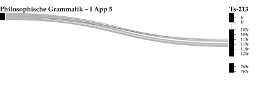

# Philosophical Grammar – I App 5

1933, 15 remarks, Ts-213

### [Ts-213](/ts-213/#113r.3) [113r\[3\]](https://cdn.wittgensteinnachlass.com/2000px/webp/Ts-213/113r.webp)

If grammar lay before us in the form of a book, it would not consist of a series of articles merely set side by side, but would exhibit a different structure. And in this structure one would – if I am right – also have to see the difference between the phenomenological and the non-phenomenological. There would, for example, be a chapter on colours, in which the use of colour words would be regulated; but what grammar would say about the words “not”, “or”, etc. (the “logical constants”) would not be comparable to that. For example, it would follow from the rules that these latter words were to be applied in every sentence (but not the colour words). And this “every” would not have the character of empirical generality, but of the _unappealable_ generality of a supreme rule of the game. It seems to me rather like the way one can presumably play chess (or at least continue playing it) without certain pieces, but never without the chessboard. [That is not true; one could get along perfectly well with part of the board.]

### [Ts-213](/ts-213/#113r.4+114r.1) [113r\[4\]](https://cdn.wittgensteinnachlass.com/2000px/webp/Ts-213/113r.webp),[114r\[1\]](https://cdn.wittgensteinnachlass.com/2000px/webp/Ts-213/114r.webp)

How is the temporality of facts revealed, how is it expressed, except in the requirement that certain expressions occur in _our_ sentences? That is: How is the temporality of facts expressed, if not grammatically?

By “temporality” is meant not that I come at 5 h but that I come at some time, i.e. that my sentence has the structure it has.

### [Ts-213](/ts-213/#114r.2) [114r\[2\]](https://cdn.wittgensteinnachlass.com/2000px/webp/Ts-213/114r.webp)

Negation and disjunction, we want to say, have to do with the essence of the proposition, whereas time does not, but has to do with its content. But how can grammar show that one thing has to do with the essence of the proposition and another does not, if they are both equally general? Or should I say that time is less general, since mathematical propositions can be negated and disjoined but are not temporal? There is presumably a connection, even if presenting the matter in this form is misleading. This is just what shows what I understand by “proposition” or by “the essence of the proposition”.

### [Ts-213](/ts-213/#113v.1) [113v\[1\]](https://cdn.wittgensteinnachlass.com/2000px/webp/Ts-213/113v.webp)

Whence – I should like to ask – the general temporality of sentences?

### [Ts-213](/ts-213/#113v.2) [113v\[2\]](https://cdn.wittgensteinnachlass.com/2000px/webp/Ts-213/113v.webp)

Could one also ask: “How is it that one can connect all empirical facts with what a clock shows?”?

### [Ts-213](/ts-213/#114r.5) [114r\[5\]](https://cdn.wittgensteinnachlass.com/2000px/webp/Ts-213/114r.webp)

These two kinds of generality would be as strange as if, of two rules of a game that both apply equally without exception, one were called the more fundamental. As though one could _ask_ whether the king or the chessboard was more essential to chess. Which of the two was more essential, which more accidental.

### [Ts-213](/ts-213/#115r.1) [115r\[1\]](https://cdn.wittgensteinnachlass.com/2000px/webp/Ts-213/115r.webp)

At the very least, a question seems warranted: if I had written out the grammar and the various chapters, on colour words, etc., etc., were set down one after another, like rules for all the pieces in chess, how would I know that these were now _all_ the chapters? And if the chapters that are there all share a common feature, then _here apparently_ we are dealing with a logical generality, but not an essential, i.e. foreseeable, generality. But surely one cannot say that the fact that chess is played with 16 pieces is less essential to it than the fact that it is played on a chessboard.

### [Ts-213](/ts-213/#115r.2) [115r\[2\]](https://cdn.wittgensteinnachlass.com/2000px/webp/Ts-213/115r.webp)

Since time and truth-functions taste so different, and since they reveal their essence solely and entirely in grammar, grammar must explain the difference in taste. One tastes of content, the other of form of representation. They taste as different as the plan and the line drawn through the plan.

### [Ts-213](/ts-213/#113r.1) [113r\[1\]](https://cdn.wittgensteinnachlass.com/2000px/webp/Ts-213/113r.webp)

_Is time essential to sentences? Comparison of: time and truth-functions._

### [Ts-213](/ts-213/#115r.3) [115r\[3\]](https://cdn.wittgensteinnachlass.com/2000px/webp/Ts-213/115r.webp)

It seems to me as if the present, as it appears in the sentence “the sky is blue” (when this sentence is meant non-hypothetically), were not a form of time. As though, then, the present in _this_ sense were non-temporal.

### [Ts-213](/ts-213/#113r.2) [113r\[2\]](https://cdn.wittgensteinnachlass.com/2000px/webp/Ts-213/113r.webp)

Does time enter into a landscape painting? Or into a still life? Literature consisting of descriptions of landscapes.

### [Ts-213](/ts-213/#115r.4) [115r\[4\]](https://cdn.wittgensteinnachlass.com/2000px/webp/Ts-213/115r.webp)

It is curious that the time I am talking about here is not time in the physical sense. What is at issue here is not a measurement of time. And it is suspicious that something that has nothing to do with such a measurement should play a _similar_ role in sentences to the role physical time plays in the hypotheses of physics.

### [Ts-213](/ts-213/#116r.1) [116r\[1\]](https://cdn.wittgensteinnachlass.com/2000px/webp/Ts-213/116r.webp)

Discuss: the difference between the logic of content and the logic of sentential form in general. One seems colourful, as it were, the other _dull_. One seems to deal with what the picture represents, the other seems, like the frame of the picture, to be a characteristic of pictorial form.

### [Ts-213](/ts-213/#116r.2) [116r\[2\]](https://cdn.wittgensteinnachlass.com/2000px/webp/Ts-213/116r.webp)

That all sentences contain time in some way seems accidental to us, compared with the fact that the truth-functions are applicable to all sentences. This seems to have to do with their essence as sentences, the other with the essence of reality as we find it.

### [Ts-213](/ts-213/#116r.3) [116r\[3\]](https://cdn.wittgensteinnachlass.com/2000px/webp/Ts-213/116r.webp)

A sentence can contain time in very different senses. You’re hurting me! The weather is glorious outside. The Inn flows into the Danube. Water freezes at 0˚. I often make slips in writing. Some time ago … I hope he will come. At 5 o’clock … This grade of steel is very good. Our earth was once a ball of gas.
