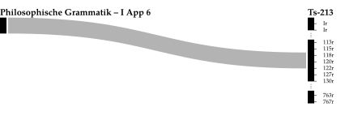

# Philosophical Grammar – I App 6

1933, 25 remarks, Ts-213

### [Ts-213](/ts-213/#117r.1) [117r\[1\]](https://cdn.wittgensteinnachlass.com/2000px/webp/Ts-213/117r.webp)

_**The essence of the hypothesis.**_

### [Ts-213](/ts-213/#117r.2) [117r\[2\]](https://cdn.wittgensteinnachlass.com/2000px/webp/Ts-213/117r.webp)

One could evidently explain a hypothesis by means of pictures. I mean, for instance, that one could explain the hypothesis “there is a book lying here” by means of pictures showing the book in plan, elevation and various cross-sections.

### [Ts-213](/ts-213/#117r.3) [117r\[3\]](https://cdn.wittgensteinnachlass.com/2000px/webp/Ts-213/117r.webp)

Such a representation gives a _law_. Just as the equation of a curve gives a law for finding the ordinates when one takes sections at different abscissae. The individual verifications then correspond to such sections actually taken. If our experiences yield the points on a straight line, then the proposition that these experiences are the different views of a straight line is a hypothesis. The hypothesis is a way of representing this reality, for a new experience can agree or disagree with it, or make a change in the hypothesis necessary.

### [Ts-213](/ts-213/#117r.4+118r.1) [117r\[4\]](https://cdn.wittgensteinnachlass.com/2000px/webp/Ts-213/117r.webp),[118r\[1\]](https://cdn.wittgensteinnachlass.com/2000px/webp/Ts-213/118r.webp)

If, for instance, we express the proposition that a sphere is at a certain distance from our eyes by means of a coordinate system and the equation of the sphere, this description has a greater multiplicity than a verification by sight does. The former multiplicity corresponds not to _one_ verification, but to a _law_ that verifications obey.

### [Ts-213](/ts-213/#118r.2) [118r\[2\]](https://cdn.wittgensteinnachlass.com/2000px/webp/Ts-213/118r.webp)

A hypothesis is a law for forming sentences. One could also say: A hypothesis is a law for forming expectations. A sentence is, so to speak, a section through a hypothesis at a particular point.

### [Ts-213](/ts-213/#118r.3) [118r\[3\]](https://cdn.wittgensteinnachlass.com/2000px/webp/Ts-213/118r.webp)

According to my principle, the two assumptions must be identical in sense if all _possible_ experience that confirms the one also confirms the other. If, that is, no decision between the two by experience is conceivable.

### [Ts-213](/ts-213/#118r.4) [118r\[4\]](https://cdn.wittgensteinnachlass.com/2000px/webp/Ts-213/118r.webp)

Representation of a line as a straight line with deviations. The equation of the line contains a parameter whose variation _expresses_ the deviations from the straight line. It is not essential that these deviations be “slight”. They can be so great that the line does not look like a straight line. The “straight line with deviations” is only a form of description. It makes it easier for me to leave out, to disregard, a certain part of the description if I want to. (The form “rule with exceptions”.)

### [Ts-213](/ts-213/#118r.5) [118r\[5\]](https://cdn.wittgensteinnachlass.com/2000px/webp/Ts-213/118r.webp)

What does it mean to be certain that one will have toothache? (If one _cannot_ be certain, then grammar does not allow the word “certain” to be used in this connection.) Grammar of the expression “to be certain”.

### [Ts-213](/ts-213/#119r.1) [119r\[1\]](https://cdn.wittgensteinnachlass.com/2000px/webp/Ts-213/119r.webp)

One says: “When I say that I see an armchair there, I say more than I know for certain.” And then what one usually says is: “But there is _one_ thing I do know for certain.” But when one tries to say what that is, one finds oneself in some difficulty. “I see something _brown_ – that is certain”; what one _really_ means to say by this is that the brown colour is seen, and is not perhaps merely surmised (as, for instance, when I surmise it from certain other indications). And one does also simply say: “I _see_ something brown.”

### [Ts-213](/ts-213/#119r.2) [119r\[2\]](https://cdn.wittgensteinnachlass.com/2000px/webp/Ts-213/119r.webp)

If I am told: “Look through this telescope and draw what you see for me”, then what I draw is the expression of a proposition, not of a hypothesis.

### [Ts-213](/ts-213/#119r.3) [119r\[3\]](https://cdn.wittgensteinnachlass.com/2000px/webp/Ts-213/119r.webp)

When I say “there is an armchair here”, by this – as one says – “more” is meant than a description of what I perceive. And this can only mean that this proposition need not _be true,_ even if the description of what is seen is correct. Under what circumstances, then, will I say that the proposition was not true? Clearly: when certain other propositions that were included in the first are not true. But it is not as if the first had been a logical product.

### [Ts-213](/ts-213/#119r.4) [119r\[4\]](https://cdn.wittgensteinnachlass.com/2000px/webp/Ts-213/119r.webp)

The best simile for any hypothesis, and itself an example, is a solid body with its views from different points in space, constructed according to a definite rule.

### [Ts-213](/ts-213/#119r.5+120r.1) [119r\[5\]](https://cdn.wittgensteinnachlass.com/2000px/webp/Ts-213/119r.webp),[120r\[1\]](https://cdn.wittgensteinnachlass.com/2000px/webp/Ts-213/120r.webp)

The process of coming to know something in a scientific investigation (in experimental physics, say) is admittedly not the same as that of coming to know something in life outside the laboratory; but it is a _similar_ process and, set alongside the other, can shed light on it.

### [Ts-213](/ts-213/#120r.2) [120r\[2\]](https://cdn.wittgensteinnachlass.com/2000px/webp/Ts-213/120r.webp)

There is an essential difference between propositions like “that is a lion”, “the sun is larger than the earth”, which all contain a “this”, “now”, “here” and thus connect directly with reality, and propositions like “human beings have two hands”, etc. For if there happened to be no human beings around me, how would I check this proposition?

### [Ts-213](/ts-213/#120r.3) [120r\[3\]](https://cdn.wittgensteinnachlass.com/2000px/webp/Ts-213/120r.webp)

It is always facets of the hypothesis that are verified.

### [Ts-213](/ts-213/#120r.4) [120r\[4\]](https://cdn.wittgensteinnachlass.com/2000px/webp/Ts-213/120r.webp)

Now is it not perhaps the case that _what_ the hypothesis explains can itself only be expressed by a hypothesis in turn? That is, of course: are there primary propositions at all; propositions, that is, which are conclusively verifiable and are not the facets of a hypothesis? (This is rather as if one were to ask “are there surfaces that are not the surfaces of bodies?”)

### [Ts-213](/ts-213/#120r.5) [120r\[5\]](https://cdn.wittgensteinnachlass.com/2000px/webp/Ts-213/120r.webp)

In any case there can be no difference between a hypothesis used as the expression of an immediate experience and a proposition in the narrower sense.

### [Ts-213](/ts-213/#120r.6) [120r\[6\]](https://cdn.wittgensteinnachlass.com/2000px/webp/Ts-213/120r.webp)

There is a difference between a sentence like “there is a sphere lying here in front of me” and “it looks as if there were a sphere lying in front of me”. – This also shows itself in the following way: one can say “there seems to be a sphere lying in front of me”, but it is senseless to say: “it looks as if there seemed to be a sphere lying here”. Just as one can say “there is probably a sphere lying here”, but not “there probably seems to be a sphere lying here”. In such a case one would say: “surely you must know whether it _seems_ so”.

### [Ts-213](/ts-213/#121r.1) [121r\[1\]](https://cdn.wittgensteinnachlass.com/2000px/webp/Ts-213/121r.webp)

There is nothing hypothetical in what connects the proposition with the given fact.

### [Ts-213](/ts-213/#121r.2) [121r\[2\]](https://cdn.wittgensteinnachlass.com/2000px/webp/Ts-213/121r.webp)

It is surely clear that reality – I mean immediate experience – answers a hypothesis sometimes with yes, sometimes with no; (though here “yes” and “no” express only confirmation and _lack of confirmation_) and that one can give expression to this affirmation and negation.

### [Ts-213](/ts-213/#121r.3) [121r\[3\]](https://cdn.wittgensteinnachlass.com/2000px/webp/Ts-213/121r.webp)

The hypothesis becomes a proposition when it is brought up against reality with _that_ facet.

### [Ts-213](/ts-213/#121r.4) [121r\[4\]](https://cdn.wittgensteinnachlass.com/2000px/webp/Ts-213/121r.webp)

Whether the body I see is a sphere may be doubtful, but that from here, say, it seems to be a sphere cannot be doubtful. – The mechanism of the hypothesis would not work if the appearance were still doubtful; if, that is, not even one facet of the hypothesis were verified beyond doubt. If there were doubt here, what could remove it? If this connection too were loose, there would also be no confirmation of a hypothesis; the hypothesis would then hang entirely in mid-air and would be pointless (and thus senseless).

### [Ts-213](/ts-213/#121r.5+122r.1) [121r\[5\]](https://cdn.wittgensteinnachlass.com/2000px/webp/Ts-213/121r.webp),[122r\[1\]](https://cdn.wittgensteinnachlass.com/2000px/webp/Ts-213/122r.webp)

If I said “I saw an armchair”, the sentence “there wasn’t one there” does not contradict it (in _one_ sense). For I would also _use_ the first sentence in describing a dream, and no one would then contradict me with the words of the second. But describing the dream in those words sheds light on the sense of the words “_I saw_”. In the sentence “but there wasn’t one there”, incidentally, the “there” can have different meanings.

### [Ts-213](/ts-213/#122r.2) [122r\[2\]](https://cdn.wittgensteinnachlass.com/2000px/webp/Ts-213/122r.webp)

I agree with the views of more recent physicists when they say that the signs in their equations no longer have “meanings”, and that physics cannot arrive at any such meanings but must stop at the signs: what they fail to see, that is, is that these signs have meaning insofar – and only insofar – as the observed phenomenon corresponds to them, however indirectly, or does not correspond to them.

### [Ts-213](/ts-213/#122r.3) [122r\[3\]](https://cdn.wittgensteinnachlass.com/2000px/webp/Ts-213/122r.webp)

Let us imagine that chess had been invented not as a board game, but as a game to be played with digits and letters on paper, and in such a way that no one playing it had imagined a square with 64 squares, etc. But now suppose someone had discovered that this game corresponded exactly to one that could be played on a board in such and such a way. This invention would have made the game much easier to play (people who would formerly have found it too difficult could now play it). But it is clear that this new illustration of the rules of the game would only be a new, more readily surveyable symbolism, which, incidentally, would stand on the same footing as what was written. Now compare this with the talk about how physics today no longer works with mechanical models, but “only with symbols”.
