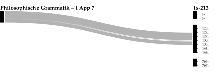
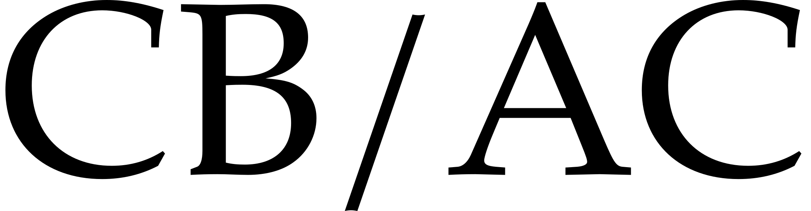

# Philosophical Grammar – I App 7

1933, 30 remarks, Ts-213

### [Ts-213](/ts-213/#123r.1) [123r\[1\]](https://cdn.wittgensteinnachlass.com/2000px/webp/Ts-213/123r.webp)

_**Probability.**_

### [Ts-213](/ts-213/#123r.2) [123r\[2\]](https://cdn.wittgensteinnachlass.com/2000px/webp/Ts-213/123r.webp)

The probability of a hypothesis is measured by how much evidence is needed to make it advantageous to overturn it. Only in this sense can one say that repeated uniform experience in the past makes it probable that this uniformity will continue in the future. Now if I say in this sense: I assume that the sun will rise again tomorrow because the opposite is too improbable, then by “probable” or “improbable” I mean something quite different here from what is meant by these words in the sentence “it is equally probable that I toss heads or tails”. The two meanings of the word “probable” are indeed connected in a certain way, but they are not identical.

### [Ts-213](/ts-213/#123r.3) [123r\[3\]](https://cdn.wittgensteinnachlass.com/2000px/webp/Ts-213/123r.webp)

One gives up the hypothesis only at an ever higher price.

### [Ts-213](/ts-213/#123r.4) [123r\[4\]](https://cdn.wittgensteinnachlass.com/2000px/webp/Ts-213/123r.webp)

Induction is a procedure governed by a principle of economy.

### [Ts-213](/ts-213/#124r.1) [124r\[1\]](https://cdn.wittgensteinnachlass.com/2000px/webp/Ts-213/124r.webp)

The question of how simple a representation a particular hypothesis affords, once adopted, is, I believe, directly connected with the question of probability.

### [Ts-213](/ts-213/#124r.2) [124r\[2\]](https://cdn.wittgensteinnachlass.com/2000px/webp/Ts-213/124r.webp)

One can compare part of a hypothesis with the movement of part of a gear mechanism, a movement one can fix without thereby prejudging the movement one wants to produce. But then one does have to arrange the rest of the mechanism in a particular way so that it produces the desired movement. I am thinking of a differential gear. – If I have  decided that there is to be no departure from a certain part of my hypothesis, whatever the experience to be described, then I have fixed a way of representing it, and that part of the hypothesis is now a postulate. A postulate must be such that no conceivable experience can refute it, however extremely inconvenient it may be to hold to the postulate. In so far as one can speak here of greater or lesser convenience, there is a greater or lesser probability of the postulate.

### [Ts-213](/ts-213/#124r.3+125r.1) [124r\[3\]](https://cdn.wittgensteinnachlass.com/2000px/webp/Ts-213/124r.webp),[125r\[1\]](https://cdn.wittgensteinnachlass.com/2000px/webp/Ts-213/125r.webp)

For the moment, then, it is senseless to speak of a measure of this probability. It is rather as in the case of, say, two kinds of number, where we can say with some justification that one is more like the other (is closer to it) than it is to a third, but there is no numerical measure of the similarity. Of course, one could imagine a measure being constructed in such cases too, by counting, say, the postulates or axioms the two systems have in common, etc., etc.

### [Ts-213](/ts-213/#125r.2+126r.1) [125r\[2\]](https://cdn.wittgensteinnachlass.com/2000px/webp/Ts-213/125r.webp),[126r\[1\]](https://cdn.wittgensteinnachlass.com/2000px/webp/Ts-213/126r.webp)

I give someone this information and no other: At such and such a time you will see a spot of light appear on the segment A B. Now does the question “is it more probable

 that this spot will appear in the interval A C

than in C B” have a sense? I think the answer is clearly no. – I can, of course, stipulate that the ratio of the probability of the event occurring in C B to that of its occurring in A C is to be , but that is a stipulation for which I can have empirical grounds; nothing, however, can be said about it a priori. The observed distribution of events cannot lead to this assumption. Where infinitely many possibilities come into consideration, probability must of course be regarded as a limit. For if I divide the segment A B into as many parts as I please, as unequal as I please, and regard the probabilities of the event occurring in any of these parts as equal to one another, we immediately have before us the simple case of the die. And now I can lay down a law – arbitrarily – according to which parts of equal probability are to be formed. E.g., the law that equal lengths of the parts entail equal probabilities. But any other law is equally permissible. Could I not also, in the case of the die, take, say, 5 faces together as one possibility and set them against the sixth as the second possibility? And what, apart from experience, can prevent me from regarding these two possibilities as equally probable? Imagine, say, a red ball being thrown that has only a very small green cap. In this case is it not much more probable that it will land on the red part than on the green? – But how would one justify this sentence? Presumably by the fact that the ball, when one throws it, lands much more often on the red surface than on the green. But that has nothing to do with logic. – One could always project the red and green surfaces and the events that occur on them onto a surface in such a way that the projection of the green surface would be as large as or larger than that of the red; so that the events, considered in this projection, appear to stand in quite a different ratio of probabilities from that on the original surface. If, e.g., I let the events be reflected in a suitably curved mirror and then consider which event I would have taken to be the more probable if I see only the image in the mirror. What the mirror cannot change is the number of clearly delineated possibilities. So if I have n patches of colour on my ball, the mirror also shows n, and if I have _stipulated_ that these are to count as equally probable, I can retain this stipulation for the mirror image too. To make myself clearer still: If I carry out the experiment in the concave mirror, i.e. make the _observations_ in the concave mirror, it may look as though the ball lands more often on the small surface than on the much larger one, and it is clear that neither experiment – in the concave mirror or outside it – deserves preference.

### [Ts-213](/ts-213/#126r.2+127r.1) [126r\[2\]](https://cdn.wittgensteinnachlass.com/2000px/webp/Ts-213/126r.webp),[127r\[1\]](https://cdn.wittgensteinnachlass.com/2000px/webp/Ts-213/127r.webp)

We can apply our old principle to sentences that express a probability and say that we will recognize their sense if we consider what verifies them. If I say “that will probably happen”, is this sentence verified by its happening, or falsified by its not happening? I think the answer is clearly no. Then it says nothing about that either. For if a dispute arose as to whether it was probable or not, only arguments from the past would ever be adduced. And even then only if what had happened was already known.

### [Ts-213](/ts-213/#127r.2) [127r\[2\]](https://cdn.wittgensteinnachlass.com/2000px/webp/Ts-213/127r.webp)

Causality rests on an observed uniformity. Now there is no guarantee that a uniformity observed up to now will always continue in the same way, but it must be established that the events have been uniform up to now; _that_ cannot in turn be the uncertain result of an empirical series which is itself not given either, but depends on an equally uncertain one, and so on ad inf.

### [Ts-213](/ts-213/#127r.3) [127r\[3\]](https://cdn.wittgensteinnachlass.com/2000px/webp/Ts-213/127r.webp)

When people say that the sentence “it is probable that p will occur” says something about the event p, they forget that it remains probable even if the event p does _not_ occur.

### [Ts-213](/ts-213/#127r.4) [127r\[4\]](https://cdn.wittgensteinnachlass.com/2000px/webp/Ts-213/127r.webp)

With the sentence “p will probably occur” we do indeed say something about the future, but not something “_about_ the event p”, contrary to what the grammatical form of the statement leads us to believe.

### [Ts-213](/ts-213/#127r.5) [127r\[5\]](https://cdn.wittgensteinnachlass.com/2000px/webp/Ts-213/127r.webp)

When I ask for the grounds for an assertion, the answer to this question is not valid for the person I ask and for just _this_ action (the assertion), but is valid _generally_.

### [Ts-213](/ts-213/#127r.6+128r.1) [127r\[6\]](https://cdn.wittgensteinnachlass.com/2000px/webp/Ts-213/127r.webp),[128r\[1\]](https://cdn.wittgensteinnachlass.com/2000px/webp/Ts-213/128r.webp)

If I say: “the weather points to rain”, am I saying something about the future weather? No, but about the present weather, with the help of a law that connects the weather at one time with the weather at a _later_ time. This law must already be in place, and with its help we sum up certain statements about our experience. – But then one could make the same claim for historical statements too. Yet it was hasty, after all, to say that the sentence “the weather points to rain” says nothing about the future weather. That depends on what one understands by “saying something about something”. What the sentence says is precisely its wording! The sentence “p will probably occur” says something about the future only in a sense in which its truth or falsity is entirely independent of what will happen in the future.

### [Ts-213](/ts-213/#128r.2) [128r\[2\]](https://cdn.wittgensteinnachlass.com/2000px/webp/Ts-213/128r.webp)

When we say, “the rifle is now aimed at the point P”, we say  nothing about where the shot will hit. The point at which it is aimed is a _geometrical_ aid for specifying its direction. Of course, our use of this particular means is connected with certain experiences (parabolic trajectory, etc.), but these do not now enter into the description of the direction.

### [Ts-213](/ts-213/#128r.3) [128r\[3\]](https://cdn.wittgensteinnachlass.com/2000px/webp/Ts-213/128r.webp)

Galton’s photograph, the image of a probability. The law of probability, the law of nature, what one sees when one squints.

### [Ts-213](/ts-213/#128r.4+129r.1) [128r\[4\]](https://cdn.wittgensteinnachlass.com/2000px/webp/Ts-213/128r.webp),[129r\[1\]](https://cdn.wittgensteinnachlass.com/2000px/webp/Ts-213/129r.webp)

What does it mean to say: “the points yielded by the experiment lie on average on a straight line”? or: “when I throw a good die, I throw a 1 on average once every 6 throws”? Is this sentence compatible with _every_ experience I might have? If it is, it says nothing. Have I specified (_beforehand_) what experience it is no longer compatible with, where the limit lies beyond which exceptions to the rule overturn the rule? No. But could I not have set such a limit? Certainly. – Suppose the limit were drawn like this: if 4 of 6 consecutive throws come up the same, the die is bad. But now one asks: “But if that happens seldom enough, isn’t it good after all?” – The answer is: If I allow 4 throws of the same number among 6 consecutive throws for a specified number of throws, then I am drawing a _different_ limit from the first one. But if I say “any number of consecutive throws of the same number is permissible, provided it occurs seldom enough”, then I have, strictly speaking, characterized the goodness of the die _as_ independent of the results of the throws. Unless by the goodness of the die I mean not a property of the die, but a property of a particular game played with it. For then I can indeed say: I call the die good in a game if among the N throws of the game there are no more than log N consecutive throws of the same number. But what this gives us is not a test for checking dice, but a criterion for judging one game.

### [Ts-213](/ts-213/#129r.2) [129r\[2\]](https://cdn.wittgensteinnachlass.com/2000px/webp/Ts-213/129r.webp)

One says that if the die is completely uniform and left to itself, then the distribution of the digits 1, 2, 3, 4, 5, 6 among the results of the throws must be uniform, because _there is no reason_ why one digit should occur more often than another.

### [Ts-213](/ts-213/#129r.3) [129r\[3\]](https://cdn.wittgensteinnachlass.com/2000px/webp/Ts-213/129r.webp)

But now let us represent the results of the throws not by the digits 1 to 6 but by the words of the function (x ‒ 3)² for the arguments 1 to 6, that is, by the digits 0, 1, 4, 9. Is there any reason why one of _these_ digits should figure more often among the new results than another? This teaches us that the a priori law of probability is a form of laws, like that of the minimum laws of mechanics, etc.

### [Ts-213](/ts-213/#130r.1) [130r\[1\]](https://cdn.wittgensteinnachlass.com/2000px/webp/Ts-213/130r.webp)

If one had found by experiment that the distribution of the throws 1 to 6 with a regular die turned out in such a way that the distribution of the values (x–3)² was uniform, one would then have declared _this_ uniformity to be the a priori uniformity. We do the same in the kinetic theory of gases: we represent the distribution of molecular motions in the form of some uniform distribution or other; but we choose _what_ is uniformly distributed – just as elsewhere we choose _what_ is to become a minimum – so that our theory agrees with experience.

### [Ts-213](/ts-213/#130r.2) [130r\[2\]](https://cdn.wittgensteinnachlass.com/2000px/webp/Ts-213/130r.webp)

“The molecules move solely according to the laws of probability” is supposed to mean: physics leaves the stage, and the molecules now move, as it were, solely according to laws of logic. This opinion is akin to the opinion that the law of inertia is an a priori proposition; and here too one speaks of what a body does when it is left to itself. What is the criterion for its being left to itself? Is it, in the end, that it moves uniformly in a straight line? Or is it something else? If the latter, then whether the law of inertia holds is a matter of experience; in the former case, though, it was no law at all, but a definition. And something analogous holds for a sentence: “if the particles are left to themselves, then the distribution of their motions is such and such”. What is the criterion for their being left to themselves? etc.

### [Ts-213](/ts-213/#131r.2) [131r\[2\]](https://cdn.wittgensteinnachlass.com/2000px/webp/Ts-213/131r.webp)

To say that the points that this experiment provides are, on average, located on this line, e.g., a straight line, _says_ something similar to: “seen from this distance, they appear to be on a straight line”. I can say of a line that the general impression is that of a straight line; but not: “the line looks straight, because it can be a part of a line that as a whole gives me the impression of a straight line”. (Mountains on the earth and on the moon. Earth a sphere.)

### [Ts-213](/ts-213/#131r.3+132r.1) [131r\[3\]](https://cdn.wittgensteinnachlass.com/2000px/webp/Ts-213/131r.webp),[132r\[1\]](https://cdn.wittgensteinnachlass.com/2000px/webp/Ts-213/132r.webp)

The experiment of throwing dice lasts a certain time, and our expectations about the future results of throwing can be based only on tendencies we perceive in the results of the experiment. That is, the experiment can only give grounds for expecting that it will go on in the _way_ the experiment has shown (it to go). But we cannot expect that the experiment, if continued, will now yield results that agree more closely with a preconceived opinion about its course than the results of the experiment actually carried out. If, e.g., I toss heads and tails and find in the results of the experiment no tendency for the numbers of heads and tails to come _still_ closer together, the experiment gives me no grounds for assuming that continuing it will show such a convergence. Indeed, the expectation of this convergence must itself refer to a particular time, for one cannot say that one expects an event to occur _sometime_ – in the infinite future.

### [Ts-213](/ts-213/#132r.2) [132r\[2\]](https://cdn.wittgensteinnachlass.com/2000px/webp/Ts-213/132r.webp)

All “grounded expectation” is expectation that a rule observed up to now will continue to hold. (But the rule must have been observed and cannot itself in turn be merely expected.)

### [Ts-213](/ts-213/#132r.3) [132r\[3\]](https://cdn.wittgensteinnachlass.com/2000px/webp/Ts-213/132r.webp)

The logic of probability has to do with the state of expectation only to the extent that logic in general has to do with thinking.

### [Ts-213](/ts-213/#132r.4) [132r\[4\]](https://cdn.wittgensteinnachlass.com/2000px/webp/Ts-213/132r.webp)

 A ray of light is emitted from the light source Q; it strikes the disc AB, produces a spot of light there, and then strikes the disc AC. _Now_ we have no grounds for assuming that the spot of light on AB will lie to the right of the centre M, nor for assuming the opposite; but we have no grounds either for assuming that the spot of light on AC will lie on _this_ side of the centre m rather than that. So this gives contradictory probabilities. Now if I make an assumption about the degree of probability that the one spot of light lies in the segment AM, – how is this assumption verified? _We think, surely_: by an experiment to determine frequencies. Now suppose this confirms the view that the probabilities for the segments AM and BM are equal (and thus different for Am and Cm), then that view is thereby recognized as correct and thus proves to be a physical hypothesis. The geometrical construction shows only that the equality of the segments AM and BM was _no_ ground for assuming equal probability.

### [Ts-213](/ts-213/#133r.1+134r.1) [133r\[1\]](https://cdn.wittgensteinnachlass.com/2000px/webp/Ts-213/133r.webp),[134r\[1\]](https://cdn.wittgensteinnachlass.com/2000px/webp/Ts-213/134r.webp)

If I assume that measurement shows the die to be true and homogeneous, that the numerals on its faces do not affect the results of the throws, and that the hand throwing it moves without any definite rule, does it follow that throws of 1 to 6 are distributed uniformly on average among the results? – What is that supposed to follow from? The fact that the die is true and homogeneous surely cannot account for a distribution of results that is _uniform on average_. (The assumption is homogeneous, so to speak; the conclusion would be speckled.) And we have made no assumption about the movement in throwing. (One has _indeed_ used the equality of the two bundles of hay as grounds for concluding that the donkey between them (_would_) starve; but not for concluding that it would eat from each about equally often.) – Our assumptions are also perfectly compatible with throwing 100 ones in succession with the die, if friction, movement of the hand and air resistance happen to combine in that way. The experience that this never happens is experience concerning these factors. And the conjecture that the results of the throws are evenly distributed is a conjecture about how these factors operate. If one says that a lever with equal arms on which symmetrical forces act must remain at rest because there is no cause for it to tilt to one side rather than the other, this means only that if we have established that the lever arms are equal and the forces symmetrical, and the lever then tilts to one side, we cannot explain this from the premises we know – or have assumed. (The form we call “explanation” must also be asymmetrical, like the operation that turns “a + b” into “2a + 3b”.) But we can explain why the lever remains at rest from our premises. – But can we also explain an oscillation directed from the centre to the right and to the left equally often on average? Not the oscillation, for there again we have asymmetry. Only the symmetry in this asymmetry. Had the lever turned uniformly to the right, one could say analogously: I can explain the uniformity of the movement by the symmetry of the conditions, but not its direction. A non-uniform distribution of the results of the throws can _not_ be explained by the symmetry of the die. And only to that extent does this symmetry explain the uniformity of the distribution. – For one can of course say: if the numerals on the faces of the die have no effect, then their differences cannot explain a non-uniform distribution; and identical circumstances cannot of course explain differences; so to that extent one might infer uniformity. But where, then, do the different results come from at all? Certainly, whatever explains these must also explain their uniformity on average. The regularity of the die simply does not interfere with this uniformity.

### [Ts-213](/ts-213/#134r.2+135r.1) [134r\[2\]](https://cdn.wittgensteinnachlass.com/2000px/webp/Ts-213/134r.webp),[135r\[1\]](https://cdn.wittgensteinnachlass.com/2000px/webp/Ts-213/135r.webp)

Suppose someone who plays dice every day were to throw nothing but ones for a week or so, using dice that prove sound under every other kind of examination and that also _give_ the usual results when someone else throws them. Does he now have grounds for assuming a law of nature _here_ according to which he always throws ones; does he have grounds for believing it will go on like this now, – or (_rather_) grounds for assuming that this regularity cannot go on much _longer_? Has he grounds, then, for giving up the game, since it has turned out that he can only throw ones; or for going on playing, since it is now all the more likely that he will throw a higher number next time? – In reality he will refuse to recognize the regularity as a law of nature; at the very least it will have to go on for a long time before he considers this _view_. But why? – “I think because so much of his previous experience in life tells against such a law, and all of it has, so to speak – to be overcome before we _adopt_ an entirely new way of looking at things.

### [Ts-213](/ts-213/#135r.2) [135r\[2\]](https://cdn.wittgensteinnachlass.com/2000px/webp/Ts-213/135r.webp)

If we draw conclusions from the relative frequency of an event about its relative frequency in the future, we can of course do so only on the basis of the frequency actually observed so far. And not on the basis of one we have obtained from the observed frequency by some procedure of the calculus of probability. For the calculated probability agrees with _any_ frequency actually observed, since it leaves the time open.

### [Ts-213](/ts-213/#135r.3) [135r\[3\]](https://cdn.wittgensteinnachlass.com/2000px/webp/Ts-213/135r.webp)

When the gambler or the insurance company goes by probability, they do not go by the calculus of probability, for one cannot go by that alone, since _whatever_ happens can be brought into agreement with it; rather, the insurance company goes by an actually observed frequency. And this is of course an absolute frequency.
